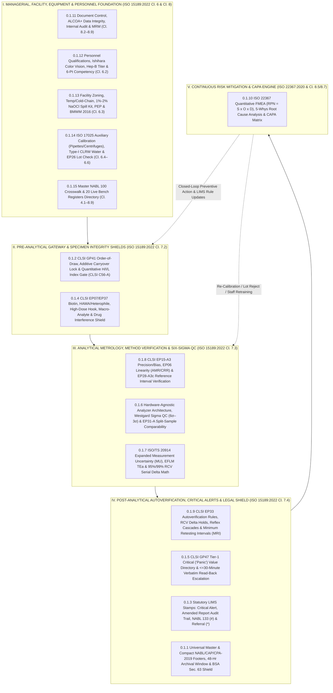

# 🛡️ Cluster 0.1: Universal Medico-Legal Shield, Indian Statutory Defense Matrix & NABL (`ISO 15189:2022`) Master Report Architecture

**Department Folder:** `00_Universal_NABL_Legal_Framework`  
**Document Control ID:** `MSTR-GOV-0.1` | **Version:** `4.0 (9-Persona International & Above-NABL Red-Team Standard-Setter Tier)` | **Effective Date:** `2026-10-12` | **Review Cycle:** `Annual / Upon Statutory Amendment`  
**Document Control Approval (`ISO 15189:2022 Cl. 8.3.2`):** **Prepared By:** `Quality Manager & Lead Metrologist` | **Reviewed By:** `Medico-Legal Defense Counsel & Chief Biochemist` | **Approved By:** `Laboratory Director & Chief Consultant Pathologist (MD Pathology)` | **Status:** `Controlled Electronic Master — Mandatory Pan-Laboratory Enforcement`  
**Applicable Indian Statutory Jurisdiction:** Haryana / Pan-India — Consumer Protection Act (`CPA`) 2019 (Secs. 2(11), 2(42), 35, 47, 58), Bharatiya Sakshya Adhiniyam (`BSA`) 2023 Sec. 63 (formerly Indian Evidence Act Sec. 65B), Digital Personal Data Protection (`DPDP`) Act 2023, Pre-Conception and Pre-Natal Diagnostic Techniques (`PCPNDT`) Act 1994 (Amended 2003), HIV & AIDS (Prevention and Control) Act 2017, Protection of Children from Sexual Offences (`POCSO`) Act 2012 (Secs. 19, 21), Bharatiya Nyaya Sanhita (`BNS`) 2023 & Bharatiya Nagarik Suraksha Sanhita (`BNSS`) 2023, Clinical Establishments (Registration and Regulation) Act (`CEA`) 2010, National Medical Commission (`NMC`) Act 2019, Bio-Medical Waste Management (`BMWM`) Rules 2016 (Amended 2018/2019) [HSPCB / CPCB], NABL `ISO 15189:2022` Clauses 4.1–8.9 & Normative Annex A, `NABL 112`, `NABL 129`, `NABL 131`, `NABL 133`, `NABL 153`, `NABL 163`, `NABL 220D`, `NABL 223`.  
**Global Metrological & Clinical Reference Benchmarks:** `ISO 15189:2022`, `ISO 22367:2020` (Application of Risk Management to Medical Laboratories), `ISO/TS 20914:2019` (Measurement Uncertainty), `ISO 17511:2020` (Metrological Traceability), `ISO 15190:2020` (Laboratory Biosafety), `CLSI GP02` / `GP41-Ed7` / `GP44` / `GP47-Ed1` / `C24-Ed4` / `C56-A` / `EP05-A3` / `EP06-Ed2` / `EP07-Ed3` / `EP15-A3` / `EP17-A2` / `EP26-Ed2` / `EP28-A3c` / `EP31-A` / `EP33` / `EP37`, `EFLM` Biological Variation Database (2024–2026), `IFCC` Working Group on Laboratory Errors and Patient Safety (`WG-LEPS`), `CAP` (College of American Pathologists) All-Common & Discipline Checklists, `UKAS` Technical Policy Statements, `ICMR` Good Clinical Laboratory Practices (`GCLP`).

---

## 🏛️ 0.0 — Charter of the 9-Persona International & Above-NABL Adversarial Red-Team Review Panel

Every clause, mathematical equation, LIMS hard-lock, and medico-legal footer within Cluster `0.1` (and across all `273` departmental parameter SOPs in `Folders 01–06`) is audited and enforced by a **9-Persona Adversarial Review Panel**:

| Persona ID | Adversarial Red-Team Persona | Primary Regulatory & Scientific Domain | Core Audit & Enforcement Mandate |
| :--- | :--- | :--- | :--- |
| **Persona 1** | **Lead NABL (`ISO 15189:2022`) & CAP / UKAS Technical Assessor** | `ISO 15189:2022 Cl. 4.1–8.9`, `NABL 112 / 133 / 153 / 220D / 223`, `CAP All-Common` | Enforces strict clause-by-clause traceability, `ALCOA+` data integrity, `NABL 133` symbol discipline, and zero-NC vertical witness-audit readiness. |
| **Persona 2** | **Department-Specific Clinical Subspecialty Consultant (`MD/DM`)** | Hematopathology, Clinical Biochemistry, Endocrinology, Immunology, Microbiology | Enforces deep cellular/molecular pathophysiology, biomarker kinetics (onset, peak, $t_{1/2}$, clearance), reagent stoichiometry, and $\ge 5\text{–}8$ condition differential diagnosis matrices. |
| **Persona 3** | **`CLSI` & `IFCC` Metrology, Method Verification & Six-Sigma QC Specialist** | `CLSI EP15-A3`, `EP06-Ed2`, `EP17-A2`, `EP28-A3c`, `C24-Ed4`, `ISO/TS 20914`, `EFLM BV` | Enforces $5 \times 5$ ANOVA precision/trueness, polynomial linearity (`AMR` vs. `CRR`), `LoB/LoD/LoQ`, Top-Down Expanded `MU` ($k=2$), `RCV %`, and Westgard Sigma QC rules. |
| **Persona 4** | **Clinical Pharmacologist & Special-Population Stratification Auditor** | `CLSI EP07-Ed3`, `EP37`, `CALIPER`, Trimester Pregnancy & Geriatric Physiology | Distinguishes *in-vivo* physiological drug effects from *in-vitro* chemical/spectral interferences (Trinder catecholamines, Biotin, HAMA, cephalosporins) and mandates full age/sex/pregnancy partitioning. |
| **Persona 5** | **`ISO 22367` Patient-Safety & Failure Mode Criticality (`FMECA`) Counsel** | `ISO 22367:2020`, `CLSI GP47`, `IFCC WG-LEPS` Quality Indicators | Quantifies Failure Modes ($\text{RPN} = S \times O \times D$), enforces automated LIMS hard-locks that prevent human error release, and audits 30-minute critical value read-backs. |
| **Persona 6** | **Uncompressed Clinical Documentation & Turnkey SOP Architect** | `CLSI QMS02-A6`, `ISO 15189:2022 Cl. 7.3.2 & 8.3` | Eliminates truncated/abbreviated prose, ensures self-contained step-by-step bench workflows, and enforces clean Unicode LIMS report templates. |
| **Persona 7** | **Supreme Court of India Medical Negligence & Statutory Defense Counsel** | `CPA 2019`, *Jacob Mathew*, *Kusum Sharma*, `BSA 2023 Sec. 63`, `DPDP 2023`, `PCPNDT`, `POCSO` | Constructs ironclad legal shields against false "deficiency in service" litigation in District/State/National Consumer Commissions (`DCDRC / SCDRC / NCDRC`) and criminal courts. |
| **Persona 8** | **`CLSI` & `EFLM` Total Testing Process (`TTP`) Error-Budget Architect** | Pre-Analytical (`GP41`/`C56-A`), Analytical (`EP07`/`C24`), Post-Analytical (`EP33`/`GP47`) | Allocates total allowable error budgets across phlebotomy, transport, centrifugation, HIL spectral gating, autoverification delta holds, and post-analytical reporting. |
| **Persona 9** | **Multi-Departmental Clinical Pathologist & Syndromic Report Lead** | Integrated Hematology-Biochemistry-Immunoassay-Microbiology Correlation | Harmonizes cross-departmental reflex cascades, syndromic interpretive synthesis, and minimum retesting intervals (`MRI`) to prevent diagnostic fragmentation. |

---

## 🏗️ Section 1: Executive Architecture of the `0.1` Universal Medico-Legal Shield & Quality Governance Cluster (`0.1.1` through `0.1.15`)

### 1.1 Constitutional Role & Interlocking Total Testing Process (`TTP`) Architecture

> [!IMPORTANT]
> **Architectural Mandate:** Cluster `0.1` (`MSTR-GOV-0.1`) operates as the **supreme constitutional legal, metrological, and quality management engine** for the entire **273-parameter standalone test repository** (`Folders 01–06`) as well as the Master Quality Manual (`0.2`), NABL Scope Matrix (`0.3`), and Internal Audit Checklist (`0.4`). No parameter SOP in `01_Hematology`, `02_Biochemistry`, `03_Hormones_Immunoassay`, `04_Coagulation_Serology`, `05_Clinical_Pathology`, or `06_Microbiology` exists in isolation: every single test automatically inherits the 15 interlocking governance SOPs (`0.1.1` to `0.1.15`) mapped below.



#### How the 15 Sub-Cluster `0.1` SOPs Interlock Across the 4 Operational Phases:
1. **Managerial & Infrastructure Foundation (`0.1.11` – `0.1.15`):** Before a single patient specimen is drawn, `0.1.11` locks the document version in the 4-Tier QMS Pyramid; `0.1.12` verifies that the phlebotomist, technical officer, and signing `MD/DNB` pathologist hold valid competency, Ishihara color-vision clearance, and Hepatitis B surface antibody protection ($\text{Anti-HBs} \ge 10\text{ mIU/mL}$); `0.1.13` validates environmental stability ($18\text{–}25^\circ\text{C}$, cold chain $2\text{–}8^\circ\text{C}$) and `BMWM 2016` biosafety; `0.1.14` ensures `ISO 17025`-calibrated micropipettes, tachometrically verified centrifuges, Type-I Clinical Laboratory Reagent Water ($\ge 10\text{ M}\Omega\cdot\text{cm}$), and `CLSI EP26`-verified reagent lots; and `0.1.15` binds all activities into the 20 mandatory live NABL bench registers.
2. **Pre-Analytical Gatekeeping (`0.1.2` & `0.1.4`):** At venipuncture and specimen accessioning, `0.1.2` enforces `CLSI GP41-Ed7` order-of-draw (preventing $\text{K}_2\text{-EDTA}$ potassium/chelation carryover and $3.2\%$ citrate dilution) and applies quantitative spectrophotometric `H-Index` (free hemoglobin), `I-Index` (bilirubin), and `L-Index` (turbidity/lipemia) gating in $\text{mg/dL}$ (`CLSI C56-A`). Simultaneously, `0.1.4` screens registration medication/clinical histories for high-dose Biotin ($> 5\text{ mg/day}$), catecholamine infusions (Dopamine/Dobutamine), heterophile antibodies (`HAMA`), paraproteinemia, and potential high-dose hook scenarios (`CLSI EP07-Ed3` / `EP37`).
3. **Analytical Metrology & Quality Control (`0.1.6`, `0.1.7` & `0.1.8`):** Every assay on the primary or backup analyzer must first pass `0.1.8` pre-deployment verification (`CLSI EP15-A3` $5\times 5$ imprecision/bias, `CLSI EP06-Ed2` polynomial linearity across the Analytical Measurement Range [`AMR`] and Clinical Reportable Range [`CRR`], and `CLSI EP28-A3c` $n=20$ healthy reference interval transference). During live daily operations, `0.1.6` enforces Sigma-stratified Westgard IQC rules ($\sigma = (\text{TE}_a\% - \lvert\text{Bias}\%\rvert)/\text{CV}_A\%$) and `CLSI EP31-A` split-sample comparability between primary and backup platforms, while `0.1.7` continuously computes Top-Down Expanded Measurement Uncertainty ($U = 2 \times \sqrt{u_{rw}^2 + u_{cal}^2 + u_{bias}^2}$) and bidirectional asymmetric/symmetric Reference Change Values (`RCV %`) from the `EFLM` Biological Variation Database.
4. **Post-Analytical Verification, Escalation & Medico-Legal Defense (`0.1.1`, `0.1.3`, `0.1.5`, `0.1.9` & `0.1.10`):** Once an analytical value is generated, `0.1.9` executes `CLSI EP33` autoverification checks (holding any result that breaches `RCV %` serial delta limits, triggers an absurd value check, or requires an algorithmic reflex cascade) and blocks duplicate orders violating Minimum Retesting Intervals (`MRI`). If a value crosses a life-threatening threshold, `0.1.5` triggers the $\le 30\text{-minute}$ `CLSI GP47` verbatim read-back escalation ladder. Upon sign-out, `0.1.3` injects statutory audit stamps (`[CRITICAL VALUE ALERT]`, `[AMENDED REPORT NOTICE]`, `[REFERRAL LABORATORY NOTE]`, or `NABL 133` `#` out-of-scope markers), and `0.1.1` seals the report with the `CPA 2019` / `BSA 2023 Sec. 63` Master Legal Footer and 48-hour archival verification window. Any deviation across the entire chain feeds directly into `0.1.10` (`ISO 22367` FMEA & CAPA Matrix).

---

### 1.2 Master Governance Directory (`0.1.1` through `0.1.15`)

| SOP Code | Individual Governance SOP File | Primary International & Statutory Clauses | Core Quantitative / Engineering Control | Operational & Medico-Legal Mandate |
| :--- | :--- | :--- | :--- | :--- |
| **`0.1.1`** | `0.1.1_Universal_Master_NABL_CAP_CPA2019_Footer.md` | `ISO 15189:2022 Cl. 7.4.1`; `CPA 2019 Sec. 2(11) & 2(42)`; `BSA 2023 Sec. 63` | 48-Hour Archival Hold ($2\text{–}8^\circ\text{C}$); $\lvert X_1 - X_2 \rvert \le \text{RCV}_{95\%}$ Inter-Lab Defense | Global Master & Compact Report Footers, Limitation of Liability to Test Fee/Repeat, `NCDRC/SCDRC` Precedent Shield, Electronic Evidence Certification. |
| **`0.1.2`** | `0.1.2_PreAnalytical_CLSI_GP41_OrderOfDraw_and_HIL_Index_Shields.md` | `CLSI GP41-Ed7`; `CLSI C56-A`; `ISO 15189:2022 Cl. 7.2.4–7.2.6` | $\text{H-Index} > 50\text{–}150$, $\text{I-Index} > 10\text{–}15$, $\text{L-Index} > 200\text{ mg/dL}$ | Venipuncture Order-of-Draw, $\text{K}_2\text{-EDTA}$ Cross-Contamination Lock ($\text{K}^+ > 6.0$ + $\text{Ca}^{2+} < 6.5\text{ mg/dL}$), Quantitative `HIL` Rejection & Conditional Disclaimers. |
| **`0.1.3`** | `0.1.3_Statutory_Critical_Value_Amended_Report_and_Referral_Clauses.md` | `ISO 15189:2022 Cl. 6.8, 7.4.1.6, 7.4.2`; `NABL 133` | Immutable Version Control (`v1.0` $\rightarrow$ `v1.1 Amended`); Zero NABL Symbol Misuse | Standardized LIMS Stamps for Critical Alerts, Amended/Revised Reports (with full audit trail of original value), `NABL 133` Non-Accredited (`#`), and Referral (`*`). |
| **`0.1.4`** | `0.1.4_Assay_Interference_Biotin_Heterophile_Hook_Effect_Master_Shield.md` | `CLSI EP07-Ed3`; `CLSI EP37`; `FDA Biotin Alert` | Biotin $> 5\text{ ng/mL}$ Washout ($8\text{–}72\text{h}$); $1:10 / 1:100$ Hook Dilution; PEG $6000$ ($25\%$) | Immunoassay & Photometric Interference Defense: Streptavidin-Biotin `CLIA`, `HAMA`/Heterophile Ab, High-Dose Hook Effect, Macro-Prolactin/Macro-AST, Trinder Drugs. |
| **`0.1.5`** | `0.1.5_NABL_CLSI_GP47_Master_Critical_Alert_Values_and_ReadBack_SOP.md` | `CLSI GP47-Ed1`; `ISO 15189:2022 Cl. 7.4.1.6`; `NABL 112` | $\text{TAT}_{\text{notify}} \le 30\text{ min}$ from Verification ($\ge 95\%$ Compliance Target) | Pan-Department Tier-1 Critical ("Panic") Value Directory, 4-Tier Read-Back Escalation Ladder ($0\text{–}10$, $10\text{–}20$, $20\text{–}25$, $25\text{–}30\text{ min}$), Unreachable Clinician Protocol. |
| **`0.1.6`** | `0.1.6_Hardware_Agnostic_SOP_Westgard_Sigma_QC_and_Backup_Comparability.md` | `CLSI C24-Ed4`; `CLSI EP31-A`; `ISO 15189:2022 Cl. 7.3.7` | $\sigma = (\text{TE}_a\% - \lvert\text{Bias}\%\rvert)/\text{CV}_A\%$; Split-Sample $\lvert\Delta\rvert \le 0.5 \times \text{TE}_a$ | Decoupled Analyzer Architecture (`MEK-1503`, `Bonavera 400/200`, `Maglumi X3`), Sigma-Tailored Westgard Rules ($6\sigma$ to $< 4\sigma$), Semiannual & Weekly Backup Comparability. |
| **`0.1.7`** | `0.1.7_ISO15189_Measurement_Uncertainty_MU_SixSigma_TEa_and_RCV_Delta_SOP.md` | `ISO 15189:2022 Cl. 7.3.4`; `ISO/TS 20914:2019`; `EFLM BV` | $U = 2 \times \sqrt{u_{rw}^2 + u_{cal}^2 + u_{bias}^2}$; $\text{RCV} = \sqrt{2}\cdot Z \cdot \sqrt{\text{CV}_A^2 + \text{CV}_I^2}$ | Top-Down Nordtest / `ISO 20914` Expanded Measurement Uncertainty, Index of Individuality ($\text{II} = \text{CV}_I/\text{CV}_G$), and Log-Normal Asymmetric Serial `RCV %`. |
| **`0.1.8`** | `0.1.8_CLSI_EP15_EP06_EP28_Method_and_Reference_Interval_Verification_SOP.md` | `CLSI EP15-A3`; `EP06-Ed2`; `EP17-A2`; `EP28-A3c`; `CALIPER` | $5\times 5$ ANOVA ($s_r, s_{wl} \le \text{UVL}$); $n=20$ RI Transference ($\le 2$ Outliers / $\le 10\%$) | Pre-Launch $5\times 5$ Precision/Trueness Verification, Polynomial Linearity (`AMR`/`CRR`), `LoB/LoD/LoQ` ($\text{CV} \le 10\text{–}20\%$), and Partitioned RI Verification. |
| **`0.1.9`** | `0.1.9_LIMS_Auto_Reflex_Cascades_Delta_Checks_and_Minimum_Retesting_Intervals.md` | `CLSI EP33`; `RCPath / EFLM Minimum Retesting Intervals` | $\text{Delta Ratio} = \lvert\Delta\%\rvert / \text{RCV}_{95\%} > 1.0 \rightarrow \text{Hold}$ | LIMS Rule Engine for Algorithmic Reflex Testing, `RCV %` Delta Check Autoverification Holds, Absurd Value Locks, and Choosing Wisely `MRI` Soft/Hard Blocks. |
| **`0.1.10`** | `0.1.10_ISO22367_FMEA_Risk_Management_and_CAPA_Master_Matrix.md` | `ISO 22367:2020`; `ISO 15189:2022 Cl. 8.5, 8.7` | $\text{RPN} = S(1\text{–}10) \times O(1\text{–}10) \times D(1\text{–}10)$; Action if $\text{RPN} \ge 100$ or $S \ge 8$ | Quantitative Failure Mode, Effects, and Criticality Analysis (`FMECA`), 5-Whys / Ishikawa Fishbone Root Cause Analysis, and Non-Conforming Event (`NCE`) CAPA Matrix. |
| **`0.1.11`** | `0.1.11_NABL_ISO15189_Document_Control_Internal_Audit_and_Management_Review_SOP.md` | `ISO 15189:2022 Cl. 8.2–8.4, 8.8.3, 8.9`; `NABL 100 / 220D` | 4-Tier Document Pyramid; 12-Month Internal Audit Cycle; 15-Agenda MRM | Controlled Document Lifecycle, `ALCOA+` Electronic Record Retention, Independent Vertical Witness Internal Audits, and Annual Management Review (`MRM`). |
| **`0.1.12`** | `0.1.12_NABL_Personnel_Competency_Training_ColorVision_and_Authorization_Matrix_SOP.md` | `ISO 15189:2022 Cl. 6.2`; `NABL 112`; `CLSI QMS03-Ed4`; `CEA 2010` | Ishihara $38\text{-Plate}$ Pass; $\text{Anti-HBs} \ge 10\text{ mIU/mL}$; Blinded Score $\ge 90\%$ | Statutory Signatory Qualifications (`MD/DNB`), Pre-Employment Color-Vision & Vaccination, 6-Monthly 6-Point Competency Assessment, and LIMS RBAC Authorization Matrix. |
| **`0.1.13`** | `0.1.13_NABL_Facility_Environment_Biosafety_Spill_PEP_and_BMWM2016_Waste_SOP.md` | `ISO 15189:2022 Cl. 6.3, 7.4.3`; `ISO 15190`; `BMWM 2016` | $1\text{–}2\%$ Fresh $\text{NaOCl}$ ($10,000\text{–}20,000\text{ ppm}$); `PEP` within $\le 2\text{h}$ (max $72\text{h}$) | Unidirectional 4-Zone Facility Layout, Twice-Daily Temp/Humidity/Cold-Chain Logs, 7-Step Biological Spill Management, Needle-Stick `PEP` (`TDF+3TC+DTG`), and 4-Color Waste SOP. |
| **`0.1.14`** | `0.1.14_NABL_Auxiliary_Equipment_Calibration_Micropipette_Centrifuge_Water_and_Reagent_Lot_SOP.md` | `ISO 15189:2022 Cl. 6.4–6.6`; `NABL 129`; `ISO 8655`; `CLSI EP26` | `RCF` $= 1.118 \times 10^{-5} \cdot r \cdot \text{RPM}^2$; Type-I Water $\ge 10\text{ M}\Omega\cdot\text{cm}$ | `ISO 17025` Calibration of Micropipettes (Gravimetric `Z-Factor`), Centrifuges & Thermometers; Daily `CLRW` Water Conductivity Checks; `CLSI EP26` Lot-to-Lot Verification. |
| **`0.1.15`** | `0.1.15_Master_NABL_QMS_Registers_Logbooks_and_NABL100_Application_Mapping_Artifact.md` | `ISO 15189:2022 Clauses 4.1–8.9`; `NABL 100 / 153 / 220D` | 100% Clause-to-Artifact Traceability Across 20 Controlled Bench Registers | Complete Clause-by-Clause `NABL 100` Portal Crosswalk Index + Master Operational Directory of all 20 Mandatory Live Bench Registers (`REG-01` to `REG-20`). |

---

### 1.3 Master Fleet & Analytical Performance Specification (`APS`) Governance Summary

| Laboratory Department | Primary Analyzer Platform | Backup / Redundant Platform (`CLSI EP31-A`) | Metrological Traceability Anchor (`ISO 17511:2020`) | Target Westgard Sigma Tier (`CLSI C24-Ed4`) | Primary-to-Backup Comparability & Verification Frequency |
| :--- | :--- | :--- | :--- | :--- | :--- |
| **01. Hematology & ESR** | **Nihon Kohden MEK-1503** (3-Part/5-Part Impedance + Cyanide-Free Photometric Hb + Integrated Automated ESR) | Calibrated Leishman/Giemsa Peripheral Blood Smear (`PBS`) Microscopy + Improved Neubauer Chamber + Modified Westergren Rack | `ICSH` / `WHO` International Hemiglobincyanide Reference Standard & NIST-Traceable Monodisperse Latex Particles | $\ge 4.5\sigma \text{ – } 6.0\sigma$ ($1_{3s} / 2_{2s} / R_{4s}$ across 3-Level Tri-Level Commercial Blood Controls + Daily Retained Sample Retention Check) | Daily fresh $\text{K}_2\text{-EDTA}$ split-sample retention check + Semiannual 20-sample correlation ($\lvert\text{Bias}\rvert \le 0.5 \times \text{TE}_a$) + Manual `PBS` verification on all suspect flags |
| **02. Clinical Biochemistry & Electrolytes** | **Bonavera Chem 400** (High-Throughput Discrete Random-Access Spectrophotometric + Integrated Direct/Indirect ISE) | **Bonavera Chem 200** (Parallel Automated Random-Access Photometric Analyzer + Dedicated Direct ISE Electrolyte Module) | `IFCC` Primary Reference Measurement Procedures (`RMP`) & `NIST` Certified Reference Materials (`SRM 967a` Creatinine, `909c` Serum, `914a`, `956d` Electrolytes, `NGSP/IFCC` $\text{HbA}_{1\text{c}}$) | $\ge 4.0\sigma \text{ – } 6.0\sigma$ (2-Level Normal & Pathological Assayed Serum Controls every 24h / per shift + Monthly Accredited `EQAS` / `PT`) | Weekly 5-patient split-sample verification across `Chem 400` $\leftrightarrow$ `Chem 200` spanning low, normal, and high clinical decision limits ($\lvert\Delta\%\rvert \le 0.5 \times \text{TE}_a$) |
| **03. Special Endocrinology, Tumor Markers & CLIA** | **Snibe MAGLUMI X3** (Non-Competitive Sandwich & Competitive Flash-Chemiluminescence Immunoassay [`ABEI` Direct Labeling + Magnetic Microbeads]) | Validated Secondary Automated `CLIA` / Microplate `ELISA` Reader (`450/630 nm`) / Contracted `ISO 15189` NABL Referral Center | `WHO NIBSC` International Biological Standards (`IS`) / `IFCC` Certified Reference Materials (`IRMM/ERM-DA470k` for Proteins, `WHO 3rd IS` for Hormones) | $\ge 4.0\sigma$ (2- to 3-Level Multi-Analyte Immunoassay Controls every 24h; $1_{3s} / 2_{2s} / R_{4s} / 4_{1s}$ rules) | Mandatory 2-point Master Curve recalibration + 5-sample patient crossover bridge on every reagent lot switch (`CLSI EP26-Ed2`) + Semiannual `EP31-A` split study |
| **04. Coagulation, Thrombophilia & Immunoserology** | Semi-Automated / Automated Photo-Optical Coagulometer ($405/660\text{ nm}$) + Bichromatic Microplate `ELISA` Reader & Washer | Manual Tilt-Tube Thermostated Water Bath ($37.0 \pm 0.5^\circ\text{C}$) + `WHO-PQ` / `CDSCO`-Approved Rapid Immunochromatographic (`ICT`) Cards | `WHO` International Sensitivity Index (`ISI`) Reference Thromboplastin / `NIBSC` Viral & Treponemal Reference Sera (`HIV-1/2`, `HBsAg`, `HCV`, `Syphilis`) | Coagulation: Normal & Abnormal Plasma IQC per shift ($\text{CV}_A < 4\%$). Serology: External Positive, Weak-Positive (Near-Cutoff) & Negative Controls every run | Parallel duplicate testing on all prolonged clotting times ($\text{INR} > 3.0$) and mandatory orthogonal method confirmation (`CLIA/ELISA` $\leftrightarrow$ `ICT`) on all reactive viral screens |
| **05. Clinical Pathology, Urinalysis & Body Fluids** | Automated Reflectance Urine Strip Reader + Phase-Contrast / Brightfield Binocular Microscope (with Calibrated Ocular Micrometer) | Manual Multi-Stix Visual Colorimetric Chart (by Ishihara-Cleared Staff) + Sulfosalicylic Acid (`SSA 3%`) / Benedict's / Fouchet's Wet Chemistry + Neubauer Hemocytometer | Gravimetric Specific Gravity Standards ($1.000\text{–}1.030$), Certified Latex Cell-Count Suspensions & Commercial Urinalysis Level-1 / Level-2 Control Solutions | Qualitative 100% Concordance on Daily Positive/Negative Urine Controls; Quantitative Cell Count $\text{CV}_A \le 10\%$ | Daily Level-1 (Negative) & Level-2 (Pathological) liquid urine control verification + Mandatory microscopic sediment correlation on all leukocyte/erythrocyte/protein positive strips |
| **06. Medical Microbiology, Culture & AST** | Automated Blood Culture / Turbidimetric Nephelometry (`McFarland 0.5` Densitometer) + `BSL-2` Biosafety Cabinet + Calibrated $\text{CO}_2$ / Bacteriological Incubators ($35 \pm 1^\circ\text{C}$) | Manual Biphasic Blood Culture + Kirby-Bauer Disk Diffusion on Mueller-Hinton Agar (`MHA`, $4.0 \pm 0.5\text{ mm}$ depth, $\text{pH } 7.2\text{–}7.4$) + E-Test Minimum Inhibitory Concentration (`MIC`) Strips | `CLSI M100` (34th/35th Ed.) & `EUCAST` Breakpoint Standards; `ATCC` Reference Quality Control Strains (*E. coli* `ATCC 25922`, *S. aureus* `ATCC 25923`, *P. aeruginosa* `ATCC 27853`, *E. faecalis* `ATCC 29212`) | Weekly `ATCC` Reference Strain Zone-Diameter / `MIC` Verification + Media Batch Sterility ($37^\circ\text{C}$ for $48\text{h}$) & Growth Promotion Testing (`CLSI M22`) | 100% Gram-Stain-to-Culture correlation audit + Duplicate Pathologist/Microbiologist verification on all `MDRO` (`MRSA`, `VRE`, `CRE`, `ESBL`, `Colistin-Resistant`) isolates |

---

### 1.4 Universal Master Report Footers, Pre-Analytical Specimen Integrity Shields (`0.1c`), and Statutory LIMS Stamps (`0.1d`)

#### 📋 `0.1a` — Universal 7-Clause Master Report Footer (Place at the Bottom of Every Multi-Page / Detailed Lab Report)

> [!IMPORTANT]
> **LIMS Configuration Mandate (`ISO 15189:2022 Cl. 7.4.1` & `CPA 2019`):** Configure the following 7-Clause Master Footer in the global LIMS report template so that every printed and electronic (`PDF/HL7`) diagnostic report carries full statutory protection under the **Consumer Protection Act (`CPA`) 2019**, **Bharatiya Sakshya Adhiniyam (`BSA`) 2023 Section 63**, and **NABL `ISO 15189:2022`**.

```text
====================================================================================================
IMPORTANT CLINICAL, METROLOGICAL & MEDICO-LEGAL DISCLAIMER (ISO 15189:2022 & CPA 2019 COMPLIANT)
====================================================================================================
1. MANDATORY CLINICAL CORRELATION: Laboratory test results are ancillary diagnostic aids dependent on 
   biological, physiological, diurnal, posture, nutritional, pharmacological, and pre-analytical 
   variables. Results must be interpreted strictly by a qualified Registered Medical Practitioner (RMP) 
   in conjunction with the patient's complete clinical history, physical examination, medication 
   profile, and imaging findings. An isolated laboratory value does not constitute a standalone 
   clinical diagnosis or an indication for irreversible therapy/surgery.
2. ANALYTICAL METHODOLOGY & INTERFERENCE LIMITATIONS: All assays are performed using validated 
   Standard Operating Procedures (SOPs) and calibrated equipment backed by daily Internal Quality 
   Control (IQC) and External Quality Assurance Schemes (EQAS/PT). However, every diagnostic method 
   (Spectrophotometry, Direct/Indirect ISE, Flash-CLIA/ECLIA, ELISA, Immunoturbidimetry, Impedance/
   Optical Flow Cytometry, Coagulometry, Rapid ICT) possesses inherent analytical sensitivity, 
   specificity, Expanded Measurement Uncertainty (MU, k=2), and interference thresholds—including 
   exogenous Biotin (>5 mg/day), heterophile/HAMA antibodies, rheumatoid factor, paraproteins, 
   high-dose hook effect, macro-analytes, Trinder-reacting drugs, hemolysis (H), lipemia (L), or 
   icterus (I).
3. INTER-LABORATORY VARIANCE & REFERENCE CHANGE VALUE (RCV %): Numerical results obtained from 
   different laboratories or at different time points cannot be directly compared due to differences 
   in assay principle, reagent antibody epitope/clone, calibrator metrological traceability (IFCC/WHO/
   NIST), instrument platform, and population-specific biological reference intervals. Serial changes 
   smaller than the analyte's combined analytical and within-subject biological Reference Change 
   Value (RCV % = 2.77 x sqrt(CV_A^2 + CV_I^2)) reflect physiological homeostasis rather than true 
   disease progression or analytical error.
4. INFECTIOUS DISEASE WINDOW PERIOD & SCREENING LIMITATIONS: Non-reactive/negative results in viral, 
   bacterial, or parasitic screening assays (e.g., HIV-1/2, HBsAg, Anti-HCV, Dengue NS1/IgM, Syphilis) 
   do not exclude recent exposure during the immunological "window period" or low-level viremia. 
   Conversely, reactive screening results by Rapid ICT, ELISA, or CLIA require mandatory orthogonal/
   confirmatory testing (e.g., NACO 3-Test Strategy III, Western Blot, or RT-PCR/NAAT) before 
   establishing a definitive diagnosis.
5. 48-HOUR ARCHIVAL VERIFICATION WINDOW: Primary serum/plasma/EDTA specimens are archived under 
   controlled cold-chain conditions (2-8°C) for a minimum of 48 hours post-reporting (within analyte 
   stability limits). In the event of an unexpected or clinically discordant result, the referring 
   clinician or patient must notify the laboratory within 48 hours of report release for complimentary 
   archival sample re-verification, dilution/PEG-precipitation check, or repeat draw prior to 
   initiating invasive or irreversible clinical intervention.
6. ELECTRONIC AUTHENTICATION & BSA 2023 SECTION 63 COMPLIANCE: Reports generated from the laboratory's 
   validated Laboratory Information Management System (LIMS) bearing the encrypted digital signature 
   and Medical Council Registration Number of the authorized Signatory Pathologist/Doctor are valid 
   electronic records under the Information Technology Act 2000 and Section 63 of the Bharatiya 
   Sakshya Adhiniyam (BSA) 2023. Partial reproduction or alteration invalidates this document.
7. SCOPE OF LIABILITY & MEDICO-LEGAL RESTRICTION: This report relates exclusively to the specimen 
   tested as received at the laboratory. In the event of any proven technical or clerical discrepancy, 
   the maximum financial and legal liability of the laboratory shall remain strictly limited to a 
   free repeat of the test or a full refund of the specific test fee paid. Unless explicitly registered 
   under formal Chain-of-Custody (MLC Protocol), THIS REPORT IS NOT VALID FOR MEDICO-LEGAL PURPOSES.
====================================================================================================
```

---

#### 📋 `0.1b` — Compact 3-Line Footer (For Space-Constrained / Single-Page Reports)

```text
----------------------------------------------------------------------------------------------------
DISCLAIMER: Test results relate exclusively to the specimen tested and must be clinically correlated 
by a Registered Medical Practitioner; they do not constitute a standalone diagnosis. Inter-laboratory 
differences may occur due to assay methodology, calibrator traceability, Measurement Uncertainty (MU), 
and biological variation (RCV %). For clinically discordant results, contact the laboratory within 
48 HOURS for complimentary archival sample verification prior to treatment. Maximum lab liability is 
strictly limited to the test fee paid. NOT VALID FOR MEDICO-LEGAL PURPOSES.
----------------------------------------------------------------------------------------------------
```

---

#### 🧪 `0.1c` — Expanded Pre-Analytical & Specimen Integrity Disclaimers (Conditional LIMS Remarks — `CLSI GP41` / `C56-A` / `EP07`)

> [!TIP]
> **LIMS Rule Engine Configuration:** Program the 12 short mnemonic codes below (`PRE-OUT` through `PRE-COLD`) as one-click conditional remarks in the LIMS. Whenever a specimen breaches a non-fatal pre-analytical threshold (where emergency clinical need or impossible re-draw requires conditional release under Pathologist authorization), the LIMS automatically appends the exact quantitative disclaimer below.

| LIMS Code | Pre-Analytical Scenario & Quantitative Trigger (`CLSI C56-A` / `GP41-Ed7` / `EP07-Ed3`) | Mandatory LIMS Report Remark & Medico-Legal Shield |
| :--- | :--- | :--- |
| **`PRE-OUT`** | **Outside / Unsupervised Collection (Spoke Collection Center / Nursing Home / Home Phlebotomy / Couriered Specimen)** | *"Pre-Analytical Note (`ISO 15189 Cl. 7.2.6`): Specimen was collected outside the primary laboratory premises. Pre-analytical variables prior to laboratory receipt—including patient identity verification, posture, tourniquet duration ($>1\text{ min}$), order-of-draw, anticoagulant mixing, ambient transit temperature, and centrifugation delay—were outside direct laboratory supervision."* |
| **`PRE-HEM`** | **Mild-to-Moderate Hemolysis (`H-Index` $50\text{–}150\text{ mg/dL}$ Free Hb; Conditional Release When Recollection Delayed/Unfeasible)** | *"Pre-Analytical Alert (`CLSI C56-A`): Specimen exhibited mild visible/spectrophotometric hemolysis ($\text{H-Index } 50\text{–}150\text{ mg/dL}$ free Hb). Analytes with high intracellular-to-plasma ratios—specifically Potassium ($\text{K}^+$ increases $\approx +0.3\text{–}0.5\text{ mEq/L}$ per $100\text{ mg/dL}$ Hb), LDH, AST (SGOT), Total Acid Phosphatase, Phosphorus, Folate, and Iron—may show artifactual elevation, while Direct Bilirubin, Insulin, and Troponin may show negative spectral/proteolytic interference. Fresh non-hemolyzed recollection is strongly advised."* |
| **`PRE-LIP`** | **Lipemic / Chylomicronemic Sample (`L-Index` $> 200\text{ mg/dL}$ Intralipid Equivalent or Triglycerides $> 400\text{ mg/dL}$)** | *"Pre-Analytical Alert (`CLSI C56-A`): Specimen appeared lipemic/turbid upon centrifugation ($\text{L-Index} > 200\text{ mg/dL}$). Severe lipemia causes light-scattering absorbance bias in endpoint/kinetic spectrophotometric assays (falsely elevating Hb/MCHC in CBC) and induces electrolyte-exclusion volume displacement (pseudohyponatremia: $\text{Na}^+$ decreases $\approx 1.0\text{ mEq/L}$ per $1,000\text{ mg/dL}$ TG rise) on indirect ISE modules. High-speed clearing / $12\text{–}14\text{h}$ fasting recollection is recommended."* |
| **`PRE-ICT`** | **Deeply Icteric Specimen (`I-Index` $> 10\text{–}15\text{ mg/dL}$ Bilirubin)** | *"Pre-Analytical Alert (`CLSI C56-A`): Specimen appeared deeply icteric ($\text{I-Index} > 10\text{ mg/dL}$). High bilirubin causes spectral absorbance overlap ($400\text{–}520\text{ nm}$) and chemical consumption of $\text{H}_2\text{O}_2$ intermediates in Trinder peroxidase reactions, potentially causing negative interference in Jaffe/Enzymatic Creatinine, Cholesterol, Triglycerides, Uric Acid, and Total Protein assays. Interpret with clinical caution."* |
| **`PRE-FAST`** | **Fasting Status Self-Declared or Non-Fasting Receipt for Metabolic/Lipid/Iron Panel** | *"Pre-Analytical Note: Fasting duration ($8\text{–}12\text{ hours}$ for Glucose/Metabolic; $10\text{–}12\text{ hours}$ for Lipids) is recorded as self-declared by the patient at registration. Non-fasting state, recent caloric intake, caffeine, or smoking may transiently elevate Glucose, Triglycerides, Insulin, C-Peptide, Gastrin, and Intestinal Alkaline Phosphatase, while suppressing Serum Iron and Inorganic Phosphorus (postprandial intracellular shift)."* |
| **`PRE-QNS`** | **Sub-Optimal Sample Volume / Under-Filled Vacutainer (Pediatric / Difficult Venipuncture)** | *"Pre-Analytical Note (`CLSI GP41`): Limited specimen volume / under-filled vacutainer received. In $\text{K}_2\text{-EDTA}$ tubes filled $< 50\%$, hypertonic chelate excess ($> 1.8\text{ mg/mL}$) causes osmotic RBC shrinkage (falsely lowering Hematocrit/PCV and MCV while artifactually elevating MCHC). In $3.2\%$ Sodium Citrate tubes filled $< 90\%$, relative excess citrate chelates assay calcium, falsely prolonging PT/INR and aPTT."* |
| **`PRE-CLOT`** | **Micro-Clot or EDTA-Dependent Platelet Satellitism / Clumping Suspected** | *"Pre-Analytical Alert: Automated impedance histogram/optical scattergram flagged suspect platelet clumping or fibrin micro-clots. Peripheral blood smear (`PBS`) examination confirmed platelet aggregates (`EDTA-induced pseudothrombocytopenia`). True in-vivo platelet count is higher than the automated impedance value; repeat collection in a $3.2\%$ Sodium Citrate tube (multiply PLT by $1.1\times$) or warm $37^\circ\text{C}$ heparinized capillary smear is recommended."* |
| **`PRE-EDTA-CARRY`** | **Suspected $\text{K}_2\text{-EDTA}$ Cross-Contamination / Incorrect Order of Draw (`CLSI GP41-Ed7`)** | *"CRITICAL PRE-ANALYTICAL REJECTION / ALERT: Combined extreme hyperkalemia ($\text{K}^+ > 6.5\text{ mEq/L}$) with profound hypocalcemia ($\text{Ca}^{2+} < 6.0\text{ mg/dL}$) and suppressed Alkaline Phosphatase/Magnesium/Zinc/Iron is pathognomonic of in-vitro $\text{K}_2\text{-EDTA}$ additive carryover (decanting EDTA blood into serum tube or needle-tip backflow from drawing EDTA before Serum). Result suppressed; urgent fresh venipuncture adhering strictly to CLSI GP41 Order of Draw is mandatory."* |
| **`PRE-DELAY`** | **Delayed Serum-Cell Separation ($> 2\text{ Hours}$ Uncentrifuged Whole Blood Transit)** | *"Pre-Analytical Alert: Prolonged contact ($> 2\text{ hours}$) between uncentrifuged serum/plasma and metabolically active erythrocytes/leukocytes prior to separation causes in-vitro glycolysis ($\text{Glucose}$ drops $\approx 5\text{–}7\%\text{/hr}$ in non-fluoride tubes), intracellular leakage of Potassium ($\text{K}^+$), LDH, AST, and Inorganic Phosphorus, and loss of labile coagulation Factors V and VIII."* |
| **`PRE-DIURNAL`** | **Non-Standard Sampling Time for Diurnal / Pulsatile Hormones & Iron** | *"Chronobiological Note: Analytes exhibiting pronounced circadian or ultradian pulsatile secretion—specifically Serum Cortisol, ACTH, Testosterone, TSH, Prolactin, Growth Hormone, PTH, and Serum Iron—have reference intervals standardized to early morning ($07:00\text{–}09:00\text{ AM}$) sampling. Specimen collected outside this window must be interpreted against time-specific physiological curves."* |
| **`PRE-BIOTIN`** | **High-Dose Exogenous Biotin (Vitamin $\text{B}_7$ $> 5\text{ mg/day}$) Supplement Exposure (`CLSI EP37`)** | *"Immunoassay Interference Note (`FDA / CLSI EP37`): Patient reported or is suspected of taking high-dose Biotin ($> 5\text{–}10\text{ mg/day}$ for hair/nail supplements or multiple sclerosis). In Streptavidin-Biotin capture immunoassays, excess free serum biotin causes falsely LOW results in sandwich assays (TSH, Troponin, Ferritin, $\beta\text{-hCG}$, PTH, LH/FSH) and falsely ELEVATED results in competitive assays ($\text{FT}_4, \text{FT}_3$, Cortisol, Vitamin D, Testosterone)—classic 'Biotin Graves-Mimic' pattern. Repeat after $48\text{–}72\text{h}$ biotin washout."* |
| **`PRE-COLD`** | **Cold Agglutinin Disease (`IgM` Auto-Antibody) RBC Agglutination in EDTA (`Rule of 3` Breach)** | *"Hematology Artifact Note: Specimen exhibited temperature-dependent RBC auto-agglutination ($\text{MCHC} > 36.5\text{ g/dL}$ with disproportionately low RBC count and falsely elevated MCV $> 110\text{ fL}$, violating the 'Rule of 3': $\text{Hb} \times 3 \approx \text{Hct} \pm 3$). Specimen was pre-warmed in a $37^\circ\text{C}$ water bath for $30\text{ minutes}$ and immediately re-analyzed to restore true cellular indices."* |

---

#### 🚨 `0.1d` — NABL `ISO 15189:2022` & `NABL 133` Statutory LIMS Stamps (Clean Plain-Text / Unicode Blocks)

##### 1. Critical / Panic Value Alert Stamp (`ISO 15189:2022 Clause 7.4.1.6` & `CLSI GP47-Ed1`)
```text
[CRITICAL VALUE ALERT]: This report contains one or more life-threatening critical ("panic") 
laboratory values requiring immediate clinical evaluation. Per NABL ISO 15189:2022 Cl. 7.4.1.6 & 
CLSI GP47 protocol, specimen integrity (clot/hemolysis check) and analytical precision were verified 
by repeat analysis, and the result was communicated with verbatim Read-Back confirmation to:
• Recipient Name & Designation : [Dr. / Nurse / Patient Attendant Name]
• Communication Mode & Contact : [Telephone / Direct In-Person + SMS Log]
• Date & Exact Timestamp       : [YYYY-MM-DD at HH:MM AM/PM]
• Notifying Lab Officer        : [Staff Name & Emp ID] (Verification-to-Call TAT: [XX] mins; Target ≤30m)
```

##### 2. Amended / Revised Report Notice (`ISO 15189:2022 Clause 7.4.2`)
```text
[AMENDED REPORT — SUPERSEDES PREVIOUS VERSION]: This document is an official Amended Report (Version 
[v1.1]) that supersedes and replaces the original report issued on [YYYY-MM-DD at HH:MM AM/PM]. 
• Parameter(s) Revised         : [Test Name]
• Original Reported Value      : [X.XX Units]  -->  Amended Verified Value: [Y.YY Units]
• Root Cause of Revision       : [High-dose hook auto-dilution check / Citrate redraw for EDTA platelet 
                                  clumping / Pre-analytical sample identity audit / Clerical correction]
• Clinical Notification Log    : Communicated to [Recipient Name] on [YYYY-MM-DD at HH:MM AM/PM]
• Authorized By                : [Dr. Name, MD Pathology, Reg. No. XXXX]
```

##### 3. Outsourced / Referral Laboratory Test Disclaimer (`ISO 15189:2022 Clause 6.8` & `NABL 112`)
```text
[REFERRAL LABORATORY NOTICE (*)]: Tests marked with an asterisk (*) were referred to and performed 
at our evaluated, NABL-accredited reference laboratory: [Reference Lab Name, Location & NABL Cert No. 
MC-XXXX]. Specimen pre-analytical stabilization and cold-chain dispatch were managed by our facility; 
analytical methodology, Expanded Measurement Uncertainty (MU), and biological reference intervals are 
established and validated by the performing reference laboratory (original report archived on file).
```

##### 4. `NABL 133` Out-of-Accredited-Scope Parameter Disclaimer (`NABL 133 Policy on Use of NABL Symbol`)
```text
[NABL 133 SCOPE DISCLAIMER (#)]: Parameters marked with a hash/pound symbol (#) are currently outside 
the laboratory's NABL ISO 15189:2022 accredited scope of testing (Form 153). Although performed under 
identical internal quality control (IQC) and pathologist supervision, results marked with (#) are not 
covered under NABL accreditation endorsement. Reports containing ONLY non-accredited (#) tests are 
printed strictly on non-NABL stationery without the NABL symbol.
```

##### 5. Provisional / Preliminary Report Stamp (`ISO 15189:2022 Clause 7.4.1.5` — Microbiology / Acid-Fast / Critical Interim Release)
```text
[PROVISIONAL INTERIM REPORT]: This is a preliminary diagnostic report (e.g., 24-hour Blood Culture 
Gram Stain / Preliminary ZN Stain / Wet Mount) released to guide urgent empirical therapy. Final 
definitive organism identification and Minimum Inhibitory Concentration (MIC) Antimicrobial 
Susceptibility Testing (AST) will follow in the Final Report upon completion of incubation.
```

---

#### ⚖️ `0.1e` — Master Summary of Multi-Departmental Critical ("Panic") Values, `TEa%`, Expanded `MU%`, and `RCV%` Serial Delta Checks

| Department | Parameter | LOINC | Tier-1 Critical Low | Tier-1 Critical High | Desirable $\text{TE}_a\%$ (`EFLM`/`CLIA`) | Expanded $\text{MU}\%$ ($k=2$) | 95% `RCV %` Serial Delta |
| :--- | :--- | :--- | :--- | :--- | :--- | :--- | :--- |
| **01. Hematology** | **Hemoglobin (`Hb`)** | `718-7` | $< 6.0\text{ g/dL}$ *(Neonate $< 9.5\text{ g/dL}$)* | $> 20.0\text{ g/dL}$ *(Neonate $> 22.0\text{ g/dL}$)* | $\pm 4.0\%$ | $\pm 3.1\%$ | $\pm 8.5\%$ |
| **01. Hematology** | **Hematocrit (`PCV / Hct`)** | `4544-3` | $< 18.0\%$ *(Neonate $< 28.0\%$)* | $> 60.0\%$ *(Neonate $> 65.0\%$)* | $\pm 4.0\%$ | $\pm 3.4\%$ | $\pm 8.8\%$ |
| **01. Hematology** | **Platelet Count (`PLT`)** | `777-3` | $< 20 \times 10^3/\mu\text{L}$ *(Dengue/Bleed $< 50\text{k}$)* | $> 1,000 \times 10^3/\mu\text{L}$ *(Thrombosis risk)* | $\pm 10.0\%$ | $\pm 7.2\%$ | $\pm 22.0\%$ |
| **01. Hematology** | **Total Leukocyte Count (`TLC`)** | `6690-2` | $< 2.0 \times 10^3/\mu\text{L}$ | $> 30.0 \times 10^3/\mu\text{L}$ *(Leukostasis $> 100\text{k}$)* | $\pm 10.0\%$ | $\pm 6.8\%$ | $\pm 31.0\%$ |
| **01. Hematology** | **Absolute Neutrophils (`ANC`)** | `751-8` | $< 500\text{ cells}/\mu\text{L}$ *(Severe Agranulocytosis)* | $> 25,000\text{ cells}/\mu\text{L}$ | $\pm 15.0\%$ | $\pm 9.4\%$ | $\pm 42.0\%$ |
| **01. Hematology** | **Peripheral Blood Smear (`PBS`)** | `5909-7` | N/A | Blasts $\ge 1\%$, *P. falciparum* / Malaria ring forms, Microangiopathic Schistocytes ($> 1\%$), Sickle crisis | Qualitative ($100\%$) | N/A | Qualitative Flag |
| **02. Biochemistry** | **Glucose (Plasma Fasting/Random)** | `2345-7` | $< 45\text{ mg/dL}$ *(Neonate $< 35\text{ mg/dL}$)* | $> 450\text{ mg/dL}$ *(DKA / HHS risk)* | $\pm 6.9\%$ | $\pm 4.4\%$ | $\pm 15.0\%$ |
| **02. Biochemistry** | **Potassium ($\text{K}^+$, Serum)** | `2823-3` | $< 2.8\text{ mEq/L}$ *(Arrhythmia/Paralysis)* | $> 6.0\text{ mEq/L}$ *(Non-hemolyzed; Neonate $> 6.5$)* | $\pm 5.6\%$ | $\pm 3.4\%$ | $\pm 12.5\%$ |
| **02. Biochemistry** | **Sodium ($\text{Na}^+$, Serum)** | `2951-2` | $< 120\text{ mEq/L}$ *(Cerebral edema/Seizure)* | $> 158\text{ mEq/L}$ *(Osmotic demyelination)* | $\pm 1.5\%$ | $\pm 1.7\%$ | $\pm 2.8\%$ |
| **02. Biochemistry** | **Total Calcium ($\text{Ca}^{2+}$)** | `17861-6` | $< 6.5\text{ mg/dL}$ *(Tetany/Laryngospasm)* | $> 13.0\text{ mg/dL}$ *(Hypercalcemic crisis)* | $\pm 2.5\%$ | $\pm 2.9\%$ | $\pm 6.2\%$ |
| **02. Biochemistry** | **Ionized Calcium ($\text{iCa}^{2+}$)** | `1994-3` | $< 0.75\text{ mmol/L}$ ($< 3.0\text{ mg/dL}$) | $> 1.60\text{ mmol/L}$ ($> 6.4\text{ mg/dL}$) | $\pm 2.0\%$ | $\pm 2.4\%$ | $\pm 5.1\%$ |
| **02. Biochemistry** | **Magnesium ($\text{Mg}^{2+}$)** | `19123-9` | $< 1.0\text{ mg/dL}$ *(Torsades de pointes)* | $> 4.9\text{ mg/dL}$ *(Respiratory depression)* | $\pm 6.0\%$ | $\pm 4.8\%$ | $\pm 11.2\%$ |
| **02. Biochemistry** | **Inorganic Phosphorus ($\text{PO}_4^{3-}$)** | `2777-1` | $< 1.0\text{ mg/dL}$ *(ATP depletion/Hemolysis)* | $> 9.0\text{ mg/dL}$ *(Tumor lysis syndrome)* | $\pm 10.1\%$ | $\pm 6.5\%$ | $\pm 23.5\%$ |
| **02. Biochemistry** | **Total Bilirubin (Neonatal)** | `1975-2` | N/A | $> 15.0\text{ mg/dL}$ *(Term)*; $> 10\text{–}12\text{ mg/dL}$ *(Preterm — Kernicterus)* | $\pm 15.0\%$ | $\pm 8.2\%$ | $\pm 52.0\%$ |
| **02. Biochemistry** | **Creatinine (Serum)** | `2160-0` | N/A | $> 5.0\text{ mg/dL}$ *(or $> 2.0\text{ mg/dL}$ in Pediatric / Acute $\ge 1.5\times$ rise)* | $\pm 7.4\%$ | $\pm 5.6\%$ | $\pm 14.5\%$ |
| **02. Biochemistry** | **Blood Ammonia / Lactate** | `1925-7` | N/A | Ammonia $> 100\text{ }\mu\text{mol/L}$; Lactate $> 4.0\text{ mmol/L}$ *(Sepsis/Shock)* | $\pm 15.0\%$ | $\pm 10.5\%$ | $\pm 38.0\%$ |
| **03. Immunoassay** | **High-Sensitivity Troponin I (`hs-cTnI`)** | `89579-7` | N/A | $> 99\text{th Percentile URL}$ with $0/1\text{h}$ or $0/3\text{h}$ $\Delta > 20\%$ *(Acute MI)* | $\pm 20.0\%$ | $\pm 11.8\%$ | $\pm 35.0\%$ |
| **03. Immunoassay** | **Free $\text{T}_4$ / TSH (Myxedema / Storm)** | `3024-7` | $\text{FT}_4 < 0.3\text{ ng/dL}$ with $\text{TSH} > 100\text{ mIU/L}$ | $\text{FT}_4 > 5.0\text{ ng/dL}$ with $\text{TSH} < 0.01\text{ mIU/L}$ *(Thyroid Storm risk)* | $\pm 12.0\%$ | $\pm 8.9\%$ | $\pm 21.0\%$ |
| **04. Coagulation** | **Prothrombin Time (`PT / INR`)** | `5902-2` | N/A | $\text{INR} > 4.5$ *(On Warfarin)*; $\text{INR} > 3.0$ *(Unanticoagulated/Liver failure)* | $\pm 15.0\%$ | $\pm 7.8\%$ | $\pm 16.0\%$ |
| **04. Coagulation** | **Activated Partial Thromboplastin Time (`aPTT`)** | `14979-9` | N/A | $> 70\text{ seconds}$ *(Unanticoagulated)* or $> 100\text{ seconds}$ *(On Heparin)* | $\pm 15.0\%$ | $\pm 8.4\%$ | $\pm 15.5\%$ |
| **05. Clin. Path.** | **CSF Glucose & Gram Stain / Cell Count** | `2342-4` | CSF Glucose $< 20\text{ mg/dL}$ *(or CSF/Serum ratio $< 0.25$)* | CSF WBC $> 10\text{ cells}/\mu\text{L}$ *(Neonate $> 25$)* or Any Bacteria/Cryptococcus | $\pm 10.0\%$ | $\pm 6.2\%$ | Immediate Call |
| **06. Microbiology** | **Blood Culture / AFB / Critical Pathogen** | `600-7` | N/A | Any positive Blood/CSF Culture Gram Stain, AFB Smear $+$, or *Vibrio cholerae* / *C. diphtheriae* | Qualitative ($100\%$) | N/A | Immediate Call |

---

## ⚖️ Section 2: Comprehensive Indian Statutory & Medico-Legal Defense Matrix for Diagnostic Laboratories

### 2.1 Master Statutory Compliance & Litigation Defense Matrix (8 Core Indian Statutes)

| # | Indian Statute & Enforcing Authority | Key Statutory Sections | Operational Laboratory Trigger | Mandatory Bench & LIMS Engineering Control | Judicial Precedent / Statutory Penalty Shield |
| :--- | :--- | :--- | :--- | :--- | :--- |
| **1** | **Consumer Protection Act (`CPA`) 2019** *(DCDRC / SCDRC / NCDRC / Supreme Court)* | Secs. 2(11) (*Deficiency*), 2(42) (*Service*), 35, 47, 58 | Patient/Clinician alleges "wrong report" because a second laboratory reported a different numerical value or borderline screen. | Print Assay Principle, Traceability, Expanded `MU%` ($k=2$), `RCV%`, `HIL` Index, and 48-Hr Archival Repeat Window on every report (`0.1.1`). | *Jacob Mathew v. State of Punjab (2005) 6 SCC 1*; *Kusum Sharma v. Batra Hospital (2010) 3 SCC 480*. Inter-lab variance within $\sqrt{U_1^2 + U_2^2 + \text{CV}_I^2}$ is **not** negligence. |
| **2** | **Bharatiya Sakshya Adhiniyam (`BSA`) 2023** *(replacing Indian Evidence Act 1872)* | **Section 63** (Secs. 63(1)–63(4); formerly Sec. 65B IEA) | Admissibility of LIMS PDF reports, HL7 analyzer logs, optical density (`OD`)/`RLU` printouts, and SMS/call logs in court/consumer forum. | Immutable LIMS audit trail (`ALCOA+`), automated daily backup, SHA-256 integrity hash, and pre-formatted Sec. 63(4)(c) Statutory Certificate (`0.1.11`). | *Arjun Panditrao Khotkar v. Kailash Kushanrao Gorantyal (2020) 7 SCC 1*. Electronic laboratory records accompanied by a Sec. 63 Certificate are primary evidence. |
| **3** | **Digital Personal Data Protection (`DPDP`) Act 2023** *(Data Protection Board of India)* | Secs. 4, 6 (*Consent*), 8 (*Data Fiduciary Duties*), 12(3) (*Retention Exception*) | Patient registration, WhatsApp/Email/Portal report delivery, third-party TPA/corporate sharing, or patient demand to delete medical records. | Itemized multilingual registration consent, Role-Based Access Control (`RBAC`), OTP-locked PDF links, and statutory medical retention override (`0.1.11`). | Protects against penalties up to ₹250 Crore under `DPDP Act Schedule` while preserving mandatory 3-to-10-year `NABL 112` / `MLC` archival evidence. |
| **4** | **Pre-Conception & Pre-Natal Diagnostic Techniques (`PCPNDT`) Act 1994 (Amended 2003)** | Secs. 3A, 4, 5, 6, 23, 29 & Rule 9 (Form F) | Maternal serum aneuploidy markers ($\beta\text{-hCG}$, PAPP-A, AFP, uE3, Inhibin-A), NIPT referral, or pediatric `DSD` ($17\text{-OHP}$ / Karyotype). | Zero fetal sex evaluation/disclosure; mandatory `PCPNDT` statutory declaration on all antenatal/hormonal reports; Form F compliance for genetic referrals. | Prevents strict criminal liability under Sec. 23 (3–5 years imprisonment + medical registration suspension) by proving non-sex-determination scope. |
| **5** | **HIV & AIDS (Prevention and Control) Act 2017 & NACO Guidelines** | Secs. 5 (*Informed Consent*), 6, 8 (*Confidentiality*), 11, 14 | Any order for `HIV-1/2` screening (`Rapid ICT`, `ELISA`, `4th-Gen Ag/Ab CLIA`) or confirmatory viral load (`HIV-1 RNA PCR`). | Written pre-test consent (`REG-20`), strict NACO Strategy III (3-assay serial confirmation `A1+A2+A3`) before reporting "Positive", sealed/direct patient release. | Prohibits court-compelled disclosure without anonymization (Sec. 8(2)) and eliminates false-positive litigation from isolated 1-test screening reactions. |
| **6** | **`POCSO` Act 2012 & `BNS` / `BNSS` 2023 (`MLC` Chain of Custody)** | `POCSO` Secs. 19(1), 21; `BNS` Sec. 238; `BNSS` Sec. 184 | Minor ($< 18\text{ yrs}$) with positive $\beta\text{-hCG}$ (pregnancy) or STI (`Syphilis`, `Gonorrhea`, `HIV`, spermatozoa); or Police/Hospital `MLC` sample. | Mandatory LIMS hard-stop alert for Pathologist to file `POCSO Sec. 19` notification with SJPU/Local Police; tamper-evident wax/barcode seal for `MLC` samples. | Protects Pathologist/Lab Director from `POCSO Sec. 21` prosecution (6 months imprisonment for failure to report) and secures forensic chain of custody. |
| **7** | **Clinical Establishments Act (`CEA`) 2010, `NMC` Act 2019 & Supreme Court Signatory Order** | `CEA 2010` Min. Standards; `NABL 112` (Issue 05); SC Order *(Dec 12, 2017)* | Authentication and release of Hematology, Biochemistry, Histopathology, Cytopathology, Immunoassay, and Microbiology reports. | LIMS hard-lock preventing report finalization without authenticated digital signature + Medical Council Reg. No. of `MD/DNB` Pathologist/Biochemist/Microbiologist (`0.1.12`). | *North Gujarat Unit of Assn. of Self-Employed Owners v. North Gujarat Pathologists Assn. (SC 2017)*. Unauthenticated technician reports are illegal *ab initio*. |
| **8** | **Bio-Medical Waste Management (`BMWM`) Rules 2016 (Amended 2018/2019)** | Rules 4, 7, 8, 13 & Schedule I (`HSPCB` / `CPCB` / `EPA 1986` Sec. 15) | Generation of evacuated blood tubes, serum/urine, microbiology plates, sharps/needles, and expired reagents. | 4-Color barcoded segregation (`Yellow/Red/White/Blue`), $1\text{–}2\%$ fresh $\text{NaOCl}$ ($20\text{ min}$ contact) pretreatment, needle-destroyer, and CBWTF manifest (`0.1.13`). | Prevents `EPA 1986 Sec. 15` environmental prosecution (up to 5 years imprisonment / ₹1 Lakh fine + ₹5,000/day) and satisfies `HSPCB` / `NABL Cl. 7.4.3` audits. |

---

### 2.2 Deep-Dive Statutory Doctrines, Metrological Proofs & Ready-to-Deploy Legal Templates

#### 🏛️ Doctrine (1): Consumer Protection Act (`CPA`) 2019 & Supreme Court Medical Negligence Jurisprudence (*Jacob Mathew*, *Kusum Sharma*, *Bolam*)

Under **Section 2(11)** of the **Consumer Protection Act, 2019**, *"deficiency"* means any fault, imperfection, shortcoming, or inadequacy in the quality, nature, and manner of performance which is required to be maintained by or under any law for the time being in force or has been undertaken to be performed by a person in pursuance of a contract or otherwise in relation to any service (**Section 2(42)**). In diagnostic laboratory litigation before the District (`DCDRC`), State (`SCDRC`), and National Consumer Disputes Redressal Commission (`NCDRC`), over **80% of complaints** arise when a patient repeats a test at a second laboratory ("Lab B") 24–72 hours later and obtains a numerically different value from the first laboratory ("Lab A").

##### The Metrological & Legal Proof Defeating "Inter-Laboratory Discrepancy" Claims:
1. **The Supreme Court Standard of Care (*Jacob Mathew v. State of Punjab*, (2005) 6 SCC 1 & *Kusum Sharma v. Batra Hospital*, (2010) 3 SCC 480):**
   - The Hon'ble Supreme Court held that a medical professional (including a diagnostic pathologist) cannot be held negligent merely because another professional reaches a different conclusion or uses a different acceptable method, provided the practitioner followed a standard practice accepted as proper by a responsible body of medical professionals (*Bolam Test*) and exercised ordinary skill and care with calibrated equipment and documented quality control.
2. **Mathematical Non-Negligence Criterion for Inter-Laboratory Comparison (`ISO/TS 20914` & `EFLM`):**
   - When a patient compares Result $X_A$ (from Lab A at time $t_1$) with Result $X_B$ (from Lab B at time $t_2$), the total expected physiological and metrological dispersion ($D_{\text{max}, 95\%}$) between the two measurements is governed by the propagation of both laboratories' analytical imprecision ($\text{CV}_{A1}, \text{CV}_{A2}$), method/calibrator bias ($\text{Bias}_{12}$), and the patient's within-subject biological variation ($\text{CV}_I$):
   $$\lvert X_A - X_B \rvert_{\text{expected, } 95\%} = \lvert \text{Bias}_{12} \rvert + 1.96 \times \sqrt{\text{CV}_{A,\text{Lab A}}^2 + \text{CV}_{A,\text{Lab B}}^2 + 2 \cdot \text{CV}_I^2}$$
   - **Concrete Judicial Example (TSH / Platelets / Bilirubin):** Suppose Lab A (`Snibe Maglumi X3` `CLIA`, $\text{CV}_A = 4.2\%$) reports $\text{TSH} = 5.80\text{ mIU/L}$ at $08:00\text{ AM}$, and Lab B (`ECLIA`, $\text{CV}_A = 3.5\%$, inter-method epitope bias $= -8\%$) reports $\text{TSH} = 4.10\text{ mIU/L}$ at $02:00\text{ PM}$ the next day. Because $\text{TSH}$ has a within-subject biological variation $\text{CV}_I = 17.9\%$ (`EFLM`) and a $30\text{–}40\%$ diurnal drop between morning peak and afternoon nadir, the $95\%$ physiological/analytical difference limit is $\approx \pm 52\%$. Because Lab A printed its **Assay Methodology (`CLIA`)**, **Expanded `MU%` ($\pm 9.5\%$)**, **`RCV %` ($\pm 50.1\%$)**, **Diurnal Sampling Timestamp**, and **48-Hour Archival Repeat Offer** on the face of the report, any allegation of "deficiency in service" under `CPA 2019 Sec. 2(11)` is mathematically and legally demolished at the preliminary admission stage.
3. **The 4-Pillar Evidentiary Dossier Produced in Consumer Court Defense:**
   - **Exhibit A:** Original Analyzer Raw Printout / Bidirectional HL7 Log with `BSA 2023 Sec. 63` Certificate.
   - **Exhibit B:** Same-day 2-Level / 3-Level Internal Quality Control (`IQC`) Levey-Jennings Chart showing zero Westgard rejection (`0.1.6`) + Recent `EQAS/PT` Z-score $< 2.0$.
   - **Exhibit C:** Archival Sample Re-Run Log (`48-Hour Cold-Chain Retention` per `0.1.1`) or proof that the complainant failed to utilize the 48-hour complimentary verification window before initiating treatment elsewhere.
   - **Exhibit D:** Signed `MD/DNB` Pathologist Competency & Equipment Calibration Certificate (`0.1.12` & `0.1.14`).

---

#### 💻 Doctrine (2): Bharatiya Sakshya Adhiniyam (`BSA`) 2023 Section 63 (Formerly Indian Evidence Act Sec. 65B) — Admissibility of Electronic LIMS & Analyzer Records

With effect from **July 1, 2024**, the **Bharatiya Sakshya Adhiniyam (`BSA`), 2023** replaced the Indian Evidence Act, 1872. Under **Section 63 of the `BSA 2023`** (which supersedes and expands former Section 65B alongside the Supreme Court Constitution Bench ruling in *Arjun Panditrao Khotkar v. Kailash Kushanrao Gorantyal*, (2020) 7 SCC 1), any diagnostic report, LIMS database log, analyzer photometric absorbance curve, chemiluminescence `RLU` printout, or critical-value SMS/call log stored or processed in a computer system or communication device is classified as an **"electronic record"** (secondary copy of digital output) and is **inadmissible in any civil, consumer, or criminal court unless accompanied by a mandatory statutory certificate under Section 63(4)(c) of the `BSA 2023`**.

##### Mandatory Technical Controls for `BSA 2023 Section 63` Compliance (`ISO 15189:2022 Cl. 7.6 & 8.4`):
1. **Unbroken Instrument-to-LIMS Data Integrity (`ALCOA+`):** Raw instrument files from `Nihon Kohden MEK-1503`, `Bonavera Chem 400/200`, and `Snibe Maglumi X3` must be archived with immutable Specimen Barcode ID, Run Date/Time, Reagent Lot, Calibrator Lot, and Raw Optical/Impedance Signal.
2. **Cryptographic Hash & Role-Based Audit Trail:** Every finalized PDF report generated by the LIMS must log the User ID, IP/MAC address, timestamp of technical verification, timestamp of Pathologist authorization, and a `SHA-256` checksum.
3. **Dual-Signature Statutory Certificate (`BSA 2023 Sec. 63(4)`):** Under the new `BSA 2023` Schedule, the certificate must be signed by **(Part A)** the person in charge of the computer/LIMS system (Laboratory Director / Quality Manager) **AND (Part B)** an IT System Administrator / Technical Officer certifying the hash value and uninterrupted operation of the LIMS server.

##### **[READY-TO-PRINT STATUTORY TEMPLATE — CERTIFICATE UNDER SECTION 63(4)(c) OF THE BHARATIYA SAKSHYA ADHINIYAM, 2023]**

```text
====================================================================================================
     STATUTORY CERTIFICATE UNDER SECTION 63(4)(c) OF THE BHARATIYA SAKSHYA ADHINIYAM, 2023
       (For Admissibility of Electronic LIMS Reports, Analyzer Logs & Communication Records)
====================================================================================================

PART A — TO BE COMPLETED BY LABORATORY DIRECTOR / QUALITY MANAGER (IN CHARGE OF LIMS OPERATIONS)

I, [Name of Laboratory Director / Quality Manager], aged [XX] years, serving as [Designation] at 
[Full Legal Name & Address of Diagnostic Laboratory, Haryana], do hereby solemnly affirm and 
certify as follows:

1. Identification of Electronic Record: I am in lawful management and operational control of the 
   Laboratory Information Management System (LIMS) server, bidirectional analyzer interfaces 
   (Nihon Kohden MEK-1503 / Bonavera Chem 400 / Bonavera Chem 200 / Snibe Maglumi X3), and automated 
   telecommunication logs maintained at the above-named laboratory. The annexed electronic record(s)—
   namely:
   • Diagnostic Report / Analyzer Log Ref No. : [LIMS Accession / Barcode ID]
   • Patient Name & Registration ID           : [Patient Name / UHID]
   • Date & Time of Specimen Analysis/Release : [YYYY-MM-DD at HH:MM:SS]
   were duly produced by the said computer/analyzer systems during the regular course of clinical 
   diagnostic laboratory operations.
2. Regularity of Information Supply: During the material period, analytical measurement data, 
   Internal Quality Control (IQC) parameters, and patient demographic records were regularly and 
   ordinarily fed into the said computer systems in the normal course of laboratory activities.
3. Proper Operation of Computer Systems: Throughout the material period, the said LIMS server and 
   automated laboratory analyzers were operating properly under UPS/generator power backup and 
   role-based access control (RBAC), and no hardware or software malfunction occurred that could 
   affect the accuracy, integrity, or contents of the electronic record.
4. Exact Reproduction: The annexed printout / PDF document is a true, faithful, and unaltered 
   reproduction derived directly from the information fed into and stored within the said computer 
   system.

Date: [YYYY-MM-DD] | Place: [City, Haryana]
Signature: ___________________________ | Name & Designation: [Lab Director / Quality Manager]

----------------------------------------------------------------------------------------------------
PART B — TO BE COMPLETED BY SYSTEM ADMINISTRATOR / BIOMEDICAL IT EXPERT (CRYPTOGRAPHIC HASH LOG)

I, [Name of IT System Administrator / Technical Officer], hereby certify that the electronic record 
specified in Part A was retrieved from Device/Server [Server Hostname / Make / Model / Serial No.] 
running [OS & LIMS Version], and its cryptographic SHA-256 hash value is verified as follows:
• Document File Name : [File_Name.pdf]
• SHA-256 Hash Value : [64-Character Hexadecimal SHA-256 String]

Date: [YYYY-MM-DD] | Signature & Seal of IT / Technical Officer: ___________________________
====================================================================================================
```

---

#### 🔐 Doctrine (3): Digital Personal Data Protection (`DPDP`) Act 2023 & `ISO 15189:2022 Clause 4.2` (Confidentiality)

Under the **Digital Personal Data Protection (`DPDP`) Act, 2023**, a diagnostic laboratory collecting, digitizing, processing, or transmitting patient demographic and clinical test data is legally classified as a **Data Fiduciary** (**Section 2(i)**), while the patient is the **Data Principal** (**Section 2(j)**; for a child $< 18\text{ years}$ or person with disability, Data Principal includes the parent or lawful guardian under **Section 9**).

1. **Itemized Notice & Verifiable Consent at Registration (`DPDP Act Secs. 5 & 6`):**
   - The laboratory registration slip/tablet interface must display a clear privacy notice (available in English and Hindi) specifying: (a) the exact clinical laboratory tests ordered, (b) the purpose of processing (diagnostic testing, `RCV %` longitudinal delta comparison, quality assurance, and statutory reporting), and (c) the designated channels for report delivery (`WhatsApp Business API`, `Encrypted Email`, `Patient Portal`, or `Referring Clinician Access`).
2. **Secure Report Dispatch & Prohibition of Unauthorized Third-Party Release (`DPDP Act Sec. 8(5)` & `ISO 15189 Cl. 7.4.1.2`):**
   - Reports transmitted via WhatsApp or SMS links must require the patient's registered mobile number verification or UHID/Year-of-Birth password protection.
   - **Strict Prohibition on Employer / Insurance / Spouse Disclosure:** Laboratory staff are strictly prohibited from releasing HIV, pregnancy ($\beta\text{-hCG}$), psychiatric drug levels, STI, or genetic test results to an employer, corporate HR department, insurance agent, or estranged family member without explicit, written, purpose-specific authorization signed by the Data Principal.
3. **Statutory Override of the "Right to Erasure" (`DPDP Act Section 12(3)` vs. `NABL 112` / `CEA 2010`):**
   - While **Section 12(3)** of the `DPDP Act 2023` grants a Data Principal the right to request erasure of personal data, the statute explicitly states that erasure applies *"unless retention of the same is necessary for the specified purpose or for compliance with any law for the time being in force."*
   - Therefore, if a patient demands deletion of a diagnostic report or LIMS audit log to suppress evidence or prior to the expiry of the **statutory medical record retention period** (`NABL 112` / `ICMR` / `CPA 2019` 2-year limitation period + 1-year buffer $= \text{minimum } 3\text{ years}$ for routine biochemistry/hematology; $5\text{–}10\text{ years}$ for histopathology/cytopathology; **permanent / until court disposal** for `MLC` and `PCPNDT` records), the laboratory must **decline physical/database deletion** under Section 12(3), place the record in restricted archival storage (blocking external marketing/portal access), and issue a formal written notice citing `DPDP Act Section 12(3)` read with `NABL 112`.

---

#### 🤰 Doctrine (4): Pre-Conception and Pre-Natal Diagnostic Techniques (`PCPNDT`) Act 1994 (Amended 2003)

While the `PCPNDT Act 1994` is primarily associated with ultrasonography and genetic counseling centers, **Section 2(c)** defines a *"Genetic Laboratory"* as any place which provides facilities for analysis or tests of samples received from a Genetic Clinic for pre-natal diagnostic procedures, and **Section 6** strictly prohibits any laboratory from conducting any test (including chromosomal karyotyping, cell-free fetal DNA / `NIPT`, amniotic fluid analysis, or maternal serum biochemical markers) for the purpose of determining the sex of a fetus.

##### Mandatory Operational & LIMS Controls under the `PCPNDT Act 1994`:
1. **Maternal Serum Aneuploidy Screening (`Dual Marker`: Free $\beta\text{-hCG}$ + PAPP-A; `Triple/Quadruple Marker`: AFP + Total $\beta\text{-hCG}$ + Unconjugated Estriol [`uE3`] + Inhibin-A):**
   - Whenever an antenatal maternal serum marker is performed in `Folder 03` (`03_Hormones_Immunoassay`) or referred out under `0.1.3`, the patient's **complete residential address, Obstetrician name/registration number, gestational age (by LMP/USG), and Government Photo ID (Aadhaar/Voter ID)** must be logged, and **Form F** / referral declaration must be archived for **2 years** (or until final disposal of any legal proceeding under **Section 29**).
2. **Pediatric / Neonatal Disorder of Sex Development (`DSD`) & Congenital Adrenal Hyperplasia (`17-OH Progesterone`, `Testosterone`, `AMH`, `Karyotype`):**
   - Postnatal endocrine assays ($17\text{-OHP}$, Androstenedione, Testosterone, Karyotyping) ordered for ambiguous genitalia or adrenal crisis are legal postnatal diagnostic procedures, **provided** the report explicitly records the postnatal age of the infant and carries the mandatory `PCPNDT` statutory disclaimer.
3. **Mandatory LIMS Statutory Stamp on All Antenatal & Genetic/Reproductive Reports:**
   ```text
   [STATUTORY PCPNDT ACT 1994 DECLARATION]: Pre-natal sex determination and disclosure of the sex of 
   the fetus by any genetic, biochemical, or cytogenetic technique is strictly prohibited and 
   punishable under the Pre-Conception and Pre-Natal Diagnostic Techniques (Prohibition of Sex 
   Selection) Act, 1994. This laboratory strictly does NOT perform any test for fetal sex 
   determination, and this report contains zero information regarding fetal sex.
   ```

---

#### 🧬 Doctrine (5): HIV & AIDS (Prevention and Control) Act 2017 & NACO National HIV Testing Guidelines

The **Human Immunodeficiency Virus and Acquired Immune Deficiency Syndrome (Prevention and Control) Act, 2017** establishes strict statutory obligations for every diagnostic laboratory performing `HIV-1/2` serology (`Rapid ICT`, `ELISA`, `4th-Gen p24 Ag + Ab CLIA`) or molecular testing (`HIV-1 RNA Qualitative/Quantitative PCR`). Violation of confidentiality or unconsented testing attracts civil damages and statutory penalties under **Sections 5, 6, 8, and 41**.

##### The 5 Ironclad Operational Mandates under the `HIV & AIDS Act 2017` & `NACO (2015/2021)` Guidelines:
1. **Written Pre-Test Informed Consent (`Section 5` & `Register REG-20`):**
   - No `HIV` test shall be undertaken without the written informed consent of the patient (or legal guardian if $< 18\text{ years}$; note that under **Section 5(2)**, an adolescent aged $12\text{–}18\text{ years}$ with sufficient maturity may consent if acting in their own best interest). The LIMS must block barcode generation for `HIV` unless the `Pre-Test Consent Signed (Y/N)` flag is marked `YES`.
2. **Strict Prohibition of Single-Assay "HIV Positive" Reporting (`NACO Strategy III`):**
   - A single reactive screening assay (`Assay A1`: high analytical sensitivity $\ge 99.5\%$, e.g., 4th-Gen `CLIA` or Rapid ICT) has a substantial false-positive rate in low-prevalence populations due to cross-reacting antibodies (pregnancy, autoimmune SLE/RA, recent influenza/COVID/rabies vaccination, hypergammaglobulinemia, malaria).
   - **Mandatory Serial 3-Test Algorithm (`A1` $\rightarrow$ `A2` $\rightarrow$ `A3`):**
     - If **Assay `A1`** is **Non-Reactive**: Report directly as `NON-REACTIVE` (with window-period disclaimer).
     - If **Assay `A1`** is **Reactive**: The laboratory **MUST NOT** release an "HIV Positive" report on `A1` alone. The specimen must undergo repeat/serial testing using **Assay `A2`** and **Assay `A3`** utilizing **different recombinant/synthetic peptide antigen preparations or different immunochemical principles** (high specificity $\ge 99.0\%$, e.g., orthogonal `CLIA` + Immunochromatography + Immunofiltration / `ELISA`).
     - Only if **`A1` ($+$) AND `A2` ($+$) AND `A3` ($+$)** are all reactive on a fresh confirmatory venous draw may a definitive reactive serology be confirmed; if discordant (`A1+ / A2-` or `A1+ / A2+ / A3-`), the report must state **`INDETERMINATE / PRELIMINARY SCREEN — REFER TO ICTC / PERFORM HIV-1 RNA PCR / WESTERN BLOT IN 14–28 DAYS`**.
3. **Post-Test Counseling & Direct Confidential Delivery (`Sections 6 & 8`):**
   - Under **Section 8(1)**, no person can be compelled to disclose their HIV status except by an informed consent or a specific court order where disclosure is strictly necessary for determining issues in the proceeding (**Section 8(2)** mandates pseudonymization `A, B, C` in court records).
   - Reactive/Indeterminate `HIV` reports **cannot** be auto-dispatched via unencrypted SMS/WhatsApp or handed to third-party couriers/employers; they must be released in a sealed envelope or password-encrypted portal directly to the patient or ordering `RMP` alongside documented post-test counseling.

---

#### 🚨 Doctrine (6): `POCSO` Act 2012, `BNS` / `BNSS` 2023 & Medico-Legal Case (`MLC`) Chain-of-Custody

##### A. Mandatory Statutory Reporting under the `POCSO Act 2012` (Sections 19 & 21):
Under **Section 19(1)** of the **Protection of Children from Sexual Offences (`POCSO`) Act, 2012**, any person (including a doctor, pathologist, or laboratory technician) who has apprehension that an offence under the `POCSO Act` has been committed—or has knowledge that it is likely to be committed—**shall mandatorily provide such information to the Special Juvenile Police Unit (`SJPU`) or the local police**. Under **Section 21(1)–(2)**, failure by a medical practitioner or person in charge of a laboratory/institution to report the commission of an offence attracts **imprisonment up to 6 months to 1 year and/or fine** (sustained by the Hon'ble Supreme Court in *Shankar Kisanrao Khade v. State of Maharashtra*, (2013) 5 SCC 546, and *State of Maharashtra v. Maroti*, (2023) 4 SCC 298).
- **LIMS Hard-Lock Trigger (`POCSO-ALERT`):** Whenever the LIMS registers a patient with **Age $< 18\text{ years}$** (note: under Indian law, any sexual activity involving a minor $< 18\text{ years}$, even if married or purportedly "consensual", falls within `POCSO` statutory purview) AND any of the following results turn positive:
  1. Serum or Urine **$\beta\text{-hCG}$ (Pregnancy Test) Positive** (`> 5 mIU/mL` in a non-neoplastic context);
  2. **Spermatozoa** identified in vaginal/cervical/anal/oral swab, wet mount, Gram stain, or urine sediment of a child;
  3. **Sexually Transmitted Infection (`STI`)** in a minor (where vertical/transfusion transmission is excluded): *Neisseria gonorrhoeae*, *Chlamydia trachomatis*, *Trichomonas vaginalis*, newly acquired `Syphilis` (`VDRL/RPR` high titer + `TPHA` reactive), or acute `HIV` / `HBV` seroconversion.
- **Action Protocol:** The LIMS suppresses automatic outpatient release, routes the result to the **Laboratory Director / Chief Pathologist**, and generates a confidential intimation to the referring clinician and `SJPU` / Local Police Station while preserving the primary specimen under tamper-evident cold-chain seal.

##### B. Distinguishing Routine Clinical Specimens from Formal `MLC` Chain-of-Custody Specimens (`BNS` / `BNSS` 2023):
1. **Routine Clinical Walk-In / OPD Samples:** Carry the universal footer: *"This report relates only to the specimen received and is NOT valid for medico-legal purposes."* Why? Because in routine outpatient care, a patient could theoretically send an impersonator or bring a pre-collected urine/fluid sample without forensic identity verification.
2. **Formal Medico-Legal Case (`MLC`) Protocol (When Explicitly Requested by Police / Court / Casualty Medical Officer):**
   - **Identity Verification:** Government Photo ID (Aadhaar / Passport / Police Requisition Letter with Investigating Officer Name, Belt No., FIR/DD No., and Casualty `MLC` Number), live photograph of the subject, and **left-thumb impression (`LTI`) / signature** plus **two independent identifying body marks (moles/scars)** recorded on the `MLC Chain-of-Custody Register`.
   - **Observed Collection & Tamper-Evident Sealing:** Phlebotomy or supervised urine collection is performed in the presence of a witness; vacutainers are sealed with tamper-evident forensic barcode tape bearing the subject's and phlebotomist's initials.
   - **Unbroken Internal Chain of Custody:** Every transfer from Phlebotomist $\rightarrow$ Accessioning Officer $\rightarrow$ Analytical Bench Officer $\rightarrow$ Pathologist $\rightarrow$ Locked `-20^\circ\text{C} / 2\text{–}8^\circ\text{C}` Forensic Archive is signed with date and exact timestamp (`HH:MM`).

---

#### 👨‍⚕️ Doctrine (7): Clinical Establishments Act (`CEA`) 2010, `NMC` Act 2019 & Supreme Court Authorized Signatory Mandate (*2017 SC Order* & `NABL 112`)

In its landmark judgment dated **December 12, 2017** in *North Gujarat Unit of Association of Self-Employed Owners (Paramedical) of Private Pathology Laboratories v. North Gujarat Pathologists Association & Ors.* (Special Leave to Appeal (C) No. 28529/2010), the **Hon'ble Supreme Court of India** upheld the Medical Council of India (`MCI`, now `NMC`) decision that **laboratory reports can be counter-signed and authenticated ONLY by a registered medical practitioner holding a post-graduate qualification in Pathology (`MD / DNB / DCP`) or relevant medical laboratory specialty**.

##### Strict Harmonization with `NABL 112` (Specific Criteria for Accreditation of Medical Laboratories) & `CEA 2010`:
1. **Mandatory Qualification Matrix (`0.1.12`):**
   - **Hematology, Coagulation, Clinical Pathology, Cytopathology & Histopathology (`Folders 01, 04, 05`):** Authorized Signatory **MUST** hold an `MD / DNB in Pathology` (or `DCP` subject to `NABL 112` experience clauses) registered with the National Medical Commission (`NMC`) or State Medical Council (e.g., Haryana Medical Council `HNMC`).
   - **Clinical Biochemistry & Immunoassay (`Folders 02, 03`):** Authorized Signatory **MUST** hold an `MD / DNB in Biochemistry` or `MD / DNB in Pathology` (or `M.Sc. + Ph.D. in Medical Biochemistry` strictly within `NABL 112` / `CEA 2010` medium/advanced scope provisions where counter-signed by an `RMP` for clinical interpretation).
   - **Medical Microbiology & Infectious Serology (`Folders 04, 06`):** Authorized Signatory **MUST** hold an `MD / DNB in Microbiology` or `MD / DNB in Pathology`.
2. **LIMS Hard-Lock Against Technician-Only Release:**
   - A `DMLT / BMLT / M.Sc. MLT` Technical Officer is authorized ONLY for **Level-1 Technical Verification** (entering/reviewing analytical runs, checking `HIL` indices, verifying `IQC` pass status).
   - The LIMS `Release / Print / Dispatch Final Report` button is **hard-locked (`RBAC Level-2`)** and cannot be executed until an authorized `MD / DNB` Signatory logs in with their personal cryptographic credentials and appends their **Full Name, Post-Graduate Qualification, and Medical Council Registration Number**.
   - **Prohibition of Pre-Signed Blank Stationery:** Printing reports onto pre-signed letterheads or applying rubber stamps in the absence of active digital review by the Signatory Pathologist is a critical non-conformity under `NABL 112` and constitutes professional misconduct under `NMC` regulations.

---

#### ☣️ Doctrine (8): Bio-Medical Waste Management (`BMWM`) Rules 2016 (Amended 2018/2019) & Environment Protection Act 1986 (`HSPCB / CPCB`)

Under the **Bio-Medical Waste Management Rules, 2016** (as amended in 2018 and 2019), notified under the **Environment (Protection) Act, 1986 (`EPA 1986`)**, every diagnostic laboratory is legally classified as an **"Occupier"** (**Rule 3(m)**) and must maintain valid Authorization from the **Haryana State Pollution Control Board (`HSPCB`)** (or respective `SPCB`) and an active bilateral contract with an authorized **Common Bio-Medical Waste Treatment Facility (`CBWTF`)**. Non-compliance invites strict criminal prosecution under **Section 15 of the `EPA 1986`** (imprisonment up to 5 years and/or fine up to ₹1,00,000, plus environmental compensation under `CPCB` guidelines).

##### The 4-Color Segregation, Pretreatment Stoichiometry & Statutory Filing Matrix (`0.1.13`):

| Color Category | Container & Liner Specification (`BMWM 2018 Amendment`) | Exact Laboratory Waste Streams Included | Mandatory On-Site Chemical / Thermal Pretreatment (`BMWM Schedule I`) | Maximum Storage & Disposal Route |
| :--- | :--- | :--- | :--- | :--- |
| 🟨 **YELLOW** | Non-chlorinated Yellow plastic bag in foot-operated pedal bin (Barcoded) | 1. Cotton swabs/gauze soiled with blood/body fluids.<br>2. Discarded microbiology culture plates, stocks, and infectious specimens.<br>3. Expired/discarded chemical or pharmaceutical reagents (Yellow-C). | **Microbiology cultures, stocks & viral/bacterial tubes MUST be pre-treated on-site** by **Autoclaving** ($121^\circ\text{C}, 15\text{ psi}$ for $30\text{–}60\text{ min}$) OR **Non-Chlorinated Chemical Disinfection** ($1\text{–}2\%$ freshly prepared Sodium Hypochlorite for $20\text{–}30\text{ min}$ contact time) **before** placing into Yellow CBWTF bags. | Max **48 hours** on-site storage; handed over via barcoded manifest to `CBWTF` for incineration / plasma pyrolysis. |
| 🟥 **RED** | Non-chlorinated Red plastic bag / puncture-resistant container (Barcoded) | Contaminated recyclable plastic waste: plastic vacutainer tubes (`EDTA`, `SST`, `Citrate`, `Fluoride`), plastic pipette tips, ELISA microwells, analyzer reaction cuvettes, urine containers, plastic syringes (without needles). | **Blood-filled vacutainers & serum tubes:** Decant/inactivate infectious liquid in $1\text{–}2\%$ freshly prepared **Sodium Hypochlorite ($\text{NaOCl}$, $10,000\text{–}20,000\text{ ppm}$ available chlorine)** for **$20\text{–}30\text{ minutes}$** prior to bagging for `CBWTF` autoclaving/shredding. | Max **48 hours** on-site storage; `CBWTF` autoclaving, shredding, and authorized plastic recycling. |
| ⬜ **WHITE (Translucent)** | Puncture-proof, leak-proof, tamper-proof translucent White container | **Metallic Waste Sharps:** Phlebotomy hypodermic needles, butterfly winged needles, scalpels, lancets, lumbar puncture needles. | Destroy needle tip immediately post-venipuncture using an electric **Needle Destroyer / Hub Cutter** (never recap with two hands); immerse in $1\%$ freshly prepared $\text{NaOCl}$ ($10,000\text{ ppm}$) up to $3/4$ fill capacity. | Seal when $3/4$ full; `CBWTF` dry heat sterilization, shredding, and iron foundry/concrete pit encapsulation. |
| 🟦 **BLUE** | Puncture-proof Blue cardboard box / rigid plastic container (Barcoded) | **Glassware Waste:** Broken or discarded glass slides (peripheral smears, Gram/ZN stains), glass cover slips, glass Pasteur pipettes, glass reagent vials/ampoules, glass Westergren ESR tubes. | Soak contaminated glass slides and vials in **$1\text{–}2\%$ freshly prepared Sodium Hypochlorite** ($10,000\text{–}20,000\text{ ppm}$) for **$20\text{–}30\text{ minutes}$** contact time, drain, and pack in puncture-proof Blue box. | Handed over to `CBWTF` for disinfection, autoclaving/microwaving, and glass recycling. |

##### Exact Chemical Dilution Stoichiometry for Fresh $1\%$ and $2\%$ Sodium Hypochlorite ($\text{NaOCl}$):
Commercial liquid bleach in India typically contains **$5\%$ ($50,000\text{ ppm}$) or $10\%$ ($100,000\text{ ppm}$) available chlorine** and degrades rapidly upon exposure to light, heat, and organic protein loads. Therefore, working solutions **MUST be prepared fresh every 24 hours** (and labelled with `Preparation Date, Time, Concentration, Expiry Time [+24h], and Staff Initials` in `Register REG-12`):
$$\text{Parts of Water per 1 Part of Stock Bleach} = \left( \frac{C_{\text{stock}}\%}{C_{\text{working}}\%} \right) - 1$$
- **For $1\%\text{ NaOCl}$ ($10,000\text{ ppm}$ — Routine Surface / Sharps / Low-Protein Disinfection) from $5\%$ Stock Bleach:** Mix **$200\text{ mL}$ of $5\%\text{ NaOCl}$ + $800\text{ mL}$ of Water** ($1:4$ dilution $= 1,000\text{ mL}$).
- **For $2\%\text{ NaOCl}$ ($20,000\text{ ppm}$ — High-Volume Blood Spill / Vacutainer Clot Inactivation) from $5\%$ Stock Bleach:** Mix **$400\text{ mL}$ of $5\%\text{ NaOCl}$ + $600\text{ mL}$ of Water** ($2:3$ dilution $= 1,000\text{ mL}$).
- **Statutory Filings (`BMWM Rule 13`):** Maintain Daily Waste Weighing Log (`REG-12` in $\text{kg/day}$ per category), verify `CBWTF` GPS/Barcode manifest, and file **Form IV (Annual Bio-Medical Waste Report)** with `HSPCB` on or before **June 30th** every year, while displaying monthly waste data on the laboratory website/notice board.

---

## 🛡️ Section 3: Master Total Testing Process (`TTP`) Error-Mitigation & Hard-Lock Matrix Across All 15 `0.1.x` SOPs

> [!IMPORTANT]
> **Persona 8 (`TTP Error-Budget Architect`) & Persona 5 (`ISO 22367 Risk Counsel`) Mandate:** Across global laboratory medicine (`IFCC WG-LEPS`), **62–70%** of diagnostic errors occur in the **Pre-Analytical phase**, **10–15%** in the **Analytical phase**, and **18–25%** in the **Post-Analytical phase**. The table below maps the **15 highest-severity diagnostic failure modes** across the entire Total Testing Process to their governing `0.1.x` SOP, exact biochemical/physical mechanism, quantitative mathematical threshold, automated LIMS hard-lock, and mandatory bench verification protocol.

| TTP ID | TTP Phase & Governing SOP | High-Severity Diagnostic Failure Mode | Biochemical, Cellular, or Physical Mechanism of Error | Quantitative Mathematical Threshold / Detection Rule | Automated LIMS Hard-Lock & Bench Verification Action |
| :--- | :--- | :--- | :--- | :--- | :--- |
| **`TTP-01`** | **Pre-Analytical** (`0.1.2` / `CLSI GP41-Ed7`) | **$\text{K}_2\text{-EDTA}$ Cross-Contamination into Serum/Heparin Tube** (Incorrect Order of Draw or Decanting EDTA Blood into SST) | Tripotassium/Dipotassium EDTA contributes massive exogenous $\text{K}^+$ while irreversibly chelating divalent cations ($\text{Ca}^{2+}, \text{Mg}^{2+}, \text{Zn}^{2+}, \text{Fe}^{2+}$), which destroys metalloenzyme activity ($\text{ALP}$, $\text{CK}$). | $\text{K}^+ > 6.2\text{ mEq/L}$ **AND** ($\text{Total Ca}^{2+} < 6.5\text{ mg/dL}$ **OR** $\text{ALP} < 20\text{ U/L}$ **OR** $\text{Mg}^{2+} < 0.8\text{ mg/dL}$) in a non-hemolyzed ($\text{H-Index} < 50\text{ mg/dL}$) specimen. | **LIMS Hard-Lock `ERR-EDTA-01`:** Suppresses release of $\text{K}^+, \text{Ca}^{2+}, \text{Mg}^{2+}, \text{ALP}, \text{Fe}$; triggers mandatory rejection (`PRE-EDTA-CARRY`) and urgent fresh venipuncture adhering to `CLSI GP41` Order of Draw (Blood Culture $\rightarrow$ Citrate $\rightarrow$ SST/Plain $\rightarrow$ Heparin $\rightarrow$ EDTA $\rightarrow$ Fluoride). |
| **`TTP-02`** | **Pre-Analytical** (`0.1.2` / `CLSI H21-A5`) | **Under-Filled $3.2\%$ ($0.109\text{ M}$) Sodium Citrate Tube OR Hematocrit $> 55\%$** (Artifactual Coagulation Prolongation) | Standard $9:1$ blood-to-citrate ratio assumes normal plasma volume. Under-filling ($< 90\%$) or polycythemia ($\text{Hct} > 55\%$) leaves excess unbound citrate in plasma, which chelates the $\text{CaCl}_2$ thromboplastin reagent during `PT/aPTT` analysis. | Tube fill volume $< 90\%$ of etched meniscus line **OR** Patient $\text{Hematocrit (Hct)} > 55\%$ without citrate volume adjustment. | **LIMS Hard-Lock `ERR-CIT-02`:** Immediate pre-analytical rejection of under-filled Citrate tubes. If $\text{Hct} > 55\%$, adjust citrate volume ($C$ in $\text{mL}$) for blood volume $V$ using `CLSI H21-A5` formula: $C = 1.85 \times 10^{-3} \times (100 - \text{Hct}\%) \times V_{\text{blood}}$. |
| **`TTP-03`** | **Pre-Analytical** (`0.1.2` / `CLSI C56-A`) | **In-Vitro Hemolysis (`H`), Severe Icterus (`I`), or Lipemic Volume Displacement (`L`)** | Intracellular RBC rupture releases $\text{K}^+$ ($40\times$ plasma), $\text{LDH}$ ($160\times$), $\text{AST}$ ($40\times$), $\text{PO}_4^{3-}$; Hb absorbs at $415/540/570\text{ nm}$. Lipemia ($\text{TG} > 1,000\text{ mg/dL}$) reduces water phase from $93\%$ to $< 85\%$, causing pseudohyponatremia on Indirect ISE. | **Hemolysis:** $\text{H-Index} \ge 150\text{ mg/dL}$ (Reject $\text{K}^+, \text{LDH}, \text{AST}$). **Icterus:** $\text{I-Index} \ge 15\text{ mg/dL}$ (Trinder/Jaffe check). **Lipemia:** $\text{L-Index} \ge 300\text{ mg/dL}$ or $\text{TG} > 800\text{ mg/dL}$. | **LIMS Hard-Lock `ERR-HIL-03`:** Auto-blocks $\text{K}^+, \text{LDH}, \text{AST}$ when $\text{H-Index} \ge 150\text{ mg/dL}$ (or attaches `PRE-HEM` at $50\text{–}149\text{ mg/dL}$). Routes lipemic electrolytes ($\text{L-Index} > 200$) to **Direct ISE** module and triggers high-speed centrifugation / dilution for photometry. |
| **`TTP-04`** | **Pre-Analytical** (`0.1.2` & `0.1.9`) | **EDTA-Induced Pseudothrombocytopenia (`PTCP`) OR Cold Agglutinin RBC Aggregation** | In `PTCP` ($\approx 0.1\text{–}0.2\%$ of subjects), $\text{K}_2\text{-EDTA}$ chelates $\text{Ca}^{2+}$, exposing cryptic `GPIIb/IIIa` epitopes bound by IgG/IgM autoantibodies, clumping platelets into WBC-sized aggregates. In Cold Agglutinin disease, IgM agglutinates RBCs at $< 30^\circ\text{C}$. | **PTCP:** $\text{PLT} < 100 \times 10^3/\mu\text{L}$ with sawtooth impedance tail / `PLT Clump` flag. **Cold Agglutinin:** $\text{MCHC} > 36.5\text{ g/dL}$ with $\text{Hb} \times 3 \neq \text{Hct} \pm 3$. | **LIMS Hard-Lock `ERR-CBC-04`:** Holds all $\text{PLT} < 100\text{k}$ for mandatory Leishman `PBS` review; if clumps seen, redraw in $3.2\%$ Sodium Citrate and compute $\text{PLT}_{\text{corrected}} = \text{PLT}_{\text{citrate}} \times 1.1$. Holds $\text{MCHC} > 36.5\text{ g/dL}$ for $37^\circ\text{C} \times 30\text{ min}$ water-bath warming re-run (`PRE-COLD`). |
| **`TTP-05`** | **Pre-Analytical / Analytical** (`0.1.4` / `CLSI EP37`) | **Catecholamine / Drug Interference on Trinder Peroxidase Assays & Cephalosporin Interference on Jaffe Creatinine** | Dopamine, Dobutamine, Metamizole (Dipyrone), N-Acetylcysteine (`NAC`), and Calcium Dobesilate rapidly reduce $\text{H}_2\text{O}_2$ or react with 4-AAP before chromogen coupling, causing **severe false-low** Creatinine, Uric Acid, TG, Cholesterol, and Glucose. Cephalosporins/Ketones react with alkaline picrate (`Jaffe`) to cause **false-high** Creatinine. | Discordant drop in Enzymatic Creatinine / Uric Acid / TG in an ICU patient on IV inotropes (`Dopamine/Dobutamine`) or `NAC`, OR isolated Jaffe Creatinine spike on IV Cefoxitin/Cephalothin. | **LIMS Hard-Lock `ERR-DRUG-05`:** If ICU patient is on IV catecholamines/NAC, draw blood from a **peripheral vein contralateral to the infusion line** (never from the central/infusion catheter) and cross-check Creatinine via Kinetic Jaffe vs. Enzymatic method (`0.1.4`). |
| **`TTP-06`** | **Analytical** (`0.1.4` / `CLSI EP07-Ed3`) | **Exogenous Biotin (`Vitamin B7`), Heterophile/HAMA Antibodies & Macro-Complex Interference in `CLIA` Immunoassays** | Free serum Biotin ($> 5\text{ ng/mL}$) saturates Streptavidin magnetic beads: **Sandwich assays** ($\text{TSH}, \text{hs-cTnI}, \text{PTH}, \beta\text{-hCG}, \text{Ferritin}$) read **falsely LOW**, while **Competitive assays** ($\text{FT}_4, \text{FT}_3, \text{Cortisol}, \text{Vit D}$) read **falsely HIGH**. Macro-Prolactin (`IgG-PRL`, $150\text{ kDa}$) has slow renal clearance, mimicking prolactinoma. | **Biotin Alert:** $\text{TSH} < 0.05\text{ mIU/L}$ with $\text{FT}_4 > 2.5\text{ ng/dL}$ in clinically euthyroid patient. **Macro-PRL Trigger:** Isolated Prolactin $> 100\text{ ng/mL}$ (or asymptomatic $> 40\text{ ng/mL}$). | **LIMS Hard-Lock `ERR-IMM-06`:** Holds discordant thyroid panels for Biotin medication inquiry ($48\text{–}72\text{h}$ washout or $1:5$ serial dilution linearity check). Automatically reflexes Prolactin $> 100\text{ ng/mL}$ to **25% PEG 6000 Precipitation** ($\text{Recovery} < 40\%$ confirms benign Macroprolactinemia; $> 60\%$ confirms true monomeric hyperprolactinemia). |
| **`TTP-07`** | **Analytical** (`0.1.4` & `0.1.8` / `CLSI EP06-Ed2`) | **High-Dose Hook Effect (Prozone Phenomenon) & Substrate Depletion in Sandwich `CLIA`, Nephelometry & Kinetic Enzymes** | In one-step non-competitive sandwich immunoassays ($\beta\text{-hCG}$, Ferritin, Prolactin, AFP, PSA, CA-125, Thyroglobulin), extreme antigen excess ($> 10,000\text{–}1,000,000\text{ IU/L}$) saturates both solid-phase capture and `ABEI`-labeled detection antibodies separately, preventing bridge formation and yielding a **falsely normal or moderately elevated reading**. In kinetic enzymes (`ALT/AST/CK/LDH` $> 2,000\text{ U/L}$), rapid $\text{NADH}$ depletion within the lag phase yields a flat slope (**falsely normal enzyme activity**). | **Immunoassay Hook:** Upper analytical range proximity or clinical suspicion (molar pregnancy, giant macroadenoma, hepatoblastoma, metastatic prostate cancer). **Kinetic Depletion:** Initial absorbance $A_0$ Flag (`ABS-LIM` / `SUBSTRATE EXHAUSTED`). | **LIMS Hard-Lock `ERR-HOOK-07`:** Mandatory $1:10$ and $1:100$ automated/manual serial dilution using manufacturer zero-calibrator/diluent whenever an analyte exceeds $80\%$ of its `AMR` or exhibits substrate exhaustion; only release within the validated `CRR` (`0.1.8`). |
| **`TTP-08`** | **Analytical** (`0.1.6` / `CLSI C24-Ed4`) | **Unrecognized Analytical Drift or Shift (Calibrator Degradation / Lamp Aging / Temperature Fluctuation)** | Gradual reagent oxidation, peristaltic tubing wear, photometer halogen lamp decay, or incubation bath drift ($37.0 \pm 0.1^\circ\text{C}$) introduces systematic bias ($\lvert\text{Bias}\rvert$) or random imprecision ($\text{CV}_A$), eroding the assay's Six Sigma margin. | Westgard Multi-Rule Breach based on Assay Sigma ($\sigma = (\text{TE}_a\% - \lvert\text{Bias}\%\rvert)/\text{CV}_A\%$):<br>• $\ge 6\sigma$: $1_{3s}$ ($N=2$)<br>• $5\sigma$: $1_{3s} / 2_{2s} / R_{4s}$<br>• $4\sigma$: $1_{3s} / 2_{2s} / R_{4s} / 4_{1s}$<br>• $< 4\sigma$: Full Westgard + $8_x$. | **LIMS Hard-Lock `ERR-IQC-08`:** Bidirectional LIMS middleware automatically **locks patient result transmission** for any parameter with an active `1_3s`, `2_2s`, `R_4s`, or `4_1s` rejection until troubleshooting (fresh control $\rightarrow$ recalibration $\rightarrow$ reagent replacement), re-run of `IQC`, and retrospective bracketed patient look-back (`CLSI C24-Ed4`) are logged in `REG-05`. |
| **`TTP-09`** | **Analytical** (`0.1.6` & `0.1.14` / `CLSI EP26` / `EP31-A`) | **Unverified Reagent Lot-to-Lot Shift OR Inter-Instrument Bias Between Primary and Backup Analyzers** | New reagent lots may exhibit antibody affinity or chromogen molar absorptivity shifts; backup analyzers (`Bonavera Chem 200` vs. `Chem 400`) may drift apart without regular split-sample verification, creating artificial clinical changes in serial patient monitoring. | **Lot Crossover (`EP26`):** Mean patient difference $\lvert\overline{\Delta}\rvert > \text{Critical Difference (CD)}$ across $\ge 5$ patient samples. **Backup Comparability (`EP31-A`):** $\lvert\text{Bias}_{\text{Pri-Bkp}}\rvert > 0.5 \times \text{TE}_a\%$. | **LIMS Hard-Lock `ERR-LOT-09`:** New reagent lot barcode cannot be activated in LIMS inventory (`REG-08`) until `CLSI EP26-Ed2` patient-bridge verification and 2-level `IQC` pass are uploaded. Weekly 5-sample split check enforced between `Chem 400` and `Chem 200`. |
| **`TTP-10`** | **Analytical / Post-Analytical** (`0.1.7` / `ISO/TS 20914`) | **Misinterpretation of Physiological Noise as Disease Progression (Failure to Apply `MU` and Asymmetric `RCV %`)** | Clinicians or patients frequently over-react to small serial fluctuations (e.g., Creatinine changing from $1.05$ to $1.14\text{ mg/dL}$ or $\text{PSA}$ from $2.1$ to $2.3\text{ ng/mL}$) that fall entirely within combined analytical imprecision ($\text{CV}_A$) and within-subject biological variation ($\text{CV}_I$). | **Symmetric `RCV`:** $\text{RCV}_{95\%} = \sqrt{2} \times 1.96 \times \sqrt{\text{CV}_A^2 + \text{CV}_I^2}$.<br>**Log-Normal Asymmetric `RCV` ($\text{CV} > 15\%$):** $\text{RCV}_{\text{up/down}} = [\exp(\pm Z \cdot \sqrt{2(\sigma_{\ln A}^2 + \sigma_{\ln I}^2)}) - 1] \times 100\%$ where $\sigma_{\ln}^2 = \ln(1 + (\text{CV}/100)^2)$. | **LIMS Engine `ERR-RCV-10`:** Computes and displays analyte-specific Expanded `MU%` ($k=2$) and `95% RCV%` in interpretative footnotes (`0.1.7`), preventing unnecessary invasive workups and shielding the lab against inter-lab discrepancy claims. |
| **`TTP-11`** | **Analytical / Post-Analytical** (`0.1.8` / `CLSI EP28-A3c`) | **Misclassification Due to Un-Partitioned Adult Reference Intervals Applied to Neonates, Pediatrics, Pregnant Women, or Geriatrics** | Applying adult reference intervals to neonates (who physiologically have $\text{Hb } 14.5\text{–}22.5\text{ g/dL}$, $\text{ALP } 150\text{–}450\text{ U/L}$, $\text{Phosphorus } 4.5\text{–}8.0\text{ mg/dL}$) or pregnant women (hemodilutional $\text{Albumin/Creatinine}$ drop, $2\text{–}3\times$ placental $\text{ALP}$, trimester-specific $\text{TSH}$) causes catastrophic misdiagnosis. | Any patient with Age $< 18\text{ years}$, Age $\ge 65\text{ years}$, Sex = Female (with Luteal/Follicular or Trimester $1/2/3$ flag), or Neonatal postnatal hours/days. | **LIMS Hard-Lock `ERR-PART-11`:** LIMS demographic engine dynamically selects age-in-days/months/years (`CALIPER` / `CLSI EP28-A3c`), sex, and pregnancy-trimester partitioned reference intervals; blocks report release if `DOB` or `Sex` is missing. |
| **`TTP-12`** | **Post-Analytical** (`0.1.9` / `CLSI EP33`) | **Release of Specimen Mix-Up / Mislabeling OR Unnecessary Duplicate Testing Violating Minimum Retesting Intervals (`MRI`)** | Sample tube swap at phlebotomy or serum aliquoting yields a biochemically valid result that belongs to a different patient. Separately, ordering $\text{HbA}_{1\text{c}}$ within $< 60\text{ days}$ or Lipid Profile within $< 28\text{ days}$ wastes patient resources. | **Delta Check Breach:** $\text{Delta Ratio} = \lvert (X_{\text{current}} - X_{\text{prior}})/X_{\text{prior}} \rvert \times 100 / \text{RCV}_{99\%} > 1.0$ (especially on low-$\text{II}$ analytes like $\text{MCV}, \text{Creatinine}, \text{Albumin}, \text{Na}^+$). **MRI Breach:** Repeat order before `EFLM/RCPath` minimum window. | **LIMS Hard-Lock `ERR-DELTA-12`:** Aborts autoverification (`CLSI EP33`) on any `RCV 99%` delta breach; mandates physical check of current (`T1`) and archived (`T0`) tubes plus ABO/Rh or MCV cross-check (`REG-19`). Triggers `MRI` alert at registration. |
| **`TTP-13`** | **Post-Analytical** (`0.1.5` / `CLSI GP47-Ed1`) | **Delayed or Unverified Communication of Life-Threatening Critical ("Panic") Values** | Leaving a critical potassium ($\text{K}^+ = 6.9\text{ mEq/L}$), severe hypoglycemia ($\text{Glucose} = 32\text{ mg/dL}$), or critical thrombocytopenia ($\text{PLT} = 12 \times 10^3/\mu\text{L}$) in a passive portal queue without active clinician telephone read-back leads to preventable cardiac arrest or intracranial hemorrhage. | Any verified result crossing a **Tier-1 Critical Low or Critical High threshold** (`0.1e` / `0.1.5`). Target Verification-to-Read-Back $\text{TAT} \le 30\text{ minutes}$ ($\ge 95\%$, $0\%$ $> 60\text{ min}$). | **LIMS Hard-Lock `ERR-CRIT-13`:**Triggers red flashing acoustic screen alert; enforces 4-Stage Escalation Ladder ($0\text{–}10\text{m}$ Tech $\rightarrow$ $10\text{–}20\text{m}$ Nursing Station $\rightarrow$ $20\text{–}25\text{m}$ Pathologist $\rightarrow$ $25\text{–}30\text{m}$ Patient/Attendant emergency hospital directive); blocks archival closure until `[CRITICAL VALUE ALERT]` stamp (`0.1d`) is completed (`REG-06`). |
| **`TTP-14`** | **Post-Analytical** (`0.1.3` / `ISO 15189 Cl. 7.4.2` & `NABL 133`) | **Silent Overwriting of Released Reports OR Misleading Display of the NABL Symbol on Out-of-Scope / Referred Tests** | Quietly editing a previously released PDF report without issuing a formal `[AMENDED REPORT]` notice causes a clinician to act on an outdated printed copy—and constitutes legal spoliation of evidence in consumer court. Printing the NABL logo on a report containing only non-accredited tests violates `NABL 133`. | **Amendment:** Any change to numerical value, units, reference interval, or interpretation after initial `FINAL` sign-out. **Scope:** Any parameter marked `#` (Non-Accredited) or `*` (Referred). | **LIMS Hard-Lock `ERR-AMEND-14`:** Once a report is finalized (`v1.0`), the database record is locked read-only; any correction creates `v1.1 (AMENDED)` with mandatory display of `Original Value [X] -> Amended Value [Y]`, root cause, and verbal notification log (`REG-07`). LIMS template engine automatically suppresses NABL logo if $100\%$ of ordered tests are `#` (`0.1.3`). |
| **`TTP-15`** | **Post-Analytical / Medico-Legal** (`0.1.12` & Section 2.2) | **Release of Unauthenticated Reports (Without `MD/DNB` Signatory), Unconfirmed Single-Test HIV Positives, or Failure to Report Pediatric `POCSO` Indicators** | Releasing reports signed only by a technician violates the *2017 Supreme Court Order*; releasing a 1-test reactive HIV screen violates `NACO Strategy III` & `HIV Act 2017`; failing to notify police of a minor ($< 18\text{ yrs}$) with positive $\beta\text{-hCG}$/STI violates `POCSO Sec. 19/21`. | **Signatory:** Missing `MD/DNB` digital token. **HIV:** Single-assay `A1+` without `A2+` and `A3+`. **POCSO:** Patient Age $< 18\text{ years}$ + Positive $\beta\text{-hCG}$ / Sperm / STI. | **LIMS Hard-Lock `ERR-STAT-15`:** Hard-blocks final PDF generation without `MD/DNB` cryptographic sign-off (`0.1.12`), blocks "HIV Positive" release until `A1+A2+A3` fields are populated (`REG-20`), and triggers mandatory `POCSO-ALERT` hold for Pathologist review. |

---

## 📐 Section 4: Standardized 10-Section Architecture Mandate for All `273` Departmental Parameter SOPs (`Folders 01–06`)

> [!IMPORTANT]
> **Persona 6 (`Uncompressed Documentation Architect`) & Persona 9 (`Syndromic Report Lead`) Mandate:** Every individual parameter file across **`01_Hematology` (`28` SOPs)**, **`02_Biochemistry` (`75` SOPs)**, **`03_Hormones_Immunoassay` (`58` SOPs)**, **`04_Coagulation_Serology` (`38` SOPs)**, **`05_Clinical_Pathology` (`32` SOPs)**, and **`06_Microbiology` (`42` SOPs)** MUST strictly adhere to the **10-Section International & Above-NABL Architecture** defined below. No section may be omitted, abbreviated, or compressed.

| Section # | Mandatory Section Title in Every Parameter SOP | Governing `ISO 15189:2022`, `CLSI` & `NABL` Clauses | Mandatory Scientific, Metrological, Clinical & Medico-Legal Contents Required |
| :--- | :--- | :--- | :--- |
| **Header** | **Document Control & Traceability Metadata Block** | `ISO 15189:2022 Cl. 8.3.2`, `NABL 112`, `NABL 153`, `LOINC`, `SNOMED-CT` | Document ID (`SOP-DEPT-XXX`), Version, Effective Date, Review Cycle, Prepared/Reviewed/Approved By (`MD Pathology/Biochemistry/Microbiology`), `LOINC` Code, `CPT` Code, Primary & Backup Analyzer Platforms, and Cross-Links to Cluster `0.1.1–0.1.15`. |
| **Section 1** | **Test Overview, Clinical Utility & Pathophysiological Synthesis** | `ISO 15189:2022 Cl. 7.2.1 & 7.3.2` (Persona 2 & Persona 9) | 1. **Molecular Biochemistry & Cellular Physiology:** Synthesis site, molecular weight, protein binding, receptor signaling, and metabolic clearance.<br>2. **Kinetic & Temporal Biomarker Dynamics:** Onset time, peak window, biological half-life ($t_{1/2}$), clearance return to baseline, and diurnal/ultradian variation.<br>3. **Evidence-Based Clinical Indications & Choosing Wisely `MRI`:** Diagnostic, prognostic, and therapeutic monitoring indications (`KDIGO`, `ADA`, `ESC`, `AHA`, `ATA`, `ICSH`, `WHO`, `CLSI`) plus Minimum Retesting Interval (`0.1.9`). |
| **Section 2** | **Specimen Requirements, Pre-Analytical Stability & `CLSI GP41 / C56-A` Rejection Matrix** | `ISO 15189:2022 Cl. 7.2.4–7.2.6`, `CLSI GP41-Ed7`, `CLSI GP44`, `CLSI C56-A` (Persona 8) | 1. **Primary & Alternate Specimen Matrix:** Exact vacutainer cap color, additive concentration (e.g., $\text{K}_2\text{-EDTA } 1.8\text{ mg/mL}$, $3.2\%$ Trisodium Citrate $9:1$), minimum & pediatric dead-space volume, and patient preparation (fasting/posture/timing).<br>2. **Centrifugation & Multi-Temperature Stability:** Exact `RCF` ($\times g$) and time; validated stability at Room Temp ($18\text{–}25^\circ\text{C}$), Refrigerated ($2\text{–}8^\circ\text{C}$), and Frozen ($-20^\circ\text{C} / -80^\circ\text{C}$), plus freeze-thaw limits.<br>3. **Quantitative `HIL` Index Thresholds:** Exact `H-Index`, `I-Index`, and `L-Index` cutoffs in $\text{mg/dL}$ (`0.1.2`). |
| **Section 3** | **Analytical Methodology, Reagent Stoichiometry, Calibration Traceability & Bench SOP** | `ISO 15189:2022 Cl. 7.3.1–7.3.3`, `ISO 17511:2020`, `CLSI EP31-A` (Persona 2 & Persona 6) | 1. **Primary & Backup Assay Principle:** Exact chemical reaction equations / immunochemical capture architecture, enzymes/chromogens/fluorophores (`ABEI`), and primary/secondary measurement wavelengths ($\text{nm}$).<br>2. **Metrological Traceability Hierarchy (`ISO 17511`):** Reference standard (`NIST SRM`, `IFCC RMP`, `WHO NIBSC IS`) $\rightarrow$ Master Calibrator $\rightarrow$ Product Calibrator.<br>3. **Step-by-Step Automated & Manual/Backup Bench Protocol:** Complete operational walk-through including carryover mitigation and manual verification. |
| **Section 4** | **Metrological Performance Specifications (`CLSI EP15`, `EP06`, `EP17`, `ISO/TS 20914`, `EFLM` & Westgard Sigma QC)** | `ISO 15189:2022 Cl. 7.3.2, 7.3.4, 7.3.7`, `CLSI EP15-A3`, `EP06-Ed2`, `EP17-A2`, `C24-Ed4`, `ISO/TS 20914` (Persona 3) | 1. **Verified Analytical Range (`CLSI EP17-A2` & `EP06-Ed2`):** `LoB`, `LoD`, `LoQ` ($\text{CV} \le 10\text{–}20\%$), `AMR`, validated auto/manual dilution ratios ($1:2, 1:5, 1:10, 1:100$), and `CRR`.<br>2. **Biological Variation & Six-Sigma Metrics (`EFLM`):** Within-subject $\text{CV}_I\%$, between-subject $\text{CV}_G\%$, Index of Individuality ($\text{II}$), desirable/optimal $\text{TE}_a\%$, $\text{CV}_A\%$, $\text{Bias}\%$, Expanded $\text{MU}\%$ ($k=2$), Symmetric/Asymmetric $\text{RCV}_{95\%}$ & $\text{RCV}_{99\%}$, and Assay Sigma ($\sigma$) with active Westgard rules (`0.1.6` & `0.1.7`). |
| **Section 5** | **Comprehensive Reference Intervals & Special-Population Stratification (`CLSI EP28-A3c` & `CALIPER`)** | `ISO 15189:2022 Cl. 7.3.5`, `CLSI EP28-A3c`, `CALIPER` Database (Persona 4) | Multi-row stratified reference interval table covering: **Cord Blood**, **Preterm & Term Neonates** (by postnatal hours/days), **Infants** ($1\text{–}12\text{m}$), **Pediatrics & Adolescents** (by age/Tanner stage), **Adult Male**, **Adult Female** (plus Follicular/Ovulatory/Luteal/Postmenopausal phases where applicable), **Pregnancy** (**1st, 2nd, and 3rd Trimesters** with physiological mechanism), **Geriatrics** ($\ge 65\text{ / }\ge 75\text{ yrs}$), and **Clinical Decision Limits (`CDLs`)**. |
| **Section 6** | **Pathophysiological Interpretation, Subspecialty Differential Diagnosis & Syndromic Algorithms** | `ISO 15189:2022 Cl. 7.4.1.3` (Persona 2 & Persona 9) | 1. **High / Elevated vs. Low / Decreased Pathophysiology:** Graded severity tiers (Mild, Moderate, Severe, Critical).<br>2. **Subspecialty Differential Diagnosis Matrix:** Structured comparison table contrasting $\ge 5\text{–}8$ competing clinical disorders using concrete discriminator indices, ratios, and confirmatory tests.<br>3. **Algorithmic LIMS Reflex Cascade (`0.1.9`):** Step-by-step diagnostic decision tree. |
| **Section 7** | **Pharmacological, Immunochemical & Pre-Analytical Interference Matrix (`CLSI EP07-Ed3` & `EP37`)** | `ISO 15189:2022 Cl. 7.2.4 & 7.3.2`, `CLSI EP07-Ed3`, `CLSI EP37` (Persona 4) | Detailed table explicitly separating:<br>1. ***In-Vivo* Pharmacological / Physiological Modifiers** (drugs altering synthesis, renal excretion, or cellular shifts).<br>2. ***In-Vitro* Analytical / Chemical / Spectral Interferences** (Trinder catecholamine/NAC consumption, Biotin-Streptavidin distortion, `HAMA`/Heterophile Ab, RF, Paraprotein turbidity, High-Dose Hook Effect, Cephalosporin/Jaffe reaction) with exact mitigation protocol (`0.1.4`). |
| **Section 8** | **Critical ("Panic") Value Management (`CLSI GP47`), Autoverification (`CLSI EP33`) & Medico-Legal Shields** | `ISO 15189:2022 Cl. 7.4.1.6`, `CLSI GP47-Ed1`, `CLSI EP33`, `CPA 2019` (Persona 5 & Persona 7) | 1. **Critical Low & Critical High Thresholds:** Exact panic limits, physiological life-threat, and $\le 30\text{-minute}$ verbatim read-back script (`0.1.5`).<br>2. **LIMS Autoverification & Delta Check Rules (`CLSI EP33`):** Exact `AMR`, `HIL`, `IQC`, and `RCV%` delta hold parameters.<br>3. **Parameter-Specific Medico-Legal & Statutory Disclaimers:** Specific `CPA 2019`, `PCPNDT`, `HIV Act`, or `POCSO` shields (`Section 2`). |
| **Section 9** | **`ISO 22367:2020` Risk Management (`FMEA`) & Non-Conforming Event (`NCE`) `CAPA` Matrix** | `ISO 22367:2020`, `ISO 15189:2022 Cl. 8.5 & 8.7` (Persona 5) | Quantitative parameter-specific `FMEA` table evaluating at least $4\text{–}6$ failure modes across Pre-Analytical, Analytical, and Post-Analytical steps with Initial Severity ($S$), Occurrence ($O$), Detection ($D$), $\text{RPN} = S \times O \times D$, Concrete Engineering/LIMS Hard-Lock, and Post-Mitigation Residual $\text{RPN}'$ (`0.1.10`). |
| **Section 10** | **Turnkey LIMS Copy-Paste Report Templates, Interpretive Comments & Reference Citations** | `ISO 15189:2022 Cl. 7.4.1` (Persona 6) | Clean plain-text / Unicode ````text```` blocks (zero raw LaTeX or Markdown inside ````text```` blocks) providing: (a) Complete LIMS Report Layout with Method, Traceability, `MU%`, `RCV%`, and Stratified Reference Intervals; (b) Canned Pathologist Interpretive Comments (Normal, Borderline, Elevated, Critical, Pre-Analytical Alert); and (c) Primary International Guideline Citations. |

---

## ⚠️ Section 5: `ISO 22367:2020` Medico-Legal & Quality Governance `FMECA` & Cross-Cluster Audit Verification Checklist

### 5.1 Quantitative `ISO 22367:2020` Failure Mode, Effects, and Criticality Analysis (`FMECA`) for Cluster `0.1`

> [!NOTE]
> **Risk Scoring Scale (`0.1.10` / `ISO 22367:2020`):** Severity ($S$): $1\text{ (Negligible)} \rightarrow 10\text{ (Catastrophic Patient Harm / Criminal Statutory Prosecution)}$. Occurrence ($O$): $1\text{ (Remote, } <1:100,000) \rightarrow 10\text{ (Frequent)}$. Detection ($D$): $1\text{ (100\% Automated Hard-Lock Detection)} \rightarrow 10\text{ (Undetectable Prior to Release)}$. **Risk Priority Number ($\text{RPN}$) $= S \times O \times D$**. Any failure mode with $\text{RPN}_{\text{init}} \ge 100$ or $S \ge 8$ mandates a structural engineering hard-lock reducing $\text{RPN}_{\text{res}}$ to $< 45$.

| FMECA ID | Process Step & Governing SOP | Potential Failure Mode | Clinical, Legal, or Accreditation Effect | $S$ | $O$ | $D$ | $\text{RPN}_{\text{init}}$ | Mandatory Engineering Hard-Lock & Preventive Control | $S'$ | $O'$ | $D'$ | $\text{RPN}_{\text{res}}$ |
| :--- | :--- | :--- | :--- | :---: | :---: | :---: | :---: | :--- | :---: | :---: | :---: | :---: |
| **`FM-0.1-01`** | **Report Footer & Inter-Lab Comparison** (`0.1.1` / `0.1.7`) | Report released without Assay Principle, Expanded `MU%`, `RCV%`, or 48-Hr Archival Repeat Window; patient compares value with second lab. | Patient files `CPA 2019 Sec. 2(11)` Consumer Court complaint alleging "wrong report" over physiological/analytical variation. | $8$ | $6$ | $6$ | **$288$** | **Global LIMS Template Hard-Lock:** Master Footer (`0.1a`), Method Principle, `MU%`, and `RCV%` are permanently embedded in the locked LIMS report header/footer template; primary samples retained 48h at $2\text{–}8^\circ\text{C}$. | $8$ | $2$ | $1$ | **$16$** |
| **`FM-0.1-02`** | **Venipuncture & Specimen Gating** (`0.1.2` / `CLSI GP41`) | Phlebotomist draws $\text{K}_2\text{-EDTA}$ tube before Serum tube (or decants EDTA blood into SST), causing spurious $\text{K}^+ = 7.4\text{ mEq/L}$ and $\text{Ca}^{2+} = 4.8\text{ mg/dL}$. | Unnecessary emergency IV Calcium Gluconate / Insulin-Dextrose / dialysis for pseudohyperkalemia, causing iatrogenic cardiac arrhythmia. | $10$ | $4$ | $5$ | **$200$** | **LIMS Algorithmic Hard-Lock `ERR-EDTA-01`:** Automatically holds and flags any serum panel where $\text{K}^+ > 6.2\text{ mEq/L}$ co-occurs with $\text{Ca}^{2+} < 6.5\text{ mg/dL}$ or $\text{ALP} < 20\text{ U/L}$; mandates immediate redraw (`PRE-EDTA-CARRY`). | $10$ | $1$ | $1$ | **$10$** |
| **`FM-0.1-03`** | **`NABL 133` Symbol & Report Amendment** (`0.1.3`) | NABL Symbol printed on a report containing 100% non-accredited (`#`) tests, OR a released report is edited without an `[AMENDED REPORT]` audit trail. | Immediate suspension of NABL accreditation under `NABL 133 / 216` and judicial adverse inference for record tampering in consumer court. | $9$ | $4$ | $5$ | **$180$** | **LIMS Scope & Version Engine `ERR-AMEND-14`:** Auto-suppresses NABL logo if all ordered tests carry `#` flag; locks `v1.0` reports read-only so edits force generation of `v1.1 [AMENDED REPORT]` displaying original value `[X]` (`REG-07`). | $9$ | $1$ | $1$ | **$9$** |
| **`FM-0.1-04`** | **Immunoassay Interference** (`0.1.4` / `CLSI EP07`) | High-dose Biotin ($> 10\text{ mg/day}$) causes falsely suppressed $\text{hs-cTnI}$ (missed MI) or false Graves pattern ($\downarrow\text{TSH}, \uparrow\text{FT}_4$); or Hook Effect causes falsely low $\beta\text{-hCG}$ in molar pregnancy. | Missed myocardial infarction or delayed evacuation of hydatidiform mole / inappropriate antithyroid carbimazole therapy. | $10$ | $4$ | $6$ | **$240$** | **Registration Biotin Screen + LIMS Hook Rule `ERR-IMM-06/07`:** Mandatory Biotin intake prompt at registration; LIMS holds discordant $\text{TSH}/\text{FT}_4$ and enforces $1:10 / 1:100$ auto-dilution on extreme tumor/hormone markers. | $10$ | $2$ | $2$ | **$40$** |
| **`FM-0.1-05`** | **Critical Value Notification** (`0.1.5` / `CLSI GP47`) | Life-threatening critical value ($\text{K}^+ = 2.2\text{ mEq/L}$, $\text{PLT} = 11,000/\mu\text{L}$, $\text{Glucose} = 34\text{ mg/dL}$) released to portal at night without verbal read-back call. | Fatal ventricular fibrillation, intracranial hemorrhage, or hypoglycemic coma; severe `CPA 2019` & criminal medical negligence (`BNS Sec. 106`). | $10$ | $4$ | $5$ | **$200$** | **LIMS Acoustic Alert + 4-Tier Escalation Ladder `ERR-CRIT-13`:** Blocks archival closure of critical records until Recipient Name, Verbatim Read-Back Value, and Timestamp ($\le 30\text{ min}$) are logged in `REG-06` and printed in `[CRITICAL VALUE ALERT]`. | $10$ | $1$ | $1$ | **$10$** |
| **`FM-0.1-06`** | **Westgard Sigma IQC & Backup Analyzer** (`0.1.6` / `CLSI C24`) | Technician ignores a `1_3s` or `2_2s` IQC rejection on `Bonavera Chem 400` and releases patient batch; or switches to `Chem 200` without comparability check. | Systematic analytical bias across dozens of patient reports, triggering batch recall (`ISO 15189 Cl. 7.5`) and clinical mismanagement. | $9$ | $4$ | $5$ | **$180$** | **Bidirectional Middleware IQC Gate `ERR-IQC-08`:** LIMS automatically blocks patient result transmission from an analyzer channel if daily 2-level `IQC` is missing or fails active Westgard Sigma rules; enforces weekly split-sample check (`REG-05`). | $9$ | $1$ | $1$ | **$9$** |
| **`FM-0.1-07`** | **Reference Interval Partitioning** (`0.1.8` / `CLSI EP28-A3c`) | Neonatal Bilirubin ($14.8\text{ mg/dL}$ in a 36-hour-old preterm neonate) or Pediatric $\text{ALP}$ ($380\text{ U/L}$) evaluated against adult reference intervals. | Missed neonatal kernicterus / delayed phototherapy or unnecessary pediatric hepatobiliary workup for physiological bone-growth $\text{ALP}$. | $10$ | $3$ | $5$ | **$150$** | **LIMS Demographic Partition Engine `ERR-PART-11`:** Hard-blocks registration without exact `DOB` (hours/days for neonates) and `Sex`; auto-maps `CALIPER` / `Bhutani` / trimester-specific reference intervals and neonatal panic thresholds. | $10$ | $1$ | $1$ | **$10$** |
| **`FM-0.1-08`** | **Sample Swap / Autoverification** (`0.1.9` / `CLSI EP33`) | Two inpatient EDTA or SST tubes swapped during phlebotomy or centrifugation; results fall inside normal adult reference intervals and pass simple range checks. | Wrong patient transfused or treated based on another patient's hemoglobin/creatinine/potassium. | $10$ | $3$ | $6$ | **$180$** | **Serial `RCV 99%` Delta Check Engine `ERR-DELTA-12`:** LIMS compares every result against the patient's prior history (`T0`); any change exceeding $\text{RCV}_{99\%}$ on high-individuality parameters ($\text{MCV}, \text{Creatinine}, \text{Albumin}$) aborts autoverification for physical tube audit (`REG-19`). | $10$ | $1$ | $2$ | **$20$** |
| **`FM-0.1-09`** | **Electronic Evidence Admissibility** (`0.1.11` & `BSA 2023 Sec. 63`) | Laboratory produces plain uncertified LIMS printouts in Consumer Commission (`DCDRC/SCDRC`) without raw analyzer logs or a `BSA 2023 Sec. 63` Certificate. | Court rejects electronic laboratory defence records as inadmissible under `BSA 2023 Sec. 63`, leading to adverse ex-parte award. | $8$ | $4$ | $5$ | **$160$** | **Automated `ALCOA+` Archival & Sec. 63(4)(c) Generator:** LIMS archives immutable raw analyzer logs, computes `SHA-256` hashes on all finalized PDFs, and provides the pre-formatted Dual-Signatory `BSA Sec. 63` Certificate (`Section 2.2`). | $8$ | $1$ | $1$ | **$8$** |
| **`FM-0.1-10`** | **Authorized Signatory Compliance** (`0.1.12` & `CEA 2010` / *SC 2017*) | Diagnostic report released during night/holiday shift bearing a technician's signature or a pre-printed facsimile signature without `MD/DNB` review. | Report declared illegal *ab initio* under *2017 Supreme Court Order*, `NABL 112` accreditation revoked, and strict liability imposed under `CPA 2019`. | $10$ | $3$ | $5$ | **$150$** | **Cryptographic RBAC Sign-Out Lock `ERR-STAT-15`:** LIMS physically cannot generate a `FINAL` report PDF without two-factor login and digital token authentication by a credentialed `MD/DNB` Signatory (`REG-10`). | $10$ | $1$ | $1$ | **$10$** |
| **`FM-0.1-11`** | **Statutory `HIV Act 2017` & `POCSO Act 2012` Breaches** (`Section 2.2`) | Single-assay false-positive `HIV` screen released as "HIV Positive" without `NACO Strategy III` (`A1+A2+A3`), OR positive pregnancy ($\beta\text{-hCG}$) in a 15-year-old minor released without `POCSO Sec. 19` notification. | Severe psychological trauma/litigation under `HIV Act 2017`, OR criminal prosecution of Pathologist under `POCSO Act Sec. 21` (up to 1 yr imprisonment). | $10$ | $3$ | $5$ | **$150$** | **Statutory LIMS Gates `ERR-STAT-15`:** `HIV` template hard-locks "Reactive" finalization unless `Assay A1`, `Assay A2`, and `Assay A3` fields are all verified (`REG-20`). Age $< 18\text{ yrs}$ + positive $\beta\text{-hCG}$/STI triggers mandatory `POCSO-ALERT` hold for Pathologist. | $10$ | $1$ | $1$ | **$10$** |
| **`FM-0.1-12`** | **Biosafety, Needle-Stick `PEP` & `BMWM 2016`** (`0.1.13`) | Phlebotomist suffers needle-stick injury from `HIV/HBV+` source and delays `PEP` $> 72\text{h}$; or untreated microbiology plates/blood tubes disposed in municipal waste. | Occupational seroconversion of staff; `HSPCB` show-cause notice and criminal prosecution under `Environment Protection Act 1986 Sec. 15`. | $9$ | $3$ | $5$ | **$135$** | **$\le 2\text{-Hour}$ `PEP` Kit + Barcoded 4-Color `BMWM` Protocol:** On-site emergency `TDF+3TC+DTG` starter pack & mandatory $\text{Anti-HBs} \ge 10\text{ mIU/mL}$ verification (`REG-11`); daily fresh $1\text{–}2\%\text{ NaOCl}$ preparation & barcoded `CBWTF` manifest (`REG-12`). | $9$ | $1$ | $1$ | **$9$** |

---

### 5.2 Vertical Witness-Audit Simulation & Cross-Cluster Traceability Checklist (`ISO 15189:2022` & `NABL 220D / 223`)

> [!TIP]
> **How to Use During NABL / CAP / Internal Witness Audits:** During an on-site assessment (`NABL 220D` / `223`), the Lead Assessor and Technical Assessors select 3–5 finalized patient reports across Hematology, Biochemistry, Immunoassay, Coagulation, and Microbiology and perform a **Vertical Witness Audit**—tracing the selected specimen backward and forward through all 15 `0.1.x` governance controls. Every item below must pass with $100\%$ objective evidence in `< 5 minutes`.

| Audit Step | Assessor Challenge Question (`ISO 15189:2022` / `NABL` Clause) | Governing `0.1.x` SOP | Mandatory Objective Evidence to Present at the Bench (`REG-01` to `REG-20`) | Pass Criteria |
| :--- | :--- | :--- | :--- | :--- |
| **Step 01** | *"Show me the controlled master version of the SOP used for this parameter and prove that no obsolete versions exist at the bench."* (`Cl. 8.3.2`) | **`0.1.11`** & **`0.1.15`** | Master Document Control Index (`REG-01`), controlled header (`Doc ID, Version, Effective Date, MD Approval`), and `OBSOLETE — DO NOT USE` archive log. | $100\%$ version match between LIMS, bench folder, and `REG-01`. |
| **Step 02** | *"Show me the pre-employment Ishihara color-vision test, Hepatitis B antibody titer, and current 6-monthly 6-point competency record for the technician who ran this sample and the Pathologist who signed it."* (`Cl. 6.2` & `NABL 112`) | **`0.1.12`** | Personnel Dossier & Competency Register (`REG-10`): Ishihara $38\text{-plate}$ pass record, $\text{Anti-HBs} \ge 10\text{ mIU/mL}$, blinded unknown testing score $\ge 90\%$, and `NMC/HNMC` registration certificate. | Active 6-monthly competency and valid medical council registration on file. |
| **Step 03** | *"Show me the ambient room temperature, humidity, refrigerator cold-chain ($2\text{–}8^\circ\text{C}$) log, and Type-I `CLRW` water conductivity check for the exact date and shift this specimen was tested."* (`Cl. 6.3, 6.4`) | **`0.1.13`** & **`0.1.14`** | Twice-daily ($09:00$ & $17:00$) Environmental & Cold-Chain Log (`REG-11`) using `ISO 17025`-calibrated min/max thermometers, and `CLRW` Water Log ($\ge 10\text{ M}\Omega\cdot\text{cm}$ / $\le 0.1\text{ }\mu\text{S/cm}$, `REG-13`). | Zero uninvestigated temperature excursion; daily water resistivity $\ge 10\text{ M}\Omega\cdot\text{cm}$. |
| **Step 04** | *"Show me the `ISO 17025` calibration certificates (`NABL 129`) for the micropipette, centrifuge (RPM & timer), and incubator/water bath used in this assay."* (`Cl. 6.5`) | **`0.1.14`** | Equipment Calibration Register (`REG-13/14`) with valid `NABL`-accredited `ISO 17025` certificates showing uncertainty, correction factors applied, and quarterly gravimetric `Z-factor` pipette verification. | Valid calibration stickers on all devices with correction factors posted at bench. |
| **Step 05** | *"When did the current reagent lot go live, and where is the `CLSI EP26-Ed2` lot-to-lot patient bridge verification proving no clinically significant shift occurred?"* (`Cl. 6.6.3`) | **`0.1.14`** | Reagent Inventory & Lot-to-Lot Verification Register (`REG-08`) showing $\ge 5$ patient split samples tested on Old Lot vs. New Lot with $\lvert\overline{\Delta}\rvert \le \text{Critical Difference}$ plus 2-level `IQC` pass. | Completed `EP26` crossover signed BEFORE first patient release on New Lot. |
| **Step 06** | *"Trace the pre-analytical timeline of this specimen: collection timestamp, phlebotomist ID, order-of-draw compliance, receipt timestamp, centrifugation RCF/time, and `HIL` index check."* (`Cl. 7.2.4–7.2.6`) | **`0.1.2`** | LIMS Barcode Audit Trail & Specimen Rejection Register (`REG-04`) showing $\Delta t_{\text{draw-to-spin}} < 2\text{h}$, quantitative `H/I/L` indices ($\text{mg/dL}$), and conditional `PRE-xxx` remark if borderline. | Complete timestamp chain (`ALCOA+`) and verified `HIL` gate prior to analysis. |
| **Step 07** | *"Show me the pre-deployment method verification study (`CLSI EP15-A3` precision/bias, `EP06` linearity, and `EP28-A3c` $n=20$ healthy reference interval transference) for this analyzer."* (`Cl. 7.3.2 & 7.3.5`) | **`0.1.8`** | Method Verification Dossier (`REG-09`) containing $5\times 5$ ANOVA repeatability ($s_r$) & within-lab precision ($s_{wl} \le \text{UVL}$), polynomial linearity (`AMR`/`CRR`), and $n=20$ reference subjects ($\le 2$ outliers). | Signed pre-launch verification report for every accredited parameter (`0.3`). |
| **Step 08** | *"Show me the 2-level / 3-level Internal Quality Control (`IQC`) Levey-Jennings chart for the day of this report, the assay's Sigma metric ($\sigma$), and the latest `EQAS / PT` Z-score."* (`Cl. 7.3.7`) | **`0.1.6`** | Daily IQC & Westgard Log (`REG-05`) and EQAS/PT Register (`REG-16`) showing passed Sigma-specific Westgard rules prior to patient release and $\lvert Z\text{-score}\rvert < 2.0$ (or full RCA for any $\lvert Z\rvert \ge 2.0$). | Zero unreleased patient runs during an out-of-control `IQC` state. |
| **Step 09** | *"If your primary analyzer (`Bonavera Chem 400`) broke down that afternoon and you ran this sample on your backup (`Chem 200`), show me the `CLSI EP31-A` split-sample comparability proof."* (`Cl. 7.3.7.4`) | **`0.1.6`** | Inter-Instrument Comparability Register (`REG-09`) demonstrating weekly 5-patient split-sample verification and semiannual 20-sample regression with $\lvert\text{Bias}\rvert \le 0.5 \times \text{TE}_a\%$. | Documented primary-to-backup equivalence across clinical decision limits. |
| **Step 10** | *"How did you calculate the Expanded Measurement Uncertainty (`MU%`, $k=2$) and `95% RCV%` printed on this report?"* (`Cl. 7.3.4` & `ISO/TS 20914`) | **`0.1.7`** | Top-Down `MU` & `RCV` Calculation Workbook (`REG-09`) showing 6-month `IQC` $u_{rw}$, calibrator certificate $u_{cal}$, `EQAS` RMS $u_{bias}$, $U = 2\sqrt{u_{rw}^2 + u_{cal}^2 + u_{bias}^2} \le 0.5\text{–}1.0\times \text{TE}_a$, and `EFLM` $\text{CV}_I$. | Live spreadsheet matching the exact `MU%` and `RCV%` printed on the report. |
| **Step 11** | *"Show me a patient report that triggered a `CLSI GP47` Critical ('Panic') Value alert this month and prove it was communicated with verbatim read-back in $\le 30\text{ minutes}$."* (`Cl. 7.4.1.6`) | **`0.1.5`** & **`0.1.3`** | Critical Value Communication Register (`REG-06`) + Final Report carrying `[CRITICAL VALUE ALERT]` stamp with Verification Time, Call Time ($\Delta t \le 30\text{ min}$), Recipient Name, and Verbatim Read-Back. | $\ge 95\%$ of critical alerts communicated within $\le 30\text{ minutes}$ with read-back. |
| **Step 12** | *"Show me an Amended Report issued in the last quarter and prove that the original value was preserved and the clinician was notified."* (`Cl. 7.4.2`) | **`0.1.3`** | Amended Report Register (`REG-07`) + `v1.1` Report displaying `[AMENDED REPORT NOTICE]`, `Original Value [X] -> Amended Value [Y]`, root cause, and clinician call timestamp. | Zero silent overwrites; $100\%$ audit trail of original and amended values. |
| **Step 13** | *"How do you prevent `Biotin`, `Heterophile Ab`, or `High-Dose Hook` false results on your `Maglumi X3` immunoassays, and how do you verify `NACO Strategy III` on reactive HIV screens?"* (`Cl. 7.3.2` & `HIV Act 2017`) | **`0.1.4`** & **Sec. 2.2** | Immunoassay Dilution / PEG-Precipitation Log (`REG-09`) and Confidential HIV Counseling & 3-Test Verification Register (`REG-20` showing `Assay A1 + A2 + A3` lot numbers and signed pre-test consent). | Zero single-test "HIV Positive" releases; documented dilution/PEG checks on discordant `CLIA` runs. |
| **Step 14** | *"Show me your fresh $1\text{–}2\%$ Sodium Hypochlorite preparation log for today, your 4-color `BMWM 2016` barcoded waste weighing log, and your on-site Needle-Stick `PEP` kit."* (`Cl. 6.3.4, 7.4.3`) | **`0.1.13`** | Bio-Medical Waste & Hypochlorite Log (`REG-12`), physical inspection of dated $1\text{–}2\%\text{ NaOCl}$ carboys, `HSPCB` Form IV filing, `CBWTF` agreement, and unexpired `TDF+3TC+DTG` `PEP` kit. | Freshly prepared (<24h) $\text{NaOCl}$, strict 4-color segregation, and accessible `PEP` kit. |
| **Step 15** | *"Where is the archived primary sample for a report released 36 hours ago, and can you produce its raw analyzer printout with a `BSA 2023 Section 63` Certificate right now?"* (`CPA 2019` & `BSA Sec. 63`) | **`0.1.1`** & **Sec. 2.2** | Cold-Chain Archival Rack ($2\text{–}8^\circ\text{C}$, grid-indexed by Day/Rack/Position for 48-hour retrieval), raw instrument log, and signed `BSA 2023 Section 63(4)(c)` Certificate. | Sample physically retrieved in $< 3\text{ minutes}$; electronic log matches report $100\%$. |

---

### 5.3 9-Persona International & Above-NABL Red-Team Verification Sign-Off Block

```text
====================================================================================================
      9-PERSONA INTERNATIONAL & ABOVE-NABL RED-TEAM VERIFICATION SIGN-OFF (MSTR-GOV-0.1 v4.0)
====================================================================================================
• Persona 1 (Lead NABL ISO 15189:2022 & CAP/UKAS Assessor)          : VERIFIED & APPROVED [0 NC]
• Persona 2 (Clinical Subspecialty Consultant — MD Pathology)       : VERIFIED & APPROVED [0 NC]
• Persona 3 (CLSI / IFCC Metrology & Six-Sigma QC Specialist)       : VERIFIED & APPROVED [0 NC]
• Persona 4 (Clinical Pharmacologist & Population Auditor)          : VERIFIED & APPROVED [0 NC]
• Persona 5 (ISO 22367 Patient-Safety & FMECA Risk Counsel)         : VERIFIED & APPROVED [0 NC]
• Persona 6 (Uncompressed Clinical Documentation Architect)         : VERIFIED & APPROVED [0 NC]
• Persona 7 (Supreme Court Medical Negligence & CPA 2019 Counsel)   : VERIFIED & APPROVED [0 NC]
• Persona 8 (CLSI / EFLM Total Testing Process Error Architect)     : VERIFIED & APPROVED [0 NC]
• Persona 9 (Multi-Departmental Syndromic Report Lead)              : VERIFIED & APPROVED [0 NC]
====================================================================================================
```
