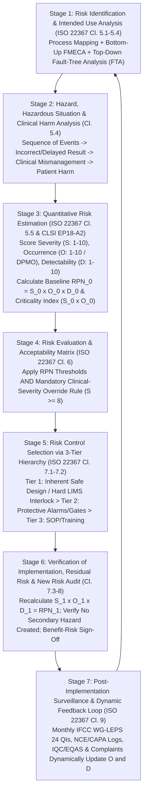

# 🛡️ 0.1.10 — `ISO 22367:2020` Medical Laboratory Risk Management (`FMECA` / `FTA`), Non-Conforming Event (`NCE`), `5-Why + Ishikawa` `CAPA` & `IFCC WG-LEPS` Six-Sigma Quality Indicator Master Matrix

**Department Folder:** `00_Universal_NABL_Legal_Framework`  
**Cluster Folder:** `0.1_Universal_Medico_Legal_Shield_and_NABL_Footers`  
**File ID:** `0.1.10_ISO22367_FMEA_Risk_Management_and_CAPA_Master_Matrix.md`  

---

## 🏛️ Section 0: Apex Document Control, Standards Harmonization & 9-Persona Red-Team Verification Charter

### 0.1 Master Document Control & Regulatory Traceability Block (`ISO 15189:2022 Clause 8.3.2`)

| Governance Attribute | Specification / Reference Standard |
| :--- | :--- |
| **Document Control ID** | `SOP-GOV-0.1.10` (**Version `3.0`** — International Reference Laboratory & Above-NABL Apex Tier) |
| **Document Lifecycle & Approval** | **Effective Date:** `2026-10-12` / **Review Cycle:** `Annual & Post-Sentinel Event` / **Author:** `Head of Quality & Metrology` / **Approving Authority:** `Laboratory Director & Chief Consultant Pathologist (MD Pathology)` / **Copy Status:** `Controlled Electronic Master` |
| **Primary ISO Standards Mapped** | **ISO 15189:2022 Clauses 8.5** (*Actions to Address Risks and Opportunities*), **7.5** (*Nonconformities and Corrective Action Process*), **8.7** (*Nonconformities and Corrective Actions — CAPA*), **8.6** (*Improvement*), **8.8.2** (*Quality Indicators*), **7.9** (*Complaints*), **7.4.1.6** (*Critical Decision Limits*), **7.4.2** (*Post-Examination Release & Amended Reports*), **Annex A** (*POCT Governance*); **ISO 22367:2020** (*Medical laboratories — Application of risk management to medical laboratories*); **ISO 14971:2019** (*Medical devices — Application of risk management*); **ISO/TS 20914:2019** (*Measurement Uncertainty*) |
| **CLSI & IFCC/EFLM Guidelines** | **CLSI EP18-A2** (*Risk Management Techniques to Identify and Control Laboratory Error Sources*), **CLSI QMS11-Ed2** (*Nonconforming Event Management*), **CLSI EP23-A** (*Laboratory Quality Control Based on Risk Management — IQCP*), **CLSI EP31-A-IR** (*Verification of Comparability of Patient Results Within One Health Care System*), **CLSI GP47** (*Management of Critical- and Significant-Risk Results*), **IFCC WG-LEPS** (*Working Group on Laboratory Errors and Patient Safety — Harmonized Quality Indicators*), **EFLM TF-PG** |
| **NABL Specific Criteria Mapped** | **NABL 112** (*Specific Criteria for Accreditation of Medical Laboratories*), **NABL 131** (* Policy on Proficiency Testing / EQAS*), **NABL 133** (*Policy on Use of NABL Symbol*), **NABL 153** (*Scope of Accreditation Matrix*), **NABL 163** (*Policy on Calibration & Metrological Traceability*), **NABL 220D & NABL 223** (*Assessor Checklist & Vertical Audit Worksheet*) |
| **Indian Statutory & Medico-Legal Shield** | **Consumer Protection Act (CPA) 2019** (*Section 2(11) Deficiency in Service & Section 2(42) Medical Service Documentation*), **Digital Personal Data Protection (DPDP) Act 2023**, **PCPNDT Act 1994**, **HIV and AIDS (Prevention and Control) Act 2017**, **Bio-Medical Waste Management Rules 2016 (Amended 2018/2019)**, **Clinical Establishments Act 2010** |
| **Quantitative Methodologies** | **FMECA** (*Failure Mode, Effects, and Criticality Analysis*: $\text{RPN} = S \times O \times D$ + Mandatory $S \ge 8$ Criticality Override) + **FTA** (*Fault-Tree Analysis*) + **FRACAS** (*Failure Reporting, Analysis, and Corrective Action System*) + **Six-Sigma DPMO** ($\text{DPMO} = [\text{Defects} / \text{Opportunities}] \times 10^6$) + **Ishikawa 6M + 5-Why RCA** |
| **Analytical Fleet Covered** | **Primary Platforms:** `Nihon Kohden MEK-1503` (Hematology + Automated ESR), `Bonavera Chem 400` (High-Throughput Clinical Biochemistry & Indirect ISE), `Snibe MAGLUMI X3` (ABEI Flash-CLIA Immunoassay) / **Backup & Specialized Platforms:** `Bonavera Chem 200`, Coagulometer (`Optical/Mechanical PT/aPTT/Fibrinogen`), Direct ISE Blood Gas/Electrolytes, Phase-Contrast & Brightfield Microscopy, Serology & Clinical Microbiology |

---

### 0.2 The 9-Persona International & Above-NABL Red-Team Review Charter

Every risk control, root-cause workflow, and quality indicator in this master governance manual has been stress-tested across a **9-Persona Adversarial Review Panel**:

| Persona ID | Adversarial Review Role | Core Mandate Enforced in `SOP-GOV-0.1.10` |
| :--- | :--- | :--- |
| **Persona 1** | **Lead NABL (`ISO 15189:2022` / `NABL 220D / 223`) & CAP / UKAS Lead Assessor** | Enforces complete clause-by-clause traceability across `ISO 15189:2022 Clauses 7.5, 8.5, 8.6, 8.7, 8.8.2`, live dynamic feedback from `CAPA` into the `FMECA` register, and zero "paper-only" closures without 30/60/90-day objective audit evidence. |
| **Persona 2** | **Department-Specific Clinical Subspecialty Consultant (`MD Pathology / Biochemistry / Hematology / Immunology / Microbiology`)** | Anchors every hazard to concrete cellular/molecular pathophysiology, disease kinetics, diagnostic decision thresholds, and differential diagnosis pitfalls so risk scores reflect real clinical morbidity and mortality. |
| **Persona 3** | **CLSI & IFCC Metrology, Method Verification & Six-Sigma QC Specialist** | Integrates `CLSI EP15-A3`, `EP06-Ed2`, `EP07/EP37` `HIL` index thresholds, `EP17-A2`, `ISO/TS 20914` Measurement Uncertainty ($U$), `EFLM` Reference Change Values ($\text{RCV}_{95\%/\text{99\%}}$), and Westgard Sigma Rules directly into analytical risk gates. |
| **Persona 4** | **Clinical Pharmacologist & Special-Population Stratification Auditor** | Mandates explicit risk controls for *in-vivo* vs *in-vitro* drug interferences (`Biotin`, `Dobutamine`, `Dopamine`, `NAC`, `Metamizole`, `Eltrombopag`, `Cephalosporins`, `IV Contrast`) and age/sex/trimester/neonatal partition traps. |
| **Persona 5** | **Medico-Legal, Patient-Safety & `CPA 2019 / DPDP 2023` Counsel** | Protects patients and the institution via ironclad `CLSI GP47` 30-minute critical value read-back scripts, `SOP 0.1.3` amended report audit trails, 48-hour complaint de-escalation protocols, and statutory compliance (`HIV Act 2017`, `PCPNDT 1994`, `BMW 2016`). |
| **Persona 6** | **Uncompressed Documentation & Turnkey Bench Architect** | Eliminates ambiguous summaries in favor of self-contained, bench-executable decision rules, worked clinical case dossiers, and print-ready Level-4 NABL registers (`NABL-RSK-REG-01` through `04`). |
| **Persona 7** | **`ISO 22367:2020` & `CLSI EP18-A2` Quantitative `FMECA` & Fault-Tree Analysis (`FTA`) Engineer** | Enforces the `10 × 10 × 10` `FMECA` scoring architecture, the **Mandatory High-Severity Override Rule ($S \ge 8$)**, the **3-Tier Hierarchy of Risk Controls** (`Inherent Safe Design > Protective Alarms > Information/SOP`), and evaluation of residual risk and secondary hazards introduced by controls. |
| **Persona 8** | **`ISO 15189 Clauses 7.5 & 8.7` Non-Conforming Event (`NCE`), `5-Why + 6M Ishikawa` `RCA` & `CAPA` Auditor** | Enforces strict separation between Immediate Correction (`Cl. 7.5`), Corrective Action (`Cl. 8.7`), and Preventive Action (`Cl. 8.5`); prohibits "Human Error" as a root cause; and mandates quantitative patient look-back and 30/60/90-day effectiveness verification. |
| **Persona 9** | **`IFCC WG-LEPS` & `EFLM` Total Testing Process Quality Indicator (`QI`) Six-Sigma (`DPMO`) & Pareto Strategist** | Harmonizes 24 laboratory Quality Indicators with exact numerator/denominator formulas, `DPMO` conversions, Six-Sigma ($\sigma$) capability benchmarks, and monthly Pareto prioritization for Management Review (`ISO 15189 Cl. 8.9`). |

---

## ⚙️ Section 1: Medical Laboratory Risk Management Lifecycle (`ISO 22367:2020`, `ISO 14971:2019` & `CLSI EP18-A2`)

### 1.1 The 7-Stage Closed-Loop Risk Management Architecture (`ISO 22367:2020 Clauses 4–10`)

Under **ISO 22367:2020** (*Application of risk management to medical laboratories*) and **ISO 15189:2022 Clause 8.5**, laboratory risk management is not a static one-time binder written before an NABL assessment. It is a continuous, closed-loop engineering lifecycle operating across the entire Total Testing Process (`TTP` — Pre-Examination, Examination, Post-Examination, and Laboratory Information/Facility Infrastructure):



#### Complementary Dual-Engine Methodology (`CLSI EP18-A2` & `ISO 22367 Annex B`):
1. **Bottom-Up Inductive Analysis — `FMECA` (Failure Mode, Effects, and Criticality Analysis):** Starts at each granular bench step (e.g., venipuncture needle gauge, barcode label printing, `Chem 400` R1 reagent dispensing, `Maglumi X3` magnetic bead wash, LIMS HL7 transmission) and asks: *"How can this specific step fail, what is the local analytical effect, and what is the downstream clinical harm to the patient?"*
2. **Top-Down Deductive Analysis — `FTA` (Fault-Tree Analysis):** Starts with a catastrophic top-level clinical or medico-legal sentinel event (e.g., *"Patient receives inappropriate emergency hemodialysis or potassium-lowering therapy due to spurious hyperkalemia"*) and maps all boolean `OR` / `AND` causal pathways backward through post-analytical release (`AND` failure of LIMS `H-Index` suppression), analytical interference (`OR` hemolysis, `EDTA` carryover, thrombocytosis, leukocytosis, delayed centrifugation), and pre-analytical collection errors.

---

### 1.2 Complete `10 × 10 × 10` Quantitative `FMECA` Scoring Scales (`S × O × D`)

To eliminate subjective scoring bias across departments, all risk assessments across the laboratory's **273 test SOPs (`298` controlled files)** must strictly apply the three anchored `1–10` scales below:

#### Table 1A: Clinical Severity Scale ($S = 1 \text{ to } 10$) — Anchored to Patient Clinical Harm (`ISO 22367:2020 Annex C`)

| Severity Score ($S$) | Harm Category (`ISO 22367`) | Clinical, Pathophysiological & Therapeutic Impact Definition | Concrete Clinical Laboratory Examples |
| :---: | :--- | :--- | :--- |
| **`10`** | **Catastrophic / Fatal** | Death, irreversible vital organ loss, incompatible blood transfusion, missed hyper-acute life-threatening emergency, or administration of lethal/toxic therapy. | ABO/Rh sample swap; missed critical hyperkalemia ($\text{K}^+ > 7.0\text{ mmol/L}$) or hypoglycemia ($< 35\text{ mg/dL}$); false-negative `Troponin I` in STEMI or missed CSF bacterial meningitis; false-low `Beta-hCG` (Hook Effect) in ruptured ectopic/choriocarcinoma. |
| **`9`** | **Critical / Life-Threatening** | Life-threatening clinical deterioration requiring ICU admission, emergency dialysis, invasive surgery, unnecessary chemotherapy/immunosuppression, or permanent disability. | `EDTA` pseudothrombocytopenia reported as $\text{PLT } 15,000/\mu\text{L}$ triggering unnecessary platelet transfusion or splenectomy; false-positive `HIV`/`HCV` released without confirmation; `NADH` substrate depletion masking fulminant hepatic failure (`ALT > 4,000 U/L`); under-filled Citrate tube causing false `INR 5.2` and withholding urgent surgery or administering FFP/Vitamin K in a thrombotic patient. |
| **`8`** | **Serious / Major Reversible Harm** | Significant reversible organ dysfunction, prescription of contraindicated chronic medication, teratogenic exposure, or major diagnostic misdirection requiring hospitalization. | High-dose `Biotin` interference causing false "Graves' thyrotoxicosis" ($\downarrow\text{TSH}, \uparrow\text{FT4}$) and inappropriate Carbimazole initiation; pseudohyponatremia on indirect ISE triggering hypertonic saline administration; missed neonatal hyperbilirubinemia risk zone; unrecognized `NRBC` elevation masking neutropenic sepsis. |
| **`7`** | **Moderate-High Clinical Impact** | Incorrect outpatient pharmacological dose titration, inappropriate antibiotic escalation/de-escalation, or invasive diagnostic follow-up (e.g., biopsy/endoscopy). | Calibrator lot shift of $+15\%$ on `HbA1c` or `Creatinine/eGFR` altering antidiabetic or nephrotoxic drug dosing; false-positive culture contaminant reported as pathogen without Gram-stain correlation; cold agglutinin artifact reporting $\text{Hb } 6.5\text{ g/dL}$ vs true $11.0\text{ g/dL}$. |
| **`6`** | **Moderate Clinical Impact** | Delay in diagnosis or treatment of a non-emergent condition; requirement for repeat outpatient clinic visit and repeat venipuncture before clinical action can proceed. | Hemolyzed or clotted inpatient/outpatient sample rejected after $4\text{ hours}$, delaying morning ward discharge or routine pre-operative clearance; wrong adult reference interval printed on a pediatric `ALP` or pregnant `TSH` report causing clinician confusion. |
| **`5`** | **Minor-Moderate Impact** | Noticeable Turnaround Time (`TAT`) breach ($> 2\text{ hours}$ past promised window) on routine work or minor repeat phlebotomy discomfort without therapeutic delay. | Analyzer probe clog or reagent pack depletion during routine batch requiring re-centrifugation and rerun; courier delay on stable routine chemistry analytes (`Lipid Profile`, `HbA1c`). |
| **`4`** | **Minor Inconvenience** | Minor `TAT` delay ($< 1\text{–}2\text{ hours}$) or administrative query resolved internally via archived specimen re-check without patient recollection. | Single Westgard $1_{3s}$ IQC rejection caught on bench requiring control rerun and $30\text{-minute}$ batch delay; missing referring doctor phone number on routine requisition. |
| **`3`** | **Very Minor / Operational Friction** | Internal workflow inefficiency noticed by laboratory staff; corrected prior to report release with zero `TAT` breach or patient awareness. | Barcode label smudge requiring manual sample ID lookup and reprint at sample reception; minor clot caught during pre-analytical visual screen with backup tube available. |
| **`2`** | **Negligible / Cosmetic** | Minor formatting, typographic, or layout imperfection in non-clinical metadata that cannot alter clinical interpretation. | Alignment shift in report header address or minor spelling typo in a general educational footnote while numerical result, units, and reference interval are $100\%$ accurate. |
| **`1`** | **No Impact** | Zero analytical, clinical, operational, or formatting effect on the examination result or patient care. | Internal housekeeping log entry delay with all environmental and analytical parameters fully within specification. |

---

#### Table 1B: Probability of Occurrence Scale ($O = 1 \text{ to } 10$) — Anchored to Defect Rate, `DPMO` & Six-Sigma ($\sigma$) Capability

| Occurrence Score ($O$) | Qualitative Frequency Tier | Probability / Defect Rate per Sample or Event | Defects Per Million Opportunities (`DPMO`) | Approximate Process Sigma ($\sigma$) Level (with $1.5\sigma$ Shift) | Typical Laboratory Operational Context |
| :---: | :--- | :---: | :---: | :---: | :--- |
| **`10`** | **Virtually Certain / Chronic** | $\ge 1 \text{ in } 20$ ($\ge 5.0\%$) | $\ge 50,000\text{ DPMO}$ | $\le 3.1\sigma$ | Uncontrolled manual process without SOP, training, or barcode verification; occurs daily on every shift. |
| **`9`** | **Very Frequent** | $1 \text{ in } 20 \text{ to } 1 \text{ in } 50$ ($2.0\%\text{–}5.0\%$) | $20,000\text{ – }49,999\text{ DPMO}$ | $3.1\sigma\text{ – }3.55\sigma$ | Multiple occurrences per week (e.g., unmonitored emergency ward syringe hemolysis). |
| **`8`** | **Frequent** | $1 \text{ in } 50 \text{ to } 1 \text{ in } 100$ ($1.0\%\text{–}2.0\%$) | $10,000\text{ – }19,999\text{ DPMO}$ | $3.55\sigma\text{ – }3.8\sigma$ | Occurs several times per week in busy workload (e.g., under-filled tubes from peripheral collection centers without fill-line rejection). |
| **`7`** | **Moderately Frequent** | $1 \text{ in } 100 \text{ to } 1 \text{ in } 250$ ($0.4\%\text{–}1.0\%$) | $4,000\text{ – }9,999\text{ DPMO}$ | $3.8\sigma\text{ – }4.15\sigma$ | Occurs weekly (e.g., OTC Biotin intake in urban thyroid testing cohort; cold agglutinins in winter). |
| **`6`** | **Occasional** | $1 \text{ in } 250 \text{ to } 1 \text{ in } 1,000$ ($0.1\%\text{–}0.4\%$) | $1,000\text{ – }3,999\text{ DPMO}$ | $4.15\sigma\text{ – }4.6\sigma$ | Occurs $1\text{–}3$ times per month (e.g., `EDTA`-induced pseudothrombocytopenia across routine CBC workload). |
| **`5`** | **Uncommon / Periodic** | $1 \text{ in } 1,000 \text{ to } 1 \text{ in } 2,500$ ($0.04\%\text{–}0.1\%$) | $400\text{ – }999\text{ DPMO}$ | $4.6\sigma\text{ – }4.85\sigma$ | Occurs once every $1\text{–}2$ months (e.g., severe hypertriglyceridemia `L-Index > 500 mg/dL` or `EDTA` order-of-draw carryover). |
| **`4`** | **Rare** | $1 \text{ in } 2,500 \text{ to } 1 \text{ in } 10,000$ ($0.01\%\text{–}0.04\%$) | $100\text{ – }399\text{ DPMO}$ | $4.85\sigma\text{ – }5.2\sigma$ | Occurs quarterly (e.g., fulminant hepatitis `ALT > 3,000 U/L` with `NADH` exhaustion; heterophile antibody interference). |
| **`3`** | **Very Rare** | $1 \text{ in } 10,000 \text{ to } 1 \text{ in } 50,000$ ($0.002\%\text{–}0.01\%$) | $20\text{ – }99\text{ DPMO}$ | $5.2\sigma\text{ – }5.6\sigma$ | Occurs once or twice a year in a process governed by active barcoding and engineered poka-yoke fixtures. |
| **`2`** | **Isolated / Remote** | $1 \text{ in } 50,000 \text{ to } 1 \text{ in } 250,000$ ($0.0004\%\text{–}0.002\%$) | $4\text{ – }19\text{ DPMO}$ | $5.6\sigma\text{ – }5.95\sigma$ | High-reliability automated workflow with closed-tube barcoding and positive sample ID verification. |
| **`1`** | **Almost Impossible / Six-Sigma** | $\le 1 \text{ in } 294,000$ ($\le 0.00034\%$) | $\le 3.4\text{ DPMO}$ | $\ge 6.0\sigma$ | World-class Six-Sigma engineered process where physical or software architecture prevents occurrence. |

---

#### Table 1C: Detectability Scale ($D = 1 \text{ to } 10$) — Anchored to Engineering Interlocks vs Human Inspection (`CLSI EP18-A2`)

> [!NOTE]
> **Inverse Directionality of Detectability ($D$):** A **low score ($D = 1\text{–}2$)** means the error is **almost certainly detected and blocked automatically** before reaching the patient. A **high score ($D = 9\text{–}10$)** means the error is **latent / invisible** and escapes into the final clinical report undetected.

| Detectability Score ($D$) | Detection Reliability Tier | Probability of Error Escaping Pre-Release | Control Mechanism & Barrier Architecture |
| :---: | :--- | :---: | :--- |
| **`10`** | **Completely Undetectable** | $> 95\%$ escape | No analyzer flag, no `HIL` index check, no IQC violation, and result falls inside a plausible physiological range (e.g., silent sample swap between two normal outpatients without barcode or delta check). |
| **`9`** | **Virtually Undetectable** | $80\%\text{–}95\%$ escape | Detectable only retrospectively if the referring clinician questions the result due to stark mismatch with clinical presentation (e.g., unscreened Biotin interference or heterophile antibodies). |
| **`8`** | **Very Low Detection (Passive)** | $60\%\text{–}79\%$ escape | Relies solely on an unprompted human technician noticing a subtle anomaly during busy routine sign-out without any LIMS flag or checklist prompt. |
| **`7`** | **Low Detection (Single Human Visual)** | $40\%\text{–}59\%$ escape | Relies on single-person visual inspection (e.g., eyeballing serum color for mild hemolysis `H-Index 50–80 mg/dL` without spectrophotometric bichromatic measurement). |
| **`6`** | **Moderate-Low Detection** | $25\%\text{–}39\%$ escape | Manual checklist or logbook review performed once per shift (error can be released during the shift before the end-of-day audit occurs). |
| **`5`** | **Moderate Detection (Dual-Human Check)** | $10\%\text{–}24\%$ escape | Independent dual-technician or technician-plus-pathologist visual verification (`Four-Eyes Principle`) guided by a structured sign-out rule. |
| **`4`** | **Moderately High Detection (Soft Flag)** | $5\%\text{–}9\%$ escape | Analyzer or LIMS generates a visible pop-up warning flag or color highlight (`Yellow/Orange`), but allows a bench user to click "Override / Accept" without entering a mandatory verification result. |
| **`3`** | **High Detection (Multi-Rule / Delta Gate)** | $1\%\text{–}4\%$ escape | Automated LIMS Cross-Parameter Plausibility Rule, Reference Change Value ($\text{RCV}\%$) Delta Check, or Westgard Multi-Rule ($1_{3s}/2_{2s}/R_{4s}$) that holds the sample in the pending queue for mandatory Pathologist review. |
| **`2`** | **Very High Detection (Automated Reflex Gate)** | $0.1\%\text{–}0.9\%$ escape | Automated analyzer sensor (`A0` substrate depletion, bichromatic `HIL` index, clot pressure transducer, barcode checksum) automatically triggers an onboard reflex dilution or suppresses the result code. |
| **`1`** | **Certain Detection (Hard Software Interlock)** | $< 0.01\%$ escape | **Tier-1 Hard Software/Physical Interlock:** LIMS or analyzer physically blocks result transmission or PDF generation until the required verification field (e.g., `Citrate PLT rerun`, `30-min Critical Call Read-Back Log`, `Passed Daily IQC`) is populated. |

---

### 1.3 Why `RPN` Alone Is Mathematically Flawed & The Mandatory `ISO 22367:2020` Clinical-Severity Override Rule ($S \ge 8$)

> [!CAUTION]
> **Critical Risk-Engineering Flaw of Unmodified `RPN` Multiplication (`ISO 22367:2020 Annex C` & `CLSI EP18-A2`):**
> A naive multiplication of $\text{RPN} = S \times O \times D$ treats all three axes as algebraically commutative ($10 \times 1 \times 3 = 30$ yields the exact same $\text{RPN}$ as $3 \times 5 \times 2 = 30$).
> - **Case A (Catastrophic Clinical Harm, Rare Occurrence):** Unrecognized High-Dose Hook Effect in a molar pregnancy `Beta-hCG` or an `ABO` group transcription error: $S = 10 \text{ (Catastrophic)} \times O = 1 \text{ (Very Rare)} \times D = 3 = \mathbf{\text{RPN } 30}$. Under a naive "$\text{RPN} < 40$ is Green/Acceptable" rule, this life-threatening hazard would be ignored!
> - **Case B (Minor Operational Nuisance, Frequent Occurrence):** Minor delay in printing a routine outpatient receipt: $S = 2 \text{ (Negligible)} \times O = 6 \text{ (Occasional)} \times D = 4 = \mathbf{\text{RPN } 48}$. Under a naive $\text{RPN}$ rule, this trivial clerical issue would receive higher priority than a fatal diagnostic error!

#### Mandatory Dual-Gate Risk Acceptability Criteria (`SOP-GOV-0.1.10` Policy):
Every failure mode in the laboratory must be evaluated through **BOTH** the **$\text{RPN}$ Score** AND the **Two-Dimensional Clinical Criticality Matrix ($S \times O$ with $S \ge 8$ Hard Override)**:

| Risk Classification Zone | Trigger Criteria (`RPN` **OR** `Severity Override`) | Mandatory Action & Governance Authority (`ISO 22367 Clause 6 & 7`) |
| :--- | :--- | :--- |
| 🔴 **ZONE 1: UNACCEPTABLE / INTOLERABLE RISK** | - **$\text{RPN} \ge 100$** (at any Severity), **OR**<br/>- **Clinical Severity $S \ge 8$ with Detectability $D \ge 3$ or Occurrence $O \ge 3$** (even if total $\text{RPN} < 40$!) | **STOP / DO NOT RELEASE:** Process cannot operate without immediate implementation of **Tier-1 (Hard Software/Physical Interlock)** or **Tier-2 (Automated Sensor/Reflex Gate)** risk controls to drive residual Detectability to $D \le 2$ and Occurrence to $O \le 2$. |
| 🟠 **ZONE 2: HIGH-SEVERITY CONTROLLED / ALARP (`S >= 8` Override Zone)** | - **Clinical Severity $S \in \{8, 9, 10\}$ AFTER engineering controls have reduced $O \le 2$ and $D \le 2$** ($\text{RPN}_{\text{residual}} = 8\text{ to }36$) | **MANDATORY ACTIVE SURVEILLANCE & BENEFIT-RISK SIGN-OFF:** Because intrinsic clinical severity ($S$) of a catastrophic hazard never drops (an `ABO` swap or missed critical $\text{K}^+$ remains $S=10$ if it ever slips through), any residual risk with $S \ge 8$ requires:<br/>1. At least one **Tier-1 or Tier-2 automated control** (Tier-3 training alone is strictly forbidden);<br/>2. Formal **Residual Benefit-Risk Acceptance Sign-Off** by the Laboratory Director (`ISO 22367 Cl. 7.4`); and<br/>3. Continuous tracking via a dedicated **Monthly Quality Indicator (`QI`)**. |
| 🟡 **ZONE 3: MODERATE / ALARP RISK** | - **$\text{RPN } 40\text{–}99$** with Clinical Severity $S \le 7$ | **AS LOW AS REASONABLY PRACTICABLE (`ALARP`):** Implement Tier-2 middleware warnings, Westgard QC rules, or structured dual-check protocols within $30\text{ days}$ to reduce $\text{RPN} < 40$. Monitor quarterly. |
| 🟢 **ZONE 4: BROADLY ACCEPTABLE RISK** | - **$\text{RPN} < 40$** **AND** **Clinical Severity $S \le 7$** | **ACCEPTABLE RESIDUAL RISK:** Maintain existing controls through routine SOP compliance, annual competency assessment, and annual `FMECA` review. |

---

### 1.4 The `ISO 22367:2020 Clause 7.1` 3-Tier Hierarchy of Risk Control Measures

When reducing an unacceptable or `ALARP` risk, **ISO 22367:2020 Clause 7.1** and **CLSI EP18-A2** mandate selecting controls in strict descending order of engineering reliability:

| Hierarchy Tier | Control Category (`ISO 22367 Cl. 7.1`) | Engineering Mechanism & Laboratory Implementation Examples | Typical Impact on $O$ & $D$ | Standalone Adequacy for $S \ge 8$ Hazards |
| :---: | :--- | :--- | :---: | :---: |
| **TIER 1 (Highest Reliability)** | **Inherent Safety by Design & Hard Physical/Software Interlocks (`Poka-Yoke`)** | Eliminates the hazard source or makes it physically/computationally impossible for the error to proceed:<br/>- Direct primary-tube closed-cap sampling with positive barcode laser scan (eliminates manual aliquot sample swap).<br/>- LIMS **Hard Release Lock** blocking PDF report generation when Daily IQC is unpassed, when $\text{PLT} < 100\text{k}$ lacks a PBS smear field, or when a Critical Value lacks a completed `CLSI GP47` read-back timestamp.<br/>- Direct `ABEI` non-streptavidin immunoassay chemistry or pre-analytical Biotin depletion protocol. | Reduces **$O \rightarrow 1\text{–}2$** and/or **$D \rightarrow 1$** | **MANDATORY PRIMARY CHOICE** for all $S \ge 8$ hazards whenever technically feasible. |
| **TIER 2 (Intermediate Reliability)** | **Protective Measures, Automated Sensors, Algorithmic Gates & Dual Independent Checks** | Detects the hazardous situation immediately via objective physical/chemical sensors or middleware algorithms and arrests the workflow:<br/>- Automated spectrophotometric bichromatic `H-Index`, `I-Index`, `L-Index` measurement on `Chem 400/200` auto-suppressing $\text{K}^+, \text{AST}, \text{LDH}$ when $\text{H-Index} \ge 50\text{ mg/dL}$.<br/>- Analyzer `A0` initial absorbance substrate-depletion sensor triggering automatic $1:10$ dilution in fulminant hepatitis.<br/>- LIMS Cross-Parameter Plausibility Gates (`EDTA` contamination rule: $\text{K}^+ > 6.5 \text{ AND } \text{Ca}^{2+} < 6.5\text{ mg/dL}$) and Individualized $\text{RCV}_{95\%}$ Delta Checks.<br/>- Audible + visual red-screen LIMS alarm for Critical Values + independent 2-person verification (`Four-Eyes`). | Reduces **$D \rightarrow 1\text{–}3$** and **$O \rightarrow 2\text{–}3$** | **ACCEPTABLE** when paired with LIMS workflow holds and monthly `QI` surveillance. |
| **TIER 3 (Lowest Reliability)** | **Information for Safety, Written SOPs, Wall Charts, Warning Labels & Staff Training** | Relies on human memory, vigilance, and compliance during routine workload:<br/>- `CLSI GP41` Order-of-Draw wall charts in phlebotomy rooms.<br/>- Didactic staff retraining memos after an incident.<br/>- Informative clinical footnotes and interpretive disclaimers printed on the patient report. | Reduces **$O$ or $D$ by at most $1$ point** (often degrades over $30\text{–}90\text{ days}$ due to human fatigue) | **STRICTLY INSUFFICIENT ALONE for any $S \ge 8$ hazard!** Must only be used as a supplementary layer alongside Tier-1 or Tier-2 controls. |

#### Mandatory Audit of Secondary / Newly Introduced Risks (`ISO 22367:2020 Clause 7.5`):
Every time a new Tier-1 or Tier-2 risk control is deployed, the laboratory must verify that the control itself does not introduce a new clinical hazard:
- *Example 1 (Hemolysis Suppression vs In-Vivo Intravascular Hemolysis):* Auto-suppressing all parameters on a sample with `H-Index` $\ge 150\text{ mg/dL}$ protects against false *in-vitro* hyperkalemia, **but** in a patient with life-threatening *in-vivo* intravascular hemolysis (e.g., falciparum malaria, acute hemolytic transfusion reaction, `HELLP` syndrome, severe `G6PD` crisis), totally withholding results without alerting the clinician delays critical care. **Mitigation:** When `H-Index` $\ge 100\text{ mg/dL}$ occurs on two consecutive draws or in an ICU/hemolytic patient, the Pathologist immediately phones the clinician to distinguish *in-vivo* vs *in-vitro* hemolysis and assays whole-blood electrolytes/haptoglobin/reticulocytes/PBS smear.
- *Example 2 (Overly Tight Delta Check Thresholds):* Setting a naive $10\%$ Delta Check hold on `Creatinine` or `Potassium` in a hospital nephrology unit causes massive false alarms in post-hemodialysis patients, inducing "alarm fatigue" and delaying STAT reporting. **Mitigation:** Tune LIMS Delta Checks to biological Reference Change Values ($\text{RCV}_{99\%} = 2.58 \times \sqrt{2} \times \sqrt{CV_A^2 + CV_I^2}$) stratified by outpatient vs inpatient/dialysis location.

---

## 📊 Section 2: Master 30-Hazard Cross-Departmental `ISO 22367` `FMECA` Risk Matrix (`H-01` to `H-30`)

The following **30-Hazard Master `FMECA` Matrix** governs the highest-criticality failure modes across the Pre-Analytical (`H-01 to H-10`), Analytical (`H-11 to H-20`), Post-Analytical (`H-21 to H-25`), and Facility/IT/Biosafety (`H-26 to H-30`) phases. Notice that for every hazard with $S_0 \ge 8$, the intrinsic severity ($S_1$) remains unchanged (because the severity of potential harm if the error ever reaches the patient is an intrinsic clinical property), while **Tier-1 and Tier-2 engineering controls drive $O_1 \le 2$ and $D_1 = 1$, achieving full `ISO 22367` control**.

### 2.1 Phase I: Pre-Analytical Examination Hazards (`H-01` to `H-10`)

| Hazard ID & TTP Step | Failure Mode & Underlying Mechanism / Special-Population Trigger | Clinical Harm Pathway ($S_0$) | Baseline $S_0 \times O_0 \times D_0 = \text{RPN}_0$ | Engineered Tier-1 & Tier-2 Risk Controls Implemented (`ISO 22367 Cl. 7`) | Residual $S_1 \times O_1 \times D_1 = \text{RPN}_1$ & Surveillance `QI` |
| :--- | :--- | :--- | :---: | :--- | :---: |
| **`H-01`**<br/>Phlebotomy & Aliquoting ID | **Primary Sample Swap / Mislabeling** at phlebotomy chair, ward bedside, or secondary serum aliquoting bench. | Wrong patient receives surgery, chemotherapy, transfusion, or missed critical diagnosis. | $10 \times 4 \times 6 = \mathbf{240}$<br/>🔴 *Zone 1* | **Tier 1:** Bedside/chairside on-demand barcode printing AFTER mandatory 2-identifier active verbal check (`Full Name + DOB/UHID`); direct primary-tube closed-cap sampling on `MEK-1503`, `Chem 400`, `Maglumi X3`.<br/>**Tier 2:** LIMS Multi-Variate `RCV%` Delta Check hold (`MCV` $\pm 3\text{ fL}$, `Creatinine`, `Total Protein`, `ABO` history). | $10 \times 1 \times 1 = \mathbf{10}$<br/>🟠 *Tracked via `QI-PRE-01`* |
| **`H-02`**<br/>Venipuncture Order-of-Draw | **$\text{K}_2/\text{K}_3\text{-EDTA}$ Cross-Contamination into Serum/Heparin Tube** via backflow or syringe transfer in wrong order (`EDTA` before Plain/Gel tube). | $\text{K}_2\text{-EDTA}$ chelates divalent cations ($\text{Ca}^{2+}, \text{Mg}^{2+}, \text{Zn}^{2+}$ — co-factor for `ALP`) and spikes $\text{K}^+ > 8.0\text{ mmol/L}$, causing emergency pseudohyperkalemia/hypocalcemia therapy. | $10 \times 5 \times 4 = \mathbf{200}$<br/>🔴 *Zone 1* | **Tier 1:** Mandatory evacuated tube collection (`Citrate -> Serum -> Heparin -> EDTA -> Fluoride`); syringe transfer strictly prohibited.<br/>**Tier 2:** LIMS Cross-Parameter Hard Hold: `IF (K+ > 6.2 mmol/L AND Ca2+ < 6.8 mg/dL) OR (ALP < 20 U/L) THEN SUPPRESS & FLAG [REJ-EDTA-CONTAM]`. | $10 \times 1 \times 1 = \mathbf{10}$<br/>🟠 *Tracked via `QI-PRE-07`* |
| **`H-03`**<br/>Venipuncture & Transit Shear | **In-Vitro Mechanical/Thermal Hemolysis** ($\text{H-Index} \ge 50\text{ mg/dL}$) releasing intracellular $\text{K}^+$ ($40\times$ plasma), `LDH` ($160\times$), `AST` ($40\times$), and hemoglobin spectral interference. | Spurious hyperkalemia ($\text{K}^+$) or masking of true hypokalemia in ICU/renal patients; false elevation of `AST`, `LDH`, `Phosphate`, `Folate`. | $9 \times 6 \times 3 = \mathbf{162}$<br/>🔴 *Zone 1* | **Tier 1:** Automated bichromatic `H-Index` ($570/600\text{ nm}$) assay on every `Chem 400/200` serum specimen; hard LIMS suppression of $\text{K}^+, \text{AST}, \text{LDH}, \text{Direct Bilirubin}$ at $\text{H-Index} \ge 50\text{ mg/dL}$ (`REJ-HEM`).<br/>**Tier 2:** Pathologist call protocol if $\text{H-Index} \ge 100\text{ mg/dL}$ repeats on redraw to rule out *in-vivo* intravascular hemolysis (`AIHA/HELLP/G6PD`). | $9 \times 2 \times 1 = \mathbf{18}$<br/>🟠 *Tracked via `QI-PRE-04`* |
| **`H-04`**<br/>Coagulation Collection | **Under-Filled $3.2\%$ ($0.109\text{ M}$) Sodium Citrate Tube ($< 90\%$ Fill)** OR **Unadjusted Citrate Volume in Severe Polycythemia / Neonates ($\text{Hct} > 55\%$)**. | Excess unbound citrate chelates assay $\text{CaCl}_2$ reagent in plasma, causing falsely prolonged `PT/INR` and `aPTT` and inappropriate FFP or anticoagulant withdrawal. | $9 \times 5 \times 4 = \mathbf{180}$<br/>🔴 *Zone 1* | **Tier 1:** Mandatory reception meniscus gauge check against etched $90\%$ fill mark (`REJ-QNS-CIT`).<br/>**Tier 2:** LIMS cross-link with patient `CBC`: `IF Hct > 55% THEN HOLD COAG` and apply `CLSI H21-A5` formula $C = (1.85 \times 10^{-3}) \times (100 - \text{Hct}) \times V_{\text{blood}}$ to adjust citrate volume before drawing. | $9 \times 1 \times 1 = \mathbf{9}$<br/>🟠 *Tracked via `QI-PRE-06`* |
| **`H-05`**<br/>Inpatient / ER Venipuncture | **Blood Drawn Proximal to Active IV Infusion Line** ($0.9\%$ $\text{NaCl}$, $5\%$ Dextrose, Ringer's Lactate, $\text{KCl}$, or Heparin lock). | Massive hemodilution ($\downarrow\text{Hb}, \downarrow\text{Albumin}, \downarrow\text{Ca}^{2+}$) coupled with extreme spurious analyte spike (`Glucose > 600 mg/dL` triggering fatal insulin infusion, or `Na+ > 165 mmol/L`). | $10 \times 3 \times 4 = \mathbf{120}$<br/>🔴 *Zone 1* | **Tier 1:** LIMS IV-Contamination Plausibility Gate: `IF (Glucose > 450 mg/dL AND Hb drop > 2.5 g/dL vs prior) OR (Cl- > 120 mmol/L AND Anion Gap < 2)` $\rightarrow$ Hard Hold.<br/>**Tier 2:** Mandatory opposite-arm draw rule (or $15\text{-min}$ infusion pump shutoff + $5\text{ mL}$ discard if no alternative vein exists). | $10 \times 1 \times 1 = \mathbf{10}$<br/>🟠 *Tracked via `QI-PRE-03`* |
| **`H-06`**<br/>Centrifugation & Separation Delay | **Delayed Serum/Plasma Separation ($> 2\text{ Hours}$ Uncentrifuged Whole Blood)** in routine serum or non-inhibited tubes. | Ongoing leukocytic/erythrocytic glycolysis consumes `Glucose` at $5\%\text{–}7\%/\text{hr}$ ($\sim 7\text{–}10\text{ mg/dL/hr}$), missing diabetes/hypoglycemia; $\text{Na}^+/\text{K}^+\text{-ATPase}$ failure leaks intracellular $\text{K}^+$ and `Phosphate`. | $8 \times 5 \times 4 = \mathbf{160}$<br/>🔴 *Zone 1* | **Tier 1:** Mandatory use of `Sodium Fluoride + K2-EDTA/Citrate` grey-top tubes for all `Glucose` testing; serum gel barrier centrifugation within $\le 45\text{ min}$ of collection.<br/>**Tier 2:** LIMS timestamp gate (`Collection-to-Reception Time > 120 min` on uncentrifuged whole blood auto-flags `K+`, `Phosphate`, `LDH` for rejection). | $8 \times 2 \times 1 = \mathbf{16}$<br/>🟠 *Tracked via `QI-PRE-08`* |
| **`H-07`**<br/>Physiological & Diurnal State Capture | **Missing Diurnal, Fasting, Posture, Menstrual Phase, or Gestational Trimester Capture** (`Cortisol`, `Prolactin`, `FSH/LH/Prog`, `Renin/Aldo`, `TG`, `Pregnancy TSH`). | 8 PM `Cortisol` interpreted against 8 AM range (false adrenal insufficiency); luteal `LH/Prog` judged against follicular range; 1st-trimester `TSH` ($0.1\text{–}2.5\ \mu\text{IU/mL}$) misclassified using adult non-pregnant range. | $8 \times 5 \times 4 = \mathbf{160}$<br/>🔴 *Zone 1* | **Tier 1:** Mandatory LIMS Registration Forced-Entry Fields (`Collection Timestamp`, `Fasting Hours`, `LMP / Menstrual Phase / Trimester` for reproductive & thyroid panels).<br/>**Tier 2:** Automated LIMS partition routing (`8 AM vs 4 PM Cortisol`; `1st/2nd/3rd Trimester TSH & Free T4`) + mandatory multi-phase table printing when LMP is unknown. | $8 \times 1 \times 1 = \mathbf{8}$<br/>🟠 *Tracked via `QI-PRE-09`* |
| **`H-08`**<br/>Pharmacological & Supplement Intake | **Undisclosed High-Dose Drug / Supplement Intake at Registration** (`Biotin` $\ge 5\text{ mg/d}$, `Dobutamine/Dopamine/NAC/Metamizole`, `Eltrombopag`, `Oral Contraceptives`, `DOACs`). | Severe *in-vitro* immunochemical (`Biotin` pseudo-Graves' disease) or chemical (`NAC/Dobutamine` negative Trinder bias on `Creatinine/Uric Acid/Lipids`) interference misleading treatment. | $8 \times 5 \times 4 = \mathbf{160}$<br/>🔴 *Zone 1* | **Tier 1:** Mandatory LIMS Registration Prompt: *"Biotin/Hair-Skin-Nails vitamin within 48h? IV Inotropes/NAC/Anticoagulants?"*<br/>**Tier 2:** Automated LIMS Discordance Rules (e.g., `TSH < 0.05 + FT4 > 2.5` or `Enzymatic Creatinine < 0.3 mg/dL in ICU patient` holds for Biotin washout or Jaffe/backup cross-check). | $8 \times 2 \times 1 = \mathbf{16}$<br/>🟠 *Tracked via `QI-PRE-09`* |
| **`H-09`**<br/>Thermal & Actinic Transit Control | **Cold-Chain ($2\text{–}8^\circ\text{C}$) or Light-Protection Breach** (`Neonatal Bilirubin` photodegradation; `PTH/ACTH/Ammonia/Lactate` thermal breakdown; `Cryoglobulin` cooling $< 37^\circ\text{C}$). | False-low `Bilirubin` in a jaundiced neonate missing phototherapy/exchange transfusion threshold (kernicterus risk); false-normal `Ammonia` or false-low `PTH`. | $9 \times 4 \times 4 = \mathbf{144}$<br/>🔴 *Zone 1* | **Tier 1:** Digital min/max data-logger inside every courier cool-box ($2\text{–}8^\circ\text{C}$ verified by infrared thermometer at reception — reject if $> 8^\circ\text{C}$) + amber foil wrap for all `Bilirubin`, `Vitamin B12`, `Folate`, `Vitamin D` tubes.<br/>**Tier 2:** Pre-chilled ice-slurry protocol for `Ammonia/Lactate/ACTH`; $37^\circ\text{C}$ thermos transport for `Cold Agglutinins/Cryoglobulins`. | $9 \times 1 \times 1 = \mathbf{9}$<br/>🟠 *Tracked via `QI-PRE-08`* |
| **`H-10`**<br/>Anticoagulant Mixing | **Micro-Clots / Fibrin Strands in $\text{K}_2\text{-EDTA}$ or $3.2\%$ Citrate Tubes** due to delayed/inadequate tube inversion ($< 8\text{–}10$ gentle inversions) or traumatic slow draw. | Consumption of platelets and coagulation factors (`Factor V, VIII, Fibrinogen`) causing spurious thrombocytopenia or false coagulopathy, plus analyzer sample probe occlusion. | $9 \times 5 \times 3 = \mathbf{135}$<br/>🔴 *Zone 1* | **Tier 1:** Analyzer pressure-transducer clot detection sensor on `MEK-1503`, `Chem 400`, and `Maglumi X3` + mandatory wooden applicator stick / visual rim check before loading.<br/>**Tier 2:** Mandatory peripheral blood smear (`PBS`) feathered-edge fibrin/platelet clump inspection on every $\text{PLT} < 100,000/\mu\text{L}$ (`REJ-CLOT`). | $9 \times 2 \times 1 = \mathbf{18}$<br/>🟠 *Tracked via `QI-PRE-05`* |

---

### 2.2 Phase II: Analytical Examination Hazards (`H-11` to `H-20`)

| Hazard ID & Platform | Failure Mode & Analytical / Metrological Mechanism | Clinical Harm Pathway ($S_0$) | Baseline $S_0 \times O_0 \times D_0 = \text{RPN}_0$ | Engineered Tier-1 & Tier-2 Risk Controls Implemented (`ISO 22367 Cl. 7`) | Residual $S_1 \times O_1 \times D_1 = \text{RPN}_1$ & Surveillance `QI` |
| :--- | :--- | :--- | :---: | :--- | :---: |
| **`H-11`**<br/>Hematology (`MEK-1503`) | **`EDTA`-Induced Pseudothrombocytopenia (`PTCP`) or Giant Platelets** ($\text{gpIIb/IIIa}$ autoantibodies clumping platelets in $\text{EDTA}$, or macrothrombocytes $> 25\text{–}30\text{ fL}$ counted as RBCs). | Spurious critical thrombocytopenia (e.g., $\text{PLT } 18,000/\mu\text{L}$) leading to unnecessary platelet transfusion, bone marrow aspirate, corticosteroid therapy, or canceled surgery. | $10 \times 5 \times 4 = \mathbf{200}$<br/>🔴 *Zone 1* | **Tier 1:** LIMS Hard Release Lock on all $\text{PLT} < 100,000/\mu\text{L}$ or `MEK-1503` `PLT-Clump / PDW` histogram flags — result cannot release until a `Leishman PBS Smear Check` field is completed.<br/>**Tier 2:** Reflex recollection in $3.2\%$ `Sodium Citrate` blue-top tube ($\text{PLT}_{\text{corrected}} = \text{PLT}_{\text{citrate}} \times 1.10$) + permanent LIMS patient `PTCP Alert Flag`. | $10 \times 1 \times 1 = \mathbf{10}$<br/>🟠 *Tracked via `QI-ANA-04`* |
| **`H-12`**<br/>Hematology (`MEK-1503`) | **Spurious Leukocytosis (`WBC`) from Nucleated RBCs (`NRBCs`)** in Neonates, $\beta$-Thalassemia Major, Sickle Cell Crisis, or Severe Hemolysis, OR **Lyse-Resistant RBCs**. | `NRBC` nuclei survive RBC lysis and are counted as lymphocytes/WBCs, falsely elevating `TLC` (e.g., reporting $28,000/\mu\text{L}$ instead of true $9,000/\mu\text{L}$ or masking leukopenia). | $8 \times 4 \times 4 = \mathbf{128}$<br/>🔴 *Zone 1* | **Tier 1:** LIMS Hard Hold on any `MEK-1503` `W-L Threshold / Ghost / NRBC` histogram origin flag or Neonatal/Thalassemia patient category.<br/>**Tier 2:** Mandatory 100-WBC manual Leishman smear `NRBC` count + automated LIMS correction formula: $\text{Corrected WBC} = (\text{Uncorrected WBC} \times 100) / (100 + \text{NRBC per 100 WBC})$ when $\text{NRBC} \ge 5/100\text{ WBC}$. | $8 \times 1 \times 1 = \mathbf{8}$<br/>🟠 *Tracked via `QI-ANA-04`* |
| **`H-13`**<br/>Hematology (`MEK-1503`) | **Cold Agglutinin Disease (`IgM` Anti-I/i) or Severe Lipemia/Icterus** violating Wallace's `Rule of Three` ($\text{Hb} \times 3 = \text{Hct} \pm 3$) and elevating $\text{MCHC} > 36.5\text{ g/dL}$. | RBC doublets/triplets counted as single giant cells ($\downarrow\text{RBC}$, false $\text{MCV} > 120\text{ fL}$, false $\text{Hct}$, $\text{MCHC} > 38\text{ g/dL}$); or lipemia/hyperbilirubinemia falsely elevating spectrophotometric `Hb`. | $8 \times 3 \times 4 = \mathbf{96}$<br/>🔴 *Zone 1* | **Tier 1:** LIMS Automated `Rule-of-Three` & $\text{MCHC} > 36.5\text{ g/dL}$ Plausibility Hard Lock.<br/>**Tier 2:** Incubate $\text{K}_2\text{-EDTA}$ tube in $37^\circ\text{C}$ water bath for $30\text{ min}$ and immediately rerun (resolves cold agglutinins); if lipemia/icterus persists, perform saline plasma-replacement blanking + microhematocrit correlation. | $8 \times 1 \times 1 = \mathbf{8}$<br/>🟠 *Tracked via `QI-ANA-04`* |
| **`H-14`**<br/>Biochemistry (`Chem 400/200`) | **$\text{NADH}$ Substrate Exhaustion ("Kinetic Hook Effect")** in hyper-acute viral, toxic (paracetamol), or ischemic hepatitis (`AST / ALT > 3,000 U/L`, `LDH > 4,000 U/L`). | All $\text{NADH}$ is oxidized to $\text{NAD}^+$ during the $60\text{-second}$ pre-read incubation lag phase; subsequent $\Delta A_{340}/\text{min}$ slope is flat ($\approx 0$), reporting a fatal `ALT 4,500 U/L` as a normal `18 U/L`! | $10 \times 2 \times 5 = \mathbf{100}$<br/>🔴 *Zone 1* | **Tier 1:** Enable `Chem 400/200` `A0 Initial Absorbance Limit Alarm` ($A_{340} < 0.800\text{ Abs}$ at Read Point 1) + `Linearity/Substrate Depletion Flag` triggering automatic $1:10$ and $1:50$ saline dilution.<br/>**Tier 2:** LIMS Cross-Check Gate: `IF Total Bilirubin > 4.0 mg/dL AND (ALT < 45 U/L OR AST < 45 U/L) THEN HOLD FOR REACTION CURVE & 1:10 DILUTION CHECK`. | $10 \times 1 \times 1 = \mathbf{10}$<br/>🟠 *Tracked via `QI-ANA-04`* |
| **`H-15`**<br/>Electrolytes (`Indirect ISE`) | **Pseudohyponatremia on Indirect `ISE`** due to Electrolyte Exclusion Effect in Severe Hypertriglyceridemia ($\text{TG} > 1,000\text{ mg/dL}$) or Multiple Myeloma Paraproteinemia ($\text{TP} > 10\text{ g/dL}$). | Indirect `ISE` dilutes total serum volume ($1:31$) assuming $93\%$ plasma water; when lipids/proteins reduce water fraction to $80\%$, true $\text{Na}^+ 140\text{ mmol/L}$ reads as $120\text{ mmol/L}$, risking fatal pontine myelinolysis if treated with hypertonic saline. | $9 \times 3 \times 4 = \mathbf{108}$<br/>🔴 *Zone 1* | **Tier 1:** LIMS Hard Hold on any $\text{Na}^+ < 130\text{ mmol/L}$ whenever `L-Index` $\ge 300\text{ mg/dL}$ ($\text{TG} > 800\text{ mg/dL}$) or `Total Protein` $> 9.5\text{ g/dL}$ (or `Globulin` $> 5.5\text{ g/dL}$).<br/>**Tier 2:** Mandatory reflex verification on **Undiluted Direct `ISE`** (Blood Gas / Direct Electrolyte Analyzer) which measures $\text{Na}^+$ activity strictly in the aqueous phase independent of lipid/protein volume. | $9 \times 1 \times 1 = \mathbf{9}$<br/>🟠 *Tracked via `QI-ANA-04`* |
| **`H-16`**<br/>Biochemistry (`Chem 400/200`) | **Negative Trinder Chromogen Interference** from IV `Dobutamine`, `Dopamine`, `N-Acetylcysteine (NAC)`, `Metamizole (Dipyrone)`, or high-dose `Ascorbic Acid`. | Reducing drugs consume $\text{H}_2\text{O}_2$ intermediate before 4-aminoantipyrine / peroxidase coupling, causing profound false-low `Enzymatic Creatinine` (masking acute kidney injury in ICU), `Uric Acid`, `Glucose`, and `Cholesterol/TG`. | $9 \times 3 \times 4 = \mathbf{108}$<br/>🔴 *Zone 1* | **Tier 1:** LIMS ICU/ER Plausibility Gate: `IF Enzymatic Creatinine < 0.4 mg/dL AND Urea > 50 mg/dL (Urea:Creatinine ratio > 100) THEN HOLD FOR TRINDER INTERFERENCE`.<br/>**Tier 2:** Reflex re-assay using non-Trinder orthogonal chemistry (`Kinetic Jaffe Creatinine` with compensation / `Hexokinase UV Glucose` at $340\text{ nm}$) + draw sample from non-infusion site $4\text{h}$ post-Metamizole/NAC. | $9 \times 1 \times 1 = \mathbf{9}$<br/>🟠 *Tracked via `QI-ANA-04`* |
| **`H-17`**<br/>Immunoassay (`Maglumi X3`) | **High-Dose Hook Effect (Prozone Phenomenon)** in One-Step Sandwich `CLIA` (`Total Beta-hCG` $> 500,000\text{ mIU/mL}$, `Prolactin` $> 10,000\text{ ng/mL}$, `Ferritin`, `Tg`, `PSA`). | Massive antigen excess saturates both solid-phase capture and `ABEI`-labeled detection antibodies separately, preventing ternary sandwich formation and reporting a giant prolactinoma or molar pregnancy as low/moderately elevated, leading to unnecessary neurosurgery or missed chemotherapy. | $10 \times 2 \times 5 = \mathbf{100}$<br/>🔴 *Zone 1* | **Tier 1:** Two-step wash immunoassay protocol where available + LIMS mandatory $1:100$ automatic dilution protocol on any clinical/USG suspicion of Hydatidiform Mole, Choriocarcinoma, Pituitary Macroadenoma ($> 1\text{ cm}$), or HLH.<br/>**Tier 2:** Mandatory `SOP 0.1.4` Hook Effect Legal & Clinical Shield printed on all tumor marker, `Beta-hCG`, and `Prolactin` reports. | $10 \times 1 \times 1 = \mathbf{10}$<br/>🟠 *Tracked via `QI-ANA-04`* |
| **`H-18`**<br/>Immunoassay (`Maglumi X3`) | **Heterophile Antibodies (`HAMA`), Rheumatoid Factor (`RF`), or Macro-Complexes (`Macro-Prolactin`, `Macro-TSH`, `Macro-AST`)**. | Non-specific human anti-mouse/animal antibodies cross-link capture and label antibodies (false-positive `Troponin`, `Beta-hCG`, `CA-125`, `TSH`), OR biologically inactive high-MW $\text{IgG}$-bound `Macro-Prolactin` ($150\text{ kDa}$) triggers inappropriate Cabergoline therapy. | $8 \times 4 \times 4 = \mathbf{128}$<br/>🔴 *Zone 1* | **Tier 1:** Mandatory Polyethylene Glycol (`PEG 6000` $25\%\text{ w/v}$ $1:1$ precipitation) on all initial `Prolactin` $> 35\text{ ng/mL}$ (report Monomeric Prolactin recovery $\%$; $< 40\%$ recovery confirms Macroprolactinemia).<br/>**Tier 2:** Serial dilution linearity check ($1:2, 1:4, 1:8$) + heterophile blocking tube (`HBT`) incubation or cross-platform verification when immunoassay contradicts clinical picture. | $8 \times 1 \times 1 = \mathbf{8}$<br/>🟠 *Tracked via `QI-ANA-04`* |
| **`H-19`**<br/>Metrology & Multi-Instrument | **Unrecognized Calibration Drift, Reagent Lot-to-Lot Matrix Shift (`CLSI EP26-Ed2`), or Unverified Bias Between Primary (`Chem 400`) & Backup (`Chem 200`) Analyzers (`CLSI EP31`)**. | Systematic analytical bias exceeding Total Allowable Error ($\lvert\text{Bias}\rvert > 0.5 \times \text{TE}_a$) misclassifying borderline patients (`HbA1c` $6.5\%$, `Fasting Glucose` $126\text{ mg/dL}$, `TSH`, `Ca2+`) or creating artificial patient delta shifts when switching to backup instrument. | $8 \times 4 \times 3 = \mathbf{96}$<br/>🔴 *Zone 1* | **Tier 1:** LIMS Hard Westgard Multi-Rule Gate ($1_{3s} \text{ Reject}, 2_{2s} \text{ Reject}, R_{4s} \text{ Reject}, 4_{1s} \text{ Hold}$ tailored to analyte Sigma level) + mandatory `CLSI EP26-Ed2` 3-patient native sample crossover verification before activating any new reagent lot.<br/>**Tier 2:** Weekly split-sample comparability check (`CLSI EP31-A-IR`, $n=5$ spanning AMR) between `Chem 400` and `Chem 200` (criterion: $\lvert\text{Difference}\rvert \le 0.5 \times \text{TE}_a$). | $8 \times 1 \times 1 = \mathbf{8}$<br/>🟠 *Tracked via `QI-ANA-01` & `03`* |
| **`H-20`**<br/>Fluidics & Probe Wash | **Sample-to-Sample Probe Carryover** from extreme high-concentration specimen (`Beta-hCG` $> 200,000\text{ mIU/mL}$, `HBV/HCV` high viremia, `ALT` $> 5,000\text{ U/L}$) into the immediately following normal patient sample. | Subsequent negative patient specimen receives micro-droplet carryover ($0.01\%\text{–}0.1\%$), creating a false-positive early pregnancy `Beta-hCG` ($15\text{ mIU/mL}$), false-reactive viral serology, or elevated transaminase. | $9 \times 3 \times 4 = \mathbf{108}$<br/>🔴 *Zone 1* | **Tier 1:** Programmable high-pressure internal/external probe acid-alkali extra-wash cycles on `Chem 400` and `Maglumi X3` + disposable conductive filter tips where applicable.<br/>**Tier 2:** LIMS Sequential-Sample Carryover Rule: `IF Sample(n) > Upper Carryover Threshold AND Sample(n+1) is Abnormal/Reactive THEN HOLD Sample(n+1) FOR AUTOMATIC RERUN AFTER SALINE BLANK`. | $9 \times 1 \times 1 = \mathbf{9}$<br/>🟠 *Tracked via `QI-ANA-04`* |

---

### 2.3 Phase III: Post-Analytical Examination Hazards (`H-21` to `H-25`)

| Hazard ID & Process Step | Failure Mode & Post-Analytical Mechanism | Clinical Harm Pathway ($S_0$) | Baseline $S_0 \times O_0 \times D_0 = \text{RPN}_0$ | Engineered Tier-1 & Tier-2 Risk Controls Implemented (`ISO 22367 Cl. 7`) | Residual $S_1 \times O_1 \times D_1 = \text{RPN}_1$ & Surveillance `QI` |
| :--- | :--- | :--- | :---: | :--- | :---: |
| **`H-21`**<br/>Critical Value Communication | **Delayed ($> 30\text{ Minutes}$) or Failed Verbal Read-Back Notification of a Critical ("Panic") Value (`CLSI GP47` & `ISO 15189 Cl. 7.4.1.6`)**. | Outpatient or night-shift ward patient with $\text{K}^+ = 6.8\text{ mmol/L}$, $\text{Glucose} = 32\text{ mg/dL}$, $\text{PLT} = 12,000/\mu\text{L}$, or $\text{INR} = 6.5$ suffers cardiac arrest, hypoglycemic coma, or intracranial hemorrhage before report is opened. | $10 \times 4 \times 4 = \mathbf{160}$<br/>🔴 *Zone 1* | **Tier 1:** Audible + Flashing Red LIMS Alert Screen + **Hard PDF/Portal Release Interlock** until the mandatory `CLSI GP47 Read-Back Log` (`Recipient Name, Designation, Time, Exact Read-Back Value`) is saved.<br/>**Tier 2:** Automated 3-Stage Escalation Timer (`0–10 min` Bench Tech calls Doctor $\rightarrow$ `10–20 min` Pathologist calls Doctor + Patient/Emergency Kin directly $\rightarrow$ `20–30 min` SMS/WhatsApp Emergency Alert + Lab Director intervention). | $10 \times 1 \times 1 = \mathbf{10}$<br/>🟠 *Tracked via `QI-POST-01`* |
| **`H-22`**<br/>Reference Interval Partitioning | **Wrong Age, Sex, Neonatal Postnatal Hour, Pediatric Tanner, or Pregnancy Trimester Reference Interval Applied**. | Neonatal `Bilirubin` ($14\text{ mg/dL}$ at $18\text{ hours}$ life) or Neonatal `Hb` ($13.0\text{ g/dL}$ — severe neonatal anemia!) judged as "Normal" against adult ranges; or pediatric physiological bone-growth `ALP` ($380\text{ U/L}$) misdiagnosed as hepatobiliary disease. | $9 \times 4 \times 4 = \mathbf{144}$<br/>🔴 *Zone 1* | **Tier 1:** Automated LIMS Age-in-Hours/Days/Months/Years + Sex + Pregnancy Status Reference Table Engine verified under `CLSI EP28-A3c`.<br/>**Tier 2:** Mandatory Bhutani Hour-Specific Neonatal Bilirubin Risk Zone Nomogram and Trimester-Specific Thyroid/Coagulation/Chemistry tables embedded directly into report layout. | $9 \times 1 \times 1 = \mathbf{9}$<br/>🟠 *Tracked via `QI-POST-05`* |
| **`H-23`**<br/>Manual Entry & Calculations | **Manual Transcription Typo, Missed Dilution Factor Multiplication, or Formula Error** (`eGFR CKD-EPI 2021` vs Pediatric `Schwartz`, `24h Urine` volume, `LDL`, `Corrected Calcium`, Microscopy). | Decimal point slip (e.g., entering `0.8` instead of `8.0` or forgetting $\times 10$ manual dilution factor) or applying adult `CKD-EPI` equation to a $6$-year-old child. | $9 \times 4 \times 5 = \mathbf{180}$<br/>🔴 *Zone 1* | **Tier 1:** Direct bidirectional ASTM/HL7 analyzer interfacing + onboard auto-dilution factor multiplication; zero manual calculators permitted—all derived parameters (`eGFR`, `cCa`, `AG`, `HOMA-IR`, `Free Androgen Index`, `24h Excretion`) hardcoded in LIMS.<br/>**Tier 2:** LIMS Age-Gate disabling `CKD-EPI` when $\text{Age} < 18\text{y}$ + mandatory Dual-Person (`Four-Eyes`) entry lock for all microscopy/manual results. | $9 \times 1 \times 1 = \mathbf{9}$<br/>🟠 *Tracked via `QI-POST-05`* |
| **`H-24`**<br/>Report Amendment (`Cl. 7.4.2`) | **Silent Overwriting of a Previously Released Report without Issuing a Formal `[AMENDED REPORT]`, Preserving the Original Value, and Phoning the Clinician**. | Clinician continues treating the patient based on a printed/downloaded copy of the erroneous initial report, unaware that the laboratory altered the value in the database; severe medico-legal liability under `CPA 2019`. | $9 \times 3 \times 4 = \mathbf{108}$<br/>🔴 *Zone 1* | **Tier 1:** LIMS Database Immutability Lock (`ISO 15189 Cl. 7.4.2`): once a report reaches `Authorized/Released` state, it cannot be edited—any change automatically forces a versioned **`[AMENDED REPORT — SUPERSEDES REPORT DATED ...]`** header displaying `Original Value`, `Corrected Value`, `Reason for Amendment`, and `Authorizing Pathologist`.<br/>**Tier 2:** Mandatory telephone notification log before amended PDF is unlocked (`SOP 0.1.3`). | $9 \times 1 \times 1 = \mathbf{9}$<br/>🟠 *Tracked via `QI-POST-05`* |
| **`H-25`**<br/>Statutory & Privacy Compliance | **Breach of Statutory Reporting Laws** (`HIV & AIDS Act 2017` unconfirmed reactive release or breach of confidentiality; `PCPNDT Act 1994` fetal sex disclosure; `DPDP Act 2023` unauthorized report release). | Patient self-harm/stigma from false-positive single rapid `HIV` screen; criminal prosecution under `PCPNDT Act 1994` or `HIV Act 2017`; regulatory penalties under `DPDP Act 2023`. | $10 \times 2 \times 4 = \mathbf{80}$<br/>🔴 *Zone 1* | **Tier 1:** LIMS Encryption & Role-Based Access Lock on all `HIV` reports (password-protected delivery strictly to the tested individual/authorized clinician after NACO 3-assay strategy + documented pre/post-test counseling per `SOP 0.1.7`); zero fetal sex parameters in LIMS dictionary.<br/>**Tier 2:** OTP-authenticated patient portal & registered mobile verification (`DPDP Act 2023`). | $10 \times 1 \times 1 = \mathbf{10}$<br/>🟠 *Tracked via `QI-SUP-01`* |

---

### 2.4 Phase IV: Facility, Reagent Water, IT/Middleware & Biosafety Infrastructure Hazards (`H-26` to `H-30`)

| Hazard ID & Infrastructure Domain | Failure Mode & Technical Mechanism | Clinical / Operational / Safety Harm Pathway ($S_0$) | Baseline $S_0 \times O_0 \times D_0 = \text{RPN}_0$ | Engineered Tier-1 & Tier-2 Risk Controls Implemented (`ISO 22367 Cl. 7`) | Residual $S_1 \times O_1 \times D_1 = \text{RPN}_1$ & Surveillance `QI` |
| :--- | :--- | :--- | :---: | :--- | :---: |
| **`H-26`**<br/>Cold Chain & Power (`Cl. 6.3 & 6.6`) | **Overnight Refrigerator ($2\text{–}8^\circ\text{C}$) or Freezer ($-20^\circ\text{C}$) Compressor / Power Failure** causing undetected thermal excursion ($> 15^\circ\text{C}$ for $6\text{ hours}$) of Calibrators, IQC Sera, Coagulation Thromboplastin, and `CLIA` Kits. | Degraded calibrators/reagents shift analytical calibration curves across the entire next day's batch; or thermally degraded IQC material mimics instrument drift. | $8 \times 3 \times 4 = \mathbf{96}$<br/>🔴 *Zone 1* | **Tier 1:** Dual-redundant online UPS + auto-start DG backup + continuous IoT Cloud Temperature Probe inside every refrigerator/freezer with **Real-Time SMS/Call Alert** to Quality Manager & Lab Director if $T > 7.5^\circ\text{C}$ or $< 2.2^\circ\text{C}$ for $> 15\text{ min}$.<br/>**Tier 2:** Thermal-buffer glycol bottle immersion for probes + mandatory post-excursion IQC verification before run release. | $8 \times 1 \times 1 = \mathbf{8}$<br/>🟠 *Tracked via `QI-ANA-06`* |
| **`H-27`**<br/>Reagent Water (`CLSI GP40-A4-AMD`) | **Type-I / Type-II Deionized Water System Resin Exhaustion, Bacterial Biofilm (`ALP`/Endotoxin), or Atmospheric $\text{CO}_2$ Absorption ($\text{pH} < 5.5$)** in reconstituting/wash water. | Trace $\text{Ca}^{2+}/\text{Mg}^{2+}/\text{Fe}^{3+}$ leaching from exhausted resin or carbonic acid ($\text{H}_2\text{CO}_3$) pH shift corrupts `Calcium (OCPC/Arsenazo)`, `Magnesium`, `Iron`, `Bicarbonate`, and lyophilized IQC/EQAS reconstitution, causing systematic bias and EQAS failures. | $8 \times 4 \times 4 = \mathbf{128}$<br/>🔴 *Zone 1* | **Tier 1:** Inline Digital Resistivity/Conductivity Meter with automatic solenoid divert lock if Conductivity $> 1.0\ \mu\text{S/cm}$ (Resistivity $< 1.0\text{ M}\Omega\cdot\text{cm}$ at $25^\circ\text{C}$) + $0.22\ \mu\text{m}$ point-of-use bacterial filter.<br/>**Tier 2:** Daily morning bench check of Water `Conductivity`, `pH` ($6.0\text{–}7.0$, freshly drawn in sealed borosilicate container), `Silicates`, and monthly `Heterotrophic Plate Count (< 10 CFU/mL)`. | $8 \times 1 \times 1 = \mathbf{8}$<br/>🟠 *Tracked via `QI-ANA-02`* |
| **`H-28`**<br/>LIMS & HL7/ASTM Interface (`Cl. 7.10`) | **Bidirectional Interface Packet Truncation, Barcode Checksum Collision, or LIMS Server / Network Outage**. | Partial transmission drops a flag or decimal point; or unplanned IT downtime halts STAT ICU/ER reporting or forces chaotic manual paper worklists prone to transcription errors. | $9 \times 2 \times 4 = \mathbf{72}$<br/>🔴 *Zone 1* | **Tier 1:** ASTM/HL7 `CRC-16` frame checksum verification + Modulo-103 `Code 128` barcode symbology (`CLSI AUTO02-A2`) + annual `CLSI AUTO10` interface validation.<br/>**Tier 2:** Automated local hourly + cloud encrypted database backup (`RPO < 15 min`) + pre-printed Controlled Downtime Emergency Reporting Forms with mandatory post-recovery reconciliation audit. | $9 \times 1 \times 1 = \mathbf{9}$<br/>🟠 *Tracked via `QI-SUP-03`* |
| **`H-29`**<br/>Biosafety & `LAI` (`ISO 15190:2020`) | **Needle-Stick Injury (`NSI`), Mucocutaneous Splash, or Centrifugation Aerosol Exposure** (`HBV`, `HCV`, `HIV`, `M. tuberculosis`, `Brucella`). | Acute laboratory-acquired viral or bacterial infection in phlebotomist, bench technologist, or housekeeping staff; occupational morbidity and legal liability. | $9 \times 3 \times 3 = \mathbf{81}$<br/>🔴 *Zone 1* | **Tier 1:** Strictly zero two-handed needle recapping; safety-engineered eclipse needles + electric needle burner/hub cutter at every chair; sealed safety-cups/rotors on all centrifuges (`wait 5 min before opening if tube breakage suspected`); Class II Type A2 Biosafety Cabinet for all sputum/aerosol work.<br/>**Tier 2:** Mandatory `Anti-HBs` titer verification ($\ge 10\text{ mIU/mL}$) for all staff + 24/7 on-site `HIV PEP` starter pack ($< 2\text{ hours}$ golden window). | $9 \times 1 \times 1 = \mathbf{9}$<br/>🟠 *Tracked via `QI-SUP-02`* |
| **`H-30`**<br/>Bio-Medical Waste (`BMW Rules 2016/2019`) | **Improper Segregation or Untreated Disposal of Infectious Waste / Sharps** (mixing Yellow/Red/White/Blue bags or discarding live culture plates/blood tubes without autoclaving/$1\%$ sodium hypochlorite pre-treatment). | Downstream needle-stick injury to waste handlers, environmental contamination, and immediate suspension of Consent to Operate (`CTO`) by State Pollution Control Board (`SPCB`). | $8 \times 3 \times 3 = \mathbf{72}$<br/>🔴 *Zone 1* | **Tier 1:** Color-coded foot-operated bins with visual pictograms at every bench (`Yellow`: soiled swabs/cotton; `Red`: plastic vacutainers/tips pre-treated with freshly prepared $1\%$ $\text{NaOCl}$ for $30\text{ min}$ or autoclaved at $121^\circ\text{C}$ for $60\text{ min}$; `White`: puncture-proof translucent sharps; `Blue`: glass slides/vials).<br/>**Tier 2:** Daily `CBWTF` barcoded bag weighing + spore strip biological indicator (`B. stearothermophilus`) autoclave verification. | $8 \times 1 \times 1 = \mathbf{8}$<br/>🟠 *Tracked via `QI-SUP-02`* |

---

## 🧬 Section 3: Non-Conforming Event (`NCE`) Containment, `5-Why + 6M Ishikawa` Root-Cause Analysis (`RCA`), and 30/60/90-Day `CAPA` Effectiveness (`ISO 15189:2022 Clauses 7.5 & 8.7` & `CLSI QMS11-Ed2`)

### 3.1 Taxonomic Distinction: Immediate Correction (`Cl. 7.5`) vs Corrective Action (`Cl. 8.7`) vs Preventive Action (`Cl. 8.5`)

NABL assessors (`NABL 220D / 223`) frequently raise Major Non-Conformities when laboratories confuse an immediate "fix" (Correction) with a systemic Root-Cause Corrective Action (`CA`):

| Regulatory Dimension | **1. Immediate Correction & Containment (`ISO 15189 Cl. 7.5`)** | **2. Corrective Action — `CA` (`ISO 15189 Cl. 8.7`)** | **3. Preventive Action / Risk Action — `PA` (`ISO 15189 Cl. 8.5` & `ISO 22367`)** |
| :--- | :--- | :--- | :--- |
| **Core Question Answered** | *"How do we immediately stop the bleeding right now and protect patients whose samples were already processed?"* | *"Why did our existing system barrier allow this non-conformity to happen, and what engineering lock will prevent it from EVER recurring?"* | *"Where else in our laboratory could a similar failure mode occur before an error actually happens?"* |
| **Trigger Event** | An actual Non-Conforming Event (`NCE`): Westgard IQC rejection, EQAS outlier, mislabeled sample, critical call delay, or clinician complaint. | Triggered after Immediate Containment of an `NCE`, following structured `5-Why + 6M Ishikawa` Root-Cause Analysis (`RCA`). | Triggered proactively by `FMECA` hazard analysis, near-miss trend, internal audit, or horizontal extension of a `CA` to other analyzers/departments. |
| **Mandatory Execution Window** | **Immediate (`Within 1 Hour` of detection)** | **RCA & Engineering Control Implemented Within `7 Days`**; verified at **`30, 60, and 90 Days`** | Scheduled in Annual/Quarterly Risk Improvement Plan; verified during next Internal Audit |
| **Concrete Example (`Serum Calcium EQAS Outlier`)** | Quarantine the open `OCPC Calcium` reagent pack and reconstituting water carboy; rerun current batch on fresh pack; perform patient look-back. | Replace unstoppered bench water flask with sealed borosilicate dispenser fed directly from $< 1.0\ \mu\text{S/cm}$ Type-II DI system + daily $\text{pH}/$Conductivity hard log before IQC reconstitution. | Extend sealed fresh-water reconstitution rule and forward-pipetting gravimetric verification horizontally to all lyophilized Coagulation (`PT/aPTT`) and Immunoassay (`Maglumi X3`) controls. |

---

### 3.2 Quantitative Patient Look-Back Protocol When an Analytical Failure Is Discovered (`ISO 15189 Cl. 7.5.1(e)` & `CLSI EP31 / QMS11`)

Whenever an out-of-control IQC run, calibration shift, reagent degradation, or unacceptable EQAS result ($\lvert Z \rvert \ge 3.0$ or two consecutive $\lvert Z \rvert > 2.0$) is detected, the laboratory must NOT merely recalibrate and move forward. It must execute this **4-Step Quantitative Patient Look-Back Algorithm**:

1. **Step 1 — Define the Temporal Vulnerability Window ($t_{\text{start}} \rightarrow t_{\text{detect}}$):**
   - Identify the exact timestamp of the **last verified acceptable IQC run or calibration event** ($t_{\text{start}}$) prior to the failed event ($t_{\text{detect}}$). Query the LIMS for all $N$ patient specimens assayed for that analyte between $t_{\text{start}}$ and $t_{\text{detect}}$.
2. **Step 2 — Determine Whether the Defect Affected Native Patient Samples vs Control Matrix Only:**
   - Re-assay a representative stratified subset of archived patient specimens ($n = 5\text{ to }10$ spanning low, normal, and high clinical decision limits stored at $2\text{–}8^\circ\text{C}$) using the newly restored, verified calibration/reagent system.
   - *Crucial Distinction:* If the original failure was caused by an **IQC/EQAS reconstitution error or control vial degradation**, re-assay of archived native patient sera will show $\lvert \text{Result}_{\text{new}} - \text{Result}_{\text{original}} \rvert \le CV_A$, proving zero patient impact!
3. **Step 3 — Apply the Medically Significant Error Criterion ($\Delta_{\text{crit}}$):**
   - For each re-assayed patient sample, compute the absolute percentage bias:
     $$\lvert\text{Bias}\%\rvert = \frac{\lvert X_{\text{verified}} - X_{\text{reported}} \rvert}{X_{\text{verified}}} \times 100$$
   - A released patient result requires immediate recall and an **`[AMENDED REPORT]`** (`SOP 0.1.3`) if **EITHER**:
     - $\lvert\text{Bias}\%\rvert > 0.5 \times \text{TE}_a$ (CLIA/EFLM Total Allowable Error) **OR** $\lvert\text{Bias}\%\rvert > \frac{1}{2}\text{RCV}_{95\%}$, **OR**
     - The discrepancy shifts the patient across a **Clinical Decision Limit** (e.g., `HbA1c` across $6.5\%$, `Fasting Glucose` across $126\text{ mg/dL}$, `TSH` across trimester threshold, `Potassium` across $3.5$ or $5.2\text{ mmol/L}$, `Troponin` across 99th percentile URL).
4. **Step 4 — Progressive Look-Back Batch Testing (`Moving Backward in Blocks of 10`):**
   - If patient samples are affected, re-test archived specimens moving backward in reverse chronological blocks of $10$ from $t_{\text{detect}}$ toward $t_{\text{start}}$ until $5$ consecutive patient specimens show $\lvert\text{Bias}\%\rvert \le CV_A$ (pinpointing the exact sample where the analytical shift began). Issue Amended Reports and phone every affected clinician within $1\text{ hour}$.

---

### 3.3 The `6M Ishikawa (Fishbone)` + `5-Why` Root-Cause Investigation Framework

> [!IMPORTANT]
> **The Iron Law of Root-Cause Analysis (`ISO 15189:2022 Clause 8.7.1(b)`):**
> *"Human Error," "Staff Carelessness," "Oversight during rush hour,"* or *"Technician re-trained / warned"* is **NEVER** an acceptable root cause in an NABL or CAP accredited laboratory. Human beings have a baseline cognitive slip rate of $1\text{ in }100$ to $1\text{ in }1,000$ tasks ($O = 6\text{–}8$). If a single human slip was able to reach a patient report, **the true root cause is the absence of a Tier-1 or Tier-2 system barrier (`LIMS / Method / Machine`) that allowed the human slip to pass undetected.**

```mermaid
flowchart LR
    subgraph Ishikawa_6M ["6M Ishikawa Fishbone Diagnostic Domains"]
        M1["1. MANPOWER (Competency & Ergonomics)<br/>Shift handover gap, uncertified float staff,<br/>cognitive overload, alarm fatigue"]
        M2["2. MACHINE (Analyzer & Fluidics)<br/>Halogen lamp decay, probe micro-clog,<br/>peristaltic tubing wear, cuvette scratch"]
        M3["3. MATERIAL (Reagents, Calibrators & Consumables)<br/>Lot-to-lot matrix shift, lyophilized vial instability,<br/>lot non-commutability, tube vacuum loss"]
        M4["4. METHOD (SOP & Workflow Design)<br/>Missing LIMS hard-lock, ambiguous dilution rule,<br/>manual transcription step, unvalidated backup"]
        M5["5. MEASUREMENT (Metrology, IQC & Calibration)<br/>Wrong Westgard rule, wide SD configuration,<br/>calibrator value assignment drift, pipetting error"]
        M6["6. MILIEU (Environment, Water, Power & IT)<br/>Type-II water pH/CO2 shift, ambient temp > 28C,<br/>fridge excursion, HL7 packet drop"]
    end
    Ishikawa_6M --> W1["Why 1: Direct Analytical / Process Trigger"]
    W1 --> W2["Why 2: Local Technical Mechanism"]
    W2 --> W3["Why 3: Procedural / Verification Gap"]
    W3 --> W4["Why 4: Missing Middleware / Engineering Barrier"]
    W4 --> W5["Why 5: Systemic QMS / Governance Root Cause"]
```



---

### 3.4 Three Fully Worked Real-World Clinical Laboratory `RCA + CAPA` Case Dossiers

To serve as an authoritative bench reference and NABL vertical witness-audit exemplar, below are **three complete, end-to-end worked `NCE + 5-Why + 6M Ishikawa + CAPA + 30/60/90-Day Effectiveness` case dossiers**:

---

#### 📁 Case Dossier 1 (`CAPA-2026-014` — Analytical Metrology & Reagent Water Physics): Unacceptable `EQAS` Z-Score Outlier ($Z = -2.65 \rightarrow -3.12$) on Serum Total Calcium

| Dossier Section | Complete Technical, Metrological & Clinical Audit Record |
| :--- | :--- |
| **Event Metadata** | **CAPA ID:** `CAPA-2026-014` / **Date:** `2026-04-14` / **Department:** `Clinical Biochemistry (Bonavera Chem 400)` / **TTP Phase:** `Analytical` / **Trigger:** `CMC Vellore / Randox EQAS Cycle 04 — Serum Total Calcium (o-Cresolphthalein Complexone [OCPC] / Arsenazo III)` |
| **Non-Conforming Event Description** | Monthly External Quality Assessment (`EQAS`) return for Serum Total Calcium reported a laboratory result of **$8.12\text{ mg/dL}$** against the peer-group target mean of **$9.08\text{ mg/dL}$** ($\text{Peer SD} = 0.308\text{ mg/dL}$), yielding an **unacceptable negative Z-Score of $Z = -3.12$** ($\lvert Z \rvert \ge 3.0$ Action Signal; previous month Cycle 03 had shown a warning bias of $Z = -2.65$). Internal QC Level 1 ($8.6\text{ mg/dL}$) and Level 2 ($12.4\text{ mg/dL}$) over the prior 10 days had shown a gradual downward drift ($-1.4s$ to $-1.8s$) that did not trigger the single $1_{3s}$ rule because the $4_{1s}$ and $10_{\bar{x}}$ Westgard trend rules were not enabled in LIMS. |
| **Immediate Containment & Patient Look-Back (`Within 1 Hour`)** | 1. **Quarantine:** Immediately halted Calcium release on `Chem 400`; quarantined the active `OCPC Calcium` reagent cassette and the bench glass flask of reconstituting water.<br/>2. **Fresh Reconstitution & Cross-Platform Check:** Reconstituted a fresh vial of matching EQAS remnant and Bio-Rad Level 1/2 IQC using freshly drawn Type-II water ($0.4\ \mu\text{S/cm}, \text{pH } 6.7$) and a calibrated Class-A volumetric glass pipette: **Fresh EQAS assayed at $9.04\text{ mg/dL}$ ($Z = -0.13$, Bias $-0.44\%$) on both `Chem 400` and `Chem 200`!**<br/>3. **Patient Look-Back Audit ($n = 42$ patient sera from previous 48 hours):** Re-assayed $12$ archived liquid native patient sera ($7.4\text{ to }11.2\text{ mg/dL}$) on the newly calibrated run. **Mean patient difference was $+0.06\text{ mg/dL}$ ($+0.65\%$, well within $\frac{1}{2}\text{TE}_a = \pm 0.5\text{ mg/dL}$).** Why were native patient sera unaffected while lyophilized EQAS and IQC read falsely low? See 5-Why RCA below! Zero Amended Reports were required. |
| **`6M` Ishikawa Screening** | - **Machine:** `Chem 400` $570/660\text{ nm}$ photometer lamp energy ($14,800\text{ ADC}$ counts) and probe carryover passed.<br/>- **Material:** Active `OCPC` reagent lot `CA-2602` verified stable; however, **reconstituting water flask on the QC bench had been stored unstoppered for $9\text{ days}$ at room temperature**.<br/>- **Method:** Lyophilized EQAS and IQC vials ($5.0\text{ mL}$) were reconstituted using a $1,000\ \mu\text{L}$ air-displacement micropipette (`5 repetitive strokes`) from the open bench water flask.<br/>- **Measurement:** LIMS QC module only enforced $1_{3s}$ and $2_{2s}$, ignoring chronic $4_{1s}$ negative bias. |
| **`5-Why` Root-Cause Chain** | - **Why 1:** Why did the EQAS Serum Calcium sample read $8.12\text{ mg/dL}$ ($Z = -3.12$) when native liquid patient sera were accurate?<br/>  $\rightarrow$ Because the error occurred exclusively inside the **lyophilized vial reconstitution step** ($5.00\text{ mL}$ water addition) and did not affect undiluted native liquid patient serum.<br/>- **Why 2:** Why did the reconstituted lyophilized EQAS and IQC vials yield falsely low Calcium concentration?<br/>  $\rightarrow$ Two compounding physico-chemical mechanisms:<br/>  **(a) Atmospheric $\text{CO}_2$ Absorption & Carbonic Acid/Carbonate Equilibrium:** The unstoppered bench water flask absorbed ambient $\text{CO}_2$ over $9\text{ days}$ ($\text{CO}_2 + \text{H}_2\text{O} \rightleftharpoons \text{H}_2\text{CO}_3 \rightleftharpoons \text{H}^+ + \text{HCO}_3^- \rightleftharpoons 2\text{H}^+ + \text{CO}_3^{2-}$), dropping the water $\text{pH}$ from $6.8$ to **$5.05$** and introducing dissolved carbonate ($\text{CO}_3^{2-}$) ions. When added to the alkaline lyophilized serum matrix, dissolved $\text{CO}_3^{2-}$ complexes free $\text{Ca}^{2+}$ as insoluble micro-precipitates of $\text{CaCO}_3$ ($K_{sp} = 3.36 \times 10^{-9}$) while the acidic water partially neutralizes the `2-Amino-2-methyl-1-propanol (AMP)` alkaline buffer ($\text{pH } 10.7$) required for `o-Cresolphthalein Complexone (OCPC)` to chelate $\text{Ca}^{2+}$!<br/>  **(b) Repetitive Air-Displacement Pipetting Over-Delivery:** Using a $1,000\ \mu\text{L}$ pipette $5$ times with a pre-wetted tip delivered $5.18\text{ mL}$ instead of $5.00\text{ mL}$ ($+3.6\%$ volumetric over-dilution, shifting $9.08\text{ mg/dL}$ down by $-0.33\text{ mg/dL}$).<br/>- **Why 3:** Why was $9\text{-day-old}$ unstoppered water and $5\times 1\text{ mL}$ repetitive pipetting used to reconstitute lyophilized EQAS/IQC?<br/>  $\rightarrow$ Because the bench SOP did not prohibit storing reconstituting water in open flasks and lacked a single-stroke Class-A $5.00\text{ mL}$ volumetric pipette / gravimetric balance check.<br/>- **Why 4:** Why wasn't the gradual $-1.4s\text{ to }-1.8s$ downward shift in daily IQC caught before the EQAS sample was assayed?<br/>  $\rightarrow$ Because Calcium is a narrow-tolerance electrolyte ($\text{TE}_a = 1.0\text{ mg/dL}$, $CV_I = 1.8\%$, typical method $\sigma \approx 3.8\text{–}4.2\sigma$) requiring Westgard **$1_{3s} / 2_{2s} / R_{4s} / 4_{1s}$** multi-rules, whereas LIMS was configured only for $1_{3s}$.<br/>- **Why 5 (System Root Cause):** Absence of a **Tier-1/Tier-2 Lyophilized Reconstitution Metrology & Fresh-Water $\text{pH}$/Conductivity Gate** plus absence of **Sigma-stratified $4_{1s}$ Westgard trend lock** in LIMS. |
| **Corrective Action (`CA`) & Preventive Action (`PA`)** | 1. **Tier-1 Hardware/Material Control:** Eliminated all bench storage flasks for reconstituting water. All lyophilized IQC, Calibrators, and EQAS vials across Biochemistry, Coagulation, and Immunoassay must be reconstituted **exclusively with freshly dispensed Type-II water ($< 1.0\ \mu\text{S/cm}, \text{pH } 6.2\text{–}7.0$)** drawn within $< 15\text{ minutes}$ into a sealed borosilicate tube.<br/>2. **Tier-1 Volumetric & Gravimetric Control:** Issued calibrated **Class-A $5.00\text{ mL}$ and $1.00\text{ mL}$ Single-Stroke Volumetric Glass Pipettes** + mandatory analytical balance gravimetric verification ($5.000\text{ g} \pm 0.015\text{ g}$ at $20\text{–}25^\circ\text{C}$) logged in the `EQAS/IQC Reconstitution Register` before any vial is placed on the orbital roller.<br/>3. **Tier-2 LIMS Westgard Rule Upgrade:** Activated automated **$4_{1s}$ and $2_{2s}$ hard-hold rules** in LIMS for all narrow-tolerance electrolytes (`Ca`, `Na`, `K`, `Cl`, `Mg`).<br/>4. **FMECA RPN Update (`H-27`):** Baseline $8 \times 4 \times 4 = \mathbf{128} \rightarrow$ Residual $8 \times 1 \times 1 = \mathbf{8}$. |
| **30 / 60 / 90-Day Effectiveness Verification (`ISO 15189 Cl. 8.7.1e`)** | - **30-Day Audit (`2026-05-14`):** EQAS Cycle 05 Calcium result $= 9.42\text{ mg/dL}$ vs peer target $9.45\text{ mg/dL}$ (**$Z = -0.10$**); 30-day IQC $CV_A = 1.42\%$ (Target $< 2.0\%$); $100\%$ gravimetric reconstitution logs verified.<br/>- **60-Day Audit (`2026-06-14`):** EQAS Cycle 06 Calcium **$Z = +0.22$**; zero $4_{1s}$ violations.<br/>- **90-Day Final Closure (`2026-07-14`):** EQAS Cycle 07 Calcium **$Z = -0.08$**; 90-day recurrence rate $= 0.0\%$. **CAPA Closed Effective by Lab Director.** |

---

#### 📁 Case Dossier 2 (`CAPA-2026-029` — Post-Analytical Patient Safety & LIMS Escalation Engineering): Delayed Critical Value Notification ($42\text{ Minutes}$) on Outpatient Hyperkalemia ($\text{K}^+ = 6.6\text{ mmol/L}$)

| Dossier Section | Complete Technical, Metrological & Clinical Audit Record |
| :--- | :--- |
| **Event Metadata** | **CAPA ID:** `CAPA-2026-029` / **Date:** `2026-06-03` / **Department:** `Clinical Biochemistry / Sample Reception & Post-Analytical Dispatch` / **TTP Phase:** `Post-Analytical` / **Trigger:** `Internal LIMS Critical-Call Timestamp Audit (QI-POST-01 Breach)` |
| **Non-Conforming Event Description** | An evening walk-in outpatient ($68\text{-year-old}$ male with diabetic nephropathy / CKD Stage 4 on Telmisartan $40\text{ mg}$ + Spironolactone $25\text{ mg}$) had Serum Potassium verified on `Bonavera Chem 400` (and confirmed on Direct ISE) at **$\text{K}^+ = 6.6\text{ mmol/L}$** (`H-Index` $= 11\text{ mg/dL}$ — non-hemolyzed true critical hyperkalemia; Critical Upper Threshold $\ge 6.2\text{ mmol/L}$). The result was analytically verified at **`19:04 hrs`**, but verbal read-back notification was completed only at **`19:46 hrs`** (**Total Elapsed Notification Time $= 42\text{ minutes}$**, breaching the mandatory $\le 30\text{-minute}$ `CLSI GP47` & `ISO 15189 Cl. 7.4.1.6` benchmark by $12\text{ minutes}$). |
| **Immediate Containment & Patient Welfare Verification (`At 19:46 hrs`)** | 1. **Direct Patient & Clinician Contact:** At `19:46 hrs`, the Duty Pathologist reached both the patient's son (emergency mobile) and the referring nephrologist, instructing immediate presentation to the nearest Emergency Department for 12-lead ECG and IV Calcium Gluconate / Insulin-Dextrose potassium-shifting therapy.<br/>2. **Clinical Outcome Follow-Up (`21:30 hrs`):** Follow-up phone call confirmed the patient reached the ER at `20:15 hrs`, ECG showed peaked T-waves without QRS widening, received immediate medical reversal, and stabilized safely ($\text{repeat K}^+ = 5.1\text{ mmol/L}$). Classified as **Near-Miss / Delayed Notification Without Permanent Harm**. |
| **`6M` Ishikawa Screening** | - **Manpower:** Evening shift change (`19:00–19:15 hrs`) coincided with peak outpatient sample reception.<br/>- **Machine / IT:** LIMS displayed a static red text banner on the biochemistry terminal but had **no audible buzzer** and **no automated countdown timer**.<br/>- **Method:** The SOP instructed the bench technician to call the referring doctor's clinic landline three times before calling the Pathologist; when the clinic landline was busy for $22\text{ minutes}$, the technician waited between attempts instead of immediately dialing the patient's mobile number for a walk-in outpatient.<br/>- **Material / Registration:** Registration desk had captured only 1 mobile number and had not flagged whether the order was "Walk-in Self-Referred" vs "Clinic Referred." |
| **`5-Why` Root-Cause Chain** | - **Why 1:** Why did the critical $\text{K}^+ = 6.6\text{ mmol/L}$ notification take $42\text{ minutes}$ instead of $\le 30\text{ minutes}$?<br/>  $\rightarrow$ Because $14\text{ minutes}$ elapsed before the first call attempt (`19:04 to 19:18`) during shift handover, followed by $22\text{ minutes}$ (`19:18 to 19:40`) spent repeatedly dialing a busy outpatient clinic landline.<br/>- **Why 2:** Why did $14\text{ minutes}$ elapse between analytical verification (`19:04`) and the first phone attempt (`19:18`)?<br/>  $\rightarrow$ Because the outgoing technician verified the rerun during shift handover without an **audible continuous alarm** forcing immediate acknowledgment.<br/>- **Why 3:** Why did the incoming technician spend $22\text{ minutes}$ calling only the referring doctor's landline when the patient was an ambulatory outpatient at home?<br/>  $\rightarrow$ Because the critical-call workflow treated inpatient and outpatient critical values identically, failing to require **simultaneous/parallel notification of the outpatient/family mobile at Minute 10** if the clinic phone is unreachable.<br/>- **Why 4:** Why didn't the Duty Pathologist intervene at Minute 15?<br/>  $\rightarrow$ Because LIMS lacked an **automated 10-minute escalation pop-up and SMS trigger** to the Pathologist's workstation/mobile.<br/>- **Why 5 (System Root Cause):** Absence of a **Tier-2 Audible LIMS Countdown Timer + 3-Stage Parallel Outpatient Escalation Protocol (`10m / 20m / 30m`)**. |
| **Corrective Action (`CA`) & Preventive Action (`PA`)** | 1. **Tier-1 Registration Capture Lock:** LIMS Registration now enforces **two mandatory contact fields** for all outpatients: `Primary Patient Mobile` + `Alternate Kin / Referring Doctor Mobile`.<br/>2. **Tier-2 LIMS Audible Alarm & 3-Stage Escalation Timer (`SOP 0.1.5` Upgrade):**<br/>   - **Minute 0 (`T = 0`):** Critical value verified $\rightarrow$ Continuous audible chime + Flashing Red Banner on Bench AND Pathologist screens.<br/>   - **Stage 1 (`T = 0 to 10 min`):** Bench Technologist calls Referring Clinician (2 attempts, $3\text{ min}$ apart).<br/>   - **Stage 2 (`T = 10 to 20 min` — Automatic Escalation):** If unread-back at `T = 10 min`, LIMS automatically escalates to the **Duty Consultant Pathologist**, who immediately calls the **Patient / Alternate Family Mobile directly** (for outpatients) AND the Clinician's mobile.<br/>   - **Stage 3 (`T = 20 to 30 min` — Executive Override):** Dispatch encrypted Emergency SMS/WhatsApp Critical Alert with read-receipt + Lab Director intervention.<br/>3. **FMECA RPN Update (`H-21`):** Baseline $10 \times 4 \times 4 = \mathbf{160} \rightarrow$ Residual $10 \times 1 \times 1 = \mathbf{10}$. |
| **30 / 60 / 90-Day Effectiveness Verification (`ISO 15189 Cl. 8.7.1e`)** | - **30-Day Audit (`2026-07-03`):** $38 / 38$ critical values ($100.0\%$) communicated with full read-back in $\le 30\text{ min}$; **Median notification time dropped from $19\text{ min}$ to $7.4\text{ min}$** (Maximum $= 18\text{ min}$).<br/>- **60-Day Audit (`2026-08-03`):** $44 / 44$ critical values ($100.0\%$) communicated in $\le 30\text{ min}$ (Median $= 6.8\text{ min}$).<br/>- **90-Day Final Closure (`2026-09-03`):** $123 / 123$ cumulative 90-day critical calls ($100.0\%$) met $\le 30\text{ min}$ target. **CAPA Closed Effective by Lab Director.** |

---

#### 📁 Case Dossier 3 (`CAPA-2026-041` — Immunochemical Pharmacovigilance & Pre-Analytical Gate): Spurious "Graves' Thyrotoxicosis" ($\text{TSH } 0.015\ \mu\text{IU/mL}$, $\text{FT4 } 4.85\text{ ng/dL}$) Caused by Undeclared $10,000\ \mu\text{g}$ Biotin Supplement

| Dossier Section | Complete Technical, Metrological & Clinical Audit Record |
| :--- | :--- |
| **Event Metadata** | **CAPA ID:** `CAPA-2026-041` / **Date:** `2026-08-19` / **Department:** `Endocrinology & Immunoassay` / **TTP Phase:** `Pre-Analytical / Analytical Interface` / **Trigger:** `48-Hour Clinician Query & Pathologist Correlation Hold (ISO 15189 Cl. 7.9 & 7.4.1)` |
| **Non-Conforming Event Description** | A $34\text{-year-old}$ asymptomatic female undergoing a routine pre-conception wellness check showed a stark biochemical picture of severe primary hyperthyroidism on initial immunoassay screening: **$\text{TSH} = 0.015\ \mu\text{IU/mL}$** (Ref: $0.35\text{–}4.94$), **$\text{Free T4} = 4.85\text{ ng/dL}$** (Ref: $0.70\text{–}1.48$), and **$\text{Free T3} = 9.40\text{ pg/mL}$** (Ref: $1.71\text{–}3.71$). However, the referring endocrinologist contacted the laboratory prior to prescribing Carbimazole because the patient was completely clinically euthyroid (resting pulse $70\text{ bpm}$, weight stable, no goiter, no lid lag or tremor). |
| **Immediate Containment & Technical Investigation (`Within 4 Hours`)** | 1. **Patient Medication & Supplement Interview (`Hour 1`):** The Consultant Pathologist telephoned the patient directly. While she initially denied taking "any medicines," when asked specifically about **hair, skin, or nail vitamins**, she revealed taking an imported OTC **"Ultra Hair & Nail Booster" containing $10,000\ \mu\text{g}$ ($10\text{ mg}$ — $333\times$ the $30\ \mu\text{g}$ daily RDA!) of D-Biotin (Vitamin B7)** at `07:30 AM`, just $90\text{ minutes}$ before her `09:00 AM` blood draw!<br/>2. **Orthogonal Direct `ABEI` Flash-CLIA Re-Assay & Streptavidin-Bead Depletion (`Hour 2`):** The archived primary serum was re-assayed on our non-streptavidin direct **`Snibe MAGLUMI X3` (`ABEI` direct chemiluminescence label without biotin-streptavidin bridge)** AND after pre-incubating an aliquot with Streptavidin-coated magnetic microparticles for $30\text{ min}$ to adsorb free serum biotin:<br/>   - **Post-Depletion / Direct `Maglumi X3` Result:** **$\text{TSH} = 2.18\ \mu\text{IU/mL}$ (Normal)**, **$\text{Free T4} = 1.14\text{ ng/dL}$ (Normal)**, **$\text{Free T3} = 2.85\text{ pg/mL}$ (Normal)**.<br/>3. **72-Hour Washout Confirmation:** A complimentary redraw performed after **$72\text{ hours}$ of Biotin abstinence** yielded $\text{TSH} = 2.24\ \mu\text{IU/mL}$ and $\text{FT4} = 1.12\text{ ng/dL}$, completely resolving the artifact and preventing teratogenic antithyroid drug administration during pre-conception! |
| **Molecular Mechanism & `5-Why` Root-Cause Chain** | - **Why 1:** Why did $10,000\ \mu\text{g}$ of oral Biotin simultaneously cause a **falsely LOW `TSH`** ($0.015\ \mu\text{IU/mL}$) and a **falsely HIGH `FT4` / `FT3`** ($4.85\text{ ng/dL}$)?<br/>  $\rightarrow$ Because of the opposite signal physics of **Sandwich** vs **Competitive** Streptavidin-Biotin immunoassays:<br/>  **(a) `TSH` (Two-Site Immunometric Sandwich Assay — Signal $\propto$ Concentration):** Excess free biotin in patient serum ($> 30\text{–}100\text{ ng/mL}$ peak at $1\text{–}3\text{ hours}$ post-dose) saturates all binding sites on the Streptavidin-coated solid-phase microparticles, blocking capture of the biotinylated anti-TSH antibody–TSH–labeled antibody sandwich. Wash removes the unbound complex $\rightarrow$ **Luminescence signal drops $\rightarrow$ Falsely LOW `TSH`!**<br/>  **(b) `Free T4` & `Free T3` (Competitive Immunoassay — Signal $\propto 1 / \text{Concentration}$):** Excess serum biotin blocks capture of the biotinylated T4 antibody/analog onto the Streptavidin solid phase. Wash removes the labeled tracer $\rightarrow$ **Luminescence signal drops $\rightarrow$ Because the calibration curve is inversely proportional in a competitive assay, a low signal calculates as a Falsely HIGH `FT4` and `FT3`!**<br/>  *Combined Result:* The mathematical perfection of a fake "Graves' Disease" profile ($\downarrow\downarrow\text{TSH} + \uparrow\uparrow\text{FT4} + \uparrow\uparrow\text{FT3}$ and even positive competitive anti-TSHR/`TRAb`!).<br/>- **Why 2:** Why didn't the patient declare Biotin at the registration desk?<br/>  $\rightarrow$ Because reception asked *"Are you on any thyroid medication?"* rather than specifically asking about **Biotin, B-complex, or Hair/Skin/Nail beauty supplements**.<br/>- **Why 3:** Why was an unscreened outpatient specimen released with an extreme hyperthyroid pattern ($\text{TSH} < 0.02 + \text{FT4} > 3.5$) without a mandatory Pathologist correlation hold?<br/>  $\rightarrow$ Because LIMS lacked an automated **Thyroid Biochemical Discordance / First-Time Extreme Thyrotoxicosis Gate**. |
| **Corrective Action (`CA`) & Preventive Action (`PA`)** | 1. **Tier-1 Platform Architecture & Registration Gate:** All primary thyroid and reproductive immunoassays are standardized on the **Direct `ABEI` Flash-CLIA architecture (`Snibe MAGLUMI X3`)** which covalently couples `ABEI` directly to the antibody without a vulnerable soluble biotin-streptavidin capture bridge. Furthermore, LIMS Registration now displays a mandatory checkbox for all Immunoassay orders: `"[ ] Verified zero intake of Biotin (>= 5,000 mcg) / Hair-Skin-Nail supplements within past 48 hours."`<br/>2. **Tier-2 LIMS Automated Discordant Thyroid Gate:** Programmed LIMS rule: `IF (TSH < 0.05 uIU/mL AND FT4 > 2.2 ng/dL in a patient with no prior hyperthyroid history) OR (TSH Normal/High AND FT4 > 2.0 ng/dL)` $\rightarrow$ **Hard Hold for Pathologist Clinical/Biotin/Heterophile Verification (`SOP 0.1.4`)** before report release.<br/>3. **FMECA RPN Update (`H-08`):** Baseline $8 \times 5 \times 4 = \mathbf{160} \rightarrow$ Residual $8 \times 1 \times 1 = \mathbf{8}$. |
| **30 / 60 / 90-Day Effectiveness Verification (`ISO 15189 Cl. 8.7.1e`)** | - **30-Day Audit (`2026-09-19`):** $14$ patients disclosed high-dose Biotin at registration and were scheduled after a $48\text{-hour}$ washout; $2$ unscreened walk-in samples were caught by the LIMS Discordance Gate prior to release ($0\%$ erroneous release).<br/>- **60-Day & 90-Day Final Closure (`2026-11-19`):** Zero Biotin-related clinician complaints or amended thyroid reports across $4,850$ thyroid panels ($0.0\%$ recurrence). **CAPA Closed Effective by Lab Director.** |

---

### 3.5 Golden 48-Hour Clinician & Patient Complaint De-Escalation SOP (`ISO 15189:2022 Clause 7.9` & `CPA 2019`)

> [!IMPORTANT]
> **Medico-Legal De-Escalation Principle (`Consumer Protection Act 2019`):** Over $95\%$ of diagnostic laboratory consumer complaints escalate to legal notices ONLY because reception or technical staff responded defensively, argued with the patient/doctor, or refused to re-examine the specimen. Every employee must follow this **48-Hour Closed-Loop Verification Protocol**:

1. **Hour 0 — Immediate Non-Defensive Empathy & Specimen Preservation Lock:**
   - Log every query (verbal, phone, WhatsApp, email, or runner note) immediately in `NABL-RSK-REG-02`.
   - Reassure the clinician/patient verbatim: *"Thank you for bringing this clinical correlation query to our attention. Under our NABL ISO 15189 quality protocol, we safely archive all primary blood specimens in temperature-monitored $2\text{–}8^\circ\text{C}$ storage for $48\text{–}72\text{ hours}$ specifically to perform a complimentary, transparent technical verification for you."*
2. **Hour 1 to Hour 4 — Four-Point Technical & Metrological Investigation:**
   - **Identity & Pre-Analytical Audit:** Retrieve the archived primary tube; verify barcode label integrity, fill volume, clot absence, serum `H/I/L` indices, and `MCV` / `ABO` / `Creatinine` biological fingerprint against any prior or fresh sample.
   - **Duplicate Cross-Platform Re-Assay:** Re-analyze the archived primary tube in duplicate on both the **Primary Platform** (`MEK-1503` / `Chem 400` / `Maglumi X3`) and the **Backup / Orthogonal Platform** (`Chem 200` / Manual PBS / Serial Dilution / Direct ISE), alongside a **Complimentary Fresh Recollection Sample** if physiological shift or pre-analytical interference (`Biotin`, `IV drip`, `fasting state`) is suspected.
3. **Hour 4 to Hour 24 — Direct Consultant Pathologist-to-Clinician Resolution:**
   - The Consultant Pathologist speaks directly with the referring physician (and patient if self-referred), providing a signed **Quality Verification Summary** (`[CAPA-VERIF-OK]`) showing the duplicate rerun values, daily `IQC` Levey-Jennings status, recent `EQAS` Z-score, and biological Reference Change Value ($\text{RCV}_{95\%} = 1.96 \times \sqrt{2} \times \sqrt{CV_A^2 + CV_I^2}$) explaining physiological day-to-day variation (or immediately issuing a transparent **`[AMENDED REPORT]`** + full fee refund + `CAPA` if a true analytical/pre-analytical discrepancy is uncovered).

---

## 📈 Section 4: Master 24-Quality-Indicator (`QI`) Six-Sigma (`DPMO`) Dashboard & 4 Print-Ready Level-4 Registers (`ISO 15189:2022 Clause 8.8.2` & `IFCC WG-LEPS`)

### 4.1 Mathematical Foundation: Converting Laboratory Quality Indicators (`QI%`) to `DPMO` and Six-Sigma ($\sigma$)

Under **ISO 15189:2022 Clause 8.8.2** and the **IFCC Working Group on Laboratory Errors and Patient Safety (`IFCC WG-LEPS`) Model of Quality Indicators**, expressing errors solely as a percentage (e.g., $"0.3\%\text{ error rate}"$) masks process defects when sample volumes are large. Every monthly Quality Indicator is therefore evaluated using both **Percentage ($\%$)** and **Defects Per Million Opportunities (`DPMO`) converted to the Six-Sigma ($\sigma$) Scale**:

$$\text{Defect Rate (\%)} = \left(\frac{\text{Number of Observed Defects }(d)}{\text{Total Opportunities / Samples Evaluated }(N)}\right) \times 100$$

$$\mathbf{\text{DPMO} = \left(\frac{\text{Number of Observed Defects }(d)}{\text{Total Opportunities / Samples Evaluated }(N)}\right) \times 1,000,000 = \text{Defect Rate (\%)} \times 10,000}$$

#### Table 4A: Master `DPMO` to Six-Sigma ($\sigma$) Conversion Reference Table (Incorporating the Standard $1.5\sigma$ Long-Term Shift)

| Six-Sigma Level ($\sigma$) | Defects Per Million Opportunities (`DPMO`) | Defect Percentage ($\%$) | Process Yield ($\%$ Defect-Free) | `IFCC WG-LEPS` & `CLSI` Capability Classification |
| :---: | :---: | :---: | :---: | :--- |
| **$6.0\,\sigma$** | **$3.4\text{ DPMO}$** | $0.00034\%$ | $99.99966\%$ | 🌟 **World-Class Six-Sigma Benchmark** (Mandatory target for Patient Identification & ABO Typing) |
| **$5.5\,\sigma$** | **$32\text{ DPMO}$** | $0.0032\%$ | $99.9968\%$ | 🏆 **Exceptional Reference Laboratory Performance** (Target for Amended Reports & Critical Call Compliance) |
| **$5.0\,\sigma$** | **$233\text{ DPMO}$** | $0.0233\%$ | $99.9767\%$ | 🟢 **Superior / High-Reliability Performance** (Target for Post-Analytical Transcription & Barcode Routing) |
| **$4.5\,\sigma$** | **$1,350\text{ DPMO}$** | $0.135\%$ | $99.865\%$ | 🟢 **Good / Optimum Clinical Laboratory Performance** (Target for Clotted/Under-filled/Container Rejection) |
| **$4.0\,\sigma$** | **$6,210\text{ DPMO}$** | $0.621\%$ | $99.379\%$ | 🟡 **Minimum Acceptable Industry Baseline** (Target for Overall Sample Rejection & Hemolysis Rate) |
| **$3.5\,\sigma$** | **$22,750\text{ DPMO}$** | $2.275\%$ | $97.725\%$ | 🟠 **Marginal / Borderline Capability** (Acceptable only for Turnaround Time `TAT` & IQC Repeat Rate; requires Pareto reduction) |
| **$3.0\,\sigma$** | **$66,807\text{ DPMO}$** | $6.681\%$ | $93.319\%$ | 🔴 **Unacceptable / Defective Process** (Immediate `5-Why + Ishikawa CAPA` mandatory!) |
| **$\le 2.5\,\sigma$** | **$\ge 158,655\text{ DPMO}$** | $\ge 15.87\%$ | $\le 84.13\%$ | 🔴 **Critical System Breakdown** (Halt process and redesign with Tier-1 engineering controls) |

---

### 4.2 Master 24-Quality-Indicator (`QI`) Total Testing Process Dashboard (`IFCC WG-LEPS` Harmonized Model)

| QI Code & IFCC Priority | Quality Indicator Name & Linked `FMECA` Hazard | Exact Numerator & Denominator Formula ($\times 100$ for $\%$; $\times 10^6$ for `DPMO`) | Monthly Target ($\%$) | Target `DPMO` | Min Sigma ($\sigma$) Goal | Mandatory `CAPA` Action Trigger |
| :--- | :--- | :--- | :---: | :---: | :---: | :--- |
| **`QI-PRE-01`**<br/>*(Priority 1)* | **Patient / Sample Misidentification Rate** (`H-01`) | $\frac{\text{Mislabeled or Swapped Primary/Aliquot Samples}}{\text{Total Samples Received}}$ | **$0.00\%$** | **$\le 3.4$** | **$\ge 6.0\,\sigma$** | **$\ge 1$ single event** triggers immediate Sentinel `RCA + CAPA` |
| **`QI-PRE-02`**<br/>*(Priority 1)* | **Test Order Entry / Requisition Transcription Error Rate** (`H-23`) | $\frac{\text{Requisitions with Wrong/Missing Test or Demographic Entry}}{\text{Total Requisitions Registered}}$ | **$< 0.05\%$** | **$\le 500$** | **$\ge 4.8\,\sigma$** | $> 0.10\%$ ($> 1,000\text{ DPMO}$) triggers registration audit |
| **`QI-PRE-03`**<br/>*(Priority 1)* | **Overall Pre-Analytical Sample Rejection Rate** (`H-01 to H-10`) | $\frac{\text{Total Samples Rejected for Any Pre-Analytical Cause}}{\text{Total Samples Received}}$ | **$< 0.60\%$** | **$\le 6,000$** | **$\ge 4.0\,\sigma$** | $> 1.00\%$ ($> 10,000\text{ DPMO}$) triggers phlebotomy/ward CAPA |
| **`QI-PRE-04`**<br/>*(Priority 1)* | **In-Vitro Hemolyzed Sample Rate in Chemistry** (`H-03`) | $\frac{\text{Serum/Plasma Samples Rejected with H-Index } \ge 50\text{ mg/dL}}{\text{Total Chemistry Serum/Plasma Samples}}$ | **$< 0.50\%$** | **$\le 5,000$** | **$\ge 4.1\,\sigma$** | $> 1.00\%$ triggers needle-gauge/syringe/centrifuge audit |
| **`QI-PRE-05`**<br/>*(Priority 1)* | **Clotted Anticoagulated Sample Rate (`EDTA` / `Citrate`)** (`H-10`) | $\frac{\text{Clotted EDTA, Citrate, or Heparin Samples Rejected}}{\text{Total Anticoagulated Samples Received}}$ | **$< 0.25\%$** | **$\le 2,500$** | **$\ge 4.3\,\sigma$** | $> 0.50\%$ triggers tube-inversion & venipuncture audit |
| **`QI-PRE-06`**<br/>*(Priority 1)* | **Insufficient Volume / Citrate Under-Fill ($< 90\%$) Rate** (`H-04`) | $\frac{\text{QNS Samples + Citrate Tubes Filled } < 90\%\text{ Etched Line}}{\text{Total Samples Received}}$ | **$< 0.20\%$** | **$\le 2,000$** | **$\ge 4.4\,\sigma$** | $> 0.40\%$ triggers vacutainer vacuum & collection audit |
| **`QI-PRE-07`**<br/>*(Priority 1)* | **Wrong Container / Order-of-Draw `EDTA` Carryover Rate** (`H-02`) | $\frac{\text{Samples in Wrong Tube or Flagged for EDTA Cross-Contam}}{\text{Total Samples Received}}$ | **$< 0.05\%$** | **$\le 500$** | **$\ge 4.8\,\sigma$** | **$\ge 1$ `EDTA` carryover event** or $> 0.10\%$ wrong tube |
| **`QI-PRE-08`**<br/>*(Priority 1)* | **Sample Damaged / Lost / Cold-Chain Breach in Transit** (`H-06, H-09`) | $\frac{\text{Samples Leaked, Lost, or Received with Courier Temp } > 8^\circ\text{C}}{\text{Total Courier/Outreach Samples Received}}$ | **$< 0.05\%$** | **$\le 500$** | **$\ge 4.8\,\sigma$** | **$\ge 1$ lost sample** or $> 0.15\%$ cold-chain excursion |
| **`QI-PRE-09`**<br/>*(Priority 2)* | **Missing Clinical / Drug / Biotin / Fasting / LMP Metadata Rate** (`H-07, H-08`) | $\frac{\text{Requisitions Missing Mandatory Clinical/Fasting/LMP/Drug Info}}{\text{Total Requisitions Requiring Partition Metadata}}$ | **$< 0.50\%$** | **$\le 5,000$** | **$\ge 4.1\,\sigma$** | $> 1.00\%$ triggers registration forced-field lock audit |
| **`QI-ANA-01`**<br/>*(Priority 1)* | **Unacceptable Daily Internal QC (`IQC`) Rejection Rate** (`H-19`) | $\frac{\text{IQC Evaluations Violating Westgard Rejection Rules}}{\text{Total Daily IQC Evaluations Performed}}$ | **$< 1.00\%$** | **$\le 10,000$** | **$\ge 3.8\,\sigma$** | $> 2.00\%$ or recurring same-analyte rejection triggers `RCA` |
| **`QI-ANA-02`**<br/>*(Priority 1)* | **Unacceptable External Quality Assessment (`EQAS`) Outlier Rate** (`H-19, H-27`) | $\frac{\text{EQAS Challenges with } \lvert Z \rvert \ge 3.0\text{ or Qualitative Discordance}}{\text{Total EQAS Challenges Submitted}}$ | **$< 1.00\%$** ($\ge 99\%$ pass) | **$\le 10,000$** | **$\ge 3.8\,\sigma$** | **Every single $\lvert Z \rvert \ge 3.0$** (or $2\times \lvert Z \rvert > 2.0$) triggers `CAPA` |
| **`QI-ANA-03`**<br/>*(Priority 1)* | **Inter-Analyzer Split-Sample Comparability Failure Rate** (`H-19`) | $\frac{\text{Primary vs Backup Comparability Pairs Exceeding } 0.5 \times \text{TE}_a}{\text{Total Split-Sample Comparability Pairs Tested}}$ | **$0.00\%$** | **$\le 233$** | **$\ge 5.0\,\sigma$** | **$\ge 1$ failed comparability check** halts backup reporting |
| **`QI-ANA-04`**<br/>*(Priority 2)* | **Unplanned Analytical Rerun Rate (Flags / Dilution / Carryover)** (`H-11 to H-20`) | $\frac{\text{Tests Repeated Due to Technical Flag, Clot, or Carryover Check}}{\text{Total Tests Processed}}$ | **$< 1.50\%$** | **$\le 15,000$** | **$\ge 3.7\,\sigma$** | $> 2.50\%$ triggers reagent stability & fluidics PM review |
| **`QI-ANA-05`**<br/>*(Priority 2)* | **Calibration Verification Failure Rate** (`H-19`) | $\frac{\text{Calibrations Failing Slope/Intercept/Recovery Acceptance}}{\text{Total Calibrations Performed}}$ | **$< 1.00\%$** | **$\le 10,000$** | **$\ge 3.8\,\sigma$** | $> 2.00\%$ triggers water/calibrator cold-chain audit |
| **`QI-ANA-06`**<br/>*(Priority 1)* | **Reagent / QC Stock-Out or Cold-Storage Excursion Rate** (`H-26`) | $\frac{\text{Test-Days Delayed by Stock-Out + Fridge Excursions } > 8^\circ\text{C}}{\text{Total Operational Test-Days }\times\text{ Storage Units}}$ | **$0.00\%$** | **$\le 233$** | **$\ge 5.0\,\sigma$** | **$\ge 1$ stock-out or uncontained thermal excursion** |
| **`QI-ANA-07`**<br/>*(Priority 1)* | **Unplanned Analyzer Breakdown Downtime Rate** (`H-19`) | $\frac{\text{Hours of Unplanned Primary Analyzer Downtime}}{\text{Total Scheduled Operational Hours}}$ | **$< 0.50\%$** | **$\le 5,000$** | **$\ge 4.1\,\sigma$** | $> 1.00\%$ ($> 7\text{ hrs/month}$) triggers vendor engineering CAPA |
| **`QI-POST-01`**<br/>*(Priority 1)* | **Critical ("Panic") Value Notification $> 30\text{ Min}$ Failure Rate** (`H-21`) | $\frac{\text{Critical Values Communicated in } > 30\text{ Min or Unnotified}}{\text{Total Critical Values Generated}}$ | **$0.00\%$** ($100\%$ $\le 30\text{m}$) | **$\le 233$** | **$\ge 5.0\,\sigma$** | **Every single call $> 30\text{ min}$** triggers immediate `CAPA` |
| **`QI-POST-02`**<br/>*(Priority 1)* | **Median Critical Value Notification Turnaround Time** (`H-21`) | $\text{Median Minutes from Analytical Verification to Read-Back Log}$ | **$\le 10.0\text{ min}$** | *Continuous Metric* | *Benchmark $\le 10\text{m}$* | Median $> 15.0\text{ min}$ triggers escalation workflow audit |
| **`QI-POST-03`**<br/>*(Priority 1)* | **STAT / Emergency Turnaround Time (`TAT`) Breach Rate** (`H-28`) | $\frac{\text{STAT Reports Released After Promised STAT TAT Window}}{\text{Total STAT Reports Ordered}}$ | **$< 1.00\%$** ($\ge 99\%$ on-time) | **$\le 10,000$** | **$\ge 3.8\,\sigma$** | $> 2.00\%$ triggers STAT fast-track bottleneck analysis |
| **`QI-POST-04`**<br/>*(Priority 1)* | **Routine Turnaround Time (`TAT`) Breach Rate** | $\frac{\text{Routine Reports Released After Promised TAT Window}}{\text{Total Routine Reports Ordered}}$ | **$< 2.00\%$** ($\ge 98\%$ on-time) | **$\le 20,000$** | **$\ge 3.6\,\sigma$** | $> 4.00\%$ triggers batch-schedule & staffing review |
| **`QI-POST-05`**<br/>*(Priority 1)* | **Amended / Corrected Report Rate (Post-Release Error)** (`H-22, H-23, H-24`) | $\frac{\text{Reports Amended After Release Due to Lab Error}}{\text{Total Reports Released}}$ | **$< 0.02\%$** | **$\le 200$** | **$\ge 5.0\,\sigma$** | **Every single analytical/post-analytical amendment** triggers `RCA` |
| **`QI-SUP-01`**<br/>*(Priority 1)* | **Clinician / Patient Complaint Unresolved Within 48 Hours Rate** (`H-25`) | $\frac{\text{Complaints Not Investigated & Resolved Within 48 Hours}}{\text{Total Reports Released (or Total Complaints Logged)}}$ | **$0.00\%$** ($100\%$ $\le 48\text{h}$) | **$\le 32$** | **$\ge 5.5\,\sigma$** | **$\ge 1$ complaint $> 48\text{h}$** escalates to Lab Director |
| **`QI-SUP-02`**<br/>*(Priority 1)* | **Staff Needle-Stick Injury (`NSI`), Splash, or `BMW` Breach Rate** (`H-29, H-30`) | $\frac{\text{NSI / Splash Incidents + BMW Segregation Non-Conformities}}{\text{Total Venipunctures & Daily BMW Audits Performed}}$ | **$0.00\%$** | **$\le 3.4$** | **$\ge 6.0\,\sigma$** | **$\ge 1$ NSI or BMW breach** triggers immediate Biosafety `CAPA` |
| **`QI-SUP-03`**<br/>*(Priority 2)* | **Unplanned LIMS / Middleware Interface Downtime Rate** (`H-28`) | $\frac{\text{Hours of Unplanned LIMS or HL7/ASTM Interface Outage}}{\text{Total Scheduled Operational Hours}}$ | **$< 0.10\%$** | **$\le 1,000$** | **$\ge 4.6\,\sigma$** | $> 0.20\%$ triggers IT server/network redundancy CAPA |

---

### 4.3 Four Print-Ready Level-4 NABL Quality & Risk Registers (`NABL-RSK-REG-01` to `04`)

#### Register 1: `NABL-RSK-REG-01` — Master `ISO 22367:2020` `FMECA` Risk, Criticality & Residual Risk Register

```text
========================================================================================================================================================
🛡️ NABL-RSK-REG-01 : MASTER ISO 22367:2020 & CLSI EP18-A2 FMECA RISK, CRITICALITY (S>=8) & RESIDUAL RISK REGISTER (ISO 15189:2022 CL. 8.5)
========================================================================================================================================================
Laboratory : Apex Reference Laboratory | Doc ID : NABL-RSK-REG-01 (Ver 3.0) | Review Period : FY 2026-2027 | Approved By : Lab Director (MD Path)
Scoring Key: S (Severity 1-10) x O (Occurrence 1-10) x D (Detectability 1-10) = RPN [1-1000]. Mandatory Rule: ANY S >= 8 requires Tier-1/2 Control!
--------------------------------------------------------------------------------------------------------------------------------------------------------
Haz  | TTP Phase & | Failure Mode & Clinical   | Base Score     | S>=8 | Engineered Risk Control Implemented | Residual Score | New  | Benefit-Risk &
ID   | Department  | Harm Description          | S0 x O0 x D0   | Flag | (Tier 1 Hard-Lock / Tier 2 Sensor)  | S1 x O1 x D1   | Risk | Surveillance QI
-----+-------------+---------------------------+----------------+------+-------------------------------------+----------------+------+------------------
H-01 | Pre-Exam    | Primary tube swap or      | 10 x 4 x 6     | YES  | Tier 1: Bedside barcode after 2-ID  | 10 x 1 x 1     | None | Accepted (Dir)
     | Phlebotomy  | mislabeling at chair      | RPN_0 = 240    | [!]  | check; closed-tube sampling.        | RPN_1 = 10     |      | Link: QI-PRE-01
     |             | -> Wrong patient Rx/surg  | (RED - ZONE 1) |      | Tier 2: LIMS MCV/Cr/ABO Delta Hold. | (ZONE 2 ALARP) |      | Status: Active
-----+-------------+---------------------------+----------------+------+-------------------------------------+----------------+------+------------------
H-02 | Pre-Exam    | K2-EDTA carryover into    | 10 x 5 x 4     | YES  | Tier 1: Vacutainer order-of-draw.   | 10 x 1 x 1     | None | Accepted (Dir)
     | Phlebotomy  | serum tube -> False K+>8  | RPN_0 = 200    | [!]  | Tier 2: LIMS hard hold IF K+ > 6.2  | RPN_1 = 10     |      | Link: QI-PRE-07
     |             | & Ca2+<6 -> Cardiac harm  | (RED - ZONE 1) |      | AND Ca2+ < 6.8 OR ALP < 20 U/L.     | (ZONE 2 ALARP) |      | Status: Active
-----+-------------+---------------------------+----------------+------+-------------------------------------+----------------+------+------------------
H-11 | Analytical  | EDTA Pseudothrombocyto-   | 10 x 5 x 4     | YES  | Tier 1: Hard LIMS release lock on   | 10 x 1 x 1     | None | Accepted (Dir)
     | Hematology  | penia reported as critical| RPN_0 = 200    | [!]  | all PLT < 100k until PBS smear &    | RPN_1 = 10     |      | Link: QI-ANA-04
     | (MEK-1503)  | low PLT -> Wrong PLT Tx   | (RED - ZONE 1) |      | 3.2% Citrate PLT reflex completed.  | (ZONE 2 ALARP) |      | Status: Active
-----+-------------+---------------------------+----------------+------+-------------------------------------+----------------+------+------------------
H-14 | Analytical  | NADH substrate exhaustion | 10 x 2 x 5     | YES  | Tier 1: Analyzer A0 absorbance      | 10 x 1 x 1     | None | Accepted (Dir)
     | Biochem     | in ALT/AST > 3,000 U/L    | RPN_0 = 100    | [!]  | depletion sensor -> 1:10 auto-dil.  | RPN_1 = 10     |      | Link: QI-ANA-04
     | (Chem 400)  | -> Reports as normal!     | (RED - ZONE 1) |      | Tier 2: Bil > 4 + Normal ALT hold.  | (ZONE 2 ALARP) |      | Status: Active
-----+-------------+---------------------------+----------------+------+-------------------------------------+----------------+------+------------------
H-21 | Post-Exam   | Critical Value call > 30m | 10 x 4 x 4     | YES  | Tier 1: Hard PDF lock until GP47    | 10 x 1 x 1     | None | Accepted (Dir)
     | Reporting   | on outpatient K+ 6.6      | RPN_0 = 160    | [!]  | read-back log saved. Tier 2: Audible| RPN_1 = 10     |      | Link: QI-POST-01
     | (LIMS)      | -> Arrhythmia / arrest    | (RED - ZONE 1) |      | 0-10m / 10-20m / 20-30m escalation. | (ZONE 2 ALARP) |      | Updated: 06/2026
-----+-------------+---------------------------+----------------+------+-------------------------------------+----------------+------+------------------
H-27 | Facility/QC | Type-II reconstituting    | 8 x 4 x 4      | YES  | Tier 1: Inline DI < 1.0 uS/cm lock  | 8 x 1 x 1      | None | Accepted (Dir)
     | Reagent H2O | water CO2/pH shift (<5.5) | RPN_0 = 128    | [!]  | + fresh sealed water + Class-A 5 mL | RPN_1 = 8      |      | Link: QI-ANA-02
     | (Biochem)   | -> Ca2+ EQAS Z = -3.12    | (RED - ZONE 1) |      | gravimetric check + Westgard 4_1s.  | (ZONE 2 ALARP) |      | Updated: 04/2026
--------------------------------------------------------------------------------------------------------------------------------------------------------
Annual & Post-CAPA Dynamic Review Sign-Off : Quality Manager : ______________________ | Laboratory Director (MD) : ______________________ Date: ________
========================================================================================================================================================
```

---

#### Register 2: `NABL-RSK-REG-02` — Non-Conforming Event (`NCE`), Immediate Containment & Patient Look-Back Log (`ISO 15189 Cl. 7.5 & CLSI QMS11`)

```text
========================================================================================================================================================
🚨 NABL-RSK-REG-02 : NON-CONFORMING EVENT (NCE), 1-HOUR CONTAINMENT & PATIENT LOOK-BACK REGISTER (ISO 15189:2022 CL. 7.5 & CLSI QMS11-Ed2)
========================================================================================================================================================
NCE ID       | Date &   | TTP   | Event Description &     | 1-Hour Containment &     | Patient Look-Back Window | Samples | Amended | Escalated
& Source     | Time     | Phase | Hazard Code Link        | Immediate Correction     | (t_start -> t_detect)    | Audited | Issued? | to CAPA?
-------------+----------+-------+-------------------------+--------------------------+--------------------------+---------+---------+---------------
NCE-2026-014 | 14-04-26 | Ana   | CMC EQAS Cycle 04 Ca2+  | Quarantined OCPC pack &  | 12-04-26 (08:00) to      | N = 42  | NO      | YES ->
[EQAS Alert] | 10:15 AM |       | returned Z = -3.12      | bench water flask; fresh | 14-04-26 (10:15)         | (12 re- | (Native | CAPA-2026-014
             |          |       | (8.12 vs 9.08 mg/dL).   | DI water + Class-A pipet | Last valid IQC/Cal check | assayed | sera OK | (Closed Eff)
             |          |       | Linked Hazard: H-27     | gave 9.04 mg/dL (Z=-0.13)|                          | <=0.6%) | Bias 0%)|
-------------+----------+-------+-------------------------+--------------------------+--------------------------+---------+---------+---------------
NCE-2026-029 | 03-06-26 | Post  | Outpatient K+ = 6.6     | Pathologist phoned son & | Single outpatient event  | N = 1   | NO      | YES ->
[QI-POST-01] | 19:46 PM |       | mmol/L verified 19:04,  | nephrologist at 19:46;   | (UHID:OP-2606-884);      | (Direct | (Value  | CAPA-2026-029
             |          |       | read-back at 19:46      | patient reached ER 20:15 | audited all 6 evening    | ISE K+  | 6.6 was | (Closed Eff)
             |          |       | (42m > 30m limit). H-21 | & treated safely.        | shift critical calls.    | = 6.58) | true)   |
-------------+----------+-------+-------------------------+--------------------------+--------------------------+---------+---------+---------------
NCE-2026-041 | 19-08-26 | Pre / | Euthyroid 34F showed    | Interviewed patient ->   | Screened all 18 abnormal | N = 18  | YES (1) | YES ->
[Dr Query]   | 11:30 AM | Ana   | TSH 0.015 + FT4 4.85.   | 10,000 mcg Biotin 90m    | thyroid panels from past | (17 OK; | [AMEND  | CAPA-2026-041
             |          |       | Clinician queried pre-  | pre-draw! Maglumi X3 &   | 48h for discordant       | 1 held  | ISSUED] | (Closed Eff)
             |          |       | Rx. Linked Hazard: H-08 | 72h washout: TSH 2.24 OK | TSH < 0.05 + FT4 > 2.2.  | & fixed)| SOP0.1.3|
--------------------------------------------------------------------------------------------------------------------------------------------------------
Reviewed Monthly By : Quality Manager : ___________________________ | Approved By : Laboratory Director (MD) : ___________________________ Date: _______
========================================================================================================================================================
```

---

#### Register 3: `NABL-RSK-REG-03` — `5-Why + 6M Ishikawa` `CAPA` & 30/60/90-Day Effectiveness Verification Register (`ISO 15189 Cl. 8.7`)

```text
========================================================================================================================================================
🛠️ NABL-RSK-REG-03 : 5-WHY + ISHIKAWA ROOT-CAUSE ANALYSIS (RCA), CAPA & 30/60/90-DAY EFFECTIVENESS REGISTER (ISO 15189:2022 CL. 8.7.1e)
========================================================================================================================================================
RULE: "Human Error / Staff Carelessness" is strictly prohibited as a final Root Cause. No CAPA may be closed before 90-Day Effectiveness Verification!
--------------------------------------------------------------------------------------------------------------------------------------------------------
CAPA ID &    | 5-Why & 6M Ishikawa Systemic Root Cause    | Tier-1 / Tier-2 Corrective & Preventive | 30-Day Check | 60-Day Check | 90-Day Closure &
Linked NCE   | (Method / Machine / Material / LIMS / H2O) | Action (CA / PA) & FMECA RPN Reduction  | (QM Sign)    | (QM Sign)    | Final Sign-Off
-------------+--------------------------------------------+-----------------------------------------+--------------+--------------+---------------------
CAPA-2026-014| [Milieu/Method/Measurement]: 9-day un-     | 1. Banned bench water flasks; fresh     | Date:14-05-26| Date:14-06-26| Date: 14-07-2026
(Ref NCE-014)| stoppered bench water absorbed CO2 (pH     |    sealed Type-II H2O (<1.0 uS/cm) only.| EQAS Z=-0.10 | EQAS Z=+0.22 | EQAS Z = -0.08
Dept: Biochem| 5.05, CaCO3 precipitation & OCPC buffer    | 2. Class-A 5.00 mL volumetric pipette + | CV_A = 1.42% | 0 violations | Recurrence: 0.0%
Hazard: H-27 | shift) + 5x1 mL air-pipette (+3.6% vol) +  |    gravimetric balance log (5.00+-0.01g)| Status: PASS | Status: PASS | CLOSED EFFECTIVE
             | missing Westgard 4_1s rule in LIMS.        | 3. Enabled LIMS 4_1s rule. RPN: 128->8. | Sign: QM     | Sign: QM     | Sign: Lab Director
-------------+--------------------------------------------+-----------------------------------------+--------------+--------------+---------------------
CAPA-2026-029| [Method/LIMS]: No audible critical alarm   | 1. Mandatory 2 phone numbers at reg.    | Date:03-07-26| Date:03-08-26| Date: 03-09-2026
(Ref NCE-029)| during 19:00 shift handover + no parallel  | 2. LIMS audible alarm + 3-Tier Timer:   | 38/38 (100%) | 44/44 (100%) | 123/123 (100.0%)
Dept: Post   | patient-mobile call at 10m when outpatient |    0-10m Tech -> 10-20m Pathologist     | <= 30 mins   | <= 30 mins   | <= 30 mins
Hazard: H-21 | clinic landline was busy.                  |    calls Patient & Dr -> 20-30m Dir.    | Med: 7.4 min | Med: 6.8 min | CLOSED EFFECTIVE
             |                                            |    RPN: 160 -> 10.                      | Sign: QM     | Sign: QM     | Sign: Lab Director
-------------+--------------------------------------------+-----------------------------------------+--------------+--------------+---------------------
CAPA-2026-041| [Pre-Exam/LIMS]: Reception did not screen  | 1. Mandatory LIMS registration Biotin   | Date:19-09-26| Date:19-10-26| Date: 19-11-2026
(Ref NCE-041)| for OTC Biotin (10,000 mcg taken 90m pre-  |    (>5,000 mcg / 48h) screening prompt. | 14 screened  | 19 screened  | 4,850 thyroid runs
Dept: Immuno | draw) + missing LIMS Discordant Thyroid    | 2. Direct ABEI Maglumi X3 + LIMS Hold   | 2 caught by  | 0 false      | Recurrence: 0.0%
Hazard: H-08 | Hold (TSH < 0.05 + FT4 > 2.2 ng/dL).       |    for TSH<0.05 & FT4>2.2. RPN: 160->8. | LIMS Gate    | releases     | CLOSED EFFECTIVE
========================================================================================================================================================
```

---

#### Register 4: `NABL-RSK-REG-04` — Monthly 24-Quality-Indicator (`QI`) `DPMO` & Six-Sigma ($\sigma$) Continual Improvement Dashboard Log (`ISO 15189 Cl. 8.8.2 & IFCC WG-LEPS`)

```text
========================================================================================================================================================
📊 NABL-RSK-REG-04 : MONTHLY 24-QUALITY-INDICATOR (QI) DPMO & SIX-SIGMA (σ) CONTINUAL IMPROVEMENT LOG (ISO 15189:2022 CL. 8.8.2 & IFCC WG-LEPS)
========================================================================================================================================================
Reporting Month : SEPTEMBER 2026 | Total Accessions (N_acc) : 12,500 | Total Tests (N_test) : 64,000 | Total IQC Runs : 1,850 | Critical Values : 45
Formula: Defect % = (d / N) x 100 | DPMO = (d / N) x 1,000,000 | Sigma Level (σ) incorporates standard 1.5σ long-term shift.
--------------------------------------------------------------------------------------------------------------------------------------------------------
QI Code   | Quality Indicator Description               | Defects (d) /  | Observed | Observed | Achieved | Target Goal     | Status & CAPA /
(IFCC)    |                                             | Opportunities  | Rate (%) | DPMO     | Sigma(σ) | (% / Sigma)     | Pareto Ranking
----------+---------------------------------------------+----------------+----------+----------+----------+-----------------+---------------------------
QI-PRE-01 | Patient / Sample Misidentification Rate     | 0 / 12,500     | 0.000%   | 0        | >= 6.0 σ | 0.00% (>=6.0 σ) | PASS (World-Class)
QI-PRE-02 | Test Order Entry / Transcription Error Rate | 3 / 12,500     | 0.024%   | 240      | 5.00 σ   | <0.05% (>=4.8 σ)| PASS
QI-PRE-03 | Overall Pre-Analytical Sample Rejection     | 52 / 12,500    | 0.416%   | 4,160    | 4.14 σ   | <0.60% (>=4.0 σ)| PASS [Pareto #1 Pre-Exam]
QI-PRE-04 | Hemolyzed Sample Rate in Chemistry (H>=50)  | 28 / 9,200     | 0.304%   | 3,043    | 4.24 σ   | <0.50% (>=4.1 σ)| PASS [Sub-driver of PRE-03]
QI-PRE-05 | Clotted EDTA / Citrate Sample Rate          | 12 / 6,800     | 0.176%   | 1,765    | 4.42 σ   | <0.25% (>=4.3 σ)| PASS
QI-PRE-06 | Insufficient Volume / Citrate <90% Fill     | 8 / 12,500     | 0.064%   | 640      | 4.72 σ   | <0.20% (>=4.4 σ)| PASS
QI-PRE-07 | Wrong Container / EDTA Carryover Rate       | 1 / 12,500     | 0.008%   | 80       | 5.27 σ   | <0.05% (>=4.8 σ)| PASS (Caught by LIMS Gate)
QI-PRE-08 | Sample Damaged / Courier Temp > 8C Rate     | 1 / 3,400      | 0.029%   | 294      | 4.94 σ   | <0.05% (>=4.8 σ)| PASS
QI-PRE-09 | Missing Clinical / Drug / Biotin / LMP Info | 22 / 6,500     | 0.338%   | 3,385    | 4.21 σ   | <0.50% (>=4.1 σ)| PASS
QI-ANA-01 | Unacceptable Daily IQC Rejection Rate       | 11 / 1,850     | 0.595%   | 5,946    | 4.02 σ   | <1.00% (>=3.8 σ)| PASS [Pareto #3 Overall]
QI-ANA-02 | Unacceptable EQAS Z-Score Rate (|Z| >= 3.0) | 0 / 48         | 0.000%   | 0        | >= 6.0 σ | <1.00% (>=3.8 σ)| PASS (100% Concordance)
QI-ANA-03 | Inter-Analyzer Comparability Bias Failure   | 0 / 60         | 0.000%   | 0        | >= 6.0 σ | 0.00% (>=5.0 σ) | PASS (Chem 400 vs 200 OK)
QI-ANA-04 | Unplanned Analytical Rerun Rate             | 480 / 64,000   | 0.750%   | 7,500    | 3.93 σ   | <1.50% (>=3.7 σ)| PASS
QI-ANA-05 | Calibration Verification Failure Rate       | 1 / 140        | 0.714%   | 7,143    | 3.95 σ   | <1.00% (>=3.8 σ)| PASS
QI-ANA-06 | Reagent Stock-Out / Cold-Chain Excursion    | 0 / 300        | 0.000%   | 0        | >= 6.0 σ | 0.00% (>=5.0 σ) | PASS
QI-ANA-07 | Unplanned Analyzer Breakdown Downtime       | 1.5 / 720 hrs  | 0.208%   | 2,083    | 4.36 σ   | <0.50% (>=4.1 σ)| PASS
QI-POST-01| Critical Value Call > 30 Min Failure Rate   | 0 / 45         | 0.000%   | 0        | >= 6.0 σ | 0.00% (>=5.0 σ) | PASS (45/45 <= 30 mins)
QI-POST-02| Median Critical Value Notification Time     | Med = 6.8 min  | 6.8 min  | N/A      | Benchmark| <= 10.0 min     | PASS (Max call = 17 min)
QI-POST-03| STAT Turnaround Time (TAT) Breach Rate      | 9 / 1,450      | 0.621%   | 6,207    | 4.00 σ   | <1.00% (>=3.8 σ)| PASS
QI-POST-04| Routine Turnaround Time (TAT) Breach Rate   | 132 / 11,050   | 1.195%   | 11,946   | 3.76 σ   | <2.00% (>=3.6 σ)| PASS [Pareto #2 Overall]
QI-POST-05| Amended / Corrected Report Rate             | 1 / 12,500     | 0.008%   | 80       | 5.27 σ   | <0.02% (>=5.0 σ)| PASS (Biotin washout case)
QI-SUP-01 | Complaint Unresolved Within 48 Hours Rate   | 0 / 12,500     | 0.000%   | 0        | >= 6.0 σ | 0.00% (>=5.5 σ) | PASS (3/3 resolved <24h)
QI-SUP-02 | Staff Needle-Stick / Splash / BMW Breach    | 0 / 12,500     | 0.000%   | 0        | >= 6.0 σ | 0.00% (>=6.0 σ) | PASS (Zero NSI / BMW 100%)
QI-SUP-03 | Unplanned LIMS / HL7 Interface Downtime     | 0.2 / 720 hrs  | 0.028%   | 278      | 4.95 σ   | <0.10% (>=4.6 σ)| PASS
--------------------------------------------------------------------------------------------------------------------------------------------------------
PARETO TOP-3 CONTINUAL IMPROVEMENT PRIORITIES FOR NEXT MONTH (ISO 15189:2022 CL. 8.6 & 8.9):
1. QI-POST-04 (Routine TAT Breach: 1.195% / 3.76σ) -> Stagger morning centrifuge batch loading between 08:30 and 09:30 AM peak reception wave.
2. QI-PRE-04 (Chemistry Hemolysis: 0.304% / 4.24σ) -> Conduct butterfly-needle & vacuum-tube refresher at Peripheral Collection Center #3 (accounted for 19/28 hemolyzed tubes).
3. QI-ANA-01 (IQC Rejections: 0.595% / 4.02σ)      -> Monitor ISE internal reference solution evaporation rate during low-humidity days.
Reviewed By (Quality Manager) : ___________________________ | Approved By (Laboratory Director - MD Pathology) : ___________________________ Date: ______
========================================================================================================================================================
```

---

## 🔍 Section 5: Meta-FMEA of the Risk Management System Itself, NABL Vertical Witness-Audit Q&A & Standardized LIMS Sign-Out Codes

### 5.1 Self-Audit Meta-FMEA Table (Auditing the Risk Management & CAPA Process Itself)

| Meta-Failure Mode Code | Failure Mode in Quality Governance | $S_0 \times O_0 \times D_0 = \text{RPN}_0$ | Engineered Governance Control (`ISO 15189:2022 Cl. 8.5, 8.7 & 8.9`) | Residual $S_1 \times O_1 \times D_1 = \text{RPN}_1$ |
| :--- | :--- | :---: | :--- | :---: |
| **`FMEA-GOV-01`** | **Static "Write-Once, Forget-Forever" FMEA Binder:** `CAPA` events and `EQAS` outliers occur during the year without updating `Occurrence (O)` or `Detectability (D)` in `NABL-RSK-REG-01`. | $8 \times 4 \times 3 = \mathbf{96}$ | Mandatory field on `NABL-RSK-REG-03` (`CAPA Form`) requiring the linked `Hazard ID` (`H-01 to H-30`) and updated $S \times O \times D$ calculation before the Quality Manager can sign off Step 1. | $8 \times 1 \times 1 = \mathbf{8}$ |
| **`FMEA-GOV-02`** | **Punitive Culture Suppressing Near-Miss Reporting:** Bench technologists hide a sample swap or clot near-miss out of fear of salary deduction or blame. | $9 \times 3 \times 4 = \mathbf{108}$ | Charter-level **"Just Culture & Blame-Free Near-Miss Recognition Policy"** (`ISO 22367` & `ISO 15189 Cl. 8.5`): intercepting and logging a near-miss in `NABL-RSK-REG-02` before report release is formally rewarded during monthly quality meetings. | $9 \times 1 \times 1 = \mathbf{9}$ |
| **`FMEA-GOV-03`** | **Premature "Same-Day" CAPA Closure:** Quality Manager closes a `CAPA` on the day the SOP is revised without waiting $30/60/90\text{ days}$ to prove $0\%$ recurrence (`ISO 15189 Cl. 8.7.1e` Non-Conformity). | $8 \times 3 \times 3 = \mathbf{72}$ | Three-stage chronological sign-off architecture in `NABL-RSK-REG-03` (`Day-7 Implementation` $\rightarrow$ `Day-30/60 Interim Check` $\rightarrow$ `Day-90 Final Closure by Lab Director`). | $8 \times 1 \times 1 = \mathbf{8}$ |
| **`FMEA-GOV-04`** | **Unlogged Verbal Clinician Complaints:** Runner or reception staff handles a doctor's WhatsApp/phone query informally without logging in `NABL-RSK-REG-02`. | $8 \times 3 \times 3 = \mathbf{72}$ | Centralized LIMS `48-Hour Clinician Verification Tracker`; only the Consultant Pathologist can issue a `[CAPA-VERIF-OK]` or `[CAPA-AMEND-ISSUED]` report note, which requires a valid `NCE ID`. | $8 \times 1 \times 1 = \mathbf{8}$ |

---

### 5.2 NABL Assessor (`NABL 220D / 223`) Vertical Witness-Audit Simulation Q&A

| Assessor Challenge Question (`ISO 15189:2022` / `ISO 22367:2020`) | Model Bench / Quality Manager Response & Objective Evidence to Present |
| :--- | :--- |
| **Q1:** *"In your FMEA table, Hazard `H-01` (Sample Swap) has a residual score of $S=10, O=1, D=1, \text{RPN}=10$. Why didn't Severity ($S$) drop from $10$ to $2$ after you implemented barcoding?"* | **Answer:** *"Under `ISO 22367:2020 Clause 5.5` and `CLSI EP18-A2`, Severity ($S$) measures the **intrinsic clinical harm to the patient if the failure mode actually reaches the patient**. Barcoding and delta checks reduce the probability of occurrence ($O: 4 \rightarrow 1$) and probability of escaping detection ($D: 6 \rightarrow 1$), but if a sample swap ever did slip through, the clinical harm to the patient would still be catastrophic ($S=10$). Therefore, $S$ never decreases unless the assay itself is replaced by something clinically harmless. Furthermore, because $S \ge 8$, our Mandatory High-Severity Override Policy keeps `H-01` under continuous monthly surveillance via `QI-PRE-01` despite $\text{RPN}_1 = 10$."* |
| **Q2:** *"Show me how an actual non-conformity from the last 6 months dynamically updated your Risk Register (`ISO 15189 Cl. 8.5.2 & 8.7`)."* | **Answer:** *"Here is `NCE-2026-014` / `CAPA-2026-014` in `NABL-RSK-REG-02` and `03`, triggered by our April 2026 Serum Calcium EQAS outlier ($Z = -3.12$). Our 5-Why and Ishikawa investigation traced the bias to atmospheric $\text{CO}_2$ absorption ($\text{pH } 5.05$) in an unstoppered bench water flask and repetitive air-pipetting during lyophilized vial reconstitution. We immediately updated Hazard `H-27` in `NABL-RSK-REG-01`, implemented Class-A $5.00\text{ mL}$ volumetric pipettes + gravimetric balance logs + fresh sealed Type-II water ($< 1.0\ \mu\text{S/cm}$), and proved effectiveness across the next 3 monthly EQAS cycles ($Z = -0.10, +0.22, -0.08$) at 30, 60, and 90 days."* |
| **Q3:** *"When that Calcium EQAS failed with $Z = -3.12$, how did you prove that patient results released over the previous days were not erroneous (`ISO 15189 Cl. 7.5.1e`)?"* | **Answer:** *"We executed our 4-Step Quantitative Patient Look-Back Protocol (`Section 3.2`). We identified the 42 patient specimens run since the last verified calibration, retrieved 12 archived liquid native patient sera ($2\text{–}8^\circ\text{C}$) spanning $7.4\text{ to }11.2\text{ mg/dL}$, and re-assayed them on the freshly calibrated system. The mean difference was $+0.06\text{ mg/dL}$ ($+0.65\%$, well inside $\frac{1}{2}\text{TE}_a = \pm 0.5\text{ mg/dL}$), proving mathematically that the reconstitution artifact affected only lyophilized control/EQAS vials and had zero impact on liquid native patient sera."* |

---

### 5.3 Standardized LIMS Quality, Verification & CAPA Sign-Out Comment Library

| LIMS Auto-Text Code | Trigger Condition | Standardized Medico-Legal & NABL Report / Audit Resolution Text |
| :--- | :--- | :--- |
| **`[CAPA-VERIF-OK]`** | 48-hour archived specimen re-verified upon clinician/patient query; original value confirmed | *"Quality Verification Notice (ISO 15189:2022 Cl. 7.9): Archived primary specimen (chain-of-custody, barcode identity, and serum HIL indices verified) was retrieved from monitored 2–8°C storage and re-analyzed in duplicate across primary and backup platforms. Original reported result is confirmed within analytical repeatability (CV_A) limits; daily internal QC and external proficiency (EQAS) performance verified satisfactory."* |
| **`[CAPA-AMEND-ISSUED]`** | Discrepancy identified during verification or look-back; Amended Report issued (`SOP 0.1.3`) | *"Amended Report & Corrective Action Notice (ISO 15189:2022 Cl. 7.4.2 & 8.7): This Amended Report supersedes the report issued on [Date/Time]. Original Reported Value: [X] -> Verified Corrected Value: [Y]. Following technical re-verification [dilution / pre-analytical interference exclusion], the referring clinician/patient was notified verbally on [Date/Time] by [Pathologist]. Root-cause preventive lock logged under [CAPA-ID]."* |
| **`[FMEA-SURVEILLANCE-OK]`** | Attached to Quarterly/Annual Management Review Risk Summary (`ISO 15189 Cl. 8.5 & 8.9`) | *"ISO 22367:2020 Risk Management Review: All 30 pan-departmental hazards (H-01 to H-30), including all High-Severity (S >= 8) failure modes, are controlled via Tier-1/Tier-2 engineering and LIMS interlocks with residual RPN <= 18 and verified against monthly IFCC WG-LEPS Six-Sigma Quality Indicators."* |
| **`[NCE-CONTAINED-PRE]`** | Near-miss or analytical anomaly intercepted by LIMS gate prior to report release | *"Non-Conforming Event Contained Pre-Release (ISO 15189:2022 Cl. 7.5): Pre-analytical/analytical anomaly intercepted by automated LIMS Plausibility / HIL / Delta Gate prior to authorization. Zero erroneous patient report released; logged in NABL-RSK-REG-02 for continual improvement tracking."* |
| **`[BIOTIN-WASHOUT-HOLD]`** | Discordant thyroid/immunoassay pattern held for Biotin washout verification (`Case 3 / H-08`) | *"Immunochemical Pharmacovigilance Notice (CLSI EP07 / ISO 22367 H-08): Discordant immunoassay pattern flagged for high-dose Biotin (> 5,000 mcg/day) or heterophile antibody correlation. Direct non-streptavidin ABEI assay and/or complimentary redraw after 48–72 hours of Biotin abstinence recommended before clinical therapy initiation."* |
