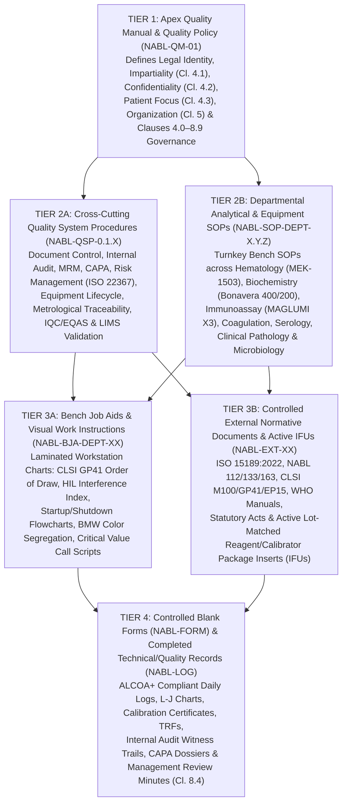

# 📋 0.1.11 — NABL `ISO 15189:2022` Document Control (`Cl. 8.2–8.3`), Control of Records (`Cl. 8.4`), Internal Audit (`Cl. 8.8.3`) & Management Review (`Cl. 8.9`) Master QMS SOP

**Department Folder:** `00_Universal_NABL_Legal_Framework`  
**Cluster Folder:** `0.1_Universal_Medico_Legal_Shield_and_NABL_Footers`  
**Cross-Linked Operational Dossier:** `0.2.12_Internal_Audit_and_Management_Review_Completed_Dossiers.md` (`SOP 0.2.12`)  

---

## 🏛️ Master Document Control Block & 9-Persona Red-Team Verification Matrix

| Governance Attribute | Normative & Operational Specification |
| :--- | :--- |
| **Document Control ID** | `NABL-QSP-0.1.11` (Legacy Alias: `SOP-GOV-0.1.11`) |
| **Document Title** | Master Quality System Procedure for Document Lifecycle Control (`Cl. 8.2–8.3`), `ALCOA+` Record Retention (`Cl. 8.4`), Risk-Based Internal Auditing (`Cl. 8.8.3`), and Management Review Governance (`Cl. 8.9`) |
| **Version & Revision Status** | **Version `4.0`** (Expanded 9-Persona International & Above-NABL Red-Team Harmonized Edition) |
| **Effective Date & Review Cycle** | **Effective Date:** `2026-10-12` / **Mandatory Review Cycle:** `Annual (Every 12 Months — Next Review: 2027-10-11)` |
| **Author & Technical Reviewer** | **Prepared By:** `Lead Quality Manager (ISO 15189:2022 Certified Lead Auditor)` / **Reviewed By:** `Head of Biochemistry & Metrology Lead` |
| **Approving & Issuing Authority** | **Approved By:** `Laboratory Director & Chief Consultant Pathologist (MD Pathology, NMC Registered)` |
| **Copy Control Classification** | `CONTROLLED ELECTRONIC MASTER` — Printed bench copies valid ONLY with wet-ink **`BLUE "CONTROLLED COPY"`** stamp and assigned Copy Number in `NABL-DOC-REG-01` |
| **ISO 15189:2022 Clause Mapping** | **Clauses 4.1** (*Impartiality*), **4.2** (*Confidentiality*), **4.3** (*Requirements Regarding Patients*), **5.4–5.6** (*Structure, Authority & QMS*), **6.6** (*Reagents & Consumables — IFU Control*), **7.6** (*Control of Data & Information Management*), **8.1** (*General QMS*), **8.2** (*Management System Documentation*), **8.3** (*Control of Management System Documents*), **8.4** (*Control of Records*), **8.5** (*Actions to Address Risks & Opportunities*), **8.7** (*Nonconformities & Corrective Actions*), **8.8.3** (*Internal Audits*), **8.9** (*Management Reviews*), **Normative Annex A** |
| **NABL Specific Criteria Mapping** | **NABL 100** (*General Information Brochure*), **NABL 112** (*Specific Criteria for Accreditation of Medical Laboratories*), **NABL 131** (*Terms & Conditions for Maintaining Accreditation*), **NABL 133** (*Policy for Use of NABL Symbol / Claim of Accreditation*), **NABL 153** (*Application Form & Scope Matrix*), **NABL 163** (*Policy on Participation in EQAS/PT*), **NABL 220D** (*Desktop Document Review Checklist*), **NABL 223** (*On-Site Assessment Checklist as per ISO 15189:2022*) |
| **International CLSI, ISO & CAP Standards** | **CLSI QMS01-Ed5** (*A Quality Management System Model for Laboratory Services*), **CLSI QMS02-A6** (*Quality Management System: Development and Management of Laboratory Documents*), **CLSI QMS15-Ed2** (*Assessments: Laboratory Internal Audit Program*), **CLSI AUTO13-A2** (*Laboratory Information Systems Verification*), **ISO 19011:2018** (*Guidelines for Auditing Management Systems*), **ISO 22367:2020** (*Application of Risk Management to Medical Laboratories*), **CAP GEN.20377 / GEN.20425** (*Document & Record Control*) |
| **Statutory & Medico-Legal Frameworks** | **Bharatiya Sakshya Adhiniyam (`BSA`) 2023 Section 63** (formerly **Indian Evidence Act 1872 Section 65B** — *Admissibility of Electronic Records*), **US FDA 21 CFR Part 11** (*Electronic Records; Electronic Signatures*), **Digital Personal Data Protection (`DPDP`) Act 2023**, **Consumer Protection Act (`CPA`) 2019**, **PCPNDT Act 1994 (Amended 2003)**, **HIV & AIDS (Prevention & Control) Act 2017**, **Bio-Medical Waste Management Rules 2016 (Amended 2018/2019)**, **Income Tax Act 1961 Section 44AA** |
| **Analytical Platforms Governed** | **Hematology:** `Nihon Kohden Celltac α MEK-1503` / **Biochemistry (Primary):** `Bonavera Chem 400` / **Biochemistry (Backup):** `Bonavera Chem 200` / **Chemiluminescence Immunoassay (`CLIA`):** `Snibe MAGLUMI X3` / **Coagulation, Serology, Clinical Pathology & Microbiology Workstations** + **LIMS & Middleware** |

### 🛡️ 9-Persona Adversarial Red-Team Review & Sign-Off Summary

| Persona ID | Reviewer Role & Normative Lens | Adversarial Vulnerability Identified in Legacy SOP | Structural Remediation Engineered in Version `4.0` |
| :--- | :--- | :--- | :--- |
| **Persona 1** | **Lead NABL (`ISO 15189:2022` / `NABL 220D/223`) & CAP / UKAS Assessor** | Legacy document lacked explicit mapping between Desktop Audit (`NABL 220D`) document adequacy rules and On-Site (`NABL 223`) bench verification of uncontrolled job aids and reagent package inserts (`IFUs`). | Engineered full 4-Tier QMS architecture (`NABL-QM / QSP / SOP / BJA / LOG / FORM / EXT`), mandatory header/footer templates, and `NABL 220D/223` audit readiness checkpoints across Sections 1–5. |
| **Persona 2** | **Department-Specific Clinical Subspecialty Consultant (`MD Pathology / Biochemistry / Microbiology`)** | Silent manufacturer revisions in reagent kit Package Inserts (`IFUs`) for `Bonavera Chem 400`, `Snibe MAGLUMI X3`, or annual `CLSI M100` AST breakpoint tables were not captured under document control (`Cl. 8.3.1`), risking clinically erroneous reporting. | Instituted mandatory incoming `GRN`-linked `IFU` Version Control (`NABL-DOC-REG-02`) requiring Technical Supervisor & Pathologist sign-off whenever a new reagent lot switches `IFU` revision, calibrator value, linearity, or biological reference interval. |
| **Persona 3** | **CLSI & IFCC Metrology, Method Verification & Six-Sigma QC Specialist** | Analytical validation binders (`CLSI EP15-A3`, `EP06-Ed2`, `EP17-A2`, `EP28-A3c`), calibrator traceability certificates (`ISO 17511`), and thermal analyzer printouts lacked long-term legibility and lifecycle retention linkage to the instrument lifespan. | Mandated retention of all primary method verification dossiers and calibration hierarchy records for the **entire operational life of the analyzer plus $2\text{ years}$**, plus mandatory photocopying/scanning of fading thermal instrument printouts onto archival-grade paper/PDF. |
| **Persona 4** | **Clinical Pharmacologist & Special-Population Stratification Auditor** | Hand-written reference range notes or pediatric/trimester lookup tables taped to benches caused discrepancies between LIMS-printed reference intervals and bench interpretation. | Outlawed all unverified bench lookup slips; instituted controlled lamination and `BLUE "CONTROLLED COPY"` stamping of all age/sex/pregnancy reference tables (`NABL-BJA`) synchronized 1:1 with the LIMS master database via `DCR` change control. |
| **Persona 5** | **Medico-Legal, Patient-Safety & `ISO 22367` Risk Management Counsel** | Retention table contained only 7 generic categories and omitted pediatric statute-of-limitations (`age of majority 18 + 2 years`), `PCPNDT Act` (`10 years / court disposal`), `POCSO / MLC` permanent holds, and quantitative `ISO 22367` FMECA risk scoring. | Expanded to a **20-Category Statutory Record & Biological Specimen Retention Matrix** (Section 3.4) and a **10-Mode Quantitative `ISO 22367` FMECA Risk Register** (Section 5.1) with LIMS hard-locks. |
| **Persona 6** | **Uncompressed Documentation & Readability Architect** | Legacy file compressed Internal Audit, Management Review, and Record Control into brief bullet lists without operational workflows or print-ready Level-4 QMS registers. | Expanded into a comprehensive, self-contained turnkey manual with step-by-step workflows, vertical witness-audit simulation tables, and **4 Print-Ready Level-4 Registers** (`NABL-DOC-REG-01` to `04`). |
| **Persona 7** | **`CLSI QMS02-A6` & `ISO 15189:2022 Clauses 8.2–8.4` Document Lifecycle Architect** | Legacy SOP prohibited all handwritten edits without providing a compliant mechanism for urgent interim procedural updates (`ISO 15189:2022 Clause 8.3.2 f`) and lacked a standardized alphanumeric coding taxonomy. | Established the **7-Category Document Coding Taxonomy** (Section 1.2) and the **Controlled Hand-Written Amendment Protocol** (`Max 2 amendments/page`, strike-through, initials, date, `DCR` reference, and mandatory formal re-issue within $\le 30\text{ days}$). |
| **Persona 8** | **`21 CFR Part 11` & `Indian Evidence Act Sec 65B / BSA 2023 Sec 63` Forensic Integrity Counsel** | Electronic LIMS records, amended diagnostic reports, and paper logbooks lacked forensic chain-of-custody specifications, cryptographic hash rules, and `BSA 2023 Sec 63` legal admissibility certification. | Integrated full **9-Pillar `ALCOA+` Data Integrity Architecture**, **Good Documentation Practice (`GDP`)**, **`21 CFR Part 11` Audit Trail Locks**, and **`BSA 2023 Sec 63` / `Sec 65B` Forensic Electronic Record Certification** (Section 3.1–3.3). |
| **Persona 9** | **`ISO 19011:2018` Internal Audit Sampling & `Clause 8.9` Management Review KPI Specialist** | Internal Audit lacked objective grading definitions (`Major NC` vs `Minor NC` vs `OFI`), statistical sample size rules, and a concrete Vertical Witness-Audit walkthrough; MRM inputs lacked numerical KPI targets and explicit linkage to `SOP 0.2.12`. | Added the **`ISO 19011` Sampling & NC Grading Matrix**, a complete **End-to-End Vertical Witness-Audit Simulation**, and the **14-Input Quantitative MRM KPI Dashboard** directly bridged to `SOP 0.2.12` (Section 4). |

---

## 📐 Section 1: 4-Tier QMS Document Hierarchy, Standardized Coding Taxonomy & Lifecycle Workflow (`ISO 15189:2022 Clauses 8.2 & 8.3` & `CLSI QMS02-A6`)

### 1.1 The 4-Tier Laboratory Quality Management System (`QMS`) Documentation Pyramid (`ISO 15189:2022 Clause 8.2.1`)

In strict conformance with **`ISO 15189:2022 Clause 8.2`**, **`NABL 112`**, **`NABL 220D`** (*Desktop Adequacy Assessment*), and **`CLSI QMS02-A6`**, the laboratory's Quality Management System documentation is structured into four hierarchical, mutually traceable tiers. No analytical procedure, equipment operation, pre-analytical phlebotomy step, or post-analytical reporting rule may be executed outside this controlled hierarchy.



| QMS Tier | Tier Designation & Document Class | Normative Purpose & Operational Scope | Authorized Author / Reviewer | Approving & Issuing Authority | Mandatory Review Cycle & Archival Rule |
| :--- | :--- | :--- | :--- | :--- | :--- |
| **Tier 1 (`QM`)** | **Apex Quality Manual & Quality Policy (`NABL-QM-01`)** | Establishes the supreme governance constitution of the laboratory mapped clause-by-clause to `ISO 15189:2022 Clauses 4.1 to 8.9` and `Normative Annex A`, defining legal entity status, organizational chart, quality objectives, and commitment to good professional practice. | Prepared by: `Quality Manager` | Approved & Issued by: `Laboratory Director (MD Pathology)` | Reviewed **Annually** ($\le 12\text{ months}$); retired versions stamped `RED OBSOLETE` and archived for **$5\text{ years}$** (`10\text{ years}` if linked to statutory litigation). |
| **Tier 2 (`QSP` & `SOP`)** | **Quality System Procedures (`NABL-QSP`) & Departmental Technical/Analytical SOPs (`NABL-SOP`)** | **2A (`QSP`):** System-wide managerial procedures governing document control, risk management, training, purchasing, CAPA, internal audits, and MRM.<br>**2B (`SOP`):** Test-specific and analyzer-specific procedures detailing clinical principle, specimen requirements, calibration (`ISO 17511`), IQC (`Westgard Sigma`), interferences (`CLSI EP07`), calculation, biological reference intervals (`CLSI EP28`), and clinical interpretation. | Prepared by: `Technical Supervisor / Senior Technologist`<br>Reviewed by: `Quality Manager / Subspecialty Lead` | Approved & Issued by: `Laboratory Director / Consultant Pathologist / Consultant Microbiologist` | Reviewed **Annually** ($\le 12\text{ months}$) or **immediately** upon change in analyzer platform, reagent methodology, or `IFU` specifications; retired master retained **$5\text{ years}$**. |
| **Tier 3 (`BJA` & `EXT`)** | **Bench Job Aids / Work Instructions (`NABL-BJA`) & Controlled External Documents (`NABL-EXT`)** | **3A (`BJA`):** Concise, laminated visual instructions displayed at phlebotomy chairs, centrifuges, and analyzer benches extracted directly from parent Tier-2 SOPs.<br>**3B (`EXT`):** Normative standards (`ISO`, `NABL`, `CLSI`, `WHO`), statutory regulations, instrument user manuals, and **active reagent/calibrator/control Package Inserts (`IFUs`)**. | Verified & Indexed by: `Quality Manager` & `Departmental Supervisor` | Authorized for Bench Use by: `Laboratory Director / Quality Manager` | `BJA` reviewed **Annually** alongside parent SOP; `EXT` standards checked **Quarterly** for NABL/CLSI updates; `IFUs` verified at **every incoming reagent lot (`GRN`)**. |
| **Tier 4 (`FORM` & `LOG`)** | **Controlled Forms (`NABL-FORM`) & Technical / Quality Registers (`NABL-LOG`)** | Blank templates (`FORM`) and completed chronological records (`LOG`) providing objective, auditable `ALCOA+` evidence that Tier 1–3 policies and procedures were executed accurately in real time. | Designed by: `Quality Manager / Technical Supervisor` | Master Template Approved by: `Laboratory Director` | Blank `FORM`/`LOG` templates version-controlled like SOPs; completed records retained per the **20-Category Statutory Retention Schedule (Section 3.4)**. |

---

### 1.2 Standardized Alphanumeric Document Coding Taxonomy (`CLSI QMS02-A6` & `ISO 15189:2022 Clause 8.3.2 a`)

Every internal and external document controlled within the laboratory QMS shall carry a globally unique, self-identifying alphanumeric code structured as follows:

$$\text{Document ID Format:} \quad \mathbf{NABL - [DOC\_TYPE] - [DEPT\_CODE] - [SERIAL / HIERARCHY\_NO]}$$

#### A. Standardized Document Type Prefixes (`[DOC_TYPE]`)
1. **`NABL-QM`**: Tier-1 Apex Quality Manual, Quality Policy, Impartiality & Confidentiality Charter (e.g., `NABL-QM-GOV-01`).
2. **`NABL-QSP`**: Tier-2A System-Wide Quality System Procedures covering managerial clauses `Cl. 4.1–8.9` (e.g., `NABL-QSP-GOV-0.1.11`).
3. **`NABL-SOP`**: Tier-2B Departmental Analytical, Pre-Analytical, Post-Analytical, and Equipment Standard Operating Procedures (e.g., `NABL-SOP-HEM-1.1.1`, `NABL-SOP-BIO-2.1.1`).
4. **`NABL-BJA`**: Tier-3A Laminated Bench Job Aids, Wall Charts, and Quick-Reference Workstations Guides (e.g., `NABL-BJA-PRE-01` for `CLSI GP41` Order of Draw).
5. **`NABL-LOG`**: Tier-4 Bound Chronological Bench Registers and Daily Operational Logbooks (e.g., `NABL-LOG-BIO-04` for `Bonavera Chem 400` Daily Startup & Maintenance Log).
6. **`NABL-FORM`**: Tier-4 Discrete Single-Sheet / Electronic Forms, Checklists, Certificates, and Dossiers (e.g., `NABL-FORM-QA-07` for Non-Conformity & CAPA Report Form).
7. **`NABL-EXT`**: Tier-3B Controlled External Regulatory Standards, Clinical Guidelines, Instrument Operator Manuals, and Active Kit Package Inserts (`IFUs`) (e.g., `NABL-EXT-NABL-112`, `NABL-EXT-CLSI-M100`, `NABL-EXT-IFU-MAG-TSH-01`).

#### B. Standardized Departmental & Functional Codes (`[DEPT_CODE]`)
| Department Code | Laboratory Functional Scope / Folder Mapping | Primary Analytical Platforms & Workstations Covered |
| :--- | :--- | :--- |
| **`GOV`** | `00_Universal_NABL_Legal_Framework` — Apex QMS, Medico-Legal, Risk, Audit & MRM | Quality Management Office, Laboratory Director Office, Document Archive Vault |
| **`PRE`** | Pre-Analytical Phlebotomy, Sample Collection, Barcoding, Transport & Accessioning | Outpatient Phlebotomy Bays, Pediatric/Difficult-Draw Bay, Sample Reception & Centrifugation Area |
| **`HEM`** | `01_Hematology` — Automated CBC, Reticulocytes, ESR & Peripheral Blood Smear Morphology | `Nihon Kohden Celltac α MEK-1503`, Westergren/Automated ESR, Romanowsky Staining & Microscopy Bench |
| **`COAG`** | `01_Hematology (Coagulation)` — Hemostasis (`PT/INR`, `aPTT`, Fibrinogen, D-Dimer) | Optical/Photo-Optical Coagulometer, Citrate Platelet-Poor Plasma (`PPP`) Verification Station |
| **`BIO`** | `02_Biochemistry` — Clinical Chemistry, Electrolytes (`ISE`), Enzymes, Lipids & Renal/Liver Panels | `Bonavera Chem 400` (Primary High-Throughput), `Bonavera Chem 200` (Backup/STAT), `ISE` Module |
| **`IMM`** | `03_Immunoassay` — Chemiluminescence Immunoassay (`CLIA`) Hormones, Tumor Markers, Cardiac & Vitamins | `Snibe MAGLUMI X3` Automated `ABEI` Flash-Chemiluminescence Analyzer |
| **`SER`** | `04_Serology_Immunology` — Infectious Disease Serology, Nephelometry/Turbidimetry & Autoimmunity | Rapid Immunochromatography / ELISA / Nephelometry / Rheumatoid & ASO Workstations |
| **`CLP`** | `05_Clinical_Pathology` — Urinalysis, Semen Analysis (`WHO 6th Ed`), Body Fluids (`CSF/Pleural/Ascitic`) & Stool | Urine Strip Reader, Neubauer Improved Hemocytometer, Phase-Contrast & Brightfield Microscopy |
| **`MIC`** | `06_Microbiology` — Bacteriology, Culture, Gram/ZN/KOH Microscopy & `CLSI M100` AST | Biosafety Cabinet Class II Type A2, Bacteriological Incubators, Autoclave, McFarland Densitometer |
| **`EQP`** | Cross-Departmental Biomedical Engineering, Calibration, Pipettes, Refrigerators & UPS/Water Plant | Type-I/II Water Purification System, Calibrated Micropipettes, Refrigerators (`2–8°C`), Deep Freezers (`-20°C`), Centrifuges |
| **`SAF`** | Laboratory Biosafety, Chemical Hygiene, Spill Response, Needle-Stick Post-Exposure Prophylaxis (`PEP`) & `BMW` | Eyewash/Safety Shower Stations, Hypochlorite Spill Kits, Color-Coded Bio-Medical Waste Storage Room |
| **`IT`** | Laboratory Information Management System (`LIMS`), Bidirectional Analyzer Interfacing & Data Security | Primary LIMS Server, Middleware Workstations, Local NAS Backup & Encrypted Offsite Cloud Archive |

---

### 1.3 Mandatory Header & Footer Control Block Architecture (`ISO 15189:2022 Clause 8.3.2 a, b, d`)

Every page of every controlled internal document (`NABL-QM`, `NABL-QSP`, `NABL-SOP`, `NABL-BJA`, `NABL-FORM`, and cover/header pages of `NABL-LOG`) **shall** contain a standardized, locked Header Block and Footer Block. No document without these complete metadata fields may be issued to a laboratory workstation.

```text
+------------------------------------------------------------------------------------------------------+
| [LABORATORY NAME & NABL ACCREDITATION / APPLICATION LOGO BLOCK]                                      |
| DOCUMENT TITLE : [FULL DESCRIPTIVE CLINICAL OR MANAGERIAL TITLE]                                     |
+----------------------------------+----------------------------------+--------------------------------+
| Document ID : NABL-SOP-BIO-2.1.1 | Version No.    : v4.0            | Effective Date : 2026-10-12    |
| Supersedes  : v3.0 (2025-10-15)  | Review Cycle   : Annual (12 Mo)  | Next Review Due: 2027-10-11    |
| Department  : Biochemistry (02)  | ISO 15189 Cl.  : Cl. 7.3 / 8.3   | Page Number    : Page X of Y   |
+----------------------------------+----------------------------------+--------------------------------+
| Prepared By (Name, Designation & Signature) | Reviewed By (Quality Manager) | Approved By (Lab Dir.) |
| [Tech Supervisor — B.Sc. MLT / M.Sc. Med]   | [Quality Manager — ISO 15189] | [Dr. XXXX, MD Path.]   |
| Date: 2026-10-10                            | Date: 2026-10-11              | Date: 2026-10-12       |
+------------------------------------------------------------------------------------------------------+
| FOOTER BLOCK (Locked on Every Page):                                                                 |
| Copy Status: [BLUE STAMP: CONTROLLED COPY #02 - BIOCHEM BENCH] | Confidentiality: INTERNAL QMS ONLY  |
| WARNING: Uncontrolled if printed or photocopied without wet-ink BLUE "CONTROLLED COPY" QA Stamp.     |
+------------------------------------------------------------------------------------------------------+
```

#### Mandatory Rules for Version Numbering (`Major` vs. `Minor` Revisions)
1. **Initial Release (`v1.0`):** Assigned upon first formal approval and release of a new QMS document.
2. **Minor Revision (`vX.1`, `vX.2`, `vX.3`):** Assigned when administrative, formatting, typographical, regulatory clause citation, or minor clarification updates are made that **do not** alter the analytical measurement principle, reagent stoichiometry, calibration hierarchy, biological reference interval, or critical decision limits.
3. **Major Revision (`v2.0`, `v3.0`, `v4.0`):** Assigned whenever there is a change in:
   - Analytical platform or measurement methodology (e.g., transitioning from Jaffe kinetic to enzymatic creatininase, or adding a new analyzer);
   - Reagent manufacturer or kit `IFU` specifications affecting reaction linearity (`AMR`), sample volume, calibration stability, or biological reference intervals;
   - Core organizational structure, NABL scope of accreditation (`NABL 153`), or statutory reporting requirements.

---

### 1.4 7-Stage Document Creation, Review, Approval & Rollout Workflow (`CLSI QMS02-A6`)

| Stage | Workflow Phase | Responsible Role(s) | Mandatory Operational Actions & Verification Deliverables | Maximum SLA |
| :---: | :--- | :--- | :--- | :---: |
| **Stage 1** | **Initiation & Document Change Request (`DCR`)** | Any Laboratory Staff / Supervisor / Quality Manager | Identify need for a new document or revision of an existing document (triggered by new test introduction, `IFU` update, Internal Audit `NC`, `EQAS` investigation, or annual review). Submit **`NABL-FORM-QA-01` (Document Change Request)** and log in **`NABL-DOC-REG-03`**. | Day 1 |
| **Stage 2** | **Technical Drafting & Literature/IFU Alignment** | Designated Subject Matter Expert (`SME` / Technical Supervisor) | Draft document using standardized typography and mandatory section architecture, verifying exact chemical stoichiometry, `IFU` lot revision, `CLSI` metrological parameters (`EP15/EP06/EP17/EP28`), and `ISO 15189:2022` clause requirements. | Days 2–5 |
| **Stage 3** | **Metrological, Clinical & QA Peer Review** | Quality Manager & Subspecialty Lead | Audit draft against the **9-Persona Red-Team Checklist**: verify zero contradiction with parent `NABL-QM-01` or sibling SOPs, verify LIMS reference interval and critical value concordance, and confirm document coding in `NABL-DOC-REG-01`. | Days 6–8 |
| **Stage 4** | **Executive Authorization & Sign-Off** | Laboratory Director (`MD Pathology`) | Perform final clinical, medico-legal, and regulatory review. Apply wet-ink signature (on physical Master Copy) and `21 CFR Part 11` compliant digital signature (in electronic Master Vault). Assign formal `Effective Date` (typically $3\text{–}7\text{ days}$ post-approval to allow staff training). | Days 9–10 |
| **Stage 5** | **Master Registration & Controlled Copy Stamping** | Quality Manager (`Document Controller`) | Stamp original signed printout in **GREEN ink (`"MASTER COPY — QA VAULT"`)**. Print exact number of authorized workstation copies required per **`NABL-DOC-REG-01`**, stamp each page in **BLUE ink (`"CONTROLLED COPY — COPY #[XX]"`**, wet-signed in blue ink by QM), and place in protective binders/laminates. | Day 11 |
| **Stage 6** | **Pre-Effective Staff Training & Competency Sign-Off** | Departmental Supervisor & Bench Technologists | Conduct mandatory bench briefing/training on the new or revised SOP **prior to the Effective Date**. All bench staff operating the procedure must sign the **`Document Read, Understood & Trained Log`** attached to the SOP binder (`ISO 15189 Cl. 8.3.2 d`). | Days 11–13 |
| **Stage 7** | **1-for-1 Physical Swap & Obsolete Quarantine** | Quality Manager | On the `Effective Date`, physically visit each workstation, deploy the new `Controlled Copy`, retrieve the superseded copy (`1-for-1 Swap`), obtain the receiving supervisor's signature in **`NABL-DOC-REG-01`**, shred extra bench copies, and archive **one** retired Master Copy stamped in **RED ink (`"OBSOLETE"`**). | Day 14 (Effective Date) |

---

## 🛡️ Section 2: Controlled Distribution, Stamp Color-Coding, Hand-Written Amendments & External Document Control (`ISO 15189:2022 Clause 8.3.2`)

### 2.1 Physical & Electronic Stamp Control Architecture (`BLUE` vs. `RED` vs. `GREEN` vs. `BLACK`)

To eliminate any ambiguity during NABL On-Site Assessments (`NABL 223`) or routine bench operations, the laboratory enforces a strict **4-Color Physical Ink Stamp & Electronic Watermark Code**. Only the Quality Manager (or deputized Deputy Quality Manager) holds physical custody of these stamps under lock and key.

| Stamp Code & Ink Color | Exact Stamp Text & Physical Format | Authorized Application & Custody Rule | Forensic Purpose & NABL Audit Verification |
| :--- | :--- | :--- | :--- |
| **`[STAMP-MASTER-GREEN]`**<br>**GREEN Wet Ink** | **`MASTER COPY — DO NOT REMOVE FROM QA VAULT`**<br>`Doc ID: [______] / Ver: [___]`<br>`Authorized Sign: [_________] Date: [________]` | Applied to the **single original wet-signed paper print** of every `QM`, `QSP`, `SOP`, `BJA`, and `FORM` stored inside the fire-resistant Quality Manager Master Archive Cabinet. | Serves as the primary physical source of truth from which authorized bench copies are reproduced. Never taken to analytical workbenches. |
| **`[STAMP-CTRL-BLUE]`**<br>**BLUE Wet Ink** | **`CONTROLLED COPY — ISO 15189:2022 QMS`**<br>`Copy No.: [____] / Location: [____________]`<br>`Issued By (QM Sign): [______] Date: [______]` | Applied in **BLUE wet ink** to the top-right or bottom-right margin of **every page** (or front cover + laminated face for `BJA`) of every document issued to laboratory workbenches, phlebotomy bays, or reception. | Because standard black-and-white photocopiers reproduce blue ink as black/grey, **BLUE wet ink immediately distinguishes an authentic QM-issued Controlled Copy from an unauthorized bench photocopy!** |
| **`[STAMP-OBSOLETE-RED]`**<br>**RED Wet Ink** | **`OBSOLETE — FOR HISTORICAL & MEDICO-LEGAL ARCHIVAL ONLY — DO NOT USE AT WORKBENCH`**<br>`Superseded By Ver: [___] on Date: [________]`<br>`Archived By (QM Sign): [__________________]` | Applied diagonally or across the title block in **bright RED wet ink** on the single retired Master Copy retained in the `Obsolete Document Archive Vault` (`5-year` retention). All retrieved workstation copies (`Copy #01, #02...`) are **cross-cut shredded** and logged in `NABL-DOC-REG-03`. | Prevents accidental re-introduction of obsolete procedures (`ISO 15189:2022 Clause 8.3.2 g`) while preserving historical method traceability for retrospective medico-legal or audit reconstruction. |
| **`[STAMP-EXT-PURPLE]`**<br>**PURPLE / BLUE Wet Ink** | **`CONTROLLED EXTERNAL DOCUMENT / ACTIVE IFU`**<br>`Ext ID: [NABL-EXT-____] / Lot/Ed: [_______]`<br>`Verified By: [_________] Date: [__________]` | Applied to the cover page of printed external guidelines (`CLSI M100`, `NABL 112`), instrument operator manuals, and **active reagent/calibrator Package Inserts (`IFUs`)** filed in the Departmental `Active IFU Binder`. | Proves that external normative documents and kit inserts in active use at the bench have been formally reviewed, registered in `NABL-DOC-REG-02`, and verified against current lot numbers. |
| **`[WATERMARK-UNCTRL]`**<br>**Electronic Auto-Footer** | **`UNCONTROLLED COPY IF PRINTED WITHOUT WET-INK BLUE "CONTROLLED COPY" STAMP`** | Embedded automatically in the footer of all read-only PDFs viewed on LIMS/Intranet terminals (`Clause 8.3.2 d`). | Ensures that if any staff member prints a PDF for temporary personal study, an assessor can instantly identify it as an uncontrolled printout that must not be used at a workbench. |

---

### 2.2 Zero-Tolerance Prevention of Uncontrolled Bench Cheat-Sheets & Sticky Notes (`Clause 8.3.2 d & e`)

> [!CAUTION]
> **#1 Cause of NABL On-Site Minor/Major Non-Conformities under Clause 8.3:** During on-site assessments (`NABL 223`), assessors systematically inspect beneath keyboards, taped onto analyzer hoods (`MEK-1503`, `Bonavera 400`, `MAGLUMI X3`), inside centrifuge lids, and on phlebotomy trays for handwritten Post-it sticky notes, torn reagent box flaps with dilution ratios, un-stamped photocopies of reference ranges, or personal notebooks containing calibration factors. **Any such item is cited as an immediate Non-Conformity (`Uncontrolled Document in Active Bench Use`).**

1. **Absolute Prohibition of Informal Bench Notes:**
   - Technicians and phlebotomists are **strictly prohibited** from taping handwritten notes, Post-it stickers, unstamped reference tables, dilution cheat-sheets, or torn cardboard box lids onto walls, reagent refrigerators, centrifuges, or analyzers.
   - Personal pocket diaries may be used for personal learning notes during training **only**, and must never be left open on analytical benches or used as a substitute for controlled `NABL-SOP` / `NABL-BJA` documents or official `NABL-LOG` worksheets.
2. **Conversion of Useful Bench Aids into Controlled `NABL-BJA` Work Instructions:**
   - Whenever bench staff require a high-visibility quick reference (e.g., `Bonavera Chem 400` daily wash solution preparation table, `Snibe MAGLUMI X3` flash-chemiluminescence substrate replacement steps, `CLSI GP41` vacutainer order of draw, or Westergren ESR temperature correction chart), the Departmental Supervisor submits a `DCR` to convert it into an official **`NABL-BJA-[DEPT]-[XX]`** document.
   - The Quality Manager formats the chart with the full **Mandatory Header & Footer Control Block (Section 1.3)**, stamps it with the **`BLUE "CONTROLLED COPY"`** stamp, seals it in clean wipe-able **thermal lamination** (so it can be decontaminated with $1\%$ sodium hypochlorite or $70\%$ isopropyl alcohol without ink smearing), and registers its exact wall/bench location in **`NABL-DOC-REG-01`**.
3. **Weekly Friday "Clean-Bench Document Sweep" (`QA Walk-Round`):**
   - Every Friday at `16:00 hrs`, the Quality Manager or Deputy Quality Manager conducts a 15-minute physical walk-round across Reception, Phlebotomy, Hematology, Biochemistry, Immunoassay, Serology, Clinical Pathology, and Microbiology to verify that:
     - Every wall chart and bench folder bears a valid `BLUE "CONTROLLED COPY"` stamp matching the latest version in `NABL-DOC-REG-01`;
     - Zero sticky notes, unstamped photocopies, or superseded `IFUs` exist at any workstation.

---

### 2.3 Controlled Hand-Written Amendment Protocol (`Pen-and-Ink Interim Change` — `ISO 15189:2022 Clause 8.3.2 f`)

While unauthorized handwritten alterations to SOPs are strictly forbidden, **`ISO 15189:2022 Clause 8.3.2(f)`** and **`CLSI QMS02-A6`** recognize that laboratories occasionally face urgent operational or clinical situations (e.g., an immediate manufacturer reagent lot update changing on-board calibration frequency from 28 days to 14 days, or an urgent statutory notification update) where an interim amendment must take effect immediately before formal re-printing and binding can be completed.

To ensure total forensic traceability and regulatory compliance under `Clause 8.3.2(f)`, **Controlled Hand-Written Amendments** are governed by the following six ironclad rules:

```text
+---------------------------------------------------------------------------------------------------+
| EXAMPLE OF COMPLIANT HAND-WRITTEN AMENDMENT ON A CONTROLLED SOP PAGE (ISO 15189 Cl. 8.3.2 f)      |
+---------------------------------------------------------------------------------------------------+
| Original Printed Line in NABL-SOP-IMM-3.1.1 (Page 4 of 12):                                       |
|   "4.3 On-board 2-point recalibration on Snibe MAGLUMI X3 shall be performed every 28 days."      |
|                                                                                                   |
| Compliant Hand-Written Amendment (Executed in Permanent Blue Ink by Quality Manager / Lab Dir.):  |
|   "4.3 On-board 2-point recalibration on Snibe MAGLUMI X3 shall be performed every ~~28 days~~    |
|    14 days [Per Manufacturer IFU Lot #202609B; Ref DCR-2026-019; Amended By: Dr. R.K. / QM S.P.   |
|    on 2026-10-12; Formal Re-Issue Due By: 2026-11-11]."                                           |
+---------------------------------------------------------------------------------------------------+
```

1. **Strict Authority Restriction:** Bench technicians, phlebotomists, and trainees are **never** permitted to make handwritten amendments on any SOP or Job Aid. Only the **Quality Manager** and **Laboratory Director (`MD Pathology`)** are authorized to execute a controlled hand-written amendment.
2. **Simultaneous Amendment Across Master & All Controlled Copies:** The exact same hand-written amendment must be inscribed simultaneously on the **`GREEN MASTER COPY`** in the QA Vault and on **every distributed `BLUE CONTROLLED COPY`** listed in `NABL-DOC-REG-01`.
3. **Forensic Inscription Format (Strike-Through + New Text + `DCR` + Initials + Date + Reason):**
   - Draw a **single neat horizontal line** in permanent blue or black ballpoint ink through the superseded word/value so that the original printed text remains 100% legible underneath (`~~28 days~~`);
   - Write the amended value/instruction clearly above or beside the struck-out text (`14 days`);
   - Inscribe in brackets: **`[Ref: DCR-YYYY-XX | Reason: <Brief Reason> | Initials: <QM & Lab Dir> | Date: YYYY-MM-DD]`**.
4. **Quantitative Threshold Cap (`Max 2 Per Page / Max 5 Per Document`):**
   - A maximum of **two (2) hand-written amendments per page** and a maximum of **five (5) hand-written amendments across an entire document** are permitted.
   - If a third amendment is required on the same page, or a sixth amendment in the same document, hand-written amendment is **disallowed** and the document **must** be formally re-issued immediately as a new version.
5. **Mandatory 30-Day Formal Re-Issue Clock:**
   - Every hand-written amendment is strictly an **interim measure**. Any document bearing a hand-written amendment **shall be formally revised, reprinted, approved, and re-issued as a new version within $\le 30\text{ calendar days}$** of the hand-written entry (tracked via automated deadline alert in **`NABL-DOC-REG-03`**).

---

### 2.4 Annual Document Review & Re-Verification Protocol (`ISO 15189:2022 Clause 8.3.2 e`)

1. **Mandatory 12-Month Review Cycle:** Every internal document (`NABL-QM`, `NABL-QSP`, `NABL-SOP`, `NABL-BJA`, `NABL-FORM`, `NABL-LOG`) shall undergo a formal periodic review **at least once every 12 months** to verify continuing suitability, technical accuracy, alignment with current reagent `IFUs`, and compliance with latest `NABL` / `ISO 15189:2022` / `CLSI` standards.
2. **Scenario A — Review Reveals Zero Required Changes (`Annual Re-Verification without Reprint`):**
   - If the Subject Matter Expert, Quality Manager, and Laboratory Director review an SOP at the 12-month mark and confirm that the analyzer, reagent `IFU`, calibration hierarchy, reference intervals, and regulatory requirements remain 100% unchanged, the laboratory does **not** need to waste paper re-printing identical pages.
   - Instead, the reviewers sign and date the **`Annual Document Periodic Review & Re-Verification Sheet`** bound inside the front cover of the `GREEN MASTER COPY` and each `BLUE CONTROLLED COPY` binder, extending the `Next Review Due Date` by 12 months and logging the re-verification in `NABL-DOC-REG-01` (valid for up to **2 consecutive annual cycles [36 months total]**, after which a full version reprint is mandatory).
3. **Scenario B — Review Identifies Technical or Regulatory Updates:**
   - A `DCR` is logged in `NABL-DOC-REG-03`, the version number is incremented (`Minor vX.1 -> vX.2` or `Major vX.x -> v(X+1).0`), and the 7-Stage Rollout & 1-for-1 Swap Workflow (Section 1.4) is executed.

---

### 2.5 Control of External Normative Documents & Active Reagent Package Inserts (`IFUs`) (`ISO 15189:2022 Clauses 6.6 & 8.3.1`)

External documents fall into two critical classes, both tracked in **`NABL-DOC-REG-02`**:

#### Class A: Regulatory, Accreditation & Clinical Practice Standards
- **Accreditation & ISO Standards:** `ISO 15189:2022`, `ISO 22367:2020`, `ISO/TS 20914:2019`, `ISO 19011:2018`, `NABL 100`, `NABL 112`, `NABL 131`, `NABL 133`, `NABL 153`, `NABL 163`, `NABL 220D`, `NABL 223`.
- **CLSI & WHO Methodological Standards:** `CLSI M100` (updated **annually every January/February** for Antimicrobial Susceptibility Testing zone diameters & MIC breakpoints — **critical NABL Microbiology audit focus!**), `CLSI GP41` (Venipuncture), `CLSI GP47` (Critical Values), `CLSI H21-A5` (Coagulation), `CLSI EP06/EP07/EP15/EP17/EP28`, `WHO Laboratory Manual for the Examination and Processing of Human Semen (6th Edition, 2021)`.
- **Statutory Laws:** `DPDP Act 2023`, `BSA 2023 Sec 63`, `PCPNDT Act 1994`, `HIV & AIDS Act 2017`, `Bio-Medical Waste Rules 2016/2019`, `CPA 2019`.
- **Surveillance Frequency:** On the **1st working Monday of each calendar quarter (Jan, Apr, Jul, Oct)**, the Quality Manager checks the official NABL portal (`nabl-india.org`) and CLSI/WHO portals for newly published editions or amendments. Any updated standard is downloaded/procured within $15\text{ days}$, logged in `NABL-DOC-REG-02`, and evaluated via `DCR` for impact on internal SOPs.

#### Class B: Manufacturer Reagent, Calibrator & Control Package Inserts (`IFUs`) — Lot-to-Lot Version Lock
> [!IMPORTANT]
> **Why `IFU` Version Control is Critical (`ISO 15189 Cl. 6.6.4 & 8.3.1`):** Manufacturers (`Nihon Kohden`, `Bonavera`, `Snibe Maglumi`, `Erba/Transasia`, `tulip`, `HiMedia`) periodically revise kit Package Inserts (`IFUs`) between reagent lots—altering calibrator assigned values, reaction incubation times, linearity (`AMR`), interferent thresholds (`HIL`), or reference intervals. Using a new reagent lot while the SOP and LIMS still reflect an older `IFU` version is a **Major Technical Non-Conformity**.

1. **Mandatory Incoming `GRN` Package Insert Inspection:**
   - Every time a new shipment of reagents, calibrators, or controls arrives at Store/Reception, the Storekeeper / Technical Supervisor extracts the paper Package Insert (`IFU`) from the box (or downloads the lot-specific electronic `e-IFU`) during Goods Receipt Note (`GRN`) inspection (`SOP 0.1.14`).
   - The supervisor compares the **`IFU Revision Code / Publication Date`** on the incoming insert against the active `IFU Revision Code` recorded in **`NABL-DOC-REG-02`**.
2. **Protocol When `IFU` Version is Unchanged:**
   - The supervisor records `"IFU Version Verified Unchanged"` on the Lot-to-Lot Reagent Acceptance Log.
3. **Protocol When `IFU` Version Has Changed (`New Revision Detected`):**
   - The new `IFU` is stamped with **`[STAMP-EXT-PURPLE: CONTROLLED EXTERNAL DOCUMENT / ACTIVE IFU]`**, assigned an updated sub-code in `NABL-DOC-REG-02`, and placed in the Departmental **`Active Kit IFU Binder`**.
   - The superseded `IFU` is stamped **`RED OBSOLETE`** (with the date the old reagent lot was exhausted) and transferred to the **`Historical IFU Archive Binder`** (`5-year` retention).
   - A **`DCR` (`NABL-FORM-QA-01`)** is triggered to update the corresponding `NABL-SOP` and LIMS parameters (`AMR`, reference intervals, calibrator targets) **before** the new reagent lot is placed into routine patient testing.

---

## 🔐 Section 3: Control of Quality & Technical Records (`Cl. 8.4`), `ALCOA+` Data Integrity, `GDP`, `21 CFR Part 11` / `BSA 2023 Sec 63` & 20-Category Retention Schedule

### 3.1 The 9-Pillar `ALCOA+` Data Integrity Architecture (`ISO 15189:2022 Clauses 7.6 & 8.4`)

All quality and technical records—whether handwritten in bound bench logbooks (`NABL-LOG`), printed by analytical instruments (`MEK-1503`, `Bonavera 400/200`, `MAGLUMI X3`), or stored digitally in the LIMS—shall strictly conform to the **9-Pillar `ALCOA+` Forensic Data Integrity Standard**:

| `ALCOA+` Pillar | Core Regulatory Definition | Mandatory Laboratory Bench & LIMS Implementation Rule | Forensic Audit Red-Flag (Zero-Tolerance NABL NC) |
| :--- | :--- | :--- | :--- |
| **1. `A` — Attributable** | Every record entry, test execution, edit, calibration, IQC run, or report sign-out must be unmistakably traceable to the specific individual who performed it and the exact timestamp. | - Paper logs require **full legible initials/signature + date/time** mapped to the **`Master Staff Signature & Initials Specimen Register`**.<br>- LIMS requires **unique individual User IDs + biometric/password authentication** (`Zero shared logins`). | Using a generic `"TECH1"` or `"ADMIN"` login on LIMS; signing a colleague's name on a temperature log when that colleague was on leave (`cross-checked against HR Attendance Register!`). |
| **2. `L` — Legible** | Records must be permanently readable by any human auditor or court officer throughout the entire statutory retention period ($2\text{ to }10+\text{ years}$). | - All paper entries written in **permanent blue or black ballpoint ink**.<br>- **Thermal Paper Rule:** Thermal printouts from coagulometers, urine strip readers, or autoclave cycles fade within $3\text{–}6\text{ months}$; they **must be photocopied onto 80 GSM archival bond paper (or scanned to PDF)**, stamped `"VERIFIED TRUE COPY OF ORIGINAL THERMAL TAPE"`, signed, dated, and stapled to the fading thermal slip. | Unreadable scrawls; faded blank thermal analyzer strips in last year's calibration file; water-damaged or smudged fountain-pen entries. |
| **3. `C` — Contemporaneous** | Data must be recorded **at the exact moment the activity is performed**—never pre-filled in advance ("forward-dating") and never reconstructed from memory days/weeks later ("back-dating"). | - Refrigerator/room temperatures (`08:00` & `16:00`), daily maintenance, and critical value calls are logged immediately upon reading.<br>- Analyzer timestamps are synchronized daily with the LIMS Network Time Protocol (`NTP`) server (`Indian Standard Time UTC+05:30`, drift $\le \pm 10\text{ seconds}$). | Pre-ticking Friday's maintenance boxes on Wednesday morning; batch-filling an entire month of refrigerator temperature logs in identical handwriting/pen pressure the night before an NABL audit. |
| **4. `O` — Original** | The first capture of data (`primary raw observation`) or a certified true copy thereof must be preserved intact without loss of metadata or dynamic resolution. | - Raw analyzer scattergrams (`MEK-1503`), absorbance reaction curves (`Bonavera 400/200`), and RLU chemiluminescence readouts (`MAGLUMI X3`) are retained in the analyzer/LIMS database alongside the final numerical result.<br>- Manual microscopy counts (`Neubauer chamber`, `DLC`, `Reticulocyte count`) are written directly into the bound bench register—never on scrap paper first! | Writing differential leukocyte counts or semen motility tallies on a scrap paper towel or glove cuff and transcribing them later into the register while discarding the original tally. |
| **5. `A` — Accurate** | Data must reflect the true measurement, free from transcription error, unauthorized manipulation, or unverified calculation. | - Bidirectional/unidirectional ASTM/HL7 interfacing transfers results directly from analyzers to LIMS.<br>- Any manual entry or calculated index (`eGFR`, `LDL Friedewald`, `Corrected Calcium`, `Mentzer Index`, `INR`) undergoes automated LIMS formula verification + dual human read-back check. | Manual transcription error (`typing K+ 6.2 as 2.6`) or altering an out-of-range IQC value manually to force a pass (`falsification`). |
| **6. `+` — Complete** | All data—including repeat runs, diluted reruns, rejected runs, aborted calibrations, and out-of-control IQC points—must be retained in full. | - Every rejected IQC point (`1-3s`, `2-2s`, `R-4s`) remains visible on the Levey-Jennings chart alongside the documented `CAPA` and successful repeat run.<br>- Every amended patient report preserves both the **Original Reported Value** and the **Amended Value** (`ISO 15189 Cl. 7.4.1.8`). | Deleting failed IQC runs from the analyzer memory so the monthly L-J chart looks artificially perfect (`Selective Data Deletion NC`). |
| **7. `+` — Consistent** | Chronological sequences, batch numbers, sample barcodes, and timestamps must follow a logical, non-contradictory timeline across all linked records. | - In a Vertical Witness Trail (`Cl. 8.8.3`), $T_{\text{Collection}} < T_{\text{Receipt}} < T_{\text{Centrifugation}} < T_{\text{Daily IQC Pass}} < T_{\text{Analyzer Run}} < T_{\text{Pathologist Sign-Out}}$. | Analyzer run timestamp (`09:15 AM`) occurring **before** the daily morning IQC pass timestamp (`10:30 AM`) or before sample receipt time! |
| **8. `+` — Enduring** | Records must be recorded on durable media capable of surviving environmental wear, hardware obsolescence, and storage duration. | - Paper logbooks must be **hard-bound, machine-paginated (`Page 1 of 100`) registers** (loose-leaf ring binders are prohibited for chronological daily logs unless every sheet is individually numbered and signed).<br>- Electronic databases stored in open/exportable archival formats (`PDF/A`, `SQL/CSV`) with `3-2-1` redundancy. | Using loose unnumbered notepad sheets that can be easily torn out and replaced without detection. |
| **9. `+` — Available** | Records must be indexed and rapidly retrievable for clinical consultation, internal audit, NABL assessment, or judicial subpoena throughout their retention life. | - Any active year record must be retrievable within **$\le 15\text{ minutes}$**; any archived historical record (`Years 2–10`) within **$\le 2\text{ hours}$** via **`NABL-DOC-REG-04`**. | Unlabeled cardboard boxes stacked in a storeroom where a requested calibration certificate or MLC requisition cannot be located during assessment. |

---

### 3.2 Good Documentation Practice (`GDP`) & Paper Error-Correction SOP (`ISO 15189:2022 Clause 8.4.2`)

1. **Authorized Writing Instruments:**
   - All entries in paper forms, TRFs, and bound registers shall be made using **permanent, non-erasable BLUE or BLACK ballpoint/roller ink**.
   - **Strictly Prohibited Instruments:** Lead pencils, erasable friction pens, water-soluble felt markers, red ink (reserved exclusively for `OBSOLETE` stamps and critical/abnormal flags where specified), and green ink (reserved exclusively for `MASTER COPY` QA stamps).
2. **Absolute Ban on Correction Fluid (`Whitener`), Correction Tape, Erasers & Black-Out Scribbling:**
   - Possession or use of white correction fluid (`Whitener / Blanco`), correction tape, razor blades, or paper stickers pasted over entries at any laboratory workbench is a **Zero-Tolerance Major Quality Violation**.
3. **Mandatory 4-Step Single-Line Strike-Through Error Correction Protocol (`Clause 8.4.2`):**
   Whenever a staff member makes an inadvertent writing mistake in any paper record:
   - **Step 1 (Single Horizontal Line):** Draw **one neat horizontal line** through the incorrect entry so that the original erroneous characters remain completely readable beneath the line (e.g., `~~142 mmol/L~~`). Never scribble multiple loops over the mistake.
   - **Step 2 (Adjacent Correct Entry):** Write the correct value clearly immediately above or beside the struck-out entry (`138 mmol/L`).
   - **Step 3 (Brief Error Code / Reason):** Append a concise error code or reason if non-obvious (`[TE = Transcription Error]` / `[CE = Calculation Error]` / `[WE = Wrong Line Entry]`).
   - **Step 4 (Attributable Sign-Off):** Inscribe **Personal Initials and Date (`DD/MM/YY`)** immediately next to the correction (e.g., `~~142~~ 138 [TE — A.K. 12/10/26]`).
4. **Prohibition of Blank Spaces (`"Z-ing Out"` Unused Lines):**
   - No blank rows or empty spaces may be left between sequential days or entries in a bound logbook where retrospective back-dated entries could be squeezed in later.
   - If a section of a page or table remains unused at the end of a batch/day, draw a continuous diagonal line (`Z-line`) across the unused rows and sign with **`"N/A — Initials & Date"`**.

---

### 3.3 Forensic Electronic Record Integrity (`21 CFR Part 11` & `Bharatiya Sakshya Adhiniyam [BSA] 2023 Section 63` / `Indian Evidence Act Section 65B`)

Under **`ISO 15189:2022 Clauses 7.6 & 8.4`**, **`US FDA 21 CFR Part 11`**, and **Section 63 of the Bharatiya Sakshya Adhiniyam (`BSA`), 2023** (which replaced **Section 65B of the Indian Evidence Act, 1872** effective July 1, 2024), electronic laboratory records (LIMS patient reports, electronic IQC databases, audit trails, and scanned PDFs) are legally admissible as primary evidence in Indian Courts and Consumer Commissions (`CPA 2019`) **only** when strict technical and procedural safeguards are maintained:

1. **Role-Based Access Control (`RBAC`) & Electronic Signatures (`21 CFR Part 11`):**
   - Each staff member is assigned a unique User ID linked to their functional role (`Phlebotomist`, `Junior Technologist`, `Senior Technologist`, `Technical Supervisor`, `Quality Manager`, `Consultant Pathologist / Lab Director`).
   - Automated session lock activates after **$5\text{ minutes}$ of terminal inactivity**. Passwords must be $\ge 10\text{ characters}$ (alphanumeric + special symbol), changed every $90\text{ days}$, and never shared or written on monitor bezels.
   - Electronic report authorization (`Pathologist Sign-Out`) is cryptographically bound to the Consultant Pathologist's password/OTP login; no technician login has system permission to apply or modify a Pathologist signature block.
2. **Immutable Computer-Generated Audit Trail (`Clause 8.4.2`):**
   - Once a patient result is verified or released in the LIMS, the database locks the record. Any subsequent amendment (`Revised / Amended Report` per `ISO 15189 Cl. 7.4.1.8`) **cannot overwrite or erase** the original result.
   - The LIMS automatically logs in a non-editable SQL audit table: `(1) Previous Value`, `(2) New Amended Value`, `(3) User ID of Person Making Change`, `(4) Exact Timestamp (YYYY-MM-DD HH:MM:SS)`, `(5) Mandatory Clinical/Technical Reason for Amendment`, and `(6) Clinician Notification Log`.
3. **`3-2-1` Encrypted Backup Architecture & Quarterly Disaster Recovery (`DR`) Verification:**
   - **3 Copies of Data:** (1) Live Primary LIMS Database Server (`RAID-1 Mirroring`), (2) Automated Daily `23:30 hrs` Incremental + Weekly Full Encrypted (`AES-256`) Backup onto a Local Network-Attached Storage (`NAS`) drive isolated from public internet, and (3) Automated Daily Offsite Encrypted Cloud Vault (`AWS Mumbai / Azure India Central — DPDP Act 2023 Geographic Residency Compliant`).
   - **Quarterly Restore Drill:** On the last Saturday of every quarter, the IT/LIMS Administrator and Quality Manager restore 5 random historical patient records and 1 full day's IQC database from the backup onto a sandbox terminal to prove `100% Bit-Level Integrity` (logged in `NABL-DOC-REG-04`).
4. **Statutory `BSA 2023 Section 63` (Formerly `Section 65B`) Certificate of Electronic Evidence:**
   - Whenever any LIMS report, audit trail, CCTV clip, or electronic QC log is produced before a Court of Law, Police Investigating Officer, Medical Council, or Consumer Dispute Redressal Commission, it shall be accompanied by a signed **`Section 63 BSA 2023 Certificate of Electronic Record Integrity`** executed by the Laboratory Director and IT/LIMS Custodian, certifying:
     - That the computer/LIMS server was operating properly and regularly at the material time of data generation;
     - The hardware serial number / MAC address, software version, and **`SHA-256 Cryptographic Hash Value`** of the exported PDF file;
     - That the electronic output is a faithful, unaltered reproduction of the original database record.

---

### 3.4 Physical Archival Engineering & Environmental Protection (`ISO 15189:2022 Clause 8.4.1`)

All paper records and archived biological materials (slides/blocks) stored in the **Dedicated Record Archival Room / Vault** shall be protected against fire, water/flood damage, humidity, thermal degradation, pest infestation, and unauthorized intrusion:
- **Structural & Moisture Protection:** Bottom shelves of steel archival racks must be elevated **$\ge 15\text{ cm}$ ($6\text{ inches}$) above floor level** to prevent water damage during floor mopping or plumbing leaks.
- **Climate & Humidity Monitoring:** Ambient temperature maintained at **$18\text{–}28^\circ\text{C}$** with Relative Humidity (**$\text{RH} < 60\%$**, utilizing silica-gel desiccant canisters / dehumidifiers during monsoon months to prevent fungal mold growth on paper logs and stained blood/BM slides).
- **Fire & Pest Security:** Dedicated **$\text{CO}_2$ / Clean-Agent (`ABC Dry Powder / FM-200`) Fire Extinguisher** and smoke detector installed immediately outside/inside the archive room (water sprinklers avoided directly over paper vaults); monthly professional pest-control treatment against silverfish, termites, and rodents logged in Facility Maintenance File.
- **Physical Access Control:** The Archive Vault remains locked at all times; key custody rests with the **Quality Manager** and **Laboratory Director**. Every physical entry, file retrieval, or box deposit is logged in **`NABL-DOC-REG-04`**.

---

### 3.5 Comprehensive 20-Category Statutory Record & Biological Specimen Retention Schedule (`ISO 15189 Cl. 8.4`, `NABL 112` & Indian Statutory Laws)

| Cat. # | Record or Biological Specimen Category | Governing Regulatory / Statutory Standard | Minimum Mandatory Retention Period | Storage Medium & Archival Location | Authorized Disposal Method Upon Expiry |
| :---: | :--- | :--- | :--- | :--- | :--- |
| **01** | **Apex Quality Manual (`NABL-QM`), Quality System Procedures (`NABL-QSP`), Departmental SOPs (`NABL-SOP`) & Job Aids (`NABL-BJA`) — Retired Obsolete Masters** | `ISO 15189:2022 Cl. 8.3.2(g)`, `NABL 112` | **$5\text{ Years}$** from date of obsolescence (or **Entire Life of Analyzer/Method + $2\text{ Years}$**, whichever is longer) | Single copy stamped `RED OBSOLETE` in QA Vault + Encrypted Read-Only PDF Archive | Cross-cut shredding + Destruction Certificate in `NABL-DOC-REG-03` |
| **02** | **Method Verification & Validation Dossiers (`CLSI EP15-A3` Precision/Trueness, `EP06` Linearity, `EP17` LoB/LoD/LoQ, `EP28` Reference Intervals, `ISO/TS 20914` Measurement Uncertainty)** | `ISO 15189:2022 Cl. 7.3.2 / 7.3.3`, `NABL 112` | **Entire Operational Life of the Equipment / Analytical Method in Lab + $2\text{ Years}$** (Minimum **$5\text{ Years}$**) | Method Validation Master Binder in QA Vault + LIMS Cloud Vault | Cross-cut shredding after formal equipment decommissioning + 2 years |
| **03** | **Equipment Master Files: `IQ/OQ/PQ` Protocols, Factory & On-Site Calibration Certificates (`NABL ISO/IEC 17025` Traceable), Preventive Maintenance (`PM`) & Breakdown Service Reports** | `ISO 15189:2022 Cl. 6.4 / 6.5`, `NABL 112` | **Entire Operational Life of the Equipment in the Laboratory + $2\text{ Years}$** | Equipment Master File (`SOP 0.1.14`) in QA Vault + Digital Scan | Cross-cut shredding after formal Condemnation Certificate + 2 years |
| **04** | **Daily Equipment Startup/Shutdown Logs, Daily/Weekly/Monthly Maintenance Checksheets (`MEK-1503`, `Bonavera 400/200`, `MAGLUMI X3`, Centrifuges, Pipettes, Water Plant)** | `ISO 15189:2022 Cl. 6.4.7 / 8.4`, `NABL 112` | **$3\text{ Years}$** (Covering at least 1 full NABL reassessment cycle + 1 year buffer) | Bound Departmental Maintenance Registers (`NABL-LOG`) $\rightarrow$ Record Archive Room | Cross-cut shredding logged in `NABL-DOC-REG-04` |
| **05** | **Internal Quality Control (`IQC`) Daily Runs, Monthly Levey-Jennings (`L-J`) Charts, Westgard Sigma Summaries, Out-of-Control (`OOC`) Root-Cause Logs & Reagent Lot-to-Lot Crossover Records** | `ISO 15189:2022 Cl. 7.3.7.2`, `NABL 112` | **$3\text{ Years}$** (Minimum $2\text{ years}$ mandatory under NABL 112; $3\text{ years}$ enforced by lab for multi-cycle trend analysis) | Departmental IQC Binders + LIMS / Analyzer QC Database Backup | Cross-cut shredding + Archived Read-Only PDF retained $5\text{ years}$ |
| **06** | **External Quality Assessment (`EQAS`) / Proficiency Testing (`PT`) Reports (`CMC Vellore / AIIMS / RCPA / Bio-Rad`), Inter-Laboratory Comparisons (`ILC`) & Unsatisfactory `Z-Score` CAPA Dossiers** | `ISO 15189:2022 Cl. 7.3.7.3`, `NABL 163`, `NABL 112` | **$5\text{ Years}$** (Covering $>2$ full accreditation cycles) | EQAS Master Dossier in QA Office + Digital Cloud Vault | Cross-cut shredding logged in `NABL-DOC-REG-04` |
| **07** | **Active & Retired Reagent, Calibrator & Control Package Inserts (`IFUs`), Certificates of Analysis (`CoA`) & Material Safety Data Sheets (`MSDS / SDS`)** | `ISO 15189:2022 Cl. 6.6.4 / 8.3.1`, `NABL 112` | **$5\text{ Years}$** after exhaustion of the final reagent lot using that `IFU` version | Historical `IFU` Archive Binder (`NABL-DOC-REG-02`) + Scanned PDF | Cross-cut shredding logged in `NABL-DOC-REG-03` |
| **08** | **Test Requisition Forms (`TRFs`), Informed Consent Forms, Phlebotomy Collection Logs, Sample Rejection Logs, Pneumatic/Courier Transport Logs & Ambient/Fridge Temperature Logs** | `ISO 15189:2022 Cl. 7.2 / 8.4`, `NABL 112` | **$2\text{ Years}$** for routine outpatient/inpatient samples (**$5\text{ to }10\text{ Years}$** if linked to HIV/PCPNDT/MLC) | Chronological Indexed Bundle in Record Archive Room + Scanned TRF in LIMS | Cross-cut confidential shredding (`DPDP Act 2023` compliant) |
| **09** | **Raw Analytical Worksheets, Analyzer Printout Tapes (Photocopied/Scanned Thermal Slips), Scattergrams, Calibration Reaction Curves & Manual Microscopy Tally Registers** | `ISO 15189:2022 Cl. 7.3 / 8.4.1`, `NABL 112` | **$2\text{ Years}$** (Physical paper/bound logs) / **$5\text{ Years}$** (Electronic analyzer raw data export) | Bound Departmental Workbooks in Record Archive Room + LIMS Server | Cross-cut confidential shredding logged in `NABL-DOC-REG-04` |
| **10** | **Issued Routine Diagnostic Reports (Outpatient & Inpatient), Amended/Revised Report Audit Trails & Critical Value Notification (`CLSI GP47` Read-Back) Registers** | `ISO 15189:2022 Cl. 7.4 / 8.4`, `NABL 112`, `CPA 2019` | **$5\text{ Years}$** for Adult Routine Reports; **Until Patient Attains Age $20\text{ Years}$ ($18 + 2\text{ yrs}$ Limitation Act)** for Pediatric Reports | Immutable Encrypted LIMS Database (`3-2-1` Backup) + Bound Critical Call Register | Electronic archive retained $10\text{ years}$; physical call logs shredded after $5\text{ years}$ |
| **11** | **Internal Audit Schedules, Checklists, Vertical Witness-Audit Trails, Non-Conformity (`NC`) & `CAPA` Dossiers, Management Review Meeting (`MRM`) Minutes & NABL Assessment Files** | `ISO 15189:2022 Cl. 8.7 / 8.8 / 8.9`, `NABL 112` | **$5\text{ Years}$** | Quality Manager Locked Steel Vault + Encrypted Cloud Archive | Cross-cut shredding logged in `NABL-DOC-REG-04` |
| **12** | **Personnel Records: Qualifications (`NMC/DMLT/B.Sc./M.Sc.`), NABL Signatory Approvals, Training Logs, Annual Competency Assessments, Color-Vision Tests, HBV Titers & Needle-Stick Logs** | `ISO 15189:2022 Cl. 6.2`, `NABL 112` | **Entire Duration of Employment / Association with Laboratory + $5\text{ Years}$** after relieving/resignation | HR & Quality Manager Confidential Personnel Lockers + Scanned PDF | Confidential shredding upon expiry of post-employment hold |
| **13** | **Patient / Clinician Feedback Surveys, Complaint Registers, Incident / Near-Miss Reports & `ISO 22367` Risk Management Registers** | `ISO 15189:2022 Cl. 7.9 / 8.5 / 8.8.2`, `CPA 2019` | **$5\text{ Years}$** (or until final judicial resolution if complaint escalated to Consumer Commission) | Quality Manager Vault + Digital Backup | Cross-cut shredding logged in `NABL-DOC-REG-04` |
| **14** | **Statutory Medico-Legal Case (`MLC`) Reports, Police Requisitions, `POCSO Act` / Sexual Assault Evidence Logs, Toxicology/Alcohol Logs & Subpoenaed Litigation Dossiers** | `BSA 2023`, `BNSS 2023`, `CPA 2019` | **Permanent / Minimum $10\text{ Years}$** (Never destroyed without written judicial disposal confirmation from Legal Counsel & Lab Director) | Dedicated Double-Locked Medico-Legal Vault in Lab Director's Office | Retained permanently or disposed only per Court Order |
| **15** | **`PCPNDT Act` Records (Antenatal Dual/Triple/Quadruple Marker Screening Forms `Form F / G`, Consents, Referrals) & `HIV & AIDS Act 2017` Pre/Post-Test Counseling & Consent Logs** | `PCPNDT Act 1994 Rule 9(6)`, `HIV Act 2017`, `NACO` | **`PCPNDT`: $10\text{ Years}$** (or until final disposal of any court proceeding)<br>**`HIV`: $5\text{ Years}$** | Locked Statutory Compliance Safe (`Access Restricted to Authorized Signatory`) | Statutory destruction protocol after verifying zero pending legal proceedings |
| **16** | **Bio-Medical Waste (`BMW`) Daily Category-Wise Generation Registers (`Yellow/Red/White/Blue`), Barcode Manifests, Annual `Form IV` Pollution Control Board Returns & Autoclave Spore Test Logs** | `BMW Management Rules 2016 (Amended 2018/2019) Rule 13` | **$5\text{ Years}$** | Biosafety Officer / Quality Manager Statutory File | Cross-cut shredding logged in `NABL-DOC-REG-04` |
| **17** | **Financial, Purchasing, Vendor Evaluation (`Cl. 6.6`), Referral Lab SLA Agreements (`Cl. 6.8`), Goods Receipt Notes (`GRN`) & Tax Audit Records** | `Income Tax Act 1961 Sec 44AA`, `GST Act 2017`, `ISO 15189 Cl. 6.6/6.8` | **$8\text{ Assessment Years}$** (Statutory Tax & Financial Audit Mandate) | Accounts & Administration Vault + Quality Manager Vendor File | Shredding after completion of statutory tax assessment period |
| **18** | **Retained Biological Specimens — Liquid Blood, Serum, Plasma, Body Fluids & Urine (`Post-Analysis Add-On / Repeat Verification Hold`)** | `ISO 15189:2022 Cl. 7.4.1.9`, `NABL 112`, `CLSI GP44` | - **Routine Urine & Stool:** **$24\text{ Hours}$** at $2\text{–}8^\circ\text{C}$<br>- **EDTA Whole Blood (`CBC/ESR`) & Citrate Plasma (`Coag`):** **$48\text{ Hours}$** at $2\text{–}8^\circ\text{C}$<br>- **Routine Serum/Plasma (`Biochem/Immuno/Serology`):** **$7\text{ Days}$ ($168\text{ hrs}$)** capped at $2\text{–}8^\circ\text{C}$ (or $-20^\circ\text{C}$ for hormones/viral markers)<br>- **Reactive `HIV / HBsAg / HCV / Syphilis` Sera & `CSF`:** **$30\text{ Days}$** frozen at $-20^\circ\text{C}$ in locked rack | Indexed Post-Analytical Retention Racks inside Monitored Refrigerators ($2\text{–}8^\circ\text{C}$) & Deep Freezers ($-20^\circ\text{C}$) | Pretreatment ($1\%$ Sodium Hypochlorite / Autoclaving per `BMW Rules 2016`) $\rightarrow$ Yellow/Red Bag CBWTF disposal |
| **19** | **Retained Stained Hematology & Cytology Slides (`Peripheral Blood Smears`, `Reticulocyte Smears`, `Malaria Thick/Thin Smears`, `Body Fluid Cytocentrifuge Smears`, `Bone Marrow Aspirates`)** | `ISO 15189:2022 Cl. 8.4`, `NABL 112` | - **Normal Routine Peripheral Blood Smears:** **$7\text{ Days}$**<br>- **Abnormal / Flagged / Malaria-Positive / Critical Hematology Smears:** **$1\text{ Year}$** (Minimum; **$5\text{ Years}$** if Leukemia/Lymphoma/MDS)<br>- **Bone Marrow Aspirate / Body Fluid Cytology Slides:** **$5\text{ Years}$** | Dust-free, desiccant-protected Indexed Slide Filing Cabinets in Hematology/Pathology | Immersion in $1\%$ Sodium Hypochlorite disinfectant $\rightarrow$ Puncture-Proof **BLUE** Cardboard Glassware Box (`BMW Rules`) |
| **20** | **Retained Microbiology Specimens, Stained Smears (`Gram / ZN AFB / KOH`) & Bacterial Culture Plates / Isolates** | `ISO 15189:2022 Cl. 8.4`, `NABL 112` | - **Routine Gram Stains:** **$7\text{ Days}$** (**$30\text{ Days}$** for positive CSF / Sterile Body Fluid / Blood Culture Gram stains)<br>- **Positive ZN (`AFB` Tuberculosis) Smears:** **$1\text{ Year}$** (or per `NTEP` RNTCP external quality check)<br>- **Culture Plates:** **$48\text{–}72\text{ Hours}$** after final report sign-out<br>- **Multidrug-Resistant (`MDR/XDR/CRE/MRSA`) / Critical Blood & CSF Isolates:** **$30\text{ Days}$** on Nutrient Agar Slants / Glycerol Broth at $-20^\circ\text{C}$ | Microbiology Slide Cabinet & Dedicated Culture Retention Refrigerator ($2\text{–}8^\circ\text{C}$) | Mandatory **In-House Pre-Treatment Autoclaving** ($121^\circ\text{C}$, $15\text{ psi}$ for $\ge 30\text{ min}$ verified by *G. stearothermophilus* spore indicator) $\rightarrow$ **YELLOW** Non-Chlorinated Bag |

---

## 🔍 Section 4: Operational SOP for Internal Audits (`Clause 8.8.3` & `ISO 19011:2018`) and Management Review Meetings (`Clause 8.9`)

> [!TIP]
> **Direct Operational Bridge to `SOP 0.2.12`:** This section defines the normative **Standard Operating Procedure (`How to Plan, Execute, Grade, and Close`)** for Internal Audits and Management Review Meetings (`MRM`). For fully pre-filled, completed annual Internal Audit Schedules, Departmental Audit Checklists, Vertical Witness-Audit Dossiers, Non-Conformity (`NC`) Closure Sheets, and Formal Management Review Minutes ready for NABL Desktop/On-Site inspection, cross-reference **`0.2.12_Internal_Audit_and_Management_Review_Completed_Dossiers.md` (`SOP 0.2.12`)**.

### 4.1 Risk-Based Internal Audit Program (`ISO 15189:2022 Clause 8.8.3`, `ISO 19011:2018` & `CLSI QMS15-Ed2`)

#### A. Audit Frequency, Scope & Risk-Based Triggering (`Clause 8.8.3.1 & 8.8.3.2`)
1. **Scheduled Annual & Semi-Annual Cycle:**
   - The Quality Manager prepares the **12-Month Rolling Internal Audit Master Schedule** at the start of every calendar/accreditation year.
   - Every laboratory department (`00` Governance, `PRE` Phlebotomy/Reception, `01` Hematology/Coagulation, `02` Biochemistry, `03` Immunoassay, `04` Serology, `05` Clinical Pathology, `06` Microbiology, `EQP/SAF/IT`) and every clause of **`ISO 15189:2022 Clauses 4.1 through 8.9 + Normative Annex A`** shall be audited **at least once every 12 months**.
   - High-volume and high-risk analytical phases (Pre-analytical phlebotomy, IQC/EQAS review, Critical Value notification, and LIMS report release) are audited **semi-annually (every 6 months)**.
2. **Unscheduled Risk-Triggered ("For-Cause") Special Internal Audits:**
   An immediate unscheduled targeted internal audit shall be initiated within **$\le 72\text{ hours}$** whenever any of the following sentinel events occur:
   - An External Quality Assessment (`EQAS / PT`) cycle yields an **Unsatisfactory Action Signal ($\lvert Z \rvert \ge 3.0$)** or two consecutive questionable signals ($\lvert Z \rvert \ge 2.0$);
   - Recurrent Westgard `1-3s` or `2-2s` IQC rejections occur on `MEK-1503`, `Bonavera 400/200`, or `MAGLUMI X3` unresolved by routine recalibration;
   - A patient safety incident, specimen misidentification, or clinician complaint alleging discordant clinical results (`ISO 15189 Cl. 7.9`) is logged;
   - Any major change occurs in laboratory location, LIMS software version, analyzer fleet, or key signatory personnel.

#### B. Auditor Competency & Cross-Departmental Impartiality Matrix (`Clause 8.8.3.2 c`)
1. **Mandatory Qualification:** Internal audits shall be conducted solely by personnel who hold a valid **4-Day (32-Hour) Certificate in `ISO 15189:2022` Medical Laboratory Management Systems & Internal Auditing (`ISO 19011:2018`)** issued by NABL, QCI, MELAP, or an accredited training body (or by an external empanelled NABL Lead/Technical Assessor).
2. **Absolute Prohibition of Self-Auditing:** *No auditor shall ever audit their own routine bench operations or a department under their direct daily technical supervision.* The laboratory enforces the following **Cross-Departmental Impartiality Rotation Matrix**:

| Audited Department / Function | Primary Assigned Independent Internal Auditor | Secondary / Technical Co-Auditor | Auditee Representative |
| :--- | :--- | :--- | :--- |
| **QMS Governance, Document Control, Internal Audit & MRM (`Cl. 8.1–8.9`)** | **Laboratory Director (`MD Pathology`)** or **External NABL Certified Lead Auditor** | Senior Biochemistry Supervisor (ISO 15189 IA Certified) | Quality Manager |
| **Pre-Analytical Phlebotomy, Sample Reception, Transport & Barcoding (`Cl. 7.2`)** | **Quality Manager** | Hematology Technical Supervisor | Phlebotomy Lead & Reception Supervisor |
| **Hematology (`MEK-1503`), ESR & Coagulation (`Cl. 7.3`)** | **Biochemistry & Immunoassay Technical Supervisor** | Quality Manager | Hematology Technical Supervisor & Consultant Pathologist |
| **Clinical Biochemistry (`Bonavera Chem 400 & 200`) (`Cl. 7.3`)** | **Hematology Technical Supervisor** | Consultant Pathologist / Quality Manager | Biochemistry Technical Supervisor |
| **Chemiluminescence Immunoassay (`Snibe MAGLUMI X3`) & Serology (`Cl. 7.3`)** | **Quality Manager** | Microbiology / Hematology Supervisor | Immunoassay & Serology Supervisor |
| **Clinical Pathology (Urine, Semen `WHO 6th Ed`, Body Fluids) & Microbiology (`Cl. 7.3`)** | **Quality Manager** | Biochemistry Supervisor | Clinical Pathology & Microbiology Supervisor |
| **Equipment Metrology, Store/Inventory, Biosafety (`BMW`) & LIMS (`Cl. 6.3–6.6, 7.6`)** | **Consultant Pathologist (`MD Pathology`)** | Hematology Supervisor | Quality Manager, Storekeeper, Biosafety Officer & LIMS Admin |

---

### 4.2 Tri-Modal Audit Methodology (`ISO 19011:2018` Sampling: Horizontal + Vertical Witness Trail + Blind Sample)

Every scheduled departmental internal audit combines three complementary inspection techniques:
1. **Mode 1 — Horizontal System Audit (`100% Clause Verification`):**
   - Inspects a single QMS requirement across all departments simultaneously (e.g., verifying that every refrigerator across all 6 departments has calibrated `NABL ISO/IEC 17025` thermometers and unbroken twice-daily temperature logs, or that every active SOP binder matches `NABL-DOC-REG-01`).
2. **Mode 2 — Vertical "Birth-to-Delivery" Witness Trail Audit (`Minimum 3 Random Patient Samples per Department`):**
   - The auditor randomly selects **at least 3 released patient diagnostic reports** from the preceding 6 months (specifically choosing **1 Routine Outpatient sample**, **1 Abnormal/Diluted High-Value sample**, and **1 Critical Value / STAT sample**) and reconstructs the complete forensic trail across **10 mandatory checkpoints** from sample collection to clinician delivery.
3. **Mode 3 — Live Bench Observation / Blind Split-Sample Witnessing (`On-Site Simulation`):**
   - The auditor physically observes a bench technologist performing a live analytical run (e.g., running morning Level-1 and Level-2 IQC on `Bonavera Chem 400`, performing a manual Westergren ESR or Neubauer cell count, or executing a critical value read-back call) against the controlled `NABL-SOP`.

#### Worked Simulation: Vertical "Birth-to-Delivery" Witness-Audit Reconstruction (`ISO 15189 Cl. 8.8.3`)

Below is the standardized **10-Point Vertical Witness-Audit Verification Protocol** illustrated with a complete pre-filled audit trace (`Sample Barcode: LAB-2026-100842` — Acute Coronary Syndrome / Diabetic Ketoacidosis Emergency Panel tested across `MEK-1503`, `Bonavera Chem 400`, and `Snibe MAGLUMI X3`):

| Step # | Witness Trail Checkpoint (`ISO 15189 Clause`) | Primary Record Inspected by Internal Auditor | Empirical Forensic Evidence Verified (`Sample ID: LAB-2026-100842`) | Audit Finding |
| :---: | :--- | :--- | :--- | :---: |
| **01** | **Test Requisition (`TRF`) & Dual Patient Identification (`Cl. 7.2.4`)** | Scanned `TRF` in LIMS + Phlebotomy Register (`NABL-LOG-PRE-01`) | Patient: `Mr. R. Sharma, 58Y/M`, UHID `UH-99412`, Mobile verified; Referring Dr: `Dr. A. Verma (MD Med)`; Clinical History: `"Chest pain & polyuria"`; Tests ordered: `CBC, Glucose, Creatinine, K+, hs-Troponin I, TSH`. | **CONFORMING (`C`)** |
| **02** | **Phlebotomy Timestamp, Tube Selection & Pre-Analytical `HIL` Check (`Cl. 7.2.4–7.2.6`)** | Barcode Timestamp Log + Sample Receipt Log (`NABL-LOG-PRE-02`) | Venipuncture by Phlebotomist `P. Nair` (Competency Valid) at `2026-09-18 08:12:04`; `K2-EDTA` (Lavender) filled to $2.0\text{ mL}$ mark + `SST Gel` (Gold) clotted $20\text{ min}$ & centrifuged at $1500 \times g$ for $10\text{ min}$ at `08:34:10`; Serum `H-Index = 12 mg/dL (0+)`, `I-Index = 0.8 mg/dL`, `L-Index = 28 mg/dL` (Clear). | **CONFORMING (`C`)** |
| **03** | **Environmental & Cold-Chain Integrity on Test Date (`Cl. 6.3`)** | Room Temp/Humidity Log (`NABL-LOG-EQP-01`) & Fridge Log (`NABL-LOG-EQP-02`) | On `2026-09-18` (`08:00 AM` shift): Biochemistry/Immunoassay Room Temp = $22.4^\circ\text{C}$ (Spec: $18\text{–}25^\circ\text{C}$), $\text{RH} = 52\%$; Reagent Fridge #2 Temp = $4.6^\circ\text{C}$ (Spec: $2\text{–}8^\circ\text{C}$); Digital Thermometer Cal Cert `#NABL-CAL-2026-08` valid till `2027-03-14`. | **CONFORMING (`C`)** |
| **04** | **Analyzer Daily Startup & Preventive Maintenance (`Cl. 6.4.7`)** | `MEK-1503` Log (`NABL-LOG-HEM-01`), `Bonavera 400` Log (`NABL-LOG-BIO-01`), `MAGLUMI X3` Log (`NABL-LOG-IMM-01`) | Daily startup probe wash, background check (`WBC=0.0, RBC=0.00, Hb=0.0, PLT=1` on `MEK-1503`), photometer lamp check (`Bonavera 400`), and system prime (`MAGLUMI X3`) completed and signed between `07:35–07:50 AM`. | **CONFORMING (`C`)** |
| **05** | **Reagent Lot Validity, `IFU` Version & On-Board Calibration Traceability (`Cl. 6.5 & 6.6`)** | Analyzer Reagent Inventory Screen + `NABL-DOC-REG-02` + Calibration File | - `Bonavera 400` Glucose Hexokinase Lot `#GL-2607` (Exp `2027-04`), Calibrated `2026-09-05` (`NIST SRM 965` traceable), Lot Acceptance passed.<br>- `MAGLUMI X3` hs-Troponin I Lot `#TNI-2608` (Exp `2027-02`), 2-Point Master Curve Recalibration passed `2026-09-10`, `IFU Rev 2026-05` active in binder. | **CONFORMING (`C`)** |
| **06** | **Pre-Run Multi-Level Internal Quality Control (`IQC`) Verification (`Cl. 7.3.7.2`)** | Daily IQC Printout & Monthly `L-J` Chart (`NABL-LOG-BIO-03` / `IMM-03`) | At `08:02 AM` (**prior to running patient sample at `08:41 AM`**):<br>- Glucose L1 = $86\text{ mg/dL}$ ($Z = +0.4\text{ SD}$), L2 = $284\text{ mg/dL}$ ($Z = -0.6\text{ SD}$);<br>- Potassium L1 = $4.1\text{ mmol/L}$ ($Z = +0.2\text{ SD}$), L2 = $6.4\text{ mmol/L}$ ($Z = +0.5\text{ SD}$);<br>- hs-cTnI L1 & L2 within $\pm 1\text{ SD}$ (`Westgard Pass`). | **CONFORMING (`C`)** |
| **07** | **Operator Competency Authorization (`Cl. 6.2.3`)** | Personnel Competency File (`SOP 0.1.15`) | Run executed by Senior Technologist `M. Krishnan` (`B.Sc. MLT`); Annual Direct Observation, Blind Sample, and Written Competency Assessment for `Bonavera 400` and `MAGLUMI X3` signed by Lab Director on `2026-04-10` (Score: $96\%$). | **CONFORMING (`C`)** |
| **08** | **Raw Analyzer Output, Dilution Verification & LIMS Transfer (`Cl. 7.3 & 7.6`)** | Raw Instrument Database / Printout vs. LIMS Audit Trail | - Raw Glucose = $542\text{ mg/dL}$ (within Hexokinase `AMR` up to $700\text{ mg/dL}$, auto-verified by duplicate run $539\text{ mg/dL}$);<br>- Raw Potassium = $6.4\text{ mmol/L}$ (re-centrifuged tube checked for hemolysis: `H-Index = 12 mg/dL`, confirmed true hyperkalemia $6.4\text{ mmol/L}$);<br>- Raw hs-cTnI = $485.0\text{ ng/L}$ (`pg/mL`). Exact match in LIMS. | **CONFORMING (`C`)** |
| **09** | **Critical Value Notification (`CLSI GP47` $\le 30\text{ Min}$ Read-Back SLA) (`Cl. 7.4.1.6`)** | Critical Value Alert Register (`NABL-LOG-GOV-03`) + LIMS Alert Timestamp | Critical alerts triggered for **Glucose ($542\text{ mg/dL} > 450$)**, **Potassium ($6.4\text{ mmol/L} > 6.0$)**, and **hs-cTnI ($485\text{ ng/L} > 100$)** at `09:04 AM`; telephoned to Referring Physician `Dr. A. Verma` at `09:11 AM` (**Elapsed Time = $7\text{ minutes} \le 30\text{ min}$ SLA**); Complete Read-Back verified and signed by `Dr. R. Kulkarni (MD Path)`. | **CONFORMING (`C`)** |
| **10** | **Biological Reference Intervals, Pathologist Sign-Out, Turnaround Time (`TAT`) & Report Retention (`Cl. 7.4.1 & 8.4`)** | Final Released PDF Report + Retained Sample Log | Report authorized with digital signature of `Dr. R. Kulkarni (MD Pathology, Reg #MMC-XXXX)` at `09:14 AM` (**Total STAT TAT = $62\text{ min}$ vs. $90\text{ min}$ target**); Reference Intervals & Clinical Interpretation Footers match `SOP-BIO` & `SOP-IMM`; Serum tube stored in Rack `R-18 Position B4` at $2\text{–}8^\circ\text{C}$ for $7\text{ days}$. | **CONFORMING (`C`)** |

---

### 4.3 Grading of Internal Audit Findings (`Major NC` vs. `Minor NC` vs. `OFI`) & `15/30-Day CAPA` Closure SLA (`NABL 131 / 220D / 223`)

Every finding recorded during an Internal Audit shall be objectively classified into one of three tiers using the NABL grading rubric:

| Finding Category | Regulatory Definition & Objective Grading Criteria (`ISO 15189:2022` & `NABL 131`) | Concrete Laboratory Examples | Mandatory Root-Cause, `CAPA` & Closure SLA |
| :--- | :--- | :--- | :--- |
| **`MAJOR NON-CONFORMITY (Major NC)`** | **Systemic Failure / Direct Patient-Safety or Analytical-Validity Hazard:**<br>1. Total absence or complete breakdown of a mandatory `ISO 15189:2022` clause;<br>2. Any practice that directly compromises the analytical validity of patient results or patient safety;<br>3. Any breach of data integrity (`ALCOA+` falsification, backdating, use of whitener to conceal failed QC, or releasing results without an authorized NABL signatory);<br>4. Multiple related `Minor NCs` within the same clause demonstrating systemic collapse. | - Releasing patient results on `Bonavera Chem 400` or `MAGLUMI X3` when daily IQC violated a Westgard `1-3s` or `2-2s` rule without troubleshooting;<br>- Expired reagent or calibrator lot used for patient testing;<br>- Critical value (`K+ = 6.8 mmol/L`) not communicated to clinician;<br>- Unauthorized technician signing out pathology reports without `MD Pathology` review. | - **Immediate Containment / Correction:** Within **$\le 24\text{ Hours}$** (Halt affected parameter if needed; audit impacted patient reports per `ISO 15189 Cl. 7.5`).<br>- **Root Cause (`5-Whys` + `Fishbone`), Corrective Action & Objective Evidence Submission:** Within **$\le 15\text{ Calendar Days}$**.<br>- **Effectiveness Verification Audit:** At **$30\text{ Days}$** post-closure. |
| **`MINOR NON-CONFORMITY (Minor NC)`** | **Isolated Lapse without Immediate Patient Harm:**<br>A single, isolated lapse in following an established QMS procedure or `ISO 15189:2022` clause that does **not** directly invalidate patient test results, compromise metrological traceability, or endanger patient safety. | - One shift's refrigerator temperature entry (`16:00 hrs` on a Sunday) missed in `NABL-LOG-EQP-02`, though continuous min/max digital memory confirmed $3.8\text{–}5.2^\circ\text{C}$;<br>- One bench Job Aid (`NABL-BJA`) found with a faded `BLUE CONTROLLED COPY` stamp;<br>- Training record for a newly revised SOP missing 1 technician's signature who was on maternity/annual leave. | - **Immediate Correction:** Within **$\le 48\text{ Hours}$**.<br>- **Root Cause Analysis (`5-Whys`), Preventive Action & Documentary Evidence Submission:** Within **$\le 30\text{ Calendar Days}$**.<br>- **Effectiveness Verification:** Checked during next scheduled quarterly QA walk-round. |
| **`OPPORTUNITY FOR IMPROVEMENT (OFI) / OBSERVATION`** | **Conformity Present, Optimization Possible:**<br>A compliant process that currently satisfies `ISO 15189:2022` and `NABL 112` requirements, but could be further streamlined to reduce turnaround time (`TAT`), enhance ergonomics, or proactively prevent future risk (`ISO 22367`). | - Pre-analytical sample rejection rate is $0.68\%$ (compliant with $<1.0\%$ target), but $60\%$ of rejections originate from one external collection ward where refresher phlebotomy training could lower it further;<br>- Expanding `NABL-DOC-REG-02` to include color-coded expiry tabs $60\text{ days}$ prior to `CLSI M100` annual release. | - **Evaluation & Voluntary Action Plan:** Reviewed by Departmental Supervisor & Quality Manager within **$\le 30\text{ Days}$** and presented at the next **Management Review Meeting (`MRM`)** under `Clause 8.9.2(m)`. |

---

### 4.4 Operational SOP for Conducting the Annual / Semi-Annual Management Review Meeting (`MRM` — `ISO 15189:2022 Clause 8.9`)

#### A. Purpose, Frequency, Quorum & Scheduling Rules (`Clause 8.9.1`)
1. **Frequency Rule:** Laboratory Management shall review the Quality Management System at planned intervals **at least once every 12 months** (with a strict maximum gap of **$\le 365\text{ days}$** between two consecutive annual Management Review Meetings; **semi-annual reviews every 6 months** are recommended during the initial NABL accreditation cycle).
2. **Mandatory Quorum:**
   - **Chairperson:** `Laboratory Director & Chief Consultant Pathologist (MD Pathology)` (Mandatory presence — an MRM cannot be validly convened without the Laboratory Director).
   - **Convener & Secretary:** `Quality Manager (ISO 15189:2022 Lead Auditor)`.
   - **Core Attendees:** All Departmental Technical Supervisors (`Hematology & Coagulation`, `Biochemistry`, `Immunoassay & Serology`, `Clinical Pathology & Microbiology`), `Phlebotomy & Reception Lead`, `Biosafety Officer`, and `LIMS / IT Administrator`.
3. **14-Day Pre-Meeting Preparation Timeline:**
   - **Day $T - 14$:** Quality Manager issues formal **`Notice & Agenda of Management Review Meeting`** to all attendees, citing the 14 mandatory inputs under `ISO 15189:2022 Clause 8.9.2`.
   - **Day $T - 7$:** Departmental Supervisors submit their compiled 6-month / 12-month KPI data tables (`IQC Sigma`, `EQAS Z-scores`, `TAT compliance`, `Equipment breakdown hours`, `Reagent lot evaluations`).
   - **Day $T$ (Meeting Day):** Structured review of all 14 inputs, root-cause deliberation on any unmet KPIs, resource/budget approval, and assignment of **SMART Action Items** (`Specific, Measurable, Achievable, Relevant, Time-Bound`).
   - **Day $T + 7$:** Formal **`Management Review Meeting Minutes (`NABL-FORM-QA-12`)`** signed by Laboratory Director and Quality Manager, circulated to all laboratory staff (`Clause 8.9.3`), and filed in the MRM Dossier (`see completed dossier in SOP 0.2.12`).

#### B. The 14 Mandatory Management Review Inputs & Quantitative KPI Analytics Matrix (`ISO 15189:2022 Clause 8.9.2`)

| Input # | `ISO 15189:2022` Clause Reference & Input Topic | Mandatory Data Dossier Presented at MRM | Quantitative Quality Objective / Benchmark Target | Mandatory MRM Escalation Trigger |
| :---: | :--- | :--- | :--- | :--- |
| **01** | **Status of Actions from Previous Management Reviews (`Cl. 8.9.2 a`)** | Action-Item Tracking Matrix from prior MRM (`SOP 0.2.12`) with closure dates and objective evidence. | **$100\%$ of prior MRM action items closed** within assigned deadline. | Any overdue action item $>15\text{ days}$ past target date requires direct Lab Director intervention and budget/resource reallocation. |
| **02** | **Changes in Internal & External Issues, Test Volume & Scope (`Cl. 8.9.2 b`)** | Year-on-year patient & test volume growth, staffing ratio, new tests added to `NABL 153` scope, or new `NABL/CLSI/Statutory` regulations. | Workstation capacity utilization **$\le 80\%$ of peak throughput**; Technologist-to-workload ratio within safe ergonomic limits. | Test volume growth $>25\%$ triggers review for additional technologist hiring or automation upgrade (`e.g., backup analyzer deployment`). |
| **03** | **Fulfillment of Quality Objectives & Policy Suitability (`Cl. 8.9.2 c`)** | Annual review of the Laboratory Quality Policy (`NABL-QM-01`) and departmental Quality Objectives across Pre-Analytical, Analytical, and Post-Analytical phases. | **$\ge 95\%$ fulfillment** of annual Quality Objectives across all departments. | Any departmental objective unmet for 2 consecutive quarters triggers revision of operational workflow or retraining. |
| **04** | ** Suitability of Procedures & Document Control Status (`Cl. 8.9.2 c & 8.3`)** | Summary of `NABL-DOC-REG-01`, `02`, `03`, and `04`: annual document reviews completed, `DCRs` processed, and `IFU` updates integrated. | **$100\%$ of SOPs reviewed within 12 months**; **$0$ overdue hand-written amendments** ($>30\text{ days}$). | Any unreviewed SOP or outdated `IFU` triggers an immediate 48-hour freeze and mandatory document update. |
| **05** | ** Clinician, Patient & Staff Feedback and Complaints (`Cl. 8.9.2 d & 7.9`)** | Statistical analysis of Patient Satisfaction Surveys, Clinician Feedback Forms, Staff Suggestions, and the Complaint Register. | - Patient & Clinician Satisfaction Score **$\ge 4.5 / 5.0$ ($\ge 90\%$)**;<br>- **$100\%$ of complaints resolved within $\le 7\text{ days}$** (**$\le 24\text{ hrs}$** for clinical discrepancy complaints). | Any complaint involving analytical discordance or rude phlebotomy behavior requires root-cause `CAPA` and clinician follow-up by Lab Director. |
| **06** | **Quality Indicators (`QIs`) Monitoring Across All Phases (`Cl. 8.9.2 e & 8.8.2`)** | 12-Month Trend Charts of Pre-Analytical (`QI-PRE`), Analytical (`QI-ANA`), and Post-Analytical (`QI-POST`) Quality Indicators (`SOP 0.1.9`). | - **Sample Rejection Rate:** **$< 1.0\%$**<br>- **Serum Hemolysis (`H-Index`) Rate:** **$< 0.5\%$**<br>- **EDTA Clotted Sample Rate:** **$< 0.2\%$**<br>- **Routine TAT Compliance:** **$\ge 95.0\%$**<br>- **STAT / Emergency TAT Compliance:** **$\ge 98.0\%$**<br>- **Critical Value Notification $\le 30\text{ min}$:** **$100.0\%$**<br>- **Report Amendment / Typo Rate:** **$< 0.05\%$** | Any Quality Indicator breaching its threshold in any month triggers a mandatory `CAPA` (`SOP 0.1.10`) reviewed at MRM. |
| **07** | **Results of Internal Audits & External Assessments (`Cl. 8.9.2 f & 8.8.3`)** | Complete summary of Internal Audit findings (`Major NCs`, `Minor NCs`, `OFIs`), Vertical Witness-Audit scores, and NABL Desktop/On-Site assessment closures. | **$100\%$ of scheduled internal audits completed on time**; **$100\%$ of NCs closed within $15/30\text{ days}$** with verified effectiveness. | Any repeat `NC` in the same clause across two consecutive audits triggers a systemic process redesign. |
| **08** | **Non-Conformities (`NCs`), Non-Conforming Work & `CAPA` Status (`Cl. 8.9.2 g & 8.7`)** | Analysis of all logged non-conformities (pre-analytical errors, instrument breakdowns, reagent recalls, report recalls) and `CAPA` effectiveness audits. | **$100\%$ CAPA closure rate**; **$0\%$ recurrence** of root cause post-CAPA implementation. | Ineffective CAPA (recurrence of identical error) requires escalation to `ISO 22367` FMECA redesign and LIMS hard-lock implementation. |
| **09** | **Internal Quality Control (`IQC`) & Six-Sigma Metrics (`Cl. 8.9.2 h & 7.3.7.2`)** | Parameter-wise annual `%CV`, `%Bias`, Total Analytical Error ($\text{TE}_a$), and **Westgard Sigma Metric ($\sigma = [\text{TE}_a - \lvert\text{Bias}\rvert] / \text{CV}$)** across `MEK-1503`, `Bonavera 400/200`, and `MAGLUMI X3`. | - **World-Class / Acceptable Sigma:** **$\sigma \ge 4.0$** (Minimum acceptable $\sigma \ge 3.0$);<br>- **$100\%$ daily IQC execution** prior to patient samples. | Any analyte displaying **$\sigma < 3.0$** triggers mandatory recalibration, reagent lot replacement, increased IQC frequency (`1-2.5s / 1-2s` rules), or vendor service call. |
| **10** | **External Quality Assessment (`EQAS / PT`) & Inter-Instrument Comparability (`Cl. 8.9.2 h & 7.3.7.3`)** | Monthly `CMC Vellore / Bio-Rad / AIIMS` EQAS Z-Scores, RMZ/VIS scores, and semi-annual split-sample comparability between `Bonavera Chem 400` (Primary) and `Bonavera Chem 200` (Backup). | - **EQAS Acceptable Performance ($\lvert Z \rvert \le 2.0$):** **$\ge 95\%$ of parameters/cycles**;<br>- **Inter-Analyzer Bias:** **$\le 0.5 \times \text{TE}_a$ (CLIA/EFLM)**. | Any single **`EQAS` $\lvert Z \rvert \ge 3.0$** or two consecutive $\lvert Z \rvert \ge 2.0$ requires full root-cause investigation and patient impact look-back (`NABL 163`). |
| **11** | **Monitoring & Evaluation of Referral Laboratories (`Cl. 8.9.2 i & 6.8`)** | Annual audit of external NABL-accredited referral laboratories used for specialized send-out tests (verifying valid NABL `ISO 15189:2022` scope, TAT compliance, EQAS proof, and MoU/SLA). | **$100\%$ of referral labs hold active NABL `ISO 15189:2022` accreditation** for the referred parameters; TAT compliance **$\ge 95\%$**. | Any lapse in a referral lab's NABL accreditation status or recurrent TAT delay triggers immediate switch to an approved backup NABL referral lab. |
| **12** | **Performance of External Suppliers & Reagent/Equipment Vendors (`Cl. 8.9.2 i & 6.6`)** | Annual Vendor Evaluation Scorecard (`Quality of cold-chain delivery, remaining shelf-life >= 6 months at GRN, PM response time <= 24 hrs`). | Vendor Composite Score **$\ge 80\%$ (`Grade A / Approved Vendor List`)**. | Any vendor scoring $<70\%$ is placed on Probationary Notice or delisted from the `Approved Vendor Register`. |
| **13** | **Review of `ISO 22367` Risk Register & Opportunities for Improvement (`Cl. 8.9.2 j, m & 8.5`)** | Annual re-scoring of the laboratory-wide `ISO 22367` FMECA Risk Register (`RPN = S \times O \times D`), evaluating whether implemented controls successfully reduced residual risk. | **All failure modes with initial $\text{RPN} \ge 30$ reduced to Residual $\text{RPN} \le 16$** through engineering/LIMS locks. | Any newly identified failure mode or residual $\text{RPN} > 20$ requires immediate engineering control assignment at MRM. |
| **14** | **Adequacy of Human Resources, Competency, Equipment, Infrastructure & Biosafety (`Cl. 8.9.2 k, l, n`)** | Review of staff training hours, annual competency scores (`SOP 0.1.15`), HBV vaccination titers ($\text{Anti-HBs} > 10\text{ mIU/mL}$), Color-Vision checks, analyzer uptime ($\ge 98\%$), UPS backup, and `BMW` compliance. | - **$100\%$ staff competency & HBV immunity compliance**;<br>- **Analyzer Uptime $\ge 98.0\%$**;<br>- **$0$ Needle-Stick / Biosafety incidents**. | Approval of capital budget for new equipment, UPS battery replacement, staff CME sponsorships, or ergonomic facility upgrades. |

#### C. Mandatory Management Review Outputs (`ISO 15189:2022 Clause 8.9.3`)
The formal signed minutes of the Management Review Meeting (`NABL-FORM-QA-12`, archived in `SOP 0.2.12`) shall explicitly document executive decisions and assigned actions related to:
1. **The effectiveness of the Management System and its processes (`Clause 8.9.3 a`);**
2. **Improvement of laboratory services in relation to fulfilling `ISO 15189:2022` requirements and patient care (`Clause 8.9.3 b`);**
3. **Provision of required resources — financial budget, analytical instrumentation, reagents, LIMS upgrades, and staffing (`Clause 8.9.3 c`);**
4. **Any needed changes to Quality Policy, Quality Objectives, or QMS documentation (`Clause 8.9.3 d`).**

---

## ⚠️ Section 5: `ISO 22367` Document & Record Control `FMECA` & 4 Print-Ready Level-4 QMS Registers

### 5.1 Quantitative `ISO 22367:2020` Failure Modes, Effects & Criticality Analysis (`FMECA`) for Document Control, Records, Audits & MRM

*Scoring Scale: **Severity ($S$):** $1=\text{Negligible}$ to $10=\text{Catastrophic Patient Harm / Accreditation Revocation}$; **Occurrence ($O$):** $1=\text{Rare } (<1/5\text{ yrs})$ to $10=\text{Frequent Daily}$; **Detection ($D$):** $1=\text{Automated LIMS Hard-Lock (100\% Caught)}$ to $10=\text{Undetectable Until Patient Harm / External Audit}$. **Risk Priority Number ($\text{RPN}$) $= S \times O \times D$**.*

| FMECA ID | Process Phase & Clause | Failure Mode & Root Mechanism | Clinical, Analytical or Medico-Legal Effect | $S$ | $O$ | $D$ | Initial $\text{RPN}$ | Engineered Prevention, LIMS Hard-Lock & `CAPA` Mitigation | Post-CAPA $S \times O \times D$ (**Residual $\text{RPN}$**) |
| :--- | :--- | :--- | :--- | :---: | :---: | :---: | :---: | :--- | :---: |
| **`FMECA-0.1.11-01`** | **Bench Document Control (`Cl. 8.3.2 g`)** | Obsolete version of an analytical SOP or reference interval chart remains in active workbench binder after annual revision. | Technologist performs manual dilution or interprets result using outdated cutoff/protocol, causing erroneous patient report and NABL Major NC. | 8 | 3 | 3 | **72** | Quality Manager executes mandatory physical **1-for-1 Swap** on the Effective Date, retrieving and shredding all old bench copies (`NABL-DOC-REG-01` & `03`) + weekly Friday QA walk-round sweep. | $8 \times 1 \times 1 = \mathbf{8}$ |
| **`FMECA-0.1.11-02`** | **External `IFU` Control (`Cl. 6.6.4 & 8.3.1`)** | Manufacturer silently updates reagent kit Package Insert (`IFU`) in a new lot (changing calibrator target, reaction time, or reference interval) without bench detection. | Systematic analytical bias ($\text{Bias} > \text{TE}_a$) on `Bonavera 400` or `MAGLUMI X3` affecting all patient samples run on the new lot. | 9 | 3 | 3 | **81** | Mandatory **Incoming `GRN` Package Insert Version Lock**: Storekeeper/Supervisor must verify `IFU Revision Code` against `NABL-DOC-REG-02` before releasing any new reagent lot to the bench. | $9 \times 1 \times 1 = \mathbf{9}$ |
| **`FMECA-0.1.11-03`** | **Microbiology Breakpoint Control (`Cl. 8.3.1`)** | Microbiology bench continues using previous year's `CLSI M100` zone diameter / MIC breakpoints after annual CLSI revision (`e.g., Fluoroquinolone or Carbapenem breakpoint update`). | False-Susceptible (`Very Major Error`) antimicrobial susceptibility report issued, leading to clinical treatment failure in sepsis/UTI. | 10 | 2 | 3 | **60** | Annual Q1 (`January/February`) mandatory calendar lock in `NABL-DOC-REG-02` requiring procurement of current year `CLSI M100`, LIMS AST expert rule update, and Pathologist/Microbiologist sign-off. | $10 \times 1 \times 1 = \mathbf{10}$ |
| **`FMECA-0.1.11-04`** | **Hand-Written SOP Edits (`Cl. 8.3.2 f`)** | Unauthorized technician writes an unverified pen/pencil note on a printed SOP or >2 handwritten edits accumulate without formal re-issue. | Ambiguous, contradictory instructions at the workbench; immediate NABL On-Site Assessment Non-Conformity (`NABL 223`). | 6 | 3 | 2 | **36** | Strict enforcement of **Section 2.3 Hand-Written Amendment Protocol** (`QM/Lab Dir only`, max 2/page, `DCR` tracking, mandatory formal reprint within $\le 30\text{ days}$). | $6 \times 1 \times 1 = \mathbf{6}$ |
| **`FMECA-0.1.11-05`** | **Paper Record Integrity (`Cl. 8.4.2`)** | Staff member uses white correction fluid (`Whitener`), correction tape, or black-out scribbling to hide a failed daily IQC or temperature excursion, or backdates missed logs. | Forensic `ALCOA+` data integrity breach; conceals analytical drift or cold-chain failure; triggers NABL Adverse Action (`NABL 131`). | 9 | 2 | 3 | **54** | Confiscation and total ban on correction fluid across the laboratory; mandatory **4-Step Single-Line Strike-Through + Initials + Date rule**; cross-checking log signatures against HR attendance and analyzer electronic logs during internal audits. | $9 \times 1 \times 1 = \mathbf{9}$ |
| **`FMECA-0.1.11-06`** | **Thermal Printout Archival (`Cl. 8.4.1`)** | Thermal paper strips from coagulometer, urine analyzer, or autoclave fade to blank white paper after $4\text{–}6\text{ months}$ in warm storage. | Complete loss of primary raw calibration, IQC, or sterilization proof during NABL surveillance/reassessment audit or medico-legal challenge. | 7 | 4 | 3 | **84** | Mandatory **Same-Week Archival Photocopy / Scan Rule**: all thermal printouts are photocopied onto 80 GSM bond paper (or scanned to PDF), stamped `"VERIFIED TRUE COPY"`, signed, and stapled to the original thermal slip. | $7 \times 1 \times 1 = \mathbf{7}$ |
| **`FMECA-0.1.11-07`** | **LIMS Electronic Records (`Cl. 7.6 & 8.4`)** | Ransomware attack, hard-drive crash, or unlogged manual overwrite corrupts electronic patient reports or deletes historical IQC data. | Catastrophic loss of patient diagnostic history, breach of `DPDP Act 2023` & `NABL 112` $5\text{-year}$ retention mandate, and legal inadmissibility under `BSA 2023 Sec 63`. | 10 | 2 | 2 | **40** | **`21 CFR Part 11` Immutable SQL Audit Trail** (zero deletion/overwrite of released reports) + **`3-2-1` Daily Encrypted Backup** (`Server + Offline NAS + Cloud`) + Quarterly Sandbox Restore Drill logged in `NABL-DOC-REG-04`. | $10 \times 1 \times 1 = \mathbf{10}$ |
| **`FMECA-0.1.11-08`** | **Statutory Specimen / Slide Retention (`Cl. 8.4`)** | Premature disposal of a 7-day retained serum tube or abnormal leukemia/malaria peripheral smear before clinician add-on / medico-legal review request. | Inability to perform clinician-requested reflex/verification testing or defend a contested diagnostic report under `CPA 2019`. | 8 | 2 | 2 | **32** | Color-coded **7-Day Day-of-Week Refrigerator Racks (`Mon–Sun`)** and indexed **Abnormal Slide Archival Cabinets** audited weekly before Friday `BMW` disposal sign-off. | $8 \times 1 \times 1 = \mathbf{8}$ |
| **`FMECA-0.1.11-09`** | **Internal Audit Impartiality (`Cl. 8.8.3.2`)** | Internal auditor audits their own department or conducts a superficial "tick-box" checklist audit without tracing Vertical Witness Samples. | Latent analytical and pre-analytical non-conformities go undetected internally and are exposed as Major NCs during external NABL assessment. | 7 | 2 | 2 | **28** | Locked **Cross-Departmental Impartiality Rotation Matrix (Section 4.1 B)** + mandatory **3-Sample Vertical Birth-to-Delivery Witness Trail** (`10 checkpoints`) in every departmental audit. | $7 \times 1 \times 1 = \mathbf{7}$ |
| **`FMECA-0.1.11-10`** | **Management Review Action Follow-Up (`Cl. 8.9.3`)** | Annual Management Review Meeting (`MRM`) is held beyond the 12-month window or MRM action items remain unexecuted without follow-up. | QMS stagnation; failure to address declining Sigma metrics or equipment aging; direct violation of `ISO 15189:2022 Clause 8.9`. | 7 | 2 | 2 | **28** | Semi-annual MRM calendar lock + 30/60/90-day action-item tracking by Quality Manager with direct cross-linkage to completed dossiers in `SOP 0.2.12`. | $7 \times 1 \times 1 = \mathbf{7}$ |

---

### 5.2 Register 1 (`NABL-DOC-REG-01`): Master List of Controlled Internal Documents & Distribution Matrix (`ISO 15189 Cl. 8.3.2`)

#### A. Pre-Filled Structured Master Register (`NABL-DOC-REG-01` — Active Controlled Internal Documents)

| Doc Control ID | Document Title & Scope | Tier | Active Ver. | Effective Date | Next Review Due | Copy #01 Location | Copy #02 Location | Holder Sign & Date |
| :--- | :--- | :---: | :---: | :---: | :---: | :--- | :--- | :--- |
| **`NABL-QM-GOV-01`** | Apex Quality Manual & Quality Policy (`ISO 15189:2022 Clauses 4.1–8.9 & Annex A`) | Tier 1 | `v4.0` | `2026-10-12` | `2027-10-11` | Lab Director Office (`#01`) | Quality Manager Office (`#02`) | *Signed — Dr. R.K. / S.P. (12/10/26)* |
| **`NABL-QSP-GOV-0.1.9`** | Master Pre-Analytical, Analytical & Post-Analytical Quality Indicators (`QIs`) SOP | Tier 2A | `v4.0` | `2026-10-12` | `2027-10-11` | Quality Manager Office (`#01`) | Reception & All Benches (`#02`) | *Signed — S.P. (12/10/26)* |
| **`NABL-QSP-GOV-0.1.10`** | Control of Non-Conforming Work, Root Cause Analysis & `CAPA` Governance SOP | Tier 2A | `v4.0` | `2026-10-12` | `2027-10-11` | Quality Manager Office (`#01`) | All Dept Supervisors (`#02`) | *Signed — S.P. (12/10/26)* |
| **`NABL-QSP-GOV-0.1.11`** | Document Control (`Cl. 8.3`), Record Retention (`Cl. 8.4`), Internal Audit (`Cl. 8.8.3`) & MRM (`Cl. 8.9`) SOP | Tier 2A | `v4.0` | `2026-10-12` | `2027-10-11` | Quality Manager Office (`#01`) | Lab Director Office (`#02`) | *Signed — Dr. R.K. / S.P. (12/10/26)* |
| **`NABL-SOP-HEM-1.1.1`** | Complete Blood Count (`CBC`), 5-Part Differential & Morphology on `Nihon Kohden MEK-1503` | Tier 2B | `v4.0` | `2026-10-12` | `2027-10-11` | Hematology Bench (`#01`) | Pathologist Microscopy Desk (`#02`) | *Signed — A.V. (12/10/26)* |
| **`NABL-SOP-BIO-2.1.1`** | Clinical Biochemistry Master SOP Manual (`Bonavera Chem 400` Primary & `Chem 200` Backup) | Tier 2B | `v4.0` | `2026-10-12` | `2027-10-11` | Biochemistry Bench (`#01`) | Backup Chem 200 Bay (`#02`) | *Signed — M.K. (12/10/26)* |
| **`NABL-SOP-IMM-3.1.1`** | Chemiluminescence Immunoassay (`CLIA`) Master SOP Manual on `Snibe MAGLUMI X3` | Tier 2B | `v4.0` | `2026-10-12` | `2027-10-11` | Immunoassay Bench (`#01`) | Quality Manager Office (`#02`) | *Signed — R.D. (12/10/26)* |
| **`NABL-SOP-CLP-5.1.1`** | Urinalysis, Semen Analysis (`WHO 6th Ed`) & Body Fluid (`CSF/Pleural/Ascitic`) SOP Manual | Tier 2B | `v4.0` | `2026-10-12` | `2027-10-11` | Clinical Pathology Bench (`#01`) | Andrology / Microscopy Bay (`#02`) | *Signed — K.S. (12/10/26)* |
| **`NABL-SOP-MIC-6.1.1`** | Clinical Microbiology, Aerobic Culture, Gram/ZN/KOH Staining & `CLSI M100` AST SOP Manual | Tier 2B | `v4.0` | `2026-10-12` | `2027-10-11` | Microbiology BSC Bench (`#01`) | Media & Incubator Room (`#02`) | *Signed — N.T. (12/10/26)* |
| **`NABL-BJA-PRE-01`** | Laminated Visual Job Aid: `CLSI GP41` Vacutainer Order-of-Draw, Inversion Count & Fill Marks | Tier 3A | `v4.0` | `2026-10-12` | `2027-10-11` | Phlebotomy Bay #1 Wall (`#01`) | Phlebotomy Bay #2 Wall (`#02`) | *Signed — P.N. (12/10/26)* |
| **`NABL-BJA-PRE-02`** | Laminated Visual Job Aid: `CLSI EP07` Serum Hemolysis (`H`), Icterus (`I`) & Lipemia (`L`) Visual Grading Chart | Tier 3A | `v4.0` | `2026-10-12` | `2027-10-11` | Centrifugation & Accessioning Bench (`#01`) | Biochemistry Bench (`#02`) | *Signed — M.K. (12/10/26)* |
| **`NABL-BJA-SAF-01`** | Laminated Visual Job Aid: `BMW Rules 2016/2019` 4-Color Waste Segregation, Hypochlorite Spill & Needle-Stick `PEP` Protocol | Tier 3A | `v4.0` | `2026-10-12` | `2027-10-11` | Phlebotomy & Sample Receipt (`#01`) | All Analytical Benches (`#02–#06`) | *Signed — B.S.O. (12/10/26)* |
| **`NABL-LOG-GOV-03`** | Bound Register: Critical Value / Alert Notification & `CLSI GP47` 30-Minute Read-Back Register | Tier 4 | `v4.0` | `2026-10-12` | `2027-10-11` | Central Reporting & Call Desk (`#01`) | N/A (Single Active Bound Register) | *Signed — Dr. R.K. (12/10/26)* |

---

### 5.3 Register 2 (`NABL-DOC-REG-02`): Master List of External Standards, Guidelines & Active Reagent `IFUs` (`ISO 15189 Cl. 6.6.4 & 8.3.1`)

#### A. Pre-Filled Structured Master Register (`NABL-DOC-REG-02` — External Normative Documents & Active Kit Inserts)

| External Doc ID | Issuing Body / Manufacturer & Document / Kit Title | Edition / `IFU` Revision Code | Active Reagent Lot(s) Governed | Bench / File Location | Last Quarterly / `GRN` Verification Date | Next Check Trigger | Verified By (Sign) |
| :--- | :--- | :--- | :--- | :--- | :---: | :--- | :--- |
| **`NABL-EXT-ISO-15189`** | **ISO (`Geneva`)**: *ISO 15189:2022 Medical Laboratories — Requirements for Quality and Competence* | `4th Edition (Dec 2022)` | N/A (Universal QMS Standard) | QA Office Master Binder | `2026-10-05` | Quarterly (`2027-01-04`) | *S.P. (QM)* |
| **`NABL-EXT-NABL-112`** | **NABL (`QCI India`)**: *NABL 112 — Specific Criteria for Accreditation of Medical Laboratories* | `Issue 05 / Latest Active` | N/A (Universal NABL Criteria) | QA Office Master Binder | `2026-10-05` | Quarterly (`2027-01-04`) | *S.P. (QM)* |
| **`NABL-EXT-NABL-133`** | **NABL (`QCI India`)**: *NABL 133 — Policy for Use of NABL Symbol and/or Claim of Accreditation* | `Latest Active Issue` | N/A (Report Footer & Symbol Control) | QA Office & LIMS Admin File | `2026-10-05` | Quarterly (`2027-01-04`) | *S.P. (QM)* |
| **`NABL-EXT-NABL-163`** | **NABL (`QCI India`)**: *NABL 163 — Policy on Participation in Proficiency Testing (`EQAS/PT`) Activities* | `Latest Active Issue` | N/A (All Accredited Parameters) | QA Office EQAS Master File | `2026-10-05` | Quarterly (`2027-01-04`) | *S.P. (QM)* |
| **`NABL-EXT-CLSI-M100`** | **CLSI (`USA`)**: *CLSI M100 — Performance Standards for Antimicrobial Susceptibility Testing (`AST`)* | `34th/36th Ed (Current Annual Edition)` | Mueller-Hinton Agar & Antibiotic Discs | Microbiology AST Bench Binder | `2026-10-05` | Annual Jan/Feb Release + Quarterly Check | *Dr. M.B. / N.T.* |
| **`NABL-EXT-WHO-SEM`** | **WHO (`Geneva`)**: *WHO Laboratory Manual for the Examination and Processing of Human Semen* | `6th Edition (2021)` | Andrology Counting Chambers & Eosin-Nigrosin | Clinical Pathology Andrology Bench | `2026-10-05` | Annual Review | *Dr. R.K. / K.S.* |
| **`NABL-EXT-IFU-HEM-01`** | **Nihon Kohden (`Japan`)**: *Celltac α `MEK-1503` Operator Manual, Isotonac-3/4 Diluent & Hemolynac `IFU`* | `IFU Rev 0614-900462D` | Diluent Lot `#NK2608`, Lyse Lot `#HL2607`, Cal `#B2605` | Hematology Active `IFU` Binder (`#01`) | `2026-09-28` (`At GRN`) | Upon Every Incoming Reagent/Cal Lot `GRN` | *A.V. (Hem Sup)* |
| **`NABL-EXT-IFU-BIO-01`** | **Bonavera (`System Reagent`)**: *`Bonavera Chem 400 / 200` Glucose Hexokinase, Creatinine Enzymatic & Lipid `IFUs`* | `IFU Rev 2026-03 (EN)` | Glucose `#GL2607`, Creat `#CR2608`, Cal `#MC2606` | Biochemistry Active `IFU` Binder (`#02`) | `2026-10-02` (`At GRN`) | Upon Every Incoming Reagent/Cal Lot `GRN` | *M.K. (Bio Sup)* |
| **`NABL-EXT-IFU-IMM-01`** | **Snibe Diagnostic (`Shenzhen`)**: *`MAGLUMI X3` TSH (3rd Gen), FT3, FT4, hs-Troponin I, Vit D & Vit B12 `CLIA` Kit `IFUs`* | `IFU Rev 130203001M-v4.2` | TSH Lot `#2609A`, hs-cTnI Lot `#2608B`, Vit D `#2607C` | Immunoassay Active `IFU` Binder (`#03`) | `2026-10-06` (`At GRN`) | Upon Every Incoming Reagent/Cal Lot `GRN` | *R.D. (Imm Sup)* |

---

### 5.4 Register 3 (`NABL-DOC-REG-03`): Document Change Request (`DCR`), Revision History & Obsolete Destruction Log (`ISO 15189 Cl. 8.3.2 e, f, g`)

#### A. Pre-Filled Structured Master Register (`NABL-DOC-REG-03` — Change Control & Obsolete Quarantine/Shredding)

| `DCR` Number & Date | Target Document ID | Superseded Ver. $\rightarrow$ New Ver. | Detailed Description of Change & Clinical/Regulatory Rationale | Hand-Written Interim Edit Applied? (`Cl. 8.3.2 f`) | Approved By (`MD Path`) & Date | No. of Old Bench Copies Retrieved & Shredded | Single `RED OBSOLETE` Master Archived in Vault? | QM Sign |
| :--- | :--- | :---: | :--- | :---: | :--- | :---: | :---: | :--- |
| **`DCR-2026-017`**<br>`2026-09-14` | `NABL-SOP-IMM-3.1.1` (`Snibe MAGLUMI X3` SOP) | `v3.1` $\rightarrow$ `v4.0` | Updated on-board 2-point master curve recalibration frequency from $28\text{ days}$ to $14\text{ days}$ for hs-Troponin I per Snibe `IFU Lot #2608B` update and expanded biotin interference shield ($>10\text{ ng/mL}$). | **YES** (`1 edit on Page 4` inscribed `2026-09-14`; formally reprinted `2026-10-12` within $28\text{ days} \le 30\text{d}$ SLA) | *Dr. R. Kulkarni*<br>`2026-10-12` | `2 of 2` (`Copy #01 & #02` retrieved & cross-cut shredded) | **YES** (`Vault Box #QA-OBS-2026`, Retention till `2031-10-12`) | *S.P.* |
| **`DCR-2026-018`**<br>`2026-10-02` | `NABL-SOP-MIC-6.1.1` (`Microbiology AST SOP`) | `v3.0` $\rightarrow$ `v4.0` | Integrated latest annual `CLSI M100` Enterobacterales and *Pseudomonas aeruginosa* zone diameter/MIC breakpoint tables and updated *E. coli* `ATCC 25922` weekly IQC acceptable ranges. | **NO** (Direct full version upgrade prior to Effective Date) | *Dr. M. Bose / Dr. R.K.*<br>`2026-10-12` | `2 of 2` (`Copy #01 & #02` retrieved & cross-cut shredded) | **YES** (`Vault Box #QA-OBS-2026`, Retention till `2031-10-12`) | *S.P.* |
| **`DCR-2026-019`**<br>`2026-10-10` | `NABL-QSP-GOV-0.1.11` (`Document Control, IA & MRM SOP`) | `v2.1` $\rightarrow$ `v4.0` | Full 9-Persona Red-Team upgrade: added 7-category coding taxonomy, `BLUE/RED/GREEN` stamp matrix, `Cl. 8.3.2(f)` hand-written amendment cap (`Max 2/page`), `BSA 2023 Sec 63` electronic integrity, 20-category retention matrix, and 4 Level-4 registers. | **NO** (Direct full version upgrade and distribution) | *Dr. R. Kulkarni*<br>`2026-10-12` | `2 of 2` (`Copy #01 & #02` retrieved & cross-cut shredded) | **YES** (`Vault Box #QA-OBS-2026`, Retention till `2031-10-12`) | *S.P.* |

---

### 5.5 Register 4 (`NABL-DOC-REG-04`): Technical & Quality Record Archival, Retrieval & Destruction Log (`ISO 15189 Cl. 8.4`)

#### A. Pre-Filled Structured Master Register (`NABL-DOC-REG-04` — Vault Archival, Retrieval & Statutory Disposal)

| Archive Box / Digital Vault ID | Record Category & Department (`Ref Section 3.5`) | Chronological Period Covered | Date Deposited in Archive | Physical Vault Rack / Encrypted Server Path | Statutory Retention Expiry Date | Interim Retrieval Log (Who, Date, Purpose & Return Date) | Final Disposal Method & Authorization Sign |
| :--- | :--- | :---: | :---: | :--- | :---: | :--- | :--- |
| **`ARC-BIO-2025-Q4`** | Biochemistry Daily `IQC` L-J Charts, Startup/Maintenance Logs (`NABL-LOG-BIO-01 to 04`) & Lot Crossover Files | `2025-10-01` to `2025-12-31` | `2026-01-05` | Archive Vault Steel Rack `R-02, Shelf B` (`Temp 23°C, RH 51%`) | `2029-01-05` (`3 Years + Buffer`) | Retrieved by `M.K. (Auditor)` on `2026-06-14` for Internal Audit Witness Trail; Returned `2026-06-14` (`Signed S.P.`) | *Active Retention — Not Due for Destruction* |
| **`ARC-PRE-2025-H2`** | Routine Outpatient Test Requisition Forms (`TRFs`), Phlebotomy Logs & Sample Rejection Logs | `2025-07-01` to `2025-12-31` | `2026-01-06` | Archive Vault Steel Rack `R-04, Shelf C` + Scanned PDF on NAS | `2028-01-06` (`2 Years Statutory`) | Retrieved by `S.P. (QM)` on `2026-09-20` for Vertical Audit Verification; Returned `2026-09-20` | *Active Retention — Not Due for Destruction* |
| **`ARC-QA-2025-ANN`** | Annual Internal Audit Reports, Witness Trails, `CAPA` Dossiers, `EQAS` Z-Score Reports & `MRM` Minutes | `2025-01-01` to `2025-12-31` | `2026-01-10` | QA Locked Fire-Resistant Safe `Cabinet #1, Shelf A` + Cloud Backup | `2031-01-10` (`5 Years NABL 112`) | Inspected during NABL Desktop Adequacy Review Preparation on `2026-10-08`; Returned `2026-10-08` | *Active Retention — Not Due for Destruction* |
| **`ARC-LIMS-DR-2026-Q3`** | Quarterly LIMS `3-2-1` Encrypted Backup & Sandbox Restore Verification Certificate (`BSA 2023 Sec 63`) | `2026-07-01` to `2026-09-30` | `2026-09-26` | Primary Server + Local NAS `#NAS-01` + AWS Mumbai Encrypted Vault | `2036-09-26` (`5–10 Years Digital`) | Restore drill executed `2026-09-26`: 5 random reports + Q3 IQC restored in `4 min 12 sec` with `100% SHA-256 Match` | *Verified — IT Admin & Dr. R.K.* |

---

### 5.6 Print-Ready Copy-Paste Level-4 Master Registers (`NABL-DOC-REG-01` to `NABL-DOC-REG-04`)

````text
====================================================================================================
REGISTER 1: NABL-DOC-REG-01 — MASTER LIST OF CONTROLLED INTERNAL DOCUMENTS & DISTRIBUTION MATRIX
ISO 15189:2022 Clause 8.3.2 | CLSI QMS02-A6 | Stamp Rule: BLUE "CONTROLLED COPY" Wet-Ink Stamp Only
====================================================================================================
Laboratory Name : ____________________________________  Academic/Accreditation Year : 2026 - 2027
Custodian       : Quality Manager                       Review Frequency            : Annual / On DCR
----------------------------------------------------------------------------------------------------
Doc ID            | Document Title                  | Tier | Ver  | Eff. Date  | Next Rev   | Copy # & Loc. | Holder Sign
------------------|---------------------------------|------|------|------------|------------|---------------|------------
NABL-QM-GOV-01    | Apex Quality Manual (Cl. 4-8.9) | T-1  | v4.0 | 2026-10-12 | 2027-10-11 | #01 Lab Dir   | __________
NABL-QSP-GOV-0.1  | Universal QMS & Legal SOPs      | T-2A | v4.0 | 2026-10-12 | 2027-10-11 | #01 QM Office | __________
NABL-SOP-HEM-1.1  | Hematology & Coagulation SOPs   | T-2B | v4.0 | 2026-10-12 | 2027-10-11 | #01 Hem Bench | __________
NABL-SOP-BIO-2.1  | Biochemistry (Chem 400/200) SOP | T-2B | v4.0 | 2026-10-12 | 2027-10-11 | #01 Bio Bench | __________
NABL-SOP-IMM-3.1  | Immunoassay (MAGLUMI X3) SOP    | T-2B | v4.0 | 2026-10-12 | 2027-10-11 | #01 Imm Bench | __________
NABL-SOP-SER-4.1  | Serology & Immunology SOPs      | T-2B | v4.0 | 2026-10-12 | 2027-10-11 | #01 Ser Bench | __________
NABL-SOP-CLP-5.1  | Clinical Pathology & Fluids SOP | T-2B | v4.0 | 2026-10-12 | 2027-10-11 | #01 CLP Bench | __________
NABL-SOP-MIC-6.1  | Microbiology & AST SOP Manual   | T-2B | v4.0 | 2026-10-12 | 2027-10-11 | #01 Mic Bench | __________
NABL-BJA-PRE-01   | CLSI GP41 Order of Draw Chart   | T-3A | v4.0 | 2026-10-12 | 2027-10-11 | #01 Phleb Bay | __________
NABL-BJA-SAF-01   | BMW 2016/2019 & Spill Chart     | T-3A | v4.0 | 2026-10-12 | 2027-10-11 | #01 All Bays  | __________

====================================================================================================
REGISTER 2: NABL-DOC-REG-02 — MASTER LIST OF EXTERNAL STANDARDS, GUIDELINES & ACTIVE REAGENT IFUs
ISO 15189:2022 Clauses 6.6.4 & 8.3.1 | Mandatory Check: Quarterly for Standards / Every GRN for IFUs
====================================================================================================
Ext Doc ID        | Standard / Kit IFU Title        | Edition / IFU Rev | Active Lot No. | File Location | Last Verified | Sign
------------------|---------------------------------|-------------------|----------------|---------------|---------------|------
NABL-EXT-ISO15189 | ISO 15189:2022 Medical Labs     | 4th Ed (2022-12)  | N/A            | QA Vault      | 2026-10-05    | ____
NABL-EXT-NABL112  | NABL 112 Specific Criteria      | Latest Issue      | N/A            | QA Vault      | 2026-10-05    | ____
NABL-EXT-NABL133  | NABL 133 Symbol & Claim Policy  | Latest Issue      | N/A            | QA Vault      | 2026-10-05    | ____
NABL-EXT-NABL163  | NABL 163 EQAS / PT Policy       | Latest Issue      | N/A            | QA Vault      | 2026-10-05    | ____
NABL-EXT-CLSIM100 | CLSI M100 AST Breakpoints       | Current Annual Ed | MHA / Discs    | Mic Bench     | 2026-10-05    | ____
NABL-EXT-WHO-SEM  | WHO Semen Manual 6th Edition    | 6th Ed (2021)     | Andrology      | CLP Bench     | 2026-10-05    | ____
NABL-EXT-IFU-HEM  | MEK-1503 Reagents & Cal IFU     | Rev 0614-900462D  | Lot #_________ | Hem IFU File  | __/__/2026    | ____
NABL-EXT-IFU-BIO  | Bonavera Chem 400/200 Kit IFUs  | Rev 2026-03       | Lot #_________ | Bio IFU File  | __/__/2026    | ____
NABL-EXT-IFU-IMM  | Snibe MAGLUMI X3 CLIA Kit IFUs  | Rev 130203001M    | Lot #_________ | Imm IFU File  | __/__/2026    | ____

====================================================================================================
REGISTER 3: NABL-DOC-REG-03 — DOCUMENT CHANGE REQUEST (DCR), REVISION & OBSOLETE DESTRUCTION LOG
ISO 15189:2022 Clause 8.3.2 (e, f, g) | Hand-Written Cap: Max 2/Page -> Reprint Mandatory ≤ 30 Days
====================================================================================================
DCR No. & Date    | Doc ID Revised    | Old->New Ver | Summary of Change & Reason        | Hand Edit? | Copies Shredded | RED Obs Archived | Sign
------------------|-------------------|--------------|-----------------------------------|------------|-----------------|------------------|-----
DCR-2026-017      | NABL-SOP-IMM-3.1  | v3.1 -> v4.0 | cTnI 14-day cal per IFU #2608B    | YES (Pg 4) | 2 of 2 Shredded | YES (5 Yr Vault) | ____
DCR-2026-018      | NABL-SOP-MIC-6.1  | v3.0 -> v4.0 | Annual CLSI M100 AST Breakpoints  | NO         | 2 of 2 Shredded | YES (5 Yr Vault) | ____
DCR-2026-019      | NABL-QSP-GOV-0.11 | v2.1 -> v4.0 | 9-Persona Upgrade & 4 Registers   | NO         | 2 of 2 Shredded | YES (5 Yr Vault) | ____
DCR-2026-___      | _________________ | ____ -> ____ | _________________________________ | YES / NO   | __ of __ Shred  | YES / NO         | ____

====================================================================================================
REGISTER 4: NABL-DOC-REG-04 — TECHNICAL & QUALITY RECORD ARCHIVAL, RETRIEVAL & DESTRUCTION LOG
ISO 15189:2022 Clause 8.4 | ALCOA+ | BSA 2023 Sec 63 | Vault Spec: Temp 18-28°C, RH < 60%, Pest-Free
====================================================================================================
Archive Box ID    | Record Category & Dept          | Period Covered     | Vault Rack / Server Loc | Retention Due | Retrieval / Return Log | Disposal Sign
------------------|---------------------------------|--------------------|-------------------------|---------------|------------------------|--------------
ARC-BIO-2025-Q4   | Biochem IQC L-J & PM Logs       | Oct 2025 - Dec 2025| Vault R-02 Shelf B      | 2029-01-05    | Audited 14/06/26 (OK)  | Active Hold
ARC-PRE-2025-H2   | Routine TRFs & Phlebotomy Logs  | Jul 2025 - Dec 2025| Vault R-04 Shelf C      | 2028-01-06    | Audited 20/09/26 (OK)  | Active Hold
ARC-QA-2025-ANN   | IA Reports, CAPA, EQAS & MRM    | Jan 2025 - Dec 2025| QA Fire Safe Cab #1     | 2031-01-10    | Audited 08/10/26 (OK)  | Active Hold
ARC-LIMS-DR-26Q3  | LIMS 3-2-1 Backup & Restore Test| Jul 2026 - Sep 2026| Server + NAS + AWS Cloud| 2036-09-26    | DR Drill 26/09/26 Pass | Active Hold
====================================================================================================
Quality Manager Signature: ________________________  Laboratory Director (MD Path) Sign: ________________________
````
