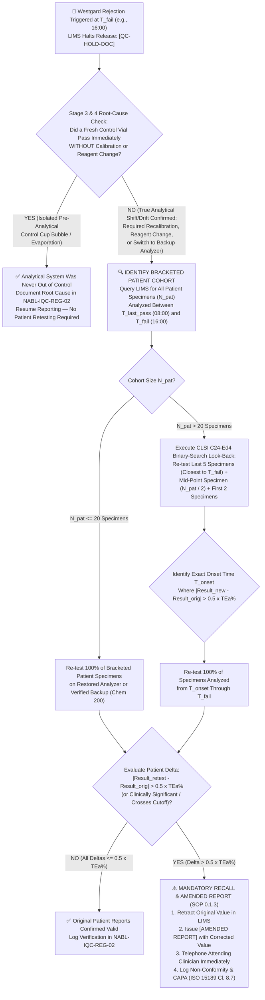

# ⚙️ 0.1.6 — Hardware-Agnostic SOP Governance, Risk-Based Westgard Six-Sigma IQC (`CLSI C24-Ed4`), Patient-Based Real-Time QC (`PBRTQC`), Calibration & Multi-Instrument Comparability (`CLSI EP31-A-IR` / `EP09c-Ed3`)

**Department Folder:** `00_Universal_NABL_Legal_Framework`  
**Cluster Folder:** `0.1_Universal_Medico_Legal_Shield_and_NABL_Footers`  
**File ID:** `0.1.6_Hardware_Agnostic_SOP_Westgard_Sigma_QC_and_Backup_Comparability.md`  

---

## 🏛️ Section 0: International Document Control, 9-Persona Red-Team Governance & Hardware-Agnostic Decoupled Architecture

### 0.1 Master Document Control & Regulatory Traceability Block (`ISO 15189:2022 Cl. 8.3.2`)

| Governance Attribute | Specification / Normative Reference Standard |
| :--- | :--- |
| **Document Control ID** | `SOP-GOV-0.1.6` (Version `3.0` — International Reference Laboratory & Above-NABL Tier) |
| **Document Lifecycle & Authorization (`ISO 15189 Cl. 8.3.2`)** | **Effective Date:** `2026-10-11` / **Review Cycle:** `Annual (or upon analyzer/method/lot architectural change)` / **Prepared By:** `Lead Quality Manager & Six-Sigma Metrology Specialist` / **Reviewed By:** `Head of Clinical Biochemistry & Hematopathology` / **Approved By:** `Laboratory Director & Chief Consultant Pathologist (MD Pathology)` / **Controlled Status:** `Master Electronic Controlled Copy — Uncontrolled When Printed Unless Stamped in Red Ink` |
| **ISO 15189:2022 Clause Traceability** | **Clauses 5.5** (*Quality Objectives & Six-Sigma Indicators*), **6.4** (*Equipment Qualification, Preventive Maintenance & Out-of-Service Control*), **6.5** (*Equipment Calibration & Metrological Traceability*), **6.6** (*Reagents & Consumables — Lot-to-Lot Verification*), **7.3.7.1** (*Ensuring the Validity of Examination Results — General*), **7.3.7.2** (*Internal Quality Control — IQC*), **7.3.7.3** (*External Quality Assessment — EQAS/PT*), **7.3.7.4** (*Comparability of Examination Results*), **7.4.1.8** (*Amended Reports & Clinical Notification*), **8.5** (*Actions to Address Risks & Opportunities*), **8.7** (*Nonconformities & Corrective Actions*), **Normative Annex A** (*Point-of-Care Testing — POCT*) |
| **NABL Specific Regulatory Alignment** | **NABL 112** (*Specific Criteria for Accreditation of Medical Laboratories*), **NABL 153** (*Scope of Accreditation Matrix*), **NABL 220D & NABL 223** (*Assessment Checklists & Vertical Witness Audit Protocols*), **NABL 131** (*Terms & Conditions for Obtaining and Maintaining NABL Accreditation*), **NABL 163** (*Policy on Participation in EQAS/PT*) |
| **CLSI, IFCC & EFLM Metrological Standards** | **CLSI C24-Ed4** (*Statistical Quality Control for Quantitative Measurement Procedures: Principles and Definitions*), **CLSI EP31-A-IR** (*Verification of Comparability of Patient Results Within One Health Care System*), **CLSI EP09c-Ed3** (*Measurement Procedure Comparison and Bias Estimation Using Patient Samples*), **CLSI EP15-A3** (*User Verification of Precision and Estimation of Bias*), **CLSI EP26-Ed2** (*User Evaluation of Between-Reagent Lot Variation*), **ISO 17511:2020** (*Metrological Traceability of Values Assigned to Calibrators, Trueness Control Materials and Human Samples*), **ISO/TS 20914:2019** (*Measurement Uncertainty in Medical Laboratories*), **EFLM Milan Hierarchy (2014/2024)** (*Biological Variation & Total Allowable Error Specifications*) |
| **Primary Automated Analyzer Fleet** | **1. Hematology & Integrated ESR:** `Nihon Kohden MEK-1503` (Electrical Impedance, Cyanide-Free SLS-Hb, Optical/Volumetric CBC + CiRHEX Automated ESR)<br>**2. Clinical Biochemistry & ISE:** `Bonavera Chem 400` (High-Throughput Discrete Random-Access Spectrophotometry & Direct/Indirect Ion-Selective Electrode Module)<br>**3. Immunoassay:** `Snibe MAGLUMI X3` (ABEI Direct Flash Chemiluminescence Immunoassay [`Flash-CLIA`] with Magnetic Microbeads) |
| **Backup, Redundant & POCT Fleet** | **1. Parallel Biochemistry & ISE Backup:** `Bonavera Chem 200` (Identical Optical/Enzymatic Method Principle & ISE Module)<br>**2. Hematology & ESR Backup / Reference:** Calibrated Manual Leishman-Giemsa Peripheral Blood Smear (`PBS`) Differential, Improved Neubauer Hemocytometer (`WBC/PLT`), Microhematocrit / Cyanmethemoglobin Backup, & Modified Westergren ESR Rack<br>**3. Immunoassay Backup:** Validated Secondary Kit Lot on `MAGLUMI X3` / Calibrated Microplate Reader (`ELISA`) / MOU-bound NABL-Accredited (`ISO 15189:2022`) Reference Laboratory<br>**4. Point-of-Care Testing (`POCT`):** Hospital Ward/Emergency Capillary Glucometers (`GDH-FAD / Hexokinase-calibrated`) & Blood Gas/Electrolyte Cartridges (`ISO 15189 Annex A`) |
| **Hardware-Agnostic Upgrade Architecture** | **Decoupled Two-Tier SOP Design:** Core clinical SOPs (`298` controlled files across `25` subspecialty clusters) anchor strictly to universal international chemical/immunological/optical reaction principles (`IFCC`, `ICSH`, `CLSI`). Instrument-specific fluidics, sample/reagent ratios, and calibration factors reside in modular Section 1 hardware matrices, enabling 60-second plug-and-play hardware upgrades under `ISO 15189 Cl. 6.4` Change Control without rewriting clinical pathophysiology or decision cutoffs. |

---

### 0.2 The 9-Persona International & Above-NABL Red-Team Review Panel

Every specification, mathematical formula, troubleshooting decision tree, and Level-4 bench register in this SOP has been stress-tested and verified by our **9-Persona Adversarial Review Panel**:

| Persona ID | Adversarial Auditor Role & Credential Tier | Primary Audit Mandate & Hardening Contribution in `SOP-GOV-0.1.6` |
| :--- | :--- | :--- |
| **Persona 1** | **Lead NABL (`ISO 15189:2022` / `NABL 112 / 220D / 223`) & CAP / UKAS Assessor** | Enforces clause-by-clause traceability to `ISO 15189:2022 Cl. 7.3.7.2` (IQC), `7.3.7.3` (EQAS), and `7.3.7.4` (Comparability); simulates hostile vertical witness audit inquiries; verifies tamper-proof LIMS QC trails and Level-4 registers. |
| **Persona 2** | **Department-Specific Clinical Subspecialty Consultant (`MD Pathology / Biochemistry / Hematopathology / Endocrinology`)** | Aligns QC concentrations to critical clinical decision limits (e.g., Neonatal Hypoglycemia $45\text{ mg/dL}$, Hyperkalemia $6.0\text{ mmol/L}$, Troponin 99th URL, TSH subclinical thresholds, Thrombocytopenia transfusion trigger $10\text{–}20 \times 10^3/\mu\text{L}$). |
| **Persona 3** | **CLSI & IFCC Metrology, Method Verification & Measurement Uncertainty (`ISO/TS 20914`) Specialist** | Harmonizes `CLSI EP15-A3` precision/bias verification, `ISO 17511:2020` calibration hierarchy, `CLSI EP26-Ed2` lot-to-lot reagent crossover, and integrates rolling intermediate precision ($u_{\text{rw}}$) directly into quarterly Measurement Uncertainty ($U = 2 \times \sqrt{u_{\text{cal}}^2 + u_{\text{bias}}^2 + u_{\text{rw}}^2}$). |
| **Persona 4** | **Clinical Pharmacologist & Pre-Analytical Matrix Interference Auditor** | Protects IQC & comparability runs from matrix effects: distinguishes lyophilized non-commutable control shifts across reagent lots from true patient bias; prevents open-vial alkaline/photolytic degradation (`CO2`, `Bilirubin`, `ALP`, `PTH`, `ACTH`) and patient drug interferences (`Biotin`, `Dobutamine`, `Metamizole`, `Lipemia/Hemolysis`) during split-sample comparability studies. |
| **Persona 5** | **Medico-Legal, Patient-Safety & `ISO 22367:2020` Risk Management Counsel** | Enforces strict prohibition of "Control Shopping" (repeating out-of-control QC without intervention); mandates bracketed patient look-back recall and `[AMENDED REPORT]` issuance under `CPA 2019` and `ISO 15189 Cl. 7.4.1.8`; architects quantitative `FMECA` with LIMS hard-locks. |
| **Persona 6** | **Uncompressed Documentation & Turnkey Bench Readability Architect** | Eliminates ambiguous generalizations; provides step-by-step mathematical proofs, worked calculations, binary-search patient look-back workflows, and 4 pre-filled print-ready Level-4 NABL registers. |
| **Persona 7** | **`CLSI C24-Ed4` & `Westgard Sigma-Metric` Statistical Quality Control (`IQC`) & Power-Function ($P_{\text{ed}} \ge 0.90, P_{\text{fr}} \le 0.05$) Strategist** | Proves mathematically why manufacturer package-insert QC ranges fail; designs the 20-day in-house $\bar{x}$ and $s_{\text{lab}}$ crossover protocol; maps exact Westgard Sigma Rules, Quality Goal Index ($\text{QGI}$), and Critical Systematic Error ($\Delta\text{SE}_{\text{crit}}$) to power-function curves. |
| **Persona 8** | **`CLSI EP31-A-IR` & `CLSI EP09c-Ed3` Multi-Instrument Comparability (`Bonavera Chem 400` vs `Chem 200`, Analyzer vs Manual/POCT) & Passing-Bablok Regression Specialist** | Designs weekly 5-sample split verification ($\lvert\text{Bias}\%\rvert \le 0.5 \times \text{TEa}\%$ or $\le 0.33 \times \text{TEa}\%$ for electrolytes) and semiannual 20-to-40 sample non-parametric Passing-Bablok & Bland-Altman regression with slope/intercept harmonization protocols. |
| **Persona 9** | **`CLSI C24-Ed4` Moving-Average Patient-Based Real-Time Quality Control (`PBRTQC` / Bull's Algorithm $\text{XB}$) & Bracketed Patient Look-Back Engineer** | Implements continuous inter-QC monitoring between scheduled liquid IQC runs using Bull's Moving Average ($\text{XB}$, batch $N=20$) on `Nihon Kohden MEK-1503` (`MCV`, `MCH`, `MCHC`) and truncated Exponentially Weighted Moving Averages (`EWMA`) on `Bonavera Chem 400` (`Na+`, `K+`, `Ca2+`, `Creatinine`), plus exact bracketed patient re-testing mathematics. |

---

### 0.3 Pre-Analytical Control Material Handling, Reconstitution, Aliquoting & Thermal Stability Matrix (`CLSI C24-Ed4 Cl. 6.3`)

> [!IMPORTANT]
> **Why >70% of Apparent "Out-of-Control" IQC Flags Are Pre-Analytical Artifacts:** Lyophilized chemistry, coagulation, or immunoassay controls reconstituted with uncalibrated pipettes, non-Type-I water, insufficient equilibration, or thawed in a $37^\circ\text{C}$ water bath generate artificial concentration shifts ("false rejections", inflating $P_{\text{fr}}$) and corrupt cumulative $CV_A\%$ calculations used for Six-Sigma scoring and Measurement Uncertainty (`ISO/TS 20914`).

| Control / Calibrator Material Tier | Mandatory Reconstitution, Thermal Equilibration & Mixing SOP | Storage, Aliquoting & Open-Vial Stability Matrix | Analytes Most Vulnerable to Pre-Analytical Control Drift |
| :--- | :--- | :--- | :--- |
| **1. Tri-Level Whole-Blood Hematology Control (`MEK-1503`: Low / Abnormal-1, Normal, High / Abnormal-2)** | 1. Remove vials from $2\text{–}8^\circ\text{C}$ cold storage.<br>2. Stand at controlled room temperature ($18\text{–}25^\circ\text{C}$) for exactly **$15\text{ minutes}$** (cold viscosity alters impedance aperture flow and CiRHEX ESR erythrocyte aggregation kinetics).<br>3. Roll vial gently between palms for $20\text{ seconds}$ upright, invert $8\text{–}10\times$ vertically, and repeat palm-rolling for $20\text{ seconds}$ until red cell button is $100\%$ homogeneously resuspended.<br>4. **STRICT PROHIBITION:** Never place whole-blood controls on a mechanical vortex mixer or violent rocker (causes mechanical hemolysis, pseudothrombocytosis from RBC fragments, and false low `RBC`/`HCT`/`MCV`). | **Unopened:** $2\text{–}8^\circ\text{C}$ until manufacturer expiry (never freeze!).<br>**Opened Vial:** Strictly **$14\text{ days}$ at $2\text{–}8^\circ\text{C}$**. Wipe septum/cap rim with lint-free gauze moistened with isotonic saline (never alcohol, which lyses cells!) before and after each sampling. Return to $2\text{–}8^\circ\text{C}$ within $< 10\text{ min}$ of aspiration. | **High Vulnerability:**<br>• `PLT` (micro-clumping or RBC fragment interference if over-agitated)<br>• `MCV` & `MCHC` (osmotic swelling as control ages past day 14)<br>• `WBC` 3-part/5-part differential flags (`LYM/MO/GR` membrane shrinkage)<br>• `ESR` (rouleaux kinetics altered if run cold at $< 18^\circ\text{C}$) |
| **2. Lyophilized Assayed Chemistry & ISE Controls (`Bonavera Chem 400 / Chem 200`: Level-1 Normal & Level-2 Pathological)** | 1. Remove lyophilized amber glass vial from $2\text{–}8^\circ\text{C}$ and equilibrate to $20\text{–}25^\circ\text{C}$ for $10\text{ min}$.<br>2. Tap vial gently on benchtop to dislodge any lyophilized cake particles adhering to the rubber stopper.<br>3. Using a **quarterly gravimetrically calibrated Class-A volumetric pipette or ISO 8655-calibrated positive-displacement micropipette**, dispense exactly $5.00\text{ mL}$ (or manufacturer-specified volume $\pm 0.5\%$) of **Fresh CLSI Type-I Reagent Grade Water** ($\text{Resistivity} \ge 10\text{ M}\Omega\cdot\text{cm}$, $\text{TOC} < 50\text{ ppb}$, $\text{pCO}_2$-equilibrated).<br>4. Replace stopper, swirl gently (never shake to foam), and allow to stand in the dark for **$20\text{ minutes}$**, inverting gently $5\times$ during the final $2\text{ minutes}$ to ensure complete dissolution of cryoprotectants and lipid complexes. | **Aliquoting Protocol:** Immediately post-reconstitution, dispense **$300\text{ }\mu\text{L}$ single-use aliquots** into amber/opaque polypropylene low-binding microcentrifuge tubes with O-ring screw caps, label with Lot #, Level, Reconstitution Date, and Expiry, and freeze at **$-20^\circ\text{C}$ to $-25^\circ\text{C}$ (non-frost-free freezer)** for up to **$30\text{ days}$**.<br>**Daily Thaw Rule:** Thaw 1 aliquot per level at room temperature ($20\text{–}25^\circ\text{C}$) in the dark for $15\text{ min}$, invert $5\times$, centrifuge briefly ($1,000\times g$ for $30\text{ sec}$) only if micro-bubbles are visible, and load. **Discard after single shift use — NEVER refreeze a thawed aliquot!** | **High Vulnerability:**<br>• **`Bilirubin (Total & Direct)`:** Photodegradation of $1\text{–}3\%/\text{hr}$ under fluorescent bench light $\rightarrow$ false negative $2_{2s} / 4_{1s}$ drift.<br>• **`Alkaline Phosphatase (ALP)`:** Post-reconstitution enzymatic reactivation causes $+5\text{ to }+12\%$ upward rise over the first $4\text{–}6\text{ hours}$ at $25^\circ\text{C}$ if not equilibrated consistently!<br>• **`Bicarbonate / Total CO2`:** Rapid gaseous $\text{CO}_2$ loss into headspace of uncapped cups $\rightarrow$ false low shift.<br>• **`Glucose` & `Electrolytes (Na+, K+, Cl-)`:** Evaporation concentration ($+2\text{ to }+4\%/\text{hr}$) in open Hitachi/micro-cups on analyzer carousel. |
| **3. Liquid-Stable & Lyophilized Multi-Analyte Immunoassay Controls (`Snibe MAGLUMI X3`: Levels 1, 2, 3)** | 1. For liquid-stable controls: equilibrate at $18\text{–}25^\circ\text{C}$ for $15\text{ min}$ and mix by gentle figure-of-eight inversion ($10\times$).<br>2. For lyophilized peptide/hormone controls (`PTH`, `ACTH`, `Insulin`, `C-Peptide`, `Troponin I`, `NT-proBNP`): reconstitute with exact kit diluent/Type-I water, stand $15\text{ min}$ at $18\text{–}25^\circ\text{C}$, swirl without creating surface micro-foam.<br>3. **CRITICAL FLASH-CLIA SAFEGUARD:** Surface foam or micro-bubbles trigger premature capacitance liquid-level sensing (`LLS`) on `MAGLUMI X3` sample needles, resulting in short-aspiration ("air-shot") and catastrophic false-low $1_{3s}$ violations! Pop any surface bubble with a clean disposable plastic pipette tip before loading. | **Liquid Open-Vial:** $2\text{–}8^\circ\text{C}$ for $14\text{–}30\text{ days}$ strictly per kit IFU.<br>**Reconstituted Labile Peptide Controls (`PTH`, `ACTH`, `Insulin`, `Troponin I`):** Aliquot $250\text{ }\mu\text{L}$ into low-protein-binding polypropylene vials at **$-20^\circ\text{C}$** (stable $30\text{ days}$, single thaw).<br>**Onboard Rule:** Never leave control vials uncapped on `MAGLUMI X3` sample tracks for $> 15\text{ minutes}$; cap immediately after aspiration completes. | **High Vulnerability:**<br>• **`Troponin I`, `PTH`, `ACTH`, `Insulin`:** Rapid proteolytic cleavage and glass-wall adsorption (never use glass tubes!).<br>• **`Free T4 (FT4)` & `Free T3 (FT3)`:** Temperature-sensitive equilibrium with binding proteins if control is aspirated while cold ($< 15^\circ\text{C}$).<br>• **`25-OH Vitamin D` & `Vitamin B12`:** Light sensitivity and evaporation drift. |

---

### 0.4 Mandatory Calibration Governance (`ISO 15189:2022 Cl. 6.5` & `ISO 17511:2020`) & Lot-to-Lot Reagent Crossover (`CLSI EP26-Ed2`)

1. **Higher-Order Metrological Traceability (`ISO 17511:2020`):**
   - Every calibrator deployed on `Bonavera Chem 400`, `Bonavera Chem 200`, `Nihon Kohden MEK-1503`, and `Snibe MAGLUMI X3` must possess an unbroken, documented chain of metrological traceability to higher-order International Reference Materials (`NIST SRM`, `IFCC Primary Reference Measurement Procedures`, `WHO NIBSC International Standards`, `ICSH Hemiglobincyanide Reference Standard`) accompanied by a vendor Certificate of Analysis (`CoA`) stating the assigned value and expanded combined calibration uncertainty ($U_{\text{cal}}, k=2$).
2. **Strict Policy on Theoretical vs. Calibrated K-Factors (`Bonavera Chem 400 / 200`):**
   - Even for NADH/NADPH kinetic enzymatic assays (`ALT`, `AST`, `LDH`, `CK`, `ALP`, `GGT`) that have a theoretical molar absorptivity ($\varepsilon_{340\text{nm}} = 6,300\text{ L}\cdot\text{mol}^{-1}\cdot\text{cm}^{-1}$ for NADH; $\varepsilon_{405\text{nm}} = 18,450\text{ L}\cdot\text{mol}^{-1}\cdot\text{cm}^{-1}$ for $p$-nitrophenol), optical pathlength tolerances, filter half-bandwidth, and temperature micro-gradients require **mandatory calibration using a traceable multi-enzyme serum calibrator** (`ISO 17511`). Unverified theoretical K-factors are prohibited unless validated within $\pm 3\%$ of a certified enzyme calibrator and locked by the Quality Manager.
3. **The 7 Mandatory Recalibration Triggers (`ISO 15189:2022 Clause 6.5`):**
   - **Trigger 1 (Reagent Lot Change):** Every change in reagent lot number requires either full recalibration or documented `CLSI EP26-Ed2` lot-to-lot verification confirming bias $\le 0.33 \times \text{TEa}\%$.
   - **Trigger 2 (Scheduled Calibration Stability Expiry):** Upon reaching the validated on-board/lot calibration interval ($24\text{ hours}$ for `ISE` 2-point slope calibration; $7\text{–}14\text{ days}$ for kinetic/colorimetric assays; $14\text{–}28\text{ days}$ for `MAGLUMI X3` 2-point master-curve recalibration).
   - **Trigger 3 (Unresolved IQC Westgard Violation):** When a fresh control aliquot repeats a Westgard rejection violation ($1_{3s}, 2_{2s}, 4_{1s}, 8_x$) after pre-analytical and reagent checks.
   - **Trigger 4 (Post-Maintenance / Critical Hardware Intervention):** Immediately following replacement or servicing of halogen/LED light source, reaction cuvettes, sample/reagent metering syringes, probes, peristaltic pump tubing, ISE internal reference/sensing electrodes, or `MAGLUMI X3` PMT/wash station.
   - **Trigger 5 (Cumulative L-J Drift or PBRTQC Alarm):** When the rolling 20-day IQC mean shifts by $> 1.0 \times s_{\text{lab}}$ or when Patient Moving Average (`PBRTQC` / Bull's $\text{XB}$) crosses upper/lower warning limits.
   - **Trigger 6 (EQAS / PT Bias Signal):** When monthly EQAS returns a warning ($\lvert Z \rvert > 2.0$) or action signal ($\lvert Z \rvert \ge 3.0$) attributable to calibration bias, or when Quality Goal Index ($\text{QGI}$) exceeds $1.2$.
   - **Trigger 7 (Reagent Blank / Calibration Factor Drift):** If the water/reagent blank absorbance exceeds manufacturer limits or if a newly calibrated `K-factor` (or `MAGLUMI X3` RLU ratio) deviates by **$> \pm 10\%$** from the previous historical calibration factor (which triggers an immediate halt to investigate degraded calibrator or reagent!).
4. **Lot-to-Lot Reagent Crossover Verification (`CLSI EP26-Ed2` & `ISO 15189:2022 Clause 6.6.3`):**
   - **Critical Matrix-Effect Warning:** Non-commutable lyophilized QC materials frequently exhibit a **$5\text{–}12\%$ artificial shift** when switching between two reagent lots due to non-human matrix/surfactant interactions, even when true native human patient samples show $0.0\%$ shift!
   - **Mandatory Protocol:** Before placing a new reagent lot into routine service, analyze **3 to 5 native human patient samples** (spanning low, normal, and high pathological concentrations) plus Level-1 and Level-2 QC in parallel on the **Existing Reagent Lot ($R_{\text{old}}$)** and the **New Reagent Lot ($R_{\text{new}}$)**.
   - **Acceptance Criterion:** The mean difference across native patient samples must satisfy $\lvert\text{Bias}_{\text{patient}}\%\rvert \le 0.33 \times \text{TEa}\%$ (or $\le 0.5 \times \text{TEa}\%$ for complex immunoassays). If native patient samples pass ($\le 0.33 \times \text{TEa}\%$) while lyophilized IQC shifts by $> 1.0 \times s_{\text{lab}}$, adjust the IQC target mean ($\bar{x}_{\text{new}}$) by the exact measured non-commutable matrix offset while retaining the established in-house standard deviation ($s_{\text{lab}}$)!

---

## 📊 Section 1: Risk-Based Internal Quality Control (`IQC`) Design, In-House Mean/SD Establishment ($N \ge 20$ Days), and Sigma-Stratified Westgard Rule Selection (`CLSI C24-Ed4`)

### 1.1 Strict Prohibition of Using Manufacturer Package-Insert QC Ranges — Mathematical & Metrological Proof

> [!CAUTION]
> **NABL / CAP Critical Non-Conformity Alert (`ISO 15189:2022 Cl. 7.3.7.2` & `CLSI C24-Ed4 Cl. 5.3`):** Configuring analyzer Levey-Jennings (`L-J`) charts using the manufacturer's printed package-insert target range ($\text{Mean} \pm 2\text{ SD}$ or $\pm 3\text{ SD}$) as the routine laboratory acceptance limit is **strictly prohibited** beyond the initial 5-to-20 day lot-in-use crossover period.

#### Mathematical Proof of Why Manufacturer Insert Ranges Fail to Detect Clinical Error:
1. **Decomposition of Variance in Manufacturer Package Inserts:**
   A commercial control manufacturer determines the printed package-insert Standard Deviation ($s_{\text{insert}}$) by pooling results from $k = 50\text{ to }500$ external laboratories operating different instruments, different reagent lots, different calibrator lots, and different environmental conditions. By the law of total variance:
   $$s_{\text{insert}}^2 = s_{\text{within-lab (rw)}}^2 + s_{\text{between-instrument}}^2 + s_{\text{between-reagent-lot}}^2 + s_{\text{between-calibrator}}^2$$
   Because between-laboratory and between-lot variances dominate, the manufacturer's published $s_{\text{insert}}$ is typically **$2.0\times \text{ to } 3.5\times$ larger** than the true intermediate within-laboratory standard deviation ($s_{\text{lab}}$) of a single well-maintained analyzer (`Bonavera Chem 400`, `MEK-1503`, or `MAGLUMI X3`):
   $$s_{\text{insert}} \approx 2.5 \times s_{\text{lab}} \implies \pm 2\,s_{\text{insert}} \approx \pm 5.0\,s_{\text{lab}} \quad \text{and} \quad \pm 3\,s_{\text{insert}} \approx \pm 7.5\,s_{\text{lab}}$$
2. **Concrete Numerical Proof (Serum Creatinine on `Bonavera Chem 400`):**
   - Suppose Level-1 Normal Control has an assigned mean $\bar{x} = 1.00\text{ mg/dL}$, and our laboratory's true analytical intermediate precision is $\text{CV}_A = 2.5\%$ ($s_{\text{lab}} = 0.025\text{ mg/dL}$). Thus, the true in-house $\pm 2\,s_{\text{lab}}$ interval is **$0.95\text{–}1.05\text{ mg/dL}$** and $\pm 3\,s_{\text{lab}}$ is **$0.925\text{–}1.075\text{ mg/dL}$**.
   - However, the manufacturer's package insert prints a $\pm 3\,s_{\text{insert}}$ acceptable range of **$0.80\text{–}1.20\text{ mg/dL}$** ($\pm 20\%$, where $s_{\text{insert}} = 0.067\text{ mg/dL} = 2.68 \times s_{\text{lab}}$).
   - If a degraded calibrator or partially occluded reagent probe introduces a **catastrophic $+15\%$ systematic shift** (true $1.00\text{ mg/dL}$ patient sample now reports as $1.15\text{ mg/dL}$, exceeding the CLIA/EFLM $\text{TEa}$ of $8\text{–}10\%$ and misclassifying CKD Stage 2 patients as Stage 3a!), the shifted control reads **$1.15\text{ mg/dL}$**.
   - On the **In-House L-J Chart** ($s_{\text{lab}} = 0.025\text{ mg/dL}$), $1.15\text{ mg/dL}$ represents a **$+6.0\,s_{\text{lab}}$ shift** ($Z = \frac{1.15 - 1.00}{0.025} = +6.0$), triggering an immediate **$1_{3s}$ rejection with $P_{\text{ed}} > 99.9\%$ on the very first run!**
   - Conversely, on a **Manufacturer Package-Insert Chart** ($s_{\text{insert}} = 0.067\text{ mg/dL}$), $1.15\text{ mg/dL}$ appears as a harmless **$+2.24\,s_{\text{insert}}$ point** well inside the $\pm 3\,s_{\text{insert}}$ boundary ($0.80\text{–}1.20\text{ mg/dL}$)! The Probability of Error Detection ($P_{\text{ed}}$) for a $1_{3s}$ rule collapses from **$99.9\%$ to $< 7\%$**, allowing hundreds of erroneous patient reports to be released undetected!

---

### 1.2 The `CLSI C24-Ed4` 20-Day Cross-Over Protocol for Establishing In-House Mean ($\bar{x}_{\text{lab}}$) & Standard Deviation ($s_{\text{lab}}$)

Whenever a new control lot is introduced, the laboratory must execute the following **3-Phase Crossover & Cumulative Locking Protocol**:

| Phase & Timeline | Operational & Statistical Procedure (`CLSI C24-Ed4 Clauses 5.3 – 5.5`) | Exact Mathematical Equations & Outlier Screening Criteria |
| :--- | :--- | :--- |
| **Phase 1: Parallel Lot Crossover ($N \ge 20$ Data Points Over $10\text{–}20\text{ Days}$ Before Old Lot Expires)** | 1. Initiate crossover at least **$20\text{ operating days}$** before the current control lot ($L_{\text{old}}$) expires.<br>2. Analyze the **New Control Lot ($L_{\text{new}}$)** once daily (or twice daily across independent shifts/calibrations over $\ge 10\text{ days}$) strictly in parallel with the currently validated $L_{\text{old}}$ on runs where $L_{\text{old}}$ passes all Westgard rules.<br>3. This captures real-world intermediate precision sources (`ISO/TS 20914`): multiple operators, daily ISE/reagent calibrations, ambient thermal fluctuations, and preventive maintenance cycles. | **Sample Mean ($\bar{x}_{20}$):**<br>$$\bar{x}_{20} = \frac{1}{n}\sum_{i=1}^{n} x_i \quad (n \ge 20)$$<br>**Intermediate Precision Standard Deviation ($s_{20}$):**<br>$$s_{20} = \sqrt{\frac{\sum_{i=1}^{n}(x_i - \bar{x}_{20})^2}{n - 1}}$$<br>**Analytical Coefficient of Variation ($\text{CV}_A\%$):**<br>$$\text{CV}_A\% = \left(\frac{s_{20}}{\bar{x}_{20}}\right) \times 100$$ |
| **Phase 1B: Emergency Provisional 5-Day Bridge Protocol (Only When Unforeseen Lot Exhaustion Occurs)** | If an unscheduled shipment delay prevents a full 20-day crossover before $L_{\text{old}}$ is exhausted (`CLSI C24-Ed4 Cl. 5.3.2`):<br>1. Analyze $L_{\text{new}}$ in **$N = 5$ independent runs** over $2\text{–}5\text{ days}$ alongside $L_{\text{old}}$ (verify that the 5-point average $\bar{x}_5$ lies within the manufacturer's peer-group target range).<br>2. **NEVER use the 5-point $s_5$** (which has only $\nu = 4$ degrees of freedom and a $\pm 60\%$ confidence interval uncertainty!).<br>3. Instead, assign the **Provisional Mean = $\bar{x}_5$** and compute the **Provisional Standard Deviation ($s_{\text{prov}}$)** using the laboratory's **historical cumulative $\text{CV}_{\text{hist}}\%$** from the previous 3–6 months on the old lot:<br>$$s_{\text{prov}} = \bar{x}_5 \times \left(\frac{\text{CV}_{\text{hist}}\%}{100}\right)$$<br>4. Replace $\bar{x}_5$ and $s_{\text{prov}}$ as soon as $N = 20$ routine days are completed. | **Degrees of Freedom Protection:**<br>Using historical $\text{CV}_{\text{hist}}\%$ ($N \ge 90\text{–}180$ points) preserves $\nu > 90$ degrees of freedom for the SD estimate while anchoring the mean to the new lot's matrix ($\bar{x}_5$). |
| **Phase 2: Statistical Outlier Rejection (`Grubbs' Single-Outlier Test` at $\alpha = 0.01$)** | Before locking $\bar{x}_{20}$ and $s_{20}$, inspect the 20 crossover points for aberrant blips. Perform **Grubbs' Extreme Studentized Deviate (`ESD`) Test**:<br>1. Calculate $G_{\text{calc}}$ for the most extreme observation $x_{\text{ext}}$.<br>2. Compare $G_{\text{calc}}$ against the two-sided critical value **$G_{\text{crit}}(\alpha=0.01, n=20) = 2.884$** (or $G_{\text{crit}}(\alpha=0.05, n=20) = 2.709$).<br>3. **Strict Rule:** At most **1 outlier per 20 data points** may be rejected if $G_{\text{calc}} > G_{\text{crit}}$, and a replacement 21st point must be collected. If $\ge 2$ points exceed $G_{\text{crit}}$, the analytical system is unstable — investigate root cause before locking QC limits! | **Grubbs' Statistic ($G_{\text{calc}}$):**<br>$$G_{\text{calc}} = \frac{\max_{i} \lvert x_i - \bar{x}_{20} \rvert}{s_{20}}$$<br>If $G_{\text{calc}} > 2.884$ ($n=20$), exclude $x_{\text{ext}}$, append $x_{21}$, and recalculate $\bar{x}_{20}$ and $s_{20}$. |
| **Phase 3: Cumulative Rolling Update ($N_{\text{cum}} = 60\text{–}90$ Points Over $3\text{ Months}$)** | Because a 20-point SD estimate ($s_{20}$, $\nu = 19$) still carries up to $\pm 25\text{–}30\%$ sampling variability across long-term reagent/calibrator cycles (`CLSI C24-Ed4 Cl. 5.4`):<br>1. At the end of **Month 3 ($N_{\text{cum}} = 60\text{ to }90$ points)**, pool the initial 20 points with the subsequent 40–70 accepted daily QC points.<br>2. Verify homogeneity of variance across months using the **F-test** ($F = s_{\text{month 3}}^2 / s_{\text{month 1}}^2 \le F_{\text{crit}}$) and lock the **Long-Term Cumulative Mean ($\bar{x}_{\text{cum}}$) and Cumulative Standard Deviation ($s_{\text{cum}}$)** in the LIMS.<br>3. Review $\bar{x}_{\text{cum}}$ and $s_{\text{cum}}$ monthly; update quarterly Measurement Uncertainty ($u_{\text{rw}} = s_{\text{cum}}$) per `ISO/TS 20914:2019`. | **Pooled Cumulative SD ($s_{\text{cum}}$ across $k$ months):**<br>$$s_{\text{cum}} = \sqrt{\frac{\sum_{j=1}^{k} (n_j - 1) s_j^2}{\sum_{j=1}^{k} (n_j - 1)}}$$<br>**95% Confidence Interval of True $\sigma_{\text{rw}}$ at $N = 90$ ($\nu = 89$):**<br>$$0.87\,s_{\text{cum}} \le \sigma_{\text{true}} \le 1.17\,s_{\text{cum}}$$ |

---

### 1.3 Six-Sigma Metrology ($\sigma$), Critical Systematic Error ($\Delta\text{SE}_{\text{crit}}$), Quality Goal Index ($\text{QGI}$), and Westgard Sigma Rule Selection Matrix

Every quarter (and whenever a new reagent/control lot is locked), the Quality Manager calculates four core metrological indices for each analyte at each clinically relevant control level:

#### 1. The Exact Six-Sigma Metric Equation ($\sigma$):
$$\mathbf{\sigma = \frac{\text{TEa}\% - \lvert\text{Bias}\%\rvert}{\text{CV}_A\%}}$$
Where:
- **$\text{TEa}\%$ (Total Allowable Error):** Selected strictly according to the **2014/2024 EFLM Milan Consensus Hierarchy**:
  - *Model 1:* Clinical outcome studies (e.g., $\text{HbA1c}$, Lipid NCEP ATP-III, Troponin, Glucose).
  - *Model 2:* EFLM European Biological Variation Database (`EuBIVAS`) desirable or minimum specification: $\text{TEa}\% = 1.65 \times (0.50 \times \text{CV}_I) + 0.250 \times \sqrt{\text{CV}_I^2 + \text{CV}_G^2}$ (or minimum $1.65 \times 0.75\text{CV}_I + 0.375\sqrt{\text{CV}_I^2 + \text{CV}_G^2}$ for tight electrolytes).
  - *Model 3:* State-of-the-art regulatory/EQAS limits (`CLIA 2024 Final Rule`, `RCPA`, `Rili-BÄK`, `CMC Vellore / Bio-Rad EQAS`).
- **$\lvert\text{Bias}\%\rvert$ (Analytical Trueness / Systematic Error):** Determined from the root-mean-square or mean percentage bias across the most recent 3–6 monthly **External Quality Assurance (`EQAS / PT`)** peer-group evaluations (or against a certified reference material / peer consensus mean $\mu_{\text{peer}}$):
  $$\lvert\text{Bias}\%\rvert = \left\lvert \frac{\bar{x}_{\text{lab}} - \mu_{\text{peer}}}{\mu_{\text{peer}}} \right\rvert \times 100$$
- **$\text{CV}_A\%$ (In-House Analytical Imprecision):** Derived directly from the laboratory's locked cumulative Levey-Jennings control data ($N \ge 20\text{–}90$ points):
  $$\text{CV}_A\% = \left(\frac{s_{\text{lab}}}{\bar{x}_{\text{lab}}}\right) \times 100$$

#### 2. Critical Systematic Error ($\Delta\text{SE}_{\text{crit}}$) & Critical Random Error ($\Delta\text{RE}_{\text{crit}}$) for Power-Function Curves:
To ensure that at most $5\%$ of patient results exceed $\text{TEa}$ ($z = 1.65$ one-sided normal deviate), the size of the medically critical systematic shift ($\Delta\text{SE}_{\text{crit}}$, expressed in multiples of $s_{\text{lab}}$) that the IQC rule must detect with **Probability of Error Detection $P_{\text{ed}} \ge 0.90$ ($90\%$)** and **Probability of False Rejection $P_{\text{fr}} \le 0.05$ ($5\%$)** is:
$$\mathbf{\Delta\text{SE}_{\text{crit}} = \frac{\text{TEa}\% - \lvert\text{Bias}\%\rvert}{\text{CV}_A\%} - 1.65 = \sigma - 1.65} \qquad \text{and} \qquad \mathbf{\Delta\text{RE}_{\text{crit}} = \frac{\text{TEa}\% - \lvert\text{Bias}\%\rvert}{1.96 \times \text{CV}_A\%}}$$

#### 3. Parry's Quality Goal Index ($\text{QGI}$) — Diagnostic Root-Cause Indicator for Any Assay with $\sigma < 6.0$:
Whenever an analyte scores $< 6.0\sigma$, the Quality Manager computes the **Quality Goal Index ($\text{QGI}$)** to determine whether the corrective engineering effort must target **Imprecision**, **Bias (Trueness)**, or **Both**:
$$\mathbf{\text{QGI} = \frac{\lvert\text{Bias}\%\rvert}{1.5 \times \text{CV}_A\%}}$$
- **$\text{QGI} < 0.80$:** **Imprecision Dominates** $\rightarrow$ Action: Improve pipetting stability, thermal control ($37.0 \pm 0.1^\circ\text{C}$), reagent blanking, probe washing, or cuvette optical cleanliness.
- **$\text{QGI} > 1.20$:** **Bias (Inaccuracy) Dominates** $\rightarrow$ Action: Recalibrate with fresh traceable master calibrator, verify lot-to-lot factor, check calibrator assignment value, or update slope/intercept offset.
- **$0.80 \le \text{QGI} \le 1.20$:** **Both Imprecision and Bias Contribute** $\rightarrow$ Action: Execute joint fluidic/optical preventive maintenance AND full multi-point recalibration.

---

### 1.4 Master Westgard Six-Sigma Rule Selection & Run-Frequency Matrix (`CLSI C24-Ed4`)

| Sigma Tier & Performance Classification | Calculated $\sigma$ Metric & $\Delta\text{SE}_{\text{crit}}$ | Mandatory Westgard IQC Rejection Rules (`L-J` Chart) | Control Levels ($N$), Daily Run Frequency ($R$) & $P_{\text{ed}} / P_{\text{fr}}$ Power Characteristics | Mandatory Operational & PBRTQC Governance |
| :--- | :--- | :--- | :--- | :--- |
| **Tier 1: World Class ($6\sigma$)** | **$\sigma \ge 6.0$**<br>($\Delta\text{SE}_{\text{crit}} \ge 4.35\,s$) | **$\mathbf{1_{3s}}$** only<br>*(Warning: $1_{2s}$ is disabled for rejection to prevent false alarms!)* | **$N = 2$ Levels** (or $N = 3$ for Hematology), **$R = 1\text{ run/24h shift}$**.<br>• $P_{\text{ed}} \ge 0.98$ ($> 98\%$)<br>• $P_{\text{fr}} = 0.005$ ($0.5\%$) | Maximum analytical robustness. Single $1_{3s}$ rule prevents waste from false rejections while guaranteeing $> 98\%$ detection of any clinically relevant shift. |
| **Tier 2: Excellent ($5\sigma$)** | **$5.0 \le \sigma < 6.0$**<br>($3.35\,s \le \Delta\text{SE}_{\text{crit}} < 4.35\,s$) | **$\mathbf{1_{3s} / 2_{2s} / R_{4s}}$** | **$N = 2$ Levels** (or $N = 3$ for Hematology), **$R = 1\text{ run/24h shift}$** (plus post-calibration).<br>• $P_{\text{ed}} \ge 0.92$ ($> 92\%$)<br>• $P_{\text{fr}} = 0.01\text{–}0.02$ ($1\text{–}2\%$) | $1_{2s}$ serves strictly as a gating trigger to inspect $2_{2s}$ (across 2 levels in the same run or 2 consecutive runs of the same level) and $R_{4s}$ (within-run range $\ge 4\,s$ between Level-1 and Level-2). |
| **Tier 3: Good ($4\sigma$)** | **$4.0 \le \sigma < 5.0$**<br>($2.35\,s \le \Delta\text{SE}_{\text{crit}} < 3.35\,s$) | **$\mathbf{1_{3s} / 2_{2s} / R_{4s} / 4_{1s}}$** | **$N = 2\text{ or }3$ Levels**, **$R = 2\text{ runs/day}$** (Start of Morning Shift + Mid-Day / Afternoon Shift, i.e., every $12\text{ hours}$).<br>• $P_{\text{ed}} \ge 0.90$ ($> 90\%$)<br>• $P_{\text{fr}} = 0.03\text{–}0.04$ ($3\text{–}4\%$) | Addition of the $4_{1s}$ rule (4 consecutive control points across levels or runs exceeding $\pm 1\,s$ on the same side of the mean) provides critical sensitivity to moderate systematic drift ($\approx 2.5\,s$). |
| **Tier 4: Marginal ($3\sigma$)**<br>*(e.g., Tight-Homeostasis Electrolytes: $\text{Na}^+, \text{Cl}^-, \text{Ca}^{2+}$, $\text{MCV}$, $\text{MCHC}$)* | **$3.0 \le \sigma < 4.0$**<br>($1.35\,s \le \Delta\text{SE}_{\text{crit}} < 2.35\,s$) | **$\mathbf{1_{3s} / 2_{2s} / R_{4s} / 4_{1s} / 8_x\text{ (or }10_x)}$** | **$N = 2\text{ or }3$ Levels**, **$R = 2\text{ to }3\text{ runs/day}$** (**Every $8\text{ hours}$** or every $100\text{ patient samples}$).<br>• $P_{\text{ed}} \ge 0.85\text{–}0.90$<br>• $P_{\text{fr}} = 0.04\text{–}0.05$ ($4\text{–}5\%$) | **Mandatory PBRTQC Integration:** Because biological homeostasis keeps $\text{TEa}\%$ ultra-tight ($\text{Na}^+ \pm 4\text{ mmol/L} \approx 2.8\%$; $\text{Ca}^{2+} \pm 1.0\text{ mg/dL}$; $\text{MCHC} \pm 3.5\%$), liquid IQC must be augmented by **continuous Patient Moving Averages (`PBRTQC` / Bull's $\text{XB}$)** every $20$ patient specimens + QGI root-cause optimization. |
| **Tier 5: Unacceptable / High Risk ($< 3\sigma$)** | **$\sigma < 3.0$**<br>($\Delta\text{SE}_{\text{crit}} < 1.35\,s$) | **$\mathbf{1_{2.5s} / 2_{2s} / R_{4s} / 3_{1s} / 6_x\text{ (or }8_x)}$** | **$N = 3$ Levels**, **$R = 3\text{ Runs/Day}$** (**Every $4\text{–}8\text{ hours}$**) + Duplicate Patient Testing at Clinical Decision Cutoffs. | **Mandatory CAPA & Engineering Intervention:** Initiate immediate `ISO 15189 Cl. 8.7` Corrective Action; evaluate $\text{QGI}$; summon vendor field engineer; switch patient workload to backup platform (`Bonavera Chem 200` / Reference Lab) if analytical stability cannot be restored to $\ge 3.0\sigma$. |

#### Mathematical Definitions of Individual Westgard Rules (`CLSI C24-Ed4`):
- **$1_{2s}$ (Warning Gate — NEVER a Standalone Rejection Rule):** One control observation falls outside $\bar{x}_{\text{lab}} \pm 2\,s_{\text{lab}}$ ($2.0 \le \lvert Z \rvert < 3.0$). Under a $N=2$ level run, a standalone $1_{2s}$ rejection rule produces an unacceptable **$P_{\text{fr}} = 1 - (0.9545)^2 = 8.9\%$** ($13.1\%$ for $N=3$ hematology levels!), causing nearly 1 in 8 valid runs to be falsely rejected! Therefore, $1_{2s}$ is strictly a **warning gate** that triggers automated inspection of $2_{2s}, R_{4s}, 4_{1s}$, and $8_x / 10_x$.
- **$1_{3s}$ (Random Error / Acute Large Shift Rejection Rule):** One control observation exceeds $\bar{x}_{\text{lab}} \pm 3\,s_{\text{lab}}$ ($\lvert Z \rvert \ge 3.0$).
- **$1_{2.5s}$ (High-Sensitivity Rejection Rule for $< 3\sigma$ Assays):** One control observation exceeds $\bar{x}_{\text{lab}} \pm 2.5\,s_{\text{lab}}$ ($\lvert Z \rvert \ge 2.5$).
- **$2_{2s}$ (Systematic Error Rejection Rule):** Two consecutive control observations exceed $\bar{x}_{\text{lab}} + 2\,s_{\text{lab}}$ or both exceed $\bar{x}_{\text{lab}} - 2\,s_{\text{lab}}$ on the **same side of the mean** — either **within-run across 2 levels** ($Z_{\text{L1}} > +2.0$ and $Z_{\text{L2}} > +2.0$) or **across-run on the same level** ($Z_{\text{L1, run }t} > +2.0$ and $Z_{\text{L1, run }t-1} > +2.0$).
- **$R_{4s}$ (Random Error / Proportional Calibration Slope Rejection Rule):** Within the same analytical run, one control level exceeds $+2\,s_{\text{lab}}$ and the companion control level exceeds $-2\,s_{\text{lab}}$ in the opposite direction, such that the algebraic difference between their $Z$-scores satisfies $\lvert Z_{\text{L1}} - Z_{\text{L2}} \rvert \ge 4.0$.
- **$3_{1s}$ / $4_{1s}$ (Moderate Systematic Shift / Calibration Drift Rejection Rule):** Three ($3_{1s}$) or four ($4_{1s}$) consecutive control observations (either across levels or across consecutive runs of the same level) exceed $+1\,s_{\text{lab}}$ or $-1\,s_{\text{lab}}$ on the **same side of the mean**.
- **$6_x$ / $8_x$ / $10_x$ (Subtle Chronic Systematic Drift Rejection Rule):** Six ($6_x$), eight ($8_x$), or ten ($10_x$) consecutive control observations fall entirely on the **same side of the central mean line ($\bar{x}_{\text{lab}}$)** regardless of magnitude.

---

### 1.5 Master Parameter-by-Parameter Six-Sigma Stratification Matrix (`MEK-1503`, `Bonavera Chem 400/200`, `Snibe MAGLUMI X3`)

| Platform & Subspecialty | Parameter Name | Benchmark $\text{TEa}\%$ (`CLIA 2024 / EFLM / RCPA`) | Typical In-House $\text{CV}_A\%$ | Typical EQAS $\lvert\text{Bias}\%\rvert$ | Calculated $\sigma$ Metric & $\Delta\text{SE}_{\text{crit}}$ | Quality Goal Index ($\text{QGI}$) | Assigned Westgard Sigma Rule & Daily Run Schedule |
| :--- | :--- | :---: | :---: | :---: | :---: | :---: | :--- |
| **`MEK-1503`** *(Hematology)* | **Hemoglobin (`Hb`)** | $7.0\%$ *(CLIA)* / $4.0\%$ *(EFLM)* | $0.95\%$ | $0.62\%$ | **$6.72\sigma$** ($\Delta\text{SE}_{\text{crit}} = 5.07\,s$) | N/A ($\ge 6\sigma$) | **`1-3s` Only** ($N=3$ Levels, $1\times/\text{24h}$) + Bull's $\text{XB}$ |
| **`MEK-1503`** *(Hematology)* | **RBC Count** | $6.0\%$ *(CLIA)* | $0.85\%$ | $0.55\%$ | **$6.41\sigma$** ($\Delta\text{SE}_{\text{crit}} = 4.76\,s$) | N/A ($\ge 6\sigma$) | **`1-3s` Only** ($N=3$ Levels, $1\times/\text{24h}$) + Bull's $\text{XB}$ |
| **`MEK-1503`** *(Hematology)* | **Total WBC Count** | $10.0\%$ *(CLIA)* | $1.35\%$ | $0.90\%$ | **$6.74\sigma$** ($\Delta\text{SE}_{\text{crit}} = 5.09\,s$) | N/A ($\ge 6\sigma$) | **`1-3s` Only** ($N=3$ Levels, $1\times/\text{24h}$) |
| **`MEK-1503`** *(Hematology)* | **Platelet Count (`PLT`)** | $25.0\%$ *(CLIA)* / $15.0\%$ *(EFLM)* | $2.45\%$ | $1.60\%$ | **$5.47\sigma$** ($\Delta\text{SE}_{\text{crit}} = 3.82\,s$) | $0.44$ *(Imprecision)* | **`1-3s / 2-2s / R-4s`** ($N=3$ Levels, $1\times/\text{24h}$) + Daily PBS Check |
| **`MEK-1503`** *(Hematology)* | **MCV** | $4.0\%$ *(EFLM)* | $0.75\%$ | $0.50\%$ | **$4.67\sigma$** ($\Delta\text{SE}_{\text{crit}} = 3.02\,s$) | $0.44$ *(Imprecision)* | **`1-3s / 2-2s / R-4s / 4-1s`** ($2\times/\text{Day}$) + **Bull's $\text{XB}$ ($N=20$)** |
| **`MEK-1503`** *(Hematology)* | **MCHC** | $3.2\%$ *(EFLM)* | $0.78\%$ | $0.55\%$ | **$3.40\sigma$** ($\Delta\text{SE}_{\text{crit}} = 1.75\,s$) | $0.47$ *(Imprecision)* | **`1-3s / 2-2s / R-4s / 4-1s / 8-x`** ($2\times/\text{Day}$) + **Bull's $\text{XB}$ ($N=20$)** |
| **`MEK-1503`** *(Integrated ESR)* | **Automated ESR (`CiRHEX`)** | $15.0\%$ *(ICSH)* | $2.50\%$ | $1.80\%$ | **$5.28\sigma$** ($\Delta\text{SE}_{\text{crit}} = 3.63\,s$) | $0.48$ *(Imprecision)* | **`1-3s / 2-2s / R-4s`** ($1\times/\text{24h}$) + Daily Westergren Split |
| **`Chem 400 / 200`** *(Biochemistry)* | **Glucose (Hexokinase)** | $8.0\text{–}10.0\%$ *(CLIA)* | $1.28\%$ | $1.15\%$ | **$6.91\sigma$** ($\Delta\text{SE}_{\text{crit}} = 5.26\,s$) | N/A ($\ge 6\sigma$) | **`1-3s` Only** ($N=2$ Levels, $1\times/\text{24h}$) |
| **`Chem 400 / 200`** *(Biochemistry)* | **Creatinine (Enzymatic / IDMS)** | $10.0\%$ *(CLIA)* / $8.0\%$ *(EFLM)* | $1.76\%$ | $1.20\%$ | **$5.00\sigma$** ($\Delta\text{SE}_{\text{crit}} = 3.35\,s$) | $0.45$ *(Imprecision)* | **`1-3s / 2-2s / R-4s`** ($N=2$ Levels, $1\times/\text{24h}$) |
| **`Chem 400 / 200`** *(Biochemistry)* | **Blood Urea / BUN** | $9.0\%$ *(CLIA)* | $1.45\%$ | $1.10\%$ | **$5.45\sigma$** ($\Delta\text{SE}_{\text{crit}} = 3.80\,s$) | $0.51$ *(Imprecision)* | **`1-3s / 2-2s / R-4s`** ($N=2$ Levels, $1\times/\text{24h}$) |
| **`Chem 400 / 200`** *(Biochemistry)* | **Uric Acid (Uricase)** | $10.0\%$ *(CLIA)* | $1.20\%$ | $0.95\%$ | **$7.54\sigma$** ($\Delta\text{SE}_{\text{crit}} = 5.89\,s$) | N/A ($\ge 6\sigma$) | **`1-3s` Only** ($N=2$ Levels, $1\times/\text{24h}$) |
| **`Chem 400 / 200`** *(Biochemistry)* | **Total Bilirubin (DPD)** | $20.0\%$ *(CLIA)* / $15.0\%$ *(RCPA)* | $1.95\%$ | $1.65\%$ | **$6.85\sigma$** ($\Delta\text{SE}_{\text{crit}} = 5.20\,s$) | N/A ($\ge 6\sigma$) | **`1-3s` Only** ($N=2$ Levels, $1\times/\text{24h}$, Dark Aliquots) |
| **`Chem 400 / 200`** *(Biochemistry)* | **ALT / SGPT (`IFCC`)** | $15.0\%$ *(CLIA)* | $1.85\%$ | $1.50\%$ | **$7.30\sigma$** ($\Delta\text{SE}_{\text{crit}} = 5.65\,s$) | N/A ($\ge 6\sigma$) | **`1-3s` Only** ($N=2$ Levels, $1\times/\text{24h}$) |
| **`Chem 400 / 200`** *(Biochemistry)* | **AST / SGOT (`IFCC`)** | $15.0\%$ *(CLIA)* | $1.90\%$ | $1.60\%$ | **$7.05\sigma$** ($\Delta\text{SE}_{\text{crit}} = 5.40\,s$) | N/A ($\ge 6\sigma$) | **`1-3s` Only** ($N=2$ Levels, $1\times/\text{24h}$) |
| **`Chem 400 / 200`** *(Biochemistry)* | **Alkaline Phosphatase (`ALP`)** | $15.0\%$ *(CLIA)* | $2.65\%$ | $2.40\%$ | **$4.75\sigma$** ($\Delta\text{SE}_{\text{crit}} = 3.10\,s$) | $0.60$ *(Imprecision)* | **`1-3s / 2-2s / R-4s / 4-1s`** ($N=2$ Levels, $2\times/\text{Day}$) |
| **`Chem 400 / 200`** *(Biochemistry)* | **Total Protein & Albumin** | $8.0\%$ *(CLIA)* | $1.30\%$ | $0.90\%$ | **$5.46\sigma$** ($\Delta\text{SE}_{\text{crit}} = 3.81\,s$) | $0.46$ *(Imprecision)* | **`1-3s / 2-2s / R-4s`** ($N=2$ Levels, $1\times/\text{24h}$) |
| **`Chem 400 / 200`** *(Biochemistry)* | **Total Cholesterol & TG** | $10.0\%$ *(Chol)* / $15.0\%$ *(TG)* | $1.25\%$ | $1.05\%$ | **$7.16\sigma$** ($\Delta\text{SE}_{\text{crit}} = 5.51\,s$) | N/A ($\ge 6\sigma$) | **`1-3s` Only** ($N=2$ Levels, $1\times/\text{24h}$) |
| **`Chem 400 / 200`** *(ISE Module)* | **Sodium (`Na+`)** | $2.80\%$ *($\pm 4\text{ mmol/L}$)* | $0.65\%$ | $0.56\%$ | **$3.45\sigma$** ($\Delta\text{SE}_{\text{crit}} = 1.80\,s$) | $0.57$ *(Imprecision)* | **`1-3s / 2-2s / R-4s / 4-1s / 8-x`** (**Every $8\text{h}$: $3\times/\text{Day}$**) + **`EWMA`** |
| **`Chem 400 / 200`** *(ISE Module)* | **Potassium (`K+`)** | $6.0\%$ *($\pm 0.3\text{ mmol/L}$)* | $1.10\%$ | $0.85\%$ | **$4.68\sigma$** ($\Delta\text{SE}_{\text{crit}} = 3.03\,s$) | $0.52$ *(Imprecision)* | **`1-3s / 2-2s / R-4s / 4-1s`** ($N=2$ Levels, **$2\times/\text{Day}$**) + **`EWMA`** |
| **`Chem 400 / 200`** *(ISE Module)* | **Chloride (`Cl-`)** | $4.5\%$ *(CLIA)* | $0.95\%$ | $0.75\%$ | **$3.95\sigma$** ($\Delta\text{SE}_{\text{crit}} = 2.30\,s$) | $0.53$ *(Imprecision)* | **`1-3s / 2-2s / R-4s / 4-1s / 8-x`** (**Every $8\text{h}$: $3\times/\text{Day}$**) + **`EWMA`** |
| **`Chem 400 / 200`** *(Biochemistry)* | **Total Calcium (`Ca2+`)** | $3.5\%$ *(EFLM)* / $\pm 1.0\text{ mg/dL}$ | $0.82\%$ | $0.60\%$ | **$3.54\sigma$** ($\Delta\text{SE}_{\text{crit}} = 1.89\,s$) | $0.49$ *(Imprecision)* | **`1-3s / 2-2s / R-4s / 4-1s / 8-x`** (**Every $8\text{h}$: $3\times/\text{Day}$**) + **`EWMA`** |
| **`MAGLUMI X3`** *(Flash-CLIA)* | **TSH (3rd Gen), β-hCG, Ferritin** | $15.0\text{–}20.0\%$ | $2.25\%$ | $1.80\%$ | **$5.87\sigma$** ($\Delta\text{SE}_{\text{crit}} = 4.22\,s$) | $0.53$ *(Imprecision)* | **`1-3s / 2-2s / R-4s`** ($N=2$ Levels, $1\times/\text{24h}$) |
| **`MAGLUMI X3`** *(Flash-CLIA)* | **Free T4 (`FT4`) & Free T3 (`FT3`)** | $15.0\%$ *(RCPA)* | $3.10\%$ | $2.10\%$ | **$4.16\sigma$** ($\Delta\text{SE}_{\text{crit}} = 2.51\,s$) | $0.45$ *(Imprecision)* | **`1-3s / 2-2s / R-4s / 4-1s`** ($N=2$ Levels, **$2\times/\text{Day}$**) |
| **`MAGLUMI X3`** *(Flash-CLIA)* | **hs-Troponin I, 25-OH Vit D, B12** | $15.0\text{–}20.0\%$ | $3.35\%$ | $2.45\%$ | **$4.49\sigma$** ($\Delta\text{SE}_{\text{crit}} = 2.84\,s$) | $0.49$ *(Imprecision)* | **`1-3s / 2-2s / R-4s / 4-1s`** ($N=2$ Levels, **$2\times/\text{Day}$** or per batch) |

#### Worked Step-by-Step Numerical Walkthrough of Six-Sigma ($\sigma$), $\Delta\text{SE}_{\text{crit}}$ & $\text{QGI}$ Across 4 Sigma Tiers:
1. **Example A — World-Class $6\sigma$ Assay (`Glucose` on `Bonavera Chem 400`, Level-2 Pathological):**
   - Locked 90-point Mean $\bar{x}_{\text{lab}} = 248.5\text{ mg/dL}$, $s_{\text{lab}} = 3.18\text{ mg/dL} \implies \text{CV}_A\% = \frac{3.18}{248.5}\times 100 = 1.28\%$.
   - 6-month CMC Vellore EQAS RMS Bias $\lvert\text{Bias}\%\rvert = 1.15\%$; CLIA $\text{TEa}\% = 10.0\%$ (or $8.0\%$ CLIA 2024).
   - $\sigma_{10\%} = \frac{10.0 - 1.15}{1.28} = \mathbf{6.91\sigma}$ (or at $8.0\%$ $\text{TEa}$: $\sigma_{8\%} = \frac{8.0 - 1.15}{1.28} = \mathbf{5.35\sigma}$).
   - $\Delta\text{SE}_{\text{crit}} = 6.91 - 1.65 = \mathbf{5.26\,s_{\text{lab}}}$. Even a single **$1_{3s}$ rule** ($N=2$) detects a $5.26\,s$ shift with $P_{\text{ed}} = \Phi(5.26 - 3.0) = \Phi(+2.26) = \mathbf{98.8\%}$ on the first control level and $1 - (1 - 0.988)^2 = \mathbf{99.98\%}$ across $N=2$ levels, with $P_{\text{fr}} = 0.5\%$!
2. **Example B — Excellent $5\sigma$ Assay (`Enzymatic Creatinine` on `Bonavera Chem 400`, Level-1 Normal):**
   - Locked 90-point Mean $\bar{x}_{\text{lab}} = 1.02\text{ mg/dL}$, $s_{\text{lab}} = 0.018\text{ mg/dL} \implies \text{CV}_A\% = 1.76\%$; EQAS $\lvert\text{Bias}\%\rvert = 1.20\%$; $\text{TEa}\% = 10.0\%$.
   - $\sigma = \frac{10.0 - 1.20}{1.76} = \mathbf{5.00\sigma}$; $\Delta\text{SE}_{\text{crit}} = 5.00 - 1.65 = \mathbf{3.35\,s_{\text{lab}}}$; $\text{QGI} = \frac{1.20}{1.5 \times 1.76} = \mathbf{0.45}$ (Imprecision $< 0.8$).
   - Rule Assigned: **`1-3s / 2-2s / R-4s`** ($N=2$, $1\text{ run/day}$), providing $P_{\text{ed}} = 94\%$ for a $3.35\,s$ shift.
3. **Example C — Good $4\sigma$ Assay (`Free T4` on `Snibe MAGLUMI X3`, Level-2 High):**
   - Locked 60-point Mean $\bar{x}_{\text{lab}} = 3.45\text{ ng/dL}$, $s_{\text{lab}} = 0.107\text{ ng/dL} \implies \text{CV}_A\% = 3.10\%$; EQAS $\lvert\text{Bias}\%\rvert = 2.10\%$; $\text{TEa}\% = 15.0\%$.
   - $\sigma = \frac{15.0 - 2.10}{3.10} = \mathbf{4.16\sigma}$; $\Delta\text{SE}_{\text{crit}} = 4.16 - 1.65 = \mathbf{2.51\,s_{\text{lab}}}$; $\text{QGI} = \frac{2.10}{1.5 \times 3.10} = \mathbf{0.45}$.
   - Because $\Delta\text{SE}_{\text{crit}} = 2.51\,s$, a standalone $1_{3s}$ rule would only detect $P_{\text{ed}} = \Phi(2.51 - 3.0) = 31\%$ of critical shifts! Adding **`4-1s`** (`1-3s / 2-2s / R-4s / 4-1s` across $2\text{ runs/day}$) raises $P_{\text{ed}}$ to **$> 91\%$**!
4. **Example D — Marginal $3.45\sigma$ Tight-Homeostasis Electrolyte (`Sodium [Na+]` on `Bonavera Chem 400`, Level-1 Normal):**
   - Locked 90-point Mean $\bar{x}_{\text{lab}} = 140.2\text{ mmol/L}$, $s_{\text{lab}} = 0.91\text{ mmol/L} \implies \text{CV}_A\% = 0.65\%$ (superb analytical precision, $< 1\text{ mmol/L}$ SD!).
   - However, because human physiological homeostasis regulates Serum $\text{Na}^+$ within $135\text{–}145\text{ mmol/L}$ ($\text{CV}_I = 0.5\%$), the clinical $\text{TEa}$ is ultra-narrow at $\pm 4.0\text{ mmol/L}$ ($\mathbf{2.80\%}$). With EQAS $\lvert\text{Bias}\%\rvert = 0.56\%$:
     $$\sigma = \frac{2.80 - 0.56}{0.65} = \mathbf{3.45\sigma} \qquad \text{and} \qquad \Delta\text{SE}_{\text{crit}} = 3.45 - 1.65 = \mathbf{1.80\,s_{\text{lab}}} \quad (1.64\text{ mmol/L})$$
   - To detect a subtle $1.80\,s$ ($1.64\text{ mmol/L}$) shift with $\ge 90\%$ probability, our laboratory enforces the full **`1-3s / 2-2s / R-4s / 4-1s / 8-x`** rule set **every $8\text{ hours}$ ($3\times/\text{day}$)** PLUS **continuous truncated Patient Moving Averages (`EWMA`, $\lambda = 0.05$, $\text{LCL}\text{–}\text{UCL} = 137.5\text{–}140.9\text{ mmol/L}$)**!

---

## 🚨 Section 2: Out-of-Control (`OOC`) Root-Cause Troubleshooting Tree & Mandatory Bracketed Patient Look-Back Protocol (`CLSI C24-Ed4 Clause 9`)

### 2.1 Strict Prohibition of the "Blind QC Re-Run Until It Passes" Malpractice ("Control Shopping")

> [!WARNING]
> **Zero-Tolerance Medico-Legal & NABL Mandate (`ISO 15189:2022 Cl. 7.3.7.2(f)` & `CLSI C24-Ed4 Cl. 9.1`):** Repeating an out-of-control QC cup 2, 3, or 4 times without physical inspection or intervention until a point lands inside $\pm 2\text{ SD}$ by random variation—and deleting or ignoring the failed points ("Control Shopping")—is classified as **analytical fraud and a Critical Patient-Safety Non-Conformity**.

#### Mathematical Proof Why Blind Repeat-Testing Fails:
Suppose an analytical system suffers a true **$+2.5\,s_{\text{lab}}$ systematic shift** (where a patient with a true Potassium of $5.4\text{ mmol/L}$ is falsely reported at $6.0\text{ mmol/L}$, triggering unnecessary IV Calcium Gluconate/Insulin-Dextrose therapy!).
- On any single QC run, a $+2.5\,s_{\text{lab}}$ shifted distribution still has a **$P_{\text{pass}} = \Phi(2.0 - 2.5) = \Phi(-0.5) = 30.85\%$ probability** of randomly landing below the $+2.0\,s_{\text{lab}}$ line!
- If a bench technologist blindly repeats the same QC vial $k = 3$ times without fixing the root cause, the cumulative probability that at least one of the 3 repeats randomly lands "in control" ($< +2.0\,s_{\text{lab}}$) is:
  $$P(\text{at least 1 false pass in } 3\text{ blind repeats}) = 1 - (1 - 0.3085)^3 = 1 - (0.6915)^3 = \mathbf{66.9\%}$$
- Thus, blind repeating hides two-thirds of real $+2.5\,s$ systematic shifts!
- **Mandatory LIMS Audit Rule:** Every single IQC aspiration (whether accepted or rejected) is transmitted unedited via unidirectional/bidirectional ASTM/HL7 interface from `MEK-1503`, `Bonavera Chem 400/200`, and `MAGLUMI X3` to the LIMS. Deletion of QC points is hardware-locked; clearing a `[QC-HOLD-OOC]` block requires selecting a structured Root-Cause Code and entering the corrective action in `NABL-IQC-REG-02`.

---

### 2.2 Step-by-Step 5-Stage Out-of-Control (`OOC`) Root-Cause Troubleshooting Protocol

Whenever any active Westgard Rejection Rule ($1_{3s}, 2_{2s}, R_{4s}, 4_{1s}, 8_x$) triggers:

1. **STAGE 1 — Immediate LIMS Autoverification Halt (`T = 0 min`):**
   - LIMS automatically sets the parameter status to **`[QC-HOLD-OOC]`**, blocking release of all pending and subsequent patient specimens for that analyte on that analyzer.
2. **STAGE 2 — Error Pattern Classification via Levey-Jennings (`L-J`) Chart Inspection (`T = 1–3 min`):**
   - Classify the failure strictly as **Random Error (`RE`)** vs. **Systematic Error (`SE` — Acute Shift or Progressive Drift)** using the diagnostic matrix below.
3. **STAGE 3 — Targeted Physical, Fluidic, Optical & Reagent Root-Cause Inspection (`T = 3–10 min`):**
   - Execute the rule-specific hardware and reagent checks *before* any re-aspiration.
4. **STAGE 4 — Controlled Verification Re-Run (`T = 10–25 min`):**
   - **Rule A (Suspected Control Material / Pre-Analytical Artifact on Isolated $1_{3s}$):** Only after inspecting the sample probe and control cup for bubbles/evaporation, prepare a **freshly thawed/opened control aliquot** and run both Level-1 and Level-2 **once**.
   - **Rule B (Confirmed Systematic Error $2_{2s}, 4_{1s}, 8_x$ or Repeat $1_{3s}$ Failure):** Do **NOT** repeat QC without intervention! Replace degraded reagent cassette / wash probe / prime ISE reference solution, execute a **full 2-point or multi-point calibration**, verify that the new `K-factor` / RLU slope is within $\pm 10\%$ of historical baseline, and then run both Level-1 and Level-2 controls.
   - **Rule C (Persistent Failure After Calibration):** Immediately place the channel/analyzer under an **`[OUT OF SERVICE — DO NOT USE]`** red tag (`ISO 15189 Cl. 6.4.10`), route all pending and incoming samples to the **Verified Backup Platform (`Bonavera Chem 200` / Manual Reference / Secondary Platform)**, and log an engineering service ticket.
5. **STAGE 5 — Mandatory Bracketed Patient Look-Back & Recall (`T = 25–45 min`):**
   - Execute the Bracketed Patient Look-Back Protocol (Subsection 2.4) for all patient specimens tested since the last valid QC run ($T_{\text{last\_pass}}$).

---

### 2.3 Diagnostic Root-Cause Troubleshooting Decision Matrix (`Random Error` vs. `Systematic Shift / Drift`)

| Westgard Rule Violated & Error Classification | Primary Statistical & Visual L-J Signature | Root-Cause Category 1: Control / Pre-Analytical / Pipetting | Root-Cause Category 2: Reagent / Calibrator Chemistry | Root-Cause Category 3: Analyzer Hardware (`MEK-1503`, `Chem 400/200`, `MAGLUMI X3`) | Mandatory Corrective Action Before Re-Running QC |
| :--- | :--- | :--- | :--- | :--- | :--- |
| **`1-3s` (Isolated Single-Level Spike)**<br>or<br>**`R-4s` (Opposite-Direction Split: L1 > +2s & L2 < -2s)**<br><br>**Classification:**<br>**ACUTE RANDOM ERROR (`RE`)** *(or extreme proportional slope error if $R_{4s}$ persists)* | Single point jumps $> \pm 3\,s_{\text{lab}}$ while companion level and preceding runs are tightly centered near $\bar{x}_{\text{lab}}$; or L1 and L2 diverge by $\ge 4\,s_{\text{lab}}$ in a single run. | • **Micro-bubble / surface foam** in control cup causing capacitance LLS short-shot (`MAGLUMI X3` / `Chem 400`).<br>• Fibrin micro-thread or RBC micro-clump in hematology control (`MEK-1503`).<br>• Control cup placed in wrong rack position (L1 and L2 swapped!). | • Reagent cassette foam bubble aspirated by R1/R2 probe.<br>• Precipitate flake at bottom of nearing-empty reagent bottle (`< 5%` remaining volume). | • Transient air bubble in sample/reagent metering syringe (`Chem 400`).<br>• Partial micro-clot in sample probe or `MEK-1503` $100\text{ }\mu\text{m}$ WBC / $70\text{ }\mu\text{m}$ RBC aperture.<br>• Scratched or dirty reaction cuvette (`Chem 400` cell blank violation) or incomplete wash aspiration. | 1. Inspect control cup for bubbles/evaporation and verify rack position.<br>2. Execute automated `Probe Wash / Zap Aperture` (`MEK-1503`) or `Syringe Purge / Cuvette Blank Check` (`Chem 400`).<br>3. Thaw/pour a **fresh control aliquot** and re-run L1 & L2 **once**. If both are within $\pm 2\,s_{\text{lab}}$, document transient RE and resume. If still OOC $\rightarrow$ treat as Systematic Error! |
| **`2-2s` (Within-Run Across L1 & L2 OR Two Consecutive Runs on Same Level)**<br><br>**Classification:**<br>**ACUTE SYSTEMATIC SHIFT (`SE — Step Change`)** | Sudden upward or downward step shift of $\ge 2\,s_{\text{lab}}$ affecting both control levels simultaneously or persisting across two consecutive runs on the same side of $\bar{x}_{\text{lab}}$. | • Improper reconstitution volume of a newly opened lyophilized control lot/vial (e.g., $4.5\text{ mL}$ instead of $5.0\text{ mL}$ $\rightarrow +11\%$ shift across all analytes in that vial!).<br>• Uncalibrated pipette used for reconstitution. | • **New reagent cassette/lot loaded without recalibration** or lot-to-lot crossover.<br>• Erroneous calibration just performed using degraded, evaporated, or mis-reconstituted calibrator.<br>• Wrong calibrator setpoint value entered manually. | • Sudden halogen lamp intensity drop or filter wheel misalignment (`Chem 400/200`).<br>• **ISE Module:** Sudden air lock in KCl Reference Electrode internal filling line or protein coating on $\text{Na}^+/\text{K}^+/\text{Cl}^-$ membrane.<br>• **`MAGLUMI X3`:** Starter Reagent 1/2 (ABEI trigger solution) line prime failure or magnetic bead settling. | 1. Check whether *all* analytes in the control vial shifted simultaneously (if yes $\rightarrow$ discard improperly reconstituted control vial and test a frozen aliquot from a verified batch!).<br>2. If analyte-specific $\rightarrow$ inspect R1/R2 reagent cassette, prime ISE/Starter lines, and perform **full recalibration using fresh calibrator**.<br>3. Verify L1 & L2 return within $\pm 1.5\,s_{\text{lab}}$. Execute patient look-back to $T_{\text{last\_pass}}$. |
| **`4-1s` (Four Consecutive Points $> \pm 1s$ on Same Side)**<br>or<br>**`8-x` / `10-x` (8–10 Consecutive Points on Same Side of Mean)**<br><br>**Classification:**<br>**PROGRESSIVE SYSTEMATIC DRIFT (`SE — Gradual Trend`)** | Gradual creeping upward or downward slope over hours/days, or sustained one-sided bias of $+1.0\text{ to }+1.8\,s_{\text{lab}}$ without crossing $\pm 3\,s_{\text{lab}}$. | • **Open-vial control evaporation** ($+1\text{ to }+3\%/\text{day}$ upward creep in `Na+`, `Cl-`, `Ca2+`, `Glucose`, `Total Protein`).<br>• **Open-vial analyte degradation** (downward creep in `Total/Direct Bilirubin` from light, `CO2` from degassing, `CK/Troponin/PTH` from thermal proteolysis).<br>• Post-reconstitution `ALP` enzymatic rise. | • **On-board reagent thermal/oxidative decay** (`R1/R2` open beyond validated 14–28 day on-board stability; NADH oxidation at $340\text{ nm}$ in `ALT/AST/Urea`; `ALP` buffer pH shift from atmospheric $\text{CO}_2$ absorption).<br>• Gradual calibration slope decay. | • **Peltier / Water-Bath Thermal Drift** away from $37.0 \pm 0.1^\circ\text{C}$ ($+1^\circ\text{C}$ drift increases enzymatic activity of `ALT/AST/ALP/LDH/CK` by **$+7\text{ to }+10\%$**!).<br>• Progressive peristaltic pump tubing wear or ISE membrane aging.<br>• Progressive protein bio-fouling of reaction cuvettes (`Chem 400`) or `MEK-1503` hemoglobin flow-cell. | 1. Cross-check against **Patient Moving Average (`PBRTQC` / Bull's $\text{XB}$)**:<br>— If `L-J` drifts *while `PBRTQC` remains flat at $0\%$ bias* $\rightarrow$ **Control Vial Degradation/Evaporation confirmed** (replace with fresh frozen aliquot!).<br>— If *both `L-J` and `PBRTQC` drift together* $\rightarrow$ **True Analytical System Drift!** Check onboard reagent stability/blank absorbance, verify $37.0^\circ\text{C}$ incubation temperature, perform `NaClO` cuvette/probe deproteinization wash, and **recalibrate**. |

---

### 2.4 Mandatory Bracketed Patient Look-Back & Recall Protocol (`ISO 15189:2022 Cl. 7.3.7.2(g)` & `CLSI C24-Ed4 Cl. 9.3`)

> [!IMPORTANT]
> **The "Bracketed Run" Principle:** An accepted IQC run at time $T_0$ (`08:00`) and an accepted IQC run at time $T_1$ (`16:00`) form a validated **analytical bracket**. If the IQC run at $T_1$ (`16:00`) fails a Westgard rejection rule due to a real analytical shift or drift (i.e., not a control-cup evaporation/bubble artifact), **every patient specimen analyzed between $T_{\text{last\_pass}}$ (`08:00`) and $T_{\text{fail}}$ (`16:00`) is analytically unverified and potentially erroneous!**



#### Exact Mathematical & Operational Rules for Bracketed Patient Re-Testing:
1. **Identification of the Bracket ($T_{\text{last\_pass}} \rightarrow T_{\text{fail}}$):**
   - Pull the LIMS time-stamped worklist for the affected analyte from the exact timestamp of the last passed IQC run ($T_{\text{last\_pass}}$, e.g., `08:05`) up to the failed IQC run ($T_{\text{fail}}$, e.g., `16:00`).
2. **Binary-Search Onset Localization (`CLSI C24-Ed4 Cl. 9.3.2` for High-Volume Batches $N_{\text{pat}} > 20$):**
   - If $\le 20$ patient specimens are inside the bracket, re-assay **$100\%$ of the specimens** on the recalibrated/restored primary analyzer or the parallel backup analyzer (`Bonavera Chem 200`).
   - If $> 20$ patient specimens are inside the bracket (e.g., $N_{\text{pat}} = 80$ samples), first inspect the continuous **`PBRTQC` / Moving Average curve** to pinpoint the exact sample index where the shift began. Next, retrieve and re-test the **last 5 patient specimens** (samples `#76–#80` immediately preceding $T_{\text{fail}}$), the **midpoint specimen (`#40`)**, and the **first 2 specimens (`#1–#2`)** after $T_{\text{last\_pass}}$.
   - Step backward in blocks of 5 specimens until **5 consecutive re-tested patient specimens show $\lvert\Delta\%\rvert \le 0.33 \times \text{TEa}\%$**. Every specimen after that onset point ($T_{\text{onset}}$ through $T_{\text{fail}}$) must be re-assayed $100\%$.
3. **Quantitative Criterion for Issuing an `[AMENDED REPORT]` (`ISO 15189:2022 Cl. 7.4.1.8`):**
   - Calculate the percentage difference between the verified re-test result ($x_{\text{retest}}$) and the originally reported result ($x_{\text{orig}}$):
     $$\lvert\Delta\%\rvert = \left\lvert \frac{x_{\text{retest}} - x_{\text{orig}}}{x_{\text{retest}}} \right\rvert \times 100$$
   - **Mandatory Recall Threshold:** If **$\lvert\Delta\%\rvert > 0.5 \times \text{TEa}\%$** (or if the change alters a qualitative clinical classification, crosses a clinical decision cutoff, or exceeds $0.5 \times \text{RCV}_{95\%}$), any unreleased result is corrected prior to sign-out, and any already-released report is immediately recalled and re-issued as a clearly bannered **`[AMENDED REPORT — ANALYTICAL QC LOOK-BACK CORRECTION]`** with direct telephonic notification to the treating physician logged in `NABL-IQC-REG-02`.

---

## 🧬 Section 3: Weekly & Semiannual Inter-Instrument & Backup Method Comparability (`ISO 15189:2022 Clause 7.3.7.4`, `CLSI EP31-A-IR` & `CLSI EP09c-Ed3`)

### 3.1 Regulatory Mandate & Scope of Multi-Platform Harmonization (`ISO 15189:2022 Cl. 7.3.7.4`)

Whenever a laboratory performs the same clinical examination across multiple instruments, sites, or backup methods (e.g., `Bonavera Chem 400` Primary vs. `Bonavera Chem 200` Backup; `Nihon Kohden MEK-1503` vs. Manual PBS/Neubauer/Modified Westergren; `Snibe MAGLUMI X3` vs. Referral Backup; Central Laboratory `Chem 400` vs. Ward `POCT` Glucometers), **ISO 15189:2022 Clause 7.3.7.4** mandates a defined program to verify that patient results are clinically comparable throughout the reporting interval, so that serial monitoring of an ICU or outpatient (Delta Check / Reference Change Value `RCV`) is never confounded by instrument switching.

| Comparison Pair (Primary Reference $X$ vs. Comparative/Backup Platform $Y$) | Routine Weekly / Daily Split-Sample Protocol (`CLSI EP31-A-IR`) | Semiannual Comprehensive Method Comparison (`CLSI EP09c-Ed3`) | Maximum Allowable Inter-System Bias ($\lvert\text{Bias}\%\rvert$) & Statistical Acceptance Criteria |
| :--- | :--- | :--- | :--- |
| **1. `Bonavera Chem 400` ($X$, Primary Biochemistry & ISE)**<br>*vs.*<br>**`Bonavera Chem 200` ($Y$, Parallel Backup Biochemistry & ISE)** | **Every Monday Morning (Weekly):**<br>Select **$N = 5$ fresh, non-hemolyzed, non-lipemic native patient serum specimens** spanning **Low Pathological ($n=1\text{–}2$), Normal ($n=1\text{–}2$), and High Pathological ($n=2$)** medical decision levels.<br>Assay all 5 samples on both `Chem 400` and `Chem 200` within **$< 2\text{ hours}$** of each other. | **Every 6 Months (and Post-Major Overhaul):**<br>Analyze **$N = 20\text{ to }40$ native patient specimens** spanning the entire Analytical Measuring Range (`AMR`) in duplicate on both analyzers over $\ge 5\text{ days}$. Execute **Passing-Bablok Non-Parametric Regression** and **Bland-Altman Difference Plots**. | **1. General Chemistry & Enzymes:**<br>$$\mathbf{\lvert\text{Bias}\%\rvert = \left\lvert\frac{Y - X}{X}\right\rvert \times 100 \le 0.50 \times \text{TEa}\%}$$<br>*(for $\ge 80\%$ of individual pairs, i.e., at least 4 of 5 weekly samples, and $100\%$ of mean bias)*<br>**2. Tight Electrolytes (`Na+`, `K+`, `Cl-`, `Ca2+`):**<br>$$\mathbf{\lvert\text{Bias}\%\rvert \le 0.33 \times \text{TEa}\%}$$<br>*(e.g., $\text{Na}^+ \le \pm 1.5\text{ mmol/L}$; $\text{K}^+ \le \pm 0.15\text{ mmol/L}$; $\text{Ca}^{2+} \le \pm 0.3\text{ mg/dL}$)* |
| **2. `Nihon Kohden MEK-1503` ($X$, Automated CBC + CiRHEX ESR)**<br>*vs.*<br>**Calibrated Manual Reference ($Y$: Leishman PBS Differential, Neubauer Chamber `WBC/PLT`, Modified Westergren `ESR`)** | **Daily Internal Concordance Check:**<br>Select **$N = 2$ fresh $\text{K}_2\text{-EDTA}$ patient whole-blood specimens** (1 Normal, 1 Pathological High/Low) within $< 2\text{ hours}$ of venipuncture.<br>Compare `MEK-1503` automated output against:<br>• 200-cell Manual Leishman-Giemsa PBS Differential & RBC/PLT morphology estimate<br>• Modified Westergren 60-min vertical ESR rack (`ICSH` reference).<br>**Weekly:** Include Neubauer Hemocytometer `WBC` ($1:20$ Turk's fluid) & `PLT` ($1:100$ $1\%$ Ammonium Oxalate) count on 2 samples. | **Every 6 Months:**<br>Analyze **$N = 20$ patient $\text{K}_2\text{-EDTA}$ specimens** spanning severe anemia/polycythemia, leukopenia/leukocytosis, thrombocytopenia/thrombocytosis, and ESR $2\text{–}120\text{ mm/hr}$ across `MEK-1503` and Manual ICSH Reference methods + inter-pathologist blind PBS concordance. | • **`Hb` & `RBC`:** $\lvert\text{Bias}\%\rvert \le \pm 2.0\%\text{ to }3.0\%$<br>• **Automated vs. Neubauer `WBC`:** $\lvert\text{Bias}\%\rvert \le \pm 5.0\%$<br>• **Automated vs. Neubauer/PBS `PLT`:** $\lvert\text{Bias}\%\rvert \le \pm 7.5\%$ (or $\pm 10\times 10^3/\mu\text{L}$ at $< 50\times 10^3/\mu\text{L}$)<br>• **Automated CiRHEX vs. Modified Westergren `ESR`:** Within **$\pm 3\text{ mm/hr}$** (for ESR $\le 20\text{ mm/hr}$) or **$\le \pm 15\%$** (for ESR $> 20\text{ mm/hr}$)<br>• **PBS Differential:** Within Rumke's $95\%$ binomial confidence limits; **$100\%$ qualitative concordance** on blast/immature/band/atypical flags. |
| **3. `Snibe MAGLUMI X3` ($X$, Primary Flash-CLIA)**<br>*vs.*<br>**Validated Secondary Lot / Backup ELISA / Accredited Referral Partner ($Y$)** | **Every New Reagent Kit Lot + Monthly Split Check:**<br>Analyze **$N = 5$ fresh native human sera** spanning critical diagnostic cutoffs (e.g., `TSH` at $0.4, 2.5, 4.5, 10.0\text{ mIU/L}$; `hs-Troponin I` near 99th URL; `β-hCG` at $5, 25, 1000\text{ mIU/mL}$; `25-OH Vit D` at $20, 30\text{ ng/mL}$). | **Every 6 Months (`ISO 15189 Cl. 7.3.7.4`):**<br>Exchange **$N = 20$ blinded split patient sera** (transported at $2\text{–}8^\circ\text{C}$ on cool packs with temperature logger) with our MOU-bound NABL-accredited (`ISO 15189:2022`) backup referral laboratory. | • **Quantitative Bias at Medical Decision Cutoffs ($X_c$):**<br>$$\mathbf{\lvert\text{Bias}\%\rvert \le 0.50 \times \text{TEa}\%}$$<br>• **Qualitative / Clinical Diagnostic Classification Concordance:** **$100\%$ ($\kappa = 1.00$)** at all binary clinical cutoffs (e.g., Euthyroid vs. Subclinical Hypothyroid, Pregnancy Positive vs. Negative, Myocardial Injury Rule-In/Out). |
| **4. Central Lab `Bonavera Chem 400` Hexokinase Venous Plasma ($X$)**<br>*vs.*<br>**Ward / ER Point-of-Care (`POCT`) Glucometers & Blood Gas ($Y$) (`ISO 15189 Annex A`)** | **Weekly (Every Monday) Across All Active POCT Meters:**<br>Perform **$N = 5$ paired comparisons** using lithium-heparin/fluoride venous whole blood tested immediately on the `POCT` meter and centrifuged within $< 10\text{ min}$ for plasma Hexokinase assay on `Bonavera Chem 400` (avoiding glycolysis artifact!). | **Every 6 Months:**<br>**$N = 20$ paired patient specimens** per POCT device model spanning $40\text{ mg/dL}$ to $400\text{ mg/dL}$ (ensuring Hematocrit is within $30\text{–}55\%$). | **ISO 15197 / CLSI POCT12-A3 Criterion:**<br>• **At Glucose $< 100\text{ mg/dL}$:** $\ge 95\%$ of POCT results within **$\pm 12\text{ mg/dL}$** of `Bonavera Chem 400` Hexokinase.<br>• **At Glucose $\ge 100\text{ mg/dL}$:** $\ge 95\%$ of POCT results within **$\pm 12.5\%$** (and $98\%$ within $\pm 15\%$). |

---

### 3.2 Mathematical Protocol for Weekly 5-Sample Verification (`CLSI EP31-A-IR`) & Semiannual Passing-Bablok / Bland-Altman Regression (`CLSI EP09c-Ed3`)

#### 1. Weekly 5-Sample Split-Sample Verification Mathematics (`CLSI EP31-A-IR`):
For each of the $i = 1, 2, 3, 4, 5$ native patient specimens spanning Low ($L$), Normal ($N$), and High Pathological ($H$) levels:
1. Measure concentration $X_i$ on the Primary Reference Analyzer (`Bonavera Chem 400`) and $Y_i$ on the Backup Analyzer (`Bonavera Chem 200`).
2. Compute the individual percentage difference ($\text{Bias}_i\%$) and the mean percentage bias ($\overline{\text{Bias}}\%$):
   $$\text{Bias}_i\% = \left(\frac{Y_i - X_i}{X_i}\right) \times 100 \qquad \text{and} \qquad \overline{\text{Bias}}\% = \frac{1}{5}\sum_{i=1}^{5} \text{Bias}_i\%$$
3. **Pass/Fail Decision Rule:**
   - **PASS:** $\lvert\overline{\text{Bias}}\%\rvert \le 0.50 \times \text{TEa}\%$ (or $\le 0.33 \times \text{TEa}\%$ for `Na+`, `K+`, `Cl-`, `Ca2+`) **AND** at least 4 of 5 individual specimens satisfy $\lvert\text{Bias}_i\%\rvert \le 0.50 \times \text{TEa}\%$ (with zero specimens exceeding $0.75 \times \text{TEa}\%$).
   - **FAIL:** If $\lvert\overline{\text{Bias}}\%\rvert > 0.50 \times \text{TEa}\%$ (or $> 0.33 \times \text{TEa}\%$ for electrolytes), immediately quarantine the backup analyzer (`Chem 200`) from clinical reporting for that analyte, recalibrate `Chem 200` using the **exact same calibrator lot and master vial** as `Chem 400`, and repeat the 5-sample split check.

#### 2. Semiannual Passing-Bablok Non-Parametric Regression & Bland-Altman Analysis (`CLSI EP09c-Ed3`, $N = 20\text{–}40$):
Why does `CLSI EP09c-Ed3` reject ordinary least-squares (`OLS`) linear regression ($r \ge 0.975$ alone)? Because `OLS` assumes $X$ has zero analytical error ($s_X = 0$), is severely distorted by extreme high-concentration outliers, and the correlation coefficient $r$ measures *scatter across a wide range*, NOT agreement or proportional/constant bias! Therefore, our laboratory executes **Non-Parametric Passing-Bablok Regression** alongside **Bland-Altman Difference Plots**:
1. **Passing-Bablok Regression Equation:**
   $$Y = b \cdot X + a$$
   - The **Slope ($b$)** is calculated as the shifted median of all $\binom{N}{2} = \frac{N(N-1)}{2}$ pairwise slopes $S_{ij} = \frac{Y_i - Y_j}{X_i - X_j}$ for $1 \le i < j \le N$ (shifted by offset $K$, the number of slopes $S_{ij} < -1$):
     $$b = \text{Median}\left\{ \frac{Y_i - Y_j}{X_i - X_j} \right\}$$
   - The **Intercept ($a$)** is calculated as the median of the individual intercepts:
     $$a = \text{Median}\left\{ Y_i - b \cdot X_i \right\}$$
2. **Statistical & Clinical Acceptance Criteria for Passing-Bablok & Bland-Altman:**
   - **Proportional Bias Check (Slope $b$):** The $95\%$ Confidence Interval of slope $b$ ($[b_L, b_U]$) should include **$1.00$** (demonstrating absence of statistically significant proportional bias).
   - **Constant Bias Check (Intercept $a$):** The $95\%$ Confidence Interval of intercept $a$ ($[a_L, a_U]$) should include **$0.00$** (demonstrating absence of statistically significant constant offset).
   - **Linearity Check:** Cusum test for linearity shows no significant deviation from linearity ($p > 0.05$).
   - **Medical Decision Level Bias ($\hat{B}_c\%$ — Ultimate Clinical Criterion):** Even if tight analytical precision causes the $95\%\text{ CI}$ of $b$ or $a$ to narrowly exclude $1.00$ or $0.00$, the method comparison is clinically acceptable if and only if the **Predicted Relative Bias ($\hat{B}_c\%$) at every critical Medical Decision Level ($X_c$)** and the **Bland-Altman $95\%$ Limits of Agreement ($\overline{d} \pm 1.96\,s_d$)** satisfy:
     $$\mathbf{\lvert\hat{B}_c\%\rvert = \left\lvert \frac{(b \cdot X_c + a) - X_c}{X_c} \right\rvert \times 100 = \left\lvert (b - 1) + \frac{a}{X_c} \right\rvert \times 100 \le 0.50 \times \text{TEa}\%}$$
3. **Mathematical Slope/Intercept Harmonization Factor Protocol (`ISO 15189 Cl. 7.3.7.4`):**
   - If a persistent, reproducible inter-instrument bias exists between `Bonavera Chem 400` ($X$) and `Bonavera Chem 200` ($Y$) where $0.33 \times \text{TEa}\% < \lvert\hat{B}_c\%\rvert \le 0.75 \times \text{TEa}\%$ despite shared-lot recalibration, the Laboratory Director and Quality Manager may authorize inputting the inverse Passing-Bablok harmonization factor ($Y_{\text{aligned}} = \frac{Y_{\text{raw}} - a}{b}$, i.e., Slope $= 1/b$ and Offset $= -a/b$) into the `Bonavera Chem 200` instrument software, followed by a mandatory 5-sample verification confirming post-alignment bias $\le 0.25 \times \text{TEa}\%$.

#### 3. Worked Numerical Walkthrough — Semiannual Passing-Bablok & Medical Decision Level Bias (`Potassium [K+]`: `Bonavera Chem 400` vs. `Bonavera Chem 200`, $N = 30$):
- **Dataset:** $N = 30$ native patient sera spanning $2.40\text{ mmol/L}$ to $6.80\text{ mmol/L}$ ($\binom{30}{2} = 435$ pairwise slopes).
- **Passing-Bablok Regression Output:**
  $$Y_{\text{Chem200}} = 1.012 \cdot X_{\text{Chem400}} - 0.035\text{ mmol/L}$$
  - **Slope ($b$):** $1.012$ ($95\%\text{ CI}: 0.994 \text{ to } 1.028$ $\rightarrow$ **includes $1.00$, zero proportional bias**).
  - **Intercept ($a$):** $-0.035\text{ mmol/L}$ ($95\%\text{ CI}: -0.092 \text{ to } +0.021\text{ mmol/L}$ $\rightarrow$ **includes $0.00$, zero constant bias**).
  - **Cusum Linearity Test:** $p = 0.64 > 0.05$ (**Linearity confirmed**).
- **Predicted Bias ($\hat{B}_c$) at 3 Clinical Decision Cutoffs ($X_c$) vs. Tight Electrolyte Limit ($\le 0.33 \times \text{TEa}\% = 2.0\%$ or $\pm 0.10\text{ mmol/L}$):**
  1. **Hypokalemia Cutoff ($X_{c1} = 3.00\text{ mmol/L}$):** $\hat{Y} = 1.012(3.00) - 0.035 = 3.001\text{ mmol/L} \implies \hat{B}_{c1} = +0.001\text{ mmol/L } (\mathbf{+0.03\%} \le 2.0\% \text{ — PASS})$.
  2. **Physiological Midpoint ($X_{c2} = 4.50\text{ mmol/L}$):** $\hat{Y} = 1.012(4.50) - 0.035 = 4.519\text{ mmol/L} \implies \hat{B}_{c2} = +0.019\text{ mmol/L } (\mathbf{+0.42\%} \le 2.0\% \text{ — PASS})$.
  3. **Critical Hyperkalemia Cutoff ($X_{c3} = 6.00\text{ mmol/L}$):** $\hat{Y} = 1.012(6.00) - 0.035 = 6.037\text{ mmol/L} \implies \hat{B}_{c3} = +0.037\text{ mmol/L } (\mathbf{+0.62\%} \le 2.0\% \text{ — PASS})$.

---

### 3.3 External Quality Assurance Scheme (`EQAS / PT`) & Ungraded Analyte Alternative Assessment (`ISO 15189:2022 Clause 7.3.7.3` & `NABL 163`)

1. **Mandatory Accredited EQAS Participation (`ISO/IEC 17043` Providers):**
   - Every quantitative and qualitative parameter on our NABL Scope (`NABL 153`) participates continuously in monthly/cycle-based external proficiency testing (`CMC Vellore EQAS`, `AIIMS ISHBT Hematology EQAS`, `Bio-Rad EQAS`, `RCPA`).
   - **Strict Anti-Collusion & Routine Integration Rule (`ISO 15189 Cl. 7.3.7.3(c)`):** EQAS specimens must be accessioned into the LIMS, handled, and analyzed **100% identically to routine patient samples** by the scheduled bench technologist on the primary analyzer (`Chem 400`, `MEK-1503`, `MAGLUMI X3`) using a single aspiration (unless the routine patient SOP mandates duplicate testing for all patients). Inter-laboratory communication, referral of EQAS vials to another lab, or running EQAS vials in triplicate on multiple instruments to "pick the best mean" is a **dismissable regulatory offense**.
2. **Quantitative Evaluation of EQAS Z-Score (`SDI`), Percentage Deviation & Root-Mean-Square Bias ($B_{\text{RMS}}\%$):**
   $$\text{Z-Score (SDI)} = \frac{x_{\text{lab}} - \mu_{\text{peer}}}{s_{\text{peer}}} \qquad \text{and} \qquad \text{Bias}\% = \left(\frac{x_{\text{lab}} - \mu_{\text{peer}}}{\mu_{\text{peer}}}\right) \times 100$$
   - **$\lvert Z \rvert \le 2.0$ (Satisfactory — Green Zone):** Trueness verified; incorporate $\text{Bias}\%$ into quarterly Six-Sigma ($\sigma$) and Measurement Uncertainty ($u_{\text{bias}} = \sqrt{\overline{B}^2 + (s_{\text{peer}}/\sqrt{N_{\text{peer}}})^2}$) calculations.
   - **$2.0 < \lvert Z \rvert < 3.0$ (Warning Signal — Yellow Zone):** Log precautionary advisory; inspect L-J chart for $4_{1s} / 8_x$ bias on the test date. **Important:** Two consecutive monthly EQAS cycles with $\lvert Z \rvert > 2.0$ on the same side of zero ($+2.1$ followed by $+2.3$), or any $\lvert\text{Bias}\%\rvert > \text{TEa}\%$, automatically escalates to a **Mandatory Action Signal (Red Zone)**!
   - **$\lvert Z \rvert \ge 3.0$ (Unsatisfactory / Action Signal — Red Zone):** Initiate formal Non-Conformity & Root-Cause Analysis (`ISO 15189 Cl. 8.7`) within $48\text{ hours}$ using the **5-Category EQAS RCA Framework**:
     1. *Clerical / Transcription / Unit Error* (e.g., reporting $\text{mmol/L}$ instead of $\text{mg/dL}$, decimal shift, wrong method code registered with EQAS provider);
     2. *Pre-Analytical EQAS Reconstitution / Storage Error* (uncapped vial evaporation, delayed analysis of labile `Bilirubin/CO2/Glucose`, incorrect pipette volume);
     3. *Analytical Random Error* (isolated $1_{3s}$ blip on day of run);
     4. *Analytical Systematic Calibration / Reagent Lot Bias* (confirmed shift on L-J chart or `PBRTQC`);
     5. *Peer-Group Method Classification Mismatch* (e.g., `IFCC without P5P` evaluated against `IFCC with P5P` peer group).
     Execute corrective recalibration, assay retained $-80^\circ\text{C}$ frozen EQAS aliquot to prove resolution, perform patient look-back around the EQAS test date, and obtain Pathologist sign-off within $7\text{ days}$.
3. **Semiannual Alternative EQA for Tests Without Commercial PT (`ISO 15189:2022 Clause 7.3.7.3(d)` & `NABL 163`):**
   - For specialized/manual examinations where no `ISO/IEC 17043` commercial PT exists (e.g., `Body Fluid Cell Count`, `Semen Analysis Motility/Morphology`, `Manual Osmolality`, `Buffy Coat Smear`, `LE Cell`, `Urine Eosinophils`), execute **Semiannual Blinded Split-Sample Exchange** with an NABL-accredited peer laboratory ($N \ge 5$ samples every $6\text{ months}$) AND **Blinded Intra-Laboratory Inter-Observer Slide/Video Re-Examination** ($\ge 90\%$ diagnostic agreement and $\lvert\text{Bias}\%\rvert \le 0.5 \times \text{TEa}\%$).

---

## 📈 Section 4: Patient-Based Real-Time QC (`PBRTQC` — Bull's Moving Average $\text{XB}$ & Truncated `EWMA`), `ISO 22367` FMECA, Vertical Witness Audit & 4 Print-Ready Level-4 Registers

### 4.1 Patient-Based Real-Time Quality Control (`PBRTQC` / `CLSI C24-Ed4 Clause 8.4`) — Continuous Monitoring Between Liquid IQC Runs

> [!TIP]
> **Why Scheduled Liquid IQC Alone Leaves an 8-to-24 Hour Blind Spot:** Liquid controls are snapshots taken at `08:00` and `16:00`. If an ISE reference electrode develops a micro-bubble at `09:30` or if `MEK-1503` diluent temperature/hemolysate delivery shifts at `11:00`, up to $150$ patient samples could be analyzed before the `16:00` liquid QC run detects the failure! **Patient-Based Real-Time Quality Control (`PBRTQC`)** uses the laboratory's own stream of native patient results (100% commutable, zero matrix effect, zero reagent/control cost!) to detect analytical shifts within **$20\text{ to }40\text{ patient samples}$ in real time**.

#### 1. Bull's Moving Average Algorithm ($\text{XB}$) on `Nihon Kohden MEK-1503` (`MCV`, `MCH`, `MCHC`):
Because human erythrocyte indices—especially **Mean Corpuscular Hemoglobin Concentration (`MCHC`, physiological mean $\approx 33.5\text{–}34.0\text{ g/dL}$)**, **`MCV` ($\approx 86.0\text{ fL}$)**, and **`MCH` ($\approx 29.0\text{ pg}$)**—are tightly regulated across general outpatient/inpatient populations and because $\text{MCHC} = \frac{\text{Hb}}{\text{RBC} \times \text{MCV}} \times 1000$ integrates *both* optical hemoglobinometry (`SLS-Hb`) and impedance cell sizing (`RBC` & `MCV`), **Bull's Algorithm ($\text{XB}$)** is the ultimate real-time sensor for `MEK-1503` calibration, diluent osmolality, and lyse reagent integrity:
- **Batch Size ($N$):** Strictly **$N = 20$ consecutive patient CBC specimens** (after applying truncation filters to exclude extreme oncology/neonatal/thalassemia outliers, e.g., excluding $\text{MCV} < 60\text{ fL}$ or $> 115\text{ fL}$ and $\text{MCHC} < 28.0\text{ g/dL}$ or $> 38.0\text{ g/dL}$).
- **Exact Mathematical Smoothing Equations (Bull's Square-Root Cosine-Weighted Moving Average):**
  Let $\bar{X}_{k-1}$ be the Bull's moving average of the previous batch ($k-1$). For the $N = 20$ patients ($i = 1, \dots, 20$) in current batch $k$, compute the signed square-root deviation sum ($S_k$):
  $$S_k = \sum_{i=1}^{20} \text{sgn}\left(x_i - \bar{X}_{k-1}\right) \cdot \sqrt{\left\lvert x_i - \bar{X}_{k-1} \right\rvert}$$
  where $\text{sgn}(u) = +1$ if $u > 0$, $-1$ if $u < 0$, and $0$ if $u = 0$. Taking the square root dampens the leverage of any single microcytic/macrocytic patient outlier!
  The updated **Bull's Moving Average ($\bar{X}_k$)** after batch $k$ ($N=20$) is:
  $$\mathbf{\bar{X}_k = \bar{X}_{k-1} + \frac{2}{\pi} \cdot \left(\frac{S_k}{20}\right)^2 \cdot \text{sgn}(S_k)}$$
  *(where $\frac{2}{\pi} \approx 0.6366$ is Bull's variance restoration constant for a Gaussian distribution).*
- **Action Thresholds on `MEK-1503` Bull's $\text{XB}$ Chart:**
  - **Warning Band:** $\bar{X}_k$ deviates by **$> \pm 2.0\%$** from the laboratory's locked population target mean ($\mu_{\text{pop}}$: e.g., $\text{MCHC} = 33.8\text{ g/dL}$, $\pm 2\% = 33.1\text{–}34.5\text{ g/dL}$).
  - **Mandatory Stop & Investigation Band (`[XB-HOLD]`):** $\bar{X}_k$ deviates by **$> \pm 3.0\%$** for a single batch of 20 patients (e.g., $\text{MCHC} < 32.8\text{ g/dL}$ or $> 34.8\text{ g/dL}$) OR two consecutive batches ($40$ patients) exceed **$\pm 2.0\%$** on the same side!
  - **Diagnostic Interpretation of `MCHC` Bull's $\text{XB}$ Shift:**
    - *$\text{MCHC}$ Bull's $\text{XB}$ shifts UP ($> +3\%$)* while `MCV` drops $\rightarrow$ Hypertonic diluent evaporation, incomplete RBC lysis, high-titer cold agglutinins in multiple samples, or positive `Hb` blank drift (dirty hemoglobin flow cell).
    - *$\text{MCHC}$ Bull's $\text{XB}$ shifts DOWN ($< -3\%$)* $\rightarrow$ Hypotonic diluent contamination, room/diluent temperature $< 18^\circ\text{C}$, or insufficient SLS-Hb reagent dispensing.

#### 2. Truncated Exponentially Weighted Moving Average (`EWMA`) & Simple Moving Average (`SMA`) for Clinical Chemistry (`Bonavera Chem 400`):
For high-volume, tight-homeostasis chemistry analytes (`Sodium [Na+]`, `Potassium [K+]`, `Total Calcium [Ca2+]`, `Chloride [Cl-]`, `Serum Creatinine`, `ALT`) and `TSH` on `MAGLUMI X3`:
1. **Truncation Limits (`TL` — Outlier Filtering):** Exclude extreme ICU/dialysis pathological results outside the middle $90\text{–}95\%$ population distribution so that a cluster of dialysis patients does not trigger a false alarm.
2. **Truncated `EWMA` Recursive Equation:**
   For every valid patient result $x_t$ falling inside the Truncation Interval $[L_{\text{trunc}}, U_{\text{trunc}}]$, update the moving average $Z_t$ in real time:
   $$\mathbf{Z_t = \lambda \cdot x_t + (1 - \lambda) \cdot Z_{t-1}} \qquad (0 < \lambda \le 0.10, \text{ typically } \lambda = 0.05 \text{ corresponding to block } N \approx 20\text{–}39)$$
3. **Master `PBRTQC` Configuration Table (`MEK-1503`, `Bonavera Chem 400`, `MAGLUMI X3`):**

| Analyzer & Parameter | PBRTQC Algorithm & Block Size ($N$ / $\lambda$) | Truncation Filter Window ($[L_{\text{trunc}}, U_{\text{trunc}}]$ — Excluded if Outside) | Locked Patient Population Target Mean ($\mu_{\text{pop}}$) | Upper / Lower Control Limits ($\text{LCL} \text{ – } \text{UCL}$) | Immediate Action Upon Crossing $\text{LCL}$ / $\text{UCL}$ |
| :--- | :--- | :---: | :---: | :---: | :--- |
| **`MEK-1503`: `MCHC`** | **Bull's $\text{XB}$** ($N = 20$ patients/batch) | $28.0 \text{ – } 38.0\text{ g/dL}$ | $33.8\text{ g/dL}$ | **$32.8 \text{ – } 34.8\text{ g/dL}$** ($\pm 3.0\%$) | Halt CBC release; check diluent lot/temp & Hb cell blank; run Tri-Level Whole Blood IQC. |
| **`MEK-1503`: `MCV`** | **Bull's $\text{XB}$** ($N = 20$ patients/batch) | $65.0 \text{ – } 110.0\text{ fL}$ | $86.5\text{ fL}$ | **$83.9 \text{ – } 89.1\text{ fL}$** ($\pm 3.0\%$) | Check aperture micro-clot (`Zap Aperture`), diluent conductivity/osmolality, and run IQC. |
| **`MEK-1503`: `MCH`** | **Bull's $\text{XB}$** ($N = 20$ patients/batch) | $20.0 \text{ – } 36.0\text{ pg}$ | $29.2\text{ pg}$ | **$28.3 \text{ – } 30.1\text{ pg}$** ($\pm 3.0\%$) | Inspect SLS-Hb delivery & RBC aperture; verify with fresh Normal Control. |
| **`Bonavera Chem 400`: `Sodium (Na+)`** | **Truncated `EWMA`** ($\lambda = 0.05$, $N = 25$) | $130.0 \text{ – } 148.0\text{ mmol/L}$ | $139.2\text{ mmol/L}$ | **$137.5 \text{ – } 140.9\text{ mmol/L}$** ($\pm 1.7\text{ mmol/L}$) | Halt ISE auto-release; prime ISE reference KCl & internal standard; run 2-point ISE calibration + Level-1/2 QC. |
| **`Bonavera Chem 400`: `Potassium (K+)`** | **Truncated `EWMA`** ($\lambda = 0.05$, $N = 25$) | $3.20 \text{ – } 5.50\text{ mmol/L}$ | $4.25\text{ mmol/L}$ | **$4.05 \text{ – } 4.45\text{ mmol/L}$** ($\pm 0.20\text{ mmol/L}$) | Inspect ISE $\text{K}^+$ valinomycin membrane & check centrifuge speed (rule out ward hemolysis cluster); run ISE QC. |
| **`Bonavera Chem 400`: `Total Calcium (Ca2+)`** | **Truncated `EWMA`** ($\lambda = 0.05$, $N = 20$) | $8.00 \text{ – } 10.60\text{ mg/dL}$ | $9.35\text{ mg/dL}$ | **$9.05 \text{ – } 9.65\text{ mg/dL}$** ($\pm 0.30\text{ mg/dL}$) | Check Arsenazo III reagent blank & cuvette cleanliness (`Ca2+` carryover from water/detergent); recalibrate & run QC. |

---

### 4.2 Quantitative `ISO 22367:2020` Risk Management (`FMECA`) for IQC, PBRTQC & Multi-Instrument Comparability

$$\text{Risk Priority Number (RPN)} = \text{Severity } (S: 1\text{–}10) \times \text{Occurrence } (O: 1\text{–}10) \times \text{Detection } (D: 1\text{–}10)$$

| Failure Mode Code & Analytical / Operational Hazard | Root Cause & Clinical Impact on Patient Safety | $S$ | $O_{\text{init}}$ | $D_{\text{init}}$ | $\text{RPN}_{\text{init}}$ | Mandatory LIMS Hard-Lock, Engineering Control & Bench `CAPA` | $S$ | $O_{\text{res}}$ | $D_{\text{res}}$ | $\text{RPN}_{\text{res}}$ |
| :--- | :--- | :---: | :---: | :---: | :---: | :--- | :---: | :---: | :---: | :---: |
| **`FMECA-0.1.6-01`: Using Manufacturer Package-Insert SD Limits on L-J Charts** | Package-insert SD ($\pm 15\text{–}25\%$) is $2.5\times$ wider than true $s_{\text{lab}}$, masking a $+12\%$ Creatinine or $+4\text{ mmol/L}$ Sodium shift ($P_{\text{ed}} < 10\%$). | 9 | 6 | 7 | **378** *(Critical)* | **LIMS Hard-Lock:** Manufacturer insert SDs are blocked after Day 20 of lot crossover. Quarterly audit (`NABL-IQC-REG-01`) locks cumulative $\bar{x}_{\text{lab}}$ and $s_{\text{lab}}$ ($N \ge 20\text{–}90$). | 9 | 1 | 1 | **9** *(Acceptable)* |
| **`FMECA-0.1.6-02`: "Control Shopping" (Blindly Repeating OOC QC 3–4 Times Until It Passes)** | Technologist repeats failed $1_{3s} / 2_{2s}$ control without fixing calibration drift; $67\%$ chance of false pass in 3 repeats, releasing biased patient batch. | 10 | 5 | 6 | **300** *(Critical)* | **Unidirectional/Bidirectional LIMS QC Lock:** Every QC aspiration is logged permanently; deletion is disabled. Clearing `[QC-HOLD-OOC]` requires Root-Cause Code + Pathologist/QM audit in `NABL-IQC-REG-02`. | 10 | 1 | 1 | **10** *(Acceptable)* |
| **`FMECA-0.1.6-03`: Unverified Bias Between Primary (`Chem 400`) & Backup (`Chem 200`) During Emergency Switch** | ICU patient monitored serially has morning sample on `Chem 400` and evening sample on unharmonized `Chem 200`, causing false $> \text{RCV}$ delta check trigger. | 8 | 4 | 5 | **160** *(High)* | **Mandatory Weekly 5-Sample Split (`NABL-IQC-REG-03`) & Semiannual Passing-Bablok Regression:** Enforces $\lvert\text{Bias}\%\rvert \le 0.5\times\text{TEa}\%$ ($\le 0.33\times\text{TEa}\%$ for ISE) before backup sign-out is enabled. | 8 | 1 | 2 | **16** *(Acceptable)* |
| **`FMECA-0.1.6-04`: Mid-Shift ISE / Reagent Drift Occurring Between 08:00 and 16:00 Liquid QC Runs** | Reference electrode KCl bubble or diluent temperature shift at `10:30` affects 60 patients before `16:00` QC run; failure to perform bracketed look-back leaves errors in chart. | 9 | 4 | 5 | **180** *(High)* | **Real-Time `PBRTQC` (`NABL-IQC-REG-04`) + Mandatory Binary-Search Bracketed Look-Back:** Bull's $\text{XB}$ ($N=20$) and truncated `EWMA` ($\lambda=0.05$) alarm within 20 patients; bracketed look-back recalls any delta $> 0.5\times\text{TEa}\%$. | 9 | 2 | 1 | **18** *(Acceptable)* |
| **`FMECA-0.1.6-05`: Open-Vial Control Evaporation (`Na+`, `CO2`) or Photodegradation (`Bilirubin`)** | Uncapped control cups on carousel evaporate ($+3\%$ `Na+`) or lose $\text{CO}_2$/light-degrade (`Bilirubin`), causing false $2_{2s} / 4_{1s}$ rejections and corrupting cumulative $CV_A\%$. | 5 | 6 | 4 | **120** *(Moderate)* | **Single-Use $-20^\circ\text{C}$ Amber $300\text{ }\mu\text{L}$ Aliquot SOP:** Thaw 1 aliquot per shift in dark, load immediately, never refreeze; cross-check against `PBRTQC` to distinguish control degradation from analyzer drift. | 5 | 2 | 1 | **10** *(Acceptable)* |
| **`FMECA-0.1.6-06`: Non-Commutable Lyophilized QC Matrix Shift Across New Reagent Lot (`CLSI EP26-Ed2`)** | Switching reagent lot causes a $+7\%$ shift on lyophilized control due to surfactant/matrix change while native human sera have $0\%$ shift, leading to erroneous recalibration. | 8 | 4 | 4 | **128** *(High)* | **`CLSI EP26-Ed2` 5-Patient Crossover Protocol:** Always verify new reagent lots with 5 native human sera alongside QC. Adjust QC target mean only if native patient bias is confirmed $\le 0.33\times\text{TEa}\%$. | 8 | 1 | 2 | **16** *(Acceptable)* |

---

### 4.3 NABL `ISO 15189:2022` Vertical Witness-Audit Simulation (Hostile Assessor Challenge & Verbatim Defense)

| Witness Audit Scenario & Clause (`NABL 220D / 223`) | Hostile Lead Assessor Challenge Question | Mandatory Bench Technologist / Quality Manager Verbatim Defense & Documentary Proof |
| :--- | :--- | :--- |
| **Challenge 1: In-House SD vs. Manufacturer Package Insert (`ISO 15189 Cl. 7.3.7.2` & `CLSI C24-Ed4`)** | *"Show me the Levey-Jennings chart for Serum Sodium and Creatinine on your `Bonavera Chem 400`. Did you type the manufacturer's kit insert SD into the analyzer, or how did you derive these $\pm 2\text{ SD}$ lines?"* | *"Sir/Madam, manufacturer package-insert SDs are strictly prohibited in our laboratory because they pool inter-laboratory variance and are $2\text{–}3\times$ wider than our single-instrument precision. As documented in Register `NABL-IQC-REG-01`, we executed a 20-day parallel lot crossover (`CLSI C24-Ed4`), screened for outliers using Grubbs' test ($G_{\text{crit}} = 2.884$), locked our in-house $\bar{x}_{20}$ and $s_{20}$, and updated to our 90-point cumulative $s_{\text{cum}}$ at Month 3. For Level-1 Creatinine ($\bar{x} = 1.02\text{ mg/dL}$), our in-house $s_{\text{lab}}$ is $0.018\text{ mg/dL}$ ($\text{CV}_A = 1.76\%$), compared to the insert's $0.065\text{ mg/dL}$."* |
| **Challenge 2: Why `1-3s` Only Is Used on Glucose/Hb While Multi-Rules Are Used on Sodium (`CLSI C24-Ed4`)** | *"I notice on your LIMS QC configuration that Hemoglobin (`MEK-1503`) and Glucose (`Chem 400`) only flag on `1-3s`, whereas Sodium flags on `1-3s / 2-2s / R-4s / 4-1s / 8-x` and runs 3 times a day. Why isn't your QC rule uniform?"* | *"Per `CLSI C24-Ed4` Risk-Based QC design, we stratify Westgard rules by each analyte's Six-Sigma metric ($\sigma = \frac{\text{TEa}\% - \lvert\text{Bias}\%\rvert}{\text{CV}_A\%}$) in `NABL-IQC-REG-01`. Hemoglobin ($\sigma = 6.8$) and Glucose ($\sigma = 6.2$) operate at World-Class $\ge 6\sigma$ performance, where a single `1-3s` rule achieves $P_{\text{ed}} > 98\%$ while keeping false rejections $P_{\text{fr}} \le 0.5\%$. Conversely, Sodium has a tight homeostatic $\text{TEa}$ of $2.8\%$ ($\pm 4\text{ mmol/L}$) and operates at $3.45\sigma$; therefore, we apply full multi-rules (`1-3s/2-2s/R-4s/4-1s/8-x`) every 8 hours plus continuous patient moving averages (`EWMA` in `NABL-IQC-REG-04`) to maintain $P_{\text{ed}} \ge 90\%$."* |
| **Challenge 3: Out-of-Control (`OOC`) Action & Bracketed Patient Look-Back (`ISO 15189 Cl. 7.3.7.2(f,g)`)** | *"On October 4th at 16:00, your Level-1 and Level-2 Potassium controls on `Bonavera Chem 400` both read $+2.4\text{ SD}$ (`2-2s` violation). Show me the exact sequence of actions you took and what happened to the patient samples run between 08:00 and 16:00."* | *"Here is Entry `#2` in Register `NABL-IQC-REG-02`. At 16:02, LIMS automatically triggered `[QC-HOLD-OOC]`. Because both L1 and L2 violated `+2-2s` simultaneously, we classified it as an acute systematic shift, not random error—so we did NOT blindly re-run the control. Inspection revealed protein micro-fouling on the ISE reference junction. We performed an ISE conditioning wash, primed KCl reference solution, executed a 2-point ISE calibration at 16:18, and verified fresh L1 ($+0.3\text{ SD}$) and L2 ($-0.2\text{ SD}$) controls at 16:25. Next, we executed our Bracketed Patient Look-Back across the 34 patient samples tested between 08:00 and 16:00: the `EWMA` log (`NABL-IQC-REG-04`) showed the shift began at 14:40 (Sample `#27`). We re-tested Samples `#22` through `#34` ($13$ samples); 4 samples showed $\lvert\Delta\%\rvert > 0.5\times\text{TEa}\%$ ($> 2.5\%$) and were issued as `[AMENDED REPORTS]` with clinician notification logged at 16:50."* |
| **Challenge 4: Primary-to-Backup Comparability (`ISO 15189 Cl. 7.3.7.4` & `CLSI EP31-A-IR`)** | *"You list `Bonavera Chem 200` as your backup biochemistry analyzer and you also have ward POCT glucometers. How do you prove a patient tested on `Chem 400` in the morning and `Chem 200` (or POCT) at night gets clinically comparable results?"* | *"Here is Register `NABL-IQC-REG-03`. Every Monday morning (`CLSI EP31-A-IR`), we run 5 fresh native patient samples spanning Low, Normal, and High Pathological levels in parallel across `Bonavera Chem 400` and `Bonavera Chem 200`, enforcing $\lvert\text{Bias}\%\rvert \le 0.5\times\text{TEa}\%$ ($\le 0.33\times\text{TEa}\%$ for electrolytes), and we perform a daily 2-sample split check between `MEK-1503` and Manual PBS/Modified Westergren ESR, plus weekly 5-sample paired venous plasma Hexokinase vs. POCT glucometer checks (`ISO 15189 Annex A`). Semiannually, we execute a 20-to-40 sample Passing-Bablok and Bland-Altman regression (`CLSI EP09c-Ed3`)."* |

---

### 4.4 Four Print-Ready Level-4 NABL Quality Control & Comparability Registers

#### Register 1: `NABL-IQC-REG-01` — Monthly In-House QC Mean/SD, QGI & Six-Sigma Calculation Log (`CLSI C24-Ed4`)

| Month / Year & Analyzer ID | Analyte & Control Level (Lot # & Expiry) | Cumulative Points ($N_{\text{cum}}$) & Outlier Check ($G_{\text{calc}} \le 2.88$) | Locked In-House Mean ($\bar{x}_{\text{lab}}$) & SD ($s_{\text{lab}}$) | In-House $\text{CV}_A\%$ ($\frac{s_{\text{lab}}}{\bar{x}_{\text{lab}}}\times 100$) | EQAS Mean Bias ($\lvert\text{Bias}\%\rvert$) & $\text{TEa}\%$ Source | Calculated Sigma ($\sigma = \frac{\text{TEa}\% - \lvert B\%\rvert}{\text{CV}_A\%}$) & $\Delta\text{SE}_{\text{crit}}$ | Quality Goal Index ($\text{QGI} = \frac{\lvert B\%\rvert}{1.5\times\text{CV}_A\%}$) | Assigned Westgard Rule, Daily Frequency ($R$) & QM Sign-Off |
| :--- | :--- | :---: | :---: | :---: | :---: | :---: | :---: | :--- |
| **`2026-10`**<br>`MEK-1503` *(Hematology)* | **Hemoglobin (`Hb`)**<br>Level-1 Low (`Lot: NK-2609L`, Exp: `2026-11-05`) | $N = 60$<br>($G_{\text{max}} = 2.14$ — Pass) | $\bar{x} = 8.42\text{ g/dL}$<br>$s = 0.080\text{ g/dL}$ | **$0.95\%$** | $\lvert\text{Bias}\rvert = 0.62\%$<br>$\text{TEa} = 7.0\%$ *(CLIA)* | **$\mathbf{6.72\sigma}$**<br>($\Delta\text{SE}_{\text{crit}} = 5.07\,s$) | N/A ($\ge 6.0\sigma$ World Class) | **`1-3s` Only**<br>($N=3$ Levels, $1\times/\text{24h}$) + Bull's $\text{XB}$<br>*Signed: QM / Pathologist* |
| **`2026-10`**<br>`MEK-1503` *(Hematology)* | **MCHC**<br>Level-2 Normal (`Lot: NK-2609N`, Exp: `2026-11-05`) | $N = 60$<br>($G_{\text{max}} = 2.31$ — Pass) | $\bar{x} = 33.90\text{ g/dL}$<br>$s = 0.265\text{ g/dL}$ | **$0.78\%$** | $\lvert\text{Bias}\rvert = 0.55\%$<br>$\text{TEa} = 3.2\%$ *(EFLM)* | **$\mathbf{3.40\sigma}$**<br>($\Delta\text{SE}_{\text{crit}} = 1.75\,s$) | **$\text{QGI} = 0.47$**<br>*(Imprecision Dominates)* | **`1-3s/2-2s/R-4s/4-1s/8-x`**<br>($2\times/\text{Day}$) + **Bull's $\text{XB}$ ($N=20$)**<br>*Signed: QM / Pathologist* |
| **`2026-10`**<br>`Bonavera Chem 400` *(Biochemistry)* | **Glucose (Hexokinase)**<br>Level-2 Pathological (`Lot: BC-8842P`, Exp: `2027-08`) | $N = 90$<br>($G_{\text{max}} = 2.40$ — Pass) | $\bar{x} = 248.5\text{ mg/dL}$<br>$s = 3.18\text{ mg/dL}$ | **$1.28\%$** | $\lvert\text{Bias}\rvert = 1.15\%$<br>$\text{TEa} = 10.0\%$ *(CLIA)* | **$\mathbf{6.91\sigma}$**<br>($\Delta\text{SE}_{\text{crit}} = 5.26\,s$) | N/A ($\ge 6.0\sigma$ World Class) | **`1-3s` Only**<br>($N=2$ Levels, $1\times/\text{24h}$)<br>*Signed: QM / Pathologist* |
| **`2026-10`**<br>`Bonavera Chem 400` *(Biochemistry)* | **Creatinine (Enzymatic)**<br>Level-1 Normal (`Lot: BC-8841N`, Exp: `2027-08`) | $N = 90$<br>($G_{\text{max}} = 2.28$ — Pass) | $\bar{x} = 1.02\text{ mg/dL}$<br>$s = 0.018\text{ mg/dL}$ | **$1.76\%$** | $\lvert\text{Bias}\rvert = 1.20\%$<br>$\text{TEa} = 10.0\%$ *(CLIA)* | **$\mathbf{5.00\sigma}$**<br>($\Delta\text{SE}_{\text{crit}} = 3.35\,s$) | **$\text{QGI} = 0.45$**<br>*(Imprecision Dominates)* | **`1-3s / 2-2s / R-4s`**<br>($N=2$ Levels, $1\times/\text{24h}$)<br>*Signed: QM / Pathologist* |
| **`2026-10`**<br>`Bonavera Chem 400` *(ISE Module)* | **Sodium (`Na+`)**<br>Level-1 Normal (`Lot: BC-8841N`, Exp: `2027-08`) | $N = 90$<br>($G_{\text{max}} = 2.52$ — Pass) | $\bar{x} = 140.2\text{ mmol/L}$<br>$s = 0.91\text{ mmol/L}$ | **$0.65\%$** | $\lvert\text{Bias}\rvert = 0.56\%$<br>$\text{TEa} = 2.80\%$ *($\pm 4\text{ mmol/L}$)* | **$\mathbf{3.45\sigma}$**<br>($\Delta\text{SE}_{\text{crit}} = 1.80\,s$) | **$\text{QGI} = 0.57$**<br>*(Imprecision Dominates)* | **`1-3s/2-2s/R-4s/4-1s/8-x`**<br>(**Every $8\text{h}$: $3\times/\text{Day}$**) + **Truncated `EWMA`**<br>*Signed: QM / Pathologist* |
| **`2026-10`**<br>`Snibe MAGLUMI X3` *(Flash-CLIA)* | **Free T4 (`FT4`)**<br>Level-2 High (`Lot: MG-4102`, Exp: `2027-03`) | $N = 60$<br>($G_{\text{max}} = 2.19$ — Pass) | $\bar{x} = 3.45\text{ ng/dL}$<br>$s = 0.107\text{ ng/dL}$ | **$3.10\%$** | $\lvert\text{Bias}\rvert = 2.10\%$<br>$\text{TEa} = 15.0\%$ *(RCPA)* | **$\mathbf{4.16\sigma}$**<br>($\Delta\text{SE}_{\text{crit}} = 2.51\,s$) | **$\text{QGI} = 0.45$**<br>*(Imprecision Dominates)* | **`1-3s/2-2s/R-4s/4-1s`**<br>($N=2$ Levels, $2\times/\text{Day}$)<br>*Signed: QM / Pathologist* |

---

#### Register 2: `NABL-IQC-REG-02` — Westgard Rule Violation, Root-Cause & Bracketed Patient Look-Back Register (`ISO 15189 Cl. 7.3.7.2`)

| Incident ID & Date / Time ($T_{\text{fail}}$) | Analyzer & Affected Parameter | Failed QC Level(s), Observed Value & $Z$-Score | Westgard Rule Violated & Error Classification (`RE` vs. `SE`) | Stage 3 Root-Cause Investigation & Physical Findings | Stage 4 Corrective Action & Post-Intervention QC Verification | Stage 5 Bracketed Patient Look-Back ($T_{\text{last\_pass}} \rightarrow T_{\text{fail}}$) & `[AMENDED REPORT]` Disposition | Tech & Pathologist Authorization |
| :--- | :--- | :--- | :--- | :--- | :--- | :--- | :--- |
| **`OOC-2026-101`**<br>`2026-10-02`<br>`08:15 HRS` | `Snibe MAGLUMI X3`<br>**`TSH (3rd Gen)`** | **Level-1:** $0.18\text{ mIU/L}$ ($\bar{x}=1.45, s=0.042$)<br>**$Z = -30.2\,s$**<br>*(Level-2 Passed: $+0.4\,s$)* | **`1-3s` & `R-4s`**<br>**ACUTE RANDOM ERROR (`RE`)** | LIMS auto-held (`[QC-HOLD-OOC]`). Visual inspection of L1 cup on Track-1 showed a large surface foam bubble that caused premature capacitance LLS sensing ("air shot"). | Popped bubble; poured fresh L1 aliquot ($250\text{ }\mu\text{L}$); executed single verification run at `08:28`:<br>**L1:** $1.47\text{ mIU/L}$ ($+0.48\,s$)<br>**L2:** $12.6\text{ mIU/L}$ ($+0.22\,s$) — **PASS**. | **Zero Patient Impact:** Failure occurred on morning startup QC prior to any patient specimen analysis ($N_{\text{pat}} = 0$). Autoverification resumed at `08:30`. | Tech: `R. Sharma`<br>Pathologist: `Dr. A. Verma (MD)` |
| **`OOC-2026-102`**<br>`2026-10-04`<br>`16:02 HRS` | `Bonavera Chem 400`<br>**`Potassium (K+)`** | **Level-1:** $4.24\text{ mmol/L}$ ($\bar{x}=4.05, s=0.075 \rightarrow \mathbf{+2.53\,s}$)<br>**Level-2:** $6.61\text{ mmol/L}$ ($\bar{x}=6.25, s=0.145 \rightarrow \mathbf{+2.48\,s}$) | **`2-2s` (Within-Run Across L1 & L2)**<br>**ACUTE SYSTEMATIC SHIFT (`SE`)** | LIMS auto-held. Both levels shifted upward by $+6\%$. Inspection revealed protein bio-fouling at the ISE KCl reference junction and `EWMA` upward cross at `14:40`. | Executed ISE hypochlorite/pepsin deproteinization wash, primed fresh KCl reference solution, performed 2-point ISE calibration at `16:18`. Fresh QC at `16:25`:<br>**L1:** $4.07\text{ mmol/L}$ ($+0.27\,s$)<br>**L2:** $6.22\text{ mmol/L}$ ($-0.21\,s$) — **PASS**. | **Bracket (`08:00–16:02`, $N_{\text{pat}}=34$):** Binary search + `EWMA` localized onset to `14:40` (Sample `#27`). Re-tested Samples `#22–#34` ($13$ samples) on `Chem 200` & restored `Chem 400`: **4 patients** had $\lvert\Delta\%\rvert > 2.5\%$ ($0.5\times\text{TEa}$); **`4 [AMENDED REPORTS]`** issued & phoned to ICU/Ward doctors by `16:50`. | Tech: `M. Nair`<br>Pathologist: `Dr. A. Verma (MD)` |
| **`OOC-2026-103`**<br>`2026-10-08`<br>`16:10 HRS` | `Bonavera Chem 400`<br>**`Total Bilirubin`** | **Level-1:** $0.96\text{ mg/dL}$ ($\bar{x}=1.12, s=0.038 \rightarrow \mathbf{-4.21\,s}$)<br>**Level-2:** $4.18\text{ mg/dL}$ ($\bar{x}=4.85, s=0.150 \rightarrow \mathbf{-4.47\,s}$) | **`1-3s` & `2-2s`**<br>**CONTROL DEGRADATION ARTIFACT** | Technologist had inadvertently left morning control cups uncovered on the illuminated benchtop for $8\text{ hours}$, causing photodegradation of Bilirubin ($\approx -14\%$). Patient `PBRTQC` was unchanged. | Thawed fresh single-use $-20^\circ\text{C}$ amber control aliquots (`L1` & `L2`) without recalibrating. Run at `16:24`:<br>**L1:** $1.11\text{ mg/dL}$ ($-0.26\,s$)<br>**L2:** $4.88\text{ mg/dL}$ ($+0.20\,s$) — **PASS**. | **Bracket Verification:** Re-tested last 3 patient sera from `15:30–16:05` as a precautionary audit; all 3 matched within $\pm 1.2\%$ ($\le 0.1\times\text{TEa}$). Zero patient recall required. Bench re-trained on dark aliquot storage. | Tech: `S. Patel`<br>Pathologist: `Dr. A. Verma (MD)` |

---

#### Register 3: `NABL-IQC-REG-03` — Weekly 5-Sample Primary-vs-Backup Analyzer Comparability Log (`ISO 15189 Cl. 7.3.7.4` & `CLSI EP31-A-IR`)

| Date & Verification Pair ($X$ Primary vs. $Y$ Backup) | Parameter & $\text{TEa}\%$ (Max Allowed $\lvert\text{Bias}\%\rvert$) | Sample 1 (Low Pathological: $X_1 / Y_1$ & $\text{Bias}_1\%$) | Sample 2 (Low-Normal: $X_2 / Y_2$ & $\text{Bias}_2\%$) | Sample 3 (Mid-Normal: $X_3 / Y_3$ & $\text{Bias}_3\%$) | Sample 4 (High Pathological: $X_4 / Y_4$ & $\text{Bias}_4\%$) | Sample 5 (Critical High: $X_5 / Y_5$ & $\text{Bias}_5\%$) | Mean Bias ($\overline{\text{Bias}}\%$) & Semiannual Passing-Bablok Equation ($Y = bX + a$) | Comparability Status & Pathologist Sign-Off |
| :--- | :--- | :---: | :---: | :---: | :---: | :---: | :---: | :--- |
| **`2026-10-05`**<br>$X$: `Bonavera Chem 400`<br>$Y$: `Bonavera Chem 200` | **Creatinine ($\text{mg/dL}$)**<br>$\text{TEa} = 10.0\%$<br>**Limit: $\le 5.0\%$** | $X_1 = 0.52$<br>$Y_1 = 0.53$<br>($+1.92\%$) | $X_2 = 0.88$<br>$Y_2 = 0.87$<br>($-1.14\%$) | $X_3 = 1.15$<br>$Y_3 = 1.17$<br>($+1.74\%$) | $X_4 = 3.42$<br>$Y_4 = 3.48$<br>($+1.75\%$) | $X_5 = 7.85$<br>$Y_5 = 7.96$<br>($+1.40\%$) | **$\overline{\text{Bias}} = +1.13\%$**<br>*(PB: $Y = 1.012X - 0.004$; $95\%\text{ CI } b: 0.99\text{–}1.03$)* | **PASS** ($\le 5.0\%$)<br>Backup Active<br>*Dr. A. Verma* |
| **`2026-10-05`**<br>$X$: `Bonavera Chem 400`<br>$Y$: `Bonavera Chem 200` | **Sodium (`Na+`, $\text{mmol/L}$)**<br>$\text{TEa} = 2.80\%$<br>**Limit: $\le 0.93\%$** *($0.33\text{TEa}$)* | $X_1 = 124.0$<br>$Y_1 = 124.6$<br>($+0.48\%$) | $X_2 = 136.2$<br>$Y_2 = 135.8$<br>($-0.29\%$) | $X_3 = 140.5$<br>$Y_3 = 141.1$<br>($+0.43\%$) | $X_4 = 149.0$<br>$Y_4 = 149.8$<br>($+0.54\%$) | $X_5 = 158.2$<br>$Y_5 = 157.6$<br>($-0.38\%$) | **$\overline{\text{Bias}} = +0.16\%$**<br>*(PB: $Y = 1.002X - 0.15$; $95\%\text{ CI } b: 0.98\text{–}1.02$)* | **PASS** ($\le 0.93\%$)<br>Backup Active<br>*Dr. A. Verma* |
| **`2026-10-05`**<br>$X$: `MEK-1503` (Automated)<br>$Y$: Manual Neubauer / Westergren / PBS | **Platelets ($\times 10^3/\mu\text{L}$) & ESR ($\text{mm/hr}$)**<br>**PLT Limit: $\le 7.5\%$**<br>**ESR Limit: $\le 15\%$** | **PLT:** $42 / 44$ ($+4.76\%$)<br>**ESR:** $8 / 9$ ($+1\text{ mm/hr}$) | **PLT:** $165 / 160$ ($-3.03\%$)<br>**ESR:** $14 / 13$ ($-1\text{ mm/hr}$) | **PLT:** $248 / 255$ ($+2.82\%$)<br>**ESR:** $28 / 30$ ($+7.14\%$) | **PLT:** $480 / 468$ ($-2.50\%$)<br>**ESR:** $64 / 68$ ($+6.25\%$) | **PLT:** $690 / 710$ ($+2.90\%$)<br>**ESR:** $96 / 102$ ($+6.25\%$) | **PLT $\overline{\text{Bias}} = +1.00\%$**<br>**ESR $\overline{\text{Bias}} = +4.91\%$**<br>PBS Flags: $100\%$ Match | **PASS**<br>Manual Backup Verified<br>*Dr. A. Verma* |
| **`2026-10-05`**<br>$X$: `Chem 400` (Venous Hexokinase)<br>$Y$: ER `POCT` Glucometer (`#ER-01`) | **Glucose ($\text{mg/dL}$)**<br>**ISO 15197 Limit:**<br>$\pm 12\text{ mg/dL}$ ($<100$)<br>$\pm 12.5\%$ ($\ge 100$) | $X_1 = 54.0$<br>$Y_1 = 58.0$<br>($+4.0\text{ mg/dL}$) | $X_2 = 88.0$<br>$Y_2 = 91.0$<br>($+3.0\text{ mg/dL}$) | $X_3 = 126.0$<br>$Y_3 = 131.0$<br>($+3.97\%$) | $X_4 = 242.0$<br>$Y_4 = 251.0$<br>($+3.72\%$) | $X_5 = 368.0$<br>$Y_5 = 355.0$<br>($-3.53\%$) | **$\overline{\text{Bias}} = +2.89\%$**<br>*(All 5 pairs well inside $\pm 12\text{ mg/dL}$ / $\pm 12.5\%$)* | **PASS**<br>`POCT #ER-01` Approved for Clinical Use<br>*Dr. A. Verma* |

---

#### Register 4: `NABL-IQC-REG-04` — Daily `Nihon Kohden MEK-1503` Bull's Moving Average (`XB`) & Chemistry `PBRTQC` Monitoring Log (`CLSI C24-Ed4 Cl. 8.4`)

| Date & Shift Batch ID | Analyzer & Parameter (`Algorithm & Batch Size`) | Patient Sample Range (Accession IDs Included after Truncation) | Locked Population Target ($\mu_{\text{pop}}$) & Control Limits ($\text{LCL}\text{–}\text{UCL}$) | Previous Moving Average ($\bar{X}_{k-1}$ / $Z_{t-1}$) | Current Calculated Moving Average ($\bar{X}_k$ / $Z_t$) & Percentage Offset ($\Delta\%$) | Status (`PASS` / `WARN` / `HOLD`) & Real-Time Diagnostic Action Taken | Bench Tech & QM Sign-Off |
| :--- | :--- | :--- | :---: | :---: | :---: | :--- | :--- |
| **`2026-10-10`**<br>`Batch #B-01`<br>(`10:15 HRS`) | `Nihon Kohden MEK-1503`<br>**`MCHC`, `MCV`, `MCH`**<br>*(Bull's $\text{XB}$, $N = 20$)* | `HEM-1001` to `HEM-1022`<br>*(2 Thalassemia samples $\text{MCV} < 60\text{ fL}$ truncated)* | **MCHC:** $33.8$ ($32.8\text{–}34.8\text{ g/dL}$)<br>**MCV:** $86.5$ ($83.9\text{–}89.1\text{ fL}$)<br>**MCH:** $29.2$ ($28.3\text{–}30.1\text{ pg}$) | **MCHC:** $33.75$<br>**MCV:** $86.40$<br>**MCH:** $29.18$ | **MCHC:** $\mathbf{33.82\text{ g/dL}}$ ($+0.06\%$)<br>**MCV:** $\mathbf{86.62\text{ fL}}$ ($+0.14\%$)<br>**MCH:** $\mathbf{29.24\text{ pg}}$ ($+0.14\%$) | **`[PASS]`** — All 3 Bull's indices centered within $\pm 0.2\%$ of $\mu_{\text{pop}}$. Diluent osmolality & SLS-Hb optics stable. Continue routine autoverification. | Tech: `K. Das`<br>QM: `V. Rao` |
| **`2026-10-10`**<br>`Batch #B-02`<br>(`13:40 HRS`) | `Nihon Kohden MEK-1503`<br>**`MCHC`, `MCV`, `MCH`**<br>*(Bull's $\text{XB}$, $N = 20$)* | `HEM-1023` to `HEM-1043`<br>*(1 Severe Macrocytic $\text{MCV} = 121\text{ fL}$ truncated)* | **MCHC:** $33.8$ ($32.8\text{–}34.8\text{ g/dL}$)<br>**MCV:** $86.5$ ($83.9\text{–}89.1\text{ fL}$)<br>**MCH:** $29.2$ ($28.3\text{–}30.1\text{ pg}$) | **MCHC:** $33.82$<br>**MCV:** $86.62$<br>**MCH:** $29.24$ | **MCHC:** $\mathbf{33.68\text{ g/dL}}$ ($-0.36\%$)<br>**MCV:** $\mathbf{86.35\text{ fL}}$ ($-0.17\%$)<br>**MCH:** $\mathbf{29.10\text{ pg}}$ ($-0.34\%$) | **`[PASS]`** — All 3 Bull's indices within $\pm 0.4\%$ of $\mu_{\text{pop}}$. Zero inter-QC drift detected between morning and afternoon runs. | Tech: `K. Das`<br>QM: `V. Rao` |
| **`2026-10-10`**<br>`Block #E-01`<br>(`11:30 HRS`) | `Bonavera Chem 400`<br>**`Sodium (Na+)` & `Calcium (Ca2+)`**<br>*(Truncated `EWMA`, $\lambda = 0.05, N = 25$)* | `BIO-2001` to `BIO-2027`<br>*(2 ICU Hypernatremia $>150\text{ mmol/L}$ truncated)* | **Na+:** $139.2$ ($137.5\text{–}140.9\text{ mmol/L}$)<br>**Ca2+:** $9.35$ ($9.05\text{–}9.65\text{ mg/dL}$) | **Na+:** $139.15$<br>**Ca2+:** $9.33$ | **Na+:** $\mathbf{139.28\text{ mmol/L}}$ ($+0.06\%$)<br>**Ca2+:** $\mathbf{9.37\text{ mg/dL}}$ ($+0.21\%$) | **`[PASS]`** — Real-time `EWMA` stable inside narrow $\pm 0.25\%$ band; confirms ISE and Arsenazo III stability between `08:00` and `16:00` liquid QC runs. | Tech: `M. Nair`<br>QM: `V. Rao` |
| **`2026-10-04`**<br>`Block #E-03`<br>(`14:40 HRS`) | `Bonavera Chem 400`<br>**`Potassium (K+)`**<br>*(Truncated `EWMA`, $\lambda = 0.05, N = 25$)* | `BIO-1840` to `BIO-1866`<br>*(Hemolyzed H-Index $>50\text{ mg/dL}$ excluded)* | **K+:** $4.25$ ($4.05\text{–}4.45\text{ mmol/L}$) | **K+:** $4.27$ | **K+:** $\mathbf{4.48\text{ mmol/L}}$ (**$+5.41\%$ — Exceeded UCL $4.45$!**) | **`[PBRTQC-ALARM]`** — Triggered early ISE inspection & localized exact onset of $+2_{2s}$ shift (`OOC-2026-102`) to Sample `#27` at `14:40`! | Tech: `M. Nair`<br>QM: `V. Rao` |

---

## 💬 Section 5: Conditional Band-Specific Pathologist Sign-Out Library (LIMS Internal QC & Comparability Audit Comments)

| LIMS / QC Audit Code | Trigger Condition | Standardized Audit / Report Action Comment |
| :--- | :--- | :--- |
| **`[QC-PASS-6S]`** | Daily IQC within $\pm 2\,s_{\text{lab}}$ on $\ge 6.0\sigma$ World-Class assay | *"IQC Verified (`CLSI C24-Ed4`): Multi-level controls within in-house $\pm 2\,s_{\text{lab}}$ (`Westgard 1-3s` passed on $\ge 6\sigma$ assay; $P_{\text{ed}} \ge 0.98, P_{\text{fr}} \le 0.005$). Autoverification active."* |
| **`[QC-PASS-SIGMA]`** | Daily/Shift IQC within limits on $3.0\sigma\text{–}5.9\sigma$ assay + `PBRTQC` within $\text{LCL}\text{–}\text{UCL}$ | *"IQC & PBRTQC Verified (`CLSI C24-Ed4`): Multi-level controls passed Sigma-stratified Westgard rules (`1-3s/2-2s/R-4s/4-1s/8-x`) and continuous Patient Moving Average (`Bull's XB / EWMA`) verified within population control limits."* |
| **`[QC-WARN-12S]`** | Single control between $\pm 2\,s_{\text{lab}}$ and $\pm 3\,s_{\text{lab}}$ ($1_{2s}$ warning gate) with companion level $< \pm 1.5\,s_{\text{lab}}$ | *"Westgard 1-2s Gating Advisory: Companion control level and preceding run inspected; zero violation of `2-2s`, `R-4s`, `4-1s`, or `8-x` rules. Analytical run accepted per `CLSI C24-Ed4` to prevent false rejection."* |
| **`[QC-HOLD-OOC]`** | Violation of $1_{3s}, 2_{2s}, R_{4s}, 4_{1s}$, or $8_x$ rejection rule or `PBRTQC` breach | *"WESTGARD REJECTION HOLD (`ISO 15189 Cl. 7.3.7.2`): Autoverification halted. Root-cause inspection, fresh control / recalibration protocol, and bracketed patient look-back (`NABL-IQC-REG-02`) initiated."* |
| **`[COMP-BACKUP]`** | Patient specimen assayed on Verified Backup Platform (`Bonavera Chem 200` / Manual Reference) | *"Analytical Platform Note (`ISO 15189 Cl. 7.3.7.4`): Assayed on parallel backup platform verified comparable within $\le 0.5\times\text{TEa}\%$ ($\le 0.33\times\text{TEa}\%$ for electrolytes) via weekly split-sample & Passing-Bablok verification (`CLSI EP31-A-IR`)."* |
| **`[EQAS-CAPA]`** | Monthly EQAS Z-Score $> \pm 2.0$ or $\text{QGI} > 1.2$ | *"EQAS Trueness Review (`ISO 15189 Cl. 7.3.7.3`): External proficiency bias investigated; calibrator `ISO 17511` traceability, lot-to-lot crossover (`CLSI EP26-Ed2`), and cumulative IQC mean verified."* |

---

## 📋 Section 6: Master LIMS Copy-Paste Quality Governance & Comparability Summary Block

```text
================================================================================
⚙️ HARDWARE-AGNOSTIC SIX-SIGMA IQC, PBRTQC & COMPARABILITY GOVERNANCE
   (ISO 15189:2022 Clauses 6.4, 6.5, 7.3.7.2, 7.3.7.3, 7.3.7.4 | CLSI C24-Ed4)
================================================================================
1. METROLOGICAL TRACEABILITY & LOT CROSSOVER (ISO 15189 Cl. 6.5/6.6 & ISO 17511):
   All quantitative assays on Nihon Kohden MEK-1503, Bonavera Chem 400/200, and
   Snibe MAGLUMI X3 are calibrated using reference materials traceable to higher-
   order international standards (IFCC, WHO NIBSC, ICSH, NIST SRM). Every new
   reagent lot undergoes native-patient split-sample verification (CLSI EP26-Ed2,
   |Bias%| <= 0.33 x TEa%) prior to clinical deployment.

2. IN-HOUSE MEAN/SD & WESTGARD SIX-SIGMA IQC (CLSI C24-Ed4 & Cl. 7.3.7.2):
   Manufacturer package-insert SD ranges are strictly prohibited for routine QC.
   Laboratory-specific Mean (x_bar) and Intermediate Precision SD (s_lab) are
   established via a 20-day crossover protocol (locked cumulatively at N >= 60-90
   points). Dynamic Westgard Sigma Rules are assigned quarterly using:
      Sigma (σ) = (TEa% - |Bias%|) / CV_A%   and   QGI = |Bias%| / (1.5 x CV_A%)
   • σ >= 6.0 (World Class): 1-3s (N=2, 1 run/day; P_ed >= 98%, P_fr <= 0.5%)
   • 5.0 <= σ < 6.0 (Excellent): 1-3s / 2-2s / R-4s (N=2, 1 run/day)
   • 4.0 <= σ < 5.0 (Good): 1-3s / 2-2s / R-4s / 4-1s (N=2-3, 2 runs/day)
   • 3.0 <= σ < 4.0 (Marginal Electrolytes/Indices): 1-3s / 2-2s / R-4s / 4-1s /
     8-x across 2-3 runs/day + mandatory continuous Patient Moving Averages!

3. PATIENT-BASED REAL-TIME QC (PBRTQC) & BRACKETED PATIENT LOOK-BACK:
   Continuous inter-QC monitoring via Bull's Moving Average (XB, N=20) for MCV,
   MCH, MCHC on MEK-1503 and Truncated EWMA (λ=0.05) for tight electrolytes on
   Bonavera Chem 400 detects mid-shift drift within 20 patient samples. Upon any
   confirmed Westgard rejection, LIMS auto-release halts immediately and all
   bracketed patient specimens back to the last passed QC run (T_last_pass) are
   re-tested (issuing an [AMENDED REPORT] if |Delta%| > 0.5 x TEa%).

4. MULTI-INSTRUMENT & BACKUP COMPARABILITY (CLSI EP31-A-IR / EP09c-Ed3):
   Weekly 5-patient split-sample verification (Low, Normal, High Pathological)
   and semiannual N >= 20-40 Passing-Bablok / Bland-Altman regressions across
   Bonavera Chem 400 <-> Chem 200, MEK-1503 <-> Manual Reference, MAGLUMI X3,
   and Central Lab <-> POCT guarantee inter-platform |Bias%| <= 0.5 x TEa%
   (<= 0.33 x TEa% for Na+, K+, Cl-, Ca2+).
================================================================================
```
