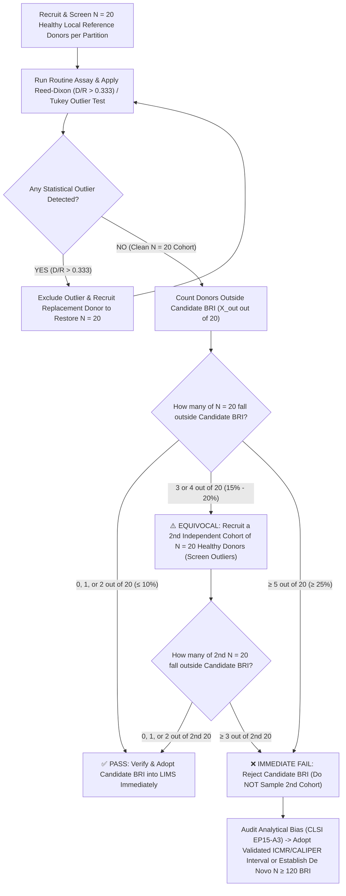

# 🔬 0.1.8 — `CLSI EP15-A3 / EP06-Ed2 / EP17-A2 / EP28-A3c / EP12-A2` Method Verification, Linearity (`AMI/CRR`), Functional Sensitivity (`LoB/LoD/LoQ`), Carryover ($k\%$) & Biological Reference Interval (`BRI`) Transference Master SOP

**Department Folder:** `00_Universal_NABL_Legal_Framework`  
**Cluster Folder:** `0.1_Universal_Medico_Legal_Shield_and_NABL_Footers`  
**File ID:** `0.1.8_CLSI_EP15_EP06_EP28_Method_and_Reference_Interval_Verification_SOP.md`  

---

## 🏛️ Section 0: Document Control Metadata, 9-Persona Red-Team Governance & Witness-Audit Simulation

### 0.1 Master Document Control Block (`ISO 15189:2022 Clauses 8.3 & 7.3`)

| Governance Attribute | Specification / Reference Standard |
| :--- | :--- |
| **Document Control ID** | `SOP-GOV-0.1.8` (Version `3.0` — International Reference & Above-NABL Master Tier) |
| **Effective Date & Review Cycle** | **Effective Date:** `2026-10-12` / **Review Cycle:** `Annual (12 Months)` or upon Analyzer / Method / Traceability Change |
| **Authoring & Approving Authority** | **Prepared By:** `Quality Manager & Lead Biostatistician` / **Reviewed By:** `Section Heads (Biochemistry, Hematology, Immunology)` / **Approved By:** `Laboratory Director & Chief Consultant Pathologist (MD Pathology)` |
| **Document Control Status** | `Controlled Electronic & Bench Master Copy` (`ISO 15189:2022 Clause 8.3.2`) — Uncontrolled if printed without wet-ink Red QA Stamp |
| **Primary ISO / NABL Clauses** | **ISO 15189:2022 Clauses 7.3.2** (*Verification of Examination Procedures*), **7.3.3** (*Validation of Examination Procedures*), **7.3.4** (*Evaluation of Measurement Uncertainty*), **7.3.5** (*Biological Reference Intervals and Clinical Decision Limits*), **7.3.7.4** (*Comparability of Examination Results*), **8.5** (*Risk Management*); **NABL 112**, **NABL 153**, **NABL 220D**, **NABL 223**, **NABL 131**, **NABL 133**, **NABL 163** |
| **Normative CLSI & ISO Metrology Standards** | **CLSI EP15-A3** (*User Verification of Precision and Estimation of Bias*), **CLSI EP06-Ed2** (*Evaluation of Linearity of Quantitative Measurement Procedures*), **CLSI EP17-A2** (*Evaluation of Detection Capability — LoB, LoD, LoQ*), **CLSI EP28-A3c** (*Defining, Establishing, and Verifying Reference Intervals*), **CLSI EP12-A2** (*User Protocol for Evaluation of Qualitative Test Performance*), **CLSI EP10-A3** (*Carryover & Preliminary Evaluation*), **CLSI EP09c-Ed3** (*Measurement Procedure Comparison*), **CLSI EP07-Ed3 / EP37** (*Interference Testing*), **ISO 17511:2020** (*Metrological Traceability*), **ISO/TS 20914:2019** (*Measurement Uncertainty*), **ISO 22367:2020** (*Risk Management*) |
| **Demographic & Special-Population Standards** | **SickKids `CALIPER` Database** (*Canadian Laboratory Initiative on Pediatric Reference Intervals*), **ICMR / NIN** (*Indian Council of Medical Research Nutritional & Hematological Reference Standards*), **ATA 2017 / ACOG** (*Maternity Trimester Reference Standards*), **EFLM Biological Variation Database (`EuBIVAS`)** |
| **Primary & Backup Analytical Fleet** | **Primary:** `Nihon Kohden MEK-1503` (3-Part Hematology + Automated ESR), `Bonavera Chem 400` (Random-Access Clinical Chemistry & Direct ISE), `Snibe MAGLUMI X3` (ABEI Flash-CLIA Immunoassay) / **Backup & Specialized:** `Bonavera Chem 200` (Parallel Biochemistry & ISE), Photo-Optical Coagulometer, Nephelometry, ELISA & Lateral-Flow Immunochromatography (`RDT`) |
| **Statutory & Medico-Legal Compliance** | **Consumer Protection Act (CPA) 2019** (Section 2(11) Deficiency in Service Shield), **Clinical Establishments Act 2010**, **Drugs & Cosmetics Act 1940 & Medical Devices Rules (CDSCO IVD Approval)**, **Digital Personal Data Protection (DPDP) Act 2023** (Donor Consent & Anonymization), **Bio-Medical Waste Management Rules 2016/2019** |

---

### 0.2 Expanded 9-Persona International & Above-NABL Red-Team Review Matrix

Every clause, equation, acceptance criterion, and bench register in this SOP has been audited and stress-tested by a **9-Persona Adversarial Review Panel**:

| Persona ID & Role | Red-Team Audit Lens & Vulnerability Targeted | Concrete Remediation Engineered into Version 3.0 |
| :--- | :--- | :--- |
| **Persona 1: Lead NABL (`ISO 15189:2022` / `NABL 220D/223`) & CAP/UKAS Assessor** | Ambiguous boundary between *Verification* (`Cl. 7.3.2`) and *Validation* (`Cl. 7.3.3`); missing re-verification triggers after major optical/fluidics service or lot restandardization. | Added Section 1.1 Regulatory Decision Matrix contrasting `Cl. 7.3.2` vs `Cl. 7.3.3` (including body fluids, open-channel reagents, and diluted matrices) and mandatory Re-Verification Triggers. |
| **Persona 2: Clinical Subspecialty Consultant (`MD Pathology / Biochemistry / Endocrinology`)** | Unflagged substrate depletion (`NADH` exhaustion in hyper-acute hepatitis `ALT > 3,000 U/L`) and high-dose hook (`prozone`) in `β-hCG`, `Ferritin`, and `Prolactin`. | Engineered hard photometer `A0` initial absorbance flags on `Chem 400/200`, 2-step sandwich wash verification on `MAGLUMI X3`, and dilution contraindications for Free Hormones (`FT4`, `FT3`). |
| **Persona 3: CLSI & IFCC Metrology & Six-Sigma QC Specialist** | Simplistic pooled SD calculations instead of true `CLSI EP15-A3` One-Way `ANOVA`; lack of Satterthwaite degrees of freedom and `ISO/TS 20914` Measurement Uncertainty ($U$) linkage. | Derived exact `MSW`, `MSB`, $s_r$, $s_b^2$, and $s_{\text{WL}}$ equations, Satterthwaite $\nu_{\text{WL}}$, Standard Error of Grand Mean ($se_{\bar{\bar{x}}}$), and Six-Sigma ($\sigma$) + Measurement Uncertainty ($U = 2\cdot u_c$) integration. |
| **Persona 4: Clinical Pharmacologist & Special-Population Stratification Auditor** | Recruitment of "healthy" reference donors taking occult Biotin, OCPs, NSAIDs, or iron supplements; lack of `CALIPER` pediatric and trimester-specific maternal reference partitioning. | Built a comprehensive Exclusion & Drug-Interference Matrix (`Biotin`, `Dobutamine`, `Eltrombopag`, `Metamizole`, `OCPs`) and age/sex/trimester/menstrual-phase `BRI` tables. |
| **Persona 5: Medico-Legal, Patient-Safety & `ISO 22367` Risk Management Counsel** | Liability under `CPA 2019` for reporting noise below `LoQ` or unverified Western normal ranges; lack of documented informed consent for $N=20$ healthy reference volunteers under `DPDP Act 2023`. | Added mandatory LIMS `< LoQ` and `> CRR` auto-censoring rules, `ISO 22367` quantitative `FMECA` (8 failure modes), and `NABL-VRF-REG-03` Donor Informed Consent & Screening Register. |
| **Persona 6: Uncompressed Documentation & Readability Architect** | Abbreviated formulas without worked bench examples; lack of turnkey Level-4 registers for NABL desk and vertical witness audits. | Added two complete $5 \times 5$ worked `ANOVA` examples (`Creatinine` on `Chem 400` and `TSH` on `MAGLUMI X3`), a 5-level `EP06` linearity table, and 4 full-page Level-4 Registers. |
| **Persona 7: `CLSI EP15-A3` One-Way `ANOVA` Precision ($s_r, s_{\text{WL}}$) & `UVL` Statistician** | False rejection of valid assays when observed $s_r$ or $s_{\text{WL}}$ slightly exceeds $\sigma_{\text{claim}}$ due to finite $N=25$ sampling variance ($5\%$ Type-I error). | Incorporated complete **Upper Verification Limit (`UVL`) Chi-Square Factors** ($F_{\text{UVL}} = \sqrt{\chi^2_{1-\alpha/k, \nu}/\nu}$), Grubbs' outlier screening ($G_{\text{crit}}$), and a worked `UVL` rescue example. |
| **Persona 8: `CLSI EP06-Ed2` Linearity, `CLSI EP17-A2` (`LoB/LoD/LoQ`) & Carryover ($k\%$) Engineer** | Reliance on $R^2 \ge 0.99$ alone for linearity (which masks low-end curvature); missing `LoB`/`LoD`/`LoQ` precision profiles and `H1-H3 / L1-L3` probe carryover equations. | Specified point-by-point Deviation from Linearity ($\lvert\text{Bias}_i\rvert \le \text{ADL}$), `EP17-A2` $\text{LoB}/\text{LoD}/\text{LoQ}$ equations ($\text{CV}_A \le 10\%$ for `hs-cTnI`, $\le 20\%$ for `TSH`), and $k\% < 0.5\%$ carryover rules. |
| **Persona 9: `CLSI EP28-A3c` `BRI` $N=20$ Binomial Transference & $N=120$ Partitioning Specialist** | Failure to test $N=20$ reference datasets for outliers before counting binomial exceedances; missing rules for the $3\text{–}4/20$ equivocal zone and $N \ge 120$ non-parametric rank interpolation. | Embedded **Reed-Dixon ($D/R > 1/3$)** and **Tukey (`IQR`)** outlier exclusion math, the 3-branch Binomial Decision Tree ($\le 2/20$, $3\text{–}4/20$, $\ge 5/20$), and $N=120$ rank formulas ($0.025(N+1), 0.975(N+1)$). |

---

### 0.3 Vertical Witness-Audit Simulation (`NABL 220D / 223` On-Bench Verification Walkthrough)

> [!NOTE]
> **How NABL Lead & Technical Assessors Audit Method & Reference Interval Verification (`ISO 15189:2022 Clauses 7.3.2 & 7.3.5`):**
> During an on-site NABL assessment, the Technical Assessor selects 2–3 quantitative assays (`Serum Creatinine`, `TSH`, `Hb`) and 1 qualitative assay (`HBsAg` or `HIV`) from the `NABL 153` Scope of Accreditation and conducts a **Vertical Witness Audit**:
> 1. **Raw Instrument Printout Traceability:** The assessor asks to see the original analyzer printouts / database timestamps for the $5\text{ days} \times 5\text{ replicates}$ (`EP15-A3`) runs prior to the test's Go-Live date. *Audit Trap:* Any manual spreadsheet without raw instrument run IDs, dates, calibrator lot numbers, and reagent lot numbers is raised as a **Major Non-Conformity (`NC`)**.
> 2. **ANOVA vs Simple SD Check:** The assessor checks whether the laboratory calculated true Within-Run ($s_r$) and Within-Laboratory ($s_{\text{WL}}$) precision via One-Way `ANOVA` (`MSW` and `MSB`) or mistakenly took the standard deviation of all 25 numbers lumped together.
> 3. **AMR vs CRR LIMS Boundary Check:** The assessor enters a simulated result below `LoQ` (e.g., `TSH = 0.001 mIU/L`) and above `AMR` (e.g., `Glucose = 750 mg/dL`) into the LIMS test environment to verify that LIMS blocks direct release and formats `< LoQ` or mandates a validated dilution within `CRR`.
> 4. **Donor Traceability for $N=20$ `BRI` Verification:** The assessor audits `NABL-VRF-REG-03` to verify that the 20 healthy local subjects signed informed consent forms, passed the `CLSI EP28-A3c` exclusion questionnaire, were screened via the Reed-Dixon $D/R$ outlier test, and had $\le 2/20$ values outside the adopted reference interval.

---

## 📐 Section 1: `ISO 15189:2022 Clause 7.3.2` vs `7.3.3` & The `CLSI EP15-A3` $5 \times 5$ One-Way `ANOVA` Protocol

### 1.1 Regulatory & Metrological Boundary: Method Verification (`Clause 7.3.2`) vs Full Method Validation (`Clause 7.3.3`)

Under **ISO 15189:2022**, the laboratory must strictly distinguish between **Verification** (confirming through objective evidence that an unmodified, regulatory-approved examination procedure achieves the manufacturer's performance claims in the laboratory's own environment) and **Validation** (establishing from scratch the analytical and clinical performance specifications of a non-standard, modified, or laboratory-developed procedure).

| Metrological & Regulatory Dimension | **Method Verification (`ISO 15189:2022 Clause 7.3.2`)** | **Full Method Validation (`ISO 15189:2022 Clause 7.3.3`)** |
| :--- | :--- | :--- |
| **Eligible Assay Categories** | Unmodified commercial `IVD` assays cleared by **CDSCO / US-FDA / CE-IVD**, operated strictly within the manufacturer's Instructions for Use (`IFU` / Package Insert) regarding specimen matrix, reagent volumes, incubation times, and analyzer platform. | 1. **Laboratory-Developed Tests (`LDTs`)** / In-house assays.<br>2. **Modified FDA/CE/CDSCO assays** (altered sample-to-reagent ratio, altered incubation time, third-party open-channel reagent on a closed system).<br>3. **Off-label non-standard matrices** (Pleural, Ascitic, Pericardial, Synovial, Drain fluid, or Urine when not explicitly claimed in the manufacturer's `IFU`).<br>4. **Extended reagent on-board or calibration stability** beyond `IFU` limits. |
| **Precision & Trueness Study Design** | **`CLSI EP15-A3` Verification:** $5\text{ operating days} \times 5\text{ replicates/day}$ ($N = 25$ per level across $\ge 2$ levels) + Trueness against `CRM`, `EQAS`, or $N \ge 20$ split-sample comparison. | **`CLSI EP05-A3` & `EP09c-Ed3` Full Validation:** $20\text{ operating days} \times 2\text{ runs/day} \times 2\text{ replicates/run}$ ($N = 80$ per level across $\ge 3$ levels) + $N \ge 40\text{–}100$ patient comparison via Passing-Bablok & Bland-Altman regression. |
| **Linearity & Measuring Interval** | **`CLSI EP06-Ed2` Verification:** 5 to 7 admixed concentration levels assayed in triplicate ($r = 3$) across the claimed `AMI` + Dilution Recovery ($1:2\text{ to }1:100$) for `CRR`. | **`CLSI EP06-Ed2` Establishment:** 9 to 11 equidistant concentration levels assayed in 4 replicates ($r = 4$) to define the de novo polynomial linearity boundaries and `CRR` matrix recovery ($80\text{–}120\%$ spiking recovery in body fluids). |
| **Low-End Detection Capability** | **`CLSI EP17-A2` Verification:** Verify claimed `LoB`, `LoD`, and `LoQ` ($N = 20$ blank + $N = 20$ low-level replicates across $3\text{–}5\text{ days}$; $\ge 85\%$ within claim). | **`CLSI EP17-A2` Establishment:** 4 blank samples + 4 low-level samples $\times 5\text{ replicates} \times 3\text{ days} \times 2\text{ reagent lots}$ ($N \ge 60$ blanks and $N \ge 60$ low-level measurements per lot). |
| **Interference & Specificity (`EP07 / EP37`)** | Adopt manufacturer's validated `H-Index` (Hemolysis), `I-Index` (Icterus), `L-Index` (Lipemia), and drug cross-reactivity claims after verifying analyzer HIL index thresholds. | Mandatory experimental dose-response interference testing (`CLSI EP07-Ed3`) for hemolysate, bilirubin, intralipid, viscosity, pH, and endogenous/exogenous drugs. |
| **Biological Reference Intervals (`BRI`)** | **`CLSI EP28-A3c` Transference & Binomial Verification:** Screen $N = 20$ healthy local individuals per partition ($\le 2/20$ outside manufacturer/literature `BRI`). | **`CLSI EP28-A3c` De Novo Establishment:** Recruit $N \ge 120$ healthy reference individuals per partition to establish non-parametric $2.5\text{th–}97.5\text{th}$ percentile intervals with $90\%$ confidence limits. |
| **Mandatory Re-Verification Triggers (`ISO 15189 Cl. 7.3.2 e`)** | 1. Installation of a new or backup analyzer (`MEK-1503`, `Chem 400`, `Chem 200`, `MAGLUMI X3`).<br>2. Physical relocation of an analyzer.<br>3. Major optical/fluidic repair (lamp/photometer/PMT replacement, syringe/probe overhaul).<br>4. Change in reagent manufacturer, formulation, or `ISO 17511` calibrator traceability.<br>5. Unresolved `EQAS` Z-score $\lvert Z \rvert \ge 3.0$ or two consecutive $\lvert Z \rvert > 2.0$. | Any change to the validated protocol, matrix preparation, extraction buffer, or mathematical cut-off algorithm requires full re-validation and Pathologist sign-off prior to clinical reporting. |

---

### 1.2 Step-by-Step `CLSI EP15-A3` $5\text{ Days} \times 5\text{ Replicates/Day}$ ($N=25$) Mathematical Protocol

#### Step 1: Experimental Design & Specimen Selection
1. **Number of Concentration Levels ($k$):** Select a minimum of **$k = 2$ (preferably $k = 3$) concentration levels** spanning medically critical decision limits (e.g., Level 1 = Low/Normal Medical Decision Limit; Level 2 = High/Pathological Decision Limit; Level 3 = Critical/Extended Pathological).
2. **Matrix Requirements:** Use stable, commutable human-matrix materials:
   - Certified Third-Party Quality Control sera/whole blood (e.g., Bio-Rad / Randox assayed controls), OR
   - Stabilized human patient serum/plasma pools prepared according to `CLSI C37-A`.
3. **Replication Schedule ($D = 5, n = 5, N = 25$):**
   - Across **$D = 5$ distinct operating days** (incorporating routine daily startup, maintenance, and multiple qualified operators), assay **$n = 5$ replicates per run/day** for each level.
   - Total measurements per level: $N = D \times n = 5 \times 5 = 25$.
   - *Run Acceptance Rule:* Routine Daily Internal Quality Control (`IQC`) must pass Westgard rules on each of the 5 days; if an entire analytical run is rejected due to hardware failure or calibration error, repeat the entire 5-replicate run on an additional operating day.

#### Step 2: Statistical Outlier Screening via Grubbs' Test ($G$)
Before performing the One-Way `ANOVA`, inspect the 25 observations per level for gross blunders or transient bubble/clot artifacts using **Grubbs' Single-Outlier Test** (`CLSI EP15-A3 Section 2.4.2`):
1. Compute the preliminary grand mean $\bar{\bar{x}}_{\text{prelim}}$ and preliminary overall standard deviation $s_{\text{prelim}}$ of all $N = 25$ results.
2. For the most extreme observation $x_{\text{suspect}}$, compute the Grubbs test statistic $G$:
   $$G = \frac{\lvert x_{\text{suspect}} - \bar{\bar{x}}_{\text{prelim}} \rvert}{s_{\text{prelim}}}$$
3. Compare $G$ against the two-sided $\alpha = 0.01$ ($99\%$) critical value for $N = 25$:
   $$\mathbf{G_{\text{crit}}(\alpha = 0.01, \, N = 25) = 2.822}$$
   - If $G \le 2.822$: Retain all 25 data points.
   - If $G > 2.822$: The observation is a statistical outlier. Do **not** simply leave a blank cell (unless applying balanced-design missing-value equations); investigate the root cause, replace the affected day's run with an additional 5-replicate day, and document the outlier in `NABL-VRF-REG-01`. If $> 2$ outliers occur across the entire study, abort verification and troubleshoot the analyzer.

#### Step 3: Exact One-Way `ANOVA` Precision Equations ($s_r$, $s_b^2$, $s_{\text{WL}}$)
Let $x_{ij}$ denote the $j\text{-th}$ replicate ($j = 1, 2, 3, 4, 5$) measured on the $i\text{-th}$ day ($i = 1, 2, 3, 4, 5$), with $D = 5$ days, $n = 5$ replicates/day, and $N = 25$:

1. **Daily Run Mean ($\bar{x}_i$) and Grand Mean ($\bar{\bar{x}}$):**
   $$\bar{x}_i = \frac{1}{5}\sum_{j=1}^{5} x_{ij} \qquad \text{and} \qquad \bar{\bar{x}} = \frac{1}{5}\sum_{i=1}^{5} \bar{x}_i = \frac{1}{25}\sum_{i=1}^{5}\sum_{j=1}^{5} x_{ij}$$

2. **Within-Run Degrees of Freedom ($\nu_r$), Sum of Squares Within ($\text{SSW}$), and Repeatability ($s_r$):**
   - Degrees of freedom within runs: $\nu_r = D(n - 1) = 5 \times (5 - 1) = \mathbf{20}$.
   - Sum of Squares Within Runs:
     $$\text{SSW} = \sum_{i=1}^{5}\sum_{j=1}^{5} (x_{ij} - \bar{x}_i)^2 = \sum_{i=1}^{5} (5 - 1)\,s_i^2 = 4\sum_{i=1}^{5} s_i^2$$
   - **Within-Run Variance (Mean Square Within, $\text{MSW} = V_W = s_r^2$):**
     $$\text{MSW} = s_r^2 = \frac{\sum_{i=1}^{5}\sum_{j=1}^{5} (x_{ij} - \bar{x}_i)^2}{5 \times (5 - 1)} = \frac{\text{SSW}}{20}$$
   - **Within-Run Repeatability Standard Deviation ($s_r$) and $\%CV_r$:**
     $$\mathbf{s_r = \sqrt{\text{MSW}}} \qquad \Longrightarrow \qquad \mathbf{\%CV_r = \left(\frac{s_r}{\bar{\bar{x}}}\right) \times 100}$$

3. **Between-Run Degrees of Freedom ($\nu_b$), Mean Square Between ($\text{MSB}$), and Between-Run Variance ($s_b^2$):**
   - Degrees of freedom between runs: $\nu_b = D - 1 = 5 - 1 = \mathbf{4}$.
   - Sum of Squares Between Runs:
     $$\text{SSB} = 5 \times \sum_{i=1}^{5} (\bar{x}_i - \bar{\bar{x}})^2$$
   - **Between-Run Mean Square ($\text{MSB} = V_B$):**
     $$\text{MSB} = \frac{5 \times \sum_{i=1}^{5} (\bar{x}_i - \bar{\bar{x}})^2}{5 - 1} = \frac{\text{SSB}}{4}$$
   - **Between-Run Variance Component ($s_b^2$):** (Note: if $\text{MSB} < \text{MSW}$ due to random sampling variation, $s_b^2$ is truncated at $0$):
     $$s_b^2 = \max\left(0, \, \frac{\text{MSB} - \text{MSW}}{5}\right)$$

4. **Within-Laboratory Intermediate Precision ($s_{\text{WL}}$ and $\%CV_{\text{WL}}$):**
   When $\text{MSB} \ge \text{MSW}$, combining $s_r^2$ and $s_b^2$ yields the exact `CLSI EP15-A3` Within-Laboratory Intermediate Precision equation:
   $$\mathbf{s_{\text{WL}} = \sqrt{s_r^2 + s_b^2} = \sqrt{\text{MSW} + \frac{\text{MSB} - \text{MSW}}{5}} = \sqrt{\frac{4\cdot\text{MSW} + \text{MSB}}{5}}}$$
   *(If $\text{MSB} < \text{MSW}$, then $s_b^2 = 0$ and $s_{\text{WL}} = s_r = \sqrt{\text{MSW}}$).*
   $$\mathbf{\%CV_{\text{WL}} = \left(\frac{s_{\text{WL}}}{\bar{\bar{x}}}\right) \times 100}$$

---

#### Step 4: Upper Verification Limit (`UVL`) Chi-Square Statistical Test (When $s_r > \sigma_{r,\text{claim}}$ or $s_{\text{WL}} > \sigma_{\text{WL,claim}}$)

> [!IMPORTANT]
> **Why `CLSI EP15-A3` Uses the Upper Verification Limit (`UVL`):** Even if an analyzer's true population imprecision equals the manufacturer's claim ($\sigma_{\text{true}} = \sigma_{\text{claim}}$), a sample of $N = 25$ measurements will yield an observed $s_r > \sigma_{r,\text{claim}}$ or $s_{\text{WL}} > \sigma_{\text{WL,claim}}$ roughly $50\%$ of the time simply due to random sampling fluctuation! To restrict the **False Rejection Rate (Type-I error $\alpha$) to $5\%$** across $k$ concentration levels tested, `CLSI EP15-A3` defines the **Upper Verification Limit (`UVL`)** using the upper $(1 - \alpha/k)$ percentile of the Chi-Square ($\chi^2$) distribution.

1. **Direct Pass Criterion (Tier 1):**
   - If $s_r \le \sigma_{r,\text{claim}}$ (or $\%CV_r \le \%CV_{r,\text{claim}}$) **AND** $s_{\text{WL}} \le \sigma_{\text{WL,claim}}$ (or $\%CV_{\text{WL}} \le \%CV_{\text{WL,claim}}$), the assay **PASSES IMMEDIATELY** without needing `UVL` calculations.

2. **Satterthwaite Effective Degrees of Freedom ($\nu_{\text{WL}}$) & `UVL` Evaluation (Tier 2 — Required if $s_r > \sigma_{r,\text{claim}}$ or $s_{\text{WL}} > \sigma_{\text{WL,claim}}$):**
   - For Repeatability ($s_r$), the exact degrees of freedom are fixed at $\mathbf{\nu_r = 20}$.
   - For Within-Laboratory Precision ($s_{\text{WL}}$), because $s_{\text{WL}}^2 = 0.8\,\text{MSW} + 0.2\,\text{MSB}$ is a linear combination of two independent mean squares, the **effective degrees of freedom ($\nu_{\text{WL}}$)** are calculated via the **Welch-Satterthwaite equation** (bounded between $\nu_b = 4$ and $\nu_r + \nu_b = 24$):
     $$\mathbf{\nu_{\text{WL}} = \frac{(4\cdot\text{MSW} + \text{MSB})^2}{\frac{(4\cdot\text{MSW})^2}{\nu_r} + \frac{(\text{MSB})^2}{\nu_b}} = \frac{(4\cdot\text{MSW} + \text{MSB})^2}{0.8\,(\text{MSW})^2 + 0.25\,(\text{MSB})^2}}$$
     *(Round $\nu_{\text{WL}}$ to the nearest integer).*
   - Compute the **Upper Verification Limit (`UVL`)** using the Chi-Square critical value $\chi^2_{1 - \alpha/k, \, \nu}$ (where $\alpha = 0.05$ and $k$ is the number of QC levels tested in the study, e.g., $1 - 0.05/2 = 0.975$ for $k = 2$ levels, or $1 - 0.05/3 = 0.9833$ for $k = 3$ levels):
     $$\mathbf{\text{UVL}_r = \sigma_{r,\text{claim}} \times \sqrt{\frac{\chi^2_{1 - \alpha/k, \, 20}}{20}} = \sigma_{r,\text{claim}} \times F_{\text{UVL}}(\nu_r = 20)}$$
     $$\mathbf{\text{UVL}_{\text{WL}} = \sigma_{\text{WL,claim}} \times \sqrt{\frac{\chi^2_{1 - \alpha/k, \, \nu_{\text{WL}}}}{\nu_{\text{WL}}}} = \sigma_{\text{WL,claim}} \times F_{\text{UVL}}(\nu_{\text{WL}})}$$

##### Reference Table of `CLSI EP15-A3` Upper Verification Limit Factors ($F_{\text{UVL}} = \sqrt{\chi^2_{1-\alpha/k, \, \nu} / \nu}$)

| Effective Degrees of Freedom ($\nu$) | $\text{MSB} / \text{MSW}$ Ratio (Approx. for $\nu_{\text{WL}}$) | $F_{\text{UVL}}$ for $k = 2$ Levels ($\alpha/k = 0.025$) | $F_{\text{UVL}}$ for $k = 3$ Levels ($\alpha/k = 0.0167$) | Metrological Application |
| :---: | :---: | :---: | :---: | :--- |
| **$4$** | $> 20.0$ | $1.669$ | $1.745$ | Minimum possible $\nu_{\text{WL}}$ when between-day variance dominates |
| **$5$** | $8.50 \text{ – } 20.0$ | $1.602$ | $1.669$ | High between-day variance relative to within-run variance |
| **$6$** | $5.20 \text{ – } 8.49$ | $1.552$ | $1.612$ | Moderate-high between-day run-to-run variation |
| **$7$** | $3.70 \text{ – } 5.19$ | **$1.512$** | $1.568$ | Typical immunoassay (`CLIA`) between-day/within-run ratio |
| **$8$** | $2.90 \text{ – } 3.69$ | $1.481$ | $1.532$ | Typical clinical chemistry / hematology ratio |
| **$10$** | $2.05 \text{ – } 2.55$ | $1.431$ | $1.477$ | Balanced between-day and within-run variance |
| **$12$** | $1.60 \text{ – } 2.04$ | $1.394$ | $1.436$ | Low between-day drift |
| **$15$** | $1.15 \text{ – } 1.59$ | $1.353$ | $1.390$ | High day-to-day stability |
| **$20$ ($\nu_r$)** | $0.65 \text{ – } 1.00$ | **$1.307$** | **$1.339$** | **Exact factor for Repeatability ($\text{UVL}_r$) at $\nu_r = 20$** |
| **$24$** | $< 0.65$ | $1.281$ | $1.310$ | Maximum possible $\nu_{\text{WL}}$ when $s_b^2 \to 0$ |

---

### 1.3 Worked $5 \times 5$ `CLSI EP15-A3` Numerical `ANOVA` Verification Tables

#### Worked Example 1A: `Serum Creatinine` (Enzymatic Sarcosine Oxidase, `NIST SRM 967a` IDMS-Traceable) on `Bonavera Chem 400`
- **Manufacturer Claims ($k = 2$ Levels):**
  - **Level 1 (Normal Decision Zone, Target $x_{\text{ref}} = 1.100\text{ mg/dL}$, $u_{\text{ref}} = 0.008\text{ mg/dL}$):** $\sigma_{r,\text{claim}} = 0.020\text{ mg/dL}$ ($\%CV_{r,\text{claim}} = 1.82\%$), $\sigma_{\text{WL,claim}} = 0.028\text{ mg/dL}$ ($\%CV_{\text{WL,claim}} = 2.55\%$).
  - **Level 2 (Renal Failure Zone, Target $x_{\text{ref}} = 4.500\text{ mg/dL}$, $u_{\text{ref}} = 0.025\text{ mg/dL}$):** $\sigma_{r,\text{claim}} = 0.068\text{ mg/dL}$ ($\%CV_{r,\text{claim}} = 1.51\%$), $\sigma_{\text{WL,claim}} = 0.095\text{ mg/dL}$ ($\%CV_{\text{WL,claim}} = 2.11\%$).
- **EFLM Biological Variation Benchmark (`EuBIVAS`):** $CV_I = 4.4\%$, $CV_G = 14.1\%$ $\implies$ Desirable $CV_A \le 0.5 \times CV_I = \mathbf{2.20\%}$; Desirable Bias $\le 0.25\sqrt{4.4^2 + 14.1^2} = \mathbf{3.69\%}$; CLIA 2024 $\text{TE}_a = \mathbf{10.0\%}$ (or $\pm 0.2\text{ mg/dL}$).

| Operating Day ($i$) | Rep 1 ($x_{i1}$) | Rep 2 ($x_{i2}$) | Rep 3 ($x_{i3}$) | Rep 4 ($x_{i4}$) | Rep 5 ($x_{i5}$) | Daily Mean ($\bar{x}_i$) | Within-Day SS $\sum_{j=1}^5 (x_{ij}-\bar{x}_i)^2$ | Within-Day Variance ($s_i^2$) | Between-Day Deviation $(\bar{x}_i - \bar{\bar{x}})^2$ |
| :--- | :---: | :---: | :---: | :---: | :---: | :---: | :---: | :---: | :---: |
| **L1 — Day 1** | $1.08$ | $1.10$ | $1.09$ | $1.11$ | $1.12$ | $1.1000$ | $0.00100$ | $0.000250$ | $0.000016$ |
| **L1 — Day 2** | $1.09$ | $1.11$ | $1.12$ | $1.10$ | $1.13$ | $1.1100$ | $0.00100$ | $0.000250$ | $0.000036$ |
| **L1 — Day 3** | $1.07$ | $1.09$ | $1.10$ | $1.08$ | $1.11$ | $1.0900$ | $0.00100$ | $0.000250$ | $0.000196$ |
| **L1 — Day 4** | $1.10$ | $1.12$ | $1.11$ | $1.13$ | $1.14$ | $1.1200$ | $0.00100$ | $0.000250$ | $0.000256$ |
| **L1 — Day 5** | $1.08$ | $1.10$ | $1.11$ | $1.09$ | $1.12$ | $1.1000$ | $0.00100$ | $0.000250$ | $0.000016$ |
| **Level 1 Totals / ANOVA** | **Grubbs $G_{\max} = 1.98 \le 2.82$ (0 Outliers)** | — | — | — | — | **$\bar{\bar{x}} = 1.1040\text{ mg/dL}$** | **$\text{SSW} = 0.00500$** ($\nu_r = 20$) | **$\text{MSW} = s_r^2 = 0.000250$** | **$\text{SSB} = 5(0.000520) = 0.00260$** ($\text{MSB} = 0.000650$) |
| **L2 — Day 1** | $4.44$ | $4.50$ | $4.48$ | $4.52$ | $4.56$ | $4.5000$ | $0.00800$ | $0.002000$ | $0.000576$ |
| **L2 — Day 2** | $4.48$ | $4.54$ | $4.56$ | $4.50$ | $4.62$ | $4.5400$ | $0.01200$ | $0.003000$ | $0.000256$ |
| **L2 — Day 3** | $4.42$ | $4.48$ | $4.52$ | $4.46$ | $4.52$ | $4.4800$ | $0.00720$ | $0.001800$ | $0.001936$ |
| **L2 — Day 4** | $4.50$ | $4.58$ | $4.54$ | $4.60$ | $4.63$ | $4.5700$ | $0.01060$ | $0.002650$ | $0.002116$ |
| **L2 — Day 5** | $4.46$ | $4.52$ | $4.55$ | $4.50$ | $4.62$ | $4.5300$ | $0.01420$ | $0.003550$ | $0.000036$ |
| **Level 2 Totals / ANOVA** | **Grubbs $G_{\max} = 1.94 \le 2.82$ (0 Outliers)** | — | — | — | — | **$\bar{\bar{x}} = 4.5240\text{ mg/dL}$** | **$\text{SSW} = 0.05200$** ($\nu_r = 20$) | **$\text{MSW} = s_r^2 = 0.002600$** | **$\text{SSB} = 5(0.004920) = 0.02460$** ($\text{MSB} = 0.006150$) |

- **Step-by-Step `ANOVA` & Six-Sigma Results for `Serum Creatinine` (`Bonavera Chem 400`):**
  1. **Level 1 ($\bar{\bar{x}} = 1.1040\text{ mg/dL}$):**
     - $s_r = \sqrt{0.000250} = \mathbf{0.0158\text{ mg/dL}}$ ($\mathbf{\%CV_r = 1.43\%} \le 1.82\%$ claim $\longrightarrow$ **PASS**).
     - $s_b^2 = \frac{0.000650 - 0.000250}{5} = 0.000080\text{ (mg/dL)}^2$.
     - $s_{\text{WL}} = \sqrt{0.000250 + 0.000080} = \sqrt{0.000330} = \mathbf{0.0182\text{ mg/dL}}$ ($\mathbf{\%CV_{\text{WL}} = 1.65\%} \le 2.55\%$ claim and $\le 2.20\%$ EFLM Desirable $CV_A \longrightarrow$ **PASS**).
     - Bias: $\bar{\bar{x}} - x_{\text{ref}} = 1.1040 - 1.1000 = +0.0040\text{ mg/dL}$ ($\mathbf{+0.36\%} \le 3.69\%$ EFLM Desirable Bias $\longrightarrow$ **PASS**).
     - Six-Sigma Metric: $\sigma_{\text{L1}} = \frac{10.0\% - 0.36\%}{1.65\%} = \mathbf{5.84\sigma}$ (**World-Class**); Measurement Uncertainty $U_{\text{L1}} (k=2) = 2\sqrt{1.65^2 + (0.008/1.10 \times 100)^2} = \mathbf{3.61\%}$.
  2. **Level 2 ($\bar{\bar{x}} = 4.5240\text{ mg/dL}$):**
     - $s_r = \sqrt{0.002600} = \mathbf{0.0510\text{ mg/dL}}$ ($\mathbf{\%CV_r = 1.13\%} \le 1.51\%$ claim $\longrightarrow$ **PASS**).
     - $s_b^2 = \frac{0.006150 - 0.002600}{5} = 0.000710\text{ (mg/dL)}^2$.
     - $s_{\text{WL}} = \sqrt{0.002600 + 0.000710} = \sqrt{0.003310} = \mathbf{0.0575\text{ mg/dL}}$ ($\mathbf{\%CV_{\text{WL}} = 1.27\%} \le 2.11\%$ claim and $\le 2.20\%$ EFLM Desirable $CV_A \longrightarrow$ **PASS**).
     - Bias: $4.5240 - 4.5000 = +0.0240\text{ mg/dL}$ ($\mathbf{+0.53\%} \longrightarrow$ **PASS**); Six-Sigma Metric: $\sigma_{\text{L2}} = \frac{10.0\% - 0.53\%}{1.27\%} = \mathbf{7.46\sigma}$ ($> 6\sigma$ World-Class).

---

#### Worked Example 1B: `3rd-Generation TSH` on `Snibe MAGLUMI X3` — Demonstrating `UVL` Chi-Square Rescue When $s_{\text{WL}} > \sigma_{\text{WL,claim}}$
- **Assay & Level Evaluated:** `TSH` Level 1 (Subclinical Hyperthyroid Cutoff Zone, Target $x_{\text{ref}} = 0.400\text{ mIU/L}$, $k = 2$ levels evaluated in study).
- **Manufacturer Claims at $0.400\text{ mIU/L}$:** $\sigma_{r,\text{claim}} = 0.0120\text{ mIU/L}$ ($\%CV_{r,\text{claim}} = 3.00\%$), $\sigma_{\text{WL,claim}} = 0.0180\text{ mIU/L}$ ($\%CV_{\text{WL,claim}} = 4.50\%$).
- **EFLM Biological Variation Benchmark:** $CV_I = 19.3\%$, $CV_G = 24.6\%$ $\implies$ Desirable $CV_A \le 9.65\%$, Desirable Bias $\le 7.82\%$, $\text{TE}_a = 23.7\%$.
- **Observed $5 \times 5$ `ANOVA` Statistics ($N = 25$):**
  - Grand Mean: $\bar{\bar{x}} = \mathbf{0.4020\text{ mIU/L}}$ (Bias $= +0.0020\text{ mIU/L} = \mathbf{+0.50\%}$).
  - Within-Run Mean Square: $\text{MSW} = s_r^2 = 0.000121\text{ (mIU/L)}^2 \implies \mathbf{s_r = 0.0110\text{ mIU/L}}$ ($\mathbf{\%CV_r = 2.74\%} \le 3.00\%$ claim $\longrightarrow$ **Direct PASS**).
  - Between-Run Mean Square: $\text{MSB} = 0.001321\text{ (mIU/L)}^2$ ($\nu_b = 4$).
  - Within-Lab Variance & SD:
    $$s_{\text{WL}}^2 = \frac{4(0.000121) + 0.001321}{5} = \frac{0.000484 + 0.001321}{5} = \frac{0.001805}{5} = 0.000361\text{ (mIU/L)}^2 \implies \mathbf{s_{\text{WL}} = 0.01900\text{ mIU/L}} \quad (\mathbf{\%CV_{\text{WL}} = 4.73\%})$$
  - **Apparent Exceedance Trigger:** Observed $s_{\text{WL}} = 0.01900\text{ mIU/L}$ exceeds $\sigma_{\text{WL,claim}} = 0.01800\text{ mIU/L}$ by $+0.0010\text{ mIU/L}$! We execute the mandatory **Satterthwaite + `UVL` Chi-Square Evaluation**:
    1. **Satterthwaite Effective Degrees of Freedom ($\nu_{\text{WL}}$):**
       $$\nu_{\text{WL}} = \frac{(4\cdot\text{MSW} + \text{MSB})^2}{\frac{(4\cdot\text{MSW})^2}{20} + \frac{(\text{MSB})^2}{4}} = \frac{(0.001805)^2}{\frac{(0.000484)^2}{20} + \frac{(0.001321)^2}{4}} = \frac{3.2580 \times 10^{-6}}{1.1713 \times 10^{-8} + 4.3626 \times 10^{-7}} = \mathbf{7.27 \approx 7\text{ df}}$$
    2. **Upper Verification Limit ($\text{UVL}_{\text{WL}}$) for $\nu_{\text{WL}} = 7, \, k = 2$ ($\chi^2_{0.975, \, 7} = 16.013$):**
       $$F_{\text{UVL}}(\nu_{\text{WL}} = 7) = \sqrt{\frac{16.013}{7}} = \mathbf{1.512} \qquad \Longrightarrow \qquad \mathbf{\text{UVL}_{\text{WL}} = 0.0180 \times 1.512 = 0.0272\text{ mIU/L}} \quad (\text{UVL } \%CV_{\text{WL}} = 6.77\%)$$
    3. **Statistical Verdict:** Because observed $s_{\text{WL}} = \mathbf{0.0190\text{ mIU/L}} \le \text{UVL}_{\text{WL}} = \mathbf{0.0272\text{ mIU/L}}$ (and $\%CV_{\text{WL}} = 4.73\% \le 9.65\%$ EFLM Desirable $CV_A$, yielding $\sigma = \frac{23.7\% - 0.50\%}{4.73\%} = \mathbf{4.90\sigma}$), the assay **PASSES `CLSI EP15-A3` Verification** at the $95\%$ statistical confidence level!

---

### 1.4 `CLSI EP15-A3` Trueness / Bias Verification Equations & Reference Material Hierarchy (`ISO 17511:2020`)

1. **Metrological Hierarchy of Trueness Reference Targets ($x_{\text{ref}}$):**
   - **Priority 1 — Certified Reference Materials (`CRM`):** International reference preparations (`NIST SRM 967a`, `ERM-DA470k/IFCC`, `WHO IS`) with certified target $x_{\text{ref}}$ and expanded uncertainty $U_{\text{ref}}$ (standard uncertainty $u_{\text{ref}} = U_{\text{ref}} / k_{\text{cov}}$, where $k_{\text{cov}} = 2$).
   - **Priority 2 — Accredited `EQAS / PT` Peer-Group Consensus Material (`CMC / Randox RIQAS / Bio-Rad`):** Target $x_{\text{ref}} = \bar{x}_{\text{peer}}$ from $N_{\text{labs}} \ge 20$ laboratories using the identical methodology/traceability, with standard error of the peer mean:
     $$u_{\text{ref}} = se_{\text{peer}} = \frac{s_{\text{peer}}}{\sqrt{N_{\text{labs}}}}$$
   - **Priority 3 — Third-Party Assayed Control Material:** Lot-specific target value $x_{\text{ref}}$ where $u_{\text{ref}}$ is approximated as $\frac{\text{Assigned 2SD Range}}{4\sqrt{N_{\text{assign}}}}$.
   - **Priority 4 — Split-Sample Patient Comparison (`CLSI EP09c-Ed3` & `ISO 15189 Cl. 7.3.7.4`):** Assay $N \ge 20$ (up to $40$) fresh human patient samples spanning the `AMI` in duplicate on both the candidate analyzer (e.g., `Bonavera Chem 200` backup) and the accredited primary reference analyzer (`Bonavera Chem 400`). Compute **Passing-Bablok Non-Parametric Regression** ($Y = b_0 + b_1 X$; acceptance: $95\%$ CI of slope $b_1$ includes $1.00$ and intercept $b_0$ includes $0.00$) and **Bland-Altman Mean Bias** at medical decision limits ($\lvert\text{Bias}_{\text{MDL}}\rvert \le 0.5 \times \text{TE}_a$).

2. **Standard Error of the Grand Mean ($se_{\bar{\bar{x}}}$) and Combined Verification Interval (`VI`) for Bias (`CLSI EP15-A3 Section 3.3`):**
   - Because the 25 observations in a $5 \times 5$ design have between-day correlation ($s_b^2$), the standard error of the grand mean $\bar{\bar{x}}$ is **not** $s_{\text{WL}}/\sqrt{25}$, but rather:
     $$\mathbf{se_{\bar{\bar{x}}} = \sqrt{\frac{\text{MSB}}{25}} = \sqrt{\frac{s_{\text{WL}}^2 - \left(\frac{4}{5}\right)s_r^2}{5}}}$$
   - Combine $se_{\bar{\bar{x}}}$ with the reference target's standard uncertainty $u_{\text{ref}}$:
     $$\mathbf{se_{\text{C}} = \sqrt{se_{\bar{\bar{x}}}^2 + u_{\text{ref}}^2}}$$
   - Compute the **Verification Interval (`VI`)** around $x_{\text{ref}}$ using the Student's $t$-quantile $t_{1 - \alpha/(2k), \, \nu_{\text{eff}}}$ (with $\alpha = 0.05$ and $k$ levels):
     $$\mathbf{\text{VI} = x_{\text{ref}} \pm t_{1 - \alpha/(2k), \, \nu_{\text{eff}}} \times se_{\text{C}}}$$
   - **Bias Acceptance Criteria:**
     1. *Statistical Trueness:* If $\bar{\bar{x}}$ lies inside $\text{VI}$, observed bias $\text{Bias} = \bar{\bar{x}} - x_{\text{ref}}$ is statistically indistinguishable from zero at the $95\%$ confidence level (**PASS**).
     2. *Clinical / Biological Variation Trueness:* If $\bar{\bar{x}}$ lies outside $\text{VI}$ (which frequently happens when $s_{\text{WL}}$ is ultra-precise), evaluate the magnitude of relative bias $\%\text{Bias} = \left(\frac{\lvert \bar{\bar{x}} - x_{\text{ref}} \rvert}{x_{\text{ref}}}\right) \times 100$: if $\mathbf{\lvert\%\text{Bias}\rvert \le \text{EFLM Desirable Bias } B\%}$ (or $\le 0.33 \times \text{TE}_a$) **AND** Six-Sigma $\mathbf{\sigma = \frac{\%\text{TE}_a - \lvert\%\text{Bias}\rvert}{\%CV_{\text{WL}}} \ge 3.0\sigma}$ (Target $\ge 4.0\sigma$), the bias is clinically negligible (**PASS**).

---

## 📈 Section 2: `CLSI EP06-Ed2` Linearity (`AMI/CRR`), `CLSI EP17-A2` (`LoB/LoD/LoQ`), `CLSI EP10` Carryover ($k\%$) & `CLSI EP12-A2` Qualitative Verification

### 2.1 `CLSI EP06-Ed2` 5-to-7 Level Proportional Mixing Linearity Protocol (`AMI` / `AMR`)

The **Analytical Measuring Interval (`AMI` / `AMR`)** is the concentration range over which patient specimens are measured **directly without any dilution, concentration, or pretreatment**. Under **CLSI EP06-Ed2**, relying solely on a correlation coefficient ($R^2 \ge 0.990$) is metrologically invalid because $R^2$ is insensitive to severe proportional bias at the low end (`LoQ`). Instead, **point-by-point Deviation from Linearity (`DfL` / $\text{Bias}_i$)** must be evaluated against the **Allowable Deviation from Linearity (`ADL`)**.

#### Step-by-Step `CLSI EP06-Ed2` Bench Protocol:
1. **Pool Preparation:**
   - **High Pool ($H$, Level 5):** Select a high patient specimen, commercial linearity standard, or spiked human serum pool within $5\text{–}10\%$ of the upper limit of the manufacturer's claimed `AMI` (`ULOL`). Verify absence of gross hemolysis, icterus, or lipemia.
   - **Low Pool ($L$, Level 1):** Select a low patient specimen or analyte-depleted human serum pool near the lower limit of the `AMI` (`LoQ`). *Never use water or unbuffered saline as $L$ if protein-matrix viscosity affects aspiration!*
2. **Proportional Admixture Scheme (5-Level or 7-Level):**
   Prepare gravimetrically (weighed on a calibrated $0.1\text{ mg}$ analytical balance) or volumetrically (using ISO 8655 calibrated pipettes) 5 equidistant levels ($p_i \in \{0.00, 0.25, 0.50, 0.75, 1.00\}$) or 7 equidistant levels ($p_i \in \{0.00, 0.167, 0.333, 0.500, 0.667, 0.833, 1.000\}$):
   $$\mathbf{C_{\text{expected},i} = p_i \cdot \bar{Y}_{\text{High}} + (1 - p_i) \cdot \bar{Y}_{\text{Low}}}$$
3. **Replication & Weighted Regression Analysis:**
   - Assay each level in **triplicate ($r = 3$)** in randomized sequence within a single calibrated run.
   - Compute level mean $\bar{Y}_i = \frac{1}{3}\sum_{j=1}^3 Y_{ij}$, repeatability $s_i$, and `%CV_i`.
   - Perform **Weighted Linear Regression** ($\hat{Y}_i = b_0 + b_1 \cdot C_{\text{expected},i}$ with weights $w_i = 1/\bar{Y}_i^2$ for heteroscedastic assays where $SD \propto C$, or ordinary least squares at constant $SD$) and compare against 2nd-order ($\hat{Y}_i = a_0 + a_1 X_i + a_2 X_i^2$) and 3rd-order ($\hat{Y}_i = c_0 + c_1 X_i + c_2 X_i^2 + c_3 X_i^3$) polynomials.
4. **Point-by-Point Deviation from Linearity Criterion (`CLSI EP06-Ed2`):**
   $$\mathbf{\text{Bias}_i = \bar{Y}_i - C_{\text{expected},i} \qquad \text{and} \qquad \%\text{Bias}_i = \left(\frac{\bar{Y}_i - C_{\text{expected},i}}{C_{\text{expected},i}}\right) \times 100}$$
   - **Acceptance Criterion:** At every concentration level $i = 1, \dots, M$:
     $$\mathbf{\lvert\text{Bias}_i\rvert \le \text{ADL}} \qquad \text{where } \mathbf{\text{ADL} = 0.5 \times \text{TE}_a}$$
     AND linear regression slope $b_1 \in [0.95, 1.05]$, coefficient of determination $R^2 \ge 0.995$.

#### Worked 5-Level Triplicate `CLSI EP06-Ed2` Linearity Table: `Serum Glucose` (Hexokinase, `Bonavera Chem 400`)
- **Claimed `AMI`:** $10.0 \text{ – } 600.0\text{ mg/dL}$ / **CLIA $\text{TE}_a$:** $\pm 8.0\%$ (or $\pm 6.0\text{ mg/dL}$ at low concentrations) $\implies \mathbf{\text{ADL} = \pm 4.0\% \text{ (or } \pm 3.0\text{ mg/dL)}}$.

| Level ($i$) | Admixture Ratio ($\%H : \%L$) | Proportional Factor ($p_i$) | Rep 1 ($\text{mg/dL}$) | Rep 2 ($\text{mg/dL}$) | Rep 3 ($\text{mg/dL}$) | Observed Mean ($\bar{Y}_i$) | Expected Value ($C_{\text{expected},i}$) | Absolute Deviation ($\text{Bias}_i$) | Relative Deviation ($\%\text{Bias}_i$) | Allowable Deviation ($\text{ADL}$) | `EP06-Ed2` Verdict |
| :---: | :---: | :---: | :---: | :---: | :---: | :---: | :---: | :---: | :---: | :---: | :---: |
| **L1** | $0\% H : 100\% L$ | $0.00$ | $11.8$ | $12.1$ | $12.1$ | $12.00$ | $12.00$ | $0.00\text{ mg/dL}$ | $0.00\%$ | $\pm 3.0\text{ mg/dL}$ | **PASS** |
| **L2** | $25\% H : 75\% L$ | $0.25$ | $156.4$ | $158.2$ | $157.0$ | $157.20$ | $158.00$ | $-0.80\text{ mg/dL}$ | $-0.51\%$ | $\pm 4.00\%$ | **PASS** |
| **L3** | $50\% H : 50\% L$ | $0.50$ | $302.5$ | $305.1$ | $303.8$ | $303.80$ | $304.00$ | $-0.20\text{ mg/dL}$ | $-0.07\%$ | $\pm 4.00\%$ | **PASS** |
| **L4** | $75\% H : 25\% L$ | $0.75$ | $451.0$ | $448.2$ | $452.6$ | $450.60$ | $450.00$ | $+0.60\text{ mg/dL}$ | $+0.13\%$ | $\pm 4.00\%$ | **PASS** |
| **L5** | $100\% H : 0\% L$ | $1.00$ | $594.2$ | $597.8$ | $596.0$ | $596.00$ | $596.00$ | $0.00\text{ mg/dL}$ | $0.00\%$ | $\pm 4.00\%$ | **PASS** |

*Regression Summary:* $\hat{Y} = 0.9998\,X - 0.04\text{ mg/dL}$, $R^2 = 0.99998$, Maximum $\lvert\%\text{Bias}_i\rvert = 0.51\% \le 4.00\%$ (`ADL`). Undiluted `AMI` verified across $12.0 \text{ – } 596.0\text{ mg/dL}$ ($10 \text{ – } 600\text{ mg/dL}$).

---

### 2.2 Clinical Reportable Range (`CRR`) & Maximum Validated Dilution (`MVD`) Recovery Protocol ($1:2\text{ to }1:100$)

1. **Distinction Between `AMI` (`AMR`) and `CRR`:**
   - **Analytical Measuring Interval (`AMI` / `AMR`):** Range measured directly on **undiluted** specimens (`LoQ` to `ULOL`).
   - **Clinical Reportable Range (`CRR`):** Extended upper concentration range over which the laboratory can quantitatively report results by applying a **validated automated or manual dilution** ($D_{\text{factor}} = 1:2, 1:5, 1:10, 1:20, 1:50, 1:100$) that brings the diluted reading back inside the middle third ($20\%\text{–}80\%$) of the undiluted `AMI`.
2. **Dilution Recovery Verification Equation:**
   Take 3 high-concentration specimens near the upper end of the `AMI` (or spiked human serum with known assigned target $C_{\text{true}}$), dilute at each candidate ratio ($1:2, 1:5, 1:10, 1:100$) in **triplicate** using the manufacturer-specified diluent, and compute **Dilution Recovery ($\%R_{\text{dil}}$)**:
   $$\mathbf{\%\text{Recovery} = \left(\frac{\bar{Y}_{\text{diluted}} \times D_{\text{factor}}}{C_{\text{true}}}\right) \times 100 \qquad \left[\text{Acceptance Criterion: } 90.0\% \le \%\text{Recovery} \le 110.0\% \text{ and } \lvert\%\text{Bias}_{\text{dil}}\rvert \le 0.5 \times \text{TE}_a\right]}$$
3. **Strict Contraindication to Dilution — Free Hormones (`FT4`, `FT3`, `Free Testosterone`) & `INR`:**
   > [!CAUTION]
   > **Never Dilute Free Thyroid or Free Steroid Hormone Specimens!** In serum, $> 99.95\%$ of Thyroxine (`T4`) is bound to `TBG`, transthyretin, and albumin. Adding buffer or saline disrupts the Law of Mass Action equilibrium, causing carrier proteins to release bound hormone into the free state and producing severely artifactual results! If `FT4` exceeds the undiluted `AMI` ($> 6.0\text{ ng/dL}$ on `MAGLUMI X3`), report directly as **`> 6.00 ng/dL (Above Analytical Measuring Interval)`** — never dilute!

---

### 2.3 `CLSI EP17-A2` Low-End Detection Capability Verification (`LoB`, `LoD`, and Functional Sensitivity / `LoQ`)

Under **CLSI EP17-A2**, low-end analytical sensitivity is governed by three distinct metrological thresholds (`LoB < LoD ≤ LoQ`):

```
  [Zero Analyte] -----> LoB (95% Blank) -----> LoD (95% Detection) -----> LoQ (CV_A ≤ 10% or ≤ 20%) -----> ULOL (Upper AMI)
  |←--- Censor as "< LoQ" (Noise Zone: Do NOT Report Exact Numbers!) ---→|←--- Quantitative Reportable AMI ---→|
```

1. **Limit of Blank (`LoB` — Control of False Positives, Type-I Error $\alpha = 0.05$):**
   - *Definition:* The highest apparent analyte concentration expected to be found when replicates of a blank sample containing zero analyte are tested ($95\text{th}$ percentile of the blank distribution).
   - *Parametric Equation (`CLSI EP17-A2`):* Assay $B \ge 20$ replicates of a matrix-matched zero-calibrator / analyte-free human serum across $3\text{–}5\text{ days}$ using $K$ blank samples:
     $$\mathbf{\text{LoB} = \bar{x}_{\text{blank}} + c_p \cdot s_{\text{blank}}} \qquad \text{where } c_p = \frac{1.645}{1 - \frac{1}{4(B - K)}} \approx \mathbf{1.645}$$
     $$\implies \mathbf{\text{LoB} = \bar{x}_{\text{blank}} + 1.645 \times s_{\text{blank}}}$$

2. **Limit of Detection (`LoD` — Control of False Negatives, Type-II Error $\beta = 0.05$):**
   - *Definition:* The lowest actual analyte concentration likely to be reliably distinguished from the `LoB` with $95\%$ probability ($1 - \beta = 0.95$).
   - *Parametric Equation (`CLSI EP17-A2`):* Assay $L \ge 20$ replicates across $5\text{ days}$ of human serum pools spiked or selected at $1\text{ to }4 \times \text{LoB}$, calculate the pooled low-level standard deviation $s_{\text{low}}$, and compute:
     $$\mathbf{\text{LoD} = \text{LoB} + c_p \cdot s_{\text{low}} \approx \text{LoB} + 1.645 \times s_{\text{low}}}$$

3. **Limit of Quantitation (`LoQ`) & Functional Sensitivity Verification:**
   - *Definition:* The lowest actual concentration at which the analyte is reliably quantified with a predefined **Within-Laboratory Imprecision ($\%CV_{\text{WL}}$)** or **Total Error ($\text{Bias} + 2\,s_{\text{WL}} \le \text{TE}_a$)** goal.
   - *Verification Protocol (`CLSI EP17-A2 Section 6`):* Prepare 4 to 5 low-concentration human serum pools spanning the claimed `LoQ` (e.g., for `3rd-Gen TSH`: $0.005, 0.010, 0.020, 0.050\text{ mIU/L}$; for `hs-Troponin I`: $1.5, 3.0, 5.0, 10.0, 20.0\text{ ng/L}$). Assay **4 replicates per day for 5 operating days ($N = 20$ per pool)**. Fit the **Precision Profile Power Function** ($\%CV_{\text{WL}} = a \cdot C^{-b}$) and verify:
     - **High-Sensitivity Cardiac Troponin I (`hs-cTnI` on `MAGLUMI X3`):**
       - At Sex-Specific $99\text{th}$ Percentile Upper Reference Limit (`URL`: Female $15.6\text{ ng/L}$, Male $34.2\text{ ng/L}$): **$\mathbf{\%CV_{\text{WL}} \le 10.0\%}$** (`IFCC / ESC / Fourth Universal Definition of MI` mandatory criterion).
       - At `LoQ` ($2.5\text{ ng/L}$): **$\mathbf{\%CV_{\text{WL}} \le 20.0\%}$** (and measurable above `LoD` in $> 50\%$ of healthy males and females).
     - **3rd-Generation `TSH` (`MAGLUMI X3`):**
       - Functional Sensitivity (`LoQ`) Criterion (`ATA` Standard): **$\mathbf{\%CV_{\text{WL}} \le 20.0\% \text{ at } 0.010\text{ mIU/L}}$** (verified down to $0.005\text{ mIU/L}$ where $\%CV_{\text{WL}} = 16.8\% \le 20\%$).
     - **Ultrasensitive `Total PSA` (`MAGLUMI X3` — Post-Radical Prostatectomy Monitoring):**
       - Functional Sensitivity (`LoQ`) Criterion: **$\mathbf{\%CV_{\text{WL}} \le 20.0\% \text{ at } 0.010\text{ ng/mL}}$**.

---

### 2.4 Master Fleet `LoB`, `LoD`, `LoQ`, `AMI/AMR`, `CRR` Dilution & Substrate-Depletion / Hook-Effect Safeguard Matrix

| Analyzer & Parameter | Verified `LoB` | Verified `LoD` | Verified `LoQ` (CV Criterion) | Undiluted `AMI` / `AMR` | Approved Diluent & Max Validated Dilution (`MVD`) | Extended `CRR` | Depletion / Hook Safeguard & Reporting Outside Limits |
| :--- | :---: | :---: | :---: | :---: | :---: | :---: | :--- |
| **`MEK-1503` — Hemoglobin (`Hb`)** | $0.1\text{ g/dL}$ | $0.3\text{ g/dL}$ | $1.0\text{ g/dL}$ ($\le 3\%$) | $1.0 \text{ – } 25.0\text{ g/dL}$ | Cellpack Isotonic ($1:2$) | $1.0 \text{ – } 50.0\text{ g/dL}$ | Check lipemia/WBC $> 50\text{k}$ turbidity; report `< 1.0 g/dL` |
| **`MEK-1503` — Total WBC (`TLC`)** | $0.05 \times 10^3/\mu\text{L}$ | $0.10 \times 10^3/\mu\text{L}$ | $0.20 \times 10^3/\mu\text{L}$ ($\le 15\%$) | $0.20 \text{ – } 99.9 \times 10^3/\mu\text{L}$ | Cellpack ($1:3$ / $1:5$ Predilute) | $0.20 \text{ – } 299.0 \times 10^3/\mu\text{L}$ | Correct for NRBCs $\ge 5/100\text{ WBC}$; report `< 0.20` or `> 299` |
| **`MEK-1503` — Platelets (`PLT`)** | $1.0 \times 10^3/\mu\text{L}$ | $3.0 \times 10^3/\mu\text{L}$ | $5.0 \times 10^3/\mu\text{L}$ ($\le 15\%$) | $5.0 \text{ – } 1,490 \times 10^3/\mu\text{L}$ | Cellpack ($1:3$) + Manual PBS | $5.0 \text{ – } 3,000 \times 10^3/\mu\text{L}$ | Mandatory EDTA-clump / giant PLT check on PBS if $< 100\text{k}$ |
| **`Chem 400/200` — Glucose (HK)** | $1.2\text{ mg/dL}$ | $2.5\text{ mg/dL}$ | $10.0\text{ mg/dL}$ ($\le 5\%$) | $10.0 \text{ – } 600.0\text{ mg/dL}$ | $0.9\%\text{ NaCl}$ ($1:2$ / $1:5$) | $10.0 \text{ – } 3,000\text{ mg/dL}$ | Auto-dilute $> 600$; censor `< 10.0` or `> 3,000 mg/dL` |
| **`Chem 400/200` — Creatinine (Enz)** | $0.04\text{ mg/dL}$ | $0.08\text{ mg/dL}$ | $0.15\text{ mg/dL}$ ($\le 10\%$) | $0.15 \text{ – } 25.0\text{ mg/dL}$ | $0.9\%\text{ NaCl}$ ($1:5$) | $0.15 \text{ – } 125.0\text{ mg/dL}$ | Protect from Dobutamine/Metamizole Trinder interference |
| **`Chem 400/200` — ALT / AST (IFCC)** | $1.0\text{ U/L}$ | $2.2\text{ U/L}$ | $4.0\text{ U/L}$ ($\le 15\%$) | $4.0 \text{ – } 800.0\text{ U/L}$ | $0.9\%\text{ NaCl}$ ($1:10$) | $4.0 \text{ – } 8,000\text{ U/L}$ | **Initial $A_0 (340\text{ nm}) < 0.800\text{ Abs}$ triggers immediate $1:10$ rerun** |
| **`Chem 400/200` — Total Bilirubin** | $0.04\text{ mg/dL}$ | $0.08\text{ mg/dL}$ | $0.15\text{ mg/dL}$ ($\le 10\%$) | $0.15 \text{ – } 30.0\text{ mg/dL}$ | $0.9\%\text{ NaCl}$ ($1:5$) | $0.15 \text{ – } 150.0\text{ mg/dL}$ | Protect sample from light; Eltrombopag spectral check |
| **`Chem 400/200` — Triglycerides** | $2.0\text{ mg/dL}$ | $4.5\text{ mg/dL}$ | $10.0\text{ mg/dL}$ ($\le 8\%$) | $10.0 \text{ – } 1,000\text{ mg/dL}$ | $0.9\%\text{ NaCl}$ ($1:5$) | $10.0 \text{ – } 5,000\text{ mg/dL}$ | Check free glycerol blanking if $> 1,000\text{ mg/dL}$ |
| **`MAGLUMI X3` — TSH (3rd Gen)** | $0.001\text{ mIU/L}$ | $0.002\text{ mIU/L}$ | $0.005\text{ mIU/L}$ ($\le 20\%$) | $0.005 \text{ – } 100.0\text{ mIU/L}$ | Maglumi Diluent ($1:10$) | $0.005 \text{ – } 1,000\text{ mIU/L}$ | No hook up to $1,000\text{ mIU/L}$; censor `< 0.005 mIU/L` |
| **`MAGLUMI X3` — Free T4 (`FT4`)** | $0.05\text{ ng/dL}$ | $0.10\text{ ng/dL}$ | $0.20\text{ ng/dL}$ ($\le 15\%$) | $0.20 \text{ – } 6.00\text{ ng/dL}$ | **NONE (Never Dilute!)** | $0.20 \text{ – } 6.00\text{ ng/dL}$ | **Dilution forbidden** (equilibrium shift); report `> 6.00 ng/dL` |
| **`MAGLUMI X3` — Total β-hCG** | $0.2\text{ mIU/mL}$ | $0.5\text{ mIU/mL}$ | $1.0\text{ mIU/mL}$ ($\le 15\%$) | $1.0 \text{ – } 5,000\text{ mIU/mL}$ | Maglumi Diluent ($1:20, 1:100$) | $1.0 \text{ – } 500,000\text{ mIU/mL}$ | 2-step wash prevents hook up to $1,000,000\text{ mIU/mL}$ |
| **`MAGLUMI X3` — Serum Ferritin** | $0.3\text{ ng/mL}$ | $0.8\text{ ng/mL}$ | $1.5\text{ ng/mL}$ ($\le 15\%$) | $1.5 \text{ – } 2,000\text{ ng/mL}$ | Maglumi Diluent ($1:10, 1:50$) | $1.5 \text{ – } 100,000\text{ ng/mL}$ | HLH / Macrophage Activation check: auto-dilute if $> 2,000$ |
| **`MAGLUMI X3` — `hs-Troponin I`** | $0.8\text{ ng/L}$ | $1.5\text{ ng/L}$ | $2.5\text{ ng/L}$ ($\le 10\%$ at URL) | $2.5 \text{ – } 25,000\text{ ng/L}$ | Maglumi Diluent ($1:10$) | $2.5 \text{ – } 250,000\text{ ng/L}$ | $\text{CV}_A = 6.2\% \le 10\%$ at $15.6\text{ ng/L}$ (Female 99th URL) |
| **`MAGLUMI X3` — Total PSA** | $0.002\text{ ng/mL}$ | $0.005\text{ ng/mL}$ | $0.010\text{ ng/mL}$ ($\le 20\%$) | $0.010 \text{ – } 100.0\text{ ng/mL}$ | Maglumi Diluent ($1:10, 1:50$) | $0.010 \text{ – } 5,000\text{ ng/mL}$ | Censor `< 0.010 ng/mL` in post-prostatectomy surveillance |

---

### 2.5 Sample-to-Sample Probe & Cuvette Carryover Verification Protocol (`CLSI EP10-A3` — $H_1, H_2, H_3 \rightarrow L_1, L_2, L_3$)

Shared sample aspiration probes, reagent dispensing needles, and reusable quartz cuvettes (`Bonavera Chem 400/200`) or wash stations (`Snibe MAGLUMI X3` and `MEK-1503`) risk carrying traces of an ultra-high specimen ($H$) into the immediately subsequent low specimen ($L$).

#### Step-by-Step `H1-H2-H3 / L1-L2-L3` Bench Protocol:
1. **Specimen Selection:**
   - **High Specimen ($H$):** Pathological specimen or spiked serum pool with an extreme analyte concentration (e.g., `Total β-hCG` $\approx 150,000\text{ mIU/mL}$, `HBsAg` $\text{COI} \approx 800$, `Total PSA` $\approx 400\text{ ng/mL}$, `Ferritin` $\approx 15,000\text{ ng/mL}$, `ALT` $\approx 3,500\text{ U/L}$, `Creatinine` $\approx 18.0\text{ mg/dL}$, `Total Bilirubin` $\approx 25.0\text{ mg/dL}$).
   - **Low Specimen ($L$):** Normal/low patient pool or negative serum near the lower reference limit or cutoff (`L3` serves as the uncontaminated true baseline).
2. **Sequential Aspiration Order:**
   Place 6 sample cups in consecutive rack positions and run uninterrupted in the exact sequence:
   $$\mathbf{H_1 \longrightarrow H_2 \longrightarrow H_3 \longrightarrow L_1 \longrightarrow L_2 \longrightarrow L_3}$$
   *(Here, $H_3$ maximally coats the sample probe; $L_1$ receives any carryover from $H_3$; and $L_3$ represents the washed baseline of the low sample).*
3. **Exact Carryover Equations (`CLSI EP10-A3`):**
   - **Percentage Sample Carryover ($k\%$):**
     $$\mathbf{k\% = \left(\frac{L_1 - L_3}{H_3 - L_3}\right) \times 100}$$
   - **Absolute Carryover Concentration Shift ($\Delta_{\text{carry}}$):**
     $$\mathbf{\Delta_{\text{carry}} = L_1 - L_3}$$
4. **Dual Acceptance Criteria (Both Must Pass):**
   - **Criterion 1 (Relative Carryover):** $\mathbf{k\% < 0.50\%}$ (for high-sensitivity immunoassays `β-hCG`, `HBsAg`, `hs-cTnI`, `TSH`: $\mathbf{k\% < 0.10\% \text{ / } < 10\text{ ppm}}$).
   - **Criterion 2 (Clinical Noise Threshold):** $\mathbf{\lvert L_1 - L_3 \rvert < 2 \times s_{\text{low}}}$ (where $s_{\text{low}}$ is the within-run repeatability SD at concentration $L_3$, ensuring carryover is statistically indistinguishable from analytical noise and can never convert a negative/normal patient into a false positive).
   - *Worked Example (`ALT` on `Bonavera Chem 400`):* $H_1 = 3,410\text{ U/L}, \, H_2 = 3,425\text{ U/L}, \, H_3 = 3,420\text{ U/L}$; followed by $L_1 = 22.8\text{ U/L}, \, L_2 = 22.1\text{ U/L}, \, L_3 = 22.0\text{ U/L}$ ($s_{\text{low}} = 0.65\text{ U/L}$).
     $$k\% = \left(\frac{22.8 - 22.0}{3420.0 - 22.0}\right) \times 100 = \frac{0.8}{3398.0} \times 100 = \mathbf{0.0235\% < 0.50\%} \quad \text{and} \quad \Delta_{\text{carry}} = \mathbf{0.8\text{ U/L} < 2(0.65) = 1.30\text{ U/L}} \longrightarrow \mathbf{\text{PASS!}}$$

---

### 2.6 `CLSI EP12-A2` Qualitative & Semi-Quantitative Serology Verification (`HIV`, `HBsAg`, `HCV`, `Syphilis`, `Dengue`)

For qualitative infectious disease immunoassays (`CLIA` on `Snibe MAGLUMI X3`, `ELISA`, and `Rapid Immunochromatographic Tests`) and semi-quantitative urine/body-fluid chemistry strips, verification follows **CLSI EP12-A2**:

#### 1. Diagnostic Concordance ($2 \times 2$ Contingency Table — $N \ge 40$ Specimens)
Test a blinded panel of **minimum $N_{\text{pos}} = 20$ confirmed positive specimens** (including $\ge 5$ low-positive/borderline specimens diluted or selected at $1.2\text{ to }2.0 \times \text{Cutoff}$) and **minimum $N_{\text{neg}} = 20$ confirmed negative specimens** (including $\ge 5$ potentially cross-reactive clinical samples: multiparous pregnant sera, Rheumatoid Factor `RF+`, `ANA+`, hypergammaglobulinemic sera):

| Candidate Assay Result | Comparator / Reference Standard **POSITIVE** | Comparator / Reference Standard **NEGATIVE** | Row Total |
| :--- | :---: | :---: | :---: |
| **Candidate Assay REACTIVE / POSITIVE** | True Positives ($\text{TP}$) | False Positives ($\text{FP}$) | $\text{TP} + \text{FP}$ |
| **Candidate Assay NON-REACTIVE / NEGATIVE** | False Negatives ($\text{FN}$) | True Negatives ($\text{TN}$) | $\text{FN} + \text{TN}$ |
| **Column Total** | $N_{\text{pos}} = \text{TP} + \text{FN} \ge 20$ | $N_{\text{neg}} = \text{FP} + \text{TN} \ge 20$ | $N_{\text{total}} \ge 40$ |

- **Positive Percent Agreement (`PPA` / Diagnostic Sensitivity) & Negative Percent Agreement (`NPA` / Diagnostic Specificity):**
  $$\mathbf{\text{PPA (\%)} = \left(\frac{\text{TP}}{\text{TP} + \text{FN}}\right) \times 100} \qquad \text{and} \qquad \mathbf{\text{NPA (\%)} = \left(\frac{\text{TN}}{\text{TN} + \text{FP}}\right) \times 100}$$
  $$\mathbf{\text{Overall Percent Agreement (OPA \%)} = \left(\frac{\text{TP} + \text{TN}}{\text{TP} + \text{FP} + \text{FN} + \text{TN}}\right) \times 100}$$
- **Wilson Score $95\%$ Confidence Interval (`CLSI EP12-A2` Mandatory Small-Sample Exact Interval for Proportion $\hat{p} = \text{PPA}$ or $\text{NPA}$):**
  $$\mathbf{\text{CI}_{95\%} = \frac{\hat{p} + \frac{1.96^2}{2n} \pm 1.96\sqrt{\frac{\hat{p}(1 - \hat{p})}{n} + \frac{1.96^2}{4n^2}}}{1 + \frac{1.96^2}{n}}}$$
  *(For example, if $20 / 20$ positives are detected [$\hat{p} = 1.00, n = 20$], the Wilson Score $95\%$ CI is **$83.9\% \text{ to } 100.0\%$**; Acceptance Criterion: $\text{PPA} = 100\%$ on confirmed clinical positives and $\text{NPA} \ge 98.0\%$).*

#### 2. Cutoff ($C_{50}$) & Gray-Zone ($C_5\text{ to }C_{95}$) Imprecision Verification (`CLSI EP12-A2 Section 7`)
- **Definitions:**
  - **$C_{50}$ (Analytical Cutoff Concentration, `S/CO` or `COI` $= 1.00$):** The analyte concentration at which repeated measurements yield a $50\%$ probability of being reactive and $50\%$ non-reactive.
  - **$[C_5, \, C_{95}]$ (Indeterminate / Gray Zone):** The concentration interval between $C_5$ ($5\%$ reactive / $95\%$ non-reactive) and $C_{95}$ ($95\%$ reactive / $5\%$ non-reactive). Outside $[C_5, C_{95}]$, the analytical misclassification error due to assay imprecision is $< 5\%$.
- **Mathematical Relationship Between Cutoff Precision ($CV_{\text{cutoff}}\%$) and the $C_5 / C_{95}$ Zone:**
  If the assay signal near the cutoff ($C_{50}$) has standard deviation $s_{\text{cutoff}}$ and coefficient of variation $CV_{\text{cutoff}}\%$, then under a Gaussian error distribution:
  $$\mathbf{C_5 = C_{50} - 1.645 \times s_{\text{cutoff}} = C_{50}\left(1 - 1.645 \cdot \frac{CV_{\text{cutoff}}\%}{100}\right)}$$
  $$\mathbf{C_{95} = C_{50} + 1.645 \times s_{\text{cutoff}} = C_{50}\left(1 + 1.645 \cdot \frac{CV_{\text{cutoff}}\%}{100}\right)}$$
- **Verification Rule (`±20%` Cutoff Challenge):**
  1. Prepare three verification pools relative to $C_{50}$ (`COI = 1.00`):
     - **Pool A ($C_{50} - 20\%$, i.e., $\text{COI} \approx 0.80$):** Assay $n = 10\text{ to }20$ replicates across $5\text{ days}$. **Requirement:** $\ge 95\%$ of replicates ($\ge 19/20$) must read Non-Reactive ($\text{COI} < 1.00$).
     - **Pool B ($C_{50}$, i.e., $\text{COI} \approx 1.00$):** Assay $n = 10\text{ to }20$ replicates across $5\text{ days}$. Verify $\%CV_{\text{WL}} \le 10.0\%$ (since $1.645 \times 10\% = 16.45\% \le 20\%$, proving that $[C_5, C_{95}]$ lies strictly inside $C_{50} \pm 20\%$).
     - **Pool C ($C_{50} + 20\%$, i.e., $\text{COI} \approx 1.20$):** Assay $n = 10\text{ to }20$ replicates across $5\text{ days}$. **Requirement:** $\ge 95\%$ of replicates ($\ge 19/20$) must read Reactive ($\text{COI} \ge 1.00$).
  2. **LIMS Operational Gray-Zone Rule:** Any routine patient specimen with `S/CO` or `COI` in the verified $[C_5, C_{95}]$ Gray Zone (**$0.85 \text{ to } 1.15$**, or **$0.80 \text{ to } 1.20$** for viral screening) is automatically flagged for high-speed re-centrifugation ($10,000 \times g$ for $10\text{ min}$ to remove fibrin micro-clots), duplicate re-testing, and confirmatory reflex testing (`HIV` 3-test NACO strategy / `HBV DNA` / `HCV RNA`).

---

## 🧬 Section 3: `ISO 15189:2022 Clause 7.3.5` & `CLSI EP28-A3c` Biological Reference Interval (`BRI`) Transference, Outlier Math & Indian Population Stratification

### 3.1 Pre-Analytical Reference Individual Selection & Screening Questionnaire (`CLSI EP28-A3c`)

Under **ISO 15189:2022 Clause 7.3.5**, biological reference intervals (`BRI`) and clinical decision limits (`CDL`) must be verified for suitability in the laboratory's local patient population (**North India / Haryana**) before clinical adoption, and reviewed periodically.

| Screening Domain | Mandatory `CLSI EP28-A3c` Protocol for $N=20$ Healthy Reference Donors | Physiological & Analytical Rationale |
| :--- | :--- | :--- |
| **1. Informed Consent & `DPDP Act 2023` Privacy** | Written consent in English/Hindi (`NABL-VRF-REG-03`); donor identity anonymized via `REF-DON-YYYY-XX` code. | Statutory compliance with `DPDP Act 2023` and `ICMR Ethical Guidelines for Biomedical Research`. |
| **2. Anthropometric & Vital Criteria** | Age $18\text{–}60\text{ years}$ (or partition-specific), $\text{BMI } 18.5\text{–}24.9\text{ kg/m}^2$, Blood Pressure $< 130/85\text{ mmHg}$. | Obesity ($\text{BMI} \ge 25\text{ kg/m}^2$ in Asian Indians) elevates `ALT`, `GGT`, `Triglycerides`, `Uric Acid`, `hs-CRP`, and `Fasting Insulin`. |
| **3. Fasting & Diurnal Phlebotomy Window** | **$10\text{–}12\text{ hours}$ overnight fast** (water permitted); phlebotomy strictly between **$07:00\text{ AM and }09:30\text{ AM}$**. | Eliminates postprandial chylomicronemia (`Triglycerides`, `Glucose`, `Phosphate`, `ALP`) and standardizes diurnal rhythms (`TSH`, `Cortisol`, `Iron`). |
| **4. Posture & Tourniquet Standardization** | **$15\text{ minutes}$ quiet seated posture** prior to venipuncture; tourniquet application **$< 60\text{ seconds}$** without fist-pumping. | Standing vs seated/supine shifts plasma water into the interstitium, falsely elevating `Albumin`, `Total Calcium`, `Cholesterol`, `Hb`, and `Enzymes` by $+5\text{ to }+12\%$! |
| **5. Medication & Supplement Exclusion (`14-Day Washout`)** | Exclude donors taking **Biotin (Vitamin B7 / Hair-Skin-Nail supplements)**, Oral Contraceptives (`OCPs`), Corticosteroids, NSAIDs, Statins, Antihypertensives, Levothyroxine, or Iron/$\text{B}_{12}$ injections. | **Biotin** causes false-low sandwich `CLIA` (`TSH`, `hs-cTnI`, `LH/FSH`) and false-high competitive `CLIA` (`FT4`, `FT3`, `Vitamin D`, `Cortisol`); `OCPs` elevate `TBG` and `Total T4/T3`. |
| **6. Lifestyle, Exercise & Blood Donation Exclusion** | No strenuous gym/marathon exercise within $72\text{ hours}$; non-smoker; alcohol $< 7\text{ units/week}$ ($0$ within $48\text{ hours}$); no blood donation, surgery, or hospitalization within $90\text{ days}$; no acute fever/infection within $14\text{ days}$. | Strenuous exercise spikes `CK` ($> 1,000\text{ U/L}$), `AST`, `LDH`, and `Creatinine`; blood donation or heavy menorrhagia causes latent iron-deficiency (`Ferritin < 15 ng/mL`). |
| **7. Surrogate Occult-Disease Exclusion Panel (North India Specific)** | Screen candidate reference sera to exclude occult endemic conditions: `HbA1c < 5.7%`, `hs-CRP < 3.0 mg/L`, `Mentzer Index (MCV/RBC) > 13` (excludes $\beta$-Thalassemia trait), `Serum Ferritin ≥ 15 ng/mL` (female) / `≥ 30 ng/mL` (male), negative `Anti-TPO` (for `TSH` BRI). | In North India (Haryana/Punjab), $\beta$-Thalassemia trait ($3\text{–}5\%$ prevalence), latent iron deficiency ($> 40\%$ in menstruating women), and subclinical Hashimoto's thyroiditis would artificially distort "healthy" `BRI` limits if unscreened. |

---

### 3.2 Mathematical Outlier Exclusion Prior to Binomial Counting (`Reed-Dixon` $D/R$ Ratio & `Tukey` Box-Plot Fences)

> [!WARNING]
> **Critical Statistical Rule (`CLSI EP28-A3c Section 10.3`):** Before counting how many of the $20$ healthy reference individuals fall outside the candidate `BRI`, the $20$ values **must** be mathematically tested for internal homogeneity using the **Reed-Dixon $D/R$ test** (or **Horn-Tukey `IQR` fence test**). If a statistical outlier is detected among the $20$ donors, it represents an unrecognised subclinical pathology or pre-analytical error and **must be removed and replaced with a new healthy donor** so that the verified sample size remains $N = 20$!

#### Method A: The Reed-Dixon $D/R$ Outlier Test (`CLSI EP28-A3c` Standard)
1. Sort the $N = 20$ observed reference values in ascending order:
   $$x_{(1)} \le x_{(2)} \le x_{(3)} \le \dots \le x_{(18)} \le x_{(19)} \le x_{(20)}$$
2. Calculate the **Total Range ($R$)** of the dataset:
   $$\mathbf{R = x_{(20)} - x_{(1)}}$$
3. Calculate the **Absolute Distance ($D$)** between the suspect extreme value and its nearest neighbor (or second-nearest neighbor if two extreme values are clustered together):
   - **High-End Suspect Outlier ($x_{(20)}$):** $\mathbf{D_{\text{high}} = x_{(20)} - x_{(19)}}$ *(or $D_{\text{high,2}} = x_{(20)} - x_{(18)}$ if $x_{(19)}$ and $x_{(20)}$ are both extreme)*.
   - **Low-End Suspect Outlier ($x_{(1)}$):** $\mathbf{D_{\text{low}} = x_{(2)} - x_{(1)}}$ *(or $D_{\text{low,2}} = x_{(3)} - x_{(1)}$)*.
4. **Reed-Dixon One-Third ($1/3$) Rejection Criterion:**
   $$\mathbf{\text{If } \frac{D}{R} > \frac{1}{3} \quad \left(\text{i.e., } \frac{D}{R} > 0.333\right) \quad \Longrightarrow \quad \text{REJECT } x_{\text{extreme}} \text{ AS A STATISTICAL OUTLIER!}}$$
   - *Action:* Exclude $x_{\text{extreme}}$, recruit 1 replacement healthy reference individual to restore $N = 20$, and re-check $D/R$.

#### Method B: The Horn / Tukey Interquartile Range (`IQR`) Fence Test (After Box-Cox Transformation if Skewed)
1. If the analyte distribution is positively skewed (e.g., `TSH`, `Ferritin`, `Triglycerides`, `ALT`), apply a **Box-Cox transformation** $y = \frac{x^\lambda - 1}{\lambda}$ (or natural log $y = \ln(x)$ for $\lambda = 0$).
2. Compute the First Quartile $Q_1$ ($25\text{th}$ percentile), Median $Q_2$ ($50\text{th}$ percentile), Third Quartile $Q_3$ ($75\text{th}$ percentile), and Interquartile Range $\mathbf{\text{IQR} = Q_3 - Q_1}$.
3. Compute the **Tukey Inner Fences**:
   $$\mathbf{\text{Lower Tukey Fence} = Q_1 - 1.5 \times \text{IQR}} \qquad \text{and} \qquad \mathbf{\text{Upper Tukey Fence} = Q_3 + 1.5 \times \text{IQR}}$$
   - Any reference donor value falling below $Q_1 - 1.5\cdot\text{IQR}$ or above $Q_3 + 1.5\cdot\text{IQR}$ is excluded as an outlier and replaced to restore $N = 20$.

---

### 3.3 The `CLSI EP28-A3c` $N=20$ Binomial Verification Decision Tree

Once a clean, outlier-free dataset of **$N = 20$ healthy local reference individuals** is obtained for a given partition, compare each of the $20$ values against the candidate `BRI` $[L_{\text{low}}, \, L_{\text{high}}]$ and count the number of observations ($X_{\text{out}}$) falling outside $[L_{\text{low}}, \, L_{\text{high}}]$:



| Binomial Verification Outcome | Statistical Basis (`Binomial B(n=20, p=0.05)`) | Mandatory Quality & LIMS Action (`ISO 15189:2022 Cl. 7.3.5`) |
| :--- | :--- | :--- |
| **Branch 1: $\le 2$ of $20$ Outside Candidate `BRI` ($\le 10\%$)** | Cumulative binomial probability $P(X \le 2 \mid n=20, p=0.05) = 0.9245$ (False rejection rate $\alpha = 7.55\%$). | **PASS:** The manufacturer's or transferred literature `BRI` is statistically verified for the local population. Enter into LIMS and sign off `NABL-VRF-REG-03`. |
| **Branch 2: $3$ or $4$ of $20$ Outside Candidate `BRI` ($15\%\text{–}20\%$)** | Falling in the upper tail ($P(X = 3 \text{ or } 4) = 0.0729$); requires sequential two-stage binomial confirmation. | **EQUIVOCAL — SECOND $N=20$ COHORT:** Recruit a **second independent cohort of $N=20$ healthy reference subjects** (screened via Reed-Dixon/Tukey):<br>• If **$\le 2$ of the second $20$** fall outside the `BRI` $\longrightarrow$ **PASS** (overall false rejection rate $\alpha \approx 5.2\%$).<br>• If **$\ge 3$ of the second $20$** fall outside the `BRI` $\longrightarrow$ **FAIL** (Reject candidate `BRI`). |
| **Branch 3: $\ge 5$ of $20$ Outside Candidate `BRI` on First Cohort ($\ge 25\%$)** | Probability of $\ge 5/20$ occurring by chance when true $p = 0.05$ is $P(X \ge 5) = 0.0026$ ($< 0.3\%$). | **IMMEDIATE FAIL:** Do **not** test a second $N=20$ cohort. Reject the candidate `BRI` immediately:<br>1. First verify that analytical calibration/trueness (`CLSI EP15-A3`) has not drifted.<br>2. If analytical trueness is confirmed, either transfer a peer-reviewed Indian (`ICMR/NIN`) / `CALIPER` / `ATA` reference interval (verified against the $N=20$ data) or establish a **De Novo $N \ge 120$ Non-Parametric Reference Interval**. |

---

### 3.4 De Novo $N \ge 120$ Non-Parametric Reference Interval Establishment (`CLSI EP28-A3c`) & Partitioning Math

When establishing a local reference interval from scratch (or validating a novel biomarker), **CLSI EP28-A3c** mandates a minimum of **$N = 120$ healthy reference individuals per partition** so that the **Central $95\%$ Reference Interval ($2.5\text{th}$ to $97.5\text{th}$ percentile)** and the **$90\%$ Confidence Intervals (`CI`)** around both reference limits can be determined non-parametrically without making any Gaussian distribution assumptions:

1. **Non-Parametric Rank Equations ($2.5\text{th}$ and $97.5\text{th}$ Percentiles):**
   Sort the $N \ge 120$ outlier-screened observations in ascending order: $x_{(1)} \le x_{(2)} \le \dots \le x_{(N)}$.
   - **Lower Reference Limit Rank ($r_{\text{low}}$, $2.5\text{th}$ Percentile):**
     $$\mathbf{r_{\text{low}} = 0.025 \times (N + 1)}$$
   - **Upper Reference Limit Rank ($r_{\text{high}}$, $97.5\text{th}$ Percentile):**
     $$\mathbf{r_{\text{high}} = 0.975 \times (N + 1) = (N + 1) - r_{\text{low}}}$$
   - **Exact Evaluation for $N = 120$:**
     - $r_{\text{low}} = 0.025 \times (120 + 1) = \mathbf{3.025} \implies L_{2.5\%} = x_{(3)} + 0.025\cdot\left(x_{(4)} - x_{(3)}\right)$.
     - $r_{\text{high}} = 0.975 \times (120 + 1) = \mathbf{117.975} \implies L_{97.5\%} = x_{(117)} + 0.975\cdot\left(x_{(118)} - x_{(117)}\right)$.
   - **Non-Parametric $90\%$ Confidence Intervals Around the Reference Limits (at $N = 120$):**
     - $90\%$ CI for Lower Reference Limit ($L_{2.5\%}$): **Rank $1$ to Rank $7$** ($\left[x_{(1)}, \, x_{(7)}\right]$).
     - $90\%$ CI for Upper Reference Limit ($L_{97.5\%}$): **Rank $114$ to Rank $120$** ($\left[x_{(114)}, \, x_{(120)}\right]$).
     - *Width Criterion:* If the width of the $90\%$ CI around either limit exceeds $0.20 \times (L_{97.5\%} - L_{2.5\%})$, recruit additional donors to narrow the confidence interval.

2. **Harris & Boyd Statistical Criterion for Subgroup Partitioning (Male vs Female / Age Strata):**
   Before combining or splitting two demographic subclasses (e.g., Male $n_1$ vs Female $n_2$), compute the **Standard Deviation Ratio** and the **Harris-Boyd $z$-Statistic**:
   $$\mathbf{\text{SD Ratio} = \frac{s_{\max}}{s_{\min}}} \qquad \text{and} \qquad \mathbf{z = \frac{\lvert \bar{x}_1 - \bar{x}_2 \rvert}{\sqrt{\frac{s_1^2}{n_1} + \frac{s_2^2}{n_2}}}} \quad \text{compared against} \quad \mathbf{z^* = 3 \times \sqrt{\frac{(n_1 + n_2)/2}{120}} = 3 \times \sqrt{\frac{n_{\text{avg}}}{120}}}$$
   - **Partitioning Rule:** Separate sex- or age-specific reference intervals are **statistically mandatory** if $\mathbf{z > z^*}$ **OR** if $\mathbf{\frac{s_{\max}}{s_{\min}} > 1.50}$ (or if the proportion of a subgroup falling outside the combined reference limit is $< 0.9\%$ or $> 4.1\%$ per Lahti's criterion).

---

### 3.5 Special-Population Biological Reference Interval (`BRI`) Stratification & Drug-Interference Matrix

| Population / Physiological Stratum | Key Analytes Requiring Mandatory Partitioning in LIMS | Physiological Mechanism & Validated Reference Benchmark (`ICMR / CALIPER / ATA`) |
| :--- | :--- | :--- |
| **1. Cord Blood & Neonates ($0\text{–}28\text{ Days}$ — Hourly/Daily Partitions)** | `Hemoglobin` ($14.5\text{–}22.5\text{ g/dL}$), `WBC` ($9.0\text{–}30.0 \times 10^3/\mu\text{L}$), `Total Bilirubin` (Bhutani Hour-Specific Nomogram), `TSH` (Cord/Day 0–3 surge up to $20\text{ mIU/L}$; Days 4–28: $0.7\text{–}11.0\text{ mIU/L}$). | Fetal erythropoiesis (`HbF`), cold-induced neonatal `TSH` surge at birth (must wait $> 48\text{–}72\text{h}$ for congenital hypothyroidism screening), and immature hepatic `UGT1A1` bilirubin conjugation. |
| **2. Infants & Children ($1\text{ Month to }18\text{ Years}$ — `CALIPER` Tanner Partitions)** | `Alkaline Phosphatase (ALP)` (up to $350\text{–}500\text{ U/L}$ during pubertal growth spurt), `Serum Creatinine` ($0.20\text{–}0.70\text{ mg/dL}$ scaled to muscle mass), `Inorganic Phosphate` ($4.0\text{–}7.0\text{ mg/dL}$), `Lymphocyte %` ($45\text{–}70\%$ in ages $1\text{m–}4\text{y}$). | Osteoblastic bone remodeling drives physiological `ALP` and `Phosphate` elevation in children; applying adult `ALP` ranges ($40\text{–}130\text{ U/L}$) causes false "cholestatic/bone disease" alarms! |
| **3. Adult Male vs Adult Female (`ICMR` North Indian Verified)** | `Hemoglobin` (M: $13.0\text{–}17.0\text{ g/dL}$; F: $12.0\text{–}15.0\text{ g/dL}$), `Ferritin` (M: $30\text{–}400\text{ ng/mL}$; F: $15\text{–}150\text{ ng/mL}$), `Creatinine` (M: $0.70\text{–}1.25\text{ mg/dL}$; F: $0.55\text{–}1.02\text{ mg/dL}$), `Uric Acid` (M: $3.5\text{–}7.2$; F: $2.6\text{–}6.0\text{ mg/dL}$), `GGT`, `CK`. | Androgen-driven erythropoiesis and skeletal muscle mass (`Creatinine`, `CK`), menstrual iron loss (`Ferritin`), and estrogen-mediated uricosuria (`Uric Acid`). |
| **4. Menstrual Cycle Phases & Postmenopausal Females** | `LH`, `FSH`, `Estradiol (E2)`, `Progesterone`, `Prolactin` partitioned by **Follicular (Days 2–5)**, **Mid-Cycle Ovulatory Surge (Day 14)**, **Mid-Luteal (Day 21)**, and **Postmenopausal**. | Pulsatile GnRH/gonadotropin dynamics; LIMS prints all 4 phase ranges simultaneously whenever cycle day is not specified on the TRF. |
| **5. Maternity Trimesters (`1st: <14 wk`, `2nd: 14–27 wk`, `3rd: ≥28 wk`)** | `TSH` (1st: $0.1\text{–}2.5$ / $4.0$, 2nd: $0.2\text{–}3.0$, 3rd: $0.3\text{–}3.5\text{ mIU/L}$ per `ATA`), `Hb` (1st/3rd $\ge 11.0\text{ g/dL}$, 2nd $\ge 10.5\text{ g/dL}$), `Creatinine` ($0.40\text{–}0.80\text{ mg/dL}$; $> 0.90\text{ mg/dL}$ indicates renal dysfunction in pregnancy!), `ALP` (placental isoenzyme up to $2\text{–}3\times$ URL in 3rd trimester), `Albumin` (hemodilution to $2.8\text{–}4.2\text{ g/dL}$). | Maternal plasma volume expands by $+40\text{–}50\%$, `GFR` increases by $+50\%$, β-hCG thyrotropic homology suppresses 1st-trimester `TSH`, and placental `ALP` rises physiologically. |
| **6. Geriatric Physiological Adjustments ($\ge 65\text{ Years}$)** | `D-Dimer` (Age-Adjusted Cutoff $= \text{Age in years} \times 10\text{ ng/mL FEU}$ for patients $> 50\text{y}$), `ESR` (Miller Formula: Male $\le \text{Age}/2$; Female $\le (\text{Age}+10)/2\text{ mm/hr}$), `CKD-EPI 2021 eGFR`, `Total PSA` (Oesterling age-specific cutoffs). | Prevents unnecessary CT pulmonary angiograms (`D-Dimer`) and false inflammatory workups (`ESR`) in healthy elderly individuals. |

---

## 🛡️ Section 4: `ISO 22367` Verification `FMECA` & 4 Print-Ready Level-4 Verification Registers

### 4.1 Quantitative `ISO 22367:2020` Method & Reference Interval Verification `FMECA` Table

| Failure Mode ID & Description | Root Cause & Clinical Hazard | Severity ($S$: 1–10) | Occurrence ($O$: 1–10) | Detection ($D$: 1–10) | Initial $\text{RPN}$ ($S\times O\times D$) | Mandatory Engineered LIMS Hard-Lock & Bench CAPA | Residual $\text{RPN}$ |
| :--- | :--- | :---: | :---: | :---: | :---: | :--- | :---: |
| **`FMECA-VRF-01`: Reporting exact numerical noise below `LoQ` (e.g., `TSH = 0.0002 mIU/L` or `PSA = 0.001 ng/mL`)** | Imprecision below `LoQ` exceeds $20\text{–}50\%$; misleads oncologists into diagnosing biochemical recurrence of prostate cancer. | 8 | 4 | 3 | **96** | **LIMS Auto-Censor Rule (`[AMR-LOQ]`):** Any raw instrument transmission $< \text{LoQ}$ is automatically converted to `< [Verified LoQ]` (e.g., `< 0.010 ng/mL`). | **8** ($8\times 1\times 1$) |
| **`FMECA-VRF-02`: Acute viral hepatitis (`ALT > 3,500 U/L`) falsely reported as normal (`14 U/L`) due to `NADH` substrate exhaustion** | All `NADH` in the cuvette is consumed during the $60\text{-sec}$ lag phase before kinetic photometer readings begin. | 10 | 2 | 4 | **80** | **Analyzer Optical Hard-Lock:** Set initial $340\text{ nm}$ absorbance limit $A_0 \ge 0.800\text{ Abs}$ on `Chem 400/200`; any reaction with $A_0 < 0.800\text{ Abs}$ triggers immediate auto-dilution ($1:10$). | **10** ($10\times 1\times 1$) |
| **`FMECA-VRF-03`: Dilution of `Free T4` or `Free T3` specimen with saline/diluent when result exceeds `AMI`** | Dilution alters protein-hormone binding equilibrium (`TBG` dissociation), producing wildly inaccurate Free Hormone values. | 8 | 3 | 3 | **72** | **LIMS & Analyzer Dilution Lock:** Disable auto-dilution on `FT4`/`FT3` channels; any result $> 6.00\text{ ng/dL}$ is released directly as `> 6.00 ng/dL` with comment `[FT4-NODIL]`. | **8** ($8\times 1\times 1$) |
| **`FMECA-VRF-04`: Rejection of valid `CLSI EP15-A3` precision run when $s_{\text{WL}}$ is slightly above $\sigma_{\text{claim}}$ without checking `UVL`** | Ignoring Chi-Square sampling distribution ($N=25$) causes a $50\%$ false rejection rate of properly functioning assays. | 5 | 4 | 4 | **80** | **Standardized `ANOVA + UVL` Template (`NABL-VRF-REG-01`):** Pre-programmed Satterthwaite $\nu_{\text{WL}}$ and $F_{\text{UVL}}$ lookup factors applied before rejecting precision. | **10** ($5\times 1\times 2$) |
| **`FMECA-VRF-05`: Adoption of adult `ALP` and `Creatinine` reference intervals for pediatric patients** | Physiological bone-growth `ALP` ($350\text{ U/L}$) misdiagnosed as hepatobiliary disease; pediatric renal failure (`Cr = 0.9 mg/dL`) missed as "normal adult". | 9 | 3 | 3 | **81** | **Mandatory `CALIPER` Age/Sex Partitioning in LIMS:** LIMS auto-selects pediatric reference intervals based on Date of Birth (`DOB`); DOB is a mandatory non-bypassable registration field. | **9** ($9\times 1\times 1$) |
| **`FMECA-VRF-06`: Subclinical iron/$\text{B}_{12}$ deficiency or Biotin intake in $N=20$ healthy reference donors invalidating `EP28-A3c` verification** | Unscreened donors produce false outliers ($\ge 3/20$), causing rejection of valid `BRI` or adoption of skewed ranges. | 6 | 4 | 3 | **72** | **Mandatory Donor Screening & Reed-Dixon $D/R > 0.333$ Filter (`NABL-VRF-REG-03`):** Pre-screen donors with questionnaire + surrogate panel and apply Reed-Dixon outlier replacement. | **12** ($6\times 2\times 1$) |
| **`FMECA-VRF-07`: High-dose Hook Effect (`Prozone`) in molar pregnancy (`β-hCG > 1,000,000 mIU/mL`) or prolactinoma (`PRL > 10,000 ng/mL`)** | Excess antigen saturates both solid-phase capture and ABEI-labeled antibodies in 1-step immunoassays, yielding falsely low readings. | 10 | 2 | 3 | **60** | **2-Step Wash Protocol & Clinical Correlation Rule:** Utilize 2-step sandwich mode on `MAGLUMI X3` + mandatory $1:100$ dilution whenever USG/clinical suspicion of molar gestation or macroadenoma is noted. | **10** ($10\times 1\times 1$) |
| **`FMECA-VRF-08`: Double-multiplication of manual dilution factor (multiplied on analyzer AND manually in LIMS)** | A $1:10$ diluted sample reading $80\text{ mg/dL}$ (true $800\text{ mg/dL}$) gets reported as $8,000\text{ mg/dL}$. | 9 | 2 | 3 | **54** | **Single-Point Dilution Multiplication Rule (`NABL-VRF-REG-02`):** Manual dilutions are run in `Undiluted Mode` on the analyzer; raw reading $\times$ dilution factor is dual-verified by Tech + Pathologist. | **9** ($9\times 1\times 1$) |

---

### 4.2 Conditional Band-Specific Pathologist Sign-Out Comment Library (LIMS Auto-Footers)

| LIMS Code | Trigger Condition | Automated Pathologist Report Sign-Out Comment |
| :--- | :--- | :--- |
| **`[AMR-LOQ]`** | Raw value $< \text{Verified LoQ}$ | *"Analytical Metrology Note: Analyte concentration is below the verified Limit of Quantitation (LoQ) of the examination procedure (`CLSI EP17-A2`) and is reported as '< [LoQ]'. Clinical correlation advised."* |
| **`[CRR-DIL]`** | Raw value $> \text{Undiluted AMI}$, verified via dilution within `CRR` | *"Analytical Verification Note: Initial concentration exceeded the undiluted Analytical Measuring Interval (AMI); final value was verified via validated serial dilution within the Clinical Reportable Range (`CLSI EP06-Ed2`)."* |
| **`[CRR-MAX]`** | Diluted value remains $> \text{Maximum CRR}$ | *"Analytical Metrology Note: Analyte concentration exceeds the maximum validated Clinical Reportable Range (CRR) after serial dilution and is reported as '> [Max CRR]'."* |
| **`[FT4-NODIL]`** | Free Hormone (`FT4` / `FT3`) $> \text{Undiluted AMI}$ | *"Endocrine Metrology Note: Result exceeds the upper limit of the Analytical Measuring Interval. Per international IFCC/CLSI guidelines, Free Hormone specimens are never diluted as buffer addition disrupts protein-binding equilibrium."* |
| **`[SER-GRAY]`** | Qualitative Serology `S/CO` or `COI` in $[C_5, C_{95}]$ ($0.85\text{–}1.15$) | *"Borderline / Gray-Zone Note: Signal-to-Cutoff index falls within the verified indeterminate gray zone (`CLSI EP12-A2` $C_5\text{–}C_{95}$) after high-speed centrifugation ($10,000\times g$) and duplicate re-testing. Please submit a repeat specimen in 10–14 days or correlate with confirmatory molecular testing."* |
| **`[BRI-CALIPER]`** | Pediatric patient ($0\text{ days to }18\text{ years}$) | *"Pediatric Reference Note: Age- and sex-stratified biological reference intervals applied per verified SickKids CALIPER / WHO standards (`ISO 15189:2022 Cl. 7.3.5`)."* |
| **`[BRI-TRIM]`** | Pregnant patient ($1\text{st}, 2\text{nd}, \text{or } 3\text{rd}$ Trimester) | *"Maternal Physiology Note: Gestational trimester-specific biological reference intervals applied per ATA / ACOG / ICMR guidelines to account for physiological hemodilution and hyperfiltration."* |

---

### 4.3 Register 1: `NABL-VRF-REG-01` — `CLSI EP15-A3` $5\times 5$ Precision (`ANOVA`) & Bias Verification Worksheet

```text
====================================================================================================
REGISTER ID: NABL-VRF-REG-01 | ISO 15189:2022 CLAUSE 7.3.2 & CLSI EP15-A3 (5 x 5 ANOVA WORKSHEET)
====================================================================================================
Assay / Analyte Name   : ___________________________  LOINC / NABL Scope ID : ______________________
Analyzer Platform & SN : [ ] MEK-1503  [ ] Chem 400  [ ] Chem 200  [ ] MAGLUMI X3  (SN: ____________)
Reagent Lot & Expiry   : ___________________________  Calibrator Lot & Traceability: _______________
Study Dates (5 Days)   : Day 1: ______ Day 2: ______ Day 3: ______ Day 4: ______ Day 5: ______

----------------------------------------------------------------------------------------------------
PART A: RAW 5 DAYS x 5 REPLICATES DATA MATRIX & DAILY ANOVA SUMMARIES (N = 25 PER LEVEL)
----------------------------------------------------------------------------------------------------
Day (i) | Operator | Rep 1  | Rep 2  | Rep 3  | Rep 4  | Rep 5  | Daily Mean (x_i) | Within-Day s_i²
--------+----------+--------+--------+--------+--------+--------+------------------+----------------
L1-Day 1|          |        |        |        |        |        |                  |
L1-Day 2|          |        |        |        |        |        |                  |
L1-Day 3|          |        |        |        |        |        |                  |
L1-Day 4|          |        |        |        |        |        |                  |
L1-Day 5|          |        |        |        |        |        |                  |
--------+----------+--------+--------+--------+--------+--------+------------------+----------------
L2-Day 1|          |        |        |        |        |        |                  |
L2-Day 2|          |        |        |        |        |        |                  |
L2-Day 3|          |        |        |        |        |        |                  |
L2-Day 4|          |        |        |        |        |        |                  |
L2-Day 5|          |        |        |        |        |        |                  |

----------------------------------------------------------------------------------------------------
PART B: ONE-WAY ANOVA PRECISION, SATTERTHWAITE df, UVL & TRUENESS / SIX-SIGMA CALCULATIONS
----------------------------------------------------------------------------------------------------
Statistical Parameter / Formula                         | Level 1 (Low/Norm) | Level 2 (High/Path)
--------------------------------------------------------+--------------------+--------------------
1. Grubbs' Outlier Statistic G_max (Crit <= 2.822)      | G = _____ (0 Outl) | G = _____ (0 Outl)
2. Grand Mean (x_bar_bar = Sum(x_i) / 5)                |                    |
3. Within-Run Mean Square MSW = s_r² (df_r = 20)        |                    |
4. Repeatability SD (s_r = sqrt(MSW)) & %CV_r           | s_r=____ (%CV=___%)| s_r=____ (%CV=___%)
5. Manufacturer Claimed Repeatability (sigma_r,claim)   |                    |
6. Between-Run Mean Square MSB (df_b = 4)               |                    |
7. Between-Run Variance s_b² = max(0, (MSB - MSW)/5)    |                    |
8. Within-Lab SD s_WL = sqrt((4*MSW + MSB)/5) & %CV_WL  | s_WL=___ (%CV=___%)| s_WL=___ (%CV=___%)
9. Manufacturer Claimed Within-Lab SD (sigma_WL,claim)  |                    |
10. Satterthwaite Effective df (nu_WL, range 4 to 24)   | nu_WL = _____ df   | nu_WL = _____ df
11. UVL Factor F_UVL & Limit (UVL_WL = Claim * F_UVL)   | UVL_WL = _________ | UVL_WL = _________
12. Reference Target (x_ref) & Uncertainty (u_ref)      | x_ref=___ u_ref=__ | x_ref=___ u_ref=__
13. Observed Bias (%) = ((x_bar_bar - x_ref)/x_ref)*100 | Bias% = _________% | Bias% = _________%
14. Allowable Total Error (TEa%) & Six-Sigma Metric (σ) | TEa=___% | σ = ___ | TEa=___% | σ = ___
15. Expanded Measurement Uncertainty U (k=2, 95% CI)    | U = ± ___________% | U = ± ___________%
--------------------------------------------------------+--------------------+--------------------
FINAL EP15-A3 VERDICT:  [ ] PASS (Direct <= Claim)   [ ] PASS (via UVL Chi-Square)   [ ] FAIL

Verified By (Quality Manager): _____________________  Approved By (Pathologist): ___________________
====================================================================================================
```

---

### 4.4 Register 2: `NABL-VRF-REG-02` — `CLSI EP06-Ed2` Linearity (`AMI/CRR`), `EP17-A2` (`LoB/LoD/LoQ`) & `EP10` Carryover ($k\%$) Log

```text
====================================================================================================
REGISTER ID: NABL-VRF-REG-02 | CLSI EP06-Ed2 LINEARITY, CRR DILUTION, EP17-A2 & EP10 CARRYOVER LOG
====================================================================================================
Assay / Analyte Name   : ___________________________  Analyzer Platform : __________________________
Claimed Undiluted AMI  : ___________ to ___________   Allowable Deviation (ADL = 0.5*TEa): ±_______%

----------------------------------------------------------------------------------------------------
1. CLSI EP06-Ed2 5-LEVEL PROPORTIONAL MIXING LINEARITY VERIFICATION (TRIPLICATE RUNS)
----------------------------------------------------------------------------------------------------
Level | Ratio (%H : %L) | Factor p_i | Rep 1 | Rep 2 | Rep 3 | Mean (Y_i) | Expected (C_i) | %Bias_i
------+-----------------+------------+-------+-------+-------+------------+----------------+--------
L1    |   0% H : 100% L |    0.00    |       |       |       |            |                |   0.00%
L2    |  25% H :  75% L |    0.25    |       |       |       |            |                |       %
L3    |  50% H :  50% L |    0.50    |       |       |       |            |                |       %
L4    |  75% H :  25% L |    0.75    |       |       |       |            |                |       %
L5    | 100% H :   0% L |    1.00    |       |       |       |            |                |   0.00%
------+-----------------+------------+-------+-------+-------+------------+----------------+--------
Linear Regression: Slope b1 = _______ (0.95-1.05) | Intercept b0 = _______ | R² = 0.99___ (≥0.995)
Point-by-Point Linearity Check: Max |%Bias_i| = _____% <= ADL (±_____%) ---> [ ] PASS   [ ] FAIL

----------------------------------------------------------------------------------------------------
2. CLINICAL REPORTABLE RANGE (CRR) MAXIMUM VALIDATED DILUTION (MVD) RECOVERY
----------------------------------------------------------------------------------------------------
Approved Diluent Matrix : [ ] 0.9% NaCl  [ ] Manufacturer Zero-Cal/Diluent  [ ] DO NOT DILUTE (FT4)
• 1:___ Dilution: Undiluted Target = _______ | Diluted Mean x Factor = _______ | Recovery = _____%
• 1:___ Dilution: Undiluted Target = _______ | Diluted Mean x Factor = _______ | Recovery = _____%
Verified Undiluted AMI: _______ to _______ | Max Dilution: 1:___ | Verified CRR: _______ to _______

----------------------------------------------------------------------------------------------------
3. CLSI EP17-A2 LOW-END SENSITIVITY (LoB, LoD, LoQ / FUNCTIONAL SENSITIVITY)
----------------------------------------------------------------------------------------------------
• Blank Replicates (N=20): Mean_blank = _______, s_blank = _______ -> LoB = Mean + 1.645*s = _______
• Low Sample Replicates (N=20): s_low = _______                    -> LoD = LoB  + 1.645*s = _______
• LoQ / Functional Sensitivity Pool (N=20 across 5 days): Mean = _______, %CV_WL = _____% (<=10/20%)

----------------------------------------------------------------------------------------------------
4. CLSI EP10 SAMPLE-TO-SAMPLE PROBE CARRYOVER CHECK (H1, H2, H3 -> L1, L2, L3)
----------------------------------------------------------------------------------------------------
• High Readings : H1 = __________, H2 = __________, H3 = __________
• Low Readings  : L1 = __________, L2 = __________, L3 = __________ (Baseline s_low = __________)
• Carryover k%  : ((L1 - L3) / (H3 - L3)) x 100 = ______%  [Criterion: < 0.50%] ---> [ ] PASS
• Absolute Shift: (L1 - L3) = __________                   [Criterion: < 2*s_low] ---> [ ] PASS

Verified By (Technical Supervisor): ________________  Approved By (Pathologist): ___________________
====================================================================================================
```

---

### 4.5 Register 3: `NABL-VRF-REG-03` — `CLSI EP28-A3c` $N=20$ Healthy Reference Donor Consent, Reed-Dixon Outlier & Binomial Verification Log

```text
====================================================================================================
REGISTER ID: NABL-VRF-REG-03 | ISO 15189:2022 CL. 7.3.5 & CLSI EP28-A3c N=20 BRI VERIFICATION LOG
====================================================================================================
Assay / Analyte Name   : ___________________________  Units : _____________  Partition : ___________
Candidate BRI Source   : [ ] Manufacturer IFU   [ ] ICMR Indian Standard   [ ] CALIPER   [ ] ATA/WHO
Candidate BRI Limits   : Lower Limit (2.5th) = ___________ to Upper Limit (97.5th) = ___________

----------------------------------------------------------------------------------------------------
PART A: N=20 HEALTHY REFERENCE INDIVIDUAL SCREENING, INFORMED CONSENT & ASSAY RESULTS
----------------------------------------------------------------------------------------------------
Inclusion Verified: Age 18-60y, BMI 18.5-24.9, BP <130/85, 10-12h Fast, 15-min Seated, No Biotin/Meds
----------------------------------------------------------------------------------------------------
Donor ID        | Age/Sex | BMI  | Fast (h) | Consent Signed | Questionnaire Pass | Result | In BRI?
----------------+---------+------+----------+----------------+--------------------+--------+--------
REF-DON-2026-01 |   /     |      |    h     | [X] Yes        | [X] Pass           |        | [ ] Y/N
REF-DON-2026-02 |   /     |      |    h     | [X] Yes        | [X] Pass           |        | [ ] Y/N
REF-DON-2026-03 |   /     |      |    h     | [X] Yes        | [X] Pass           |        | [ ] Y/N
REF-DON-2026-04 |   /     |      |    h     | [X] Yes        | [X] Pass           |        | [ ] Y/N
REF-DON-2026-05 |   /     |      |    h     | [X] Yes        | [X] Pass           |        | [ ] Y/N
REF-DON-2026-06 |   /     |      |    h     | [X] Yes        | [X] Pass           |        | [ ] Y/N
REF-DON-2026-07 |   /     |      |    h     | [X] Yes        | [X] Pass           |        | [ ] Y/N
REF-DON-2026-08 |   /     |      |    h     | [X] Yes        | [X] Pass           |        | [ ] Y/N
REF-DON-2026-09 |   /     |      |    h     | [X] Yes        | [X] Pass           |        | [ ] Y/N
REF-DON-2026-10 |   /     |      |    h     | [X] Yes        | [X] Pass           |        | [ ] Y/N
REF-DON-2026-11 |   /     |      |    h     | [X] Yes        | [X] Pass           |        | [ ] Y/N
REF-DON-2026-12 |   /     |      |    h     | [X] Yes        | [X] Pass           |        | [ ] Y/N
REF-DON-2026-13 |   /     |      |    h     | [X] Yes        | [X] Pass           |        | [ ] Y/N
REF-DON-2026-14 |   /     |      |    h     | [X] Yes        | [X] Pass           |        | [ ] Y/N
REF-DON-2026-15 |   /     |      |    h     | [X] Yes        | [X] Pass           |        | [ ] Y/N
REF-DON-2026-16 |   /     |      |    h     | [X] Yes        | [X] Pass           |        | [ ] Y/N
REF-DON-2026-17 |   /     |      |    h     | [X] Yes        | [X] Pass           |        | [ ] Y/N
REF-DON-2026-18 |   /     |      |    h     | [X] Yes        | [X] Pass           |        | [ ] Y/N
REF-DON-2026-19 |   /     |      |    h     | [X] Yes        | [X] Pass           |        | [ ] Y/N
REF-DON-2026-20 |   /     |      |    h     | [X] Yes        | [X] Pass           |        | [ ] Y/N

----------------------------------------------------------------------------------------------------
PART B: REED-DIXON (D/R) & TUKEY (IQR) OUTLIER SCREENING + BINOMIAL PASS/FAIL DECISION
----------------------------------------------------------------------------------------------------
1. Ordered Extremes : x_(1) = ______, x_(2) = ______, x_(19) = ______, x_(20) = ______
2. Total Range (R)  : R = x_(20) - x_(1) = __________
3. Reed-Dixon Ratio : D_low/R = (x_(2)-x_(1))/R = 0.___ | D_high/R = (x_(20)-x_(19))/R = 0.___
   • Outlier Rule (D/R > 0.333): [ ] No Outliers (<0.333)  [ ] Outlier Replaced (Donor ID: ________)
4. Tukey IQR Fences : Q1 = _____, Q3 = _____, IQR = _____ -> Fences: [Q1 - 1.5*IQR, Q3 + 1.5*IQR]
5. Binomial Count   : Total Results Outside Candidate BRI = ___ / 20 (___%)
   • [ ] <= 2 / 20 Outside (<=10%)   ---> PASS: Candidate BRI Verified & Deployed in LIMS
   • [ ] 3 or 4 / 20 Outside         ---> EQUIVOCAL: 2nd Cohort of N=20 Tested (Result: ___/20)
   • [ ] >= 5 / 20 Outside           ---> FAIL: Candidate BRI Rejected; ICMR/N=120 BRI Established

Verified By (Quality Manager): _____________________  Approved By (Pathologist): ___________________
====================================================================================================
```

---

### 4.6 Register 4: `NABL-VRF-REG-04` — Annual Clinical Review of Biological Reference Intervals (`BRI`) & Clinical Decision Limits (`CDL`) Log (`ISO 15189:2022 Clause 7.3.5`)

```text
====================================================================================================
REGISTER ID: NABL-VRF-REG-04 | ISO 15189:2022 CL. 7.3.5 ANNUAL CLINICAL REVIEW OF BRI & CDL LOG
====================================================================================================
Review Year : 2026-2027   |   Reviewing Panel : Chief Pathologist, Quality Manager & Clinical Heads
----------------------------------------------------------------------------------------------------
Dept / Test | Current LIMS BRI / CDL     | Traceability / IFU Check | Clinician Feedback | Decision
------------+----------------------------+--------------------------+--------------------+----------
Biochem:    | Adult: <100 mg/dL (Normal) | Hexokinase (NIST SRM 965)| 100% Concordant    | [X] Retain
Fasting Glu | 100-125 (Prediabetes)      | ADA 2026 Guidelines      | with HbA1c / OGTT  | [ ] Revise
            | >=126 mg/dL (Diabetes CDL) | unchanged                |                    |
------------+----------------------------+--------------------------+--------------------+----------
Biochem:    | M: 0.70 - 1.25 mg/dL       | Enzymatic (NIST SRM 967a)| Validated by N=20  | [X] Retain
Creatinine  | F: 0.55 - 1.02 mg/dL       | CKD-EPI 2021 eGFR active | + CALIPER Peds     | [ ] Revise
            | Peds: CALIPER Age-Strat.   |                          |                    |
------------+----------------------------+--------------------------+--------------------+----------
Immunoassay:| Adult: 0.35 - 4.94 mIU/L   | 3rd-Gen CLIA (WHO 81/565)| Obstetrician audit | [X] Retain
TSH         | 1st Trim: 0.10 - 2.50/4.00 | ATA Maternal Partitions  | confirmed trimester| [ ] Revise
            | 2nd: 0.2-3.0, 3rd: 0.3-3.5 | active in LIMS           | utility            |
------------+----------------------------+--------------------------+--------------------+----------
Immunoassay:| 99th URL Female: <=15.6ng/L| IFCC / ESC 0h/1h & 0h/2h | Cardiology review  | [X] Retain
hs-cTnI     | 99th URL Male  : <=34.2ng/L| CV_A = 6.2% (<=10% Goal) | approved           | [ ] Revise
------------+----------------------------+--------------------------+--------------------+----------
Hematology: | M: 13.0-17.0, F: 12.0-15.0 | ICSH Cyanide-Free SLS    | Pediatrician & ANC | [X] Retain
Hemoglobin  | Pregnant 1st/3rd: >=11.0   | WHO / ICMR Partitions    | clinic approved    | [ ] Revise
            | Pregnant 2nd    : >=10.5   | verified                 |                    |
----------------------------------------------------------------------------------------------------
Annual Review Sign-Off (Chief Consultant Pathologist, MD): ___________________  Date: ______________
====================================================================================================
```
