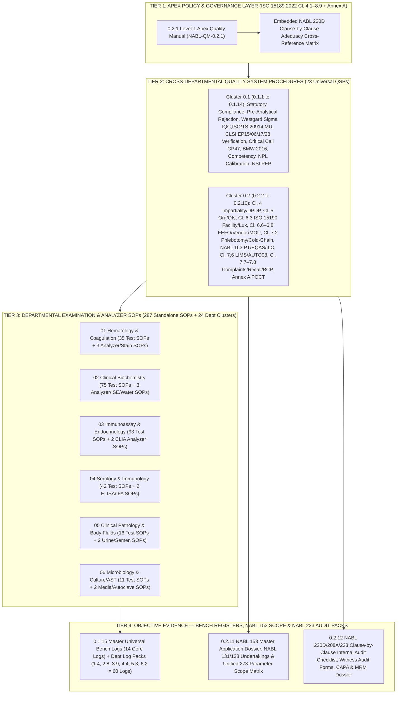

# 0.2 Master NABL 153 / 220D / 208A / 223 Application Dossier, Level-1 Apex Quality Manual & ISO 15189:2022 4-Tier Documentation Architecture Cluster

---

## Document Control & Regulatory Traceability Header Block (`ISO 15189:2022 Clause 8.3.2`)

| Document Metadata Field | Controlled Specification & Regulatory Mapping |
| :--- | :--- |
| **Document ID & Title** | `NABL-QM-0.2` — Master NABL 153 / 220D / 208A / 223 Application Dossier, Level-1 Apex Quality Manual & ISO 15189:2022 4-Tier Documentation Architecture Cluster |
| **Version & Edition** | `Version 4.0 (International 6-Persona Red-Team & Turnkey NABL WP Portal Submission Edition)` |
| **Effective Date & Review Cycle** | `Effective: 15-Oct-2026` · `Mandatory Review Cycle: Annual (Every 12 Months or upon ISO/NABL Revision)` |
| **Document Classification** | `Level 1 / Level 2 Apex Architecture & Master Accreditation Dossier Index (Controlled Master Copy)` |
| **Authoring & Technical Review** | Lead NABL/CAP/UKAS Assessor Panel, Chief Quality Manager (`ISO 15189:2022 Certified`), & Consultant Biochemist / Pathologist (`MD`) |
| **Approving & Issuing Authority** | Laboratory Director (`MD Pathology — Chief Executive & Medico-Legal Signatory, ISO 15189:2022 Clause 5.3`) |
| **Primary International Standards** | `ISO 15189:2022` (Medical Laboratories — Requirements for Quality and Competence, Clauses 4.1–8.9 & Normative Annex A); `ISO 15190:2020` (Medical Laboratories — Requirements for Safety); `ISO 22367:2020` (Application of Risk Management to Medical Laboratories); `ISO/TS 20914:2019` (Practical Guidance for the Estimation of Measurement Uncertainty); `ISO 17511:2020` (Metrological Traceability of Values Assigned to Calibrators, Trueness Control Materials and Human Samples); `ISO/IEC 17025:2017` (Calibration Traceability); `ISO/IEC 17043:2023` (Proficiency Testing) |
| **Mandatory NABL Specific Criteria** | `NABL 100` (General Information Brochure); `NABL 112` (Specific Criteria for Accreditation of Medical Laboratories); `NABL 131` (Terms & Conditions for Maintaining Accreditation); `NABL 133` (Policy for Use of NABL Symbol and/or Claim of Accreditation); `NABL 142` (Policy on Calibration and Metrological Traceability); `NABL 153` (Application Form for Medical Testing Laboratories); `NABL 163` (Policy for Participation in Proficiency Testing Activities); `NABL 208A` (Pre-Assessment Guidelines & Report); `NABL 220D` (Document Review / Adequacy Checklist per ISO 15189:2022); `NABL 223` (Assessment Checklist for Medical Laboratories per ISO 15189:2022) |
| **CLSI & CAP Cross-References** | `CLSI QMS01-A4` (Quality Management System Model); `CLSI QMS02-A6` (Developing and Using Quality Indicators); `CLSI EP15-A3` (Precision & Trueness); `CLSI EP06-Ed2` (Linearity); `CLSI EP17-A2` (`LoB/LoD/LoQ`); `CLSI EP28-A3c` (Reference Intervals); `CLSI EP07-Ed3 / EP37` (Interference Testing); `CLSI GP41-Ed7` (Venipuncture); `CLSI GP47` (Critical Risk Results); `CLSI AUTO08 / AUTO15` (LIMS & Autoverification); `CAP All-Common (COM) & Laboratory General (GEN) Checklists` |
| **Indian Statutory & Medico-Legal Acts** | `Clinical Establishments (Registration and Regulation) Act 2010`; `Digital Personal Data Protection (DPDP) Act 2023`; `Consumer Protection Act (CPA) 2019`; `Pre-Conception and Pre-Natal Diagnostic Techniques (PCPNDT) Act 1994`; `Human Immunodeficiency Virus and Acquired Immune Deficiency Syndrome (Prevention and Control) Act 2017`; `Bio-Medical Waste Management Rules 2016 (Amended 2018/2019)`; `Bharatiya Sakshya Adhiniyam (BSA) 2023 (Section 63 Electronic Evidence Certificate)` |
| **Controlled Distribution** | Copy #01: NABL Web Portal (`WP`) Master Upload; Copy #02: Laboratory Director Office; Copy #03: Quality Assurance Office; Copy #04: Intranet LIMS Read-Only Document Management System (`DMS`) across all 6 Analytical Departments |

---

## Section 1: Purpose & International 4-Tier Quality Management System (`QMS`) Architecture

This Master Cluster (`0.2`) establishes the overarching architectural blueprint of the Laboratory's **Quality Management System (`QMS`)** in strict accordance with `ISO 15189:2022` (Clauses 4.1 through 8.9 and Normative Annex A), `NABL 112`, `NABL 153`, `NABL 220D`, `NABL 208A`, and `NABL 223`. It seamlessly integrates the **Level-1 Apex Quality Manual (`0.2.1`)**, the **Level-2 Universal Quality System Procedures (`QSPs 0.1.1–0.1.14` and `0.2.2–0.2.10`)**, the **Level-3 Departmental Technical & Equipment Standard Operating Procedures (`287 Standalone SOPs` + `24 Departmental Cluster Manuals` across Folders `01` to `06`)**, and the **Level-4 Controlled Bench Registers, Turnkey `NABL 153` Application Tables, and `NABL 220D / 223` Audit & `MRM` Dossiers (`96+ Controlled Forms, Logs & Registers`)** into a single cohesive, audit-ready accreditation repository.

### 1.1 Visual Blueprint of the 4-Tier ISO 15189:2022 & NABL Documentation Pyramid



### 1.2 The 4-Tier ISO 15189:2022 & NABL Documentation Pyramid Specification Matrix

| Tier Level | Document Classification | Purpose & Regulatory Function during NABL Assessment | Controlled Document Series in Repository | Total Verified Files / Logs | Mandatory Review & Retention Authority |
| :---: | :--- | :--- | :--- | :---: | :--- |
| **Level 1 (`Apex`)** | **Apex Quality Manual (`NABL-QM-0.2.1`)** | Declares top-management policies, strategic objectives, impartiality/confidentiality commitments, and risk-based governance for every clause of `ISO 15189:2022` (`4.1–8.9 + Annex A`) and embeds the **`NABL 220D` Desktop Adequacy Cross-Reference Matrix**. | `0.2.1` (`Master Apex Quality Manual`) | **1 Master Manual** (`100% Clause Mapped`) | Reviewed Annually by Quality Manager; Approved by Lab Director; Retained Permanently (`Archival Copy for 10 Years per Version`). |
| **Level 2 (`QSPs`)** | **Quality System Procedures (`Management, Pre-Analytical, Metrology, LIMS, PT/EQAS, BCP, POCT`)** | Defines cross-departmental system workflows required by `ISO 15189:2022` Clauses 4, 5, 6, 7, 8 & Annex A, `ISO 15190:2020`, `ISO 22367:2020`, `ISO/TS 20914:2019`, and `NABL 112 / 131 / 133 / 142 / 163`. | `0.1.1` to `0.1.14` + `0.2.2` to `0.2.10` (`23 System QSPs`) | **23 Universal QSPs** + **2 Master Clusters (`0.1, 0.2`)** | Reviewed Annually by Quality Manager & Section Heads; Approved by Lab Director; Obsolete versions stamped `OBSOLETE — DO NOT USE` (`Cl. 8.3.2`). |
| **Level 3 (`SOPs`)** | **Departmental Examination, Analyzer Operation, Calibration, Carryover, Stain & Media QC SOPs** | Provides bench-level step-by-step analytical instructions, chemical/immunochemical principles, `EFLM` biological variation / `MU %` / `Sigma` budgets, 5D age/sex/pregnancy reference intervals, panic read-backs, `FMEA` risk matrices, and LIMS report templates. | `1.1.1` to `6.1.11` (`273 Test SOPs + 14 Dept Equipment/Media SOPs`) + `24 Dept Clusters` | **311 Departmental Technical Files** | Reviewed Annually or immediately upon reagent kit insert / analyzer change (`CLSI EP15` re-verification required); Approved by Dept Head (`MD`). |
| **Level 4 (`Records`)** | **Controlled Bench Registers, `NABL 153` Scope Tables & `NABL 220D/223` Audit + `MRM` Dossiers** | Provides immutable, contemporaneous objective evidence (`ISO 15189 Cl. 8.4`) of daily bench compliance, `NABL 153` portal submission tables, internal audit (`Cl. 8.8`), and `MRM` (`Cl. 8.9`). | `0.1.15`, `0.2.11`, `0.2.12`, `1.4`, `2.8`, `3.9`, `4.4`, `5.3`, `6.2` | **9 Master Register & Audit Packs (`96+ Live Bench Logs & Forms`)** | Contemporaneous daily bench entry; ALCOA+ integrity rules enforced; Retained per `NABL 112` & statutory schedules (`Minimum 2–10 Years`). |

### 1.3 Master Document Control, Coding & ALCOA+ Record Integrity Rules (`ISO 15189:2022 Clauses 8.3 & 8.4`)

1. **Unique Alphanumeric Coding Convention (`Clause 8.3.2`):**
   - **Level 1 Apex Manual:** `NABL-QM-0.2.1`
   - **Level 2 Quality System Procedures (`QSPs`):** `NABL-QSP-0.1.X` (`X = 1 to 14`) and `NABL-QSP-0.2.Y` (`Y = 2 to 10`).
   - **Level 3 Departmental Examination & Analyzer SOPs:** `NABL-[DEPT]-[CLUSTER].[SUB].[TEST]` where `[DEPT]` is `HEM` (`01`), `BIO` (`02`), `IMM` (`03`), `SER` (`04`), `CLP` (`05`), or `MIC` (`06`).
   - **Level 4 Controlled Forms, Registers & Audit Packs:** `NABL-LOG-[01–14]` (Universal Logs in `0.1.15`), `NABL-[DEPT]-LOG-[01–10]` (Departmental Logs), `NABL-APP-0.2.11` (`NABL 153` Application Pack), and `NABL-AUD-0.2.12` (`NABL 220D/223` Audit & `MRM` Pack).
2. **Control of Controlled vs. Uncontrolled Copies (`Clause 8.3.2`):**
   - All physical bench copies printed from this repository must bear the green wet-ink stamp **`CONTROLLED BENCH COPY — COPY NO. [XX]`** signed by the Quality Manager on the cover page.
   - Any photocopy or unnumbered printout is automatically deemed an **Uncontrolled Copy** and is strictly prohibited at analytical workbenches (`Major NC` risk under `ISO 15189:2022 Clause 8.3.2(f)`).
   - When a document undergoes revision, the Quality Manager retrieves all superseded physical copies within 24 hours, destroys working copies, and archives exactly **one (1) Master Archival Copy** stamped in red **`OBSOLETE — RETAINED FOR ARCHIVAL & MEDICO-LEGAL TRACEABILITY ONLY`** for 5 years.
3. **Good Documentation Practice (`GDP`) & `ALCOA+` Enforcement on Level-4 Records (`Clause 8.4`):**
   - Every manual register entry and LIMS electronic record must satisfy **`ALCOA+`** (**A**ttributable, **L**egible, **C**ontemporaneous, **O**riginal, **A**ccurate, Complete, Consistent, Enduring, Available).
   - **Zero White-Out / Correction Fluid Rule:** Use of correction fluid (`Whitener`), erasers, scribbling over figures, or pencil entries in any laboratory logbook is a **Zero-Tolerance Violation**. Errors in paper logs must be corrected via a **single horizontal strike-through line** (`e.g., 142 mg/dL → 148 mg/dL`) keeping the original entry readable, accompanied by the **date, time, reason code, and full initials** of the technician.
   - **Zero Back-Dating / Post-Facto Fabrication Rule:** Recording refrigerator temperatures, daily `IQC`, or maintenance check-marks in advance or retroactively at the end of the week/month is classified as data falsification under `NABL 131` and triggers immediate disciplinary action.

---

## Section 2: Master Index of Standalone Files Across Universal Clusters `0.2` (`0.2.1` to `0.2.12`) & `0.1` (`0.1.1` to `0.1.15`)

### 2.1 Master Index of Cluster `0.2` — NABL Application Dossier, Governance QSPs & Audit Packs (`0.2.1` to `0.2.12`)

| File Code | Canonical Standalone Document Filename | ISO 15189:2022 / NABL Clauses Fulfilled | Primary Assessment Stage Used | Mandatory Print-Ready Forms / Matrices Embedded | On-Site NABL Witness-Audit Verification Evidence Required |
| :---: | :--- | :--- | :---: | :--- | :--- |
| **`0.2.1`** | `0.2.1_Level1_Apex_Quality_Manual_ISO15189_2022_and_NABL_220D_Cross_Reference_Matrix.md` | **All Clauses (`4.1`–`8.9` + `Annex A`)**, `ISO 22367:2020`, `ISO 15190:2020` & **`NABL 220D`** | Stage 1: Portal Upload #1 & Adequacy Audit | Quality Policy Statement, Clause-by-Clause Policy Declarations (`4.1–8.9`), Complete **`NABL 220D` Adequacy Cross-Reference Table**. | Lead Assessor verifies 1-to-1 clause traceability between `0.2.1`, `NABL 220D` checklist, and live bench SOPs/Registers; interviews staff on Quality Policy awareness. |
| **`0.2.2`** | `0.2.2_Clause4_Impartiality_Confidentiality_DPDP2023_and_Patients_Rights_Charter_SOP.md` | **Clauses `4.1`, `4.2` & `4.3`** (`DPDP Act 2023`, `HIV Act 2017`, `PCPNDT Act 1994`) | Stage 1 & Stage 3 Witness Audit | Impartiality Threat Matrix, No-Kickback / Zero Fee-Splitting Declaration, Staff/Vendor `NDA` Form, Bilingual Patients' Rights Charter, Pediatric Minimum-Volume Table. | Assessor inspects signed `No-Conflict/NDA` forms in personnel files, checks reception display of Bilingual Patients' Rights Charter, and verifies masked HIV/consent workflow in LIMS. |
| **`0.2.3`** | `0.2.3_Clause5_Legal_Entity_Statutory_Licenses_Org_Chart_Lab_Director_and_Quality_Indicators_SOP.md` | **Clauses `5.1` to `5.6` & `8.8.2`** (`NABL 153 Sec 1–2`, `CLSI QMS02-A6`) | Stage 1 Portal Upload & Stage 3 `MRM` | Statutory License Register (`CEA/GST/SPCB/Fire/AERB/Indemnity`), Organogram & Deputy Matrix, Lab Director Charter, **24 Quantitative Quality Indicators (`QIs`) Dashboard**. | Lead Assessor verifies original Government Registration (`CEA`), Pollution Control (`SPCB`) BMW authorization, Professional Indemnity policy, and monthly `QI` trend graphs with Sigma metrics. |
| **`0.2.4`** | `0.2.4_Clause6_3_Facility_Zoning_Biosafety_ISO15190_Lux_Illumination_Airflow_and_EyeWash_SOP.md` | **Clause `6.3`** & **`ISO 15190:2020`** (`NABL 112` Facility Criteria) | Stage 2 Pre-Assessment & Stage 3 Tour | Unidirectional Access Zoning Map, Space/Bench Clearance Table, **Quarterly Lux Meter Log (`≥500/1000 Lux`)**, `ACH`/Negative Pressure/dBA Log, **Weekly Eye-Wash & Shower Flush Log**. | Assessor physically tests the Plumbed Eye-Wash station for continuous stream, verifies `UPS` battery backup changeover (`<4 ms`), checks `BSC Class II A2` certification, and reviews Lux/dBA logs. |
| **`0.2.5`** | `0.2.5_Clause6_6_to_6_8_Reagent_Inventory_FEFO_Vendor_Evaluation_AMC_and_Referral_Lab_MOU_SOP.md` | **Clauses `6.6`, `6.7` & `6.8`** (`NABL 112` Externally Provided Services) | Stage 2 & Stage 3 Store/Purchase Audit | Quarantine (`Yellow`) vs Verified (`Green`) Lot Sticker Protocol, `FEFO` Stock Card, **Approved Vendor Annual Scorecard**, **Analyzer `AMC/CMC` SLA Register**, **NABL Referral Lab `MOU` Template**. | Assessor opens walk-in cold room (`2–8°C`) to verify physical separation of unverified vs. lot-verified reagent kits, checks patient-sample lot-to-lot crossover data, and inspects Referral Lab NABL scopes. |
| **`0.2.6`** | `0.2.6_Clause7_2_Primary_Sample_Collection_Phlebotomy_Manual_Home_Collection_ColdChain_and_Syncope_SOP.md` | **Clauses `7.1` & `7.2`** (`CLSI GP41-Ed7`, `CLSI GP44-A4`, `CLSI H21-A5`) | Stage 3 Phlebotomy & Home-Collection Witness | Patient Test Prep Directory, Venipuncture Order-of-Draw & Heel-Stick SOP, `24h` Urine Preservative Guide, **Home-Collection `2–8°C` Cooler Validation & Log**, **Syncope/Hematoma First-Aid Log**. | Assessor witnesses live venipuncture in collection bay (`2-identifier check`, `<60 s` tourniquet, exact `CLSI GP41` order of draw, `8–10x` gentle inversion) and inspects Home-Collection data-logger printouts. |
| **`0.2.7`** | `0.2.7_NABL_163_Proficiency_Testing_EQAS_4Year_Plan_TriPartite_ILC_and_ZScore_CAPA_SOP.md` | **Clause `7.3.7.3`**, **`NABL 163`** & `ISO/IEC 17043:2023` | Stage 1 Portal Upload & Stage 3 Technical Audit | **4-Year Rolling `PT/EQAS` Master Schedule (`AIIMS/CMC/IAMM/ISBTI/Bio-Rad/RCPA`)**, Anti-Collusion Undertaking, **Tri-Partite `ILC` Split-Sample Protocol & Log**, $\lvert Z\rvert \ge 2.0$ `CAPA` Sheet. | Technical Assessor cross-checks `PT/EQAS` raw analyzer printouts against LIMS timestamps to confirm routine handling (no multi-replicate averaging) and audits root-cause `CAPA` for any $\lvert Z\rvert \ge 2.0$. |
| **`0.2.8`** | `0.2.8_Clause7_6_LIMS_Validation_CLSI_AUTO08_AutoVerification_Cybersecurity_Backup_and_Downtime_SOP.md` | **Clauses `7.6`, `7.4.1.3` & `8.4`** (`CLSI AUTO08 / AUTO15`, `BSA 2023 Sec 63`) | Stage 3 IT / LIMS & Traceability Audit | Bidirectional `ASTM/HL7` Validation Protocol, `RBAC` Matrix, Auto-Verification Boundary Check (`100 Simulated Cases`), **Daily 3-2-1 Backup & Quarterly Restore Drill Log**, **Amended Report Audit Trail**. | Assessor challenges LIMS at a terminal: attempts unauthorized result release with a Technician login, verifies `[AMENDED REPORT]` audit trail preservation of original values, and checks `IQC` lock-out of autoverification. |
| **`0.2.9`** | `0.2.9_Clause7_7_7_8_Complaints_Clinician_Feedback_Survey_Recall_and_Business_Continuity_Plan_BCP_SOP.md` | **Clauses `7.5`, `7.7`, `7.8` & `8.6`** (`ISO 22367:2020`) | Stage 2 & Stage 3 Management Audit | **Patient & Clinician Satisfaction Survey Forms**, `48h` Complaint Resolution Workflow, Erroneous Report Recall Form (`Cl. 7.5`), **Clause 7.8 Business Continuity Plan (`BCP`) & Simulation Drill Log**. | Assessor inspects annual Clinician & Patient Feedback statistical analysis, traces a complaint from receipt to `CAPA` closure, and reviews the semi-annual `BCP` Analyzer/LIMS/Power failure drill report. |
| **`0.2.10`** | `0.2.10_Annex_A_Point_of_Care_Testing_POCT_Governance_Glucometer_ABG_and_Venous_Correlation_SOP.md` | **Normative `Annex A` (`POCT`)** (`CLSI POCT04 / POCT12-A3 / C46-A2`) | Stage 3 Ward / Collection-Room `POCT` Audit | Multidisciplinary `POCT` Committee Charter, Nursing/Phlebotomy Competency Matrix, Daily 2-Level Liquid `POCT` QC Log, **Monthly Venous (`Hexokinase`) vs Capillary Glucometer Correlation Log**. | Assessor audits collection-bay/ward Glucometers & `ABG` carts, checks open-vial expiry stickers on strips (`28/90 days`), and verifies monthly split-sample correlation bias ($\le \pm 12\%$ at $\ge 100\text{ mg/dL}$). |
| **`0.2.11`** | `0.2.11_NABL_153_Master_Portal_Application_Guide_NABL_131_133_Compliance_and_Unified_Scope_Matrix.md` | **`NABL 153`, `NABL 131`, `NABL 133` & `NABL 142`** | Stage 1 Online Portal Submission | Section-by-Section `NABL 153` Portal Guide, **`NABL 131` & `NABL 133` Signed Declarations**, **Unified All-Department (`01–06`) 273-Parameter Scope Table**, Master Equipment & `NPL` Traceability Tables. | Lead Assessor reconciles applied `NABL 153` scope parameters (`Discipline, Group, Matrix, Method, Range, %CV, MU%`) against verified bench SOPs, `EP15/EP06` binders, and report header `NABL 133` symbol rules. |
| **`0.2.12`** | `0.2.12_NABL_220D_208A_223_Internal_Audit_Checklist_and_Management_Review_Meeting_MRM_Dossier.md` | **`NABL 220D`, `NABL 208A`, `NABL 223` & `Cl. 8.8–8.9`** | Stage 1 Prerequisite & Stage 2/3 Audit | **Complete `NABL 223` Clause-by-Clause Internal Audit Checklist**, Vertical/Horizontal Witness Audit Form, **Pre-Filled Mock `NC/CAPA` Closures (`5-Why`)**, **Pre-Filled Annual `MRM` Dossier (`14 Agendas`)**. | Lead Assessor verifies internal auditor impartiality (`ISO 19011` certificates, no self-audit), reviews Vertical Sample Traceability worksheets, and checks `MRM` minutes for resource/budget outputs. |

### 2.2 Master Cross-Reference Index of Companion Cluster `0.1` — Core Metrology, Pre/Post-Analytical & Biosafety QSPs (`0.1.1` to `0.1.15`)

| File Code | Canonical Standalone Document Filename in Companion Cluster `0.1` | ISO 15189:2022 / CLSI / Statutory Mapping | Primary Bench & Assessment Function |
| :---: | :--- | :--- | :--- |
| **`0.1.1`** | `0.1.1_Indian_Statutory_Compliance_PCPNDT_DPDP_HIV_CPA_and_MedicoLegal_Shield_SOP.md` | `ISO 15189 Cl. 4.2, 5.1, 7.2, 7.4` · `CPA 2019`, `DPDP 2023`, `HIV Act 2017`, `PCPNDT 1994`, `BSA 2023` | Medico-legal defensive documentation, Chain-of-Custody (`CoC`) forensic sealing, HIV pre/post-test counseling forms, and electronic record admissibility (`Sec 63 BSA`). |
| **`0.1.2`** | `0.1.2_Universal_Sample_Rejection_Criteria_and_PreAnalytical_Risk_Matrix_SOP.md` | `ISO 15189 Cl. 7.2.4, 7.2.6` · `CLSI GP41 / H21-A5 / C56-A` · `ISO 22367:2020` | Quantitative rejection thresholds (`QNS`, Citrate `9:1` $\pm 10\%$ fill line, Clotted `EDTA`, `HIL` indices, unlabeled primary tubes) and mandatory exception/recollection logging. |
| **`0.1.3`** | `0.1.3_Universal_Sample_Stability_Storage_Retention_and_AddOn_Testing_SOP.md` | `ISO 15189 Cl. 7.2.6, 7.3.6, 7.4.1.8` · `CLSI GP44-A4` · `NABL 112` | Time-temperature analyte stability matrix (`RT 20–25°C`, `2–8°C`, `-20°C`, `-80°C`), post-examination specimen retention schedules, and `Add-On / Reflex` testing time-window limits. |
| **`0.1.4`** | `0.1.4_Fasting_Circadian_Diurnal_and_Patient_Preparation_Requirements_SOP.md` | `ISO 15189 Cl. 7.2.2, 7.2.3` · `EFLM / ADA / Endocrine Society Guidelines` | Standardized fasting definitions (`8–10h` Glucose vs `9–12h` Lipids), circadian/diurnal sampling windows (`8:00 AM Cortisol/ACTH/Testosterone/Iron`), and posture/rest rules (`30 min` Prolactin/Renin). |
| **`0.1.5`** | `0.1.5_Master_Drug_Laboratory_Interference_and_Biotin_HIL_Shield_SOP.md` | `ISO 15189 Cl. 7.3.4, 7.4.1.6` · `CLSI EP07-Ed3 / EP37` · `FDA Biotin Alert` | Quantitative endogenous (`H/I/L` index in $\text{mg/dL}$) and exogenous drug interference shields (`Biotin >5 mg/day` washout on Streptavidin-Biotin `CLIA`, Dobutamine/NAC/Metamizole on Trinder reactions, HAMA/Macro-analytes). |
| **`0.1.6`** | `0.1.6_Internal_Quality_Control_IQC_Westgard_Sigma_Rules_and_LJ_Chart_SOP.md` | `ISO 15189 Cl. 7.3.7.2` · `CLSI C24-Ed4` · `NABL 112` | Six-Sigma `Westgard` rule selection ($\ge 6\sigma \rightarrow 1_{3s}$; $5\sigma \rightarrow 1_{3s}/2_{2s}/R_{4s}$; $4\sigma \rightarrow +4_{1s}$), third-party commutable `IQC`, `Levey-Jennings` shift/trend root-cause analysis, and patient look-back (`Bracketed Run`) protocol. |
| **`0.1.7`** | `0.1.7_Measurement_Uncertainty_MU_ISO20914_EFLM_Biological_Variation_and_RCV_SOP.md` | `ISO 15189 Cl. 7.3.4` · `ISO/TS 20914:2019` · `EFLM Biological Variation Database` | Top-down Nordtest/ISO 20914 calculation of combined standard uncertainty ($u_c = \sqrt{u_{rw}^2 + u_{\text{bias}}^2}$) and expanded uncertainty ($U = 1.96 \times u_c$), `EFLM` $CV_I/CV_G$ targets, Index of Individuality ($II$), and Reference Change Value ($RCV_{95\%}$). |
| **`0.1.8`** | `0.1.8_Method_Verification_CLSI_EP15_EP06_EP17_EP28_and_Carryover_Validation_SOP.md` | `ISO 15189 Cl. 7.3.2, 7.3.5` · `CLSI EP15-A3 / EP06-Ed2 / EP17-A2 / EP28-A3c / EP09c` | Pre-commissioning verification of `5×5` Repeatability ($s_r$) & Within-Lab Precision ($s_{WL}$), Trueness/Bias, `EP06` Polynomial Linearity, `AMR/CRR` Dilution validation, `LoB/LoD/LoQ`, $n=20$ RI Transference, and Carryover ($K\% < 0.1\%$). |
| **`0.1.9`** | `0.1.9_Master_Critical_Panic_Value_List_and_30Min_ReadBack_Escalation_SOP.md` | `ISO 15189 Cl. 7.4.1.6(e)` · `CLSI GP47` · `CAP GEN.41320 / 41330` | Adult, Pediatric, and Neonatal critical action limits across all 6 departments, mandatory $\le 30\text{ min}$ verbal read-back script, `10-20-30 min` 3-tier clinical escalation ladder, and delta-check integration. |
| **`0.1.10`** | `0.1.10_Biomedical_Waste_Management_BMW_2016_Spill_Kit_and_Biosafety_SOP.md` | `ISO 15189 Cl. 6.3.4, 7.2.6` · `ISO 15190:2020` · `BMW Rules 2016 (Amended 2018/2019)` | 4-Color `Yellow/Red/White/Blue` barcoded segregation, `1%–2%` freshly prepared Sodium Hypochlorite pre-treatment (`30 min` contact), Biological/Mercury Spill Management SOP, and `48h` `CBWTF` manifest tracking. |
| **`0.1.11`** | `0.1.11_Personnel_Competency_Assessment_Six_Point_Evaluation_and_Training_SOP.md` | `ISO 15189 Cl. 6.2` · `NABL 112` Personnel Criteria · `CAP GEN.55500` | Qualification criteria (`MD` Signatories & `DMLT/B.Sc. MLT` Technicians), 30-day induction, CAP/ISO 6-Point Competency Assessment (Direct Observation, Record Review, Written Exam, Blinded Split-Sample, `IQC/EQAS`, Problem-Solving), and Color Vision testing. |
| **`0.1.12`** | `0.1.12_Master_ISO15189_2022_Clause_Cross_Reference_and_Audit_Readiness_Matrix.md` | `ISO 15189:2022 Clauses 4.1 to 8.9 + Annex A` · `ISO 15189:2012 Transition Mapping` | Complete structural cross-walk from `ISO 15189:2012` to `ISO 15189:2022` and master readiness index across all 331 files in the repository. |
| **`0.1.13`** | `0.1.13_Equipment_Metrological_Traceability_NPL_Calibration_Pipette_Thermometer_Centrifuge_SOP.md` | `ISO 15189 Cl. 6.4, 6.5` · `ISO 17511:2020` · `ISO 8655:2022` · `NABL 142` | `ISO/IEC 17025` (`NPL-India`) calibration schedule for micropipettes (`ISO 8655` gravimetric 10-replicate quarterly check), thermometers, tachometers (`RCF = 1.118 \times 10^{-5} \times r \times \text{RPM}^2$), analytical balances, and calibration status labeling. |
| **`0.1.14`** | `0.1.14_Needle_Stick_Injury_NSI_Post_Exposure_Prophylaxis_PEP_and_Staff_Vaccination_SOP.md` | `ISO 15189 Cl. 6.3.4` · `ISO 15190:2020 Cl. 10` · `NACO / CDC / WHO PEP Guidelines` | Immediate 5-minute `NSI` first-aid (`no squeezing/bleeding expression`), `<2h` golden-hour `HIV PEP` (`Tenofovir 300 mg + Lamivudine 300 mg + Dolutegravir 50 mg × 28 days`), `HBIG + Anti-HBs ≥10 mIU/mL` verification, and baseline/6w/3m/6m serology log. |
| **`0.1.15`** | `0.1.15_Master_NABL_Bench_Registers_and_Daily_Compliance_Logbooks_Pack.md` | `ISO 15189 Cl. 8.4` · `NABL 112 / 223` Mandatory Bench Records | Print-ready templates and pre-filled audit entries for all **14 Universal Daily Bench Registers** (`NABL-LOG-01` to `NABL-LOG-14`). |

---

## Section 3: End-to-End Granular NABL Accreditation Application Roadmap (`Day -180 Pre-Launch to Surveillance Cycle`)

To guarantee a **First-Cycle NABL Accreditation Grant** under `ISO 15189:2022` and `NABL 100 / 112 / 153 / 163` with zero adequacy holds and timely closure of any on-site findings, the Laboratory executes the following 10-Stage Chronological Implementation & Assessment Roadmap:

| Stage & Timeline Window | Operational Milestone (`ISO 15189:2022` & `NABL 100 / 153 / 163`) | Mandatory Technical & Documentary Deliverables Generated from This Repository | Verification Gate & Acceptance Criteria | Responsible Authority |
| :--- | :--- | :--- | :--- | :--- |
| **Stage 1: Infrastructure, Statutory Licensing & Metrological Calibration (`Day -180 to Day -120`)** | Complete physical zoning (`ISO 15190:2020`), secure all statutory licenses, install analyzers & bidirectional `LIMS`, and execute `ISO/IEC 17025` (`NPL-India`) calibration of all auxiliary equipment. | 1. Statutory License Binder (`SOP 0.2.3`: `CEA`, `SPCB BMW`, `Fire NOC`, `CBWTF Agreement`, `Indemnity Policy`).<br>2. Unidirectional Floor Map, Lux Meter (`≥500/1000 Lux`), `ACH`, & Weekly Eye-Wash Flush Logs (`SOP 0.2.4`).<br>3. `NABL 142` Calibration Certificates (`NPL-traceable`) for all Micropipettes, Digital Thermometers, Data Loggers, Centrifuges, Timers, Pressure Gauges, & Analytical Balances (`SOP 0.1.13`). | 100% valid statutory licenses; zero uncalibrated thermometers or micropipettes on benches; `2–8°C` and `-20°C` continuous temperature logs active (`NABL-LOG-01`). | Laboratory Director, Facility Engineer & Quality Manager |
| **Stage 2: `PT/EQAS` Enrollment (`NABL 163`) & Tri-Partite `ILC` Network Setup (`Day -120 to Day -90`)** | Enroll all 6 departments in `ISO/IEC 17043` accredited `PT/EQAS` programs covering 100% of intended `NABL 153` scope families, and sign Tri-Partite `ILC` `MOUs` for any orphan parameters. | 1. Paid enrollment certificates & 4-Year Rolling `PT/EQAS` Master Plan (`SOP 0.2.7`: `AIIMS Hematology`, `CMC Vellore Biochemistry/Immunoassay/Serology/Coagulation/Urine`, `IAMM/CMC Microbiology`).<br>2. Signed Tri-Partite `ILC` `MOUs` with at least two (`2`) NABL-accredited peer laboratories (`SOP 0.2.5` & `0.2.7`).<br>3. Completed and evaluated results for **at least one (1) `PT/EQAS` cycle (or `ILC` round)** per parameter prior to submitting `NABL 153`. | 100% of applied `NABL 153` scope parameters covered by at least 1 satisfactorily completed `PT/EQAS` or `ILC` round ($\lvert Z\rvert < 2.0$ or documented `CAPA` for any outlier). | Quality Manager & All 6 Department Heads |
| **Stage 3: Pre-Commissioning Method Verification (`CLSI EP15 / EP06 / EP17 / EP28`) & `IQC` Baseline (`Day -90 to Day -45`)** | Execute complete method verification studies on every primary and backup analyzer, establish 20-day `IQC` baselines, and compute `ISO/TS 20914` Measurement Uncertainty (`MU %`) and Six-Sigma metrics. | 1. Completed `CLSI EP15-A3` (5 days $\times$ 5 replicates at 2–3 levels) precision & trueness binders (`SOP 0.1.8`) for all 273 parameters.<br>2. `CLSI EP06-Ed2` Linearity, `AMR/CRR` dilution validation (`1:2` to `1:100`), `EP17-A2` `LoQ`, and Sample Carryover ($K\% < 0.1\%$) worksheets (`SOP 0.1.8`).<br>3. `CLSI EP28-A3c` ($n=20$ healthy local reference individuals per partition) Reference Interval transference verification (`SOP 0.1.8`).<br>4. minimum 60–90 days of continuous daily `IQC` (`Levey-Jennings` charts), `ISO/TS 20914` `MU %` budgets, and `Westgard Sigma` rule assignments (`SOP 0.1.6` & `0.1.7`). | $s_r \le \text{Manufacturer Claim}$ (or $\le UVL$); $\lvert\text{Bias}\rvert \le \text{EFLM } B_A$; $\le 2/20$ healthy subjects outside RI ($\ge 90\%$ pass); `MU %` $\le MAU$ for all quantitative tests. | Consultant Biochemist, Hematopathologist, Microbiologist & Quality Manager |
| **Stage 4: Personnel 6-Point Competency, `LIMS` Validation (`CLSI AUTO08`) & `BCP` Drill (`Day -45 to Day -30`)** | Conduct and document 6-Point Competency Assessments for all technical/phlebotomy staff, validate bidirectional `LIMS` & Autoverification rules, and execute a live `BCP` drill. | 1. Personnel Dossiers (`SOP 0.1.11` & `NABL-LOG-13`): Degrees, State Council Registrations, `NABL 112` Signatory CVs, Hepatitis B Vaccination (`Anti-HBs ≥10 mIU/mL`), Ishihara Color Vision, and 6-Point Competency Scorecards ($\ge 85\%$ pass).<br>2. `CLSI AUTO08 / AUTO15` LIMS Validation Dossier (`SOP 0.2.8`): 100-case autoverification challenge, `RBAC` audit, and `3-2-1` Backup Restore Drill.<br>3. Clause 7.8 `BCP` Simulation Drill Report (`SOP 0.2.9`) and Patient/Clinician Feedback Survey analysis. | 100% of staff hold valid `Authorization to Perform` certificates; zero unverified `LIMS` calculation formulas or autoverification rules. | Quality Manager, IT System Administrator & Lab Director |
| **Stage 5: Internal Audit (`NABL 223`) & Management Review Meeting (`MRM`) (`Day -30 to Day -10`)** | Conduct one complete, independent Internal Audit covering all clauses of `ISO 15189:2022` (`4.1–8.9 + Annex A`) across all 6 departments, close all internal `NCs`, and hold a formal `MRM`. | 1. Internal Audit Schedule, Impartiality Matrix (certified `ISO 19011 / ISO 15189` auditors not auditing their own department), and completed **`NABL 223` Internal Audit Checklist (`SOP 0.2.12 Sec 2`)**.<br>2. Vertical & Horizontal Sample Traceability Audit Sheets (`SOP 0.2.12 Sec 3`) and Root-Cause `CAPA` closures (`SOP 0.2.12 Sec 4`).<br>3. Formal **Annual `MRM` Dossier (`SOP 0.2.12 Sec 5`)** covering all 14 mandatory `ISO 15189:2022 Clause 8.9.2` inputs and signed `Clause 8.9.3` action outputs. | 100% of internal audit `NCs` closed with verified objective evidence prior to `NABL 153` portal submission; `MRM` minutes signed by Lab Director. | Certified Internal Audit Team, Quality Manager & Lab Director |
| **Stage 6: Online `NABL 153` Portal Application Submission (`Day 0`)** | Log into the **NABL Web Portal (`WP`)**, populate Modules 1 through 9 of **`NABL 153`**, upload mandatory PDF annexes, and remit the NABL Application & Assessment Fee. | 1. Upload **`0.2.1` (`Level-1 Apex Quality Manual + NABL 220D Adequacy Matrix`)**.<br>2. Copy-paste the **Unified 273-Parameter Scope Matrix**, Master Equipment Table, and `NPL` Calibration Traceability Table from **`0.2.11`**.<br>3. Upload signed **`NABL 131`** & **`NABL 133`** undertakings (`0.2.11`), Legal Entity/CEA/SPCB PDFs (`0.2.3`), Signatory CVs (`0.1.11`), `PT/EQAS` Summary (`0.2.7`), and Internal Audit/`MRM` Summary (`0.2.12`). | Generation of official **NABL Application Number (`M-XXXX`)** on the NABL Web Portal and assignment of NABL Dealing Officer & Lead Assessor. | Laboratory Director & Quality Manager |
| **Stage 7: Desktop Document Review / Adequacy Audit (`NABL 220D`) (`Day +15 to Day +30`)** | NABL Lead Assessor reviews the uploaded `0.2.1` Apex Quality Manual, `NABL 153` application, and supporting QSPs against the official **`NABL 220D` Adequacy Checklist**. | 1. Direct verification of **`0.2.1 Section 12` (`Pre-Mapped NABL 220D Adequacy Table`)**, which maps every single sub-clause of `ISO 15189:2022` to exact Document IDs, section numbers, and form codes.<br>2. If any clarification is requested on the portal, upload the specific Level-2 QSP or Level-3 SOP within 7 days. | Issuance of **Adequacy Clearance** by the Lead Assessor on the NABL Portal (`Zero Unresolved Adequacy Deficiencies`). | NABL Lead Assessor & Quality Manager |
| **Stage 8: On-Site Pre-Assessment Visit (`NABL 208A`) (`Day +35 to Day +50`)** | NABL Lead Assessor conducts a 1-day on-site Pre-Assessment (`NABL 208A`) to evaluate implementation readiness, facility biosafety, scope accuracy, and assessment team sizing. | 1. Walk-through inspection of facility zoning (`SOP 0.2.4`), `BMW` segregation (`SOP 0.1.10`), and live bench registers (`SOP 0.1.15` & Dept Log Packs `1.4–6.2`).<br>2. Review of `CLSI EP15/EP06` verification binders (`SOP 0.1.8`), `IQC/EQAS` records, Internal Audit, and `MRM` (`SOP 0.2.12`).<br>3. Closure of any Pre-Assessment observations (`NABL 208A`) within **15–30 days** on the NABL Portal. | Lead Assessor submits `NABL 208A` report recommending **Readiness for Final Assessment within 60 days** and freezes the proposed Scope of Accreditation. | NABL Lead Assessor, Lab Director & Quality Manager |
| **Stage 9: Final On-Site & Witness Assessment (`NABL 223` & `NABL 112`) (`Day +65 to Day +80`)** | NABL Assessment Team (Lead Assessor + Technical Assessors per discipline) conducts a 2-day comprehensive on-site audit and live witness assessment across all shifts and benches. | 1. **Live Witnessing of Examinations:** Technical assessors observe technicians performing live assays, smear microscopy, manual dilutions, and `IQC` runs directly against the **273 Standalone Test SOPs (`Sections 1–10`)** and **14 Equipment/Media/Stain SOPs**.<br>2. **Vertical Sample Audits:** Tracing 3–5 random patient samples per department from phlebotomy timestamp (`0.2.6`) $\rightarrow$ centrifuge `RCF` $\rightarrow$ reagent/calibrator lot (`0.2.5`) $\rightarrow$ `IQC` bracket (`0.1.6`) $\rightarrow$ analyzer raw flag $\rightarrow$ `LIMS` release (`0.2.8`).<br>3. **Signatory Interviews:** Technical viva-voce of all proposed Authorized Signatories (`MD`) on clinical interpretation, `MU %`, Westgard rules, interference handling, and `NABL 133` symbol rules. | Completion of `NABL 223` Checklist, signing of the **Recommended Scope of Accreditation**, and issuance of any On-Site Non-Conformities (`NCs`) during the Closing Meeting. | NABL Assessment Team, Lab Director, Dept Heads & All Technical Staff |
| **Stage 10: Root-Cause `CAPA` Closure (`≤30 Days`), Certificate Grant & 2-Year Surveillance Cycle (`Day +80 to Day +120+`)** | Submit root-cause `CAPA` evidence for any final assessment `NCs` within **30 days**, obtain NABL Accreditation Committee approval, and transition to continuous surveillance compliance. | 1. For every raised `NC`: immediate Containment Correction + **5-Why Root-Cause Analysis** + Systemic Corrective Action + Objective Evidence PDFs (`before/after photos, revised SOPs, training logs, 15-day monitoring logs`) uploaded to NABL Portal within 30 days (`SOP 0.2.12 Sec 4`).<br>2. Grant of **NABL Accreditation Certificate (`ISO 15189:2022`)** valid for **2 Years**, activation of `NABL 133` symbol on accredited patient reports (`SOP 0.2.11`), **Month 12 Desktop Surveillance**, and **Month 20–24 Re-Assessment**. | 100% `NC` verification sign-off by Technical/Lead Assessor; issuance of official NABL Certificate & Scope Schedule; continuous daily adherence to all 96+ Level-4 registers. | Quality Manager, Dept Heads & Laboratory Director |

### 3.1 Pre-Submission NABL Web Portal (`WP`) 15-Point Mandatory Readiness Gate Checklist

Before the Laboratory Director clicks **"Submit Application"** on the NABL Web Portal (`Day 0`), the Quality Manager must verify and sign off on all 15 mandatory readiness gates below:

1. **Gate 01 — Legal Entity & Statutory Validity (`ISO 15189 Cl. 5.1 / NABL 153 Sec 1`):** Certificate of Incorporation / Partnership Deed, Clinical Establishment Act (`CEA`) Registration, `GST`, Pollution Control Board (`SPCB`) BMW Authorization, `CBWTF` Tie-Up Agreement, and Fire NOC are valid for at least 6 months beyond the application date (`SOP 0.2.3`).
2. **Gate 02 — Professional Indemnity Insurance (`ISO 15189 Cl. 5.1`):** Active Medical Establishment Professional Indemnity Insurance Policy covering the Laboratory and all Authorized Signatories (`SOP 0.2.3`).
3. **Gate 03 — NABL 112 Authorized Signatory Qualifications (`ISO 15189 Cl. 6.2 / NABL 112`):** Full-time `MD/DNB Pathology`, `MD/DNB Biochemistry`, and `MD/DNB Microbiology` signatories appointed with valid NMC/State Medical Council registration certificates, specimen signature cards, and Deputy Signatory coverage (`SOP 0.2.3` & `0.1.11`).
4. **Gate 04 — Level-1 Apex Quality Manual (`ISO 15189:2022` Edition):** Controlled PDF of **`0.2.1`** signed on every page/header by the Quality Manager and Laboratory Director, containing the complete **`NABL 220D` Cross-Reference Matrix**.
5. **Gate 05 — Signed `NABL 131` & `NABL 133` Undertakings:** Official undertaking on laboratory letterhead signed by the Chief Executive / Lab Director agreeing to `NABL 131` terms and `NABL 133` symbol usage rules (`SOP 0.2.11`).
6. **Gate 06 — `NABL 142` Metrological Calibration Traceability (`ISO/IEC 17025`):** Unexpired `NPL-India` traceable calibration certificates (`ISO/IEC 17025` accredited calibration labs) for 100% of micropipettes, digital/glass thermometers, data loggers, centrifuge tachometers/timers, analytical balances, autoclave pressure/temperature gauges, and lux/sound meters (`SOP 0.1.13` & `0.2.11`).
7. **Gate 07 — `NABL 163` Proficiency Testing (`PT/EQAS`) & `ILC` Coverage:** Documentary proof of enrollment in `ISO/IEC 17043` `PT/EQAS` schemes covering every discipline/sub-discipline in the applied scope, plus **at least one (1) completed and evaluated `PT/EQAS` cycle (or Tri-Partite `ILC` round)** with root-cause `CAPA` for any $\lvert Z\rvert \ge 2.0$ (`SOP 0.2.7`).
8. **Gate 08 — Pre-Commissioning Method Verification Binders (`CLSI EP15 / EP06 / EP17 / EP28`):** Signed verification binders for every analyzer and parameter on the applied `NABL 153` scope, including `5×5` precision/trueness, linearity, `AMR/CRR` dilution validation, `LoQ`, carryover, and $n=20$ healthy local reference interval verification (`SOP 0.1.8`).
9. **Gate 09 — Continuous `IQC`, `Levey-Jennings` & `ISO/TS 20914` `MU %` Data:** Minimum 3 to 6 months of daily `IQC` records, active `Westgard Sigma` rules, calculated `CV%`, and `ISO/TS 20914` Expanded Measurement Uncertainty (`MU %` at $k=1.96$) matching Column 9 of the `NABL 153` Scope Table (`SOP 0.1.6`, `0.1.7`, & `0.2.11`).
10. **Gate 10 — Bidirectional `LIMS` & Autoverification Validation (`CLSI AUTO08 / AUTO15`):** Signed validation dossier verifying zero transcription error across analyzer interfaces, calculation checks (`LDL, eGFR, INR, Globulin, Corrected Ca`), `RBAC` security, and backup restoration (`SOP 0.2.8`).
11. **Gate 11 — Facility Zoning, `ISO 15190` Biosafety & `BMW 2016` Logs:** Unidirectional floor plan, quarterly Lux (`≥500/1000 Lux`) and noise (`<60–65 dBA`) logs, weekly plumbed eye-wash flush logs, and daily barcoded `BMW` handing-over manifests (`SOP 0.2.4` & `0.1.10`).
12. **Gate 12 — Personnel 6-Point Competency & Vaccination Records:** Complete personnel files for 100% of phlebotomists, technicians, and supervisors containing 6-Point Competency Scorecards ($\ge 85\%$), Ishihara color vision tests, and `Anti-HBs ≥ 10 mIU/mL` immunity records (`SOP 0.1.11` & `0.1.14`).
13. **Gate 13 — Complete Internal Audit Cycle (`NABL 223`):** One (1) full Internal Audit covering Clauses 4.1–8.9 + Annex A and all 6 analytical departments conducted by trained, independent `ISO 15189:2022` internal auditors (`SOP 0.2.12`).
14. **Gate 14 — 100% Closure of Internal Audit Non-Conformities (`NCs`):** Documentary evidence of containment, 5-Why root-cause analysis, and verified corrective action for every internal `NC` raised (`SOP 0.2.12 Sec 4`).
15. **Gate 15 — Formal Management Review Meeting (`MRM`) (`ISO 15189 Cl. 8.9`):** Signed `MRM` minutes reviewing all 14 mandatory `Clause 8.9.2` agenda inputs and documenting resource, quality objective, and risk-mitigation decisions (`SOP 0.2.12 Sec 5`).

---

## Section 4: Master NABL On-Site Assessment Witness-Audit Preparation Guide & Assessor Red-Flag Prevention Matrix

During Stage 9 (**Final On-Site & Witness Assessment per `NABL 223` and `NABL 112`**), NABL Lead and Technical Assessors intentionally probe high-risk operational seams where paper QMS manuals frequently diverge from actual bench practice. The table below serves as the Laboratory's **Master Assessor Red-Flag Prevention & Witness-Audit Readiness Guide**:

| Assessment Area / Bench | What the NABL Assessor Will Physically Inspect or Challenge (`Witness Audit`) | Common Assessor "Red Flag" (Triggers Major/Minor NC) | Mandatory Preventive Control & Exact Evidence Location in This Repository |
| :--- | :--- | :--- | :--- |
| **1. Phlebotomy Bay & Home Collection (`ISO 15189 Cl. 7.2`)** | Assessor watches 3–5 live venipunctures and checks the Home-Collection phlebotomist's transport bag upon arrival at Sample Accessioning. | • Calling out patient name ("Are you Mr. Sharma?") instead of asking open-ended 2-identifier question.<br>• Pouring blood from `EDTA` purple-top into `Fluoride` grey-top (`EDTA` cross-contamination causing false $\downarrow \text{Ca}^{2+}/\text{Mg}^{2+}/\text{ALP}$ and false $\uparrow \text{K}^+$).<br>• Tourniquet left on $>60\text{ seconds}$ or fist-pumping.<br>• Uncalibrated ice-packs in home-collection bags freezing whole blood (`hemolysis`) or exceeding $>8^\circ\text{C}$. | • Enforce open-ended 2-identifier verification (`Full Name + DOB/UHID`) per **`SOP 0.2.6 Sec 3`**.<br>• Strict `CLSI GP41` Order of Draw (`Blood Culture → Citrate → SST/Plain → Heparin → EDTA → Fluoride`) posted at every chair.<br>• Home-Collection bags validated with barrier gel-packs and continuous `PDF` USB data-logger verified at reception (`2.0–8.0°C`, **`NABL-LOG-02` in `0.1.15` & `0.2.6`**). |
| **2. Sample Accessioning & Pre-Analytical Rejection (`Cl. 7.2.5 / 7.2.6`)** | Assessor inspects centrifuged `Citrate` blue-top tubes and primary serum tubes inside the analyzer rack, and cross-checks the Sample Rejection Log. | • Underfilled (`<90%`) or overfilled (`>110%`) `3.2% Sodium Citrate` tubes accepted for `PT/INR` or `aPTT`.<br>• Hemolyzed/lipemic serum run without automated `HIL` index check or report disclaimer.<br>• Centrifuges running without verified `RCF (g)` conversion (`1500 × g for 15 min` for Platelet-Poor Plasma `<10,000/μL`). | • Visual & volumetric `9:1` fill-mark check (`±10%`) enforced via **`SOP 0.1.2`**.<br>• Automated `H/I/L` spectrophotometric indices enabled on `Chem-400` (`SOP 0.1.5` & `2.7.1`) with LIMS auto-suppression when `H-Index` exceeds analyte threshold.<br>• Every centrifuge displays a laminated **`RPM-to-RCF` Conversion & Timer Sticker** (`SOP 0.1.13`). |
| **3. Reagent Cold Room & Lot-to-Lot Verification (`Cl. 6.6`)** | Assessor opens the walk-in cold room (`2–8°C`) and reagent refrigerators, picks up a newly received reagent kit lot, and asks for its lot verification record before bench use. | • New reagent lot placed on analyzer without prior **Patient-Sample Lot-to-Lot Crossover Verification** (using only `IQC` recovery instead of $\ge 5$ patient samples spanning clinical decision limits).<br>• Unverified kits stored on the same shelf as active kits without Quarantine tags.<br>• Open-vial stability (`OVS`) or on-board stability (`OBS`) dates missing on opened calibrators/controls/antisera. | • Dedicated yellow **`QUARANTINE — LOT VERIFICATION PENDING`** shelf vs. green **`LOT VERIFIED — APPROVED FOR USE`** sticker (`SOP 0.2.5`).<br>• Complete `NABL-LOG-06` (`0.1.15`) & Departmental Lot-to-Lot Patient Crossover Logs (`5 patient samples + 2 IQC levels, %Bias ≤ 0.5 × TEa`) before placing any new lot into routine service. |
| **4. Hematology & Coagulation Bench (`Dept 01`)** | Assessor asks technician to perform a manual Westergren `ESR`, Reticulocyte supravital count, Sickling test, or Peripheral Blood Smear (`PBS`) review triggered by an automated `Sysmex XN-1000` flag. | • `CBC` auto-released despite `Blast/Abnormal Lymph/Platelet Clump` flag without microscopic `PBS` review.<br>• Pseudothrombocytopenia (`EDTA`-induced platelet clumping) reported as critical low platelets without vortex/smear check and `Sodium Citrate` recollection ($\times 1.1$ dilution factor).<br>• Unadjusted `Citrate` volume in polycythemic patients with `Hct > 55%`.<br>• Leishman/Giemsa buffer pH (`6.8`) not checked daily or stain not filtered before use. | • Strict `ISLH` 41-Consensus Slide Review Rules programmed as LIMS hard-stops (`SOP 1.1.1`, `1.1.15`, `1.3.10`, & `NABL-HEM-LOG-03`).<br>• Mandatory `CLSI H21-A5` Citrate adjustment formula $C = (1.85 \times 10^{-3}) \times (100 - \text{Hct}) \times V_{\text{blood}}$ posted at Coagulation bench (`SOP 1.3.1`).<br>• Daily Stain QC & pH `6.8` check logged in `NABL-HEM-LOG-04` (`SOP 1.3.9`). |
| **5. Clinical Biochemistry & `ISE` / `RO` Water Bench (`Dept 02`)** | Assessor challenges high-concentration sample dilutions (`AMR` vs `CRR`), checks `Type-I/II` Reagent Grade Water conductivity, and inspects `Levey-Jennings` charts for ignored `Westgard` violations. | • Reporting a result above the `AMR` (`Analytical Measuring Range`) without validated `1:2 / 1:5 / 1:10` dilution, or using unvalidated diluent (`distilled water` instead of `0.9% NaCl / Manufacturer Diluent`).<br>• `IQC` violation (`1_3s` or `2_2s`) "cleared" simply by repeating the same `IQC` vial 3 times until it falls inside $\pm 2\text{SD}$ ("testing into compliance") without root-cause correction or bracketed patient re-testing.<br>• Daily `RO/DI` Water conductivity ($>1.0\text{ }\mu\text{S/cm}$) or bacterial colony count not monitored. | • Every Biochemistry SOP (`2.1.1` to `2.7.6`) specifies exact `AMR`, validated dilution factors (`1:2` to `1:100`), `CRR`, and approved diluent.<br>• Strict enforcement of **`SOP 0.1.6` (`Westgard Sigma Rules`)** prohibiting repeat-until-pass and mandating **`NABL-LOG-04` (`IQC Outlier CAPA & Bracketed Patient Look-Back`)**.<br>• Daily `RO/DI` Water Conductivity ($\le 0.1\text{–}1.0\text{ }\mu\text{S/cm}$) & pH/Silica/CFU logged in `NABL-BIO-LOG-02` (`SOP 2.7.3`). |
| **6. Immunoassay & Endocrinology Bench (`Dept 03`)** | Assessor audits high-dose **Hook Effect** protection on tumor markers/`β-hCG`/Prolactin/Ferritin, **Biotin interference** screening, and heterophile/macro-analyte (`Macro-PRL / Macro-TSH`) protocols. | • Reporting a falsely normal/low `β-hCG`, `AFP`, `PSA`, `CA-125`, `Prolactin`, or `Ferritin` in a patient with massive tumor/trophoblastic burden due to 1-step sandwich `Hook Effect`.<br>• Failing to screen for `PEG 6000` precipitation recovery (`<40% recovery = Macroprolactinemia`) in asymptomatic hyperprolactinemia.<br>• Ignoring exogenous `Biotin (>5 mg/day)` interference causing falsely $\downarrow \text{TSH}$ + falsely $\uparrow \text{FT4/FT3}$ (mimicking Graves' disease). | • Automated 2-step wash or mandatory `1:10 / 1:100` reflex dilution protocols built into Tumor Marker, `β-hCG`, `Prolactin`, and `Ferritin` SOPs (`3.1.8`, `3.2.7`, `3.4.1–3.4.12`).<br>• Verified `PEG 6000` (`25% w/v`) precipitation SOP & Log (`NABL-IMM-LOG-05`).<br>• Mandatory Biotin intake question at phlebotomy (`8–72h` washout per **`SOP 0.1.5`**). |
| **7. Serology & Infectious Immunology Bench (`Dept 04`)** | Assessor witnesses an `ELISA` or `IFA` run, checks plate washer manifold pin maintenance, inspects gray-zone / borderline handling, and audits `HIV/HBV/HCV/Syphilis` confirmatory algorithms. | • Releasing a reactive `HIV 1/2` screening test as "Positive" without executing the mandatory **NACO 3-Test Strategy (`A1 + A2 + A3` with different principles/antigens)** or without pre/post-test counseling (`HIV Act 2017`).<br>• Not running kit-independent third-party positive/negative controls on lateral-flow rapid cards (`IC` band alone only proves migration, not antigen/antibody sensitivity).<br>• Using uncalibrated multichannel pipettes or clogged `ELISA` washer pins (`residual volume >2 μL/well`). | • Strict adherence to `NACO / WHO` 3-assay testing algorithms and mandatory gray-zone (`0.90–1.10 S/CO`) duplicate re-centrifuged re-testing (`SOPs 4.1.1 to 4.1.15`).<br>• Daily external Positive & Negative QC run for every rapid card lot (`NABL-SER-LOG-03`).<br>• Daily `ELISA` Washer dispense uniformity & residual aspiration weight check (`SOP 4.3.13` & `NABL-SER-LOG-02`). |
| **8. Clinical Pathology, Body Fluids & Semen Bench (`Dept 05`)** | Assessor witnesses `WHO 6th Edition (2021)` Semen Analysis, `CSF` cell count (<60 min stat cytospin/Neubauer), and Urine Dipstick vs. Sediment microscopy reconciliation. | • Semen analysis reported using outdated `WHO 4th/5th Ed` criteria, using a regular glass slide instead of a calibrated `20 μm` depth chamber / `Improved Neubauer` hemocytometer, or omitting Eosin-Nigrosin vitality testing when progressive motility is `<40%`.<br>• Discordance between Urine Dipstick (`Blood +++` / `Leukocyte Esterase +++`) and Microscopy (`0–1 RBC/WBC`) released without explaining myoglobinuria, hemoglobinuria, or hypotonic cell lysis (`SG <1.005`). | • Turnkey **`WHO 6th Edition (2021)` Semen Analysis SOP (`5.2.1`)** enforcing `37°C` liquefaction within `30–60 min`, duplicate 200-sperm counts with Poisson binomial CI check (`NABL-CLP-LOG-03`).<br>• Automated Cross-Check Matrix between Dipstick Chemistry and Phase-Contrast/Brightfield Sediment Microscopy (`SOP 5.1.1` & `5.2.8`). |
| **9. Microbiology, Culture & `CLSI M100` AST Bench (`Dept 06`)** | Assessor inspects `ATCC` reference strain subculture passaging (`≤5 passages`), `0.5 McFarland` nephelometer verification, Mueller-Hinton Agar (`MHA`) depth (`4.0 ± 0.5 mm`), and `WHONET / CLSI M100` intrinsic resistance rules. | • Maintaining `ATCC` QC strains by indefinite serial subculturing (`>5 passages` from F0 master stock, causing plasmid loss of $\beta$-lactamase in *E. coli* `ATCC 35218`).<br>• Placing $>6$ antibiotic discs on a `90 mm` plate or $>12$ on a `150 mm` plate, or incubating $>15\text{ min}$ after disc placement (`15-15-15 minute rule`).<br>• Reporting *Klebsiella pneumoniae* as "Susceptible" to Ampicillin, or reporting Cephalosporins/Aminoglycosides on *Salmonella* spp., or Vancomycin by disc diffusion on *Staphylococcus aureus* (requires `MIC`). | • Strict **Seed-Lot Cryobank System (`F0 → F1 → F2 → F3 ≤ 5 passages`)** documented in `NABL-MIC-LOG-02` (`SOP 6.1.1` & `6.1.10`).<br>• Automated `LIMS` intrinsic resistance suppression and mandatory `CLSI M100 Ed 34` `ESBL / AmpC / CRE / MRSA / inducible Clindamycin (D-zone)` verification rules (`SOP 6.1.1 to 6.1.9`).<br>• Autoclave weekly *Geobacillus stearothermophilus* (`10^6` spores) Biological Indicator log (`NABL-MIC-LOG-04`, `SOP 6.1.11`). |
| **10. Post-Analytical Reporting, `NABL 133` Symbol & Critical Calls (`Cl. 7.4`)** | Assessor reviews 20 issued patient reports (including accredited + non-accredited tests, referral tests, and amended reports) and audits the Critical Call Log (`<30 min`). | • Placing the **NABL Symbol (`NABL 133`)** on a report containing non-accredited parameters without a clear asterisk `(*)` and bold disclaimer: `*"Test not under NABL Accredited Scope"` (`Immediate Suspension / Adverse Action under NABL 133`).<br>• Overwriting an already released report in `LIMS` without generating a formal **`[AMENDED REPORT]`** showing original result, revised result, timestamp, reason, and signatory.<br>• Critical panic value (`e.g., K+ 6.8 mmol/L`, `Platelets 14,000/μL`, `Positive Blood Culture Gram Stain`) logged without exact `Read-Back` recipient name, designation, and `<30 min` delta time. | • Strict `LIMS` report template controls enforcing **`NABL 133`** asterisk & disclaimer rules (`SOP 0.2.11 Sec 3`) and `CLSI AUTO08` immutable amended report blocks (`SOP 0.2.8 Sec 6`).<br>• 100% real-time audit of **`NABL-LOG-05` (`Critical Call Read-Back Register`)** against **`SOP 0.1.9`** (`Target: ≥98% notified within ≤30 minutes`). |

### 4.1 Authorized Signatory Viva-Voce & Technical Interview Preparation Matrix (`NABL 112` & `ISO 15189:2022`)

During the Final On-Site Assessment, NABL Technical Assessors conduct a mandatory **1-on-1 Viva-Voce Interview** with each proposed **Authorized Signatory (`MD Pathology / Biochemistry / Microbiology`)** before recommending their name on the NABL Certificate. All signatories must be prepared to demonstrate immediate command of the following 8 core metrological and clinical areas:

| Viva-Voce Domain | Typical NABL Technical Assessor Question | Expected Authoritative Signatory Response & Repository Reference |
| :--- | :--- | :--- |
| **1. Measurement Uncertainty (`ISO/TS 20914:2019` & `Cl. 7.3.4`)** | *"How do you calculate Measurement Uncertainty in your lab, when do you re-calculate it, and how does a clinician use it at a clinical decision limit?"* | We use the top-down **`ISO/TS 20914:2019`** approach combining intermediate within-laboratory precision ($u_{rw}$ from 6 months of routine `IQC` across lots/calibrations) and bias uncertainty ($u_{\text{bias}} = \sqrt{\text{Bias}^2 + (s_{\text{EQAS}}/\sqrt{N})^2 + u_{\text{ref}}^2}$ from `PT/EQAS` or `CRM`), yielding $U = 1.96 \times \sqrt{u_{rw}^2 + u_{\text{bias}}^2}$. We compare $U\%$ against the `EFLM` Maximum Allowable Uncertainty ($MAU \le 1.96 \times 0.50 \times CV_I$). At a clinical cut-off (e.g., `HbA1c = 6.5%` with $U = \pm 3.5\% \approx \pm 0.23\%$), a result is interpreted alongside its $95\%$ dispersion interval (`6.27%–6.73%`) and Reference Change Value ($RCV_{95\%} = 2.77 \times \sqrt{CV_A^2 + CV_I^2}$) per **`SOP 0.1.7`**. |
| **2. Six-Sigma `IQC` & Westgard Rules (`Cl. 7.3.7.2`)** | *"Why are you using only a single $1_{3s}$ rule on Serum Sodium/Albumin vs. a multi-rule $1_{3s}/2_{2s}/R_{4s}/4_{1s}$ on Sodium/Free T4, and what do you do when $2_{2s}$ triggers?"* | Our Westgard rules are tailored to each analyte's **Sigma Metric** ($\sigma = (\text{TEa}\% - \lvert\text{Bias}\%\rvert)/\text{CV}\%$) per **`SOP 0.1.6`**. World-class $\ge 6\sigma$ assays require only $1_{3s}$ ($N=2$, $P_{fr} < 0.01$, $P_{ed} > 0.90$), preventing false rejections. $4\sigma$ assays require $1_{3s}/2_{2s}/R_{4s}/4_{1s}$. When a rejection rule triggers, LIMS immediately halts autoverification; we **never repeat the same QC vial to force a pass**. We quarantine patient samples back to the last valid `IQC` bracket, identify root cause (systematic vs. random error), re-verify `IQC`, and re-run all bracketed patient specimens (`NABL-LOG-04`). |
| **3. Method Verification vs. Validation (`Cl. 7.3.2` & `7.3.3`)** | *"Did you validate or verify your assays on `Chem-400 / CLIA-200`? How did you verify Reference Intervals?"* | Since we use `FDA/CE-IVD` approved unmodified commercial methods, we perform **Method Verification (`ISO 15189 Cl. 7.3.2`)** per **`SOP 0.1.8`**: `CLSI EP15-A3` ($5\text{ days} \times 5\text{ replicates}$ checking $s_r$ and $s_{WL}$ against manufacturer claims and `UVL`), `CLSI EP06-Ed2` polynomial linearity across the `AMR`, dilution verification (`1:2` to `1:100`) defining the `CRR`, and **`CLSI EP28-A3c`** Reference Interval transference using $n=20$ healthy local reference individuals per age/sex partition (accepted when $\le 2/20$ fall outside the claimed RI). |
| **4. `PT/EQAS` Outlier Investigation (`NABL 163`)** | *"Show me how you investigate an `EQAS` Z-score of $+2.4$ or $-3.1$. Do you check patient impact?"* | Under **`SOP 0.2.7` & `NABL 163`**, any $\lvert Z\rvert \ge 2.0$ ($2.0\text{–}2.99$ Warning Signal) or $\lvert Z\rvert \ge 3.0$ (Action Signal) triggers a mandatory 7-step investigation in `NABL-LOG-07`: (1) clerical/unit/method-code check, (2) reconstitution/cold-chain check, (3) `L-J` chart review on the date of `EQAS` testing, (4) calibration/lot drift check, (5) testing stored retained `EQAS` aliquot, (6) **Clinical Patient Impact Assessment** on patient batches run during that period, and (7) preventive action effectiveness review in the next `EQAS` cycle. |
| **5. Pre-Analytical & Analytical Interferences (`Cl. 7.2 / 7.3`)** | *"How do you prevent pseudohyperkalemia, Trinder negative interference, and Biotin immuno-interference?"* | We screen every serum tube via automated spectrophotometric `H/I/L` indices (`SOP 0.1.5` & `2.7.1`) and reject or flag hemolyzed $\text{K}^+/LDH/AST$ (`H-Index > 50–100 mg/dL`), check `EDTA` contamination ($\uparrow \text{K}^+ > 6.5$ with $\downarrow \text{Ca}^{2+} < 5.0$ and $\downarrow \text{ALP}$), screen ICU patients on IV Dobutamine/Dopamine/NAC/Metamizole (`false negative on Trinder H2O2 peroxidase assays` for Creatinine/Uric Acid/Lipids), and enforce an `8–72h` Biotin washout for Streptavidin-Biotin `CLIA` assays (`SOP 0.1.5`). |
| **6. `NABL 133` Symbol Usage & Scope Boundaries** | *"Can you use the NABL Symbol on a report that has 4 accredited tests and 1 non-accredited or referral test?"* | Yes, under **`NABL 133`** (`SOP 0.2.11 Sec 3`), a combined report may bear the NABL Symbol **only if** the non-accredited and/or referral parameters are clearly and unambiguously marked with an asterisk `(*)` or symbol immediately adjacent to the test name, accompanied by a bold footnote: `*"Test not covered under NABL Accredited Scope"` (and identifying the Referral Lab's name/NABL number for outsourced tests). If a report contains **zero (`0`)** accredited parameters, the NABL Symbol is strictly suppressed by LIMS. |
| **7. Amended Reports & Audit Trail (`Cl. 7.4.1.8`)** | *"If a clinician calls saying a released report looks clinically discordant and you find a sample swap or clot error, how do you revise the report?"* | We never delete or overwrite a released report (`SOP 0.2.8 Sec 6` & `0.2.9 Sec 5`). We initiate an immediate telephonic recall (`Clause 7.5`), quarantine the specimen, re-analyze/re-collect, and issue a clearly labeled **`[AMENDED REPORT — SUPERSEDES REPORT DATED XX/XX/XXXX]`** that displays the **original reported value**, the **corrected value**, the **exact date/time of amendment**, the **transparent clinical/technical reason for revision**, and the **Authorized Signatory's signature**. |
| **8. Risk Management (`ISO 22367:2020` & `Cl. 8.5`)** | *"Give an example of a patient-safety risk identified in your lab and how you reduced its Risk Priority Number (`RPN`)."* | We maintain quantitative **`ISO 22367:2020 FMEA`** matrices in every SOP (`Section 8.3`) and at the QMS level (`SOP 0.2.1` & `0.2.12`). For example, to mitigate high-dose **Hook Effect** false-negative `β-hCG` or `Prolactin` (`S=10 × O=3 × D=4 = RPN 120`), we implemented LIMS-driven mandatory `1:10 / 1:100` reflex dilutions for clinically discordant / mass-lesion specimens, reducing residual `RPN` to `10 × 1 × 1 = 10`. |

---

## Section 5: Master ISO 22367:2020 Accreditation & Quality System Failure Risk Matrix (`FMEA`)

In compliance with **`ISO 15189:2022 Clauses 5.6, 8.5 & ISO 22367:2020`**, the following quantitative **Failure Modes and Effects Analysis (`FMEA`)** evaluates systemic accreditation, metrological, and patient-safety risks across the 4-Tier Quality Management System (`Scale: Severity [S] 1–10 × Occurrence [O] 1–10 × Detection [D] 1–10 = Risk Priority Number [RPN]; Action Threshold: RPN ≥ 40 or S ≥ 8`):

| Process Domain & Clause | Failure Mode & Root Cause | Potential Clinical, Regulatory & Medico-Legal Impact | Pre-Mitigation `S × O × D = RPN` | Engineered System Control, LIMS Hard-Lock & Bench Mitigation | Post-Mitigation `S × O × D = RPN` | Verification Record / Audit Trail |
| :--- | :--- | :--- | :---: | :--- | :---: | :--- |
| **1. `NABL 133` Symbol Misuse on Patient Reports (`Cl. 7.4.1 / NABL 133`)** | Printing the NABL Symbol on reports containing non-accredited, outsourced, or newly introduced tests without asterisk `(*)` differentiation, or using incorrect aspect ratio/Lab ID below the symbol. | Misleading clinicians/patients regarding accreditation status; constitutes a **Major Breach of `NABL 131 / 133`** leading to show-cause notice, suspension, or denial of accreditation. | `9 × 4 × 4 = 144` | **LIMS Hard-Coded Report Engine (`SOP 0.2.8` & `0.2.11`):** Every test code in LIMS carries a boolean database attribute `NABL_Accredited = TRUE/FALSE`. If `FALSE`, LIMS automatically appends `(*)` next to the test name and prints `"*Indicates parameter not covered under NABL ISO 15189:2022 Accredited Scope"`. Reports containing 0% accredited tests automatically suppress the NABL logo header. | `9 × 1 × 1 = 9` | Monthly audit of 50 random patient reports in Internal Audit (`SOP 0.2.12`) & `NABL 133` checklist (`SOP 0.2.11`). |
| **2. Unverified Scope / Method Drift (`Cl. 7.3.2 / NABL 112`)** | Switching reagent kit manufacturer or analyzer platform on the bench without executing a fresh `CLSI EP15/EP06/EP28` verification and without notifying NABL within 15 days. | Systematic analytical bias, invalid reference intervals, and uncalibrated `MU %`; triggers a **Major Non-Conformity** and suspension of the parameter during NABL Surveillance/Witness audit. | `9 × 3 × 4 = 108` | **Purchase & LIMS Change-Control Gate (`SOP 0.2.5` & `0.1.8`):** Purchase Officer cannot procure any non-approved reagent brand (`Approved Vendor List`). Any change in method principle, kit manufacturer, or analyzer requires a mandatory **Management of Change (`MoC`) Form**, full `CLSI EP15/EP06/EP28` verification prior to patient testing, and formal scope update notification to NABL (`NABL 131`). | `9 × 1 × 1 = 9` | `MoC` Register, Lot Crossover Log (`NABL-LOG-06`), & `CLSI EP15` Verification Binders (`SOP 0.1.8`). |
| **3. `PT/EQAS` Collusion or Non-Routine Handling (`Cl. 7.3.7.3 / NABL 163`)** | Running `PT/EQAS` lyophilized vials in triplicate on freshly calibrated analyzers by senior staff only, or comparing values with peer laboratories before portal submission. | Falsifies external proficiency performance, masks true routine analytical bias impacting patients, and violates **`NABL 163` Anti-Collusion Policy** (attracting debarment/withdrawal of accreditation). | `10 × 3 × 3 = 90` | **Signed Anti-Collusion Undertaking & LIMS Timestamp Audit (`SOP 0.2.7`):** All staff sign the `NABL 163` Anti-Collusion Declaration. `PT/EQAS` samples are accessioned in LIMS and tested **once (`n=1`)** alongside routine patient batches by the rostered shift technician. Quality Manager audits raw analyzer printouts and LIMS timestamps before portal upload to prove zero replicate averaging. | `10 × 1 × 1 = 10` | `NABL-LOG-07` (`PT/EQAS & ILC Register`), raw analyzer thermal/LIMS printouts, & `SOP 0.2.7`. |
| **4. Unauthorized Signatory Release (`Cl. 6.2 / 7.4.1 / NABL 112`)** | Patient reports released with the digital signature of a technical staff member or a doctor not approved as an NABL Authorized Signatory for that specific discipline, or signed remotely without reviewing `IQC`/delta checks. | Violation of `NABL 112` Personnel Criteria, `CEA 2010`, and Indian Medical Council regulations; invalidates the medico-legal validity of the diagnostic report under `CPA 2019`. | `9 × 3 × 3 = 81` | **Biometric/2FA Role-Based Access Control (`RBAC`) in LIMS (`SOP 0.2.8` & `0.2.3`):** Digital signature tokens (`Level-4 Signatory Access`) are cryptographically bound to individual NABL-approved `MD` Authorized Signatories per discipline (`Hematology/Clin Path`, `Biochemistry/Immunoassay`, `Microbiology/Serology`). When Primary Signatory is on leave, Deputy Signatory (`SOP 0.2.3 Sec 3`) signs under their own credentials—never using another doctor's login. | `9 × 1 × 1 = 9` | Quarterly `LIMS RBAC` Security Audit Log (`SOP 0.2.8`) & Deputy Signatory Roster (`SOP 0.2.3`). |
| **5. Uncontrolled / Obsolete Bench SOP Usage (`Cl. 8.3.2`)** | Technicians referring to outdated handwritten cheat-sheets pasted on analyzer walls or obsolete printed SOPs after a reagent kit insert or reference interval update. | Incorrect incubation times, sample-to-reagent ratios, or obsolete panic thresholds applied to patient specimens; immediate `Clause 8.3.2` NC during NABL assessment. | `8 × 4 × 3 = 96` | **Zero Handwritten Note Policy & Controlled Copy Registry (`SOP 0.2.1` & `0.2.12`):** Only laminated Quick-Reference Job Aids bearing a green `CONTROLLED COPY` stamp, Document ID, Version, and Effective Date are permitted on benches. Monthly 5S & Document Control walk-through audits physically remove any unstamped paper. | `8 × 1 × 2 = 16` | Master Document Control Register & Monthly Internal Document Walk-Through Log (`SOP 0.2.12`). |
| **6. Broken Metrological Traceability Chain (`Cl. 6.5 / NABL 142`)** | Expiration of `ISO/IEC 17025` (`NPL-India`) calibration certificates for micropipettes, reference thermometers, or centrifuge tachometers, or failure to apply calibration correction factors. | Volumetric dispensing errors and temperature deviations compromise analytical accuracy across all manual/semi-automated tests and cold-chain storage; triggers `Clause 6.5 / NABL 142` Major NC. | `8 × 3 × 3 = 72` | **30-Day Pre-Expiry LIMS Alert & Equipment Tagging (`SOP 0.1.13`):** Quality Manager maintains the Master Metrological Traceability Schedule (`0.2.11 Sec 5`) with automated 30-day advance alerts. Every calibrated device bears a durable label (`Cal Date, Next Due Date, Correction Factor`). Any device past its due date is immediately tagged red **`OUT OF CALIBRATION — DO NOT USE`** and replaced with a calibrated backup unit. | `8 × 1 × 1 = 8` | `NABL-LOG-09` (`Equipment Calibration & Maintenance Register` in `0.1.15`) & `ISO 17025` Certificates. |
| **7. Overnight Reagent Cold-Chain Excursion (`Cl. 6.3 / 6.6`)** | Power relay failure or compressor trip in `2–8°C` walk-in cold room or `-20°C` calibrator freezer overnight, causing undetected thermal degradation of labile enzymes, coagulation thromboplastin, and `CLIA` conjugates. | Systematic analytical shift and false-negative/false-positive patient results across multiple departments the next morning. | `9 × 3 × 3 = 81` | **24/7 IoT Cloud Data-Logger with Dual SMS/Siren Alarm & UPS/DG Auto-Transfer (`SOP 0.2.4` & `0.2.5`):** All reagent refrigerators (`2–8°C`) and freezers (`-20°C`) are wired to the central `DG` backup and fitted with `NPL`-calibrated Min/Max digital probes + real-time SMS/Audio alerts triggered at `>7.5°C` or `<2.2°C` for `>15 min`. Mandatory `IQC` re-verification before releasing morning batch after any excursion (`NABL-LOG-01`). | `9 × 1 × 1 = 9` | `NABL-LOG-01` (`Twice-Daily + Continuous Temperature Log`) & Quarterly Alarm Simulation Log. |
| **8. Failure to Communicate Critical Panic Value Within `≤30 Min` (`Cl. 7.4.1.6(e) / CLSI GP47`)** | Ordering physician's phone unreachable or outpatient mobile switched off when a life-threatening result (`e.g., K+ = 7.1 mmol/L`, `INR = 6.8`, `Neonatal Bilirubin = 24 mg/dL`, `CSF Gram-Negative Diplococci`) is generated. | Delayed life-saving intervention resulting in cardiac arrest, intracranial hemorrhage, kernicterus, or septic shock; severe medico-legal liability under `CPA 2019`. | `10 × 3 × 3 = 90` | **`10-20-30 Minute` 3-Tier Escalation Ladder & LIMS Audible Red Pop-Up (`SOP 0.1.9`):** LIMS triggers an un-mutable red screen alert upon critical value validation. Tier 1 (`0–10 min`): Technician calls ordering clinician/ward nurse with mandatory verbal read-back. Tier 2 (`10–20 min`): Section Head calls alternate number / Hospital Medical Superintendent / Emergency CMO. Tier 3 (`20–30 min`): Lab Director (`MD`) contacts patient/kin directly via emergency SMS/WhatsApp/Call advising immediate ER transfer. | `10 × 1 × 1 = 10` | `NABL-LOG-05` (`Critical Value Read-Back Register`) & Monthly `QI-14` (`% Critical Calls ≤30 Min`). |
| **9. LIMS Server Ransomware / Database Corruption or Prolonged Analyzer Breakdown (`Cl. 7.6 / 7.8`)** | Cyberattack encrypting LIMS server or >24-hour breakdown of primary Biochemistry/Hematology analyzer, halting diagnostic reporting for ICU/ER patients. | Complete paralysis of laboratory operations, breach of patient data (`DPDP Act 2023`), and violation of `ISO 15189:2022 Clause 7.8` (`Business Continuity`). | `9 × 2 × 3 = 54` | **`3-2-1` Immutable Air-Gapped Backup, Paper Downtime Pack & Reciprocal NABL Referral Lab `MOU` (`SOP 0.2.8` & `0.2.9`):** Daily encrypted local + cloud + offline air-gapped backups (`RPO ≤ 15 min, RTO ≤ 2h`) verified via quarterly restore drills. Immediate switch to pre-printed `Manual Downtime Paper Worksheets` (`SOP 0.2.8 Sec 8`) and routing of samples to verified Mirror Backup Analyzer or NABL-Accredited Referral Partner within `4 hours` (`SOP 0.2.9 Sec 6`). | `9 × 1 × 1 = 9` | `NABL-LOG-11` (`LIMS Backup & Restore Drill Log`) & Semi-Annual `BCP` Simulation Drill Report (`SOP 0.2.9`). |
| **10. Laboratory-Acquired Infection (`LAI`), Needle-Stick Injury (`NSI`) or Chemical/Acid Splash (`ISO 15190:2020 / Cl. 6.3.4`)** | Phlebotomist or technician sustaining a hollow-bore needle stick from an `HIV / HBV / HCV` positive specimen, aerosol exposure during centrifugation/tuberculosis processing, or corneal splash of `H2SO4` ELISA stop solution. | Occupational seroconversion (`HIV/HBV/HCV`), laboratory-acquired tuberculosis, or permanent ocular injury; regulatory penalty under `ISO 15190:2020`. | `10 × 3 × 2 = 60` | **Zero-Recapping Engineering Controls, Sealed Centrifuge Buckets, Plumbed Eye-Wash & `<2h` Golden-Hour `PEP` Kit (`SOP 0.1.14` & `0.2.4`):** Mandatory needle-hub cutter at every collection chair; aerosol-tight centrifuge rotors opened inside `BSC Class II A2` after `10 min` settling; weekly tested plumbed eye-wash (`15 min` flush); 100% staff `Anti-HBs ≥ 10 mIU/mL` verified; on-site `24/7 HIV PEP Starter Kit` (`TLD` regimen initiated within `<2 hours`). | `10 × 1 × 1 = 10` | `NABL-LOG-12` (`NSI, Exposure & Staff Vaccination Register`), Weekly Eye-Wash Log (`SOP 0.2.4`), & `SOP 0.1.14`. |

---

## Section 6: Master ISO 15189:2022 Clause-to-Repository Quick-Lookup Matrix & Document Numbering Architecture

### 6.1 Rapid Assessor Clause-to-Document Navigation Matrix (`ISO 15189:2022 Clauses 4.1 to 8.9 + Annex A`)

| ISO 15189:2022 Clause & Title | Primary Level-1 & Level-2 QSPs | Primary Level-4 Registers & Audit Evidence Files |
| :--- | :--- | :--- |
| **Clause 4.1 — Impartiality** | `0.2.1 (Sec 4.1)`, `0.2.2 (Sec 1–2)` | Impartiality Risk Register & Signed No-Kickback / Conflict Declarations (`0.2.2`, `NABL-LOG-13`). |
| **Clause 4.2 — Confidentiality (`DPDP Act 2023`)** | `0.2.1 (Sec 4.2)`, `0.2.2 (Sec 3)`, `0.1.1` | Signed Staff/Vendor/Assessor `NDA` Forms (`0.2.2`) & LIMS Access Audit Logs (`0.2.8`). |
| **Clause 4.3 — Requirements Regarding Patients** | `0.2.1 (Sec 4.3)`, `0.2.2 (Sec 4–5)`, `0.2.6` | Bilingual Patients' Rights Charter, Pediatric Minimum Volume Chart (`0.2.2`), & Feedback Logs (`0.2.9`). |
| **Clause 5.1 to 5.4 — Legal Entity, Lab Director & Duties** | `0.2.1 (Sec 5.1–5.4)`, `0.2.3 (Sec 1–4)`, `0.1.1` | Statutory License Binder, Organogram, Deputy Matrix, & Lab Director Charter (`0.2.3`, `0.2.11`). |
| **Clause 5.5 & 5.6 — Quality Objectives, `QIs` & Risk Management** | `0.2.1 (Sec 5.5–5.6)`, `0.2.3 (Sec 5)`, `0.1.12` | **24 Quantitative Quality Indicators (`QIs`) Dashboard** (`0.2.3`) & Master `ISO 22367 FMEA` (`0.2 Sec 5`). |
| **Clause 6.1 & 6.2 — Personnel, Training & 6-Point Competency** | `0.2.1 (Sec 6.2)`, `0.1.11`, `0.1.14` | Personnel Files, 6-Point Competency Scorecards, Color Vision, & `Anti-HBs` Titer Logs (`NABL-LOG-13`). |
| **Clause 6.3 — Facilities, Environmental Conditions & `ISO 15190`** | `0.2.1 (Sec 6.3)`, `0.2.4`, `0.1.10`, `0.1.14` | Unidirectional Zoning Map, Temp/Humidity (`NABL-LOG-01`), Lux/ACH/dBA, Eye-Wash (`0.2.4`), & `BMW` (`NABL-LOG-10`). |
| **Clause 6.4 & 6.5 — Equipment, Calibration & `NPL` Traceability** | `0.2.1 (Sec 6.4–6.5)`, `0.1.13`, `0.2.11 (Sec 4–5)` | Master Equipment & `NPL` Traceability Tables (`0.2.11`), Pipette/Centrifuge Logs (`NABL-LOG-09`), & 14 Equip SOPs. |
| **Clause 6.6 — Reagents & Consumables (`FEFO` & Lot Crossover)** | `0.2.1 (Sec 6.6)`, `0.2.5 (Sec 1–3)`, `0.1.15` | Reagent Lot-to-Lot Patient Crossover Verification Register (`NABL-LOG-06`) & `RO` Water QC (`2.7.3`). |
| **Clause 6.7 & 6.8 — Service Agreements, Vendors & Referral Labs** | `0.2.1 (Sec 6.7–6.8)`, `0.2.5 (Sec 4–6)` | Approved Vendor Scorecard, `AMC/CMC` SLA Tracker, & Signed NABL Referral Lab `MOU` Register (`0.2.5`). |
| **Clause 7.1 & 7.2 — Pre-Examination Processes (`Phlebotomy/Cold-Chain`)** | `0.2.1 (Sec 7.2)`, `0.2.6`, `0.1.2`, `0.1.3`, `0.1.4` | Sample Rejection Log (`NABL-LOG-03`), Home-Collection Cold-Chain Log (`NABL-LOG-02`), & Syncope Log (`0.2.6`). |
| **Clause 7.3.1 to 7.3.6 — Examination Verification, `MU %` & Reference Intervals** | `0.2.1 (Sec 7.3)`, `0.1.5`, `0.1.7`, `0.1.8` | **273 Standalone Test SOPs (`Depts 01–06`)**, `CLSI EP15/EP06/EP28` Binders (`0.1.8`), & `ISO 20914 MU` (`0.1.7`). |
| **Clause 7.3.7 — Ensuring Validity (`IQC`, `PT/EQAS` & `Tri-Partite ILC`)** | `0.2.1 (Sec 7.3.7)`, `0.1.6`, `0.2.7` | Daily `IQC` & `L-J` Outlier `CAPA` Log (`NABL-LOG-04`), 4-Year `PT/EQAS` Plan & `ILC` Log (`NABL-LOG-07`, `0.2.7`). |
| **Clause 7.4 — Post-Examination Reporting, Critical Calls & Amendments** | `0.2.1 (Sec 7.4)`, `0.1.3`, `0.1.9`, `0.2.8`, `0.2.11` | `≤30 Min` Critical Call Read-Back Log (`NABL-LOG-05`), Amended Report Log (`0.2.8`), & `NABL 133` Rules (`0.2.11`). |
| **Clause 7.5, 7.7 & 7.8 — Nonconforming Work, Complaints & `BCP`** | `0.2.1 (Sec 7.5–7.8)`, `0.2.9` | Non-Conforming Work & `CAPA` Log (`NABL-LOG-08`), Complaint/Feedback Survey Log, & `BCP` Drill Log (`0.2.9`). |
| **Clause 7.6 — Control of Data & Information Management (`LIMS`)** | `0.2.1 (Sec 7.6)`, `0.2.8` | `CLSI AUTO08 / AUTO15` Validation Dossier, `RBAC` Matrix, Backup Restore Log (`NABL-LOG-11`), & Downtime Log (`0.2.8`). |
| **Clause 8.1 to 8.9 — QMS Documentation, Risk, Internal Audit & `MRM`** | `0.2.1 (Sec 8.1–8.9)`, `0.1.12`, `0.2.12` | **Complete `NABL 223` Internal Audit Checklist, Vertical Witness Sheets, `CAPA` Closures & Annual `MRM` Dossier (`0.2.12`)**. |
| **Normative Annex A — Point-of-Care Testing (`POCT`) Governance** | `0.2.1 (Annex A)`, `0.2.10` | `POCT` Committee Charter, Daily 2-Level Liquid `POCT` QC Log, & Monthly Venous Correlation Log (`0.2.10`). |

### 6.2 Master Cross-Department NABL Document Numbering Architecture & Governance Sign-Off

```text
====================================================================================================
MASTER NABL ISO 15189:2022 DOCUMENT CONTROL NUMBERING ARCHITECTURE (335 CONTROLLED REPOSITORY FILES)
====================================================================================================
• TIER 1 APEX QUALITY MANUAL & MASTER CLUSTERS :
  - Master Framework Overview Cluster (0.1) : NABL-QM-0.1   (Core Legal, Metrology, QC & Safety Index)
  - Master Application Dossier Cluster (0.2): NABL-QM-0.2   (This Master Architecture & Roadmap File)
  - Level-1 Apex Quality Manual (0.2.1)     : NABL-QM-0.2.1 (Clauses 4.1 to 8.9 + Annex A + NABL 220D)

• TIER 2 CROSS-DEPARTMENTAL QUALITY SYSTEM PROCEDURES (23 STANDALONE QSPs) :
  - Core Metrology, Pre/Post-Analytical & Biosafety Series : NABL-QSP-0.1.1 to NABL-QSP-0.1.14 (14 QSPs)
  - Clause 4–8 Governance, LIMS, PT/EQAS, BCP & POCT Series: NABL-QSP-0.2.2 to NABL-QSP-0.2.10 (9 QSPs)

• TIER 3 DEPARTMENTAL EXAMINATION & ANALYZER SOPs (287 STANDALONE SOPs + 24 DEPT CLUSTERS) :
  - Dept 01 (Hematology & Coagulation)      : NABL-HEM-1.1.1 to 1.3.10 (35 Test SOPs + 3 Equip/Stain SOPs + 3 Clusters)
  - Dept 02 (Clinical Biochemistry)         : NABL-BIO-2.1.1 to 2.7.6  (75 Test SOPs + 3 Equip/Water SOPs + 7 Clusters)
  - Dept 03 (Immunoassay & Endocrinology)   : NABL-IMM-3.1.1 to 3.8.16 (93 Test SOPs + 2 Analyzer SOPs    + 8 Clusters)
  - Dept 04 (Serology & Immunology)         : NABL-SER-4.1.1 to 4.3.14 (42 Test SOPs + 2 ELISA/IFA SOPs   + 3 Clusters)
  - Dept 05 (Clinical Pathology & Fluids)   : NABL-CLP-5.1.1 to 5.2.9  (16 Test SOPs + 2 Urine/Semen SOPs + 2 Clusters)
  - Dept 06 (Microbiology & Culture/AST)    : NABL-MIC-6.1.1 to 6.1.11 (11 Test SOPs + 2 Media/Auto SOPs  + 1 Cluster)

• TIER 4 BENCH LOGBOOKS, NABL 153 APPLICATION DOSSIER & NABL 220D/223 AUDIT PACKS :
  - Universal Daily Bench Registers (0.1.15): NABL-LOG-01 to NABL-LOG-14 (14 Universal Bench Registers)
  - Departmental Daily Bench Log Packs      :
      * 1.4 Hematology & Coagulation Logs   : NABL-HEM-LOG-01 to NABL-HEM-LOG-10 (10 Bench Registers)
      * 2.8 Clinical Biochemistry Logs      : NABL-BIO-LOG-01 to NABL-BIO-LOG-10 (10 Bench Registers)
      * 3.9 Immunoassay & Endocrinology Logs: NABL-IMM-LOG-01 to NABL-IMM-LOG-10 (10 Bench Registers)
      * 4.4 Serology & Immunology Logs      : NABL-SER-LOG-01 to NABL-SER-LOG-10 (10 Bench Registers)
      * 5.3 Clinical Pathology & Fluid Logs : NABL-CLP-LOG-01 to NABL-CLP-LOG-10 (10 Bench Registers)
      * 6.2 Microbiology & Culture/AST Logs : NABL-MIC-LOG-01 to NABL-MIC-LOG-10 (10 Bench Registers)
  - NABL 153 / 131 / 133 Application Dossier: NABL-APP-0.2.11 (Turnkey Portal Upload & 273-Test Scope Matrix)
  - NABL 220D / 208A / 223 / MRM Audit Pack : NABL-AUD-0.2.12 (Complete Audit Checklist, CAPA & MRM Dossier)

====================================================================================================
GOVERNANCE AUTHORIZATION & ANNUAL DOCUMENT CONTROL SIGN-OFF BLOCK (ISO 15189:2022 CLAUSE 8.3.2)
====================================================================================================
Prepared By (Quality Manager)      : Dr./Mr./Ms. ______________________  Sign: __________ Date: 15-Oct-2026
Reviewed By (Lead Internal Auditor): Dr. ______________________________  Sign: __________ Date: 15-Oct-2026
Approved By (Laboratory Director)  : Dr. ______________________ (MD)     Sign: __________ Date: 15-Oct-2026
Next Mandatory Annual Review Date  : 14-Oct-2027                         Status: CONTROLLED MASTER COPY
====================================================================================================
```
