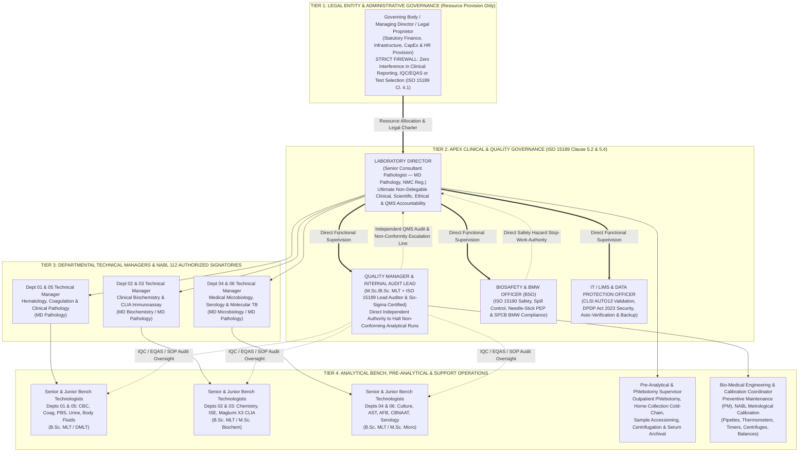

# 0.2.3 Clause 5 Legal Entity Statutory Registration Dossier, Organization Chart, Laboratory Director Charter & 30 Quantitative Quality Indicators (`IFCC WG-LEPS`) Master SOP

---

## Document Control & Regulatory Traceability Header (`ISO 15189:2022 Clause 8.3.2`)

| Document Metadata Field | Controlled Entry |
| :--- | :--- |
| **Document Title** | Clause 5 Structural & Governance Requirements: Legal Entity, Statutory Licenses, Organizational Architecture, Laboratory Director Charter, 30 Quantitative Quality Indicators (`IFCC WG-LEPS`) & Structural Risk Management SOP |
| **Document ID** | `NABL-QSP-0.2.3` |
| **Document Tier** | `Level-2 Quality System Procedure (QSP) & NABL 153 Portal Dossier` |
| **Version & Revision Status** | `Version 3.0 (International 6-Persona Red-Team Upgraded — NABL / CAP / UKAS Audit Ready)` |
| **Effective Date** | `15-Oct-2026` |
| **Next Mandatory Review Date** | `14-Oct-2027` (`Annual Review Cycle or Earlier Upon Statutory / NABL Revision`) |
| **Prepared By** | `Quality Manager (ISO 15189:2022 Lead Auditor & Six-Sigma Black Belt)` |
| **Reviewed By** | `Healthcare Regulatory Counsel & Departmental Technical Managers (Depts 01–06)` |
| **Approved & Authorized By** | `Laboratory Director (Senior Consultant Pathologist, MD Pathology — NMC Reg. Verified)` |
| **Primary Standard Mapping** | `ISO 15189:2022 Clauses 5.1, 5.2, 5.3, 5.4, 5.5, 5.6, 4.1, 8.2, 8.5, 8.8, 8.9` |
| **NABL Specific Criteria Mapping** | `NABL 112 (Specific Criteria for Medical Labs)`, `NABL 131 (Terms & Conditions)`, `NABL 133 (Symbol Policy)`, `NABL 153 (Application Form)`, `NABL 220D (Pre-Assessment)`, `NABL 223 (Assessment Checklist)` |
| **International Benchmark Mapping** | `IFCC WG-LEPS Model of Quality Indicators (MQI)`, `ISO 22367:2020 (Risk Management)`, `ISO 15190:2020 (Safety)`, `CLSI QMS01-Ed5`, `CLSI GP47`, `CAP Laboratory General Checklist (GEN)` |
| **Controlled Distribution** | `Copy 01: Master Quality Manual Binder` \| `Copy 02: NABL 153 Online Portal Upload Repository` \| `Copy 03: Laboratory Director Office` \| `Copy 04: LIMS Controlled Intranet Read-Only View` |

---

## Section 1: Purpose, Scope & Clause 5 Governance Mandate (`ISO 15189:2022`)

### 1.1 Purpose
This Standard Operating Procedure (`SOP`) establishes the legally binding structural, regulatory, organizational, and performance-monitoring framework of the medical laboratory in strict compliance with **`ISO 15189:2022 Clause 5 (Structural and Governance Requirements)`**. Specifically, this document codifies:
1. **Legal Entity Identity & Statutory Compliance (`Clause 5.1`):** Verifiable corporate/legal accountability, statutory operating licenses, environmental/bio-medical waste permits, fire and electrical safety clearances, and professional medical malpractice liability coverage.
2. **Laboratory Director Competence & Statutory Charter (`Clause 5.2`):** The non-delegable clinical, scientific, organizational, and educational responsibilities of the qualified Laboratory Director (`MD Pathology`) and the structured governance of delegated tasks.
3. **Defined Range of Laboratory Activities (`Clause 5.3`):** Explicit demarcation of permanent facility testing (`273 Parameters across 6 Diagnostic Departments`), mobile/home-collection pre-examination activities, NABL-accredited vs. non-accredited scope boundaries, and clinical advisory services.
4. **Organizational Structure, Authority & Interrelationships (`Clause 5.4`):** A firewall-protected organizational hierarchy separating commercial/administrative ownership from clinical/analytical decision-making (`Clause 4.1 Impartiality`), supported by a comprehensive Role-Responsibility-Authority Matrix and a 24/7 Primary-to-Deputy Substitution Matrix.
5. **Quality Objectives & 30 Quantitative Quality Indicators (`Clause 5.5`):** Harmonized implementation of **30 Quantitative Quality Indicators (`10 Pre-Analytical + 10 Intra-Analytical + 10 Post-Analytical & Support`)** benchmarked against the **International Federation of Clinical Chemistry and Laboratory Medicine Working Group on Laboratory Errors and Patient Safety (`IFCC WG-LEPS`)** international percentiles (`25th / 50th / 75th`) and **Six-Sigma Defect-Per-Million-Opportunities (`DPMO`)** metrics.
6. **Structural Risk Management Governance (`Clause 5.6`):** Systematic identification, Failure Mode and Effects Analysis (`FMEA` per `ISO 22367:2020`), and mitigation of governance, regulatory, staffing, and KPI-integrity risks.

### 1.2 Scope
This SOP applies unconditionally to the Governing Body / Legal Entity Proprietors/Directors, the Laboratory Director, the Quality Manager, the Biosafety Officer, Departmental Technical Managers / Authorized Signatories (`NABL 112`), Bench Technologists, Phlebotomy & Home-Collection Personnel, IT/LIMS Administrators, and Administrative Support Staff across all six diagnostic departments:
* **Department 01:** Hematology, Coagulation & Automated Cell Morphometry
* **Department 02:** Clinical Biochemistry, Electrolytes & Metabolic Profiling
* **Department 03:** Chemiluminescence Immunoassay (`CLIA`), Endocrinology, Maternal/Fetal Markers & Oncology
* **Department 04:** Infectious Disease Serology, Autoimmune Immunology & Nephelometry
* **Department 05:** Clinical Pathology, Urinalysis, Semen Analysis, Body Fluids & Cytopathology
* **Department 06:** Medical Microbiology, Automated Blood Culture, Antimicrobial Susceptibility Testing (`AST`) & Molecular Diagnostics (`CBNAAT / TrueNat`)

---

## Section 2: Master Statutory & Regulatory License Compliance Dossier (`ISO 15189:2022 Clause 5.1` & `NABL 153 Sec 1`)

### 2.1 Legal Identity & Single-Name Consistency Rule (`Clause 5.1`)
1. The laboratory operates as a legally identifiable entity (or a defined division of a parent legal entity that accepts full legal and financial responsibility for all laboratory activities).
2. **Strict Legal Name Alignment Mandate (`NABL 153 Sec 1.2`):** The exact legal entity name, registered parent organization name (if applicable), and physical street address printed on the **Legal Incorporation Certificate**, **Clinical Establishment Registration (`CEA`)**, **State Pollution Control Board (`SPCB`) BMW Authorization**, **LIMS Patient Report Header**, and **NABL 153 Portal Application** must match character-for-character. Any trade name or brand name ("Doing Business As" / `DBA`) must be explicitly registered as `"<Brand Name> (A Unit of <Registered Legal Entity Name>)"`.
3. **Prohibition of Unregistered Satellite Testing:** Diagnostic testing under the laboratory's NABL Accreditation Certificate is restricted strictly to the permanent physical facility coordinates audited by NABL. Collection centers or home-collection phlebotomy operations perform **pre-examination specimen collection and transport only** and shall never claim independent NABL testing accreditation unless separately assessed as a Collection Center/Satellite Lab under `NABL 112 / NABL 153`.

### 2.2 The 14-Row Statutory & Regulatory Compliance Master Matrix
The Quality Manager maintains the **Master Statutory Compliance Dossier (`Physical Binder NABL-DOC-STAT-01 + Encrypted LIMS Cloud Repository`)**. All 14 statutory instruments listed below must remain current and active:

| S.No. | Statutory License / Legal Instrument | Governing Statute / Regulatory Standard | Issuing Authority (`India / State / Municipal`) | Mandatory Verification & Technical Specifications | NABL 153 Portal Upload & Audit Status | Validity / Renewal Cycle | Filing Location & Controlled Ref |
| :---: | :--- | :--- | :--- | :--- | :--- | :---: | :--- |
| **1** | **Legal Entity Incorporation / Constitutional Document** | Companies Act, 2013 (`CIN`) / LLP Act, 2008 / Indian Partnership Act, 1932 / Indian Trusts Act, 1882 / MSME Udyam Registration Act | Ministry of Corporate Affairs (`MCA`) / Registrar of Firms (`RoF`) / Ministry of MSME | Must state exact legal entity name, registered office address, diagnostic healthcare object clause, and list of Directors/Partners/Proprietor. | **Mandatory Upload (`NABL 153 Sec 1.2`)** — Primary proof of legal existence (`ISO 15189 Cl. 5.1`). | Permanent (Update within 30 days of any Director/Partner change) | `Statutory Binder Tab 01` (`DOC-LEG-01`) |
| **2** | **Tax & Fiscal Identity Registrations (`PAN`, `GSTIN`, `TAN`) & Premises Ownership / Lease Deed** | Income Tax Act, 1961 / Central Goods & Services Tax (`CGST`) Act, 2017 / Registration Act, 1908 | Income Tax Department (`CBDT`) / GST Council / Sub-Registrar of Assurances | Active `PAN` and `GSTIN` matching the legal entity name; Registered Ownership Title Deed or Notarized/Registered Commercial Lease Agreement covering $\ge 3\text{ years}$ tenure with explicit permission for medical laboratory operations. | **Mandatory Upload (`NABL 153 Sec 1.2 & 1.4`)** — Verifies lawful physical occupancy (`ISO 15189 Cl. 6.3.1`). | `PAN/GST`: Permanent; `Lease Deed`: Renew $\ge 90\text{ days}$ prior to expiry | `Statutory Binder Tab 02` (`DOC-LEG-02`) |
| **3** | **Clinical Establishments Registration / State Diagnostic Lab License** | Clinical Establishments (Registration and Regulation) Act, 2010 (`CEA`) / State Nursing Homes & Clinical Establishments Act | District Registering Authority (`DRA`) / Chief Medical Officer (`CMO`) / Directorate of Health Services (`DHS`) | Must explicitly authorize all operating diagnostic modalities (`Pathology, Hematology, Biochemistry, Immunoassay, Microbiology, Serology`) and list the registered Laboratory Director (`MD`). | **Mandatory Upload (`NABL 153 Sec 1.3`)** — Zero NABL processing without valid `CEA / CMO` registration. | `1 to 5 Years` (State-specific) | `Statutory Binder Tab 03` (`DOC-LEG-03`) |
| **4** | **Municipal Corporation Health Trade License & Shops and Establishments Registration** | State Municipal Corporation Act / State Shops and Commercial Establishments Act | Municipal Health Officer (`MHO`) / State Labour Commissioner | Certifies compliance with local municipal zoning, sanitation, vector control, working hours, maternity benefits, and employee welfare regulations. | **Mandatory Inspection (`NABL 223 Cl. 5.1`)** | `Annual / 3 Years` | `Statutory Binder Tab 04` (`DOC-LEG-04`) |
| **5** | **`NABL 131` Signed Undertaking & `NABL 133` Symbol Usage Policy Compliance Declaration** | `NABL 131` (*Terms & Conditions for Obtaining and Maintaining Accreditation*) & `NABL 133` (*Policy on Use of NABL Symbol*) | National Accreditation Board for Testing and Calibration Laboratories (`NABL — QCI`) | Signed by the Legal Entity Chief Executive / Proprietor and Laboratory Director on official letterhead; commits to impartiality, unannounced surveillance access, fee payment, and strict adherence to `NABL 133` symbol rules. | **Mandatory Upload (`NABL 153 Annex`)** | Renewed at every 2-Year Re-Assessment / Revision of `NABL 131` | `Statutory Binder Tab 05` (`DOC-LEG-05`) |
| **6** | **State Pollution Control Board (`SPCB / PCC`) Bio-Medical Waste (`BMW`) Authorization & Liquid Effluent Consent** | Environment (Protection) Act, 1986; Bio-Medical Waste Management Rules, 2016 (Amended 2018 & 2019); Water Act, 1974 | State Pollution Control Board (`SPCB`) / Pollution Control Committee (`PCC`) | Specifies authorized monthly generation quantities (kg/month) across `Yellow`, `Red`, `White (Translucent)`, and `Blue` categories, plus validation of sodium hypochlorite ($1\%\text{–}2\%$) pre-treatment / Effluent Treatment Plant (`ETP`) for analyzer liquid discharge. | **Mandatory Upload (`NABL 153 Sec 1.3` & `ISO 15190 Cl. 17`)** | `5 Years` (or Bedded/Non-Bedded lifetime/periodic renewal per SPCB) | `Statutory Binder Tab 06` (`DOC-LEG-06` / `SOP 0.1.14`) |
| **7** | **Authorized Common Bio-Medical Waste Treatment Facility (`CBWTF`) Tri-Partite / Bilateral Service Agreement & Barcoded Tracking Registration** | `BMW Rules 2016` Rule 4(b), 4(i), 4(n) & Central Pollution Control Board (`CPCB`) Barcoding Guidelines | SPCB-Authorized `CBWTF` Operator & State/Central Pollution Control Board | Legally binding agreement for daily collection (within $\le 48\text{ hours}$) of barcoded, GPS-tracked bio-medical waste bags/sharps containers, plus submission of **Form-IV Annual BMW Report** by `30th June` every year. | **Mandatory Upload (`NABL 153` & `NABL 223`)** | `Annual Renewal` (Form-IV filed annually by June 30) | `Statutory Binder Tab 07` (`DOC-LEG-07` / `NABL-LOG-10`) |
| **8** | **Fire Safety `NOC` / Fire Clearance Certificate & Annual Fire Extinguisher Hydro-Testing / Refilling Certificate** | National Building Code of India (`NBC 2016 Part 4: Fire and Life Safety`) / State Fire Service Act / `ISO 15190:2020 Clause 10` | Directorate of Fire & Emergency Services / Chief Fire Officer (`CFO`) & ISO-Certified Fire Safety Vendor | Verifies unobstructed emergency exits, illuminated exit signage, smoke/heat detectors, fire alarm panel, and pressure-tested `ABC Dry Powder` and `CO2` (for electrical/analyzer fires) extinguishers with valid refill tags. | **Mandatory Upload & On-Site Inspection (`NABL 223 Cl. 6.3`)** | `Fire NOC: 1–3 Years`; `Extinguisher Refill & Mock Drill: Annual` | `Statutory Binder Tab 08` (`DOC-LEG-08` / `SOP 0.2.4`) |
| **9** | **`PC & PNDT Act, 1994` Genetic Laboratory Registration OR Notarized Statutory Non-Sex-Selection Affidavit** | Pre-Conception and Pre-Natal Diagnostic Techniques (Prohibition of Sex Selection) Act, 1994 & Rules, 1996 | District Appropriate Authority (`DAA — PC&PNDT` / District Magistrate / Civil Surgeon) | **If performing maternal serum prenatal screening (`Dual / Triple / Quadruple Marker`, `NIPT`, Karyotyping):** Valid `Form B` PC&PNDT Genetic Lab Registration & `Form F` archival for 2 years. **If pure biochemical/endocrine testing without sex determination:** Notarized Affidavit certifying zero fetal sex determination under `PC&PNDT Act`. | **Mandatory Conditional Upload (`NABL 153` & `SOP 3.5.6`)** | `5 Years` (Renew $\ge 30\text{ days}$ prior via Form A) | `Statutory Binder Tab 09` (`DOC-LEG-09`) |
| **10** | **Atomic Energy Regulatory Board (`AERB`) `e-LORA` License OR Non-Ionizing Radiation Declaration** | Atomic Energy Act, 1962 & Atomic Energy (Radiation Protection) Rules, 2004 | Atomic Energy Regulatory Board (`AERB`, Govt. of India) | Required if diagnostic X-Ray, CT, Mammography, DEXA, or Radioimmunoassay (`RIA` using $^{125}\text{I}$) operates under the same clinical establishment. For pure non-isotopic `CLIA` (`Maglumi X3` ABEI flash chemiluminescence), a signed **Statutory Declaration of Zero Radioactive Isotope Usage** is filed. | **Conditional Upload (`NABL 153`)** | `AERB: 5 Years`; `CLIA Non-Isotopic Declaration: Permanent` | `Statutory Binder Tab 10` (`DOC-LEG-10`) |
| **11** | **Professional Medical Indemnity (Errors & Omissions) Insurance & Public Liability Policy** | `ISO 15189:2022 Clause 5.1` (Liability Coverage) & Consumer Protection Act (`CPA`), 2019 | Insurance Regulatory and Development Authority of India (`IRDAI`) Licensed General Insurer | Covers diagnostic errors, omissions, misinterpretation, pre-analytical phlebotomy injury (nerve injury, syncope fall, hematoma), and third-party visitor liability on laboratory premises (Minimum recommended coverage: $\ge \text{INR } 50\text{ Lakhs to } 2\text{ Crores}$ with retroactive date continuity). | **Mandatory Verification (`NABL 223 Cl. 5.1`)** | `Annual` (Zero-gap continuous policy renewal) | `Statutory Binder Tab 11` (`DOC-LEG-11`) |
| **12** | **Electrical Safety Audit, Earth-Pit Resistance Certificate (`< 1.0 Ohm`) & DG Set Consent** | Central Electricity Authority (`CEA`) Measures Relating to Safety and Electric Supply Regulations, 2023 & `IS 3043:2018` | Licensed Electrical Inspector / Chartered Electrical Safety Engineer | Certifies dedicated isolated copper/chemical earth-pit resistance **$< 1.0\ \Omega$** for high-sensitivity analyzers (`Maglumi X3`, `5-Part Hematology`, `Biochemistry`), Neutral-to-Earth voltage **$< 0.5\text{ V AC}$**, functional `ELCB/RCCB (30 mA)`, online `UPS` harmonic distortion $< 3\%$, and acoustic enclosure consent for Backup `DG Set` ($< 75\text{ dB(A)}$). | **Mandatory Inspection (`NABL 223 Cl. 6.3 & 6.4`)** | `Annual` (Earth-pit tested every 6 months: Pre-Monsoon & Post-Monsoon) | `Statutory Binder Tab 12` (`DOC-LEG-12` / `SOP 0.2.4`) |
| **13** | **National Medical Commission (`NMC`) / State Medical Council (`SMC`) Registrations & Postgraduate Degrees of All Signatories** | National Medical Commission (`NMC`) Act, 2019 / Indian Medical Council Act & `NABL 112` Specific Criteria | National Medical Commission (`NMC`) / State Medical Council (`SMC`) | Active, unencumbered `MBBS` + Additional Postgraduate Qualification (`MD / DNB` in Pathology, Biochemistry, or Microbiology) registration certificates, Good Standing Certificates, and full-time/part-time employment contracts with explicit working hours and specimen signatures. | **Mandatory Upload (`NABL 153 Sec 6` & `NABL 112`)** | `5 Years` (State Medical Council Credit-Hour Renewal) | `Statutory Binder Tab 13` & `HR Dossiers` (`SOP 0.1.12`) |
| **14** | **`DPDP Act 2023` Data Fiduciary Registration, `ABDM (HFR/HPR)` Registration, LIMS Software License & Poison/Spirit Permit** | Digital Personal Data Protection (`DPDP`) Act, 2023; Information Technology Act, 2000; Ayushman Bharat Digital Mission (`ABDM`); State Poisons Act | Ministry of Electronics & IT (`MeitY`) / National Health Authority (`NHA — ABDM`) / State Excise & Drug Controller | Valid OEM commercial license and `CLSI AUTO13 / ISO 15189 Annex A` validation certificate for LIMS; `ABDM Health Facility Registry (HFR)` ID; Patient Privacy & Consent Notice (`DPDP Act 2023`); and storage permit/stock ledger for absolute methanol/ethanol and concentrated acids (`Romanowsky stains, ZN stain`). | **Mandatory Inspection (`NABL 223 Cl. 7.10 & 8.3`)** | `LIMS License: Annual AMC`; `Spirit/Acid Stock Audit: Monthly` | `Statutory Binder Tab 14` (`DOC-LEG-14` / `SOP 0.1.15`) |

---

### 2.3 The 90-Day Statutory Renewal Alert & Lapse-Prevention Protocol (`Zero-Gap Shield`)
To prevent any regulatory lapse that would trigger immediate suspension of NABL accreditation under **`NABL 131`** or statutory closure under the **`Clinical Establishments Act`**:

1. **Automated LIMS & Calendar Escalation Matrix (`T-90 / T-60 / T-30 / T-15`):**
   * **`T - 90 Days` (First Yellow Alert):** The LIMS Compliance Module and Quality Manager's Master Statutory Tracker trigger an automated alert to the Quality Manager and Legal Entity Administrator. The renewal application dossier, fee challan, and prerequisite inspection documents (e.g., Fire extinguisher pressure test, CBWTF contract renewal, Earth-pit test) are compiled and submitted to the statutory authority within $15\text{ days}$.
   * **`T - 60 Days` (Second Amber Alert):** The Quality Manager uploads the **Official Renewal Application Acknowledgment Receipt / Challan** into `Statutory Binder Tab 01–14`. If the statutory authority requires an on-site inspection (e.g., `SPCB`, `CMO`, `Fire Officer`), the Laboratory Director sends a formal follow-up letter requesting priority scheduling.
   * **`T - 30 Days` (Third Orange Alert — Laboratory Director Escalation):** If the renewed certificate has not yet been issued, the Laboratory Director and Legal Counsel escalate directly to the nodal officer of the Issuing Authority (`CMO / SPCB Regional Officer / Fire Station Officer`) with proof of timely application submission (`Deemed Continuity Protection under Administrative Law`).
   * **`T - 15 Days` (Fourth Red Alert — Contingency Activation):** If any critical license (`CEA`, `SPCB BMW`, `PC&PNDT`, or sole `Authorized Signatory NMC Registration`) faces imminent expiry without a valid renewal acknowledgment receipt, the Laboratory Director convenes an **Emergency Management Review Meeting (`MRM`)** to activate NABL-accredited referral backup (`SOP 0.2.5`) or temporary deputy signatory coverage.
   * **`T - 0 Days` (Hard-Stop Compliance Rule):** Under no circumstances shall the laboratory perform prenatal screening under an expired `PC&PNDT` license or release NABL-endorsed reports within a discipline lacking an active `NABL 112`-qualified Authorized Signatory.
2. **Mandatory 30-Day Notification to NABL (`NABL 131 Clause 12`):**
   * The Laboratory Director and Quality Manager must formally notify NABL in writing (via the NABL Web Portal) **within $\le 15\text{ to }30\text{ calendar days}$** of any change in:
     1. Legal status, ownership, shareholding structure, or legal/brand name;
     2. Laboratory Director, Quality Manager, or any NABL-approved Authorized Signatory (`Addition / Resignation / Long Leave > 30 days`);
     3. Physical premises address, structural layout modification, or environmental relocation;
     4. Major primary analytical equipment (`e.g., replacement of Maglumi X3, Biochemistry Autoanalyzer, or 5-Part Hematology Analyzer`) affecting the accredited scope (`NABL 153`).

---

## Section 3: Organizational Structure, Scope of Activities & Laboratory Director Charter (`ISO 15189:2022 Clauses 5.2, 5.3 & 5.4`)

### 3.1 Master Organizational Architecture & Impartiality Firewall (`Organogram — Clauses 4.1 & 5.4`)
The laboratory's organizational architecture enforces an absolute structural firewall between **Commercial/Administrative Ownership** and **Clinical/Analytical Governance**:



---

### 3.2 Comprehensive Role, Responsibility, Authority & Interrelationship Matrix (`ISO 15189:2022 Clause 5.4.1`)
Every functional role within the laboratory has clearly defined responsibilities, explicit decision-making authorities, and cross-departmental interrelationships:

| S.No. | Organizational Role | Minimum Qualification (`NABL 112` & `CEA`) | Core Responsibilities (`What They Must Do`) | Explicit Delegated Authority (`What They Can Enforce / Stop`) | Key Organizational Interrelationships |
| :---: | :--- | :--- | :--- | :--- | :--- |
| **1** | **Governing Body / Managing Director / Legal Proprietor** | Corporate Director / Legal Entity Owner | Provide uninterrupted financial resources, capital equipment, staffing budgets, statutory fees, UPS/DG power infrastructure, and legal liability insurance (`Clause 5.1`). | Authority to approve annual financial budgets, sign statutory leases/contracts, and execute `NABL 131` alongside the Lab Director. **Prohibited from accessing LIMS result entry or influencing clinical decisions (`Clause 4.1`).** | Reports statutory/financial status to Regulatory Authorities; interfaces exclusively with the Laboratory Director on resource planning during `MRM`. |
| **2** | **Laboratory Director** | `MD / DNB Pathology` (Full-time Senior Consultant, NMC Registered + $\ge 5\text{ years}$ post-PG diagnostic governance experience) | Overall clinical, scientific, organizational, administrative, and educational leadership (`Clause 5.2`); chairing `MRM`; approving Level 1–4 QMS documents; final oversight of `EQAS`, `MU`, method validation (`CLSI EP15/EP06`), and clinical interpretation. | **Supreme Clinical & Quality Authority:** Authority to veto any commercial contract that compromises quality, halt laboratory operations during unsafe environmental/analytical events, approve/revoke Authorized Signatories, and authorize emergency `CAPA`. | Direct supervisor of Quality Manager, Technical Managers (`Depts 01–06`), Biosafety Officer, and IT/LIMS Officer; primary liaison with NABL, Clinicians, and `CMO`. |
| **3** | **Quality Manager (`QM`)** | `M.Sc. / B.Sc. MLT` with $\ge 5\text{ years}$ bench experience + Certified `ISO 15189:2022` Internal Auditor (`4-Day NABL/IAF Course`) | Maintain the Quality Management System (`Clause 5.4.2`); manage Document Control (`SOP 0.1.11`), monthly compilation of all **30 Quantitative Quality Indicators (`QIs`)**, `IQC` Levey-Jennings / Westgard Sigma review, `EQAS` root-cause investigations, Internal Audits (`SOP 0.2.11`), and `MRM` dossier preparation. | **Unconditional Stop-Work Authority:** Independent authority to lock any analyzer assay in LIMS if daily `IQC` violates Westgard rejection rules (`1:3s`, `2:2s`, `R:4s`), quarantine unverified reagent lots, and issue mandatory Non-Conformity (`NC`) notices to any department. | Reports directly to the Laboratory Director; coordinates daily with all 6 Technical Managers, Bench Supervisors, Phlebotomy Lead, and Bio-Medical Coordinator. |
| **4** | **Technical Manager & Authorized Signatory: Depts 01 & 05 (`Hematology, Coagulation & Clinical Pathology`)** | `MD / DNB Pathology` (NMC Registered, `NABL 112` Clause-compliant) | Supervise automated 5-part `CBC`, `ESR`, Coagulation (`PT/INR, aPTT, Fibrinogen, D-Dimer`), Peripheral Blood Smear (`PBS`) morphology, Reticulocytes, Bone Marrow, Urinalysis, Semen Analysis, and Body Fluid cytology (`CSF, Pleural, Ascitic, Synovial`). | Authority to release and digitally sign final diagnostic reports in Depts `01 & 05`, mandate manual smear review or platelet citrate redraws (for EDTA pseudothrombocytopenia), and trigger `CLSI GP47` critical hematology alerts (e.g., Blasts, $\text{Hb} < 5.0\text{ g/dL}$, $\text{Platelets} < 20,000/\mu\text{L}$, $\text{INR} > 5.0$). | Reports to Laboratory Director; supervises Hematology/Clinical Pathology Bench Technologists; consults with treating Hematologists/Physicians on complex morphology. |
| **5** | **Technical Manager & Authorized Signatory: Depts 02 & 03 (`Clinical Biochemistry & CLIA Immunoassay`)** | `MD / DNB Biochemistry` or `MD / DNB Pathology` (NMC Registered, `NABL 112` Clause-compliant) | Supervise automated Photometric Biochemistry, Direct/Indirect `ISE` Electrolytes, `HbA1c`, `ABG`, and `Snibe Maglumi X3` Flash Chemiluminescence Immunoassay (`Thyroid, Fertility, Cardiac, Tumor Markers, Bone/Anemia, Maternal Screening`), including master curve (`2-point`) recalibration and `CLSI EP07` `HIL` index verification. | Authority to validate and sign final Biochemistry and `CLIA` reports, enforce `1:10 / 1:100` auto-dilution protocols for hook-effect/linearity breaches, reject hemolyzed/lipemic sera (`H/I/L Index`), and authorize lot-to-lot reagent cross-over acceptance (`\lvert\text{Bias}\rvert \le \frac{1}{2}\text{TE}_a$). | Reports to Laboratory Director; directs Chemistry/CLIA Bench Technologists; collaborates with Quality Manager on Six-Sigma (`\sigma`) and Measurement Uncertainty (`MU`) calculations. |
| **6** | **Technical Manager & Authorized Signatory: Depts 04 & 06 (`Medical Microbiology, Serology & Molecular`)** | `MD / DNB Microbiology` or `MD / DNB Pathology` (NMC Registered, `NABL 112` Clause-compliant) | Supervise Bacteriology Culture, Automated Blood Culture, `CLSI M100 / EUCAST` Antimicrobial Susceptibility Testing (`AST`), `WHONET` Antibiogram compilation, Mycology, Parasitology, `ZN/Auramine` AFB Microscopy, `CBNAAT/TrueNat`, and Infectious/Autoimmune Serology (`HIV, HBsAg, HCV, Dengue, Syphilis, ANA`). | Authority to validate culture/AST reports, enforce cascade antibiotic reporting (`Tier 1/2/3`), telephone positive Blood Culture / CSF Gram stains within $\le 15\text{ minutes}$, authorize `HIV` fourth-generation tie-breaker confirmatory testing (`NACO Strategy III`), and submit mandatory `IDSP / Nikshay` statutory disease notifications. | Reports to Laboratory Director; guides Microbiology/Serology Technologists; serves on Hospital/Clinic Antimicrobial Stewardship and Infection Control Committees. |
| **7** | **Biosafety & Bio-Medical Waste Officer (`BSO`)** | Senior Technologist / Microbiologist trained in `ISO 15190:2020` & `BMW Rules 2016/2019` | Oversee Biosafety Cabinet (`BSC Class II A2`) certification, chemical/biological spill management (`1%–2%` & `10%` Sodium Hypochlorite), eyewash/shower weekly flushing, Hepatitis B vaccination titers ($\text{Anti-HBs} \ge 10\text{ mIU/mL}$), Needle-Stick Injury (`NSI`) Post-Exposure Prophylaxis (`PEP` within $< 2\text{ hours}$), and barcoded `CBWTF` waste handover. | Authority to quarantine any spill zone, mandate immediate `PEP` evaluation for exposed staff, reject improperly segregated waste bags, and halt `BSC` operations if airflow velocity fails ($0.38\text{–}0.51\text{ m/s}$). | Dual reporting to Laboratory Director and Quality Manager; audits Housekeeping, Phlebotomy, and Microbiology staff daily. |
| **8** | **IT / LIMS & Data Protection Officer (`DPO`)** | B.Tech / MCA / IT Systems Specialist trained in `ISO 15189 Annex A`, `CLSI AUTO13` & `DPDP Act 2023` | Manage bidirectional analyzer-LIMS ASTM/HL7 interfacing, auto-verification algorithms, delta-check rules, role-based access control (`RBAC`), digital signature token security, encrypted `3-2-1` daily backup, quarterly disaster recovery restoration drills, and `DPDP Act 2023` patient data privacy. | Authority to revoke compromised user credentials immediately, lock LIMS master formula/reference interval tables against unauthorized edits, and isolate network segments during cybersecurity incidents. | Reports to Laboratory Director and Quality Manager; supports all Technical Managers and Front-Desk / Accessioning staff. |
| **9** | **Pre-Analytical & Phlebotomy Supervisor** | Senior B.Sc. MLT / Certified Phlebotomy Lead ($\ge 3\text{ years}$ experience) | Supervise outpatient venipuncture (`CLSI GP41`), strict `CLSI` Order of Draw, pediatric/difficult-draw protocols, Home-Collection cold-chain logistics ($2^\circ\text{C–}8^\circ\text{C}$ data-logged vaccine carriers), barcoded primary tube accessioning, centrifugation `RCF` ($g$-force) compliance, and pre-analytical rejection logging (`QI-PRE-01` to `QI-PRE-10`). | Authority to reject unlabeled/mislabeled, clotted, under-filled citrate ($< 90\%$), or temperature-breached specimens at the Accessioning Desk and mandate immediate free-of-cost patient recollection with root-cause documentation. | Reports to Quality Manager and Technical Managers; manages Phlebotomists, Home-Collection Couriers, and Front-Desk Receptionists. |

---

### 3.3 The 14-Duty Statutory Charter of the Laboratory Director (`ISO 15189:2022 Clause 5.2.1 – 5.2.3`)
In accordance with **`ISO 15189:2022 Clause 5.2`** and **`NABL 112`**, the Laboratory Director holds ultimate, non-transferable clinical and regulatory responsibility for the operation of the laboratory. Even when specific operational tasks are delegated in writing to qualified personnel (`Section 3.4`), **ultimate accountability remains exclusively with the Laboratory Director**:

1. **Clinical Advisory & Diagnostic Consultation (`Clause 5.2.2 c & 5.3.2`):** Provide direct clinical consultation to ordering physicians and patients regarding rational test selection (`SOP 0.1.9`), pre-examination patient preparation (`fasting, circadian timing, drug washout`), specimen choice, reflexive testing algorithms, and post-examination clinical interpretation across all 6 departments.
2. **Approval of Quality Management System Documentation (`Clause 8.3`):** Review and formally authorize the Level-1 Apex Quality Manual (`0.2.2`), Level-2 Quality System Procedures (`QSPs`), Level-3 Technical Standard Operating Procedures (`273 test SOPs`), and Level-4 Formats/Logs prior to implementation.
3. **Method Verification, Validation & Measurement Uncertainty Approval (`Clauses 7.3.2, 7.3.3 & 7.3.4`):** Approve all pre-examination and analytical verification dossiers (`CLSI EP15-A3` precision/trueness, `CLSI EP06-Ed2` linearity, `CLSI EP17-A2` LoB/LoD/LoQ, `ISO/TS 20914` Measurement Uncertainty $U$, and primary-to-backup analyzer comparability studies) before any assay is placed into clinical patient use.
4. **Biological Reference Intervals & Clinical Decision Limits (`Clause 7.3.5`):** Establish, verify (`CLSI EP28-A3c` $n=20$ transference or $n \ge 120$ direct partitioning), and annually review age-, sex-, menstrual-phase-, and trimester-stratified biological reference intervals and clinical decision cutoffs (`SOP 0.1.8`).
5. **Critical ("Panic") Alert Governance (`Clause 7.4.1.6` & `CLSI GP47`):** Define the life-threatening Critical Value Alert List (`SOP 0.1.5`), enforce the mandatory $\le 30\text{-minute}$ read-back notification target ($\le 15\text{ minutes}$ for positive blood/CSF Gram stains), and directly intervene with the treating physician whenever nursing/ward escalation fails.
6. **Proficiency Testing (`PT / EQAS`) & Inter-Laboratory Comparison (`ILC`) Oversight (`Clause 7.3.7.3`):** Select `ISO/IEC 17043`-accredited PT/EQAS providers (`CMC Vellore, AIIMS, RML, Bio-Rad`), review every monthly/cycle Z-score report (`\lvert Z\rvert \le 2.0`), and sign off on root-cause Corrective and Preventive Action (`CAPA`) for any warning (`2.0 < \lvert Z\rvert < 3.0`) or unsatisfactory (`\lvert Z\rvert \ge 3.0`) performance (`SOP 0.2.7`).
7. **Competence Assessment & Personnel Authorization (`Clause 6.2`):** Define qualification criteria, approve training curricula, conduct and sign annual6-point competency assessments (`Direct Observation, Blinded Unknowns, IQC/EQAS Review, Written Exam, Problem-Solving, Record Audit`), and issue formal **Letters of Authorization** for bench testing and report signing (`SOP 0.1.12`).
8. **Selection & Monitoring of Referral Laboratories & Critical Suppliers (`Clauses 6.6 & 6.8`):** Evaluate and approve `ISO 15189` (NABL) accredited referral laboratories (`SOP 0.2.5`) and approved IVD reagent/calibrator manufacturers (`SOP 0.2.9`), ensuring zero compromise in metrological traceability (`ISO 17511`).
9. **Risk Management & Patient Safety Governance (`Clause 5.6 & 8.5`):** Oversee the laboratory's `ISO 22367:2020` Failure Mode and Effects Analysis (`FMEA`) risk register (`SOP 0.1.10`), ensuring every Risk Priority Number ($\text{RPN} \ge 48$ or $\text{Severity} = 5$) is mitigated with engineered LIMS hard-locks.
10. **Quality Objectives & Monthly `IFCC WG-LEPS` Quality Indicator Review (`Clause 5.5`):** Establish annual measurable Quality Objectives, review the monthly **30-Metric Quality Indicator Dashboard**, and mandate process re-engineering whenever any metric breaches its `CAPA` trigger threshold.
11. **Chairing the Management Review Meeting (`MRM — Clause 8.9`):** Convene and chair the formal Management Review Meeting at least annually (and bi-annually during initial NABL accreditation cycles) covering all 15 mandatory inputs and outputs specified in `ISO 15189:2022 Clause 8.9.2 & 8.9.3` (`SOP 0.2.12`).
12. **Facility Environment, Biosafety & Emergency Preparedness (`Clauses 6.3 & 7.8`):** Ensure safe physical facilities (`ISO 15190`), uninterrupted environmental monitoring, disaster continuity plans (`SOP 0.1.6`), and occupational health protection for all personnel.
13. **Resolution of Clinician & Patient Complaints (`Clause 7.9`):** Oversee impartial investigation of all clinical, analytical, or service complaints (`SOP 0.2.10`), authorizing amended/retracted reports (`SOP 0.1.7`) with full audit-trail transparency when analytical or pre-analytical errors are identified.
14. **Ethical Conduct, Impartiality & Statutory Liaison (`Clause 4.1, 4.2 & 5.1`):** Enforce the Code of Ethics (`zero fee-splitting/kickbacks, zero unconsented genetic/HIV testing, strict DPDP Act 2023 confidentiality`), act as the primary signatory for `NABL 131 / 153`, and represent the laboratory before NABL Assessors and Government Health Authorities.

---

### 3.4 Primary-to-Deputy Signatory & Operational Delegation Matrix (`ISO 15189:2022 Clauses 5.2.2 & 5.4.1`)
To guarantee 100% continuity of clinical governance, report verification, and quality oversight during planned leave, CME attendance, illness, or off-shift hours, the following **Primary-to-Deputy Substitution Matrix** is enforced:

| S.No. | Primary Role | Designated Primary Officer | Designated Qualified Deputy Officer (`Backup #1`) | Secondary Contingency Backup (`Backup #2`) | Qualification Parity Requirement (`NABL 112`) | Scope of Delegated Duties & LIMS Digital Signature Protocol | Maximum Absence Before NABL Notification |
| :---: | :--- | :--- | :--- | :--- | :--- | :--- | :---: |
| **1** | **Laboratory Director** | **Dr. [Primary Lab Director]**, `MD Pathology` (Senior Consultant & Full-Time Director) | **Dr. [Deputy Director / Senior Signatory #2]**, `MD Pathology` / `MD Biochemistry` | **Dr. [Empaneled Reliever Consultant Pathologist]**, `MD Pathology` | Must hold NMC-registered `MD / DNB` in Pathology/Laboratory Medicine and meets `NABL 112` Laboratory Director experience criteria. | Full clinical governance, emergency `CAPA` approval, critical value physician escalation, regulatory correspondence, and statutory authority during Primary Director's leave. | **$> 30\text{ Consecutive Days}$** requires formal written notification to NABL Portal (`NABL 131`). |
| **2** | **Quality Manager (`QM`)** | **[Primary Quality Manager]**, `M.Sc. MLT` + Certified `ISO 15189:2022` Internal Auditor | **[Deputy Quality Manager / Senior Biochemistry Supervisor]**, `M.Sc. / B.Sc. MLT` + Certified `ISO 15189:2022` Internal Auditor | **[Senior Microbiology Supervisor]**, `M.Sc. Micro` + `ISO 15189` Trained | Must hold formal `ISO 15189:2022` Internal Auditor training certificate ($\ge 32\text{ hours}$) and $\ge 3\text{ years}$ QMS experience. | Daily `IQC` Levey-Jennings audit, Westgard lock/unlock authorization, `NC/CAPA` logging, monthly `QI` data extraction, and document control maintenance. | **$> 30\text{ Consecutive Days}$** requires formal update on NABL Portal. |
| **3** | **Authorized Signatory: Depts 01 & 05 (`Hematology, Coagulation & Clinical Pathology`)** | **Dr. [Primary Hematopathologist]**, `MD Pathology` | **Dr. [Backup Pathologist #2]**, `MD / DNB Pathology` | **Empaneled NABL-Approved Reliever Pathologist (`MD Pathology`)** OR Referral to NABL-Accredited Partner Lab (`SOP 0.2.5`) | Strictly `MD / DNB Pathology` or `DM Hematology` per `NABL 112` (Biochemists/Microbiologists cannot sign `PBS` morphology or Cytopathology). | Verification and digital e-signature release of `CBC`, Coagulation, `PBS` morphology, Reticulocytes, Urine, Semen, and Body Fluids. Primary's LIMS token is placed on `Leave-Lock` during absence; Deputy signs using their own personal LIMS digital signature (`Zero Proxy Signing!`). | **$> 15\text{–}30\text{ Days}$** (If sole Pathologist is unavailable for a shift, morphology slides are held or referred to NABL Partner Lab). |
| **4** | **Authorized Signatory: Depts 02 & 03 (`Biochemistry & CLIA Immunoassay`)** | **Dr. [Primary Biochemist / Pathologist]**, `MD Biochemistry` / `MD Pathology` | **Dr. [Cross-Covering Pathologist / Biochemist]**, `MD Pathology` / `MD Biochemistry` | **Dr. [Reliever MD Biochemistry / MD Pathology Signatory]** | `MD / DNB Biochemistry` or `MD / DNB Pathology` (or `Ph.D. Medical Biochemistry` with `NABL 112` stipulated experience). | Verification and release of Photometric Chemistry, Electrolytes, `HbA1c`, `ABG`, and `Maglumi X3 CLIA` hormones/tumor/cardiac markers; calibration and `IQC` sign-off. | **$> 30\text{ Consecutive Days}$** requires NABL notification. |
| **5** | **Authorized Signatory: Depts 04 & 06 (`Microbiology, Serology & Molecular`)** | **Dr. [Primary Microbiologist]**, `MD Microbiology` | **Dr. [Cross-Covering Pathologist / Microbiologist]**, `MD Pathology` / `MD Microbiology` | **Dr. [Reliever MD Microbiology Signatory]** | `MD / DNB Microbiology` or `MD / DNB Pathology` per `NABL 112` discipline matrix. | Verification and release of Culture & `AST`, Blood Cultures, `ZN/AFB`, `CBNAAT`, Fungal/Parasitology mounts, and Infectious/Autoimmune Serology; critical Gram stain notification. | **$> 30\text{ Consecutive Days}$** requires NABL notification. |
| **6** | **Biosafety Officer (`BSO`) & IT/LIMS Officer (`DPO`)** | **[Primary BSO]** & **[Primary IT/LIMS Officer]** | **[Deputy Safety Coordinator / Senior Micro Tech]** & **[Deputy LIMS Admin / Quality Manager]** | **[Laboratory Director]** (Emergency Administrative Override) | Documented internal competency training in `ISO 15190` Biosafety / `CLSI AUTO13` LIMS Backup & Recovery. | Spill containment, `PEP` coordination, `CBWTF` manifest verification (`BSO`); daily `3-2-1` backup verification and interface troubleshooting (`IT/LIMS`). | Internal handover logged in `Form NABL-HR-DELEG-01`. |

> **Ironclad Anti-Proxy Digital Signature Rule (`ISO 15189:2022 Clause 7.4.1 & NABL 133`):**
> Under no circumstances shall a Deputy Signatory, Bench Technologist, or IT Administrator apply the digitized signature image or login credentials of an absent Primary Authorized Signatory. When a Primary Signatory goes on leave (`> 24 hours`), the IT/LIMS Officer executes a **Temporary Signatory Leave-Lock** on the Primary's account, and all reports verified during that period bear the name, qualification, NMC registration number, and cryptographic digital signature of the active **Designated Qualified Deputy Signatory**.

---

### 3.5 Defined Range of Laboratory Activities & Scope Boundaries (`ISO 15189:2022 Clause 5.3.1 & 5.3.2`)
1. **Permanent Facility Diagnostic Scope (`Clause 5.3.1`):**
   * The laboratory performs **273 standardized diagnostic examinations** across Departments `01` through `06` exclusively within its permanent, environmentally controlled facility, as itemized in **Master Document `0.2.1 (NABL 153 Master Scope of Accreditation — 273 Parameters)`**.
2. **Pre-Examination Activities Outside the Permanent Facility (`Home Collection & Phlebotomy Centers`):**
   * Pre-examination venipuncture, swab collection, and specimen transport conducted via the laboratory's managed Home-Collection fleet and collection points operate strictly under the laboratory's QMS (`SOP 0.2.6`), utilizing data-logged cold-chain transport boxes ($2^\circ\text{C–}8^\circ\text{C}$) and barcoded chain-of-custody tracking.
3. **Strict Segregation of Accredited vs. Non-Accredited / Referral Tests (`NABL 133`):**
   * Any specialized parameter not included in the laboratory's NABL Certificate of Accreditation—or any parameter outsourced to an external referral laboratory (`SOP 0.2.5`)—is unambiguously flagged on the patient report with an asterisk (`*`) and the explicit disclaimer: **`"* Test not under NABL Accredited Scope of this laboratory"`** or **`"** Test performed by NABL-Accredited Referral Laboratory: [Name & NABL Cert No.]"`**.

---

## Section 4: Quality Objectives & The 30 Quantitative Quality Indicators (`QIs`) Master Dashboard (`ISO 15189:2022 Clause 5.5` & `IFCC WG-LEPS`)

### 4.1 Alignment of Annual Quality Objectives with the Quality Policy (`Clause 5.5 a`)
Top management and the Laboratory Director establish measurable annual **Quality Objectives** across the Total Testing Process (`TTP`), ensuring every objective is quantifiable, tracked monthly via the **30 Quantitative Quality Indicators (`QIs`)**, and reviewed at the Annual Management Review Meeting (`MRM`):
1. **Zero-Harm Patient Identification & Pre-Analytical Integrity Goal:** Achieve **$0.00\%$ ($6.0\ \sigma$)** patient misidentification/unlabeled specimen errors and keep overall pre-analytical specimen rejection below **$< 0.80\%$ ($\ge 4.0\ \sigma$)**.
2. **Analytical Six-Sigma & Metrological Trueness Goal:** Maintain **$\ge 90\%$** of quantitative assays at a world-class or industry-standard process capability of **$\ge 4.0\ \sigma$** (`Westgard Sigma Metric`), achieve **$\ge 98\%$** satisfactory performance (`\lvert Z\rvert \le 2.0$) across all external `EQAS / PT` programs, and keep daily `IQC` rejection rates below **$< 1.5\%$**.
3. **Timely Clinical Decision & Critical Alert Goal:** Achieve **$\ge 96\%$** routine Turnaround Time (`TAT`) compliance, **$\ge 98\%$** emergency `STAT` TAT compliance, and **$100\%$ ($\le 30\text{ min}$)** read-back notification compliance for life-threatening critical values (`CLSI GP47`).
4. **Customer & Clinician Excellence Goal:** Maintain Patient and Clinician Satisfaction Scores (`CSAT`) at **$\ge 94\%$**, resolve **$100\%$** of validated complaints within **$\le 48\text{ hours}$**, and maintain post-release report amendment rates below **$< 0.04\%$ ($\ge 4.9\ \sigma$)**.

### 4.2 Mathematical Conversion Framework: Percentage Defect Rate to `DPMO` and Six-Sigma ($\sigma$)
In accordance with the **IFCC Working Group on Laboratory Errors and Patient Safety (`WG-LEPS`)** consensus model, every Quality Indicator defect percentage is converted into **Defects Per Million Opportunities (`DPMO`)** and **Short-Term Process Sigma ($\sigma$, including the standard $1.5\ \sigma$ long-term shift)** using:

$$\text{DPMO} = \left( \frac{\text{Number of Observed Defects}}{\text{Total Number of Opportunities (Samples / Tests / Reports)}} \right) \times 1,000,000 = \text{Defect Rate (\%)} \times 10,000$$

| Process Sigma Level ($\sigma$) | Defects Per Million Opportunities (`DPMO`) | Defect Percentage Rate ($\%$) | Yield / Success Rate ($\%$) | `IFCC WG-LEPS` Performance Classification |
| :---: | :---: | :---: | :---: | :--- |
| **$6.0\ \sigma$** | $\le 3.4\text{ DPMO}$ | $\le 0.00034\%$ | $99.99966\%$ | **World-Class / Zero-Tolerance Safety Benchmark** (`Patient ID, Transfusion/HIV`) |
| **$5.0\ \sigma$** | $233\text{ DPMO}$ | $0.0233\%$ | $99.977\%$ | **Optimum / State-of-the-Art Performance (`25th Percentile IFCC Target`)** |
| **$4.5\ \sigma$** | $1,350\text{ DPMO}$ | $0.135\%$ | $99.865\%$ | **High-Quality Accredited Benchmark (`50th Percentile IFCC Target`)** |
| **$4.0\ \sigma$** | $6,210\text{ DPMO}$ | $0.621\%$ | $99.379\%$ | **Acceptable Industry Standard (`75th Percentile IFCC Cutoff`)** |
| **$3.5\ \sigma$** | $22,750\text{ DPMO}$ | $2.275\%$ | $97.725\%$ | **Marginal Performance (Requires Proactive Process Improvement)** |
| **$< 3.0\ \sigma$** | $\ge 66,807\text{ DPMO}$ | $\ge 6.68\%$ | $\le 93.32\%$ | **Unacceptable Process Capability (Mandatory Immediate `CAPA` & Redesign)** |

---

### 4.3 The 30-Metric Quantitative Quality Indicators (`QIs`) Master Dashboard (`10 Pre + 10 Intra + 10 Post`)
By the **$5\text{th}$ working day of every calendar month**, the Quality Manager extracts the following **30 Quantitative Quality Indicators** from the LIMS SQL database and departmental quality logs:

#### Part A: 10 Pre-Analytical Quality Indicators (`QI-PRE-01` to `QI-PRE-10`)

| QI Code & `IFCC WG-LEPS` Ref | Pre-Analytical Quality Indicator Name | Exact Mathematical Formula ($\text{\%}$) | `IFCC WG-LEPS` Benchmarks (`25th / 50th / 75th Percentile`) | Laboratory Monthly Target & Sigma ($\sigma$) Goal | LIMS Data-Extraction Query / Source Register | Mandatory `CAPA` & Risk Escalation Trigger |
| :---: | :--- | :--- | :---: | :---: | :--- | :--- |
| **`QI-PRE-01`** (`Pre-MisID`) | **Patient Identification / Primary Tube Mislabeling Error Rate** | $\frac{\text{Unlabeled or Mislabeled Primary Samples}}{\text{Total Primary Samples Received}} \times 100$ | `25th:` $0.000\%$ \| `50th:` $0.015\%$ \| `75th:` $0.040\%$ | **$0.000\%$** (`0 DPMO` \| **$6.0\ \sigma$** `Zero Tolerance`) | `LIMS Query: SELECT COUNT(*) FROM sample_rejections WHERE reason_code = 'REJ-ID-01'` (`Accessioning Log`) | **Any single event ($\ge 1\text{ sample}$):** Immediate root-cause `CAPA`, phlebotomist retraining, and `ISO 22367` FMEA review. |
| **`QI-PRE-02`** (`Pre-Transcrip`) | **Test Order / TRF Data-Entry Transcription Error Rate** | $\frac{\text{Requisitions with Wrong Test/Doctor/Demographics Entered}}{\text{Total Requisitions Registered}} \times 100$ | `25th:` $0.05\%$ \| `50th:` $0.18\%$ \| `75th:` $0.50\%$ | **$< 0.10\%$** ($\le 1,000\text{ DPMO}$ \| **$\ge 4.6\ \sigma$**) | `LIMS Query: Front-Desk Registration Edit / Correction Audit Trail Log` | **$\ge 0.20\%$** in any month or any wrong clinical test panel billed/run. |
| **`QI-PRE-03`** (`Pre-Cont`) | **Wrong Container / Order-of-Draw (`K2-EDTA` Carryover) Rate** | $\frac{\text{Samples in Wrong Tube or }\text{K}^+/\text{Ca}^{2+}\text{ EDTA Carryover}}{\text{Total Samples Received}} \times 100$ | `25th:` $0.02\%$ \| `50th:` $0.07\%$ \| `75th:` $0.20\%$ | **$< 0.08\%$** ($\le 800\text{ DPMO}$ \| **$\ge 4.7\ \sigma$**) | `LIMS Query: REJ-TUBE-02 + Automated LIMS Rule (K > 6.5 & Ca < 6.0 & ALP < 30)` | **$\ge 0.15\%$** or any single undetected `EDTA` contamination reaching reporting. |
| **`QI-PRE-04`** (`Pre-Clot`) | **Clotted Anticoagulated Specimen Rate (`EDTA CBC / Citrate Coag / ESR`)** | $\frac{\text{Rejected Clotted EDTA or Citrate Tubes}}{\text{Total Anticoagulated Tubes Received}} \times 100$ | `25th:` $0.12\%$ \| `50th:` $0.32\%$ \| `75th:` $0.75\%$ | **$< 0.35\%$** ($\le 3,500\text{ DPMO}$ \| **$\ge 4.2\ \sigma$**) | `LIMS Query: REJ-CLOT-03 divided by Total CBC + Coag + HbA1c + ESR Tubes` | **$\ge 0.60\%$** overall or $\ge 2\text{ clotted tubes}$ from the same phlebotomist in a week (Inversion mixing audit). |
| **`QI-PRE-05`** (`Pre-Hem`) | **Hemolyzed Serum/Plasma Specimen Rate (`Automated H-Index > Assay Cutoff`)** | $\frac{\text{Sera Rejected for Free Hb } (\text{H-Index } > 50\text{–}100\text{ mg/dL})}{\text{Total Biochemistry & CLIA Serum Tubes}} \times 100$ | `25th:` $0.25\%$ \| `50th:` $0.65\%$ \| `75th:` $1.40\%$ | **$< 0.65\%$** ($\le 6,500\text{ DPMO}$ \| **$\ge 4.0\ \sigma$**) | `LIMS Query: REJ-HEM-04 + Analyzer Photometric H-Index Flag Log` | **$\ge 1.00\%$** (Audit needle gauge $< 23\text{G}$, syringe-to-tube forced transfer, or transport vibration). |
| **`QI-PRE-06`** (`Pre-Vol`) | **Insufficient Sample Volume (`QNS`) & Citrate Under/Over-Fill ($\neq 9:1 \pm 10\%$) Rate** | $\frac{\text{QNS Samples + Citrate Tubes Outside } 90\%\text{–}110\%\text{ Fill Mark}}{\text{Total Samples Received}} \times 100$ | `25th:` $0.10\%$ \| `50th:` $0.30\%$ \| `75th:` $0.70\%$ | **$< 0.30\%$** ($\le 3,000\text{ DPMO}$ \| **$\ge 4.25\ \sigma$**) | `LIMS Query: REJ-QNS-05 + REJ-CITRATE-RATIO-06` | **$\ge 0.55\%$** (Audit vacutainer vacuum expiry and pediatric micro-collection training). |
| **`QI-PRE-07`** (`Pre-LipIct`) | **Grossly Lipemic (`L-Index > 300 mg/dL`) or Unsuitable Fasting State Rate** | $\frac{\text{Grossly Lipemic / Non-Fasting Rejected Samples}}{\text{Total Chemistry & Lipid Profile Samples}} \times 100$ | `25th:` $0.10\%$ \| `50th:` $0.25\%$ \| `75th:` $0.60\%$ | **$< 0.25\%$** ($\le 2,500\text{ DPMO}$ \| **$\ge 4.3\ \sigma$**) | `LIMS Query: REJ-LIP-07 + High-Speed Centrifugation Clearing Log` | **$\ge 0.50\%$** (Review pre-test patient fasting instructions and WhatsApp/SMS pre-booking reminders). |
| **`QI-PRE-08`** (`Pre-Sputum`) | **Unacceptable Salivary Sputum Rate (`Bartlett Q-Score <= 0` / `> 10 SEC/LPF`)** | $\frac{\text{Rejected Salivary Sputum Samples (>10 SEC/LPF)}}{\text{Total Sputum Culture Samples Received}} \times 100$ | `25th:` $2.0\%$ \| `50th:` $4.5\%$ \| `75th:` $8.5\%$ | **$< 4.5\%$** ($\le 45,000\text{ DPMO}$ \| **$\ge 3.2\ \sigma$**) | `Microbiology Gram-Stain Bartlett Q-Score Screening Log (SOP 6.1)` | **$\ge 7.5\%$** (Revise illustrated patient deep-cough instruction chart & supervised collection). |
| **`QI-PRE-09`** (`Pre-BloodCult`) | **Blood Culture Contamination Rate (`CoNS / Bacillus / Corynebacterium / Cutibacterium` in $1/2$ sets)** | $\frac{\text{Solitary-Set Skin Commensal Blood Cultures}}{\text{Total Blood Culture Sets Processed}} \times 100$ | `25th:` $0.8\%$ \| `50th:` $1.8\%$ \| `75th:` $3.0\%$ (`CLSI M47`) | **$< 2.0\%$** (*Optimal Benchmark:* **$< 1.0\%$**) | `WHONET / Microbiology Blood Culture Contamination Surveillance Log (SOP 6.2)` | **$\ge 3.0\%$** (`CLSI M47` Hard Ceiling — Mandatory $2\%$ Chlorhexidine + $70\%$ Alcohol $30\text{-sec}$ friction scrub retraining). |
| **`QI-PRE-10`** (`Pre-ColdChain`) | **Home-Collection / Outreach Cold-Chain & Transport Time Breach Rate** | $\frac{\text{Transport Coolers Arriving } > 8.0^\circ\text{C}\text{ or } > 2\text{h Delay}}{\text{Total Home-Collection / Courier Batches}} \times 100$ | `25th:` $0.00\%$ \| `50th:` $0.10\%$ \| `75th:` $0.35\%$ | **$< 0.10\%$** ($\le 1,000\text{ DPMO}$ \| **$\ge 4.6\ \sigma$**) | `Accessioning Desk Calibrated Infrared / Data-Logger Cold-Chain Receipt Log` | **Any single cooler $> 8.0^\circ\text{C}$:** Quarantine heat-labile analytes (`PTH, ACTH, Insulin, Coag`), replace conditioned phase-change gel packs. |

---

#### Part B: 10 Intra-Analytical Quality Indicators (`QI-INT-01` to `QI-INT-10`)

| QI Code & `IFCC WG-LEPS` Ref | Intra-Analytical Quality Indicator Name | Exact Mathematical Formula ($\text{\% or }\sigma$) | `IFCC WG-LEPS` Benchmarks (`25th / 50th / 75th Percentile`) | Laboratory Monthly Target & Sigma ($\sigma$) Goal | LIMS Data-Extraction Query / Source Register | Mandatory `CAPA` & Risk Escalation Trigger |
| :---: | :--- | :--- | :---: | :---: | :--- | :--- |
| **`QI-INT-01`** (`Intra-IQC`) | **Daily Internal Quality Control (`IQC`) Westgard Rule (`1:3s / 2:2s / R:4s`) Rejection Rate** | $\frac{\text{IQC Runs Rejected Requiring Repeat/Recalibration}}{\text{Total Daily IQC Runs Across All Analyzers}} \times 100$ | `25th:` $0.50\%$ \| `50th:` $1.20\%$ \| `75th:` $2.50\%$ | **$< 1.50\%$** ($\le 15,000\text{ DPMO}$ \| **$\ge 3.7\ \sigma$**) | `LIMS QC Module: Rejected IQC Events / Total IQC Levels Run (SOP 0.2.7)` | **$\ge 3.0\%$** overall or $\ge 3\text{ consecutive}$ `1:2s / 4:1s` shifts on any single analyte within a week. |
| **`QI-INT-02`** (`Intra-Sigma`) | **Proportion of Quantitative Assays Operating at $\ge 4.0\ \sigma$ (`Westgard Six-Sigma`)** | $\frac{\text{Assays with } \sigma = (\text{TE}_a - \lvert\text{Bias}\rvert)/\text{CV} \ge 4.0}{\text{Total Quantitative Assays on Menu}} \times 100$ | `25th:` $95.0\%$ \| `50th:` $90.0\%$ \| `75th:` $82.0\%$ | **$\ge 90.0\%$** of Assays at $\ge 4.0\ \sigma$ ($100\%$ at $\ge 3.0\ \sigma$) | `Monthly Six-Sigma & Measurement Uncertainty (MU) Calculator Sheet (SOP 0.2.7)` | **Any single assay dropping $< 3.0\ \sigma$:** Mandatory switch to `Max-Westgard 1:3s/2:2s/R:4s/4:1s/8x` ($N=4$ or $6$) + OEM service call. |
| **`QI-INT-03`** (`Intra-EQAS`) | **External Quality Assessment (`EQAS / PT`) Acceptable Z-Score Rate ($\lvert Z\rvert \le 2.0$)** | $\frac{\text{EQAS Challenges with } \lvert Z\rvert \le 2.0\text{ (or Grade A/Pass)}}{\text{Total EQAS Challenges Evaluated in Cycle}} \times 100$ | `25th:` $99.0\%$ \| `50th:` $97.0\%$ \| `75th:` $94.0\%$ | **$\ge 97.0\%$** (*Operational Goal:* **$100.0\%$**) | `Monthly CMC Vellore / AIIMS / Bio-Rad EQAS Summary Register (SOP 0.2.7)` | **Any single $\lvert Z\rvert \ge 3.0$ (`Unsatisfactory`)** OR **two consecutive $2.0 < \lvert Z\rvert < 3.0$ (`Warning`)** on the same analyte. |
| **`QI-INT-04`** (`Intra-ILC`) | **Inter-Laboratory Comparison (`ILC` Split-Sample) Concordance for Non-EQAS Tests** | $\frac{\text{ILC Split Parameters Within } \lvert Z'\rvert \le 2.0\text{ or } \le \frac{1}{2}\text{TE}_a}{\text{Total Non-EQAS ILC Parameters Tested}} \times 100$ | `25th:` $100.0\%$ \| `50th:` $98.0\%$ \| `75th:` $95.0\%$ | **$100.0\%$** | `Quarterly Tri-Partite NABL-Lab ILC Split-Sample Register (SOP 0.2.7)` | **Any single discordant parameter:** Hold patient reporting until calibration and trueness are re-verified. |
| **`QI-INT-05`** (`Intra-Split`) | **Weekly Primary-to-Backup Analyzer Comparability Concordance (`ISO 15189 Cl. 7.3.7.4`)** | $\frac{\text{Weekly Split Patient Samples Within } \lvert\text{Bias}\rvert \le \frac{1}{2}\text{TE}_a}{\text{Total Weekly Split Patient Evaluations}} \times 100$ | `25th:` $100.0\%$ \| `50th:` $98.5\%$ \| `75th:` $95.0\%$ | **$\ge 98.5\%$** | `Weekly Instrument-to-Instrument Split-Sample Verification Log` | **Any systematic inter-analyzer bias $> \frac{1}{2}\text{TE}_a$:** Recalibrate backup analyzer or apply validated slope/intercept adjustment. |
| **`QI-INT-06`** (`Intra-Repeat`) | **Unplanned Analytical Repeat / Rerun Rate (Due to Delta Check, Panic Flag, or Clot Error)** | $\frac{\text{Tests Repeated Prior to Validation (Non-Dilution)}}{\text{Total Tests Performed}} \times 100$ | `25th:` $0.80\%$ \| `50th:` $1.80\%$ \| `75th:` $3.50\%$ | **$< 2.00\%$** ($\le 20,000\text{ DPMO}$ \| **$\ge 3.55\ \sigma$**) | `LIMS Analyzer Interface Rerun Counter minus Auto-Dilutions (> AMR)` | **$\ge 3.50\%$** (Audit sample fibrin micro-clots, probe carryover wash cycles, or overly tight delta-check windows). |
| **`QI-INT-07`** (`Intra-Down`) | **Unscheduled Primary Analyzer Breakdown / Downtime Percentage** | $\frac{\text{Unscheduled Analyzer Downtime Hours}}{\text{Total Scheduled Analytical Operating Hours}} \times 100$ | `25th:` $0.30\%$ \| `50th:` $0.80\%$ \| `75th:` $2.00\%$ | **$< 0.80\%$** (Availability $\ge 99.2\%$) | `Equipment Breakdown & Preventive Maintenance Log (SOP 0.2.8)` | **Any single breakdown $> 4\text{ hours}$** or monthly downtime $\ge 1.5\%$ (Activate backup analyzer / referral SOP `0.2.5` & OEM escalation). |
| **`QI-INT-08`** (`Intra-Morph`) | **Blinded Inter-Observer Slide Morphology Concordance (`PBS, Retic, Gram, AFB, Urine`)** | $\frac{\text{Concordant Blinded Review Slides Within Criteria}}{\text{Total Monthly Blinded Inter-Observer Slides}} \times 100$ | `25th:` $98.0\%$ \| `50th:` $95.0\%$ \| `75th:` $90.0\%$ | **$\ge 96.0\%$** (Cohen's Kappa $\kappa \ge 0.85$) | `Monthly 20-Slide Blinded Inter-Observer Consensus Register (SOP 0.1.12)` | **Any major diagnostic discrepancy** (e.g., missed blasts, malaria parasite, AFB, or Gram-negative diplococci) or concordance $< 92\%$. |
| **`QI-INT-09`** (`Intra-Stock`) | **Reagent Stock-Out, Expired Reagent Usage, or Unverified Lot Crossover Incident Rate** | $\text{Count of Analytical Runs Delayed by Stock-Out or Run on Unverified Lot}$ | `25th:` $0$ \| `50th:` $0$ \| `75th:` $1\text{ Event}$ | **$0\text{ Incidents}$** (`Zero Tolerance`) | `LIMS Inventory FEFO Tracker & Lot-to-Lot Verification Log (SOP 0.2.9)` | **Any single event ($\ge 1$):** Immediate quarantine, buffer-stock reorder threshold adjustment (`Min 21-day par level`). |
| **`QI-INT-10`** (`Intra-Env`) | **Cold-Storage ($2^\circ\text{C–}8^\circ\text{C} / -20^\circ\text{C}$) or Incubator ($35^\circ\text{C} \pm 1^\circ\text{C}$) Temperature Excursion Rate** | $\frac{\text{Twice-Daily Temp Checks Outside Action Limits}}{\text{Total Monthly Environmental Temp Checks}} \times 100$ | `25th:` $0.00\%$ \| `50th:` $0.15\%$ \| `75th:` $0.50\%$ | **$0.00\%$** (`Zero Sustained Excursion > 30 min`) | `Digital Min/Max Thermometer & Data-Logger Environmental Log (SOP 0.2.4)` | **Any single excursion outside limits for $> 30\text{ minutes}$:** Transfer reagents to backup fridge and run 2-level `IQC` stability check. |

---

#### Part C: 10 Post-Analytical & Support Quality Indicators (`QI-PST-01` to `QI-PST-10`)

| QI Code & `IFCC WG-LEPS` Ref | Post-Analytical & Support Quality Indicator Name | Exact Mathematical Formula ($\text{\%}$) | `IFCC WG-LEPS` Benchmarks (`25th / 50th / 75th Percentile`) | Laboratory Monthly Target & Sigma ($\sigma$) Goal | LIMS Data-Extraction Query / Source Register | Mandatory `CAPA` & Risk Escalation Trigger |
| :---: | :--- | :--- | :---: | :---: | :--- | :--- |
| **`QI-PST-01`** (`Post-TAT-STAT`) | **Emergency `STAT` Turnaround Time Compliance (`<= 60 min`; `ABG/cTnI/CSF Gram <= 30 min`)** | $\frac{\text{STAT Reports Released Within Committed TAT}}{\text{Total STAT Orders Received}} \times 100$ | `25th:` $98.5\%$ \| `50th:` $96.0\%$ \| `75th:` $92.0\%$ | **$\ge 96.5\%$** ($\le 35,000\text{ DPMO}$ \| **$\ge 3.3\ \sigma$**) | `LIMS Timestamp Query: (Time_Authorized - Time_Sample_Received) <= Target_STAT_TAT` | **$< 94.0\%$** monthly compliance or any `cTnI / ABG / CSF` delayed $> 45\text{ minutes}$ without documented dilution/repeat note. |
| **`QI-PST-02`** (`Post-TAT-Rout`) | **Routine Outpatient & Inpatient Turnaround Time (`TAT`) Compliance** | $\frac{\text{Routine Reports Released Within Committed TAT}}{\text{Total Routine Orders Received}} \times 100$ | `25th:` $98.8\%$ \| `50th:` $96.5\%$ \| `75th:` $93.0\%$ | **$\ge 97.0\%$** ($\le 30,000\text{ DPMO}$ \| **$\ge 3.4\ \sigma$**) | `LIMS Timestamp Query: Routine TAT Breach Report by Department` | **$< 94.5\%$** in any department (Analyze bottleneck: accessioning-to-bench vs. analytical vs. signatory verification lag). |
| **`QI-PST-03`** (`Post-CritTime`) | **Critical ("Panic") Value Read-Back Notification Within $\le 30\text{ Minutes}$ (`CLSI GP47`)** | $\frac{\text{Critical Values Read-Back Confirmed in } \le 30\text{ min}}{\text{Total Critical Values Generated}} \times 100$ | `25th:` $99.5\%$ \| `50th:` $98.0\%$ \| `75th:` $95.0\%$ | **$\ge 98.5\%$** (*Operational Goal:* **$100.0\%$**; Mean $< 12\text{ min}$) | `LIMS Critical Alert Module Timestamp: (Time_ReadBack_Logged - Time_Result_Verified)` | **Any single critical call taking $> 30\text{ minutes}$** or any uncommunicated critical value (`SOP 0.1.5` 3-Tier Escalation Audit). |
| **`QI-PST-04`** (`Post-CritGram`) | **Positive Blood Culture / CSF Gram-Stain Telephonic Alert Within $\le 15\text{ Minutes}$** | $\frac{\text{Positive Blood/CSF Gram Stains Called } \le 15\text{ min}}{\text{Total Positive Blood/CSF Gram Stains}} \times 100$ | `25th:` $100.0\%$ \| `50th:` $99.0\%$ \| `75th:` $96.0\%$ | **$100.0\%$** (`Zero Tolerance for Sepsis Delay`) | `Microbiology Critical Sepsis Notification Log (SOP 6.2 & SOP 0.1.5)` | **Any single notification $> 15\text{ minutes}$** after microscopic confirmation. |
| **`QI-PST-05`** (`Post-Amend`) | **Amended / Corrected Report Rate (Post-Release Analytical, Pre-Analytical, or Typo Error)** | $\frac{\text{Amended / Retracted Reports Issued}}{\text{Total Patient Reports Released}} \times 100$ | `25th:` $0.010\%$ \| `50th:` $0.035\%$ \| `75th:` $0.080\%$ | **$< 0.035\%$** ($\le 350\text{ DPMO}$ \| **$\ge 4.9\ \sigma$**) | `LIMS Amended Report Version Control Log (V1 -> V2 Amended — SOP 0.1.7)` | **$\ge 0.060\%$** overall or **any single amended report that altered clinical treatment** (`Severity = 5` Sentinel Event `CAPA`). |
| **`QI-PST-06`** (`Post-AutoVer`) | **Manual Transcription Error Rate (For Non-Interfaced / Manual Microscopy Entry)** | $\frac{\text{Manual Entry Errors Caught at Signatory Audit or Post-Release}}{\text{Total Manually Entered Test Parameters}} \times 100$ | `25th:` $0.00\%$ \| `50th:` $0.05\%$ \| `75th:` $0.15\%$ | **$0.00\%$ Post-Release** ($< 0.05\%$ Pre-Release) | `LIMS Dual-Entry Verification & Signatory Correction Audit Log` | **Any single post-release manual transcription error** (Enforce two-person blind double-entry in LIMS). |
| **`QI-PST-07`** (`Post-IDSP`) | **Statutory Notifiable Disease (`IDSP / Nikshay TB / NACO`) Same-Day Reporting Compliance** | $\frac{\text{Notifiable Positives Reported Within Statutory Window}}{\text{Total Notifiable Positive Cases Identified}} \times 100$ | `25th:` $100.0\%$ \| `50th:` $100.0\%$ \| `75th:` $98.0\%$ | **$100.0\%$** (`Statutory Mandate`) | `Public Health Notification Register (Dengue, Malaria, Typhoid, TB, Cholera, HIV)` | **Any single missed or delayed statutory notification.** |
| **`QI-PST-08`** (`Sup-CSAT`) | **Patient & Ordering Clinician Satisfaction Index (`CSAT %` Scoring $4\text{ or }5\text{ out of }5$)** | $\frac{\text{Survey Responses Scoring } \ge 4/5\text{ (Satisfied/Very Satisfied)}}{\text{Total Patient + Clinician Surveys Collected}} \times 100$ | `25th:` $96.0\%$ \| `50th:` $92.0\%$ \| `75th:` $87.0\%$ | **$\ge 93.0\%$** (Min $50\text{ Patient} + 15\text{ Doctor}$ surveys/month) | `Monthly Patient & Clinician Feedback Analysis Register (SOP 0.2.10)` | **$< 88.0\%$** overall satisfaction or any survey scoring $1/5$ (Mandatory call-back by Quality Manager within $24\text{h}$). |
| **`QI-PST-09`** (`Sup-Compl`) | **Validated Customer / Clinician Complaint Resolution Within $\le 48\text{ Hours}$** | $\frac{\text{Complaints Investigated & Closed Within } \le 48\text{h}}{\text{Total Validated Complaints Received}} \times 100$ | `25th:` $100.0\%$ \| `50th:` $96.0\%$ \| `75th:` $90.0\%$ | **$100.0\%$** | `Customer Complaint & CAPA Resolution Register (SOP 0.2.10)` | **Any complaint remaining open $> 48\text{ hours}$** without an interim RCA report sent to the complainant. |
| **`QI-PST-10`** (`Sup-NSI`) | **Occupational Needle-Stick / Sharps Injury (`NSI`) & Bio-Splash Exposure Rate** | $\text{Count of Needle-Stick / Mucosal Splash Incidents per Month}$ | `25th:` $0$ \| `50th:` $0$ \| `75th:` $1\text{ per }100,000\text{ draws}$ | **$0\text{ Incidents}$** (`Zero Recapping Mandate`) | `Biosafety Incident & Post-Exposure Prophylaxis (PEP) Register (SOP 0.1.14)` | **Any single `NSI` or splash ($\ge 1$):** Immediate $< 2\text{h}$ `PEP` protocol, root-cause safety audit, and safety-engineered hub verification. |

---

## Section 5: Structural & Governance Risk Management (`ISO 15189:2022 Clause 5.6` & `ISO 22367:2020` FMEA)

### 5.1 Governance Risk Assessment Mandate (`Clause 5.6`)
The Laboratory Director and Quality Manager evaluate structural, legal, organizational, and KPI-integrity failure modes using the **`ISO 22367:2020` Quantitative Failure Mode and Effects Analysis (`FMEA`)** methodology ($\text{RPN} = \text{Severity } [1\text{–}5] \times \text{Occurrence } [1\text{–}5] \times \text{Detection } [1\text{–}5]$; Action Threshold $\text{RPN} \ge 25$ or $\text{Severity} = 5$):

| FMEA ID | Structural / Clause 5 Process Step | Potential Failure Mode | Clinical, Legal, or Accreditation Impact | $S$ | $O$ | $D$ | Initial $\text{RPN}$ | Engineered Mitigation, LIMS Hard-Lock & Statutory Control | Post-$S$ | Post-$O$ | Post-$D$ | Residual $\text{RPN}$ |
| :---: | :--- | :--- | :--- | :---: | :---: | :---: | :---: | :--- | :---: | :---: | :---: | :---: |
| **`FMEA-5.1-01`** | Statutory License Management (`Clause 5.1`) | Expiry of `CEA / CMO` Registration, `SPCB BMW` Authorization, or `PC&PNDT` License due to administrative oversight. | Illegal operation; immediate suspension of NABL accreditation (`NABL 131`); statutory sealing of laboratory and criminal prosecution under `BMW / PC&PNDT Acts`. | $5$ | $2$ | $3$ | **$30$** | **4-Stage `T-90 / T-60 / T-30 / T-15` Automated LIMS Renewal Alert System (`Section 2.3`)**; mandatory filing of renewal receipt by `T-60 days`; quarterly statutory binder audit by Laboratory Director. | $5$ | $1$ | $1$ | **$5$** |
| **`FMEA-5.2-02`** | Authorized Signatory Continuity (`Clause 5.2 & 5.4`) | Sudden incapacitation, emergency leave, or unannounced resignation of a primary `NABL 112` Authorized Signatory (`MD`), leaving a department without coverage or tempting unauthorized proxy signature use. | Release of reports without qualified specialist verification (`Critical NABL 133 / 112 Violation`), potential diagnostic error, and immediate revocation of NABL accreditation. | $5$ | $3$ | $2$ | **$30$** | **Pre-Approved Primary-to-Deputy Signatory Matrix (`Section 3.4`)** with at least two `NABL 112`-qualified specialists or an empaneled NABL-approved reliever + NABL-accredited Referral Lab (`SOP 0.2.5`); strict cryptographic **LIMS Leave-Lock** preventing proxy signature use. | $5$ | $1$ | $1$ | **$5$** |
| **`FMEA-5.4-03`** | Organizational Impartiality (`Clause 4.1 & 5.4`) | Commercial owner, marketing staff, or referring physician pressures bench staff to release results when `IQC` has failed, or offers volume-based financial incentives (`cut-practice`). | Compromised analytical trueness, erroneous clinical management, violation of `NMC Ethics Regulations 2002/2023` & `ISO 15189 Clause 4.1`. | $5$ | $2$ | $3$ | **$30$** | **Structural Impartiality Firewall (`Section 3.1`)**: Owners/marketing staff have zero write-access to LIMS analytical modules; LIMS automatically blocks patient result verification if daily 2-level `IQC` is not passed within the past $24\text{ hours}$; annual signed Conflict-of-Interest & Anti-Kickback declarations (`SOP 0.2.2`). | $5$ | $1$ | $1$ | **$5$** |
| **`FMEA-5.5-04`** | Quality Indicator (`QI`) Integrity (`Clause 5.5`) | Under-reporting or manual hiding of pre-analytical rejections (`hemolyzed/clotted samples`), delayed `TAT`, or late critical value calls by staff to make monthly `QI` numbers look artificially favorable. | Masked systemic failure modes; false assurance during `MRM`; progressive deterioration of patient safety (`IFCC WG-LEPS`). | $4$ | $3$ | $3$ | **$36$** | **100% Automated LIMS SQL Extraction (`Section 4.3`)**: Analyzer `HIL` flags, barcode rejection codes, `TAT` timestamps, and `CLSI GP47` read-back timestamps are captured directly by the LIMS server with immutable audit trails (`ISO 15189 Annex A`); non-punitive "Just Culture" error reporting policy. | $4$ | $1$ | $1$ | **$4$** |
| **`FMEA-5.3-05`** | Scope of Activities & NABL Symbol Usage (`Clause 5.3 & NABL 133`) | Applying the NABL Symbol (`Logo`) on a patient report containing only non-accredited tests, or failing to place an asterisk (`*`) on an outsourced/unaccredited parameter in a combined report. | Misleading clinicians/patients regarding accreditation status; NABL Show-Cause Notice and suspension under `NABL 131 / 133`. | $4$ | $3$ | $2$ | **$24$** | **Automated LIMS Report Header Logic (`SOP 0.1.15`)**: Each of the `273` accredited test codes carries a hard-coded boolean attribute `is_nabl_accredited = TRUE` in the LIMS master table. The NABL symbol renders dynamically **only** when $\ge 1$ accredited test is present, and any `FALSE` or referral test automatically appends `* Not under NABL Scope`. | $4$ | $1$ | $1$ | **$4$** |

---

## Section 6: Print-Ready Operational Registers & LIMS Executive Summary Templates (`Level-4 Controlled Forms`)

### 6.1 Form `NABL-GOV-01`: Statutory License, Contract & Insurance Renewal Master Audit Log
*(Maintained by Quality Manager in `Statutory Binder Tab 00`; Audited Quarterly by Laboratory Director)*

| S.No. | Statutory License / Legal Document | License / Policy Registration Number | Issuing Authority | Date of Issue | Date of Expiry | `T-90 Days` Renewal Alert Date | Renewal Application Submitted Date & Receipt No. | Current Status (`Active / Under Renewal`) | Verified By (`QM & Lab Director Sign / Date`) |
| :---: | :--- | :--- | :--- | :---: | :---: | :---: | :--- | :---: | :--- |
| **1** | **Legal Entity Registration (`MCA CIN / Deed / MSME`)** | `U85195[STATE]2021PTC[XXXXXX]` | Ministry of Corporate Affairs (`MCA`) | `10-Apr-2021` | `Permanent` | `N/A (Permanent)` | `Verified Permanent Charter` | **`ACTIVE`** | *Signed: QM & LD (`01-Oct-2026`)* |
| **2** | **Clinical Establishment (`CEA / CMO`) Registration** | `CEA/[DIST]/LAB/2024/[XXXX]` | District Registering Authority (`CMO`) | `01-Apr-2024` | `31-Mar-2029` | `31-Dec-2028` | `Not Due Until Dec 2028` | **`ACTIVE`** | *Signed: QM & LD (`01-Oct-2026`)* |
| **3** | **SPCB Bio-Medical Waste (`BMW Rules 2016`) Authorization** | `SPCB/BMW/AUTH/2025/[XXXXX]` | State Pollution Control Board (`SPCB`) | `15-Jan-2025` | `14-Jan-2030` | `16-Oct-2029` | `Form-IV Filed: 20-Jun-2026` | **`ACTIVE`** | *Signed: QM & LD (`01-Oct-2026`)* |
| **4** | **Authorized `CBWTF` Bilateral Waste Pickup Agreement** | `CBWTF-AGR-2026-[XXXX]` | `[Authorized CBWTF Operator Ltd.]` | `01-Jan-2026` | `31-Dec-2026` | `02-Oct-2026` | `Submitted: 03-Oct-2026 (Rec #882)` | **`ACTIVE (Renewal In-Process)`** | *Signed: QM & LD (`04-Oct-2026`)* |
| **5** | **Fire Safety `NOC` & Extinguisher Refill Certificate** | `FIRE/NOC/2026/[XXXX]` | Municipal Fire Service / ISO Vendor | `01-Mar-2026` | `28-Feb-2027` | `30-Nov-2026` | `Scheduled for Nov 2026` | **`ACTIVE`** | *Signed: QM & LD (`01-Oct-2026`)* |
| **6** | **Professional Medical Indemnity & Public Liability Policy** | `POL-INDEM-2026-[XXXXXXXX]` | `[IRDAI General Insurance Co.]` | `01-May-2026` | `30-Apr-2027` | `30-Jan-2027` | `Coverage: INR 1.0 Crore` | **`ACTIVE`** | *Signed: QM & LD (`01-Oct-2026`)* |
| **7** | **Electrical Safety & Earth-Pit Resistance Certificate** | `ELEC-AUDIT-2026-[XXX]` | Chartered Electrical Safety Engineer | `10-Jun-2026` | `09-Jun-2027` | `11-Mar-2027` | `Earth Pit #1: 0.48 Ω \| #2: 0.62 Ω` | **`ACTIVE (< 1.0 Ω Pass)`** | *Signed: QM & LD (`01-Oct-2026`)* |
| **8** | **NMC / SMC Registrations of All Authorized Signatories** | `SMC/MD-PATH/[XXXXX]` (`3 Signatories`) | State Medical Council / `NMC` | `Verified` | `15-Aug-2029` | `17-May-2029` | `CME Credits Up-to-Date` | **`ACTIVE`** | *Signed: QM & LD (`01-Oct-2026`)* |
| **9** | **Blank Row for Additional License / Contract** | `_______________________` | `_______________________` | `__/__/20__` | `__/__/20__` | `__/__/20__` | `_______________________` | `____________` | `_______________________` |

---

### 6.2 Form `NABL-QI-02`: Quarterly 30-Metric Quality Indicator (`IFCC WG-LEPS`) Trend & Six-Sigma Tracking Register
*(Pre-Filled 3-Month Representative Baseline Audit Record: `Jul 2026 — Aug 2026 — Sep 2026` + Blank Monthly Recording Column)*

| QI Code | Quality Indicator Summary | Target Threshold | **Jul 2026** (`Defects / Total` \| `%` \| `σ`) | **Aug 2026** (`Defects / Total` \| `%` \| `σ`) | **Sep 2026** (`Defects / Total` \| `%` \| `σ`) | **Current Month (`___ 202_`)** | 3-Month Trend & `CAPA` Action Status |
| :---: | :--- | :---: | :---: | :---: | :---: | :---: | :--- |
| **`QI-PRE-01`** | Patient ID / Mislabeling Error Rate | $0.000\%$ ($6.0\ \sigma$) | `0 / 6,420` \| $0.000\%$ \| **$6.0\ \sigma$** | `0 / 6,810` \| $0.000\%$ \| **$6.0\ \sigma$** | `0 / 7,150` \| $0.000\%$ \| **$6.0\ \sigma$** | `___ / _____` \| `____%` \| `___ σ` | **Stable at $6.0\ \sigma$** — Barcode bedside scan enforced. |
| **`QI-PRE-02`** | TRF Order Transcription Error Rate | $< 0.10\%$ ($\ge 4.6\ \sigma$) | `4 / 6,420` \| $0.062\%$ \| **$4.73\ \sigma$** | `3 / 6,810` \| $0.044\%$ \| **$4.83\ \sigma$** | `3 / 7,150` \| $0.042\%$ \| **$4.84\ \sigma$** | `___ / _____` \| `____%` \| `___ σ` | **Improving** — QR-coded doctor e-prescriptions expanded. |
| **`QI-PRE-03`** | Wrong Tube / `EDTA` Carryover Rate | $< 0.08\%$ ($\ge 4.7\ \sigma$) | `3 / 6,420` \| $0.047\%$ \| **$4.81\ \sigma$** | `2 / 6,810` \| $0.029\%$ \| **$4.94\ \sigma$** | `2 / 7,150` \| $0.028\%$ \| **$4.95\ \sigma$** | `___ / _____` \| `____%` \| `___ σ` | **Compliant** — Order-of-draw wall charts at all bays. |
| **`QI-PRE-04`** | Clotted `EDTA / Citrate` Rate | $< 0.35\%$ ($\ge 4.2\ \sigma$) | `11 / 3,450` \| $0.319\%$ \| **$4.23\ \sigma$** | `9 / 3,620` \| $0.249\%$ \| **$4.31\ \sigma$** | `8 / 3,800` \| $0.211\%$ \| **$4.36\ \sigma$** | `___ / _____` \| `____%` \| `___ σ` | **Improving** — Gentle $8\text{–}10\times$ figure-of-8 inversion audited. |
| **`QI-PRE-05`** | Hemolyzed Serum Rate (`H-Index`) | $< 0.65\%$ ($\ge 4.0\ \sigma$) | `24 / 4,100` \| $0.585\%$ \| **$4.02\ \sigma$** | `19 / 4,350` \| $0.437\%$ \| **$4.12\ \sigma$** | `17 / 4,600` \| $0.370\%$ \| **$4.18\ \sigma$** | `___ / _____` \| `____%` \| `___ σ` | **Compliant** — Closed vacutainer butterfly sets used on fragile veins. |
| **`QI-PRE-06`** | Insufficient Volume / Citrate Ratio | $< 0.30\%$ ($\ge 4.25\ \sigma$) | `12 / 6,420` \| $0.187\%$ \| **$4.40\ \sigma$** | `10 / 6,810` \| $0.147\%$ \| **$4.47\ \sigma$** | `9 / 7,150` \| $0.126\%$ \| **$4.52\ \sigma$** | `___ / _____` \| `____%` \| `___ σ` | **Compliant** — Visual fill-line template at accessioning desk. |
| **`QI-PRE-07`** | Grossly Lipemic / Non-Fasting Rate | $< 0.25\%$ ($\ge 4.3\ \sigma$) | `7 / 4,100` \| $0.171\%$ \| **$4.43\ \sigma$** | `6 / 4,350` \| $0.138\%$ \| **$4.49\ \sigma$** | `6 / 4,600` \| $0.130\%$ \| **$4.51\ \sigma$** | `___ / _____` \| `____%` \| `___ σ` | **Compliant** — Automated $10\text{–}12\text{h}$ fasting SMS sent evening prior. |
| **`QI-PRE-08`** | Salivary Sputum Rejection Rate | $< 4.5\%$ ($\ge 3.2\ \sigma$) | `5 / 140` \| $3.57\%$ \| **$3.30\ \sigma$** | `4 / 155` \| $2.58\%$ \| **$3.45\ \sigma$** | `4 / 162` \| $2.47\%$ \| **$3.47\ \sigma$** | `___ / _____` \| `____%` \| `___ σ` | **Compliant** — Water mouth-rinse before deep cough enforced. |
| **`QI-PRE-09`** | Blood Culture Contamination Rate | $< 2.0\%$ (`CLSI < 3%`) | `3 / 210` \| $1.43\%$ \| **$3.69\ \sigma$** | `2 / 225` \| $0.89\%$ \| **$3.87\ \sigma$** | `2 / 240` \| $0.83\%$ \| **$3.90\ \sigma$** | `___ / _____` \| `____%` \| `___ σ` | **Optimal ($< 1.0\%$)** — $2\%$ Chlorhexidine + $70\%$ Alcohol prep kits. |
| **`QI-PRE-10`** | Home-Collection Cold-Chain Breach | $< 0.10\%$ ($\ge 4.6\ \sigma$) | `0 / 820` \| $0.000\%$ \| **$6.0\ \sigma$** | `0 / 890` \| $0.000\%$ \| **$6.0\ \sigma$** | `0 / 940` \| $0.000\%$ \| **$6.0\ \sigma$** | `___ / _____` \| `____%` \| `___ σ` | **Stable at $6.0\ \sigma$** — Phase-change packs + digital USB loggers. |
| **`QI-INT-01`** | Daily `IQC` Westgard Rejection Rate | $< 1.50\%$ ($\ge 3.7\ \sigma$) | `18 / 1,680` \| $1.07\%$ \| **$3.80\ \sigma$** | `15 / 1,680` \| $0.89\%$ \| **$3.87\ \sigma$** | `14 / 1,680` \| $0.83\%$ \| **$3.90\ \sigma$** | `___ / _____` \| `____%` \| `___ σ` | **Compliant** — Preventive lamp & ISE electrode maintenance. |
| **`QI-INT-02`** | Quantitative Assays at $\ge 4.0\ \sigma$ | $\ge 90.0\%$ | `112 / 120` \| $93.3\%$ (`Pass`) | `114 / 120` \| $95.0\%$ (`Pass`) | `115 / 120` \| $95.8\%$ (`Pass`) | `___ / _____` \| `____%` | **Exceeds $25\text{th}$ Percentile** — $5$ electrolytes at $3.4\text{–}3.9\ \sigma$ on `Max-Westgard`. |
| **`QI-INT-03`** | `EQAS / PT` Satisfactory ($\lvert Z\rvert \le 2.0$) | $\ge 97.0\%$ ($100\%$ Goal) | `94 / 95` \| $98.9\%$ (`1 Warn`) | `95 / 95` \| $100.0\%$ (`Pass`) | `95 / 95` \| $100.0\%$ (`Pass`) | `___ / _____` \| `____%` | **Optimal** — Jul `ALT` $Z = +2.15$ recalibrated; Aug/Sep $Z = +0.34$. |
| **`QI-INT-04`** | Tri-Partite `ILC` Concordance Rate | $100.0\%$ | `38 / 38` \| $100.0\%$ (`Pass`) | `38 / 38` \| $100.0\%$ (`Pass`) | `38 / 38` \| $100.0\%$ (`Pass`) | `___ / _____` \| `____%` | **100% Concordant** across all non-EQAS parameters. |
| **`QI-INT-05`** | Weekly Analyzer Split Concordance | $\ge 98.5\%$ | `80 / 80` \| $100.0\%$ (`Pass`) | `79 / 80` \| $98.8\%$ (`Pass`) | `80 / 80` \| $100.0\%$ (`Pass`) | `___ / _____` \| `____%` | **Compliant** — All primary/backup biases $\le \frac{1}{2}\text{TE}_a$. |
| **`QI-INT-06`** | Unplanned Analytical Repeat Rate | $< 2.00\%$ ($\ge 3.55\ \sigma$) | `390 / 28,400` \| $1.37\%$ \| **$3.71\ \sigma$** | `365 / 29,900` \| $1.22\%$ \| **$3.75\ \sigma$** | `350 / 31,200` \| $1.12\%$ \| **$3.78\ \sigma$** | `___ / _____` \| `____%` \| `___ σ` | **Compliant** — Gel barrier tubes spun after full $30\text{-min}$ clotting. |
| **`QI-INT-07`** | Unscheduled Analyzer Downtime Rate | $< 0.80\%$ | `2.5 / 744 h` \| $0.34\%$ (`Pass`) | `1.0 / 744 h` \| $0.13\%$ (`Pass`) | `0.0 / 720 h` \| $0.00\%$ (`Pass`) | `___ / _____` \| `____%` | **High Uptime ($\ge 99.6\%$)** — Weekly probe/tubing PM effective. |
| **`QI-INT-08`** | Inter-Observer Slide Concordance | $\ge 96.0\%$ ($\kappa \ge 0.85$) | `98 / 100` \| $98.0\%$ ($\kappa = 0.92$) | `99 / 100` \| $99.0\%$ ($\kappa = 0.96$) | `99 / 100` \| $99.0\%$ ($\kappa = 0.96$) | `___ / _____` \| `____%` | **Compliant** — Monthly 20-slide consensus review per dept. |
| **`QI-INT-09`** | Reagent Stock-Out / Unverified Lot | $0\text{ Incidents}$ | `0 Events` (`Pass`) | `0 Events` (`Pass`) | `0 Events` (`Pass`) | `___ Events` | **Zero Stock-Outs** — 21-day par-level alert in LIMS active. |
| **`QI-INT-10`** | Cold-Storage / Incubator Excursion | $0.00\%$ ($> 30\text{ min}$) | `0 / 930` \| $0.00\%$ (`Pass`) | `0 / 930` \| $0.00\%$ (`Pass`) | `0 / 900` \| $0.00\%$ (`Pass`) | `___ / _____` \| `____%` | **Compliant** — Online UPS + Dual DG backup verified. |
| **`QI-PST-01`** | `STAT` Emergency TAT Compliance | $\ge 96.5\%$ ($\ge 3.3\ \sigma$) | `412 / 422` \| $97.6\%$ \| **$3.48\ \sigma$** | `438 / 446` \| $98.2\%$ \| **$3.60\ \sigma$** | `460 / 466` \| $98.7\%$ \| **$3.73\ \sigma$** | `___ / _____` \| `____%` \| `___ σ` | **Exceeds Target** — Red STAT rack & acoustic LIMS alert active. |
| **`QI-PST-02`** | Routine Outpatient/Inpatient TAT | $\ge 97.0\%$ ($\ge 3.4\ \sigma$) | `5,840 / 5,998` \| $97.4\%$ \| **$3.44\ \sigma$** | `6,225 / 6,364` \| $97.8\%$ \| **$3.51\ \sigma$** | `6,560 / 6,684` \| $98.1\%$ \| **$3.58\ \sigma$** | `___ / _____` \| `____%` \| `___ σ` | **Compliant** — Auto-verification rules reduced validation lag. |
| **`QI-PST-03`** | Critical Value Read-Back $\le 30\text{ min}$ | $\ge 98.5\%$ ($100\%$ Goal) | `68 / 68` \| $100.0\%$ (`Mean 9m`) | `74 / 74` \| $100.0\%$ (`Mean 8m`) | `71 / 71` \| $100.0\%$ (`Mean 8m`) | `___ / _____` \| `____%` | **100% Compliant (`6.0 σ`)** — 3-Tier `CLSI GP47` escalation enforced. |
| **`QI-PST-04`** | Positive Blood/CSF Gram $\le 15\text{ min}$ | $100.0\%$ | `14 / 14` \| $100.0\%$ (`Mean 7m`) | `16 / 16` \| $100.0\%$ (`Mean 6m`) | `15 / 15` \| $100.0\%$ (`Mean 6m`) | `___ / _____` \| `____%` | **100% Compliant** — Direct Microbiologist-to-Physician call. |
| **`QI-PST-05`** | Post-Release Amended Report Rate | $< 0.035\%$ ($\ge 4.9\ \sigma$) | `1 / 6,420` \| $0.016\%$ \| **$5.10\ \sigma$** | `1 / 6,810` \| $0.015\%$ \| **$5.12\ \sigma$** | `0 / 7,150` \| $0.000\%$ \| **$6.0\ \sigma$** | `___ / _____` \| `____%` \| `___ σ` | **World-Class ($\ge 5.1\ \sigma$)** — Bidirectional interface eliminates typos. |
| **`QI-PST-06`** | Manual Entry Transcription Error | $0.00\%$ Post-Release | `0 / 1,240` \| $0.000\%$ \| **$6.0\ \sigma$** | `0 / 1,310` \| $0.000\%$ \| **$6.0\ \sigma$** | `0 / 1,380` \| $0.000\%$ \| **$6.0\ \sigma$** | `___ / _____` \| `____%` \| `___ σ` | **Zero Post-Release Errors** — Dual verification on manual microscopy. |
| **`QI-PST-07`** | Statutory Disease (`IDSP/Nikshay`) | $100.0\%$ Same-Day | `28 / 28` \| $100.0\%$ (`Pass`) | `34 / 34` \| $100.0\%$ (`Pass`) | `41 / 41` \| $100.0\%$ (`Pass`) | `___ / _____` \| `____%` | **100% Compliant** — Daily automated LIMS-to-IDSP/Nikshay export. |
| **`QI-PST-08`** | Patient & Clinician `CSAT` Score | $\ge 93.0\%$ | `82 / 86` \| $95.3\%$ (`Pass`) | `88 / 91` \| $96.7\%$ (`Pass`) | `92 / 95` \| $96.8\%$ (`Pass`) | `___ / _____` \| `____%` | **Exceeds Target** — QR-code feedback at reception & WhatsApp report. |
| **`QI-PST-09`** | Complaint Closure Within $\le 48\text{h}$ | $100.0\%$ | `2 / 2` \| $100.0\%$ (`Mean 18h`) | `1 / 1` \| $100.0\%$ (`Mean 14h`) | `1 / 1` \| $100.0\%$ (`Mean 11h`) | `___ / _____` \| `____%` | **100% Closed $\le 24\text{h}$** — Full RCA shared with complainants. |
| **`QI-PST-10`** | Occupational Needle-Stick (`NSI`) | $0\text{ Incidents}$ | `0 Events` (`Pass`) | `0 Events` (`Pass`) | `0 Events` (`Pass`) | `___ Events` | **Zero NSI** — One-handed safety needle hubs & 3/4-full sharps swap. |

---

### 6.3 LIMS Automated Monthly Governance & Quality Indicator Executive Summary Block
```text
================================================================================
       NABL ISO 15189:2022 CLAUSE 5 GOVERNANCE & 30-QI EXECUTIVE DASHBOARD
================================================================================
Document Ref     : NABL-QSP-0.2.3 (Form NABL-QI-02 Automated LIMS Export)
Reporting Period : 01-Sep-2026 to 30-Sep-2026 (Total Accession Volume: 7,150)
Legal Entity     : [Registered Legal Entity Name] | CEA Reg: ACTIVE | SPCB: ACTIVE
Lab Director     : Dr. [Name], MD Pathology (NMC Reg. Verified) | Status: ON-SITE
================================================================================
1. STATUTORY & SIGNATORY GOVERNANCE STATUS (CLAUSE 5.1 - 5.4)
   - Active Statutory Licenses (14/14) : 100% VALID (Next T-90 Alert: CBWTF Oct)
   - NABL 112 Authorized Signatories   : 100% COVERED (Zero Proxy Signatures)
   - NABL 133 Symbol Audit             : 100% COMPLIANT (Non-scope flagged '*')

2. IFCC WG-LEPS 30 QUALITY INDICATORS SUMMARY (CLAUSE 5.5)
   [PRE-ANALYTICAL PHASE — 10 METRICS]
   - QI-PRE-01 Patient Misidentification Rate : 0.000% (0 DPMO    | ≥ 6.00 σ) [PASS]
   - QI-PRE-03 Wrong Tube / EDTA Carryover    : 0.028% (280 DPMO  |   4.95 σ) [PASS]
   - QI-PRE-04 Clotted EDTA/Citrate Rate      : 0.211% (2110 DPMO |   4.36 σ) [PASS]
   - QI-PRE-05 Hemolyzed Serum Rate (H-Index) : 0.370% (3700 DPMO |   4.18 σ) [PASS]
   - QI-PRE-09 Blood Culture Contamination    : 0.833% (Target < 2.0% CLSI)   [PASS]
   - QI-PRE-10 Home-Collection Cold-Chain     : 0.000% (All Coolers 2.0–8.0°C)[PASS]

   [INTRA-ANALYTICAL PHASE — 10 METRICS]
   - QI-INT-01 Daily IQC Westgard Rejection   : 0.833% (Target < 1.50%)       [PASS]
   - QI-INT-02 Assays Operating at ≥ 4.0 σ    : 95.83% (115 / 120 Quant Tests)[PASS]
   - QI-INT-03 EQAS Satisfactory (|Z| ≤ 2.0)  : 100.0% (95 / 95 Challenges)   [PASS]
   - QI-INT-05 Weekly Primary/Backup Split    : 100.0% (All |Bias| ≤ 0.5 TEa) [PASS]
   - QI-INT-07 Unscheduled Analyzer Downtime  : 0.000% (100.0% Availability)  [PASS]
   - QI-INT-08 Blinded Slide Concordance      : 99.00% (Cohen's κ = 0.96)     [PASS]

   [POST-ANALYTICAL & SUPPORT PHASE — 10 METRICS]
   - QI-PST-01 STAT Emergency TAT Compliance  : 98.71% (Target ≥ 96.5%)       [PASS]
   - QI-PST-02 Routine TAT Compliance         : 98.14% (Target ≥ 97.0%)       [PASS]
   - QI-PST-03 Critical Read-Back ≤ 30 min    : 100.0% (71/71 | Mean: 8 min)  [PASS]
   - QI-PST-04 Blood/CSF Gram Call ≤ 15 min   : 100.0% (15/15 | Mean: 6 min)  [PASS]
   - QI-PST-05 Amended Report Rate            : 0.000% (0 DPMO    | ≥ 6.00 σ) [PASS]
   - QI-PST-07 IDSP / Nikshay Notification    : 100.0% (41/41 Same-Day Filed) [PASS]
   - QI-PST-08 Patient & Clinician CSAT Score : 96.84% (92/95 Scored ≥ 4/5)   [PASS]
   - QI-PST-10 Needle-Stick Injury (NSI)      : 0 Events (Zero Harm)          [PASS]
================================================================================
Reviewed By: [Quality Manager Sign/Date] | Approved By: [Lab Director Sign/Date]
================================================================================
```

---

## Section 7: Normative References & Statutory Authority
1. **ISO 15189:2022:** *Medical Laboratories — Requirements for Quality and Competence (4th Edition, Clauses 4.1, 5.1, 5.2, 5.3, 5.4, 5.5, 5.6, 8.5, 8.8, 8.9 & Annex A)*.
2. **NABL 112 (2023/2024):** *Specific Criteria for Accreditation of Medical Laboratories (Personnel Qualifications, Authorized Signatory Criteria & Scope Rules)*.
3. **NABL 131 & NABL 133 (Latest Issues):** *Terms and Conditions for Obtaining and Maintaining NABL Accreditation* & *Policy on Use of NABL Symbol and / or Claim of Accreditation*.
4. **NABL 153, NABL 220D & NABL 223:** *Application Form for Medical Testing Laboratories*, *Pre-Assessment Guidelines*, and *Assessment Checklist Based on ISO 15189:2022*.
5. **Sciacovelli L, Lippi G, Sumarac Z, West J, Garcia Del Pino Castro I, Furtado Vieira K, Ivanov A, Plebani M (IFCC Working Group on Laboratory Errors and Patient Safety — WG-LEPS):** *Quality Indicators in Laboratory Medicine: The Status of the Progress of IFCC Working Group "Laboratory Errors and Patient Safety" Project*, Clin Chem Lab Med (`CCLM`), and the Harmonized Model of Quality Indicators (`MQI`).
6. **Westgard JO & Westgard SA:** *Six Sigma Quality Management System and Design of Statistical QC Frameworks for Medical Laboratories*, `CLSI C24-Ed4`.
7. **ISO 22367:2020:** *Medical Laboratories — Application of Risk Management to Medical Laboratories*.
8. **ISO 15190:2020:** *Medical Laboratories — Requirements for Safety*.
9. **Statutory Acts of the Republic of India:** *Clinical Establishments (Registration and Regulation) Act, 2010*; *Bio-Medical Waste Management Rules, 2016 (Amended 2018/2019)*; *Pre-Conception and Pre-Natal Diagnostic Techniques (`PC&PNDT`) Act, 1994*; *Consumer Protection Act (`CPA`), 2019*; *Digital Personal Data Protection (`DPDP`) Act, 2023*; *National Medical Commission (`NMC`) Act, 2019*.
