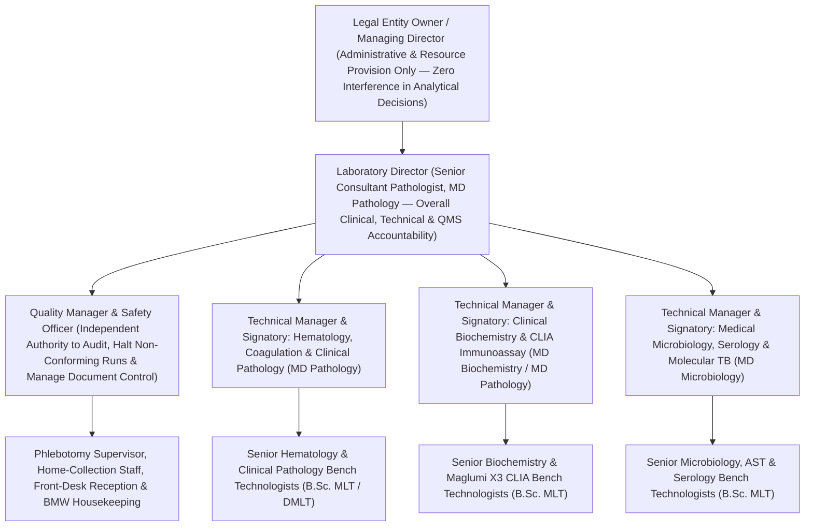

# 0.2.3 Clause 5 Legal Entity Statutory Registration Dossier, Organization Chart, Laboratory Director Charter & 24 Quantitative Quality Indicators (`QIs`) Dashboard SOP

> **Document Control (`ISO 15189:2022 Clause 8.3.2`):** Document ID: `NABL-QSP-0.2.3` | **Tier:** `Level-2 Quality System Procedure` | **Version:** `2.1 (NABL Application Ready)` | **Effective Date:** `15-Oct-2026` | **Review Cycle:** `Annual` | **Approved By:** `Laboratory Director (MD Pathology)` | **Controlled Copy:** `Master QMS & NABL 153 Portal Dossier`

---

## Section 1: Purpose, Scope & ISO 15189:2022 Clause 5 Mandate
1. **Purpose:** To define the legal entity accountability (`Clause 5.1`), Laboratory Director competence and charter (`Clause 5.2`), defined range of laboratory activities (`Clause 5.3`), organizational authority and deputy substitution matrix (`Clause 5.4`), and measurable Quality Objectives with **24 Quantitative Quality Indicators (`QIs` — `Clause 5.5`)** required for **NABL 153 Portal Submission** and **NABL 223 On-Site Assessment**.
2. **Scope:** Governs top management, the Laboratory Director, Quality Manager, Technical Managers / Authorized Signatories, and all 6 diagnostic departments (`01` through `06`).

---

## Section 2: Master Statutory & Regulatory License Compliance Dossier (`ISO 15189:2022 Clause 5.1` & `NABL 153 Sec 1`)
The Quality Manager maintains the **Master Statutory Compliance Binder (`Hardcopy + NABL Portal PDF Folder`)** and initiates renewal **$\ge 60\text{ days}$ prior to expiry**:

| S.No. | Statutory License / Legal Document | Issuing Authority (`India / State`) | NABL 153 Portal Upload Requirement | Renewal Cycle | Verification & Filing Location |
| :---: | :--- | :--- | :--- | :---: | :--- |
| **1** | **Legal Entity Registration** (`Certificate of Incorporation / Partnership Deed / Proprietorship MSME Udyam / Trust Deed` + `PAN` & `GSTIN`) | Ministry of Corporate Affairs / Registrar of Firms / Income Tax Dept | **Mandatory Upload (`NABL 153 Sec 1.2`)** — Exact legal name must match NABL application! | Permanent | `Statutory Binder Tab 1` |
| **2** | **Clinical Establishments Act (`CEA`) Registration / CMO Diagnostic Lab License / Municipal Trade License** | District Registering Authority (`CMO / Civil Surgeon`) / Municipal Corp | **Mandatory Upload (`NABL 153 Sec 1.3`)** | Annual / 3–5 Years | `Statutory Binder Tab 2` |
| **3** | **State Pollution Control Board (`SPCB / HSPCB`) Bio-Medical Waste (`BMW Rules 2016`) Authorization** | State Pollution Control Board (`SPCB`) | **Mandatory Upload (`NABL 153`)** — Must list monthly yellow/red/white/blue waste limits | 5 Years / Bed-Non-Bedded | `Statutory Binder Tab 3` (`SOP 0.1.14`) |
| **4** | **Authorized Common Bio-Medical Waste Treatment Facility (`CBWTF`) Bilateral Tie-Up Agreement** | SPCB-Authorized `CBWTF` Operator | **Mandatory Upload** — Daily barcoded waste pickup contract | Annual | `Statutory Binder Tab 4` (`NABL-LOG-10`) |
| **5** | **Fire Safety Certificate / Fire `NOC` & Annual Fire Extinguisher (`ABC / CO2`) Refill Certificate** | Municipal Fire Service / Certified Fire Agency | **Mandatory Inspection (`ISO 15190`)** | Annual | `Statutory Binder Tab 5` (`SOP 0.2.4`) |
| **6** | **Professional Medical Indemnity & Public Liability Insurance Policy** | IRDAI-Registered Insurer | **Mandatory (`ISO 15189 Cl. 5.1` Liability Coverage)** | Annual | `Statutory Binder Tab 6` |
| **7** | **NMC / State Medical Council Registration & Postgraduate Degree Certificates (`MBBS + MD/DNB`) of All Signatories** | National Medical Commission (`NMC`) / State Medical Council | **Mandatory Upload (`NABL 153 Sec 6`)** | 5 Years / Permanent | `Personnel Dossiers` (`SOP 0.1.12`) |
| **8** | **`PC & PNDT Act 1994` Genetic Counseling / Lab Registration *(If Dual/Quad/NIPT performed in-house)*** | District Appropriate Authority (`PNDT`) | Mandatory if prenatal genetic testing performed | 5 Years | `Statutory Binder Tab 8` (`SOP 3.5.6`) |

---

## Section 3: Master Organizational Structure (`Organogram`) & Deputy Substitution Matrix (`Clauses 5.2 & 5.4`)

### 3.1 Mandatory Deputy Substitution Matrix (`Continuous Coverage During Leave / Absence — Clause 5.2.2`)
| Primary Role | Designated Primary Officer | Designated Qualified Deputy (`During Leave/Absence`) | Scope of Delegated Authority |
| :--- | :--- | :--- | :--- |
| **1. Laboratory Director** | Senior Consultant Pathologist #1 (`MD Pathology`) | Consultant Pathologist #2 / Senior Consultant Biochemist (`MD`) | Clinical governance, critical escalations, emergency release, regulatory liaison. |
| **2. Quality Manager** | Designated Quality Manager (`M.Sc. / B.Sc. MLT + ISO 15189 Internal Auditor Certified`) | Deputy Quality Manager (`Senior Section Supervisor + ISO 15189 Trained`) | Document control (`0.1.11`), `IQC/EQAS` review, `CAPA` closure, internal audit tracking. |
| **3. Authorized Signatories (`Depts 01–06`)** | Primary Departmental `MD` Specialist | Cross-Covering `NABL 112`-Qualified `MD Pathology / Biochemistry / Microbiology` Signatory | Report verification, critical alert read-back oversight, slide/culture sign-off (`SOP 0.1.12`). |

---

## Section 4: Laboratory Director Charter (`ISO 15189:2022 Clause 5.2.1–5.2.3`)
The **Laboratory Director** holds non-delegable ultimate responsibility for:
1. Providing clinical advice on test selection (`SOP 0.1.9`), specimen preparation (`SOP 0.2.6`), and post-examination diagnostic interpretation across all 273 tests.
2. Approving all Level-1 (`Quality Manual`), Level-2 (`QSPs`), and Level-3 (`Technical SOPs`), biological reference intervals (`SOP 0.1.8`), critical alert thresholds (`SOP 0.1.5`), and `ISO 22367` risk assessments (`SOP 0.1.10`).
3. Selecting and monitoring `PT/EQAS` providers (`SOP 0.2.7`) and NABL-accredited referral laboratories (`SOP 0.2.5`).
4. Chairing the **Annual Management Review Meeting (`MRM — Clause 8.9`, `SOP 0.2.12`)** and ensuring adequate staffing, equipment, and safe environmental conditions.

---

## Section 5: The 24 Quantitative Quality Indicators (`QIs`) Dashboard (`ISO 15189:2022 Clause 5.5 b & IFCC Working Group on Laboratory Errors and Patient Safety [WG-LEPS]`)
Every month (by the $5\text{th}$ working day), the Quality Manager compiles the **24 Quantitative Quality Indicators (`8 Pre-Analytical + 8 Intra-Analytical + 8 Post-Analytical`)** from the LIMS and bench registers:

| QI Code | Phase | Quality Indicator (`IFCC WG-LEPS` Standardized Metric) | Mathematical Formula ($\text{\% or Sigma}$) | Monthly Target Threshold | Mandatory `CAPA` Trigger |
| :---: | :---: | :--- | :--- | :---: | :---: |
| **`QI-PRE-01`** | Pre | **Patient Identification / Barcoding Error Rate** | $\frac{\text{Mislabeled / Unlabeled Samples}}{\text{Total Samples Received}} \times 100$ | **$0.00\%$** (`Zero Tolerance`) | Any single event ($> 0$) |
| **`QI-PRE-02`** | Pre | **Wrong Container / Order-of-Draw (`EDTA` Carryover) Rate** | $\frac{\text{Wrong Tube / EDTA-Contaminated Samples}}{\text{Total Samples}} \times 100$ | **$< 0.10\%$** | $\ge 0.15\%$ |
| **`QI-PRE-03`** | Pre | **Clotted Anticoagulated Specimen Rate (`EDTA CBC / Citrate Coag`)** | $\frac{\text{Clotted EDTA + Citrate Tubes}}{\text{Total Anticoagulated Tubes}} \times 100$ | **$< 0.50\%$** | $\ge 0.80\%$ |
| **`QI-PRE-04`** | Pre | **Hemolyzed Serum Specimen Rate (`H-Index > Cutoff`)** | $\frac{\text{Rejected Hemolyzed Sera}}{\text{Total Chemistry/CLIA Sera}} \times 100$ | **$< 0.80\%$** | $\ge 1.20\%$ |
| **`QI-PRE-05`** | Pre | **Insufficient Volume / Citrate Under-Fill ($< 90\%$) Rate** | $\frac{\text{QNS / Short-Draw Citrate Tubes}}{\text{Total Samples}} \times 100$ | **$< 0.40\%$** | $\ge 0.75\%$ |
| **`QI-PRE-06`** | Pre | **Sputum Salivary Rejection Rate (`Bartlett Q-Score <= 0`)** | $\frac{\text{Rejected Salivary Sputum (>10 SEC/LPF)}}{\text{Total Sputum Culture Samples}} \times 100$ | **$< 5.0\%$** | $\ge 8.0\%$ (Patient coaching) |
| **`QI-PRE-07`** | Pre | **Blood Culture Contamination Rate (`CoNS / Bacillus / Corynebacterium` in $1/2$ sets)** | $\frac{\text{Contaminated Blood Cultures}}{\text{Total Blood Culture Sets}} \times 100$ | **$< 3.0\%$** *(Optimal $< 1.0\%$)* | $\ge 3.0\%$ (Asepsis retrain) |
| **`QI-PRE-08`** | Pre | **Home-Collection Cold-Chain Breach Rate ($> 8.0^\circ\text{C}$ on arrival)** | $\frac{\text{Coolers Arriving > 8.0°C}}{\text{Total Home-Collection Trips}} \times 100$ | **$< 0.20\%$** | Any breach ($> 8.0^\circ\text{C}$) |
| **`QI-INT-01`** | Intra | **Daily Internal Quality Control (`IQC`) Westgard `1:3s / 2:2s` Rejection Rate** | $\frac{\text{Rejected IQC Runs Requiring Repeat/Cal}}{\text{Total IQC Runs}} \times 100$ | **$< 2.0\%$** | $\ge 3.5\%$ on any assay |
| **`QI-INT-02`** | Intra | **Percentage of Quantitative Assays Operating at $\ge 4.0\ \sigma$ (`Six Sigma`)** | $\frac{\text{Assays with } \sigma = (\text{TE}_a - \lvert\text{Bias}\rvert)/\text{CV} \ge 4.0}{\text{Total Quantitative Assays}} \times 100$ | **$\ge 90.0\%$** | Any assay falling $< 3.0\ \sigma$ |
| **`QI-INT-03`** | Intra | **External Quality Assessment (`EQAS / PT`) Satisfactory Score Rate ($\lvert Z\rvert \le 2.0$)** | $\frac{\text{EQAS Analytes with } \lvert Z\rvert \le 2.0}{\text{Total EQAS Analytes Reported}} \times 100$ | **$\ge 95.0\%$** ($100\%$ Target) | Any single $\lvert Z\rvert \ge 3.0$ or $2\times \lvert Z\rvert > 2.0$ |
| **`QI-INT-04`** | Intra | **Tri-Partite Inter-Laboratory Comparison (`ILC`) Concordance Rate** | $\frac{\text{Concordant ILC Parameters}}{\text{Total ILC Parameters}} \times 100$ | **$100.0\%$** | Any discordance |
| **`QI-INT-05`** | Intra | **Primary-to-Backup Analyzer Weekly Split-Sample Concordance Rate** | $\frac{\text{Weekly Split Samples Within } \frac{1}{2}\text{TE}_a}{\text{Total Weekly Split Samples}} \times 100$ | **$\ge 98.0\%$** | Any bias $> \frac{1}{2}\text{TE}_a$ |
| **`QI-INT-06`** | Intra | **Unplanned Analyzer Breakdown / Downtime Rate** | $\frac{\text{Unscheduled Downtime Hours}}{\text{Total Scheduled Operating Hours}} \times 100$ | **$< 1.0\%$** | Downtime $> 4\text{h}$ |
| **`QI-INT-07`** | Intra | **Inter-Observer Slide Morphology Concordance (`PBS / Gram / AFB / Urine`)** | $\frac{\text{Concordant Blinded Review Slides}}{\text{Total Monthly Blinded Slides}} \times 100$ | **$\ge 95.0\%$** ($\kappa \ge 0.85$) | Any critical miss |
| **`QI-INT-08`** | Intra | **Reagent Stock-Out / Expired Reagent Bench Incident Rate** | $\text{Count of Tests Delayed due to Stock-Out or Expired Lot}$ | **$0\text{ Incidents}$** | Any stock-out ($> 0$) |
| **`QI-PST-01`** | Post | **STAT Emergency Turnaround Time (`TAT <= 60 min`; `CSF/ABG/cTnI <= 30 min`) Compliance** | $\frac{\text{STAT Reports Released Within Target TAT}}{\text{Total STAT Orders}} \times 100$ | **$\ge 95.0\%$** | $< 92.0\%$ |
| **`QI-PST-02`** | Post | **Routine Outpatient / Inpatient Turnaround Time (`TAT`) Compliance** | $\frac{\text{Routine Reports Released Within Committed TAT}}{\text{Total Routine Orders}} \times 100$ | **$\ge 96.0\%$** | $< 93.0\%$ |
| **`QI-PST-03`** | Post | **Critical ("Panic") Value Read-Back Notification Within $\le 30\text{ Minutes}$ (`CLSI GP47`)** | $\frac{\text{Critical Values Read-Back Confirmed } \le 30\text{ min}}{\text{Total Critical Values Generated}} \times 100$ | **$\ge 98.0\%$** ($100\%$ Target) | Any call $> 30\text{ min}$ |
| **`QI-PST-04`** | Post | **Amended / Corrected Report Rate (Post-Release Analytical or Transcriptional Error)** | $\frac{\text{Amended Reports Issued}}{\text{Total Reports Released}} \times 100$ | **$< 0.05\%$** ($< 5\text{ per }10,000$) | $\ge 0.10\%$ |
| **`QI-PST-05`** | Post | **Critical Blood Culture Gram-Stain Notification Within $\le 15\text{ Minutes}$ of Bottle Flag** | $\frac{\text{Positive Blood Cultures Called } \le 15\text{ min}}{\text{Total Positive Blood Cultures}} \times 100$ | **$100.0\%$** | Any call $> 15\text{ min}$ |
| **`QI-PST-06`** | Post | **Statutory Notifiable Disease (`IDSP / Nikshay`) Same-Day Reporting Compliance** | $\frac{\text{Notifiable Positives Reported Same Day}}{\text{Total Notifiable Positives}} \times 100$ | **$100.0\%$** | Any missed notification |
| **`QI-PST-07`** | Post | **Patient & Clinician Satisfaction Score (`CSAT %`)** | $\frac{\text{Satisfied / Very Satisfied Responses (4–5/5)}}{\text{Total Survey Responses}} \times 100$ | **$\ge 92.0\%$** | $< 85.0\%$ |
| **`QI-PST-08`** | Post | **Validated Complaint Resolution Within $\le 48\text{ Hours}$** | $\frac{\text{Complaints Resolved & Closed } \le 48\text{h}}{\text{Total Complaints Received}} \times 100$ | **$100.0\%$** | Any complaint $> 48\text{h}$ |

---

## Section 6: References & Statutory Authority
1. **ISO 15189:2022:** *Medical Laboratories — Requirements for Quality and Competence (Clauses 5.1 to 5.6)*.
2. **Sciacovelli L, Plebani M et al. (IFCC WG-LEPS):** *Quality Indicators in Laboratory Medicine: Consensus Model of Harmonized MQI*.
3. **NABL 153 & NABL 112 (2023/2024):** *Medical Testing Laboratory Application Form & Specific Criteria*.
