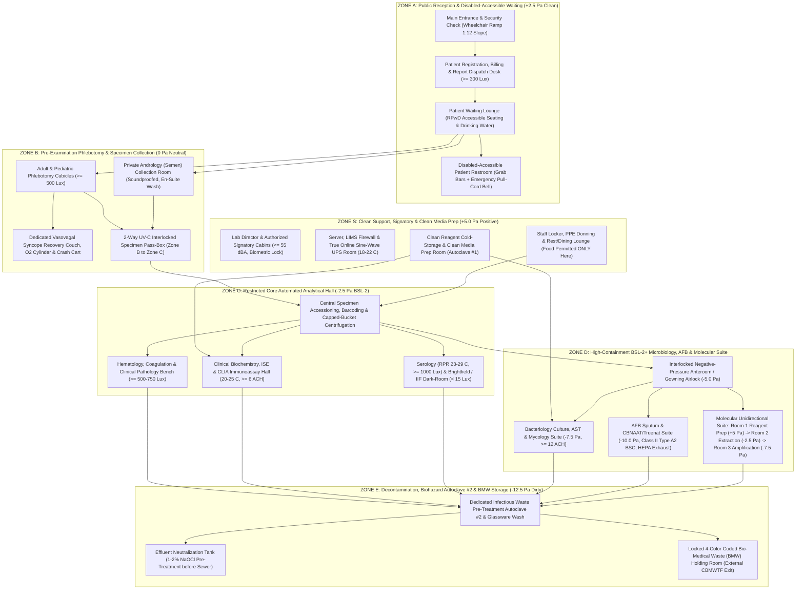

# 0.2.4 Clause 6.3 Facility Floor-Plan Zoning, Biometric Access Control, Biosafety (`ISO 15190:2020`), Calibrated Lux Meter Illumination (`>= 300–1000 Lux`), `HVAC` Airflow (`ACH`), Power Quality & Emergency Eye-Wash / Safety Shower SOP

> **Document Control & Statutory Traceability Block (`ISO 15189:2022 Clause 8.3.2`)**
> - **Document ID:** `NABL-QSP-0.2.4`
> - **Document Title:** Standard Operating Procedure for Facility Architectural Zoning, Unidirectional Workflow, Biometric Access Control, Quantitative Environmental Engineering (`Lux`, `ACH`, `dBA`, `RH%`, Differential Pressure, Power Quality), Laboratory Biosafety (`ISO 15190:2020`), Chemical Hygiene, and Emergency Eye-Wash / Drench Shower Verification
> - **Tier & Category:** `Tier-2 Mandatory Quality System & Facility Engineering Procedure (Apex Manual Cross-Ref: Clause 6.3)`
> - **Version:** `3.0 (International Above-NABL & CAP/UKAS Red-Team Edition)`
> - **Effective Date:** `15-Oct-2026` | **Review Cycle:** `Annual (or upon structural renovation / equipment relocation)`
> - **Authorizing Authority:** `Laboratory Director (MD Pathology) & Designated Laboratory Biosafety Officer (BSO)`
> - **Primary Normative Standards:** `ISO 15189:2022 (Clauses 6.3.1, 6.3.2, 6.3.3, 6.3.4, 6.3.5, 6.4, 8.5)`, `ISO 15190:2020 (Medical Laboratories — Requirements for Safety)`, `ISO 22367:2020 (Application of Risk Management to Medical Laboratories)`, `WHO Laboratory Biosafety Manual (4th Edition)`, `NABL 112 (Specific Criteria for Accreditation of Medical Laboratories)`, `ANSI/ISEA Z358.1-2014 (R2020) (Emergency Eyewash and Shower Equipment)`, `EN 12469 / NSF/ANSI 49 (Biosafety Cabinetry)`, `CLSI GP40-A4-AMD (Preparation and Testing of Reagent Water)`, `CLSI GP17-A3 (Clinical Laboratory Safety)`
> - **Indian Statutory Frameworks:** `Bio-Medical Waste Management Rules 2016 (Amended 2018/2019)`, `Rights of Persons with Disabilities (RPwD) Act 2016 (Harmonized Accessibility Guidelines)`, `National Building Code of India (NBC) 2016 Part 4 (Fire & Life Safety)`, `Central Electricity Authority (CEA) Measures Relating to Safety and Electric Supply Regulations`, `Digital Personal Data Protection (DPDP) Act 2023`

---

## Section 1: Unidirectional Facility Zoning, Access Control & Architectural Flow SOP (`ISO 15189:2022 Clause 6.3` & `ISO 15190:2020`)

### 1.1 Purpose & Clinical-Analytical Rationale
The physical infrastructure, architectural compartmentalization, environmental stability, power quality, and biosafety engineering of a medical laboratory directly govern both **analytical measurement validity** and **human life safety**. Inadequate environmental or structural controls induce catastrophic analytical and clinical failures:
1. **Optical & Photometric Drift:** Ambient illumination exceeding `< 15 Lux` in Indirect Immunofluorescence (`IIF`) rooms quenches fluorescein isothiocyanate (`FITC`) visual contrast, while illumination `< 800–1,000 Lux` at Serology (`RPR/VDRL`), Urinalysis, or Blood Cross-Match benches causes false-negative micro-agglutination and missed weak flocculation reactions.
2. **Thermal & Hygroscopic Instability:** Ambient temperatures exceeding $> 26^\circ\text{C}$ destabilize Peltier reaction cuvette thermostats ($37.0 \pm 0.1^\circ\text{C}$) in automated biochemistry and coagulation analyzers, accelerating enzymatic kinetic rates ($\sim 7\text{–}10\%$ activity shift per $1^\circ\text{C}$), while relative humidity $> 60\%\text{ RH}$ degrades dry-chemistry strips, lateral-flow rapid diagnostic tests (`RDTs`), and hygroscopic lyophilised calibrators. Conversely, `RPR` non-treponemal flocculation testing performed below $< 23^\circ\text{C}$ yields false-negative results due to lipid micelle rigidity.
3. **Hydrodynamic & Mechanical Vibration Artifacts:** Unisolated centrifuge or compressor vibrations transmitted through contiguous bench frames disrupt hydrodynamic aperture focusing in impedance/laser hematology cell counters (`MEK-1503`), disturb photo-optical fibrin clot detection in coagulometers, and prevent sub-milligram stabilization on analytical micro-balances.
4. **Electrical Ground-Loop Interference:** Stray Earth-to-Neutral potentials ($> 2.0\text{ V AC}$) or high-impedance earthing ($> 1.0\ \Omega$) inject common-mode electromagnetic noise into high-impedance potentiometric Ion-Selective Electrodes (`ISE` for $\text{Na}^+, \text{K}^+, \text{Cl}^-, \text{iCa}^{2+}$) and chemiluminescence photomultiplier tubes (`PMTs`).
5. **Nosocomial Aerosol & Cross-Contamination Hazards:** Bidirectional traffic or positive air pressure in infectious specimen processing rooms (`AFB` sputum, bacterial cultures, or post-amplification molecular suites) disperses *Mycobacterium tuberculosis* droplet nuclei ($1\text{–}5\ \mu\text{m}$) or amplicon aerosols into core analytical halls and public patient waiting zones.

### 1.2 Architectural Floor-Plan & Unidirectional Traffic / Pressure Cascade Diagram
The laboratory enforces a strict **5-Zone Architectural Segregation Model (`Zone A` through `Zone E`)** supplemented by a **Clean Administrative & Media Preparation Zone (`Zone S`)**. Specimen workflow, personnel movement, and heating, ventilation, and air-conditioning (`HVAC`) pressure differentials follow an irreversible **Clean-to-Dirty Unidirectional Cascade**:



### 1.3 Comprehensive 5-Zone Architectural Segregation, Access Control & Operational Matrix (`ISO 15189:2022 Cl. 6.3.2 & 6.3.3`)

| Zone ID & Classification | Functional Rooms & Dedicated Operations | Access Control Mechanism & Mandatory Signage | Air Pressure Cascade & Workflow Segregation Rules | Patient Safety, Privacy & Disability (`RPwD Act 2016`) Mandates |
| :--- | :--- | :--- | :--- | :--- |
| **Zone A: Public Reception & Waiting (`Clean Public Zone`)** | Main Entrance, Registration & Consent Counter, Billing/Report Dispatch, Patient Waiting Lounge, Disabled-Accessible Patient Washroom (`Urine/Stool` drop-off window). | **Unrestricted Public Access** during operating hours; CCTV monitored under `DPDP Act 2023` notice; separated from technical corridors by physical full-height partition and biometric security door. | **$\mathbf{+2.5\text{ Pa}}$ (Positive relative to `Zone B`)**; comfort HVAC at $22.0\text{–}25.0^\circ\text{C}$; zero exposure to laboratory odors, chemical fumes, or infectious aerosols. | Non-slip vitrified flooring; $1:12$ gradient wheelchair ramp with dual handrails; wide washroom door ($\ge 900\text{ mm}$) opening **outwards** with internal horizontal/vertical grab bars and an **audible/visual Emergency Pull-Cord Alarm Bell** wired to the Reception and Phlebotomy desk. |
| **Zone B: Pre-Examination & Specimen Collection (`Controlled Clinical Zone`)** | Adult/Pediatric Phlebotomy Bay, Vasovagal Syncope Recovery Bay, Private Andrology (`Semen`) Room, Urine/Stool Specimen Pass-Through Window, `Zone B`-to-`Zone C` Specimen Pass-Box. | **Escorted Patient & Phlebotomist Access Only**; visual privacy partitions/curtains (washable anti-microbial PVC) between phlebotomy chairs; internal thumb-turn privacy lock with external emergency override on Andrology & Restroom doors. | **$\mathbf{0.0\text{ Pa}}$ (Neutral reference point)**; $\ge 6\text{ ACH}$; specimens never hand-carried through public corridors—transferred strictly via **double-door mechanically interlocked UV-C Pass-Box** into `Zone C`. | Dedicated ** reclining Phlebotomy Chairs** with dual flip-down armrests (preventing falls during syncope); immediate access ($\le 5\text{ m}$) to **Syncope Recovery Couch**, Ammonia/Smelling Salts, Oral Glucose, Portable $\text{O}_2$ Cylinder, Automated External Defibrillator (`AED`), and Anaphylaxis/Crash Kit (`SOP 0.2.6`). |
| **Zone S: Administrative, Signatory & Clean Support (`Clean Staff Zone`)** | Lab Director / Pathologist Signatory Cabins, Server & Online `UPS` Room, Clean Consumable Store, Clean Media Preparation Room (**Autoclave #1**), Staff Locker & Dining Lounge. | **RFID / Biometric Staff Badge Access** (`Server Room` restricted to IT/Quality Manager; `Clean Media Room` restricted to Media Techs). Mandatory signage: *"Staff Dining Area — No PPE, Lab Coats, or Specimens Permitted Beyond This Line."* | **$\mathbf{+5.0\text{ Pa}}$ (Positive pressure)** to prevent ingress of laboratory aerosols; **Autoclave #1 (`Clean`)** is dedicated exclusively to virgin culture media and sterile saline—**strictly prohibited** from ever processing infectious waste or used glassware. | Ergonomic visual display unit (`VDU`) workstations for pathologists; dedicated drinking water, refrigerator for staff food, and personal lockers. Lab coats and gloves must be removed on hooks outside `Zone S` before entering the dining room (`ISO 15190 Cl. 7.3`). |
| **Zone C: Core Automated Analytical Hall (`BSL-2 Restricted`)** | Central Accessioning & Capped-Bucket Centrifugation, Hematology & Coagulation, Clinical Biochemistry & `ISE`, `CLIA` Immunoassay, Serology (`RPR/ELISA`), Clinical Pathology, `IIF` Dark-Room. | **Biometric Fingerprint / Facial Recognition Access Only** (Authorized Technical Staff). Door displays **ISO 7010 `W009` Biohazard Warning Sign**, `BSL-2` Biosafety Level, BSO Name, and Emergency Contact Numbers. | **$\mathbf{-2.5\text{ Pa}}$ (Negative relative to `Zone B` & `Zone S`)**; $\ge 6\text{ ACH}$; minimum **$1.5\text{ m}$ main aisle clearance**; seamless coved epoxy flooring; dedicated hand-washing sink with elbow/infrared sensor tap at exit door and **Plumbed ANSI Z358.1 Eye-Wash Station**. | Unaccompanied visitors, patients, and medical representatives are **strictly barred**. External Biomedical Service Engineers must sign `NABL-FAC-REG-04`, wear a `VISITOR` badge + lab coat/nitrile gloves, and be continuously escorted after analyzer decontamination (`SOP 0.2.5`). |
| **Zone D: High-Containment Microbiology, `AFB` & Molecular (`BSL-2+ Negative Cascade`)** | Negative-Pressure Anteroom, Bacteriology/Mycology Culture & `AST` Room, `AFB` Sputum Smear & `CBNAAT/Truenat` Room, 3-Room Unidirectional Molecular (`NAAT`) Suite. | **Dual-Factor Biometric Access** (Restricted strictly to immunized, respirator-fit-tested Microbiology & Molecular Scientists). Red illuminated **"NEGATIVE PRESSURE / UV IN USE — DO NOT ENTER"** warning light outside airlock. | **Cascading Negative Pressure:** Anteroom ($\mathbf{-5.0\text{ Pa}}$) $\to$ Bacteriology ($\mathbf{-7.5\text{ Pa}}$) $\to$ `AFB`/Sputum Processing ($\mathbf{-10.0\text{ Pa}}$, $\ge 12\text{ ACH}$ 100% single-pass `HEPA H14` exhaust). Molecular Suite: Mastermix Prep ($\mathbf{+5.0\text{ Pa}}$) $\to$ Nucleic Acid Extraction ($\mathbf{-2.5\text{ Pa}}$) $\to$ Amplification/Detection ($\mathbf{-7.5\text{ Pa}}$). | Self-closing, interlocking airlock doors with vision panels; mandatory `N95 / FFP2` respirator, wrap-around gown, and double gloves inside `AFB` room; zero paper chart movement from `Zone D` to `Zone C` (results entered via dedicated in-suite LIMS terminal with washable medical-grade silicone keyboard). |
| **Zone E: Decontamination, `Autoclave #2` & `BMW` Holding (`Dirty Containment Zone`)** | Infectious Pre-Treatment **Autoclave #2** (Spore-tested weekly with *Geobacillus stearothermophilus*), Acid/Alkali Effluent Neutralization Tank (`ETP`), Locked 4-Color `BMW` Storage Room. | **Keyed + Biometric Access** restricted to trained `BMW` Handlers and Biosafety Officer. External door opens directly to the service driveway for Common Bio-Medical Waste Treatment Facility (`CBMWTF`) collection vehicle. | **$\mathbf{-12.5\text{ Pa}}$ (Most negative point in facility)**; $\ge 10\text{–}12\text{ ACH}$ exhausted via carbon + HEPA scrubbers; floor sloped to trapped drain connected to $1\%\text{–}2\%\text{ NaOCl}$ retention tank; rodent/insect-proof mesh and tiled walls up to ceiling. | Prevents haulage of biohazardous waste bags through `Zone A` or `Zone B` public corridors. Equipped with heavy-duty Nitrile/Neoprene elbow-length utility gloves, face shield, gumboots, digital bluetooth weighing scale, barcoding scanner, and `BMW` Spill Kit (`SOP 0.2.6`). |

---

## Section 2: 14-Row Engineering, Ergonomic & Environmental Specifications Matrix (`ISO 15189:2022 Cl. 6.3.1–6.3.4`, `ISO 15190:2020`, `NABL 112`)

To guarantee zero environmental bias on analytical measurands and full compliance with international laboratory design standards, the facility maintains and verifies the following **14 quantitative engineering parameters**:

| # | Engineering / Environmental Parameter | Target Quantitative Specification (`ISO 15189 / ISO 15190 / NABL 112 / CLSI`) | Metrological Verification Instrument & Traceability | Verification Frequency & Responsibility | Analytical / Clinical Impact of Non-Compliance & Mandatory Corrective Action (`CAPA`) |
| :-: | :--- | :--- | :--- | :---: | :--- |
| **1** | **Floor Space, Ceiling Height & Inter-Analyzer Clearance** | **Ceiling Height:** $\ge 2.70\text{–}3.00\text{ m}$ clear.<br>**Main Aisle Width:** $\ge 1.20\text{–}1.50\text{ m}$ unobstructed.<br>**Worker Space:** $\ge 10\text{ m}^3$ free volume ($\ge 3.5\text{ m}^2$ clear floor area) per bench technologist.<br>**Analyzer Clearance:** $\ge 0.60\text{ m}$ ($600\text{ mm}$) rear and side clearance around floor-standing analyzers (`Chem-400`, `Maglumi X3`, `UPS`). | Calibrated Laser Distance Meter / Steel Measuring Tape (`NABL` traceable) verified during facility commissioning & equipment layout change. | **At Commissioning & Upon Any Equipment Relocation** (`Facility Engineer & QM`) | Insufficient rear clearance ($< 30\text{ cm}$) traps heat exhaust from Peltier cooling modules, raising internal analyzer optics above $> 38^\circ\text{C}$ and obstructing emergency fluidic/peristaltic access. **CAPA:** Reposition analyzer chassis onto locked heavy-duty castors maintaining $\ge 600\text{ mm}$ service perimeter. |
| **2** | **Flooring, Wall Coating & Ceiling Architecture** | **Flooring:** Monolithic, seamless $2\text{–}3\text{ mm}$ self-leveling epoxy resin or homogeneous welded PVC vinyl sheet with **coved wall-to-floor skirting ($R \ge 50\text{ mm}$)**; slip-resistance rating `R10`; impervious to acids, organic stains, and $1\%\text{–}10\%\text{ NaOCl}$.<br>**Walls & Ceiling:** Non-porous washable acrylic/epoxy emulsion walls; sealed non-shedding gypsum or aluminum clip-in ceiling tiles; **zero fabric curtains, venetian blinds, or carpets**. | Visual Structural Integrity Audit + $1\%\text{ NaOCl}$ Chemical Spot-Test & Seam Inspection. | **Semi-Annual** (`Biosafety Officer`) | Grouted ceramic tiles or right-angle floor joints harbor occult blood, mercury/azide residues, and fungal spores; fabric blinds accumulate infectious dust. **CAPA:** Seal cracked joints with two-part epoxy grout; replace any fabric window coverings with sealed exterior solar film or washable roller blinds. |
| **3** | **Bench-Top Surface Chemistry, Ergonomics & Seating** | **Bench Tops:** $18\text{–}25\text{ mm}$ monolithic **Epoxy Resin**, **High-Pressure Phenolic Compact Laminate (`Trespa`)**, or **Polished Black Granite** (seamless, non-absorbent, resistant to concentrated $\text{HCl/H}_2\text{SO}_4$, Xylene, Acetone, Carbol Fuchsin, and Crystal Violet) with raised marine drip-edge.<br>**Bench Height:** $850\text{–}900\text{ mm}$ (Standing Analytical); $720\text{–}750\text{ mm}$ with knee-well ($\ge 600\text{ mm}$ wide) for Seated Microscopy.<br>**Seating:** 5-star base adjustable ergonomic chairs with foot-ring, lumbar support, and **non-porous wipeable PU/Vinyl upholstery** (zero woven cloth). | Calibrated Spirit Level, Steel Tape & Chemical Resistance Audit (`ISO 15190 Cl. 6.2.4`). | **Annual Ergonomic & Bench Integrity Audit** (`BSO & Quality Manager`) | Porous wood/laminate benches swell upon moisture ingress and retain infectious bio-burden; non-ergonomic microscopy seating induces cervical radiculopathy and visual fatigue during manual differential counts. **CAPA:** Resurface damaged laminate with phenolic/granite slabs; immediately condemn any cloth-upholstered chair in `Zones B, C, D, E`. |
| **4** | **Calibrated Illumination (`Lux`) — Public, Pre-Analytical & Core Automated Benches** | **Zone A (Reception, Waiting, Corridors):** **$\ge 300\text{ Lux}$**<br>**Zone B (Phlebotomy Cubicles & Vein Visualization):** **$\ge 500\text{–}750\text{ Lux}$**<br>**Zone C (Sample Accessioning, Hemolysis/Icterus/Lipemia [`HIL`] Visual Check & Automated Analyzer Benches):** **$\ge 500\text{–}750\text{ Lux}$**<br>**Light Quality:** Flicker-free Cool Daylight LED ($4000\text{–}6500\text{ K}$), Color Rendering Index **$\text{CRI } (R_a) \ge 80\text{–}90$**, zero direct specular glare on analyzer touchscreens. | **Calibrated Digital Lux Meter** (`NABL-Accredited ISO/IEC 17025 Certificate`, cosine-corrected silicon photodiode sensor placed flat at **$850\text{ mm}$ working bench plane** across a 5-point grid per room). | **Quarterly (`Every 3 Months`)** & Immediately After Luminaire Maintenance (`Facility Engineer`) | Sub-threshold illumination ($< 300\text{ Lux}$) at Phlebotomy increases venipuncture haematoma/ecchymosis and needle-stick injury (`NSI`) risk; poor `CRI` masks subtle serum icterus or Grade-1 hemolysis during pre-analytical accessioning. **CAPA:** Clean luminaire diffusers; replace degraded LED arrays to restore $\ge 500\text{ Lux}$ and $\text{CRI} \ge 85$. |
| **5** | **Calibrated Illumination (`Lux`) — High-Acuity Visual Reading, Microscopy & `IIF` Dark-Room** | **Fine Visual Discrimination Benches (`RPR/VDRL` Flocculation, Blood Group & Cross-Match Tile/Gel Card Reading, Urine Dipstick/RDT Visual Read, Bacteriology Colony Morphology & `AST` Zone Measurement, Clean Media Inspection):** **$\ge 1,000\text{ Lux}$** (via overhead LED + dedicated articulated task lamp).<br>**Fluorescence Microscopy (`ANA/ANCA/dsDNA IIF`) Dark-Room:** **$< 15\text{ Lux}$** (with light-tight door sweep and matte black wall finish). | **Calibrated Digital Lux Meter** (`ISO/IEC 17025 Traceable`, resolution $0.1\text{ Lux}$ for Dark-Room and $1\text{ Lux}$ for High-Acuity Benches). | **Quarterly (`Every 3 Months`)** (`Quality Manager & Technical Supervisor`) | Reading weak $1+$ `RPR` carbon flocculation, weak $\text{D}^\text{u}$ / minor cross-match incompatibility, or faint `RDT` test lines below $< 800\text{ Lux}$ causes false-negative reporting; stray light $> 15\text{ Lux}$ in the `IIF` dark-room bleaches low-titer `1:80 ANA` nuclear speckled patterns. **CAPA:** Install under-cabinet $1,200\text{ Lux}$ LED task bars above Serology/Cross-Match benches; seal dark-room door perimeters with neoprene light-gaskets. |
| **6** | **Ambient Room Temperature Stratification & Thermal Gradient Stability** | **Core Analytical Hall (`Zone C`), Phlebotomy (`Zone B`), Microbiology (`Zone D`):** **$20.0^\circ\text{C}\text{ to }25.0^\circ\text{C}$** (Maximum thermal drift $\le \pm 1.5^\circ\text{C/hr}$).<br>**`RPR / VDRL` Non-Treponemal Serology Testing Zone:** **$23.0^\circ\text{C}\text{ to }29.0^\circ\text{C}$** (*Mandatory CDC/CLSI cardiolipin-lecithin-cholesterol antigen reactivity window*).<br>**Server & True Online `UPS` Room (`Zone S`):** **$18.0^\circ\text{C}\text{ to }22.0^\circ\text{C}$**. | **Calibrated Digital Min/Max Thermo-Hygrometer** (`NPL/NABL Traceable` with $0.1^\circ\text{C}$ resolution & audible high/low alarm, sensor positioned away from direct AC throw or analyzer exhaust vents). | **Twice Daily (`08:00` & `16:00 HRS`)** + Continuous Automated Data-Logger (`NABL-FAC-REG-03`) | Ambient temperature $> 28^\circ\text{C}$ overwhelms analyzer Peltier cooling blocks, causing $37.0^\circ\text{C}$ reaction cuvette drift, `ALT/AST/ALP` kinetic over-estimation, and shortened on-board reagent stability; `RPR` testing at $18\text{–}20^\circ\text{C}$ causes false-negative syphilis screening. **CAPA:** Engage standby split/ducted HVAC unit; halt analytical runs and re-verify two-level `IQC` if ambient temperature breaches $< 18^\circ\text{C}$ or $> 28^\circ\text{C}$. |
| **7** | **Relative Humidity (`%RH`) & Dew-Point Control** | **All Analytical, Pre-Analytical & Reagent Storage Rooms:** **$30.0\%\text{ to }60.0\%\text{ RH}$** (Target optimum: $45\% \pm 10\%\text{ RH}$). | **Calibrated Capacitive Digital Hygrometer** (`NABL Traceable`, accuracy $\pm 2.0\%\text{ RH}$). | **Twice Daily (`08:00` & `16:00 HRS`)** (`NABL-FAC-REG-03`) | **$< 30\%\text{ RH}$:** Induces rapid evaporative concentration of pediatric micro-cups ($\sim 5\text{–}8\%$ false elevation of $\text{Na}^+/\text{K}^+$ within $30\text{ min}$) and Electrostatic Discharge (`ESD`) circuit board lockups.<br>**$> 60\%\text{ RH}$:** Causes moisture condensation on chilled ($2\text{–}8^\circ\text{C}$) reagent carousels, hydrolyzes urine dipsticks/RDT nitrocellulose membranes, and promotes *Aspergillus/Penicillium* mycelial etching of microscope objective lenses. **CAPA:** Activate industrial refrigerant dehumidifier when $\text{RH} > 60\%$ (monsoon season); store microscopes with silica-gel desiccator packs or inside $40^\circ\text{C}$ fungal-inhibition cabinets. |
| **8** | **`HVAC` Ventilation Rate — Air Changes per Hour (`ACH`) & Supply Filtration** | **Zone B & Zone C (Phlebotomy & Core Analytical Hall):** **$\ge 6.0\text{ ACH}$** (with minimum $2\text{ ACH}$ fresh outdoor make-up air via `MERV-8 / G4` pre-filter + `MERV-13 / F7` fine filter).<br>**Zone D (`BSL-2+` Bacteriology, `AFB` Sputum & `CBNAAT` Suite) & Zone E (`Autoclave #2` / `BMW`):** **$\ge 12.0\text{ ACH}$** (**100% Single-Pass Non-Recirculated Exhaust** discharged $\ge 3\text{ m}$ above roof ridge away from air intakes via `HEPA H14` filter). | **Calibrated Thermal / Vane Anemometer & Capture Hood (Balometer)** (`ISO/IEC 17025 Traceable`), calculating:$$\text{ACH} = \frac{\sum Q_{\text{exhaust}}\ (\text{m}^3/\text{hr})}{V_{\text{room}}\ (\text{m}^3)}$$ | **Semi-Annual (`Every 6 Months`)** (`HVAC Validation Engineer & BSO`) | Sub-standard `ACH` ($< 6\text{ ACH}$ in Core Lab or $< 12\text{ ACH}$ in `AFB` room) allows accumulation of volatile organic compounds (`Xylene`, `Methanol`), sodium hypochlorite chloramines, and airborne *M. tuberculosis* droplet nuclei ($t_{99\%\text{ clearance}} > 46\text{ min}$ at $6\text{ ACH}$ vs $\le 23\text{ min}$ at $12\text{ ACH}$ per CDC guidelines). **CAPA:** Clean/replace clogged `HVAC` pre-filters and `HEPA` exhaust banks; adjust variable frequency drive (`VFD`) exhaust blower speed. |
| **9** | **Room Differential Pressure ($\Delta P$) Cascade & Directional Airflow** | **Clean Media / Pre-PCR Room (`Zone S/D1`):** **$\ge +5.0\text{ Pa}$**<br>**Core Analytical Hall (`Zone C`):** **$-2.5\text{ Pa}$**<br>**`Zone D` Anteroom Airlock:** **$-5.0\text{ Pa}$**<br>**`Zone D` Bacteriology Room:** **$-7.5\text{ Pa}$**<br>**`Zone D` `AFB` Sputum / `CBNAAT` Room:** **$-5.0\text{ to }-12.5\text{ Pa}$** (Target: **$-10.0\text{ Pa}$** relative to Anteroom; minimum **$-2.5\text{ Pa}$** across every inward containment boundary per `WHO Biosafety 4th Ed`). | **Wall-Mounted Calibrated Magnahelic / Digital Differential Pressure Gauge** (Range: $-25\text{ to }+25\text{ Pa}$, resolution $0.5\text{ Pa}$, connected via silicone static pressure tubes across room bulkheads) + **Titanium Tetrachloride / Glycol Smoke-Pencil Visualization**. | **Manometer Read Twice Daily (`08:00` & `16:00 HRS`)**; **Smoke-Pencil Check Monthly**; **Gauge Calibration Annually** | Loss of negative pressure ($\Delta P \ge 0\text{ Pa}$) in `Zone D` permits outward migration of infectious aerosols into `Zone C` when airlock doors open. **CAPA:** Audible/visual red alarm triggers immediately if $\Delta P$ drops shallower than $-2.5\text{ Pa}$ for $> 60\text{ seconds}$; cease all sputum vortexing/centrifugation, inspect door perimeter seals, and service exhaust VFD interlock. |
| **10** | **Class II Type A2 Biosafety Cabinet (`BSC`) Aerodynamic & `HEPA` Integrity** | **Inflow Face Velocity:** **$0.50 \pm 0.025\text{ m/s}$ ($100\text{ fpm}$)** through $200\text{ mm}$ sash opening.<br>**Downflow Velocity:** **$0.30\text{ to }0.40\text{ m/s}$ ($60\text{–}80\text{ fpm}$)** uniform laminar flow ($\pm 20\%$ across grid).<br>**Filtration:** Supply & Exhaust `HEPA H14` ($\ge 99.995\%$ efficiency at $0.3\ \mu\text{m}$ MPPS; `PAO/DOP` aerosol photometer scan leak **$\le 0.01\%$**).<br>**UV-C ($254\text{ nm}$) Intensity:** **$\ge 40\ \mu\text{W/cm}^2$** at work surface (interlocked to switch OFF when sash is raised). | **NSF/ANSI 49 & EN 12469 Third-Party Certification** (Thermal Anemometer, Aerosol Photometer, Particle Counter `ISO Class 5`, and Calibrated `UV-C` Radiometer). | **In-Built Magnehelic Gauge Checked Daily**; **Full `PAO/HEPA` Certification Annually** (or after relocation/filter change) | Blocked front intake grille or torn `HEPA` filter breaches operator protection during `AFB` sputum liquefaction or fungal slide culture prep. **CAPA:** Never place elbow rests or logbooks over front intake grille; quarantine `BSC` with red `OUT OF SERVICE` tag if inflow drops $< 0.45\text{ m/s}$ or `PAO` penetration exceeds $> 0.01\%$. |
| **11** | **Acoustic Noise Control (`dBA`)** | **Core Automated Analytical Hall (`Zone C`) & `Zone D`:** **$\le 60\text{–}65\text{ dBA}$** ($L_{\text{Aeq}, 8\text{h}}$).<br>**Microscopy, Manual Differential Count & Pathologist Signatory Cabins (`Zone S`):** **$\le 50\text{–}55\text{ dBA}$**.<br>**Peak Impulse Noise:** $\le 80\text{ dBA}$ (`ISO 15190:2020 Clause 6.3.4`). | **Calibrated Digital Sound Level Meter** (`IEC 61672 Class 2`, `A-weighted` fast/slow response, `NABL Traceable` at $1.2\text{ m}$ ear height). | **Quarterly (`Every 3 Months`)** (`NABL-FAC-REG-01`) | Chronic acoustic noise $> 68\text{ dBA}$ from unbaffled pneumatic compressors, vacuum pumps, centrifuge windage, and `BSC` blowers induces technologist auditory fatigue, masks critical analyzer clot/short-sample alarms, and impairs concentration during blood smear morphology review. **CAPA:** House external air compressors/vacuum pumps in acoustic enclosures outside the analytical hall; replace worn centrifuge spindle bearings. |
| **12** | **Structural Vibration Isolation for Micro-Balances, Cell Counters & Coagulometers** | **Peak Structural Bench Vibration:** **$< 0.10\text{ mm/s}$ RMS velocity** at $10\text{–}100\text{ Hz}$.<br>**Physical Separation:** All floor/benchtop centrifuges (`Remi R-8C`), vortex mixers, and `RPR` orbital rotators must be installed on a **physically separate bench frame $\ge 1.0\text{–}1.5\text{ m}$ away** from Hematology Cell Counters (`MEK-1503`), Optical Coagulometers, Microscopes, and Analytical Balances.<br>**Balance Mount:** Dedicated **$50\text{–}75\text{ mm}$ solid polished granite slab** resting on `Shore-A 50–60` neoprene elastomeric damping pads. | **Calibrated Tri-Axial Piezoelectric Vibrometer / Spirit-Level Bullseye & Internal Balance Repeatability Check** ($10\times$ weighing of `OIML F1` $100\text{ mg}$ standard mass, $\text{SD} \le 0.1\text{ mg}$). | **Quarterly (`Every 3 Months`)** (`Facility Engineer & Quality Manager`) | Centrifuge harmonic vibrations ($3,000\text{–}4,500\text{ RPM} \approx 50\text{–}75\text{ Hz}$) coupled into a shared bench cause spurious platelet (`PLT`) background counts ($> 10 \times 10^3/\mu\text{L}$ blank noise) via impedance micro-bubble cavitation, false premature fibrin clot triggers in `PT/aPTT`, and micro-pipette gravimetric calibration failure. **CAPA:** Relocate centrifuges to dedicated heavy-duty steel island tables with neoprene feet; never share structural bench framing with optical/impedance analyzers. |
| **13** | **True Online Sine-Wave `UPS`, Power Quality & Dedicated Electrical Earthing** | **Power Supply:** Dedicated **True Online Double-Conversion Pure Sine-Wave `UPS`** (**$0\text{ ms}$ [`< 4 ms`] transfer time**, $\ge 30\text{–}60\text{ min}$ battery runtime, backed by auto-changeover Diesel Generator [`DG`] within $< 15\text{ sec}$).<br>**Voltage Stability:** $230\text{ V AC} \pm 5\%$, $50\text{ Hz} \pm 0.5\text{ Hz}$, Total Harmonic Distortion **$\text{THD} < 3\%$**.<br>**Earth-to-Neutral (`E-N`) Potential:** **$< 1.5\text{ to }2.0\text{ V AC}$**.<br>**Dedicated Chemical/Copper-Plate Earth Pit Resistance:** **$< 1.0\ \Omega$ (`Ohm`)**. | **Calibrated True-RMS Digital Multimeter (`Fluke`) & 3-Pole Digital Earth Resistance Tester (`Megger`)** (`ISO/IEC 17025 Traceable`). | **`E-N` Voltage Checked Quarterly** (`NABL-FAC-REG-01`); **Earth Pit Resistance Tested Semi-Annually** | Line-interactive `UPS` units ($8\text{–}12\text{ ms}$ transfer lag) cause microprocessor resets and robotic probe crashes during brownouts; **Earth-to-Neutral voltage $> 2.0\text{ V AC}$** induces stray ground-loop currents across `ISE` $\text{Ag/AgCl}$ reference electrodes (causing erratic $\text{Na}^+/\text{K}^+$ drift) and elevates dark-current baseline noise in `CLIA` photomultiplier tubes (`Maglumi X3`). **CAPA:** Isolate laboratory analyzer neutral/earth busbar from building HVAC elevator loads; recharge chemical earth pit with bentonite/charcoal/salt hydration mixture if resistance approaches $\ge 1.0\ \Omega$. |
| **14** | **Reagent Grade Water (`CLSI GP40-A4-AMD`) & Liquid Effluent Pre-Treatment Plumbing** | **Analytical Feed Water (`Type I / Type II`):** In-line Resistivity **$\ge 10.0\text{–}18.2\text{ M}\Omega\cdot\text{cm}$** at $25^\circ\text{C}$ (Conductivity **$\le 0.1\text{–}1.0\ \mu\text{S/cm}$**), Total Organic Carbon **$\text{TOC} < 50\text{ ppb}$**, Silicates **$< 0.05\text{ mg/L}$**, Bacterial Colony Count **$< 1\text{–}10\text{ CFU/mL}$**, $\text{pH } 5.0\text{–}8.0$.<br>**Effluent Plumbing:** Dedicated acid-resistant `HDPE / PPR` analyzer waste lines routed to a baffled **Liquid Effluent Pre-Treatment Tank (`1%–2% Sodium Hypochlorite`, $30\text{ min}$ contact time, pH neutralization $6.5\text{–}8.5$)** prior to municipal sewer discharge (`BMW Rules 2018`). | **In-Line Temperature-Compensated Resistivity Cell** (`NABL Calibrated`) + Monthly Silicate/Microbial Culture + Daily Effluent Free-Chlorine & pH Strip Verification. | **Resistivity Logged Daily**; **Microbial & Silicate Tested Monthly** (`Biochemistry Supervisor`) | Dissolved $\text{Ca}^{2+}/\text{Mg}^{2+}$ or colloidal silica ($> 0.1\text{ mg/L}$) scales quartz reaction cuvettes and biases `Calcium / Magnesium / Iron / ALP` assays; gram-negative biofilm (*Pseudomonas / Ralstonia*) in water reservoirs secretes bacterial alkaline phosphatase, causing false-high patient `ALP` and high substrate blanks. **CAPA:** Sanitize RO/DI distribution loop with peracetic acid/$\text{H}_2\text{O}_2$, replace mixed-bed deionizer resin and $0.22\ \mu\text{m}$ final capsule filter whenever resistivity drops below $< 10.0\text{ M}\Omega\cdot\text{cm}$. |

---

## Section 3: `ISO 15190:2020` Laboratory Biosafety, Chemical Hygiene (`SDS`), Fire Safety, Aerosol Containment & Emergency Eyewash/Shower Protocol

### 3.1 `ANSI/ISEA Z358.1` Plumbed Emergency Eyewash & Drench Shower Protocol (`ISO 15190:2020 Clause 10.4`)
1. **Placement & Unobstructed Accessibility Mandate:**
   - Plumbed combination **Emergency Eyewash & Overhead Drench Shower Stations** are installed in **Zone C (Core Analytical Hall)** and **Zone D (`BSL-2+` Microbiology / `AFB` Suite)** within **$\le 10\text{ seconds}$ travel time ($\le 15\text{ meters}$ unobstructed linear distance)** on the same floor level from every workstation handling corrosive acids/alkalis, phenolic stains (`Ziehl-Neelsen Carbol Fuchsin`), organic solvents (`Xylene / Methanol`), or infectious body fluids.
   - The path of travel must remain **100% free of obstructions** (no trolleys, waste bins, or self-locking doors intervening). Any doorway between the hazard bench and the eyewash station must swing **in the direction of travel towards the eyewash** and have zero lock mechanism.
   - Identified by a high-visibility **Photoluminescent Green `ISO 7010 E011 / E012` Emergency Eyewash & Safety Shower Sign** visible from all angles in the room and illuminated at $\ge 300\text{ Lux}$.
2. **Hydraulic & Engineering Design Specifications (`ANSI/ISEA Z358.1`):**
   - **Actuation:** Hands-free stay-open ball valve activated in **$\le 1.0\text{ second}$** via a wide stainless-steel **Push-Paddle** and/or **Foot-Treadle**. Once depressed, the valve remains open automatically without requiring the injured staff member's hands to hold it.
   - **Nozzle Geometry & Protection:** Dual aerated low-velocity spray heads positioned **$838\text{ mm}$ to $1,346\text{ mm}$ ($33\text{–}53\text{ inches}$)** above the floor level and at least **$153\text{ mm}$ ($6\text{ inches}$)** clear of the nearest wall. Both nozzles are fitted with **integral flip-top dust covers** that pop off automatically under water pressure.
   - **Flow Rate & Stream Pattern:** Eyewash delivers **$\ge 1.5\text{ L/min}$ ($0.4\text{ gpm}$)** at $30\text{ psi}$ for a minimum of **$15\text{ continuous minutes}$**, producing two soft, symmetrical, aerated water arcs that converge smoothly at the center-line ($15\text{–}30\text{ cm}$ rise height) to irrigate **both eyes simultaneously** without mechanical corneal trauma. Overhead drench shower delivers **$\ge 75.7\text{ L/min}$ ($20.0\text{ gpm}$)**.
   - **Tepid Water Temperature:** Potable water supply maintained in the tepid physiological range of **$16.0^\circ\text{C}\text{ to }38.0^\circ\text{C}$ ($60^\circ\text{F}\text{–}100^\circ\text{F}$)** (preventing cold-water reflex blepharospasm/hypothermia or $> 38^\circ\text{C}$ thermal enhancement of chemical ocular burns).
3. **Mandatory Weekly 3-Minute Biofilm & Sediment Purge Protocol (`Every Monday at 08:30 HRS`):**
   - Dead-leg stagnant water pipes rapidly colonize with free-living amoebae (***Acanthamoeba castellanii / polyphaga***), ***Pseudomonas aeruginosa***, and ***Legionella pneumophila***, alongside ferric oxide rust particles. Irrigating an abraded or chemically burned cornea with stagnant eyewash water causes catastrophic, vision-destroying ***Acanthamoeba* keratitis** or *Pseudomonas* corneal ulceration.
   - **Every Monday morning at `08:30 HRS`**, the designated Safety/Quality Technologist must:
     1. Place a graduated collection bucket beneath the drain/bowl and depress the push-paddle to run the eyewash continuously for **a full $3.0\text{ minutes}$ ($180\text{ seconds}$)** using a stopwatch.
     2. Visually verify that **both dust caps pop off instantly ($\le 1\text{ sec}$)**, both water streams rise to **equal height ($15\text{–}30\text{ cm}$)** without sputtering, the water is **crystal-clear, odor-free, and tepid ($16\text{–}38^\circ\text{C}$)**, and the bowl drain flows freely without back-flooding.
     3. Wipe the external nozzle bodies with $70\%\text{ Isopropyl Alcohol}$ (`IPA`), snap both flip-top dust covers back over the nozzles, and sign **`NABL-FAC-REG-02`**.
4. **Acute 15-Minute Ocular Chemical / Biohazard Splash Irrigation Algorithm:**
   - **Step 1 (`0–10 Seconds`):** Shout for bench assistance; guide the exposed staff member immediately to the Eyewash Station and depress the stay-open paddle.
   - **Step 2 (`Minutes 0–2`):** Using thumbs and index fingers, **forcibly hold both upper and lower eyelids wide open** directly in the converging water streams (overcoming involuntary orbicularis oculi blepharospasm). Roll the eyeballs slowly clockwise, counter-clockwise, up, and down to flush the superior and inferior conjunctival fornices.
   - **Step 3 (`Contact Lens Removal`):** If contact lenses are worn (note: contact lenses are discouraged in chemical/microbiology zones per `ISO 15190 Cl. 7.4`), flush for $1\text{–}2\text{ minutes}$ first, then gently slide out the lenses so trapped chemicals/pathogens beneath the lens are washed away.
   - **Step 4 (`Minutes 2–15+`):** Continue uninterrupted irrigation for **at least $15\text{ full minutes}$** ($30\text{ minutes}$ for strong alkalis such as $\text{NaOH / KOH / Hypochlorite}$ which cause liquefactive stromal necrosis).
   - **Step 5 (`Post-Flush pH Verification & Ophthalmic Referral`):** For chemical splashes, gently touch a moistened **pH indicator strip** to the lower conjunctival fornix 2 minutes after stopping water flow; if $\text{pH}$ is outside **$7.0\text{–}7.4$**, resume irrigation for another $15\text{ minutes}$, log the incident in the **Occupational Exposure Register (`SOP 0.2.6`)**, and escort the employee with the specific chemical `SDS` sheet for immediate Ophthalmologist evaluation.

---

### 3.2 Chemical Hygiene Plan (`CHP`), Hazardous Chemical Segregation & `GHS / SDS` Management (`ISO 15190:2020 Clause 11`)
Hazardous laboratory chemicals are strictly segregated by **Globally Harmonized System (`GHS`) Hazard Class**—never stored alphabetically—to prevent violent exothermic, toxic gas (e.g., chlorine gas from acid + hypochlorite), or explosive reactions:

| Chemical Hazard Class (`GHS Pictogram`) | Representative Laboratory Inventory | Mandatory Storage Engineering & Segregation Rule | Incompatible Classes (Never Store Together!) | Spill Neutralization & Disposal Method |
| :--- | :--- | :--- | :--- | :--- |
| **1. Flammable Liquids (`GHS02 Flame`)** | Absolute Methanol (Leishman/Wright stain), Absolute Ethanol, Isopropyl Alcohol (`IPA`), Xylene, Acetone, Acid-Alcohol ($3\%\text{ HCl}$ in $95\%\text{ Ethanol}$). | Stored in a **UL/FM-Approved Double-Walled $18\text{-Gauge}$ Steel Yellow Flame-Proof Safety Cabinet** with dual flame-arrestor vents, $50\text{ mm}$ leak-tight bottom sump, and earthing wire. Total working bench stock **$\le 500\text{ mL}$** in shatter-resistant bottles; total laboratory cabinet volume **$< 50\text{ Liters}$**. Zero storage inside standard domestic refrigerators (spark hazard!). | Strong Oxidizers (`H2O2`, Potassium Permanganate, Nitric Acid), Halogens, and open heat sources (Autoclaves, Bunsen burners). | Extinguish ignition sources; surround spill with **Activated Carbon / Vermiculite Solvent Absorbent Pillows**; scoop with non-sparking polypropylene shovel into sealed hazardous chemical waste drum. |
| **2. Corrosive Mineral & Organic Acids (`GHS05 Corrosion`)** | Concentrated Hydrochloric Acid ($\text{HCl}$), Sulfuric Acid ($\text{H}_2\text{SO}_4$), Glacial Acetic Acid, Sulfosalicylic Acid, Trichloroacetic Acid (`TCA`). | Stored below eye-level ($\le 1.0\text{ m}$ height) inside an **Acid-Resistant Polypropylene / HDPE Corrosive Cabinet** or deep secondary containment tray capable of holding $110\%$ of the largest bottle volume. Nitric acid isolated in a separate compartment. | **Corrosive Alkalis** ($\text{NaOH}, \text{KOH}, \text{NH}_4\text{OH}$), **Sodium Hypochlorite** (*generates lethal $\text{Cl}_2$ gas!*), Cyanides/Azides, and Flammable Solvents. | Slowly cover from perimeter inward with **Sodium Bicarbonate ($\text{NaHCO}_3$) / Soda Ash Acid Neutralizer Powder** until effervescence ceases and $\text{pH} = 6.5\text{–}8.5$; mop with water. |
| **3. Corrosive Alkalis / Bases (`GHS05 Corrosion`)** | Sodium Hydroxide ($\text{NaOH}$ pellets & $4\%\text{ NALC-NaOH}$ sputum reagent), Potassium Hydroxide ($10\%\text{ KOH}$ fungal mount), Ammonium Hydroxide, Sodium Hypochlorite ($5\%\text{–}10\%\text{ Stock}$). | Stored in a separate **Alkali-Dedicated HDPE Secondary Containment Tray** physically isolated on a separate shelf/cabinet from all acids and metals (aluminum/zinc). | Mineral & Organic Acids, Aluminum/Zinc metals (generates explosive $\text{H}_2$ gas), and Ammonium salts (with Hypochlorite generates explosive $\text{NCl}_3$). | Neutralize carefully with **Solid Citric Acid or Boric Acid Neutralizer Powder**; verify neutral $\text{pH } 7.0$ with pH paper before scooping into chemical waste container. |
| **4. Oxidizers & Water-Reactive / Explosive Precursors (`GHS03 / GHS01`)** | Hydrogen Peroxide ($30\%\text{ H}_2\text{O}_2$ Catalase reagent), Potassium Permanganate (Auramine-O counterstain), **Saturated Picric Acid** (Bouin's fluid / Jaffe Creatinine reagent), Sodium Azide ($\text{NaN}_3 < 0.1\%$ preservative). | Stored in cool, dark, ventilated cabinet away from organic materials. **Picric Acid Mandate:** Must be maintained **hydrated with $\ge 10\%\text{–}30\%$ distilled water** at all times (dry picric acid crystals are shock-sensitive high explosives!). Bottles dated upon receipt and inspected monthly for cap crystal crusting. | Flammable Solvents, Reducing Agents, Heavy Metals (Copper/Lead drain pipes react with Sodium Azide to form explosive Copper/Lead Azide!). | Never twist a crusted Picric Acid cap! Submerge encrusted bottle neck in water for $2\text{ hours}$ first. Flush azide-containing analyzer buffers with $10\times$ volume of water down plastic (`HDPE/PPR`) drains only. |

- **16-Section `GHS` Safety Data Sheet (`SDS`) Accessibility:** A physical hard-copy **Master `SDS` Binder** (indexed by room and chemical name) is mounted at the entrance of `Zone C` and `Zone D` (plus instant QR-code digital access on every bench LIMS terminal) so emergency responders can retrieve First-Aid (`Section 4`), Fire-Fighting (`Section 5`), Accidental Release (`Section 6`), and Toxicological (`Section 11`) data within **$\le 30\text{ seconds}$**.

---

### 3.3 Fire Safety, Electrical Hazard Classification & Emergency Evacuation (`ISO 15190:2020 Clause 8` & `NBC 2016 Part 4`)
1. **Fire Detection & Suppression Architecture:**
   - Dual-optical photoelectric **Smoke Detectors** are installed across `Zone A, B, C, D, S`, and thermal rate-of-rise **Heat Detectors** are installed above `Autoclave #1` and `Autoclave #2` (where steam would false-trigger optical smoke sensors), wired to a central addressable **Fire Alarm Control Panel (`FACP`)** with $\ge 85\text{ dBA}$ hooters and flashing strobe beacons.
   - **Extinguisher Selection & Placement Matrix (Maximum travel distance $\le 15\text{ m}$; mounted at $1.0\text{–}1.2\text{ m}$ handle height):**
     - **Zone C (Automated Analyzer Hall) & Zone S (Server / Online `UPS` Room):** **`CO2` ($4.5\text{ kg}$) and/or Clean-Agent (`FE-36 / HFC-236fa / Novec 1230`, $4\text{ kg}$) Extinguishers.** *Strict Engineering Rule:* Never discharge Monoammonium Phosphate (`ABC`) Dry Chemical Powder onto live clinical analyzers (`Chem-400`, `Maglumi X3`, `MEK-1503`)—corrosive phosphate dust irreversibly destroys optical lenses, stepper motors, and printed circuit boards!
     - **Corridors, Zone A, Zone B & Zone E (`BMW` Store):** **Stored-Pressure `ABC` Dry Chemical Powder ($6.0\text{ kg}$, `IS 15683`)** for Class A (paper/plastics), Class B (flammable liquids), and Class C (gases/electrical) fires.
     - **Zone D (Microbiology / Staining) & Zone S (Media Prep):** **Woven Fiberglass Fire Blanket ($1.8 \times 1.8\text{ m}$)** in quick-release wall canister + `$4.5\text{ kg}$ CO2` extinguisher.
2. **Monthly Inspection & `PASS` Operation Protocol:**
   - Every month, the Biosafety Officer inspects all fire extinguishers to verify: (a) Pressure needle is in the **Green Operating Arc**, (b) Plastic tamper-seal and safety pin are intact, (c) Discharge horn/hose is free of cracks or insect nests, (d) Hydrostatic test date (`every 3–5 years`) and annual weight certification tag are current.
   - All staff undergo semi-annual live/simulated fire drills using the **`P-A-S-S` Protocol** (**P**ull safety pin $\to$ **A**im nozzle at base of fire from $2.0\text{ m}$ $\to$ **S**queeze lever $\to$ **S**weep side-to-side) and the **`R-A-C-E` Evacuation Sequence** (**R**escue patients/visitors in `Zone A/B` $\to$ **A**larm activation & Main Breaker shutoff $\to$ **C**onfine fire by closing self-closing fire doors $\to$ **E**xtinguish or **E**vacuate via illuminated `ISO 7010 E001/E002` exit route to the external Assembly Point).

---

### 3.4 Centrifugation Aerosol Containment & Sealed-Rotor Tube Breakage Protocol (`ISO 15190:2020 Cl. 12.6` & `WHO Biosafety 4th Ed`)
High-speed centrifugation ($3,000\text{–}4,500\text{ RPM}$) is the single highest generator of respirable infectious aerosols ($1\text{–}5\ \mu\text{m}$) in the clinical laboratory.
1. **Routine Aerosol Prevention Mandates:**
   - **Capped Tubes & Sealed Safety Buckets:** Never centrifuge uncapped primary vacutainers or open conical tubes. All centrifuges must utilize **aerosol-tight safety buckets with transparent polycarbonate screw-caps and intact silicone O-ring gaskets**.
   - **Dynamic Balancing:** Opposing buckets must be balanced within **$\pm 0.1\text{ g}$** using balance tubes filled with **water or $70\%\text{ Ethanol}$** (never use normal saline or sodium hypochlorite inside balance tubes, as chloride ions cause stress-corrosion cracking of aluminum/stainless-steel trunnion rings!).
   - **Post-Spin Aerosol Settling Rule:** After the rotor comes to a complete stop (`0 RPM`), wait a minimum of **$5\text{–}10\text{ minutes}$** before opening the centrifuge lid to allow micro-aerosols to settle, and inspect the transparent safety bucket cap *before* unscrewing it.
   - **High-Containment (`AFB` Sputum) Rule:** Centrifugation of sputum specimens for *M. tuberculosis* (`NALC-NaOH` concentration) must use sealed safety buckets that are **loaded and unloaded exclusively inside the Class II Type A2 Biosafety Cabinet (`BSC`)** in `Zone D`.
2. **Emergency 30-Minute Protocol for Tube Breakage Inside a Centrifuge:**
   - **If a tube breaks while spinning (audible imbalance vibration or visible fluid inside safety bucket):**
     1. **Switch OFF motor power immediately** and **DO NOT OPEN THE CENTRIFUGE LID**.
     2. Post a red warning sign on the lid (*"BIOHAZARD TUBE BREAKAGE — DO NOT OPEN UNTIL [TIME + 30 MIN]"*) and leave the lid closed for a full **$30\text{ minutes}$** to allow airborne droplet nuclei to settle.
     3. Don heavy-duty utility gloves over nitrile gloves, plastic apron, face shield, and `N95` respirator.
     4. Open the centrifuge lid gently, remove the **intact sealed safety bucket**, and transport it into the **Class II Type A2 `BSC`** before unscrewing the bucket cap.
     5. Retrieve unbroken capped tubes and wipe their exterior with $1\%\text{ Sodium Hypochlorite}$ followed by $70\%\text{ Ethanol}$.
     6. Decontaminate the broken glass and bucket interior: Flood the bucket with **$70\%\text{ Ethanol}$ or a non-corrosive phenolic/quaternary ammonium disinfectant** for $20\text{ minutes}$ (*Warning: Do not soak anodized aluminum rotors/buckets in $1\%\text{–}10\%\text{ Sodium Hypochlorite}$ for prolonged periods, as bleach causes catastrophic pitting and high-speed rotor fracture; if $1\%\text{ NaOCl}$ is used on blood spills in the bowl, rinse thoroughly with distilled water and $70\%\text{ Ethanol}$ after exactly $10\text{ minutes}$!*).
     7. Extract broken glass shards using **mechanical stainless-steel forceps** (never by hand!) into the **White Translucent Puncture-Proof Sharps Container (`BMW Rules 2016`)**, swab the centrifuge bowl dry, and log the event in the Incident Register (`SOP 0.2.6`).

---

### 3.5 Quantitative `ISO 22367:2020` Facility & Biosafety Risk Management (`FMEA` Matrix) & Statutory Compliance

| Failure Mode & Facility Zone | Potential Clinical, Analytical or Safety Impact | $S$ (1–10) | $O$ (1–10) | $D$ (1–10) | $\text{RPN}$ ($S \times O \times D$) | Concrete Engineering Control, LIMS Hard-Lock & Preventive Action | Residual $\text{RPN}$ |
| :--- | :--- | :-: | :-: | :-: | :-: | :--- | :-: |
| **1. Stagnant Eyewash Pipe Biofilm (*Acanthamoeba / Pseudomonas*) in `Zone C/D`** | Severe sight-threatening *Acanthamoeba* keratitis when staff flush a chemically/biologically splashed eye. | 10 | 4 | 4 | **160** | Mandatory **Every-Monday 3-Minute Flush** (`NABL-FAC-REG-02`) with stopwatch, tepid water clarity check, and pop-off nozzle dust caps. | **20** ($10 \times 1 \times 2$) |
| **2. Loss of Negative Pressure ($\Delta P \ge 0\text{ Pa}$) in `Zone D` `AFB` Sputum Suite** | Outward escape of *M. tuberculosis* droplet nuclei into Core Analytical Hall (`Zone C`), causing laboratory-acquired tuberculosis (`LAI`). | 10 | 3 | 3 | **90** | Dual-fan `HEPA H14` exhaust with continuous digital differential manometer set to trigger an **audible/visual red alarm at $\Delta P > -2.5\text{ Pa}$**; twice-daily logging (`NABL-FAC-REG-03`). | **10** ($10 \times 1 \times 1$) |
| **3. High Earth-to-Neutral Voltage ($> 2.0\text{ V AC}$) on `ISE` & `CLIA` Power Line** | Ground-loop electromagnetic interference causing erratic false-high/low serum $\text{K}^+$ or $\text{Na}^+$ and `PMT` dark-count spikes. | 8 | 4 | 4 | **128** | Dedicated chemical copper-plate earth pit ($< 1.0\ \Omega$) isolated from HVAC compressors + True Online Sine-Wave `UPS` with isolation transformer; quarterly `E-N` voltage verification (`< 1.5 V`). | **16** ($8 \times 1 \times 2$) |
| **4. Sub-Threshold Bench Illumination ($< 500\text{ Lux}$ Core / $< 1,000\text{ Lux}$ Serology)** | Missed weak $1+$ `RPR` flocculation, missed minor blood cross-match agglutination, or undetected mild sample hemolysis. | 8 | 4 | 3 | **96** | High-CRI ($\ge 85$) LED overhead array + articulated $1,200\text{ Lux}$ task lamps at Serology/Cross-Match; quarterly calibrated Lux Meter verification (`NABL-FAC-REG-01`). | **16** ($8 \times 1 \times 2$) |
| **5. Patient Vasovagal Syncope / Fall Inside Locked Restroom or Phlebotomy Bay** | Craniofacial trauma or delayed resuscitation if patient collapses behind an inward-swinging locked restroom door. | 9 | 3 | 3 | **81** | Restroom doors engineered to **swing outwards** with external emergency coin/key release, internal `RPwD` grab bars, and **Emergency Pull-Cord Alarm Bell**; reclining phlebotomy chairs with dual armrests. | **9** ($9 \times 1 \times 1$) |
| **6. Unescorted Service Engineer / Visitor Exposure or Data Breach in `Zone C`** | Accidental needle-stick/biohazard exposure of vendor engineer or unauthorized viewing of patient `PHI` under `DPDP Act 2023`. | 7 | 3 | 3 | **63** | Biometric door locks on `Zone C/D/S`; mandatory Vendor Escort & Analyzer Decontamination Certificate sign-off in `NABL-FAC-REG-04` before any maintenance. | **7** ($7 \times 1 \times 1$) |

---

## Section 4: 4 Print-Ready Facility & Environmental Verification Registers (`ISO 15189:2022 Cl. 6.3.5`)

### 4.1 Register 1: `NABL-FAC-REG-01` — Quarterly Calibrated Lux Meter, Acoustic Noise (`dBA`), Power Quality (`E-N Voltage` / `Earth Resistance`) & `HVAC` Airflow (`ACH` / $\Delta P$) Verification Register

```text
===================================================================================================================================
REGISTER ID: NABL-FAC-REG-01 | FREQUENCY: QUARTERLY (JAN / APR / JUL / OCT) & POST-MAINTENANCE | CLAUSE: ISO 15189:2022 Cl. 6.3.1
INSTRUMENTS: (1) Lux Meter ID: LUX-01 (Cal Due: 14-Mar-2027) | (2) Sound Meter ID: SLM-01 | (3) Fluke Multimeter/Earth Tester: EMM-01
             (4) Vane Anemometer ID: ANM-01 (NABL ISO/IEC 17025 Traceable Certificates Filed in Master Calibration Binder-02)
===================================================================================================================================
+------------+-----------------------+----------------+----------------+----------------+----------------+-----------+------------+
| Date       | Facility Zone &       | Illumination   | Acoustic Noise | Power Quality: | HVAC Ventilation| Overall   | Verified   |
| (DD/MM/YY) | Specific Bench / Room | Intensity (Lux)| Level (dBA)    | E-N Voltage &  | Rate (ACH) &   | Status    | By (Engr / |
| & Quarter  | Evaluated             | [Target Spec]  | [Target Spec]  | Earth Pit (Ω)  | Room ΔP (Pa)   | (PASS /   | BSO / Lab  |
|            |                       |                |                | [Target <1.5V, | [Target >=6 or |  CAPA)    | Director)  |
|            |                       |                |                |  Earth <1.0 Ω] |  >=12 ACH]     |           |            |
+------------+-----------------------+----------------+----------------+----------------+----------------+-----------+------------+
| 05/10/2026 | Zone A: Reception,    | 385 Lux        | 54.2 dBA       | E-N: 0.82 V AC | 6.8 ACH        | PASS      | R.K. /     |
| [Q4-2026]  | Waiting & Corridor    | [Spec: >=300]  | [Spec: <=65]   | Earth: 0.48 Ω  | ΔP: +2.8 Pa    |           | Dr. A.S.   |
+------------+-----------------------+----------------+----------------+----------------+----------------+-----------+------------+
| 05/10/2026 | Zone B: Phlebotomy    | 640 Lux        | 51.8 dBA       | E-N: 0.85 V AC | 7.4 ACH        | PASS      | R.K. /     |
| [Q4-2026]  | Cubicles & Andrology  | [Spec: 500-750]| [Spec: <=60]   | Earth: 0.48 Ω  | ΔP:  0.0 Pa    |           | Dr. A.S.   |
+------------+-----------------------+----------------+----------------+----------------+----------------+-----------+------------+
| 05/10/2026 | Zone C: Core Lab      | 685 Lux        | 58.6 dBA       | E-N: 0.90 V AC | 8.2 ACH        | PASS      | R.K. /     |
| [Q4-2026]  | (Biochem/Hemat/CLIA)  | [Spec: 500-750]| [Spec: <=65]   | Earth: 0.45 Ω  | ΔP: -2.9 Pa    |           | Dr. A.S.   |
+------------+-----------------------+----------------+----------------+----------------+----------------+-----------+------------+
| 05/10/2026 | Zone C: Serology RPR, | 1,180 Lux      | 53.0 dBA       | E-N: 0.88 V AC | 8.0 ACH        | PASS      | R.K. /     |
| [Q4-2026]  | Cross-Match & Microsc.| [Spec: >=1000] | [Spec: <=55]   | Earth: 0.45 Ω  | ΔP: -2.8 Pa    |           | Dr. A.S.   |
+------------+-----------------------+----------------+----------------+----------------+----------------+-----------+------------+
| 05/10/2026 | Zone C: IIF Dark-Room | 4.2 Lux        | 46.5 dBA       | E-N: 0.88 V AC | 6.5 ACH        | PASS      | R.K. /     |
| [Q4-2026]  | (Fluorescence Micro.) | [Spec: <15 Lux]| [Spec: <=50]   | Earth: 0.45 Ω  | ΔP: -2.6 Pa    |           | Dr. A.S.   |
+------------+-----------------------+----------------+----------------+----------------+----------------+-----------+------------+
| 05/10/2026 | Zone D: BSL-2+ Micro, | 1,095 Lux      | 61.4 dBA       | E-N: 0.92 V AC | 14.2 ACH (HEPA)| PASS      | R.K. /     |
| [Q4-2026]  | AFB Sputum & CBNAAT   | [Spec: >=1000] | [Spec: <=65]   | Earth: 0.45 Ω  | ΔP: -10.4 Pa   |           | Dr. A.S.   |
+------------+-----------------------+----------------+----------------+----------------+----------------+-----------+------------+
| 05/10/2026 | Zone E: Autoclave #2  | 520 Lux        | 62.0 dBA       | E-N: 1.05 V AC | 12.8 ACH       | PASS      | R.K. /     |
| [Q4-2026]  | & BMW Storage Room    | [Spec: >=500]  | [Spec: <=65]   | Earth: 0.48 Ω  | ΔP: -12.6 Pa   |           | Dr. A.S.   |
+------------+-----------------------+----------------+----------------+----------------+----------------+-----------+------------+
| __/__/2027 | Zone A / B / C / D / E| _____ Lux      | ____ dBA       | E-N: ____ V AC | ____ ACH       | [ ] PASS  | ____ /     |
| [Q1-2027]  | [Specify Bench: _____]| [CRI Ra: ___]  | [Vib:<0.1mm/s] | Earth: ____ Ω  | ΔP: ____ Pa    | [ ] CAPA  | ____       |
+------------+-----------------------+----------------+----------------+----------------+----------------+-----------+------------+
| __/__/2027 | Zone A / B / C / D / E| _____ Lux      | ____ dBA       | E-N: ____ V AC | ____ ACH       | [ ] PASS  | ____ /     |
| [Q2-2027]  | [Specify Bench: _____]| [CRI Ra: ___]  | [Vib:<0.1mm/s] | Earth: ____ Ω  | ΔP: ____ Pa    | [ ] CAPA  | ____       |
+------------+-----------------------+----------------+----------------+----------------+----------------+-----------+------------+
```

---

### 4.2 Register 2: `NABL-FAC-REG-02` — Weekly Emergency Eye-Wash Station, Drench Shower, Fire Extinguisher & Spill-Kit Readiness Flushing Logbook

```text
===================================================================================================================================
REGISTER ID: NABL-FAC-REG-02 | FREQUENCY: EVERY MONDAY AT 08:30 HRS | STANDARDS: ISO 15190:2020 Cl. 10.4 & ANSI/ISEA Z358.1
MANDATE: Flush all plumbed Eye-Wash Stations continuously for 3 FULL MINUTES (180 sec) to purge stagnant water, rust & Acanthamoeba
         / Pseudomonas biofilm. Verify tepid temperature (16–38°C), symmetrical dual arcs (15–30 cm), pop-off dust caps & drain.
===================================================================================================================================
+------------+----------------+-------------------+-------------------+-------------------+-------------------+-------------------+
| Date       | Station ID &   | 3-Minute Full     | Dual Stream Height| Tepid Water Temp  | Fire Extinguisher | Biohazard (1%     |
| (Every     | Location       | Flush Completed   | (15-30 cm), Clear | (16-38°C), Drain  | Gauge in Green,   | NaOCl) & Chemical |
|  Monday)   | (Zone C Core & | (180 Sec Stopwatch| Symmetry & Auto   | Flow & Path Clear | Pin Seal Intact & | Spill Kits + SDS  |
| & Time     |  Zone D Micro) |  Biofilm Purge)   | Dust Caps Intact  | (<=10s / <=15m)   | Exit Unobstructed | Binder Verified   |
+------------+----------------+-------------------+-------------------+-------------------+-------------------+-------------------+
| 05/10/2026 | EW-01 (Zone C) | [X] 3-Min Flushed | [X] Even (22 cm)  | 24.5°C / Drain OK | [X] CO2 & ABC OK  | [X] Seals Intact  |
| 08:30 HRS  | EW-02 (Zone D) | [X] 3-Min Flushed | [X] Caps Popped   | Path Clear (<8 s) |     Pin Sealed    |     Exp: 12/2027  |
|            |                |                   |                   |                   |                   | Sign: S.K. / BSO  |
+------------+----------------+-------------------+-------------------+-------------------+-------------------+-------------------+
| 12/10/2026 | EW-01 (Zone C) | [X] 3-Min Flushed | [X] Even (24 cm)  | 25.0°C / Drain OK | [X] CO2 & ABC OK  | [X] Seals Intact  |
| 08:30 HRS  | EW-02 (Zone D) | [X] 3-Min Flushed | [X] Caps Popped   | Path Clear (<8 s) |     Pin Sealed    |     Exp: 12/2027  |
|            |                |                   |                   |                   |                   | Sign: S.K. / BSO  |
+------------+----------------+-------------------+-------------------+-------------------+-------------------+-------------------+
| __/__/2026 | EW-01 (Zone C) | [ ] 3-Min Flushed | [ ] Even (__ cm)  | ____°C / Drain OK | [ ] CO2 & ABC OK  | [ ] Seals Intact  |
| 08:30 HRS  | EW-02 (Zone D) | [ ] 3-Min Flushed | [ ] Caps Popped   | Path Clear (<10s) |     Pin Sealed    | Sign: ____ / ____ |
+------------+----------------+-------------------+-------------------+-------------------+-------------------+-------------------+
| __/__/2026 | EW-01 (Zone C) | [ ] 3-Min Flushed | [ ] Even (__ cm)  | ____°C / Drain OK | [ ] CO2 & ABC OK  | [ ] Seals Intact  |
| 08:30 HRS  | EW-02 (Zone D) | [ ] 3-Min Flushed | [ ] Caps Popped   | Path Clear (<10s) |     Pin Sealed    | Sign: ____ / ____ |
+------------+----------------+-------------------+-------------------+-------------------+-------------------+-------------------+
```

---

### 4.3 Register 3: `NABL-FAC-REG-03` — Daily Room Ambient Temperature (`°C`), Relative Humidity (`%RH`), Water Resistivity (`MΩ·cm`) & Negative-Pressure Manometer Log

```text
===================================================================================================================================
REGISTER ID: NABL-FAC-REG-03 | FREQUENCY: TWICE DAILY (08:00 HRS & 16:00 HRS) | CLAUSE: ISO 15189:2022 Cl. 6.3.1 & 6.3.5
ACCEPTANCE LIMITS: Core Lab Temp: 20.0–25.0°C | RPR Serology Zone: 23.0–29.0°C | Server/UPS Room: 18.0–22.0°C | Humidity: 30–60% RH
                   Zone C ΔP: -2.5 Pa | Zone D AFB/Micro ΔP: -5.0 to -12.5 Pa | BSC Inflow: 0.50 ± 0.025 m/s | DI Water: >=10 MΩ·cm
===================================================================================================================================
+------------+--------+---------------+---------------+---------------+---------------+---------------+---------------+-----------+
| Date       | Shift  | Zone C Core   | Zone C RPR    | Zone S Server | Zone D Micro  | BSC-01 Gauge  | Type I/II DI  | Tech Sign |
| (DD/MM/YY) | Time   | Hall Temp &   | Serology Temp | & Online UPS  | & AFB Suite   | Inflow (m/s)  | Feed Water    | & Supv.   |
|            | (08:00 | Humidity      | & Humidity    | Room Temp     | Temp, RH% &   | & UV-C Lamp   | Resistivity   | Review    |
|            |  16:00)| [20.0-25.0°C] | [23.0-29.0°C] | [18.0-22.0°C] | Manometer ΔP  | Hours Logged  | [>=10 MΩ·cm]  | Initials  |
|            |        | [30-60% RH]   | [30-60% RH]   | [30-60% RH]   | [-5 to -12Pa] | [0.475-0.525] | & ETP Cl2     |           |
+------------+--------+---------------+---------------+---------------+---------------+---------------+---------------+-----------+
| 10/10/2026 | 08:00  | 22.4°C / 46%  | 25.2°C / 48%  | 19.8°C / 44%  | 22.8°C / 47%  | 0.51 m/s      | 15.6 MΩ·cm    | M.P. /    |
|            | Morning| (Min:21.8°C)  | (Rotator OK)  | (UPS Online)  | ΔP: -10.2 Pa  | UV: 142.5 hrs | ETP: 1.5% Cl2 | V.R.      |
+------------+--------+---------------+---------------+---------------+---------------+---------------+---------------+-----------+
| 10/10/2026 | 16:00  | 23.1°C / 49%  | 25.8°C / 50%  | 20.2°C / 45%  | 23.2°C / 48%  | 0.50 m/s      | 15.4 MΩ·cm    | A.K. /    |
|            | Evening| (Max:23.6°C)  | (Rotator OK)  | (UPS Online)  | ΔP: -10.0 Pa  | UV: 143.0 hrs | ETP: 1.5% Cl2 | V.R.      |
+------------+--------+---------------+---------------+---------------+---------------+---------------+---------------+-----------+
| 11/10/2026 | 08:00  | 22.1°C / 45%  | 24.9°C / 47%  | 19.6°C / 43%  | 22.5°C / 46%  | 0.51 m/s      | 15.8 MΩ·cm    | M.P. /    |
|            | Morning| (Min:21.6°C)  | (Rotator OK)  | (UPS Online)  | ΔP: -10.4 Pa  | UV: 143.5 hrs | ETP: 1.5% Cl2 | V.R.      |
+------------+--------+---------------+---------------+---------------+---------------+---------------+---------------+-----------+
| __/__/2026 | 08:00  | ____°C / __%  | ____°C / __%  | ____°C / __%  | ____°C / __%  | ____ m/s      | ____ MΩ·cm    | ____ /    |
|            | Morning| (Min:____°C)  | (Rotator:__)  | (UPS:______)  | ΔP: _____ Pa  | UV: _____ hrs | ETP: ___% Cl2 | ____      |
+------------+--------+---------------+---------------+---------------+---------------+---------------+---------------+-----------+
| __/__/2026 | 16:00  | ____°C / __%  | ____°C / __%  | ____°C / __%  | ____°C / __%  | ____ m/s      | ____ MΩ·cm    | ____ /    |
|            | Evening| (Max:____°C)  | (Rotator:__)  | (UPS:______)  | ΔP: _____ Pa  | UV: _____ hrs | ETP: ___% Cl2 | ____      |
+------------+--------+---------------+---------------+---------------+---------------+---------------+---------------+-----------+
```

---

### 4.4 Register 4: `NABL-FAC-REG-04` — Biometric Access Control Audit & Visitor / Vendor Service-Engineer Escort Logbook (`ISO 15189:2022 Cl. 6.3.3` & `DPDP Act 2023`)

```text
===================================================================================================================================
REGISTER ID: NABL-FAC-REG-04 | SCOPE: ZONE C (CORE LAB), ZONE D (BSL-2+ MICRO/MOLECULAR) & ZONE S (SERVER/UPS)
MANDATE: Unaccompanied visitors are strictly prohibited in analytical zones. All external Biomedical Engineers / Auditors must:
         (1) Sign DPDP Act 2023 Confidentiality Pledge, (2) Don PPE, (3) Verify Analyzer Decontamination Certificate before service.
===================================================================================================================================
+------------+-----------------------+-----------------+---------------+---------------+-------------------+----------------------+
| Date       | Visitor / Service     | Organization &  | Restricted    | Time In &     | PPE Donned,       | Escorting Lab Staff  |
| (DD/MM/YY) | Engineer Full Name &  | Purpose of      | Zone Entered  | Time Out      | Analyzer Decon.   | Name, Sign &         |
|            | Govt Photo ID /       | Entry (PM /     | (Zone C / D / | (24-Hr Clock) | Cert. Issued &    | Visitor Counter-Sign |
|            | Visitor Badge No.     | Calibration /   |  S / E)       |               | DPDP NDA Signed   |                      |
|            |                       | Audit)          |               |               | (YES / Verified)  |                      |
+------------+-----------------------+-----------------+---------------+---------------+-------------------+----------------------+
| 06/10/2026 | Mr. Vikram Deshmukh   | Snibe / Maglumi | Zone C        | In:  10:15    | [X] Lab Coat+Glove| Escort: R. Sharma    |
|            | ID: Aadhar xx-8841    | X3 Half-Yearly  | (Immunoassay  | Out: 12:40    | [X] Probe Decon OK| Visitor: V. Deshmukh |
|            | Badge: VIS-04         | Preventive Maint|  Bench)       |               | [X] DPDP Signed   | Supv: Dr. A.S.       |
+------------+-----------------------+-----------------+---------------+---------------+-------------------+----------------------+
| 08/10/2026 | Er. Sameer Kulkarni   | EnviroTech Labs | Zone C & D    | In:  14:00    | [X] N95 + Gown    | Escort: S. Nair (BSO)|
|            | ID: PAN xxxxK92       | BSC-01 Annual   | (AFB Suite    | Out: 16:30    | [X] UV/Formalin OK| Visitor: S. Kulkarni |
|            | Badge: VIS-07         | PAO/HEPA Cert.  |  & Core Lab)  |               | [X] DPDP Signed   | Supv: Dr. A.S.       |
+------------+-----------------------+-----------------+---------------+---------------+-------------------+----------------------+
| __/__/2026 | Name: _______________ | Org: __________ | Zone: _______ | In:  __:__    | [ ] PPE Donned    | Escort: ____________ |
|            | ID: _________________ | Purpose: ______ |               | Out: __:__    | [ ] Decon Cert OK | Visitor: ___________ |
|            | Badge: VIS-__         | _______________ |               |               | [ ] DPDP Signed   | Supv: ______________ |
+------------+-----------------------+-----------------+---------------+---------------+-------------------+----------------------+
| __/__/2026 | Name: _______________ | Org: __________ | Zone: _______ | In:  __:__    | [ ] PPE Donned    | Escort: ____________ |
|            | ID: _________________ | Purpose: ______ |               | Out: __:__    | [ ] Decon Cert OK | Visitor: ___________ |
|            | Badge: VIS-__         | _______________ |               |               | [ ] DPDP Signed   | Supv: ______________ |
+------------+-----------------------+-----------------+---------------+---------------+-------------------+----------------------+
```

---

## Section 5: Normative References & Statutory Cross-Walk
1. **ISO 15189:2022:** *Medical Laboratories — Requirements for Quality and Competence* (`Clause 6.3: Facilities and Environmental Conditions`, `Clause 6.4: Equipment`, `Clause 8.5: Actions to Address Risks and Opportunities`).
2. **ISO 15190:2020:** *Medical Laboratories — Requirements for Safety* (`Clause 6: Designing for Safety`, `Clause 8: Fire Safety`, `Clause 10.4: Emergency Eyewash and Shower Equipment`, `Clause 11: Chemical Safety`, `Clause 12.6: Centrifuges`).
3. **WHO Laboratory Biosafety Manual (4th Edition, 2020):** *Core Requirements and Biosafety Programme Management / Associated Monograph on Laboratory Design and Maintenance*.
4. **ANSI/ISEA Z358.1-2014 (R2020):** *American National Standard for Emergency Eyewash and Shower Equipment*.
5. **NABL 112:** *Specific Criteria for Accreditation of Medical Laboratories* (National Accreditation Board for Testing and Calibration Laboratories, India).
6. **CLSI GP40-A4-AMD & CLSI GP17-A3:** *Preparation and Testing of Reagent Water in the Clinical Laboratory* & *Clinical Laboratory Safety*.
7. **Indian Statutory Mandates:** *Bio-Medical Waste Management Rules 2016 (Amended 2018/2019)*, *Rights of Persons with Disabilities (RPwD) Act 2016*, *National Building Code of India (NBC) 2016 Part 4*, and *Digital Personal Data Protection (DPDP) Act 2023*.
