# 0.2.5 Clauses 6.6, 6.7 & 6.8 Reagent Inventory Management (`FEFO`), `CLSI EP26-A` Lot-to-Lot Verification, Approved Vendor Evaluation, Biomedical `AMC/CMC` SLA & Referral Laboratory (`MOU`) Governance SOP

> **Document Control & Traceability Metadata (`ISO 15189:2022 Clauses 6.4, 6.6, 6.7, 6.8 & 8.3`):**
> - **Document ID:** `NABL-QSP-0.2.5` | **Tier:** `Level-2 Apex Quality System Procedure (QSP)` | **Version:** `4.0 (International Red-Team & Above-NABL Harmonized Edition)`
> - **Effective Date:** `15-Oct-2026` | **Review Cycle:** `Annual (or immediately upon NABL 112 / NABL 133 / CDSCO IVD Rules amendment)`
> - **Normative Standards Mapped:** `ISO 15189:2022 Clauses 6.4, 6.6, 6.7, 6.8, 7.2, 7.3, 7.4, 8.3, 8.5`; `CLSI EP26-A` (*User Evaluation of Between-Reagent Lot Variation*); `CLSI EP25-A` (*Stability of In Vitro Diagnostic Reagents*); `CLSI M22-A3` / `ISO 11133` (*Microbiological Culture Media QC*); `ISO 17511:2020` (*Metrological Traceability*); `ISO 22367:2020` (*Application of Risk Management to Medical Laboratories*); `NABL 112` (*Specific Criteria for Medical Laboratories*); `NABL 133` (*Policy for Use of NABL Symbol*); `CDSCO Medical Devices Rules (MDR) 2017`
> - **Authorizing Authority:** `Laboratory Director (MD Pathology & Laboratory Medicine), Quality Manager (ISO 15189 Lead Assessor), Chief Biochemist & Procurement Officer`
> - **Controlled Distribution:** `Master QMS Binder, Central Cold-Store & Receiving Desk, Biochemistry/Immunoassay/Hematology/Microbiology Section Heads, Biomedical Engineering Cell, Referral Send-Out Desk`

---

## 0. 9-Persona International & Above-NABL Red-Team Audit Summary & Vertical Witness-Audit Simulation

### 0.1 The 9-Persona Adversarial Review Panel Matrix
This Standard Operating Procedure (`SOP`) has been stress-tested, audited, and upgraded across nine specialized clinical, metrological, engineering, and medico-legal perspectives to eliminate pre-analytical, analytical, and supply-chain vulnerabilities before NABL/CAP assessment:

| Persona ID & Role | Primary Normative Anchor | Adversarial Vulnerability Identified in Standard Lab Practice | Hardened Technical & Operational Safeguard Embedded in `NABL-QSP-0.2.5` |
| :--- | :--- | :--- | :--- |
| **Persona 1: Lead NABL (`ISO 15189:2022` / `NABL 112 / 133`) & CAP Assessor** | `ISO 15189 Cl. 6.6, 6.7, 6.8`; `NABL 112`; `NABL 133` | Unverified reagent lots stored alongside active lots in $2\text{–}8^\circ\text{C}$ refrigerators; missing open-vial expiry labels; misuse of NABL symbol on subcontracted referral test reports. | Physical shelf barriers + dual-color quarantine tags (`RED QUARANTINE` vs `GREEN LOT-VERIFIED`); mandatory 4-field open-vial micro-labels; strict `NABL 133` symbol suppression and `#` attribution on referred tests. |
| **Persona 2: Clinical Subspecialty Consultant (`MD Pathology / Biochemistry / Hematology / Microbiology`)** | `CLSI EP26-A`; `CLSI H26-A2`; `CLSI M22-A3` | Subtle reagent lot shifts in `hs-cTnI`, `TSH`, `Creatinine`, or `PT-INR` misclassifying patients across clinical cut-offs (e.g., `KDIGO` CKD stages or NSTEMI rule-in) despite passing commercial `IQC`. | Mandatory native patient split-sample crossover across medical decision levels (`MDLs`), thromboplastin `ISI` geometric mean verification, and `ATCC` quantitative productivity ratio ($PR \ge 0.70$) for culture media. |
| **Persona 3: CLSI & IFCC Metrology, Six-Sigma & MU Specialist** | `CLSI EP26-A`; `ISO/TS 20914`; `EFLM Biological Variation` | Arbitrary "run 2 samples" lot verification lacking statistical power ($1-\beta < 0.40$) to detect clinically significant shifts, and unmonitored cumulative lot-to-lot creeping bias across multiple sequential lots. | Statistical sample-size table derived from $\sigma_{\text{metric}} = \frac{CD}{SD_{WRL}}$, rejection threshold $\lvert\overline{\Delta}\rvert \le k_{\text{EP26}} \cdot SD_{WRL}$, and a **Long-Term Cumulative Lot Drift Guardband** anchored to the original method verification baseline Lot $L_0$. |
| **Persona 4: Clinical Pharmacologist & Special-Population Stratification Auditor** | `CLSI EP07 / EP37`; Pediatric & Obstetric Reference Intervals | Manufacturer reformulation of reagent lots (e.g., changing blocker concentrations against Biotin/HAMA or altering chromogen buffer pH) silently invalidating neonatal, obstetric, or drug-interference tolerances. | Mandatory Dock Inspection of `IFU` (Package Insert) revision numbers (`Rev-ID Check`); any change in `IFU` analytical specificity, interference claims, or reference intervals triggers full `CLSI EP28-A3c` ($n=20$) transference review. |
| **Persona 5: Medico-Legal, Patient-Safety & `ISO 22367` Risk Counsel** | `CPA 2019`; `DPDP Act 2023`; `PCPNDT Act 1994`; `HIV Act 2017`; `ISO 22367` | Verbal or informal referral arrangements lacking legal indemnity, data privacy clauses, or 30-minute critical value escalation (`CLSI GP47`), exposing the referring lab to vicarious medical negligence liability. | Legally binding Bi-Partite Referral Lab `MOU` with zero-alteration covenant, `DPDP Act 2023` encryption mandate, strict prohibition of cascading sub-referral ("Double Outsourcing"), and quantitative `ISO 22367` `FMECA`. |
| **Persona 6: Uncompressed Documentation & LIMS Architecture Lead** | `ISO 15189 Cl. 7.8 & 8.3`; `CLSI AUTO15` | Paper-only inventory tracking allowing bench technologists to load unverified or expired reagent cassettes onto automated analyzers during night shifts. | Barcode-enforced LIMS/Middleware ` Lot-Lock` and `On-Board Stability (OBS)` countdown timers + 5 turnkey, pre-filled print-ready Level-4 audit registers (`NABL-SUP-REG-01` to `05`). |
| **Persona 7: `CLSI EP26-A` Lot-to-Lot Crossover & Cold-Chain Stability Biochemist** | `CLSI EP26-A`; `CLSI EP25-A`; `WHO PQS E006` | Relying solely on non-commutable lyophilized `IQC` sera to accept new reagent lots; ignoring transient thermal excursions ($>25^\circ\text{C}$ for $12\text{h}$ in transit) masked by re-chilling before delivery. | Deep matrix non-commutability defense protocol + mandatory electronic USB/PDF transit data-logger & irreversible Phase-Change Indicator (`3M MonitorMark` / `FreezeWatch`) verification at the receiving dock. |
| **Persona 8: Biomedical Instrumentation & `AMC/CMC` Metrology Engineer** | `ISO 15189 Cl. 6.4 & 6.7`; `ISO/IEC 17025:2017` | Field Service Engineers (`FSEs`) replacing photometer lamps, syringes, or PMT optics during breakdown repair and handing the analyzer back for patient testing without recalibration or split-sample verification. | Strict **Post-Intervention Return-to-Service (`RTS`) Gatekeeping Protocol**: categorizing service tasks into Tier-1/Tier-2/Tier-3 and requiring `ISO/IEC 17025` traceable FSE tools, recalibration, `IQC`, and 5-patient split verification before LIMS unlock. |
| **Persona 9: Diagnostic Supply-Chain & Referral Lab (`NABL 112 / 133`) Legal Counsel** | `CDSCO MDR 2017`; `UN 3373 / IATA PI 650`; `NABL 112 / 133` | Purchasing gray-market or short-expiry kits without `CDSCO` import licenses (`Form MD-15`); shipping referral specimens in unvalidated thermocol boxes without `UN 3373` triple packaging or dry-ice manifests. | Strict `CDSCO` batch-license verification, mathematical `FEFO` & Re-Order Level (`ROL`) buffers, `UN 3373` / `PI 650` triple-packaging validation, and enforceable vendor/referral penalty & blacklisting clauses. |

---

### 0.2 Vertical Witness-Audit Simulation Trail (`Dock-to-Disposal Lifecycle Traceability`)
During an NABL `ISO 15189:2022` on-site assessment, the Lead Technical Assessor selects a live reagent cassette from an active analyzer carousel (e.g., **High-Sensitivity Troponin I [`hs-cTnI`] Reagent Pack, Lot `#CTN-2609B`, Loaded on Analyzer `CHEM-CLIA-01`**) and conducts a **Vertical Witness Audit** backward to procurement and forward to disposal. Every link in the 8-step chain below is auditable within $\le 10\text{ minutes}$ using the five registers in Section 6:

```mermaid
flowchart TD
    A["Step 1: Automated ROL Trigger & Purchase Order (PO)<br/>Stock hits ROL = (ADU x LT) + 14-Day Buffer<br/>PO issued ONLY to Grade-A Approved Vendor (NABL-SUP-REG-03)"] --> B["Step 2: Dock Receiving & Cold-Chain Inspection<br/>IR Surface Temp: 4.2°C + USB Logger PDF (Max 6.1°C, 0 Excursions)<br/>FreezeWatch Intact + Remaining Shelf-Life 11 Months + COA/IFU Rev Checked<br/>Logged in NABL-SUP-REG-01"]
    B --> C["Step 3: Physical Quarantine & LIMS Barcode Lock<br/>Affix RED Sticker: 'QUARANTINE - LOT VERIFICATION PENDING'<br/>Stored in isolated Red-Demarcated Quarantine Shelf (2-8°C)<br/>Lot #CTN-2609B blocked in Middleware from releasing patient results"]
    C --> D["Step 4: CLSI EP26-A Lot-to-Lot Parallel Crossover<br/>Run 2 Levels IQC + n=5 Native Patient Pools across MDLs on Old Lot (#CTN-2604A) vs New Lot (#CTN-2609B)<br/>Mean Bias = +1.8% (<= CD of 4.5%); Cumulative Bias vs Baseline Lot L0 = +2.4% (PASS)<br/>Authorized by Chief Biochemist in NABL-SUP-REG-02"]
    D --> E["Step 5: Green Lot Release & FEFO Shelving<br/>RED Sticker replaced/overlaid with GREEN Sticker: 'LOT VERIFIED & APPROVED'<br/>Middleware Lot-Lock lifted; Kits shelved behind older lots per strict FEFO"]
    E --> F["Step 6: Bench Loading, Open-Vial & On-Board Stability (OBS) Tracking<br/>Pack punctured on 18-Oct-2026 08:00; 4-Field Sticker affixed<br/>OBS = 28 Days (Hard-Expiry on Board: 15-Nov-2026 08:00)<br/>No mixing of R1/R2 or Magnetic Beads across packs"]
    F --> G["Step 7: Active Analytical Phase & Post-Service Verification<br/>Daily IQC tracked on Levey-Jennings chart<br/>If FSE performs PM/Repair (NABL-SUP-REG-04), RTS Calibration + IQC + 5-Sample Check executed"]
    G --> H["Step 8: OBS / Shelf-Life Expiry Hard-Lock & BMW Disposal<br/>At 28-Day OBS limit or 00:01 hrs on Expiry Date, Analyzer/LIMS auto-locks pack<br/>Cassettes transferred to External Black/Red Disposal Bin (ZERO expired kits inside Fridge)<br/>Neutralized & disposed via BMW Rules 2016/2019"]
```



---

## Section 1 (`Clause 6.6`): Reagent & Consumable Dock Receiving, Cold-Chain Integrity, Dual-Sticker Quarantine System & `CLSI EP26-A` Lot-to-Lot Crossover Verification Protocol

### 1.1 Scope of Consumables & Reagents (`ISO 15189:2022 Clause 6.6.1`)
This procedure governs all diagnostic reagents, calibrators, trueness/internal quality control (`IQC`) materials, external quality assessment (`EQAS`) samples, diluents, wash buffers, lyse solutions, staining dyes, microbiological dehydrated/prepared culture media, antibiotic susceptibility (`AST`) disks/`E-test` strips, rapid diagnostic tests (`RDTs`), molecular `PCR` master-mixes/primers, evacuated blood collection tubes (`Vacutainers`), pipette tips, and reaction cuvettes whose failure or degradation could compromise analytical examination validity.

### 1.2 10-Point Receiving Dock & Cold-Chain Integrity Verification Protocol (`Clause 6.6.2`)
Every consignment arriving at the Central Store Receiving Dock must undergo an immediate ($\le 15\text{ minutes}$ from unloading) **10-Point Physical, Metrological, and Regulatory Inspection** recorded in Register `NABL-SUP-REG-01` before signing the courier delivery challan:

1. **Approved Vendor & Purchase Order (`PO`) Match:** Verify that the supplier is listed on the current **Approved Vendor List (`AVL`, `NABL-SUP-REG-03`)** with an active Grade A or Grade B status, and that catalog/reference numbers match the authorized `PO`.
2. **Primary Surface Temperature Measurement (`Calibrated IR / Probe Thermometer`):**
   - Measure the internal microenvironment temperature between reagent boxes immediately upon opening the insulated polyurethane/EPS shipper using an `NABL ISO/IEC 17025`-calibrated thermometer (calibrated at $-20^\circ\text{C}, 0^\circ\text{C}, +4^\circ\text{C}, +8^\circ\text{C}$).
   - **Refrigerated Shipments ($2.0^\circ\text{C}\text{–}8.0^\circ\text{C}$):** Acceptable dock arrival window is **$2.0^\circ\text{C}\text{ to }8.0^\circ\text{C}$**.
   - **Frozen Shipments ($\le -20.0^\circ\text{C}$ or Dry Ice $-78.5^\circ\text{C}$):** Acceptable dock arrival is **$\le -15.0^\circ\text{C}$** with solid unsublimated dry ice ($\ge 20\%$ original mass remaining) or rock-hard frozen phase-change bricks.
   - **Controlled Room Temperature (`CRT`, $15.0^\circ\text{C}\text{–}25.0^\circ\text{C}$):** Acceptable arrival is **$15.0^\circ\text{C}\text{ to }28.0^\circ\text{C}$**.
3. **Electronic Transit Data-Logger & Irreversible Phase-Change Indicator (`PCI`) Verification:**
   - **Why Instantaneous Dock Temperature Alone is Insufficient (Persona 7 Audit Rule):** Unscrupulous couriers may allow a shipment to sit on an airport tarmac at $38^\circ\text{C}$ for $18\text{ hours}$ (denaturing alkaline phosphatase conjugates, complement factors, or coagulation Factor VIII in control plasmas) and then re-chill the box to $5^\circ\text{C}$ for $2\text{ hours}$ prior to laboratory delivery.
   - Therefore, for all critical Tier-1 reagents (`CLIA` kits, calibrators, third-party `IQC`, coagulation thromboplastins, molecular enzymes, blood-bank antisera), the receiving officer must inspect:
     - **USB/BLE Transit Temperature Data-Logger:** Download the continuous time-temperature PDF graph (logging interval $\le 15\text{ min}$). Confirm Mean Kinetic Temperature ($\text{MKT} \le 8.0^\circ\text{C}$) and zero cumulative thermal excursion $> 8.0^\circ\text{C}$ exceeding $2\text{ hours}$ (or $> 15.0^\circ\text{C}$ at any point).
     - **Irreversible Phase-Change Heat Indicator (`e.g., 3M MonitorMark 10°C` / `Timestrip Plus 8°C`):** Confirm the indicator window is completely white/untriggered.
     - **Irreversible Freeze Indicator (`e.g., 3M FreezeWatch 0°C`):** Essential for whole-blood controls, latex agglutination reagents, colloidal gold `RDTs`, and liquid enzymes stored near gel packs. Freezing causes irreversible latex bead auto-agglutination, erythrocyte hemolysis, and protein cryo-precipitation. Confirm the ampoule is intact and unstained.
4. **Minimum Remaining Shelf-Life Mandate (`FEFO Guard`):**
   - Remaining shelf-life at the date of receipt must be **$\ge 6\text{ months}$** for routine biochemistry, immunoassay, hematology, and microbiology reagents.
   - Exception: Whole-blood hematology controls (`CBC` 3-part/5-part tri-level controls) and specialized radiolabeled or short-half-life coagulation controls, which must have **$\ge 45\text{ days}$** (or $\ge 75\%$ of total manufactured shelf-life) remaining upon receipt. Any shorter expiry requires written pre-dispatch waiver from the Laboratory Director and Vendor Commitment for free replacement if unconsumed.
5. **Single-Lot Consolidation Check:** Deliveries for a multi-month standing order should belong to a **single manufacturer lot** wherever feasible to minimize frequent `CLSI EP26-A` crossover costs and analytical drift.
6. **Physical Packaging & Vial/Desiccant Integrity:** Inspect outer cartons and inner vials/cassettes for punctures, leakage, crusting around caps, cracked glass, turbidity in liquid buffers, moisture-saturated silica-gel desiccants (pink instead of blue/orange in `RDT` pouches or `AST` disk cartridges), or caking/deliquescence in lyophilized cakes.
7. **Batch-Specific Certificate of Analysis (`COA`) Verification:** Confirm that the lot-specific `COA` accompanies the shipment (or is downloaded from the OEM portal) and documents passing release specifications, `ISO 17511` metrological traceability (e.g., `NIST SRM`, `IFCC`, `WHO IS`), and assigned calibrator/control target values.
8. **Package Insert (`IFU`) Revision Audit (`Rev-ID Check`):** Compare the version/revision code and date of the enclosed `IFU` against the active controlled `IFU` in the section binder. If the manufacturer has updated the `IFU` (e.g., modified reaction wavelength, calibration factor, interferent threshold, or biological reference interval), flag the box with a **YELLOW `"IFU REVISION — PATHOLOGIST REVIEW REQUIRED"` alert** prior to bench verification.
9. **Statutory `CDSCO` Regulatory Compliance (`MDR 2017`):** Verify the `CDSCO` Import License Number (`Form MD-15`) or Domestic Manufacturing License (`Form MD-5 / MD-9`), maximum retail price, and authorized Indian importer details printed on the outer label.
10. **Immediate Rejection & Vendor Non-Conformance (`NC`) Protocol:** Any shipment failing Cold-Chain criteria (Arrival $> 8.0^\circ\text{C}$ with triggered `PCI` or melted warm gel packs, or frozen liquid reagent at $\le 0^\circ\text{C}$), broken seals, or unauthorized short expiry ($< 3\text{ months}$) is **REJECTED AT THE DOCK** (or placed in a locked **"REJECTED GOODS — RETURN TO VENDOR"** bin), logged as a Vendor `NC` in `NABL-SUP-REG-01`, and deducted from the vendor's annual scorecard (`NABL-SUP-REG-03`).

---

### 1.3 Dual-Sticker Physical Segregation System: `RED QUARANTINE` vs `GREEN LOT-VERIFIED` (`ISO 15189 Clause 6.6.2 & 6.6.3`)
To prevent accidental loading of unverified new reagent lots onto analyzers during high-volume or night-shift operations, the laboratory enforces a strict physical and visual two-stage barrier system inside all cold rooms ($2\text{–}8^\circ\text{C}$), freezers ($-20^\circ\text{C}$), and ambient store racks:

| Control Stage | Sticker Color & Standard Format | Physical Storage Zone | LIMS / Analyzer Middleware Status | Release Authority |
| :--- | :--- | :--- | :--- | :--- |
| **Stage 1: Post-Receipt / Pre-Verification (`Quarantine`)** | **FLUORESCENT RED STICKER** (`75 mm x 50 mm`)<br/>Header: **`QUARANTINE — UNVERIFIED LOT`**<br/>Subtext: *`DO NOT USE FOR PATIENT TESTING`*<br/>Fields: `Item Name / Lot # / Exp Date / Recd Date / Assigned for EP26-A on: __/__/____ / Store Sign` | Physically isolated **"RED QUARANTINE SHELF"** (top/bottom dedicated shelf or locked wire cage inside $2\text{–}8^\circ\text{C}$ refrigerator, separated by a rigid red acrylic divider from active stock). | **HARD-LOCKED (`BLOCKED`):** Barcode of Lot `#` is registered in LIMS inventory as `Status = QUARANTINE`. If loaded on analyzer, Middleware suppresses result transmission to patient reports. | Store Officer affixes upon passing 10-Point Dock Check. |
| **Stage 2: Post-Verification (`Approved Active Stock`)** | **FLUORESCENT GREEN STICKER** (`75 mm x 50 mm`)<br/>Header: **`LOT VERIFIED & APPROVED FOR CLINICAL USE`**<br/>Fields: `Item Name / Lot # / Exp Date / EP26-A Verification Date / Mean Bias (% or SD) / Verified By (Tech) / Approved By (Section Head or Pathologist)` | Active **Departmental `FEFO` Storage Racks** (placed strictly **behind** existing verified lots having earlier expiration dates). | **UNLOCKED (`ACTIVE`):** Quality Manager / Section Head enters `EP26-A` Pass code in LIMS; Lot `#` status switches to `ACTIVE` for patient reporting. | Section Head / Authorized Signatory (`MD`) after signing `NABL-SUP-REG-02`. |

---

### 1.4 `CLSI EP26-A` Quantitative Lot-to-Lot Crossover Verification Protocol (`Clause 6.6.3`)

#### 1.4.1 Why Commercial `IQC` Material Alone Fails to Detect Clinically Significant Lot Shifts (`Persona 7 Non-Commutability Mandate`)
Per **`ISO 15189:2022 Clause 6.6.3`** and **`CLSI EP26-A`**, evaluating a new reagent lot solely by running commercial internal quality control (`IQC`) materials is **scientifically invalid and strictly prohibited**. Commercial `IQC` materials are heavily processed—lyophilized, stripped of lipids, supplemented with avian/bovine/equine protein matrices, cross-linked with glutaraldehyde, or stabilized with ethylene glycol/azide and non-human analytes. This processing alters the physicochemical matrix (**non-commutability**), causing the reagent-to-matrix interaction in `IQC` vials to differ fundamentally from fresh native human serum/plasma:

1. **Immunoassays (`hs-Troponin I/T`, `TSH`, `Free T4`, `25-OH Vitamin D`, `PTH`, `PSA`):** Commercial controls contain spiked recombinant or purified intact monomer antigens, whereas native patient serum contains heterogeneous glycosylated isoforms, macro-complexes, truncated proteolytic fragments, and endogenous binding proteins (`TBG`, `Vitamin D Binding Protein`). A change in capture antibody epitope affinity or dissociation buffer composition in a new reagent lot frequently shifts native patient results by $12\text{–}25\%$ while lyophilized `IQC` recovers within $\pm 1\text{ SD}$ (or vice versa, where manufacturer-assigned `IQC` target ranges are widened or lot-adjusted to mask the shift).
2. **Clinical Chemistry (`Creatinine`, `Albumin`, `Alkaline Phosphatase`, `Electrolytes`):** In alkaline picrate (`Jaffe`) or enzymatic Creatinine assays, non-creatinine chromogens and protein matrix viscosity in lyophilized `IQC` behave differently from uremic or pediatric human sera. In `BCG/BCP` Albumin and `AMP`-buffered `ALP` assays, lot-to-lot variations in surfactant concentration or trace metal (`Zn²⁺/Mg²⁺`) contamination shift native patient recovery independently of stabilized control recovery.
3. **Coagulation (`PT/INR` & `aPTT`):** Lyophilized control plasmas lack intact platelet phospholipid membranes and exhibit altered Factor V/VIII activation kinetics compared to fresh $3.2\%$ citrated human plasma. Thromboplastin reagent lot changes require verification with native patient plasmas spanning normal and therapeutic Vitamin K Antagonist (`VKA`, `INR 2.0–3.5`) levels alongside local geometric mean normal prothrombin time (`MNPT`) verification.

#### 1.4.2 Statistical Basis & Sample Size Determination (`CLSI EP26-A` Framework)
Under `CLSI EP26-A`, the laboratory defines the **Critical Difference (`CD`)**—the maximum tolerable systematic between-lot shift at a given Medical Decision Level (`MDL`) that will not degrade patient classification accuracy:

$$CD = \min\left( 0.50 \times TE_a, \quad 1.50 \times CV_{WRL} \right)$$

where $TE_a$ is the allowable total error (`CLIA 2024` / `EFLM Minimum-Desirable BV`) and $CV_{WRL}$ (or $SD_{WRL}$) is the laboratory's long-term Within-Reagent-Lot imprecision obtained from the preceding 6 months of `IQC` data. The statistical power to detect a shift of magnitude $CD$ with false-rejection probability $\alpha = 0.05$ and detection power $1-\beta \ge 0.80\text{–}0.90$ depends on the ratio $\frac{CD}{SD_{WRL}}$:

| Ratio $\left(\frac{CD}{SD_{WRL}}\right)$ | Analytical Assay Sigma Class | Minimum Number of Native Patient Samples ($n$) per Concentration Zone | Total Native Patient Samples Tested Across Zones (Low / Normal / High `MDL`) | Rejection Limit Multiplier ($k_{\text{EP26}}$) where Rejection Occurs if $\lvert\overline{\Delta}\rvert > k_{\text{EP26}} \cdot SD_{WRL}$ | Practical Rejection Criterion (`% Difference` or Absolute $\Delta$) |
| :---: | :--- | :---: | :---: | :---: | :--- |
| **$\ge 2.5$** | High-Precision Chemistry (`Na⁺, K⁺, Glucose, Calcium, Total Protein, AST, ALT`) | $n = 1\text{ to }2\text{ per zone}$ | **$n = 3\text{ to }5\text{ patient samples}$** (1 Low, 1–2 Normal, 1–2 High `MDL`) | $k_{\text{EP26}} = 1.28$ (for $n=3$) or $0.98$ (for $n=5$) | Individual sample $\lvert\Delta_i\rvert \le 0.5 \times TE_a$ **AND** Mean $\lvert\overline{\Delta}\rvert \le 0.33 \times TE_a$ |
| **$1.5\text{ to }2.4$** | Core Immunoassays & Hematology (`TSH, FT4, Ferritin, HbA1c, CBC Parameters, PT-INR`) | $n = 2\text{ to }3\text{ per zone}$ | **$n = 5\text{ to }6\text{ patient samples}$** (2 Low/Subclinical, 2 Normal, 2 High/Critical `MDL`) | $k_{\text{EP26}} = 0.88$ (for $n=6$) | Individual sample $\lvert\Delta_i\rvert \le 0.5 \times TE_a$ **AND** Mean $\lvert\overline{\Delta}\rvert \le 0.33 \times TE_a$ (or $\le 1.0 \times SD_{WRL}$) |
| **$1.0\text{ to }1.4$** | High-Sensitivity / Low-End Critical Assays (`hs-cTnI, hs-cTnT, PTH, Estradiol, Procalcitonin, Viral Load`) | $n = 3\text{ to }4\text{ per zone}$ | **$n = 6\text{ to }10\text{ patient samples}$** (specifically enriched around the $99\text{th}$ percentile URL / clinical cut-off) | $k_{\text{EP26}} = 0.69$ (for $n=10$) | Mean $\lvert\overline{\Delta}\rvert \le CD$; zero patient diagnostic reclassification across the clinical cut-off |

#### 1.4.3 Step-by-Step Bench Execution of Quantitative Lot-to-Lot Crossover
1. **Timing:** Trigger crossover verification when the current active reagent lot reaches **$\le 14\text{ days}$ of remaining inventory** (never wait until the active lot is completely exhausted!).
2. **Calibration of New Lot:** Load the new reagent lot (`RED QUARANTINE` pack) onto the analyzer, calibrate using the manufacturer-specified master calibrator/adjuster if required by the `IFU`, and run **2 or 3 levels of commercial `IQC`**. Confirm `IQC` values fall within $\pm 2.0\text{ SD}$ of target mean (note whether any `IQC` mean shift occurs relative to the old lot).
3. **Parallel Split-Sample Patient Run (`Within <= 2 Hours`):**
   - Select **$n = 5$ fresh, non-hemolyzed, non-icteric, non-lipemic native human patient specimens** (or $n = 6\text{–}10$ for high-sensitivity immunoassays) spanning the analytical measurement range (`AMR`), specifically targeting:
     - **Level 1:** Low abnormal / lower medical decision limit (e.g., `TSH` $0.15\text{ mIU/L}$, `Glucose` $55\text{ mg/dL}$, `Hb` $7.2\text{ g/dL}$).
     - **Level 2:** Normal physiological mid-range.
     - **Level 3:** Upper medical decision limit / pathological high (e.g., `hs-cTnI` near $99\text{th}$ percentile $18\text{–}50\text{ ng/L}$, `Creatinine` $2.5\text{ mg/dL}$, `INR` $2.8$).
   - Assay all $n$ patient samples on the **Active Verified Old Lot ($L_{\text{old}}$)** and immediately (within $\le 2\text{ hours}$ to prevent analyte degradation/evaporation) assay the exact same aliquots on the **New Candidate Lot ($L_{\text{new}}$)** on the same analyzer.
4. **Mathematical Calculation & Acceptance Criteria:**
   - For each patient sample $i = 1, \dots, n$, calculate absolute bias $\Delta_i = X_{i,\text{new}} - X_{i,\text{old}}$ and percentage bias $\% \Delta_i = \left(\frac{X_{i,\text{new}} - X_{i,\text{old}}}{X_{i,\text{old}}}\right) \times 100$.
   - Calculate the Mean Percentage Bias across all $n$ samples: $\overline{\%\Delta} = \frac{1}{n}\sum_{i=1}^{n} \%\Delta_i$.
   - **Acceptance Rule 1 (`Between-Lot Crossover`): PASS** if $\lvert\overline{\%\Delta}\rvert \le \frac{1}{3} TE_a$ (or $\lvert\overline{\Delta}\rvert \le CD = k_{\text{EP26}} \cdot SD_{WRL}$) **AND** at least $80\%$ of individual samples ($\ge 4\text{ of }5$) satisfy $\lvert\%\Delta_i\rvert \le \frac{1}{2} TE_a$.
   - **Acceptance Rule 2 (`Long-Term Cumulative Drift Guardband against Reference Baseline Lot` $L_0$):**
     - *Persona 3 Metrological Safeguard:* If Lot 1 to Lot 2 shifts by $+2.5\%$, Lot 2 to Lot 3 shifts by $+2.5\%$, and Lot 3 to Lot 4 shifts by $+2.5\%$, each individual step passes a $\pm 3.0\%$ criterion, but the cumulative shift from Lot 1 to Lot 4 is **$+7.5\%$** (catastrophic creeping bias!).
     - Therefore, the laboratory maintains a frozen $-80^\circ\text{C}$ **Long-Term Commutable Patient Pool (`LT-CPP`)** (or tracks cumulative algebraic bias $\sum \overline{\%\Delta}_{\text{lot}}$ anchored to the initial method verification baseline Lot $L_0$). The **Cumulative Drift $\lvert\sum \overline{\%\Delta}\rvert$ from $L_0$ must never exceed $\frac{1}{2} TE_a$**.
5. **Action on Failed Lot-to-Lot Verification:**
   - Do **NOT** apply green stickers or release the lot.
   - Repeat calibration with a fresh calibrator vial and re-run the $n=5$ samples.
   - If bias persists, contact OEM Application Specialist to investigate calibrator lot mismatch or reagent instability during transit. If unresolved within $48\text{ hours}$, **reject the entire reagent lot**, demand free replacement from a different master batch from the vendor, and log a formal `CAPA` + Vendor `NC`.

#### 1.4.4 Qualitative, Semi-Quantitative & Microbiological Media Lot Verification (`Clause 6.6.3`)
1. **Qualitative & Semi-Quantitative Serology / Infectious Disease (`CLIA / ELISA / RDT / Immunochromatography`) & Molecular (`PCR / NAT`):**
   - Test a minimum of **$5\text{ Characterized Positive Patient Specimens}$** (which **must include at least $2\text{ Weak/Low-Positive specimens}$** at $1.5\times\text{ to }2.5\times$ the assay Cut-Off Index `COI / S/CO`, or within $3\text{ Ct}$ values of the `LoD` for `PCR`) plus **$5\text{ Characterized Negative Patient Specimens}$** + commercial Positive/Negative `IQC`.
   - **Acceptance Criterion:** **$100\%$ diagnostic concordance** ($5/5$ Positives reactive; $5/5$ Negatives non-reactive) and numerical `S/CO` or `Ct` variance on weak positives within $\pm 15\%$ (or $\pm 1.0\text{ Ct}$).
2. **Hematology Diluents, Lyse & Stains (`Cellpack, Stromatolyser, Leishman/Giemsa`):**
   - Perform background count on new Diluent/Lyse lot (**Background limits:** $\text{WBC} \le 0.1 \times 10^3/\mu\text{L}$, $\text{RBC} \le 0.02 \times 10^6/\mu\text{L}$, $\text{Hb} \le 0.1\text{ g/dL}$, $\text{PLT} \le 5 \times 10^3/\mu\text{L}$) + run $5$ patient EDTA whole-blood specimens in parallel across Old vs New lot ($\lvert\overline{\%\Delta}\rvert \le 2.0\%$ for `Hb/RBC/MCV`, $\le 3.5\%$ for `WBC`, $\le 5.0\%$ for `PLT`).
   - For Romanowsky stains (`Leishman/Giemsa/Wright`): Stain $3$ peripheral smears (1 normal, 1 neutrophilia with toxic granulation, 1 malaria/platelet check) and verify crisp nuclear chromatin purple staining, distinct neutrophil granules, eosinophil brick-red granules, and zero stain precipitate (`pH 6.8` buffer verified).
3. **Microbiology Culture Media, Stains & `AST` Disks (`CLSI M22-A3` & `ISO 11133`):**
   - Every new lot/batch of dehydrated or ready-to-use plated/tubed media undergoes:
     - **Physical & `pH` Check:** Visual clarity, gel firmness, depth ($4.0 \pm 0.2\text{ mm}$ for Mueller-Hinton Agar), and potentiometric `pH` within $\pm 0.2$ units of manufacturer specification at $25^\circ\text{C}$.
     - **Sterility Check:** Incubate **$5\%$ of the batch** (or minimum $2\text{ plates/tubes}$) uninoculated at $35 \pm 2^\circ\text{C}$ for $48\text{ hours}$ ($\text{Acceptance} = 0\%$ microbial growth).
     - **Quantitative Performance (`Productivity Ratio` $PR$ & `Selectivity`):** Inoculate with standardized `ATCC` reference strains (`e.g., E. coli ATCC 25922, S. aureus ATCC 25923, P. aeruginosa ATCC 27853, S. pneumoniae ATCC 49619`) at $10^2\text{ CFU}$. Productivity Ratio $PR = \frac{\text{Colony Count on New Lot}}{\text{Colony Count on Reference Lot}} \ge 0.70$ for target organisms, with complete inhibition of non-target organisms on selective media (e.g., *S. aureus* completely inhibited on MacConkey Agar).
     - **`AST` Disks (`CLSI M02 / M100`):** Test new disk cartridges against `ATCC` QC strains before clinical release; inhibition zone diameters (in $\text{mm}$) must fall strictly within current `CLSI M100` QC tables.

---

### 1.5 On-Board Stability (`OBS`), Reconstituted Vial Expiry (`RVE`) & Open-Vial Labelling Rules (`CLSI EP25-A`)
Once a reagent cassette is punctured on an analyzer or a lyophilized calibrator/control vial is reconstituted, its shelf-life is no longer the unopened box expiration date printed by the manufacturer (`Unopened Expiry`), but the **shorter of the Unopened Expiry Date OR the On-Board Stability (`OBS`) / Reconstituted Vial Expiry (`RVE`) window** defined in the `IFU`:

1. **Mandatory 4-Field Micro-Label on Every Opened Vial/Bottle:**
   Every reagent bottle, buffer carboy, stain bottle, `AST` disk dispenser, and reconstituted `IQC`/calibrator vial stored in refrigerators or benches **must** bear a waterproof micro-label displaying:
   - **`Date & Time Opened / Reconstituted:`** `DD-MMM-YYYY HH:MM`
   - **`OBS / Open-Vial Stability Duration (per IFU):`** `e.g., 28 Days @ 2–8°C (or 7 Days @ -20°C)`
   - **`Calculated Open-Vial Expiry Date & Time:`** `DD-MMM-YYYY HH:MM` *(Strictly $\le$ Unopened Kit Expiry)*
   - **`Initials of Technologist:`** `[Sign/ID]`
2. **Standard Departmental `OBS` & `RVE` Reference Matrix:**

| Reagent / Material Category | Typical Unopened Storage | Post-Opening / On-Board Condition | Standard `OBS` / `RVE` Limit (Verify Exact `IFU`) | Calibration Frequency Rule (`Lot vs Pack`) | Hard-Lock Action at `OBS` Limit |
| :--- | :--- | :--- | :--- | :--- | :--- |
| **Biochemistry Liquid Cassettes (`R1/R2` Enzymatic/Colorimetric)** | $2.0\text{–}8.0^\circ\text{C}$ | On-board refrigerated carousel ($4\text{–}10^\circ\text{C}$) | **$28\text{ to }60\text{ Days}$** (Exceptions: `ALP, CO2/Bicarbonate, Ammonia, Bilirubin` = **$7\text{ to }14\text{ Days}$** due to $\text{CO}_2$ absorption / photo-oxidation) | Recalibrate upon every **New Lot (`Lot Cal`)**, every **New Pack (`Pack Cal`)** for `CO2/Ammonia/ALP`, or every $14\text{–}28\text{ days}$. | Analyzer software auto-flags cassette as `OBS Expired`; cassette discarded even if $30\%$ liquid remains. |
| **`CLIA` Immunoassay Packs (`Paramagnetic Beads + Conjugate`)** | $2.0\text{–}8.0^\circ\text{C}$ (Upright!) | On-board refrigerated carousel ($2\text{–}8^\circ\text{C}$) with continuous bead resuspension | **$28\text{ to }42\text{ Days}$** | Master curve via 2D barcode + **2-Point Adjuster Calibration** upon New Lot and every **$14\text{–}28\text{ Days}$**. | Middleware blocks assay requests if `28-Day` adjuster or `OBS` timer expires. |
| **Lyophilized Biochemistry / Immunoassay `IQC` Sera** | $2.0\text{–}8.0^\circ\text{C}$ | Reconstituted with volumetric Class-A pipette using `CLSI Type I` reagent-grade water | **$7\text{ Days}$ at $2\text{–}8^\circ\text{C}$** (Bilirubin/ALP: **$3\text{–}5\text{ Days}$** protected from light) OR **$30\text{ Days}$ single-thaw aliquots at $-20^\circ\text{C}$** | Never refreeze a thawed `IQC` aliquot (**Single Freeze-Thaw Rule**). | Discard thawed aliquot after $24\text{h}$ at $2\text{–}8^\circ\text{C}$. |
| **Coagulation Reagents (`Thromboplastin PT, aPTT, Fibrinogen`)** | $2.0\text{–}8.0^\circ\text{C}$ | Reconstituted / opened in analyzer cooled reagent block ($15^\circ\text{C}$) | **$5\text{ to }10\text{ Days}$ at $2\text{–}8^\circ\text{C}$**; **$24\text{ to }48\text{ Hours}$** continuously on-board at $15^\circ\text{C}$ | Verify `MNPT` & `ISI` entry upon every new lot; lyophilized `Coag IQC` stable **$8\text{–}24\text{ Hours}$** post-reconstitution. | Discard reconstituted `Coag IQC` at end of shift ($8\text{–}24\text{h}$). |
| **Hematology Whole-Blood Tri-Level Controls (`CBC`)** | $2.0\text{–}8.0^\circ\text{C}$ | Pierced cap vial stored upright at $2\text{–}8^\circ\text{C}$ | **$14\text{ to }15\text{ Days}$** (or $15\text{–}20\text{ pierces}$ max per `IFU`) | Gently roll between palms for $15\text{ sec} \times 8\text{ inversions}$ after $15\text{ min}$ room-temp equilibration; never vortex! | Discard strictly on Day 15 post-opening regardless of remaining volume. |
| **Antibiotic Susceptibility (`AST`) Working Cartridges** | $-20^\circ\text{C}$ (Long-term stock); $2\text{–}8^\circ\text{C}$ (Working) | Inside sealed desiccator dispenser with active blue/orange silica gel at $2\text{–}8^\circ\text{C}$ | **$7\text{ Days}$** after transfer to working dispenser (Carbapenems/Clavulanate: **$\le 5\text{–}7\text{ Days}$**) | Equilibrate dispenser to room temp for $15\text{ min}$ *before* opening lid to prevent moisture condensation on $\beta$-lactam disks. | Discard working cartridge on Day 7 or immediately if desiccant turns pink. |

---

## Section 2 (`Clause 6.6`): `FEFO` Inventory Control, Mathematical Re-Order Level (`ROL`), Prohibited Sub-Lot Mixing & Expired Reagent Hard-Lock Disposal Protocol

### 2.1 First-Expiry-First-Out (`FEFO`) vs First-In-First-Out (`FIFO`) Inventory Rule
1. **Primacy of `FEFO` over `FIFO`:** In medical laboratories, a vendor may occasionally supply a batch manufactured earlier (e.g., Expiry `Nov-2026`) *after* supplying a batch manufactured later (e.g., Expiry `Jan-2027`). Therefore, stock rotation is governed strictly by **First-Expiry-First-Out (`FEFO`)**, never merely date of receipt (`FIFO`).
2. **Physical Shelf Architecture:**
   - All refrigerator and store shelves are organized Left-to-Right and Front-to-Back with clear magnetic shelf tags indicating Parameter Name, Catalog Number, Minimum Stock (`Min`), and Re-Order Level (`ROL`).
   - Kits with the **earliest expiration date** are positioned at the **very front** of the shelf bearing a bright yellow **"USE FIRST — EARLIEST EXPIRY"** clip. Newly verified lots (`GREEN STICKER`) with later expiration dates are placed at the **rear** of the queue.
   - Weekly physical stock audits are conducted every Monday at `09:00 hrs` by the Store Officer to flag any item within **$60\text{ days}$ of expiry** (`Amber Alert: Prioritize consumption or initiate vendor credit exchange`).

### 2.2 Mathematical Derivation of Minimum Re-Order Level (`ROL`), Safety Stock & Maximum Stock
To guarantee zero stock-outs of critical life-saving assays (`Troponin, Electrolytes, ABG, CBC, Coagulation, Crossmatch`) while preventing overstocking that leads to shelf-life expiry, inventory thresholds are calculated mathematically for every SKU:

#### 2.2.1 Core Inventory Equations
1. **Average Daily Usage (`ADU` in Tests/Day or Kits/Day):**
   $$\text{ADU} = \frac{\text{Total Patient Tests} + \text{IQC Tests} + \text{Calibration Tests} + \text{Repeat/Dilution Tests} + \text{Dead-Volume Losses over 90 Days}}{90\text{ Days}}$$
   *(Note: Dead-volume and calibration/IQC overhead typically accounts for $12\text{–}25\%$ of nominal kit test capacity; `ADU` must use **effective yield per kit**, never theoretical package label tests!)*
2. **Safety Buffer Stock (`SS` — Minimum 14-Day Statutory Reserve):**
   $$\text{SS}_{\text{tests}} = \max\left( \text{ADU} \times 14\text{ Days}, \quad Z_{0.99} \times \sigma_{\text{ADU}} \times \sqrt{\text{LT}_{\text{days}}} \right)$$
   where $Z_{0.99} = 2.33$ (for a $99\%$ service level) and $\text{LT}_{\text{days}}$ is the vendor's maximum historical delivery lead time in days. For standard NABL operations, a mandatory **14-Day Safety Buffer** ($\text{SS} = 14 \times \text{ADU}$) is enforced to absorb monsoon/flight disruptions, customs holds, and the $2\text{–}3\text{ days}$ required to execute `CLSI EP26-A` lot-to-lot verification before a new lot can be used clinically.
3. **Minimum Re-Order Level (`ROL` Trigger Point):**
   $$\mathbf{\text{ROL} = \left(\text{ADU} \times \text{LT}_{\text{days}}\right) + \left(\text{ADU} \times 14\text{ Days Safety Buffer}\right) = \text{ADU} \times \left(\text{LT}_{\text{days}} + 14\right)}$$
   When active verified inventory drops to $\le \text{ROL}$, the LIMS Inventory Module automatically generates a **Purchase Requisition (`PR`)** and triggers the bench technologist to pull the next `RED QUARANTINE` lot for `CLSI EP26-A` verification.
4. **Maximum Stock Level (`MSL` — Anti-Expiry Ceiling):**
   $$\text{MSL} = \text{ROL} + \left(\text{ADU} \times \text{Review/Order Cycle Days [typically 60–90 Days]}\right)$$
   *(Constraint: $\text{MSL}$ in days of supply must never exceed $50\%$ of the minimum remaining shelf-life accepted at dock receipt, i.e., $\le 90\text{ days}$ of stock for kits arriving with $180\text{ days}$ expiry).*

#### 2.2.2 Worked Departmental `ROL` & Safety Buffer Reference Matrix

| Department & Representative Assay | Nominal Kit Size vs Effective Yield (Post Dead-Vol & QC) | Effective `ADU` (Tests / Day) | Vendor Lead Time ($\text{LT}_{\text{days}}$) | 14-Day Safety Buffer ($\text{ADU} \times 14$) | Calculated `ROL` Trigger ($\text{Tests}$ / $\text{Kits}$) | Minimum `EP26-A` Crossover Trigger Point |
| :--- | :--- | :---: | :---: | :---: | :--- | :--- |
| **Biochemistry: Creatinine (Enzymatic)** | $4 \times 250 = 1,000\text{ tests}$ (Effective: $880\text{ tests/kit}$) | $120\text{ tests/day}$ | $4\text{ days}$ | $1,680\text{ tests}$ | **$2,160\text{ tests}$ (`2.5 Kits`)** | At $1,680\text{ tests}$ (`2 Kits` remaining) |
| **Immunoassay: `hs-Troponin I` (`CLIA`)** | $100\text{ tests/pack}$ (Effective: $82\text{ tests/pack}$) | $18\text{ tests/day}$ | $5\text{ days}$ | $252\text{ tests}$ | **$342\text{ tests}$ (`4.2 Packs` $\rightarrow$ **`5 Packs`**)** | At $250\text{ tests}$ (`3 Packs` remaining) |
| **Immunoassay: `TSH` (3rd Gen `CLIA`)** | $200\text{ tests/pack}$ (Effective: $175\text{ tests/pack}$) | $65\text{ tests/day}$ | $4\text{ days}$ | $910\text{ tests}$ | **$1,170\text{ tests}$ (`6.7 Packs` $\rightarrow$ **`7 Packs`**)** | At $875\text{ tests}$ (`5 Packs` remaining) |
| **Hematology: 5-Part Diluent (`Cellpack 20L`)** | $20\text{ Liters}$ (Effective: $650\text{ CBC cycles/cubitainer}$) | $160\text{ cycles/day}$ | $3\text{ days}$ | $2,240\text{ cycles}$ | **$2,720\text{ cycles}$ (`4.2 Cubitainers` $\rightarrow$ **`5 Boxes`**)** | At $1,950\text{ cycles}$ (`3 Boxes` remaining) |
| **Coagulation: Thromboplastin (`PT-INR`)** | $10 \times 4\text{ mL} = 400\text{ tests}$ (Effective: $310\text{ tests/box}$) | $30\text{ tests/day}$ | $5\text{ days}$ | $420\text{ tests}$ | **$570\text{ tests}$ (`1.84 Boxes` $\rightarrow$ **`2 Boxes`**)** | At $310\text{ tests}$ (`1 Box` remaining) |

---

### 2.3 Strict Prohibition of Mixing Reagent Sub-Lots, Cassettes (`R1/R2` / `Beads`) & "Topping Up" (`Clause 6.6.3`)
A frequent root cause of catastrophic analytical shifts and NABL major non-conformities is the practice of "topping up" partially used reagent bottles or swapping sub-components between kits. **The following four practices are strictly prohibited across all laboratory sections:**

1. **Zero "Topping Up" (Pooling Residual Volumes Across Old and New Packs):**
   - Technologists must **NEVER** pour residual reagent (`R1` or `R2`), diluent, wash buffer, or control serum from an expiring/nearly empty cassette into a newly opened cassette to save dead volume.
   - **Scientific Rationale:** Pooling transfers concentrated evaporated salts, degraded enzyme products, micro-fibrin clots, and bacterial/fungal biofilm (`Pseudomonas / Ralstonia`) from the old container into the fresh pack, immediately corrupting calibration slope, elevating reagent blank absorbance, and invalidating the manufacturer's `OBS` validation.
2. **Prohibited Cross-Pairing of `R1` and `R2` Sub-Lots in Dual-Reagent Biochemistry Assays:**
   - In dual-reagent kits (e.g., `R1` Buffer/Coenzyme + `R2` Enzyme/Starter Chromogen), the factory pairs specific sub-lots of `R1` and `R2` to achieve a balanced blank absorbance and stoichiometric Vmax kinetic slope. Pairing an `R1` bottle from Lot `A` with an `R2` bottle from Lot `B` (or even from two different cassettes of the same lot having different on-board oxidation histories) alters reaction pH and cofactor molarity. `R1` and `R2` within a twin-cassette must be loaded and discarded as an indivisible married unit.
3. **Prohibited Swapping of Paramagnetic Microbeads (`MB`) and Chemiluminescent Conjugates (`ABEI / Acridinium Ester / Ruthenium`) in `CLIA`:**
   - In automated chemiluminescence systems (`Maglumi, Architect, Cobas, Advia Centaur, Vitros`), the 2D radio-frequency (`RFID`) or optical barcode on each integral reagent pack encodes a **lot-specific 9-to-12-point Factory Master Calibration Curve** matched precisely to the streptavidin/antibody coating density on that exact sub-lot of paramagnetic microbeads and the luminescence quantum yield of that exact conjugate sub-lot. Swapping bead vials or diluent reservoirs between packs destroys the sigmoidal dose-response curve (`RLU` vs concentration), producing up to $40\text{–}300\%$ patient result errors that cannot be corrected by a 2-point adjuster.
4. **Prohibited Inter-Brand / Non-Validated Third-Party Consumable Substitution on Closed Systems:**
   - Closed-system analyzers must operate strictly with OEM-validated reagents, calibrators, reaction cuvettes, and sample cups listed in the `IFU`. Introducing unvalidated third-party wash solutions or cuvettes without a full `CLSI EP15-A3 / EP06 / EP17` Laboratory Developed Test (`LDT` / modified method) validation dossier is a critical violation of `ISO 15189:2022 Clause 7.3.2`.

---

### 2.4 Expired Reagent Hard-Lock, Zero-Fridge-Tolerance & `BMW 2016/2019` Disposal Protocol
1. **Absolute NABL Zero-Tolerance Rule for Expired Items inside Cold Storage:**
   - During an NABL assessment, finding even a **single expired reagent vial, expired antibiotic disk cartridge, expired `RDT` cassette, or expired vacutainer tube** inside any laboratory refrigerator, freezer, incubator, or phlebotomy tray—*even if labeled "Not for Patient Use" or "For Training Only"*—triggers a **Major Non-Conformity (`NC`)** under `Clause 6.6` and `NABL 112`.
2. **Automated LIMS/Analyzer Midnight Hard-Lock:**
   - At `00:01 hrs` on the expiration date (or at the exact hour of `OBS` / `RVE` expiration), the analyzer software and LIMS Inventory Module automatically flag the lot as **`EXPIRED — HARD LOCKED`** and block test aspiration or result release.
3. **Immediate Physical Removal & External Quarantine-for-Disposal Bin:**
   - During the daily `08:00 hrs` temperature & inventory check, any item reaching its `OBS`, `RVE`, or manufacturer expiry date on that day is **immediately removed from the refrigerator/laboratory bench** and transferred to the **Locked External Disposal Cupboard** located inside the Biomedical Waste (`BMW`) Utility Room (physically outside all testing rooms and cold stores).
   - Each discarded item is defaced across its barcode with an indelible black marker, stamped **`"EXPIRED — FOR DISPOSAL ONLY"`**, and logged in the **Reagent Condemnation & Disposal Section of `NABL-SUP-REG-01`**.
4. **Chemical Neutralization & `BMW Rules 2016/2019` Disposal:**
   - **Sodium Azide (`NaN3` $< 0.1\%$) Containing Buffers:** Never pour down copper/lead plumbing (risk of explosive heavy-metal azide formation); collect in designated **Yellow-Coded Chemical Liquid Waste Carboys** for effluent treatment plant (`ETP`) oxidation or authorized hazardous chemical incineration.
   - **Cyanide-Containing Hematology Lyse (if applicable) & Chromogens:** Neutralize via alkaline chlorination ($1\%$ sodium hypochlorite at $\text{pH} > 10$) in the `ETP` pre-treatment tank or hand over to the authorized Common Bio-Medical Waste Treatment Facility (`CBWTF`) with a signed manifest.
   - **Biohazardous Sera (`IQC`, Calibrators, Antisera, inoculated Media):** Autoclave at $121^\circ\text{C}$ ($15\text{ psi}$) for $30\text{–}60\text{ minutes}$ (verified with *Geobacillus stearothermophilus* spore strips) or immerse in freshly prepared $1\text{–}2\%$ Sodium Hypochlorite for $30\text{ minutes}$ before handing over in barcoded `BMW` bags (`Yellow` for microbiological/proteinaceous waste; `Red` for contaminated plastic cassettes/tubes; `Blue` for glass vials).

---

## Section 3 (`Clause 6.8`): Approved Supplier Qualification, 100-Point Weighted Annual Vendor Evaluation Scorecard & Blacklisting Protocol

### 3.1 Initial Supplier Pre-Qualification Dossier (`ISO 15189 Clause 6.8.1`)
Before any supplier of diagnostic kits, consumables, calibration services, or biomedical maintenance is added to the **Approved Vendor List (`AVL`)**, the Procurement & Quality Assurance Committee must collect and verify a mandatory **7-Document Pre-Qualification Dossier**:

1. **Statutory `CDSCO` Licensing (`MDR 2017`):** Valid `Form MD-14 / MD-15` (Import License for Class A/B/C/D IVDs), `Form MD-5 / MD-9` (Manufacturing License), or `Form MD-42` (Wholesale Distribution Registration Certificate issued by the State Licensing Authority).
2. **International Quality Management Certification:** Valid **`ISO 13485:2016`** certificate for IVD manufacturers, plus **`CE-IVD / EU IVDR 2017/746`** or **`US-FDA 510(k)/PMA`** or **`ICMR / NIV`** validation for high-risk infectious disease assays (`HIV, HBsAg, HCV, Dengue, Malaria, TB`).
3. **Metrological Traceability Certificate:** Manufacturer's **`ISO 17511:2020`** / **`ISO 15194`** traceability chain declaration for all calibrators and trueness controls. For external calibration agencies (pipettes, thermometers, tachometers, weights), a valid **`NABL ISO/IEC 17025:2017` Certificate of Accreditation** and Scope explicitly covering the parameters and uncertainty ranges required by the laboratory.
4. **OEM Authorization Letter:** If purchasing through an authorized distributor/stockist rather than directly from the Original Equipment Manufacturer (`OEM`), an active, dated **OEM Authorization & Cold-Chain Assurance Certificate** confirming direct supply chain integrity.
5. **Cold-Chain Facility & Transit Validation Audit:** Documented proof of temperature-mapped $2\text{–}8^\circ\text{C}$ and $-20^\circ\text{C}$ cold rooms at the distributor's warehouse with $24/7$ power backup, digital temperature loggers, and validated insulated shippers (`VIP` panels / phase-change gel packs).
6. **Material Safety Data Sheets (`MSDS / SDS`) & `IFU` Repository:** Complete set of Globally Harmonized System (`GHS`) `SDS` and current package inserts.
7. **Pre-Purchase Analytical Trial (`CLSI EP26-A / EP15-A3`):** Satisfactory bench verification of evaluation kits prior to commercial contract award.

---

### 3.2 100-Point Weighted Annual Vendor Evaluation Scorecard (`Clause 6.8.3`)
Every approved vendor on the `AVL` is audited continuously per shipment (`NABL-SUP-REG-01`) and formally graded annually in October using the **100-Point Objective Weighted Scorecard (`NABL-SUP-REG-03`)**:

| Category ID & Evaluation Parameter | Maximum Weight (`100 Pts`) | Objective Metrological & Operational Performance Standard | Quantitative Deduction Formula (`Audit-Verifiable`) |
| :--- | :---: | :--- | :--- |
| **1. Analytical Quality, Lot-to-Lot Consistency & Long Shelf-Life (`FEFO` Compliance)** | **$40\text{ Points}$** | $\bullet$ $100\%$ of supplied reagent lots pass `CLSI EP26-A` crossover verification on first attempt ($15\text{ pts}$).<br/>$\bullet$ Minimal lot switches: $\le 3\text{ lot changes/year}$ per assay ($10\text{ pts}$).<br/>$\bullet$ $100\%$ of shipments arrive with $\ge 6\text{ months}$ remaining expiry ($\ge 45\text{ days}$ for whole-blood controls) ($10\text{ pts}$).<br/>$\bullet$ Batch-specific `COA` and current `IFU` supplied with every lot ($5\text{ pts}$). | $\bullet$ **$-10\text{ pts}$** per failed `CLSI EP26-A` lot verification.<br/>$\bullet$ **$-3\text{ pts}$** per excess lot switch ($> 3\text{ lots/year}$).<br/>$\bullet$ **$-5\text{ pts}$** per short-expiry delivery ($< 6\text{ months}$ without prior waiver).<br/>$\bullet$ **$-2\text{ pts}$** per missing `COA` at delivery. |
| **2. Cold-Chain Transit Integrity & Packaging Quality** | **$25\text{ Points}$** | $\bullet$ $100\%$ of cold-chain deliveries arrive strictly at $2.0\text{–}8.0^\circ\text{C}$ (or $\le -15.0^\circ\text{C}$ frozen) with un-triggered `PCI` (`MonitorMark`/`FreezeWatch`) and passing USB logger graph ($20\text{ pts}$).<br/>$\bullet$ Zero damaged vials, leaking buffers, or moisture-compromised desiccants ($5\text{ pts}$). | $\bullet$ **$-10\text{ pts}$** per cold-chain excursion ($> 8.0^\circ\text{C}$ or unintended freezing $\le 0^\circ\text{C}$).<br/>$\bullet$ **$-5\text{ pts}$** per shipment missing required transit temperature indicator/logger.<br/>$\bullet$ **$-3\text{ pts}$** per physical packaging damage incident. |
| **3. Delivery Lead-Time Adherence & Order Fulfillment Completeness (`OTIF`)** | **$15\text{ Points}$** | $\bullet$ On-Time In-Full (`OTIF`) delivery within contracted SLA ($\le 48\text{–}72\text{h}$ routine; $\le 12\text{h}$ emergency `STAT` stock-out request) ($10\text{ pts}$).<br/>$\bullet$ Zero back-orders or partial/short deliveries causing safety-buffer erosion ($5\text{ pts}$). | $\bullet$ **$-3\text{ pts}$** per delayed delivery beyond contracted `LT`.<br/>$\bullet$ **$-5\text{ pts}$** per back-order event forcing activation of backup laboratory/referral testing. |
| **4. Regulatory Compliance (`CDSCO / ISO 13485 / NABL 17025 / CE-IVD`)** | **$10\text{ Points}$** | $\bullet$ Uninterrupted validity of `CDSCO Form MD-15/MD-42`, `ISO 13485`, `ISO 17511` traceability, or `NABL ISO/IEC 17025` scope throughout the year ($10\text{ pts}$). | $\bullet$ **$-10\text{ pts}$ (`AUTOMATIC DISQUALIFICATION`)** if `CDSCO` license or `NABL 17025` accreditation expires or is suspended. |
| **5. Application Specialist & Biomedical Engineer (`FSE`) Technical Support SLA** | **$10\text{ Points}$** | $\bullet$ Application specialist resolves lot-shift/calibration queries within $\le 24\text{h}$ ($5\text{ pts}$).<br/>$\bullet$ Prompt credit note / free replacement issued within $\le 7\text{ days}$ for dock-rejected or `EP26-A`-failed kits ($5\text{ pts}$). | $\bullet$ **$-3\text{ pts}$** per unresolved application query $> 24\text{h}$.<br/>$\bullet$ **$-3\text{ pts}$** per delayed credit/replacement beyond $7\text{ days}$. |

---

### 3.3 Vendor Grading Tiers, Probation (`CAPA`) & Blacklisting Protocol

$$\text{Annual Vendor Score } (S_V) = \sum_{k=1}^{5} \left(\text{Max Category Points}_k - \text{Cumulative Deductions}_k\right)$$

1. **Grade A (`85 to 100 Points` — Preferred Primary Vendor):** Retained on the `AVL` for the next 12 months with priority contract renewal.
2. **Grade B (`70 to 84 Points` — Conditional / Probationary Vendor):**
   - Issued a formal **Vendor Corrective Action Notice (`VCAN`)** signed by the Quality Manager.
   - The vendor must submit a root-cause analysis and corrective action plan within **$15\text{ calendar days}$** and is placed on **90-Day Intensive Lot & Cold-Chain Audit**. If the quarterly score does not recover to $\ge 85\%$, the vendor is downgraded to Grade C.
3. **Grade C (`< 70 Points` OR Expired Statutory License OR $\ge 2$ Consecutive Cold-Chain/Lot Failures — Disqualified & Blacklisted):**
   - **Immediate Removal from `AVL`:** Procurement software blocks generation of any `PO` to the vendor.
   - **Activation of Pre-Qualified Secondary Vendor:** Every critical parameter in the laboratory has a pre-qualified **Secondary/Backup Vendor (`AVL-Backup`)** to prevent supply-chain monopoly. Re-entry of a blacklisted vendor requires a minimum 12-month cooling period, full re-qualification dossier review, and personal sign-off by the Laboratory Director.

---

## Section 4 (`Clauses 6.4 & 6.7`): Biomedical Equipment `AMC / CMC` Governance, Breakdown Escalation, Post-Intervention QC Verification & Clinical Service Agreements

### 4.1 Biomedical Equipment `AMC / CMC` Governance & Preventive Maintenance (`PM`) Architecture (`Clause 6.4.3 & 6.8`)
All automated clinical analyzers (`Hematology, Biochemistry, CLIA, Coagulation, HbA1c HPLC, Automated Blood Culture, Identification/AST, Real-Time PCR, Blood Gas/Electrolytes`) and critical ancillary equipment (`Refrigerators, Deep Freezers, Calibrated Centrifuges, Autoclaves, Biosafety Cabinets, Type-I Water Purification Systems`) must be covered by an unbroken **Comprehensive Maintenance Contract (`CMC`, inclusive of all spare parts, optics, fluidic pumps, and PM kits)** or **Annual Maintenance Contract (`AMC`)** executed with the OEM or an OEM-authorized service provider listed on the `AVL`:

1. **Master Preventive Maintenance (`PM`) Calendar & Visual Tagging:**
   - Every instrument displays a laminated **Equipment Metrology & `PM` Status Card** recording: `Asset ID | Serial # | CMC Vendor & Toll-Free/FSE Mobile | Last PM Date | Next Due PM Date (Grace Period: ±7 Days Max) | Last Calibration Date`.
   - Scheduled `PM` visits (`Quarterly` or `Bi-Annual` per OEM manual) are locked into the LIMS Calendar with automatic email/SMS alerts triggered **$14\text{ days}$ prior to the due date**.
   - During a scheduled `PM`, the Field Service Engineer (`FSE`) must replace wear-and-tear consumables using genuine OEM `PM` Kits (peristaltic pump tubing, pinch valves, sample/reagent probes if bent/corroded, halogen/xenon lamps exceeding rated hours, syringes/seals, air filters) and attach the empty OEM spare-part packaging barcode to the signed **Field Service Report (`FSR`)**.
2. **`ISO/IEC 17025` Metrological Traceability of `FSE` Testing Rigs (`Persona 8 Audit Rule`):**
   - Before an `FSE` is permitted to adjust thermal blocks ($37.0 \pm 0.1^\circ\text{C}$), optical wavelengths ($340\text{–}800\text{ nm}$), fluidic aspiration volumes ($2.0\text{–}250\text{ }\mu\text{L}$), or centrifuge speeds (`RPM / RCF`), the Biomedical Officer verifies that the `FSE`'s portable reference instruments (digital thermistor probe, neutral-density photometric filters, gravimetric microbalance, stroboscopic tachometer) hold a current, valid **`NABL ISO/IEC 17025` Calibration Certificate**. The certificate number of the `FSE`'s reference tool must be recorded on the `FSR`.
3. **Contracted Uptime Guarantee & Penalty Clauses:**
   - All `CMC/AMC` contracts mandate a minimum **$\ge 98.5\%$ Annual Instrument Uptime** (calculated across $24 \times 7$ operational hours). Downtime exceeding $1.5\%$ extends the `CMC` validity free of cost by **`2 Days for every 1 Day of excess downtime`** and triggers financial penalty deductions.

---

### 4.2 Emergency Breakdown Escalation SLA (`<= 4h Response / <= 24h Resolution`)
When an analyzer suffers an unscheduled breakdown or persistent `Westgard` `1-3s / 2-2s / R-4s` hardware failure:

| Time Elapsed from Breakdown (`T = 0`) | Mandatory Operational & Engineering Escalation Action | Clinical Continuity & Patient TAT Protection Measure |
| :--- | :--- | :--- |
| **`T = 0 to 15 Minutes`** | Bench Technologist affixes **RED `"EQUIPMENT OUT OF SERVICE — DO NOT USE"`** placard on the analyzer, places LIMS interface in `HOLD/OFFLINE` mode, and logs a trouble ticket with the OEM Customer Care & assigned `FSE` (`Ticket #` recorded in `NABL-SUP-REG-04`). | Immediate halt of patient sample aspiration on the faulted module; review any patient results released since the last passing `IQC` event (`ISO 15189 Clause 7.3.7.2` Look-Back Protocol). |
| **`T <= 1 Hour` (`Remote Triage`)** | OEM Remote Diagnostics / Application Engineer connects via secure gateway or telephone to guide error-code troubleshooting. | Route `STAT` and ICU/Emergency specimens immediately to the laboratory's validated **In-House Backup Analyzer** (`SOP 7.3.1` Twin/Mirror Instrument). |
| **`T <= 4 Hours` (`Mandatory On-Site FSE Arrival SLA`)** | If remote triage fails, the `FSE` **must arrive on-site within $\le 4\text{ hours}$** (for urban/metro centers; $\le 8\text{ hours}$ for remote tiers) with common breakdown spares. | If no in-house backup analyzer exists for a specialized parameter, alert clinical wards of a temporary `TAT` extension (`Clause 6.7`). |
| **`T > 12 Hours` (`Regional Service Manager Escalation`)** | Biomedical Head escalates to the OEM Regional Service Manager to air-freight critical boards/optics. | Prepare aliquots under validated cold-chain conditions (`2–8°C` or `-20°C`) for dispatch to the contracted **NABL-Accredited Backup Referral Laboratory (`MOU`, `NABL-SUP-REG-05`)**. |
| **`T > 24 Hours` (`Contingency Referral Activation`)** | Mandatory transfer of pending routine samples to the NABL-Accredited Referral Laboratory (`Clause 6.8.2`); OEM Penalty Clause activated. | Clinicians and patients notified of referral laboratory attribution (`#`) per `NABL 133` and `Clause 6.7.1`. |

---

### 4.3 Mandatory Post-Repair / Optical / Fluidic Intervention Return-to-Service (`RTS`) Verification Protocol (`ISO 15189 Clause 6.4.5`)
**CRITICAL RULE:** An analyzer is **NEVER** returned to routine patient testing merely because the `FSE` declares *"Machine is working fine"* and signs the Field Service Report (`FSR`). Depending on the invasiveness of the maintenance or repair, the laboratory enforces a strict **3-Tier Return-to-Service (`RTS`) Analytical Gatekeeping Protocol** logged in `NABL-SUP-REG-04`:

| Intervention Tier | Examples of Engineering / Maintenance Tasks Performed | Mandatory Return-to-Service (`RTS`) Analytical Verification Before Releasing Patient Reports | Authorized Sign-Off to Remove `"OUT OF SERVICE"` Tag |
| :--- | :--- | :--- | :--- |
| **Tier 1: Non-Invasive / External Preventive Check** | Cleaning external dust filters, tightening cabinet panels, lubricating external rack conveyors, UPS battery test, barcode reader lens wipe. | 1. Background / Blank check.<br/>2. Run **2 Levels of `IQC`** (must pass within $\pm 2.0\text{ SD}$ with zero `Westgard` warning). | Senior Bench Technologist + Biomedical Engineer. |
| **Tier 2: Fluidic, Thermal or Mechanical Intervention** | Replacement of sample/reagent probes, peristaltic pump tubing, pinch valves, Hamilton syringes/plunger seals, cuvette wash station needles, or incubation bath/dry-block adjustment ($37.0^\circ\text{C}$). | 1. Precision dispensing / Carryover check & Cuvette Water Blank check.<br/>2. **Full Calibration** of affected assays.<br/>3. Run **2–3 Levels of `IQC`** in duplicate (must fall within $\pm 1.5\text{ SD}$ and $CV \le$ target).<br/>4. Run **$n = 3$ retained native patient samples** (previously assayed prior to breakdown) and confirm $\lvert\%\Delta\rvert \le \frac{1}{2} TE_a$. | Section Supervisor + Quality Manager. |
| **Tier 3: Major Optical, Detector, Laser, Flow-Cell or Motherboard Intervention** | Replacement of Photometer Halogen/Xenon/LED Lamp, Diffraction Grating, Photomultiplier Tube (`PMT`), `ISE` Reference/Measuring Electrodes, Hematology Sheath Flow-Cell / Laser Diode, PCR Peltier Block, or Main CPU/DSP Board. | 1. Optical Wavelength Accuracy, Linearity & Dark-Current / ADC Gain verification (`FSE` + Lab).<br/>2. **Full Master/Multi-Point Calibration** across all optical wavelengths / channels.<br/>3. **5-Replicate Intra-Run Precision Check** on Normal `IQC` ($CV \le 0.5 \times CV_{\text{max}}$).<br/>4. Run **all Levels of `IQC`** ($\le \pm 1.5\text{ SD}$).<br/>5. **5-Sample Native Patient Split Crossover (`CLSI EP26-A / EP09` model)** spanning Low, Normal, and High `MDLs` against the backup analyzer or pre-breakdown values ($\lvert\overline{\%\Delta}\rvert \le \frac{1}{3} TE_a$). | **Department Head / Authorized Signatory (`MD Pathology / Biochemistry`) ONLY.** |

---

### 4.4 Clinical Service Agreements (`ISO 15189:2022 Clause 6.7.1 & 6.7.2`)
Per `Clause 6.7`, every request accepted by the laboratory for diagnostic examination constitutes a binding **Service Agreement** with the patient, referring clinician, or institutional client (hospital, nursing home, clinical trial sponsor, or corporate wellness partner):

1. **Walk-In & Outpatient Service Agreements (`TRF + Barcoded Invoice Receipt`):**
   - The physical or electronic **Test Requisition Form (`TRF`)** combined with the patient's **Itemized Billing Receipt** serves as the legally binding service agreement.
   - Prior to venipuncture (`Pre-Examination Review`), the registration desk and phlebotomist verify:
     - That the laboratory has the technical capability, active `GREEN-VERIFIED` reagent stock, and operational instrumentation to perform the requested examination within the promised **Turnaround Time (`TAT`)**.
     - Clear disclosure on the receipt/website of which tests are covered under the laboratory's **NABL `ISO 15189:2022` Scope of Accreditation**, which in-house tests are currently outside NABL scope (marked with an asterisk `*`), and which specialized tests are referred to an NABL-accredited referral laboratory (marked with a hash `#` per `NABL 133`).
     - Specific pre-analytical patient preparation requirements (e.g., $8\text{–}12\text{h}$ fasting for Lipid Profile/Fasting Glucose, morning `08:00 hrs` sampling for Cortisol/ACTH, drug-abstinence windows, or statutory informed consent and photo-ID under `HIV & AIDS Act 2017` / `PCPNDT Act 1994`).
2. **Institutional, Hospital & Corporate Service Level Agreements (`Written B2B SLA`):**
   - Written contracts with external hospitals, collection centers, or corporate clients are reviewed jointly by the **Laboratory Director (`Clinical Suitability`)**, **Quality Manager (`ISO 15189 Compliance`)**, and **Logistics Head (`Cold-Chain Feasibility`)** *before* execution, and reviewed **annually** thereafter.
   - Every Institutional `SLA` explicitly defines: specimen rejection criteria (`hemolysis, clotted EDTA, QNS, unlabeled tubes`), courier pickup schedules and $2\text{–}8^\circ\text{C}$ data-logged transport boxes, `STAT` ($\le 1\text{–}2\text{h}$) vs Routine `TAT`, $24/7$ dedicated telephone numbers for **30-Minute Critical Value Read-Back (`CLSI GP47`)**, and archival retention periods for specimens and reports.
3. **Contract Review, Deviations & Mandatory Customer Notification (`Clause 6.7.1 d & e`):**
   - If any deviation from the service agreement occurs after sample receipt—such as an analyzer breakdown requiring referral to an external NABL laboratory, an unavoidable `TAT` delay $> 2\text{ hours}$ on an urgent parameter, or a change in examination methodology/reference interval—the Customer Care / Section Head **immediately notifies the requesting clinician and/or patient via documented telephone call and SMS/email**, logs the communication in LIMS, and appends an explanatory comment on the final report.

---

## Section 5 (`Clause 6.8`): Referral Laboratory & Subcontracted Testing Governance (`NABL ISO 15189:2022 Accredited Only` Rule), `NABL 133` Attribution, `UN 3373` Packaging & Bi-Partite `MOU` Template

### 5.1 Golden Rules of Referral Laboratory Selection & Oversight (`ISO 15189 Clause 6.8.2` & `NABL 112`)
When the laboratory refers specimens to an external laboratory (whether due to specialized low-volume methodology such as `LC-MS/MS`, `ICP-MS Heavy Metals`, `Flow Cytometry Leukemia Panels`, `NGS`, `Karyotyping`, `Immunofluorescence`, or unforeseen temporary instrument breakdown), the following **Five Non-Negotiable Rules** apply:

1. **Rule 1 — Mandatory `NABL ISO 15189:2022` Accreditation on Exact Parameter & Matrix:**
   - Routine clinical specimens may be referred **exclusively to laboratories holding active `NABL ISO 15189:2022` accreditation** (or an `ILAC-MRA` signatory equivalent such as `CAP 15189 / UKAS` for ultra-rare international tests not performed in India).
   - **Granular Scope Verification (`Persona 1 & 9 Audit Rule`):** Holding a generic NABL certificate (`MC-XXXX`) is **NOT** sufficient. The Quality Manager must download the referral laboratory's current official **NABL Scope of Accreditation PDF** from the NABL portal (`www.nabl-india.org`) and verify that **every single referred analyte, biological matrix (e.g., Serum vs 24h Urine vs CSF), and analytical method** is explicitly listed on their active scope (`NABL-SUP-REG-05`).
2. **Rule 2 — Absolute Prohibition of Cascading Sub-Referral ("Double Outsourcing"):**
   - The contracted Referral Laboratory (`Lab B`) must perform $100\%$ of the referred examinations in-house at its own accredited facility (`MC-XXXX`). **Cascading sub-referral ("Double Outsourcing")**—where `Lab B` secretly forwards the specimen to a third laboratory (`Lab C`)—breaks chain of custody, degrades pre-analytical specimen stability, obscures metrological traceability, and is **strictly prohibited** under our Bi-Partite `MOU`.
3. **Rule 3 — Report Attribution, Zero Alteration & `NABL 133` Symbol Separation Rules:**
   - Per **`NABL 133` (*Policy for Use of NABL Symbol and/or Claim of Accreditation*)** and **`ISO 15189:2022 Clause 7.4.1.2`**:
     - **Option A (`Direct Original Report Attachment — Preferred`):** Issue the Referral Laboratory's original signed report directly to the patient/clinician without modification.
     - **Option B (`Integrated LIMS Report with Strict Demarcation`):** If transcribed/interfaced via HL7/API into the referring laboratory's report format:
       1. The report **MUST NOT** bear the referring laboratory's NABL Symbol on a page containing subcontracted results unless every referred test is unmistakably prefixed with **`#` (`# Test Performed by NABL-Accredited Referral Laboratory: [Name, Address, NABL Cert No. MC-XXXX]`)** and separated from in-house accredited parameters.
       2. **Zero-Alteration Covenant:** The referring laboratory must reproduce the exact **numerical/qualitative result, measurement units, method name, age/sex-specific Biological Reference Interval (`BRI`), and interpretive comments/footnotes** generated by the Referral Laboratory. Retaining the referring laboratory's own in-house reference range next to a referral lab's result is a **Critical Patient-Safety Error and Major NABL Non-Conformity**.
       3. The original Referral Laboratory PDF report is permanently archived in the LIMS against the patient's Accession ID for a minimum of **$5\text{ years}$** for NABL witness-audit verification.
4. **Rule 4 — Retaining Clinical Responsibility & 30-Minute Critical Value Relay (`CLSI GP47`):**
   - The referring laboratory remains legally and clinically responsible to the patient and ordering physician for ensuring that referred results—especially **Critical / Panic Values** (`e.g., Maternal Quadruple/NIPT High-Risk, Positive AFB/Blood Culture, Critical Tacrolimus/Lithium trough, Acute Leukemia blasts on Flow Cytometry`)—are communicated with documented read-back within **$\le 30\text{ minutes}$** of receipt from the referral lab.
5. **Rule 5 — Annual Referral Lab Competence Audit (`EQAS / IQC / TAT Review`):**
   - Annually (logged in `NABL-SUP-REG-05`), the Quality Manager audits each Referral Laboratory's renewed NABL Certificate, recent `PT/EQAS` performance scores ($Z\text{-scores} < \pm 2.0$), `TAT` compliance ($\ge 95\%$), and specimen rejection rate ($< 1.0\%$).

---

### 5.2 Pre-Transport Specimen Processing, Stability & `UN 3373` Triple-Packaging Protocol (`ISO 15189 Clause 7.2.6`)
To prevent pre-analytical degradation during courier transit to a Referral Laboratory, the Send-Out Desk enforces strict processing and **`UN 3373` (`IATA Packing Instruction 650` — *Biological Substance, Category B*) Triple Packaging**:

1. **Three-Layer `UN 3373` Packaging Architecture:**
   - **Layer 1 (`Leak-Proof Primary Receptacle`):** Barcoded polypropylene cryovial or primary vacutainer tube with screw-cap sealed with `Parafilm M`.
   - **Layer 2 (`Leak-Proof Secondary Packaging with Absorbent Cushioning`):** Sealed biohazard zip-pouch or screw-top canister containing cellulose absorbent pads capable of absorbing $100\%$ of the total liquid volume in case of primary tube breakage, plus a bubble-wrap sleeve.
   - **Layer 3 (`Rigid Outer Insulated Shipper`):** High-density polyurethane (`PU`) or expanded polystyrene (`EPS` wall thickness $\ge 35\text{ mm}$) outer box displaying the diamond **`UN 3373` mark**, **"BIOLOGICAL SUBSTANCE, CATEGORY B"**, 24-hour Emergency Contact Telephone Number, and Directional Orientation Arrows (`↑↑`). The Referral `TRF` and test manifest are sealed in a waterproof pouch placed **between Layer 2 and Layer 3** (never loose inside the wet-ice/gel-pack cavity).
2. **Temperature-Specific Referral Specimen Preparation Matrix:**

| Referral Thermal Tier | Target Transit Temperature | Required Coolant & Indicator Setup | Representative Referred Examinations | Critical Pre-Dispatch Processing Requirement (`Within <= 30–60 Min of Phlebotomy`) |
| :--- | :--- | :--- | :--- | :--- |
| **Tier F: Deep Frozen (`Dry Ice — Class 9 UN 1845`)** | **$\le -20^\circ\text{C}$ to $-78.5^\circ\text{C}$** | **$3.0\text{ to }5.0\text{ kg}$ Solid Dry Ice pellets** in vented EPS box + `FreezeWatch` / Dry-Ice Check | `ACTH`, `Plasma Renin Activity`, `Aldosterone`, `PTH (if >24h)`, `Homocysteine`, `Ammonia`, `Pyruvate/Lactate`, `Coagulation Factor Assays (V, VIII, Protein C/S, Lupus Anticoagulant)`, `HIV/HCV/HBV RNA Viral Load` | Centrifuge in **Refrigerated Centrifuge ($4^\circ\text{C}$, $1500 \times g$ for $15\text{ min}$; double-spin for Coagulation to achieve platelet-poor plasma $< 10,000/\mu\text{L}$)**, aliquot into polypropylene tube, snap-freeze at $-20^\circ\text{C}/-80^\circ\text{C}$ for $\ge 2\text{h}$ before packing in dry ice. Write **"SEPARATED FROZEN EDTA/CITRATE PLASMA"** on tube! |
| **Tier R: Refrigerated Cold-Chain (`PCM Gel`)** | **$2.0^\circ\text{C}$ to $8.0^\circ\text{C}$** | Conditioned $2\text{–}8^\circ\text{C}$ Phase-Change Gel Packs (separated from tubes by cardboard baffle to prevent freezing) + USB Logger | `HPLC Vitamins (A, B1, B6, C, D, E)`, `Tacrolimus / Cyclosporine`, `Autoimmune IFA (ANA, ANCA, Anti-dsDNA)`, `Tumor Markers`, `Stone Analysis`, `Serum Protein Electrophoresis / Immunofixation` | Centrifuge within $45\text{ min}$ of clotting; for **Vitamins A, B1, B2, B6, C, E, Beta-Carotene, Porphyrins, and Bilirubin**, aliquot immediately into **Amber Light-Protected Cryovials** wrapped in aluminum foil to prevent photolytic destruction. |
| **Tier A: Controlled Ambient (`CRT`)** | **$18.0^\circ\text{C}$ to $25.0^\circ\text{C}$** *(NEVER Freeze or Chill!)* | Room-temperature $22^\circ\text{C}$ phase-change packs in insulated box | `Sodium Heparin Whole Blood for Karyotyping / Cytogenetics`, `FISH`, `Flow Cytometry (CD4/CD8, Leukemia/Lymphoma Immunophenotyping)`, `Quantiferon-TB Gold (Post-Incubation)`, `Blood Culture Bottles` | **Never refrigerate Karyotyping or live-cell Flow Cytometry whole blood** ($4^\circ\text{C}$ causes mitotic arrest and selective T-cell/blast apoptosis). Dispatch immediately to reach referral lab within **$\le 12\text{–}24\text{ hours}$** of collection. |

---

### 5.3 Legally Binding Bi-Partite Referral Laboratory `MOU` Agreement Template (`ISO 15189 Clause 6.8.2`)
The following standardized legal instrument must be executed on non-judicial stamp paper (`INR 100/-` or state equivalent) with every Primary and Backup Referral Laboratory prior to dispatching any patient specimen:

````text
====================================================================================================
      BI-PARTITE MEMORANDUM OF UNDERSTANDING (MOU) & CLINICAL LABORATORY REFERRAL AGREEMENT
     (Executed Pursuant to ISO 15189:2022 Clause 6.8.2, NABL 112, NABL 133 & DPDP Act 2023)
====================================================================================================

This Bi-Partite Clinical Laboratory Referral Agreement ("Agreement") is executed on this ____ day of
____________, 2026 ("Effective Date"), by and between:

PARTY A (THE "REFERRING LABORATORY"):
Name of Medical Laboratory : _______________________________________________________________________
Registered Address         : _______________________________________________________________________
NABL Accreditation Cert No.: MC-________ (Valid up to: DD-MMM-YYYY)
Represented by             : Dr. _______________________ (Laboratory Director / Authorized Signatory)

AND

PARTY B (THE "REFERRAL / REFERENCE LABORATORY"):
Name of Reference Lab      : _______________________________________________________________________
Registered Address         : _______________________________________________________________________
NABL Accreditation Cert No.: MC-________ (Valid up to: DD-MMM-YYYY)
Clinical Establishment Reg : _______________________ | PCPNDT Reg (if applicable): _________________
Represented by             : Dr. _______________________ (Laboratory Director / Authorized Signatory)

WHEREAS Party A operates a clinical diagnostic laboratory committed to ISO 15189:2022 standards and
desires to refer specific specialized diagnostic examinations and/or contingency breakdown samples
(listed in Annex-1 attached hereto) to Party B; and WHEREAS Party B represents and warrants that it
holds active, uninterrupted NABL ISO 15189:2022 Accreditation for every parameter listed in Annex-1.

NOW THEREFORE, IN CONSIDERATION OF THE MUTUAL COVENANTS HEREIN, BOTH PARTIES AGREE AS FOLLOWS:

CLAUSE 1: MANDATORY NABL ISO 15189:2022 ACCREDITATION & SCOPE WARRANTY
1.1 Party B warrants that every diagnostic parameter, biological matrix, and methodology listed in
    Annex-1 is explicitly covered under Party B's active NABL Scope of Accreditation (Cert No. MC-____).
1.2 Party B shall immediately notify Party A in writing within twenty-four (24) hours if its NABL
    accreditation is suspended, withdrawn, expired, or reduced in scope for any parameter in Annex-1.
    Failure to notify shall entitle Party A to immediate termination and full legal indemnification.

CLAUSE 2: STRICT PROHIBITION OF CASCADING SUB-REFERRAL ("DOUBLE OUTSOURCING")
2.1 Party B covenants that 100% of specimens referred by Party A under this Agreement shall be
    analyzed in-house at Party B's accredited facility specified above.
2.2 Party B is STRICTLY PROHIBITED from subcontracting, forwarding, or cascading any specimen received
    from Party A to any third-party laboratory, sister concern, or unaccredited branch without the
    prior written, case-specific consent of Party A's Laboratory Director and documented notification
    to the ordering clinician.

CLAUSE 3: PRE-ANALYTICAL SPECIMEN INTEGRITY, COLD-CHAIN & REJECTION PROTOCOL
3.1 Party B shall provide Party A with an updated Specimen Directory specifying container type, volume,
    pre-centrifugation stability, transport temperature (2-8°C, -20°C Dry Ice, or 18-25°C Ambient),
    and UN 3373 triple-packaging instructions.
3.2 Upon receipt of samples at Party B's accessioning desk, Party B shall measure and record the arrival
    temperature. Any compromised specimen (hemolyzed, clotted, leaked, or arriving outside validated
    thermal limits) shall be rejected immediately, and Party A shall be notified via telephone and LIMS
    portal within two (2) hours of receipt.

CLAUSE 4: ANALYTICAL QUALITY, METROLOGICAL TRACEABILITY & PT/EQAS DISCLOSURE
4.1 Party B shall maintain daily multi-level Internal Quality Control (IQC) and participate in NABL/
    ILAC-recognized External Quality Assessment Schemes (EQAS / PT) for all referred parameters.
4.2 Upon annual audit request by Party A (per ISO 15189:2022 Clause 6.8.2), Party B shall furnish its
    current NABL Scope Certificate, EQAS summary performance scores, and Measurement Uncertainty (MU)
    estimates within seven (7) working days.

CLAUSE 5: TURNAROUND TIME (TAT) & 30-MINUTE CRITICAL VALUE READ-BACK MANDATE (CLSI GP47)
5.1 Party B commits to >= 95% adherence to the parameter-specific Turnaround Times (TAT) defined in
    Annex-1. Any anticipated delay exceeding 12 hours (due to repeat testing, dilution, or instrument
    maintenance) shall be communicated proactively to Party A.
5.2 CRITICAL VALUE ESCALATION: Whenever a referred specimen yields a life-threatening Critical / Alert
    Value, Party B's Pathologist/Supervisor shall telephone Party A's 24/7 Emergency Desk at
    [Tel: +91-__________ / +91-__________] within <= 15 MINUTES of analytical verification and obtain
    a complete verbatim read-back (CLSI GP47), enabling Party A to alert the treating physician within
    the statutory <= 30-minute window.

CLAUSE 6: REPORT ATTRIBUTION, ZERO-ALTERATION COVENANT & NABL 133 COMPLIANCE
6.1 Party B shall issue authenticated examination reports bearing the signature and Medical Council
    Registration Number of an NABL-Authorized Signatory (MD/DNB Pathology/Biochemistry/Microbiology),
    along with method name, SI/conventional units, and validated age/sex/pregnancy-stratified
    Biological Reference Intervals (BRI).
6.2 Party A covenants that it shall NEVER alter, edit, recalculate, or obscure the numerical result,
    units, Biological Reference Interval, or pathologist interpretation issued by Party B, and shall
    attribute Party B clearly (using '#' per NABL 133 Policy) while archived original PDFs are retained
    for a minimum of five (5) years.

CLAUSE 7: STATUTORY COMPLIANCE (DPDP ACT 2023, PCPNDT ACT 1994, HIV ACT 2017 & CPA 2019)
7.1 Both Parties shall strictly comply with the Digital Personal Data Protection (DPDP) Act 2023.
    Patient demographics and diagnostic data transmitted via HL7/API or portal shall be encrypted
    (TLS 1.3 / AES-256) and never shared with unauthorized third parties or commercial marketers.
7.2 For HIV testing (HIV & AIDS Act 2017) and Prenatal Maternal Screening (PCPNDT Act 1994), Party A
    shall transmit the mandatory signed patient informed consent and Form-G / clinician requisition,
    and both Parties shall maintain strict statutory confidentiality and non-disclosure of fetal sex.
7.3 INDEMNITY: Each Party shall indemnify and hold harmless the other Party from any medico-legal
    claim, Consumer Protection Act (CPA 2019) litigation, or regulatory penalty arising directly from
    its own proven negligence, analytical error, or breach of this Agreement.

CLAUSE 8: VALIDITY, ANNUAL REVIEW & TERMINATION
8.1 This Agreement shall remain valid for twelve (12) months from the Effective Date (Up to: __/__/2027)
    and shall be subject to formal Annual Competence & Scope Review by Party A's Quality Manager.
8.2 Either Party may terminate this Agreement with thirty (30) days written notice, or immediately
    upon loss of NABL accreditation or breach of Clause 2 (Double Outsourcing).

IN WITNESS WHEREOF, the authorized representatives of both Parties have affixed their signatures & seals:

FOR PARTY A (REFERRING LABORATORY):                 FOR PARTY B (REFERRAL / REFERENCE LABORATORY):
Signature : _______________________________         Signature : _______________________________
Name      : Dr. ___________________________         Name      : Dr. ___________________________
Designation: Laboratory Director (MD)               Designation: Laboratory Director (MD)
Date & Seal: ____________ [Official Stamp]          Date & Seal: ____________ [Official Stamp]

Witness 1 (Quality Manager, Party A): _________     Witness 2 (Quality Manager, Party B): _________
====================================================================================================
````

---

## Section 6: `ISO 22367:2020` Supply-Chain, Lot-Shift & Referral Risk Matrix (`FMECA`) & 5 Print-Ready Level-4 Audit Registers

### 6.1 Quantitative `ISO 22367:2020` Failure Mode, Effects, and Criticality Analysis (`FMECA`)
Risk Priority Number (`RPN`) is scored as $\text{RPN} = \text{Severity } (S: 1\text{–}10) \times \text{Occurrence } (O: 1\text{–}10) \times \text{Detection Difficulty } (D: 1\text{–}10)$. Any failure mode with initial $\text{RPN} \ge 100$ or Severity $S \ge 9$ mandates hard engineering/LIMS controls to reduce residual $\text{RPN} \le 40$:

| Process Step & Clause | Failure Mode Identified | Root Cause / Mechanism | Clinical & Medico-Legal Impact | Pre-Control $S \times O \times D = \text{RPN}$ | Hardened Engineering, LIMS & Procedural Mitigation (`CAPA`) | Post-Control $S \times O \times D = \text{RPN}$ |
| :--- | :--- | :--- | :--- | :---: | :--- | :---: |
| **1. Dock Receipt (`Cl. 6.6.2`)** | Thermal denaturation of `CLIA` conjugate or coagulation thromboplastin masked by courier re-chilling before delivery. | Airport/van transit at $> 30^\circ\text{C}$ for $12\text{h}$ followed by $2\text{h}$ ice-pack chilling; dock checks only surface IR temperature ($5.5^\circ\text{C}$). | False-low `hs-cTnI` or prolonged `PT-INR`, causing missed acute myocardial infarction (`NSTEMI`) or inappropriate `FFP`/Vitamin K administration. | $10 \times 5 \times 7 = \mathbf{350}$ | Mandatory USB Transit Data-Logger PDF review ($\text{MKT} \le 8.0^\circ\text{C}$) + Irreversible `PCI` (`MonitorMark 10°C` / `FreezeWatch 0°C`) inspection at dock + `CLSI EP26-A` patient split verification (`NABL-SUP-REG-01 & 02`). | $10 \times 1 \times 2 = \mathbf{20}$ |
| **2. Lot Switch (`Cl. 6.6.3`)** | Unverified reagent lotshift of $+18\%$ in `Creatinine` or `TSH` undetected by non-commutable commercial `IQC`. | Lyophilized bovine-matrix `IQC` has manufacturer-reassigned target values masking a shift in human serum recovery; night-shift tech loads unverified kit. | Mass misdiagnosis of subclinical hypothyroidism or false `eGFR` CKD stage progression across hundreds of patients. | $9 \times 6 \times 7 = \mathbf{378}$ | Physical `RED QUARANTINE` shelf isolation + LIMS Barcode Lot-Lock + mandatory $n=5\text{–}10$ native human patient crossover (`CLSI EP26-A`) + Long-Term Cumulative Drift Guardband ($\lvert\sum\overline{\%\Delta}\rvert \le \frac{1}{2}TE_a$). | $9 \times 1 \times 2 = \mathbf{18}$ |
| **3. Bench Reagent Handling (`Cl. 6.6.3`)** | Technologist "tops up" residual `R1/R2` from old cassette into new cassette or swaps `CLIA` paramagnetic beads across packs. | Attempt to save dead-volume reagent or salvage a pack with depleted beads. | Bacterial biofilm contamination, stoichiometric exhaustion, and destruction of 2D-barcoded factory master calibration curve; erratic $50\text{–}200\%$ errors. | $9 \times 4 \times 6 = \mathbf{216}$ | Strict prohibition in Section 2.3; analyzer RFID/barcode pack-level volume tracking (rejects cassette if fluid level increases above prior aspiration count); monthly surprise fridge/carousel audit. | $9 \times 1 \times 2 = \mathbf{18}$ |
| **4. Post-Breakdown Analyzer Return (`Cl. 6.4.5`)** | `FSE` replaces photometer lamp or sample syringe during breakdown and releases analyzer without recalibration or split-sample check. | Verbal handover between `FSE` and junior bench technologist during busy afternoon shift. | Systematic photometric slope bias or pipetting imprecision affecting all chemistry parameters run post-repair. | $9 \times 5 \times 6 = \mathbf{270}$ | 3-Tier Return-to-Service (`RTS`) Gatekeeping Protocol (Section 4.3): Tier-2/Tier-3 repairs require full calibration, `IQC`, and 5-patient split verification signed by Section Head (`MD`) in `NABL-SUP-REG-04` before LIMS unlock. | $9 \times 1 \times 2 = \mathbf{18}$ |
| **5. Referral Send-Out (`Cl. 6.8.2` & `NABL 133`)** | Referring lab transcribes referral lab's result (`LC-MS/MS` or `CLIA` from different platform) onto its own LIMS report carrying the *referring lab's* in-house `BRI` and NABL logo without `#`. | LIMS master test template auto-populates local reference range and header logo; lack of `NABL 133` template lock. | Clinician interprets referral result against wrong reference interval (e.g., different `PTH` or `Estradiol` platform units/cut-offs) + NABL accreditation suspension for symbol misuse. | $9 \times 5 \times 5 = \mathbf{225}$ | Dedicated LIMS Referral Template that automatically suppresses local `BRI`, imports exact Referral Lab `BRI`/units/method, prefixes test with `# [Referred to MC-XXXX]`, and archives original PDF (`NABL-SUP-REG-05`). | $9 \times 1 \times 2 = \mathbf{18}$ |

---

### 6.2 Five Print-Ready Level-4 Controlled Audit Registers (`Pre-Filled with Realistic Clinical Audit Entries`)

#### Register 1: `NABL-SUP-REG-01` — Dock Receipt, Cold-Chain Inspection, Quarantine-to-Green Sticker & Expired Disposal Log
````text
======================================================================================================================================================
             REGISTER 1: NABL-SUP-REG-01 — REAGENT DOCK RECEIPT, COLD-CHAIN LOGGER, RED-TO-GREEN STICKER & EXPIRED DISPOSAL LOG
             (ISO 15189:2022 Clause 6.6.2 & 6.6.3 | Retained for Minimum 3 Years | Audited Monthly by Quality Manager)
======================================================================================================================================================
+------------+------------------------+----------------------+-------------------+----------------+----------------+------------------+--------------+
| Receipt    | Item / Kit Name,       | Lot # & Expiry Date  | Dock Arrival Temp | Red Quarantine | EP26-A / QC    | Green Verified   | Store Officer|
| Date &     | Catalog # & Approved   | (>= 6M Remaining)    | (2-8°C / <=-15°C) | Sticker Placed | Verification   | Sticker Date &   | & Section    |
| Time       | Vendor Name (AVL ID)   | + COA & IFU Rev      | + Logger & PCI    | Date & Time    | Ref & Outcome  | FEFO Shelf Pos   | Head Sign    |
+------------+------------------------+----------------------+-------------------+----------------+----------------+------------------+--------------+
| 12/10/2026 | hs-Troponin I CLIA Kit | Lot: CTN-2609B       | IR: 4.2°C [PASS]  | 12/10/2026     | Reg-02 #EP-104 | 14/10/2026 11:30 | R.Sharma /   |
| 10:15 hrs  | Cat: 13020605M (100T)  | Exp: 30/09/2027 (11M)| USB Max: 6.1°C    | 10:25 hrs      | Bias: +1.8%    | Placed BEHIND    | Dr. A.Verma  |
|            | Vendor: BioMedica (A1) | COA: Yes | IFU: v4.2 | PCI/Freeze: OK    | [Quar Shelf-1] | [PASS]         | Lot CTN-2604A    |              |
+------------+------------------------+----------------------+-------------------+----------------+----------------+------------------+--------------+
| 13/10/2026 | Enzymatic Creatinine   | Lot: CRZ-8841        | IR: 5.1°C [PASS]  | 13/10/2026     | Reg-02 #EP-105 | 14/10/2026 16:00 | R.Sharma /   |
| 14:40 hrs  | Cat: B-4412 (4x250T)   | Exp: 31/08/2027 (10M)| USB Max: 6.8°C    | 14:50 hrs      | Bias: -1.1%    | Placed BEHIND    | Dr. A.Verma  |
|            | Vendor: DiaSys Ind (A2)| COA: Yes | IFU: v3.0 | PCI/Freeze: OK    | [Quar Shelf-1] | [PASS]         | Lot CRZ-8109     |              |
+------------+------------------------+----------------------+-------------------+----------------+----------------+------------------+--------------+
| 14/10/2026 | Thromboplastin PT-INR  | Lot: TPL-5520        | IR: 14.8°C [FAIL] | REJECTED AT    | N/A - DOCK     | RETURNED TO      | R.Sharma /   |
| 11:20 hrs  | Cat: H-9901 (10x4 mL)  | Exp: 30/06/2027 (8M) | Gel Packs Melted  | DOCK (Locked   | REJECTION      | VENDOR (Challan  | Dr. S.Kulkarni|
|            | Vendor: CoagTech (B1)  | COA: Yes | IFU: v2.1 | MonitorMark: RED! | Reject Bin #2) | NC #VNC-26-09  | #RTN-402)        |              |
+------------+------------------------+----------------------+-------------------+----------------+----------------+------------------+--------------+
| __/__/2026 | ______________________ | Lot: _______________ | IR: ____°C [  ]   | __/__/2026     | Reg-02 #______ | __/__/2026 __:__ | ______ /     |
| __:__ hrs  | Cat: _________________ | Exp: __/__/202_ (__M)| USB Max: ____°C   | __:__ hrs      | Bias: _____%   | Placed BEHIND    | ____________ |
|            | Vendor: ______________ | COA: Y/N | IFU: v___ | PCI/Freeze: _____ | [Quar Shelf-_] | [PASS / FAIL]  | Lot ____________ |              |
+------------+------------------------+----------------------+-------------------+----------------+----------------+------------------+--------------+

PART B: EXPIRED / OBS-EXCEEDED REAGENT HARD-LOCK & EXTERNAL DISPOSAL LOG (ZERO EXPIRED ITEMS INSIDE REFRIGERATORS)
+------------+------------------------+----------------------+-------------------+------------------------------------+------------------------------+
| Removal    | Reagent / Control /    | Reason for Removal   | Removed From      | Defacement & External Black/Red    | BMW 2016/2019 Neutralization |
| Date &     | Media Name & Lot #     | (Shelf Expiry vs     | Fridge/Analyzer   | Disposal Bin Transfer Time         | Method & CBWTF Manifest #    |
| Time (08h) |                       | 28-Day OBS / RVE)    | Asset ID          | (Outside Lab Testing Area)         | + QM Verification Sign       |
+------------+------------------------+----------------------+-------------------+------------------------------------+------------------------------+
| 15/10/2026 | ALP Liquid Cassette    | 14-Day On-Board      | Analyzer          | 15/10/2026 08:10 hrs               | Yellow Chemical Liquid ETP / |
| 08:05 hrs  | Lot: ALP-4012 (18% rem)| Stability (OBS) End  | CHEM-AUTO-01      | Barcode defaced; Bin #BMW-EXP-01   | Red Plastic Autoclaved | A.V.|
+------------+------------------------+----------------------+-------------------+------------------------------------+------------------------------+
````

---

#### Register 2: `NABL-SUP-REG-02` — `CLSI EP26-A` Quantitative & Qualitative Lot-to-Lot Parallel Crossover Verification Log
````text
======================================================================================================================================================
            REGISTER 2: NABL-SUP-REG-02 — CLSI EP26-A PATIENT SPLIT-SAMPLE LOT-TO-LOT CROSSOVER & CUMULATIVE DRIFT LOG
            (ISO 15189:2022 Clause 6.6.3 & CLSI EP26-A | Acceptance: Mean |%Delta| <= 1/3 TEa & Cumulative Drift from L0 <= 1/2 TEa)
======================================================================================================================================================
Assay Name & Method : High-Sensitivity Troponin I (hs-cTnI, Sandwich CLIA)  | Analyzer ID : CHEM-CLIA-01       | Verification ID : #EP-104
Active Old Lot #    : CTN-2604A (Exp: 31/12/2026)                           | Candidate New Lot # : CTN-2609B (Exp: 30/09/2027)
CLIA / EFLM TEa (%) : 15.0%  | Max Mean Shift (CD = 1/3 TEa) : <= ±5.0%     | Max Individual |%Delta_i| (1/2 TEa) : <= ±7.5%
Prior Cumulative Drift from Baseline Method Verification Lot (L0 -> CTN-2604A) : +0.6% (Max Allowed Cumulative Drift <= ±7.5%)
------------------------------------------------------------------------------------------------------------------------------------------------------
+----------------+------------------------+-----------------+-----------------+-----------------+-----------------+----------------------------------+
| Specimen /     | Clinical Concentration | Active Old Lot  | Candidate New   | Absolute Shift  | Percentage Bias | Individual Sample Evaluation     |
| Control ID     | Zone / Decision Level  | (#CTN-2604A)    | Lot (#CTN-2609B)| Delta =         | %Delta =        | against 1/2 TEa (<= ±7.5%)       |
| (Run <= 2h)    | (Units: ng/L)          | Result          | Result          | (New - Old)     | (Delta/Old)*100 | or IQC Target Range              |
+----------------+------------------------+-----------------+-----------------+-----------------+-----------------+----------------------------------+
| IQC Level-1    | Low Control (Tgt: 18.5)| 18.2 ng/L       | 18.6 ng/L       | +0.4 ng/L       | +2.20%          | PASS (Within ±1.0 SD of Target)  |
| IQC Level-2    | High Control(Tgt: 420) | 415.0 ng/L      | 424.0 ng/L      | +9.0 ng/L       | +2.17%          | PASS (Within ±1.0 SD of Target)  |
+----------------+------------------------+-----------------+-----------------+-----------------+-----------------+----------------------------------+
| Pat-1 (#261081)| Low Normal Zone        | 8.4 ng/L        | 8.6 ng/L        | +0.2 ng/L       | +2.38%          | PASS (|2.38%| <= 7.5%)           |
| Pat-2 (#261089)| Female 99th URL (16.0) | 15.2 ng/L       | 15.5 ng/L       | +0.3 ng/L       | +1.97%          | PASS (No URL Reclassification)   |
| Pat-3 (#261094)| Male 99th URL (34.0)   | 32.0 ng/L       | 32.5 ng/L       | +0.5 ng/L       | +1.56%          | PASS (No URL Reclassification)   |
| Pat-4 (#261102)| Moderate NSTEMI Zone   | 145.0 ng/L      | 148.0 ng/L      | +3.0 ng/L       | +2.07%          | PASS (|2.07%| <= 7.5%)           |
| Pat-5 (#261115)| High Pathological Zone | 1,280.0 ng/L    | 1,293.0 ng/L    | +13.0 ng/L      | +1.02%          | PASS (|1.02%| <= 7.5%)           |
+----------------+------------------------+-----------------+-----------------+-----------------+-----------------+----------------------------------+
SUMMARY METRICS : Mean Patient Percentage Bias (n=5) = +1.80% [PASS: <= ±5.0% CD]
                  New Cumulative Drift from Baseline Lot L0 = (+0.60% + 1.80%) = +2.40% [PASS: <= ±7.5% Cumulative Guardband]
DISPOSITION     : [X] LOT APPROVED FOR CLINICAL USE — Affix GREEN Sticker & Unlock Lot #CTN-2609B in LIMS Middleware
                  [ ] LOT REJECTED — Retain in RED Quarantine & Escalate to OEM Application Specialist
Performed By    : K. Nair (Sr. Biochemist, 14/10/2026 11:00)  | Reviewed & Authorized By : Dr. A. Verma (MD Biochemistry, 14/10/2026 11:25)
======================================================================================================================================================
````

---

#### Register 3: `NABL-SUP-REG-03` — Annual 100-Point Approved Vendor Evaluation & Re-Grading Register
````text
======================================================================================================================================================
            REGISTER 3: NABL-SUP-REG-03 — APPROVED VENDOR LIST (AVL) & ANNUAL 100-POINT WEIGHTED PERFORMANCE SCORECARD
            (ISO 15189:2022 Clause 6.8.1 & 6.8.3 | Grading: Grade A >= 85 Pts | Grade B 70-84 Pts [Probation/CAPA] | Grade C < 70 Pts [Blacklist])
======================================================================================================================================================
+--------+----------------------+-------------------+------------+------------+------------+------------+------------+------------+------------------+
| AVL ID | Vendor Name &        | Statutory License | Cat 1: Lot | Cat 2:     | Cat 3:     | Cat 4: Reg | Cat 5: App | Total      | Grade &          |
| &      | Category of Supply   | & ISO / NABL      | Quality &  | Cold-Chain | Lead-Time  | Compliance | & Engineer | Score      | Procurement      |
| Review | (Reagents / Calib /  | Cert Validity     | >=6M Expiry| Integrity  | & OTIF     | Validity   | Support    | (Max 100)  | Authorization    |
| Date   | CMC / Consumables)   | Verified          | (Max 40)   | (Max 25)   | (Max 15)   | (Max 10)   | (Max 10)   |            | Status           |
+--------+----------------------+-------------------+------------+------------+------------+------------+------------+------------+------------------+
| AVL-A1 | BioMedica Diagnostics| CDSCO MD-15: Valid| 40 / 40    | 25 / 25    | 15 / 15    | 10 / 10    | 9 / 10     | 99 / 100   | GRADE A          |
| 15/10/ | Pvt Ltd (CLIA Kits,  | ISO 13485: Valid  | (0 Failed  | (0 Temp    | (100% OTIF | (All Certs | (Resp <12h)|            | [APPROVED        |
| 2026   | Calibrators & Controls| OEM Auth: Valid   | Lots; >9M) | Excursions)| <= 48h)    | Current)   |            |            | PRIMARY VENDOR]  |
+--------+----------------------+-------------------+------------+------------+------------+------------+------------+------------+------------------+
| AVL-A2 | DiaSys India Diagnostics| CDSCO MD-9: Valid| 37 / 40  | 25 / 25    | 12 / 15    | 10 / 10    | 10 / 10    | 94 / 100   | GRADE A          |
| 15/10/ | (Biochemistry R1/R2  | ISO 13485: Valid  | (-3 pts: 4 | (0 Temp    | (-3 pts: 1 | (All Certs | (Excellent |            | [APPROVED        |
| 2026   | Cassettes & Calib)   | CE-IVD: Valid     | Lot switch)| Excursions)| 24h delay) | Current)   | Support)   |            | PRIMARY VENDOR]  |
+--------+----------------------+-------------------+------------+------------+------------+------------+------------+------------+------------------+
| AVL-B1 | CoagTech Distributors| CDSCO MD-42: Valid| 35 / 40    | 15 / 25    | 12 / 15    | 10 / 10    | 7 / 10     | 79 / 100   | GRADE B          |
| 15/10/ | (Coagulation Reagents| ISO 13485: Valid  | (-5 pts: 1 | (-10 pts:  | (-3 pts: 1 | (All Certs | (-3 pts:   |            | [PROBATION -     |
| 2026   | & Cuvettes)          | OEM Auth: Valid   | 5M Expiry) | 14.8°C Dock| Delay)     | Current)   | Slow Credit|            | VCAN #26-04]     |
+--------+----------------------+-------------------+------------+------------+------------+------------+------------+------------+------------------+
| AVL-M1 | MetroCal Calibration | NABL ISO/IEC 17025| 40 / 40    | 25 / 25    | 15 / 15    | 10 / 10    | 10 / 10    | 100 / 100  | GRADE A          |
| 15/10/ | Labs (Pipette, Therm,| Cert #CC-2891     | (CMC Scope | (On-Site   | (On-Schedule| (Valid to | (Prompt    |            | [APPROVED METRO- |
| 2026   | Centrifuge, Balance) | Valid: 20/08/2027 | Verified)  | Rig Intact)| Annual Cal)| Aug 2027)  | Certs)     |            | LOGY PROVIDER]   |
+--------+----------------------+-------------------+------------+------------+------------+------------+------------+------------+------------------+
| AVL-C1 | Apex Rapid Suppliers | CDSCO License     | 20 / 40    | 10 / 25    | 9 / 15     | 0 / 10     | 4 / 10     | 43 / 100   | GRADE C          |
| 15/10/ | (RDTs & Consumables) | EXPIRED 01/09/2026| (1 Failed  | (No Temp   | (2 Delayed | (DISQUALI- | (Poor      |            | [BLACKLISTED &   |
| 2026   |                      |                   | Lot; <4M)  | Logger)    | Shipments) | FIED)      | Response)  |            | PO BLOCKED]      |
+--------+----------------------+-------------------+------------+------------+------------+------------+------------+------------+------------------+
Audited By: M. Deshmukh (Purchase & Store Head) | Verified By: S. Rao (Quality Manager) | Approved By: Dr. R. Singhania (Laboratory Director)
======================================================================================================================================================
````

---

#### Register 4: `NABL-SUP-REG-04` — Analyzer `AMC / CMC`, Breakdown SLA & Post-Service Return-to-Service (`RTS`) Verification Log
````text
======================================================================================================================================================
            REGISTER 4: NABL-SUP-REG-04 — BIOMEDICAL ANALYZER AMC/CMC, BREAKDOWN SLA & POST-INTERVENTION RETURN-TO-SERVICE (RTS) LOG
            (ISO 15189:2022 Clauses 6.4.3, 6.4.5 & 6.8 | SLA: <= 4h On-Site Response / <= 24h Resolution | Mandatory RTS QC Gatekeeping)
======================================================================================================================================================
+------------+------------------+-------------------+-----------------+------------------------+---------------------------+-------------------------+
| Date &     | Analyzer Name,   | Service Type      | SLA Timestamps: | Engineering Details &  | Post-Service Return-to-   | RTS Sign-Off &          |
| Ticket #   | Asset ID &       | (Scheduled PM vs  | Call Logged ->  | NABL 17025 Calibrated  | Service (RTS) Analytical  | Authorization to        |
|            | Active CMC/AMC   | Breakdown Tier-1/ | FSE On-Site ->  | Reference Rig Used by  | Verification Results      | Unlock LIMS & Remove    |
|            | Contract Ref     | Tier-2 / Tier-3)  | Handover Time   | FSE (Cert #)           | (Cal + IQC + 5-Pat Split) | "OUT OF SERVICE" Tag    |
+------------+------------------+-------------------+-----------------+------------------------+---------------------------+-------------------------+
| 05/10/2026 | Fully Automated  | Scheduled Q3 PM + | Logged: 09:00   | Replaced Halogen Lamp  | 1. ADC Photometer Check:OK| FSE: V. Kumar (FSR#882) |
| Tkt:       | Chemistry        | Tier-3 Optical    | On-Site: 09:00  | (#LP-902), Sample Probe| 2. Full Master Cal: PASS  | BioMed: P. Joshi        |
| #PM-26-41  | Asset: CHEM-01   | Intervention      | Handover: 12:30 | & Peristaltic Tubing.  | 3. 3-Lvl IQC: Within ±1SD | Authorized By (MD):     |
|            | CMC #CMC-2026-01 | (Lamp + Probe)    | Downtime: 3.5h  | FSE Therm Cert #CC-2104| 4. 5-Pat Split: Max Δ 1.4%| Dr. A. Verma (13:15 hrs)|
+------------+------------------+-------------------+-----------------+------------------------+---------------------------+-------------------------+
| 09/10/2026 | 5-Part Hematology| Emergency         | Logged: 14:10   | Cleared WBC Aperture   | 1. Background: WBC 0.0,   | FSE: A. Khan (FSR#914)  |
| Tkt:       | Cell Counter     | Breakdown         | On-Site: 16:45  | ruby blockage; replaced|    RBC 0.00, PLT 1 [PASS] | Supv: N. Thomas         |
| #BD-26-12  | Asset: HEMA-01   | (Tier-2 Fluidic / | (2h 35m <= 4h)  | pinch valve SV-4;      | 2. 3-Lvl CBC IQC: PASS    | Authorized By (MD):     |
|            | CMC #CMC-2026-04 | Aperture Pressure)| Handover: 18:20 | verified vacuum 250mmHg| 3. 5-Pat Split vs HEMA-02:| Dr. R. Singhania        |
|            |                  |                   | Downtime: 4.2h  | FSE Gauge Cert #CC-1980|    Mean Δ Hb +0.8%, PLT 2%| (19:00 hrs - UNLOCKED)  |
+------------+------------------+-------------------+-----------------+------------------------+---------------------------+-------------------------+
| __/__/2026 | ________________ | [ ] Scheduled PM  | Logged: __:__   | Spares Replaced:       | 1. Blank/Optics: [ ] PASS | FSE: __________________ |
| Tkt:       | Asset: _________ | [ ] Breakdown     | On-Site: __:__  | ______________________ | 2. Calibration : [ ] PASS | Supv: _________________ |
| #_________ | CMC #___________ | Tier: [1 / 2 / 3] | Handover: __:__ | FSE Tool 17025 Cert #: | 3. Multi-Lvl QC: [ ] PASS | Authorized By (MD):     |
|            |                  |                   | Downtime: ___h  | ______________________ | 4. 5-Pat Split : [ ] PASS | _______________________ |
+------------+------------------+-------------------+-----------------+------------------------+---------------------------+-------------------------+
````

---

#### Register 5: `NABL-SUP-REG-05` — Referral Laboratory `MOU`, Granular NABL Scope Verification & Annual Competence Register
````text
======================================================================================================================================================
            REGISTER 5: NABL-SUP-REG-05 — REFERRAL LABORATORY MOU, GRANULAR NABL SCOPE VERIFICATION & ANNUAL COMPETENCE AUDIT REGISTER
            (ISO 15189:2022 Clause 6.8.2, NABL 112 & NABL 133 | Zero Double-Outsourcing | Zero Reference-Range Alteration)
======================================================================================================================================================
+--------+----------------------+-------------------+------------------------+------------------+-------------------+------------------+-------------+
| Ref    | Referral Laboratory  | NABL ISO 15189:22 | Exact Referred Tests,  | Bi-Partite MOU   | Annual Competence | NABL 133 Report  | Audited By  |
| Lab ID | Name, Address &      | Cert # & Validity | Matrix & Methodology   | Validity &       | Review: EQAS Z-   | Attribution ('#')| QM &        |
| &      | 24/7 Critical Value  | + Official NABL   | Verified Line-by-Line  | No-Double-       | Scores, TAT >=95% | & Zero-BRI-      | Approved By |
| Tier   | Escalation Contact   | Portal Scope Check| on Active NABL Scope   | Outsourcing Sign | & Rejection <1.0% | Alteration Audit | Lab Director|
+--------+----------------------+-------------------+------------------------+------------------+-------------------+------------------+-------------+
| REF-01 | Apex National Ref    | Cert: MC-4102     | 1. Vit B1/B6 (HPLC)    | MOU #MOU-26-01   | EQAS Z: -0.8 to   | Verified on 10   | S. Rao (QM) |
| Primary| Diagnostics, Mumbai  | Valid: 18/05/2028 | 2. Tacrolimus (LC-MS)  | Valid: 14/10/2027| +1.2 [PASS]       | Random Reports:  | &           |
| Spec.  | Crit Tel:            | Portal Scope PDF  | 3. ANA by IFA (HEp-2)  | Clause 2 Signed  | TAT Compliance:98%| '#' Prefixed;    | Dr. R.      |
| Lab    | +91-22-4090XXXX      | Verified: 10/10/26| 4. TB MGIT 960 Culture | [CONFIRMED]      | Rejections: 0.3%  | Ref BRI Intact   | Singhania   |
+--------+----------------------+-------------------+------------------------+------------------+-------------------+------------------+-------------+
| REF-02 | OncoGenomics & Mol   | Cert: MC-5219     | 1. BCR-ABL1 Quant PCR  | MOU #MOU-26-02   | EQAS (CAP/UKNEQAS)| Verified on 5    | S. Rao (QM) |
| Primary| Reference Ctr, Delhi | Valid: 30/11/2027 | 2. Leukemia Flow Cytom | Valid: 14/10/2027| 100% Concordance  | Random Reports:  | &           |
| Mol/   | Crit Tel:            | Portal Scope PDF  | 3. Constitutional      | Clause 2 Signed  | TAT Compliance:96%| Original PDFs    | Dr. R.      |
| Genet  | +91-11-2658XXXX      | Verified: 10/10/26|    Karyotyping (Blood) | [CONFIRMED]      | Rejections: 0.4%  | Archived in LIMS | Singhania   |
+--------+----------------------+-------------------+------------------------+------------------+-------------------+------------------+-------------+
| REF-03 | City Metro Hospital  | Cert: MC-3884     | Full Routine Chemistry,| MOU #MOU-26-03   | EQAS Z: Within    | Contingency      | S. Rao (QM) |
| Backup | Central Lab (Local   | Valid: 12/03/2028 | CLIA Immunoassay, CBC  | Valid: 14/10/2027| ±1.5 [PASS]       | Template Locked  | &           |
| (>24h  | Contingency Backup   | Portal Scope PDF  | & Coagulation Scope    | Clause 2 Signed  | Split-Sample      | with '#' & MC-   | Dr. R.      |
| Down)  | Lab - 4 km away)     | Verified: 10/10/26| Matched 100%           | [CONFIRMED]      | Inter-Lab r=0.996 | 3884 Attribution | Singhania   |
+--------+----------------------+-------------------+------------------------+------------------+-------------------+------------------+-------------+
````

---

## Section 7: Normative References & Statutory Authority
1. **ISO 15189:2022:** *Medical Laboratories — Requirements for Quality and Competence* (Clauses 6.4 Equipment, 6.6 Reagents and Consumables, 6.7 Service Agreements, 6.8 Externally Provided Products and Services).
2. **CLSI EP26-A:** *User Evaluation of Between-Reagent Lot Variation; Approved Guideline*. Clinical and Laboratory Standards Institute, Wayne, PA.
3. **CLSI EP25-A:** *Evaluation of Stability of In Vitro Diagnostic Reagents; Approved Guideline*. Clinical and Laboratory Standards Institute.
4. **CLSI M22-A3 & ISO 11133:2014:** *Quality Control for Commercially Prepared Microbiological Culture Media*.
5. **ISO 17511:2020:** *In Vitro Diagnostic Medical Devices — Requirements for Establishing Metrological Traceability of Values Assigned to Calibrators, Trueness Control Materials and Human Samples*.
6. **ISO 22367:2020:** *Medical Laboratories — Application of Risk Management to Medical Laboratories*.
7. **NABL 112 (2023/2024):** *Specific Criteria for Accreditation of Medical Laboratories*. National Accreditation Board for Testing and Calibration Laboratories, India.
8. **NABL 133 (2023/2024):** *Policy for Use of NABL Symbol and/or Claim of Accreditation by Accredited Conformity Assessment Bodies (CABs) & Policy on Referral Parameter Identification*.
9. **Statutory Indian Legislation:** *Central Drugs Standard Control Organization (`CDSCO`) Medical Devices Rules (`MDR`) 2017*; *Bio-Medical Waste Management (`BMW`) Rules 2016 (Amended 2018/2019)*; *Consumer Protection Act (`CPA`) 2019*; *Digital Personal Data Protection (`DPDP`) Act 2023*; *Pre-Conception and Pre-Natal Diagnostic Techniques (`PCPNDT`) Act 1994*; *HIV and AIDS (Prevention and Control) Act 2017*; *UN 3373 / IATA Dangerous Goods Regulations Packing Instruction 650*.
