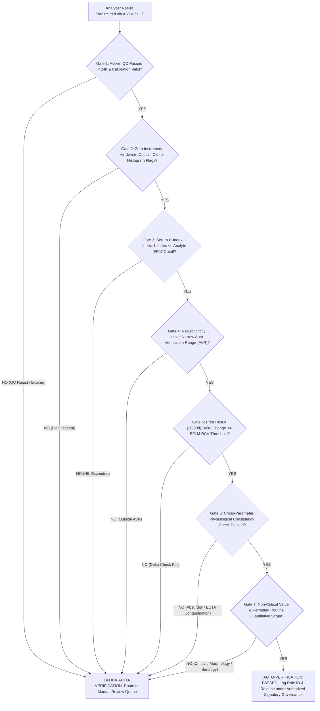

# 0.2.8 Clause 7.6 Laboratory Information Management System (`LIMS`) Validation (`CLSI AUTO08`), Auto-Verification (`CLSI AUTO10 / AUTO15`), Cybersecurity, 3-2-1-1-0 Encrypted Backup & Manual Downtime Contingency SOP

> **Document Control & Regulatory Traceability Block (`ISO 15189:2022 Clauses 7.6, 8.3 & 8.4`)**
> - **Document ID:** `NABL-QSP-0.2.8` | **Legacy Cross-Ref:** `SOP-INF-001 / QM-Sec-7.6`
> - **Document Title:** *End-to-End LIMS & Bidirectional Analyzer Interface Validation (`CLSI AUTO08`), 7-Gate Auto-Verification Architecture (`CLSI AUTO10/AUTO15`), Role-Based Access Control (`RBAC`), Cryptographic Audit Trails, 3-2-1-1-0 Ransomware-Resilient Backup, and Unplanned Downtime Contingency SOP*
> - **Tier / Level:** `Level-2 Apex Quality System Procedure (With Embedded Level-4 Validation & Operational Registers NABL-LIMS-REG-01 to REG-04)`
> - **Version:** `4.0 (International 9-Persona Red-Team Harmonized Edition)` | **Effective Date:** `15-Oct-2026` | **Review Cycle:** `Annual (or immediately upon LIMS version upgrade, middleware patch, formula change, or analyzer interface modification)`
> - **Authorizing Authority:** `Laboratory Director (MD Pathology) | Quality Manager | Lead Laboratory Informatics & Cybersecurity Architect`
> - **Primary Normative Mapping:** `ISO 15189:2022 Clauses 7.6.1–7.6.6, 7.3.6, 7.3.7, 7.4.1, 7.8, 8.4` | `NABL 112` | `NABL 153` | `NABL 220D & 223` | `CLSI AUTO08-A, AUTO10-A, AUTO11-A2, AUTO13-A2, AUTO15` | `ASTM E1381-02 / E1394-97 (LIS01-A2 / LIS02-A2)` | `HL7 v2.5.1` | `ISO/IEC 27001:2022` | `ISO 22367:2020` | `DPDP Act 2023 (India)` | `IT Act 2000 (Sec 43A, 66C, 70B & CERT-In Directions 2022)` | `US FDA 21 CFR Part 11`

---

## 0. 9-Persona International & Above-NABL Red-Team Governance Matrix

Every clause, validation script, mathematical suppression rule, network architecture control, and contingency workflow in this SOP has been audited and hardened across nine adversarial clinical, metrological, informatics, and legal dimensions:

| Persona ID | Adversarial Review Lens | Core Mandates & Hard Controls Embedded in `NABL-QSP-0.2.8` | Primary Clause / Standard |
| :--- | :--- | :--- | :--- |
| **Persona 1** | **Lead NABL (`ISO 15189:2022`) & CAP / UKAS Assessor** | Full clause-by-clause traceability to `ISO 15189:2022 Cl. 7.6.1–7.6.6`, mandatory pre-go-live and post-patch validation dossiers (`IQ/OQ/PQ`), strict separation of off-the-shelf vs. site-customized LIMS rules, and complete auditability of `NABL-LIMS-REG-01` through `REG-04`. | `ISO 15189:2022 Cl. 7.6, 8.4`; `NABL 220D`; `CAP GEN.43000–48500` |
| **Persona 2** | **Clinical Subspecialty Consultant (`MD Pathology / Biochemistry / Hematology / Immunology`)** | Protection against clinically catastrophic data corruption: suppression of `K+`, `LDH`, `AST` on hemolyzed samples; blocking of `MCV/MCHC` auto-release during cold agglutination (`MCHC > 36.5 g/dL`); mandatory age-switching from `CKD-EPI 2021` to `Bedside Schwartz` at `< 18 years`. | `ISO 15189:2022 Cl. 7.3.6, 7.4.1`; Subspecialty Guidelines |
| **Persona 3** | **CLSI & IFCC Metrology, Six-Sigma QC & Biological Variation Specialist** | Direct integration of real-time Westgard `IQC` status (`Gate 1`) and `EFLM` Reference Change Value ($\text{RCV} = \sqrt{2} \cdot Z \cdot \sqrt{CV_A^2 + CV_I^2}$) delta checks (`Gate 5`) into the `LIMS` middleware; strict preservation of `< LoQ` and `> AMR` inequality strings without numeric truncation. | `CLSI EP17-A2, EP06-Ed2, EP07-Ed3`; `EFLM Biological Variation` |
| **Persona 4** | **Clinical Pharmacologist & Special-Population Stratification Auditor** | 5-dimensional reference interval selection engine (`Age [Hours/Days/Months/Years] × Sex × Pregnancy Trimester [T1/T2/T3] × Menstrual Phase × Specimen Matrix`) plus automated drug/chemical interference comment injection (`Biotin`, `Dobutamine/Trinder`, `EDTA` contamination). | `CLSI EP28-A3c`; `CLSI EP37` |
| **Persona 5** | **Medico-Legal, Patient-Safety & `ISO 22367` Risk Management Counsel** | Ironclad chain of custody for electronic records under `CPA 2019` and `Indian Evidence Act Sec 65B / BSA 2023 Sec 63`; immutable append-only audit trails; automated `[AMENDED REPORT]` versioning that never overwrites prior issued PDFs; quantitative `ISO 22367` informatics `FMECA`. | `ISO 22367:2020`; `CPA 2019`; `BSA 2023 Sec 63`; `CLSI GP47` |
| **Persona 6** | **Uncompressed Documentation & Turnkey Bench Architect** | Zero-ambiguity step-by-step protocols, explicit mathematical equations with boundary test cases, pre-filled print-ready Level-4 registers, and verbatim witness-audit simulation scripts for NABL assessors. | `ISO 15189:2022 Cl. 8.3`; `CLSI QMS02-A6` |
| **Persona 7** | **`CLSI AUTO08 / AUTO11 / AUTO15` Informatics & `ASTM / HL7` Interface Architect** | End-to-end verification of `ASTM E1381/E1394` frame checksums and `HL7 v2.5.1` (`OML^O21` / `OUL^R22`) segment mapping across the entire analyzer fleet; 10-Category Interface Stress-Test Matrix covering raw error flag suppression, barcode collisions, and dilution multiplication locks. | `CLSI AUTO08-A, AUTO11-A2`; `ASTM E1381/E1394`; `HL7 v2.5.1` |
| **Persona 8** | **Healthcare Cybersecurity, Ransomware Resilience & `DPDP Act 2023 / 21 CFR Part 11` Engineer** | `3-2-1-1-0` backup topology with air-gapped/immutable `WORM` storage; `VLAN` isolation of laboratory analyzers from public/front-desk networks; `AES-256-GCM` encryption at rest and `TLS 1.3` in transit; `PKI X.509` digital signatures; quarterly bare-metal restore drills (`RPO <= 15m`, `RTO <= 2h`). | `ISO/IEC 27001:2022`; `DPDP Act 2023`; `CERT-In 2022`; `21 CFR Part 11` |
| **Persona 9** | **Clinical Pathologist & Auto-Verification Rule Engine Auditor** | Deterministic 7-Gate Exclusion Filter (`CLSI AUTO10 / AUTO15`) ensuring zero unreviewed release of abnormal, delta-failing, `HIL`-compromised, or physiologically absurd results; mandatory wet-bench boundary challenge testing (`Cutoff - 1`, `Cutoff`, `Cutoff + 1`) and 1-Click Global Kill-Switch. | `CLSI AUTO10-A, AUTO15`; `ISO 15189:2022 Cl. 7.4.1.2` |

---

## Section 1: End-to-End `LIMS` & Bidirectional Analyzer Interface (`ASTM / HL7`) Validation Protocol (`IQ / OQ / PQ` — `ISO 15189:2022 Cl. 7.6.1–7.6.3` & `CLSI AUTO08`)

### 1.1 Scope of Interfaced Systems & Communication Protocols
The laboratory operates a centralized Laboratory Information Management System (`LIMS`) integrated with a bidirectional middleware engine communicating across an isolated Laboratory Instrument Virtual Local Area Network (`VLAN-20`). All interfaces must be validated before clinical go-live and re-validated following any software update, middleware patch, analyzer firmware upgrade, or test dictionary change:

| Analyzer / Subsystem | Make & Model | Department | Interface Physical Layer & Protocol | Directionality & Host Query Mode | Onboard Local Memory Capacity (Downtime Buffer) |
| :--- | :--- | :--- | :--- | :--- | :--- |
| **Automated Hematology Analyzer** | `Nihon Kohden MEK-1503` (3/5-Part Diff) | Hematology | `RS-232C / TCP-IP Socket` — `ASTM E1381-02 / E1394-97` | Bidirectional Host Query (`Barcode Read -> Order Download -> Result + Histogram Flag Upload`) | $\ge 10,000$ patient results with histograms |
| **Primary Clinical Chemistry Analyzer** | `Bonavera Chem-400` | Clinical Biochemistry | `RJ-45 Ethernet TCP/IP` — `ASTM E1394 / HL7 v2.5.1` | Bidirectional Host Query + Serum `HIL` Index Transmission | $\ge 20,000$ test results + reaction curves |
| **Backup Clinical Chemistry Analyzer** | `Bonavera Chem-200` | Clinical Biochemistry | `RJ-45 Ethernet TCP/IP` — `ASTM E1394-97` | Bidirectional Host Query + Serum `HIL` Index Transmission | $\ge 10,000$ test results + reaction curves |
| **Chemiluminescence Immunoassay (`CLIA`)** | `Snibe Maglumi X3` | Immunoassay / Endocrinology / Serology | `RJ-45 Ethernet TCP/IP` — `ASTM E1394 / HL7 v2.5.1` | Bidirectional Host Query (`RLU`, Quantitative Concentration, Qualitative `COI / S/CO` Index) | $\ge 10,000$ test results + calibration curves |
| **Electrolyte Analyzer (`ISE`)** | Direct Ion-Selective Electrode (`Na+, K+, Cl-, iCa2+, Li+`) | Clinical Biochemistry | `RS-232C Serial-to-Ethernet Moxa` — `ASTM E1381/E1394` | Unidirectional/Bidirectional Upload (`mV` drift flag + `mmol/L` concentration) | $\ge 2,000$ patient samples |
| **Automated Coagulation Analyzer** | Optical / Mechanical Coagulometer (`PT/INR, aPTT, Fibrinogen, D-Dimer`) | Hemostasis / Coagulation | `RS-232C / Ethernet` — `ASTM E1394-97` | Bidirectional (`Clotting time in seconds + Optical error flags`) | $\ge 3,000$ clotting profiles |
| **Automated Urine Chemistry Reader** | Reflectance Photometry Strip Reader | Clinical Pathology | `RS-232C / USB-VCP` — `ASTM E1394-97` | Unidirectional Upload (`Semi-quantitative strings: Negative, Trace, 1+, 2+, 3+, 4+`) | $\ge 1,000$ urine strip records |

### 1.2 Three-Stage Lifecycle Qualification (`IQ / OQ / PQ`)
1. **Installation Qualification (`IQ`):**
   - Verification and documentation of server hardware specifications (`Dual Xeon / EPYC CPU`, `ECC RAM`, `RAID-10 NVMe SSDs`), operating system hardening, database engine version (`PostgreSQL / MS SQL Server` with `ACID` compliance), uninterruptible power supply (`Online Double-Conversion UPS` with $\ge 4\text{ hours}$ runtime + diesel generator auto-changeover), `VLAN-20` network switch port mapping, `RS-232/TCP-IP` serial-to-ethernet converter baud rates (`9600/19200 bps, 8-N-1`), and `NTP` (Network Time Protocol) clock synchronization across all analyzers, middleware, and `LIMS` servers (maximum permissible clock drift $\le 2\text{ seconds}$ across all nodes).
2. **Operational Qualification (`OQ`):**
   - Execution of the **10-Category Interface Stress-Test Matrix** (Section 1.3) in a non-production Sandbox/Staging environment using both simulated `ASTM/HL7` data packets and wet-bench phantom/control specimens (`CLSI AUTO08-A`).
   - Low-level protocol verification:
     - **`ASTM E1381-02` Transport Layer:** Verification of link establishment `[ENQ]` $\to$ `[ACK]`, frame structure `[STX] [Frame#] [Data] [ETX/ETB] [C1][C2] [CR][LF]`, modulo-256 hexadecimal checksum (`C1C2`) rejection of corrupted frames via `[NAK]`, and clean termination `[EOT]`.
     - **`ASTM E1394-97` / `HL7 v2.5.1` Application Layer:** Verification of Header (`H` / `MSH`), Patient (`P` / `PID`), Order (`O` / `ORC+OBR`), Result (`R` / `OBX`), and Comment/Flag (`C` / `NTE`) segments.
3. **Performance Qualification (`PQ`):**
   - Parallel live-run verification across **$n = 50$ consecutive routine and abnormal patient specimens per interfaced analyzer** (encompassing `Hematology`, `Biochemistry`, `Immunoassay`, `Coagulation`, `ISE`, and `Urinalysis`) comparing:
     1. Raw analyzer screen display and local thermal/ticket printout;
     2. Middleware staging queue representation;
     3. `LIMS` technician validation screen; and
     4. Final rendered `PDF` report (including printed hardcopy, patient portal PDF, and WhatsApp/Email encrypted PDF).
   - **Acceptance Criterion:** **$100.0\%$ character-for-character, decimal-for-decimal, unit-for-unit, and flag-for-flag concordance** (`0` transcription, truncation, or mapping defects allowed).

### 1.3 The 10-Category Interface Stress-Test Matrix (`CLSI AUTO08` Mandatory Challenge Suite)
No analyzer interface or `LIMS` test code may be activated for clinical reporting until it passes all 10 stress-test categories documented in Register `NABL-LIMS-REG-01`:

| Category # | Stress-Test Category | Technical Failure Mode Targeted | Mandatory Challenge Test Scenarios (Minimum Inputs Tested) | Pass / Acceptance Criteria (`100% Compliance Required`) |
| :--- | :--- | :--- | :--- | :--- |
| **Cat 1** | **Normal Numeric Transmission & Host Query Routing** | Channel swapping (e.g., `AST` mapped to `ALT` channel ID), decimal point shift, or dropped digits during `ASTM R-segment` / `HL7 OBX-5` parsing. | Transmit $20$ multi-analyte barcoded samples (`CBC`, `LFT`, `RFT`, `Lipids`, `Thyroid`) via bidirectional host query (`Order Download -> Assay -> Result Upload`). | $100\%$ exact match between analyzer raw value and `LIMS` field; zero channel cross-mapping across all active test codes. |
| **Cat 2** | **Below `< LoQ` & Above `> AMR` Inequality Symbols & Dilution Multipliers** | Stripping of `<` or `>` symbols (turning `< 0.005 mIU/L` `TSH` into `0.005 mIU/L`, or `> 1000 IU/mL` `Anti-TPO` into `1000 IU/mL`), or **Double-Multiplication Hazard** (analyzer multiplies $1:10$ onboard dilution AND `LIMS` multiplies by $10\times$ again). | 1. Send `< 0.01`, `< 0.5`, `> 500`, `> 10000` strings from `Maglumi X3` and `Chem-400`.<br>2. Run a $1:10$ auto-diluted sample and a $1:10$ manual-diluted sample. | 1. Exact `<` and `>` symbols preserved in `LIMS` and final `PDF`; mathematical calculations using `< LoQ` inputs automatically suppressed (`CALC-BLOCKED`).<br>2. Auto-dilution multiplied exactly once (by instrument); manual dilution requires dual-tech confirmation in `LIMS`. |
| **Cat 3** | **Qualitative Strings, Semi-Quantitative Titers & Cut-Off Index (`COI / S/CO`)** | Truncation or inversion of qualitative strings (`Non-Reactive` truncated to `Reactive`), or decoupling of qualitative interpretation from numerical `S/CO` or `COI` index. | Challenge with `Negative`, `Positive`, `Reactive (S/CO = 14.2)`, `Non-Reactive (S/CO = 0.18)`, `Grayzone / Indeterminate (S/CO = 0.95)`, and Urine `Trace`, `1+`, `2+`, `3+`, `4+`. | Exact string preservation; `Grayzone / Reactive` automatically triggers `HOLD_FOR_REFLEX_CONFIRMATION` and blocks auto-verification. |
| **Cat 4** | **Decimal Rounding Fidelity & `UCUM` Unit Locking** | Floating-point binary representation artifacts (e.g., `4.2000000001` or `139.9999`), inconsistent rounding (`IEEE 754` vs clinical half-up rounding), or unit corruption (`ug/dL` vs `ng/mL`, `10^3/uL` vs `cells/uL`). | Challenge boundary decimals (`1.25`, `1.35`, `0.0049`, `13.95`) across analyte-specific decimal masks (`Na+`: $0$ or $1$ dec; `Creatinine`: $2$ dec; `TSH`: $3$ dec) and verify `UCUM` unit strings on PDF. | `LIMS` applies deterministic analyte-specific decimal precision matching the `CLSI EP17/EP06` validated precision; special characters (`μL`, `mL/min/1.73m²`, `10³/μL`) render cleanly on PDF without font-box corruption (`?` or `□`). |
| **Cat 5** | **Analyzer Hardware, Optical, Reagent & `HIL` Error Flag Suppression** | Analyzer transmits a corrupted numeric value alongside an error flag (`*`, `E`, `>Lin`, `Short Sample`, `Clot Detected`, `Substrate Depletion / Prozone`, `Reagent Blank Error`, `H-Index > Threshold`), and `LIMS` strips the flag while accepting the garbage number! | Induce/simulate on each analyzer: `Short Sample`, `Clot Alarm`, `Absorbance Overflow (>Abs)`, `Calibration Expired`, `QC Failed`, `H-Index = 250 mg/dL` on `K+/LDH`, and `MEK-1503` `Blast?` / `Plt Clumps?` flags. | `LIMS` middleware **blocks numeric auto-population into the reportable field** (or quarantines result in `FLAGGED_UNVALIDATED` status in red), imports the exact instrument alarm code into the technician review panel, and **100% blocks auto-verification**. |
| **Cat 6** | **Barcode Mismatch, Duplicate Accession Collision & Specimen Matrix Suffix Lock** | 1. Duplicate accession ID overwrites an already-authorized patient's result.<br>2. Barcode check-digit error causes misread.<br>3. `K2-EDTA` purple-top barcode scanned on `Chem-400` biochemistry line instead of `Serum` gel tube. | 1. Transmit result for an already-authorized Accession ID.<br>2. Scan a `Code-128` barcode with suffix `-ED` (EDTA) on `Chem-400` (configured for `-SR` Serum / `-FL` Fluoride).<br>3. Scan an unregistered barcode. | 1. `LIMS` **hard-locks** any authorized record against interface overwrite (`ERR_RECORD_LOCKED_AUTHORIZED`); routes duplicate run to `Repeat/Delta Holding Queue`.<br>2. Matrix suffix mismatch (`-ED` on Serum assay) triggers immediate host query rejection (`WRONG_CONTAINER_TYPE`).<br>3. Unregistered barcode quarantined in `Orphan Result Buffer`. |
| **Cat 7** | **Calculated Parameter Formula Verification & Hard Suppression Gates** | Wrong formula coefficients, unit mismatch inside equations, or calculating invalid results when an input violates physiological/analytical boundaries (e.g., Friedewald `LDL-C` when `TG = 450 mg/dL`). | Challenge all 14 clinical equations across Low, Normal, High, Missing-Input, and Boundary-Violation test vectors (see Section 1.4 Table). | $100.0\%$ mathematical concordance to $\pm 0.01$ against independent scientific calculator / Excel reference sheet; **Hard Suppression Gates** replace invalid outputs with explicit reason code (`CALC_SUPPRESSED_TG_GT_400`). |
| **Cat 8** | **5-Dimensional Biological Reference Interval Auto-Selection** | Adult male reference interval applied to a 2-day-old neonate (e.g., missing neonatal hyperbilirubinemia or misflagging normal neonatal `Hb = 18.5 g/dL` / `ALP = 380 U/L`) or non-pregnant `TSH` interval applied to 1st-Trimester pregnancy. | Create 12 synthetic test patients spanning: `Cord Blood`, `Neonate (24h, 72h, 14d)`, `Infant (6m)`, `Pediatric (5y, 12y M/F)`, `Adult Male`, `Adult Female (Follicular/Luteal)`, `Pregnant (T1, T2, T3)`, and `Geriatric (78y)`. | `LIMS` dynamically selects the exact age-, sex-, pregnancy-trimester-, and specimen-type-specific reference interval and prints the active stratum label on the report. |
| **Cat 9** | **Critical / Panic Value Pop-Up Trigger & `CLSI GP47` Escalation Gate** | Critical value (e.g., `K+ = 6.8 mmol/L`, `Glucose = 38 mg/dL`, `Platelets = 18 × 10³/μL`, `Troponin I > Critical`) blends into routine queue without audiovisual alert or is released without mandatory read-back logging. | Transmit values at $\text{Critical Low} + 0.1$, $\text{Critical Low}$, $\text{Critical Low} - 0.1$, and $\text{Critical High} - 0.1$, $\text{Critical High}$, $\text{Critical High} + 0.1$. | Instant flashing red modal pop-up + audible alarm at exact critical threshold; triggers mandatory `CLSI GP47` Critical Notification Module requiring `Caller Name`, `Recipient Name/Designation`, `Read-Back Confirmed [Y/N]`, and `Timestamp` within $\le 30\text{ minutes}$. |
| **Cat 10** | **Amended Report (`[AMENDED]`) Version Control & Historical Immutability** | Modifying a post-authorization result silently overwrites the original PDF, destroying the medico-legal record of what the clinician originally saw. | Authorize a test report (`Version 1.0`), then invoke `Post-Release Amendment` to correct a result or add a comment. | Original `Version 1.0` PDF remains permanently archived and retrievable in the audit trail; new report prints with prominent header: **`[AMENDED REPORT — V2.0 — SUPERSEDES REPORT V1.0 ISSUED ON DD-MMM-YYYY HH:MM — PREVIOUS VALUE: X -> AMENDED VALUE: Y — REASON: Z]`** and triggers automated re-notification to clinician/patient. |

### 1.4 Master Calculated Parameter Verification & Hard Suppression Gate Specifications (`ISO 15189:2022 Cl. 7.3.6`)
All in-system calculations are locked against manual editing by bench staff. Only `LIMS` Administrators with co-authorization from the Laboratory Director may update an equation, followed by mandatory 3-level challenge testing:

| # | Calculated Parameter | Exact Mathematical Formula Programmed in `LIMS` | Input Units & Decimal Rounding | Mandatory Hard Suppression Gate (`LIMS` Auto-Block Condition) |
| :--- | :--- | :--- | :--- | :--- |
| **1** | **Friedewald `LDL-C`** *(Default when $\text{TG} \le 400$)* | $$\text{LDL-C} = \text{TC} - \text{HDL-C} - \left(\frac{\text{TG}}{5}\right)$$ | `mg/dL` (Integer or $1$ dec) | **Hard Block (`CALC_SUPPRESSED`):** If $\text{TG} > 400\text{ mg/dL}$, OR if calculated $\text{LDL-C} \le 0$, OR if chylomicronemia flag present. Auto-triggers comment: *"Friedewald LDL-C invalid at TG > 400 mg/dL; Direct Enzymatic LDL-C or Sampson/Martin-Hopkins equation required."* |
| **2** | **Sampson-NIH / Martin-Hopkins `LDL-C`** *(Extended Lipid Equation)* | $$\text{LDL-C}_{\text{Sampson}} = \frac{\text{TC}}{0.948} - \frac{\text{HDL-C}}{0.971} - \left(\frac{\text{TG}}{8.56} + \frac{\text{TG} \times \text{Non-HDL-C}}{2140} - \frac{\text{TG}^2}{16100}\right) - 9.44$$ | `mg/dL` ($1$ dec) | **Hard Block:** If $\text{TG} > 800\text{ mg/dL}$ (auto-reflexes to Direct Homogeneous `LDL-C` assay on `Chem-400`). |
| **3** | **`Non-HDL Cholesterol` & `VLDL-C`** | $$\text{Non-HDL-C} = \text{TC} - \text{HDL-C} \quad ; \quad \text{VLDL-C} = \frac{\text{TG}}{5}$$ | `mg/dL` ($1$ dec) | `VLDL-C` blocked if $\text{TG} > 400\text{ mg/dL}$; `Non-HDL-C` blocked if $\text{HDL-C} > \text{TC}$ (analytical absurdity gate). |
| **4** | **Adult `eGFR` (`CKD-EPI 2021` Race-Free Creatinine)** | $$\text{eGFR} = 142 \times \min\left(\frac{S_{\text{Cr}}}{\kappa}, 1\right)^{\alpha} \times \max\left(\frac{S_{\text{Cr}}}{\kappa}, 1\right)^{-1.200} \times 0.9938^{\text{Age}} \times (1.012 \text{ if Female})$$<br>*(where $\kappa = 0.7$, $\alpha = -0.241$ for Females; $\kappa = 0.9$, $\alpha = -0.302$ for Males)* | $S_{\text{Cr}}$ in `mg/dL` (`IDMS`-traceable); Output in `mL/min/1.73m²` ($1$ dec) | **Hard Block:** Automatically blocked if $\text{Patient Age} < 18.0\text{ years}$ (switches to `Bedside Schwartz`), if $\text{Sex} = \text{Unknown/Unspecified}$, if $S_{\text{Cr}} < 0.20\text{ mg/dL}$, or if patient is coded `Pregnancy` / `Acute Kidney Injury (AKI) Unsteady State`. |
| **5** | **Pediatric `eGFR` (`Bedside Schwartz` Equation)** | $$\text{eGFR}_{\text{Ped}} = \frac{0.413 \times \text{Height (cm)}}{S_{\text{Cr}}\text{ (mg/dL)}}$$ | Height in `cm`, $S_{\text{Cr}}$ in `mg/dL`; Output in `mL/min/1.73m²` | **Hard Block:** Activated only for $\text{Age } 1\text{–}17\text{ years}$; **strictly suppressed** if `Height (cm)` field is blank or $< 30\text{ cm}$ / $> 220\text{ cm}$ (never substitutes a default height!). |
| **6** | **Albumin-Corrected Calcium (`Payne Formula`)** | $$\text{Corrected Ca} = \text{Measured Total Ca} + 0.8 \times (4.0 - \text{Serum Albumin})$$ | `Ca` in `mg/dL`, `Albumin` in `g/dL` ($2$ dec) | **Hard Block:** Suppressed if $\text{Albumin} > 4.5\text{ g/dL}$ or if `Ionized Calcium (iCa2+)` is concurrently ordered in severe acid-base / ICU states. |
| **7** | **Serum `Anion Gap` (`AG`) & `Albumin-Corrected AG`** | $$\text{AG} = [\text{Na}^+] - ([\text{Cl}^-] + [\text{HCO}_3^-]) \quad ; \quad \text{AG}_{\text{corr}} = \text{AG} + 2.5 \times (4.0 - \text{Albumin})$$ | `mmol/L` ($1$ dec) | **Hard Block:** Suppressed if any electrolyte carries an `ISE` drift/error flag or if calculated $\text{AG} < 0\text{ mmol/L}$ (triggers bromism / hyperlipidemia / paraproteinemia / analyzer calibration check alert). |
| **8** | **Indirect Bilirubin, Serum Globulin & `A:G Ratio`** | $$\text{Bili}_{\text{Ind}} = \text{Bili}_{\text{Tot}} - \text{Bili}_{\text{Dir}} \quad ; \quad \text{Glob} = \text{TP} - \text{Alb} \quad ; \quad \text{A:G} = \frac{\text{Alb}}{\text{Glob}}$$ | `mg/dL` / `g/dL` ($2$ dec) | **Hard Block (`Physiological Absurdity`):** Suppressed if $\text{Bili}_{\text{Dir}} > \text{Bili}_{\text{Tot}}$ or $\text{Albumin} \ge \text{Total Protein}$ (forces manual analytical repeat & dilution check). |
| **9** | **International Normalized Ratio (`INR`)** | $$\text{INR} = \left(\frac{\text{PT}_{\text{Patient (sec)}}}{\text{MNPT}_{\text{Lot (sec)}}}\right)^{\text{ISI}_{\text{Lot}}}$$ | `PT/MNPT` in `seconds`; `INR` dimensionless ($2$ dec) | **Hard Block:** Locked to current active Thromboplastin Reagent Lot `MNPT` (geometric mean of $\ge 20$ normal plasmas) and lot-specific `ISI`. Blocked if `PT > 120 sec` (no clot detected) or if reagent lot expiry timestamp has passed. |
| **10** | **Urine Albumin-to-Creatinine Ratio (`UACR`)** | $$\text{UACR (mg/g)} = \frac{\text{Urine Albumin (mg/L)}}{\text{Urine Creatinine (mg/dL)}} \times 100$$ | `mg/g Creatinine` ($1$ dec) | **Hard Block:** Suppressed if Urine Albumin is `< LoQ` or `> AMR` without dilution, or if Urine Creatinine $< 10\text{ mg/dL}$ (over-dilute specimen rejection alert). |
| **11** | **Transferrin Saturation (`TSAT %`) & `TIBC`** | $$\text{TSAT (\%)} = \left(\frac{\text{Serum Iron (\mu g/dL)}}{\text{TIBC (\mu g/dL)}}\right) \times 100 \quad ; \quad \text{TIBC} = \text{Serum Iron} + \text{UIBC}$$ | `%` ($1$ dec) and `μg/dL` | **Hard Block:** Suppressed if $\text{UIBC} \le 0$ or $\text{TSAT} > 100\%$ (triggers acute iron poisoning / `Fe` contamination / hemolysis verification). |
| **12** | **Insulin Resistance (`HOMA-IR`) & Estimated Average Glucose (`eAG`)** | $$\text{HOMA-IR} = \frac{\text{Fasting Glucose (mg/dL)} \times \text{Fasting Insulin (\mu IU/mL)}}{405} \quad ; \quad \text{eAG} = (28.7 \times \text{HbA1c}) - 46.7$$ | Dimensionless ($2$ dec) / `mg/dL` ($0$ dec) | `HOMA-IR` blocked if specimen is not verified `Fasting (8–12h)` or if `Hemolysis H-Index > 25 mg/dL` (insulin-degrading enzyme released from lysed RBCs falsely lowers insulin). |
| **13** | **Liver Fibrosis Index (`FIB-4`) & `R-Factor` (Liver Injury)** | $$\text{FIB-4} = \frac{\text{Age (yr)} \times \text{AST (U/L)}}{\text{Platelets (10}^9\text{/L)} \times \sqrt{\text{ALT (U/L)}}} \quad ; \quad R = \frac{\text{ALT} / \text{ULN}_{\text{ALT}}}{\text{ALP} / \text{ULN}_{\text{ALP}}}$$ | Dimensionless ($2$ dec) | `FIB-4` blocked if $\text{Age} < 18\text{ yr}$ or if `Platelet Clumps` flag is active on `MEK-1503` (pseudothrombocytopenia falsely inflates `FIB-4` into cirrhosis range!). |
| **14** | **Risk of Ovarian Malignancy Algorithm (`ROMA Index`) & `Free Androgen Index (FAI)`** | $$\text{PI}_{\text{Pre}} = -12.0 + 2.38\ln(\text{HE4}) + 0.0626\ln(\text{CA125}) \quad ; \quad \text{PI}_{\text{Post}} = -8.09 + 1.04\ln(\text{HE4}) + 0.732\ln(\text{CA125})$$<br>$$\text{ROMA (\%)} = \frac{\exp(\text{PI})}{1 + \exp(\text{PI})} \times 100 \quad ; \quad \text{FAI} = \left(\frac{\text{Total Testosterone (nmol/L)}}{\text{SHBG (nmol/L)}}\right) \times 100$$ | `HE4` in `pmol/L`, `CA125` in `U/mL`; `ROMA` in `%` ($1$ dec) | **Hard Block:** `ROMA` blocked if `Sex != Female`, if `Age < 18 yr`, if `Menopausal Status (Pre/Post)` is unspecified on `TRF`, or if `HE4` / `CA125` are assayed on different immunoassay platforms. |
| **15** | **Absolute Leukocyte Counts (`ANC, ALC, AEC, AMC, ABC`) & `RBC Indices`** | $$\text{Absolute Count} = \frac{\text{TLC} \times \text{Diff \%}}{100} \quad ; \quad \text{MCV} = \frac{\text{Hct} \times 10}{\text{RBC}} \quad ; \quad \text{MCH} = \frac{\text{Hb} \times 10}{\text{RBC}} \quad ; \quad \text{MCHC} = \frac{\text{Hb} \times 100}{\text{Hct}}$$ | `10³/μL` ($2$ dec); `fL`, `pg`, `g/dL` ($1$ dec) | **Hard Block:** Suppressed if $\sum (\text{Neut\% + Lymph\% + Mono\% + Eos\% + Baso\%}) \neq 100\%$, or if `MCHC > 36.5 g/dL` (auto-Verification blocked; requires $37^\circ\text{C}$ pre-warming / saline replacement check). |

---

## Section 2: Auto-Verification Algorithm Architecture, 7-Gate Exclusion Filter & Boundary Challenge Testing (`ISO 15189:2022 Cl. 7.3.7 / 7.4.1.2` & `CLSI AUTO10 / AUTO15`)

### 2.1 Deterministic Boolean Logic of the 7-Gate Auto-Verification Engine
In strict compliance with **`ISO 15189:2022 Clause 7.4.1.2`** (*Automated selection and reporting of results*) and **`CLSI AUTO10-A / AUTO15`**, the `LIMS` middleware evaluates every candidate result through a sequential **7-Gate Exclusion Filter** before permitting automated validation. A test result is eligible for auto-verification ($AV_{\text{Pass}} = \text{TRUE}$) **if and only if every single gate evaluates to `PASS`**:

$$AV_{\text{Pass}} = \text{Gate}_1 (\text{IQC}) \land \text{Gate}_2 (\text{InstFlag}) \land \text{Gate}_3 (\text{HIL}) \land \text{Gate}_4 (\text{AVR}) \land \text{Gate}_5 (\text{Delta RCV}) \land \text{Gate}_6 (\text{Absurdity}) \land \text{Gate}_7 (\text{NonCritical/Scope})$$

If **any** gate returns `FALSE` (`FAIL`), the entire test panel is immediately routed to the **`MANUAL_TECHNICAL_AND_PATHOLOGIST_REVIEW_QUEUE`** with the specific failing gate code highlighted in amber/red.



### 2.2 Detailed Specification of the 7 Mandatory Exclusion Gates

| Gate # | Gate Name | Exact Algorithmic Exclusion Condition (`Immediate Block if TRUE`) | Representative Clinical & Analytical Examples Enforced in `LIMS` |
| :--- | :--- | :--- | :--- |
| **Gate 1** | **Real-Time Westgard `IQC` & Calibration Validity Gate** | Auto-verification is **globally blocked for the analyte** if:<br>1. Normal & Pathological `IQC` levels have not been analyzed and accepted within the preceding $24\text{ hours}$ (or $8\text{h}$ shift for `Coagulation / Blood Gas / Hematology`);<br>2. The most recent `IQC` run triggered a Westgard rejection rule ($1_{3s}, 2_{2s}, R_{4s}, 4_{1s}$); OR<br>3. The analyzer calibration lot curve has expired or is unverified. | If `Chem-400` Level-2 `IQC` for `Creatinine` violates $1_{3s}$ at `08:30 AM`, Middleware immediately sets `AV_STATUS(Creatinine, eGFR) = LOCKED_QC_FAIL` until corrective action and passing re-QC are logged in `LIMS` QC module. |
| **Gate 2** | **Instrument Hardware, Reagent, Optical & Scattergram Flag Gate** | Auto-verification is **blocked for the specimen** if the analyzer transmits **any** non-blank instrument alarm or morphology suspect flag in the `ASTM R/C` or `HL7 OBX-8` abnormal flags field. | - **Hematology (`MEK-1503`):** Any suspect flag: `Blast?`, `Immature Gran?`, `Left Shift?`, `Atypical Lymph?`, `NRBC?`, `RBC Agglutination?`, `Dimorphic RBC?`, `Platelet Clumps?`, `Micro/MacroPlt?`, or `Turbidity/Hgb Interf?`.<br>- **Biochemistry (`Chem-400/200`):** `>Lin` (prozone/substrate depletion), `Short Sample`, `Clot`, `Lamp/Photometer Drift`, `Cuvette Blank High`.<br>- **Immunoassay (`Maglumi X3`):** `RLU Overflow`, `Magnetic Bead Wash Error`, `Clot/Bubble`. |
| **Gate 3** | **Quantitative Serum `HIL` Interference Index Gate (`CLSI EP07/EP37`)** | Auto-verification is **blocked for the analyte** if the automated spectrophotometric `H-Index` (Hemolysis in $\text{mg/dL}$ free Hb), `I-Index` (Icterus in $\text{mg/dL}$ bilirubin), or `L-Index` (Lipemia/Turbidity in $\text{mg/dL}$ Intralipid) exceeds the analyte-specific rejection threshold. | - **`H-Index` $> 50\text{ mg/dL}$ (Mild Hemolysis):** Blocks `K+`, `LDH`, `AST`, `Total/Direct Bilirubin`, `Iron`, `Folate`, `Insulin`, `Troponin`.<br>- **`I-Index` $> 15\text{ mg/dL}$ (Severe Icterus):** Blocks `Jaffe/Enzymatic Creatinine`, `Total Protein`, `Cholesterol`, `Uric Acid`, `Triglycerides` (negative Trinder interference).<br>- **`L-Index` $> 300\text{ mg/dL}$ (Gross Lipemia):** Blocks `Indirect ISE Na+/K+/Cl-` (pseudohyponatremia risk), `Hb/MCHC`, and colorimetric endpoint assays. |
| **Gate 4** | **Narrow Auto-Verification Range (`AVR`) Gate** | Auto-verification is **blocked** if the result lies outside the pre-defined **Auto-Verification Range (`AVR`)**. By policy, the `AVR` is strictly narrower than the Analytical Measuring Range (`AMR`) and Critical Limits, and is typically set to the Biological Reference Interval $\pm 10\text{–}15\%$ clinically benign buffer (or strictly within the reference interval for high-risk markers). | - **`K+`:** `AMR` $= 1.5\text{–}10.0\text{ mmol/L}$; `Critical` $= <2.8 / >6.2$; `Ref Range` $= 3.5\text{–}5.1$; **`AVR` $= 3.5\text{–}5.2\text{ mmol/L}$**.<br>- **`Hb` (Adult):** `Ref Range` $= 12.0\text{–}17.0\text{ g/dL}$; **`AVR` $= 10.5\text{–}16.5\text{ g/dL}$** ( provided `MCV = 80–98 fL`, `RDW <= 15.0%`, and zero flags).<br>- **`Platelets`:** **`AVR` $= 150\text{–}420 \times 10^3/\mu\text{L}$** (any thrombocytopenia $< 150$ or thrombocytosis $> 420$ is blocked for manual smear review).<br>- **`Glucose` (Fasting):** **`AVR` $= 70\text{–}140\text{ mg/dL}$**. |
| **Gate 5** | **Temporal Reference Change Value (`RCV`) Delta Check Gate** | If the patient has a prior validated result within the lookback window ($30\text{ days}$ for acute analytes; $90\text{ days}$ for chronic analytes), auto-verification is **blocked** if the absolute or percentage change $\lvert\Delta\rvert$ exceeds the `EFLM`-derived bidirectional Reference Change Value:<br>$$\text{RCV}_{95\%} = 1.96 \times \sqrt{2} \times \sqrt{CV_A^2 + CV_I^2}$$<br>Note: First-time patients without historical results are permitted to pass Gate 5 **only** if the result lies strictly within the physiological normal reference interval (`Gate 4 Tight Mode`). | - **`MCV` ($90\text{d}$ lookback):** $\lvert\Delta \text{MCV}\rvert > 4.0\text{ fL}$ $\to$ **BLOCK** (`Possible Sample Mix-Up / Wrong Patient Tube / Transfusion`).<br>- **`Hemoglobin` ($30\text{d}$):** $\lvert\Delta \text{Hb}\rvert > 1.5\text{ g/dL}$ $\to$ **BLOCK** (`Acute Bleed / Hemodilution / Wrong Patient`).<br>- **`Platelets` ($30\text{d}$):** $\lvert\Delta \%\rvert > 35\%$ $\to$ **BLOCK** (`EDTA Clumping / HIT / Bone Marrow Suppression`).<br>- **`Creatinine` ($30\text{d}$):** $\lvert\Delta \%\rvert > 25\%$ or $\lvert\Delta\rvert > 0.3\text{ mg/dL}$ $\to$ **BLOCK** (`AKI / Post-Dialysis / IV Fluid Dilution`).<br>- **`Sodium` ($14\text{d}$):** $\lvert\Delta \text{Na}^+\rvert > 5.0\text{ mmol/L}$ $\to$ **BLOCK**.<br>- **`TSH` ($90\text{d}$):** $\lvert\Delta \%\rvert > 50\%$ $\to$ **BLOCK**. |
| **Gate 6** | **Cross-Parameter Physiological Absurdity & Contamination Gate** | Auto-verification is **blocked across the entire accession** if any multi-analyte cross-check detects an analytically or physiologically impossible combination or pre-analytical contamination signature. | 1. **`K2/K3-EDTA` Tube Cross-Contamination Signature:** `K+ > 5.8 mmol/L` AND (`Total Ca < 7.0 mg/dL` OR `ALP < 35 U/L` OR `Mg < 1.0 mg/dL`) $\to$ **HARD BLOCK (`SUSPECT_EDTA_CONTAMINATION`)**.<br>2. **IV Dextrose / Normal Saline Drip Arm Draw:** `Glucose > 400 mg/dL` with `Na+ < 126 mmol/L` and `Cl-/K+/Ca2+` simultaneously diluted vs prior run $\to$ **HARD BLOCK (`SUSPECT_IV_DRIP_DILUTION`)**.<br>3. **Component Exceeding Total:** `Direct Bilirubin > Total Bilirubin`, `Albumin >= Total Protein`, `Free PSA > Total PSA`, `HDL-C + Direct LDL-C > Total Cholesterol` $\to$ **HARD BLOCK (`ANALYTICAL_IMPOSSIBILITY`)**.<br>4. **Hematology Rule-of-Three Violation (`Cold Agglutinin / Lipemia / Hemolysis`):** $\lvert \text{Hb} \times 3 - \text{Hct} \rvert > 3.0$ OR `MCHC > 36.5 g/dL` $\to$ **HARD BLOCK (`RULE_OF_3_MCHC_VIOLATION`)**.<br>5. **Thyroid Axis Discordance:** `TSH < 0.1 mIU/L` with `FT4 < 0.8 ng/dL` (central hypothyroidism / non-thyroidal illness / biotin interference) or `TSH > 10 mIU/L` with `FT4 > 1.8 ng/dL` (assay interference / heterophile Ab / TSHoma) $\to$ **HARD BLOCK**. |
| **Gate 7** | **Critical/Panic Value & Mandatory Human-Sign-Off Scope Exclusion Gate** | Auto-verification is **permanently prohibited ($0\%$ allowed)** for:<br>1. Any Critical / Panic Value (`CLSI GP47`);<br>2. Any Infectious Disease Serology (`HIV 1&2`, `HBsAg`, `Anti-HCV`, `Syphilis/VDRL`) that is `Reactive` or `Grayzone`;<br>3. All Peripheral Blood Smear (`PBS`) morphology, Reticulocyte morphology, Bone Marrow, Body Fluid Cytology, Histopathology, Cytopathology, Coagulation mixing studies, Blood Bank crossmatch, and Microbiology Culture/AST reports. | Even if `IQC` is valid and zero hardware flags exist, a `Potassium = 2.6 mmol/L` (`Critical Low`) or an `HIV Combo S/CO = 1.15` (`Reactive`) or a `Peripheral Smear Commentary` can **never** be auto-verified under any configuration. |

### 2.3 Boundary Challenge Testing Protocol (`CLSI AUTO10 / AUTO15`) & Emergency 1-Click Kill-Switch
1. **Boundary Challenge Testing (`Cutoff - 1`, `Cutoff`, `Cutoff + 1` Verification):**
   - Prior to enabling auto-verification for any analyte—and **annually thereafter** (as well as after any `LIMS` upgrade)—the Quality Manager and Clinical Pathologist execute documented boundary challenge tests in Register `NABL-LIMS-REG-02`.
   - For every numeric gate threshold $T$ (`AVR Low`, `AVR High`, `HIL Cutoff`, `Delta RCV %`, `MCHC 36.5`), three discrete challenge values ($T - \epsilon$, $T$, and $T + \epsilon$, where $\epsilon$ is $1$ unit of the least significant reportable decimal place, e.g., $0.1\text{ mmol/L}$ for `K+` or $0.01\text{ mg/dL}$ for `Creatinine`) are injected into the test interface to verify that the boolean inequality (`<` vs `<=`, `>` vs `>=`) behaves exactly as specified.
   - **Simulated Failure Injection:** At least $10$ composite failure cases (e.g., normal `K+ = 4.2 mmol/L` paired with a failed `IQC` flag, or normal `Hb = 14.0 g/dL` paired with a `Platelet Clumps?` flag, or normal `Creatinine = 0.90 mg/dL` representing a $45\%$ drop from yesterday's `1.65 mg/dL`) must be tested and proven to **BLOCK** auto-verification $100\%$ of the time.
2. **Emergency 1-Click Global & Analyte-Specific Auto-Verification Kill-Switch (`CLSI AUTO15 Section 8.4`):**
   - The `LIMS` Validation Dashboard features a prominent red **`[EMERGENCY SUSPEND AUTO-VERIFICATION]`** toggle accessible to any Authorized Signatory (`MD`), Quality Manager, or Senior Section Supervisor without requiring IT intervention.
   - **Two Suspension Scopes:**
     1. **Analyte / Instrument Scope Kill-Switch:** Instantly suspends auto-verification for a single test (e.g., `Sodium`) or a single analyzer (`Chem-400`) upon suspecting reagent drift, lot-to-lot shift, or `EQAS` Z-score warning.
     2. **Global Master Kill-Switch:** Instantly suspends **all** auto-verification across the entire laboratory within $< 1\text{ second}$ in the event of a middleware parsing anomaly, network time synchronization (`NTP`) failure, or database patch roll-out.
   - **Re-Activation Lock:** Once suspended via Kill-Switch, auto-verification **cannot** be re-enabled by bench technologists; re-activation requires documented root-cause verification, $3$ challenge test cases, and dual electronic sign-off by the Quality Manager and Laboratory Director in `NABL-LIMS-REG-02`.

---

## Section 3: Cybersecurity, Role-Based Access Control (`RBAC`), Cryptographic Digital Signatures & Immutable Audit Trails (`ISO 15189:2022 Cl. 7.6.2, 7.6.3, 8.4` & `21 CFR Part 11`)

### 3.1 6-Tier Role-Based Access Control (`RBAC`) & Least-Privilege Matrix
Every staff member is provisioned a unique, non-transferable individual `User_ID` tied to their HR employment and competency record (`NABL-HR-LOG`). **Shared or generic accounts (e.g., `biochem_user`, `admin1`, `reception`) are strictly prohibited and disabled at the database schema level.**

| RBAC Tier | Role Designation | Authentication & Session Policy | Permitted `CRUD` Operations (`Create, Read, Update, Delete`) | Strictly Hard-Blocked (`Read-Only` or `Access Denied`) Privileges |
| :--- | :--- | :--- | :--- | :--- |
| **Tier 1** | **Front-Desk / Phlebotomist** | Unique User ID + Complex Password ($\ge 12\text{ chars}$); Auto-logoff at $5\text{ min}$ idle; restricted to Front-Desk/Phlebotomy `VLAN-10` IP range. | - **Create/Read:** Patient demographics, `TRF` image scan upload, billing, barcode label generation, phlebotomy collection timestamp (`t_collect`) & collector ID logging.<br>- **Read/Print:** Final **Authorized** PDF reports only (except restricted `HIV` / confidential genetic files). | **ZERO access** to view unvalidated/pending results, enter test results, view `HIV` status without explicit patient-release PIN, modify collection timestamps retroactively without supervisor override, or access QC/Master setup. |
| **Tier 2** | **Sample Accessioning & Pre-Analytical Technician** | Unique User ID + Password; Auto-logoff at $10\text{ min}$ idle. | - **Update:** Scan specimen arrival timestamp (`t_receive`), centrifuge timestamp, log pre-analytical sample rejections (`REJ-CODE-01` to `REJ-CODE-15`) with mandatory photo/comment trigger, split aliquot barcodes. | **ZERO access** to enter/modify analytical results, validate tests, alter patient demographics on authorized orders, or override `HIL` flags. |
| **Tier 3** | **Bench Technologist (`MLT / BSc MLT`) — *Maker / 1st-Level Technical Reviewer*** | Unique User ID + Password + Biometric/Badge login at bench terminal; Auto-logoff at $10\text{ min}$ idle. | - **Read/Update:** Review analyzer `ASTM/HL7` upload queue, verify `IQC` Levey-Jennings charts, trigger manual/automated rerun or dilution on analyzer, enter manual bench results (`ESR, Urine Microscopy, Rapid Cards`), perform **1st-Level Technical Validation (`Maker`)**. | **STRICTLY BLOCKED from Final Report Authorization / Release (`2nd-Level Checker`)**; cannot embed Authorized Signatory digital signature; cannot edit calculated parameters; cannot delete any analyzer raw transmission record; cannot alter reference intervals. |
| **Tier 4** | **Senior Section Supervisor / Technical Manager** | Unique User ID + Strong Password + 2FA; Auto-logoff at $10\text{ min}$ idle. | - All Tier 3 rights + **IQC Rule Unblocking** (logging corrective action to clear Gate 1 Westgard lock), verifying manual back-entries after downtime (`Checker-1`), activating the **Auto-Verification Kill-Switch**, and reviewing `TAT` / `QI` dashboards. | **STRICTLY BLOCKED from Final Clinical Report Release** (unless concurrently holding `NABL 112` Authorized Signatory qualification for that specific discipline); cannot modify audit trail or master equations. |
| **Tier 5** | **Authorized Signatory (`MD / DNB Pathology, Biochemistry, Microbiology` or Qualified `PhD/MSc` per `NABL 112`)** | Unique User ID + Strong Password + **Hardware PKI Token / Biometric + OTP (`2FA`)** required to unlock Digital Signature session; Auto-lock at $10\text{ min}$ idle. | - **Final Clinical Authorization (`2nd-Level Release`):** Review technical queue, delta checks, `HIL` indices, and histograms; append clinical interpretation comments; apply cryptographic Digital Signature; authorize **Amended Reports (`[AMENDED]`)**.<br>- **Discipline Scope Lock:** Signatory ID is hard-mapped in `LIMS` to their specific `NABL 112` approved departments (e.g., an `MD Microbiology` signatory login is **hard-blocked** from signing `Histopathology` or `Hematology Smear` reports). | Cannot alter or delete historical audit trail entries; cannot modify raw analyzer interface transmission logs; cannot change `LIMS` database schema or system clock. |
| **Tier 6** | **LIMS / IT System Administrator & Quality Manager (`Dual-Control Governance`)** | Separate named Admin ID + Hardware `MFA` Token; all sessions screen-logged and written to external syslog. | - **System Configuration (`Dual-Control Required`):** Adding test codes, updating reference intervals, updating `MNPT/ISI` or calculated formulas, managing user accounts, monitoring `3-2-1-1-0` backups. **Every master dictionary change requires electronic co-approval (`Maker-Checker`) by the Quality Manager / Lab Director before taking effect in Production.** | **ZERO clinical report authorization privileges** (Admin accounts cannot sign or release patient reports, nor can they edit a patient's numeric test result in the clinical table). |

### 3.2 Cryptographic Digital Signatures (`PKI / X.509`), Anti-Tamper QR Code & `DPDP Act 2023` Privacy Controls
1. **Cryptographic Digital Signature Binding (`IT Act 2000` & `21 CFR Part 11`):**
   - Static pasted `.jpg/.png` signature images lying in an unprotected shared folder are **strictly prohibited**.
   - Signatory signatures are stored as encrypted binary blobs within the database vault and invoked only via an active authenticated Tier-5 Signatory session using `2FA / PKI token`.
   - Upon final authorization, the rendered `PDF` report is sealed with a cryptographic **`SHA-256` Document Hash** and an embedded **Dynamic Verification `QR Code`**. Scanning the `QR Code` on any printed or WhatsApp/Email PDF links via `HTTPS (TLS 1.3)` to the laboratory's read-only verification server, displaying the authentic patient name, accession ID, test values, and signatory timestamp—instantly exposing any forged or tampered external PDF (`Fake Report Shield`).
2. **Confidentiality of Sensitive Records (`HIV & AIDS Act 2017`, `PCPNDT Act 1994`, `DPDP Act 2023`):**
   - Test codes classified as **`HIGH_PRIVACY_SENSITIVE`** (`HIV-1/2 Screening & Confirmation`, `Viral Load`, `STD Panels`, `Beta-hCG in medico-legal/adolescent contexts`, `Genetic/Oncology Markers`) are masked (`[RESTRICTED — AUTHORIZED ACCESS ONLY]`) on general front-desk screens.
   - Report dispatch via WhatsApp/Email uses password-protected `PDF` encryption or authenticated one-time-password (`OTP`) download links sent strictly to the patient's verified mobile number logged at registration.

### 3.3 Immutable Append-Only Electronic Audit Trail (`ISO 15189:2022 Cl. 8.4.2`)
1. **Database-Level Immutability (`WORM` Trigger Architecture):**
   - The `LIMS` database maintains a dedicated `lims_audit_trail` table governed by an `AFTER INSERT / UPDATE / DELETE` database trigger. Even the Root Database Administrator (`DBA`) account has `DELETE` and `UPDATE` privileges revoked on `lims_audit_trail` (`Append-Only`).
2. **Mandatory 9-Tuple Captured on Every Data Event:**
   Every result entry, manual edit, dilution change, flag override, reference range update, or report amendment permanently records:
   1. **`Audit_Event_UUID`** (Monotonically increasing cryptographic sequence ID)
   2. **`Accession_ID & Test_Code`** (Unique specimen and analyte identifier)
   3. **`Action_Type`** (`RAW_INTERFACE_UPLOAD`, `MANUAL_ENTRY`, `PRE_AUTH_EDIT`, `TECH_VALIDATE`, `SIGNATORY_AUTHORIZE`, `POST_AUTH_AMENDMENT`, `QC_LOCK_OVERRIDE`, `MASTER_DICT_EDIT`)
   4. **`Old_Value`** (Exact state prior to change, e.g., `K+ = 5.9 mmol/L [RAW_CHEM400]`)
   5. **`New_Value`** (Exact state after change, e.g., `K+ = 4.3 mmol/L [RERUN_NEW_SAMPLE]`)
   6. **`User_ID & Full_Name_Role`** (Authenticated operator performing the action)
   7. **`Workstation_Hostname_IP_MAC`** (Exact terminal origin)
   8. **`ISO8601_Timestamp`** (`YYYY-MM-DDTHH:MM:SS.sss+05:30` synchronized to master `NTP` server)
   9. **`Mandatory_Reason_Code & Free-Text Justification`** (System blocks saving any edit unless a standardized reason code—e.g., `RSN-01: Analytical Rerun after Dilution`, `RSN-02: Clot/Hemolysis Recollection`, `RSN-03: Clerical/Manual Entry Correction`—is selected).

### 3.4 Post-Update / Patch Regression Re-Validation Protocol (`ISO 15189:2022 Cl. 7.6.3`)
No `LIMS` software update, operating system patch, database migration, or middleware rule modification may be applied directly to the Live Production Server during clinical hours. Every change follows the **4-Step Regression Gate**:
1. **Sandbox Deployment:** Patch applied to the isolated Staging/Sandbox environment mirroring Production.
2. **Automated & Manual Regression Test Suite (`Mini-AUTO08`):** Execute $5$ bidirectional interface test orders, $5$ calculated equations (including at least $2$ suppression boundary triggers: $\text{TG} = 420\text{ mg/dL}$ and $\text{Age} = 6\text{ yr}$), $3$ auto-verification challenge cases (`Gate 1`, `Gate 3`, `Gate 5`), and $1$ `[AMENDED REPORT]` generation check.
3. **Dual Sign-Off (`IT Admin + Quality Manager`):** Documented in `NABL-LIMS-REG-01` before scheduling Production cutover during the low-volume maintenance window (`01:00 AM – 03:00 AM`).
4. **Post-Cutover Morning Verification (`06:30 AM`):** Verify first live `IQC` transmission and first $3$ routine patient reports before opening routine auto-verification.

---

## Section 4: `3-2-1-1-0` Encrypted Backup Architecture, Ransomware Air-Gap Resilience, `VLAN` Isolation & Quarterly Restoration Drills (`ISO 15189:2022 Cl. 7.6.4`)

### 4.1 The `3-2-1-1-0` Healthcare Backup & Disaster Recovery Architecture
To guarantee **Recovery Point Objective ($\text{RPO} \le 15\text{ minutes}$)** and **Recovery Time Objective ($\text{RTO} \le 2\text{ hours}$)** against hardware failure, fire, or healthcare ransomware attacks (`LockBit / Akira / WannaCry` variants), the laboratory enforces the **`3-2-1-1-0` Backup Standard**:
- **`3` Copies of All Clinical Data:** (1) Primary Production Database (`RAID-10 NVMe SSD`), (2) Local Network Attached Storage (`NAS`) Vault, and (3) Offsite Cloud Vault + Offline Air-Gapped Drive.
- **`2` Different Storage Media/Technologies:** Enterprise On-Premise `NVMe/SATA NAS` array + Cloud Object Storage (`AWS S3 ap-south-1 Mumbai` / `Azure Central India` — strictly within Indian geographical borders per `DPDP Act 2023`).
- **`1` Offsite Geo-Redundant Copy:** Automated encrypted replication to the India-region Cloud Vault (`AES-256-GCM` client-side encryption prior to upload; zero plaintext patient data leaves the laboratory premises).
- **`1` Immutable / Air-Gapped (`WORM`) Copy:**
  - **Cloud Object Lock (`WORM` Compliance Mode):** Cloud backup buckets have `Object Lock` enabled for a minimum retention window of $30\text{ days}$, making it cryptographically impossible even for a compromised root cloud credential to delete, overwrite, or ransomware-encrypt backup snapshots.
  - **Physical Air-Gapped Rotational Drive:** Every night after the `23:00` backup completes, a secondary encrypted external SSD (`BitLocker / VeraCrypt AES-256`) is synchronized and physically disconnected (`Air-Gapped`) and locked in the fireproof Quality Manager safe.
- **`0` Unverified Backup Errors:** Daily automated `SHA-256` hash integrity check + daily manual log verification at `08:30 AM` in Register `NABL-LIMS-REG-03`.

| Backup Tier | Frequency & Schedule | Technical Mechanism | Encryption & Retention Policy | Target Recovery Metric |
| :--- | :--- | :--- | :--- | :--- |
| **Tier A: High-Availability Disk Mirroring** | Continuous Real-Time ($0\text{ sec}$ lag) | Hardware `RAID-10` / `RAID-1` mirrored enterprise SSDs with hot-spare drive on Primary `LIMS` Server. | Full-Disk Encryption (`AES-256`); instantaneous failover on single drive failure. | $\text{RPO} = 0\text{ sec}$; $\text{RTO} = 0\text{ sec}$ (Zero downtime). |
| **Tier B: Point-in-Time Transaction Logs (`WAL`)** | Every **$15\text{ Minutes}$** (`24 × 7 × 365`) | Incremental Write-Ahead Log (`WAL`) / SQL Transaction Log shipping to isolated local `NAS` and Cloud Vault. | `TLS 1.3` in transit + `AES-256-GCM` at rest; retained for $14\text{ days}$ rolling window. | **$\text{RPO} \le 15\text{ Minutes}$** (Maximum possible data loss in sudden catastrophic server destruction). |
| **Tier C: Full Daily Database + PDF/TRF Archive** | Daily at **`23:00 HRS`** (plus `14:00 HRS` mid-day snapshot) | Full consistent database dump + incremental `TRF` scans, analyzer raw interface logs, and `audit_trail` export. | `AES-256-GCM` encrypted archive with `SHA-256` manifest; retained $90\text{ days}$ on local `NAS`, $7\text{ years}$ in Cloud Archive (`NABL 112` / `CPA 2019` medico-legal retention). | Full historical retrieval of any report, raw analyzer trace, or audit trail within $\le 30\text{ minutes}$. |
| **Tier D: Weekly Bare-Metal System Image** | Weekly (`Sunday 02:00 HRS`) | Full virtual machine / bare-metal OS + `LIMS` application + Middleware configuration snapshot. | Stored on Immutable Cloud Vault + Offline Air-Gapped External SSD. | **$\text{RTO} \le 2\text{ Hours}$** (Full bare-metal server rebuild on standby hardware). |

### 4.2 Analyzer Network Segmentation (`VLAN`) & Ransomware / Endpoint Hardening
Because clinical analyzers often run embedded legacy operating systems (`Windows IoT / Embedded Linux`) required by the IVD manufacturer, they are protected by strict network isolation:
1. **3-Zone `VLAN` Segmentation:**
   - **`VLAN-10 (Front-Desk, Administration & Internet-Facing Zone)`:** Registration PCs, billing, email/WhatsApp dispatch gateway.
   - **`VLAN-20 (Isolated Clinical Analyzer & Middleware Zone — NO INTERNET ACCESS)`:** `MEK-1503`, `Chem-400`, `Chem-200`, `Maglumi X3`, Coagulometer, `ISE`, Urine Reader, and the Middleware Host. `VLAN-20` has **zero outbound or inbound internet routing (`0.0.0.0/0 DENY`)**. Firewall rules permit strictly whitelisted `TCP/IP` sockets (`ASTM/HL7` ports, e.g., `TCP 5001–5010`) between the fixed static IPs of the analyzers and the `LIMS` Middleware server.
   - **`VLAN-30 (Patient / Guest Wi-Fi)`:** Completely air-gapped from internal `LAN` subnets.
2. **Endpoint & Physical Port Hardening:**
   - All unused `USB` mass-storage ports on analyzer workstation PCs and bench terminals are disabled via `BIOS / Group Policy Object (GPO)` and physical port blockers, except for whitelisted barcode scanners and manufacturer-authorized service dongles logged in the Equipment Maintenance Register.
   - Endpoint Detection and Response (`EDR`) / Antivirus with real-time ransomware behavioral blocking (`Shadow Copy Protection`) is active on all `LIMS` servers, with analyzer data folders whitelisted per IVD vendor specifications to prevent database file locking.
   - Any cybersecurity incident or suspected ransomware/data breach is escalated immediately to the Laboratory Director and reported within **$6\text{ hours}$ to `CERT-In`** (`Information Technology [The Indian Computer Emergency Response Team and Manner of Performing Functions and Duties] Rules, 2013` / `2022 Directions`) and to the Data Protection Board of India under the **`DPDP Act 2023`**.

### 4.3 Mandatory Quarterly Bare-Metal Database Restoration Drill (`Every 90 Days`)
A backup is considered **invalid under `ISO 15189:2022 Clause 7.6.4`** unless its restoration capability is empirically proven. Once every calendar quarter (`Jan, Apr, Jul, Oct`), the IT Administrator and Quality Manager execute the **6-Step Bare-Metal Sandbox Restoration Drill** recorded in `NABL-LIMS-REG-03`:
1. Select an encrypted daily backup archive (`Tier C`) + $15\text{-minute}$ `WAL` transaction logs (`Tier B`) from the Offsite Cloud Vault (alternating with the Offline Air-Gapped SSD on alternate quarters).
2. Verify the cryptographic **`SHA-256` checksum** of the backup file against the backup generation log.
3. Restore the full database and application image onto an isolated **Sandbox / Standby Server** while timing the restoration from start (`t_0`) to operational login (`t_restore`). **Target: $\text{Elapsed Time (RTO)} \le 120\text{ minutes}$.**
4. Select **$10$ random historical patient accessions** spanning all departments (`Hematology`, `Biochemistry`, `Immunoassay`, `Coagulation`, `Clinical Pathology`), including at least **$1$ Critical Value report** and **$1$ `[AMENDED]` report**.
5. Compare the restored Sandbox `PDF` reports, raw `ASTM/HL7` logs, `IQC` records, and `audit_trail` entries character-for-character against the live Production server and archived hardcopies.
6. **Acceptance Criterion:** **$100.0\%$ bit-for-bit concordance** across all $10$ patient records, calculated parameters, digital signatures, and audit trail histories. Any discrepancy or $\text{RTO} > 120\text{ min}$ triggers an immediate Non-Conformity (`NC`) and `CAPA`.

---

## Section 5: Unplanned `LIMS` / Server / Network Downtime Contingency Protocol (`> 15 Min` Outage) & Post-Recovery Reconciliation (`ISO 15189:2022 Cl. 7.6.5 & 7.8`)

### 5.1 Four-Phase Emergency Downtime Workflow
Whenever the `LIMS` server, local area network (`LAN`), or bidirectional middleware becomes unavailable for **$> 15\text{ consecutive minutes}$** (or immediately for `STAT / Emergency` samples during any outage), the Quality Manager or Shift Supervisor declares **`CODE YELLOW — LIMS DOWNTIME`** and activates the physical **Red Emergency Downtime Box** located at Central Accessioning:

| Phase | Time Window | Operational Protocol & Mandatory Bench Actions | Quality & Patient-Safety Hard Controls |
| :--- | :--- | :--- | :--- |
| **Phase 1: Downtime Declaration & Manual Accessioning (`DOWN-YYYY-NNNN`)** | Outage $> 15\text{ min}$ (`Immediate` for `STAT`) | 1. Log exact outage start time (`t_down_start`) and failure scope in `NABL-LIMS-REG-04`.<br>2. Switch to **Pre-Printed Sequential Downtime Accession Labels (`DOWN-2026-0001` onwards)** from the Red Emergency Downtime Box.<br>3. Affix matching pre-printed duplicate `DOWN-2026-NNNN` number stickers onto: (a) the physical Paper `TRF`, (b) the Primary Blood/Urine Sample Tube(s), and (c) the **Carbonless Triplicate Departmental Downtime Worksheet**. | **Zero duplicate accession collision:** Pre-printed `DOWN-YYYY-NNNN` prefixes never overlap with standard `LIMS` numeric barcode sequences (`261011xxxx`). |
| **Phase 2: Standalone Analyzer Operation (`Local Memory Mode`)** | Throughout Outage | 1. Switch `MEK-1503`, `Chem-400`, `Chem-200`, `Maglumi X3`, Coagulometer, and `ISE` from `Host Query Mode` to **`Standalone / Local Worklist Mode`**.<br>2. Scan or enter the `DOWN-2026-NNNN` sample ID directly on the analyzer touchscreen and program the requested tests manually.<br>3. Verify that local thermal/ticket printers are loaded with paper and printing every raw result + flag + `HIL` index, while the analyzer simultaneously retains all results in its onboard non-volatile memory ($\ge 1,000\text{–}20,000$ samples). | **All 7 Auto-Verification Gates are enforced manually:** Technologists check the morning `IQC` printout (`Gate 1`), analyzer printout flags (`Gate 2`), printed `HIL` index (`Gate 3`), and manual equations (`Section 1.4` Lookup Chart in the Downtime Box). |
| **Phase 3: Emergency Manual Reporting for `STAT` & Critical Samples** | Real-Time during Outage (`STAT <= 60m`, `Critical <= 30m`) | 1. Routine non-urgent outpatient reports are held safely in analyzer memory until `LIMS` restoration (if estimated recovery $\le 2\text{ hours}$).<br>2. For **`STAT / ICU / Emergency` orders and all `Critical Values`**, the Bench Technologist staples the **original analyzer thermal printout** directly onto the **Controlled Manual Emergency Report Form (`NABL-FORM-DOWN-01`)**, transcribes the result onto the carbonless form, and signs as `Maker (Tech 1)`.<br>3. A second technologist (`Checker / Tech 2`) independently verifies the transcription against the stapled thermal tape (`100% Double-Check`).<br>4. The **Authorized Signatory (`MD`)** reviews the raw analyzer tape, checks physiological consistency, signs the Manual Emergency Report Form in wet ink with stamp, and triggers immediate telephone read-back (`CLSI GP47`) / hand-delivery / WhatsApp scan of the signed form Marked **`[PROVISIONAL / MANUAL DOWNTIME REPORT — ELECTRONIC LIMS CONFIRMATION TO FOLLOW]`**. | **No unverified verbal or handwritten slips:** Every manual downtime report **must** carry the stapled analyzer thermal tape (or photocopy) in the laboratory duplicate file and dual signatures (`Maker Tech + MD Signatory`). |
| **Phase 4: Post-Recovery Electronic Reconciliation (`100% Dual-Audit`)** | Within $\le 4\text{ hours}$ of `LIMS` Restoration | 1. Log exact recovery timestamp (`t_down_end`) and verify database integrity.<br>2. Register all `DOWN-2026-NNNN` patients into `LIMS` linking the manual `DOWN-2026-NNNN` ID in the `Secondary_Downtime_ID` field (recording actual collection/receipt times from the paper `TRF` and noting `Retrospective Entry Post-LIMS Downtime`).<br>3. **Primary Reconciliation Route (`ASTM Batch Retransmission`):** Re-Map `DOWN-2026-NNNN` to the `LIMS` barcode or use `DOWN-2026-NNNN` as the host ID and execute **`Batch Result Retransmission`** directly from the analyzer's onboard memory into `LIMS` via `ASTM/HL7` (eliminating manual keyboard entry).<br>4. **Fallback Route (`Dual-Operator Blind Back-Entry`):** For any manual test or non-retransmittable result, `Tech 1` enters the result into `LIMS`, and `Tech 2 + MD Signatory` independently audit $100\%$ of back-entered values against the stapled analyzer thermal printout before final electronic release.<br>5. Issue the final electronic `LIMS` PDF report carrying the standardized note: **`"Electronic confirmation of Manual Downtime Report Ref [DOWN-2026-NNNN] issued at [HH:MM] during scheduled/unplanned system maintenance."`** | **$100\%$ Reconciliation Sign-Off:** The Quality Manager audits every single `DOWN-YYYY-NNNN` sequence number issued during the outage to confirm zero missing samples, zero unbilled/unreported tests, and $100\%$ concordance between manual provisional reports and final `LIMS` PDFs (`NABL-LIMS-REG-04`). |

---

## Section 6: Quantitative `ISO 22367` Laboratory Informatics Risk Management (`FMECA`) Matrix

In compliance with **`ISO 15189:2022 Clause 7.6.6 & 8.5`** and **`ISO 22367:2020`**, the following Failure Mode, Effects, and Criticality Analysis (`FMECA`) governs all laboratory informatics processes ($\text{RPN} = \text{Severity } [1\text{–}10] \times \text{Occurrence } [1\text{–}10] \times \text{Detection } [1\text{–}10]$; any initial $\text{RPN} \ge 100$ or $\text{Severity} \ge 9$ mandates hard engineered controls):

| FMECA ID | Informatics Process / Subsystem | Failure Mode | Clinical / Medico-Legal Effect if Unmitigated | $S$ | $O_{\text{init}}$ | $D_{\text{init}}$ | $\text{RPN}_{\text{init}}$ | Hard Engineered `LIMS` / Middleware Control & `CAPA` | $S$ | $O_{\text{res}}$ | $D_{\text{res}}$ | $\text{RPN}_{\text{res}}$ |
| :--- | :--- | :--- | :--- | :---: | :---: | :---: | :---: | :--- | :---: | :---: | :---: | :---: |
| **INF-FM-01** | Bidirectional `ASTM / HL7` Result Parsing | Stripping of `<` or `>` inequality signs on extreme immunoassay / biochemistry results (`< 0.005` reported as `0.005`; `> 1000` reported as `1000`). | Delayed diagnosis of thyrotoxicosis (`TSH`), missed extreme tumor marker elevation, or false reassurance. | 9 | 4 | 6 | **216** | Middleware regex parser configured to accept alphanumeric strings (`<`, `>`, `<=`, `>=`); `CLSI AUTO08` Cat-2 stress test mandatory pre-go-live and after every patch; `Gate 4` blocks any `< LoQ` / `> AMR` from auto-verification. | 9 | 1 | 1 | **9** |
| **INF-FM-02** | Analyzer Onboard vs Manual Dilution Handling | **Double-Multiplication Hazard:** Analyzer auto-dilutes $1:10$ and transmits final multiplied value, and bench tech also enters `× 10` multiplier in `LIMS` ($10\times$ false elevation). | Catastrophic over-treatment (e.g., false `Glucose = 2500 mg/dL` or false `Ferritin / hCG`). | 10 | 4 | 5 | **200** | `ASTM` dilution flag (`D`) locks manual multiplier field in `LIMS`; any manual dilution factor entry requires mandatory secondary supervisor confirmation popup displaying `[Raw Value × Factor = Final Value]`. | 10 | 1 | 1 | **10** |
| **INF-FM-03** | Analyzer Error / `HIL` Flag Transmission | Analyzer transmits a numeric reading alongside a `Short Sample`, `Clot`, `>Lin (Prozone)`, or `H-Index = 300` flag, and `LIMS` drops the flag and releases the number. | Factitious hyperkalemia (`K+`), false low `Troponin/hCG` (hook effect), or false cytopenia from clot. | 10 | 5 | 5 | **250** | `Gate 2` & `Gate 3` middleware hard-locks: any instrument error flag or `HIL > Cutoff` quarantines the numeric value in `RED_FLAG_HOLD`, blocks auto-verification $100\%$, and suppresses patient printout until repeat run passes. | 10 | 1 | 1 | **10** |
| **INF-FM-04** | In-System Calculated Equations (`LDL-C`, `eGFR`, `FIB-4`) | Friedewald `LDL-C` calculated when `TG = 520 mg/dL` (yielding falsely low/negative `LDL-C`), or adult `CKD-EPI 2021` applied to a 5-year-old child. | Inappropriate statin withholding or pediatric drug dosing error. | 8 | 5 | 4 | **160** | Hard suppression gates programmed in `LIMS` formula engine (`Section 1.4`): $\text{TG} > 400$ auto-suppresses Friedewald `LDL-C`; $\text{Age} < 18\text{ yr}$ hard-blocks `CKD-EPI 2021` and switches to `Bedside Schwartz`. | 8 | 1 | 1 | **8** |
| **INF-FM-05** | Auto-Verification Rule Engine (`CLSI AUTO15`) | Specimen with `K2-EDTA` cross-contamination or wrong-patient tube mix-up passes routine reference range check and is auto-released. | Unnecessary emergency dialysis/calcium gluconate for pseudohyperkalemia, or wrong patient treatment. | 10 | 4 | 5 | **200** | `Gate 5` (`EFLM RCV` Delta Check on `MCV, Hb, Creatinine, Na+`) + `Gate 6` (`Cross-Parameter Absurdity Check`: `K+ > 5.8` with low `Ca2+/ALP` or `MCHC > 36.5` or `Dir Bili > Tot Bili`) immediately blocks auto-release. | 10 | 1 | 1 | **10** |
| **INF-FM-06** | Barcode / Accession Collision | Re-using or mis-scanning a barcode overwrites an already-authorized patient report in `LIMS`. | Corruption of an already-issued medical record; wrong results sent to two patients. | 10 | 3 | 4 | **120** | Monotonic 10-digit accession generator with `Code-128` modulo-103 check digit + tube matrix suffix (`-ED, -SR, -FL, -CT`); database trigger hard-locks any `AUTHORIZED` record against interface overwrite. | 10 | 1 | 1 | **10** |
| **INF-FM-07** | Role-Based Access Control (`RBAC`) & Digital Signatures | Bench technologist or unauthorized user releases a final clinical report using a shared login or unprotected `.jpg` signature file. | Unqualified report release (`NABL 112` violation), potential diagnostic error, and regulatory revocation of accreditation. | 9 | 3 | 4 | **108** | Strict 6-Tier `RBAC` (`Section 3.1`); zero shared logins; Tier-5 Signatory release requires `2FA / PKI Token` + specialty scope lock; `SHA-256` + dynamic `QR Code` sealing on all PDFs. | 9 | 1 | 1 | **9** |
| **INF-FM-08** | Post-Authorization Result Modification | Editing a released result overwrites the original PDF without alerting the clinician or preserving Version 1.0. | Clinician acts on outdated value or laboratory is accused of medico-legal record tampering (`CPA 2019`). | 9 | 3 | 5 | **135** | Immutable `WORM` audit trail (`Section 3.3`); any post-release edit automatically archives `V1.0` and generates **`[AMENDED REPORT V2.0 — SUPERSEDES V1.0]`** with mandatory reason code and automated clinician alert. | 9 | 1 | 1 | **9** |
| **INF-FM-09** | Healthcare Ransomware / Server Disk Crash | Ransomware encrypts both the live `LIMS` server and connected local USB/NAS drives, or dual SSD failure destroys patient history. | Complete paralysis of laboratory operations, loss of 7-year medico-legal archive, and `DPDP Act 2023` penalties. | 10 | 3 | 4 | **120** | `3-2-1-1-0` backup architecture (`Section 4.1`) with $15\text{-min}$ `WAL` shipping, Cloud `WORM Object Lock`, physical air-gapped SSD, `VLAN-20` analyzer isolation, and Quarterly Bare-Metal Restore Drills ($\text{RTO} \le 2\text{h}$). | 10 | 1 | 1 | **10** |
| **INF-FM-10** | Unplanned `LIMS` / Network Outage (`> 15 min`) | Clerical transcription error during manual paper reporting or failure to back-enter downtime results after server recovery. | Wrong manual `STAT` result reported to ICU or permanent gap in patient electronic longitudinal history. | 9 | 4 | 4 | **144** | Pre-printed `DOWN-YYYY-NNNN` kit (`Section 5.1`); mandatory stapling of raw analyzer thermal tape + dual-tech verification + `MD` wet-ink sign-off; post-recovery `ASTM` batch retransmission and $100\%$ audit in `NABL-LIMS-REG-04`. | 9 | 1 | 1 | **9** |

---

## Section 7: NABL 220D / CAP Vertical Witness-Audit Simulation (`Clause 7.6` Assessor Stress-Test)

During internal audits and external NABL assessments (`NABL 220D Checklist Clause 7.6`), the Technical Assessor and Lead Assessor will challenge the IT Administrator, Bench Technologist, and Authorized Signatory with live witness tests. The table below scripts the exact demonstration protocol:

| # | NABL Assessor Live Challenge Prompt | Exact Live Demonstration & Objective Evidence Presented at the Bench / Server Terminal | Target Clause & Register |
| :--- | :--- | :--- | :--- |
| **W-01** | *"Show me how you validated that your `Chem-400` and `Maglumi X3` interfaces do not truncate `<` or `>` signs and that your `LDL-C` and `eGFR` formulas work at boundary conditions."* | 1. Open `NABL-LIMS-REG-01` showing the 20-sample parallel `PQ` traces (stapled raw thermal printouts matched $100\%$ to `LIMS` PDFs) and the 10-Category Stress-Test Dossier.<br>2. Open the `LIMS` Sandbox terminal and enter `TC = 240, HDL = 40, TG = 415 mg/dL` $\to$ demonstrate live that `Friedewald LDL-C` outputs **`CALC_SUPPRESSED (TG > 400)`**.<br>3. Enter a test patient aged `7 Years` with `Creatinine = 0.60 mg/dL` $\to$ demonstrate live that `CKD-EPI 2021` is blocked and `Bedside Schwartz` is invoked. | `ISO 15189:2022 Cl. 7.6.3 & 7.3.6`<br>`NABL-LIMS-REG-01` |
| **W-02** | *"If you use Auto-Verification, prove to me right now that a hemolyzed potassium (`K+ = 4.8 mmol/L` with `H-Index = 120`) or a patient whose `MCV` dropped by `8 fL` since last week will NOT auto-verify."* | 1. Open `NABL-LIMS-REG-02` (`CLSI AUTO15` Boundary Challenge Log).<br>2. In the Middleware Rule Test Console, inject a simulated `Chem-400` frame with `K+ = 4.8 mmol/L` (`Normal`) + `H-Index = 120 mg/dL` $\to$ demonstrate live that **Gate 3 (`HIL_EXCEEDED`)** blocks auto-verification and flags the test in red.<br>3. Point to the red **`[EMERGENCY SUSPEND AUTO-VERIFICATION]`** Kill-Switch button on the Supervisor dashboard and demonstrate how it halts auto-release in $< 1\text{ second}$. | `ISO 15189:2022 Cl. 7.4.1.2`<br>`CLSI AUTO10/AUTO15`<br>`NABL-LIMS-REG-02` |
| **W-03** | *"Can a bench technologist log in and release a final report, or edit a previously released result without leaving a trace?"* | 1. Log in as a **Tier-3 Bench Technologist (`MLT`)** $\to$ attempt to click `[Authorize & Release Final PDF]` $\to$ show the hard system block: **`ACCESS DENIED: Requires Tier-5 Authorized Signatory 2FA Session`**.<br>2. Log in as **Tier-5 Signatory (`MD`)**, modify a validated result on a test accession, and open the **`Audit Trail Viewer`** $\to$ show the immutable 9-tuple log (`Old Value -> New Value, User ID, Workstation IP, Timestamp, Reason Code`) and the auto-generated **`[AMENDED REPORT V2.0 — SUPERSEDES V1.0]`** banner. | `ISO 15189:2022 Cl. 7.6.2 & 8.4.2` |
| **W-04** | *"How do you know your daily backups are not corrupted or vulnerable to ransomware? Show me your last restoration drill."* | 1. Open `NABL-LIMS-REG-03` showing daily `23:00` `AES-256` backup logs, `SHA-256` checksums, Cloud `WORM Object Lock` status, and the physical Air-Gapped SSD stored in the fireproof safe.<br>2. Present the **Quarterly Bare-Metal Sandbox Restoration Drill Dossier** (`10` restored patient PDFs + audit trails verified $100\%$ bit-for-bit within $\text{RTO} = 48\text{ minutes}$). | `ISO 15189:2022 Cl. 7.6.4`<br>`NABL-LIMS-REG-03` |
| **W-05** | *"What happens if your server crashes at `10:00 AM` during peak ICU load for 2 hours?"* | 1. Present the physical **Red Emergency Downtime Box** at Central Accessioning containing pre-printed `DOWN-2026-NNNN` barcode/number sheets, carbonless triplicate worksheets, `Section 1.4` nomograms, and `NABL-FORM-DOWN-01` Manual Emergency Report Forms.<br>2. Open `NABL-LIMS-REG-04` showing documented downtime drill / event reconciliation where stapled analyzer thermal tapes were double-verified (`Maker + Checker + MD Signatory`) and reconciled $100\%$ into `LIMS` post-recovery. | `ISO 15189:2022 Cl. 7.6.5`<br>`NABL-LIMS-REG-04` |

---

## Section 8: Master Embedded Level-4 Validation, Backup & Downtime Registers (`NABL-LIMS-REG-01` to `REG-04`)

### 8.1 Register `NABL-LIMS-REG-01`: `CLSI AUTO08` Bidirectional Interface, Calculation & 10-Category Stress-Test Dossier
````text
======================================================================================================================================================
REGISTER ID: NABL-LIMS-REG-01 | TITLE: CLSI AUTO08 LIMS & BIDIRECTIONAL ANALYZER INTERFACE VALIDATION & POST-PATCH REGRESSION DOSSIER
ISO 15189:2022 CLAUSE: 7.6.3 & 7.3.6 | FREQUENCY: Pre-Go-Live, Annually, and Prior to Promoting Any Software/Formula/Interface Update to Production
======================================================================================================================================================
LIMS Software Version: v4.8.2-Enterprise | Middleware Engine: ASTM/HL7 GateKeeper v3.4 | Validation Environment: [X] Sandbox -> [X] Production Cutover
------------------------------------------------------------------------------------------------------------------------------------------------------
TESTID | STRESS-TEST CATEGORY       | ANALYZER / MODULE    | RAW ANALYZER / INPUT VECTOR            | EXPECTED LIMS / PDF OUTPUT             | ACTUAL LIMS OUTPUT                     | PASS/FAIL | SIGN (IT/QM)
-------+----------------------------+----------------------+----------------------------------------+----------------------------------------+----------------------------------------+-----------+-------------
CAT-01 | Normal Numeric (50-Sample) | Chem-400 / MEK-1503  | Glu=94.2 mg/dL; Hb=13.8 g/dL; Plt=245  | Glu=94 mg/dL; Hb=13.8 g/dL; Plt=245    | Glu=94 mg/dL; Hb=13.8 g/dL; Plt=245    | [X] PASS  | RK / Dr.AS
CAT-02 | <LoQ / >AMR Inequality     | Maglumi X3 (TSH/TPO) | TSH < 0.005 mIU/L; Anti-TPO > 1000     | TSH < 0.005 mIU/L; Anti-TPO > 1000     | TSH < 0.005 mIU/L; Anti-TPO > 1000     | [X] PASS  | RK / Dr.AS
CAT-02B| 1:10 Auto-Dilution Lock    | Chem-400 (ALT)       | Raw=185 * 10 (Auto-Dil Flag 'D')=1850  | 1850 U/L (Manual x10 Field Locked)     | 1850 U/L (No Double Multiplication)    | [X] PASS  | RK / Dr.AS
CAT-03 | Qualitative + S/CO String  | Maglumi X3 (HBsAg)   | Reactive (COI = 42.85)                 | Reactive (COI = 42.85) [AV-BLOCKED]    | Reactive (COI = 42.85) [AV-BLOCKED]    | [X] PASS  | RK / Dr.AS
CAT-04 | Decimal & UCUM Unit Check  | Chem-400 / ISE       | Creat=1.086 mg/dL; Na+=139.6 mmol/L    | Creat=1.09 mg/dL; Na+=140 mmol/L       | Creat=1.09 mg/dL; Na+=140 mmol/L       | [X] PASS  | RK / Dr.AS
CAT-05 | Hardware/HIL Flag Block    | Chem-400 / MEK-1503  | K+=5.8 + Flag [H-Index=180]; [Clot]    | Numeric Quarantined; Flag Imported     | Numeric Quarantined; AV Hard-Blocked   | [X] PASS  | RK / Dr.AS
CAT-06 | Matrix Suffix & Dup Lock   | Barcode -ED on Chem  | Scan EDTA Tube (-ED) on Serum Channel  | Host Query Reject [WRONG_CONTAINER]    | Host Query Reject [WRONG_CONTAINER]    | [X] PASS  | RK / Dr.AS
CAT-07A| Friedewald LDL-C Valid     | Calc Engine (Lipids) | TC=210, HDL=45, TG=150 mg/dL           | LDL-C = 135.0 mg/dL; Non-HDL = 165.0   | LDL-C = 135.0 mg/dL; Non-HDL = 165.0   | [X] PASS  | RK / Dr.AS
CAT-07B| Friedewald Suppression     | Calc Engine (Lipids) | TC=240, HDL=38, TG=425 mg/dL (>400)    | CALC_SUPPRESSED (TG > 400 mg/dL)       | CALC_SUPPRESSED (TG > 400 mg/dL)       | [X] PASS  | RK / Dr.AS
CAT-07C| CKD-EPI 2021 vs Schwartz   | Calc Engine (eGFR)   | 1) 50y F, Cr=1.00 | 2) 8y M, Cr=0.50   | 1) 69.4 mL/min | 2) CKD-EPI Blocked    | 1) 69.4 mL/min | 2) Switched Schwartz  | [X] PASS  | RK / Dr.AS
CAT-07D| Absurdity Calc Suppression | Calc Engine (LFT)    | Tot Bili=1.2 mg/dL, Dir Bili=1.6 mg/dL | Ind Bili=CALC_BLOCKED [DIR_GT_TOT]     | Ind Bili=CALC_BLOCKED [DIR_GT_TOT]     | [X] PASS  | RK / Dr.AS
CAT-08 | 5D Ref Interval Selection  | Ref Range Engine     | 1) Neonate 48h | 2) Preg T1 | 3) 40y M | Exact Neonate / T1 / Adult Male Range  | Exact Neonate / T1 / Adult Male Range  | [X] PASS  | RK / Dr.AS
CAT-09 | Critical Value Alert Gate  | Alert Module (GP47)  | K+=6.5 mmol/L; Glu=39 mg/dL; Plt=19    | Red Modal + Audio Alarm + GP47 Log     | Red Modal + Audio Alarm + GP47 Log     | [X] PASS  | RK / Dr.AS
CAT-10 | Amended Report Versioning  | Report Engine        | Edit Authorized V1.0 (Na+ 138 -> 132)  | Archive V1.0; Issue [AMENDED V2.0]     | Archive V1.0; Issue [AMENDED V2.0]     | [X] PASS  | RK / Dr.AS
------------------------------------------------------------------------------------------------------------------------------------------------------
FINAL VERIFICATION VERDICT: [X] 100% CONCORDANCE ACHIEVED — APPROVED FOR CLINICAL PRODUCTION | Date: 12-Oct-2026 | Lab Director Sign: Dr. A. Sharma
======================================================================================================================================================
````

### 8.2 Register `NABL-LIMS-REG-02`: `CLSI AUTO15` 7-Gate Auto-Verification Boundary Challenge & Kill-Switch Log
````text
======================================================================================================================================================
REGISTER ID: NABL-LIMS-REG-02 | TITLE: CLSI AUTO10 / AUTO15 AUTO-VERIFICATION 7-GATE BOUNDARY CHALLENGE & KILL-SWITCH AUDIT LOG
ISO 15189:2022 CLAUSE: 7.4.1.2 & 7.3.7 | FREQUENCY: Pre-Go-Live, Annually, After Any Rule Edit, and Upon Kill-Switch Activation/Re-Enablement
======================================================================================================================================================
CHALLENGE DATE | ANALYTE / PANEL | GATE TESTED & CUTOFF THRESHOLD       | CHALLENGE INPUTS (T-1, T, T+1)         | EXPECTED SYSTEM ACTION          | OBSERVED RESULT & RULE CODE       | VERIFIED BY
---------------+-----------------+--------------------------------------+----------------------------------------+---------------------------------+-----------------------------------+------------
12-Oct-2026    | Potassium (K+)  | Gate 1: IQC Validity (< 24h Pass)    | K+ = 4.2 mmol/L with IQC Level-2 = 1_3s| BLOCK Auto-Verification         | BLOCKED [GATE1_QC_REJECT_LOCK]    | QM / Dr.AS
12-Oct-2026    | CBC (MEK-1503)  | Gate 2: Scattergram/Morphology Flag  | Hb=13.5, Plt=190 + Flag [Plt Clumps?]  | BLOCK Auto-Verification         | BLOCKED [GATE2_INST_FLAG_CLUMPS]  | QM / Dr.AS
12-Oct-2026    | Potassium (K+)  | Gate 3: H-Index <= 50 mg/dL Cutoff   | 1) H=49 | 2) H=50 | 3) H=51 (K+=4.4)   | 1) PASS | 2) PASS | 3) BLOCK    | 1) PASS | 2) PASS | 3) BLOCKED    | QM / Dr.AS
12-Oct-2026    | Fasting Glucose | Gate 4: AVR Window [70 - 140 mg/dL]  | 1) 69 | 2) 70 | 3) 140 | 4) 141 mg/dL  | 1) BLOCK| 2) PASS | 3) PASS|4)BL| 1) BLOCK| 2) PASS | 3) PASS|4)BLK | QM / Dr.AS
12-Oct-2026    | MCV (90d Delta) | Gate 5: Delta |dMCV| <= 4.0 fL       | Prior=88.0 -> 1) 84.0 | 2) 83.9 fL     | 1) PASS (4.0) | 2) BLOCK (4.1)  | 1) PASS | 2) BLOCKED [GATE5_RCV]  | QM / Dr.AS
12-Oct-2026    | Creatinine (30d)| Gate 5: Delta |dCr%| <= 25%          | Prior=1.00 -> 1) 1.24 | 2) 1.26 mg/dL  | 1) PASS (24%) | 2) BLOCK (26%)  | 1) PASS | 2) BLOCKED [GATE5_RCV]  | QM / Dr.AS
12-Oct-2026    | K+ / Ca2+ / ALP | Gate 6: EDTA Contamination Signature | K+=6.4 mmol/L + Ca=5.8 mg/dL + ALP=22  | BLOCK Entire Panel              | BLOCKED [GATE6_EDTA_CONTAM_SUSP]  | QM / Dr.AS
12-Oct-2026    | CBC (MCHC)      | Gate 6: Rule-of-3 / MCHC <= 36.5 g/dL| 1) MCHC=36.5 | 2) MCHC=36.6 g/dL       | 1) PASS | 2) BLOCK (Cold Agglut)| 1) PASS | 2) BLOCKED [GATE6_MCHC] | QM / Dr.AS
12-Oct-2026    | HBsAg / HIV     | Gate 7: Serology & Critical Lock     | HBsAg COI = 1.05 (Reactive)            | Permanent Auto-Verify Exclusion | BLOCKED [GATE7_MANDATORY_MD_SIGN] | QM / Dr.AS
------------------------------------------------------------------------------------------------------------------------------------------------------
EMERGENCY 1-CLICK KILL-SWITCH DRILL & LIVE INCIDENT LOG:
Date/Time: 12-Oct-2026 11:15 | Scope: [X] Global Kill-Switch Drill | Response Time: 0.4 sec (All queues routed to Manual Review) | Re-Enabled By: QM + Lab Director
======================================================================================================================================================
````

### 8.3 Register `NABL-LIMS-REG-03`: Daily `3-2-1-1-0` Encrypted Backup & Quarterly Bare-Metal Restore Drill Log
````text
======================================================================================================================================================
REGISTER ID: NABL-LIMS-REG-03 | TITLE: DAILY 3-2-1-1-0 ENCRYPTED BACKUP VERIFICATION & QUARTERLY BARE-METAL RESTORATION DRILL REGISTER
ISO 15189:2022 CLAUSE: 7.6.4 & 8.4 | RPO TARGET: <= 15 Minutes (WAL Log Shipping) | RTO TARGET: <= 120 Minutes (Bare-Metal Sandbox Restore)
======================================================================================================================================================
PART A: DAILY 23:00 FULL ENCRYPTED BACKUP & 15-MINUTE WAL REPLICATION LOG
------------------------------------------------------------------------------------------------------------------------------------------------------
DATE       | PRIMARY RAID-10 | 15-MIN WAL SYNC | LOCAL NAS AES-256 | INDIA CLOUD WORM | OFFLINE AIR-GAP | SHA-256 CHECKSUM   | ZERO ERRORS | VERIFIED BY
(DD/MM/YY) | HEALTH STATUS   | (96/96 CYCLES)  | BACKUP SIZE (GB)  | OBJECT-LOCK SYNC | SSD DISCONNECTED| INTEGRITY MATCH    | (3-2-1-1-0) | (IT / QM)
-----------+-----------------+-----------------+-------------------+------------------+-----------------+--------------------+-------------+--------------
10/10/2026 | [X] OPTIMAL     | [X] 96/96 OK    | [X] OK (48.4 GB)  | [X] LOCKED (30d) | [X] Vaulted #A  | [X] 9f8a...4c21 OK | [X] 0 Err   | RK / MPS
11/10/2026 | [X] OPTIMAL     | [X] 96/96 OK    | [X] OK (48.7 GB)  | [X] LOCKED (30d) | [X] Vaulted #B  | [X] 3b7c...8e19 OK | [X] 0 Err   | RK / MPS
__/__/2026 | [ ] OPTIMAL     | [ ] 96/96 OK    | [ ] OK (____ GB)  | [ ] LOCKED (30d) | [ ] Vaulted #_  | [ ] ____________   | [ ] 0 Err   | ____ / ____
------------------------------------------------------------------------------------------------------------------------------------------------------
PART B: QUARTERLY BARE-METAL / SANDBOX RESTORATION DRILL LOG (EVERY 90 DAYS — 10 RANDOM HISTORICAL PATIENT REPORTS + AUDIT TRAIL CHECK)
------------------------------------------------------------------------------------------------------------------------------------------------------
Quarter / Date : Q4-2026 / 11-Oct-2026 | Backup Source Tested: [X] Offsite Cloud WORM Archive + 15m WAL Logs | Target Machine: Standby Sandbox Server-02
Restore Start  : 14:00 HRS | Database Online & Login Ready: 14:46 HRS | Total Elapsed RTO: 46 Minutes (Target <= 120 Mins -> [X] PASS)
10-Sample Audit: Acc #2609150012 (CBC), #2609180144 (LFT/RFT), #2609220089 (Maglumi Thyroid), #2609250311 (Coag INR), #2609290045 (Critical K+=6.6 + GP47 Log),
                 #2610010190 (Amended Report V1.0 & V2.0 + Audit Trail), #2610030077 (Urine), #2610050212 (HbA1c), #2610080115 (HIV Masked), #2610100033 (IQC).
Audit Result   : [X] 100.0% Bit-for-Bit Concordance (Numeric Values, Units, Ref Ranges, Digital Signatures, and 9-Tuple Audit Trails Intact)
Signed Off By  : R. Kumar (IT/LIMS Admin) | M. P. Singh (Quality Manager) | Dr. A. Sharma (Laboratory Director, MD Pathology)
======================================================================================================================================================
````

### 8.4 Register `NABL-LIMS-REG-04`: Unplanned Downtime (`DOWN-YYYY-NNNN`) & Post-Recovery Back-Entry Reconciliation Register
````text
======================================================================================================================================================
REGISTER ID: NABL-LIMS-REG-04 | TITLE: UNPLANNED LIMS / NETWORK DOWNTIME CONTINGENCY & 100% POST-RECOVERY RECONCILIATION REGISTER
ISO 15189:2022 CLAUSE: 7.6.5 & 7.8 | ACTIVATION THRESHOLD: Any LIMS / Middleware / LAN Outage > 15 Minutes (Immediate for STAT / Critical Orders)
======================================================================================================================================================
EVENT DATE | OUTAGE START -> | ROOT CAUSE OF   | MANUAL DOWNTIME   | ANALYZERS RUN IN | STAT / CRITICAL | POST-RECOVERY      | 100% DUAL-TECH | QM & LAB DIR
& DRILL/   | RESTORED TIME   | DOWNTIME /      | ACCESSION RANGE   | STANDALONE LOCAL | ISSUED ON FORM  | RECONCILIATION     | + MD BACK-ENTRY| FINAL AUDIT
LIVE FLAG  | (TOTAL MINS)    | SYSTEM AFFECTED | (DOWN-YYYY-NNNN)  | MEMORY + TAPE    | NABL-FORM-DOWN01| METHOD USED        | AUDIT PASSED?  | SIGN-OFF
-----------+-----------------+-----------------+-------------------+------------------+-----------------+--------------------+----------------+--------------
05/10/2026 | 15:10 -> 16:05  | Annual Simulated| DOWN-2026-0001 to | MEK-1503,        | 3 STAT + 1 Crit | ASTM Batch Upload  | [X] 10/10 (100%| MPS /
[DRILL]    | (55 Mins)       | Switch Failure  | DOWN-2026-0010    | Chem-400, Mag-X3 | (Tapes Stapled) | + 2 Manual Dual-In | Zero Errors)   | Dr. A. Sharma
-----------+-----------------+-----------------+-------------------+------------------+-----------------+--------------------+----------------+--------------
__/__/2026 | __:__ -> __:__  |                 | DOWN-2026-____ to |                  | ___ STAT /      | [ ] ASTM Re-Send   | [ ] ___/___    |
[ ] LIVE   | (____ Mins)     |                 | DOWN-2026-____    |                  | ___ Critical    | [ ] Dual Manual In | (100% Checked) |
======================================================================================================================================================
````

---

## Section 9: Normative References & Statutory Authority
1. **ISO 15189:2022:** *Medical Laboratories — Requirements for Quality and Competence* (Specifically Clauses `7.3.6`, `7.3.7`, `7.4.1.2`, `7.6.1–7.6.6`, `7.8`, `8.3`, `8.4`, and `8.5`).
2. **NABL 112 & NABL 220D / 223:** *Specific Criteria for Accreditation of Medical Laboratories & Assessment Checklist for ISO 15189:2022*.
3. **CLSI AUTO08-A:** *Managing and Validating Laboratory Information Systems; Approved Guideline*.
4. **CLSI AUTO10-A & CLSI AUTO15:** *Autoverification of Clinical Laboratory Test Results; Approved Guideline*.
5. **CLSI AUTO11-A2 & AUTO13-A2:** *Information Technology Security of In Vitro Diagnostic Instruments and Software Systems & Laboratory Instruments and Middleware Validation*.
6. **ASTM E1381-02 (`CLSI LIS01-A2`) & ASTM E1394-97 (`CLSI LIS02-A2`):** *Standard Specification for Low-Level Protocol and Message Transfer Between Clinical Instruments and Computer Systems*.
7. **HL7 Version 2.5.1:** *Health Level Seven Implementation Guide: Orders and Observations (`OML^O21` / `OUL^R22`)*.
8. **ISO 22367:2020:** *Medical Laboratories — Application of Risk Management to Medical Laboratories*.
9. **Statutory & Cybersecurity Frameworks (India & International):** *Digital Personal Data Protection (`DPDP`) Act 2023*; *Information Technology (`IT`) Act 2000 & CERT-In Cybersecurity Directions 2022*; *Bharatiya Sakshya Adhiniyam (`BSA`) 2023 Section 63 (Admissibility of Electronic Records)*; *US FDA 21 CFR Part 11 (Electronic Records; Electronic Signatures)*.
