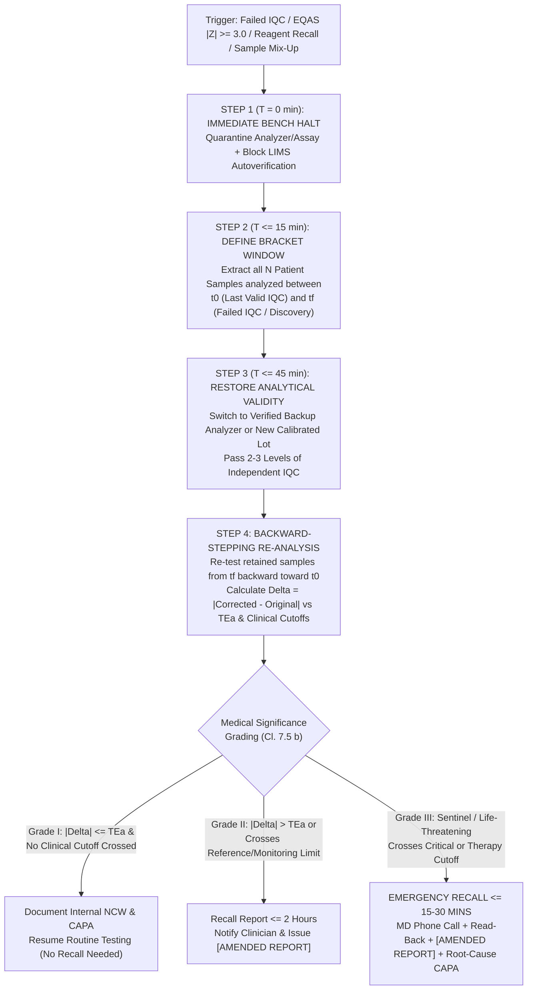

# 0.2.9 Clauses 7.5, 7.7, 7.8 & 8.6 Patient/Clinician/Staff Satisfaction Surveys, Impartial Complaint Resolution, Nonconforming Work Look-Back & Amended Report Recall, and Business Continuity Plan (`BCP`) Master SOP

> **Document Control & Statutory Traceability Block (`ISO 15189:2022 Clause 8.3.2`):**
> - **Document ID:** `NABL-QSP-0.2.9` | **Tier:** `Level-2 Apex Quality System Procedure (QSP) & Level-3 Operational Playbook`
> - **Version:** `3.0 (International Above-NABL, ISO 10002 & ISO 22301 Harmonized Master Edition)` | **Effective Date:** `15-Oct-2026` | **Review Cycle:** `Annual (or Post-Sentinel Event / Post-BCP Activation)`
> - **Authorizing Authority:** `Laboratory Director (MD Pathology) & Quality Manager` | **Target Audience:** `All Authorized Signatories, Quality Manager, Technical Supervisors, Bench Technologists, Phlebotomists, Patient Advocacy Officers & IT/Biomedical Staff`
> - **Normative & Statutory Clause Mapping:** `ISO 15189:2022 Clauses 7.4.1.8 (Revised Reports), 7.5 (Nonconforming Work), 7.7 (Complaints), 7.8 (Continuity and Emergency Preparedness Planning), 8.5 (Actions to Address Risks), 8.6.2 (Laboratory User, Patient & Personnel Feedback), 8.7 (Nonconformities and Corrective Actions)` | `NABL 112, NABL 153, NABL 220D & NABL 223` | `ISO 10002:2018 (Quality Management — Customer Satisfaction — Guidelines for Complaints Handling)` | `ISO 22301:2019 (Security and Resilience — Business Continuity Management Systems)` | `ISO 22367:2020 (Medical Laboratories — Application of Risk Management)` | `CLSI GP36-A (Planning for Laboratory Operations During a Disaster)` | `CLSI QMS11-A2 (Nonconforming Event Management)` | `CLSI EP31-A (Verification of Comparability of Patient Results Within One Health Care System)` | `Consumer Protection Act (CPA) 2019, DPDP Act 2023 & Bio-Medical Waste Management Rules 2016/2019`

---

## 0. 9-Persona International & Above-NABL Red-Team Review & Governance Matrix

This Standard Operating Procedure (`SOP`) has been stress-tested and harmonized across a **9-Persona Adversarial Review Panel** to eliminate service-recovery blind spots, conflict-of-interest self-auditing, incomplete retrospective patient look-backs, and unverified disaster recovery switchovers:

| Persona ID | Specialist Role & Regulatory Lens | Core Audit Mandate & Hard Controls Engineered into `NABL-QSP-0.2.9` |
| :--- | :--- | :--- |
| **Persona 1** | **Lead NABL (`ISO 15189:2022` / `NABL 220D/223`) & CAP / UKAS Assessor** | Enforces strict clause-by-clause compliance across `Clauses 7.4.1.8, 7.5, 7.7, 7.8 & 8.6.2`, mandatory investigator independence (`Cl. 7.7.3 b`), staff feedback inclusion (`Cl. 8.6.2`), and witnessed live simulation drills (`Cl. 7.8`). |
| **Persona 2** | **Clinical Subspecialty Consultant (`MD Pathology / Biochemistry / Microbiology`)** | Embeds clinicopathological correlation matrices for "Discordant Result" complaints, analyte decay kinetics in retained samples, and emergency clinical triage during `BCP` downtime. |
| **Persona 3** | **CLSI & IFCC Metrology, Six-Sigma QC & Comparability Specialist** | Mandates `CLSI EP31-A` split-sample comparability ($\lvert \text{Bias} \rvert \le 0.5 \times \text{TEa}$) for backup analyzers, `EFLM` Reference Change Value (`RCV`) interpretation for serial patient disputes, and quantitative `TEa` thresholds for retrospective look-back audits. |
| **Persona 4** | **Clinical Pharmacologist & Special-Population Stratification Auditor** | Distinguishes true analytical errors from *in-vivo* / *in-vitro* drug interferences (e.g., Dobutamine/NAC on Trinder reactions, Biotin on `CLIA`, Cephalosporins on Jaffe creatinine, EDTA carryover) and prioritizes neonatal/obstetric/ICU cohorts during look-backs. |
| **Persona 5** | **Medico-Legal, Patient-Safety & `ISO 22367` Risk Counsel** | Establishes `Consumer Protection Act (CPA) 2019` defensibility, `DPDP Act 2023` privacy shields, zero-erasure audit trails for `[AMENDED REPORTS]`, and quantitative `FMECA` (`RPN`) locks. |
| **Persona 6** | **Uncompressed Documentation & Turnkey Bench Architect** | Provides self-contained, print-ready bilingual survey forms, verbatim telephone recall scripts, 10-scenario disaster playbooks, and Level-4 audit registers. |
| **Persona 7** | **`ISO 10002:2018` Patient Advocacy & Grievance Redressal Specialist** | Institutes zero-barrier multi-channel grievance capture, quantitative Net Promoter Score (`NPS`) + Likert (`CSAT %`) analytics, and a 3-Tier triage SLA ($\le 4\text{h}$ Tier-1 containment; $\le 24\text{–}48\text{h}$ written closure). |
| **Persona 8** | **Clinical Risk & Erroneous Report Look-Back / Recall Specialist (`Cl. 7.5 & 7.4.1.8`)** | Formalizes the **"Bracketed Last-Good-IQC to Failed-IQC Window"** binary-search look-back algorithm, 3-Grade Medical Significance Stratification (`Grade I–III`), and $\le 15\text{–}30\text{ min}$ emergency physician recall. |
| **Persona 9** | **`ISO 22301:2019` & `CLSI GP36-A` Healthcare Disaster Recovery (`BCP`) Engineer** | Defines exact `MTPD`, `RTO`, `RPO`, and `MBCO` metrics across 10 disaster scenarios, Mean Kinetic Temperature (`MKT`) cold-chain excursion math, and semi-annual unannounced stress drills. |

---

## Section 1: Structured Patient, Referring Clinician & Laboratory Personnel Feedback & Satisfaction Survey Program (`ISO 15189:2022 Clause 8.6.2`)

### 1.1 Quantitative Psychometric & Statistical Methodology (`NPS` + `CSAT %` + `Likert 1–5`)
Per **ISO 15189:2022 Clause 8.6.2**, the laboratory proactively solicits structured feedback from **three distinct stakeholder groups**: (a) **Patients / Legal Guardians**, (b) **Referring Clinicians / Hospital Wards**, and (c) **Internal Laboratory Personnel**. Feedback is analyzed quantitatively every month (Patients) and semi-annually (Clinicians & Staff) using two complementary metrics:

1. **5-Point Likert Scale & Customer Satisfaction Index (`CSAT %`):**
   - Every domain item is scored from **`1` (Very Dissatisfied / Poor)**, **`2` (Dissatisfied / Fair)**, **`3` (Neutral / Average)**, **`4` (Satisfied / Good)**, to **`5` (Very Satisfied / Excellent)**.
   - The composite **Customer Satisfaction Index (`CSAT %`)** across $N$ respondents and $k$ survey items is computed as:
     $$\text{CSAT (\%)} = \left( \frac{\sum_{i=1}^{N} \sum_{j=1}^{k} S_{i,j}}{5 \times N \times k} \right) \times 100$$
   - **Benchmark Target:** Overall $\text{CSAT} \ge 92.0\%$ for Patients, $\ge 90.0\%$ for Referring Clinicians, and $\ge 88.0\%$ for Internal Staff.
2. **Net Promoter Score (`NPS` — $0\text{ to }10$ Scale):**
   - Based on the global question: *"On a scale of 0 to 10, how likely are you to recommend our laboratory to a friend, relative, or colleague?"*
   - Respondents are stratified into:
     - **Promoters (`Score 9–10`):** Loyal enthusiasts who actively recommend the laboratory.
     - **Passives (`Score 7–8`):** Satisfied but unenthusiastic users vulnerable to service lapses.
     - **Detractors (`Score 0–6`):** Dissatisfied users whose concerns require immediate service recovery.
   - **Formula:**
     $$\text{NPS} = \left( \frac{\text{Number of Promoters}}{N} \times 100 \right) - \left( \frac{\text{Number of Detractors}}{N} \times 100 \right)$$
   - **Benchmark Target:** $\text{NPS} \ge +65$ (Healthcare Excellence Tier).

### 1.2 Stratified Sampling Frame & Mandatory CAPA Action Triggers

| Stakeholder Group | Collection Channels | Minimum Statistical Sample Size & Stratification | Review Frequency | Mandatory Service Recovery & `CAPA` Trigger (`NABL-LOG-12`) |
| :--- | :--- | :--- | :--- | :--- |
| **1. Patients & Home-Collection Users** | Physical Drop-Box at Reception, QR-Code on Bill/Report, Automated Post-Report WhatsApp/SMS Link | **$\ge 100$ surveys/month** (or $\ge 5\%$ of monthly accessions), stratified across: Morning Fasting Peak (`07:00–10:00`), Routine Day (`10:00–17:00`), Evening/Sunday, Pediatric/Geriatric, and Home Phlebotomy. | **Monthly** by Quality Manager; aggregated **Quarterly** | - **Score $\le 2/5$ on any item OR $\text{NPS} \le 6$:** Mandatory telephone contact by Patient Advocacy Officer / QM within **$\le 24\text{ hours}$** + formal `CAPA` within **$72\text{ hours}$**.<br>- **Score $= 3/5$:** Logged in watch-list; if $\ge 3$ occurrences/month on the same item, open Preventive Action (`Clause 8.5`). |
| **2. Referring Clinicians & Hospital Wards** | Direct Field Visit by QM/Marketing, Personalized Email/WhatsApp Digital Form, CME Feedback | **$\ge 30\text{ to }50$ clinicians semi-annually**, stratified across Internal Medicine, Cardiology/ICU, OB-GYN, Pediatrics/NICU, Endocrinology, Nephrology, Oncology & Surgery. | **Semi-Annually** (Every $6\text{ months}$) & at Annual `MRM` | - **Score $\le 3/5$ on any analytical/clinical item OR $\text{NPS} \le 6$:** Direct peer-to-peer consultation by **Laboratory Director (`MD`)** within **$\le 48\text{ hours}$** + bench audit & formal `CAPA` within **$7\text{ days}$**. |
| **3. Internal Laboratory Personnel (`Clause 8.6.2`)** | Anonymous Physical Ballot Box in Staff Lounge + Encrypted Non-Tracked Digital Form | **$100\%$ Census Invitations Semi-Annually** (Minimum $\ge 85\%$ response rate across Technical, Phlebotomy, Couriers, IT, Housekeeping & Admin). | **Semi-Annually** & presented at Annual `MRM` (`SOP 0.2.12`) | - **Any score $\le 2/5$ on Biosafety, Workload, or Impartiality (`Cl. 4.1`):** Immediate safety/ergonomic intervention within **$\le 48\text{ hours}$** + Management Review escalation. |

---

### 1.3 Three Complete Print-Ready Survey Instruments (`Level-4 Controlled Forms`)

#### Instrument 1: `NABL-SUR-FORM-01` — Bilingual Patient Experience & Phlebotomy Care Survey
````text
====================================================================================================
                  APEX DIAGNOSTIC LABORATORY — PATIENT EXPERIENCE SURVEY
                      (रोगी अनुभव एवं सेवा गुणवत्ता प्रतिक्रिया प्रपत्र)
          Form ID: NABL-SUR-FORM-01 | Version: 3.0 | ISO 15189:2022 Clause 8.6.2
====================================================================================================
Date (दिनांक): ___/___/2026    Bill / Lab ID (Optional): ______________   Visit Type: [ ] Walk-In  [ ] Home Visit
Patient Age / Sex: ____ / [M/F/O]   Time of Visit: [ ] 7–10 AM (Peak)  [ ] 10 AM–5 PM  [ ] After 5 PM / Sunday

INSTRUCTIONS (निर्देश): Please rate your experience on a scale of 1 to 5:
[5] = Excellent (उत्कृष्ट) | [4] = Good (अच्छा) | [3] = Average (सामान्य) | [2] = Fair (असंतोषजनक) | [1] = Poor (खराब)
----------------------------------------------------------------------------------------------------
S.No | Service Quality Parameter (सेवा गुणवत्ता मापदंड)                           | Rating (1 to 5)
-----+--------------------------------------------------------------------------+-------------------
 1.  | Courtesy, empathy & helpfulness of Reception Staff                       | [1] [2] [3] [4] [5]
     | (रिसेप्शन स्टाफ का व्यवहार, सहानुभूति और सहयोग)                              |
 2.  | Clarity of test explanation, fasting rules & transparent billing         | [1] [2] [3] [4] [5]
     | (जांच की जानकारी, खाली पेट के नियम और बिलिंग की पारदर्शिता)                    |
 3.  | Waiting time before sample collection (Target: <= 15 minutes)            | [1] [2] [3] [4] [5]
     | (सैंपल लेने से पहले प्रतीक्षा समय — लक्ष्य: <= 15 मिनट)                        |
 4.  | Phlebotomist hygiene (fresh gloves, sanitizer) & ID verification         | [1] [2] [3] [4] [5]
     | (सैंपल लेने वाले स्टाफ की स्वच्छता, नए दस्ताने और नाम/पहचान की पुष्टि)             |
 5.  | Skill in painless, single-prick blood collection & post-bleed care       | [1] [2] [3] [4] [5]
     | (बिना दर्द एक ही बार में रक्त नमूना लेने का कौशल एवं पट्टी की देखभाल)             |
 6.  | Showing sealed sterile needle before prick & cutting needle after use    | [1] [2] [3] [4] [5]
     | (सुई लगाने से पहले सीलबंद सिरिंज दिखाना और उपयोग के बाद नष्ट करना)             |
 7.  | Privacy during sample collection & dignity of care                       | [1] [2] [3] [4] [5]
     | (नमूना संग्रह के दौरान गोपनीयता और गरिमा का ध्यान)                           |
 8.  | Cleanliness of waiting lounge, phlebotomy room & patient washrooms       | [1] [2] [3] [4] [5]
     | (प्रतीक्षालय, सैंपल रूम और शौचालय की साफ-सफाई)                               |
 9.  | Timely delivery of test reports as promised (SMS / WhatsApp / Print)     | [1] [2] [3] [4] [5]
     | (वादे के अनुसार समय पर जांच रिपोर्ट प्राप्त होना)                             |
 10. | Clarity & readability of the laboratory report & reference ranges        | [1] [2] [3] [4] [5]
     | (रिपोर्ट और सामान्य संदर्भ सीमाओं की स्पष्टता एवं पठनीयता)                     |
----------------------------------------------------------------------------------------------------
NET PROMOTER SCORE (NPS): On a scale of 0 to 10, how likely are you to recommend our laboratory
to your family and friends? (आप अपने परिवार या मित्रों को हमारी लैब की सिफारिश किस हद तक करेंगे?)
   [0]   [1]   [2]   [3]   [4]   [5]   [6]   |   [7]   [8]   |   [9]   [10]
   <------- Detractors (असंतुष्ट) ------->   | <- Passives ->| <- Promoters ->

Suggestions / Staff Member You Wish to Compliment or Report (सुझाव या शिकायत):
____________________________________________________________________________________________________
Patient Name & Mobile (Optional): _____________________________ Signature: _________________________
[DPDP Act 2023 Notice: Your contact details are used strictly for healthcare quality improvement.]
====================================================================================================
FOR OFFICE USE ONLY: Total Score: ___ / 50 (CSAT: ____%) | NPS Category: [ ] P  [ ] Pa  [ ] D
Any Score <= 2 or NPS <= 6? [ ] NO  [ ] YES -> 24h Call Done By: ________ CAPA #: ___________
====================================================================================================
````

#### Instrument 2: `NABL-SUR-FORM-02` — Referring Clinician & Hospital Ward Analytical & Consultation Survey
````text
====================================================================================================
         APEX DIAGNOSTIC LABORATORY — REFERRING CLINICIAN SATISFACTION SURVEY
          Form ID: NABL-SUR-FORM-02 | Version: 3.0 | ISO 15189:2022 Clause 8.6.2
====================================================================================================
Clinician Name: Dr. ____________________________ Qualification / Specialty: ________________________
Hospital / Clinic Name: ________________________ Contact / Email: __________________________________
Date: ___/___/2026                               Approx. Monthly Referrals: [ ] <20 [ ] 20-50 [ ] >50

RATING SCALE: [5] Excellent | [4] Good | [3] Satisfactory | [2] Needs Improvement | [1] Poor
----------------------------------------------------------------------------------------------------
S.No | Clinical & Analytical Quality Dimension                                  | Rating (1 to 5)
-----+--------------------------------------------------------------------------+-------------------
 1.  | Analytical Trueness, Precision & Clinical Correlation with Patient State | [1] [2] [3] [4] [5]
 2.  | Reproducibility & Longitudinal Consistency of Serial Monitoring Results  | [1] [2] [3] [4] [5]
     | (e.g., Serial HbA1c, Creatinine/eGFR, TSH, Tumor Markers, INR, Troponin) |
 3.  | Appropriateness of 5D Stratified Reference Intervals & Decision Limits   | [1] [2] [3] [4] [5]
     | (Neonatal/Pediatric, Trimester-Specific Pregnancy, Sex & Geriatric)      |
 4.  | Clinical Utility of MD Pathologist/Biochemist Interpretative Comments    | [1] [2] [3] [4] [5]
     | & Reflex Testing Guidance on Abnormal / Borderline Reports               |
 5.  | Reliability & Promptness of Critical Value Notification (<= 30 Minutes)  | [1] [2] [3] [4] [5]
     | with Direct Read-Back Verification                                       |
 6.  | Turnaround Time (TAT) for STAT / ICU / Emergency Samples (<= 1-2 Hours)  | [1] [2] [3] [4] [5]
 7.  | Turnaround Time (TAT) for Routine Outpatient & Specialized Assays        | [1] [2] [3] [4] [5]
 8.  | Direct Accessibility of Laboratory Director / Signatories for Case       | [1] [2] [3] [4] [5]
     | Discussions, Discordant Result Workups & Advisory Consultations          |
 9.  | Prompt Notification of Pre-Analytical Sample Rejections (Hemolysis/Clot) | [1] [2] [3] [4] [5]
     | & Seamless Zero-Cost Re-Collection Coordination                          |
 10. | Breadth of Test Menu & Transparency Regarding Referral (MOU) Testing     | [1] [2] [3] [4] [5]
----------------------------------------------------------------------------------------------------
NET PROMOTER SCORE (NPS): How likely are you to recommend our diagnostic services to a peer
specialist or colleague? (0 = Not at all likely, 10 = Extremely likely)
   [0]   [1]   [2]   [3]   [4]   [5]   [6]   |   [7]   [8]   |   [9]   [10]

11. Any specific analyte where you observed clinical discordance or wish to review our method/RI?
    ________________________________________________________________________________________________
12. New diagnostic tests, panels, or reflex algorithms you would like us to introduce in our scope:
    ________________________________________________________________________________________________

Clinician Signature / Stamp: ________________________   Reviewed By Lab Director: __________________
FOR QMS USE: CSAT: ____% | Any item <= 3/5? [ ] NO [ ] YES -> MD Peer Call Date: ___/___ CAPA #: ___
====================================================================================================
````

#### Instrument 3: `NABL-SUR-FORM-03` — Internal Laboratory Personnel Safety, Impartiality & Culture Survey
````text
====================================================================================================
     APEX DIAGNOSTIC LABORATORY — INTERNAL PERSONNEL FEEDBACK & SAFETY CULTURE SURVEY
      Form ID: NABL-SUR-FORM-03 | Version: 3.0 | ISO 15189:2022 Clauses 8.6.2, 4.1 & 5.6
====================================================================================================
Submission Mode: [ ] Anonymous Drop-Box  [ ] Identified   Date: ___/___/2026
Department: [ ] Biochemistry [ ] Hematology [ ] Immunoassay [ ] Microbiology [ ] Phlebotomy [ ] Admin
RATING SCALE: [5] Strongly Agree | [4] Agree | [3] Neutral | [2] Disagree | [1] Strongly Disagree
----------------------------------------------------------------------------------------------------
S.No | Workplace, Biosafety, Quality Culture & Impartiality Statement           | Rating (1 to 5)
-----+--------------------------------------------------------------------------+-------------------
 1.  | I have uninterrupted access to appropriate PPE (nitrile gloves, N95,     | [1] [2] [3] [4] [5]
     | eye shields, lab coats), spill kits, and functional eyewash stations.    |
 2.  | My shift workload and sample-to-technologist ratio allow me to perform   | [1] [2] [3] [4] [5]
     | all QC, maintenance, and verification steps without rushing or shortcuts.|
 3.  | I feel completely safe reporting Nonconforming Work (NCW), near-misses,  | [1] [2] [3] [4] [5]
     | or bench errors in a "Just Culture" without fear of unfair blame.        |
 4.  | I am completely free from any commercial, financial, or management       | [1] [2] [3] [4] [5]
     | pressure to release results when IQC is out-of-control (Clause 4.1).     |
 5.  | Standard Operating Procedures (SOPs) and Work Instructions at my bench   | [1] [2] [3] [4] [5]
     | are clear, up-to-date, and practical to follow during routine shifts.    |
 6.  | Preventive maintenance and biomedical engineering support for my         | [1] [2] [3] [4] [5]
     | analyzers are prompt and effective.                                      |
 7.  | The LIMS software, barcode scanners, and autoverification rules reduce   | [1] [2] [3] [4] [5]
     | manual transcription fatigue and prevent clerical errors.                |
 8.  | Continuing education, competency training, and six-monthly feedback      | [1] [2] [3] [4] [5]
     | help me improve my technical skills.                                     |
 9.  | Ventilation, illumination, temperature control, ergonomics, and staff    | [1] [2] [3] [4] [5]
     | rest/vaccination facilities (Hep-B titer check) are well maintained.     |
 10. | Laboratory leadership actively listens to bench staff suggestions and    | [1] [2] [3] [4] [5]
     | implements meaningful improvements.                                      |
----------------------------------------------------------------------------------------------------
NET PROMOTER SCORE (eNPS): On a scale of 0 to 10, how likely are you to recommend this laboratory
as a safe, ethical, and high-quality workplace?  [0] [1] [2] [3] [4] [5] [6] | [7] [8] | [9] [10]

Bottlenecks, Safety Hazards, or Process Improvements You Recommend:
____________________________________________________________________________________________________
Reviewed By Quality Manager & Lab Director: ___________________ CAPA Triggered (if <=2): ___________
====================================================================================================
````

---

## Section 2: Impartial Complaint Receipt, 3-Tier Clinical Triaging, Forensic Discordance Workup & Resolution (`ISO 15189:2022 Clause 7.7` & `ISO 10002:2018`)

### 2.1 Zero-Barrier Receipt & Transparency Policy (`Clauses 7.7.1 & 7.7.2`)
1. **Definition:** Any verbal, telephone, WhatsApp, email, written, social-media, or clinician-initiated expression of dissatisfaction regarding pre-analytical phlebotomy, analytical test accuracy, post-analytical report formatting/delivery, turnaround time (`TAT`), billing, or staff conduct is logged immediately as a formal **Complaint** in the **Master Complaint & Grievance Register (`NABL-CMP-REG-01`)**.
2. **Public Availability of Process (`Clause 7.7.1`):** A bilingual poster at the Reception & Phlebotomy Lounge displays the laboratory's Complaint Handling Charter, QR link, and direct escalation contact for the **Patient Advocacy Officer / Quality Manager** and **Laboratory Director**.
3. **Zero Cost to Complainant:** All complaint investigations, retained specimen repeat analyses on primary/backup platforms, interference workups, and recollection phlebotomy visits are performed at **100% zero financial charge** to the patient or referring clinician.

### 2.2 Three-Tier Complaint Severity Triaging & Turnaround Matrix

| Triage Tier | Clinical & Operational Scope | Examples of Triggering Complaints | Acknowledgment SLA | Containment & Retained Tube Lock SLA | Final Written Closure SLA | Escalation & Reviewing Authority |
| :--- | :--- | :--- | :--- | :--- | :--- | :--- |
| **Tier-1 (`Critical Clinical / Patient-Harm / Medico-Legal Urgent`)** | Direct risk of patient harm, inappropriate therapy, emergency admission, or statutory breach | - Alleged erroneous critical/diagnostic result (`hs-cTnI, K+, Na+, Glucose, INR, Neonatal Bilirubin, β-hCG, HIV/HBsAg/HCV`)<br>- Suspected sample mix-up (`WBIT`)<br>- Missed/delayed Critical Value call<br>- Severe phlebotomy injury (syncope fall, arterial puncture, nerve paresthesia)<br>- Breach of confidentiality (`DPDP Act 2023` / `HIV Act 2017`) | **$\le 30\text{ Minutes}$** (Direct Phone Call + Written Ticket) | **$\le 4\text{ Hours}$** (Physical quarantine of primary tube at $2\text{–}8^\circ\text{C}$ + IQC/calibration audit + duplicate re-run) | **$\le 24\text{ Hours}$** (Preliminary clinical call in $\le 4\text{h}$; full forensic report in $\le 24\text{h}$) | **Laboratory Director (`MD`)** + Independent Signatory + Quality Manager |
| **Tier-2 (`Analytical Discordance / Pre-Analytical Rejection / TAT Delay`)** | Clinicopathological discrepancy or service delay without immediate life threat | - Clinician queries discordant result vs. clinical picture or another lab (`TSH, HbA1c, Vitamin D, Creatinine, Platelet count`)<br>- Delayed routine or `STAT` report beyond promised `TAT`<br>- Dispute over hemolyzed/clotted sample recollection | **$\le 2\text{ Hours}$** | **$\le 12\text{ Hours}$** (Retained specimen retrieval, `HIL` & clot inspection, primary vs. backup re-run) | **$\le 24\text{ Hours}$** (Max $\le 48\text{h}$ if external confirmation is required) | **Quality Manager** + Independent Department Head |
| **Tier-3 (`Service Courtesy / Billing / Non-Clinical Formatting`)** | Administrative, hospitality, or clerical issue with zero analytical impact | - Reception waiting time $> 15\text{ min}$<br>- Staff tone/courtesy complaint<br>- Demographic spelling error (non-ID swap) or billing/receipt query<br>- Washroom/waiting area hygiene | **$\le 4\text{ Hours}$** | **$\le 24\text{ Hours}$** (CCTV/log review, billing reconciliation, housekeeping audit) | **$\le 48\text{ Hours}$** | **Quality Manager** / Patient Advocacy Officer |

### 2.3 Strict Investigator Independence Rule (`ISO 15189:2022 Clause 7.7.3 b` — Zero Self-Audit)
Per **ISO 15189:2022 Clause 7.7.3 b**, *"the resolution of complaints shall be made by, or reviewed and approved by, personnel not involved in the subject of the complaint."* To prevent conflict of interest or defensive cover-ups, the following **Cross-Departmental Investigation Assignment Matrix** is strictly enforced:

| Area / Personnel Implicated in the Complaint | Prohibited from Leading or Approving the Investigation | Mandatory Independent Investigator & Approving Authority |
| :--- | :--- | :--- |
| **Biochemistry / Immunoassay Bench or Technical Supervisor** | Biochemistry Supervisor & Bench Technologist who ran the batch | **Quality Manager** (if not from Biochemistry) + **Hematology/Microbiology Signatory** & **Laboratory Director** |
| **Hematology / Clinical Pathology / Coagulation Bench** | Hematology Supervisor & Bench Technologist who ran the batch | **Quality Manager** + **Biochemistry/Microbiology Signatory** & **Laboratory Director** |
| **Microbiology / Serology Bench** | Microbiology Supervisor & Bench Technologist who ran the batch | **Quality Manager** + **Pathology/Biochemistry Signatory** & **Laboratory Director** |
| **Phlebotomy / Sample Reception / Home Collection Team** | Phlebotomy Supervisor & Phlebotomist who collected the sample | **Quality Manager** + **Technical Manager / Laboratory Director** |
| **Quality Manager (or QMS / Customer Service Process)** | Quality Manager | **Laboratory Director (`MD Pathology`)** + **Deputy Quality Manager** |
| **Laboratory Director (Clinical Interpretation / Sign-Out Query)** | Sole self-review by the same Signatory | **Peer / Deputy Authorized Signatory (`MD`)** or **External NABL-Empaneled Peer Consultant** |

### 2.4 Forensic Scientific Protocol for Investigating "Clinician Discordant Result / Inter-Laboratory Discrepancy" Complaints
When a clinician or patient questions the analytical validity of a released result (e.g., *"Your lab reported Serum Potassium $6.1\text{ mmol/L}$ or TSH $14.2\ \mu\text{IU/mL}$, whereas another laboratory next day reported $4.3\text{ mmol/L}$ or $3.9\ \mu\text{IU/mL}$"*), the independent investigator executes a **6-Stage Forensic Workup** within $\le 4\text{–}24\text{ hours}$:

1. **Stage 1 — Immediate Specimen Lock & Chain-of-Custody Verification (`<= 30 Minutes`):**
   - Retrieve the original barcoded primary specimen (and any serum/plasma aliquots) from the temperature-monitored archival rack ($2\text{–}8^\circ\text{C}$ serum/EDTA archive or $-20^\circ\text{C}$ frozen archive).
   - Inspect barcode integrity, primary tube patient name/age/sex match, collection timestamp, centrifugation log, and fill volume (e.g., underfilled Citrate tube $> \pm 10\%$ causing falsely prolonged `PT/INR/aPTT`, or underfilled $\text{K}_2\text{EDTA}$ causing RBC shrinkage and spurious `MCV/PCV`).
2. **Stage 2 — Pre-Analytical & Endogenous Interference Audit (`HIL`, Clots & Tube-Order Carryover):**
   - Visually and spectrophotometrically measure **Hemolysis (`H-Index`), Icterus (`I-Index`), and Lipemia (`L-Index`)** in $\text{mg/dL}$ (`CLSI EP07/EP37`):
     - *In-vitro Hemolysis ($H > 50\text{–}100\text{ mg/dL}$):* Releases intracellular $\text{K}^+$ ($40\times$ plasma concentration), `LDH` ($160\times$), `AST` ($40\times$), Phosphate, and Magnesium, while falsely lowering `hs-cTnT` or Bilirubin.
     - *Order-of-Draw $\text{K}_2\text{EDTA}$ Cross-Contamination:* If Potassium is falsely elevated ($> 6.0\text{ mmol/L}$) with paradoxical severe hypocalcemia ($< 6.0\text{ mg/dL}$) and near-zero `ALP`/Zinc, perform a reflex **Serum Calcium & ALP check** on the same serum tube to prove needle/cap $\text{K}_2\text{EDTA}$ chelation carryover during phlebotomy.
     - *Micro-Clots & Fibrin Strands:* Inspect EDTA whole blood with an applicator stick (causes pseudothrombocytopenia or analyzer probe aspiration drop) and serum tubes for latent fibrin (causes false-positive `CLIA` chemiluminescence spikes in `hs-cTnI` or `TSH`).
     - *EDTA-Dependent Pseudothrombocytopenia (`PTCP`):* Examine a fresh **Leishman-stained Peripheral Blood Smear (`PBS`)** for platelet satellitism/clumping and re-collect in a **$3.2\%$ Sodium Citrate tube** ($\text{Corrected PLT} = \text{Citrate PLT} \times 1.1$).
3. **Stage 3 — Retrospective Analytical Batch Audit (`IQC`, Calibration & Analyzer Flags):**
   - Inspect the exact analyzer reaction curve / absorbance kinetics (endpoint saturation, substrate depletion in hyper-elevated `ALT/AST/LDH`, or prozone/hook effect in `β-hCG / Ferritin / Prolactin`), reagent lot onboard stability, calibration factor/slope, and the bracketed **Internal Quality Control (`IQC`)** Levey-Jennings chart before and after the patient run.
4. **Stage 4 — Duplicate Re-Analysis on Primary & Verified Backup Platform (`Zero Cost`):**
   - Re-test the retained specimen in duplicate on the **Primary Analyzer** and the **In-House Backup Analyzer** (plus $1:5$ serial dilution or PEG-6000 precipitation / heterophile-blocking tube if macro-complexes or heterophile antibodies are suspected).
   - **Analyte Temporal Decay Compensation:** Account for known *in-vitro* degradation between initial run ($t_0$) and re-test ($t_1$), e.g., unseparated serum glucose drops $5\text{–}7\%\text{/hour}$ via glycolysis; Unconjugated Bilirubin photo-isomerizes under ambient light; Ammonia, `iPTH`, `ACTH`, and Free `PSA` degrade rapidly at $2\text{–}8^\circ\text{C}$.
5. **Stage 5 — Pharmacological Interference & Biological Variation (`EFLM RCV`) Evaluation:**
   - **Drug Interference Audit:** Interview the clinician/patient for medications administered within $24\text{ hours}$ of collection:
     - *Trinder Peroxidase Negative Interference:* High-dose IV **Ascorbic Acid (Vitamin C), N-Acetylcysteine (`NAC`), Metamizole (Dipyrone), Dobutamine, Dopamine, or Calcium Dobesilate** consume $\text{H}_2\text{O}_2$ intermediate, causing falsely low Enzymatic Creatinine, Uric Acid, Glucose, Cholesterol, and Triglycerides.
     - *Streptavidin-Biotin `CLIA` Interference:* Oral **Biotin (Vitamin B7 $> 5\text{–}10\text{ mg/day}$)** causes **falsely low sandwich assays** (`TSH, hs-cTnI, PTH, LH, FSH, Ferritin`) and **falsely elevated competitive assays** (`Free T4, Free T3, Cortisol, Testosterone, 25-OH Vitamin D`), mimicking Graves' thyrotoxicosis!
     - *Chromogenic / Jaffe Drug Shifts:* **Eltrombopag** causes severe brownish-orange serum discoloration affecting bilirubin/creatinine; **Cephalosporins, Ketones, and High Glucose** falsely elevate Jaffe Alkaline Picrate Creatinine.
   - **Inter-Laboratory Methodological & Biological Variation (`EFLM RCV`):** When comparing our result ($X_1$) against a subsequent sample drawn at another laboratory ($X_2$), compute the **95% Reference Change Value (`RCV`)**:
     $$\text{RCV}_{95\%} = \sqrt{2} \times 1.96 \times \sqrt{CV_A^2 + CV_I^2} = 2.77 \times \sqrt{CV_A^2 + CV_I^2}$$
     If $\frac{\lvert X_2 - X_1 \rvert}{X_1} \times 100 \le \text{RCV}_{95\%}$ (or if circadian rhythm applies—e.g., Morning `TSH` is up to $30\text{–}40\%$ higher than afternoon `TSH`; Serum Iron and Cortisol peak in the morning and drop $> 50\%$ by evening; Fasting vs. Post-prandial Triglycerides/Phosphate), provide the clinician with a peer-reviewed scientific correlation note explaining physiological variation vs. analytical error.
6. **Stage 6 — Root-Cause Analysis (`5-Whys` & `6M Ishikawa`) & Formal Written Closure (`Clause 7.7.3 c`):**
   - If a laboratory error (pre-analytical, analytical, or post-analytical) is confirmed, immediately trigger **Section 3 (`NCW Look-Back & Amended Report Recall`)** and log a formal `CAPA`.
   - Issue a formal written **Complaint Investigation & Closure Report** signed by the Independent Investigator and Laboratory Director within $\le 24\text{–}48\text{ hours}$.

---

## Section 3: Nonconforming Examination Work (`NCW`), Bracketed Patient Look-Back Audit & Erroneous Report Recall Protocol (`ISO 15189:2022 Clauses 7.5 & 7.4.1.8`)

### 3.1 Triggers for Nonconforming Examination Work (`NCW`)
An `NCW` protocol is immediately triggered whenever any aspect of laboratory examination (from sample receipt to result release) fails to conform to established SOPs, quality indicators, or clinical requirements, including:
1. **Analytical QC / Calibration Failure:** Release of patient results before discovering an out-of-control `IQC` rule violation ($1_{3s}, 2_{2s}, R_{4s}, 4_{1s}, 10_x$), shifted calibration slope, contaminated calibrator/reagent pack, or deteriorating lamp/electrode.
2. **External Quality Assessment (`EQAS / PT`) Unsatisfactory Score:** Receipt of an `EQAS` report with $\lvert Z\text{-score} \rvert \ge 3.0$, two consecutive $\lvert Z \rvert \ge 2.0$, or $\text{Deviation Index (DI)} > 2.0$.
3. **Manufacturer Field Safety Notice (`FSN`) / Kit Recall:** Notification from an IVD manufacturer that a specific reagent/calibrator lot exhibits analytical bias or defective sensitivity.
4. **Specimen Integrity or Identification Breach:** Post-release discovery of Wrong Blood in Tube (`WBIT`), barcode mislabeling, improper anticoagulant, unflagged severe hemolysis/lipemia, or specimen storage temperature excursion.
5. **Instrument Hardware / Software Glitch:** Clotted sample probe partial aspiration, reagent carryover, water plant conductivity spike ($> 2.0\ \mu\text{S/cm}$), or LIMS autoverification calculation error.

### 3.2 Step-by-Step "Bracketed Last-Good-IQC to Failed-IQC Window" Look-Back Algorithm (`CLSI EP23-A / QMS11-A2`)



#### Operational Execution of the 5-Step Look-Back Algorithm:
1. **Step 1 — Immediate Bench Halt & LIMS Lock (`T = 0 Minutes`):**
   - The Bench Technologist or Technical Supervisor immediately halts patient testing on the affected assay/channel, affixes a physical **`[RED TAG: QUARANTINED — NCW INVESTIGATION IN PROGRESS]`**, and activates the LIMS hold lock so zero pending results can be autoverified or released.
2. **Step 2 — Identification of the Bracketed Patient Cohort ($t_0 \to t_f$) (`T <= 15 Minutes`):**
   - Query the LIMS audit log for **all patient specimens ($N$) analyzed between $t_0$ (Timestamp of the Last Verified Acceptable `IQC` Run) and $t_f$ (Timestamp of the Failed `IQC` or Error Discovery)**.
   - Separate the cohort into **Sub-Group A (`Unreleased Results Held in LIMS Queue`)** and **Sub-Group B (`Already Released Results in Clinical Circulation`)**.
3. **Step 3 — Analytical Restoration on Backup Platform or Fresh Calibrated Lot (`T <= 45 Minutes`):**
   - Do NOT re-test patient specimens on an unverified analyzer. Either route specimens to the **In-House Backup Analyzer** (`CLSI EP31-A` verified) or rectify the primary analyzer (new reagent cassette, probe clean, full multi-point calibration, and `PASS` within $\pm 1\text{ SD}$ on Level-1, Level-2, and Level-3 `IQC`).
4. **Step 4 — Reverse-Chronological ("Binary Search / Backward-Stepping") Retained Sample Re-Analysis:**
   - If the bracket contains $N \le 40$ patient specimens, re-analyze **100% of retained specimens** from $t_f$ back to $t_0$.
   - If the bracket contains $N > 40$ specimens (e.g., high-throughput chemistry shift or `EQAS` look-back), re-analyze in reverse blocks of $10$ specimens starting at $t_f$ and stepping backward toward $t_0$ until **10 consecutive specimens** demonstrate $\lvert \text{Result}_{\text{Corrected}} - \text{Result}_{\text{Original}} \rvert \le 0.5 \times \text{TEa}$ (confirming the exact onset timestamp $t_{\text{onset}}$ of the analytical drift). All specimens from $t_{\text{onset}}$ through $t_f$ are then 100% re-analyzed.
   - *Priority Order for Re-Analysis:* (1) Neonatal/NICU & Pediatric samples, (2) Emergency/ICU/Inpatient `STAT` samples, (3) Antenatal/Obstetric samples, (4) Oncology/Renal Dialysis samples, and (5) Routine Outpatient samples.

### 3.3 Three-Grade Medical Significance Stratification Matrix (`ISO 15189:2022 Clause 7.5 b & c`)
Every re-analyzed specimen in Sub-Group B (`Already Released`) is evaluated by the **Laboratory Director / Authorized Signatory (`MD`)** against both **Total Allowable Error (`CLIA '88 / EFLM TEa`)** and **Clinical Decision Thresholds**:

| Medical Risk Grade | Quantitative Metrological & Clinical Criteria | Representative Clinical Examples | Mandatory Recall, Notification & Reporting Action (`Clauses 7.5 d & 7.4.1.8`) |
| :--- | :--- | :--- | :--- |
| **Grade I (`Negligible / Sub-Clinical Analytical Deviation`)** | $\lvert \text{Bias} \rvert = \frac{\lvert X_{\text{new}} - X_{\text{old}} \rvert}{X_{\text{old}}} \le \text{TEa}$ **AND** neither crosses any 5D reference interval limit nor alters clinical staging/dosing. | - Serum Sodium $140 \to 142\text{ mmol/L}$ ($\text{TEa} = \pm 4\text{ mmol/L}$)<br>- Fasting Glucose $88 \to 92\text{ mg/dL}$ ($\text{TEa} = \pm 8\%$)<br>- Hemoglobin $13.8 \to 14.1\text{ g/dL}$ ($\text{TEa} = \pm 4\%$) | - **No Patient/Clinician Recall Required** (to avoid unnecessary patient anxiety over analytical noise).<br>- Document full re-test data in `NABL-NCW-REG-02` and close internal `CAPA`. |
| **Grade II (`Moderate Clinical Significance — Diagnostic or Therapeutic Shift`)** | $\lvert \text{Bias} \rvert > \text{TEa}$ **OR** result crosses a diagnostic cutoff, reference interval boundary, or chronic medication titration threshold without immediate life threat. | - $\text{HbA1c } 6.2\% \to 6.7\%$ (Pre-diabetes to Diabetes cutoff $\ge 6.5\%$)<br>- $\text{TSH } 3.9 \to 7.2\ \mu\text{IU/mL}$ (Euthyroid to Subclinical Hypothyroidism)<br>- Serum Creatinine $1.1 \to 1.6\text{ mg/dL}$ ($\text{eGFR}$ CKD stage shift) | - **Mandatory Recall within $\le 2\text{ Hours}$**.<br>- Telephone notification to ordering clinician & patient.<br>- Issue formal **`[AMENDED REPORT]`** in LIMS with explanatory comment. |
| **Grade III (`Severe / Life-Threatening / Sentinel Clinical Risk`)** | Result crosses a **Critical Value limit**, alters emergency resuscitation/transfusion/surgery/anticoagulation, involves a qualitative infection reversal, or represents a **Sample Swap (`WBIT`)**. | - $\text{K}^+ 4.1 \to 6.5\text{ mmol/L}$ (or $6.2 \to 3.8\text{ mmol/L}$)<br>- $\text{hs-cTnI } 8 \to 145\text{ ng/L}$ (Missed NSTEMI)<br>- Neonatal Bilirubin $11.5 \to 19.8\text{ mg/dL}$<br>- $\text{INR } 2.2 \to 5.6$ or $\text{PLT } 95,000 \to 18,000/\mu\text{L}$<br>- False-Negative/Positive `HIV, HBsAg, HCV, Dengue NS1`, or Blood Group | - **IMMEDIATE EMERGENCY RECALL within $\le 15\text{–}30\text{ Minutes}$**.<br>- **Direct MD-to-MD Telephone Call** with mandatory read-back verification (`CLSI GP47`).<br>- Immediate recall of printed/digital report + issuance of **`[AMENDED REPORT]`**.<br>- Trigger Sentinel Event Root-Cause Audit (`CAPA`) & notify Laboratory Director immediately. |

### 3.4 Erroneous Report Recall & `[AMENDED REPORT]` Protocol (`ISO 15189:2022 Clause 7.4.1.8`)
When a previously released report must be revised due to an analytical error, pre-analytical discovery, or clerical correction:
1. **Strict Prohibition on Silent Overwriting (`Clause 7.4.1.8 a–c`):** The LIMS database is hard-locked so that once a report is authorized, the original numerical/qualitative value, original release timestamp, and original approving signatory **can NEVER be deleted or silently overwritten**.
2. **Verbatim Emergency Telephone Recall & Read-Back Script (`Grade II / III`):**
   > *"Good [Morning/Afternoon/Evening] Dr. [Clinician Name], I am Dr. [Signatory Name], Consultant Pathologist/Biochemist calling from Apex Diagnostic Laboratory regarding your patient **[Patient Full Name, Age/Sex, Lab ID: ______]**, collected on **[Date/Time]**. During our internal quality look-back audit, we identified an analytical [calibration drift / interference / sample error] affecting **[Analyte Name]**. We are formally **RECALLING** the previously reported value of **[Old Value + Units]** released at **[Old Time]**. We have re-analyzed the retained specimen on our verified reference platform, and the **CORRECTED / AMENDED VALUE is [New Value + Units]**. Could you please read back the patient's name, test, and amended value to confirm receipt, and advise if any clinical intervention was initiated based on the initial report?"*
3. **Standardized Print-Ready `[AMENDED LABORATORY REPORT]` LIMS Format:**

````text
====================================================================================================
                  APEX DIAGNOSTIC LABORATORY (NABL ACCREDITED — MC-XXXX)
     *** [AMENDED LABORATORY REPORT — SUPERSEDES PREVIOUS REPORT DATED 11-Oct-2026 11:15] ***
====================================================================================================
Patient Name : MR. RAJESH SHARMA               Age / Sex        : 58 Years / Male
Lab ID / UHID: 261011042 / UHID-88412          Referred By      : Dr. A. K. Verma, MD (Medicine)
Sample Type  : Serum (SST Gold Top)            Collected On     : 11-Oct-2026 08:30
Original Rpt : 11-Oct-2026 11:15               Amended Rpt Date : 11-Oct-2026 13:05 (Version 2.0)
----------------------------------------------------------------------------------------------------
Test Parameter          | AMENDED RESULT | PREVIOUS RESULT | Units   | Biological Reference Interval
------------------------+----------------+-----------------+---------+------------------------------
Serum Potassium (K+)    | 4.4 [AMENDED]  | 6.3 [RECALLED]  | mmol/L  | 3.5 – 5.1
  Method: Direct ISE    |                |                 |         |
Serum Sodium (Na+)      | 139 (Unchanged)| 139             | mmol/L  | 136 – 145
  Method: Direct ISE    |                |                 |         |
----------------------------------------------------------------------------------------------------
MANDATORY AMENDMENT AUDIT TRAIL & CLINICAL EXPLANATION (ISO 15189:2022 Clause 7.4.1.8):
1. Reason for Amendment : Retrospective look-back audit revealed micro-fibrin partial probe
   obstruction on Primary ISE module at 11:05 AM causing spurious potassium elevation. Primary tube
   was re-centrifuged and verified in duplicate on Primary and Backup ISE modules (4.4 / 4.4 mmol/L).
2. Original Released By : Dr. S. Nair, MD (Biochemistry) on 11-Oct-2026 at 11:15.
3. Recall Notification  : Personally communicated via telephone by Dr. S. Nair to Dr. A. K. Verma
   on 11-Oct-2026 at 12:52 (Read-back verified; no potassium-lowering therapy had been administered).
4. Instruction to User  : Please destroy/disregard the earlier report dated 11-Oct-2026 11:15.
====================================================================================================
Authorized By: Dr. S. Nair, MD (Biochemistry) [Reg: MCI-44912]   Quality Manager: Ms. P. Desai
====================================================================================================
````

---

## Section 4: Comprehensive Business Continuity & Emergency Preparedness Plan (`BCP`) (`ISO 15189:2022 Clause 7.8`, `ISO 22301:2019` & `CLSI GP36-A`)

### 4.1 Business Impact Analysis (`BIA`) Recovery Metrics
To guarantee uninterrupted diagnostic support for emergency, inpatient, and outpatient care during internal equipment failures or external disasters, the laboratory establishes four binding **ISO 22301:2019 Continuity Metrics**:
- **Maximum Tolerable Period of Disruption (`MTPD`):** The absolute maximum duration a diagnostic process can remain unavailable before irreversible patient harm or statutory non-compliance occurs (`STAT/Critical Tests: <= 60 Minutes`; `Routine Acute Tests: <= 6 Hours`; `Elective Specialized Tests: <= 24–48 Hours`).
- **Recovery Time Objective (`RTO`):** The targeted time within which a disrupted analyzer, power system, cold-chain unit, or LIMS workflow MUST be switched over to its validated backup (`STAT Analyzer Failover: <= 15–30 Minutes`; `Power UPS/DG: <= 0–15 Seconds`; `LIMS Paper Downtime Activation: <= 15 Minutes`).
- **Recovery Point Objective (`RPO`):** The maximum age of laboratory data that could be lost due to a cyber/IT disruption (`RPO = 0 Minutes` via real-time analyzer non-volatile memory + synchronous mirrored `RAID-1` database).
- **Minimum Business Continuity Objective (`MBCO`):** The minimum service capacity maintained during an active disaster (`100% of STAT/Critical Care Menu + >= 80% of Routine Menu`).

### 4.2 Master 10-Scenario Laboratory Disaster & Continuity Playbook Matrix

| Scenario # & Disruption Event | `MTPD` / `RTO` / `RPO` Targets | Immediate Primary Failover (`0 – 30 Minutes`) | Extended Fallback (`> 2 – 48 Hours`) | Return-to-Service (`RTS`) Verification Gate |
| :--- | :--- | :--- | :--- | :--- |
| **1. Primary Analyzer Breakdown (`Chem-400 / MEK-1503 / Maglumi X3 / Coag`)** | `MTPD: 60m`<br>`RTO: 20m`<br>`RPO: 0m` | Switch immediately to **In-House Backup Analyzer** (`Bonavera Chem-200`, Backup Hematology/Manual Validated `SOP 1.4`, Standalone `ISE/Coag`) pre-verified weekly via `CLSI EP31-A`. | Dispatch tubes at $2\text{–}8^\circ\text{C}$ to **Peer NABL-Accredited MOU Lab (`SOP 0.2.5`)** with `#` flag & clinician notification if both primary & backup fail or `CLIA` downtime $> 4\text{h}$ (`STAT <= 2h`). | Biomedical service report + Calibration + **2/3-Level `IQC` (`PASS`)** + **5-Sample Split Comparability** ($\lvert \text{Bias} \rvert \le 0.5 \times \text{TEa}$). |
| **2. Mains Grid Power + `UPS` + Diesel Generator (`DG`) Failure** | `MTPD: 30m`<br>`RTO: 0–15s`<br>`RPO: 0m` | **Online Double-Conversion Sine-Wave `UPS` (`0 ms` transfer, $4\text{h}$ battery)** keeps all analyzers & LIMS live; Auto-Start `DG` engages in $< 15\text{ sec}$. | If both `UPS` and `DG` fail, execute safe analyzer probe park/wash, lock all fridge/freezer doors, and route `STAT` samples to Peer NABL MOU Lab. | Voltage stabilization check ($230\text{V} \pm 5\%, 50\text{Hz}$, Earth-Neutral $< 1.5\text{V}$) + Full `IQC` on all benches. |
| **3. Cold-Chain Fridge ($2\text{–}8^\circ\text{C}$) / Freezer ($-20^\circ\text{C}$) Failure at Night** | `MTPD: 2h`<br>`RTO: 30m`<br>`RPO: N/A` | Dual-probe `IoT/SMS` alarm triggers at $> 7.5^\circ\text{C}$ (Fridge) or $> -15^\circ\text{C}$ (Freezer); transfer all kits/samples within $30\text{ min}$ to **Designated Backup Fridge** or **Pre-Conditioned `2–8°C` Vaccine Carriers**. | Calculate **Mean Kinetic Temperature (`MKT`)** for any excursion; quarantine kits exposed to $> 8^\circ\text{C}$ for $> 2\text{h}$ until stress-verified. | $24\text{-hour}$ empty temperature mapping stability ($4.0 \pm 2.0^\circ\text{C}$) + **2-Level `IQC` Verification** on all exposed kits. |
| **4. Type-I `CLRW` Water Plant Failure (`Conductivity > 1.0 uS/cm`)** | `MTPD: 30m`<br>`RTO: 10m`<br>`RPO: N/A` | Close RO feed valve immediately; switch analyzer intake tube to **Emergency Stock of Sealed Commercial Type-I / HPLC-Grade Sterile Water Carboys (`4 x 20L = 80L Reserve`)**. | Vendor exchanges mixed-bed deionization resin, $0.22\ \mu\text{m}$ filter & UV lamp within $\le 24\text{h}$; replenish carboy reserve (`FIFO`). | Post-service water **Conductivity $\le 1.0\ \mu\text{S/cm}$**, $\text{CFU} < 10\text{/mL}$, Cuvette Blank `PASS`, and `Ca/Mg/Fe/ALP` `IQC` `PASS`. |
| **5. LIMS / Server / Network Outage or Ransomware Attack** | `MTPD: 45m`<br>`RTO: 15m`<br>`RPO: 0m` | Disconnect infected/offline LAN; open **Sealed Physical "LIMS Emergency Paper Downtime Pack"** (`SOP 0.2.8`); run analyzers in standalone mode with direct thermal printout stapled to manual worksheet. | Restore LIMS from air-gapped **3-2-1 Immutable Backup (`NAS + Cloud`)**; issue manual signed reports for `STAT`/Critical tests via phone/PDF. | 100% dual-technologist reconciliation of paper downtime results into restored LIMS (`RPO = 0` verified). |
| **6. Class II `BSC` Airflow Failure / Negative-Pressure Loss (`Micro`)** | `MTPD: 0m`<br>`RTO: 5m`<br>`RPO: N/A` | Audible sash/inflow alarm ($< 0.38\text{ m/s}$): **Stop all aerosol work (`AFB/Sputum/Centrifuge`) immediately**; hold $5\text{ min}$ for aerosol settling, mist with `1% NaOCl` / `5% Phenol`, close sash & quarantine room. | Route urgent `ZN/AFB`, blood/body-fluid cultures, and fungal processing to **Backup Certified `BSC`** or **Peer NABL Microbiology MOU Lab**. | `NSF/ANSI 49` / `EN 12469` HEPA `PAO/DOP` leak test + inflow/downflow anemometer recertification + surface swab clearance. |
| **7. Critical Reagent / Calibrator Shortage or Lot Recall** | `MTPD: 24h`<br>`RTO: 2h`<br>`RPO: N/A` | Trigger `FIFO/FEFO` 21-day reorder alert; switch to **Pre-Validated Secondary Kit / Backup Platform** (`CLSI EP15-A3` verified). | If regional stock-out persists, route assay to **Peer NABL MOU Lab** (`#` flagged) and issue transparent advisory circular to clinicians. | New lot 2-level `IQC` + **5-Patient Lot-to-Lot Bridging Check** ($\lvert \text{Bias} \rvert \le 0.5 \times \text{TEa}$). |
| **8. Major Biohazard / Chemical Spill or Fire Evacuation (`ISO 15190`)** | `MTPD: 0m`<br>`RTO: Imm.`<br>`RPO: 0m` | Execute **`RACE/PASS` Fire Protocol** or **`1%–10% NaOCl` Concentric Biohazard Spill Containment (`SOP 0.1.14`)**; evacuate personnel to Assembly Point; rescue daily backup drive if safe. | Divert all incoming samples and home-collection phlebotomists directly to **Peer NABL MOU Lab** until facility safety clearance. | Fire/Safety Officer structural & air-quality clearance + full analyzer decontamination, calibration & `IQC` re-baselining. |
| **9. Epidemic / Pandemic Surge (`Dengue / COVID / Acute Fever`)** | `MTPD: 4h`<br>`RTO: 2h`<br>`RPO: 0m` | Activate **3-Tier Surge Protocol (`Yellow >= 130%`, `Orange >= 175%`, `Red >= 225%`)**: deploy cross-trained backup staff, extend shifts (`24x7`), and create dedicated **`STAT` Fever/Platelet Fast-Track Lane**. | Double emergency stock of `NS1/IgM, CBC Diluent/Lyse, Ferritin/CRP` kits; batch non-urgent elective endocrinology runs to night shift. | Daily `TAT` & `IQC` drift audit + mandatory daily statutory notification to Municipal / `IDSP-IHIP` portal. |
| **10. Sudden Absence / Incapacitation of Authorized Signatory (`MD`)** | `MTPD: 2h`<br>`RTO: 30m`<br>`RPO: N/A` | Activate **Pre-Mapped NABL Deputy Authorized Signatory (`SOP 0.2.3 & NABL 112`)** via on-site handover or secure encrypted 2FA VPN tele-pathology review. | If both Primary & Deputy Signatories for a specialty are unavailable, route that specific subspecialty to **Peer NABL MOU Lab** and notify NABL if absence $> 15\text{ days}$. | Co-signature audit of all reports released during transition and NABL Form-73 notification if signatory change is permanent. |

---

### 4.3 Deep Technical Standard Operating Procedures for High-Risk `BCP` Scenarios

#### 4.3.1 Scenario 1 Deep-Dive: Analyzer Failover & `CLSI EP31-A` Split-Sample Comparability Gate
1. **Ongoing Readiness (`Pre-Disaster`):** The Primary Biochemistry (`Bonavera Chem-400`) and Backup Biochemistry (`Bonavera Chem-200` + Standalone `ISE`), as well as Primary Hematology (`Nihon Kohden MEK-1503`) and Backup Hematology / Validated Manual Methods (`SOP 1.4`), undergo **weekly 5-sample split-patient comparability verification** per `CLSI EP31-A`. Inter-instrument bias must satisfy:
   $$\lvert \text{Bias (\%)} \rvert = \left\lvert \frac{Y_{\text{Backup}} - X_{\text{Primary}}}{X_{\text{Primary}}} \right\rvert \times 100 \le 0.5 \times \text{TEa}$$
2. **Switchover Execution (`<= 20 Minutes`):**
   - Upon Primary Analyzer hardware lockup, log timestamp $t_{\text{fail}}$ in `NABL-BCP-REG-03`.
   - Verify that today's 2-level/3-level `IQC` on the Backup Analyzer is `PASS` (if in standby, run Level-1 & Level-2 `IQC` before loading patient tubes—takes $12\text{ minutes}$).
   - Transfer pending barcoded sample racks to the Backup Analyzer and update the LIMS instrument routing flag so the report accurately displays the Backup Analyzer / Method ID (`ISO 15189 Cl. 7.4.1.6`).
3. **Return-to-Service (`RTS`) Gate After Biomedical Repair:**
   - The repaired Primary Analyzer **cannot** resume patient testing until: (a) Signed Service Report from the biomedical engineer is filed, (b) Full multi-point calibration is accepted, (c) All levels of `IQC` pass within $\pm 1.5\text{ SD}$, and (d) **5 patient samples (spanning low, normal, and pathological ranges)** are run in parallel against the Backup Analyzer with $\lvert \text{Bias} \rvert \le 0.5 \times \text{TEa}$.

#### 4.3.2 Scenario 3 Deep-Dive: Cold-Chain Compressor Failure & Mean Kinetic Temperature (`MKT`) Excursion Audit
When a $2\text{–}8^\circ\text{C}$ reagent refrigerator or $-20^\circ\text{C}$ calibrator freezer experiences compressor failure overnight or during a power outage:
1. **Thermal Buffer Physics:** Every laboratory refrigerator contains **water-filled thermal ballast bottles** in the door/bottom shelves and glycerol-immersed `NIST`-traceable probes (`SOP 0.1.12`), providing a $3\text{–}4\text{ hour}$ thermal inertia buffer if doors remain sealed.
2. **Automated `IoT` Alert & Transfer (`<= 30 Minutes`):** At $7.5^\circ\text{C}$ (Fridge) or $-15.0^\circ\text{C}$ (Freezer), the cloud data-logger fires an automated SMS/call to the Quality Manager, Technical Supervisor, and Security Guard. Staff transfer all contents into the **Designated Backup Refrigerator** or **Pre-Conditioned `2–8°C` Insulated Vaccine Carriers** (lined with conditioned ice packs separated by cardboard to prevent freezing of whole blood or latex/colloidal-gold reagents).
3. **Quantitative Mean Kinetic Temperature (`MKT`) & Arrhenius Stability Assessment:**
   - Download the $5\text{-minute}$ interval data-logger profile ($T_1, T_2, \dots, T_n$ in Kelvin, where $K = ^\circ\text{C} + 273.15$) and compute the **Mean Kinetic Temperature (`MKT`)** using the Haynes-Arrhenius equation (with activation energy $\Delta H = 83.144\text{ kJ/mol}$ and gas constant $R = 8.3144 \times 10^{-3}\text{ kJ/(mol}\cdot\text{K)}$):
     $$T_{\text{MKT}} = \frac{\Delta H / R}{-\ln \left( \frac{e^{-\Delta H / (R T_1)} + e^{-\Delta H / (R T_2)} + \dots + e^{-\Delta H / (R T_n)}}{n} \right)}$$
   - **Disposition Criteria:**
     - **Condition Green ($T_{\text{MKT}} \le 8.0^\circ\text{C}$ and Max Excursion $\le 12.0^\circ\text{C}$ for $< 2\text{ hours}$):** Reagents remain valid; verify with 2-level `IQC` before use.
     - **Condition Amber ($T_{\text{MKT}} = 8.1\text{–}15.0^\circ\text{C}$ or Excursion $2\text{–}6\text{ hours}$):** Quarantine all heat-labile enzymatic/immunoassay kits (`ALP, ALT, AST, CK, LDH, Coagulation Thromboplastin, CLIA Conjugates`); perform **Full Calibration + 3-Level `IQC` + 3 Retained Patient Split Checks**. Discard any kit failing calibration slope or `IQC` $> \pm 1.5\text{ SD}$.
     - **Condition Red ($T_{\text{MKT}} > 15.0^\circ\text{C}$ or Excursion $> 6\text{ hours}$ at $> 15^\circ\text{C}$, or Frozen Thaw of $-20^\circ\text{C}$ Calibrators/Controls):** **MANDATORY CONDEMNATION & DISPOSAL** of affected heat-labile calibrators/controls; deploy unopened emergency reserve lot.

#### 4.3.3 Scenario 5 Deep-Dive: LIMS Outage / Cyber-Attack & Paper Downtime Pack Protocol
1. **Contents of the Sealed "LIMS Emergency Paper Downtime Pack" (Kept at Reception & Central Lab Bench, Verified Monthly):**
   - $200$ Pre-numbered **Manual Emergency Accession Triplicate Barcode/Number Stickers** (`EMR-2026-0001` to `EMR-2026-0200`) — Strip 1 for Requisition Form, Strip 2 for Primary Tube, Strip 3 for Aliquot/Slide.
   - $100$ Carbonless **Emergency Manual Test Requisition & Worksheet Forms** (`NABL-DOW-FORM-01`) with pre-printed **5D Stratified Reference Intervals** and **Critical Value Thresholds**.
   - Laminated **Manual `eGFR` (`CKD-EPI 2021`), Corrected Calcium, Anion Gap, and Mentzer Index Lookup Tables** (to prevent manual calculation errors when LIMS auto-formulas are offline).
2. **Post-Recovery `RPO = 0` Reconciliation Gate:** Once LIMS is restored, two staff members (Bench Technologist + Quality Manager) cross-enter and verify 100% of manual downtime accessions into LIMS, stamping each record: *`[Entered post-LIMS downtime reconciliation; original manual signed report issued at HH:MM]`*.

---

### 4.4 Semi-Annual Unannounced `BCP` Simulation Drill & Vertical Witness-Audit Protocol (`Clause 7.8`)
Per **ISO 15189:2022 Clause 7.8 ("Continuity and emergency preparedness planning — The laboratory shall periodically test the plans and carry out exercises where practicable")**, paper plans alone are unacceptable. The Quality Manager conducts **two mandatory live simulation drills every 6 months** (4 drills/year covering all 10 scenarios over a 2.5-year cycle):

1. **Drill Execution Rules:**
   - At least **one drill per cycle is unannounced** during routine morning operations (e.g., simulated disconnect of `Chem-400` LAN/power cord at `10:30 AM`, simulated `CLRW` water plant conductivity alarm at `2.4 uS/cm`, or simulated 30-minute LIMS router disconnect).
   - A stopwatch records exact elapsed times: $T_{\text{Detection}}$, $T_{\text{Escalation}}$, $T_{\text{Failover-IQC-Ready}}$, and $T_{\text{First-Patient-Report-on-Backup}}$.
   - **Pass Criteria:** Actual switchover time must be $\le \text{Target RTO}$, with zero specimen mix-ups and $100\%$ post-recovery `IQC` + reconciliation compliance. Any drill exceeding `RTO` triggers a mandatory `CAPA` and re-drill within $15\text{ days}$.

2. **Simulated NABL Assessor Vertical Witness-Audit Script (`Clauses 7.5, 7.7, 7.8 & 8.6.2`):**
   - *Assessor Challenge 1:* *"Show me Complaint #2026-08 where a clinician complained of a falsely high Potassium (`6.3 mmol/L`). Did the Biochemistry Technologist who ran the sample investigate it?"*
     - **Objective Evidence Presented:** `NABL-CMP-REG-01` entry showing independent investigation by the Quality Manager & Hematology Signatory (`Cl. 7.7.3 b`), `HIL` log, serum calcium/ALP EDTA-carryover exclusion check, probe maintenance log, and the `[AMENDED REPORT]` in `NABL-NCW-REG-02` preserving both original (`6.3`) and corrected (`4.4`) values (`Cl. 7.4.1.8`).
   - *Assessor Challenge 2:* *"Your Internal Quality Control for `TSH` failed with a $1_{3s}$ violation at 14:00 PM after 35 patient samples had been analyzed since the 08:00 AM valid QC. Prove how you protected those 35 patients."*
     - **Objective Evidence Presented:** `NABL-NCW-REG-02` bracketed look-back worksheet showing immediate bench halt at `14:02 PM`, reverse-chronological re-testing of retained serum tubes on the recalibrated/backup system back to the exact onset sample (`Sample #22 at 11:45 AM`), Grade I/II/III clinical risk grading, and telephone recall logs for the 4 affected released reports.
   - *Assessor Challenge 3:* *"Show me evidence that you gathered feedback from your own laboratory staff (`Cl. 8.6.2`) and tested your Business Continuity Plan (`Cl. 7.8`) in the last 6 months."*
     - **Objective Evidence Presented:** Completed `NABL-SUR-REG-04` showing $100\%$ staff survey participation (with ergonomic chair replacement `CAPA` triggered by a $2/5$ score) and `NABL-BCP-REG-03` showing stopwatch-timed live switchover drills from `Chem-400` to `Chem-200` ($18\text{ min}$ vs. $30\text{ min}$ target) and LIMS offline paper downtime simulation ($11\text{ min}$ vs. $15\text{ min}$ target).

---

## Section 5: `ISO 22367:2020` Quantitative Risk Matrix (`FMECA`) & Four Print-Ready Level-4 Master Registers

### 5.1 Quantitative `ISO 22367:2020` Failure Mode, Effects & Criticality Analysis (`FMECA`)

| Process Clause & Step | Potential Failure Mode | Clinical / Patient Safety Impact | $S$ (`1–5`) | $O$ (`1–5`) | $D$ (`1–5`) | Initial `RPN` | Engineered Prevention, LIMS Hard-Lock & Bench Control | Post-Control $S \times O \times D = \text{RPN}$ |
| :--- | :--- | :--- | :---: | :---: | :---: | :---: | :--- | :---: |
| **Cl. 7.5: Out-of-Control `IQC` After Patient Run** | Bench technologist re-runs failed `IQC` until it passes and ignores the 40 patient samples already released since morning `IQC`. | Erroneous patient results remain in clinical circulation, leading to misdiagnosis or harmful therapy. | $5$ | $3$ | $3$ | **$45$** | **LIMS Auto-Hold Rule:** Any $1_{3s} / 2_{2s} / R_{4s}$ `IQC` violation automatically locks autoverification and flags all patient accessions since last valid `IQC` for mandatory `NABL-NCW-REG-02` look-back sign-off by QM/Director. | $5 \times 1 \times 1 = \mathbf{5}$ |
| **Cl. 7.4.1.8: Erroneous Report Revision** | Staff deletes or overwrites an erroneous result in LIMS and re-sends report without `[AMENDED]` header or clinician phone call. | Treating physician remains unaware that the result changed; patient receives wrong treatment; severe medico-legal liability. | $5$ | $2$ | $3$ | **$30$** | **LIMS Database Immutability Lock:** Released reports cannot be edited without triggering Version 2.0 `[AMENDED REPORT]` template, retaining original value/timestamp, and requiring mandatory telephone read-back log entry. | $5 \times 1 \times 1 = \mathbf{5}$ |
| **Cl. 7.7.3 b: Complaint Self-Investigation** | The same technologist or supervisor who made the analytical/phlebotomy error investigates the complaint and dismisses it. | Loss of impartiality, cover-up of systemic root cause, recurring patient harm, and NABL Major Nonconformity. | $4$ | $3$ | $3$ | **$36$** | **Cross-Departmental Assignment Lock (`Sec 2.3`):** `NABL-CMP-REG-01` requires dual sign-off by an Independent Investigator from a different department and the Laboratory Director. | $4 \times 1 \times 1 = \mathbf{4}$ |
| **Cl. 7.8: Backup Analyzer Drift During Failover** | Primary analyzer fails; samples are switched to backup analyzer whose calibration/comparability has drifted. | Systematic clinical bias across all emergency/routine reports during `BCP` activation. | $4$ | $3$ | $3$ | **$36$** | **Weekly `CLSI EP31-A` Split-Sample Gate:** Weekly 5-sample parallel verification ($\lvert \text{Bias} \rvert \le 0.5 \times \text{TEa}$) + mandatory 2-level `IQC` `PASS` before loading any `BCP` failover samples. | $4 \times 1 \times 1 = \mathbf{4}$ |
| **Cl. 7.8: Unnoticed Overnight Fridge Compressor Failure** | Reagent refrigerator warms to $22^\circ\text{C}$ for $8\text{ hours}$ overnight, cools back to $6^\circ\text{C}$ before morning shift; heat-damaged kits used. | Degraded enzymatic/immunoassay reagents produce falsely low/high patient results. | $5$ | $2$ | $3$ | **$30$** | **24×7 Cloud `IoT` Dual-Probe SMS Logger + Min/Max Reset Lock:** Instant SMS alarm at $> 7.5^\circ\text{C}$ + mandatory morning Min/Max reading + `MKT` calculation & 2-level `IQC` stress gate. | $5 \times 1 \times 1 = \mathbf{5}$ |
| **Cl. 8.6.2: Passive / Unactioned Surveys** | Surveys collect only high scores or negative feedback ($\le 2/5$) is filed away without service recovery or `CAPA`. | Repeated service failures, clinician attrition, and failure to meet `Clause 8.6.2` continual improvement mandate. | $3$ | $3$ | $3$ | **$27$** | **Mandatory 24h Service Recovery & 72h `CAPA` Trigger:** Any score $\le 2/5$ or $\text{NPS} \le 6$ requires logged telephone contact within $24\text{h}$ and formal `CAPA` in `NABL-SUR-REG-04`. | $3 \times 1 \times 1 = \mathbf{3}$ |

---

### 5.2 Four Print-Ready Level-4 Master Registers (`Pre-Filled with Realistic Clinical Audit Entries`)

#### Register 1: `NABL-CMP-REG-01` — Master Impartial Complaint & Grievance Investigation Register (`Clause 7.7`)
````text
======================================================================================================================================================
             APEX DIAGNOSTIC LABORATORY — MASTER IMPARTIAL COMPLAINT & GRIEVANCE INVESTIGATION REGISTER (Form ID: NABL-CMP-REG-01)
                           ISO 15189:2022 Clause 7.7 & ISO 10002:2018 | Mandatory Investigator Independence (Cl. 7.7.3 b)
======================================================================================================================================================
Cmp ID &   | Complainant &     | Triage Tier &     | Dept Implicated | Forensic Workup, Retained Tube Re-Test  | Root Cause (5-Whys) &  | Written Closure
Receipt    | Nature of         | Ack Time          | vs. Independent | & HIL / Drug / RCV Findings             | CAPA / NCW Ref #       | Timestamp &
Timestamp  | Complaint         | (SLA Target)      | Investigator    | (Zero Cost to Patient)                  |                        | Lab Dir Sign
-----------+-------------------+-------------------+-----------------+-----------------------------------------+------------------------+---------------
CMP-26-014 | Dr. A. K. Verma   | TIER-1 (Clinical) | Implicated:     | Primary SST tube retrieved (2-8°C).     | Micro-fibrin clot in   | Closed in
11/10/2026 | (Ref Clinician)   | Ack: 11:58 AM     | Biochemistry    | H=12, I=0.8, L=18 mg/dL (Clear). Ca=9.4 | serum partially blocked| 1 hr 58 mins
11:40 AM   | Lab ID: 261011042 | (18 mins <= 30m)  |                 | mg/dL, ALP=78 U/L (EDTA carryover ruled | ISE aspirator.         | (<= 24h SLA)
           | Queries Serum K+  | Containment:      | Investigator:   | out). Re-centrifuged & re-run x2 on     | NCW-26-009 &           | Letter sent:
           | 6.3 mmol/L in     | 12:10 PM (30m)    | Ms. P. Desai QM | Chem-400 ISE & Standalone ISE:          | CAPA-26-021 opened.    | 13:38 PM
           | asymptomatic pt.  |                   | & Dr. R. Rao    | K+ = 4.4 / 4.4 mmol/L.                  |                        | Sign: Dr. R.R.
-----------+-------------------+-------------------+-----------------+-----------------------------------------+------------------------+---------------
CMP-26-015 | Mrs. Sunita Garg  | TIER-2 (Analytical| Implicated:     | Retained serum retrieved. H=8, I=0.5,   | Not an analytical      | Closed in
14/10/2026 | (Patient / Dr.    | Discordance)      | Immunoassay     | L=15. Maglumi X3 IQC L1/L2 PASS.        | error: In-vitro Biotin | 19 hrs 20 mins
09:15 AM   | Mehra) Lab ID:    | Ack: 10:05 AM     |                 | Re-run TSH = 0.04 uIU/mL, FT4 = 3.1     | interference from OTC  | (<= 24h SLA)
           | 261013089. Reports| (50 mins <= 2h)   | Investigator:   | ng/dL. Patient medication check revealed| 10 mg hair supplement  | Scientific note
           | TSH 0.04 uIU/mL   |                   | Dr. S. Nair     | high-dose Biotin (10 mg/day) taken 2h   | on Streptavidin-Biotin | sent to Dr/Pt.
           | vs clinical hypothy|                  | (Biochem) & QM  | before draw. 48h washout redraw: TSH 4.1| CLIA. Added Biotin flag| Sign: Dr. R.R.
-----------+-------------------+-------------------+-----------------+-----------------------------------------+------------------------+---------------
CMP-26-016 | Mr. Vikram Singh  | TIER-3 (Service / | Implicated:     | CCTV & token log audited: 2 phlebotomist| Morning peak rush on   | Closed in
16/10/2026 | (Walk-in Patient) | Waiting Time)     | Phlebotomy      | booths occupied with difficult pediatric| Monday 08:00-09:00 AM. | 26 hrs 10 mins
08:45 AM   | Waited 24 mins for| Ack: 10:30 AM     |                 | & geriatric draws; backup phlebotomist  | Reassigned 3rd standby | (<= 48h SLA)
           | fasting blood draw| (1h 45m <= 4h)    | Investigator:   | was sorting home-collection boxes.      | phlebotomist to Booth 3| Apology call &
           | (Target <= 15m).  |                   | Ms. P. Desai QM | Courteous apology call made to patient. | 07:30-09:30 AM (CAPA). | email sent.
======================================================================================================================================================
````

#### Register 2: `NABL-NCW-REG-02` — Nonconforming Work (`NCW`) Look-Back & Amended Report Recall Register (`Clauses 7.5 & 7.4.1.8`)
````text
======================================================================================================================================================
        APEX DIAGNOSTIC LABORATORY — NONCONFORMING WORK (NCW) BRACKETED LOOK-BACK & AMENDED REPORT RECALL REGISTER (Form ID: NABL-NCW-REG-02)
                       ISO 15189:2022 Clauses 7.5 & 7.4.1.8 | CLSI EP23-A / QMS11-A2 Bracketed Look-Back Audit Trail
======================================================================================================================================================
NCW ID &   | NCW Trigger &     | Bracket Window    | Reverse Re-Test | Medical Significance  | Recall & Clinician     | Amended Report | CAPA Ref # &
Discovery  | Immediate Bench   | (t0 Last Good IQC | Onset Point &   | Grading (Grade I/II/  | Read-Back Log          | Version &      | Return-to-
Timestamp  | Halt Timestamp    | to tf Discovery)  | Backup Platform | III) vs TEa & Cutoffs | (<=15-30m Grade III)   | Audit Trail    | Service Gate
-----------+-------------------+-------------------+-----------------+-----------------------+------------------------+----------------+--------------
NCW-26-009 | Serum K+ probe    | t0: 11/10 08:00   | All 14 retained | 13/14 samples: Bias   | Grade III Recall:      | Lab ID         | CAPA-26-021
11/10/2026 | micro-clot found  | (Valid L1/L2 IQC) | tubes re-run on | <= 0.1 mmol/L (Gr I). | Dr. S. Nair called     | 261011042      | Probe cleaned,
12:15 PM   | via CMP-26-014.   | tf: 11/10 12:15   | Standalone ISE. | 1 sample (261011042): | Dr. A. K. Verma at     | Ver 2.0 issued | daily serum
           | Bench Halted:     | Total N = 14 pts  | Drift affected  | Old K+ = 6.3 ->       | 12:52 PM (37m from     | at 13:05 PM    | secondary spin
           | 12:16 PM (LIMS    | (11 released,     | ONLY sample #14 | New K+ = 4.4 mmol/L   | halt). Read-back OK;   | (Original 6.3  | protocol added.
           | ISE hold locked). | 3 held in queue). | at 11:05 AM.    | -> GRADE III SENTINEL.| no treatment given.    | preserved).    | RTS: 12:45 PM.
-----------+-------------------+-------------------+-----------------+-----------------------+------------------------+----------------+--------------
NCW-26-010 | Routine 14:00 PM  | t0: 18/10 08:10   | Re-tested from  | #1-17: Grade I        | Grade II Recall:       | 5 Amended      | CAPA-26-024
18/10/2026 | IQC on Chem-400   | (Valid IQC)       | #22 backward on | (|Bias| <= 2.1%).     | All 5 clinicians & pts | Reports (Ver   | Lamp replaced,
14:05 PM   | Calcium showed    | tf: 18/10 14:05   | Chem-200 Backup.| #18-22 (5 samples,    | notified by phone      | 2.0) issued    | 2-pt cal + L1/
           | 1_3s high bias    | (Failed IQC).     | Onset identified| 3 released, 2 held):  | between 15:10-15:35 PM | by 15:45 PM    | L2 IQC PASS +
           | (+11.5% drift).   | Total N = 22 pts  | at Sample #18   | Bias +9.8% (exceeds   | (<= 2h Grade II SLA).  | with original  | 5-pt split OK.
           | Halted: 14:06 PM. | (19 rel, 3 held). | (12:40 PM).     | CLIA TEa +-1.0 mg/dL) | Read-back documented.  | values kept.   | RTS: 16:30 PM.
           |                   |                   |                 | -> GRADE II MODERATE. |                        |                |
======================================================================================================================================================
````

#### Register 3: `NABL-BCP-REG-03` — Semi-Annual `Clause 7.8` Business Continuity Simulation Drill & Emergency Event Log
````text
======================================================================================================================================================
         APEX DIAGNOSTIC LABORATORY — BUSINESS CONTINUITY PLAN (BCP) SIMULATION DRILL & EMERGENCY LOG (Form ID: NABL-BCP-REG-03)
                        ISO 15189:2022 Clause 7.8, ISO 22301:2019 & CLSI GP36-A | Semi-Annual Live & Tabletop Stress Drills
======================================================================================================================================================
Date &     | Event Type:       | Scenario Tested   | Target RTO /    | Actual Switch | Backup Platform IQC,   | Gaps / Bottlenecks     | Post-Recovery
Time       | [ ] Live Drill    | (Scenarios 1–10)  | MTPD Benchmark  | Time Achieved | EP31-A Comparability & | Identified & CAPA      | RTS Gate &
(DD/MM/YY) | [ ] Real Event    |                   |                 | (Pass / Fail) | RPO=0 Reconciliation   | Action Taken           | Lab Dir Sign
-----------+-------------------+-------------------+-----------------+---------------+------------------------+------------------------+--------------
12/05/2026 | [X] Live Drill    | Scenario 1:       | Target RTO:     | 18 Minutes    | Chem-200 L1/L2 IQC PASS| Minor delay (4 mins)   | 5-Sample split
10:30 AM   | (Unannounced      | Primary Chem-400  | <= 20 Minutes   | [PASS]        | 5 STAT samples routed; | updating LIMS analyzer | bias <= 2.4%
           | Morning Peak)     | Breakdown ->      | Target MTPD:    |               | max split bias 2.1%    | ID routing flag. Added | (<= 0.5*TEa).
           |                   | Chem-200 Backup   | <= 60 Minutes   |               | (<= 0.5*TEa). RPO = 0. | 1-click LIMS macro.    | Sign: Dr. R.R.
-----------+-------------------+-------------------+-----------------+---------------+------------------------+------------------------+--------------
19/08/2026 | [X] Live Drill    | Scenario 5:       | Target RTO:     | 11 Minutes    | Paper Downtime Pack    | All 12 manual samples  | 100% dual-tech
15:15 PM   | (Unannounced      | LIMS LAN Outage   | <= 15 Minutes   | [PASS]        | opened; EMR-2026-0001  | reconciled in LIMS at  | reconciliation
           | Afternoon Shift)  | -> Manual Paper   | Target RPO:     |               | to 0012 assigned;      | 16:05 PM with zero     | verified.
           |                   | Downtime Pack     | 0 Minutes       |               | manual eGFR table used.| transcription errors.  | Sign: Dr. R.R.
-----------+-------------------+-------------------+-----------------+---------------+------------------------+------------------------+--------------
04/10/2026 | [X] Live Drill    | Scenario 3 & 4:   | Fridge RTO:     | Fridge: 22m   | MKT calculated = 5.8°C | Ice-pack conditioning  | Water Cond =
11:00 AM   | (Combined Stress  | Fridge Alarm >7.5C| <= 30 Minutes   | Water: 8m     | (<= 8.0°C PASS).       | SOP reinforced (10 min | 0.68 uS/cm;
           | Simulation)       | + CLRW Water Plant| Water RTO:      | [PASS]        | Switched to 20L HPLC   | bench sweat before     | Ca/ALP IQC OK.
           |                   | Cond > 2.2 uS/cm  | <= 10 Minutes   |               | Water Carboy #1.       | loading kits).         | Sign: Dr. R.R.
======================================================================================================================================================
````

#### Register 4: `NABL-SUR-REG-04` — Quarterly Stakeholder Satisfaction (`NPS` & `CSAT %`) Summary & CAPA Register (`Clause 8.6.2`)
````text
======================================================================================================================================================
       APEX DIAGNOSTIC LABORATORY — QUARTERLY PATIENT, CLINICIAN & STAFF SATISFACTION SUMMARY REGISTER (Form ID: NABL-SUR-REG-04)
                   ISO 15189:2022 Clause 8.6.2 | Quantitative CSAT (%) & Net Promoter Score (NPS) Trend & CAPA Tracker
======================================================================================================================================================
Quarter /  | Stakeholder       | Sample Size (N)   | Composite       | Net Promoter  | Lowest Scoring Item    | Count of Items <= 2/5  | QM & Lab
Period     | Cohort            | & Stratification  | CSAT (%)        | Score (NPS)   | (Mean Score / 5.00)    | & Mandatory 24h Call / | Director
Reviewed   | Surveyed          | Achieved          | (Target Benchmark| (Target >=+65)|                        | 72h CAPA Reference #   | Review Sign
-----------+-------------------+-------------------+-----------------+---------------+------------------------+------------------------+--------------
Q3-2026    | 1. Patients       | N = 342           | 94.6%           | +72           | Item 3: Peak Morning   | 2 surveys scored 2/5   | Reviewed in
(Jul-Sep   | (NABL-SUR-FORM-01)| (260 Walk-in,     | (Target >=92.0%)| (Prom: 78%,   | Waiting Time           | on waiting time ->     | Q3 QM Mtg &
2026)      |                   | 82 Home Visits)   | [PASS]          | Detr: 6%)     | (Mean: 4.42 / 5.00)    | 24h calls done;        | MRM Input.
           |                   |                   |                 | [PASS]        |                        | CAPA-26-018 (Booth 3). | Sign: Dr. R.R.
-----------+-------------------+-------------------+-----------------+---------------+------------------------+------------------------+--------------
H2-2026    | 2. Referring      | N = 38 Doctors    | 93.2%           | +71           | Item 10: Breadth of    | 0 items <= 2/5;        | Reviewed by
(Semi-     | Clinicians        | (12 Med, 8 OBGYN, | (Target >=90.0%)| (Prom: 76%,   | Autoimmune Menu        | 2 scores of 3/5 -> MD  | Lab Director;
Annual)    | (NABL-SUR-FORM-02)| 6 Peds, 6 Card,   | [PASS]          | Detr: 5%)     | (Mean: 4.35 / 5.00)    | peer visits completed; | Anti-CCP added
           |                   | 6 Surg/Endo)      |                 | [PASS]        |                        | CAPA-26-019 opened.    | Sign: Dr. R.R.
-----------+-------------------+-------------------+-----------------+---------------+------------------------+------------------------+--------------
H2-2026    | 3. Internal Lab   | N = 18 / 18 Staff | 91.8%           | +67           | Item 9: Ergonomic      | 1 score of 2/5 on      | 2 ergonomic
(Semi-     | Personnel         | (100% Census;     | (Target >=88.0%)| (Prom: 72%,   | Seating at Microscopy  | microscopy chair ->    | chairs bought
Annual)    | (NABL-SUR-FORM-03)| 14 Anonymous)     | [PASS]          | Detr: 5%)     | Bench (Mean: 4.22/5.0) | CAPA-26-020 closed in  | within 48h.
           |                   |                   |                 | [PASS]        | Impartiality = 5.00/5.0| 48h (New chairs added).| Sign: Dr. R.R.
======================================================================================================================================================
````

---

## Section 6: References & Statutory Authority
1. **ISO 15189:2022:** *Medical Laboratories — Requirements for Quality and Competence (Clauses 7.4.1.8, 7.5, 7.7, 7.8, 8.5, 8.6.2 & 8.7)*.
2. **NABL 112 / NABL 153 / NABL 220D / NABL 223:** *National Accreditation Board for Testing and Calibration Laboratories — Specific Criteria & Assessment Checklists for Medical Laboratories*.
3. **ISO 10002:2018:** *Quality Management — Customer Satisfaction — Guidelines for Complaints Handling in Organizations*.
4. **ISO 22301:2019:** *Security and Resilience — Business Continuity Management Systems — Requirements*.
5. **ISO 22367:2020:** *Medical Laboratories — Application of Risk Management to Medical Laboratories*.
6. **CLSI GP36-A:** *Planning for Laboratory Operations During a Disaster; Approved Guideline*.
7. **CLSI QMS11-A2:** *Nonconforming Event Management; Approved Guideline — Second Edition*.
8. **CLSI EP31-A-IR:** *Verification of Comparability of Patient Results Within One Health Care System*.
9. **CLSI EP23-A:** *Laboratory Quality Control Based on Risk Management; Approved Guideline*.
10. **Statutory Framework (Government of India):** *Consumer Protection Act (CPA) 2019, Digital Personal Data Protection (DPDP) Act 2023, HIV and AIDS (Prevention and Control) Act 2017, and Bio-Medical Waste Management Rules 2016 (as amended 2018/2019)*.
