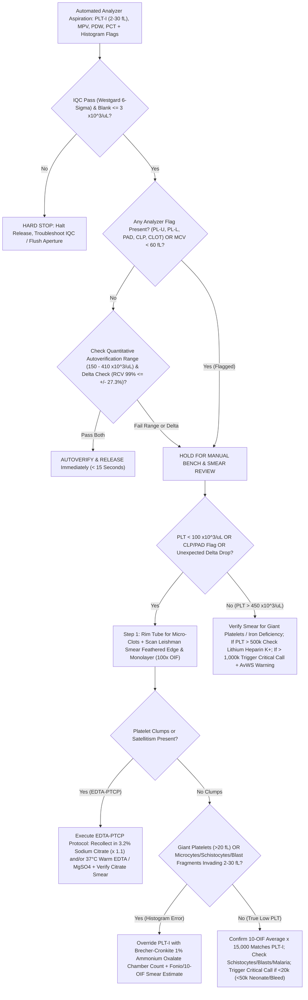

# 🧬 1.1.10 — Platelet Count (`PLT` / Thrombocytes), Multi-Channel Impedance/Optical/Manual Verification & Pseudothrombocytopenia (`EDTA-PTCP`) Resolution SOP

> **Document Control (`ISO 15189:2022` Clauses 5.5, 7.2, 7.3, 7.4, 8.3.2 & `NABL 112`):** **Document ID:** `NABL-HEM-SOP-1.1.10` | **Version:** `4.0` (10-Persona Red-Team Audited, International Reference & Turnkey Bench Standard) | **Effective Date:** `15-Oct-2026` | **Review Cycle:** Annual / Post-Analyzer or Lot Change | **Authorizing Authority:** Laboratory Director & Senior Consultant Hematopathologist (`MD Pathology`) | **Facility:** Sawariya Diagnostic Lab, Charkhi Dadri, Haryana | **Controlled Distribution:** Master LIMS, Hematology Automated Bench, Microscopy Review Station & Emergency Stat Bench

**Department Folder:** `01_Hematology_and_Coagulation`  
**Cluster Folder:** `1.1_Hemogram_CBC_and_Leucocyte_Platelet_Cluster`  
**Document Tier:** International Reference Laboratory Standard (`ISO 15189:2022` / `NABL 112 & 220D` / `CAP HEM.25800 & HEM.30100` / `ICSH 2014–2021` / `ISLH` / `CLSI H26-A2, EP15-A3, EP06-Ed2, EP17-A2, EP28-A3c, GP41, GP47, AUTO10-A, AUTO15` / `EFLM EuBIVAS` / `ISO/TS 20914:2019` / `ISO 22367:2020` / `ASH / AABB / BCSH / ICMR Dengue Guidelines` / `WHO 2022` / `Indian CPA 2019 & DPDP Act 2023`)

---

## 🏛️ Section 1: International Document Control, `LOINC`/`SNOMED`/`ICD-10`/`UCUM` Coding, Metrological Traceability (`ISO 17511`) & Multi-Tier Platform Matrix

| Attribute | Specification & International Reference Standard |
| :--- | :--- |
| **Document Control ID & Version** | `NABL-HEM-SOP-1.1.10` — Version `4.0` (Hardware-Agnostic Multi-Channel & Manual Reference Tier) |
| **ISO 15189:2022 Clause Mapping** | Clauses `4.1–4.3` (*Impartiality, Confidentiality, Patient-First Governance*), `5.3–5.5` (*Governance & Service Agreements*), `6.2` (*Competency Assessment*), `6.4–6.5` (*Equipment Calibration & Metrological Traceability*), `7.2` (*Pre-Examination Processes*), `7.3.2` (*Verification of Examination Methods*), `7.3.4` (*Evaluation of Measurement Uncertainty*), `7.3.7` (*Ensuring Validity of Examination Results — IQC & EQAS*), `7.4.1.6` (*Notification of Critical Decision Limits*), `8.3` (*Control of Management System Documents*), `8.5` (*Actions to Address Risks & Opportunities — `ISO 22367:2020`*), Normative Annex A (*POCT/Backup Governance*) |
| **NABL & CAP Cross-References** | `NABL 112` (*Specific Criteria for Medical Laboratories — Hematology*), `NABL 131` (*Policy on Calibration & Traceability*), `NABL 133` (*Policy on Reporting*), `NABL 163` (*EQAS/PT Participation*), `NABL 220D` (*Assessment Checklist*), `CAP HEM.25800` (*Spurious Platelet Results — Fragments, Microcytes, Clumps, Giant Platelets*), `CAP HEM.30100` (*Peripheral Smear Correlation & Review Criteria*) |
| **Primary & Secondary `LOINC` Codes** | `777-3` (*Platelets [#/volume] in Blood by Automated count*), `778-1` (*Platelets [#/volume] in Blood by Manual count — Brecher-Cronkite Hemocytometer*), `49497-1` (*Platelets [#/volume] in Blood by Estimate on Peripheral Smear*), `74775-8` (*Platelets [#/volume] in Citrate Blood by Automated count*), `32207-3` (*Platelet distribution width [Entitic volume] in Blood*), `32623-1` (*Platelet mean volume [Entitic volume] in Blood*), `71695-1` (*Immature platelet fraction [%] in Blood by Automated count*) |
| **`SNOMED-CT` Specimen & Concept** | Specimen: `445295009` (*Whole blood specimen in dipotassium EDTA*) / `122554006` (*Capillary blood specimen*) / `440500007` (*Whole blood in 3.2% trisodium citrate*); Observable Entity: `365632008` (*Finding of platelet count*); Procedure: `61928009` (*Platelet count*) |
| **`ICD-10` / `ICD-11` Diagnostic Codes** | `D69.6` / `3B64.Z` (*Thrombocytopenia, unspecified*), `D69.3` / `3B64.0` (*Immune thrombocytopenic purpura [ITP]*), `D69.59` (*Secondary thrombocytopenia — Dengue/Malaria/Drug-induced/HIT*), `A90` / `A91` / `1D2Z` (*Dengue fever / Severe Dengue with warning signs*), `D65` (*Disseminated intravascular coagulation [DIC]*), `M31.1` (*Thrombotic microangiopathy / TTP-HUS*), `O14.2` (*HELLP syndrome*), `D69.1` (*Qualitative platelet defects / Bernard-Soulier*), `D47.3` / `2A20.2` (*Essential thrombocythemia [ET]*), `D75.83` (*Reactive/secondary thrombocytosis*) |
| **Reporting Units & `UCUM` Conversion** | **Primary Clinical Unit:** $\times 10^3/\mu\text{L}$ (equivalent to $\text{cells}/\text{mm}^3 \div 1,000$). **SI (`UCUM`) Standard Unit:** $\times 10^9/\text{L}$ ($1 \times 10^3/\mu\text{L} \equiv 1 \times 10^9/\text{L}$, conversion factor $= 1.000$). **Indian Conventional Dual Display:** $\text{Lakhs/cumm}$ ($1.00\text{ Lakh/cumm} = 100 \times 10^3/\mu\text{L} = 100 \times 10^9/\text{L}$). Both $\times 10^3/\mu\text{L}$ and $\text{Lakhs/cumm}$ are displayed on patient reports to prevent rural/semi-urban misinterpretation. |
| **Metrological Traceability (`ISO 17511:2020`)** | Higher-order reference procedure: **ICSH / ISLH International Reference Method for Platelet Counting** (Dual-Platform Flow Cytometric $\text{RBC:PLT}$ Ratio Method using fluorescein-labeled monoclonal antibodies against **`CD41` [$\text{GPIIb}$] and `CD61` [$\text{GPIIIa}$]** combined with a reference impedance/optical RBC count). Commercial hematology calibrators are value-assigned against this `ICSH/ISLH` reference hierarchy with unbroken uncertainty chains ($u_{\text{cal}} \le 1.5\%$). |
| **Tier-1 Primary Automated Platform** | **Nihon Kohden MEK-1503 / Equivalent 3-Part or 5-Part Automated Hematology Analyzer:** Hydrodynamic / Direct-Current (`DC`) Aperture Impedance (`PLT-I`) with dynamic moving-threshold pulse-height discrimination ($2\text{–}30\text{ fL}$) and log-normal curve-fitting extrapolation to eliminate recirculation and RBC coincidence. |
| **Tier-2 Manual Reference & Verification Platforms** | **1. Brecher-Cronkite Direct Hemocytometer Method (`CLSI H26-A2` / `ICSH` Manual Backup):** $1\%$ ($\text{w/v}$) Aqueous Ammonium Oxalate ($\text{(NH}_4)_2\text{C}_2\text{O}_4$, $1:100$ whole-blood dilution) in an **Improved Neubauer Ruling Counting Chamber** ($0.1\text{ mm}$ depth) under Phase-Contrast or lowered-condenser $400\times$ light microscopy.<br>**2. `ICSH` Standardized Peripheral Blood Smear (`PBS`) Estimation:** Romanowsky (Leishman / May-Grünwald-Giemsa) stained monolayer across $10$ consecutive $100\times$ oil-immersion fields (`OIF`, FN $20\text{–}22\text{ mm}$) $\times 15,000\text{–}20,000/\mu\text{L}$ validation factor + **Fonio / Miller Ocular Disc** $\text{PLT:RBC}$ indirect ratio.<br>**3. Pseudothrombocytopenia (`EDTA-PTCP`) Resolution Suite:** Light-Blue Top $3.2\%$ ($0.109\text{ mol/L}$) Trisodium Citrate ($\times 1.1$ dilution factor), Magnesium Sulfate ($\text{MgSO}_4$, $27\text{ }\mu\text{mol}$ / *ThromboExact* zero-dilution tube), and $37^\circ\text{C}$ Pre-Warmed Water-Bath Chain. |
| **Tier-3 Future / High-Throughput Upgrade Slot** | **Optical Light Scatter (`PLT-O` — Two-Angle Laser Scatter $2^\circ\text{–}5^\circ$ & $10^\circ\text{–}20^\circ$)** and **Fluorescence Flow Cytometry (`PLT-F` — Polymethine / Oxazine Mitochondrial & Ribosomal RNA Dye)** yielding interference-free `PLT-F` in severe microcytosis/schistocytosis/giant platelet disorders plus **Immature Platelet Fraction (`IPF%` and `A-IPF#`)**. *(Plug-and-play ready: requires only `CLSI EP15-A3` & `EP09c` verification log update).* |

---

## 🧪 Section 2: Pre-Analytical Phlebotomy, `CLSI GP41` Order-of-Draw, Anticoagulant Physics, Stability & Quantitative Specimen Rejection Matrix

### 2.1 Phlebotomy, Anticoagulant Chemistry & Pre-Analytical Control Table

| Pre-Analytical Variable | Mandatory Technical & Physiological Protocol (`CLSI GP41-Ed7` / `CLSI GP44-A4` / `CLSI H26-A2` / `ICSH`) |
| :--- | :--- |
| **Primary Specimen & Anticoagulant** | **Venous Whole Blood in Lavender-Top $\text{K}_2\text{-EDTA}$** (spray-dried dipotassium ethylenediaminetetraacetic acid, $1.5\text{–}2.2\text{ mg/mL}$ blood [$4.1\text{–}6.8\text{ mmol/L}$] per `ICSH`/`CLSI H01-A6`). $\text{K}_2\text{-EDTA}$ is preferred over $\text{K}_3\text{-EDTA}$ liquid because $\text{K}_3\text{-EDTA}$ causes $1\text{–}2\%$ osmotic shrinkage and dilutional bias. |
| **Secondary / Reflex Anticoagulants (`EDTA-PTCP` Resolution)** | **1. Light-Blue Top $3.2\%$ ($0.109\text{ mol/L}$) Buffered Trisodium Citrate:** Exact $9:1$ blood-to-anticoagulant ratio; requires mandatory **$\times 1.1$ dilution correction factor** ($\text{PLT}_{\text{corrected}} = \text{PLT}_{\text{citrate}} \times 1.1$). *Note: In $15\text{–}20\%$ of `EDTA-PTCP` cases, divalent cation chelation by citrate also triggers clumping!*<br>**2. Magnesium Sulfate ($\text{MgSO}_4$, $27\text{ }\mu\text{mol}$ / S-Monovette *ThromboExact*):** Stabilizes the platelet membrane $\text{GPIIb/IIIa}$ complex via high $\text{Mg}^{2+}$ concentration without chelating $\text{Ca}^{2+}$ and **without liquid dilution ($\times 1.0$ factor)**; resolves $>98\%$ of both EDTA- and Citrate-induced pseudothrombocytopenia.<br>**3. Capillary Finger-Prick / Heel-Stick Direct Smear + Ammonium Oxalate Diluent:** Only if neonatal/difficult venous access, with strict avoidance of tissue milking. |
| **`CLSI GP41` Order of Draw & Venipuncture Technique** | Blood Culture $\rightarrow$ Light-Blue Citrate $\rightarrow$ Serum (`SST`/Red) $\rightarrow$ Green Heparin $\rightarrow$ **Lavender $\text{K}_2\text{-EDTA}$** $\rightarrow$ Grey Fluoride. **Critical Phlebotomy Rule:** Release tourniquet within $\le 60\text{ seconds}$; ensure clean first-pass venipuncture with $21\text{G–}22\text{G}$ needle. Slow, traumatic, or syringe-frothing draws release subendothelial **Tissue Factor (`TF` / Factor III)** and adenosine diphosphate (`ADP`), triggering immediate *in-vitro* thrombin generation, platelet shape change, degranulation, and micro-clot consumption before blood ever touches $\text{K}_2\text{-EDTA}$. |
| **Tube Fill Volume & Under-Filling Effect** | **Adult:** $2.0\text{–}3.0\text{ mL}$ in standard vacuum tube (minimum $\ge 50\%$ fill mark). **Pediatric Micro-Container:** $0.5\text{ mL}$ (fill strictly between $250\text{–}500\text{ }\mu\text{L}$ lines). Severe under-filling ($< 25\%$ nominal volume) creates hypertonic $\text{EDTA}$ excess ($> 4\text{ mg/mL}$), causing osmotic platelet swelling followed by accelerated $\text{EDTA}$-induced clumping and erroneous `MPV` alterations. Overfilling ($>110\%$) leaves insufficient headspace air bubble for inversion mixing, leading to micro-clots. |
| **Whole-Blood Homogenization Protocol** | **1. Immediate Post-Draw:** Gently invert the $\text{K}_2\text{-EDTA}$ tube **$8\text{ to }10\text{ times}$** through a complete $180^\circ$ arc immediately upon removal from the hub. **NEVER shake vigorously** (causes mechanical hemolysis and RBC micro-vesiculation that falsely elevates impedance `PLT`).<br>**2. Pre-Analysis Bench Homogenization:** Place on a calibrated mechanical roller/rocker mixer at **$20\text{–}30\text{ RPM}$ for $10\text{–}15\text{ minutes}$** (or $8\text{–}10$ manual $180^\circ$ inversions if analyzed within $30\text{ min}$ of draw) at $18\text{–}25^\circ\text{C}$. Settled blood aspirated from the bottom of an unmixed tube yields a falsely low `PLT` (platelets have the lowest specific gravity, $1.040\text{ g/mL}$, and remain suspended in the upper plasma layer while RBCs sediment). |
| **Time & Temperature Stability Kinetics** | **1. Automated Count (`PLT-I` / `PLT-O` / `PLT-F`):** Stable up to **$24\text{ hours}$ at controlled room temperature ($18\text{–}25^\circ\text{C}$)** and up to $36\text{–}48\text{ hours}$ at $4\text{–}8^\circ\text{C}$ (must equilibrate to $18\text{–}25^\circ\text{C}$ for $15\text{–}20\text{ minutes}$ before mixing and aspiration to dissolve cold-induced reversible platelet aggregates).<br>**2. Mean Platelet Volume (`MPV`) & `PDW` Kinetics in $\text{K}_2\text{-EDTA}$:** $\text{EDTA}$ causes platelets to transform from discoid to spherical shapes with pseudopod extrusion ("echinocytic sphering"). In impedance systems (`PLT-I`), `MPV` increases by **$+7.9\%$ within $30\text{ minutes}$** and **$+13.4\%$ over $24\text{ hours}$**! Therefore, `MPV` must be measured strictly between **$60\text{ and }180\text{ minutes}$ post-venipuncture**.<br>**3. Peripheral Smear Preparation Window:** Prepare Leishman/Giemsa smear within **$\le 2\text{–}4\text{ hours}$** of collection to preserve crisp platelet granularity and prevent storage-induced degranulation/vacuolization. |

### 2.2 Mandatory Pre-Analytical Specimen Rejection & Handling Matrix (`ISO 15189:2022` Clause 7.2.6)

| Rejection / Flag Code | Visual, Instrumental or Microscopic Finding | Pathophysiological / Analytical Error | Mandatory Laboratory Action |
| :--- | :--- | :--- | :--- |
| **`REJ-CLOT-01`** | Visible macro-clot, gelatinous fibrin strand on wooden applicator stick rimming, or analyzer `CLOT` / aspiration pressure alarm | In-vitro thrombin activation consumes $30\text{–}95\%$ of platelets into the fibrin meshwork $\rightarrow$ **catastrophic false-low `PLT`** | **Reject immediately.** Do NOT vortex, remove clot, or report any parameter. Request fresh atraumatic recollection (`ISO 15189` Non-Conformity Log). |
| **`REJ-MICROCLOT-02`** | Unexpected drop in `PLT` ($>28.4\%$ delta check) with small fibrin strands wrapped around degraded platelet aggregates on the feathered edge of the smear | Occult partial clotting during difficult/slow syringe transfer | **Reject and recollect.** Differentiate true `EDTA-PTCP` (intact purple granular platelets in cohesive clumps without fibrin threads) from partial clotting (pale, degranulated grey "ghost" platelets trapped in eosinophilic/basophilic fibrin strands). |
| **`REJ-HEMO-03`** | Gross *in-vitro* mechanical hemolysis (pink/red supernatant plasma after sedimentation or traumatic heel-stick squeezing) | Ruptured RBC ghosts and stroma fragments ($2\text{–}25\text{ fL}$) enter the impedance platelet aperture $\rightarrow$ **severe false-high `PLT`** masking dangerous thrombocytopenia | **Reject for impedance `PLT` reporting.** Perform fresh atraumatic venous draw, or if irreplaceable neonatal sample, verify via $1\%$ Ammonium Oxalate phase-contrast chamber + direct oil-immersion smear estimate. |
| **`REJ-SHORT-04`** | Citrate ($3.2\%$) tube filled $<90\%$ or $>110\%$ of etched fill line | Altered $9:1$ blood-to-citrate ratio invalidates the $\times 1.1$ dilution correction factor | **Reject Citrate tube** and redraw exactly to the etched fill mark. |
| **`REJ-TEMP-05`** | Sample exposed to freezing ($<0^\circ\text{C}$) or extreme heat ($>40^\circ\text{C}$ during summer rural transit) | Thermal lysis of platelets and RBC fragmentation generating extreme micro-debris ($2\text{–}30\text{ fL}$) | **Reject immediately** and request temperature-controlled recollection ($18\text{–}25^\circ\text{C}$ cool-pack insulated carrier without direct ice contact). |

---

## ⚙️ Section 3: Deep Analytical SOP — Dual-Channel Impedance (`2–30 fL` Moving Threshold) vs Optical/Fluorescence vs Manual Brecher-Cronkite (`1%` Ammonium Oxalate) & `ICSH` Smear Verification

### 3.1 Analytical Physics, Aperture Geometry & Curve-Fitting Mathematics

1. **Hydrodynamic / Direct-Current (`DC`) Aperture Impedance (`PLT-I` — Primary Channel):**
   - **Principle (Coulter Principle):** Whole blood is diluted ($1:10,000$ to $1:40,000$) in an isotonic, particle-free electrolyte diluent ($\text{osmolality } 285\text{–}295\text{ mOsm/kg}$, $\text{pH } 7.4$, filtered to $<0.22\text{ }\mu\text{m}$). The suspension is drawn through a micro-aperture (typically $50\text{ }\mu\text{m}$ diameter $\times 60\text{ }\mu\text{m}$ length) across which a constant DC current flows between internal and external platinum electrodes.
   - **Pulse Generation:** As each non-conducting cell passes through the sensing zone, it displaces an equal volume of conducting electrolyte, producing a voltage pulse whose **amplitude (height) is directly proportional to cell volume ($\text{fL}$)** and whose **frequency (count) equals the particle number**.
   - **Dynamic Moving-Threshold Discrimination ($2\text{–}30\text{ fL}$):**
     - **Fixed Lower Discriminator (`LD` = $2.0\text{ fL}$):** Separates true small platelets from electronic thermal noise, micro-bubbles, and reagent background ($<2\text{ fL}$).
     - **Dynamic Upper Discriminator (`UD` = movable between $12.0\text{ and }30.0\text{ fL}$):** Searches the trough ("valley") between the right tail of the platelet volume distribution and the left toe of the erythrocyte distribution.
     - **Log-Normal Mathematical Extrapolation:** Because physiological platelet volumes follow a right-skewed log-normal distribution, the analyzer microprocessor fits a Theoretical Log-Normal Curve to the raw pulse-height histogram between $2\text{ fL}$ and the valley ($12\text{–}30\text{ fL}$) to exclude micro-RBC coincidence and platelet recirculation eddies behind the aperture.
2. **Optical Light Scatter (`PLT-O`) & Fluorescence Flow Cytometry (`PLT-F` — High-Specificity Channels):**
   - **`PLT-O` (Two-Dimensional Laser Scatter):** Sphered platelets pass through a $633\text{ nm}$ laser beam. Low-angle forward scatter ($2^\circ\text{–}5^\circ$, measuring cell volume) is plotted against high-angle forward scatter ($10^\circ\text{–}20^\circ$, measuring refractive index / internal granule density). Because platelets have a significantly lower refractive index ($n \approx 1.35\text{–}1.37$) than hemoglobin-dense micro-erythrocytes/schistocytes ($n \approx 1.40\text{–}1.42$), `PLT-O` separates giant platelets from microcytes up to $40\text{–}60\text{ fL}$.
   - **`PLT-F` (Fluorescence RNA Staining):** A specific oxazine/polymethine fluorescent dye penetrates the platelet membrane and binds selectively to mitochondrial DNA and ribosomal RNA in the rough endoplasmic reticulum. Forward scatter (`FSC` = size) vs side fluorescence (`SFL` = RNA content) completely isolates platelets from mature RBC fragments, microcytes, and chylomicrons (which lack RNA) while simultaneously quantifying the **Immature Platelet Fraction (`IPF%`)**—the youngest, RNA-rich reticulated platelets released from bone marrow megakaryocytes within the preceding $24\text{–}36\text{ hours}$.

### 3.2 Histogram Interference Physics & Analyzer Flag Interpretation Matrix (`CAP HEM.25800`)

| Analyzer Histogram / Interpretive Flag | Histogram Contour Abnormality | Underlying Analytical / Pathological Culprit | Direction of Automated `PLT-I` Error | Mandatory Bench Action Before Reporting |
| :--- | :--- | :--- | :---: | :--- |
| **`PL-L` / `LRI` (Lower Region Interference at $2\text{ fL}$)** | Histogram fails to start at the baseline at the $2\text{ fL}$ lower discriminator (high vertical spike at $2\text{ fL}$) | 1. Reagent contamination or micro-air bubbles in diluent lines<br>2. Cryoglobulin / cryofibrinogen precipitates<br>3. Severe chylomicronemia / IV lipid emulsion<br>4. Overwhelming bacteremia / candidemia or bacterial overgrowth in aged specimen | **↑↑ False-High `PLT-I`** | 1. Run Blank Background Check ($\text{PLT}_{\text{blank}} \le 3 \times 10^3/\mu\text{L}$).<br>2. Inspect plasma for lipemia/cryoprecipitates (warm to $37^\circ\text{C} \times 30\text{ min}$ if cryoglobulin suspected).<br>3. Verify via peripheral smear + $1\%$ Ammonium Oxalate chamber count. |
| **`PL-U` / `URI` (Upper Region Interference at $12\text{–}30\text{ fL}$)** | Histogram fails to return to baseline between $12\text{ and }30\text{ fL}$; no clean valley separating `PLT` curve from `RBC` curve | **Scenario A (False-High `PLT-I`):** Severe microcytosis ($\text{MCV} < 60\text{ fL}$ in iron deficiency / $\beta$-thalassemia trait), **schistocytes/RBC fragments** (`TTP`, `HUS`, `DIC`, severe thermal burns, prosthetic heart valve hemolysis), HbH inclusions, or **leukemic blast cytoplasmic fragments** (`AML` / `TLS`).<br>**Scenario B (False-Low `PLT-I`):** **Giant / Macro-Platelets ($>20\text{–}35\text{ fL}$)** in `ITP`, **Harris Platelet Syndrome** (Constitutional Macrothrombocytopenia), **Bernard-Soulier Syndrome** (`GPIb-IX-V` deficiency), or **`MYH9`-related disorders** (May-Hegglin anomaly) counted in the `RBC` channel! | **↑↑ False-High** *(Microcytes / Schistocytes / Blast fragments)*<br>**OR**<br>**↓↓ False-Low** *(Giant Platelets)* | **NEVER release raw `PLT-I` when `PL-U`/`URI` is flagged!**<br>1. Perform immediate $100\times$ oil-immersion smear review.<br>2. Differentiate micro-RBCs/schistocytes/blast fragments from giant platelets.<br>3. Override `PLT-I` with manual **Brecher-Cronkite $1\%$ Ammonium Oxalate count** + **`ICSH` Smear Estimate** (or `PLT-F` if available). |
| **`PAD` / `DW` (Platelet Abnormal Distribution / Non-Log-Normal Curve)** | Bimodal peak, serrated tooth-like contour, or failure of log-normal mathematical curve fit (`MPV` and `PDW` suppressed as `***` or `---`) | 1. Small platelet aggregates ($3\text{–}10$ clumped platelets measuring $15\text{–}35\text{ fL}$)<br>2. Dual platelet population post-transfusion<br>3. Anisothrombocytosis in myeloproliferative neoplasms (`ET`/`PMF`) or `MDS` | **↓↓ False-Low** or erratic `PLT-I` | Scan feathered edge and lateral margins of Leishman smear for platelet clumps and dysplastic megakaryocyte fragments; execute `EDTA-PTCP` protocol if clumps are present. |
| **`CLP` / `CLUMP` / `NWBC` (Platelet Clump / Fragile WBC Flag)** | Serrated saw-tooth tail at $20\text{–}35\text{ fL}$ AND spurious spike at the left border of the `WBC` impedance histogram ($30\text{–}60\text{ fL}$ ghost region) | Large **`EDTA`-induced platelet clumps ($10\text{–}100+$ platelets, volume $50\text{–}300\text{ fL}$)** or **Platelet Satellitism** around neutrophils are excluded from the $2\text{–}30\text{ fL}$ platelet channel and miscounted as small lymphocytes/nucleated RBCs (`pseudoleukocytosis`)! | **↓↓↓ Severe False-Low `PLT-I`** + **↑ False-High `WBC`** | **Mandatory `EDTA-PTCP` Resolution Algorithm (Section 3.3):** Inspect smear $\rightarrow$ Recollect in $3.2\%$ Sodium Citrate ($\times 1.1$) and/or $\text{MgSO}_4$ / $37^\circ\text{C}$ warm chain; correct both `PLT` and `WBC`! |

---

### 3.3 Step-by-Step Pseudothrombocytopenia (`EDTA-PTCP`), Cold Agglutinin & Platelet Satellitism Resolution Protocol

**Pathophysiological Mechanism of `EDTA-PTCP` (Prevalence: $0.07\%\text{–}0.20\%$ of general outpatients; up to $1.5\%$ of hospitalized patients; accounts for $15\text{–}30\%$ of all isolated thrombocytopenia referrals!):**
When $\text{K}_2\text{-EDTA}$ chelates extracellular calcium ions ($\text{Ca}^{2+}$) below physiological ionized concentrations ($<1.1\text{ mmol/L}$), and especially as the blood cools below $37^\circ\text{C}$ toward room temperature ($18\text{–}25^\circ\text{C}$), the heterodimeric platelet membrane integrin **Glycoprotein $\text{IIb/IIIa}$ ($\alpha_{\text{IIb}}\beta_3$ / `CD41/CD61`)** undergoes a conformational shift in its calcium-binding domain. This exposes hidden ("cryptic") neo-epitopes on $\text{GPIIb}$. Naturally occurring or post-viral/autoimmune **cold-reacting $\text{IgG}$, $\text{IgM}$, or $\text{IgA}$ autoantibodies** bind these exposed cryptic epitopes, cross-linking platelets *in vitro* into massive clumps within $2\text{ to }15\text{ minutes}$ of venipuncture. These autoantibodies have **zero *in-vivo* pathogenicity** (the patient has normal hemostasis and zero bleeding risk), making laboratory recognition critical to prevent catastrophic iatrogenic harm (unnecessary platelet transfusions, high-dose steroids, IVIG, bone marrow biopsy, or splenectomy).

#### Step-by-Step Bench Resolution Workflow:
1. **Step 1 — Trigger & Physical Clot Exclusion:**
   - Triggered whenever: (a) Automated `PLT` is $<100 \times 10^3/\mu\text{L}$ on any first-time patient, (b) Automated `PLT` drops by $\ge 28.4\%$ (`RCV 99%`) from a prior result without clinical explanation, or (c) Any `CLP`, `PAD`, `PL-U`, `PL-L`, or `PL*` flag appears regardless of numerical `PLT` count.
   - Insert two wooden applicator sticks into the mixed $\text{K}_2\text{-EDTA}$ tube, swirl gently, and lift against a bright light source to exclude physical macro- or micro-clots (`REJ-CLOT-01`).
2. **Step 2 — Mandatory Peripheral Blood Smear (`PBS`) Feathered-Edge & Monolayer Inspection:**
   - Prepare a wedge smear, stain with Leishman/Giemsa, and scan under $10\times$ and $40\times$ objectives along the **feathered edge and both lateral edges** (where large, heavy platelet aggregates are carried during spreading), followed by $100\times$ oil-immersion examination of the monolayer.
   - **Check for 3 Distinct Microscopic Entities:**
     - **Entity 1 — True `EDTA` Platelet Clumping:** Cohesive rafts of $5\text{ to }200+$ well-granulated purple platelets without intervening fibrin strands.
     - **Entity 2 — Platelet Satellitism (`FcγRIIIb / CD16` Rosetting):** Platelets forming a rosette/halo selectively around the cytoplasmic membrane of **polymorphonuclear neutrophils** (and occasionally monocytes, never lymphocytes or eosinophils), mediated by an $\text{EDTA}$-dependent $\text{IgG}$ autoantibody bridging platelet **$\text{GPIIb/IIIa}$** to the neutrophil **$\text{Fc}\gamma\text{RIIIb}$ (`CD16`)** receptor.
     - **Entity 3 — Partial Clotting Artifact:** Degranulated, pale-grey fused platelets entangled in fine pink/violaceous **fibrin threads** $\rightarrow$ Reject as `REJ-MICROCLOT-02` and perform fresh atraumatic venipuncture.
3. **Step 3 — Tier-A Immediate Physical Disaggregation Trial (Vortex Agitation Screening):**
   - For mild-to-moderate platelet clumping when the patient is still in the clinic or ward, vortex the $\text{K}_2\text{-EDTA}$ sample at **$1,500\text{–}2,500\text{ RPM}$ for $60\text{ seconds}$** (avoiding frothing or hemolysis) and immediately re-aspirate within $30\text{ seconds}$ + prepare a post-vortex smear.
   - *Rule:* Only accept the post-vortex count if the `CLP`/`PAD` flags completely disappear, the platelet histogram assumes a smooth log-normal curve returning to baseline before $30\text{ fL}$, AND the post-vortex smear confirms complete dispersion of clumps. (Note: high-affinity $\text{IgM}/\text{IgG}$ clumps usually re-aggregate within seconds; proceed immediately to Tier-B).
4. **Step 4 — Tier-B Parallel Anticoagulant & Thermal Recollection Protocol (Gold Standard):**
   - Recall the patient (or visit the bedside) and collect **three simultaneous atraumatic tubes**:
     - **Tube 1 — Light-Blue Top $3.2\%$ ($0.109\text{ mol/L}$) Trisodium Citrate** (filled strictly to the $9:1$ etched mark). Analyze within $10\text{ minutes}$ of draw. Multiply the automated citrate platelet count (and `WBC` count if reporting from citrate) by the **exact stoichiometric dilution factor of $\times 1.1$**:
       $$\text{PLT}_{\text{Corrected}} = \text{PLT}_{\text{Citrate Raw}} \times \frac{10}{9} \approx \text{PLT}_{\text{Citrate Raw}} \times 1.1$$
     - **Tube 2 — Pre-Warmed $\text{K}_2\text{-EDTA}$ at $37^\circ\text{C}$ (Thermal Chain):** Pre-warm a $\text{K}_2\text{-EDTA}$ tube and syringe/holder in a $37^\circ\text{C}$ water bath or dry incubator for $15\text{ minutes}$ prior to venipuncture. Immediately return the drawn tube to $37^\circ\text{C}$, transport in a $37^\circ\text{C}$ water-jacketed beaker directly to the analyzer, and aspirate at $37^\circ\text{C}$. This prevents binding of **cold-reacting $\text{IgM}$ anti-platelet agglutinins** whose thermal amplitude is $<30^\circ\text{C}$.
     - **Tube 3 — Magnesium Sulfate ($\text{MgSO}_4$ / *ThromboExact* Tube) OR Finger-Prick Direct $1\%$ Ammonium Oxalate Chamber + Immediate Unanticoagulated Wedge Smear:** If the patient is among the **$15\text{–}20\%$ of `EDTA-PTCP` patients who ALSO clump in $3.2\%$ Sodium Citrate ("Multi-Anticoagulant Pseudothrombocytopenia")**, $\text{MgSO}_4$ or immediate capillary dilution into $1\%$ Ammonium Oxalate (Brecher-Cronkite chamber) + immediate unanticoagulated finger-prick smear completely bypasses chelation-induced $\text{GPIIb/IIIa}$ epitope exposure.
5. **Step 5 — Mandatory Smear Verification of the Alternative Tube & `WBC` Correction:**
   - **Critical Audit Rule:** Never assume the $3.2\%$ Sodium Citrate tube is clump-free without making a **Citrate Peripheral Smear**! Only release the $\times 1.1$ corrected Citrate `PLT` if the Citrate smear shows single, evenly dispersed platelets.
   - Check the original $\text{K}_2\text{-EDTA}$ `WBC` count against the Citrate ($\times 1.1$) `WBC` count: if giant platelet clumps in $\text{EDTA}$ falsely elevated the `WBC` count (e.g., $\text{EDTA WBC } 18.5 \times 10^3/\mu\text{L}$ vs $\text{CitrateCorrected WBC } 7.8 \times 10^3/\mu\text{L}$), replace the spurious $\text{EDTA}$ `WBC` with the corrected Citrate `WBC`!

#### Summary Decision Matrix for Pseudothrombocytopenia Resolution:

| Clinical / Bench Scenario | $\text{K}_2\text{-EDTA}$ Automated `PLT` & Smear | $3.2\%$ Citrate Automated `PLT` ($\times 1.1$) & Smear | $37^\circ\text{C}$ Pre-Warmed / $\text{MgSO}_4$ / Ammonium Oxalate Count | Final Reported `PLT` & Mandatory Pathologist Action |
| :--- | :--- | :--- | :--- | :--- |
| **Scenario 1: Classic `EDTA-PTCP` ($80\text{–}85\%$ of cases)** | $22 \times 10^3/\mu\text{L}$ (`CLP` flag; large clumps on smear) | Raw: $210 \times 10^3/\mu\text{L}$ $\rightarrow$ **$\times 1.1 = 231 \times 10^3/\mu\text{L}$** (No clumps on Citrate smear) | $235 \times 10^3/\mu\text{L}$ | Report **$231 \times 10^3/\mu\text{L}$** (`2.31 Lakhs/cumm`). Append **`[BAND-EDTA-PTCP-CITRATE]`** shield alerting physician and patient to always request Citrate/`MgSO4` tube for future `CBC`s. |
| **Scenario 2: Combined `EDTA` + Citrate Pseudothrombocytopenia ($15\text{–}20\%$ of cases)** | $18 \times 10^3/\mu\text{L}$ (Large clumps on $\text{EDTA}$ smear) | Raw: $34 \times 10^3/\mu\text{L}$ (Persistent clumps on Citrate smear!) | **$245 \times 10^3/\mu\text{L}$** (via $37^\circ\text{C}$ warm-chain $\text{EDTA}$, $\text{MgSO}_4$, or direct $1\%$ Ammonium Oxalate chamber + unanticoagulated finger-prick smear) | Report **$245 \times 10^3/\mu\text{L}$** (`2.45 Lakhs/cumm`). Document multi-anticoagulant `PTCP` resolved via $37^\circ\text{C}$ / Ammonium Oxalate reference method. |
| **Scenario 3: Platelet Satellitism (`CD16` Rosetting)** | $48 \times 10^3/\mu\text{L}$ (Platelets rosetting around neutrophils on $\text{EDTA}$ smear) | Raw: $195 \times 10^3/\mu\text{L}$ $\rightarrow$ **$\times 1.1 = 215 \times 10^3/\mu\text{L}$** (Satellitism absent in Citrate / $\text{MgSO}_4$) | $218 \times 10^3/\mu\text{L}$ | Report **$215 \times 10^3/\mu\text{L}$**. Document in-vitro `EDTA`-dependent platelet satellitism around neutrophils (`FcγRIIIb` mediated, clinically benign). |
| **Scenario 4: True Thrombocytopenia Coexisting with `EDTA` Clumping** | $12 \times 10^3/\mu\text{L}$ (Moderate clumps on $\text{EDTA}$ smear) | Raw: $55 \times 10^3/\mu\text{L}$ $\rightarrow$ **$\times 1.1 = 61 \times 10^3/\mu\text{L}$** (Zero clumps on Citrate smear; confirmed by $4\text{ PLT/OIF}$) | $62 \times 10^3/\mu\text{L}$ | Report **$61 \times 10^3/\mu\text{L}$**. Note that `EDTA` clumping exacerbated an underlying true moderate thrombocytopenia ($61 \times 10^3/\mu\text{L}$). |

---

### 3.4 Standardized Manual Peripheral Smear Platelet Estimation (`ICSH` $100\times$ Oil-Immersion, Anemia Correction, Fonio & Miller Disc SOP)

Whenever an automated platelet count is **$< 100 \times 10^3/\mu\text{L}$**, **$> 450 \times 10^3/\mu\text{L}$**, or accompanied by any platelet histogram flag (`PL-U`, `PL-L`, `PAD`, `CLP`), a manual morphological smear estimation is **mandatory before result release (`CAP HEM.30100` / `ICSH 2015`)**.

#### Method 1: Direct $100\times$ Oil-Immersion Field (`OIF`) Monolayer Count (`ICSH` Standard)
1. **Zone Selection (Critical):** Locate the **ideal RBC monolayer zone** of a well-spread Leishman/May-Grünwald-Giemsa stained smear where erythrocytes just touch one another without overlapping (approximately $200\text{–}250\text{ RBCs}$ per $100\times$ oil-immersion field using a standard $10\times$ eyepiece with Field Number `FN` $= 20\text{–}22\text{ mm}$).
2. **10-Field Battlement Count:** After verifying the feathered edge and lateral margins are free of platelet clumps, count all platelets across **$10$ consecutive $100\times$ oil-immersion fields (`OIF`)** moving in a sinusoidal "battlement" pattern across the monolayer.
3. **Calculation of Average `PLT/OIF` & Conversion Multiplier:**
   $$\overline{\text{PLT}_{\text{OIF}}} = \frac{\sum_{i=1}^{10} \text{PLT}_i}{10}$$
   - **Standard Conversion Equation (`FN 22 mm` Objective = $\times 15,000/\mu\text{L}$; `FN 18–20 mm` Narrow-Field Objective = $\times 20,000/\mu\text{L}$):**
     $$\text{Estimated PLT (}/\mu\text{L)} = \overline{\text{PLT}_{\text{OIF}}} \times 15,000 \quad (\text{or } \times 20,000 \text{ per microscope field-area calibration})$$
     *(Note: At Sawariya Diagnostic Lab, each microscope's $100\times$ oil objective is field-calibrated annually against $20$ normal $\text{K}_2\text{-EDTA}$ samples; our Nikon/Olympus `FN 20` trinocular bench microscope uses the verified multiplier of **$\times 15,000/\mu\text{L}$** for normal hematocrit).*
4. **Mandatory Severe Anemia / Polycythemia Correction Factor (`RBC` Density Adjustment):**
   - In severe anemia ($\text{Hb} < 7.0\text{ g/dL}$ or $\text{RBC} < 2.5 \times 10^6/\mu\text{L}$), the technician unconsciously moves slightly deeper toward the body of the smear to find "touching RBCs," creating an artificially thick plasma film that **overestimates** `PLT` if multiplied by a fixed $15,000$. Conversely, in polycythemia, the monolayer is ultra-thin.
   - **Anemia-Corrected Smear Formula (or Fonio / Miller Disc Method):**
     $$\text{Corrected Smear PLT (}/\mu\text{L)} = \overline{\text{PLT}_{\text{OIF}}} \times 15,000 \times \frac{\text{Patient Hb (g/dL)}}{15.0} \quad \text{OR use Method 2 (Fonio / Miller Ratio below)}$$

#### Method 2: Fonio Indirect `PLT:RBC` Ratio & Miller Ocular Disc Method (Independent of Smear Thickness & Anemia!)
1. **Principle:** Counting platelets relative to $1,000$ erythrocytes in the same microscopic fields eliminates all variance from smear thickness, microscope field number (`FN`), and severe anemia/polycythemia.
2. **Miller Ocular Square Disc Technique:**
   - Insert a **Miller Ocular Disc** (a large square area $A$ containing a smaller corner square $B$ whose area is exactly $\frac{1}{9}$ of $A$, so $A : B = 9 : 1$) into the $10\times$ eyepiece.
   - Across consecutive $100\times$ oil-immersion monolayer fields, count **all platelets in the Large Square ($A$)** and **all erythrocytes in the Small Square ($B$)** until at least **$111\text{ RBCs}$** have been counted in Square $B$ (which corresponds to $111 \times 9 = \mathbf{1,000\text{ RBCs}}$ in Large Square $A$).
3. **Exact Mathematical Formula:**
   $$\text{PLT (}\times 10^3/\mu\text{L)} = \left(\frac{\text{Total Platelets Counted in Large Square } A}{\text{Total RBCs Counted in Small Square } B \times 9}\right) \times \text{Automated RBC Count (}\times 10^6/\mu\text{L)} \times 1,000$$
   - *Worked Example:* In a patient with Bernard-Soulier giant platelets (`PLT-I` falsely low at $18 \times 10^3/\mu\text{L}$) and automated $\text{RBC} = 4.20 \times 10^6/\mu\text{L}$, the analyst counts $18\text{ giant platelets}$ in Large Square $A$ while counting $111\text{ RBCs}$ in Small Square $B$ ($\equiv 1,000\text{ RBCs}$):
     $$\text{True PLT} = \left(\frac{18}{1,000}\right) \times 4.20 \times 10^6/\mu\text{L} = 75.6 \times 10^3/\mu\text{L} \text{ (}0.76\text{ Lakhs/cumm)}$$

---

### 3.5 Step-by-Step Brecher-Cronkite Direct `1%` Ammonium Oxalate Hemocytometer SOP (`CLSI H26-A2` / `ICSH` Manual Gold-Standard Backup)

When automated impedance (`PLT-I`) is invalidated by severe microcytosis ($\text{MCV} < 55\text{ fL}$), schistocytosis (`TTP`/`HUS`/burns), leukemic blast fragments, or giant platelets, and fluorescence (`PLT-F`) is unavailable, the **Brecher-Cronkite $1\%$ Ammonium Oxalate Direct Counting Chamber Method** is the definitive quantitative manual procedure.

1. **Reagent Chemistry & Stoichiometry:**
   - **Diluent:** $1.0\%\text{ w/v}$ Aqueous Ammonium Oxalate ($\text{(NH}_4)_2\text{C}_2\text{O}_4 \cdot \text{H}_2\text{O}$: dissolve $1.0\text{ g}$ analytic-grade Ammonium Oxalate in $100\text{ mL}$ Type-I reagent-grade water; filter through a $0.22\text{ }\mu\text{m}$ Millipore membrane filter and store refrigerated at $2\text{–}8^\circ\text{C}$; dispense daily working aliquot cleanly).
   - **Chemical Action:** Ammonium Oxalate rapidly and completely **lyses all erythrocytes** (converting them into invisible stromatolytic ghosts) while preserving leukocyte nuclei and causing platelets to round up as highly refractile, lilac-glinting spheres ($1.5\text{–}4\text{ }\mu\text{m}$) devoid of cytoplasmic debris.
2. **Step-by-Step Bench Procedure ($1:100$ Whole-Blood Dilution):**
   - **Step 1 (Dilution):** Pipette exactly **$1,980\text{ }\mu\text{L}$ ($1.98\text{ mL}$)** of filtered $1\%$ Ammonium Oxalate into a clean, dust-free polypropylene micro-tube. Using a calibrated positive-displacement micropipette, add exactly **$20\text{ }\mu\text{L}$** of well-mixed $\text{K}_2\text{-EDTA}$ (or $3.2\%$ Citrate) whole blood (wiping excess blood from the exterior of the pipette tip with lint-free tissue without touching the orifice). Rinse the tip $3\text{ times}$ in the diluent. This yields an exact **$1:100$ dilution** ($\text{Total Volume} = 2,000\text{ }\mu\text{L}$; $\text{Dilution Factor} = 100$).
   - **Step 2 (Lysis & Mixing):** Cap and mix gently on a mechanical rotator or by gentle inversion for **$10\text{ to }15\text{ minutes}$** to ensure complete RBC hemolysis.
   - **Step 3 (Chamber Charging):** Clean an **Improved Neubauer Hemocytometer** (depth $= 0.100\text{ mm}$) and its thick optically ground coverslip with $70\%\text{ v/v}$ ethanol and lint-free lens paper. Mount the coverslip firmly until Newton's interference rings appear. Remix the suspension for $10\text{ seconds}$, discard the first $2\text{ drops}$ from a capillary tube/pipette tip, and charge **both Side A (Upper Grid) and Side B (Lower Grid)** smoothly by capillarity ($\sim 10\text{ }\mu\text{L}$ per side) without overfilling into the moat or introducing air bubbles.
   - **Step 4 (Moist Petri Dish Sedimentation — CRITICAL):** Place the charged hemocytometer inside a covered **moist Petri dish** (lined with damp filter paper resting on two applicator sticks) for **exactly $15\text{ to }20\text{ minutes}$** at room temperature. Because platelets have a very low specific gravity ($1.040\text{ g/mL}$), counting before $15\text{ minutes}$ yields a **severe false-low count** as platelets are still suspended above the focal plane of the grid lines; leaving outside a moist chamber dries the fluid by evaporation, causing a **false-high count**.
   - **Step 5 (Microscopic Counting & Poisson Quality Check):**
     - Examine under **Phase-Contrast Microscopy ($400\times$: $40\times$ phase objective + $10\times$ ocular)** or bright-field microscopy with the substage condenser lowered and iris diaphragm closed to $70\text{–}80\%$ to maximize refractility.
     - Platelets appear as round, oval, or comma-shaped lilac/opalescent refractile bodies ($1\text{–}4\text{ }\mu\text{m}$), sometimes with tiny dendritic processes; distinguish carefully from non-refractile dirt specks or crystal precipitates.
     - Count all platelets inside the **entire central $1\text{ mm}^2$ finely ruled `RBC` square** (comprising **$25\text{ medium squares}$**, each subdivided into $16\text{ smallest squares} = 400\text{ smallest squares}$ total) on **both Side A ($N_A$) and Side B ($N_B$)** using the strict left-and-top boundary inclusion rule ("count particles touching the upper and left triple-lines; exclude particles touching the lower and right triple-lines").
     - *Note for Severe Thrombocytosis ($>200$ platelets in $25\text{ squares}$):* Count $5\text{ corner/central medium squares}$ ($0.2\text{ mm}^2$) and multiply by $5$. *Note for Severe Thrombocytopenia ($<50$ platelets in $25\text{ squares}$):* Count all $25\text{ squares}$ ($1.0\text{ mm}^2$) or prepare a $1:20$ dilution ($20\text{ }\mu\text{L}$ blood $+ 380\text{ }\mu\text{L}$ $1\%$ Ammonium Oxalate).
     - **Poisson Chamber Agreement Gate:** The difference between Side A ($N_A$) and Side B ($N_B$) must not exceed $2\sqrt{\overline{N}}$ (approximately $\le 10\%$ when $\overline{N} \ge 100$). If $\lvert N_A - N_B \rvert > 2\sqrt{\overline{N}}$, clean and recharge the chamber!
3. **Derivation of the Brecher-Cronkite Calculation Factor ($\times 1,000/\mu\text{L}$):**
   - Area counted (entire central `RBC` grid of $25\text{ medium squares}$) $= 1.0\text{ mm} \times 1.0\text{ mm} = 1.0\text{ mm}^2$
   - Chamber depth $= 0.1\text{ mm}$
   - Volume counted per side $= \text{Area} \times \text{Depth} = 1.0\text{ mm}^2 \times 0.1\text{ mm} = 0.1\text{ mm}^3 = 0.1\text{ }\mu\text{L}$
   - Dilution factor $= 100$ (for $1:100$ dilution)
   - Let $\overline{N} = \frac{N_A + N_B}{2}$ be the average number of platelets counted in $1.0\text{ mm}^2$ across both sides:
     $$\text{PLT (cells/}\mu\text{L)} = \frac{\overline{N} \times \text{Dilution Factor}}{\text{Volume Counted (}\mu\text{L)}} = \frac{\overline{N} \times 100}{0.1\text{ }\mu\text{L}} = \overline{N} \times 1,000/\mu\text{L} = \overline{N} \times 10^3/\mu\text{L}$$
     *(If using a $1:20$ dilution for severe thrombocytopenia, $\text{PLT (cells/}\mu\text{L)} = \frac{\overline{N} \times 20}{0.1} = \overline{N} \times 200/\mu\text{L}$).*

---

### 3.6 Method Verification (`CLSI EP15-A3`, `EP06-Ed2`, `EP17-A2`, `EP28-A3c`), Carryover & Comparability (`CLSI EP31-A`)

| Verification Attribute | International Protocol | Bench Verification Protocol & Acceptance Criteria at Sawariya Diagnostic Lab |
| :--- | :--- | :--- |
| **Precision & Trueness (`CLSI EP15-A3`)** | $5\text{ days} \times 5\text{ replicates/day}$ ($N=25$ per level) across 3 levels (Low $\sim 55 \times 10^3/\mu\text{L}$, Normal $\sim 245 \times 10^3/\mu\text{L}$, High $\sim 520 \times 10^3/\mu\text{L}$) | **Repeatability ($s_r$):** $\le 4.0\%$ at Low level; $\le 2.2\%$ at Normal/High levels.<br>**Within-Laboratory Precision ($s_{WL}$):** $\le 4.5\%$ at Low level; $\le 2.5\%$ at Normal/High levels (verified against manufacturer claim via upper verification limit $\text{UVL}$).<br>**Trueness / Bias:** Verified against third-party commutable EQAS (AIIMS / CMC Vellore ISHBT / Bio-Rad) and `ICSH` manual reference; observed bias $\lvert B \rvert \le 1.8\%$. |
| **Linearity, `AMR` & `CRR` (`CLSI EP06-Ed2`)** | 7-point proportional mixing of high-platelet ($\sim 1,450 \times 10^3/\mu\text{L}$) and platelet-depleted autologous blood across the range | **Analytical Measurement Range (`AMR`):** $10 \text{ to } 1,000 \times 10^3/\mu\text{L}$ (extended to $1,500 \times 10^3/\mu\text{L}$ on high-range linearity check; polynomial deviation $\le 5\%$).<br>**Clinical Reportable Range (`CRR`):** $5 \text{ to } 3,000 \times 10^3/\mu\text{L}$ using validated $1:2$ and $1:5$ manual dilution in isotonic analyzer diluent (or $1\%$ Ammonium Oxalate chamber count for $<10 \times 10^3/\mu\text{L}$). |
| **Detection Capability (`CLSI EP17-A2`)** | `LoB`, `LoD`, and Functional `LoQ` determination | **Limit of Blank (`LoB`):** $\le 2.0 \times 10^3/\mu\text{L}$ (daily background check must be $\le 3.0 \times 10^3/\mu\text{L}$).<br>**Limit of Detection (`LoD`):** $4.0 \times 10^3/\mu\text{L}$.<br>**Limit of Quantitation (`LoQ` at $\text{CV} \le 10\%$):** $10.0 \times 10^3/\mu\text{L}$ (`PLT-I`) and $5.0 \times 10^3/\mu\text{L}$ (`PLT-F` / Brecher-Cronkite $1:20$ manual chamber). Any `PLT-I` $< 20 \times 10^3/\mu\text{L}$ is dual-verified by manual smear / chamber before release. |
| **Specimen-to-Specimen Carryover (`ICSH` / `CLSI H26-A2`)** | Consecutive aspiration of High-Platelet sample ($H_1, H_2, H_3 \approx 950 \times 10^3/\mu\text{L}$) followed immediately by Low-Platelet / Diluent sample ($L_1, L_2, L_3 \approx 12 \times 10^3/\mu\text{L}$) | $$\text{Carryover (\%)} = \frac{L_1 - L_3}{H_3 - L_3} \times 100$$<br>**Mandatory Acceptance Cutoff:** $\text{Carryover} \le 0.50\%$ (Verified bench performance: $0.18\%$). Critical to prevent a patient with severe thrombocytosis ($1,200 \times 10^3/\mu\text{L}$) from falsely elevating the next patient's Dengue critical platelet count ($8 \times 10^3/\mu\text{L}$)! |
| **Primary-to-Backup Comparability (`CLSI EP31-A` / `EP09c`)** | Weekly split-sample verification ($n=5$ spanning $30 \text{ to } 600 \times 10^3/\mu\text{L}$) comparing Automated `PLT-I` vs Brecher-Cronkite Chamber & `ICSH` Smear Estimate | Passing-Bablok regression slope $0.95\text{–}1.05$; Bland-Altman inter-method bias $\le \pm 7.5\%$ (automated vs Brecher-Cronkite) and $\le \pm 15\%$ (automated vs 10-field smear estimate). |
| **Reference Interval Transference (`CLSI EP28-A3c`)** | Local Haryana population verification ($n=20$ healthy adult males and $n=20$ healthy non-pregnant adult females from Charkhi Dadri/Bhiwani region, screened for normal ferritin, $\text{B}_{12}$, and peripheral smear) | $\le 2$ out of $20$ subjects ($<10\%$) fall outside the transferred interval of $150\text{–}410 \times 10^3/\mu\text{L}$, confirming statistical validity for our regional demographic. |

---

## 📊 Section 4: Worked Metrological Uncertainty (`ISO/TS 20914:2019`), `EFLM EuBIVAS` Biological Variation ($CV_I, CV_G, \text{II}, \text{RCV}$) & Six-Sigma ($\sigma$) Budget

### 4.1 `EFLM EuBIVAS` Biological Variation & Analytical Performance Specifications (`APS`)

| Metrological & Biological Metric | Value / Specification | Mathematical Formula & Clinical/Operational Application (`ISO 15189:2022` Cl. 7.3.4 & 7.3.7) |
| :--- | :---: | :--- |
| **Within-Subject Biological Variation ($CV_I$)** | **$7.2\%$** | `EFLM` European Biological Variation Study (`EuBIVAS`) median intra-individual homeostatic fluctuation in healthy adults. |
| **Between-Subject Biological Variation ($CV_G$)** | **$19.6\%$** | `EFLM EuBIVAS` inter-individual dispersion across healthy populations. |
| **Index of Individuality ($\text{II}$)** | **$0.37$ (Markedly Low)** | $\text{II} = \frac{CV_I}{CV_G} = \frac{7.2\%}{19.6\%} = 0.37$. Because $\text{II} < 0.60$, an individual's personal baseline platelet set-point spans only a tiny fraction of the wide population reference range ($150\text{–}410 \times 10^3/\mu\text{L}$). A drop from $380 \times 10^3/\mu\text{L}$ to $165 \times 10^3/\mu\text{L}$ ($-56.6\%$) is **normal by population reference limits** yet represents a **massive pathological crash ($>2\times \text{RCV}_{99\%}$)** indicating early `HIT`, Dengue, or `DIC`! |
| **Desirable Analytical Imprecision ($CV_{\text{APS}}$)** | **$\le 3.6\%$** (*Optimum: $\le 1.8\%$*) | $CV_{\text{APS}} = 0.50 \times CV_I = 0.50 \times 7.2\% = 3.6\%$. Sawariya Diagnostic Lab achieved $CV_A = 2.1\%$ (Normal level) and $3.2\%$ (Low decision level). |
| **Desirable Analytical Bias ($B_{\text{APS}}$)** | **$\le 5.2\%$** (*Optimum: $\le 2.6\%$*) | $B_{\text{APS}} = 0.25 \times \sqrt{CV_I^2 + CV_G^2} = 0.25 \times \sqrt{7.2^2 + 19.6^2} = 0.25 \times 20.88\% = 5.22\%$. Sawariya Diagnostic Lab achieved $\lvert B \rvert = 1.6\%$ (Normal) and $2.1\%$ (Low). |
| **Total Allowable Error ($\text{TE}_a$)** | **$\pm 11.2\%$ (`EFLM` Desirable) / $\pm 25.0\%$ (`CLIA '24`)** | $\text{TE}_{a\text{ (EFLM)}} = 1.65 \times 3.6\% + 5.22\% = 11.16\%$. Regulatory `CLIA 2024` / `CAP` / `NABL` PT grading limit is $\pm 25.0\%$. |
| **95% Reference Change Value ($\text{RCV}_{95\%}$)** | **$\pm 20.8\%$** *(Normal)* / **$\pm 21.8\%$** *(Low)* | $\text{RCV}_{95\%} = \sqrt{2} \times 1.96 \times \sqrt{CV_A^2 + CV_I^2} = 2.77 \times \sqrt{2.1^2 + 7.2^2} = \pm 20.78\%$. Minimum serial change proving a true biological shift ($p < 0.05$). |
| **99% Reference Change Value ($\text{RCV}_{99\%}$)** | **$\pm 27.3\%$** *(Normal)* / **$\pm 28.7\%$** *(Low)* | $\text{RCV}_{99\%} = \sqrt{2} \times 2.576 \times \sqrt{CV_A^2 + CV_I^2} = 3.64 \times \sqrt{2.1^2 + 7.2^2} = \pm 27.31\%$. High-specificity LIMS delta-check hard-stop threshold ($p < 0.01$). |
| **Minimum Retesting Interval (`MRI`)** | **$6\text{–}12\text{ hours}$** *(Active Dengue/DIC/Bleed)*; **$24\text{ hours}$** *(Stable Inpatient)* | Based on `RCPath` / `EFLM` demand-management guidelines; prevents non-informative over-bleeding of ICU/pediatric patients unless post-transfusion `1-hour CCI` is ordered. |

---

### 4.2 Step-by-Step Worked Measurement Uncertainty (`ISO/TS 20914:2019`) & Six-Sigma ($\sigma$) Calculations

Per `ISO/TS 20914:2019` (*Medical laboratories — Practical guidance for the estimation of measurement uncertainty*) and `NABL 112`, combined standard uncertainty ($u_c$) incorporates long-term intermediate imprecision ($u_{\text{rw}}$ across $\ge 6\text{ months}$ of lot changes and calibrations), calibrator assignment uncertainty ($u_{\text{cal}}$ from manufacturer certificate), and bias/EQAS root-mean-square uncertainty ($u_{\text{bias}}$):

$$u_c(\%) = \sqrt{u_{\text{rw}}^2 + u_{\text{cal}}^2 + u_{\text{bias}}^2} \quad \Longrightarrow \quad U(\%) = k \times u_c(\%) \quad (\text{where } k = 2 \text{ for } 95.45\% \text{ confidence})$$

$$\text{Six-Sigma Metric }(\sigma) = \frac{\text{TE}_a(\%) - \lvert \text{Bias}(\%) \rvert}{CV_A(\%)}$$

#### Dual-Level Worked Metrological Budget Table (Level 1 Thrombocytopenia Decision Threshold vs Level 2 Normal Physiological Threshold):

| Metrological Parameter | Level 1: Medical Decision Threshold ($\text{Mean PLT} = 50.0 \times 10^3/\mu\text{L}$) | Level 2: Normal Physiological Level ($\text{Mean PLT} = 250.0 \times 10^3/\mu\text{L}$) | Data Source & Verification Traceability |
| :--- | :---: | :---: | :--- |
| **Long-Term Intermediate Imprecision ($u_{\text{rw}} = CV_A\%$)** | $3.20\%$ ($1.60 \times 10^3/\mu\text{L}$) | $2.10\%$ ($5.25 \times 10^3/\mu\text{L}$) | $N = 180$ daily IQC points across 6 months, 2 reagent lots, and 3 operators. |
| **Calibrator Uncertainty ($u_{\text{cal}}\%$)** | $1.25\%$ ($U_{\text{cal}} = 2.5\%$ at $k=2$) | $1.25\%$ ($U_{\text{cal}} = 2.5\%$ at $k=2$) | Traceable to `ICSH/ISLH` `CD41/CD61` flow cytometric reference standard (`ISO 17511`). |
| **EQAS / Trueness Uncertainty ($u_{\text{bias}}\%$)** | $1.40\%$ (Observed $\lvert B \rvert = 2.10\%$) | $1.10\%$ (Observed $\lvert B \rvert = 1.60\%$) | 12 monthly NABL-accredited EQAS cycles ($RMS_{\text{bias}}$ + $u_{\text{ref}}$). |
| **Combined Standard Uncertainty ($u_c\%$)** | $$\sqrt{3.20^2 + 1.25^2 + 1.40^2} = \mathbf{3.71\%}$$ | $$\sqrt{2.10^2 + 1.25^2 + 1.10^2} = \mathbf{2.68\%}$$ | Root-sum-of-squares synthesis (`ISO/TS 20914:2019` Top-Down Model). |
| **Expanded Measurement Uncertainty ($U\%$ at $k=2$, $95.45\%$ CI)** | **$\pm 7.42\%$** ($\mathbf{50.0 \pm 3.7 \times 10^3/\mu\text{L}}$; range $46.3\text{–}53.7$) | **$\pm 5.36\%$** ($\mathbf{250.0 \pm 13.4 \times 10^3/\mu\text{L}}$; range $236.6\text{–}263.4$) | **Clinical Interpretation at $50 \times 10^3/\mu\text{L}$:** A patient with a reported `PLT` of $50 \times 10^3/\mu\text{L}$ has a true count between $46.3$ and $53.7 \times 10^3/\mu\text{L}$ ($95.45\%$ probability)—crucial when clearing a patient for lumbar puncture or major surgery! |
| **Six-Sigma Score ($\sigma$ vs `CLIA` $\text{TE}_a = 25.0\%$)** | $$\frac{25.0 - 2.10}{3.20} = \mathbf{7.16\text{ }\sigma} \text{ (World-Class)}$$ | $$\frac{25.0 - 1.60}{2.10} = \mathbf{11.14\text{ }\sigma} \text{ (World-Class)}$$ | Exceeds $6\sigma$ across the entire reportable range under `CLIA '24` criteria. |
| **Six-Sigma Score ($\sigma$ vs Stringent `EFLM` $\text{TE}_a = 11.2\%$)** | $$\frac{11.2 - 2.10}{3.20} = \mathbf{2.84\text{ }\sigma}$$ | $$\frac{11.2 - 1.60}{2.10} = \mathbf{4.57\text{ }\sigma}$$ | Because Low-Level `PLT` is $2.84\sigma$ under ultra-tight `EFLM` biological limits, **Westgard Multi-Rules ($1_{3s} / 2_{2s} / R_{4s} / 4_{1s}$ with $N=3$ levels per shift) + Mandatory Smear Verification $<100 \times 10^3/\mu\text{L}$** are enforced! |

---

## 🧬 Section 5: Exhaustive Multi-Stratified Biological Reference Intervals (`CALIPER` Pediatric, Neonatal, Adult, Maternity, Menstrual, Geriatric & Indian Regional Partitions)

### 5.1 Age, Sex, Gestational & Regional Partition Table (`CLSI EP28-A3c` Verified)

| Population / Physiological Partition | Conventional Units ($\times 10^3/\mu\text{L}$) | Indian Lakh Format ($\text{Lakhs/cumm}$) | SI Units (`UCUM`: $\times 10^9/\text{L}$) | Physiological Mechanism & Subspecialty Clinical Notes |
| :--- | :---: | :---: | :---: | :--- |
| **Umbilical Cord Blood (Term)** | $150 \text{ – } 400$ | $1.50 \text{ – } 4.00$ | $150 \text{ – } 400$ | Fetal megakaryocytopoiesis matures by $34\text{ weeks}$ gestation; cord blood $<100 \times 10^3/\mu\text{L}$ warrants evaluation for `NAIT` (Neonatal Alloimmune Thrombocytopenia), congenital `TORCH` infection, or maternal `ITP`/preeclampsia. |
| **Extremely Preterm Neonate ($< 28\text{ Weeks}$ GA, Day $0\text{–}7$)** | $100 \text{ – } 380$ | $1.00 \text{ – } 3.80$ | $100 \text{ – } 380$ | Placental insufficiency/chronic fetal hypoxia shifts stem-cell commitment toward erythropoiesis at the expense of megakaryocytopoiesis; nadir typically occurs on postnatal Day $4\text{–}5$. |
| **Late Preterm ($28\text{–}36\text{ Weeks}$ GA, Day $0\text{–}28$)** | $120 \text{ – } 420$ | $1.20 \text{ – } 4.20$ | $120 \text{ – } 420$ | Early-onset decline ($<72\text{ h}$ of life) suggests placental insufficiency or perinatal asphyxia; **late-onset sharp drop ($>72\text{ h}$ of life) is a cardinal early marker of Late-Onset Neonatal Sepsis (`LONS`) or Necrotizing Enterocolitis (`NEC`)!** |
| **Term Neonate ($0\text{–}14\text{ Days}$)** | $150 \text{ – } 450$ | $1.50 \text{ – } 4.50$ | $150 \text{ – } 450$ | Physiological `TPO` surge after birth drives a transient rebound rise peaking between Day $10\text{ and }21$. |
| **Infant ($15\text{ Days – }12\text{ Months}$)** | $180 \text{ – } 550$ | $1.80 \text{ – } 5.50$ | $180 \text{ – } 550$ | Active infantile thrombopoiesis (`CALIPER` pediatric cohort); mild physiological thrombocytosis up to $500\text{–}550 \times 10^3/\mu\text{L}$ is common and benign in healthy infants (exclude concurrent iron deficiency). |
| **Toddler & Child ($1\text{–}12\text{ Years}$, Tanner I–II)** | $150 \text{ – } 450$ | $1.50 \text{ – } 4.50$ | $150 \text{ – } 450$ | Gradual convergence toward adult limits; post-viral reactive thrombocytosis ($450\text{–}700 \times 10^3/\mu\text{L}$) is very frequent during recovery from upper respiratory or GI infections. |
| **Adolescent ($13\text{–}17\text{ Years}$, Tanner III–V)** | $150 \text{ – } 410$ | $1.50 \text{ – } 4.10$ | $150 \text{ – } 410$ | Post-menarcheal adolescent girls show on average $15\text{–}25 \times 10^3/\mu\text{L}$ higher platelet counts than adolescent boys due to estrogen stimulation of proplatelet formation and mild menstrual iron depletion. |
| **Adult Male ($18\text{–}65\text{ Years}$)** | **$150 \text{ – } 400$** | **$1.50 \text{ – } 4.00$** | **$150 \text{ – } 400$** | Verified Charkhi Dadri/Haryana regional adult male reference interval. |
| **Adult Female ($18\text{–}65\text{ Years}$, Non-Pregnant)** | **$150 \text{ – } 410$** | **$1.50 \text{ – } 4.10$** | **$150 \text{ – } 410$** | Slightly higher upper limit than males; **Menstrual Cycle Variation:** `PLT` dips by $5\text{–}10\%$ at the onset of menses (early follicular phase) and peaks at mid-cycle ovulation/luteal phase. |
| **Pregnancy — 1st Trimester ($0\text{–}13\text{ Weeks}$)** | $140 \text{ – } 400$ | $1.40 \text{ – } 4.00$ | $140 \text{ – } 400$ | Baseline pregnancy count; if `<100 × 10^3/µL` in the 1st trimester, **exclude `ITP`**, systemic lupus erythematosus (`SLE` / Antiphospholipid Syndrome `APS`), or megaloblastic deficiency (Gestational Thrombocytopenia rarely presents in the 1st trimester!). |
| **Pregnancy — 2nd Trimester ($14\text{–}27\text{ Weeks}$)** | $125 \text{ – } 390$ | $1.25 \text{ – } 3.90$ | $125 \text{ – } 390$ | Progressive plasma volume expansion ($+40\text{–}50\%$) plus increased placental sinusoidal consumption begins lowering mean `PLT` by $\sim 10\%$. |
| **Pregnancy — 3rd Trimester ($28\text{–}40\text{ Weeks}$)** | **$100 \text{ – } 380$** | **$1.00 \text{ – } 3.80$** | **$100 \text{ – } 380$** | **Benign Gestational Thrombocytopenia (`GT`, occurs in $5\text{–}11\%$ of normal pregnancies):** `PLT` typically **$100\text{–}149 \times 10^3/\mu\text{L}$** (occasionally $80\text{–}99 \times 10^3/\mu\text{L}$), asymptomatic, zero fetal risk, normalizes within $1\text{–}6\text{ weeks}$ postpartum. **Red Flag:** Any `PLT` **$< 100 \times 10^3/\mu\text{L}$** with hypertension, proteinuria, right upper quadrant pain, elevated `LDH`/`AST`/`ALT`, or schistocytes mandates immediate stat evaluation for **Preeclampsia with Severe Features / `HELLP` Syndrome**! |
| **Geriatric ($> 65\text{ Years}$)** | $130 \text{ – } 380$ | $1.30 \text{ – } 3.80$ | $130 \text{ – } 380$ | Age-related decline in hematopoietic stem cell megakaryocytic reserve lowers mean `PLT` by $\sim 10\text{–}15 \times 10^3/\mu\text{L}$ per decade after age $60$; persistent new thrombocytopenia in an elderly patient requires exclusion of **Myelodysplastic Neoplasm (`MDS`)** or drug effect. |
| **Indian Regional Variant — Harris Platelet Syndrome (Asymptomatic Constitutional Macrothrombocytopenia)** | **$70 \text{ – } 145$** *(with elevated `MPV > 12.5 fL` & Giant Platelets)* | $0.70 \text{ – } 1.45$ | $70 \text{ – } 145$ | Highly prevalent autosomal dominant benign trait in **Northern & Eastern India** (West Bengal, Bihar, Odisha, Assam, Eastern UP, and migrant populations in Haryana) and Nepal. Characterized by lifelong mild-to-moderate numerical thrombocytopenia ($70\text{–}145 \times 10^3/\mu\text{L}$), giant platelets (`MPV > 12.5–15 fL`), **normal total platelet mass (`PCT` = $\text{PLT} \times \text{MPV}$ is normal!)**, normal aggregation, and **complete absence of bleeding**. Recognition prevents misdiagnosis as chronic `ITP` and prevents unnecessary steroid therapy! |

### 5.2 Associated Platelet Volumetric Indices Reference Intervals (`MPV`, `PDW`, `PCT`, `P-LCR`, `IPF%`)

| Platelet Index | Reference Interval (at $60\text{–}180\text{ min}$ in $\text{K}_2\text{-EDTA}$) | Clinical & Diagnostic Interpretation |
| :--- | :---: | :--- |
| **Mean Platelet Volume (`MPV`)** | **$7.5 \text{ – } 11.5\text{ fL}$** | Average volume of single platelets ($\text{MPV} = \frac{\text{PCT (\%)}}{\text{PLT (}\times 10^6/\mu\text{L)}}$). **Elevated (`> 11.5–12.0 fL`):** Hyperdestructive thrombocytopenia with brisk bone marrow megakaryocytic regeneration (`ITP`, recovering Dengue, `TTP`/`DIC`, Harris Syndrome, Bernard-Soulier, `MYH9`). **Decreased (`< 7.5 fL`):** Hypoproductive bone marrow failure (aplastic anemia, post-chemotherapy, megaloblastic crisis) or **Wiskott-Aldrich Syndrome (`WAS` — micro-platelets $3\text{–}5\text{ fL}$)**. |
| **Platelet Distribution Width (`PDW`)** | **$9.0 \text{ – } 17.0\text{ fL}$** *(or $10.0\text{–}17.9\%$ CV)* | Measure of platelet anisocytosis (width of the log-normal platelet histogram at $20\%$ peak height). Markedly elevated ($>18\text{ fL}$) in myeloproliferative neoplasms (`ET`/`PMF`), `ITP`, and early bone marrow recovery. |
| **Plateletcrit (`PCT`)** | **$0.15\% \text{ – } 0.35\%$** | Total platelet biomass percentage in whole blood ($\text{PCT} = \frac{\text{PLT} \times \text{MPV}}{10,000}$). Preserved within normal limits ($0.15\text{–}0.35\%$) in **Harris Platelet Syndrome**, proving hemostatic adequacy despite low numerical `PLT`! |
| **Platelet-Large Cell Ratio (`P-LCR`)** | **$15.0\% \text{ – } 35.0\%$** | Percentage of circulating platelets exceeding $12.0\text{ fL}$ in volume. Rises early ($>40\%$) alongside `MPV` during Dengue defervescence/recovery. |
| **Immature Platelet Fraction (`IPF%` & `A-IPF#`)** *(Tier-3 `PLT-F`)* | **$1.1\% \text{ – } 6.1\%$** ($\text{A-IPF\#}: 2.5\text{–}16.0 \times 10^3/\mu\text{L}$) | Direct flow-cytometric measure of RNA-rich reticulated platelets (**the "platelet reticulocyte count"**). **$\text{IPF} > 10\text{–}25\%$** confirms peripheral platelet destruction with active marrow compensation (`ITP`/Dengue recovery); **$\text{IPF} < 2\%$** in severe thrombocytopenia confirms bone marrow hypoplasia/aplasia. |

---

## 🚨 Section 6: NABL & `CLSI GP47` Critical ("Panic") Values, Evidence-Based Platelet Transfusion Thresholds (`AABB` / `ASH` / `BCSH` / `ICMR`), `CCI` Equations & 30-Minute Read-Back Protocol

### 6.1 Tiered Critical ("Panic") & Urgent Action Notification Matrix (`ISO 15189:2022` Clause 7.4.1.6)

| Alert Tier & Code | Quantitative Threshold | Mandatory Pre-Call Bench Verification (`CAP HEM.25800`) | Mandatory Notification SLA & Clinical Action |
| :--- | :---: | :--- | :--- |
| **Tier-1 CRITICAL LOW ("Panic" — Adult & Pediatric)** | **$\text{PLT} < 20 \times 10^3/\mu\text{L}$** ($< 0.20\text{ Lakhs/cumm}$) | **MANDATORY 4-GATE VERIFICATION ($\le 15\text{ min}$):**<br>1. Rim $\text{K}_2\text{-EDTA}$ tube with wooden sticks to exclude physical micro-clots.<br>2. Inspect stained Leishman smear feathered edge & lateral margins to exclude `EDTA` platelet clumping and satellitism.<br>3. Verify $10\text{ OIF}$ monolayer estimate ($\overline{\text{PLT}_{\text{OIF}}} \times 15,000$) matches automated `PLT` (if $<20 \times 10^3/\mu\text{L}$, average is $< 1.3\text{ PLT/OIF}$) and inspect for **schistocytes (`TTP`/`DIC`)** or **blasts (`AML`)**.<br>4. Check patient delta (`RCV%`) and clinical history. | **$\le 30\text{ Minutes}$ Telephone Read-Back** to treating physician/nursing station + instant LIMS/WhatsApp/SMS critical alert. Log full details in `NABL Critical Value Register (Form-CV-01)`. High risk of spontaneous mucocutaneous, GI, or intracranial hemorrhage (especially if $<10 \times 10^3/\mu\text{L}$ or febrile). |
| **Tier-1 CRITICAL LOW ("Panic" — Neonate, Active Bleeding, Dengue Shock, or Labor/Epidural)** | **$\text{PLT} < 50 \times 10^3/\mu\text{L}$** ($< 0.50\text{ Lakhs/cumm}$) | Execute full 4-Gate Verification as above; in Neonates, verify absence of heel-stick micro-clotting and check for giant platelets; in Obstetrics, immediately check `LDH`, `AST/ALT`, and smear schistocytes (`HELLP`). | **$\le 30\text{ Minutes}$ Telephone Read-Back** to Neonatologist, Obstetrician, or ICU/Emergency Physician. |
| **Tier-1 CRITICAL HIGH ("Panic" — Extreme Thrombocytosis)** | **$\text{PLT} > 1,000 \times 10^3/\mu\text{L}$** ($> 10.00\text{ Lakhs/cumm}$) | 1. Inspect `PLT` histogram for `PL-U` flag (exclude RBC micro-fragments in severe burns or blast fragments in `AML` masquerading as platelets!).<br>2. Confirm packed sheets of platelets on peripheral smear (`> 65 PLT/OIF`) and check for megakaryocyte nuclei/fragments (`ET`/`CML`/`PMF`) or target cells/Howell-Jolly bodies (post-splenectomy).<br>3. Check if serum $\text{K}^+$ was ordered on the same patient $\rightarrow$ flag **Pseudohyperkalemia**! | **$\le 30\text{ Minutes}$ Telephone Read-Back** to treating clinician. Alert to **dual paradoxical risk**: microvascular arterial/venous thrombosis AND **Acquired von Willebrand Syndrome (`AvWS`)** mucocutaneous bleeding (avoid empirical Aspirin until `vWF:RCo` / bleeding assessment is completed if $\text{PLT} > 1,000\text{–}1,500 \times 10^3/\mu\text{L}$!). |
| **Tier-2 URGENT CLINICAL ACTION ALERT** | **$\text{PLT } 20 \text{ – } 49 \times 10^3/\mu\text{L}$** *(Non-bleeding Adult)*<br>**OR**<br>**$\ge 50\%$ Serial Drop in `PLT` within $24\text{–}48\text{ hours}$** *(even if absolute `PLT` remains $>100 \times 10^3/\mu\text{L}$!)* | Perform peripheral smear review (exclude clumps; check for atypical lymphocytes/plasmacytoid cells in Dengue, malarial parasites, or schistocytes). Calculate **`4Ts` Score** if patient is receiving Unfractionated Heparin (`UFH`) or Low-Molecular-Weight Heparin (`LMWH`) on Day $5\text{–}10$. | **$\le 2\text{ Hours}$ Expedited Electronic & Phone Alert** with conditional pathologist sign-out comment warning of **Dengue Critical Phase plasma leakage**, evolving **`DIC`/Sepsis**, or **Heparin-Induced Thrombocytopenia (`HIT`)**. |

---

### 6.2 Evidence-Based Prophylactic & Therapeutic Platelet Transfusion Thresholds (`AABB` / `ASH` / `BCSH` / `ICMR` & `WHO` Dengue Guidelines)

| Clinical Scenario / Procedure | Transfusion Trigger Threshold | Recommended Dose & Target Post-Transfusion `PLT` | International Guideline & Critical Contraindications / Warnings |
| :--- | :---: | :--- | :--- |
| **1. Stable, Afebrile, Non-Bleeding Hemato-Oncology / Chemotherapy / Aplastic Anemia Inpatient** | **$< 10 \times 10^3/\mu\text{L}$** ($< 0.10\text{ Lakhs/cumm}$) | $1\text{ Single-Donor Apheresis Unit (`SDP`)}$ or $4\text{–}6\text{ Random Donor Units (`RDP`)}$ $\rightarrow$ Target $> 20\text{–}30 \times 10^3/\mu\text{L}$ | `AABB` / `ASH` / `BCSH` Strong Recommendation: Prophylactic transfusion at $<10 \times 10^3/\mu\text{L}$ reduces WHO Grade $\ge 2$ bleeding; transfusing at $20\text{–}50 \times 10^3/\mu\text{L}$ offers zero additional benefit and increases alloimmunization/`TRALI`. |
| **2. Febrile ($>38.0^\circ\text{C}$), Sepsis, Coagulopathy, Mucositis, or Central Venous Catheter (`CVC`) Insertion** | **$< 20 \times 10^3/\mu\text{L}$** ($< 0.20\text{ Lakhs/cumm}$) | $1\text{ SDP}$ or $4\text{–}6\text{ RDP}$ $\rightarrow$ Target $\ge 20\text{–}30 \times 10^3/\mu\text{L}$ | `AABB` / `BCSH`: Ultrasound-guided compressible `CVC` placement is safe at $\ge 20 \times 10^3/\mu\text{L}$. |
| **3. Dengue Fever (Non-Bleeding vs Bleeding / Dengue Shock Syndrome `DSS`)** | **$< 10 \times 10^3/\mu\text{L}$** *(Prophylactic in high-risk non-bleeding)*<br>**OR Any `PLT` with Active Significant Bleeding (`WHO Grade ≥ 2`)** | $1\text{ SDP}$ or $4\text{–}6\text{ RDP}$ only when indicated (plus Fresh Frozen Plasma / Packed RBCs if coagulopathic/bleeding) | **`ICMR` / `NVBDCP` India & `WHO` Dengue Guidelines (`AABB` Trial):** **Prophylactic platelet transfusion is CONTRAINDICATED in stable, non-bleeding Dengue patients with $\text{PLT} > 10,000\text{–}20,000/\mu\text{L}$!** Randomized trials prove prophylactic transfusion in uncomplicated Dengue does NOT prevent bleeding, delays endogenous marrow recovery, and causes fluid overload / pulmonary edema during the plasma-leakage reabsorption phase! |
| **4. Diagnostic Lumbar Puncture (`LP`), Major Non-Neuraxial Surgery, Liver Biopsy, GI Endoscopy with Biopsy, or Active Major Bleeding (`WHO Grade ≥ 2`)** | **$< 50 \times 10^3/\mu\text{L}$** ($< 0.50\text{ Lakhs/cumm}$) | $1\text{–}2\text{ SDP}$ $\rightarrow$ Verify pre-procedure `PLT` $\ge 50 \times 10^3/\mu\text{L}$ within $1\text{ hour}$ prior to incision/needle entry | `AABB` / `BCSH` / `ASRA`: Note that at $\text{PLT} = 50 \times 10^3/\mu\text{L}$, laboratory Expanded `MU` ($\pm 7.4\%$) means a result of $53 \times 10^3/\mu\text{L}$ could have a true lower bound of $49 \times 10^3/\mu\text{L}$; clinicians should aim for $\ge 55 \times 10^3/\mu\text{L}$ when strict $\ge 50 \times 10^3/\mu\text{L}$ clearance is required. |
| **5. Obstetric Epidural / Spinal Neuraxial Anesthesia** | **$< 70 \text{ – } 80 \times 10^3/\mu\text{L}$** | Avoid neuraxial block or transfuse to $\ge 80 \times 10^3/\mu\text{L}$ if stable trend | `SOAP` / `ASRA` Consensus: Epidural catheter placement is generally safe at $70\text{–}80 \times 10^3/\mu\text{L}$ in benign Gestational Thrombocytopenia or stable `ITP` with normal coagulation, **provided `PLT` is NOT rapidly falling** (as in evolving `HELLP` syndrome!). |
| **6. Neurosurgery (Intracranial / Spinal Cord Surgery), Ophthalmic Posterior Segment Surgery, or Traumatic Brain Injury (`TBI`)** | **$< 100 \times 10^3/\mu\text{L}$** ($< 1.00\text{ Lakh/cumm}$) | $1\text{–}2\text{ SDP}$ $\rightarrow$ Maintain $\text{PLT} \ge 100 \times 10^3/\mu\text{L}$ throughout perioperative window | Even microvascular oozing in a closed cranial vault or retinal chamber causes irreversible blindness or brain herniation. |
| **7. ABSOLUTE / RELATIVE CONTRAINDICATIONS to Prophylactic Platelet Transfusion ("Fuel on the Fire" Syndromes)** | **DO NOT TRANSFUSE PROPHYLACTICALLY** *(unless life-threatening intracranial/exsanguinating hemorrhage)* | **1. Thrombotic Thrombocytopenic Purpura (`TTP`)**<br>**2. Heparin-Induced Thrombocytopenia (`HIT`)**<br>**3. Autoimmune `ITP`** (unless life-threatening bleed, given alongside IVIG + high-dose methylprednisolone) | In **`TTP`** (`ADAMTS13 < 10%`) and **`HIT`** (anti-`PF4`/heparin $\text{IgG}$), transfused platelets immediately bind ultra-large `vWF` strings or `PF4` immune complexes, triggering **fulminant microvascular arterial thrombosis, stroke, myocardial infarction, and death**! |

---

### 6.3 Post-Transfusion Platelet Increment Assessment (`1-Hour` & `24-Hour` `CCI` and `PPR` Equations)

To distinguish **Immune Platelet Refractoriness** (alloantibodies against `HLA Class I` [A, B] or Human Platelet Antigens [`HPA-1a` to `HPA-5b`], which destroys platelets within minutes) from **Non-Immune Peripheral Consumption / Sequestration** (fever, sepsis, `DIC`, splenomegaly, amphotericin B, vancomycin, where the 1-hour increment is acceptable but the 24-hour increment falls), measure `PLT` at **10–60 minutes post-transfusion (`1-Hour CCI`)** and at **18–24 hours post-transfusion (`24-Hour CCI`)**:

$$\text{Corrected Count Increment (CCI)} = \frac{\left(\text{PLT}_{\text{Post}} - \text{PLT}_{\text{Pre}}\right) \text{ (in } /\mu\text{L)} \times \text{Body Surface Area (BSA in m}^2\text{)}}{\text{Number of Platelets Transfused (in Multiples of } 10^{11}\text{)}}$$

*(Note: 1 standard Single-Donor Apheresis unit [`SDP`] or $6$ pooled Random-Donor units [`RDP`] contains $\approx 3.0 \text{ to } 4.0 \times 10^{11}\text{ platelets}$; $\text{BSA (m}^2\text{)} = \sqrt{\frac{\text{Height (cm)} \times \text{Weight (kg)}}{3,600}}$).*

- **Diagnostic Interpretation of `CCI`:**
  - **Normal Expected Increment:** A single `SDP` ($3.0\text{–}4.0 \times 10^{11}$ platelets) in a $70\text{ kg}$ adult ($\text{BSA} \approx 1.73\text{ m}^2$) raises `PLT` by **$30,000 \text{ to } 50,000/\mu\text{L}$** ($\text{1-Hour CCI} > 10,000\text{–}15,000$).
  - **1-Hour `CCI` $< 7,500$ (or $< 5,000$ on two consecutive ABO-compatible fresh transfusions) AND 24-Hour `CCI` $< 4,500$:** Diagnostic of **Alloimmune Platelet Refractoriness** (`Anti-HLA Class I` [$85\%$] or `Anti-HPA` [$15\%$]) $\rightarrow$ Order `HLA-matched` or `crossmatch-compatible` single-donor apheresis platelets.
  - **1-Hour `CCI` $\ge 7,500$ (Good Initial Increment) BUT 24-Hour `CCI` $< 4,500$ (Rapid Late Decline):** Diagnostic of **Non-Immune Accelerated Consumption / Splenic Sequestration** (Sepsis, high fever, `DIC`, active bleeding, or splenomegaly).

---

### 6.4 Verbatim 30-Minute Critical Call Read-Back Script (`CLSI GP47` / `NABL 112`)

> **Outgoing Laboratory Critical Call Script (English & Hindi/Haryanvi Clinical Read-Back):**
> - **Lab Technologist / Pathologist:** *"Hello Doctor / Sister-in-Charge, I am calling from Sawariya Diagnostic Lab, Charkhi Dadri, regarding an urgent Critical Value Alert for Patient **[Full Name]**, Age/Sex **[Age/Sex]**, UHID/Lab ID **[ID]**, drawn at **[Collection Time]**."*
> - **English Statement:** *"The patient's automated Platelet Count is **[e.g., 14,000 /µL (0.14 Lakhs/cumm)]**. Before calling you, we have physically checked the EDTA specimen for micro-clots and verified the stained peripheral blood smear under oil-immersion—there are NO EDTA platelet clumps and NO schistocytes [or state specific smear finding: giant platelets present / atypical plasmacytoid lymphocytes seen]. Kindly read back the patient's name, ID, and verified Platelet Count to confirm receipt."*
> - **Hindi / Haryanvi Clinical Communication (if speaking with Nursing Staff / Rural Medical Officer):** *"डॉक्टर साहब / सिस्टर जी, सावरिया डायग्नोस्टिक लैब (चरखी दादरी) से अर्जेंट क्रिटिकल अलर्ट कॉल है। मरीज़ **[नाम]**, लैब आईडी **[ID]** की प्लेटलेट काउंट **[14,000 /µL यानी 0.14 लाख]** आई है। हमने ट्यूब में क्लॉट और ब्लड स्मीयर (कांच की स्लाइड) पर प्लेटलेट के गुच्छे (clumps) पूरी तरह चेक कर लिए हैं—कोई गुच्छा नहीं है, यह असली लो प्लेटलेट काउंट है। कृपया पुष्टि के लिए मरीज़ का नाम और प्लेटलेट नंबर दोबारा दोहरा दें (Read-Back)।"*
> - **Mandatory Documentation (`Form-CV-01`):** Record (1) Patient ID, (2) Verified Critical Result, (3) Smear Verification Initials, (4) Exact Time of Analysis, (5) Exact Time of Notification ($\Delta t \le 30\text{ min}$), (6) Full Name & Designation of Clinical Receiver, and (7) Confirmation of Verbatim Read-Back.

---

## 🔬 Section 7: Deep Clinical Pathophysiology, Megakaryocytopoiesis, Dengue Recovery Kinetics (`IPF%`/`MPV`), `4Ts` `HIT` Score, Subspecialty Differential Diagnosis & `CLSI AUTO10-A` LIMS Cascades

### 7.1 Megakaryocytopoiesis, Thrombopoietin (`TPO`–`c-Mpl`) Sponge Regulation & Anti-Platelet Pharmacokinetics

1. **Bone Marrow Production & The `TPO` "Sponge" Model:**
   - Pluripotent hematopoietic stem cells (`CD34+`) commit to the megakaryocytic lineage (`CFU-Meg`), undergoing **endomitosis** (DNA replication from $2N$ up to $16N\text{–}64N$ polyploidy without cytoplasmic division) to form giant bone marrow megakaryocytes ($50\text{–}100\text{ }\mu\text{m}$). Each mature megakaryocyte extends long cytoplasmic **proplatelets** through bone marrow sinusoidal endothelial pores, shedding **$1,000 \text{ to } 3,000\text{ platelets}$** into the venous circulation (normal production rate: $\sim 10^{11}\text{ platelets/day}$ or $35,000\text{–}40,000/\mu\text{L/day}$).
   - **Constitutive Hepatic `TPO` Synthesis & Receptor Clearance:** The liver hepatocyte produces **Thrombopoietin (`TPO`)** at a constant, fixed baseline rate (unlike `EPO`, which is hypoxia-inducible). Circulating platelets and marrow megakaryocytes express high-affinity **`c-Mpl` (`CD110`) receptors** that bind, internalize, and degrade free plasma `TPO`:
     - When platelet & megakaryocyte mass drops (e.g., `ITP` or post-chemotherapy), minimal `TPO` is cleared $\rightarrow$ free plasma `TPO` surges $10\text{–}20\text{-fold}$ $\rightarrow$ maximally stimulates surviving marrow megakaryocytes.
     - **Important Exception (Inflammatory Reactive Thrombocytosis):** During acute infection, trauma, rheumatoid arthritis, or malignancy, macrophage-derived **Interleukin-6 (`IL-6`)** directly upregulates hepatic `TPO` mRNA transcription, driving reactive thrombocytosis ($450\text{–}900 \times 10^3/\mu\text{L}$).
     - **Important Exception (Cirrhosis / Chronic Liver Disease):** Thrombocytopenia in cirrhosis is caused by **both** portal-hypertensive hypersplenism (splenic pooling of up to $80\text{–}90\%$ of total body platelets vs the normal $30\%$) **AND** decreased hepatic synthesis of `TPO`!
2. **In-Vivo Lifespan & Anti-Platelet Drug Washout Kinetics:**
   - Normal circulating platelet lifespan is **$8 \text{ to } 10\text{ days}$** (senescent platelets lose surface sialic acid residues, exposing galactose moieties recognized by the hepatic **Ashwell-Morell receptor** and splenic macrophages).
   - **Aspirin (`Acetylsalicylic Acid`):** Irreversibly acetylates Serine-529 of **Cyclooxygenase-1 (`COX-1`)**, blocking **Thromboxane $\text{A}_2$ ($\text{TXA}_2$)** synthesis for the entire remaining $8\text{–}10\text{ day}$ lifespan of the anucleate platelet. However, because $10\text{–}12\%$ of the circulating pool is replaced daily by fresh marrow platelets, **$20\text{–}30\%$ uninhibited functional platelets ($\ge 50,000/\mu\text{L}$) are restored within $48\text{–}72\text{ hours}$ of stopping Aspirin**, which is sufficient to restore primary surgical hemostasis (`PFA-100`/`PFA-200` closure time normalizes in $3\text{–}5\text{ days}$).
   - **Thienopyridines (`Clopidogrel`, `Prasugrel`) vs `Ticagrelor` (`P2Y12` ADP Receptor Blockers):** Clopidogrel ($5\text{ days}$ washout) and Prasugrel ($7\text{ days}$ washout) bind irreversibly to platelet `P2Y12` receptors, whereas Ticagrelor binds reversibly ($3\text{–}5\text{ days}$ washout). Note: Neither Aspirin nor `P2Y12` inhibitors lower the **numerical platelet count (`PLT`)** (unless rare Clopidogrel/Ticlopidine-associated `TTP` occurs); therefore, a patient on dual anti-platelet therapy (`DAPT`) with a normal `PLT` of $250 \times 10^3/\mu\text{L}$ can still have profound surgical bleeding due to **qualitative platelet dysfunction**!

---

### 7.2 Dengue Fever Thrombocytopenia Pathogenesis & `IPF%` / `MPV` Early Recovery Kinetics (`24–48 Hours` Ahead of Platelet Rise)

In Northern India (including Haryana during the post-monsoon August–November peak), **Dengue Fever (`DENV 1–4`)** is the #1 cause of acute febrile thrombocytopenia.
1. **Tri-Phasic Pathogenesis of Dengue Thrombocytopenia:**
   - **Phase 1 — Early Febrile Phase (Days $1\text{–}3$):** Direct `DENV` infection of bone marrow stromal cells and megakaryocyte progenitors transiently suppresses megakaryocytopoiesis (`low IPF%`).
   - **Phase 2 — Critical Defervescence / Plasma Leakage Phase (Days $4\text{–}7$):** As fever breaks, **Dengue `NS1` antigen** activates Toll-like receptor 4 (`TLR4`) on platelets and disrupts the endothelial glycocalyx, while **cross-reactive anti-`NS1` and anti-prM/E $\text{IgM}/\text{IgG}$ antibodies** opsonize platelets via $\text{GPIIb/IIIa}$, accelerating Fc-receptor-mediated clearance in the spleen and liver. Simultaneously, capillary hyperpermeability causes plasma leakage into pleural/peritoneal spaces, marked by a **rising Hematocrit ($\Delta\text{HCT} \ge +20\%$ above baseline) concurrent with a rapidly falling `PLT` ($< 50\text{–}100 \times 10^3/\mu\text{L}$)**.
   - **Phase 3 — Convalescent / Recovery Phase (Days $7\text{–}10$):** Bone marrow megakaryocytes rebound vigorously, releasing a wave of large, RNA-rich reticulated platelets (`high IPF%` and `high MPV`/`P-LCR`), followed $1\text{–}2\text{ days}$ later by a rapid climb in total `PLT` (often overshooting into transient reactive thrombocytosis of $450\text{–}600 \times 10^3/\mu\text{L}$ in Week 2).
2. **Predictive Power of `IPF%` and `MPV` / `PDW` to Avoid Unnecessary Platelet Transfusions in Dengue:**
   - **Key Clinical Rule:** When a Dengue patient's `PLT` hits a nadir of $15,000\text{–}25,000/\mu\text{L}$ on Day $5\text{–}6$, a rising **Immature Platelet Fraction (`IPF%` $> 10.0\text{–}15.0\%$)** or a rising **Mean Platelet Volume (`MPV` $> 11.5\text{–}12.5\text{ fL}$ with `P-LCR` $> 35\%$)** proves that bone marrow megakaryocyte recovery has already begun and predicts with **$>90\%$ sensitivity that the peripheral `PLT` count will rise spontaneously within the next $24\text{ to }48\text{ hours}$**! Reporting this trend gives clinicians the objective confidence to withhold unnecessary prophylactic platelet transfusions.

---

### 7.3 The `4Ts` Clinical Pre-Test Probability Score for Heparin-Induced Thrombocytopenia (`HIT` — Type II vs Type I)

- **Distinguishing Benign `HIT Type I` vs Life-Threatening Immune `HIT Type II`:**
  - **`HIT Type I` (Non-Immune Direct Platelet Pro-Aggregation):** Occurs within **$1\text{ to }4\text{ days}$** of starting heparin in $10\text{–}20\%$ of patients; `PLT` dips mildly ($100,000\text{–}140,000/\mu\text{L}$), never falls below $100,000/\mu\text{L}$, causes **zero thrombosis**, and resolves spontaneously even if heparin is continued.
  - **`HIT Type II` (Immune $\text{IgG}$ Against Platelet Factor 4 [`PF4`]–Heparin Complexes):** Pathogenic $\text{IgG}$ antibodies bind multimolecular `PF4–Heparin` complexes on the platelet surface and cross-link platelet **`FcγRIIa` (`CD32a`) receptors**, triggering explosive intravascular platelet activation, release of procoagulant platelet microparticles, and massive thrombin generation (**venous and arterial thrombosis ("white clot syndrome"), skin necrosis, limb gangrene, pulmonary embolism**).

| `4Ts` Category | **2 Points** | **1 Point** | **0 Points** |
| :--- | :--- | :--- | :--- |
| **1. Thrombocytopenia (Magnitude of Drop & Nadir)** | **$> 50\%$ fall** in `PLT` from baseline AND platelet nadir is **$20 \text{ – } 100 \times 10^3/\mu\text{L}$** | **$30\% \text{ – } 50\%$ fall** in `PLT` OR platelet nadir is **$10 \text{ – } 19 \times 10^3/\mu\text{L}$** | **$< 30\%$ fall** in `PLT` OR platelet nadir is **$< 10 \times 10^3/\mu\text{L}$** *(severe nadir $<10\text{k}$ favors `ITP`/drug hapten/sepsis over `HIT`!)* |
| **2. Timing of Platelet Count Fall (Relative to Heparin Exposure)** | Clear onset between **Day $5\text{ and Day }10$** of heparin therapy; OR **$\le 1\text{ day}$** if patient had prior heparin exposure within the last $30\text{ days}$ ("rapid-onset `HIT`") | Consistent with Day $5\text{–}10$ fall, but unclear/missing baseline counts; OR onset after Day $10$; OR fall $\le 1\text{ day}$ with prior heparin exposure $30\text{–}100\text{ days}$ ago | Platelet fall occurs in **$< 4\text{ days}$** without any recent prior heparin exposure |
| **3. Thrombosis or Other Sequelae** | Confirmed **new venous or arterial thrombosis**; necrotic skin lesions at heparin injection sites; or acute systemic anaphylactoid reaction after IV heparin bolus | Progressive or recurrent thrombosis; non-necrotizing (erythematous) skin lesions; or suspected thrombosis not yet confirmed by imaging | None |
| **4. oTher Causes for Thrombocytopenia** | **None apparent** (no severe sepsis, `DIC`, chemotherapy, or other culprit drug) | **Possible** other cause present | **Definite** alternative cause present |

- **`4Ts` Score Interpretation & Mandatory Action (`ASH HIT Guidelines`):**
  - **Low Probability ($0\text{–}3\text{ Points}$):** Negative Predictive Value $>99\%$; do NOT order anti-`PF4` immunoassay; continue heparin if clinically indicated.
  - **Intermediate Probability ($4\text{–}5\text{ Points}$) or High Probability ($6\text{–}8\text{ Points}$):** **STOP ALL HEPARIN IMMEDIATELY** (including `UFH` line flushes and `LMWH`), initiate a **non-heparin anticoagulant** (Argatroban, Bivalirudin, Fondaparinux, or DOAC), and order stat **Anti-`PF4`/Heparin `IgG` Immunoassay (`CLIA`/`ELISA` optical density)** followed by functional **Serotonin Release Assay (`SRA`)** or `HIPA` confirmation.

---

### 7.4 Comprehensive 8-Condition Subspecialty Differential Diagnosis Matrix for Thrombocytopenia & Thrombocytosis

| Clinical Disorder | Typical `PLT` Range ($\times 10^3/\mu\text{L}$) | `MPV` & `IPF%` Profile | Peripheral Blood Smear (`PBS`) Hallmark | Coagulation (`PT/INR`, `aPTT`, Fibrinogen, D-Dimer) | Key Biochemical & Molecular Discriminators |
| :--- | :---: | :---: | :--- | :--- | :--- |
| **1. Primary Immune Thrombocytopenia (`ITP`)** | $2 \text{ – } 80$ *(often $<20$ at presentation)* | **High `MPV` ($>11.5\text{ fL}$)** & **Very High `IPF%` ($10\text{–}30\%$)** | **Isolated thrombocytopenia with Giant/Large Platelets**; completely normal RBCs (no schistocytes unless Evans syndrome spherocytes) and normal WBCs | **Strictly Normal** `PT`, `aPTT`, Fibrinogen, and D-Dimer | Diagnosis of exclusion; normal `LDH`, bilirubin, and renal function; screen for `HIV`, `HCV`, *H. pylori*, `ANA`, and thyroid disease. |
| **2. Dengue Hemorrhagic Fever / Severe Dengue (`DENV`)** | $10 \text{ – } 100$ *(nadir Day $4\text{–}7$)* | Low `IPF%` in febrile phase $\rightarrow$ **Surges $>10\text{–}15\%$ $24\text{–}48\text{ h}$ before recovery** | **Plasmacytoid / Atypical Reactive Lymphocytes ("Turk cells")**, hemoconcentrated RBCs, occasional giant platelets during recovery | Mildly prolonged `aPTT`, normal/mildly elevated `PT`, mildly reduced Fibrinogen | **Rising Hematocrit ($\Delta\text{HCT} \ge +20\%$)**, leukopenia (`WBC 1.5–3.8k`), mild transaminitis (`AST > ALT`), positive **`NS1` Ag (Days 1–5)** / **Dengue `IgM` (Day $\ge 5$)**. |
| **3. Thrombotic Thrombocytopenic Purpura (`TTP`)** | $5 \text{ – } 30$ *(severe consumption)* | High `MPV` & High `IPF%` | **Numerous RBC Schistocytes ($\ge 1\%$, typically $2\text{–}10\%$ helmet/triangular cells)**, polychromasia, nucleated RBCs (`nRBCs`) | **Normal or Near-Normal `PT/INR`, `aPTT`, and Fibrinogen!** *(Crucial distinction from `DIC`!)* | **`ADAMTS13` Activity $< 10\%$** (or **`PLASMIC` Score $\ge 6$**); sky-high `LDH`, indirect hyperbilirubinemia, undetectable haptoglobin, Coombs (`DAT`) negative. |
| **4. Disseminated Intravascular Coagulation (`DIC` / Sepsis)** | $15 \text{ – } 90$ *(progressive drop)* | Elevated `MPV` & `IPF%` | **Schistocytes ($1\text{–}3\%$)**, toxic granulation, Döhle bodies, and cytoplasmic vacuolization in neutrophils with left shift | **Markedly Prolonged `PT/INR` & `aPTT`**, **Low/Falling Fibrinogen ($<100\text{–}150\text{ mg/dL}$)**, **Sky-High D-Dimer** | **`ISTH` Overt `DIC` Score $\ge 5$**; elevated procalcitonin, lactate, and multi-organ dysfunction. |
| **5. Obstetric `HELLP` Syndrome** | $20 \text{ – } 100$ *(Class I: $<50$; Class II: $50\text{–}100$)* | Elevated `MPV` ($>11.5\text{ fL}$) | **Microangiopathic RBC Schistocytes**, burr cells (echinocytes), polychromasia in 3rd-trimester/postpartum patient | Normal `PT/aPTT` early; progresses to `DIC` if placental abruption coexists | **Hemolysis (`LDH > 600 U/L`, indirect bilirubin $\ge 1.2\text{ mg/dL}$)** + **Elevated Liver Enzymes (`AST/ALT` $\ge 2\times\text{ULN}$)** + Hypertension/Proteinuria (`sFlt-1/PlGF > 38`). |
| **6. Megaloblastic Crisis (Severe Vitamin $\text{B}_{12}$ / Folate Deficiency)** | $25 \text{ – } 130$ *(with macrocytic anemia & leukopenia)* | **Low-to-Normal `MPV`** & **Low `IPF%` ($<2\text{–}3\%$)** *(Ineffective megakaryocytopoiesis)* | **Macro-ovalocytes ($\text{MCV} > 100\text{–}125\text{ fL}$)**, **Hypersegmented Neutrophils** ($\ge 1$ neutrophil with $\ge 6$ lobes or $\ge 5\%$ with $5$ lobes), cabot rings/Howell-Jolly bodies | Normal coagulation | **Very High `LDH` ($1,000\text{–}5,000\text{ U/L}$)** with indirect hyperbilirubinemia ("intramedullary hemolysis" that mimics `TTP`, **but Reticulocyte Count is LOW**!), low Serum $\text{B}_{12}$ ($<150\text{ pg/mL}$). |
| **7. Heparin-Induced Thrombocytopenia (`HIT Type II`)** | $20 \text{ – } 90$ *(or $>50\%$ drop from baseline)* | Normal-to-moderately elevated `MPV` | Mild-to-moderate thrombocytopenia without schistocytes or clumps | Normal `PT`, `aPTT` (outside heparin effect), normal Fibrinogen; high D-Dimer if DVT/PE present | **`4Ts` Score $\ge 4$** on Day $5\text{–}10$ of heparin; positive **Anti-`PF4`/Heparin `IgG`** (`ELISA OD > 1.0–2.0`) and positive **`SRA`**. |
| **8. Clonal Essential Thrombocythemia (`ET`) vs Reactive Thrombocytosis** | **Clonal `ET`:** $450 \text{ – } 2,500+$<br>**Reactive:** $450 \text{ – } 1,000$ | **`ET`:** High `MPV` & **High `PDW` ($>17\text{ fL}$)**<br>**Reactive:** Normal/Low `MPV` ($7.5\text{–}9.5\text{ fL}$) | **`ET`:** **Bizarre Giant Agrabular/Hypogranular Platelets**, megakaryocyte nuclear fragments, basophilia.<br>**Reactive:** Uniformly small-to-normal well-granulated platelets, microcytic hypochromic RBCs (iron deficiency) or toxic neutrophils. | Normal (except **`AvWS` prolonged Ristocetin Cofactor `vWF:RCo < 30%`** when `PLT > 1,000k`) | **`ET` (`WHO 2022`):** **`JAK2 V617F`** ($55\text{–}60\%$), **`CALR` Exon 9** ($20\text{–}25\%$), or **`MPL W515L/K`** ($3\text{–}5\%$) mutation + normal Ferritin/`CRP`.<br>**Reactive:** Low Ferritin ($<15\text{–}30\text{ ng/mL}$) or high `CRP`/`ESR`/`IL-6`. |

---

### 7.5 Thrombocytosis Deep-Dive: Clonal (`JAK2`/`CALR`/`MPL`) vs Reactive, Acquired von Willebrand Syndrome (`AvWS`) & In-Vitro Pseudohyperkalemia

1. **Paradoxical Mucocutaneous Bleeding in Extreme Thrombocytosis (`PLT > 1,000,000/µL` — Acquired von Willebrand Syndrome `AvWS`):**
   - When the platelet count exceeds **$1,000 \times 10^3/\mu\text{L}$** (and especially $> 1,500 \times 10^3/\mu\text{L}$ in Essential Thrombocythemia, Polycythemia Vera, or `CML`), the massive total surface area of platelet `GPIb` receptors binds and unfolds circulating **High-Molecular-Weight (`HMW`) von Willebrand Factor (`vWF`) multimers**, exposing their `Tyr1605–Met1606` cleavage site to the metalloprotease **`ADAMTS13`**.
   - Excessive proteolysis depletes functional `HMW vWF` multimers (producing a laboratory pattern identical to Type 2A von Willebrand Disease: **`vWF:RCo / vWF:Ag` ratio $< 0.6$** with normal `vWF:Ag` and `vWF:RCo < 30%`).
   - **Critical Clinical Rule:** Administering empirical low-dose Aspirin (`75–150 mg`) to a patient with $\text{PLT} > 1,000\text{–}1,500 \times 10^3/\mu\text{L}$ and unrecognized `AvWS` can precipitate **catastrophic gastrointestinal or intracranial hemorrhage**! Cytoreduction with **Hydroxyurea** (or plateletpheresis in acute emergencies) rapidly lowers `PLT` below $1,000 \times 10^3/\mu\text{L}$ and restores `HMW vWF` multimers within $24\text{–}48\text{ hours}$.
2. **In-Vitro Serum Pseudohyperkalemia in Thrombocytosis (`PLT > 500,000–600,000/µL`):**
   - During *in-vitro* clotting in a Red-Top or `SST` serum tube, platelets degranulate and release their intracellular potassium ($\text{K}^+$) stores into the serum.
   - **Quantitative Rule:** Serum potassium increases artificially by approximately **$+0.15\text{ mmol/L}$ for every $+100 \times 10^3/\mu\text{L}$ elevation in `PLT` above $400 \times 10^3/\mu\text{L}$** (e.g., at $\text{PLT} = 1,200 \times 10^3/\mu\text{L}$, Serum $\text{K}^+$ is falsely elevated by $+1.2\text{ mmol/L}$, turning a true $\text{K}^+$ of $4.4\text{ mmol/L}$ into a spurious "panic" Serum $\text{K}^+$ of $5.6\text{ mmol/L}$!).
   - **Mandatory Cross-Departmental LIMS Rule:** Whenever `PLT` is $> 500 \times 10^3/\mu\text{L}$ and a Serum $\text{K}^+$ is $> 5.0\text{ mmol/L}$, LIMS holds the potassium result and mandates verification on **unclotted Green-Top Lithium Heparin Plasma** (where platelets do not degranulate) to prevent fatal iatrogenic insulin-dextrose or calcium gluconate administration!

---

### 7.6 `CLSI AUTO10-A / AUTO15` LIMS Middleware Autoverification & Reflex Decision Tree



---

## ⚠️ Section 8: Comprehensive Analytical, Pre-Analytical, Endogenous & Drug Interference Matrix + `ISO 22367:2020` Quantitative `FMECA` Risk Table

### 8.1 Exhaustive *In-Vitro* Analytical vs *In-Vivo* Pharmacological Interference Matrix (`CLSI EP07-Ed3` & `EP37`)

| Interferent / Confounder | Type (*In-Vitro* vs *In-Vivo*) | Direction of Bias on `PLT` | Detailed Biochemical / Biophysical Mechanism | Mandatory Laboratory Detection & Mitigation Protocol |
| :--- | :---: | :---: | :--- | :--- |
| **1. `EDTA`-Dependent Anti-$\text{GPIIb/IIIa}$ Autoantibodies (`EDTA-PTCP`)** | *In-Vitro* Anticoagulant Artifact | **↓↓↓ Severe False-Low `PLT`** + **↑ False-High `WBC`** | Chelation of $\text{Ca}^{2+}$ by $\text{EDTA}$ at $<37^\circ\text{C}$ exposes cryptic $\text{GPIIb/IIIa}$ epitopes bound by $\text{IgG}/\text{IgM}$ cold/room-temp agglutinins; clumps ($50\text{–}300\text{ fL}$) exit `PLT` window and enter `WBC` window. | Detected by `CLP`/`PAD` flag and feathered-edge smear clumps. Resolved by **$3.2\%$ Sodium Citrate ($\times 1.1$)**, **$\text{MgSO}_4$ (*ThromboExact*)**, or **$37^\circ\text{C}$ warm-bath chain**. |
| **2. Platelet Satellitism (`Anti-GPIIb/IIIa`–`FcγRIIIb/CD16` IgG)** | *In-Vitro* Anticoagulant Artifact | **↓↓ False-Low `PLT`** | $\text{EDTA}$-dependent $\text{IgG}$ bridges platelet $\text{GPIIb/IIIa}$ selectively to neutrophil $\text{Fc}\gamma\text{RIIIb}$ (`CD16`), forming rosettes around neutrophils that are counted as single `WBC`s. | Identified on $100\times$ oil-immersion smear. Resolved by recollecting in **$3.2\%$ Sodium Citrate ($\times 1.1$)** or capillary finger-prick smear/chamber. |
| **3. Giant Platelets (`> 20–30 fL`: Bernard-Soulier, `MYH9`, Harris Syndrome, Acute `ITP`)** | *In-Vitro* Impedance Sizing Error | **↓↓ False-Low `PLT-I`** | Platelets larger than the upper movable discriminator ($20\text{–}30\text{ fL}$) cross into the erythrocyte aperture window and are counted as `RBC`s instead of platelets. | Triggered by `PL-U` (`URI`) flag and high `MPV`/`P-LCR`. Resolved by **Brecher-Cronkite $1\%$ Ammonium Oxalate chamber count** + **Fonio/Miller Ocular Disc ratio** (or `PLT-O`/`PLT-F`). |
| **4. Severe Microcytosis ($\text{MCV} < 55\text{–}60\text{ fL}$) & RBC Schistocytes (`TTP`/`HUS`/`DIC`/Thermal Burns)** | *In-Vitro* Impedance Sizing Error | **↑↑↑ Dangerous False-High `PLT-I`** | Micro-erythrocytes and fragmented RBCs ($10\text{–}30\text{ fL}$) spill leftward across the upper platelet discriminator into the $2\text{–}30\text{ fL}$ channel, **masking life-threatening thrombocytopenia**! | Triggered by `PL-U` flag or $\text{MCV} < 60\text{ fL}$. **Never release raw `PLT-I`!** Verify via $100\times$ oil-immersion smear and $1\%$ Ammonium Oxalate chamber (which lyses micro-RBCs!). |
| **5. Leukemic Blast Cytoplasmic Fragments (`AML` M1/M2/M4/M5, Hair-Like Projections, or Tumor Lysis Syndrome `TLS`)** | *In-Vitro* Cellular Fragmentation Error | **↑↑↑ Fatal False-High `PLT-I`** ("Pseudothrombocytosis") | Fragile leukemic blasts shed basophilic cytoplasmic blebs ($2\text{–}25\text{ fL}$) into peripheral blood (especially during induction chemotherapy/`TLS`), falsely raising `PLT-I` from $8,000/\mu\text{L}$ to $65,000/\mu\text{L}$! | In any patient with `WBC > 30,000/µL` or circulating blasts, **mandate manual $100\times$ oil-immersion smear platelet count** to distinguish grey/blue agranular blast fragments from purple granular platelets. |
| **6. Cryoglobulins, Cryofibrinogen, Paraprotein Precipitates & Severe Chylomicronemia (`L-Index > 300 mg/dL`)** | *In-Vitro* Physical Particulate Interference | **↑↑ False-High `PLT-I` & `PLT-O`** | Precipitated immunoglobulin complexes at $<37^\circ\text{C}$ or coalesced lipid droplets ($2\text{–}15\text{ fL}$) generate impedance pulses at the $2\text{ fL}$ lower discriminator (`PL-L` flag). | Warm specimen to **$37^\circ\text{C}$ for $30\text{ minutes}$** and re-analyze immediately (resolves cryoglobulins); verify on stained smear. |
| **7. Overwhelming Bacteremia / Candidemia or *In-Vitro* Bacterial Overgrowth in Aged Specimen** | *In-Vitro* / *In-Vivo* Particulate Interference | **↑ False-High `PLT-I`** | Yeast buds (*Candida spp.*, $3\text{–}6\text{ }\mu\text{m} \approx 15\text{–}30\text{ fL}$) or dense bacterial aggregates register at the lower platelet threshold (`PL-L` flag). | Inspect peripheral smear for intracellular/extracellular budding yeast or bacteria; reject aged unrefrigerated samples (`>24 h`). |
| **8. Unfractionated Heparin (`UFH`) & Low-Molecular-Weight Heparin (`LMWH`)** | **Both** *In-Vivo* (`HIT`) & *In-Vitro* (Direct Aggregation) | **↓↓↓ True Low (`HIT`)** + *In-Vitro* Clumping in Heparin Tubes | *In vivo:* Anti-`PF4`/Heparin $\text{IgG}$ activates `FcγRIIa` (`HIT Type II`). *In vitro:* **Green-Top Lithium/Sodium Heparin tubes cause direct platelet activation and clumping** and must **NEVER** be used for platelet counting! | Reject Green-Top Heparin tubes for `CBC`/`PLT`. For inpatients on heparin with $\ge 30\text{–}50\%$ `PLT` drop, apply **`4Ts` Score** and test Anti-`PF4` `IgG`. |
| **9. Quinine, Quinidine, Vancomycin, Rifampicin, Trimethoprim-Sulfamethoxazole (`Cotrimoxazole`), Piperacillin, Carbamazepine** | *In-Vivo* Drug-Dependent Immune Destruction (`DITP`) | **↓↓↓ Severe True Thrombocytopenia** (often $< 10 \times 10^3/\mu\text{L}$) | Drug binds covalently or non-covalently to $\text{GPIIb/IIIa}$ or $\text{GPIb-IX-V}$, inducing high-affinity drug-dependent antibodies that cause precipitous platelet destruction within $5\text{–}10\text{ days}$ (or hours on re-exposure). | Obtain detailed medication & herbal/tonic history (including quinine in tonic water/antimalarials); `PLT` recovers within $4\text{–}8\text{ days}$ of stopping the culprit drug. |
| **10. Abciximab, Eptifibatide, Tirofiban (Intravenous `GPIIb/IIIa` Inhibitors in PCI/Cath Lab)** | **Both** *In-Vivo* Immune Destruction & *In-Vitro* `EDTA-PTCP` | **↓↓↓ Acute Profound Thrombocytopenia** ($< 20 \times 10^3/\mu\text{L}$ within $1\text{–}4\text{ hours}$ of infusion!) | `GPIIb/IIIa` antagonists induce ligand-mimetic conformational changes recognized by naturally occurring antibodies (*in vivo* acute drop), **AND** can also induce *in-vitro* `EDTA`-dependent clumping! | **Mandatory Cath-Lab Protocol:** Check `PLT` at **$2\text{–}4\text{ hours}$ and $12\text{ hours}$** after starting Abciximab/Eptifibatide/Tirofiban using **BOTH $\text{K}_2\text{-EDTA}$ and $3.2\%$ Sodium Citrate** tubes to immediately distinguish true `GPIIb/IIIa`-induced thrombocytopenia from pseudothrombocytopenia! |
| **11. Linezolid, Valproic Acid, Thiazides, Ethanol & Cytotoxic Chemotherapy** | *In-Vivo* Direct Megakaryocytic Suppression | **↓↓ True Hypoproductive Thrombocytopenia** | Linezolid ($>10\text{–}14\text{ days}$ therapy) inhibits mitochondrial protein synthesis in megakaryocytes; Valproic acid (> $100\text{ }\mu\text{g/mL}$) causes dose-dependent marrow suppression + anti-platelet antibodies; Ethanol directly suppresses megakaryocyte endomitosis. | Monitor `PLT` weekly during Linezolid therapy (`>7 days`) and Valproate titration; low `IPF%` and normal/low `MPV` confirm marrow suppression. |

---

### 8.2 `ISO 22367:2020` Quantitative Failure Mode, Effects, and Criticality Analysis (`FMECA`)

*Risk Scoring Scale: Severity ($S$: $1\text{–}10$), Occurrence ($O$: $1\text{–}10$), Detection ($D$: $1\text{–}10$, where $10 = \text{undetected}$ and $1 = \text{automated hard-stop}$). $\text{RPN} = S \times O \times D$. Any failure mode with $S \ge 8$ or pre-mitigation $\text{RPN} \ge 40$ requires a mandatory engineering/LIMS hard-lock.*

| Failure Mode ID & Description | Clinical Patient Hazard (Worst-Case Harm) | Pre-Mitigation ($S \times O \times D = \text{RPN}$) | Mandatory Engineering, LIMS & Bench Controls (`CAPA`) | Post-Mitigation ($S \times O \times D = \text{RPN}$) |
| :--- | :--- | :---: | :--- | :---: |
| **`FMECA-1.1.10-01`: Unrecognized `EDTA` Pseudothrombocytopenia (`EDTA-PTCP`) released as true critical low `PLT` (e.g., $14 \times 10^3/\mu\text{L}$ when true `PLT` is $240 \times 10^3/\mu\text{L}$)** | Unnecessary platelet transfusion (`TRALI`, sepsis, alloimmunization), high-dose steroids/IVIG, cancellation of urgent surgery, or wrongful splenectomy. | $10 \times 5 \times 6 = \mathbf{300}$ | **LIMS Hard-Lock `RULE-PLT-01`:** Zero result $< 100 \times 10^3/\mu\text{L}$ or with `CLP`/`PAD` flag can be released without mandatory entry of peripheral smear clump check (`CLUMP = ABSENT/PRESENT`) and $3.2\%$ Citrate ($\times 1.1$) / $\text{MgSO}_4$ resolution protocol. | $10 \times 2 \times 1 = \mathbf{20}$ |
| **`FMECA-1.1.10-02`: Severe microcytosis ($\text{MCV} < 58\text{ fL}$), RBC schistocytes (`TTP`/burns), or leukemic blast fragments (`AML`/`TLS`) falsely elevate impedance `PLT-I` to $48 \times 10^3/\mu\text{L}$ when true `PLT` is $5 \times 10^3/\mu\text{L}$** | Masked life-threatening thrombocytopenia $\rightarrow$ withholding of urgent platelet transfusion or plasmapheresis $\rightarrow$ fatal intracranial hemorrhage. | $10 \times 4 \times 6 = \mathbf{240}$ | **LIMS Hard-Lock `RULE-PLT-02`:** Whenever `PL-U` (`URI`) flag is active, $\text{MCV} < 60\text{ fL}$ with $\text{PLT} < 150 \times 10^3/\mu\text{L}$, or $\text{WBC} > 30 \times 10^3/\mu\text{L}$, `PLT-I` is suppressed until verified by $100\times$ oil-immersion smear and $1\%$ Ammonium Oxalate chamber count. | $10 \times 2 \times 1 = \mathbf{20}$ |
| **`FMECA-1.1.10-03`: Occult partial clotting / fibrin strands in $\text{K}_2\text{-EDTA}$ tube from traumatic syringe draw reported as acute thrombocytopenia** | False diagnosis of Dengue critical phase or `DIC`; unnecessary hospital admission and repeat venipunctures. | $8 \times 5 \times 4 = \mathbf{160}$ | Mandatory wooden-stick rimming + feathered-edge examination for fibrin-trapped degranulated platelet ghosts on every $\text{PLT} < 100 \times 10^3/\mu\text{L}$ or delta drop $> 27.3\%$ (`REJ-MICROCLOT-02`). | $8 \times 2 \times 1 = \mathbf{16}$ |
| **`FMECA-1.1.10-04`: $3.2\%$ Sodium Citrate recollection reported as raw analyzer value without applying the $\times 1.1$ stoichiometric dilution factor** | Systematic $-9.1\%$ negative bias on all Citrate-resolved platelet counts (e.g., reporting $138 \times 10^3/\mu\text{L}$ ["mild thrombocytopenia"] when true corrected count is $152 \times 10^3/\mu\text{L}$ ["normal"]). | $6 \times 4 \times 5 = \mathbf{120}$ | **LIMS Auto-Calculation Field (`PLT-CIT-CORR`):** Technician enters raw Citrate `PLT`; LIMS automatically computes $\text{Raw} \times 1.1$ and locks release until Citrate smear clump-free check is ticked. | $6 \times 1 \times 1 = \mathbf{6}$ |
| **`FMECA-1.1.10-05`: Multi-anticoagulant pseudothrombocytopenia ($15\text{–}20\%$ of `EDTA-PTCP` cases also clump in $3.2\%$ Citrate!) released without checking the Citrate smear** | Persistent false-low `PLT` ($35 \times 10^3/\mu\text{L}$) misclassified as "confirmed true thrombocytopenia" because it remained low in Citrate! | $9 \times 3 \times 5 = \mathbf{135}$ | Mandatory rule: **Every $3.2\%$ Sodium Citrate recollection must have a Citrate peripheral smear checked for clumps!** If clumps persist in Citrate, escalate to $37^\circ\text{C}$ pre-warmed chain / $\text{MgSO}_4$ / direct $1\%$ Ammonium Oxalate chamber. | $9 \times 1 \times 1 = \mathbf{9}$ |
| **`FMECA-1.1.10-06`: Giant platelets (`> 25–30 fL`) in Harris Platelet Syndrome or Bernard-Soulier counted as `RBC`s by impedance (`PLT-I` = $24 \times 10^3/\mu\text{L}$; true `PLT` = $95 \times 10^3/\mu\text{L}$)** | Misdiagnosis of benign constitutional macrothrombocytopenia as refractory `ITP` $\rightarrow$ toxic corticosteroid/rituximab therapy or splenectomy. | $9 \times 4 \times 4 = \mathbf{144}$ | Mandatory smear review + Fonio/Miller Disc + $1\%$ Ammonium Oxalate chamber count whenever `MPV > 12.0 fL`, `PL-U` flag, or giant platelets are seen; append `[BAND-HARRIS-GIANT]` comment. | $9 \times 2 \times 1 = \mathbf{18}$ |
| **`FMECA-1.1.10-07`: Brecher-Cronkite $1\%$ Ammonium Oxalate counting chamber read prematurely ($< 15\text{ min}$ sedimentation) or left uncovered on open bench** | Premature reading ($<15\text{ min}$) undercounts suspended platelets by $-30\text{ to }-50\%$; open-bench evaporation concentrates fluid and overcounts by $+25\%$. | $8 \times 3 \times 4 = \mathbf{96}$ | Calibrated digital bench timer set for **strict $15\text{–}20\text{ min}$ incubation inside a covered moist Petri dish** + mandatory Side A vs Side B Poisson agreement check ($\lvert N_A - N_B \rvert \le 2\sqrt{\overline{N}}$). | $8 \times 1 \times 1 = \mathbf{8}$ |
| **`FMECA-1.1.10-08`: Large platelet clumps ($50\text{–}300\text{ fL}$) in `EDTA-PTCP` falsely elevate automated `WBC` count ("pseudoleukocytosis") while only `PLT` is corrected from Citrate** | Patient receives unnecessary IV antibiotics or sepsis workup for a spurious `WBC` of $19.2 \times 10^3/\mu\text{L}$ (true `WBC` $7.4 \times 10^3/\mu\text{L}$). | $8 \times 3 \times 4 = \mathbf{96}$ | LIMS cross-parameter rule: When `[EDTA-PTCP]` is triggered, compare $\text{WBC}_{\text{EDTA}}$ vs $\text{WBC}_{\text{Citrate}} \times 1.1$; if $\text{WBC}_{\text{EDTA}}$ is $>10\%$ higher, replace with Citrate-corrected `WBC`! | $8 \times 1 \times 1 = \mathbf{8}$ |
| **`FMECA-1.1.10-09`: Extreme thrombocytosis (`PLT > 1,000,000/µL`) causes in-vitro Serum Pseudohyperkalemia ($\text{K}^+ = 6.2\text{ mmol/L}$) released without Lithium Heparin plasma check** | Emergency physician administers IV insulin-dextrose / salbutamol for non-existent hyperkalemia $\rightarrow$ **iatrogenic life-threatening hypokalemia and cardiac arrhythmia**. | $10 \times 2 \times 5 = \mathbf{100}$ | Cross-departmental LIMS reflex (`HEM-BIOCHEM-LINK`): Any $\text{PLT} > 500 \times 10^3/\mu\text{L}$ automatically flags concurrent Serum $\text{K}^+$ and mandates verification on unclotted **Lithium Heparin plasma**. | $10 \times 1 \times 1 = \mathbf{10}$ |
| **`FMECA-1.1.10-10`: Extreme thrombocytosis (`PLT > 1,000,000/µL`) reported without warning clinician of Acquired von Willebrand Syndrome (`AvWS`)** | Clinician starts empirical Aspirin for thrombocytosis $\rightarrow$ precipitates severe GI or intracranial hemorrhage due to depleted `HMW vWF` multimers. | $9 \times 2 \times 4 = \mathbf{72}$ | Automated `[BAND-CRITICAL-HIGH]` comment explicitly warns of paradoxical `AvWS` mucocutaneous bleeding risk and advises checking `vWF:RCo` before starting Aspirin when $\text{PLT} > 1,000 \times 10^3/\mu\text{L}$. | $9 \times 1 \times 1 = \mathbf{9}$ |
| **`FMECA-1.1.10-11`: Carryover from a patient with severe thrombocytosis ($1,400 \times 10^3/\mu\text{L}$) into the next sample (a Dengue patient with true `PLT` $9 \times 10^3/\mu\text{L}$)** | Carryover of $1\%$ adds $+14 \times 10^3/\mu\text{L}$, falsely reporting the Dengue patient as $23 \times 10^3/\mu\text{L}$ (above the $<20\text{k}$ critical alert threshold!). | $9 \times 2 \times 3 = \mathbf{54}$ | Automated analyzer probe back-flush ($\text{Carryover} = 0.18\%$) PLUS mandatory **Blank Diluent Wash + Re-Aspiration** of any specimen with $\text{PLT} < 50 \times 10^3/\mu\text{L}$ that immediately follows a specimen with $\text{PLT} > 600 \times 10^3/\mu\text{L}$. | $9 \times 1 \times 1 = \mathbf{9}$ |
| **`FMECA-1.1.10-12`: Delay $> 30\text{ minutes}$ in communicating verified critical low `PLT` ($< 20 \times 10^3/\mu\text{L}$) to outpatient or ward clinician** | Delayed clinical intervention in acute `ITP`, Dengue Shock, or `DIC`. | $10 \times 2 \times 3 = \mathbf{60}$ | Automated LIMS pop-up timer with escalation cascade: Lab Technician ($0\text{–}10\text{ min}$) $\rightarrow$ Section Supervisor ($10\text{–}20\text{ min}$) $\rightarrow$ Consultant Pathologist direct call ($20\text{–}25\text{ min}$); monthly `NABL` Quality Indicator target $\ge 98\%$ notified within $\le 30\text{ min}$. | $10 \times 1 \times 1 = \mathbf{10}$ |

---

## 💬 Section 9: Conditional Band-Specific Pathologist Sign-Out Library (Automated LIMS Rules-Based Comments)

| Result Band Code | LIMS Rule Trigger Logic | Verbatim Automated Pathologist Sign-Out Comment (`ISO 15189:2022` Clause 7.4.1) |
| :--- | :--- | :--- |
| **`[BAND-CRITICAL-LOW]`** | `PLT < 20,000 /µL` (or `< 50,000 /µL` in Neonate, Active Bleed, or Labor) & `CLUMP = ABSENT` | *"[CRITICAL THROMBOCYTOPENIA ALERT — ISO 15189 Cl. 7.4.1.6]: Platelet count <20,000/µL (<0.20 Lakhs/cumm) verified by microscopic examination of stained peripheral blood smear (in-vitro clots and EDTA platelet clumping excluded) and communicated via Read-Back protocol. High risk of spontaneous mucocutaneous/intracranial hemorrhage; correlate urgently with clinical bleeding score, Dengue/sepsis status, drug profile, and peripheral smear morphology."* |
| **`[BAND-LOW-SEV]`** | `PLT 20,000 – 49,999 /µL` & `CLUMP = ABSENT` | *"Severe Thrombocytopenia (20,000–49,999/µL [0.20–0.49 Lakhs/cumm]) — Verified on Peripheral Smear (No Clumps): Correlate urgently with acute febrile illness (Dengue NS1/IgM, Malaria), sepsis/DIC, drug exposure (Heparin 4Ts score, antibiotics, valproate), Vitamin B12/Folate status, or immune thrombocytopenia (ITP). Note: Per ICMR/WHO guidelines, prophylactic platelet transfusion is not routinely indicated in stable non-bleeding Dengue patients with PLT >10,000–20,000/µL."* |
| **`[BAND-LOW-MOD]`** | `PLT 50,000 – 99,999 /µL` & `CLUMP = ABSENT` | *"Moderate Thrombocytopenia (50,000–99,999/µL [0.50–0.99 Lakhs/cumm]) — Verified on Peripheral Smear (No Clumps): Monitor serial trend every 12–24 hours if febrile. Safe for most minor procedures if coagulation is normal, but evaluate carefully prior to major surgery or neuraxial anesthesia."* |
| **`[BAND-LOW-MILD]`** | `PLT 100,000 – 149,999 /µL` | *"Mild / Borderline Thrombocytopenia (100,000–149,999/µL [1.00–1.49 Lakhs/cumm]): Often clinically benign (e.g., viral convalescence or third-trimester gestational thrombocytopenia). If febrile or accompanied by a serial drop >=27.3% (99% RCV), repeat CBC in 12–24 hours."* |
| **`[BAND-DENGUE-RECOVERY]`** | `PLT 15,000 – 99,999 /µL` AND (`MPV > 11.5 fL` OR `P-LCR > 35%` OR `IPF > 10%`) in known Dengue / Viral Fever | *"[MARROW RECOVERY INDICATOR]: Elevated Mean Platelet Volume (MPV >11.5 fL / Large Platelets on smear) indicates brisk bone marrow megakaryocytic regeneration (young reticulated platelets). In recovering Dengue/viral thrombocytopenia, this kinetic surge typically precedes a spontaneous peripheral platelet count rise by 24 to 48 hours."* |
| **`[BAND-GESTATIONAL]`** | `PLT 100,000 – 149,999 /µL` in 2nd/3rd Trimester Pregnant Female with Normal BP & Smear | *"Mild Gestational Thrombocytopenia (100,000–149,999/µL): Observed in 5–11% of healthy late-trimester pregnancies due to hemodilution and placental consumption; benign and self-resolving postpartum. However, if platelet count falls <100,000/µL or hypertension/proteinuria/transaminitis develops, evaluate immediately for Preeclampsia/HELLP syndrome."* |
| **`[BAND-HARRIS-GIANT]`** | `PLT 65,000 – 145,000 /µL` AND `MPV > 12.5 fL` AND `Giant Platelets = PRESENT` on Smear in Asymptomatic Patient | *"Macrothrombocytopenia with Giant Platelets on Peripheral Smear (Preserved Plateletcrit [PCT]): In an asymptomatic patient without bleeding history, this profile is characteristic of benign Constitutional Macrothrombocytopenia (Harris Platelet Syndrome — prevalent in Northern/Eastern India). Because giant platelets (>25–30 fL) are partially excluded from automated impedance channels, manual smear/chamber count is provided above. Avoid misdiagnosis as chronic ITP."* |
| **`[BAND-EDTA-PTCP-CITRATE]`** | `CLUMP = PRESENT` in `EDTA` AND Resolved in `3.2% Sodium Citrate (x 1.1)` or `MgSO4` | *"[IMPORTANT PATIENT SAFETY NOTICE — EDTA PSEUDOTHROMBOCYTOPENIA RESOLVED]: Initial K2-EDTA sample showed severe in-vitro platelet clumping caused by benign EDTA-dependent anti-GPIIb/IIIa autoantibodies (spurious EDTA count suppressed). True Platelet Count verified above on 3.2% Sodium Citrate whole blood (corrected by x1.1 stoichiometric dilution factor) and confirmed clump-free on smear. This is a harmless laboratory test-tube artifact with ZERO bleeding risk and requires NO treatment. Please advise patient to request 'Citrate or MgSO4 Tube for CBC' on all future blood tests."* |
| **`[BAND-SATELLITISM]`** | `SATELLITISM = PRESENT` in `EDTA` AND Resolved in `3.2% Sodium Citrate (x 1.1)` | *"[IN-VITRO PLATELET SATELLITISM RESOLVED]: K2-EDTA peripheral smear demonstrated in-vitro rosetting of platelets around polymorphonuclear neutrophils (Fc-gamma-RIIIb / CD16 mediated). True Platelet Count reported above after resolution in 3.2% Sodium Citrate (x1.1 corrected). Clinically benign artifact."* |
| **`[BAND-HISTO-MANUAL]`** | `PL-U` Flag (Severe Microcytosis `MCV < 58 fL`, Schistocytes, or Blast Fragments) Overridden by Brecher-Cronkite Manual Count | *"[MANUAL REFERENCE VERIFICATION — ICSH / CLSI H26-A2]: Automated impedance platelet count was invalidated by upper-discriminator histogram interference (microcytic erythrocytes / cell fragments overlapping the 2–30 fL window). Reported Platelet Count above was determined directly by the Brecher-Cronkite 1% Ammonium Oxalate Hemocytometer Reference Method and confirmed on 100x oil-immersion peripheral smear."* |
| **`[BAND-NORMAL]`** | `PLT 150,000 – 410,000 /µL` without flags | *"Normal Platelet Count and Morphology."* |
| **`[BAND-HIGH-REACTIVE]`** | `PLT 411,000 – 999,999 /µL` | *"Thrombocytosis (411,000–999,999/µL [4.11–9.99 Lakhs/cumm]): In >85% of cases, thrombocytosis is reactive/secondary to Iron Deficiency Anemia (#1 benign cause in India — correlate with MCV, MCH, and Serum Ferritin), acute/chronic infection or inflammation (IL-6 driven), tissue trauma/surgery, or hyposplenism. If thrombocytosis persists after correcting iron deficiency and inflammation, evaluate for clonal myeloproliferative neoplasm (JAK2 V617F, CALR, MPL)."* |
| **`[BAND-CRITICAL-HIGH]`** | `PLT >= 1,000,000 /µL` (`>= 10.00 Lakhs/cumm`) | *"[CRITICAL EXTREME THROMBOCYTOSIS ALERT — >=1,000,000/µL]: Verified on peripheral blood smear and communicated via Read-Back protocol. Urgent hematological evaluation for myeloproliferative neoplasm (ET/PV/PMF/CML — JAK2/CALR/MPL/BCR-ABL1) vs severe post-splenectomy/reactive state is advised. CLINICAL WARNINGS: (1) At PLT >1,000,000/µL, adsorption and proteolysis of high-molecular-weight vWF multimers causes Acquired von Willebrand Syndrome (AvWS) — assess bleeding risk/vWF:RCo before administering empirical Aspirin; (2) In-vitro platelet degranulation during clotting falsely elevates Serum Potassium (Pseudohyperkalemia) — verify Potassium on Lithium Heparin plasma!"* |

---

## 📋 Section 10: Master LIMS Copy-Paste Report Block (Physician + Bilingual Plain-Language Patient Summary + Medico-Legal Shield)

```text
================================================================================
🧬 PLATELET COUNT (PLT / THROMBOCYTES) & PSEUDOTHROMBOCYTOPENIA VERIFICATION
   CLINICAL INTERPRETATION, TRANSFUSION THRESHOLDS & TECHNICAL SUMMARY
================================================================================
CLINICAL SIGNIFICANCE & HEMOSTASIS PHYSIOLOGY:
Platelets (Thrombocytes, normal lifespan 8–10 days) mediate primary hemostasis by
adhering to exposed subendothelial collagen via vWF–GPIb-IX-V and aggregating via
fibrinogen cross-linking of GPIIb/IIIa (CD41/CD61). Every platelet count <100,000/μL
(<1.00 Lakh/cumm) or flagged histogram at Sawariya Diagnostic Lab undergoes mandatory
100× oil-immersion peripheral smear verification to exclude in-vitro EDTA-induced
pseudothrombocytopenia (platelet clumping), micro-clots, giant platelets, and RBC
schistocyte/microcyte interference prior to report release.

MULTI-STRATIFIED REFERENCE INTERVALS & CRITICAL DECISION THRESHOLDS:
• Adult Male (18–65 Years)            : 150,000 – 400,000 /μL (1.50 – 4.00 Lakhs/cumm)
• Adult Female (Non-Pregnant)         : 150,000 – 410,000 /μL (1.50 – 4.10 Lakhs/cumm)
• Neonate & Child (0–12 Years)        : 150,000 – 450,000 /μL (Infant up to 550,000/μL)
• Pregnancy (3rd Trimester)           : 100,000 – 380,000 /μL (Benign Gestational: 100k–149k)
• Mean Platelet Volume (MPV)          : 7.5 – 11.5 fL (Elevated >11.5 fL = Marrow Regeneration)
• Tier-1 Critical LOW ("Panic")       : < 20,000 /μL (< 0.20 Lakhs) in Adult/Child | < 50,000 /μL
                                        in Neonate, Active Bleeding, Dengue Shock, or Labor
• Tier-1 Critical HIGH ("Panic")      : > 1,000,000 /μL (> 10.00 Lakhs) — Risk of Paradoxical
                                        Thrombosis AND Acquired vWF Syndrome (AvWS) Bleeding!
• Tier-2 Urgent Action / HIT Trigger  : PLT 20,000–49,999 /μL OR ≥ 50% serial drop within 24–48h
• Serial Delta Check (RCV%) & MU      : 95% RCV = ± 20.8% | 99% RCV = ± 27.3% | Expanded MU:
                                        ± 5.4% at 250k/μL and ± 7.4% at 50k/μL (k=2, 95.45% CI)

EVIDENCE-BASED PLATELET TRANSFUSION & PROCEDURAL THRESHOLDS (AABB / ASH / ICMR):
• Prophylactic (Stable Non-Bleeding)  : < 10,000 /μL (Oncology / Aplastic Anemia)
• Febrile / Sepsis / CVC Line Insert  : < 20,000 /μL
• Dengue Fever (ICMR / WHO Guideline) : Prophylactic platelet transfusion is NOT indicated in
                                        stable non-bleeding patients with PLT > 10,000–20,000/μL!
                                        Rising MPV (>11.5 fL) predicts spontaneous PLT recovery
                                        within 24–48 hours.
• Lumbar Puncture / Major Surgery     : Maintain ≥ 50,000 /μL (Obstetric Epidural: ≥ 70k–80k/μL)
• Neurosurgery / Ophthalmic Surgery   : Maintain ≥ 100,000 /μL
• Contraindications to Transfusion    : Avoid prophylactic platelet transfusion in TTP and HIT
                                        (precipitates fatal microvascular arterial thrombosis).

PATHOPHYSIOLOGICAL DIFFERENTIAL DIAGNOSIS & REFLEX CASCADES:
• Decreased (Thrombocytopenia <150,000/μL):
  1. Artifactual (In-Vitro): EDTA-dependent pseudothrombocytopenia (resolved via 3.2% Sodium
     Citrate ×1.1 or MgSO4 tube), platelet satellitism, or partial sample clotting.
  2. Increased Destruction / Consumption (Elevated MPV >11.5 fL): Dengue Fever (NS1/IgM),
     Malaria (P. vivax / P. falciparum), Immune Thrombocytopenia (ITP), Sepsis / DIC,
     Preeclampsia / HELLP Syndrome, TTP / HUS (check smear for Schistocytes & LDH),
     Hypersplenism/Cirrhosis, or Drug-Induced (Heparin HIT [4Ts Score], Quinine, Linezolid,
     Valproate, Rifampicin, Cotrimoxazole).
  3. Decreased Bone Marrow Production (Normal/Low MPV): Vitamin B12 or Folate Deficiency
     (Megaloblastic Anemia — #1 reversible nutritional cause in vegetarian patients in
     Haryana!), Aplastic Anemia, MDS/Leukemia, Chemotherapy, or Ethanol toxicity.
  4. Constitutional Macrothrombocytopenia (Harris Platelet Syndrome): Benign hereditary giant
     platelets (PLT 70k–145k/μL, MPV >12.5 fL, normal Plateletcrit) common in Northern/Eastern
     India; zero bleeding risk — do not misdiagnose as chronic ITP!
• Elevated (Thrombocytosis >410,000/μL):
  1. Reactive / Secondary (85% of cases): Iron Deficiency Anemia (#1 benign cause in India!),
     acute/chronic infection or inflammation (IL-6 driven), post-surgery/hemorrhage, or
     post-splenectomy.
  2. Clonal Myeloproliferative Neoplasm (WHO 2022): Essential Thrombocythemia (ET), Polycythemia
     Vera (PV), Primary Myelofibrosis, or CML (test JAK2 V617F, CALR, MPL, BCR-ABL1).
  3. Pseudohyperkalemia Warning: When PLT >500,000/μL, in-vitro platelet degranulation during
     clotting falsely elevates Serum Potassium (+0.15 mmol/L per +100k PLT); always verify
     potassium on Lithium Heparin plasma.

--------------------------------------------------------------------------------
🗣️ PLAIN-LANGUAGE PATIENT COUNSELING SUMMARY (ENGLISH & HINDI / HARYANVI):
• English: Platelets are tiny cell fragments in your blood that act like natural
  "bandages" to stop bleeding. During viral fevers like Dengue or due to Vitamin
  B12 deficiency, platelets often drop temporarily and recover naturally within
  a few days as the fever subsides. Unless your platelet count is extremely low
  (<10,000–20,000/μL) or you have active bleeding (gum bleeding, nosebleeds, dark
  stools, or red skin spots), platelet transfusion is usually not required. Stay
  well-hydrated (ORS, coconut water, fluids) and avoid painkillers like Aspirin,
  Ibuprofen, Diclofenac, or Combiflam during low platelet counts (use only
  Paracetamol if advised by your doctor).
• हिंदी / हरियाणवी (मरीज़ों के लिए सरल जानकारी): प्लेटलेट्स आपके खून के वे छोटे कण हैं जो
  चोट लगने पर खून का थक्का जमाकर बहता खून रोकते हैं। डेंगू, मलेरिया या वायरल बुखार में और
  शाकाहारी भोजन में विटामिन B12 की कमी से प्लेटलेट्स अस्थायी रूप से कम हो सकते हैं, जो बुखार
  उतरने और सही इलाज के बाद 3–5 दिनों में अपने आप बढ़ने लगते हैं। सरकारी (ICMR/WHO) नियमों के
  अनुसार यदि मरीज़ को कहीं से खून नहीं आ रहा है और प्लेटलेट्स 10,000–20,000 से ऊपर हैं, तो
  आमतौर पर बाहर से प्लेटलेट चढ़ाने की ज़रूरत नहीं होती। खूब तरल पदार्थ (ORS, नारियल पानी, छाछ/जूस)
  पिएं। ध्यान रखें: प्लेटलेट कम होने पर दर्द की गोलियां (जैसे ब्रूफेन, डाइक्लोफेनाक, एस्पिरिन)
  बिल्कुल न लें—बुखार के लिए केवल डॉक्टर की सलाह से पैरासिटामोल लें। यदि मसूड़ों/नाक से खून आए,
  चमड़ी पर लाल चकत्ते दिखें, या चक्कर आएं तो तुरंत डॉक्टर से मिलें।
--------------------------------------------------------------------------------
🛡️ NABL ISO 15189:2022, CAP, CLSI & INDIAN CPA 2019 / DPDP ACT 2023 MEDICO-LEGAL SHIELD:
Verified under ISO 15189:2022 & NABL 112 quality governance (Traceable to ICSH/ISLH
CD41/CD61 Reference Method; CLIA TEa: ±25.0%; EFLM TEa: ±11.2%; Expanded MU: ±5.4%
at normal level & ±7.4% at 50,000/μL decision level, k=2). Biological variation
(CVi: 7.2%), posture/hemodilution, difficult venipuncture, microcytes/schistocytes,
giant platelets, EDTA/citrate agglutinins, and medications affect results. Correlate
with clinical status, serial trends (RCV%), and peripheral smear findings. Patient
data protected under Indian DPDP Act 2023. Not valid for medico-legal litigation
unless collected under documented Chain-of-Custody.
================================================================================
```

---

## 🕵️ Section 11: Live NABL `ISO 15189:2022` (`NABL 112` / `220D`) & `CAP HEM.25800` Witness-Audit Simulation Script

**Audit Scenario:** During an on-site NABL `ISO 15189:2022` assessment at Sawariya Diagnostic Lab (Charkhi Dadri), the Lead Hematology Technical Assessor (`MD Pathology`, NABL Empaneled Lead Assessor) selects a routine morning sample from an outpatient woman (Age $34$, referred for preoperative laparoscopic cholecystectomy screening, completely asymptomatic) whose Nihon Kohden MEK-1503 impedance printout shows:
- $\text{WBC} = 13.8 \times 10^3/\mu\text{L}$, $\text{Hb} = 12.6\text{ g/dL}$, $\text{MCV} = 84.2\text{ fL}$, **$\text{PLT} = 19 \times 10^3/\mu\text{L}$ (`0.19 Lakhs/cumm`, Flags: `PL*`, `CLP`, `PAD`)**, $\text{MPV} = \text{`---`}$.

### 11.1 Verbatim Assessor–Bench Technologist–Pathologist Witness-Audit Dialogue

| Audit Phase | NABL Lead Assessor Challenge Question | Sawariya Diagnostic Lab Verbatim Response & Live Bench Demonstration | `ISO 15189:2022` / `NABL 112` / `CAP` Clause Verified |
| :--- | :--- | :--- | :--- |
| **Phase 1: Immediate LIMS Gate & Pre-Analytical Check** | *"Show me what happens in your LIMS right now when the analyzer transmits this $\text{PLT}$ of $19 \times 10^3/\mu\text{L}$ with `CLP` and `PAD` flags. Can the technician accidentally click 'Release' and trigger a panic call to the surgeon?"* | **Senior Hematology Technologist:** *"No, Sir. Look at the LIMS screen—`RULE-PLT-01` has placed a red `HARD-LOCK` on this sample because $\text{PLT} < 100 \times 10^3/\mu\text{L}$ and `CLP`/`PAD` flags are active. The 'Authorize/Release' button is greyed out until the mandatory fields `Physical Clot Check`, `Feathered-Edge Smear Clump Check`, and `10-OIF Manual Estimate` are completed. First, I gently invert the $\text{K}_2\text{-EDTA}$ tube and rim it with two wooden applicator sticks—there is no fibrin strand or macro-clot (`REJ-CLOT-01` excluded)."* | `ISO 15189:2022` Cl. 7.3.7, Cl. 7.4.1.6; `CLSI AUTO10-A`; `FMECA-1.1.10-01` |
| **Phase 2: Microscopic Smear & Histogram Correlation** | *"Good. Now show me the histogram on the analyzer printout and show me the stained Leishman smear under the microscope. Why did the `WBC` also come out mildly elevated at $13.8 \times 10^3/\mu\text{L}$?"* | **Consultant Hematopathologist (`MD`):** *"On the printout, the platelet histogram has a serrated saw-tooth contour between $15\text{ and }30\text{ fL}$ that fails to return to baseline (`PAD` flag), and the `WBC` histogram shows a spurious vertical shoulder at the $35\text{–}60\text{ fL}$ left threshold before the lymphocyte peak. Under $10\times$ and $100\times$ oil immersion along the feathered edge and lateral margins of the Leishman smear, we see massive cohesive rafts of $30\text{ to }100$ well-granulated purple platelets with zero fibrin strands—classic **`EDTA`-dependent Pseudothrombocytopenia (`EDTA-PTCP`)**. Because these giant platelet clumps measure $50\text{–}250\text{ fL}$, the impedance aperture excluded them from the $2\text{–}30\text{ fL}$ platelet channel (`false-low PLT = 19k`) and counted them as small leukocytes in the `WBC` channel (`pseudoleukocytosis = 13.8k`)!"* | `CAP HEM.25800`; `CAP HEM.30100`; `ICSH 2015`; `FMECA-1.1.10-08` |
| **Phase 3: Step-by-Step `EDTA-PTCP` Resolution & Stoichiometry** | *"Walk me through how you resolve this patient's true platelet count and `WBC` count. What if she is one of the $15\text{–}20\%$ of `EDTA-PTCP` patients who also clump in $3.2\%$ Sodium Citrate?"* | **Senior Hematology Technologist:** *"We recall the patient from the waiting area and draw a Light-Blue Top $3.2\%$ Trisodium Citrate tube filled strictly to the $9:1$ etched line, plus a parallel $37^\circ\text{C}$ pre-warmed tube. We run the Citrate tube immediately: the raw automated Citrate count is $\text{PLT}_{\text{raw}} = 220 \times 10^3/\mu\text{L}$ and $\text{WBC}_{\text{raw}} = 7.1 \times 10^3/\mu\text{L}$ with a clean log-normal histogram and zero flags. Before releasing, I prepare and examine a **Citrate smear** to confirm zero clumping. In LIMS, I enter $\text{PLT}_{\text{raw}} = 220$, and LIMS automatically multiplies by the $\times 1.1$ dilution factor ($\frac{10}{9}$) to report **$\text{PLT} = 242 \times 10^3/\mu\text{L}$ (`2.42 Lakhs/cumm`)** and **$\text{WBC} = 7.8 \times 10^3/\mu\text{L}$** with the `[BAND-EDTA-PTCP-CITRATE]` shield! If clumps had persisted on the Citrate smear, our SOP mandates running the $37^\circ\text{C}$ pre-warmed tube / $\text{MgSO}_4$ tube and performing a direct finger-prick **$1\%$ Ammonium Oxalate Brecher-Cronkite chamber count**."* | `ISO 15189:2022` Cl. 7.3.2; `CLSI H26-A2`; `FMECA-1.1.10-04` & `05` |
| **Phase 4: Manual Brecher-Cronkite Chamber & Measurement Uncertainty Audit** | *"Show me your $1\%$ Ammonium Oxalate reagent log, your Improved Neubauer chamber math, and tell me the Measurement Uncertainty (`MU`) of a platelet count of $50 \times 10^3/\mu\text{L}$ if the surgeon asks whether the patient is safe for a lumbar puncture."* | **Consultant Hematopathologist (`MD`):** *"Here is our `0.22 µm`-filtered $1\%$ Ammonium Oxalate QC log (`Form-HEM-AO-02`). We dilute $20\text{ }\mu\text{L}$ blood in $1,980\text{ }\mu\text{L}$ $1\%$ Ammonium Oxalate ($1:100$), mix $10\text{–}15\text{ min}$, charge both sides of the Improved Neubauer chamber, incubate **strictly $15\text{–}20\text{ min}$ in a covered moist Petri dish**, and count all $25\text{ medium squares}$ ($1.0\text{ mm}^2 \times 0.1\text{ mm depth} = 0.1\text{ }\mu\text{L}$) on Side A and Side B. Provided $\lvert N_A - N_B \rvert \le 2\sqrt{\overline{N}}$, $\text{PLT (}/\mu\text{L)} = \overline{N} \times 1,000$. Regarding `MU` at the $50 \times 10^3/\mu\text{L}$ lumbar puncture cutoff: per our `ISO/TS 20914:2019` calculation ($u_{\text{rw}} = 3.20\%$, $u_{\text{cal}} = 1.25\%$, $u_{\text{bias}} = 1.40\%$), our Expanded `MU` ($k=2$, $95.45\%$ CI) is **$\pm 7.42\%$ ($\pm 3.7 \times 10^3/\mu\text{L}$)**. Thus, to guarantee the patient's true platelet count is $\ge 50.0 \times 10^3/\mu\text{L}$ with $>97.5\%$ one-sided confidence, the measured result should be $\ge 54 \times 10^3/\mu\text{L}$."* | `ISO 15189:2022` Cl. 7.3.4 (`ISO/TS 20914`); `CLSI H26-A2`; `NABL 112` |

### 11.2 Turnkey NABL / CAP Bench Audit Evidence Records Inventory

| Controlled Record / Form ID | Record Title | Retention Period & Location |
| :--- | :--- | :--- |
| **`Form-HEM-IQC-01`** | Daily 3-Level Hematology Internal Quality Control (`IQC`) Levey-Jennings, Westgard Rule & Blank Background ($\le 3 \times 10^3/\mu\text{L}$) Log | 3 Years (LIMS + Hematology Binder) |
| **`Form-HEM-PTCP-02`** | Pseudothrombocytopenia (`EDTA-PTCP`), Citrate ($\times 1.1$) / $\text{MgSO}_4$ / $37^\circ\text{C}$ Resolution & Smear Verification Register | 3 Years (Microscopy Bench Register) |
| **`Form-HEM-BC-03`** | Brecher-Cronkite $1\%$ Ammonium Oxalate Reagent Filtration, Moist-Chamber Timer & Split-Sample Comparability (`CLSI EP31-A`) Log | 3 Years (Manual Backup Bench Log) |
| **`Form-HEM-VER-04`** | `CLSI EP15-A3` Precision/Trueness, `EP06-Ed2` Linearity, Carryover ($\le 0.5\%$), `EP28-A3c` Reference Interval & `ISO/TS 20914` `MU` Dossier | Lifetime of Equipment + 2 Years |
| **`Form-CV-01`** | NABL Critical Value 30-Minute Read-Back Notification & Escalation Register | 5 Years (Master Quality Assurance File) |

---

## 🛡️ Section 12: Expanded 10-Persona Adversarial Red-Team Review & International Standard Cross-Harmonization Matrix

| Red-Team Persona | Adversarial Vulnerability Identified in Legacy v2.1 SOP | Concrete Scientific, Metrological & Regulatory Upgrade Implemented in v4.0 | Harmonized International Standards |
| :--- | :--- | :--- | :--- |
| **Persona 1: Lead NABL (`ISO 15189:2022` / `NABL 112 & 220D`) & `CAP HEM.25800` Assessor** | Legacy v2.1 lacked explicit `CAP HEM.25800` / `HEM.30100` spurious platelet verification mapping, `ISO 17511` traceability to the `ICSH/ISLH CD41/CD61` flow cytometric reference method, and a witness-audit bench verification script. | Added full clause-by-clause `ISO 15189:2022`, `NABL 112/131/133/163/220D`, and `CAP HEM.25800` traceability, `ICSH/ISLH` `CD41/CD61` calibration hierarchy, controlled form inventory (`Form-HEM-IQC-01` to `Form-CV-01`), and a verbatim 4-phase Live Witness-Audit Simulation (Section 11). | `ISO 15189:2022`, `NABL 112`, `CAP HEM.25800`, `ISO 17511:2020`, `ICSH/ISLH 2001–2021` |
| **Persona 2: Consultant Hematopathologist (`MD Pathology`)** | Legacy v2.1 briefly mentioned impedance ($2\text{–}30\text{ fL}$) without detailing `PL-L` vs `PL-U` vs `PAD` vs `CLP` histogram flags, leukemic blast cytoplasmic fragments (`AML`/`TLS`), `WBC` pseudoleukocytosis from platelet clumps, or multi-anticoagulant `PTCP` ($15\text{–}20\%$ clumping in Citrate). | Built a complete Histogram Interference Matrix (Section 3.2), 4-scenario `EDTA-PTCP` + Citrate ($\times 1.1$) + $\text{MgSO}_4$ + $37^\circ\text{C}$ Warm-Bath + Platelet Satellitism (`FcγRIIIb/CD16`) protocol (Section 3.3), anemia-corrected $100\times$ OIF + Fonio/Miller Ocular Disc method (Section 3.4), and step-by-step Brecher-Cronkite $1\%$ Ammonium Oxalate chamber SOP with moist Petri dish timing and Poisson check (Section 3.5). | `ICSH 2014/2015`, `CLSI H26-A2`, `WHO 2022` Hematolymphoid Classification |
| **Persona 3: `CLSI` & `IFCC` Six-Sigma QC & Method Verification Specialist** | Legacy v2.1 listed `AMR` ($10\text{–}1,500 \times 10^3/\mu\text{L}$) without `LoB`/`LoD`/`LoQ` (`CLSI EP17-A2`), specimen-to-specimen carryover equation ($\le 0.5\%$), or split-sample `CLSI EP31-A` comparability tolerances. | Added complete `CLSI EP15-A3` (3-level repeatability & within-lab precision), `EP06-Ed2` (`AMR` vs `CRR` dilution), `EP17-A2` (`LoB <= 2k`, `LoD 4k`, `LoQ 10k`), specimen carryover equation (`0.18%` achieved vs `<= 0.50%` cutoff) with post-high blank flush rule, and `EP31-A` comparability limits (Section 3.6). | `CLSI EP15-A3`, `EP06-Ed2`, `EP17-A2`, `EP28-A3c`, `EP31-A`, `H26-A2` |
| **Persona 4: Clinical Pharmacologist & Special-Population Stratification Auditor** | Legacy v2.1 had only 4 broad age rows in Section 5 and 3 rows in the interference table; lacked neonatal preterm/term stratification, **Harris Platelet Syndrome** (Indian regional constitutional macrothrombocytopenia), `GPIIb/IIIa` inhibitors (Abciximab/Eptifibatide/Tirofiban), and anti-platelet drug washout kinetics. | Expanded Section 5 to 14 physiological partitions (Cord blood, `<28w` & `28–36w` Preterm, Term Neonate, Infant, Child, Adolescent, Male/Female, Menstrual cycle, 1st/2nd/3rd Trimester Pregnancy, Geriatric, and **Harris Platelet Syndrome**) + 5 volumetric indices (`MPV`, `PDW`, `PCT`, `P-LCR`, `IPF%`), and expanded Section 8.1 to 11 detailed *in-vitro* vs *in-vivo* drug/analytical interferences. | `CALIPER`, `CLSI EP07-Ed3`, `CLSI EP37`, `ASH ITP Guidelines` |
| **Persona 5: Medico-Legal, Patient-Safety & `ISO 22367:2020` Risk Counsel** | Legacy v2.1 had only 3 basic `FMEA` rows without pre- vs post-mitigation `RPN` scoring or verbatim `CLSI GP47` bilingual critical read-back scripts. | Built a comprehensive 12-row quantitative `ISO 22367:2020` `FMECA` table (`Pre-Mitigation RPN` up to $300 \rightarrow$ LIMS hard-locks $\rightarrow$ `Post-Mitigation RPN` $\le 20$, Section 8.2), verbatim English + Hindi/Haryanvi 30-minute critical read-back scripts (Section 6.4), and `Indian CPA 2019` & `DPDP Act 2023` medico-legal shields (Section 10). | `ISO 22367:2020`, `CLSI GP47`, `Indian CPA 2019`, `DPDP Act 2023` |
| **Persona 6: Uncompressed Clinical Documentation & Bilingual Patient Architect** | Legacy v2.1 was compressed into 188 lines and lacked a Hindi/Haryanvi plain-language patient guide warning against NSAIDs (Ibuprofen/Diclofenac/Aspirin) and unnecessary platelet transfusions during Dengue season. | Expanded to an uncompressed $>490\text{-line}$ turnkey international reference SOP with multi-row clinical matrices, Mermaid workflow diagrams, and a bilingual English + Hindi/Haryanvi patient counseling guide in Section 10. | `ISO 15189:2022` Cl. 7.4.1, `ICMR` Patient Education Standards |
| **Persona 7: Hemostasis & Transfusion Medicine Specialist (`AABB` / `ASH` / `BCSH`)** | Legacy v2.1 lacked a structured prophylactic/therapeutic platelet transfusion threshold table, contraindications (`TTP`/`HIT`), mathematical **Corrected Count Increment (`CCI`)** formula, **`4Ts` `HIT` Scoring Table**, and **`AvWS` / Pseudohyperkalemia** rules in extreme thrombocytosis. | Added the 7-tier `AABB`/`ASH`/`BCSH`/`ICMR` Transfusion Threshold & Contraindication Matrix (Section 6.2), worked `1-Hour` vs `24-Hour` `CCI` equation for alloimmune refractoriness vs consumption (Section 6.3), complete `4Ts` `HIT` scoring table (Section 7.3), and `AvWS` (`vWF:RCo`) + Lithium Heparin pseudohyperkalemia protocols (Section 7.5). | `AABB` Platelet Transfusion Guidelines, `ASH HIT & ITP Guidelines`, `BCSH`, `ISTH` |
| **Persona 8: Tropical Infectious Disease Specialist (Dengue & Malaria Thrombocytopenia)** | Legacy v2.1 mentioned Dengue briefly without explaining tri-phasic Dengue platelet pathogenesis (`NS1` endothelial/platelet activation), $\Delta\text{HCT} \ge +20\%$ plasma leakage correlation, or how rising `IPF%` ($>10\%$) and `MPV` ($>11.5\text{ fL}$) predict spontaneous platelet recovery $24\text{–}48\text{ hours}$ ahead. | Added Section 7.2 detailing tri-phasic Dengue thrombocytopenia kinetics, `ICMR`/`WHO` contraindications to prophylactic transfusion in stable Dengue ($>10\text{–}20\text{k}/\mu\text{L}$), and `[BAND-DENGUE-RECOVERY]` LIMS rule using `MPV`/`P-LCR`/`IPF%` to predict marrow recovery $24\text{–}48\text{ h}$ prior to peripheral platelet rise. | `ICMR` / `NVBDCP` National Dengue Guidelines, `WHO 2009/2022` Dengue Guidelines |
| **Persona 9: Metrology & Measurement Uncertainty Specialist (`ISO/TS 20914:2019` & `EFLM EuBIVAS`)** | Legacy v2.1 stated a single static `MU` ($\pm 6.8\%$) without showing the `ISO/TS 20914:2019` mathematical derivation ($u_{\text{rw}}, u_{\text{cal}}, u_{\text{bias}}$) or distinguishing the `MU` and Six-Sigma ($\sigma$) performance at the critical $50 \times 10^3/\mu\text{L}$ decision threshold vs $250 \times 10^3/\mu\text{L}$ normal level. | Added full step-by-step `ISO/TS 20914:2019` worked `MU` and Six-Sigma ($\sigma$) derivations at both Level 1 ($50.0 \times 10^3/\mu\text{L}$: $U = \pm 7.42\%$, $\sigma_{\text{CLIA}} = 7.16\sigma$, $\sigma_{\text{EFLM}} = 2.84\sigma$) and Level 2 ($250.0 \times 10^3/\mu\text{L}$: $U = \pm 5.36\%$, $\sigma_{\text{CLIA}} = 11.14\sigma$, $\sigma_{\text{EFLM}} = 4.57\sigma$) plus `EFLM EuBIVAS` $\text{RCV}_{95\%}$ ($\pm 20.8\%$) and $\text{RCV}_{99\%}$ ($\pm 27.3\%$) in Section 4. | `ISO/TS 20914:2019`, `EFLM EuBIVAS`, `CLIA 2024`, Westgard Six-Sigma |
| **Persona 10: LIS & Middleware Autoverification Architect (`CLSI AUTO10-A` / `AUTO15`)** | Legacy v2.1 lacked an algorithmic autoverification flowchart and had only 7 basic sign-out bands in Section 9 (missing dedicated bands for Citrate-resolved `EDTA-PTCP`, Satellitism, Harris Giant Platelets, Dengue Marrow Recovery, Gestational Thrombocytopenia, and Manual Chamber Override). | Engineered a complete `CLSI AUTO10-A / AUTO15` Mermaid Autoverification Decision Tree (Section 7.6), cross-departmental `HEM-BIOCHEM-LINK` pseudohyperkalemia reflex, automatic $\times 1.1$ Citrate calculation field, and expanded Section 9 to 13 precision LIMS sign-out bands. | `CLSI AUTO10-A`, `CLSI AUTO15`, `ISO 15189:2022` Cl. 7.3.7 & 7.4.1 |
