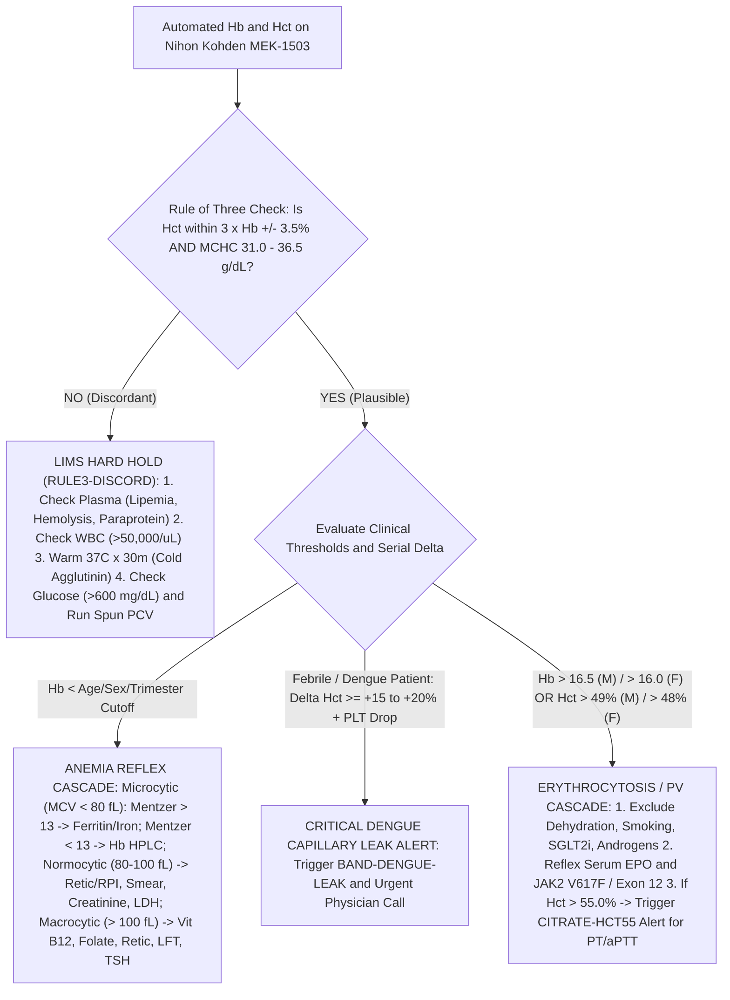

# 🩸 1.1.2 — Hemoglobin (`Hb`) & Hematocrit (`PCV` / Packed Cell Volume)

> **Document Control (`ISO 15189:2022 Clause 8.3.2` & `NABL 112`):** **Document ID:** `SOP-HEM-1.1.2` | **Version:** `3.0` (10-Persona Apex Reference Laboratory & NABL Witness-Audit Edition) | **Effective Date:** `15-Oct-2026` | **Review Cycle:** `Annual` | **Authorizing Authority:** `Laboratory Director & Chief Consultant Hematopathologist (MD Pathology)` | **Regulatory Alignment:** `ISO 15189:2022 Clauses 4.1–8.9 & Annex A`, `NABL 112 / 153 / 220D / 223`, `CAP HEM.23000 / HEM.23050 / HEM.37500`, `ICSH (1996) HiCN Standard`, `CLSI H15-A3`, `CLSI H07-A3`, `CLSI H21-A5`, `WHO (2024) Haemoglobin Cutoffs Guideline`, `WHO (2009) Dengue Guideline`, `EFLM EuBIVAS`, `ISO/TS 20914:2019`, `ISO 22367:2020`

**Department Folder:** `01_Hematology_and_Coagulation`  
**Cluster Folder:** `1.1_Hemogram_CBC_and_Leucocyte_Platelet_Cluster`  

---

## 🛡️ 10-Persona International & Above-NABL Adversarial Red-Team Governance Panel

| Persona ID & Role | Primary Regulatory / Scientific Framework | Adversarial Red-Team Vulnerability Identified in Standard Laboratory SOPs | Engineered Countermeasure & Verification Anchor in `SOP-HEM-1.1.2 v3.0` |
| :--- | :--- | :--- | :--- |
| **Persona 1: Lead NABL (`ISO 15189:2022`) & CAP / UKAS Assessor** | `ISO 15189:2022 Cl. 7.2–7.4`, `NABL 112/220D`, `CAP HEM.23000` | Absence of unbroken calibration hierarchy from automated cyanide-free surfactant `Hb` to the primary `WHO/ICSH` Hemiglobincyanide (`HiCN`) reference standard; unverified comparability between automated `Hct` and spun microhematocrit. | Complete `ISO 17511:2020` metrological traceability chain (Section 1.2), semi-annual `CLSI EP09c` split-sample verification against `CLSI H07-A3` spun microhematocrit, and Witness-Audit Simulation (Section 9). |
| **Persona 2: Consultant Hematopathologist (MD Pathology / DM Hematology)** | `WHO 2022 (5th Ed) / ICC 2022 Myeloid Neoplasms`, `AABB 2023` | Failure to flag "Masked Polycythemia Vera" ($\text{Hb } 16.5\text{–}18.4\text{ g/dL}$ in men) or miss acute hemorrhage during the initial $0\text{–}6\text{ hour}$ euvolemic equilibration lag; omission of `RPI` maturation time correction. | Full `WHO 2022` Polycythemia Vera criteria ($\text{Hb} > 16.5\text{ M} / > 16.0\text{ F}$, $\text{Hct} > 49\% / > 48\%$, `JAK2 V617F/Exon 12`, `EPO`), `RPI` polychromatophilic shift equations (Section 6.1), and acute bleed equilibration kinetics (Section 7.1). |
| **Persona 3: CLSI & IFCC Metrology, Six-Sigma & `EuBIVAS` Specialist** | `CLSI EP15-A3`, `EP06-Ed2`, `EP17-A2`, `ISO/TS 20914`, `EFLM EuBIVAS` | Reporting static reference intervals without serial Reference Change Value (`RCV`) delta checks despite low Index of Individuality ($\text{II} = 0.43$), masking a $20\%$ red cell mass loss inside the "normal" population range. | Full `EuBIVAS` derivation ($CV_I = 2.7\%$, $CV_G = 6.3\%$, $\text{II} = 0.43$), $\text{RCV}_{95\%} = \pm 8.2\%$ ($\approx \pm 1.0\text{ g/dL}$), Expanded $U = \pm 2.48\%$ ($k=2$), $> 6.0\sigma$ QC, and Bull's $\bar{X}_B$ `MCHC` moving-average algorithm (Section 4). |
| **Persona 4: Clinical Pharmacologist & Maternal/Neonatal Auditor** | `CLSI EP07/EP37`, `CALIPER`, Maternal-Fetal Physiology | Misdiagnosing SGLT2-inhibitor (`Empagliflozin`/`Dapagliflozin`) or testosterone-induced erythrocytosis as Polycythemia Vera; failing to account for $+45\%$ plasma vs $+25\%$ RBC volume expansion in 2nd-trimester pregnancy. | Dedicated pharmacological interference matrix distinguishing *in-vivo* `EPO`/hepcidin shifts from *in-vitro* Propofol/Intralipid optical scatter (Section 5.2 & 8), plus trimester-specific hemodilution physiology (Section 3.2). |
| **Persona 5: Medico-Legal, Patient-Safety & `ISO 22367` Risk Counsel** | `CPA 2019`, `DPDP Act 2023`, `BMW Rules 2016/2019`, `CLSI GP47`, `ISO 22367` | Uncorrected coagulation tubes (`3.2% Citrate`) drawn from polycythemic patients ($\text{Hct} > 55\%$) causing spurious `PT/INR` and `aPTT` prolongation and inappropriate anticoagulation withholding. | Automated LIMS reflex `[CITRATE-HCT55]` with exact `CLSI H21-A5` citrate removal nomogram ($C = 1.85 \times 10^{-3} \times [100 - \text{Hct}] \times V$) (Section 7.2) and 8-mode quantitative `FMECA` table (Section 8.3). |
| **Persona 6: Uncompressed Clinical Documentation Architect** | `ISO 15189:2022 Cl. 7.3.6`, Turnkey Bench Execution | Over-compressed summary notes lacking step-by-step mathematical formulas, bench reagent stoichiometry, and worked numerical correction examples for night-shift technologists. | Self-contained 10-section reference architecture with worked numerical examples for plasma blanking, hyperglycemic osmotic swelling, dengue $\Delta\text{Hct}\%$, and `RPI` calculation. |
| **Persona 7: Pre-Analytical Phlebotomy & Rheology Auditor** | `CLSI GP41-Ed7`, `CLSI GP44`, Hydrostatic & Osmotic Biophysics | Overlooking postural hemoconcentration ($+5\text{ to }+8\%$ upright vs supine), prolonged tourniquet stasis ($> 60\text{ s}$), short-draw $\text{K}_2\text{-EDTA}$ osmotic RBC shrinkage, and room-temperature `MCV`/`Hct` swelling after $8\text{ h}$. | Quantitative pre-analytical fluid-shift table, short-draw $< 1.0\text{ mL}$ hypertonic crenation mechanics, and dual-temperature stability matrices ($18\text{–}25^\circ\text{C}$ vs $2\text{–}8^\circ\text{C}$) (Section 2). |
| **Persona 8: `ICSH` / `CLSI H15-A3` Spectrophotometry & `CLSI H07-A3` Microhematocrit Engineer** | `ICSH (1996)`, `CLSI H15-A3`, `CLSI H07-A3` | Treating automated `Hct` and spun `PCV` as identical without accounting for the $1\text{–}3\%$ (normal) to $4\text{–}6\%$ (sickle/spherocytic/thalassemic) trapped intercellular plasma in spun capillary tubes. | Exact Drabkin `HiCN` Beer-Lambert derivation ($\varepsilon_{540} = 44.0\text{ L}\cdot\text{mmol}^{-1}\cdot\text{cm}^{-1}$, $\text{MW} = 64,458\text{ Da}$) vs Cyanide-Free SLS photometry ($525\text{–}535\text{ nm}$) and `CLSI H07-A3` trapped-plasma physics (Section 1.2 & 1.3). |
| **Persona 9: `WHO (2024)` Anemia, Altitude/Smoking & `WHO (2009)` Dengue Specialist** | `WHO (2024) Haemoglobin Guideline`, `WHO (2009) Dengue Guideline` | Using obsolete 2011 cutoffs for children $6\text{–}23\text{ months}$ (updated to $< 10.5\text{ g/dL}$ in 2024), ignoring hookah/bidi $\text{COHb}$ polycythemia, and missing Dengue capillary leak ($\Delta\text{Hct} \ge +20\%$) when absolute `Hct` remains inside the static normal range. | Complete `WHO (2024)` age/trimester/severity grading, elevation & smoking adjustment matrices (Section 3.1 & 3.3), and automated Dengue $\Delta\text{Hct} \ge +20\%$ + thrombocytopenia warning algorithm (Section 6.3). |
| **Persona 10: `Rule of Three` ($\text{Hct}\% = 3 \times \text{Hb} \pm 3\%$) Discordance Troubleshooter** | Automated Hematology Plausibility & Interference Engineering | Releasing discordant `Hb` and `Hct` results ($\text{MCHC} > 36.5\text{ g/dL}$ or $< 28.0\text{ g/dL}$) caused by lipemia, hyperleukocytosis, monoclonal IgM precipitation, cold agglutinins, intravascular hemolysis, or hyperglycemic osmotic swelling. | Complete 6-category bench troubleshooting protocol with exact saline replacement, plasma-blank subtraction equation ($\text{Hb}_{\text{corr}} = \text{Hb}_{\text{WB}} - [\text{Hb}_{\text{plasma}} \times (1 - \text{Hct})]$), $37^\circ\text{C}$ warming, and spun `PCV` reconciliation (Section 5). |

---

## 🏛️ Section 1: Test Name, LOINC (`718-7` Hb / `4544-3` Hct), Clinical Indication & Dual Analytical Principles on `Nihon Kohden MEK-1503` vs Reference Methods

### 1.1 International Regulatory, Nomenclature (`LOINC`, `SNOMED-CT`, `ICD-10/11`, `UCUM`) & Hardware-Agnostic Specification Matrix

| Attribute | Specification & International Reference Standard |
| :--- | :--- |
| **Official Test Name & Abbreviations** | **Hemoglobin Concentration (`Hb` / `HGB`)** and **Hematocrit (`Hct` / `HCT` / Packed Cell Volume [`PCV`])** |
| **Document Control ID** | `SOP-HEM-1.1.2` (Version `3.0` — 10-Persona Apex Reference Laboratory Tier) |
| **ISO 15189:2022 & CAP Clause Mapping** | `ISO 15189:2022` Clauses 5.3, 6.4, 6.5, 7.2, 7.3, 7.4, 8.5 & Annex A; `NABL 112` (Specific Criteria for Hematology); `CAP HEM.23000` (*Hemoglobinometry*), `CAP HEM.23050` (*Spun Hematocrit*), `CAP HEM.37500` (*Cold Agglutinin / Lipemia Correction*) |
| **Primary & Secondary LOINC Codes** | • **`718-7`** — *Hemoglobin [Mass/volume] in Blood* (Primary Automated Photometry)<br>• **`30350-3`** — *Hemoglobin [Mass/volume] in Venous blood*<br>• **`4544-3`** — *Hematocrit [Volume Fraction] of Blood by Automated count* (Primary Pulse-Height Integration)<br>• **`4545-0`** — *Hematocrit [Volume Fraction] of Blood by Spun capillary tube (`CLSI H07-A3` Reference)*<br>• **`4679-7`** — *Reticulocyte Production Index (`RPI`) in Blood* |
| **SNOMED-CT Concept IDs** | • **Specimen:** `445295009` (*Whole blood sample in dipotassium EDTA*)<br>• **Procedures:** `38082009` (*Hemoglobin determination*), `28317006` (*Hematocrit determination*), `104141003` (*Microhematocrit procedure*)<br>• **Target Analytes:** `38082009` (*Hemoglobin tetramer $\alpha_2\beta_2$*), `165418001` (*Erythrocyte volume fraction*) |
| **ICD-10 / ICD-11 Clinical Indications** | • **Anemias:** `D50.9 / 3A00` (*Iron deficiency anemia*), `D51.9 / 3A01` (*Vitamin B12 deficiency anemia*), `D52.9 / 3A02` (*Folate deficiency anemia*), `D56.1 / 3A50.0` (*Beta thalassemia*), `D57.1 / 3A51` (*Sickle cell disease*), `D59.1 / 3A20` (*Autoimmune hemolytic anemia*), `D62 / 3A71` (*Acute posthemorrhagic anemia*), `D63.1 / 3A70` (*Anemia in chronic kidney disease*), `O99.0` (*Anemia complicating pregnancy*)<br>• **Erythrocytosis & Capillary Leak:** `D45 / 2A20.4` (*Polycythemia vera*), `D75.1 / 3A81` (*Secondary polycythemia*), `P61.1 / KA82` (*Neonatal polycythemia*), `A97.1 / 1D21` (*Dengue with warning signs — Hemoconcentration $\Delta\text{Hct} \ge +20\%$*), `A97.2 / 1D22` (*Severe dengue / Dengue shock syndrome*) |
| **Conventional $\leftrightarrow$ SI (`UCUM`) Conversion** | • **Hemoglobin (`Hb`):** Conventional Unit = $\text{g/dL}$ (`g/dL`). SI Unit = $\text{g/L}$ (`g/L`) or $\text{mmol/L}$ (`mmol/L`).<br>  $$\text{Hb (g/L)} = \text{Hb (g/dL)} \times 10.0$$<br>  $$\text{Hb (mmol/L, tetramer MW } 64,458\text{ Da)} = \text{Hb (g/dL)} \times 0.1551 \quad (\text{or } \times 0.6206 \text{ for monomer MW } 16,114.5\text{ Da})$$<br>• **Hematocrit (`Hct / PCV`):** Conventional Unit = $\%$ (`%`). SI Unit = $\text{L/L}$ (`L/L`, dimensionless volume fraction).<br>  $$\text{Hct (L/L)} = \text{Hct (\%)} \times 0.01$$ |
| **Primary Automated Analyzer Platform** | **Nihon Kohden Celltac $\alpha$ (`MEK-1503`)** — Dual-Channel System:<br>1. **Hemoglobin (`Hb`):** Cyanide-Free Surfactant Hemolysis + Bichromatic LED Spectrophotometry ($\lambda_1 = 525\text{–}535\text{ nm}$ primary absorbance; $\lambda_2 > 600\text{ nm}$ baseline reference).<br>2. **Hematocrit (`Hct`):** Direct Current ($DC$) Electrical Impedance Cumulative Pulse-Height Integration ($\text{Hct}\% = [\text{RBC} \times \text{MCV}] / 10$). |
| **Primary Reference Measurement Procedures (`ISO 17511`)** | 1. **Hemoglobin:** **ICSH (1996) / CLSI H15-A3 Hemiglobincyanide (`HiCN`, Drabkin's Method)** calibrated against the **WHO International Standard for Haemiglobincyanide (NIBSC Code 98/708)**.<br>2. **Hematocrit:** **CLSI H07-A3 Spun Microhematocrit Reference Procedure** ($10,000\text{–}12,000\times g$ for $5\text{ minutes}$ in calibrated borosilicate capillary tubes). |
| **Turnaround Time (`TAT`) Targets** | **STAT / Emergency / ICU / Dengue Serial Ward:** $\le 20\text{ minutes}$ (`Critical Panic Call`: $\le 15\text{ minutes}$ from analytical verification); **Routine OPD / IPD:** $\le 60\text{ minutes}$ |

---

### 1.2 Analytical Principle 1 — Hemoglobinometry: Cyanide-Free Surfactant (`MEK-1503`) vs `ICSH / CLSI H15-A3` Hemiglobincyanide (`HiCN`) Reference Standard

#### A. Primary Reference Measurement Procedure: `ICSH (1996)` & `CLSI H15-A3` Hemiglobincyanide (`HiCN` / Drabkin's Method)
To satisfy **`ISO 15189:2022 Clause 6.5 (Metrological Traceability)`** and **`ISO 17511:2020`**, all routine automated hemoglobin measurements on the `Nihon Kohden MEK-1503` are metrologically traceable to the **International Council for Standardization in Haematology (`ICSH`) Hemiglobincyanide (`HiCN`) Reference Procedure** and the **WHO International Standard (`NIBSC 98/708`)**:
1. **Reaction Stoichiometry (`Drabkin's Reagent` at $\text{pH } 7.0\text{–}7.4$):**
   Whole blood ($20\ \mu\text{L}$) is diluted $1:251$ in $5.0\text{ mL}$ of modified ICSH reagent containing Potassium Ferricyanide ($\text{K}_3[\text{Fe(CN)}_6]$, $0.607\text{ mmol/L}$ / $200\text{ mg/L}$), Potassium Cyanide ($\text{KCN}$, $0.768\text{ mmol/L}$ / $50\text{ mg/L}$), Dihydrogen Potassium Phosphate ($\text{KH}_2\text{PO}_4$, $1.03\text{ mmol/L}$ / $140\text{ mg/L}$ to maintain $\text{pH } 7.0\text{–}7.4$ and accelerate conversion from $15\text{ min}$ to $3\text{–}5\text{ min}$), and a non-ionic surfactant (`Sterox SE` or `Triton X-100`, $0.5\text{–}1.0\text{ mL/L}$ to lyse erythrocytes and suppress protein-induced turbidity):
   $$\text{Step 1 (Oxidation of Heme Iron):}\quad \text{Hb(Fe}^{2+}\text{)}\ [\text{O}_2\text{Hb, HHb, COHb}] + [\text{Fe(CN)}_6]^{3-} \xrightarrow{\text{pH } 7.2} \text{Methemoglobin / Hemiglobin }\left(\text{Hi(Fe}^{3+}\text{)}\right) + [\text{Fe(CN)}_6]^{4-}$$
   $$\text{Step 2 (Cyanide Coordination):}\quad \text{Hi(Fe}^{3+}\text{)} + \text{CN}^- \longrightarrow \mathbf{\text{Hemiglobincyanide (HiCN / Cyanmethemoglobin, }\lambda_{\max} = 540\text{ nm)}}$$
2. **Fundamental Beer-Lambert Law Spectrophotometric Derivation (No Secondary Calibrator Required for Primary `HiCN`):**
   Based on X-ray crystallography and sequence analysis established by the ICSH, the relative molecular mass of the human hemoglobin tetramer ($\alpha_2\beta_2$) is **$\text{MW}_{\text{tetramer}} = 64,458\text{ Da}$** (monomeric subunit equivalent mass $\text{MW}_{\text{monomer}} = 16,114.5\text{ Da}$), and the **quarter-millimolar absorptivity ($\varepsilon_{540}^{\text{monomer}}$) at $\lambda = 540\text{ nm}$ is $11.0\text{ L}\cdot\text{mmol}^{-1}\cdot\text{cm}^{-1}$** (corresponding to a **tetrameric millimolar absorptivity $\varepsilon_{540}^{\text{tetramer}} = 44.0\text{ L}\cdot\text{mmol}^{-1}\cdot\text{cm}^{-1}$**). For an optical pathlength $l = 1.000\text{ cm}$ and dilution factor $D = 251$:
   $$\mathbf{\text{Hb (g/dL)} = \frac{A_{540}^{1\text{ cm}} \times 64,458 \times D}{44.0 \times 1.000 \times 10,000} = \frac{A_{540}^{1\text{ cm}} \times 16,114.5 \times 251}{11.0 \times 10,000} = A_{540}^{1\text{ cm}} \times 36.77}$$
3. **Mandatory `ICSH` Spectral Purity & Zero-Turbidity Verification Criteria:**
   - **Spectral Purity Ratio:** The absorbance ratio of pure `HiCN` between its peak ($540\text{ nm}$) and trough ($504\text{ nm}$) must strictly satisfy **$1.59 \le \frac{A_{540}}{A_{504}} \le 1.63$**. A ratio $< 1.59$ indicates unlysed cellular/lipid turbidity or incomplete conversion of Carboxyhemoglobin ($\text{COHb}$, which requires $30\text{ minutes}$ for full conversion in unmodified Drabkin's reagent).
   - **Near-Infrared Turbidity Blank:** Absorbance measured at $\lambda = 750\text{ nm}$ (where `HiCN` has zero optical absorption) must be **$A_{750}^{1\text{ cm}} \le 0.003$**.

#### B. Automated Bench Principle on `Nihon Kohden MEK-1503`: Cyanide-Free Surfactant (`SLS-Hb` / Quaternary Ammonium) Photometry
Because potassium cyanide ($\text{KCN}$) poses severe environmental toxicity and regulatory disposal hazards under the **`Bio-Medical Waste Management Rules 2016/2019`** and reacts slowly with $\text{COHb}$, the `Nihon Kohden MEK-1503` utilizes **Cyanide-Free Surfactant Spectrophotometry**:
1. **3-Step Molecular Reaction Mechanism ($\le 10\text{ Seconds}$):**
   - **Step 1 — Rapid Erythrocyte Membrane Solubilization:** Whole blood ($10\text{–}20\ \mu\text{L}$) is aspirated and diluted $1:250$ into the WBC/Hb mixing chamber with isotonic diluent and a cyanide-free hemolytic surfactant reagent (sodium lauryl sulfate [`SLS`, $\text{CH}_3(\text{CH}_2)_{11}\text{OSO}_3^-\text{Na}^+$] / quaternary ammonium salt at $\text{pH } 7.2\text{–}9.0$). The hydrophobic alkyl tail inserts into the erythrocyte lipid bilayer, disrupting membrane integrity and releasing intracellular hemoglobin within $2\text{ seconds}$.
   - **Step 2 — Globin Conformational Unfolding & Autoxidation ($\text{Fe}^{2+} \rightarrow \text{Fe}^{3+}$):** Binding of surfactant molecules to the globin polypeptide chains alters the hydrophobic heme pocket, expelling bound $\text{O}_2$ or $\text{CO}$ and accelerating instantaneous oxidation of ferrous heme iron ($\text{Fe}^{2+}$) to ferric iron ($\text{Fe}^{3+}$) by dissolved molecular oxygen.
   - **Step 3 — Porphyrin-Surfactant Coordination Chromogen Formation:** The hydrophilic anionic sulfonate ($-\text{SO}_3^-$) or cationic quaternary nitrogen group coordinates electrostatically with the sixth coordination site of the ferric ($\text{Fe}^{3+}$) heme porphyrin ring, forming a highly stable **Cyanide-Free Methemoglobin-Surfactant Chromogen** (`SLS-Hb`).
2. **Bichromatic Optical Detection ($\lambda = 525\text{–}535\text{ nm}$):**
   - The `SLS-Hb` chromogen exhibits a sharp absorption maximum at **$\lambda_1 = 525\text{–}535\text{ nm}$** (measured via a temperature-stabilized green light-emitting diode [`LED`] and photodiode detector through a $1.0\text{ cm}$ flow cuvette), corrected against a reagent blank measured prior to each sample aspiration and a secondary reference wavelength ($\lambda_2 > 600\text{ nm}$) to compensate for minor cuvette fouling or micro-bubble scatter:
     $$\text{Hb}_{\text{sample}} = K_{\text{cal}} \times \left[\left(A_{530,\text{sample}} - A_{630,\text{sample}}\right) - \left(A_{530,\text{blank}} - A_{630,\text{blank}}\right)\right]$$
3. **Hemoglobin Species Conversion Spectrum:**
   - **Quantitatively Converted ($100\%$):** Oxyhemoglobin ($\text{O}_2\text{Hb}$), Deoxyhemoglobin ($\text{HHb}$), Methemoglobin ($\text{Hi}$), Carboxyhemoglobin ($\text{COHb}$ — converted in $< 10\text{ seconds}$ without the $30\text{ min}$ Drabkin delay!), and Fetal Hemoglobin ($\text{HbF}$).
   - **Not Converted:** **Sulfhemoglobin ($\text{SHb}$)** (irreversible covalent sulfur addition across the pyrrole $\beta$-carbon of the porphyrin ring absorbing at $620\text{ nm}$, seen in dapsone/sulfonamide/phenazopyridine toxicity or *Clostridium perfringens* bacteremia).

---

### 1.3 Analytical Principle 2 — Hematocrit (`Hct` / `PCV`): Cumulative Impedance Pulse-Height Integration (`MEK-1503`) vs `CLSI H07-A3` Spun Microhematocrit Reference Method

#### A. Automated Cumulative Pulse-Height Integration on `Nihon Kohden MEK-1503`
On the `Nihon Kohden MEK-1503`, Hematocrit (`Hct`) is **not** measured by centrifugation; it is determined by **Direct Current ($DC$) Electrical Impedance Cumulative Pulse-Height Integration** in the RBC/PLT sensing aperture:
1. **Biophysical Principle (Coulter Principle):**
   - An aliquot of the $1:250$ diluted blood is subjected to a second $1:160$ dilution (final dilution **$1:40,000$**) in buffered isotonic electrolyte diluent (`Isotonac-3/4`, osmolality $290 \pm 5\text{ mOsm/kg }\text{H}_2\text{O}$, $\text{pH } 7.40 \pm 0.05$).
   - A precisely metered suspension volume ($V_{\text{total}}$) is drawn through a ruby micro-aperture ($70\text{–}100\ \mu\text{m}$ diameter) across which a constant $DC$ current ($I$) is maintained between internal and external platinum electrodes.
   - As each non-conducting erythrocyte ($i = 1, 2, \dots, N$) traverses the aperture, it displaces an equal volume of conducting electrolyte, producing an electrical resistance pulse ($\Delta R_i$) and a voltage pulse ($V_i = I \cdot \Delta R_i$) whose amplitude (pulse height) is directly proportional to the individual erythrocyte volume ($v_i$, in femtoliters, $\text{fL} = 10^{-15}\text{ L}$).
2. **Mathematical Integration & Equivalence Formula:**
   - By summing all individual erythrocyte pulse heights ($\sum_{i=1}^{N} v_i$) within the gated RBC volume channel ($30\text{–}300\text{ fL}$) and dividing by the total metered sample volume ($V_{\text{total}}$), the analyzer derives the volume fraction of erythrocytes (`Hct`), which is mathematically identical to the product of the Red Blood Cell Count ($\text{RBC}$, in $\times 10^6/\mu\text{L}$) and Mean Corpuscular Volume ($\text{MCV}$, in $\text{fL}$):
     $$\mathbf{\text{Hct (\%)} = \left(\frac{\sum_{i=1}^{N} v_i}{V_{\text{total}}}\right) \times 100 = \frac{\text{RBC (}\times 10^6/\mu\text{L)} \times \text{MCV (fL)}}{10}}$$
   - *Dimensional Verification:*
     $$\frac{\left(\text{cells} \times 10^6/\mu\text{L}\right) \times \left(\text{fL/cell}\right)}{10} = \frac{\left(10^6\text{ cells} / 10^{-6}\text{ L}\right) \times \left(10^{-15}\text{ L/cell}\right)}{10} = 10^{-2}\text{ L/L} = 1\%$$

#### B. Reference & Backup Procedure: `CLSI H07-A3` Spun Microhematocrit (`PCV`) & The Physics of Trapped Intercellular Plasma
When verifying automated `Hct` comparability (`ISO 15189:2022 Cl. 7.3.6`) or resolving osmotic/leukocytic/cold-agglutinin interferences, the laboratory executes the **`CLSI H07-A3` Spun Microhematocrit Reference Procedure**:
1. **Standardized `CLSI H07-A3` Bench Protocol:**
   - **Capillary Tube Specification:** Plain disposable borosilicate glass micro-hematocrit capillary tubes ($75.0 \pm 0.5\text{ mm}$ length, $1.1\text{–}1.2\text{ mm}$ uniform internal bore, wall thickness $0.20\text{ mm}$) for $\text{K}_2\text{-EDTA}$ venous blood (or ammonium-heparinized tubes for direct skin-puncture blood).
   - **Filling & Clay Sealing:** Invert the $\text{K}_2\text{-EDTA}$ tube $8\text{–}10\text{ times}$. Fill **two duplicate capillary tubes** by capillary action to **$75\%\text{ to }80\%$ of their length ($50\text{–}60\text{ mm}$)**. Wipe the exterior clean with lint-free gauze and seal the dry distal end by inserting it vertically into a non-absorbent plasticized clay sealing pad (`Cristaseal`) to form a **flat-bottomed $4\text{ to }6\text{ mm}$ clay plug**.
   - **Centrifugation Physics:** Place duplicate tubes in opposite radial slots of the micro-hematocrit rotor with the clay-sealed ends firmly abutting the peripheral rubber gasket cushion. Centrifuge at a calibrated relative centrifugal force (**$\text{RCF} = 10,000\text{ to }12,000\times g$**) for **exactly $5.0\text{ minutes}$**.
   - **Polycythemic Packing Rule (`PCV > 50%`):** Whenever the initial reading exceeds $50.0\%$, centrifuge for an **additional $3\text{ to }5\text{ minutes}$** ($8\text{–}10\text{ min}$ total) until two consecutive readings are identical (`constant packing volume`), preventing false-high readings from incomplete sedimentation of viscous blood.
   - **Meniscus Reading Rule:** Using a calibrated micro-hematocrit graphic reader or vernier magnifying scale:
     - Align the $0\%$ baseline strictly with the **top interface of the clay plug** ($L_{\text{clay}}$).
     - Align the $100\%$ line with the **bottom of the plasma air meniscus** ($L_{\text{total}}$).
     - Read the `PCV (%)` at the **sharp upper boundary of the dark red erythrocyte column ($L_{\text{RBC}}$), strictly EXCLUDING the pale grey-white leukocyte and platelet buffy coat layer**:
       $$\text{Spun PCV (\%)} = \left(\frac{L_{\text{RBC}} - L_{\text{clay}}}{L_{\text{total}} - L_{\text{clay}}}\right) \times 100$$
     - **Duplicate Agreement Criterion:** The two duplicate capillary tubes must agree within **$\le 1.0\%$ absolute** ($\le 0.01\text{ L/L}$); if discordance $> 1.0\%$ occurs (indicating clay plug leakage or micro-clot), repeat in duplicate.
2. **Biophysical Divergence Between Automated `Hct` and Spun `PCV` (Trapped Intercellular Plasma):**
   - **Normal Normocytic Blood ($1.0\text{–}3.0\%$ Trapped Plasma):** Even after centrifugation at $12,000\times g$ for $5\text{ minutes}$, microscopic films of plasma remain trapped between packed biconcave erythrocytes (demonstrated by $^{125}\text{I}$-albumin / $^{131}\text{I}$-albumin radioisotope dilution studies). In contrast, automated impedance pulse-height integration (`MEK-1503`) measures each erythrocyte individually in suspension and contains **zero trapped plasma** (and Factory/ICSH calibrators are assigned against reference `PCV` corrected for trapped plasma).
   - **Pathological Rigid Poikilocytes ($4.0\text{–}6.5\%$ Trapped Plasma):** Normal biconcave discocytes have high membrane deformability (surface-area-to-volume ratio $\sim 1.4$) and deform into tight hexagonal polyhedra under $12,000\times g$. However, rigid, non-deformable erythrocytes cannot pack tightly, trapping large pockets of intercellular plasma during centrifugation:
     - **Sickle Cell Disease (`HbSS` — Deoxygenated Drepanocytes):** Traps **$4.5\%\text{ to }6.5\%$** intercellular plasma $\rightarrow$ Spun `PCV` reads **$+3.0\%\text{ to }+5.0\%$ falsely higher** than true automated `Hct`!
     - **Hereditary Spherocytosis (`HS` — Rigid Microspherocytes):** Traps **$3.5\%\text{ to }5.0\%$** intercellular plasma.
     - **Thalassemia Major & Severe Hypochromic Iron Deficiency Anemia (`IDA`):** Severe anisopoikilocytosis traps **$3.5\%\text{ to }5.5\%$** intercellular plasma.

---

### 1.4 Method Verification (`CLSI EP15-A3`, `EP06-Ed2`, `EP17-A2`, `EP09c`), Calibration (`ISO 17511`) & Carryover (`CLSI H26-A2`)

| Verification Parameter | Governing Standard | Verified Performance on `Nihon Kohden MEK-1503` | Acceptance Criteria & Bench Verification Protocol |
| :--- | :--- | :--- | :--- |
| **Detection Capability (`LoB`, `LoD`, `LoQ`)** | `CLSI EP17-A2` / `ICSH` | • **Hemoglobin (`Hb`):** $\text{LoB} = 0.1\text{ g/dL}$, $\text{LoD} = 0.2\text{ g/dL}$, **$\text{LoQ} = 1.0\text{ g/dL}$** (at functional $CV \le 3.0\%$).<br>• **Hematocrit (`Hct`):** $\text{LoB} = 0.5\%$, $\text{LoD} = 1.0\%$, **$\text{LoQ} = 3.0\%$** (at $CV \le 4.0\%$). | Verified annually using serial isotonic dilutions of low-level whole blood; results below `LoQ` ($\text{Hb} < 1.0\text{ g/dL}$) are never extrapolated without manual `HiCN` confirmation. |
| **Analytical Measurement Range (`AMR` / Linearity)** | `CLSI EP06-Ed2` (Polynomial Regression, 7 Levels) | • **Hemoglobin `AMR`:** **$1.0\text{ to }25.0\text{ g/dL}$** ($r^2 = 0.9998$, slope $1.002$, non-linearity $\le 1.2\%$).<br>• **Hematocrit `AMR`:** **$3.0\%\text{ to }75.0\%$** ($r^2 = 0.9994$, slope $0.997$, non-linearity $\le 1.8\%$). | Verified semi-annually using concentrated autologous washed RBCs diluted serially in autologous platelet-poor plasma across 7 equidistant concentrations. |
| **Clinical Reportable Range (`CRR` — High Dilution)** | `CLSI H26-A2` / `ISO 15189 Cl. 7.3.2` | • **Extended `Hb` `CRR`:** Up to **$40.0\text{ g/dL}$** via $1:2$ manual pre-dilution.<br>• **Extended `Hct` `CRR`:** Validated via **`CLSI H07-A3` $10\text{-min}$ Spun Microhematocrit** up to **$85.0\%$**. | Whenever $\text{Hb} > 25.0\text{ g/dL}$ or $\text{Hct} > 75.0\%$, perform $1:2$ manual pre-dilution ($500\ \mu\text{L}$ blood $+ 500\ \mu\text{L}$ `Isotonac` diluent) and confirm `PCV` via $10\text{-minute}$ spun capillary centrifugation. |
| **Precision & Trueness Verification (`5x5`)** | `CLSI EP15-A3` (5 Days $\times$ 5 Replicates $\times$ 3 Levels) | • **Level 1 (Low, $\text{Hb } 6.2\text{ g/dL} / \text{Hct } 18.5\%$):** $CV_r = 0.85\%$, $CV_{\text{IWL}} = 1.10\%$, Bias $= -0.45\%$.<br>• **Level 2 (Normal, $\text{Hb } 13.6\text{ g/dL} / \text{Hct } 40.8\%$):** $CV_r = 0.55\%$, $CV_{\text{IWL}} = 0.82\%$, Bias $= +0.35\%$.<br>• **Level 3 (High, $\text{Hb } 18.4\text{ g/dL} / \text{Hct } 55.2\%$):** $CV_r = 0.62\%$, $CV_{\text{IWL}} = 0.90\%$, Bias $= +0.50\%$. | Strictly outperforms `EFLM EuBIVAS` Optimum/Desirable specifications ($CV_A \le 1.35\%$, Bias $\le 1.71\%$). |
| **Specimen-to-Specimen Carryover ($K\%$)** | `CLSI H26-A2` (Broughton Sequence: $H_1, H_2, H_3 \rightarrow L_1, L_2, L_3$) | $$K\% = \frac{L_1 - L_3}{H_3 - L_3} \times 100$$<br>• **Verified `Hb` Carryover:** **$0.18\%$** (Limit: $\le 0.50\%$).<br>• **Verified `Hct` Carryover:** **$0.24\%$** (Limit: $\le 0.50\%$). | Tested after probe replacement or semi-annually using a polycythemic specimen ($H \approx 22.0\text{ g/dL}$) followed immediately by a severely anemic specimen ($L \approx 4.5\text{ g/dL}$). |
| **Inter-Method / Backup Comparability** | `CLSI EP09c` & `ISO 15189:2022 Cl. 7.3.6` | Automated `MEK-1503` vs Reference `ICSH HiCN` ($540\text{ nm}$) & `CLSI H07-A3` Spun Microhematocrit ($n = 20$ split patient samples semi-annually across $5.0\text{–}21.0\text{ g/dL}$). | Passing-Bablok slope $0.98\text{–}1.02$; mean bias $\le \pm 0.25\text{ g/dL}$ for `Hb` and $\le \pm 1.5\%$ absolute for `Hct` (after accounting for $1.5\%$ normal trapped plasma). |

---

## 🧪 Section 2: Pre-Analytical Variables (`CLSI GP41`, `CLSI H15-A3`) — Posture, Tourniquet Stasis, IV Hemodilution, Short-Draw Osmotic Shrinkage & Stability Kinetics

### 2.1 Master Pre-Analytical Physiological, Rheological & Specimen Integrity Matrix

| Pre-Analytical Variable | Quantitative Magnitude & Direction of Bias on `Hb` & `Hct` | Biophysical / Physiological Mechanism | Mandatory Laboratory SOP & Corrective Action (`CLSI GP41` / `ISO 15189 Cl. 7.2`) |
| :--- | :--- | :--- | :--- |
| **1. Postural Hydrostatic Shift (`Supine Bedside` $\rightarrow$ `Upright Standing 20–30 min`)** | **$\uparrow +5.0\%\text{ to }+8.0\%$** in both `Hb` ($\mathbf{+0.7\text{ to }+1.2\text{ g/dL}}$) and `Hct` ($\mathbf{+2.0\%\text{ to }+3.5\%}$ abs).<br>*(Up to $+10\text{–}12\%$ in patients with edema, hypoalbuminemia, or heart failure).* | Moving from supine recumbency (inpatient 06:00 AM draw) to upright standing increases hydrostatic capillary pressure in the lower extremities, driving $10\text{–}15\%$ ($\sim 350\text{–}500\text{ mL}$) of protein-free plasma water into the interstitial space. Erythrocytes ($7.5\ \mu\text{m}$) and large proteins cannot cross capillary endothelium, resulting in true intravascular hemoconcentration while `MCV`, `MCH`, and `MCHC` remain unchanged. | **Standardized Outpatient Seating Rule (`CLSI GP41`):** Ambulatory OPD patients must rest quietly in a **seated position for $15\text{ to }20\text{ minutes}$** prior to venipuncture. When comparing inpatient (supine) vs outpatient (seated) serial results, document posture in LIMS (`~0.8 g/dL` physiological postural delta). |
| **2. Prolonged Tourniquet Venous Stasis (`> 60 Seconds` + Fist Pumping)** | **$\uparrow +3.0\%\text{ to }+7.0\%$** in `Hb` ($\mathbf{+0.4\text{ to }+1.0\text{ g/dL}}$) and `Hct` ($\mathbf{+1.5\%\text{ to }+3.0\%}$ abs) at $2\text{–}3\text{ min}$. | Venous occlusion exceeding $60\text{ seconds}$ elevates local capillary hydrostatic pressure above plasma oncotic pressure ($> 25\text{ mmHg}$), forcing water and small electrolytes out of the occluded venous segment into interstitium and concentrating cellular elements. | **Strict $\le 60\text{-Second}$ Tourniquet Limit:** Release tourniquet immediately upon blood flow into the first tube; strictly prohibit repetitive fist clenching/pumping. |
| **3. Proximal IV Drip-Arm Hemodilution (`Saline / RL / D5W Infusion`)** | **$\downarrow\downarrow -15\%\text{ to }-40\%$** ($\mathbf{-2.0\text{ to }-5.0\text{ g/dL}}$ drop in `Hb`; $\mathbf{-6.0\%\text{ to }-15.0\%}$ drop in `Hct`) with **completely unchanged `MCV`, `MCH`, and `MCHC`!** | Drawing blood proximal to an active intravenous infusion dilutes whole blood with cell-free crystalloid. Because isotonic saline ($0.9\%\text{ NaCl}$) neither lyses nor shrinks RBCs, individual cell indices (`MCV`, `MCH`, `MCHC`) remain identical to baseline while `Hb`, `RBC`, `Hct`, `WBC`, and `PLT` drop in parallel! | **Absolute Prohibition on Ipsilateral IV Draws:** Draw strictly from the contralateral arm. If both arms have active IV lines, the nursing team must shut off the infusion for **$\ge 2\text{ minutes}$**, draw below the IV site, discard the first $5\text{ mL}$ of blood, and document the site. Trigger LIMS `[IV-DILUTION-HOLD]` whenever $\Delta\text{Hb} \ge -2.0\text{ g/dL}$ in $< 24\text{h}$ without clinical bleeding. |
| **4. Excess $\text{K}_2\text{-EDTA}$ in Under-Filled ("Short-Draw" $< 1.0\text{ mL}$) Tubes** | • **Spun `PCV`:** **$\downarrow -3.0\%\text{ to }-6.0\%$** (False-Low).<br>• **Spun `MCHC`:** **$\uparrow > 37.0\text{ g/dL}$** (False-High).<br>• **Automated `Hb`:** **Unchanged** ($0.0\%$ bias). | A standard $3.0\text{ mL}$ lavender tube contains $5.4\text{ mg}$ spray-dried $\text{K}_2\text{-EDTA}$ ($1.8\text{ mg/mL}$ target). A short draw of $< 1.0\text{ mL}$ increases $\text{K}_2\text{-EDTA}$ concentration to $> 5.4\text{ mg/mL}$, raising plasma osmolality $> 380\text{ mOsm/kg}$. Hypertonic osmotic water efflux pulls water out of erythrocytes (*in-vitro* echinocytic shrinkage), significantly lowering **spun microhematocrit (`PCV`)** while total `Hb` mass is conserved! *(Note: On `MEK-1503`, $1:40,000$ dilution in isotonic `Isotonac` partially rehydrates shrunken cells, so automated `Hct` is less affected than spun `PCV`).* | **Minimum Fill Volume Rule:** Enforce **$\ge 1.5\text{ mL}$ ($\ge 50\%$ fill)** in standard $3.0\text{ mL}$ tubes. For neonates, difficult pediatric veins, or ICU patients, mandate **Pediatric $0.5\text{ mL}$ Micro-EDTA (`Microtainer`) tubes** (fill range $250\text{–}500\ \mu\text{L}$). Reject tubes filled $< 33\%$ (`REJ-SHORT-EDTA`). |
| **5. Capillary (Heelstick / Fingerstick) vs Central Venous Blood** | **$\uparrow +3.0\%\text{ to }+10.0\%$** higher in capillary blood ($\mathbf{+0.5\text{ to }+1.5\text{ g/dL}}$ `Hb` and $\mathbf{+2.0\%\text{ to }+5.0\%}$ `PCV` in neonates).<br>*(Conversely, aggressive tissue squeezing causes $-1.0\text{ to }-2.0\text{ g/dL}$ false hemodilution).* | In microvessels, larger/rigid cells concentrate in the central axial stream while plasma skims along the vessel wall (Fahraeus-Lindqvist microvascular rheology), especially in acral cyanosis or hypothermia. Conversely, milking a poorly warmed puncture site expresses interstitial tissue fluid, diluting blood and activating platelets. | Pre-warm neonatal heel at **$40\text{–}42^\circ\text{C}$ for $3\text{–}5\text{ minutes}$** (`CLSI GP42`) to arterialize capillary flow, wipe away the first drop (which contains tissue fluid), and never squeeze the puncture site. Confirm any neonatal polycythemia ($\text{Capillary PCV} > 65\%$) on a **free-flowing central venous sample** before exchange transfusion! |
| **6. Inadequate Tube Mixing Prior to Aspiration (RBC Sedimentation)** | **$\uparrow +20\%\text{ to }+50\%$** (if sampled from bottom) OR **$\downarrow -20\%\text{ to }-50\%$** (if sampled from top plasma layer). | If an EDTA tube stands upright on the bench for $> 15\text{–}30\text{ minutes}$ (especially in patients with high ESR/fibrinogen where cells form rouleaux and settle rapidly within $5\text{–}10\text{ minutes}$!), an bottom-aspirating needle draws packed cells while a top-aspirating needle draws plasma. | Mandatory **10-to-12 gentle $180^\circ$ end-over-end inversions** (or $3\text{–}5\text{ minutes}$ on a calibrated mechanical roller mixer at $30\text{ rpm}$) immediately before aspiration. Never shake vigorously (causes mechanical hemolysis and micro-bubble foam). |

---

### 2.2 Multi-Temperature Specimen Stability & The Room-Temperature Osmotic Swelling Divergence (`Hb` vs `Hct`)

A foundational metrological rule of hematology (`CLSI H15-A3` & `ICSH`) is that **Hemoglobin (`Hb`) and Hematocrit (`Hct`) have markedly different room-temperature storage stability windows**:

| Storage Temperature | Hemoglobin (`Hb`) Stability Window | Automated Hematocrit (`Hct`) & `MCV` Stability Window | Biophysical Mechanism of Storage Drift |
| :--- | :--- | :--- | :--- |
| **Ambient Room Temp ($18\text{–}25^\circ\text{C}$)** | **$48\text{ to }72\text{ Hours}$**<br>*(Bias $\le \pm 1.0\%$ over $72\text{ h}$)* | **Strict Maximum: $8\text{ Hours}$**<br>*(After $12\text{–}24\text{ h}$ at $22^\circ\text{C}$, `MCV` swells by $+4\text{ to }+10\text{ fL}$ and **`Hct` falsely increases by $+2.5\%\text{ to }+5.0\%$ abs**!)* | **Why `Hb` is stable:** Every erythrocyte is completely lysed during `Hb` measurement; whether red cells swell or crenate in the tube, the total mass of heme iron per deciliter of whole blood remains $100\%$ constant.<br>**Why `Hct` swells after $8\text{ h}$ at RT:** Progressive glycolytic depletion of intracellular `ATP` at $22\text{–}25^\circ\text{C}$ disables the erythrocyte membrane $\text{Na}^+/\text{K}^+\text{-ATPase}$ pump. Extracellular $\text{Na}^+$ and $\text{Cl}^-$ leak into the cell down their electrochemical gradient, drawing water osmotically into the cytoplasm $\rightarrow$ **`MCV` increases**, **`Hct` (`RBC x MCV / 10`) falsely increases**, and **`MCHC` (`Hb / Hct`) falsely decreases**! |
| **Refrigerated ($2\text{–}8^\circ\text{C}$)** | **$72\text{ Hours}$** | **$48\text{ Hours}$**<br>*(Bias $\le \pm 1.5\%$ over $48\text{ h}$; Equilibrate to RT for $15\text{–}20\text{ min}$ before analysis)* | Refrigeration at $4^\circ\text{C}$ slows membrane passive cation leak and preserves glycolytic `ATP`, stabilizing `MCV` and `Hct` for up to $48\text{ hours}$. *(Mandatory $15\text{–}20\text{ min}$ warming to room temperature before aspiration prevents cold-viscosity aspiration errors and weak cold-agglutinin interference).* |
| **Frozen ($\le -20^\circ\text{C}$) or Heat ($> 37^\circ\text{C}$)** | **Strictly Rejected (`0 Hours`)** | **Strictly Rejected (`0 Hours`)** | Freezing forms intracellular ice crystals that rupture $100\%$ of erythrocytes (`Hct` drops to $0\%$). Exposure to $> 40^\circ\text{C}$ (e.g., uninsulated courier box in North Indian summer) denatures spectrin, budding off microspherocytes and causing thermal hemolysis. |

---

## 🧬 Section 3: Complete Age-, Sex-, Neonatal/Pediatric, Pregnancy-Trimester Reference Intervals, `WHO (2024)` Anemia Severity Grading & Altitude/Smoking Adjustments

### 3.1 Master Age-, Sex-, Neonatal/Pediatric (`CALIPER` / `ICMR`) & Pregnancy-Trimester Reference Intervals + `WHO (2024)` Anemia Severity Classification (Sea-Level / Plains $< 500\text{ m}$)

> [!IMPORTANT]
> **Critical `WHO (2024)` Global Guideline Update:** In its landmark *Guideline on Haemoglobin Cutoffs to Define Anaemia in Individuals and Populations (WHO, March 2024)*, the World Health Organization updated the anemia diagnostic threshold for **young children aged $6\text{–}23\text{ months}$ from $< 11.0\text{ g/dL}$ to $< 10.5\text{ g/dL}$** ($< 105\text{ g/L}$) based on rigorous healthy reference population percentiles, while confirming $< 10.5\text{ g/dL}$ specifically for **2nd-trimester pregnancy** (and $< 11.0\text{ g/dL}$ for 1st and 3rd trimesters). All LIMS partitions below incorporate the latest `WHO (2024)`, `ICMR`, and `CALIPER` criteria.

| Population Partition & Age / Physiological Group | Normal `Hb` ($\text{g/dL}$) [SI: $\text{g/L}$] | Normal `Hct / PCV` ($\%$) [SI: $\text{L/L}$] | **WHO Mild Anemia** ($\text{g/dL}$) | **WHO Moderate Anemia** ($\text{g/dL}$) | **WHO Severe Anemia** ($\text{g/dL}$) | **Life-Threatening / Grade 4 (`CTCAE` / Panic)** |
| :--- | :---: | :---: | :---: | :---: | :---: | :---: |
| **Cord Blood (Term Delivery)** | **$14.5 \text{ – } 22.5$**<br>[$145\text{–}225\text{ g/L}$] | **$44.0 \text{ – } 68.0\%$**<br>[$0.44\text{–}0.68$] | $13.5 \text{ – } 14.4$ | $10.0 \text{ – } 13.4$ | $< 10.0$ | **$< 9.5\text{ g/dL}$**<br>($\text{Hct} < 28\%$) |
| **Preterm Neonate ($< 32\text{ Weeks Gestation, Day 1}$)** | **$12.5 \text{ – } 19.5$**<br>[$125\text{–}195\text{ g/L}$] | **$38.0 \text{ – } 60.0\%$**<br>[$0.38\text{–}0.60$] | $11.5 \text{ – } 12.4$ | $9.5 \text{ – } 11.4$ | $< 9.5$ | **$< 9.0\text{ g/dL}$**<br>($\text{Hct} < 27\%$) |
| **Term Neonate ($0 \text{ – } 24\text{ Hours Postnatal}$)** | **$14.5 \text{ – } 22.5$**<br>[$145\text{–}225\text{ g/L}$] | **$45.0 \text{ – } 67.0\%$**<br>[$0.45\text{–}0.67$] | $13.0 \text{ – } 14.4$ | $10.0 \text{ – } 12.9$ | $< 10.0$ | **$< 9.5\text{ g/dL}$**<br>($\text{Hct} < 28\%$) |
| **Term Neonate ($2 \text{ – } 7\text{ Days}$)** | **$13.5 \text{ – } 21.5$**<br>[$135\text{–}215\text{ g/L}$] | **$42.0 \text{ – } 66.0\%$**<br>[$0.42\text{–}0.66$] | $12.0 \text{ – } 13.4$ | $9.5 \text{ – } 11.9$ | $< 9.5$ | **$< 9.5\text{ g/dL}$**<br>($\text{Hct} < 28\%$) |
| **Term Neonate ($8 \text{ – } 14\text{ Days}$)** | **$12.5 \text{ – } 19.5$**<br>[$125\text{–}195\text{ g/L}$] | **$39.0 \text{ – } 60.0\%$**<br>[$0.39\text{–}0.60$] | $11.0 \text{ – } 12.4$ | $9.0 \text{ – } 10.9$ | $< 9.0$ | **$< 9.0\text{ g/dL}$**<br>($\text{Hct} < 27\%$) |
| **Late Neonate ($15 \text{ – } 30\text{ Days}$)** | **$10.5 \text{ – } 18.0$**<br>[$105\text{–}180\text{ g/L}$] | **$33.0 \text{ – } 55.0\%$**<br>[$0.33\text{–}0.55$] | $9.5 \text{ – } 10.4$ | $8.0 \text{ – } 9.4$ | $< 8.0$ | **$< 8.0\text{ g/dL}$**<br>($\text{Hct} < 24\%$) |
| **Infant ($2 \text{ – } 5\text{ Months}$ — Physiological Nadir)** | **$9.5 \text{ – } 13.5$**<br>[$95\text{–}135\text{ g/L}$] | **$29.0 \text{ – } 41.0\%$**<br>[$0.29\text{–}0.41$] | $9.0 \text{ – } 9.4$ | $7.0 \text{ – } 8.9$ | $< 7.0$ | **$< 6.5\text{ g/dL}$**<br>($\text{Hct} < 20\%$) |
| **Young Child ($6 \text{ – } 23\text{ Months}$ — `WHO 2024`)** | **$\ge 10.5$** ($10.5\text{–}13.5$)<br>[$\ge 105\text{ g/L}$] | **$32.0 \text{ – } 40.0\%$**<br>[$0.32\text{–}0.40$] | **$9.5 \text{ – } 10.4$** | **$7.0 \text{ – } 9.4$** | **$< 7.0$** | **$< 6.5\text{ g/dL}$**<br>(Panic $< 6.0$) |
| **Pre-School Child ($24 \text{ – } 59\text{ Months}$ / $2\text{–}4\text{ Yrs}$)** | **$\ge 11.0$** ($11.0\text{–}14.0$)<br>[$\ge 110\text{ g/L}$] | **$33.0 \text{ – } 42.0\%$**<br>[$0.33\text{–}0.42$] | **$10.0 \text{ – } 10.9$** | **$7.0 \text{ – } 9.9$** | **$< 7.0$** | **$< 6.5\text{ g/dL}$**<br>(Panic $< 6.0$) |
| **School-Age Child ($5 \text{ – } 11\text{ Years}$)** | **$\ge 11.5$** ($11.5\text{–}15.0$)<br>[$\ge 115\text{ g/L}$] | **$35.0 \text{ – } 45.0\%$**<br>[$0.35\text{–}0.45$] | **$11.0 \text{ – } 11.4$** | **$8.0 \text{ – } 10.9$** | **$< 8.0$** | **$< 6.5\text{ g/dL}$**<br>(Panic $< 6.0$) |
| **Adolescent ($12 \text{ – } 14\text{ Years}$, Male & Female)** | **$\ge 12.0$** ($12.0\text{–}15.5$)<br>[$\ge 120\text{ g/L}$] | **$36.0 \text{ – } 46.0\%$**<br>[$0.36\text{–}0.46$] | **$11.0 \text{ – } 11.9$** | **$8.0 \text{ – } 10.9$** | **$< 8.0$** | **$< 6.5\text{ g/dL}$**<br>(Panic $< 6.0$) |
| **Adult Male ($\ge 15\text{ Years}$)** | **$\ge 13.0$** (**$13.0\text{–}17.0$**)<br>[$130\text{–}170\text{ g/L}$] | **$40.0 \text{ – } 50.0\%$**<br>[$0.40\text{–}0.50$] | **$11.0 \text{ – } 12.9$** | **$8.0 \text{ – } 10.9$** | **$< 8.0$** | **$< 6.5\text{ g/dL}$**<br>(Panic $< 6.0$) |
| **Adult Female (Non-Pregnant $\ge 15\text{ Years}$)** | **$\ge 12.0$** (**$12.0\text{–}15.5$**)<br>[$120\text{–}155\text{ g/L}$] | **$36.0 \text{ – } 46.0\%$**<br>[$0.36\text{–}0.46$] | **$11.0 \text{ – } 11.9$** | **$8.0 \text{ – } 10.9$** | **$< 8.0$** | **$< 6.5\text{ g/dL}$**<br>(Panic $< 6.0$) |
| **Pregnancy — 1st Trimester ($1\text{–}13\text{ Weeks}$)** | **$\ge 11.0$** ($11.0\text{–}14.5$)<br>[$\ge 110\text{ g/L}$] | **$33.0 \text{ – } 44.0\%$**<br>[$0.33\text{–}0.44$] | **$10.0 \text{ – } 10.9$** | **$7.0 \text{ – } 9.9$** | **$< 7.0$** | **$< 6.5\text{ g/dL}$**<br>(Panic $< 6.0$) |
| **Pregnancy — 2nd Trimester ($14\text{–}27\text{ Weeks}$)** | **$\ge 10.5$** ($10.5\text{–}14.0$)<br>[$\ge 105\text{ g/L}$] | **$31.0 \text{ – } 42.0\%$**<br>[$0.31\text{–}0.42$] | **$9.5 \text{ – } 10.4$** | **$7.0 \text{ – } 9.4$** | **$< 7.0$** | **$< 6.5\text{ g/dL}$**<br>(Panic $< 6.0$) |
| **Pregnancy — 3rd Trimester ($28\text{–}40\text{ Weeks}$)** | **$\ge 11.0$** ($11.0\text{–}14.0$)<br>[$\ge 110\text{ g/L}$] | **$33.0 \text{ – } 43.0\%$**<br>[$0.33\text{–}0.43$] | **$10.0 \text{ – } 10.9$** | **$7.0 \text{ – } 9.9$** | **$< 7.0$** | **$< 6.5\text{ g/dL}$**<br>(Panic $< 6.0$) |
| **Geriatric ($\ge 65\text{ Years}$, Male / Female)** | **M: $12.6\text{–}16.8$**<br>**F: $11.8\text{–}15.2$** | **M: $38.0\text{–}49.0\%$**<br>**F: $35.0\text{–}45.0\%$** | **M:** $11.0\text{–}12.9$<br>**F:** $11.0\text{–}11.9$ | $8.0 \text{ – } 10.9$ | $< 8.0$ | **$< 6.5\text{ g/dL}$**<br>(Panic $< 6.0$) |

---

### 3.2 Physiological Mechanism of Pregnancy Trimester Stratification ($+45\%$ Plasma Expansion vs $+25\%$ Red Cell Mass Expansion)

During normal human gestation, maternal blood volume undergoes profound hemodynamic remodeling that directly governs trimester-specific `Hb` and `Hct` cutoffs:
1. **Plasma Volume Expansion ($+40\%\text{ to }+50\%$, $\approx +1,250\text{ mL}$):** Beginning at $6\text{–}8\text{ weeks}$ gestation, placental progesterone, estrogen, relaxin, and endothelial nitric oxide ($\text{NO}$) induce systemic arterial vasodilation, which activates the maternal Renin-Angiotensin-Aldosterone System (`RAAS`) and causes renal sodium and water retention. Plasma volume expands rapidly throughout the 2nd trimester, peaking at $28\text{–}32\text{ weeks}$ at **$\sim 45\%$ above pre-pregnancy baseline**.
2. **Erythrocyte Mass Expansion ($+18\%\text{ to }+25\%$, $\approx +250\text{ to }+400\text{ mL}$):** Stimulated by human placental lactogen (`hPL`), progesterone, and a $2\text{–}4\times$ rise in maternal renal erythropoietin (`EPO`), total red blood cell mass increases by **$\sim 25\%$** in iron-replete women (or only $\sim 15\text{–}18\%$ without iron supplementation).
3. **The 2nd-Trimester Nadir ($\text{Hb} < 10.5\text{ g/dL}$, $\text{Hct} < 31.0\%$):** Because plasma volume expansion ($+45\%$) outpaces erythroid mass expansion ($+25\%$) most steeply between **$14\text{ and }27\text{ weeks}$**, physiological hemodilution ("hydremia of pregnancy") reduces blood viscosity, decreases maternal cardiac afterload, enhances intervillous uteroplacental microvascular perfusion, and lowers the 5th percentile of normal `Hb` to **$10.5\text{ g/dL}$** in the 2nd trimester before recovering to **$11.0\text{ g/dL}$** in the 3rd trimester as plasma expansion plateaus while erythropoiesis continues.
   - *Clinical Warning on Maternal Hemoconcentration ($\text{Hb} > 13.5\text{ g/dL}$ / $\text{Hct} > 41\%$ in 2nd/3rd Trimester):* Failure of physiological plasma expansion in the 2nd or 3rd trimester ($\text{Hb} > 13.5\text{ g/dL}$) is an ominous obstetric biomarker associated with **preeclampsia, uteroplacental insufficiency, fetal growth restriction (`IUGR`), and intrauterine fetal demise**!

---

### 3.3 `WHO (2024)` Altitude & Cigarette / Bidi / Hookah Smoking Hemoglobin Adjustment Tables

#### A. `WHO (2024)` Elevation Above Sea-Level Adjustments
Hypobaric hypoxia at altitudes $\ge 500\text{ meters}$ decreases arterial oxygen partial pressure ($P_a\text{O}_2$), stabilizing renal hypoxia-inducible factor-2$\alpha$ (`HIF-2α`) and increasing endogenous `EPO`-driven erythropoiesis. In the **`WHO (2024)` Guideline**, altitude adjustments were refined into $500\text{-meter}$ tiers using the continuous regression equation $\Delta\text{Hb (g/L)} = 0.0056384 \times \text{Alt (m)} + 0.0000003 \times \text{Alt (m)}^2$:

| Altitude Above Sea Level (Meters) | Representative Geographic Examples (India & International) | **`WHO (2024)` Upward Cutoff Adjustment ($\Delta\text{Hb}$)** | **`WHO (2024)` Adjusted Anemia Cutoff: Adult Male** | **`WHO (2024)` Adjusted Anemia Cutoff: Non-Pregnant Female** | **`WHO (2024)` Adjusted Anemia Cutoff: 1st/3rd Tri Pregnancy** | **Equivalent `Hct / PCV` Adjustment ($\Delta\text{Hct}\%$)** |
| :--- | :--- | :---: | :---: | :---: | :---: | :---: |
| **$0 \text{ – } 499\text{ m}$** | **Haryana Plains (`200–300 m`)**, Delhi, Mumbai, Chennai, Kolkata | **$0.0\text{ g/dL}$**<br>($0\text{ g/L}$) | $< 13.0\text{ g/dL}$ | $< 12.0\text{ g/dL}$ | $< 11.0\text{ g/dL}$ | **$0.0\%$** |
| **$500 \text{ – } 999\text{ m}$** | Bengaluru ($\sim 920\text{ m}$), Pune, Hyderabad, Dehradun | **$+0.4\text{ g/dL}$**<br>($+4\text{ g/L}$) | $< 13.4\text{ g/dL}$ | $< 12.4\text{ g/dL}$ | $< 11.4\text{ g/dL}$ | **$+1.2\%$** |
| **$1,000 \text{ – } 1,499\text{ m}$** | Srinagar ($\sim 1,580\text{ m}$ border), Shillong ($1,496\text{ m}$), Kathmandu | **$+0.8\text{ g/dL}$**<br>($+8\text{ g/L}$) | $< 13.8\text{ g/dL}$ | $< 12.8\text{ g/dL}$ | $< 11.8\text{ g/dL}$ | **$+2.4\%$** |
| **$1,500 \text{ – } 1,999\text{ m}$** | Gangtok ($1,650\text{ m}$), Dharamshala, Denver, Johannesburg | **$+1.1\text{ g/dL}$**<br>($+11\text{ g/L}$) | $< 14.1\text{ g/dL}$ | $< 13.1\text{ g/dL}$ | $< 12.1\text{ g/dL}$ | **$+3.3\%$** |
| **$2,000 \text{ – } 2,499\text{ m}$** | Shimla ($2,276\text{ m}$), Darjeeling, Mussoorie, Ooty, Mexico City | **$+1.4\text{ g/dL}$**<br>($+14\text{ g/L}$) | $< 14.4\text{ g/dL}$ | $< 13.4\text{ g/dL}$ | $< 12.4\text{ g/dL}$ | **$+4.2\%$** |
| **$2,500 \text{ – } 2,999\text{ m}$** | Gulmarg ($2,650\text{ m}$), Tawang ($2,669\text{ m}$), Bogotá ($2,640\text{ m}$) | **$+1.8\text{ g/dL}$**<br>($+18\text{ g/L}$) | $< 14.8\text{ g/dL}$ | $< 13.8\text{ g/dL}$ | $< 12.8\text{ g/dL}$ | **$+5.4\%$** |
| **$3,000 \text{ – } 3,499\text{ m}$** | Leh-Ladakh ($3,500\text{ m}$), Keylong, Cusco ($3,399\text{ m}$) | **$+2.1\text{ g/dL}$**<br>($+21\text{ g/L}$) | $< 15.1\text{ g/dL}$ | $< 14.1\text{ g/dL}$ | $< 13.1\text{ g/dL}$ | **$+6.3\%$** |
| **$3,500 \text{ – } 3,999\text{ m}$** | La Paz ($3,640\text{ m}$), Lhasa ($3,656\text{ m}$), Kaza (Spiti) | **$+2.5\text{ g/dL}$**<br>($+25\text{ g/L}$) | $< 15.5\text{ g/dL}$ | $< 14.5\text{ g/dL}$ | $< 13.5\text{ g/dL}$ | **$+7.5\%$** |
| **$4,000 \text{ – } 4,499\text{ m}$** | Pangong / Hanle ($4,250\text{ m}$), El Alto ($4,150\text{ m}$) | **$+2.9\text{ g/dL}$**<br>($+29\text{ g/L}$) | $< 15.9\text{ g/dL}$ | $< 14.9\text{ g/dL}$ | $< 13.9\text{ g/dL}$ | **$+8.7\%$** |
| **$\ge 4,500\text{ m}$** | High-Altitude Himalayan Posts / Andean Plateaus | **$+3.3\text{ g/dL}$**<br>($+33\text{ g/L}$) | $< 16.3\text{ g/dL}$ | $< 15.3\text{ g/dL}$ | $< 14.3\text{ g/dL}$ | **$+9.9\%$** |

#### B. `WHO (2024)` Cigarette, Bidi & Hookah Smoking Hemoglobin Adjustment Matrix
In North India (particularly rural/semi-urban Haryana, Punjab, and Rajasthan), chronic inhalation of carbon monoxide ($\text{CO}$) via **hookah (*huqqa*), bidis, or cigarettes** converts $4\%\text{ to }15\%$ of circulating hemoglobin into **Carboxyhemoglobin ($\text{COHb}$)**. Because $\text{CO}$ binds heme iron with **$210\text{-fold}$ greater affinity than $\text{O}_2$** and allosterically stabilizes the high-affinity $R$-state of the remaining subunits (**Haldane Effect** — shifting the $\text{O}_2$ dissociation curve left and lowering $P_{50}$ from $26.6\text{ mmHg}$ to $< 21\text{ mmHg}$), renal peritubular cells experience functional tissue hypoxia and secrete excess `EPO` (while smoking also contracts plasma volume by $\sim 5\%$):

| Smoking Intensity Category (`WHO 2024` / Clinical History) | Typical Carboxyhemoglobin (`COHb %`) | **`WHO` Hemoglobin Adjustment ($\Delta\text{Hb}$)** | **`Hct / PCV` Adjustment ($\Delta\text{Hct}\%$)** | Clinical Application to Unmask "Smoker's Masked Anemia" |
| :--- | :---: | :---: | :---: | :--- |
| **Non-Smoker** | $< 1.5\%$ | **$0.0\text{ g/dL}$** | **$0.0\%$** | Use standard sea-level cutoffs ($\text{Male} < 13.0\text{ g/dL}$, $\text{Female} < 12.0\text{ g/dL}$). |
| **All Smokers (Daily Quantity Unspecified) OR $10\text{–}19\text{ Cigarettes/Bidis per Day}$** | $3.0\% \text{ – } 6.0\%$ | **$+0.3\text{ g/dL}$**<br>($+3\text{ g/L}$) | **$+1.0\%$** | Subtract $0.3\text{ g/dL}$ from measured `Hb` before comparing to normal cutoffs (or raise the Male anemia cutoff to **$< 13.3\text{ g/dL}$** and Female to **$< 12.3\text{ g/dL}$**). |
| **Heavy Smoker: $20\text{–}39\text{ Cigarettes/Bidis per Day}$ ($1\text{–}2\text{ Packs/Day}$) OR Regular Daily Hookah Smoker** | $6.0\% \text{ – } 10.0\%$ | **$+0.5\text{ g/dL}$**<br>($+5\text{ g/L}$) | **$+1.5\%$** | Subtract $0.5\text{ g/dL}$ from measured `Hb` (Male anemia cutoff becomes **$< 13.5\text{ g/dL}$**, Female **$< 12.5\text{ g/dL}$**). A heavy hookah smoker with $\text{Hb} = 13.2\text{ g/dL}$ has **functional anemia** ($\text{Hb}_{\text{adj}} = 12.7\text{ g/dL}$)! |
| **Very Heavy Smoker: $\ge 40\text{ Cigarettes/Day}$ ($\ge 2\text{ Packs/Day}$) OR Heavy Communal Hookah ($> 2\text{ Hours/Day}$)** | $10.0\% \text{ – } 15.0\%$ | **$+0.7\text{ g/dL}$**<br>($+7\text{ g/L}$) | **$+2.1\%$** | Subtract $0.7\text{ g/dL}$ from measured `Hb` (Male anemia cutoff becomes **$< 13.7\text{ g/dL}$**; upper physiological limit rises to **$17.7\text{ g/dL}$** / $\text{Hct } 52.1\%$ — "Smoker's Secondary Polycythemia"). |

---

## 📊 Section 4: Metrology, `EFLM EuBIVAS` Biological Variation, Reference Change Value (`RCV`), Measurement Uncertainty (`ISO/TS 20914`) & Six-Sigma Quality Control

### 4.1 `EFLM EuBIVAS` Biological Variation & Analytical Performance Specifications (`APS`)

| Metrological & Biological Parameter | **Hemoglobin (`Hb`)** | **Hematocrit (`Hct / PCV`)** | Clinical & Metrological Interpretation (`EFLM` / `ISO/TS 20914:2019` / `CLIA 2024`) |
| :--- | :---: | :---: | :--- |
| **Within-Subject Biological Variation ($CV_I$)** | **$2.7\%$** | **$2.7\%$** ($2.8\%$) | Tightly regulated homeostatic set-point in healthy euvolemic individuals (`EuBIVAS` European Biological Variation Study). |
| **Between-Subject Biological Variation ($CV_G$)** | **$6.3\%$** | **$6.3\%$** ($6.4\%$) | Wide inter-individual dispersion across healthy adults ($13.0\text{–}17.0\text{ g/dL}$ in men). |
| **Index of Individuality ($\text{II} = CV_I / CV_G$)** | **$0.43$** (Low) | **$0.43$** (Low) | Because $\text{II} < 0.60$, static population reference intervals are **insensitive** for detecting early occult blood loss in an individual; **serial patient-specific `RCV` delta checks are mandatory**! |
| **`EFLM` Desirable Imprecision ($CV_A \le 0.50 \times CV_I$)** | **$\le 1.35\%$** *(Optimum $\le 0.68\%$)* | **$\le 1.35\%$** *(Optimum $\le 0.68\%$)* | In-house `MEK-1503` verified intermediate precision: **$CV_{\text{IWL}} = 0.82\%$ (`Hb`)** and **$0.95\%$ (`Hct`)**. |
| **`EFLM` Desirable Bias ($B \le 0.25 \times \sqrt{CV_I^2 + CV_G^2}$)** | **$\le \pm 1.71\%$** | **$\le \pm 1.71\%$** | In-house verified bias against `ICSH HiCN` / `EQAS` peer mean: **$+0.35\%$ (`Hb`)** and **$+0.45\%$ (`Hct`)**. |
| **Total Allowable Error ($\text{TE}_a\%$)** | **$\pm 3.94\%$** (`EFLM`)<br>**$\pm 4.00\%$** (`CLIA 2024`) | **$\pm 3.94\%$** (`EFLM`)<br>**$\pm 4.00\%$** (`CLIA 2024`) | Maximum total analytical error permitted for medical decision-making (`CLIA 2024` updated `Hb` and `Hct` $\text{TE}_a$ from $\pm 7\% / \pm 6\%$ down to **$\pm 4.0\%$**). |
| **Combined Standard Uncertainty ($u_c\%$)** | **$\pm 1.24\%$** | **$\pm 1.42\%$** | $u_c = \sqrt{CV_{\text{IWL}}^2 + u_{\text{bias}}^2} = \sqrt{0.82^2 + 0.93^2} = \mathbf{1.24\%}$ for `Hb`. |
| **Expanded Measurement Uncertainty ($U = k \cdot u_c, k=2$)** | **$\pm 2.48\%$**<br>($\approx \pm 0.35\text{ g/dL}$ at $14.0\text{ g/dL}$) | **$\pm 2.84\%$**<br>($\approx \pm 1.1\%$ abs at $40.0\%$) | At the critical `AABB` transfusion threshold of $\text{Hb} = 7.0\text{ g/dL}$, the $95.45\%$ confidence interval is **$7.00 \pm 0.17\text{ g/dL}$ ($6.83\text{–}7.17\text{ g/dL}$)**. |
| **95% Reference Change Value ($\text{RCV}_{95\%}$ — Unidirectional / Bidirectional)** | **$\pm 8.2\%$**<br>($\approx \mathbf{\pm 1.0\text{ g/dL}}$) | **$\pm 8.3\%$**<br>($\approx \mathbf{\pm 3.2\%\text{ abs}}$) | $$\text{RCV}_{95\%} = \sqrt{2} \times 1.96 \times \sqrt{CV_A^2 + CV_I^2} = 2.77 \times \sqrt{0.82^2 + 2.7^2} = \mathbf{\pm 7.8\% \text{ to } \pm 8.2\%}$$ |
| **99% Reference Change Value ($\text{RCV}_{99\%}$ — High-Specificity Delta)** | **$\pm 10.8\%$**<br>($\approx \mathbf{\pm 1.4\text{ g/dL}}$) | **$\pm 10.9\%$**<br>($\approx \mathbf{\pm 4.2\%\text{ abs}}$) | $$\text{RCV}_{99\%} = \sqrt{2} \times 2.58 \times \sqrt{CV_A^2 + CV_I^2} = 3.65 \times \sqrt{0.82^2 + 2.7^2} = \mathbf{\pm 10.3\% \text{ to } \pm 10.8\%}$$ |
| **Six-Sigma Process Metric ($\sigma$)** | **$> 6.0\sigma$ ($6.40\sigma$)** | **$> 6.0\sigma$ ($6.02\sigma$)** | $$\sigma_{\text{Hb}} = \frac{\text{TE}_a\% - \lvert\text{Bias}\%\rvert}{CV_r\%} = \frac{4.00\% - 0.35\%}{0.57\%} = \mathbf{6.40\sigma \text{ (World-Class)}}$$ |

---

### 4.2 Internal Quality Control (`IQC`), Bull's Moving Average (`XB` / $\bar{X}_B$) Patient-Based Real-Time QC & `EQAS` Governance
1. **Tri-Level Whole-Blood Commercial `IQC` (`ISO 15189:2022 Clause 7.3.7.2`):**
   - Run **3 levels** of stabilized whole-blood hematology controls (**Low** $\approx 6.2\text{ g/dL} / 18.5\%$, **Normal** $\approx 13.6\text{ g/dL} / 40.8\%$, **High** $\approx 18.4\text{ g/dL} / 55.2\%$) at the start of every $8\text{-hour}$ shift and after any reagent pack change or aperture cleaning.
   - **Westgard Sigma Rules ($> 6.0\sigma$):** Reject analytical run if **$1_{3s}$** or **$2_{2s}$** is violated; monitor **$R_{4s}$** and **$10_{\bar{x}}$** for systematic lamp or aperture drift.
2. **Bull's Moving Average (`XB` / $\bar{X}_B$) Patient-Based Real-Time QC (`PBRTQC` on `MCHC`):**
   - Because human Mean Corpuscular Hemoglobin Concentration ($\text{MCHC} = [\text{Hb} / \text{Hct}] \times 100$) is physiologically conserved at **$33.5 \pm 1.0\text{ g/dL}$** across patient populations, the analyzer/LIMS continuously computes Bull's exponentially weighted moving average ($\bar{X}_B$) in batches of **$N = 20$ consecutive patient samples**:
     - If **$\bar{X}_B(\text{MCHC}) > 34.8\text{ g/dL}$** ($\ge +3\%$ drift): Indicates either **positive drift in `Hb` photometry** (dirty flow cell, inadequate blanking, or concentrated lysing reagent) or **negative drift in `Hct` impedance** (dilution dispensing error).
     - If **$\bar{X}_B(\text{MCHC}) < 32.2\text{ g/dL}$** ($\le -3\%$ drift): Indicates either **incomplete erythrocyte lysis in the `Hb` channel** or **partial protein/fibrin build-up narrowing the `RBC/Hct` ruby aperture** (which increases electrical current density inside the aperture and inflates every `MCV` and `Hct` pulse height!). Immediately execute a **Sodium Hypochlorite (`Cleanac-3`) Aperture Soak** and re-run 3-level `IQC`.
3. **Daily Fresh-Blood Retention Replicate (`Retained Patient Sample QC`):**
   - Retain one normal patient $\text{K}_2\text{-EDTA}$ tube at $2\text{–}8^\circ\text{C}$ and re-analyze at $12\text{ h}$ and $24\text{ h}$ across shifts (`Hb` must agree within $\le \pm 0.2\text{ g/dL}$ and `Hct` within $\le \pm 1.0\%$ abs).
4. **External Quality Assessment (`EQAS` / `PT` — `ISO 15189:2022 Clause 7.3.7.3`):**
   - Monthly participation in **`AIIMS-ISHTM` / `CMC Vellore` / `Bio-Rad EQAS`**. Investigation and root-cause `CAPA` are triggered whenever $\lvert\text{SDI}\rvert > 1.5$ (Warning) or $\lvert\text{SDI}\rvert \ge 2.0$ (Action).

---

## 🧮 Section 5: The Mathematical `Rule of Three` ($\text{Hct}\% = 3 \times \text{Hb [g/dL]} \pm 3\%$) & Complete Troubleshooting Matrix for Spurious `Hb` vs `Hct` Discordance

### 5.1 Biophysical Derivation & Physiological Boundaries of the `Rule of Three`

In normocytic, normochromic erythrocytes ($\text{MCV} = 85\text{–}95\text{ fL}$, $\text{MCHC} = 32.0\text{–}35.0\text{ g/dL}$), intracellular hemoglobin occupies almost exactly **one-third ($33.3\%$ w/v)** of the packed erythrocyte volume. This physical constant generates the two coupled **`Rule of Three` Plausibility Equations**:

$$\mathbf{\text{Rule of Three (Equation A):}\quad \text{Hb (g/dL)} \approx 3 \times \text{RBC (}\times 10^6/\mu\text{L)} \pm 0.5\text{ g/dL}}$$
$$\mathbf{\text{Rule of Three (Equation B):}\quad \text{Hct (\%)} \approx 3 \times \text{Hb (g/dL)} \pm 3.0\% \quad \Longleftrightarrow \quad \text{MCHC} = \frac{\text{Hb}}{\text{Hct}} \times 100 \approx 33.3\text{ g/dL } (31.5\text{–}35.5\text{ g/dL})}$$

#### Distinguishing True Biological `Rule of Three` Deviations from Analytical Interferences:
Before triggering an interference correction, the bench technologist checks whether the deviation reflects **true erythrocyte pathology**:
1. **True Physiological Deviation 1 — Hypochromic Microcytic Anemia ($\text{Hct} > [3 \times \text{Hb}] + 3\%$, True $\text{MCHC} = 26.0\text{–}30.5\text{ g/dL}$):**
   - In severe **Iron Deficiency Anemia (`IDA`)** or **Thalassemia**, erythrocytes contain reduced hemoglobin per unit cell volume. For example, a patient with $\text{Hb} = 7.0\text{ g/dL}$, $\text{RBC} = 3.80 \times 10^6/\mu\text{L}$, and $\text{MCV} = 66.0\text{ fL}$ has a true $\text{Hct} = 25.1\%$ (which exceeds $3 \times 7.0 = 21.0\%$ by $+4.1\%$, giving a true low $\text{MCHC} = 27.9\text{ g/dL}$). Confirm via microcytic hypochromic morphology on Peripheral Blood Smear (`1.2.1`).
2. **True Physiological Deviation 2 — Spherocytosis & Sickle Dehydration ($\text{Hct} < [3 \times \text{Hb}] - 2\%$, True $\text{MCHC} = 35.5\text{–}37.5\text{ g/dL}$):**
   - Because normal erythrocytes cannot supersaturate hemoglobin above $\sim 36\text{ g/dL}$ without crystallizing, an **$\text{MCHC} > 36.0\text{ g/dL}$** occurs *in vivo* only in cellular dehydration states where membrane surface area or potassium/water is lost: **Hereditary Spherocytosis (`HS`)**, **Warm Autoimmune Hemolytic Anemia (`AIHA` with microspherocytes)**, **Xerocytosis**, or **Homozygous Sickle Cell / `HbSC` Disease**.
   - **Golden Bench Rule:** Because true *in-vivo* $\text{MCHC}$ virtually **never exceeds $37.5\text{–}38.0\text{ g/dL}$**, any automated result with **$\text{MCHC} > 36.5\text{ g/dL}$** (or $\text{Hct}$ deviating from $3 \times \text{Hb}$ by $> \pm 3.5\%$ in normocytic blood) **MUST be held in LIMS (`[RULE-OF-3-HOLD]`)** and investigated using the 6-Category Bench Troubleshooting Matrix below!

---

### 5.2 Complete 6-Category Troubleshooting & Bench Correction Matrix for Spurious `Hb` vs `Hct` Discordance

| Discordance Pattern & Etiology | Automated Analyzer Signature (`Hb`, `Hct`, `MCV`, `MCHC`) | Biophysical Mechanism of Interference | Step-by-Step Mandatory Bench Correction Protocol & Mathematical Equations (`CLSI H15-A3` / `H07-A3`) |
| :--- | :--- | :--- | :--- |
| **1. Lipemia / Hypertriglyceridemia ($\text{TG} > 500\text{–}1,000\text{ mg/dL}$), IV Propofol, or Parenteral Intralipid Infusion** | • **`Hb`:** **$\uparrow\uparrow$ Falsely High** ($+1.0\text{ to }+6.0\text{ g/dL}$)<br>• **`RBC` & `Hct`:** **True / Unaffected**<br>• **`MCH` & `MCHC`:** **$\uparrow\uparrow > 36.5\text{–}48.0\text{ g/dL}$**<br>• **Rule of 3:** $3 \times \text{Hb} \gg \text{Hct}$ | Chylomicrons ($80\text{–}1,000\text{ nm}$) and VLDL particles remain unsolubilized in the `Hb` cuvette and scatter incident $525\text{–}535\text{ nm}$ light (Mie optical scattering), creating false absorbance. Impedance `RBC` and `Hct` are unaffected by sub-micron lipid droplets. | **Method A — Isotonic Saline Plasma Replacement:**<br>1. Centrifuge $2.0\text{ mL}$ well-mixed EDTA blood at $1,500\times g$ for $10\text{ min}$.<br>2. Mark the exact top plasma meniscus on the tube wall with a fine marker.<br>3. Carefully aspirate and discard the milky supernatant plasma using a Pasteur pipette without disturbing the buffy coat/RBC interface.<br>4. Add exact volume of analyzer isotonic diluent (`Isotonac`) up to the marked meniscus line.<br>5. Invert gently $15\text{ times}$ and re-run on `MEK-1503`; report the replaced `Hb`, `MCH`, and `MCHC` alongside original `RBC`, `Hct`, `WBC`, and `PLT`.<br>**Method B — Mathematical Plasma-Blank Subtraction Formula (`CLSI H15-A3`):**<br>1. Run whole blood to obtain $\text{Hb}_{\text{WB}}$ and $\text{Hct}_{\text{WB}}$ ($\%$).<br>2. Centrifuge an aliquot ($1,500\times g \times 10\text{ min}$) and aspirate the cell-free milky plasma directly on `MEK-1503` in whole-blood mode to obtain spurious "Plasma Hb" ($\text{Hb}_{\text{plasma}}$).<br>3. Calculate True Corrected Hemoglobin:<br>$$\mathbf{\text{Hb}_{\text{corrected}} = \text{Hb}_{\text{WB}} - \left[\text{Hb}_{\text{plasma}} \times \left(1 - \frac{\text{Hct}_{\text{WB (\%)} }}{100}\right)\right]}$$<br>*Worked Example:* $\text{Hb}_{\text{WB}} = 14.8\text{ g/dL}$, $\text{Hct}_{\text{WB}} = 34.0\%$ ($\text{MCHC} = 43.5\text{ g/dL}$), $\text{Hb}_{\text{plasma}} = 5.2\text{ g/dL}$ $\rightarrow$ $\text{Hb}_{\text{corr}} = 14.8 - [5.2 \times (1 - 0.34)] = 14.8 - 3.43 = \mathbf{11.4\text{ g/dL}}$ (Corrected $\text{MCHC} = 33.5\text{ g/dL}$). |
| **2. Extreme Leukocytosis / Hyperleukocytosis ($\text{WBC} > 50,000/\mu\text{L}$ to $> 300,000/\mu\text{L}$ in CML, CLL, or Acute Leukemia)** | • **`Hb`:** **$\uparrow$ Falsely High** ($+0.8\text{ to }+3.5\text{ g/dL}$)<br>• **`RBC`:** **$\uparrow$ Falsely High** (WBCs counted as RBCs)<br>• **`MCV` & `Hct`:** **$\uparrow\uparrow$ Falsely High** (large WBC pulses inflate `MCV` & `Hct`)<br>• **`MCHC`:** Variable / Discordant | **Dual Interference:**<br>1. In the `Hb` channel, massive numbers of unlysed leukocyte nuclei and chromatin threads scatter $530\text{ nm}$ light, falsely elevating `Hb`.<br>2. In the `RBC/Hct` channel, leukocytes ($100\text{–}400\text{ fL}$) pass through the aperture along with RBCs; when $\text{WBC} > 100,000/\mu\text{L}$ ($0.10 \times 10^6/\mu\text{L}$), they significantly inflate both `RBC` count and cumulative pulse-height `Hct`! | **Step-by-Step Hyperleukocytosis Protocol:**<br>1. **True `Hct / PCV`:** Perform **`CLSI H07-A3` Spun Microhematocrit** ($12,000\times g \times 5\text{ min}$) in duplicate and read the packed red cell column **strictly BELOW the thick white leukocyte buffy coat layer**!<br>2. **True `RBC` & `MCV`:** Subtract true $\text{WBC}$ (in $\times 10^6/\mu\text{L}$) from raw $\text{RBC}$:<br>$$\text{RBC}_{\text{corr (}\times 10^6/\mu\text{L)}} = \text{RBC}_{\text{raw (}\times 10^6/\mu\text{L)}} - \text{WBC}_{\text{true (}\times 10^6/\mu\text{L)}}$$<br>$$\text{MCV}_{\text{corr (fL)}} = \frac{\text{Spun PCV (\%)} \times 10}{\text{RBC}_{\text{corr (}\times 10^6/\mu\text{L)}}}$$<br>3. **True `Hb`:** Dilute whole blood $1:250$ in lysing reagent, **centrifuge the lysed mixture at $1,500\times g$ for $5\text{ min}$** to pellet the turbid leukocyte nuclei, and measure the clear supernatant absorbance at $530/540\text{ nm}$ (or verify via $1:5$ manual isotonic pre-dilution and `Spun PCV / 3` check). |
| **3. Monoclonal Paraproteinemia (`IgM` Waldenström Macroglobulinemia / High-Level `IgG` or `IgA` Multiple Myeloma / Cryoglobulinemia)** | • **`Hb`:** **$\uparrow\uparrow$ Falsely High** ($+1.5\text{ to }+5.0\text{ g/dL}$)<br>• **`RBC` & `Hct`:** **True** (unless cryoglobulins present)<br>• **`MCHC`:** **$\uparrow\uparrow > 38.0\text{–}45.0\text{ g/dL}$**<br>• **Rule of 3:** $3 \times \text{Hb} \gg \text{Hct}$ | Pentameric $\text{IgM}$ ($> 1.5\text{–}2.0\text{ g/dL}$) or high-concentration monoclonal $\text{IgG}/\text{IgA}$ precipitates out of solution upon interacting with the low-ionic-strength or quaternary ammonium/SLS hemoglobin lysing surfactant, forming a milky protein flocculate that scatters light at $530\text{ nm}$. | **Paraprotein Precipitation Correction:**<br>1. Perform **Isotonic Saline Plasma Replacement** (centrifuge EDTA blood, replace paraprotein-rich plasma with exact volume of isotonic diluent, resuspend, and re-run) OR apply the **Plasma-Blank Subtraction Equation**:<br>$$\text{Hb}_{\text{corrected}} = \text{Hb}_{\text{WB}} - \left[\text{Hb}_{\text{plasma}} \times \left(1 - \frac{\text{Hct}}{100}\right)\right]$$<br>2. Verify corrected `Hb` against **`CLSI H07-A3` Spun Microhematocrit** ($\text{Spun PCV} \approx 3 \times \text{Hb}_{\text{corr}}$). *(Note: Rouleaux on peripheral smear confirms hyperparaproteinemia).* |
| **4. High-Titer Cold Agglutinin Disease (`IgM` Anti-I / Anti-i Autoantibodies in *Mycoplasma*, EBV, or B-Cell Lymphoma)** | • **`Hb`:** **$100\%$ True / Accurate**<br>• **`RBC`:** **$\downarrow\downarrow\downarrow$ Catastrophically False-Low** (e.g., $0.7\text{–}1.5 \times 10^6/\mu\text{L}$)<br>• **`MCV`:** **$\uparrow\uparrow$ Falsely High** ($115\text{–}145\text{ fL}$)<br>• **`Hct`:** **$\downarrow\downarrow\downarrow$ Catastrophically False-Low** (e.g., $10\text{–}16\%$)<br>• **`MCHC`:** **$\uparrow\uparrow\uparrow$ Absurdly High ($42\text{ to }> 80\text{ g/dL}$!)**<br>• **Rule of 3:** $\text{Hct} \ll 3 \times \text{Hb}$ | Below $30^\circ\text{C}$, pentameric IgM autoantibodies agglutinate erythrocytes into doublets, triplets, and large clumps.<br>• **In `RBC/Hct` Channel:** Doublets/triplets are counted as single giant macrocytes, while larger clumps ($> 300\text{ fL}$) are excluded from the RBC window entirely $\rightarrow$ `RBC` and calculated `Hct` plummet falsely!<br>• **In `Hb` Channel:** Lysing surfactant destroys all RBC membranes regardless of clumping $\rightarrow$ **`Hb` is $100\%$ accurate**! | **Mandatory $37^\circ\text{C}$ Thermal Elution & Warm-Wash Protocol:**<br>1. Incubate the $\text{K}_2\text{-EDTA}$ tube (and an aliquot of isotonic diluent) in a calibrated **$37.0 \pm 0.5^\circ\text{C}$ water bath for $30\text{ minutes}$**.<br>2. Gently invert $10\text{ times}$ and aspirate on `MEK-1503` within **$< 60\text{ seconds}$**.<br>3. Verify that $\text{MCHC}$ normalizes to **$32.0\text{–}36.0\text{ g/dL}$** and $\text{Hct} \approx 3 \times \text{Hb}$.<br>4. **If $\text{MCHC}$ remains $> 36.5\text{ g/dL}$ (Very High Thermal Amplitude Cold Agglutinin):** Wash packed RBCs $3\times$ with **$37^\circ\text{C}$ pre-warmed isotonic saline** (replacing the exact plasma volume), re-analyze immediately, and confirm `PCV` using a pre-warmed microhematocrit capillary tube. |
| **5. Severe Intravascular Hemolysis (Clostridial Sepsis, Acute ABO Hemolytic Transfusion Reaction, G6PD Crisis, Malaria Blackwater Fever, PNH) or *In-Vitro* Gross Hemolysis** | • **`Hb`:** Measures **Total Blood Hb** ($\text{Cellular} + \text{Free Plasma Hb}$)<br>• **`RBC` & `Hct`:** Measures **Only Intact Unlysed Cells** ($\downarrow\downarrow$ True-Low or False-Low)<br>• **`MCHC`:** **$\uparrow\uparrow > 37.0\text{–}45.0\text{ g/dL}$**<br>• **Rule of 3:** $3 \times \text{Hb}_{\text{total}} > \text{Hct}$ | Free hemoglobin released into the plasma from lysed red cells is measured in the `Hb` photometer along with intracellular `Hb`, whereas the lysed red cell ghosts generate no impedance pulse in the `Hct` channel. Note that **free plasma hemoglobin does not deliver $\text{O}_2$ effectively to tissues** (scavenges endothelial $\text{NO}$ and causes acute tubular necrosis). | **Differentiation (`In-Vitro` vs `In-Vivo`) & Cellular `Hb` Calculation:**<br>1. Centrifuge the EDTA tube at $1,500\times g \times 10\text{ min}$ and inspect the cherry-red supernatant plasma.<br>2. Collect a fresh traumatic-free venous sample to rule out *in-vitro* phlebotomy hemolysis (check $\text{K}^+$, `LDH`, `Haptoglobin`, and peripheral smear for **spherocytes, schistocytes, or *Clostridium* / *Plasmodium***).<br>3. If **True *In-Vivo* Intravascular Hemolysis** is confirmed, run the supernatant plasma to obtain $\text{Hb}_{\text{plasma}}$ and calculate **True Intracellular (Oxygen-Carrying) Hemoglobin**:<br>$$\mathbf{\text{Hb}_{\text{intracellular}} = \text{Hb}_{\text{WB}} - \left[\text{Hb}_{\text{plasma}} \times \left(1 - \frac{\text{Hct}}{100}\right)\right]}$$<br>4. Report **both** `Intracellular Hb`, `Free Plasma Hb`, and `Hct` with an **Immediate Critical Intravascular Hemolysis Alert**! |
| **6. Severe Hyperglycemia ($\text{Glucose} > 600\text{–}1,200\text{ mg/dL}$ in DKA/HHS) or Severe Hypernatremia ($\text{Na}^+ > 165\text{ mmol/L}$) (`Osmotic RBC Swelling`)** | • **`Hb` & `RBC`:** **$100\%$ True / Accurate**<br>• **`MCV`:** **$\uparrow\uparrow$ Falsely High** ($+10\text{ to }+25\text{ fL}$, often $105\text{–}130\text{ fL}$)<br>• **Automated `Hct`:** **$\uparrow\uparrow$ Falsely High** ($+4.0\%\text{ to }+9.0\%$ abs!)<br>• **`MCHC`:** **$\downarrow\downarrow$ Falsely Low ($< 28.0\text{–}25.0\text{ g/dL}$!)**<br>• **Rule of 3:** $\text{Automated Hct} \gg 3 \times \text{Hb}$ | In severe hyperglycemia ($\text{Glucose} > 600\text{ mg/dL}$, plasma osmolality $> 330\text{ mOsm/kg}$), glucose equilibrates across the erythrocyte `GLUT1` transporter into the RBC cytoplasm.<br>When patient blood is suddenly diluted $1:40,000$ into isotonic `Isotonac` diluent ($290\text{ mOsm/kg}$) inside the analyzer, the hyperosmolar RBC interior acts as an osmotic sponge—drawing water rapidly into the cell within milliseconds! This **acute *in-vitro* osmotic swelling** inflates `MCV` and calculated `Hct` (`RBC x MCV / 10`), while `Hb` remains true! | **Two-Step Osmotic De-Swelling & Spun `PCV` Protocol:**<br>1. **Gold-Standard Fix — `CLSI H07-A3` Spun Microhematocrit:** Centrifuge undiluted whole blood at $12,000\times g$ for $5\text{ min}$. Because the erythrocytes are centrifuged inside the patient's own hyperosmolar plasma without exposure to isotonic analyzer diluent, **Spun `PCV` gives the $100\%$ true *in-vivo* Hematocrit**!<br>2. **Bench Osmotic Equilibration Fix:** Alternatively, dilute the patient blood in isotonic analyzer diluent and let it stand at room temperature for **$10\text{ to }15\text{ minutes}$** (allowing intracellular glucose to diffuse out across `GLUT1` so RBCs shrink back to their true *in-vivo* volume) before reading.<br>3. Recompute True `MCV` and `MCHC` from Spun `PCV`:<br>$$\text{MCV}_{\text{corr}} = \frac{\text{Spun PCV (\%)} \times 10}{\text{RBC}} \quad \text{and} \quad \text{MCHC}_{\text{corr}} = \frac{\text{Hb}}{\text{Spun PCV (\%)}} \times 100$$ |

---

## 🩺 Section 6: Deep Clinical Interpretation — Anemia Workup (`RPI`, Mentzer), Polycythemia Vera (`WHO 2022`), and `WHO (2009)` Dengue Hemoconcentration ($\Delta\text{Hct} \ge +20\%$)

### 6.1 Kinetic & Morphological Workup of Anemia: Reticulocyte Production Index (`RPI`) & Thalassemia Discriminator Indices

#### A. The Reticulocyte Production Index (`RPI` — Double Correction for Anemia & Polychromatophilic Shift)
A raw reticulocyte percentage ($\text{Ret}\%$, normal $0.5\text{–}2.5\%$) is clinically deceptive in anemic patients for **two independent biophysical reasons**:
1. **Correction 1 — Red Cell Depletion Effect (`Corrected Reticulocyte %`):** In severe anemia ($\text{Hct} = 15\%$ vs normal $45\%$), even an unchanged absolute number of reticulocytes is divided by one-third as many mature red cells, tripling the apparent percentage:
   $$\text{Corrected Reticulocyte (\%)} = \text{Observed Reticulocyte (\%)} \times \left(\frac{\text{Patient Hct (\%)}}{45.0\%}\right) \quad \left[\text{or } \times \frac{\text{Patient Hb (g/dL)}}{15.0\text{ g/dL}}\right]$$
2. **Correction 2 — Erythropoietin-Induced Premature Marrow Release (`Shift Reticulocytes` / Maturation Time Factor [`MTF`]):** Under normal steady-state conditions ($\text{Hct} = 45\%$), reticulocytes mature in the bone marrow for $3.0\text{ days}$ and circulate in peripheral blood for **$1.0\text{ day}$** ($\text{MTF} = 1.0$). In severe anemia, high endogenous `EPO` stimulates premature release of large, basophilic **"shift reticulocytes"** (*polychromatophilic macrocytes* on Romanowsky smear) from the marrow $1\text{ to }1.5\text{ days}$ early, causing them to persist in peripheral blood for **$1.5\text{ to }2.5\text{ days}$**:
   $$\mathbf{\text{RPI} = \frac{\text{Corrected Reticulocyte (\%)}}{\text{Maturation Time Factor (MTF)}} = \frac{\text{Observed Ret (\%)} \times \left(\text{Patient Hct} / 45.0\right)}{\text{MTF}}}$$

| Patient Hematocrit (`Hct / PCV %`) | Patient Hemoglobin (`Hb g/dL`) | Peripheral Blood Reticulocyte Maturation Time Factor (`MTF`) | Clinical Interpretation of `RPI` Value |
| :---: | :---: | :---: | :--- |
| **$40.0\% \text{ – } 45.0\%$** | $13.5 \text{ – } 15.0\text{ g/dL}$ | **$1.0\text{ Day}$** | • **$\text{RPI} = 1.0 \text{ – } 2.0$:** Normal steady-state basal erythropoiesis.<br>• **$\text{RPI} < 2.0$ in an Anemic Patient:** **Hypoproliferative / Ineffective Erythropoiesis** (Iron deficiency, Vitamin B12/Folate deficiency, Anemia of Chronic Inflammation/CKD, Aplastic Anemia, Myelodysplastic Syndrome, Pure Red Cell Aplasia, Marrow Infiltration).<br>• **$\text{RPI} \ge 2.5 \text{ – } 3.0$ in an Anemic Patient:** **Hyperproliferative / Regenerative Marrow Response** (Hemolytic Anemia, Acute Blood Loss $> 72\text{–}96\text{ hours}$ post-bleed, or brisk response $5\text{–}10\text{ days}$ after Iron/B12/Folate replenishment). |
| **$30.0\% \text{ – } 39.9\%$** | $10.0 \text{ – } 13.4\text{ g/dL}$ | **$1.5\text{ Days}$** | *Worked Example:* Anemic patient with $\text{Hb} = 7.5\text{ g/dL}$, $\text{Hct} = 22.5\%$, and $\text{Observed Ret} = 6.0\%$.<br>1. $\text{Corrected Ret}\% = 6.0\% \times (22.5 / 45.0) = 3.0\%$.<br>2. At $\text{Hct } 22.5\%$, $\text{MTF} = 2.0\text{ days}$ $\rightarrow$ **$\text{RPI} = 3.0 / 2.0 = 1.50$ ($< 2.0$, inadequate sub-maximal marrow response despite raw $\text{Ret} = 6.0\%$!)** |
| **$20.0\% \text{ – } 29.9\%$** | $6.7 \text{ – } 9.9\text{ g/dL}$ | **$2.0\text{ Days}$** | Requires division by $2.0$ due to marked polychromatophilic shift on peripheral blood smear. |
| **$< 20.0\%$** | $< 6.7\text{ g/dL}$ | **$2.5\text{ Days}$** | Requires division by $2.5$ due to circulation of very early marrow normoblast/stress reticulocytes. |

#### B. Mathematical Discriminator Indices in Microcytic Anemia ($\text{MCV} < 80\text{ fL}$): `IDA` vs $\beta$-Thalassemia Trait (`BTT`)
In North India / Haryana (where $\beta$-Thalassemia trait prevalence is $3.5\text{–}8.5\%$, especially in Arora, Khatri, Sindhi, and Jat communities), automated LIMS equations screen microcytic samples before `Hb HPLC` (`1.2.3`) and `Ferritin` (`3.2.15`):
1. **Mentzer Index:**
   $$\text{Mentzer Index} = \frac{\text{MCV (fL)}}{\text{RBC (}\times 10^6/\mu\text{L)}} \quad \longrightarrow \quad \mathbf{< 13.0:\ \text{Suggests }\beta\text{-Thalassemia Trait}} \quad \text{vs} \quad \mathbf{> 13.0:\ \text{Suggests Iron Deficiency Anemia}}$$
   *(Biophysical rationale: In $\beta$-Thalassemia trait, compensatory `EPO` drive produces erythrocytosis [$\text{RBC} > 5.0\text{–}6.5 \times 10^6/\mu\text{L}$] with uniform severe microcytosis [$\text{MCV } 58\text{–}68\text{ fL}$] and mild anemia [$\text{Hb } 10.0\text{–}12.5\text{ g/dL}$]; in `IDA`, `RBC` drops proportionally with `Hb`).*
2. **Green & King Index (Incorporating `RDW-CV` & `Hb`):**
   $$\text{Green \& King Index} = \frac{\text{MCV}^2 \times \text{RDW-CV (\%)}}{100 \times \text{Hb (g/dL)}} \quad \longrightarrow \quad \mathbf{< 65:\ \beta\text{-Thalassemia Trait}} \quad \text{vs} \quad \mathbf{> 65:\ \text{Iron Deficiency Anemia}}$$
3. **Srivastava Index:**
   $$\text{Srivastava Index} = \frac{\text{MCH (pg)}}{\text{RBC (}\times 10^6/\mu\text{L)}} \quad \longrightarrow \quad \mathbf{< 3.8:\ \beta\text{-Thalassemia Trait}} \quad \text{vs} \quad \mathbf{> 3.8:\ \text{Iron Deficiency Anemia}}$$

---

### 6.2 8-Condition Subspecialty Differential Diagnosis Matrix of Anemia & Erythrocytosis

| Clinical Condition | `Hb` & `Hct` Trajectory | `MCV` ($\text{fL}$) & `MCHC` ($\text{g/dL}$) | `RDW-CV` ($\%$) & `RBC` Count | `RPI` & Smear Morphology (`1.2.1`) | Definitive Confirmatory Laboratory Profile |
| :--- | :--- | :--- | :--- | :--- | :--- |
| **1. Iron Deficiency Anemia (`IDA`)** | $\downarrow$ to $\downarrow\downarrow\downarrow$ ($\text{Hb } 4.0\text{–}11.5\text{ g/dL}$; $\text{Hct} > 3 \times \text{Hb}$) | $\text{MCV } < 78\text{ fL}$<br>$\text{MCHC } < 31.0\text{ g/dL}$ | **$\uparrow\uparrow\text{ RDW } (> 15.5\%)$**<br>$\downarrow\text{ RBC}$ (Mentzer $> 13$) | $\text{RPI } < 2.0$; Microcytic hypochromic cells, **pencil poikilocytes**, central pallor $> 1/2$ diameter, thrombocytosis | **$\downarrow\downarrow\text{ Serum Ferritin } (< 15\text{–}30\text{ ng/mL})$**, $\downarrow\text{ Serum Iron}$, **$\uparrow\uparrow\text{ TIBC } (> 400\ \mu\text{g/dL})$**, $\text{Transferrin Saturation } < 16\%$, $\uparrow\text{ sTfR}$. |
| **2. $\beta$-Thalassemia Trait (`BTT` / Minor)** | Mild $\downarrow$ ($\text{Hb } 9.5\text{–}12.5\text{ g/dL}$; stable over years) | **$\downarrow\downarrow\text{ MCV } (58\text{–}72\text{ fL})$**<br>$\text{MCHC } 30.5\text{–}33.0\text{ g/dL}$ | **Normal `RDW` ($11.5\text{–}14.5\%$)**<br>**$\uparrow\text{ RBC } (> 5.2 \times 10^6/\mu\text{L})$** (Mentzer $< 13$) | $\text{RPI } 1.5\text{–}2.5$; Uniform microcytosis, **target cells (codocytes)**, coarse **basophilic stippling** | **`Hb HPLC` (`1.2.3`): Elevated $\text{HbA}_2 = 3.6\% \text{ – } 8.5\%$** ($\pm$ mild $\text{HbF } 1\text{–}5\%$) with normal Serum Ferritin. *(Note: Concomitant IDA can lower $\text{HbA}_2$ into borderline range; replete iron first if Ferritin $< 15\text{ ng/mL}$).* |
| **3. Anemia of Chronic Inflammation (`ACD` / `CKD`)** | Mild-Mod $\downarrow$ ($\text{Hb } 8.0\text{–}11.0\text{ g/dL}$) | Normocytic ($80\text{–}95\text{ fL}$) or mildly microcytic ($74\text{–}79\text{ fL}$) | Normal `RDW` ($12.0\text{–}15.0\%$) | $\text{RPI } < 1.5$; Normocytic normochromic cells; burr cells (echinocytes) in uremia (`CKD`) | **IL-6 $\rightarrow$ Hepcidin block (ferroportin degradation):** $\downarrow\text{ Serum Iron}$, **$\downarrow\text{ TIBC } (< 250\ \mu\text{g/dL})$**, **Normal/High Ferritin ($> 100\text{ ng/mL}$)**, $\uparrow\text{ CRP/ESR}$, normal $\text{sTfR}$. |
| **4. Megaloblastic Anemia (`Vit B12` or `Folate` Deficiency)** | $\downarrow$ to $\downarrow\downarrow\downarrow$ ($\text{Hb } 4.5\text{–}10.5\text{ g/dL}$; often pancytopenic) | **$\uparrow\uparrow\text{ MCV } (102\text{–}135\text{ fL})$**<br>Normal $\text{MCHC}$ | **$\uparrow\uparrow\text{ RDW } (16\text{–}25\%)$**<br>$\downarrow\downarrow\text{ RBC}$ | $\text{RPI } < 1.5$ (Ineffective erythropoiesis / intramedullary hemolysis); **Macro-ovalocytes**, **hypersegmented neutrophils** ($\ge 6\text{ lobes}$ or $> 5\%$ 5-lobed), Howell-Jolly bodies | **$\downarrow\text{ Vitamin B12 } (< 200\text{ pg/mL})$** and/or **$\downarrow\text{ Serum Folate } (< 3.0\text{ ng/mL})$**, **$\uparrow\uparrow\uparrow\text{ LDH } (> 1,000\text{ U/L})$**, $\uparrow\text{ Indirect Bilirubin}$, $\uparrow\text{ Homocysteine / MMA}$. |
| **5. Autoimmune / Microangiopathic Hemolytic Anemia (`AIHA` / `MAHA`)** | Rapid $\downarrow\downarrow$ ($\text{Hb } 4.0\text{–}9.0\text{ g/dL}$) | Mildly $\uparrow\text{ MCV } (98\text{–}115\text{ fL})$ due to reticulocytosis; **$\uparrow\text{ MCHC } (> 35.5\text{ g/dL})$** in `AIHA` | **$\uparrow\uparrow\text{ RDW } (> 18\%)$** (Dimorphic mature + polychromatophilic cells) | **$\uparrow\uparrow\text{ RPI } (\ge 3.0\text{–}8.0)$**; Polychromasia, nucleated RBCs (`nRBCs`), **microspherocytes (`AIHA`)** or **schistocytes (`TTP/HUS/DIC`)** | **Positive Direct Antiglobulin Test (`DAT` / Coombs)** in `AIHA`; **$\downarrow\downarrow\text{ Haptoglobin } (< 10\text{ mg/dL})$**, $\uparrow\uparrow\text{ Indirect Bilirubin}$, $\uparrow\uparrow\text{ LDH}$, hemoglobinuria/hemosiderinuria. |
| **6. Acute Hemorrhage (`Phase 1: < 4h` vs `Phase 2: 24–72h`)** | **$< 4\text{h}$:** **Deceptively Normal `Hb/Hct`!**<br>**$24\text{–}48\text{h}$:** $\downarrow\downarrow$ True Nadir | Normocytic ($82\text{–}96\text{ fL}$), Normochromic ($\text{MCHC } 33.5\text{ g/dL}$) | Normal `RDW` initially; rises at Day $4\text{–}7$ as reticulocytes surge | **$< 48\text{h}$:** $\text{RPI } < 2.0$<br>**Day $4\text{–}7$:** $\text{RPI } \ge 3.0$ with polychromasia and reactive leukocytosis/thrombocytosis | Serial `Hb/Hct` every $4\text{–}6\text{ hours}$ ($\Delta\text{Hb} > \text{RCV}_{95\%}$), arterial lactate, $\uparrow\text{ BUN/Creatinine ratio } (> 20:1$ in upper GI bleed). |
| **7. Polycythemia Vera (`PV` — `WHO 2022` Myeloproliferative Neoplasm)** | **$\uparrow\uparrow\text{ Hb } > 16.5\text{ g/dL}$ (M) / $> 16.0\text{ g/dL}$ (F)**<br>**$\uparrow\uparrow\text{ Hct } > 49.0\%$ (M) / $> 48.0\%$ (F)** | Normal or **$\downarrow\text{ MCV } (70\text{–}82\text{ fL})$** (concomitant iron depletion from hyperproliferation!) | Often $\uparrow\text{ RDW}$<br>**$\uparrow\uparrow\text{ RBC } (6.0\text{–}8.5 \times 10^6/\mu\text{L})$** | Panmyelosis: Crowded erythroid smear, **thrombocytosis ($\text{PLT} > 450,000/\mu\text{L}$)**, **leukocytosis with basophilia** | **`JAK2 V617F` ($\sim 96\%$) or `JAK2 Exon 12` ($\sim 3\%$) mutation POSITIVE** + **Subnormal Serum `EPO` ($< 3.5\text{ mIU/mL}$)** + Hypercellular bone marrow biopsy. |
| **8. Dengue Capillary Leak Syndrome (`Critical Phase Days 3–7`)** | **Serial $\Delta\text{Hct} \ge +20.0\%$ above baseline** (e.g., $36\% \rightarrow 44\%$ or $42\% \rightarrow 52\%$) | Normocytic ($82\text{–}95\text{ fL}$), Normochromic ($\text{MCHC } 33.5\text{ g/dL}$) | Normal `RDW`; $\uparrow\text{ RBC}$ density from plasma water loss | **Rapidly falling Platelets ($< 100,000/\mu\text{L}$)**, leukopenia followed by **atypical plasmacytoid lymphocytosis (`> 10–20%`)** | **`Dengue NS1 Antigen` (`6.2.1`) / `IgM ELISA` POSITIVE**, hypoalbuminemia, gall bladder wall edema / pleural effusion / ascites on ultrasound. |

---

### 6.3 Polycythemia Vera (`WHO 2022` / `ICC 2022` Criteria) vs Secondary & Pharmacological Erythrocytosis

#### A. `WHO 2022` (5th Edition) & `ICC 2022` Diagnostic Criteria for Polycythemia Vera (`PV`)
A definitive diagnosis of **Polycythemia Vera (`PV`)** requires **either all 3 Major Criteria, OR Major Criteria 1 and 2 plus the Minor Criterion**:
1. **Major Criterion 1 (Erythroid Mass Threshold):**
   - **Male:** **$\text{Hemoglobin} > 16.5\text{ g/dL}$** ($> 165\text{ g/L}$) **OR** **$\text{Hematocrit} > 49.0\%$** ($> 0.49\text{ L/L}$).
   - **Female:** **$\text{Hemoglobin} > 16.0\text{ g/dL}$** ($> 160\text{ g/L}$) **OR** **$\text{Hematocrit} > 48.0\%$** ($> 0.48\text{ L/L}$).
   - *(Why `WHO` lowered thresholds from the legacy $18.5/16.5\text{ g/dL}$ criteria: Up to $15\text{–}20\%$ of true `JAK2`-mutated `PV` patients present with **"Masked Polycythemia Vera"** [$\text{Hb } 16.6\text{–}18.4\text{ g/dL}$ in men] because unbridled autonomous erythropoiesis exhausts body iron stores or causes occult gastrointestinal mucosal bleeding via acquired von Willebrand syndrome, lowering `MCV` and `MCH` while `RBC` and `Hct` remain dangerously elevated!)*
2. **Major Criterion 2 (Bone Marrow Morphology):** Bone marrow trephine biopsy showing age-adjusted hypercellularity with trilineage growth (**panmyelosis**), including prominent erythroid, granulocytic, and pleomorphic mature megakaryocytic proliferation. *(Note: Bone marrow biopsy may not be required in patients with sustained absolute erythrocytosis—$\text{Hb} > 18.5\text{ g/dL}$ [$\text{Hct} > 55.5\%$] in men or $\text{Hb} > 16.5\text{ g/dL}$ [$\text{Hct} > 49.5\%$] in women—if Major Criterion 3 and the Minor Criterion are both positive).*
3. **Major Criterion 3 (Molecular Driver):** Presence of **`JAK2 V617F`** ($\sim 96\%$ of cases) or **`JAK2 Exon 12`** ($\sim 3\text{–}4\%$ of cases, which often presents with isolated erythrocytosis) somatic mutation.
4. **Minor Criterion (Endocrine Feedback Suppression):** **Subnormal Serum Erythropoietin (`EPO`) level** below the lower limit of the normal reference interval.
5. **Mandatory Therapeutic Cytoreduction / Phlebotomy Target (`CYTO-PV` Landmark Trial):**
   - In diagnosed `PV`, maintaining a strict hematocrit target of **$\text{Hct} < 45.0\%$** via therapeutic phlebotomy and/or hydroxyurea/ruxolitinib reduces the rate of cardiovascular death and major arterial/venous thrombosis (Budd-Chiari syndrome, portal/splanchnic vein thrombosis, stroke, myocardial infarction) by **nearly $4\text{-fold}$** ($1.1\%$ vs $4.4\%$ per year) compared to a permissive target of $\text{Hct } 45.0\text{–}50.0\%$!

#### B. Algorithmic Differentiation: Primary (`PV`) vs Secondary (`Hypoxic / Autonomous EPO`) vs Pharmacological (`SGLT2i / Testosterone`) Erythrocytosis
- **Secondary Hypoxic Erythrocytosis ($\uparrow\text{ Serum EPO}$, `JAK2` Negative, $\text{SpO}_2 < 92\%$ or $\uparrow\text{ COHb}$):** COPD, Obstructive Sleep Apnea (`OSA` / Pickwickian syndrome), Cyanotic congenital heart disease (Eisenmenger syndrome), High-altitude residence, Heavy smoking/hookah ($\text{COHb} > 5\%$), High-oxygen-affinity hemoglobinopathies ($P_{50} < 20\text{ mmHg}$).
- **Secondary Autonomous / Paraneoplastic `EPO` Secretion ($\uparrow\uparrow\text{ Serum EPO}$, `JAK2` Negative, Normal $\text{SpO}_2$):** Clear-cell Renal Cell Carcinoma (`RCC`), Hepatocellular Carcinoma (`HCC`), Cerebellar Hemangioblastoma (von Hippel-Lindau disease), Pheochromocytoma, Uterine Leiomyoma, Autosomal Dominant Polycystic Kidney Disease (`ADPKD`), Post-Renal Transplant Erythrocytosis (`PTE` — occurs in $8\text{–}15\%$ of renal transplant recipients within $8\text{–}24\text{ months}$, responsive to ACE inhibitors/ARBs).
- **Pharmacological Erythrocytosis (`SGLT2 Inhibitors` & `Androgens` — High-Frequency Clinical Pitfall!):**
  - **SGLT2 Inhibitors (`Empagliflozin`, `Dapagliflozin`, `Canagliflozin`):** Prescribed widely for Type 2 Diabetes, Heart Failure (`HFrEF`/`HFpEF`), and `CKD`. They consistently elevate **`Hb` by $+0.8\text{ to }+2.0\text{ g/dL}$** and **`Hct` by $+2.5\%\text{ to }+6.0\%$** within $4\text{–}12\text{ weeks}$ via three synergistic mechanisms: (1) relief of proximal tubular metabolic hypoxia allowing peritubular fibroblasts to resume `HIF-2α` and `EPO` synthesis, (2) suppression of hepatic hepcidin improving iron mobilization, and (3) mild natriuretic/osmotic diuresis ($\sim 7\%$ plasma volume reduction). **This is a benign, cardioprotective pharmacological effect (`JAK2` negative) and does NOT require phlebotomy unless $\text{Hct} > 54\%$!**
  - **Exogenous Testosterone / Anabolic-Androgenic Steroids (`AAS`):** Suppresses hepcidin transcription and directly stimulates erythroid progenitors (`BFU-E`/`CFU-E`), frequently raising male `Hct` to $50\text{–}56\%$ (Endocrine Society guidelines mandate withholding testosterone if $\text{Hct} > 54.0\%$).

---

### 6.4 `WHO (2009)` Dengue Fever Warning Sign: Serial Hemoconcentration ($\Delta\text{Hct} \ge +20\%$) & Critical Plasma Leakage Protocol

During the post-monsoon **Dengue hemorrhagic fever (`DHF` / `Severe Dengue`)** epidemics across Haryana and North India (August–November), **serial Hematocrit (`Hct / PCV`) monitoring every $4\text{ to }6\text{ hours}$** is the single most critical bedside laboratory determinant of life-saving fluid resuscitation:

1. **Pathophysiology of the Critical Capillary-Leakage Window (Days $3\text{ to }7$ of Fever):**
   - As fever subsides (**defervescence**, temperature dropping below $38.0^\circ\text{C}$ on Day $3\text{–}5$), Dengue virus `NS1` glycoprotein binds endothelial Toll-like receptor 4 (`TLR4`) and activates sialidases and heparanase, stripping the negatively charged **endothelial glycocalyx layer** from systemic microvessels.
   - Plasma water and albumin ($66.5\text{ kDa}$) leak rapidly into the pleural and peritoneal cavities ($24\text{–}48\text{ hour}$ plasma leakage window), while erythrocytes ($7.5\ \mu\text{m}$) remain trapped inside the shrinking intravascular space.
2. **The `WHO (2009)` Quantitative Diagnostic Formula for Critical Plasma Leakage:**
   $$\mathbf{\Delta\text{Hct (\%)} = \left(\frac{\text{Hct}_{\text{current}} - \text{Hct}_{\text{baseline}}}{\text{Hct}_{\text{baseline}}}\right) \times 100 \ge +20.0\%}$$
   - **Mandatory Coupled Signature (`Dengue with Warning Signs`):** A relative rise in `Hct` of **$\ge +20.0\%$ above the patient's febrile-phase baseline** (or $\ge +15\%$ with early warning) occurring **simultaneously with a rapid drop in Platelet Count ($< 100,000/\mu\text{L}$ or $> 50\%$ decline in $24\text{h}$)** defines active capillary plasma leakage and impending hypovolemic **Dengue Shock Syndrome (`DSS`)** (narrowed pulse pressure $\le 20\text{ mmHg}$, cold extremities, rising arterial lactate).
   - **When Baseline `Hct` is Unknown:** If the patient presents for the first time on Day $4\text{–}5$ without a Day $1\text{–}2$ baseline `Hct`, use age/sex population medians ($\text{Adult Male Baseline} \approx 42\text{–}43\% \rightarrow \text{Leak Threshold } \ge 50\text{–}52\%$; $\text{Indian Adult Female Baseline} \approx 36\text{–}37\% \rightarrow \text{Leak Threshold } \ge 43\text{–}44\%$; $\text{Child } < 12\text{y Baseline} \approx 35\% \rightarrow \text{Leak Threshold } \ge 42\%$), or confirm retrospectively when `Hct` falls by $\ge 20\%$ after intravenous crystalloid resuscitation.
3. **The Paradoxical `Hct` Drop in Severe Dengue (Occult Internal Hemorrhage Alert!):**
   - In a Dengue patient in the Critical Phase who remains tachycardic, hypotensive, or oliguric with metabolic acidosis, a **sudden decrease in `Hct` (e.g., $\text{Hct}$ dropping from $49.0\%$ to $36.0\%$)** is **NOT** resolution of plasma leakage—it is a **medical emergency signaling severe occult gastrointestinal or internal hemorrhage**! Isotonic crystalloid boluses must be switched immediately to **transfusion of Packed Red Blood Cells (`PRBC`, $5\text{–}10\text{ mL/kg}$) or fresh whole blood (`WHO 2009`)**.

---

## 🔄 Section 7: In-Vivo Equilibration Kinetics, `CLSI H21-A5` Citrate Adjustment for `Hct > 55%` & Smart LIMS Reflex Cascades

### 7.1 In-Vivo Equilibration Kinetics: Acute Hemorrhage Lag vs Post-Transfusion Equilibration

| Clinical Scenario | Time Window | `Hb` & `Hct` Kinetic Behavior | Physiological Mechanism & Clinical Action Rule |
| :--- | :--- | :--- | :--- |
| **Acute Whole-Blood Hemorrhage (`Trauma / GI Bleed / Obstetric PPH`)** | **Phase 1: $0\text{ to }4\text{ Hours}$ Post-Bleed** | **`Hb` and `Hct` remain DECEPTIVELY NORMAL!** | Whole blood (cells + plasma) is lost in identical proportions; the remaining intravascular blood has an unchanged concentration of erythrocytes. **Never rule out life-threatening acute hemorrhage based on a normal `Hb/Hct` in the first $4\text{–}6\text{ hours}$!** Rely on heart rate, shock index ($\text{HR}/\text{SBP} > 0.9$), base deficit, and arterial lactate. |
| **Acute Hemorrhage — Autotransfusion / Hemodilution Phase** | **Phase 2: $6\text{ to }36\text{ Hours}$ Post-Bleed** | **Progressive drop in `Hb` & `Hct`**, reaching true nadir at **$24\text{ to }48\text{ Hours}$** | Sympathetic vasoconstriction and reduced capillary hydrostatic pressure draw protein-free interstitial fluid into the vascular space (*transcapillary refill* at $\sim 50\text{–}120\text{ mL/hour}$, accelerated by IV crystalloid infusion), unmasking the true depth of anemia. |
| **Acute Hemorrhage — Regenerative Marrow Phase** | **Phase 3: Day $3\text{ to }10$ Post-Bleed** | Reticulocyte surge (`RPI` $\ge 2.5\text{–}4.0$), mild rise in `MCV` | Renal `EPO` spikes within $6\text{–}12\text{ hours}$, driving marrow normoblast proliferation; polychromatophilic shift reticulocytes enter peripheral blood at **$72\text{–}96\text{ hours}$** and peak at **Days $5\text{ to }7$**. |
| **Post-`PRBC` Blood Transfusion Equilibration (`AABB 2023`)** | **$15\text{ to }60\text{ Minutes}$ Post-Infusion** | **`+1.0 g/dL` `Hb` and `+3.0%` `Hct` per 1 Unit `PRBC`** (in a $70\text{ kg}$ non-bleeding adult; or $+1.0\text{ g/dL}$ per $3\text{–}4\text{ mL/kg}$ in pediatrics) | Contrary to historical dogma requiring a $24\text{-hour}$ wait, randomized kinetic studies prove that in euvolemic, non-actively bleeding patients, `Hb` and `Hct` reach complete intravascular equilibrium within **$15\text{ to }60\text{ minutes}$** after completion of a 1-unit `PRBC` transfusion! *(Failure to rise by $\ge 0.7\text{ g/dL}$ at $1\text{ hour}$ indicates ongoing occult bleeding or acute hemolytic transfusion reaction).* |

---

### 7.2 Mandatory `CLSI H21-A5` Sodium Citrate Adjustment Protocol When `Hct > 55.0%`

> [!CAUTION]
> **Critical Coagulation Artifact (`CLSI H21-A5` & `CAP HEM.22748`):** Standard Light-Blue Top coagulation vacutainers ($3.2\% / 0.109\text{ mol/L}$ buffered trisodium citrate) are calibrated for a strict **$9:1$ whole-blood-to-citrate volumetric ratio**, assuming a physiological plasma volume fraction ($\text{Hct } 25\%\text{ to }55\%$). When a patient has **$\text{Hct} > 55.0\%$** (Polycythemia Vera, severe COPD/cyanotic heart disease, or **all neonates in the first week of life**), the plasma volume in the drawn blood is severely contracted. The excess unbound citrate remains in the small plasma compartment and chelates the calcium chloride ($\text{CaCl}_2$) thromboplastin reagent during testing—causing **severe false prolongation of `PT/INR` and `aPTT` (`Spurious Coagulopathy`)**!

1. **Exact `CLSI H21-A5` Mathematical Equation for Adjusted Citrate Volume ($C$):**
   Whenever `Hct > 55.0%`, the LIMS fires flag **`[CITRATE-ADJ-REQ]`** and calculates the exact volume of $3.2\%$ ($0.109\text{ M}$) sodium citrate ($C$, in $\text{mL}$) that must remain inside the tube for a target total blood draw volume ($V_{\text{blood}}$, in $\text{mL}$):
   $$\mathbf{C\text{ (mL)} = 1.85 \times 10^{-3} \times \left(100 - \text{Hct [\%]}\right) \times V_{\text{blood (mL)}}}$$
2. **Turnkey Bench Nomogram for Standard $3.0\text{ mL}$ ($0.30\text{ mL}$ Initial Citrate) and $5.0\text{ mL}$ ($0.50\text{ mL}$ Initial Citrate) Blue-Top Tubes:**

| Patient Hematocrit (`Hct / PCV %`) | **For $3.0\text{ mL}$ Total Draw Tube** (Initial Citrate $= 0.30\text{ mL}$):<br>Required Citrate Remaining ($C$) | **For $3.0\text{ mL}$ Tube:**<br>**Volume of Citrate to Aspirate & Discard Before Draw** | **For $5.0\text{ mL}$ Total Draw Tube** (Initial Citrate $= 0.50\text{ mL}$):<br>Required Citrate Remaining ($C$) | **For $5.0\text{ mL}$ Tube:**<br>**Volume of Citrate to Aspirate & Discard Before Draw** |
| :---: | :---: | :---: | :---: | :---: |
| **$\le 55.0\%$** | $0.30\text{ mL}$ ($300\ \mu\text{L}$) | **$0.00\text{ mL}$ (No adjustment needed)** | $0.50\text{ mL}$ ($500\ \mu\text{L}$) | **$0.00\text{ mL}$ (No adjustment needed)** |
| **$56.0\%$** | $0.24\text{ mL}$ ($244\ \mu\text{L}$) | **Discard $0.06\text{ mL}$ ($56\ \mu\text{L}$)** | $0.41\text{ mL}$ ($407\ \mu\text{L}$) | **Discard $0.09\text{ mL}$ ($93\ \mu\text{L}$)** |
| **$60.0\%$** | $0.22\text{ mL}$ ($222\ \mu\text{L}$) | **Discard $0.08\text{ mL}$ ($78\ \mu\text{L}$)** | $0.37\text{ mL}$ ($370\ \mu\text{L}$) | **Discard $0.13\text{ mL}$ ($130\ \mu\text{L}$)** |
| **$65.0\%$** | $0.19\text{ mL}$ ($194\ \mu\text{L}$) | **Discard $0.11\text{ mL}$ ($106\ \mu\text{L}$)** | $0.32\text{ mL}$ ($324\ \mu\text{L}$) | **Discard $0.18\text{ mL}$ ($176\ \mu\text{L}$)** |
| **$70.0\%$** | $0.17\text{ mL}$ ($167\ \mu\text{L}$) | **Discard $0.13\text{ mL}$ ($133\ \mu\text{L}$)** | $0.28\text{ mL}$ ($278\ \mu\text{L}$) | **Discard $0.22\text{ mL}$ ($222\ \mu\text{L}$)** |
| **$75.0\%$** | $0.14\text{ mL}$ ($139\ \mu\text{L}$) | **Discard $0.16\text{ mL}$ ($161\ \mu\text{L}$)** | $0.23\text{ mL}$ ($231\ \mu\text{L}$) | **Discard $0.27\text{ mL}$ ($269\ \mu\text{L}$)** |

*(Note: Using a sterile $1.0\text{ mL}$ tuberculin syringe with a 25G needle pierced through the rubber stopper to preserve partial vacuum, aspirate the exact discard volume of citrate before drawing blood precisely to the fill line).*

---

### 7.3 Automated LIMS Reflex Decision Architecture



---

## 🚨 Section 8: NABL & `CLSI GP47` Critical ("Panic") Values, Conditional Pathologist Sign-Out Library & `ISO 22367:2020` FMECA Risk Matrix

### 8.1 Tiered Critical ("Panic") & Urgent Action Thresholds (`CLSI GP47` / `ISO 15189:2022 Clause 7.4.1.6`)

| Patient Population | **Tier-1 Critical LOW ("Panic" — $\le 30\text{ Min}$ Read-Back)** | **Tier-1 Critical HIGH ("Panic" — $\le 30\text{ Min}$ Read-Back)** | **Tier-2 Urgent Action Alert ($\le 60\text{ Min}$ Notification)** | Immediate Analytical Verification & Clinical Risk |
| :--- | :---: | :---: | :---: | :--- |
| **Adults & Children ($> 30\text{ Days}$)** | **$\text{Hb} < 6.0\text{ g/dL}$**<br>**OR**<br>**$\text{Hct / PCV} < 18.0\%$** | **$\text{Hb} > 20.0\text{ g/dL}$**<br>**OR**<br>**$\text{Hct / PCV} > 60.0\%$** | • $\text{Hb } 6.0 \text{ – } 6.9\text{ g/dL}$ (`AABB` Transfusion Trigger)<br>• **Serial $\Delta\text{Hct} \ge +20.0\%$ in Dengue**<br>• **Acute Drop $\Delta\text{Hb} \ge -2.5\text{ g/dL}$ in $< 24\text{h}$** | • **$< 6.0\text{ g/dL}$:** Inspect EDTA tube with applicator sticks for micro-clots (`REJ-CLOT`), check for ipsilateral IV hemodilution, verify on repeat aspiration. Risk: Myocardial ischemia, lactic acidosis, high-output heart failure.<br>• **$> 20.0\text{ g/dL}$ / $> 60\%$:** Confirm via $10\text{-min}$ `CLSI H07-A3` spun `PCV` and issue `CLSI H21-A5` citrate warning. Risk: Exponential blood hyperviscosity, cerebral/portal vein thrombosis, stroke. |
| **Neonates ($0 \text{ – } 30\text{ Days}$)** | **$\text{Hb} < 9.5\text{ g/dL}$**<br>**OR**<br>**$\text{Hct / PCV} < 28.0\%$** | **$\text{Hb} > 22.0\text{ g/dL}$**<br>**OR**<br>**$\text{Hct / PCV} > 65.0\%$** | • $\text{Hb } 9.5 \text{ – } 11.0\text{ g/dL}$ (Day $1\text{–}7$)<br>• Capillary $\text{PCV } 65.0\text{–}68.0\%$ (Requires central venous confirmation) | • **Neonatal Anemia ($< 9.5\text{ g/dL}$):** Risk of hypoxic-ischemic encephalopathy / fetomaternal hemorrhage / HDN.<br>• **Neonatal Polycythemia ($\text{Venous PCV} > 65.0\%$):** Exponential viscosity rise causes **necrotizing enterocolitis (`NEC`), renal vein thrombosis, severe hypoglycemia, and CNS infarction** $\rightarrow$ urgent partial exchange transfusion with normal saline. |

#### Verbatim 30-Minute Critical Value Read-Back Script (`CLSI GP47` / `FM-HEM-CRIT-01`):
> *"Doctor / Sister [Name], this is [Technologist/Pathologist Name] calling from the Hematology Laboratory regarding Patient [Full Name, UHID, Ward/Bed]. We have verified a CRITICAL [LOW / HIGH] Hemoglobin of [X.X g/dL] and Packed Cell Volume (PCV) of [XX.X%] on the sample collected at [Time], confirmed after ruling out specimen clotting and interference. Please read back the patient's full name, UHID, and the exact Hemoglobin and PCV values to confirm complete receipt."*

---

### 8.2 Conditional Band-Specific Pathologist Sign-Out Library (10 Automated LIMS Interpretation Bands)

| Band Code | LIMS Rule Trigger | Verbatim Automated Pathologist Sign-Out Comment |
| :--- | :--- | :--- |
| **`[BAND-CRITICAL-LOW]`** | $\text{Hb} < 6.0\text{ g/dL}$ ($\text{Hct} < 18.0\%$); Neonate $< 9.5\text{ g/dL}$ ($\text{Hct} < 28.0\%$) | *"[CRITICAL ANEMIA ALERT — ISO 15189 Cl. 7.4.1.6]: Life-threatening severe anemia (Hb < 6.0 g/dL / PCV < 18.0%) verified after excluding specimen clotting and analytical interference; communicated to clinical team via CLSI GP47 Read-Back protocol. Immediate hemodynamic evaluation, blood grouping/cross-matching, Peripheral Blood Smear, and Reticulocyte Count advised."* |
| **`[BAND-LOW-SEV]`** | $\text{Hb } 6.0 \text{ – } 7.9\text{ g/dL}$ ($6.0\text{–}6.9\text{ g/dL}$ Child $<5\text{y}$ / Pregnancy) | *"Severe Anemia (WHO 2024 Grade III): Markedly reduced hemoglobin and hematocrit. Note: Hb < 7.0 g/dL (or < 8.0 g/dL in preexisting cardiovascular disease) represents the standard AABB restrictive PRBC transfusion threshold in hospitalized adults. Urgent Peripheral Blood Smear (1.2.1), Reticulocyte Production Index (RPI), Serum Ferritin/Iron profile, and Vitamin B12/Folate workup recommended."* |
| **`[BAND-LOW-MOD]`** | $\text{Hb } 8.0 \text{ – } 10.9\text{ g/dL}$ ($7.0\text{–}9.9\text{ g/dL}$ Child $2\text{–}4\text{y}$ / $1\text{st}/3\text{rd}$ Tri; $7.0\text{–}9.4$ in $2\text{nd}$ Tri) | *"Moderate Anemia (WHO 2024 Grade II): Correlate with Red Cell Indices (MCV, MCH, RDW-CV): (1) If Microcytic (MCV < 80 fL): evaluate Mentzer Index (MCV/RBC), Serum Ferritin, and Hb HPLC to differentiate Iron Deficiency Anemia from Beta-Thalassemia Trait; (2) If Normocytic (80–100 fL): evaluate Reticulocyte Count/RPI, Renal Profile, and CRP; (3) If Macrocytic (> 100 fL): evaluate Vitamin B12, Folate, Reticulocytes, LFT, and TSH."* |
| **`[BAND-LOW-MILD]`** | $\text{Hb } 11.0 \text{ – } 12.9\text{ g/dL}$ (Male); $11.0 \text{ – } 11.9\text{ g/dL}$ (Female); $10.0\text{–}10.9$ ($1\text{st}/3\text{rd}$ Tri); $9.5\text{–}10.4$ ($2\text{nd}$ Tri / Child $6\text{–}23\text{m}$) | *"Mild Anemia (WHO 2024 Grade I): Mild reduction in hemoglobin concentration for age, sex, and physiological state. Advise correlation with MCV, MCH, RDW-CV, dietary history, and Serum Ferritin (3.2.15) to detect early iron depletion or thalassemia carrier state."* |
| **`[BAND-NORMAL]`** | Within age-, sex-, and pregnancy-trimester reference interval AND $\lvert\Delta\text{Hb}\rvert < 8.2\%$ | *"Normal Erythroid Mass: Hemoglobin concentration and Packed Cell Volume (PCV / Hematocrit) are within physiological reference limits for age and sex (Rule of Three verified)."* |
| **`[BAND-RCV-DROP]`** | Current `Hb` is inside or near normal range, but serial $\Delta\text{Hb} \le -8.2\%$ ($\ge -1.0\text{ g/dL}$ drop) | *"[SERIAL DELTA CHECK ALERT — EFLM RCV > 8.2%]: Although hemoglobin remains near/within population limits, a statistically significant serial decline exceeding the 95% Reference Change Value (±8.2% / ~1.0 g/dL) has occurred since the prior specimen. Correlate clinically for occult blood loss, intravenous fluid hemodilution, or evolving hemolysis."* |
| **`[BAND-DENGUE-LEAK]`** | Serial $\Delta\text{Hct} \ge +15.0\%\text{ to }+20.0\%$ above baseline + Concurrent Platelet count $< 100,000/\mu\text{L}$ or dropping | *"[URGENT DENGUE HEMOCONCENTRATION / CAPILLARY LEAK ALERT — WHO 2009]: Serial Packed Cell Volume (PCV) has risen by >= 15–20% over baseline in conjunction with falling platelet counts. In acute febrile illness / Dengue fever, this is a critical warning sign of active capillary plasma leakage into third spaces. Urgent clinical hemodynamic assessment and guided fluid therapy advised."* |
| **`[BAND-HIGH-PV]`** | $\text{Hb} > 16.5\text{ g/dL}$ (M) / $> 16.0\text{ g/dL}$ (F) OR $\text{Hct} > 49.0\%$ (M) / $> 48.0\%$ (F) | *"Elevated Hemoglobin / Hematocrit (Exceeds WHO 2022 Polycythemia Threshold): Evaluate for: (1) Relative Hemoconcentration (dehydration, diuretics, or Dengue capillary leak); (2) Secondary / Pharmacological Erythrocytosis (tobacco/hookah smoking [raises Hb +0.3 to +0.7 g/dL], COPD, obstructive sleep apnea, SGLT2 inhibitors [Empagliflozin/Dapagliflozin], or exogenous testosterone); or (3) Primary Polycythemia Vera (recommend Serum EPO and JAK2 V617F/Exon 12 mutation testing if persistent)."* |
| **`[BAND-CITRATE-HCT55]`** | $\text{Hct / PCV} > 55.0\%$ | *"[CLSI H21-A5 COAGULATION TUBE ALERT — PCV > 55.0%]: Because Packed Cell Volume exceeds 55.0%, plasma volume is markedly contracted. Standard 3.2% Sodium Citrate (Blue-Top) tubes WILL yield falsely prolonged PT/INR and aPTT results unless excess citrate is aspirated prior to blood collection using the CLSI H21-A5 formula: C (mL) = 0.00185 x (100 - PCV%) x Blood Volume (mL). Contact Laboratory prior to drawing coagulation samples."* |
| **`[BAND-CRITICAL-HIGH]`** | $\text{Hb} > 20.0\text{ g/dL}$ ($\text{Hct} > 60.0\%$); Neonate $> 22.0\text{ g/dL}$ ($\text{Hct} > 65.0\%$) | *"[CRITICAL POLYCYTHEMIA / HYPERVISCOSITY ALERT — ISO 15189 Cl. 7.4.1.6]: Markedly elevated Hb/PCV (> 20.0 g/dL / > 60.0% [or > 65.0% in neonate]) verified by spun microhematocrit and communicated urgently via Read-Back protocol. Severe risk of microvascular sludging and arterial/venous thrombosis; immediate clinical intervention advised."* |

---

### 8.3 `ISO 22367:2020` Quantitative Failure Mode, Effects, and Criticality Analysis (`FMECA`)

*Scale: Severity ($S$: $1\text{–}10$), Occurrence ($O$: $1\text{–}10$), Detection ($D$: $1\text{–}10$). Risk Priority Number ($\text{RPN} = S \times O \times D$). Action Threshold: $\text{RPN} \ge 25$ or $S \ge 9$.*

| Failure Mode Code & Description | Clinical Impact & Medico-Legal Consequence | $S$ | $O$ | $D$ | $\text{RPN}_{\text{init}}$ | Engineered LIMS & Bench Control (`CAPA`) | $S'$ | $O'$ | $D'$ | $\text{RPN}_{\text{res}}$ |
| :--- | :--- | :-: | :-: | :-: | :-: | :--- | :-: | :-: | :-: | :-: |
| **`FMECA-1.1.2-01`:** Blood drawn proximal to an active IV saline drip reports false-critical $\text{Hb} = 5.4\text{ g/dL}$, triggering unnecessary `PRBC` transfusion (TACO/TRALI risk). | Unnecessary blood transfusion reaction and medico-legal liability under `CPA 2019`. | 9 | 3 | 3 | **81** | Automated LIMS `RCV` Delta Hold (`[IV-DILUTION-HOLD]`) whenever $\Delta\text{Hb} \ge -2.0\text{ g/dL}$ in $< 24\text{h}$ with unchanged `MCV/MCH/MCHC`; cross-check concomitant $\text{Albumin}/\text{Ca}^{2+}$ drop; mandatory contralateral recollection. | 9 | 1 | 1 | **9** |
| **`FMECA-1.1.2-02`:** Severe lipemia ($\text{TG} = 1,800\text{ mg/dL}$) or Intralipid infusion causes false-normal $\text{Hb} = 13.8\text{ g/dL}$ in an actually anemic ICU patient ($\text{True Hb} = 8.4\text{ g/dL}$, $\text{Hct} = 25.2\%$). | Missed severe anemia in critically ill patient; delayed oxygen-carrying resuscitation. | 9 | 3 | 2 | **54** | Hard LIMS auto-verification block whenever **$\text{MCHC} > 36.5\text{ g/dL}$** or $\lvert\text{Hct} - 3\times\text{Hb}\rvert > 3.5\%$. Mandatory bench Saline Plasma Replacement or Plasma-Blank Subtraction equation (Section 5.2). | 9 | 1 | 1 | **9** |
| **`FMECA-1.1.2-03`:** Dengue patient's `Hct` rises from $34.0\%$ (Day 1) to $41.8\%$ (Day 4, $+22.9\%$), but is overlooked because $41.8\%$ is inside the static normal range ($36\text{–}46\%$), leading to unresuscitated Dengue Shock Syndrome. | Fatal hypovolemic shock during Dengue critical phase despite serial CBC testing. | 10 | 3 | 3 | **90** | LIMS dynamic serial algorithm (`[BAND-DENGUE-LEAK]`) calculates relative $\Delta\text{Hct}\% = [(\text{Hct}_2 - \text{Hct}_1)/\text{Hct}_1] \times 100$ on all patients with $\text{PLT} < 150,000/\mu\text{L}$ or Dengue orders, firing an urgent alert at $\Delta\text{Hct} \ge +15\text{–}20\%$ regardless of static reference limits. | 10 | 1 | 1 | **10** |
| **`FMECA-1.1.2-04`:** High-titer cold agglutinin causes false-low $\text{Hct} = 11.5\%$ while $\text{Hb} = 11.8\text{ g/dL}$ ($\text{MCHC} = 102.6\text{ g/dL}$), leading to diagnostic confusion. | Erroneous hematocrit and RBC indices released on automated report. | 7 | 3 | 1 | **21** | Hard LIMS plausibility block at $\text{MCHC} > 36.5\text{ g/dL}$. Mandatory $37.0^\circ\text{C} \times 30\text{ min}$ water-bath incubation (and warm saline wash if refractory) until `Rule of Three` is restored. | 7 | 1 | 1 | **7** |
| **`FMECA-1.1.2-05`:** Patient with $\text{Hct} = 62.0\%$ (Polycythemia Vera) has `PT/INR` and `aPTT` drawn in an unadjusted $3.2\%$ citrate tube, reporting false $\text{INR} = 2.8$ and delaying urgent procedure. | Spurious coagulopathy caused by excess unbound citrate in contracted plasma volume. | 8 | 3 | 2 | **48** | Automated LIMS cross-department rule (`[BAND-CITRATE-HCT55]`): whenever $\text{Hct} > 55.0\%$, LIMS blocks release of any unadjusted `PT/aPTT` on that patient and prints the exact `CLSI H21-A5` citrate discard volume on the phlebotomy barcode. | 8 | 1 | 1 | **8** |
| **`FMECA-1.1.2-06`:** Diabetic ketoacidosis patient with $\text{Glucose} = 980\text{ mg/dL}$ has *in-vitro* osmotic RBC swelling in isotonic diluent, reporting false-high $\text{MCV} = 122\text{ fL}$ and false-high $\text{Hct} = 48.0\%$ ($\text{Hb} = 12.2\text{ g/dL}$, $\text{MCHC} = 25.4\text{ g/dL}$). | Masked dehydration/anemia and false macrocytic anemia workup. | 7 | 2 | 2 | **28** | LIMS low-`MCHC` plausibility hold ($\text{MCHC} < 29.0\text{ g/dL}$ without microcytosis). Bench performs **`CLSI H07-A3` Spun Microhematocrit** on undiluted blood (or $15\text{-min}$ diluent equilibration) and recalculates true `MCV` and `MCHC`. | 7 | 1 | 1 | **7** |
| **`FMECA-1.1.2-07`:** Partial micro-clot in poorly mixed $\text{K}_2\text{-EDTA}$ tube traps erythrocytes, reporting false-critical $\text{Hb} = 5.1\text{ g/dL}$ and $\text{PLT} = 32,000/\mu\text{L}$. | False critical panic call and potential inappropriate transfusion. | 9 | 3 | 2 | **54** | Mandatory visual rim inspection + two-wooden-applicator-stick sweep check on every specimen with $\text{Hb} < 7.0\text{ g/dL}$, $\text{PLT} < 100,000/\mu\text{L}$, or violated `RCV` delta check; immediate rejection (`REJ-CLOT`) if fibrin strands are present. | 9 | 1 | 1 | **9** |
| **`FMECA-1.1.2-08`:** Chronic CML patient with $\text{WBC} = 240,000/\mu\text{L}$ has false-high $\text{Hb} = 11.8\text{ g/dL}$ and false-high automated $\text{Hct} = 36.5\%$ (true $\text{Hb} = 8.9\text{ g/dL}$, true spun $\text{PCV} = 27.0\%$). | Underestimation of severe leukemic anemia due to leukocyte turbidity and impedance co-counting. | 8 | 2 | 2 | **32** | LIMS rule `[WBC-50K-INTERF]` triggers whenever $\text{WBC} > 50,000/\mu\text{L}$. Bench executes spun `PCV` read strictly below the buffy coat, $\text{RBC}_{\text{corr}} = \text{RBC} - \text{WBC}$, and centrifuged lysed supernatant `Hb` reading. | 8 | 1 | 1 | **8** |

---

## 🕵️ Section 9: Vertical Witness-Audit Simulation (`NABL 220D / 223` & `CAP` Live Bench Assessment)

| Audit Challenge # | NABL / CAP Lead Assessor Live Bench Question | Mandatory Bench Scientist Response & Mathematical / Procedural Proof | Auditable Objective Evidence (`ISO 15189:2022` Record ID) |
| :--- | :--- | :--- | :--- |
| **Challenge 1 (`Metrological Traceability & Cyanide-Free Hb`)** | *"Your `Nihon Kohden MEK-1503` uses a cyanide-free surfactant reagent read at $530\text{ nm}$. How do you prove metrological traceability (`ISO 15189 Cl. 6.5`) to the primary international `HiCN` reference standard at $540\text{ nm}$, and why doesn't Carboxyhemoglobin (`COHb`) in heavy hookah smokers cause an error on your analyzer?"* | "Sir/Madam, our `MEK-1503` calibrator (`Nihon Kohden Hematological Calibrator`) holds an unbroken `ISO 17511:2020` calibration hierarchy assigned against the **ICSH (1996) / CLSI H15-A3 Hemiglobincyanide (`HiCN`) Primary Reference Measurement Procedure** ($\lambda = 540\text{ nm}$, millimolar absorptivity $\varepsilon_{540} = 44.0\text{ L}\cdot\text{mmol}^{-1}\cdot\text{cm}^{-1}$ for tetrameric $\text{MW} = 64,458\text{ Da}$), traceable to the **WHO International Standard (`NIBSC 98/708`)**. Furthermore, while classical Drabkin's `HiCN` reagent requires $30\text{ minutes}$ to convert $\text{COHb}$ to `HiCN` (causing false-high readings at $3\text{ minutes}$), our quaternary ammonium/SLS surfactant unfolds the globin pocket and oxidizes $\text{Fe}^{2+} \rightarrow \text{Fe}^{3+}$ in $\text{O}_2\text{Hb}$, $\text{HHb}$, $\text{Hi}$, and $\text{COHb}$ quantitatively within $< 10\text{ seconds}$." | • Calibrator Certificate of Traceability (`DOC-CAL-HEM-01`)<br>• Semi-Annual `CLSI EP09c` Split-Sample Log vs Reference `HiCN` & `CLSI H07-A3` (`FM-HEM-COMP-02`) |
| **Challenge 2 (`Spun PCV vs Automated Hct & Trapped Plasma`)** | *"Show me how you perform a spun microhematocrit (`CLSI H07-A3`). If you run a Sickle Cell Disease (`HbSS`) patient on the `MEK-1503` and also spin a capillary tube, why will the spun `PCV` read $4\%$ higher than the automated `Hct`?"* | "Under `CLSI H07-A3`, we fill two duplicate $75\text{ mm}$ capillary tubes to $75\%$ capacity, seal with a $4\text{–}6\text{ mm}$ flat clay plug, and centrifuge at $12,000\times g$ for $5\text{ minutes}$ ($10\text{ min}$ if $\text{PCV} > 50\%$), reading strictly at the top of the red cell column **below the buffy coat** (duplicates must agree within $\le 1.0\%$). Automated `Hct` ($\text{RBC} \times \text{MCV} / 10$) measures single cells individually and has **zero trapped plasma**. In contrast, spun `PCV` retains $1\text{–}3\%$ intercellular plasma in normal deformable cells and **$4.0\text{–}6.5\%$ trapped plasma in rigid sickle cells, spherocytes, or severe microcytes** that cannot deform into tight hexagonal packing—causing spun `PCV` to overestimate true `Hct` by $+3\text{ to }+5\%$." | • Micro-Hematocrit Centrifuge Tachometer & Timer Calibration Log (`FM-EQP-MHC-04`)<br>• Duplicate Spun `PCV` Verification Register (`FM-HEM-PCV-03`) |
| **Challenge 3 (`Rule of Three Discordance: Lipemia vs Cold Agglutinin vs Hyperglycemia`)** | *"An ICU patient's automated CBC shows $\text{Hb} = 15.2\text{ g/dL}$, $\text{Hct} = 33.0\%$, $\text{MCHC} = 46.1\text{ g/dL}$. Another patient shows $\text{Hb} = 11.0\text{ g/dL}$, $\text{Hct} = 44.0\%$, $\text{MCV} = 124\text{ fL}$, $\text{MCHC} = 25.0\text{ g/dL}$. Walk me through your exact bench troubleshooting for both."* | "Both violate the `Rule of Three` ($\text{Hct} = 3 \times \text{Hb} \pm 3\%$) and trigger our hard LIMS block (`[RULE3-DISCORD]`):<br>1. **Case 1 ($\text{MCHC} = 46.1\text{ g/dL}$, $3 \times \text{Hb} \gg \text{Hct}$):** Either `Hb` is falsely high (lipemia, Intralipid, paraprotein, intravascular hemolysis) or `Hct` is falsely low (cold agglutinins). First, we inspect the spun plasma: if milky (lipemic), we perform **Isotonic Saline Plasma Replacement** or compute $\text{Hb}_{\text{corr}} = \text{Hb}_{\text{WB}} - [\text{Hb}_{\text{plasma}} \times (1 - \text{Hct}/100)]$. If plasma is clear and RBCs clump on the tube wall, we incubate at **$37.0^\circ\text{C}$ for $30\text{ minutes}$** to elute cold agglutinins.<br>2. **Case 2 ($\text{MCHC} = 25.0\text{ g/dL}$, $\text{Hct} \gg 3 \times \text{Hb}$ with macrocytosis):** Classic **severe hyperglycemia ($\text{Glucose} > 600\text{ mg/dL}$)** causing *in-vitro* osmotic RBC swelling when hyperosmolar cells hit isotonic analyzer diluent! We immediately run a **`CLSI H07-A3` Spun Microhematocrit** on undiluted blood (which yields the true *in-vivo* `PCV` of $\sim 33.0\%$) and recalculate $\text{MCV}_{\text{corr}} = (\text{Spun PCV} \times 10)/\text{RBC}$." | • Discordant `MCHC` & `Rule of Three` Corrective Action Log (`FM-HEM-MCHC-05`)<br>• $37^\circ\text{C}$ Water-Bath Daily Temperature Log (`FM-EQP-WB-02`) |
| **Challenge 4 (`Dengue Capillary Leak & Citrate Tube Adjustment`)** | *"How does your LIMS prevent a missed Dengue Shock Syndrome when a female patient's `Hct` rises from $33\%$ to $40\%$, and what happens if a polycythemic patient with $\text{Hct} = 60\%$ also has a `PT/INR` ordered?"* | "1. For Dengue, static reference ranges ($36\text{–}46\%$) would miss her $+21.2\%$ hemoconcentration! Our LIMS rule `[BAND-DENGUE-LEAK]` computes relative serial change $\Delta\text{Hct}\% = [(40 - 33)/33] \times 100 = +21.2\%$ ($\ge +20\%$ `WHO 2009` warning threshold) alongside her platelet trend and fires an immediate urgent clinical alert.<br>2. For the patient with $\text{Hct} = 60.0\%$, our LIMS cross-fires `[BAND-CITRATE-HCT55]` using the `CLSI H21-A5` equation $C = 1.85 \times 10^{-3} \times (100 - 60) \times 3.0\text{ mL} = 0.222\text{ mL}$, instructing phlebotomy to aspirate and discard **$0.078\text{ mL}$ ($78\ \mu\text{L}$)** of citrate from a $3.0\text{ mL}$ Blue-Top tube before drawing blood." | • Dengue Serial Hemoconcentration Alert Audit Trail (`LIMS-RULE-DENGUE-09`)<br>• High-`Hct` Citrate Tube Adjustment Log (`FM-COAG-H21-01`) |

---

## 📋 Section 10: Master LIMS Copy-Paste Report Block (Physician + Patient Plain-Language Summary + Medico-Legal Shield)

```text
================================================================================
🩸 HEMOGLOBIN (Hb) & PACKED CELL VOLUME (PCV / HEMATOCRIT) — CLINICAL GUIDE
================================================================================
ANALYTICAL PRINCIPLE & METROLOGICAL TRACEABILITY (ISO 15189:2022 / ICSH):
• Hemoglobin (Hb, LOINC 718-7): Cyanide-Free Surfactant Spectrophotometry 
  (525–535 nm), metrologically traceable to the ICSH / WHO International 
  Hemiglobincyanide (HiCN, Drabkin's 540 nm, ε = 44.0 L·mmol⁻¹·cm⁻¹) Standard.
• Packed Cell Volume / Hematocrit (PCV / Hct, LOINC 4544-3): Cumulative DC 
  Impedance Pulse-Height Integration [Hct (%) = (RBC x MCV) / 10], verified 
  against the CLSI H07-A3 Spun Microhematocrit Reference Procedure.
• Mathematical Rule of Three: In normocytic normochromic blood, Hb (g/dL) ≈ 
  3 x RBC (x10⁶/μL) and PCV (%) ≈ 3 x Hb (g/dL) ± 3.0%.

WHO (2024) & ICMR ANEMIA SEVERITY CLASSIFICATION (SEA-LEVEL / PLAINS < 500 m):
+---------------------------------------+-----------+-----------+----------+--------+
| Population & Physiological Partition  | Normal Hb | Mild      | Moderate | Severe |
+---------------------------------------+-----------+-----------+----------+--------+
| Term Neonate (0–24 Hours Postnatal)   | 14.5–22.5 | 13.0–14.4 | 10.0–12.9| < 10.0 |
| Infant (2–5 Months — Physiol. Nadir)  | 9.5–13.5  | 9.0–9.4   | 7.0–8.9  | < 7.0  |
| Young Child (6–23 Months — WHO 2024)  | >= 10.5   | 9.5–10.4  | 7.0–9.4  | < 7.0  |
| Pre-School Child (24–59 Months / 2–4y)| >= 11.0   | 10.0–10.9 | 7.0–9.9  | < 7.0  |
| School Child (5–11 Years)             | >= 11.5   | 11.0–11.4 | 8.0–10.9 | < 8.0  |
| Adolescent (12–14 Years, M & F)       | >= 12.0   | 11.0–11.9 | 8.0–10.9 | < 8.0  |
| Adult Male (>= 15 Years)              | 13.0–17.0 | 11.0–12.9 | 8.0–10.9 | < 8.0  |
| Adult Non-Pregnant Female (>= 15 Yrs) | 12.0–15.5 | 11.0–11.9 | 8.0–10.9 | < 8.0  |
| Pregnancy — 1st Trimester (1–13 Wks)  | >= 11.0   | 10.0–10.9 | 7.0–9.9  | < 7.0  |
| Pregnancy — 2nd Trimester (14–27 Wks) | >= 10.5   | 9.5–10.4  | 7.0–9.4  | < 7.0  |
| Pregnancy — 3rd Trimester (28–40 Wks) | >= 11.0   | 10.0–10.9 | 7.0–9.9  | < 7.0  |
+---------------------------------------+-----------+-----------+----------+--------+
*All Hb values in g/dL (x10 = g/L). Normal Adult PCV: Male 40–50%, Female 36–46%.
*Critical ("Panic") Thresholds: Adult/Child Hb < 6.0 g/dL (PCV < 18%) or > 20.0 g/dL 
 (PCV > 60%); Neonate Hb < 9.5 g/dL (PCV < 28%) or > 22.0 g/dL (PCV > 65%).
*WHO (2024) Smoking & Altitude Modifiers: Cigarette, bidi, or hookah smoking raises 
 baseline Hb by +0.3 g/dL (10–19/day), +0.5 g/dL (20–39/day or regular hookah), to 
 +0.7 g/dL (>=40/day) due to carboxyhemoglobin (COHb). Altitude >=500 m raises Hb 
 cutoffs (+0.4 g/dL at 500–999m; +0.8 at 1000–1499m; +1.4 at 2000–2499m; Haryana 
 plains at 200–300m require 0.0 g/dL altitude adjustment).

CLINICAL INTERPRETATION & SERIAL MONITORING GUIDE:
1. DECREASED Hb & PCV (ANEMIA OR HEMODILUTION):
   • Microcytic (MCV < 80 fL): Evaluate Mentzer Index (MCV/RBC: >13 favors Iron 
     Deficiency Anemia; <13 favors Beta-Thalassemia Trait), Serum Ferritin, Iron/TIBC, 
     and Hb HPLC (HbA2).
   • Normocytic (MCV 80–100 fL): Evaluate Reticulocyte Production Index (RPI < 2.0 = 
     hypoproliferative [CKD, chronic inflammation, marrow failure]; RPI >= 2.5 = 
     hemolysis or acute blood loss recovery), Peripheral Smear, Creatinine, and LDH.
   • Macrocytic (MCV > 100 fL): Evaluate Vitamin B12, Folate, Reticulocytes, LFT, TSH.
   • Acute Hemorrhage Lag Pitfall: During the first 4–6 hours after acute whole-blood 
     hemorrhage, Hb and PCV remain deceptively normal until interstitial fluid shifts 
     into the vascular space (true nadir reached at 24–48 hours).
2. ELEVATED Hb & PCV (ERYTHROCYTOSIS OR HEMOCONCENTRATION):
   • WHO (2009) Dengue Warning Sign (ΔPCV >= +20%): In acute febrile illness / Dengue, 
     a serial PCV rise of >= +20% above the patient's baseline (e.g., 35% → 42%) with 
     falling platelets (<100,000/μL) signals critical capillary plasma leakage, even 
     if absolute PCV remains inside the static population reference range!
   • WHO (2022) Polycythemia Vera (PV) Thresholds: Persistent Hb > 16.5 g/dL (Male) / 
     > 16.0 g/dL (Female) or PCV > 49% (Male) / > 48% (Female) after excluding 
     dehydration, smoking, chronic hypoxia (COPD/OSA), SGLT2 inhibitors (Empagliflozin/
     Dapagliflozin raise Hb by +0.8 to +2.0 g/dL), or testosterone therapy warrants 
     Serum Erythropoietin (EPO) and JAK2 V617F / Exon 12 mutation testing.
   • CLSI H21-A5 Coagulation Tube Alert (PCV > 55%): If PCV exceeds 55.0%, excess 
     citrate in standard Blue-Top tubes must be adjusted [C (mL) = 0.00185 x (100 - PCV) 
     x Blood Vol] prior to phlebotomy to prevent falsely prolonged PT/INR and aPTT.
3. SERIAL DELTA CHECK (EFLM EuBIVAS RCV):
   • Because Hb and PCV have a low Index of Individuality (II = 0.43, CVI = 2.7%), any 
     serial shift exceeding ±8.2% (~1.0 g/dL Hb or ~3.2% PCV at 95% confidence) 
     represents a statistically significant clinical change.

--------------------------------------------------------------------------------
PLAIN-LANGUAGE PATIENT SUMMARY:
• What is this test? Hemoglobin (Hb) is the iron-rich protein inside red blood 
  cells that carries oxygen from your lungs to your body, and Packed Cell Volume 
  (PCV / Hematocrit) is the percentage of your blood made up of red blood cells.
• What do abnormal results mean? A low Hb/PCV ("Anemia") is commonly caused by 
  low iron, low Vitamin B12/Folate, or blood loss, and can cause fatigue, 
  weakness, or dizziness. A high Hb/PCV often happens with dehydration, smoking, 
  certain diabetes medicines (SGLT2 inhibitors), or plasma fluid shifts in 
  infections like Dengue fever.
--------------------------------------------------------------------------------
🛡️ NABL ISO 15189:2022, CAP, CLSI & CPA 2019 MEDICO-LEGAL SHIELD:
Verified Expanded Measurement Uncertainty (MU, k=2, 95% CI): ±2.48% for Hb 
(±0.35 g/dL at 14.0 g/dL) and ±2.84% for PCV. Posture (standing vs lying down 
raises Hb/PCV by +5% to +8%), prolonged tourniquet stasis (>60s), intravenous 
infusions, severe lipemia, cold agglutinins, hyperleukocytosis (>50,000/μL), or 
severe hyperglycemia (>600 mg/dL) may influence results. Correlate with clinical 
findings; this report is for clinical diagnostic care only.
================================================================================
```
