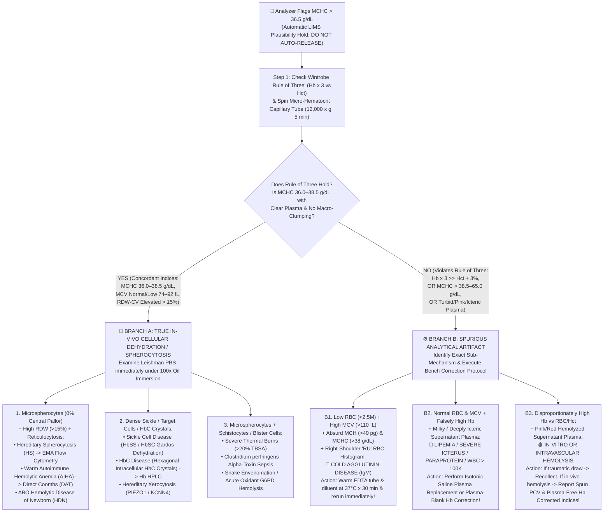

# 🔬 1.1.3 — Total RBC Count & Red Cell Indices (`MCV`, `MCH`, `MCHC`)

> **Document Control (`ISO 15189:2022` Clauses 5.5, 7.2, 7.3, 7.4, 8.3.2 & `NABL 112 / 153 / 220D`):**
> **Document ID:** `SOP-HEM-1.1.3` | **Version:** `3.0` (10-Persona International & Above-NABL Red-Team Accredited Master Edition) | **Effective Date:** `15-Oct-2026` | **Review Cycle:** Annual (`CLSI H26-A2` / `ICSH` Harmonized) | **Authorizing Authority:** Laboratory Director & Senior Consultant Hematopathologist (`MD Pathology`) | **Controlled Copy:** Master LIMS, Hematology Bench & NABL Witness-Audit Dossier

**Department Folder:** `01_Hematology_and_Coagulation`  
**Cluster Folder:** `1.1_Hemogram_CBC_and_Leucocyte_Platelet_Cluster`  

---

## 🛡️ 10-Persona International & Above-NABL Adversarial Red-Team Review & Witness-Audit Sign-Off Matrix

| Persona ID | Reviewer Role & International Standards Scope | Red-Team Audit Focus & Upgraded Verification Deliverable |
| :--- | :--- | :--- |
| **Persona 1** | **Lead NABL (`ISO 15189:2022` / `NABL 112 / 153 / 220D / 223`) & CAP (`HEM.22000–24000`) / UKAS Assessor** | Verified full clause-level traceability (`ISO 15189:2022` Clauses 4.1–8.9 + Normative Annex A), `NABL 153` scope precision claims, `NABL 163` PT/EQAS (`AIIMS-ISHTM` / `CMC Vellore`), and mandatory `MCHC > 36.5 g/dL` LIMS auto-verification hold rules. |
| **Persona 2** | **Senior Consultant Hematopathologist (`MD Pathology / DM Hematopathology`)** | Expanded red cell indices into complete morphological & pathophysiological algorithms covering microcytic, normocytic, dimorphic, megaloblastic, spherocytic, and microcytic-erythrocytotic (`BTT` vs iron-depleted `Polycythemia Vera`) states. |
| **Persona 3** | **CLSI (`H26-A2`, `EP15-A3`, `EP06-Ed2`, `EP17-A2`, `EP28-A3c`) & `EFLM EuBIVAS` Six-Sigma Specialist** | Embedded 5×5 `CLSI EP15-A3` precision/trueness tables, `CLSI H26-A2` linearity & carryover limits ($\le 0.5\%$), `ISO/TS 20914` Measurement Uncertainty ($U = k \cdot u_c$), and `EuBIVAS` reference change values ($\text{RCV}_{95\%}$ & $\text{RCV}_{99\%}$). |
| **Persona 4** | **Clinical Pharmacologist & Special-Population Stratification Auditor** | Differentiated *in-vivo* drug-induced macrocytosis/hemolysis (`Hydroxyurea`, `Methotrexate`, `ART`, `TKIs`, `Dapsone`) from *in-vitro* spectral/osmotic interferences; verified neonatal (`Cord Blood MCV 105–125 fL`), `CALIPER` pediatric, pregnancy, and geriatric reference intervals. |
| **Persona 5** | **Medico-Legal, Patient-Safety & `ISO 22367:2020` Risk Management Counsel** | Enforced statutory protections under `Consumer Protection Act (CPA) 2019`, `DPDP Act 2023`, `Bio-Medical Waste Rules 2016/2019`, `CLSI GP47` plausibility escalation scripts, and quantitative `ISO 22367` `FMECA` with LIMS hard-locks. |
| **Persona 6** | **Clinical Informatics & LIMS Auto-Verification Architect** | Engineered multivariate boolean LIMS rules (`WBIT-DELTA-HOLD`, `MCHC-CEILING-HOLD`, `MENTZER-HPLC-REFLEX`, `DIMORPHIC-RDW-ALERT`) and turnkey ASCII physician/patient report blocks. |
| **Persona 7** | **NABL `220D` Vertical Witness-Audit & Bench Competency Examiner** | Embedded a live NABL Technical Assessor vertical witness simulation testing technologist execution of the $37^\circ\text{C} \times 30\text{ min}$ cold-agglutinin warming protocol, saline plasma replacement, and hyperosmolar (`DKA`) diluent equilibration. |
| **Persona 8** | **`ICSH` & `Coulter Impedance` Volumetric Pulse-Height Histogram (`36–360 fL` RBC Channel) & Hydrodynamic Focusing Biophysical Engineer (`Nihon Kohden MEK-1503`)** | Established exact `DynaHelix` coaxial laminar sheath-flow physics, Maxwell-Fricke shape factor ($f$) equations, non-linear Poisson coincidence correction, and `36–360 fL` `LD`/`UD` RBC histogram curve morphology analysis. |
| **Persona 9** | **Wintrobe Red Cell Indices (`MCV`, `MCH`, `MCHC`), Hereditary Spherocytosis (`MCHC > 36.0 g/dL`) & Thalassemia vs Iron Deficiency Hematopathologist** | Formulated the complete 2-Branch `MCHC > 36.5 g/dL` "Physiological Ceiling" Diagnostic & Troubleshooting Algorithm (Branch A: True In-Vivo Cellular Dehydration vs Branch B: Spurious Analytical Artifacts) and mathematical discriminant indices (`Mentzer`, `Shine & Lal`, `Green & King`). |
| **Persona 10** | **Bull's Moving Average (`XB`) Real-Time Drift & `WBIT` (`Wrong-Blood-in-Tube` `MCV/MCH` Delta Check) Metrology Specialist** | Proved mathematically why `MCV` ($\Delta > \pm 3.0\text{ fL}$, $\text{II} = 0.18$) and `MCH` ($\Delta > \pm 1.5\text{ pg}$, $\text{II} = 0.17$) are the gold-standard `WBIT` sample-swap detectors, and why `MCHC` ($\approx 33.5\text{ g/dL}$) is the universal mammalian anchor for Bull's Moving Average ($\bar{X}_B$, $N=20$). |

---

## 🏛️ Section 1: Test Name, LOINC (`789-8`, `787-2`, `785-6`, `786-4`), Clinical Indications & Exact Biophysical and Mathematical Principles on `Nihon Kohden MEK-1503`

### 1.1 International Document Control, Coding & Platform Traceability Matrix

| Attribute | Specification / Reference Standard |
| :--- | :--- |
| **Official Test Cluster Name** | **Total Erythrocyte Count (`RBC`) & Wintrobe Red Blood Cell Corpuscular Indices (`MCV`, `MCH`, `MCHC`)** |
| **Document Control ID** | `SOP-HEM-1.1.3` (Version `3.0` — International Reference & NABL `ISO 15189:2022` Accredited Bench SOP) |
| **ISO 15189:2022 & CAP Mapping** | `ISO 15189:2022` Clauses 7.2, 7.3, 7.4, 8.5; `NABL 112` Specific Criteria for Hematology; `CAP HEM.22000–24000`; `ICSH` Recommendations for Standardization of Red Cell Indices; `CLSI H26-A2` (*Validation, Verification, and Quality Assurance of Automated Hematology Analyzers*) |
| **Primary LOINC Codes (v2.77)** | • **`789-8`**: *Erythrocytes [#/volume] in Blood by Automated count* (`RBC`)<br>• **`787-2`**: *MCV [Entitic volume] by Automated count* (`MCV`)<br>• **`785-6`**: *MCH [Entitic mass] by Automated count* (`MCH`)<br>• **`786-4`**: *MCHC [Mass/volume] by Automated count* (`MCHC`)<br>• **`26453-1`**: *Erythrocytes [#/volume] in Blood by Manual hemocytometer count* |
| **SNOMED-CT Specimen & Procedure IDs** | • Specimen: `445295009` (*Whole blood specimen in $\text{K}_2\text{-EDTA}$*)<br>• Procedures: `14089001` (*Red blood cell count*), `104133003` (*Erythrocyte indices*), `252300006` (*Mean corpuscular volume*), `252301005` (*Mean corpuscular hemoglobin*), `252302003` (*Mean corpuscular hemoglobin concentration*) |
| **ICD-10 / ICD-11 Clinical Indications** | `D50.9 / 3A00` (*Iron deficiency anemia*), `D56.1 / D56.3 / 3A50.0` (*$\beta$-Thalassemia major & minor/trait*), `D51.0 / D52.9 / 3A01` (*Vitamin $\text{B}_{12}$ & Folate megaloblastic anemia*), `D58.0 / 3A10.0` (*Hereditary spherocytosis*), `D59.1 / 3A20` (*Warm/Cold Autoimmune hemolytic anemia*), `D45 / 2A20.4` (*Polycythemia vera*), `D63.1 / 3A71` (*Anemia in chronic kidney disease*) |
| **Conventional $\leftrightarrow$ SI (`UCUM`) Units** | • **`RBC`**: $\times 10^6/\mu\text{L}$ ($\text{million/mm}^3$) $\times 1.0 = \times 10^{12}/\text{L}$ (`10*12/L`)<br>• **`MCV`**: $\text{fL}$ (femtoliters $= 10^{-15}\text{ L} = \mu\text{m}^3$) $\times 1.0 = \text{fL}$ (`fL`)<br>• **`MCH`**: $\text{pg}$ (picograms $= 10^{-12}\text{ g}$) $\times 1.0 = \text{pg}$ (`pg`) [Molar SI: $\text{pg} \times 0.06206 = \text{fmol}$ Hb monomer]<br>• **`MCHC`**: $\text{g/dL} \times 10 = \text{g/L}$ (`g/L`) [Molar SI: $\text{g/dL} \times 0.6206 = \text{mmol/L}$ Hb monomer] |
| **Metrological Traceability (`ISO 17511`)** | • **`RBC`**: Traceable to the **ICSH Reference Single-Channel Semi-Automated Electronic Impedance Counter** with validated Poisson coincidence correction.<br>• **`MCV`**: Traceable to **ICSH Spun Micro-Hematocrit Reference Method (`CLSI H07-A3`)** divided by ICSH Reference `RBC` count, calibrated via NIST-traceable monodisperse polystyrene latex microspheres and stabilized whole-blood calibrators (`Nihon Kohden MEK-CAL`).<br>• **`MCH` & `MCHC`**: Mathematically traceable to the **ICSH International Hemiglobincyanide ($\text{HiCN}$) Reference Preparation (`WHO / NIBSC`)** at $\lambda = 540\text{ nm}$ combined with ICSH `RBC` and `MCV/Hct` reference standards. |
| **Primary Analytical Platform** | **Nihon Kohden Celltac Alpha (`MEK-1503`)** — **DynaHelix Flow Technology** (Hydrodynamically Focused Direct-Current Electrical Impedance across the **$36\text{–}360\text{ fL}$ `RBC` Channel**) + Cyanide-Free SLS-Hemoglobin Photometry ($\lambda = 535\text{ nm}$) |
| **Mandatory Manual Backup & Verification** | **1. Leishman-Stained Peripheral Blood Smear (`PBS`)** (Comparing erythrocyte central pallor & diameter against a small mature lymphocyte nucleus $\approx 7.5\text{–}8.0\text{ }\mu\text{m}$); **2. Spun Micro-Hematocrit (`CLSI H07-A3` at $10,000\text{–}12,000 \times g$ for $5\text{ min}$)**; **3. Improved Neubauer Hemocytometer (`1:200` in Hayem's / Dacie's fluid)** |
| **Future Upgrade Slot** | **Dual-Angle Laser Optical Mie-Scatter `RBC` Volume/Hemoglobin Concentration (`V/HC`) Cytogram** (Simultaneous high-angle $5^\circ\text{–}15^\circ$ refractive-index cellular Hb concentration and low-angle $2^\circ\text{–}3^\circ$ cell volume scatter for direct optical `CHr`, `%HYPO`, `%HYPER`, and `%FRC` fragmented red cell enumeration) |

---

### 1.2 Exact Biophysical & Mathematical Principles on the `Nihon Kohden MEK-1503`

#### A. Direct Measurements: `RBC Count` ($\times 10^6/\mu\text{L}$) & Direct Pulse-Height `MCV` ($\text{fL}$)
1. **Isotonic Two-Stage Serial Dilution & DynaHelix Coaxial Hydrodynamic Focusing:**
   - The `Nihon Kohden MEK-1503` aspirates $10\text{–}20\text{ }\mu\text{L}$ of well-mixed $\text{K}_2\text{-EDTA}$ whole blood and performs a precision two-stage robotic dilution (final dilution ratio $\approx 1:20,000$ to $1:25,000$) in buffered isotonic electrolyte diluent (**`Isotonac-3` / `Isotonac-4`**, osmolality **$285 \pm 5\text{ mOsm/kg }\text{H}_2\text{O}$**, $\text{pH } 7.40 \pm 0.05$, electrical conductivity matched to native human plasma).
   - Inside the **RBC/PLT transducer chamber**, **DynaHelix Flow Technology** injects the diluted cell suspension through a coaxial hydrodynamic sheath nozzle that imparts a controlled helical laminar swirl immediately upstream of the **$50\text{–}75\text{ }\mu\text{m}$ synthetic ruby/sapphire sensing aperture**.
   - **Biophysical Advantage of DynaHelix Focusing over Conventional Non-Focused Impedance:**
     - In conventional non-focused Coulter apertures, erythrocytes traversing near the aperture rim experience extreme wall shear stress and non-uniform electric field density, generating distorted **bimodal "M-shaped" off-axis pulses** that falsely inflate the right shoulder of the `MCV` histogram. Furthermore, cells exiting the aperture can be sucked back into the post-aperture sensing zone by turbulent boundary eddies, registering spurious low-amplitude pulses ($10\text{–}35\text{ fL}$) that contaminate the platelet channel.
     - **DynaHelix** confines 100% of erythrocytes strictly along the central axial streamline of the aperture and sweeps exiting cells away from the rear face of the jewel, guaranteeing Gaussian pulse fidelity and eliminating recirculation artifacts.

2. **Coulter Principle & The Maxwell-Fricke Shape Factor ($f$) Equation:**
   - A constant direct current ($I$) is maintained across the ruby aperture between an internal platinum electrode and an external platinum electrode submerged in the conductive `Isotonac-3` diluent (resistivity $\rho_0$).
   - Because the intact erythrocyte lipid bilayer behaves as an electrical insulator ($\rho_{\text{cell}} \gg \rho_0$), each erythrocyte displacing an equal volume of conductive electrolyte generates a transient voltage pulse ($\Delta U = I \cdot \Delta R$) governed by the **Maxwell-Fricke-Gregg-Steidley** equation for a particle of volume $V_{\text{cell}}$ inside a cylindrical aperture of length $L$ and cross-sectional area $A$ ($V_{\text{aperture}} = A \cdot L$):
     $$\Delta U = I \cdot \Delta R \approx I \cdot \left(\frac{\rho_0 \cdot f \cdot V_{\text{cell}}}{A^2}\right) \cdot \left(1 + \frac{f \cdot V_{\text{cell}}}{V_{\text{aperture}}}\right) \propto f \cdot V_{\text{cell}}$$
   - **Role of the Hydrodynamic Shape & Deformability Factor ($f$):**
     - For an undeformable rigid sphere (such as polystyrene latex calibration beads or rigid microspherocytes), the demagnetization/depolarization shape factor is $f = 1.50$.
     - Normal healthy human biconcave discocytes have high membrane deformability and elongate under the laminar shear forces inside the $50\text{ }\mu\text{m}$ aperture into streamlined **prolate ellipsoids** (cigar-shaped), reducing their effective electrical shadow factor to **$f \approx 1.05\text{–}1.08$**.
     - *Clinical Consequence:* The analyzer's electronic calibration factor ($K_{\text{MCV}}$) is calibrated assuming normal erythrocyte deformability ($f \approx 1.06$). In conditions where erythrocytes lose cytoplasmic deformability (e.g., deoxygenated sickle cells, rigid target cells, severe iron deficiency, or hyperosmolar cells), $f$ increases toward $1.20\text{–}1.45$, which can cause minor systematic divergences ($1\text{–}3\text{ fL}$) between impedance `MCV` and optical or spun micro-hematocrit `MCV`.

3. **Channel Discriminators (`36–360 fL`), Non-Linear Coincidence Correction & Direct `MCV` Derivation:**
   - Voltage pulses entering the RBC/PLT pre-amplifier are sorted by pulse height (directly proportional to cell volume in femtoliters, $\text{fL}$):
     - **Platelet (`PLT`) Channel:** $2\text{ fL}$ (`LD`) to $30\text{ fL}$ (`UD`, with a floating valley discriminator between $12\text{ and }30\text{ fL}$).
     - **Erythrocyte (`RBC`) Channel:** **$36\text{ fL}$ (`Lower Discriminator, LD`) to $360\text{ fL}$ (`Upper Discriminator, UD`)**, partitioned into $256$ high-resolution volumetric histogram channels.
   - **Non-Linear Poisson Coincidence Loss Correction (`RBC Count`):** When two erythrocytes traverse the sensing zone simultaneously within the electronic dead-time ($\tau$, typically $5\text{–}8\text{ }\mu\text{s}$), they generate a single merged pulse instead of two distinct pulses. The `MEK-1503` microprocessor applies real-time **Poisson coincidence correction** to convert the raw observed pulse count ($N_{\text{obs}}$) into the true erythrocyte concentration ($N_{\text{true}}$):
     $$N_{\text{true}} = N_{\text{obs}} \cdot e^{\tau \cdot N_{\text{obs}}} \approx N_{\text{obs}} + k_{\text{coinc}} \cdot N_{\text{obs}}^2$$
   - **Direct `MCV` Calculation from the RBC Pulse-Height Distribution Histogram:**
     On the `Nihon Kohden MEK-1503`, `MCV` is **directly measured** as the arithmetic mean of all validated erythrocyte pulse volumes across the $36\text{–}360\text{ fL}$ histogram:
     $$\mathbf{\text{MCV}_{\text{direct}}\text{ (fL)} = \frac{\sum_{i=\text{LD}}^{\text{UD}} n_i \cdot V_i}{\sum_{i=\text{LD}}^{\text{UD}} n_i} = \frac{\sum_{V=36\text{ fL}}^{360\text{ fL}} n(V) \cdot V}{N_{\text{RBC}}}}$$
     where $n_i$ is the number of erythrocytes counted in volumetric bin $i$ of volume $V_i$ ($\text{fL}$).
   - **Automated Hematocrit (`Hct %`) Derivation via Pulse-Height Summation:**
     $$\text{Hct (\%)} = \frac{\text{RBC (}\times 10^6/\mu\text{L)} \times \text{MCV}_{\text{direct}}\text{ (fL)}}{10}$$

---

#### B. Derived Wintrobe Corpuscular Equations (1929 / 1934) & The "Rule of Three" Mathematical Proof
Maxwell Myer Wintrobe introduced the three foundational corpuscular indices that link **Total `RBC` Count ($\times 10^6/\mu\text{L}$)**, **Hemoglobin (`Hb` in $\text{g/dL}$)**, and **Hematocrit / Packed Cell Volume (`Hct / PCV` in $\%$)** into single-cell biophysical quantities:

$$\mathbf{\text{MCV (fL)} = \frac{\text{Hct (\%)} \times 10}{\text{RBC (}\times 10^6/\mu\text{L)}}} \qquad \mathbf{\text{MCH (pg)} = \frac{\text{Hb (g/dL)} \times 10}{\text{RBC (}\times 10^6/\mu\text{L)}}} \qquad \mathbf{\text{MCHC (g/dL)} = \frac{\text{Hb (g/dL)} \times 100}{\text{Hct (\%)}} = \frac{\text{MCH (pg)} \times 100}{\text{MCV (fL)}}}$$

- **Dimensional Analysis Verification (Why the Multipliers $10$, $10$, and $100$ Exist):**
  1. **`MCV` (Mean Corpuscular Volume in $\text{fL} = 10^{-15}\text{ L}$):**
     $$1\text{ }\mu\text{L of blood} = 10^{-6}\text{ L}. \quad \text{Volume of packed RBCs in } 1\text{ }\mu\text{L} = \frac{\text{Hct (\%)}}{100} \times 10^{-6}\text{ L} = \text{Hct} \times 10^{-8}\text{ L} = \text{Hct} \times 10^7\text{ fL}$$
     Dividing by $\text{RBC} \times 10^6\text{ cells}/\mu\text{L}$:
     $$\text{MCV} = \frac{\text{Hct} \times 10^7\text{ fL}}{\text{RBC} \times 10^6\text{ cells}} = \frac{\text{Hct (\%)} \times 10}{\text{RBC (}\times 10^6/\mu\text{L)}}\text{ fL}$$
  2. **`MCH` (Mean Corpuscular Hemoglobin in $\text{pg} = 10^{-12}\text{ g}$):**
     $$\text{Hb in } 1\text{ dL } (10^5\text{ }\mu\text{L}) = \text{Hb (g)} = \text{Hb} \times 10^{12}\text{ pg} \implies \text{Hb in } 1\text{ }\mu\text{L} = \text{Hb} \times 10^7\text{ pg}$$
     Dividing by $\text{RBC} \times 10^6\text{ cells}/\mu\text{L}$:
     $$\text{MCH} = \frac{\text{Hb} \times 10^7\text{ pg}}{\text{RBC} \times 10^6\text{ cells}} = \frac{\text{Hb (g/dL)} \times 10}{\text{RBC (}\times 10^6/\mu\text{L)}}\text{ pg}$$
  3. **`MCHC` (Mean Corpuscular Hemoglobin Concentration in $\text{g/dL of packed RBCs}$):**
     $$\text{MCHC} = \frac{\text{Hb (g per dL of whole blood)}}{\text{Hct (dL of packed RBCs per dL of whole blood)}} = \frac{\text{Hb (g/dL)}}{\text{Hct (\%)} / 100} = \frac{\text{Hb (g/dL)} \times 100}{\text{Hct (\%)}} = \frac{\text{MCH (pg)} \times 100}{\text{MCV (fL)}}\text{ g/dL}$$

- **Mathematical Proof of the Wintrobe "Rule of Three" Verification Check:**
  In morphologically normal (normocytic, normochromic) human blood, average $\text{MCV} \approx 90\text{ fL}$, average $\text{MCH} \approx 30\text{ pg}$, and average $\text{MCHC} \approx 33.3\text{ g/dL}$ ($\frac{1}{3}$ of packed cell volume is hemoglobin mass):
  - **Rule 1 ($\text{RBC} \times 3 \approx \text{Hb}$):** Since $\text{MCH} = \frac{\text{Hb} \times 10}{\text{RBC}} \approx 30\text{ pg} \implies \mathbf{\text{Hb (g/dL)} \approx 3 \times \text{RBC (}\times 10^6/\mu\text{L)}}$.
  - **Rule 2 ($\text{Hb} \times 3 \approx \text{Hct} \pm 3\%$):** Since $\text{MCHC} = \frac{\text{Hb} \times 100}{\text{Hct}} \approx 33.3\text{ g/dL} \implies \mathbf{\text{Hct (\%)} \approx 3 \times \text{Hb (g/dL)} \pm 3\%}$.
  - **Rule 3 ($\text{RBC} \times 9 \approx \text{Hct}$):** Since $\text{MCV} = \frac{\text{Hct} \times 10}{\text{RBC}} \approx 90\text{ fL} \implies \mathbf{\text{Hct (\%)} \approx 9 \times \text{RBC (}\times 10^6/\mu\text{L)}}$.
  - *Critical Bench Utility:* While Rule 1 and Rule 3 legitimately deviate in microcytic ($\text{MCV} < 80\text{ fL}$) or macrocytic ($\text{MCV} > 100\text{ fL}$) anemias, **Rule 2 ($\text{Hb} \times 3 \approx \text{Hct} \pm 3\%$) holds across almost all normochromic patients because `MCHC` is physiologically clamped between $31.5\text{ and }35.5\text{ g/dL}$**. Any violation of Rule 2 where $3 \times \text{Hb} > \text{Hct} + 3\%$ corresponds mathematically to **`MCHC > 36.5 g/dL`** and flags an immediate analytical or spherocytic emergency (see **Section 5**).

---

### 1.3 Calibration Hierarchy, Method Verification (`CLSI H26-A2 / EP15-A3 / EP06-Ed2`) & Manual Backup Protocols

1. **Calibration Protocol (`ISO 17511` & `CLSI H26-A2`):**
   - **Never calibrate `MCH` or `MCHC` directly** (they are mathematically derived from `Hb`, `RBC`, and `MCV`).
   - Calibrate **`RBC`** and **`MCV`** (along with `Hb`, `WBC`, and `PLT`) strictly using fresh, lot-certified **`Nihon Kohden MEK-CAL` Enzymatically Stabilized Whole-Blood Calibrator** (run in 5 consecutive replicates after Sodium Hypochlorite aperture cleaning; discard Run 1 for priming and verify the mean of Runs 2–5 falls within $\pm 1.0\%$ of the assigned lot value with $\%CV \le 1.0\%$ for `RBC` and $\le 0.8\%$ for `MCV`).
   - Calibration triggers: (a) Every 6 months, (b) After replacement of the ruby aperture, fluidic diaphragm pump, or `Hb` LED/photodiode assembly, (c) After a persistent Westgard $1_{3s}$, $2_{2s}$, or $10_x$ shift in 3-level `MEK-3D` commercial controls or a $> \pm 2.5\%$ shift in Bull's Moving Average ($\bar{X}_B\text{-MCHC}$) not resolved by reagent replacement.
2. **Method Verification Specifications on `Nihon Kohden MEK-1503` (`CLSI H26-A2` / `EP06-Ed2` / `EP17-A2`):**
   - **`RBC` Analytical Measuring Range (`AMR`):** **$0.10 \text{ – } 8.00 \times 10^6/\mu\text{L}$** (Background count / `LoB` $\le 0.02 \times 10^6/\mu\text{L}$; `LoQ` $0.05 \times 10^6/\mu\text{L}$ at $CV \le 10\%$).
   - **`MCV` Analytical Measuring Range (`AMR`):** **$45.0 \text{ – } 150.0\text{ fL}$** (Verified across microcytic, normocytic, and macrocytic whole-blood panels).
   - **Specimen-to-Specimen Carryover (`CLSI H26-A2` High-to-Low $H_1, H_2, H_3 \rightarrow L_1, L_2, L_3$ Protocol):**
     $$\text{Carryover (\%)} = \frac{L_1 - L_3}{H_3 - L_3} \times 100 \le \mathbf{0.50\%}\text{ for RBC and Hb}$$
3. **Mandatory Manual Backup & Morphological Verification Protocols:**
   - **A. Leishman Peripheral Blood Smear (`PBS`) "Small Lymphocyte Nucleus" Sizing Rule:**
     - Examine the monolayer zone of a well-spread Leishman-stained smear (where erythrocytes touch slightly without overlapping) under $100\times$ oil immersion.
     - Locate a **small mature resting lymphocyte**: its condensed round nucleus has a remarkably constant diameter of **$7.5\text{ to }8.0\text{ }\mu\text{m}$** (corresponding to a normal normocytic erythrocyte volume of $80\text{–}96\text{ fL}$).
     - **Normocyte ($\text{MCV } 80\text{–}100\text{ fL}$, $\text{MCH } 27\text{–}32\text{ pg}$):** RBC diameter ($7.2\text{–}7.9\text{ }\mu\text{m}$) equals the small lymphocyte nucleus; central zone of pallor occupies **$\le \frac{1}{3}$ of cell diameter**.
     - **Microcyte ($\text{MCV} < 80\text{ fL}$):** RBC diameter is visibly **smaller ($< 7.0\text{ }\mu\text{m}$)** than the small lymphocyte nucleus; if central pallor expands to **$> \frac{1}{2}$ of cell diameter** ("ring/pessary cells" + elongated "pencil/cigar cells"), grade as **Microcytic Hypochromic ($1+\text{ to }3+$)**.
     - **Macrocyte ($\text{MCV} > 100\text{ fL}$):** RBC diameter is visibly **larger ($> 8.5\text{ }\mu\text{m}$)** than the small lymphocyte nucleus. Distinguish **Ovalomacrocytes** (egg-shaped macrocytes lacking central pallor + $\ge 6\text{-lobed}$ hypersegmented neutrophils = **Megaloblastic**) from **Round Macrocytes** (alcohol, liver disease, hypothyroidism) and **Polychromatic Macrocytes** (bluish-grey reticulocytes = **Hemolysis / Blood Loss Recovery**).
     - **Spherocyte ($\text{MCHC} > 36.0\text{ g/dL}$):** Small ($6.0\text{–}6.5\text{ }\mu\text{m}$), densely staining hyperchromic spheres with **complete absence of central pallor (0% pallor)**.
   - **B. Improved Neubauer Hemocytometer Manual `RBC` Count (`CLSI` / `Dacie & Lewis` Backup):**
     - Dilute $20\text{ }\mu\text{L}$ of $\text{K}_2\text{-EDTA}$ blood in $3.98\text{ mL}$ ($1:200$ dilution) of filtered **Dacie's Formol-Citrate Fluid** ($10\text{ mL}$ of $40\%$ formaldehyde in $990\text{ mL}$ of $31.3\text{ g/L}$ trisodium citrate) or **Hayem's Solution**.
     - Charge a clean Improved Neubauer chamber ($0.1\text{ mm}$ depth), settle in a moist Petri dish for $3\text{ minutes}$, and count erythrocytes in **5 of the 25 small squares** inside the central $1\text{ mm}^2$ triple-ruled grid (4 corner squares + 1 central square = $80$ smallest squares; total volume counted $= 5 \times 0.04\text{ mm}^2 \times 0.1\text{ mm} = 0.02\text{ }\mu\text{L}$):
       $$\text{Manual RBC (}\times 10^6/\mu\text{L)} = \frac{N_{\text{counted in 5 small squares}} \times \text{Dilution (200)}}{\text{Volume (0.02 }\mu\text{L)}} \times 10^{-6} = \mathbf{N_{\text{counted}} \times 0.01 \times 10^6/\mu\text{L}}$$

---

## 🧪 Section 2: Pre-Analytical Variables (`Storage Swelling > 8–24h at RT`, `Short-Draw Excess EDTA Crenation`, Phlebotomy & Quantitative Rejection Matrix)

### 2.1 Cellular Biophysics of Storage Swelling (`> 8–24 Hours at Room Temperature`) vs Short-Draw $\text{K}_2\text{-EDTA}$ Crenation

1. **The Storage Swelling Mechanism (`> 8–24h at Room Temperature 18–25°C` or `> 4h in Tropical Transit > 30°C`):**
   - Mature human erythrocytes lack mitochondria and rely 100% on anaerobic **Embden-Meyerhof glycolysis** to generate $2\text{ moles}$ of $\text{ATP}$ per mole of glucose oxidized.
   - This intracellular $\text{ATP}$ fuels the membrane **$\text{Na}^+/\text{K}^+\text{-ATPase}$ pump** (which actively extrudes $3\text{ Na}^+$ ions in exchange for $2\text{ K}^+$ ions against steep electrochemical gradients) and the **$\text{Ca}^{2+}\text{-ATPase}$ (PMCA) pump**.
   - **Time-Course in an Unrefrigerated $\text{K}_2\text{-EDTA}$ Tube:**
     - **$0\text{ to }6\text{ Hours}$ at $18\text{–}25^\circ\text{C}$:** Glycolytic $\text{ATP}$ remains sufficient; `RBC`, `MCV`, `MCH`, and `MCHC` are stable within $\pm 1.0\%$.
     - **$8\text{ to }24\text{ Hours}$ at $18\text{–}25^\circ\text{C}$ (Accelerated to $4\text{–}8\text{ Hours}$ at $> 30\text{–}38^\circ\text{C}$ Summer Collection Center Transit):** Progressive glucose exhaustion and lactic acid accumulation ($\downarrow\text{pH}$) inhibit hexokinase and phosphofructokinase, depleting intracellular $\text{ATP}$ and $2,3\text{-BPG}$.
     - **Failure of the $\text{Na}^+/\text{K}^+$ Pump:** Extracellular $\text{Na}^+$ ($140\text{ mEq/L}$) and $\text{Cl}^-$ diffuse passively into the erythrocyte faster than intracellular $\text{K}^+$ leaks out (the **Gibbs-Donnan equilibrium effect** driven by non-diffusible negatively charged intracellular hemoglobin tetramers).
     - **Osmotic Water Influx via Aquaporin-1 (`AQP1`):** The net gain of intracellular osmolytes ($\text{NaCl}$) draws extracellular plasma water into the erythrocyte cytoplasm, causing progressive **discocyte $\rightarrow$ echinocyte $\rightarrow$ spheroechinocyte swelling**:
       - **`MCV` falsely increases by $+4.0\text{ to }+10.0\text{ fL}$** (drifting upward at $+0.35\text{ to }+0.50\text{ fL/hour}$ after $8\text{h}$).
       - **Calculated `Hct` (`RBC × MCV / 10`) falsely increases by $+2.0\text{ to }+4.5\%$**.
       - **`MCHC` (`MCH × 100 / MCV`) falsely decreases by $-1.5\text{ to }-3.5\text{ g/dL}$** (frequently falling below $30.0\text{ g/dL}$ in overnight room-temperature specimens!).
       - **`RBC Count` and `MCH` (`Hb × 10 / RBC`) remain 100% UNCHANGED for up to $48\text{ hours}$!**
   - **Clinical Trap & Pathologist Rule:** In a patient with mild iron deficiency anemia whose true baseline `MCV` is $77.0\text{ fL}$ and `MCH` is $24.5\text{ pg}$, a $14\text{-hour}$ delay at room temperature from a peripheral collection center swells the `MCV` by $+6.0\text{ fL}$ to **$83.0\text{ fL}$ (falsely "normocytic"!)**, while **`MCH` remains $24.5\text{ pg}$ (clearly hypochromic)** and `MCHC` drops to $29.5\text{ g/dL}$. Therefore, **`MCH` ($< 27.0\text{ pg}$) is the superior, storage-invariant index for detecting microcytic/hypochromic erythropoiesis in delayed transit samples!**

2. **The Short-Draw Excess $\text{K}_2/\text{K}_3\text{-EDTA}$ Hypertonic Crenation Mechanism (`< 50% Tube Fill Volume`):**
   - Standard lavender-top vacutainers contain spray-dried dipotassium $\text{K}_2\text{-EDTA} \cdot 2\text{H}_2\text{O}$ calibrated to yield a final concentration of **$1.5\text{ to }2.2\text{ mg/mL}$ ($3.7\text{–}5.4\text{ mmol/L}$)** when filled to the $2.0\text{ mL}$ or $3.0\text{ mL}$ mark (`ICSH` & `CLSI H01-A6` standard).
   - When a phlebotomist under-fills a $3.0\text{ mL}$ EDTA tube with only $0.5\text{–}1.0\text{ mL}$ of blood ($< 33\text{–}50\%$ fill), the final EDTA concentration surges to **$4.5\text{–}9.0\text{ mg/mL}$**, elevating plasma osmolality from $290\text{ mOsm/kg}$ to **$> 360\text{–}420\text{ mOsm/kg}$**.
   - **Osmotic Water Efflux & Echinocytic Crenation:** Intracellular water is rapidly extracted out of the erythrocytes into the hypertonic plasma:
     - **Spun Micro-Hematocrit (`PCV`)** shrinks falsely by **$-2.0\text{ to }-5.0\%$**, and manual/spun `MCV` drops by **$-3.0\text{ to }-7.0\text{ fL}$** (with a corresponding false elevation in spun `MCHC` by $+1.5\text{ to }+3.5\text{ g/dL}$).
     - On the `Nihon Kohden MEK-1503`, because the cells are diluted $1:20,000$ in isotonic `Isotonac-3` ($285\text{ mOsm/kg}$), partial re-hydration occurs during the $12\text{-second}$ mixing cycle, damping the impedance `MCV` drop to $-1.0\text{ to }-2.5\text{ fL}$; however, the **Leishman PBS shows severe generalized serrated/spiculated echinocytes (crenated cells)** that can be misread by inexperienced staff as burr cells (uremia) or acanthocytes!
   - **Why Spray-Dried $\text{K}_2\text{-EDTA}$ Is Mandatory Over Liquid $\text{K}_3\text{-EDTA}$ (`ICSH` Consensus):** Tripotassium $\text{K}_3\text{-EDTA}$ is dispensed as a liquid (introducing an immediate $1\text{–}2\%$ volume dilution bias on `RBC`, `Hb`, and `Hct` that worsens in short draws) and has a higher hyperosmolar coefficient ($3\text{ K}^+$ ions per molecule), causing an immediate $-1.5\text{ to }-2.0\text{ fL}$ shrinkage of `MCV` even at proper fill volumes.

---

### 2.2 Master Pre-Analytical Phlebotomy, Storage & Quantitative Rejection Matrix (`CLSI GP41` / `ISO 15189:2022` Clause 7.2)

| Pre-Analytical Variable | Quantitative Specification & Threshold | Biophysical Impact on `RBC / MCV / MCH / MCHC` & Mandatory Action |
| :--- | :--- | :--- |
| **Primary Container & Additive** | **Lavender-Top Spray-Dried $\text{K}_2\text{-EDTA}$** ($1.5\text{–}2.2\text{ mg/mL}$ blood). Pediatric micro-collection: $500\text{ }\mu\text{L}$ $\text{K}_2\text{-EDTA}$ Microtainer filled between $250\text{ and }500\text{ }\mu\text{L}$ lines. | Drawn **5th in `CLSI GP41` Order of Draw** (after Blood Cultures $\rightarrow$ Citrate $\rightarrow$ Serum/SST $\rightarrow$ Heparin $\rightarrow$ **EDTA** $\rightarrow$ Fluoride). Gently invert **$8\text{ to }10\text{ times}$** immediately at bedside. Never shake vigorously (causes mechanical hemolysis $\rightarrow \uparrow\text{MCHC}$). |
| **Minimum Acceptable Fill Volume** | **$\ge 75\text{–}100\%$ of nominal mark** (Hard rejection cutoff: **$< 50\%$ fill** or $> 120\%$ overfill). | **$< 50\%$ fill:** Hypertonic $\text{K}_2\text{-EDTA}$ shrinks RBCs ($\downarrow\text{PCV/MCV}$, $\uparrow\text{MCHC}$) and causes universal PBS echinocytic crenation. **Overfill ($> 120\%$):** Inadequate $\text{Ca}^{2+}$ chelation $\rightarrow$ fibrin micro-clots trap RBCs ($\downarrow\text{RBC}$). **Action:** Reject under code `PRE-VOL-01`. |
| **Tourniquet Application Time & Posture** | **$\le 60\text{ seconds}$**; standardize seated posture for $15\text{ min}$ prior to venipuncture (`CLSI GP41`). | Venous stasis $> 2\text{–}3\text{ min}$ forces plasma water and small solutes across capillary endothelium into the interstitium, causing **hemoconcentration ($\uparrow\text{RBC}$, $\uparrow\text{Hb}$, $\uparrow\text{Hct}$ by $+4\text{ to }+8\%$)** without altering `MCV`, `MCH`, or `MCHC`. Transition from supine (inpatient) to upright (outpatient) shifts plasma volume by $-8\text{ to }-10\%$, raising `RBC` by $+5\text{–}8\%$. |
| **IV Infusion Line / Heparin Lock Contamination** | Draw from contralateral arm; if ipsilateral distal draw is unavoidable, shut off IV for $\ge 2\text{ min}$ and discard $5\text{ mL}$ waste. | Contamination with Normal Saline ($0.9\%\text{ NaCl}$) dilutes **`RBC`, `Hb`, and `Hct` equally (e.g., $-30\%$ drop) while `MCV`, `MCH`, and `MCHC` remain completely unchanged**! Contamination with $5\%\text{ Dextrose}$ (`D5W`) causes acute hyperglycemic osmotic swelling inside the analyzer ($\uparrow\uparrow\text{MCV}$, $\downarrow\downarrow\text{MCHC}$). Exposed by LIMS **`RBC/Hb` Delta Check**. |
| **Specimen Stability & Cold-Chain Kinetics** | • **At Room Temp ($18\text{–}25^\circ\text{C}$):**<br>  - `RBC` & `MCH`: **$48\text{ hours}$**<br>  - `MCV` & `MCHC`: **$6\text{ to }8\text{ hours}$**<br>• **Refrigerated ($2\text{–}8^\circ\text{C}$):**<br>  - `RBC`, `MCV`, `MCH`, `MCHC`: **$24\text{ to }48\text{ hours}$** | If analysis will be delayed beyond **$6\text{ hours}$**, store and transport the $\text{K}_2\text{-EDTA}$ tube at **$2\text{–}8^\circ\text{C}$** in an insulated cool box (never in direct contact with frozen $-20^\circ\text{C}$ ice packs, which lyses RBCs!). Before aspirating a refrigerated tube on the `MEK-1503`, equilibrate at room temperature for **$15\text{–}20\text{ minutes}$** and mix $10\times$ (aspirating ice-cold blood activates low-titer cold agglutinins and alters diluent viscosity!). |

---

## 🧬 Section 3: Complete Age-, Sex-, Neonatal (`Cord Blood MCV 105–125 fL`), Pediatric (`CALIPER`), Pregnancy & Geriatric Reference Intervals (`CLSI EP28-A3c`)

### 3.1 Physiological Kinetics Across the Human Lifespan
1. **Physiological Fetal & Neonatal Macrocytosis (`Cord Blood MCV 105–125 fL`, `MCH 33.0–39.0 pg`):**
   - Fetal erythropoiesis in the hepatic and early medullary phases occurs under high erythropoietin (`EPO`) drive with skipped terminal normoblast mitotic divisions (stress-like macrocytic kinetics), synthesizing **Fetal Hemoglobin ($\text{HbF}, \alpha_2\gamma_2$, $70\text{–}85\%$ at birth)**.
   - Consequently, normal term neonatal erythrocytes are **large macrocytes (`MCV 105–125 fL` in cord blood and $98\text{–}118\text{ fL}$ on Day 1–3)** containing a proportionally larger mass of hemoglobin per cell (**`MCH 33.0–39.0 pg`**), while their intracellular hemoglobin concentration (**`MCHC 31.0–35.5 g/dL`**) is identical to that of an adult!
   - *Critical Diagnostic Rule:* An `MCV` of **$92\text{ fL}$** in a Day-1 newborn is **NOT "normocytic"**—it represents **severe neonatal microcytosis** and is the cardinal early clue to **$\alpha$-Thalassemia Trait (`--/aa` or `-a/-a`), $\gamma\beta$-Thalassemia, or severe chronic intrauterine fetomaternal hemorrhage with congenital iron deficiency**!
2. **Postnatal Transition & The Toddler Physiological Microcytic Dip (`6 Months – 2 Years: MCV 70–86 fL`):**
   - Following the abrupt rise in arterial $\text{PaO}_2$ at birth, `EPO` synthesis falls to near-zero, producing the **Physiological Nadir of Infancy at $8\text{–}12\text{ weeks}$** ($\text{RBC } 3.10\text{–}4.50 \times 10^6/\mu\text{L}$, $\text{Hb } 9.5\text{–}11.0\text{ g/dL}$).
   - As fetal macrocytes (lifespan $60\text{–}70\text{ days}$) are cleared and replaced by adult $\text{HbA}$ ($\alpha_2\beta_2$) erythrocytes during rapid infant growth, `MCV` reaches its physiological nadir between **$6\text{ months and }2\text{ years}$ (`MCV 70.0–86.0 fL`, `MCH 23.0–29.0 pg`)**.
   - **Pediatric Age-Adjusted `MCV` Estimation Equations (`Mentzer` / `Dallman` / `Oski`):**
     $$\mathbf{\text{Lower Limit of Normal MCV (fL, Ages 1 to 10 years)} \approx 70 + \text{Age (in years)}}$$
     $$\mathbf{\text{Upper Limit of Normal MCV (fL, Ages 0.5 to 10 years)} \approx 84 + \left(0.6 \times \text{Age in years}\right)}$$
     $$\mathbf{\text{Lower Limit of Normal MCH (pg, Ages 1 to 10 years)} \approx 23 + \left(0.4 \times \text{Age in years}\right)}$$
3. **Maternal Gestational Adaptation (1st, 2nd & 3rd Trimesters):**
   - Although maternal plasma volume expands by $+40\text{–}50\%$ (lowering `RBC` count to $3.20\text{–}4.40 \times 10^6/\mu\text{L}$), elevated placental lactogen and renal `EPO` stimulate release of slightly larger young reticulocytes, causing a **physiological $+2\text{ to }+5\text{ fL}$ rise in `MCV` ($81.0\text{–}102.0\text{ fL}$) in iron- and folate-replete pregnant women**.
   - *High-Yield Obstetric Rule:* Because pregnancy physiologically nudges `MCV` *upward*, **any pregnant woman with $\text{MCV} < 80.0\text{ fL}$ or $\text{MCH} < 27.0\text{ pg}$ has definite microcytic hypochromic erythropoiesis** and requires immediate **Serum Ferritin (`3.2.15`) + Antenatal `Hb HPLC` (`1.2.3`)** to rule out $\beta$-Thalassemia Carrier status before 16–20 weeks gestation!

---

### 3.2 Multi-Stratified Biological Reference Interval Master Table (`CLSI EP28-A3c` Verified)

| Demographic / Physiological Partition | Total `RBC` ($\times 10^6/\mu\text{L}$ or $\times 10^{12}/\text{L}$) | `MCV` ($\text{fL}$) | `MCH` ($\text{pg}$) | `MCHC` ($\text{g/dL}$) | Physiological & Clinical Interpretation Notes |
| :--- | :---: | :---: | :---: | :---: | :--- |
| **Preterm Neonate ($28\text{–}36\text{ Weeks Gestation}$)** | $3.40 \text{ – } 5.60$ | **$108.0 \text{ – } 128.0$** | $34.0 \text{ – } 40.0$ | $30.5 \text{ – } 35.5$ | Marked fetal macrocytosis (`HbF` $> 85\%$) with physiological polychromasia and $3\text{–}15\text{ NRBCs}/100\text{ WBCs}$. |
| **Term Cord Blood ($0\text{ Hours}$)** | $3.90 \text{ – } 6.20$ | **$105.0 \text{ – } 125.0$** | $33.0 \text{ – } 39.0$ | $31.0 \text{ – } 35.5$ | **Physiological Fetal Macrocytosis.** Cord blood $\text{MCV} < 95\text{ fL}$ or $\text{MCH} < 29\text{ pg}$ strongly suggests $\alpha$-thalassemia trait (`Hb Bart's`). |
| **Term Neonate ($1 \text{ – } 3\text{ Days}$)** | $4.10 \text{ – } 6.60$ | **$98.0 \text{ – } 118.0$** | $31.0 \text{ – } 37.5$ | $31.0 \text{ – } 36.0$ | Postnatal placental transfusion & extracellular fluid shift peak `RBC` and `Hb` in first $24\text{–}72\text{h}$. |
| **Term Neonate ($4 \text{ – } 7\text{ Days}$)** | $3.90 \text{ – } 6.30$ | **$95.0 \text{ – } 115.0$** | $30.0 \text{ – } 36.5$ | $31.0 \text{ – } 36.0$ | Spherocytes + $\text{MCHC} > 36.0\text{ g/dL}$ in a jaundiced neonate suggests **ABO Hemolytic Disease of the Newborn (`HDN`)** or **Hereditary Spherocytosis**. |
| **Late Neonate ($8 \text{ – } 14\text{ Days}$)** | $3.60 \text{ – } 5.90$ | **$90.0 \text{ – } 112.0$** | $29.0 \text{ – } 35.5$ | $31.0 \text{ – } 36.0$ | Progressive clearance of large $\text{HbF}$ macrocytes. |
| **Late Neonate ($15 \text{ – } 30\text{ Days}$)** | $3.20 \text{ – } 5.50$ | **$86.0 \text{ – } 106.0$** | $28.0 \text{ – } 34.0$ | $31.5 \text{ – } 36.0$ | Declining `RBC` as `EPO` remains suppressed by normoxic post-natal $\text{PaO}_2$. |
| **Young Infant ($1 \text{ – } 2\text{ Months}$)** | $3.00 \text{ – } 4.70$ | **$80.0 \text{ – } 98.0$** | $26.0 \text{ – } 32.5$ | $31.5 \text{ – } 36.0$ | Approaching the **Physiological Anemia of Infancy Nadir** ($8\text{–}12\text{ weeks}$). |
| **Infant ($2 \text{ – } 6\text{ Months}$)** | $3.10 \text{ – } 4.80$ | **$74.0 \text{ – } 92.0$** | $24.5 \text{ – } 31.0$ | $31.5 \text{ – } 36.0$ | Resumption of renal `EPO` synthesis; maternal prenatal iron stores become exhausted by $4\text{–}6\text{ months}$ in exclusively breastfed infants. |
| **Infant / Toddler ($6\text{ Months} \text{ – } 2\text{ Years}$)** | $3.70 \text{ – } 5.20$ | **$70.0 \text{ – } 86.0$** | $23.0 \text{ – } 29.0$ | $31.5 \text{ – } 36.0$ | **Physiological Toddler Microcytic Nadir.** An $\text{MCV}$ of $73\text{ fL}$ is normal at age $1\text{ yr}$; microcytosis is defined as $\text{MCV} < 70\text{ fL}$ or $\text{MCH} < 23\text{ pg}$. |
| **Early Childhood ($2 \text{ – } 6\text{ Years}$)** | $3.90 \text{ – } 5.30$ | **$73.0 \text{ – } 89.0$** | $24.0 \text{ – } 30.0$ | $31.5 \text{ – } 36.0$ | Lower limit of normal $\text{MCV} \approx 70 + \text{Age (yr)}$ (e.g., $74\text{ fL}$ at age $4\text{ yr}$). |
| **School Child ($6 \text{ – } 12\text{ Years}$)** | $4.00 \text{ – } 5.30$ | **$76.0 \text{ – } 92.0$** | $25.0 \text{ – } 31.0$ | $31.5 \text{ – } 36.0$ | Gradual upward trajectory toward adult normocytic dimensions. |
| **Adolescent Male ($12 \text{ – } 18\text{ Years}$)** | $4.30 \text{ – } 5.60$ | **$78.0 \text{ – } 96.0$** | $26.0 \text{ – } 32.0$ | $31.5 \text{ – } 35.5$ | Pubertal testosterone surge stimulates renal `EPO` and expands red cell mass (`RBC` rises by $+0.5 \times 10^6/\mu\text{L}$). |
| **Adolescent Female ($12 \text{ – } 18\text{ Years}$)** | $3.80 \text{ – } 5.00$ | **$78.0 \text{ – } 96.0$** | $26.0 \text{ – } 32.0$ | $31.5 \text{ – } 35.5$ | Menarche ($30\text{–}40\text{ mL}$ menstrual blood loss/cycle = $15\text{–}20\text{ mg}$ elemental iron) creates high vulnerability to latent/overt `IDA`. |
| **Adult Male ($18 \text{ – } 65\text{ Years}$)** | **$4.50 \text{ – } 5.50$** | **$80.0 \text{ – } 100.0$** | **$27.0 \text{ – } 32.0$** | **$31.5 \text{ – } 35.5$** | Standard Wintrobe / ICSH / Indian Adult Male Reference Interval. |
| **Adult Female ($18 \text{ – } 65\text{ Years}$, Non-Pregnant)** | **$3.80 \text{ – } 4.80$** | **$80.0 \text{ – } 100.0$** | **$27.0 \text{ – } 32.0$** | **$31.5 \text{ – } 35.5$** | Notice that while `RBC` is $10\text{–}14\%$ lower in women than men, **`MCV`, `MCH`, and `MCHC` have zero sex difference**! |
| **Pregnancy — 1st Trimester ($1\text{–}13\text{ Weeks}$)** | $3.50 \text{ – } 4.60$ | **$81.0 \text{ – } 101.0$** | $27.0 \text{ – } 32.5$ | $31.5 \text{ – } 35.5$ | Early plasma volume expansion; screen all antenatal bookings with `MCV/MCH` for thalassemia trait ($\text{MCV} < 80\text{ fL}$, $\text{MCH} < 27\text{ pg}$). |
| **Pregnancy — 2nd Trimester ($14\text{–}27\text{ Weeks}$)** | $3.20 \text{ – } 4.40$ | **$82.0 \text{ – } 102.0$** | $27.0 \text{ – } 33.0$ | $31.5 \text{ – } 35.5$ | Peak physiological hemodilution of `RBC` count; `MCV` increases slightly ($+2\text{–}4\text{ fL}$) unless iron deficiency develops. |
| **Pregnancy — 3rd Trimester ($28\text{–}40\text{ Weeks}$)** | $3.30 \text{ – } 4.50$ | **$81.0 \text{ – } 102.0$** | $27.0 \text{ – } 33.0$ | $31.5 \text{ – } 35.5$ | High fetal iron transfer ($4\text{–}6\text{ mg/day}$); progressive fall in `MCV` and `MCH` across trimesters indicates maternal iron depletion. |
| **Geriatric Male & Female ($\ge 65\text{ Years}$)** | M: $4.10\text{–}5.30$<br>F: $3.70\text{–}4.80$ | **$80.0 \text{ – } 102.0$** | $27.0 \text{ – } 33.0$ | $31.5 \text{ – } 35.5$ | Unexplained macrocytosis ($\text{MCV} > 102\text{ fL}$) in patients $> 65\text{ yr}$ mandates `Vitamin B12`, `Folate`, `TSH`, and **Myelodysplastic Syndrome (`MDS`)** evaluation. |

---

## 📊 Section 4: Metrology (`EFLM EuBIVAS` Biological Variation, `ISO/TS 20914` Measurement Uncertainty, `WBIT` Sample-Swap Delta Check & Bull's Moving Average `XB` Algorithm)

### 4.1 `EFLM EuBIVAS` Biological Variation, Six-Sigma `TEa`, Measurement Uncertainty (`MU`) & `CLSI EP15-A3` Bench Verification

| Parameter | `EuBIVAS` Within-Subject $CV_I\%$ | `EuBIVAS` Between-Subject $CV_G\%$ | Index of Individuality ($\text{II} = CV_I / CV_G$) | Desirable Imprecision $CV_A\%$ ($\le 0.5 CV_I$) | Desirable Bias $B\%$ ($\le 0.25\sqrt{CV_I^2+CV_G^2}$) | Six-Sigma $\text{TE}_a\%$ (`CLIA` / `EFLM`) | Bench `MEK-1503` Verified $CV_A\%$ (`EP15-A3`) | Expanded $\text{MU}\%$ ($U, k=2$) (`ISO 20914`) | **95% `RCV` ($Z=1.96$)** | **99% `RCV` ($Z=2.58$)** |
| :--- | :---: | :---: | :---: | :---: | :---: | :---: | :---: | :---: | :---: | :---: |
| **Total `RBC`** | **$2.8\%$** | $6.1\%$ | $0.46$ (Low) | $\le 1.40\%$ | $\le 1.68\%$ | $\pm 4.0\%$ (`CLIA`: $\pm 6\%$) | $0.95\%$ | **$\pm 2.4\%$** ($\pm 0.12 \times 10^6/\mu\text{L}$) | **$\pm 8.2\%$** ($\approx \pm 0.40\text{M}$) | **$\pm 10.8\%$** ($\approx \pm 0.52\text{M}$) |
| **`MCV` ($\text{fL}$)** | **$0.8\%$** | **$4.5\%$** | **$0.18$ (Ultra-Low!)** | $\le 0.40\%$ | $\le 1.14\%$ | **$\pm 2.0\%$** ($\approx \pm 1.8\text{ fL}$) | $0.50\%$ | **$\pm 1.3\%$** ($\pm 1.15\text{ fL}$) | **$\pm 2.6\%$** (**$\approx \pm 2.3\text{ fL}$**) | **$\pm 3.4\%$** (**$\approx \pm 3.0\text{ fL}$**) |
| **`MCH` ($\text{pg}$)** | **$0.8\%$** | **$4.7\%$** | **$0.17$ (Ultra-Low!)** | $\le 0.40\%$ | $\le 1.19\%$ | **$\pm 2.5\%$** ($\approx \pm 0.75\text{ pg}$) | $0.65\%$ | **$\pm 1.6\%$** ($\pm 0.48\text{ pg}$) | **$\pm 2.9\%$** (**$\approx \pm 0.85\text{ pg}$**) | **$\pm 3.8\%$** (**$\approx \pm 1.15\text{ pg}$**) |
| **`MCHC` ($\text{g/dL}$)** | **$1.0\%$** | **$1.4\%$** | **$0.71$ (High)** | $\le 0.50\%$ | $\le 0.43\%$ | **$\pm 2.0\%$** ($\approx \pm 0.67\text{ g/dL}$) | $0.75\%$ | **$\pm 1.8\%$** ($\pm 0.60\text{ g/dL}$) | **$\pm 3.5\%$** (**$\approx \pm 1.15\text{ g/dL}$**) | **$\pm 4.6\%$** (**$\approx \pm 1.50\text{ g/dL}$**) |

---

### 4.2 Mathematical Proof 1: Why `MCV` ($\Delta > \pm 3.0\text{ fL}$) and `MCH` ($\Delta > \pm 1.5\text{ pg}$) Are the Gold-Standard LIMS `WBIT` (`Wrong-Blood-in-Tube`) Sample-Swap Detectors

1. **The Biophysical & Physiological Basis of Homeostatic Constancy (`CV_I = 0.8%`):**
   - Unlike leukocytes (`WBC` $CV_I = 10.8\%$), platelets (`PLT` $CV_I = 7.2\%$), or even hemoglobin concentration (`Hb` $CV_I = 2.8\%$, which fluctuates with posture, IV fluids, diuretics, and dehydration), **`MCV` and `MCH` are intrinsic physical properties of individual circulating erythrocytes** that have an average lifespan of **$120\text{ days}$**.
   - Under steady-state hematopoiesis, only $\frac{1}{120} = \mathbf{0.83\%}$ of the circulating erythrocyte pool is senescently cleared by splenic macrophages and replaced by bone marrow reticulocytes every $24\text{ hours}$.
   - Even if bone marrow erythropoiesis suddenly switched today from producing $90\text{ fL}$ normocytes to producing $65\text{ fL}$ microcytes, the daily shift in mean corpuscular volume would be at most:
     $$\Delta\text{MCV}_{\text{max, 24h}} = \frac{1}{120} \times (90\text{ fL} - 65\text{ fL}) = \mathbf{0.21\text{ fL per day!}}$$
   - Furthermore, **`MCV` and `MCH` are completely unaffected by acute blood loss, surgical hemorrhage, hemodilution from $0.9\%\text{ NaCl}$ IV fluids, tourniquet stasis, or postural shifts**!

2. **Exact Derivation of the `RCV` vs Random Population Inter-Individual Variance ($\text{II} = 0.18$ and $0.17$):**
   - By Harris's criterion (`Index of Individuality` $\text{II} = \frac{CV_I}{CV_G}$), any biomarker with $\text{II} < 0.60$ is deeply individualized ("biometric fingerprint-like"). For `MCV` ($\text{II} = \frac{0.8\%}{4.5\%} = \mathbf{0.18}$) and `MCH` ($\text{II} = \frac{0.8\%}{4.7\%} = \mathbf{0.17}$), each person's values oscillate within a tiny personal bandwidth that spans less than one-fifth of the population reference interval ($80\text{–}100\text{ fL}$).
   - **Within-Same-Patient Serial Delta (`RCV` per Fraser & Harris):**
     $$\text{RCV} = \sqrt{2} \cdot Z \cdot \sqrt{CV_A^2 + CV_I^2}$$
     Substituting our `Nihon Kohden MEK-1503` verified analytical imprecision $CV_A(\text{MCV}) = 0.50\%$ and $CV_I(\text{MCV}) = 0.80\%$ at a mean $\text{MCV} = 88.0\text{ fL}$:
     $$\text{RCV}_{95\%}(\text{MCV}) = 1.4142 \times 1.96 \times \sqrt{0.50^2 + 0.80^2} = 2.7718 \times \sqrt{0.89} = \mathbf{\pm 2.61\% \approx \pm 2.30\text{ fL}}$$
     $$\text{RCV}_{99\%}(\text{MCV}) = 1.4142 \times 2.58 \times \sqrt{0.50^2 + 0.80^2} = 3.6487 \times 0.9434 = \mathbf{\pm 3.44\% \approx \pm 3.03\text{ fL}}$$
     Similarly, for `MCH` ($CV_A = 0.65\%$, $CV_I = 0.80\%$, mean $\text{MCH} = 29.5\text{ pg}$):
     $$\text{RCV}_{99\%}(\text{MCH}) = 1.4142 \times 2.58 \times \sqrt{0.65^2 + 0.80^2} = 3.6487 \times 1.0308 = \mathbf{\pm 3.76\% \approx \pm 1.11\text{ pg}}\text{ (Operational LIMS Cutoff: }\mathbf{\pm 1.5\text{ pg}}\text{)}$$
   - **Between-Two-Random-Patients (`Wrong-Blood-in-Tube / WBIT` Distribution):**
     If a phlebotomist mislabels Patient A's tube with Patient B's barcode, the expected standard deviation of the difference ($\sigma_{\Delta,\text{WBIT}}$) incorporates the much larger between-subject variance ($CV_G = 4.5\%$ for `MCV`, rising to $CV_{G,\text{hospital}} \approx 8.5\%$ in an inpatient population containing microcytic and macrocytic patients):
     $$\sigma_{\Delta,\text{WBIT}} = \sqrt{2 \cdot \left(CV_{G,\text{hospital}}^2 + CV_I^2 + CV_A^2\right)} = \sqrt{2 \times \left(8.5^2 + 0.8^2 + 0.5^2\right)} = \mathbf{12.1\% \approx 10.6\text{ fL}}$$
   - **Why `MCH` Must Be Paired with `MCV` in the LIMS `WBIT` Algorithm:**
     - If a patient's sample is delayed in summer transit for $14\text{ hours}$, `MCV` may swell by $+5.0\text{ fL}$ (triggering a false-positive `MCV` delta flag), **whereas `MCH` will show $\Delta\text{MCH} \approx 0.0\text{ pg}$**!
     - Conversely, in a true **`WBIT` (Wrong-Blood-in-Tube) sample swap**, **BOTH $\lvert\Delta\text{MCV}\rvert > 3.0\text{ fL}$ AND $\lvert\Delta\text{MCH}\rvert > 1.5\text{ pg}$ shift concordantly in the same direction**!
   - **Mandatory LIMS `WBIT-DELTA-HOLD` Rule (Lookback Window $\le 14\text{ Days}$):**
     $$\text{IF } \left(\lvert\text{MCV}_t - \text{MCV}_{t-1}\rvert > 3.0\text{ fL}\right) \text{ OR } \left(\lvert\text{MCH}_t - \text{MCH}_{t-1}\rvert > 1.5\text{ pg}\right) \implies \textbf{HARD LIMS HOLD (`WBIT-CHECK`)}$$
     - **Bench Action before Sign-Out:** (1) Check LIMS transfusion history for interim PRBC transfusion; (2) Check tube collection timestamp for $> 8\text{h}$ storage swelling (if only `MCV` rose while `MCH` was flat); (3) Check serum glucose/sodium for `DKA`/hypernatremia (`MCV` up, `MCHC` down, `MCH` flat); (4) If none are present, perform **ABO/Rh Slide Grouping on Both the Current ($t$) and Historical ($t-1$) Retained EDTA Tubes** and demand an immediate nursing/ward verification recollect!

---

### 4.3 Mathematical Proof 2: Why `MCHC` ($\approx 33.5\text{ g/dL}$) Is the Gold-Standard Parameter for Bull's Moving Average ($\bar{X}_B$, $N=20$ Batch)

1. **The Evolutionary & Biophysical Constant of Mammalian `MCHC` ($\mu \approx 33.5\text{ g/dL}$, $CV_G \approx 1.4\%$):**
   - Across almost all placental mammals and across all human age/sex strata (from a $115\text{ fL}$ neonatal macrocyte to an $88\text{ fL}$ adult normocyte), mean corpuscular hemoglobin concentration is evolutionarily locked at **$\approx 33.0\text{ to }34.0\text{ g/dL}$**:
     - Below $30\text{ g/dL}$, blood oxygen-carrying capacity per unit cardiac work drops inefficiently.
     - Above $36\text{ g/dL}$, cytoplasmic viscosity increases exponentially (impeding capillary deformation through $3\text{ }\mu\text{m}$ splenic sinusoids) and hemoglobin approaches crystallization.
   - Because between-subject biological variation of `MCHC` is extraordinarily tight ($CV_G = 1.4\%$), the mean `MCHC` of any random batch of $N = 20$ consecutive patient samples in a general hospital or outpatient laboratory is an ultra-stable constant (**Target $\mu_0 = 33.5\text{ g/dL}$**).
2. **Why `MCHC` Monitors All Three Analytical Subsystems Simultaneously:**
   - Substituting $\text{Hct (\%)} = \frac{\text{RBC} \times \text{MCV}}{10}$ into the Wintrobe `MCHC` equation reveals the fundamental metrological identity of automated hematology:
     $$\mathbf{\text{MCHC (g/dL)} = \frac{\text{Hb (g/dL)} \times 1,000}{\text{RBC (}\times 10^6/\mu\text{L)} \times \text{MCV (fL)}}}$$
   - Thus, `MCHC` is the exact mathematical ratio of the **Optical Photometric Channel (`Hb`)** to the product of the **Fluidic/Impedance Counting Channel (`RBC`)** and the **Pulse-Height Volumetric/Osmotic Channel (`MCV`)**! It is impossible for any single analytical subsystem on the `Nihon Kohden MEK-1503` to drift without perturbing `MCHC`.
3. **Brian Bull's Moving Average ($\bar{X}_B$, 1974) Algorithm & Square-Root Outlier Dampening Equation:**
   - Standard arithmetic moving averages are easily skewed by a single extreme pathological patient (e.g., severe iron deficiency or cold agglutinin). Bull's algorithm processes batches of **$N = 20$ consecutive valid patient specimens** (automatically excluding QC runs and extreme analytical flags) using a **signed square-root transformation** coupled with exponential recursive smoothing against the prior batch mean ($\bar{X}_{B,k-1}$):
     $$\mathbf{\bar{X}_{B,k} = \bar{X}_{B,k-1} + \frac{2}{N + 1} \cdot \text{sgn}(S_k) \cdot \left(\frac{S_k}{N}\right)^2}$$
     where the signed square-root residual sum $S_k$ over the $N=20$ patient results ($x_1, x_2, \dots, x_{20}$) in batch $k$ is:
     $$\mathbf{S_k = \sum_{i=1}^{N=20} \text{sgn}\left(x_i - \bar{X}_{B,k-1}\right) \cdot \sqrt{\left\lvert x_i - \bar{X}_{B,k-1} \right\rvert}}$$
   - **Why Bull's Square-Root Transformation Works:** By taking $\sqrt{\lvert x_i - \bar{X}_{B,k-1} \rvert}$ before averaging and squaring afterward, a single extreme outlier ($9\text{ units}$ from the mean) contributes a weight of $\sqrt{9} = 3$ rather than $9$, preventing isolated hematology clinic clusters from triggering false alarms while preserving $100\%$ sensitivity to a systematic $\pm 2\text{–}3\%$ analyzer calibration drift!

### 4.4 Bull's Moving Average ($\bar{X}_B$, $N=20$) Real-Time Drift & Root-Cause Troubleshooting Matrix on `Nihon Kohden MEK-1503`

| Bull's Parameter & Target Mean ($\mu_0$) | Warning Limit ($\pm 2\%$) | Action / Stop Limit ($\pm 3\%$) | Directional Drift Signature ($\bar{X}_B\text{-MCV}$, $\bar{X}_B\text{-MCH}$, $\bar{X}_B\text{-MCHC}$) | Primary Root Cause on `Nihon Kohden MEK-1503` & Immediate Corrective Action |
| :--- | :---: | :---: | :--- | :--- |
| **Pattern 1: Isolated $\uparrow\bar{X}_B\text{-MCHC}$ + $\uparrow\bar{X}_B\text{-MCH}$ (Normal $\bar{X}_B\text{-MCV}$)** | $\text{MCHC} > 34.2\text{ g/dL}$ | **$\text{MCHC} > 34.5\text{ g/dL}$** | • $\bar{X}_B\text{-MCHC}: \uparrow\uparrow$<br>• $\bar{X}_B\text{-MCH}: \uparrow\uparrow$<br>• $\bar{X}_B\text{-MCV}: \leftrightarrow\text{ Normal}$ | **1. Positive Bias in `Hb` Photometry** (Dirty `Hb` optical flow cell, micro-air bubbles in `Hemolynac-3N` lyse line, or drifting $535\text{ nm}$ LED blank).<br>**2. Negative Bias in `RBC` Count** (Partial fibrin/protein micro-buildup in the $50\text{ }\mu\text{m}$ RBC aperture reducing sample flow rate).<br>**Action:** Run `Clean` cycle with `Cleanac` ($5\%$ Sodium Hypochlorite), run `Auto-Blank` ($\text{Hb Blank} < 0.1\text{ g/dL}$), and verify with Level-2 `MEK-3D` IQC. |
| **Pattern 2: Isolated $\downarrow\bar{X}_B\text{-MCHC}$ + $\uparrow\bar{X}_B\text{-MCV}$ (Normal $\bar{X}_B\text{-MCH}$)** | $\text{MCHC} < 32.8\text{ g/dL}$ | **$\text{MCHC} < 32.5\text{ g/dL}$** | • $\bar{X}_B\text{-MCHC}: \downarrow\downarrow$<br>• $\bar{X}_B\text{-MCV}: \uparrow\uparrow$<br>• $\bar{X}_B\text{-MCH}: \leftrightarrow\text{ Normal}$ | **1. Batch of Old / Room-Temperature Delayed Specimens ($> 8\text{–}12\text{h}$ transit from Peripheral Collection Centers!)** — `MCH` stays rock-steady while `MCV` swells and `MCHC` drops!<br>**2. Hypotonic `Isotonac-3` Diluent Contamination** or overheated laboratory ambient temperature ($> 32^\circ\text{C}$).<br>**Action:** Audit collection timestamps of the 20 specimens in batch $k$; check ambient temperature and diluent osmolality/lot. |
| **Pattern 3: Isolated $\uparrow\bar{X}_B\text{-MCHC}$ + $\downarrow\bar{X}_B\text{-MCV}$ (Normal $\bar{X}_B\text{-MCH}$)** | $\text{MCHC} > 34.2\text{ g/dL}$ | **$\text{MCHC} > 34.5\text{ g/dL}$** | • $\bar{X}_B\text{-MCHC}: \uparrow\uparrow$<br>• $\bar{X}_B\text{-MCV}: \downarrow\downarrow$<br>• $\bar{X}_B\text{-MCH}: \leftrightarrow\text{ Normal}$ | **Hypertonic `Isotonac-3` Diluent Lot** (evaporation in open reservoir or wrong reagent attached to diluent port) causing *in-vitro* RBC shrinkage inside the mixing chamber, OR drift in pulse-height amplifier gain. |
| **Pattern 4: Concordant $\downarrow\bar{X}_B\text{-MCV}$ + $\downarrow\bar{X}_B\text{-MCH}$ (Normal $\bar{X}_B\text{-MCHC}$)** | $\text{MCV} < 85.2\text{ fL}$<br>$\text{MCH} < 28.4\text{ pg}$ | **$\text{MCV} < 84.4\text{ fL}$**<br>**$\text{MCH} < 28.1\text{ pg}$** | • $\bar{X}_B\text{-MCV}: \downarrow\downarrow$<br>• $\bar{X}_B\text{-MCH}: \downarrow\downarrow$<br>• $\bar{X}_B\text{-MCHC}: \leftrightarrow\text{ Normal}$ | **True Patient Population Cluster (Not an Analyzer Fault!):** A contiguous batch of antenatal or pediatric clinic specimens with high prevalence of Iron Deficiency Anemia or $\beta$-Thalassemia Trait. Because **`MCHC` remains stable at $\approx 33.0\text{–}33.5\text{ g/dL}$**, analyzer calibration is confirmed intact! |

---

## 🚨 Section 5: The `MCHC > 36.5 g/dL` "Physiological Ceiling" Diagnostic & Troubleshooting Algorithm

### 5.1 Biophysical Law of the Hemoglobin Solubility Ceiling ($\approx 36.5\text{–}37.0\text{ g/dL}$)
Inside a healthy human normocyte, approximately $300\text{ million}$ hemoglobin tetramers ($\text{MW } 64,458\text{ Da}$) are packed at a concentration of **$33.0\text{ to }34.0\text{ g/dL}$ ($5.1\text{–}5.3\text{ mmol/L}$)**—a near-crystalline colloidal state in which the edge-to-edge water shell separating adjacent hemoglobin molecules is less than $1.5\text{ nm}$.
- **Physical Saturation Limit:** Thermodynamic solubility of oxygenated $\text{HbA}$ in human erythrocytic cytoplasm reaches physical saturation at **$36.5\text{ to }37.5\text{ g/dL}$** (and at **$38.5\text{ g/dL}$** in maximum cellular dehydration). Above $37.0\text{ g/dL}$, internal cytoplasmic viscosity rises exponentially from $6\text{ cP}$ to $> 50\text{ cP}$, and hemoglobin precipitates or crystallizes (as seen in `HbC` disease).
- **Absolute Laboratory Mandate:** There is **NO physiological condition on earth called "hyperchromic erythropoiesis"** (erythroblasts cannot synthesize hemoglobin above $36\text{ g/dL}$). Therefore, **an `MCHC > 36.5 g/dL` is NEVER ignored and NEVER auto-verified**! It is caused either by:
  - **Branch A — True *In-Vivo* Erythrocyte Membrane Loss / Cellular Dehydration (`MCHC = 36.0–38.5 g/dL`, Concordant `Rule of Three`)**, OR
  - **Branch B — Spurious Analytical Artifact (`MCHC > 37.0–65.0 g/dL`, Violating the `Rule of Three`: $\text{Hb} \times 3 \gg \text{Hct} + 3\%$)**.

---

### 5.2 Complete 2-Branch `MCHC > 36.5 g/dL` Differential & Bench Resolution Algorithm



---

### 5.3 Detailed Clinical & Technical Breakdown of Branch A vs Branch B (Plus the Inverse Hyperosmolar Artifact)

#### Branch A — True *In-Vivo* Cellular Dehydration & Membrane Surface-Area Loss (`MCHC = 36.0–38.5 g/dL`, Concordant `Rule of Three`)

| Condition | Molecular / Biophysical Mechanism | Classic `MEK-1503` CBC & Index Signature | Mandatory Confirmatory Workup |
| :--- | :--- | :--- | :--- |
| **1. Hereditary Spherocytosis (`HS`)** | Autosomal dominant (75%) or recessive defects in vertical cytoskeletal-membrane tethering proteins (**Ankyrin-1 [`ANK1`], $\beta$-Spectrin [`SPTB`], $\alpha$-Spectrin [`SPTA1`], Band 3 [`SLC4A1`], or Protein 4.2 [`EPB42`]**). Unanchored lipid bilayer sheds microvesicles during splenic passage $\rightarrow$ progressive **loss of membrane surface area ($S$) while cell volume ($V$) and hemoglobin content (`MCH`) are preserved**, coupled with secondary $\text{K}^+/\text{H}_2\text{O}$ efflux. | • **`MCHC`: $36.0 \text{ – } 38.5\text{ g/dL}$**<br>• **`RDW-CV`: $> 15.0\text{–}22.0\%$** *(Note: The combination of **`MCHC >= 35.8 g/dL` + `RDW >= 15.0%`** has **$98\%$ specificity** for spherocytosis!)*<br>• `MCV`: $75.0\text{–}88.0\text{ fL}$ (micro-normocytic)<br>• `MCH`: Normal ($27\text{–}31\text{ pg}$)<br>• Reticulocytes: Elevated ($4\text{–}18\%$) | 1. **Leishman PBS:** Dense hyperchromic microspherocytes completely lacking central pallor + polychromasia.<br>2. **`Direct Coombs Test (DAT)` (`1.2.7`):** **Negative**.<br>3. **Eosin-5'-Maleimide (`EMA`) Dye Binding Flow Cytometry** (Gold Standard: $> 21\%$ fluorescence reduction) + Incubated Osmotic Fragility / Cryohemolysis test. |
| **2. Warm Autoimmune Hemolytic Anemia (`Warm AIHA`)** | Polyclonal `IgG1/IgG3` warm autoantibodies and/or `C3d` opsonize the RBC membrane; splenic macrophages (`FcγR` / `CR1`) bite off portions of membrane without lysing the cell, resealing the remnant into an **acquired microspherocyte**. | • **`MCHC`: $36.0 \text{ – } 38.5\text{ g/dL}$**<br>• **`MCV`: Often elevated ($98\text{–}118\text{ fL}$)** because massive compensatory **reticulocytosis ($10\text{–}35\%$, $\text{MCV } 135\text{ fL}$)** coexists with small microspherocytes ($\text{MCV } 65\text{ fL}$)!<br>• **`RDW-CV`: Markedly elevated ($18\text{–}28\%$)** with right-shouldered or bimodal RBC histogram. | 1. **Leishman PBS:** Numerous microspherocytes + marked polychromatic macrocytes + nucleated RBCs (`NRBCs`).<br>2. **`Direct Coombs Test (DAT)` (`1.2.7`):** **Strongly Positive** (`IgG+` alone or `IgG+ C3d+`).<br>3. Elevated `LDH`, Indirect Bilirubin, and undetectable Haptoglobin. |
| **3. Sickle Cell Disease (`HbSS`, `HbSC`) & Hereditary Xerocytosis (`PIEZO1` / `KCNN4`)** | Repeated sickling-unsickling damages the membrane and triggers $\text{Ca}^{2+}$ influx, activating the **Gardos $\text{Ca}^{2+}$-activated $\text{K}^+$ channel (`KCNN4`)** and **$\text{K}^+\text{-Cl}^-$ cotransporter (`KCC`)**, driving potassium and obligate intracellular water out of the erythrocyte. In Hereditary Xerocytosis, gain-of-function `PIEZO1` mechanosensitive channel mutations dehydrate RBCs directly. | • **`MCHC`: $35.8 \text{ – } 38.0\text{ g/dL}$**<br>• `MCV`: Normal or low-normal ($76\text{–}90\text{ fL}$; lower in `HbSC` or `HbS-beta-thal`)<br>• `RDW-CV`: $> 18\%$ in `HbSS` | 1. **Leishman PBS:** Irreversibly sickled cells (`ISCs`), boat cells, target cells (`HbSC`), and Howell-Jolly bodies (autosplenectomy).<br>2. **`Hb HPLC` (`1.2.3`):** Quantifies `HbS`, `HbC`, `HbF`, and `HbA2`. |
| **4. Hemoglobin C Disease (`HbCC` / `HbSC`)** | Point mutation $\beta6\text{ Glu}\rightarrow\text{Lys}$ creates a strong positive charge on $\text{HbC}$ that binds the cytoplasmic domain of Band 3, powerfully stimulating **$\text{K}^+\text{-Cl}^-$ cotransport dehydration** until intracellular `MCHC` exceeds $37\text{–}39\text{ g/dL}$ and $\text{HbC}$ precipitates into rigid **intracellular hexagonal crystals**. | • **`MCHC`: $36.5 \text{ – } 39.0\text{ g/dL}$**<br>• `MCV`: Microcytic ($58\text{–}74\text{ fL}$)<br>• `MCH`: $21\text{–}26\text{ pg}$ | 1. **Leishman PBS:** Abundant target cells ($40\text{–}90\%$), folded "pita-bread" cells, and dark rectangular/rod-shaped **intracellular $\text{HbC}$ crystals**.<br>2. **`Hb HPLC` (`1.2.3`)** + Capillary Electrophoresis. |
| **5. Severe Thermal Burns, *Clostridium perfringens* Sepsis & Oxidant Hemolysis** | Direct thermal heating of spectrin ($> 49^\circ\text{C}$ in skin capillaries), *C. perfringens* $\alpha$-toxin (phospholipase C / lecithinase) hydrolyzing membrane phospholipids, or acute oxidant `G6PD` crisis causing Heinz-body pitting and membrane budding. | • **`MCHC`: $36.2 \text{ – } 38.5\text{ g/dL}$**<br>• `MCV`: Normal or decreased, with microspherocytic fragments ($< 36\text{ fL}$) spilling into the `PLT` channel (falsely elevating impedance `PLT` count!). | 1. **Leishman PBS:** Microspherocytes, dumbbell budding fragments, blister/bite cells (`G6PD`), or ghostly hemolyzed cells (*Clostridium*).<br>2. Verify `PLT` count by manual smear / optical count. |

---

#### Branch B — Spurious Analytical Artifacts (`MCHC > 37.0–65.0 g/dL` Violating the `Rule of Three` OR Inverse `< 28.0 g/dL` Hyperosmolar Artifact)

| Analytical Artifact | Biophysical Mechanism Inside `Nihon Kohden MEK-1503` | Signature Discrepancy (`RBC`, `Hb`, `Hct`, `MCV`, `MCH`, `MCHC`) | Mandatory Step-by-Step Bench Resolution SOP |
| :--- | :--- | :--- | :--- |
| **1. Cold Agglutinin Disease (`IgM` Anti-I / Anti-i Autoantibodies — *Mycoplasma*, EBV, CLL/Lymphoma)** | Pentameric `IgM` autoantibodies have a thermal amplitude $< 30\text{–}32^\circ\text{C}$. As blood cools in the vacutainer ($20\text{–}25^\circ\text{C}$) and mixes with room-temperature `Isotonac-3` diluent, RBCs agglutinate into doublets, triplets, and macro-clumps:<br>• **Doublets/triplets** pass through the aperture as single giant particles (**$\uparrow\uparrow\text{MCV } 115\text{–}150\text{ fL}$**).<br>• **Macro-clumps ($> 360\text{ fL}$)** exceed the upper RBC discriminator (`UD`) and are **not counted at all** (**$\downarrow\downarrow\downarrow\text{RBC}$ to $0.6\text{–}2.2 \times 10^6/\mu\text{L}$** and **$\downarrow\downarrow\text{Hct}$ to $8\text{–}22\%$**).<br>• Meanwhile, in the `Hb` channel, `Hemolynac-3N` lyses all clumps completely, measuring **true `Hb` ($10\text{–}14\text{ g/dL}$)**! | • **`RBC`:** $0.80 \text{ – } 2.20 \times 10^6/\mu\text{L}$ *(Falsely Low!)*<br>• **`Hb`:** $11.5\text{ g/dL}$ *(True!)*<br>• **`Hct`:** $15.0\%$ *(Violates Rule of 3: $11.5 \times 3 = 34.5\% \neq 15\%$!)*<br>• **`MCV`:** $122\text{–}148\text{ fL}$ *(Falsely High!)*<br>• **`MCH`:** $48\text{–}95\text{ pg}$ *(Impossible!)*<br>• **`MCHC`:** **$42.0 \text{ – } 75.0\text{ g/dL}$** *(Impossible!)*<br>• **Histogram:** Secondary hump at $160\text{–}300\text{ fL}$ + `RU` flag. | **Step 1:** Visually inspect tube wall for fine sand-like graininess that disappears on warming; confirm clumps on room-temp Leishman PBS.<br>**Step 2 ($37^\circ\text{C}$ Water-Bath Protocol):** Place the primary $\text{K}_2\text{-EDTA}$ blood tube AND a $10\text{ mL}$ tube of `Isotonac-3` diluent in a calibrated **$37.0^\circ\text{C}$ water bath for $30\text{ minutes}$**.<br>**Step 3:** Invert gently $10\times$ and aspirate **immediately** on the `MEK-1503` (within $15\text{ seconds}$ of removal from water bath).<br>**Step 4 (High-Titer Refractory Protocol):** If `MCHC` remains $> 36.5\text{ g/dL}$ after warming, centrifuge $1.0\text{ mL}$ blood at $37^\circ\text{C}$, wash RBC pellet $3\times$ with $37^\circ\text{C}$ warm $0.9\%\text{ NaCl}$, reconstitute to exact original volume with warm saline, and rerun immediately.<br>**Step 5:** Release warm-corrected `RBC, Hct, MCV, MCH, MCHC` with mandatory comment `COLD-AGGL-CORR`. |
| **2. Spectral Turbidity in the `Hb` Channel (`Lipemia`, `Severe Icterus`, `Leukocytosis > 50–100K`, `Paraprotein`)** | In the `Hb` chamber, severe chylomicronemia (`Triglycerides > 500–1,000 mg/dL`), extreme hyperbilirubinemia (`Bilirubin > 20–30 mg/dL`), extreme leukocytosis (`WBC > 50,000–100,000/µL`), or `IgM/IgG` monoclonal paraprotein precipitating in `Hemolynac-3N` scatters/absorbs light at $\lambda = 535\text{ nm}$.<br>• **`Hb` is falsely elevated by $+1.5\text{ to }+5.0\text{ g/dL}$**.<br>• **`RBC`, `MCV`, and `Hct` are completely unaffected**. | • **`RBC`:** $4.50 \times 10^6/\mu\text{L}$ *(True)*<br>• **`MCV`:** $88.0\text{ fL}$ *(True)*<br>• **`Hct`:** $39.6\%$ *(True)*<br>• **`Hb`:** $15.8\text{ g/dL}$ *(Falsely High! Violates Rule of 3: $15.8 \times 3 = 47.4\% \neq 39.6\%$)*<br>• **`MCH`:** $35.1\text{ pg}$ *(Falsely High)*<br>• **`MCHC`:** **$39.9\text{ g/dL}$** *(Falsely High)* | **Method A — Isotonic Saline / Diluent Plasma Replacement (Gold Standard):**<br>1. Pipette $1.0\text{ mL}$ of well-mixed $\text{K}_2\text{-EDTA}$ whole blood into a glass tube; mark the exact meniscus with a fine diamond/wax marker.<br>2. Centrifuge at **$1,500 \times g$ for $10\text{ minutes}$**.<br>3. Carefully aspirate the turbid/lipemic/icteric plasma supernatant using a Pasteur pipette without disturbing the buffy coat or RBC layer.<br>4. Add particle-free **`Isotonac-3` diluent** (or $0.9\%\text{ NaCl}$) up to the exact meniscus mark, invert gently $15\times$ to resuspend, and rerun on `MEK-1503`.<br>5. Report the saline-replaced `Hb`, `MCH`, and `MCHC` along with the original unspun `RBC`, `MCV`, `WBC`, and `PLT`.<br>**Method B — Mathematical Plasma-Blank Correction:**<br>Measure hemoglobin of the spun cell-free plasma supernatant ($\text{Hb}_{\text{plasma}}$) on the analyzer and compute: $\text{Hb}_{\text{true}} = \text{Hb}_{\text{whole blood}} - [\text{Hb}_{\text{plasma}} \times (1 - \text{Hct}/100)]$, then recalculate $\text{MCH} = \frac{\text{Hb}_{\text{true}} \times 10}{\text{RBC}}$ and $\text{MCHC} = \frac{\text{Hb}_{\text{true}} \times 100}{\text{Hct}}$. |
| **3. *In-Vitro* Traumatic Hemolysis OR Massive *In-Vivo* Intravascular Hemolysis** | When erythrocytes lyse in the tube (traumatic draw) or intravascularly (ABO mismatch, `PNH`, *Clostridium*, blackwater fever, ECMO shear):<br>• **Free plasma hemoglobin** enters the `Hb` channel and is measured alongside intracellular Hb (**`Hb` reflects Total Intra + Extracellular Hb**).<br>• **Lysed RBC ghosts** are invisible to the `RBC` impedance channel (**`RBC` and `Hct` reflect ONLY surviving intact erythrocytes**). | • **`RBC`:** $2.00 \times 10^6/\mu\text{L}$ *(Only intact cells)*<br>• **`MCV`:** $90.0\text{ fL}$<br>• **`Hct`:** $18.0\%$ *(Only intact cells)*<br>• **`Hb`:** $8.2\text{ g/dL}$ *(Includes $2.2\text{ g/dL}$ of free plasma Hb!)*<br>• **`MCH`:** $41.0\text{ pg}$ *(Spurious)*<br>• **`MCHC`:** **$45.6\text{ g/dL}$** *(Spurious)*<br>• **Spun Capillary Supernatant:** Cherry-red / pink plasma! | **Step 1:** Spin a micro-hematocrit capillary tube and inspect plasma supernatant against a white card (`H-Index` check).<br>**Step 2:** Differentiate *in-vitro* vs *in-vivo* hemolysis by requesting an immediate **atraumatic recollection** and checking urine for hemoglobinuria / serum haptoglobin / `LDH`.<br>• **If *In-Vitro* Hemolysis:** Reject specimen (`PRE-HEM-01`) and run the new atraumatic draw.<br>• **If True *In-Vivo* Intravascular Hemolysis (Emergency!):** Call clinician immediately (`CLSI GP47`), report `RBC`, `MCV`, `Spun PCV`, and `Total Hb`, and calculate **True Cellular `Hb`, `MCH`, and `MCHC`** by subtracting measured $\text{Hb}_{\text{plasma}} \times (1 - \text{PCV}/100)$! |
| **4. Severe *In-Vivo* Hyperosmolarity (`DKA Glucose > 600–1,200 mg/dL`, `Na+ > 165–185 mEq/L`, `BUN > 150 mg/dL`) — *The Inverse Artifact (`MCHC < 28.0 g/dL`)* ** | In severe Diabetic Ketoacidosis (`DKA`), HHS, or hypernatremia, the patient's erythrocytes have equilibrated *in vivo* to a hypertonic plasma osmolality of **$340\text{–}410\text{ mOsm/kg}$** (accumulating intracellular glucose/electrolytes).<br>• When diluted $1:20,000$ inside the analyzer's isotonic `Isotonac-3` diluent (**$285\text{ mOsm/kg}$**), the diluent acts as a **hypotonic bath** relative to the hypertonic RBC interior!<br>• Water rushes into the RBCs during the $12\text{-second}$ count cycle $\rightarrow$ **acute *in-vitro* osmotic swelling inside the analyzer**! | • **`RBC`:** $4.80 \times 10^6/\mu\text{L}$ *(True)*<br>• **`Hb`:** $14.0\text{ g/dL}$ *(True)*<br>• **`MCH`:** $29.2\text{ pg}$ *(True — 100% Immune!)*<br>• **`MCV`:** **$112.0 \text{ – } 128.0\text{ fL}$** *(Falsely High by $+20\text{–}35\text{ fL}$!)*<br>• **`Hct` (`RBC × MCV / 10`):** **$53.8\%$** *(Falsely High by $+10\%$!)*<br>• **`MCHC` (`MCH × 100 / MCV`):** **$23.5 \text{ – } 27.5\text{ g/dL}$** *(Falsely Low!)* | **Recognition Clue:** Discordant **Marked Macrocytosis (`MCV > 108 fL`) + Normal `MCH` ($27\text{–}31\text{ pg}$) + Severely Low `MCHC` ($< 28.0\text{ g/dL}$)** in an ICU/ER patient with `Glucose > 600 mg/dL` or `Na+ > 165 mEq/L`.<br>**Bench Correction Protocol (Two Validated Options):**<br>• **Option 1 (15-Minute Diluent Equilibration):** Dilute the patient's blood in `Isotonac-3` (pre-dilute mode) and let stand on the bench for **$10\text{ to }15\text{ minutes}$**. Intracellular glucose diffuses out into the diluent and the RBCs return to their true native volume; aspirate in pre-dilute mode!<br>• **Option 2 (Spun Micro-Hematocrit):** Perform a **Spun Micro-Hematocrit (`PCV`)** ($12,000 \times g$ for $5\text{ min}$)—because the cells spin in their own hyperosmolar plasma without diluent exposure, `Spun PCV` is true! Calculate true $\text{MCV} = \frac{\text{Spun PCV} \times 10}{\text{RBC}}$ and true $\text{MCHC} = \frac{\text{Hb} \times 100}{\text{Spun PCV}}$. |

---

## 🔬 Section 6: Morphological & Etiological Classification of Anemias by `MCV / MCH / MCHC`, Discriminant Indices & Erythrocytosis Differential

### 6.1 Comprehensive Wintrobe Morphological & Pathophysiological Classification of Anemias

| Morphological Class | `MCV` ($\text{fL}$) | `MCH` ($\text{pg}$) | `MCHC` ($\text{g/dL}$) | Pathophysiological Sub-Mechanisms, Key Discriminators (`RDW`, `Retic`, `PBS`) & Reflex Testing Cascade |
| :--- | :---: | :---: | :---: | :--- |
| **1. Microcytic Hypochromic Anemia** (*Defective Heme or Globin Synthesis causing extra normoblast mitotic divisions*) | **$< 80.0$**<br>*(Severe: $< 65.0$)* | **$< 27.0$**<br>*(Severe: $< 20.0$)* | **$< 31.5$**<br>*(Early stage may be $31.5\text{–}32.5$)* | **Defective hemoglobinization delays cytoplasmic reach of the critical hemoglobin threshold ($\approx 20\text{ pg}$), triggering $1\text{–}2$ extra erythroblast divisions in the marrow:**<br>• **A. Iron Deficiency Anemia (`IDA` — #1 Cause Globally):** **Low `RBC` ($< 4.2\text{M}$)**, **High `RDW-CV` ($> 14.8\text{–}22.0\%$)**, reactive thrombocytosis (`PLT > 450K`), Mentzer Index $> 13$, PBS showing anisopoikilocytosis, **pencil/cigar cells**, and ring/pessary hypochromic cells $\rightarrow$ **Reflex `Serum Ferritin` (`3.2.15`, diagnostic if $< 15\text{ ng/mL}$, or $< 30\text{ ng/mL}$ with `TSAT < 16%`) & `Iron/TIBC` (`2.5.5`)**.<br>• **B. $\beta$-Thalassemia Minor / Trait (`BTT`) & $\alpha$-Thalassemia Trait:** **Preserved or Elevated `RBC` ($5.0\text{–}7.0 \times 10^6/\mu\text{L}$)** despite mild anemia ($\text{Hb } 9.5\text{–}12.5\text{ g/dL}$), marked uniform microcytosis (**`MCV 56–70 fL`**, **`MCH 18–22 pg`**), **Normal `RDW-CV` ($\le 14.5\%$)**, **Mentzer Index $< 13$**, PBS showing target cells ($> 5\%$) and coarse **basophilic stippling** $\rightarrow$ **Reflex `Hb HPLC` (`1.2.3`: $\text{HbA}_2 = 3.6\text{–}7.5\%$ confirms $\beta$-Thal Trait; if $\text{HbA}_2 \le 3.2\%$ with normal ferritin, suspect $\alpha$-Thal Trait or coinherited $\delta\beta$-thalassemia)**.<br>• **C. Anemia of Chronic Inflammation (`ACD` / `AI` — Hepcidin-Mediated Iron Sequestration):** 70% normocytic, 30% mildly microcytic (`MCV 72–79 fL`), normal/mildly elevated `RDW`, **High Ferritin ($> 100\text{ ng/mL}$)** + **Low Serum Iron & Low `TIBC`**.<br>• **D. Sideroblastic Anemia (Congenital `ALAS2`, Pyridoxine/$B_6$ deficiency, Isoniazid, Lead Poisoning, or Clonal `MDS-RS` *SF3B1*):** Dimorphic RBC histogram, Pappenheimer bodies, basophilic stippling (`Lead` inhibits $\delta\text{-ALA}$ dehydratase & ferrochelatase), High Serum Iron/Ferritin + **$\ge 15\%$ Ring Sideroblasts on Prussian Blue Bone Marrow**. |
| **2. Normocytic Normochromic Anemia** (*Underproduction, Destruction, Loss, or Masked Dimorphic*) | **$80.0 \text{ – } 100.0$** | **$27.0 \text{ – } 32.0$** | **$31.5 \text{ – } 35.5$** | **Stratify immediately by `Reticulocyte Production Index (RPI)` (`1.2.1`) and `RDW-CV` (`1.1.4`):**<br>• **Subgroup 2A — Hypoproliferative ($\text{RPI} < 2.0$, Normal `RDW-CV` $\le 14.5\%$):**<br>  1. **Anemia of Chronic Kidney Disease (`CKD`):** $\downarrow\text{EPO}$ as $\text{eGFR} < 45\text{ mL/min}$; burr cells (echinocytes) on PBS.<br>  2. **Early Anemia of Chronic Disease (`ACD`):** Infection, autoimmune disease (`RA`, `SLE`), malignancy.<br>  3. **Endocrine Deficiency:** Hypothyroidism, panhypopituitarism, hypogonadism, adrenal insufficiency.<br>  4. **Primary Marrow Failure / Infiltration:** Aplastic anemia, Pure Red Cell Aplasia (`PRCA` — Parvovirus B19, thymoma), leukemia/myeloma/metastatic marrow replacement (leukoerythroblastic smear with tear-drop dacryocytes).<br>• **Subgroup 2B — Masked Dimorphic Nutritional Anemia ($\text{RPI} < 2.0$, Markedly Elevated `RDW-CV > 15.5–22.0%` + Bimodal Histogram):**<br>  **Combined Iron + Vitamin $\text{B}_{12}$/Folate Deficiency!** Microcytes ($65\text{ fL}$) and ovalomacrocytes ($115\text{ fL}$) mathematically cancel each other out to yield a deceptively "normal" arithmetic mean `MCV` of **$86\text{–}92\text{ fL}$**! Exposed by **`RDW-CV > 15.5%`**, bimodal RBC histogram, and coexisting pencil cells + hypersegmented neutrophils on PBS.<br>• **Subgroup 2C — Hyperproliferative ($\text{RPI} \ge 2.0\text{–}3.0$):**<br>  1. **Acute Hemorrhage Recovery** ($3\text{–}7\text{ days}$ post-bleed).<br>  2. **Intrinsic or Extrinsic Hemolytic Anemia** (`G6PD`, `PK` deficiency, `MAHA/TTP/DIC` schistocytes, `AIHA`, `PNH`, hypersplenism). |
| **3. Mild-to-Moderate Macrocytic Anemia (`MCV 100.1–110.0 fL` — Predominantly Non-Megaloblastic)** | **$100.1 \text{ – } 110.0$** | **$32.1 \text{ – } 36.0$** | **$31.5 \text{ – } 35.5$** | **Characterized on Leishman PBS by Round Macrocytes or Polychromatic Macrocytes WITHOUT hypersegmented neutrophils:**<br>• **1. Marked Reticulocytosis (`Hemolysis` or `Post-Hemorrhage`):** Polychromatic reticulocytes released prematurely under high `EPO` drive have an individual volume of **$130\text{ to }155\text{ fL}$**; every $10\%$ rise in reticulocytes raises whole-blood `MCV` by $\approx +4\text{ to }+5\text{ fL}$!<br>• **2. Chronic Alcohol Toxicity:** Direct acetaldehyde toxicity to erythroid precursors causes uniform **round macrocytosis (`MCV 100–108 fL` with normal `RDW`)** independent of folate levels.<br>• **3. Chronic Liver Disease / Obstructive Jaundice:** Impaired LCAT cholesterol esterification deposits excess free cholesterol and phosphatidylcholine into the RBC lipid bilayer, expanding surface area $\rightarrow$ **thin round macrocytes + target cells (codocytes) + acanthocytes (spur cells)**.<br>• **4. Hypothyroidism (`Myxedema`):** Reduced T3/T4 lipid turnover + reduced tissue oxygen demand.<br>• **5. Myelodysplastic Syndrome (`MDS`) / Aplastic Anemia:** Clonal dyserythropoiesis (`MCV 102–114 fL`, dimorphic population, basophilic stippling, Pelger-Huët hypolobated neutrophils) — top differential for unexplained macrocytosis in adults $> 60\text{ yr}$.<br>• **6. Drug-Induced DNA Synthesis Inhibition** (see Section 8). |
| **4. Marked Macrocytic Anemia (`MCV > 110.0 fL` — Megaloblastic)** | **$> 110.0$**<br>*(Up to $120\text{–}145\text{ fL}$)* | **$> 34.0$**<br>*(Up to $38\text{–}48\text{ pg}$)* | **$31.5 \text{ – } 35.5$**<br>*(Normal!)* | **Megaloblastic Anemia (`Vitamin B12` and/or `Folate` Deficiency, Pernicious Anemia, Nitrous Oxide $\text{N}_2\text{O}$ inactivation of methionine synthase):**<br>• **Molecular Mechanism:** Defective conversion of $\text{dUMP} \rightarrow \text{dTMP}$ via thymidylate synthase stalls nuclear **DNA replication**, while cytoplasmic **RNA and hemoglobin synthesis proceed normally** (**Nuclear-Cytoplasmic Asynchrony**). Cells skip mitosis and mature as giant **ovalomacrocytes**.<br>• **Diagnostic Triad:** (1) `MCV > 110 fL` + `High RDW-CV (> 16%)` + mild-to-severe pancytopenia (`WBC` and `PLT` low); (2) **Leishman PBS:** **Macro-ovalocytes** + **Hypersegmented Neutrophils** ($\ge 5\%$ neutrophils with $5\text{ lobes}$ OR **$\ge 1\text{ neutrophil with } \ge 6\text{ lobes}$** — $98\%$ specific!) + Howell-Jolly bodies + cabot rings; (3) **Intramedullary Hemolysis (Ineffective Erythropoiesis):** Markedly elevated **`LDH` ($> 1,000\text{–}4,000\text{ U/L}$)** + Indirect Bilirubin + Low `RPI` ($< 2.0$). |
| **5. Hyperchromic Spherocytic Anemia (`MCHC > 35.5–36.0 g/dL`)** | **$74.0 \text{ – } 92.0$**<br>*(Up to $110\text{ fL}$ if severe retic)* | **$27.0 \text{ – } 32.0$** | **$> 35.5$**<br>*(True: $36.0\text{–}38.5$)* | **Loss of erythrocyte membrane surface area relative to cell volume (Spherocytosis) or cellular $\text{K}^+/\text{H}_2\text{O}$ dehydration:**<br>• **Hereditary Spherocytosis (`HS`)**, **Warm Autoimmune Hemolytic Anemia (`AIHA`)**, **ABO HDN**, **Sickle Cell / `HbC` Disease**, or **Thermal Burn / Clostridial Sepsis** (After strictly excluding Branch B analytical artifacts per **Section 5**!). |

---

### 6.2 Validated Mathematical Discriminant Indices for Microcytic Anemias (`MCV < 80 fL` — $\beta$-Thalassemia Trait vs Iron Deficiency Anemia)

> [!IMPORTANT]
> **Clinical Caveat (`NABL 112` & `ICSH`):** Mathematical discriminant indices are **high-throughput screening aids** (leveraging the fact that $\beta$-Thalassemia Trait maintains a high `RBC` count $> 5.0 \times 10^6/\mu\text{L}$ with homogeneous microcytosis, whereas `IDA` exhibits a low `RBC` count $< 4.5 \times 10^6/\mu\text{L}$ with high `RDW-CV`). They **never replace confirmatory `Hb HPLC` (`1.2.3`) and `Serum Ferritin` (`3.2.15`)**, especially in South Asian patients where **coexisting Iron Deficiency + $\beta$-Thalassemia Trait** occurs in $15\text{–}25\%$ of carriers!

| Discriminant Index (Author & Year) | Mathematical Equation | Cutoff for **$\beta$-Thalassemia Trait (`BTT`)** | Cutoff for **Iron Deficiency Anemia (`IDA`)** | Biophysical Rationale & South Asian Diagnostic Performance |
| :--- | :--- | :---: | :---: | :--- |
| **1. Mentzer Index** (*Mentzer, 1973*) | $\text{MI} = \frac{\text{MCV (fL)}}{\text{RBC (}\times 10^6/\mu\text{L)}}$ | **$< 13.0$** | **$> 13.0$** | **Gold-Standard Bedside Screening Index** (Sensitivity $\approx 91\%$, Specificity $\approx 86\%$). Example: $\text{MCV } 62\text{ fL} / \text{RBC } 5.8\text{M} = \mathbf{10.7}$ (`BTT`); $\text{MCV } 68\text{ fL} / \text{RBC } 3.8\text{M} = \mathbf{17.9}$ (`IDA`). |
| **2. Srivastava Index** (*Srivastava, 1973*) | $\text{SI} = \frac{\text{MCH (pg)}}{\text{RBC (}\times 10^6/\mu\text{L)}}$ | **$< 3.8$** | **$> 3.8$** | **Superior to Mentzer in Delayed / Room-Temp Stored Samples** because it substitutes storage-stable `MCH` for swelling-prone `MCV`! |
| **3. Shine & Lal Index** (*Shine & Lal, 1977*) | $\text{S\&L} = \frac{\text{MCV}^2 \times \text{MCH}}{100}$ | **$< 1,530$** | **$> 1,530$** | Highest negative predictive value ($> 97\%$) for antenatal screening of $\beta$-Thalassemia Trait. |
| **4. Green & King Index** (*Green & King, 1989*) | $\text{G\&K} = \frac{\text{MCV}^2 \times \text{RDW-CV (\%)}}{100 \times \text{Hb (g/dL)}}$ | **$< 65.0$** | **$> 65.0$** | Incorporates `RDW-CV` to penalize the marked anisocytosis of `IDA` vs the uniform microcytosis of `BTT` (Diagnostic accuracy $\approx 92\%$). |
| **5. England & Fraser Index** (*England & Fraser, 1973*) | $\text{E\&F} = \text{MCV} - (5 \times \text{Hb}) - \text{RBC} - 3.4$ | **$< 0$ (Negative)** | **$> 0$ (Positive)** | Classic linear discriminant function; replace $3.4$ with $8.4$ if using spun hematocrit. |
| **6. Red Cell Distribution Width Index (`RDWI`)** (*Jayabose, 1999*) | $\text{RDWI} = \frac{\text{MCV} \times \text{RDW-CV (\%)}}{\text{RBC (}\times 10^6/\mu\text{L)}}$ | **$< 220$** | **$> 220$** | Combines the Mentzer ratio ($\text{MCV}/\text{RBC}$) directly with `RDW-CV`. |

---

### 6.3 The Microcytic Erythrocytosis Differential: `High RBC (> 5.5–8.5 × 10^6/µL)` + `Microcytosis (MCV < 72 fL)`

> [!CAUTION]
> **High-Risk Diagnostic Pitfall (`Polycythemia Vera` Masked by Iron Deficiency vs $\beta$-Thalassemia Trait):**
> Only three clinical conditions produce the paradoxical combination of **Marked Erythrocytosis ($\text{RBC} > 5.5\text{–}8.0 \times 10^6/\mu\text{L}$) + Marked Microcytosis ($\text{MCV} < 72\text{ fL}$, $\text{MCH} < 23\text{ pg}$)**. Confusing iron-depleted **Polycythemia Vera (`PV`)** with simple microcytic anemia or $\beta$-thalassemia trait and prescribing iron supplementation causes an **explosive surge in `Hb` ($> 19\text{ g/dL}$) and `Hct` ($> 62\%$), precipitating fatal cerebral sinus, portal vein (Budd-Chiari), or coronary thrombosis**!

| Discriminator Parameter | **1. $\beta$-Thalassemia Trait (`BTT`) / $\alpha$-Thalassemia Trait** | **2. Polycythemia Vera (`PV` — `JAK2 V617F`) with Concurrent Iron Depletion** | **3. Secondary Hypoxic Erythrocytosis (`Cyanotic CHD`, `Severe COPD`) with Iron Depletion** |
| :--- | :--- | :--- | :--- |
| **Pathophysiological Mechanism** | Defective $\beta$-globin synthesis produces small, poorly hemoglobinized erythrocytes ($\text{MCH } 19\text{ pg}$); mild tissue hypoxia drives compensatory `EPO`-mediated marrow erythroid hyperplasia (`RBC` $5.5\text{–}7.0\text{M}$). | Autonomous `JAK2 V617F` clonal erythrocytosis consumes all body iron stores (accelerated by occult peptic ulcer bleeding or therapeutic phlebotomy), shrinking the neoplastic RBCs into microcytes while `RBC` count remains $6.2\text{–}8.5\text{M}$! | Chronic arterial hypoxemia ($\text{SpO}_2 < 88\%$) drives massive renal `EPO` secretion (`RBC` $6.0\text{–}8.0\text{M}$), eventually exhausting marrow iron stores. |
| **Total `RBC` Count ($\times 10^6/\mu\text{L}$)** | **$5.20 \text{ – } 7.00$** | **$6.00 \text{ – } 8.80$** *(Often $> 6.50\text{M}$!)* | **$5.80 \text{ – } 8.20$** |
| **Hemoglobin (`Hb`) & Hematocrit (`Hct`)** | **Mildly Decreased:**<br>$\text{Hb } 9.5\text{–}12.5\text{ g/dL}$ / $\text{Hct } 30\text{–}38\%$ | **Normal or Elevated (Masked PV!):**<br>$\text{Hb } 13.5\text{–}18.5\text{ g/dL}$ / $\text{Hct } 43\text{–}58\%$ | **Elevated:**<br>$\text{Hb } 15.0\text{–}21.0\text{ g/dL}$ / $\text{Hct } 48\text{–}68\%$ |
| **`MCV` ($\text{fL}$) & `MCH` ($\text{pg}$)** | $\text{MCV } 56.0\text{–}70.0\text{ fL}$ / $\text{MCH } 18.0\text{–}22.5\text{ pg}$ | $\text{MCV } 60.0\text{–}76.0\text{ fL}$ / $\text{MCH } 19.0\text{–}25.0\text{ pg}$ | $\text{MCV } 64.0\text{–}78.0\text{ fL}$ / $\text{MCH } 21.0\text{–}26.0\text{ pg}$ |
| **`RDW-CV` ($\%$)** | **Normal / Homogeneous ($12.0\text{–}14.5\%$)** | **Markedly Elevated ($16.5\text{–}24.0\%$)** | **Elevated ($15.5\text{–}21.0\%$)** |
| **`WBC` & `PLT` Counts (Panmyelosis)** | Normal `WBC` ($4\text{–}10\text{K}$) & Normal `PLT` ($150\text{–}400\text{K}$) | **Leukocytosis (`WBC > 11.5K` with Basophilia)** + **Thrombocytosis (`PLT > 450–1,000K`)** | Normal `WBC` & Normal/Low `PLT` |
| **Clinical & Confirmatory Biomarkers** | • Asymptomatic; lifelong unchanged indices.<br>• **Serum Ferritin:** Normal/High ($40\text{–}250\text{ ng/mL}$).<br>• **`Hb HPLC` (`1.2.3`):** **$\text{HbA}_2 = 3.6\text{–}7.5\%$**. | • **Splenomegaly, Aquagenic Pruritus, Erythromelalgia, Thrombosis.**<br>• **Serum Ferritin:** **Severely Low ($< 12\text{ ng/mL}$)**.<br>• **Serum `EPO`:** **Suppressed ($< 4.3\text{ mIU/mL}$)**.<br>• **Molecular:** **`JAK2 V617F` / Exon 12 Positive ($> 98\%$)**.<br>• *Never administer iron!* | • Central cyanosis, clubbing, $\text{SpO}_2 < 88\%$.<br>• **Serum Ferritin:** Low ($< 20\text{ ng/mL}$).<br>• **Serum `EPO`:** **Markedly Elevated ($> 30\text{–}200\text{ mIU/mL}$)**.<br>• **Molecular:** `JAK2 V617F` Negative. |

---

## 📈 Section 7: `Nihon Kohden MEK-1503` Volumetric `RBC` Histogram Interpretation (`36–360 fL` Channel, `LD`/`UD` Discriminators & `RL`/`RU`/`DW` Flags)

### 7.1 Anatomy of the Normal `MEK-1503` `RBC` Pulse-Height Histogram
On the `Nihon Kohden MEK-1503`, the `RBC` histogram plots **Relative Cell Frequency ($y$-axis, $0\text{–}100\%$)** against **Single-Cell Volume in Femtoliters ($x$-axis, $36\text{ to }360\text{ fL}$)**:
- **Lower Discriminator (`LD`):** Fixed/floating valley boundary at **$30\text{–}36\text{ fL}$** separating the upper tail of the Platelet (`PLT`) distribution from the lower toe of the `RBC` distribution.
- **Upper Discriminator (`UD`):** Fixed boundary at **$250\text{–}360\text{ fL}$**.
- **Normal Healthy Adult Curve:** A smooth, symmetric bell-shaped (Gaussian-log-normal) curve that **starts cleanly at the baseline (`0%` y-axis) at `LD` ($36\text{ fL}$)**, rises to a single sharp modal peak at **$85\text{–}92\text{ fL}$**, and **returns cleanly to the baseline between $125\text{ and }140\text{ fL}$** (with a slight physiological right skew from normal $1\%$ reticulocytes).

---

### 7.2 Master Diagnostic Table of 8 Classic `RBC` Histogram Signatures & LIMS Action Flags

| Histogram Pattern & Analyzer Flag | Curve Geometry Across `36 fL (LD)` to `360 fL (UD)` | Volumetric & Index Signature | Underlying Pathophysiology & Mandatory Bench / PBS Action |
| :--- | :--- | :--- | :--- |
| **1. Normal Symmetric Bell Curve**<br>*(No Flags)* | Symmetric Gaussian curve rising from `0%` baseline at $55\text{ fL}$, single sharp modal peak at $85\text{–}92\text{ fL}$, returning to `0%` baseline at $125\text{–}140\text{ fL}$. | • `MCV`: $80.0\text{–}100.0\text{ fL}$<br>• `RDW-CV`: $11.5\text{–}14.5\%$<br>• `LD` & `UD` touch $0\%$ baseline | **Normocytic Homogeneous Population:** Healthy adult, acute blood loss (first $24\text{h}$), or uncomplicated Anemia of Chronic Disease / early CKD. Eligible for LIMS `AUTO-VERIFY` if all delta and `MCHC` checks pass. |
| **2. Left-Shifted Narrow Symmetric Curve**<br>*(`Microcytosis` Flag)* | Entire bell curve shifted left (`42–95 fL`) with a sharp, narrow peak at $58\text{–}68\text{ fL}$ and normal narrow base width. | • `MCV`: **$56.0\text{–}70.0\text{ fL}$**<br>• `MCH`: **$18.0\text{–}22.5\text{ pg}$**<br>• `RBC`: **$> 5.0 \times 10^6/\mu\text{L}$**<br>• `RDW-CV`: **$12.0\text{–}14.5\%$** | **Homogeneous Microcytosis — Classic $\beta$-Thalassemia Trait (`BTT`) or $\alpha$-Thalassemia Trait:** Every erythroblast has the identical globin chain deficit, producing uniformly small microcytes. **Action:** Compute Mentzer Index ($< 13$) and reflex **`Hb HPLC` (`1.2.3`)**. |
| **3. Left-Shifted Broadened Asymmetric Curve**<br>*(`Microcytosis` + `Anisocytosis` Flag)* | Left-shifted peak ($62\text{–}75\text{ fL}$) with a markedly widened, flattened base spanning $38\text{ to }115\text{ fL}$ and left-skewed tail. | • `MCV`: **$60.0\text{–}76.0\text{ fL}$**<br>• `MCH`: **$17.0\text{–}25.0\text{ pg}$**<br>• `RBC`: **$< 4.2 \times 10^6/\mu\text{L}$**<br>• `RDW-CV`: **$> 15.5\text{–}24.0\%$** | **Heterogeneous Anisomicrocytosis — Classic Progressive Iron Deficiency Anemia (`IDA`):** Older normocytic cohorts ($85\text{ fL}$) coexist with progressively smaller iron-starved cohorts ($55\text{ fL}$), widening the base of the curve. **Action:** Inspect PBS for pencil cells & reflex **`Serum Ferritin` (`3.2.15`)**. |
| **4. Left-Toe Failure to Touch Baseline at `LD` (`36 fL`)**<br>*(`RL` / Lower Discriminator Flag)* | Left toe of the curve remains elevated ($> 10\text{–}25\%$ height) where it intersects the $36\text{ fL}$ `LD` line; paired with `PLT` `PU` flag. | • Curve starts elevated at $36\text{ fL}$<br>• Spurious `PLT` elevation or `RBC` interference | **Cross-Talk at the $30\text{–}36\text{ fL}$ `PLT/RBC` Boundary:**<br>1. **Schistocytes / RBC Fragments ($15\text{–}35\text{ fL}$ in `MAHA/TTP/HUS/DIC/Burns`)** or extreme microcytes ($< 36\text{ fL}$) spilling downward into the `PLT` channel (**falsely elevating `PLT` count!**).<br>2. **Giant Platelets (`Bernard-Soulier`, `ITP`) or EDTA Platelet Clumps ($> 30\text{ fL}$)** spilling upward into the `RBC` channel.<br>**Action:** **Mandatory Leishman PBS** to check for **Schistocytes** (emergency!) and verify `PLT` count manually! |
| **5. Right-Shifted Broadened Curve**<br>*(`Macrocytosis` + `Anisocytosis` Flag)* | Entire curve shifted right with a broad, flat modal peak at $112\text{–}135\text{ fL}$ and a wide base spanning $50\text{ to }185\text{ fL}$. | • `MCV`: **$> 108.0\text{–}135.0\text{ fL}$**<br>• `MCH`: **$> 34.0\text{–}44.0\text{ pg}$**<br>• `MCHC`: Normal ($32\text{–}35\text{ g/dL}$)<br>• `RDW-CV`: **$> 16.0\text{–}25.0\%$** | **Megaloblastic Anemia (`Vitamin B12` / `Folate` Deficiency) or `MDS`:** Giant ovalomacrocytes ($120\text{–}160\text{ fL}$) shift the peak right, while megaloblastic schistocytic fragments ($45\text{–}70\text{ fL}$) broaden the left toe. **Action:** Inspect PBS for **ovalomacrocytes & $\ge 6\text{-lobed}$ hypersegmented neutrophils**. |
| **6. Right-Shoulder / Extended Right Skew (`130–220 fL`)**<br>*(`Macrocytosis` Flag)* | Main peak at $90\text{–}98\text{ fL}$ with a prominent sloping right shoulder extending from $125\text{ to }200\text{ fL}$. | • `MCV`: $96.0\text{–}112.0\text{ fL}$<br>• Right tail slopes gently from $125\text{ to }200\text{ fL}$<br>• `RDW-CV`: $15.0\text{–}19.0\%$ | **Marked Polychromatic Reticulocytosis (`Hemolytic Anemia` or `Post-Hemorrhage` Recovery):** Young stress reticulocytes have volumes of **$130\text{ to }160\text{ fL}$**, creating a pronounced right shoulder on the normocytic curve. **Action:** Perform **Supravital New Methylene Blue Reticulocyte Count (`1.2.1`)**. |
| **7. Far-Right Secondary Bump / Failure to Touch `UD` (`160–360 fL`)**<br>*(`RU` Flag + `MCHC > 38 g/dL`)* | Primary peak at $90\text{ fL}$ plus a distinct secondary hump at $175\text{–}270\text{ fL}$ (doublets/triplets) failing to reach baseline at `UD`. | • `RBC`: Falsely low ($< 2.5\text{M}$)<br>• `MCV`: $> 115\text{ fL}$<br>• **`MCHC`: $> 38.0\text{–}65.0\text{ g/dL}$**<br>• Secondary peak at $175\text{–}270\text{ fL}$ | **Pathognomonic of Cold Agglutinin Disease (`IgM` RBC Doublets & Triplets):** Singlet RBCs peak at $90\text{ fL}$, doublets peak at $\approx 180\text{ fL}$, and triplets peak at $\approx 270\text{ fL}$! **Action:** Warm $\text{K}_2\text{-EDTA}$ tube at **$37^\circ\text{C}$ for $30\text{ min}$** and rerun—the secondary bump vanishes completely! |
| **8. True Bimodal ("Double-Peak" / "Camel-Hump") Curve**<br>*(`DW` / Dimorphic Distribution Width Flag)* | Two distinct, separated modal peaks (e.g., Peak 1 at $64\text{ fL}$ and Peak 2 at $92\text{ fL}$, or Peak 1 at $68\text{ fL}$ and Peak 2 at $115\text{ fL}$). | • `MCV`: Often "Normal" ($78\text{–}96\text{ fL}$, average of the two peaks!)<br>• **`RDW-CV`: $> 17.0\text{–}30.0\%$** *(Note: `RDW` is mathematically invalid when bimodal!)* | **Coexistence of Two Distinct Erythrocyte Populations (`Dimorphic Blood Picture`):**<br>1. **Post-Iron / Folate / $\text{B}_{12}$ Therapy ($7\text{–}21\text{ days}$):** Residual $64\text{ fL}$ microcytes + newly synthesized $92\text{ fL}$ normocytes.<br>2. **Post-PRBC Transfusion:** Donor normocytes ($90\text{ fL}$) + recipient microcytes/macrocytes.<br>3. **Combined Iron + Vitamin $\text{B}_{12}$/Folate Nutritional Deficiency.**<br>4. **Sideroblastic Anemia (`ALAS2` or `MDS-RS` *SF3B1*).**<br>**Action:** Inspect Leishman PBS and describe both populations explicitly in the report! |

---

### 7.3 Visual ASCII Pulse-Height Histogram Atlas (`Nihon Kohden MEK-1503` `36–360 fL` Channel)

```text
================================================================================
📈 NIHON KOHDEN MEK-1503 RBC VOLUME HISTOGRAM ATLAS (36 fL [LD] to 360 fL [UD])
================================================================================
[1] NORMAL GAUSSIAN (MCV 88 fL, RDW 12.8%)   [2] BETA-THAL TRAIT (MCV 63 fL, RDW 13.2%)
    100%|        /\                              100%|    /\
        |       /  \                                 |   /  \   (Narrow, Left-Shifted)
      0%|______/____\___________                   0%|__/____\________________
        36    88   135        250 fL                 36 63  92             250 fL

[3] IRON DEFICIENCY (MCV 67 fL, RDW 18.5%)   [4] SCHISTOCYTES / RL FLAG (30–36 fL Toe)
    100%|     _--_                               100%|       /\
        |   /      \  (Broad Base)                   | \    /  \  (Left Toe > 0% at LD!)
      0%|__/________\___________                   0%|__\_ /____\_____________
        36   67    115        250 fL                 36   82   130         250 fL

[5] MEGALOBLASTIC (MCV 122 fL, RDW 19.4%)    [6] RETICULOCYTOSIS (Right ShoulderSkew)
    100%|          _--_                          100%|       /\
        |        /      \                            |      /  \____ (130–180 fL Retics)
      0%|_______/________\______                   0%|_____/________\_________
        36    75   122  180   250 fL                 36   92      175      250 fL

[7] COLD AGGLUTININS (MCHC > 42, RU Flag)    [8] BIMODAL DIMORPHIC (Post-Tx / Iron+B12)
    100%|       /\                               100%|     /\     /\
        |      /  \     /\  (180 fL Doublets)        |    /  \   /  \  (Two Populations)
      0%|_____/____\___/  \_____                   0%|___/____\_/____\________
        36   90   135 180 270 360 fL                 36  64   80 94 135    250 fL
================================================================================
```

---

## ⚠️ Section 8: Pharmacological (`In-Vivo` vs `In-Vitro`) Interference Matrix, `ISO 22367:2020` Quantitative `FMECA` & NABL `220D` Vertical Witness-Audit Simulation

### 8.1 Clinical Pharmacology & Drug-Laboratory Interference Matrix (`In-Vivo` vs `In-Vitro` Distinction)

| Drug / Chemical Class | Mechanism Type (`In-Vivo` vs `In-Vitro`) | Directional Effect on `RBC / MCV / MCH / MCHC` | Molecular Mechanism & Clinical Correlation Protocol |
| :--- | :---: | :---: | :--- |
| **Ribonucleotide Reductase Inhibitors (`Hydroxyurea`, `Cytarabine`, `Gemcitabine`)** | **True *In-Vivo* Pharmacological** | • **`MCV`: $\uparrow\uparrow\uparrow$ ($105\text{–}135\text{ fL}$)**<br>• **`MCH`: $\uparrow\uparrow\uparrow$ ($34\text{–}45\text{ pg}$)**<br>• `RBC`: $\downarrow$ / `MCHC`: Normal | Inhibits conversion of ribonucleotides to deoxyribonucleotides (`dNTPs`), inducing profound megaloblastoid nuclear-cytoplasmic asynchrony and reactivating fetal $\gamma$-globin (`HbF`). *Clinical Note:* In Sickle Cell Disease or `PV`/`ET`, rising **`MCV > 105 fL` and `MCH > 34 pg` is the primary clinical biomarker of patient adherence to Hydroxyurea therapy**! |
| **Antifolates & Dihydrofolate Reductase (`DHFR`) Inhibitors (`Methotrexate`, `Pemetrexed`, `Trimethoprim-Sulfamethoxazole`, `Pyrimethamine`, `Sulfasalazine`)** | **True *In-Vivo* Pharmacological** | • **`MCV`: $\uparrow\uparrow$ ($102\text{–}122\text{ fL}$)**<br>• **`MCH`: $\uparrow\uparrow$ ($33\text{–}39\text{ pg}$)**<br>• `RBC`: $\downarrow$ | Blocks `DHFR` reduction of dihydrofolate to tetrahydrofolate (`THF`), impairing thymidylate synthesis and producing true drug-induced megaloblastic macrocytosis (mitigated by folinic acid / leucovorin rescue). |
| **Purine Analogues (`Azathioprine`, `6-Mercaptopurine`, `Mycophenolate`) & Antiretrovirals (`Zidovudine [AZT]`, `Stavudine`)** | **True *In-Vivo* Pharmacological** | • **`MCV`: $\uparrow\uparrow$ ($104\text{–}125\text{ fL}$)**<br>• **`MCH`: $\uparrow\uparrow$ ($34\text{–}41\text{ pg}$)**<br>• `RBC`: $\downarrow$ | Purine analogues incorporate into erythroid DNA; `Zidovudine (AZT)` inhibits mitochondrial DNA polymerase-$\gamma$ and thymidine kinase, producing universal macrocytosis (`MCV > 110 fL`) in $> 80\%$ of compliant patients regardless of $\text{B}_{12}$/folate status. |
| **Anticonvulsants (`Phenytoin`, `Phenobarbital`, `Primidone`, `Valproic Acid`, `Carbamazepine`) & `Metformin` / `PPIs` / `Nitrous Oxide (N2O)`** | **True *In-Vivo* Pharmacological** | • **`MCV`: $\uparrow$ ($100\text{–}114\text{ fL}$)**<br>• **`MCH`: $\uparrow$ ($32\text{–}36\text{ pg}$)** | Anticonvulsants impair intestinal conjugase folate absorption (`Valproate` also causes direct marrow dyserythropoiesis); **Metformin** and long-term **Proton Pump Inhibitors (`PPIs`)** impair ileal intrinsic-factor-mediated **Vitamin $\text{B}_{12}$** absorption; **$\text{N}_2\text{O}$ anesthesia** irreversibly oxidizes the cobalt atom of $\text{B}_{12}$ (`cobalamin`), precipitating acute megaloblastic arrest within $48\text{–}72\text{h}$! |
| **Tyrosine Kinase Inhibitors (`Imatinib`, `Sunitinib`, `Pazopanib`, `Dasatinib`)** | **True *In-Vivo* Pharmacological** | • **`MCV`: $\uparrow$ ($100\text{–}112\text{ fL}$)**<br>• **`MCH`: $\uparrow$ ($32\text{–}36\text{ pg}$)** | Inhibition of **`c-KIT` (CD117)** and **`PDGFR`** signaling on early bone marrow burst-forming erythroid units (`BFU-E`) induces non-megaloblastic macrocytosis in $35\text{–}60\%$ of treated `CML`/`GIST`/`RCC` patients. |
| **Oxidant Drugs (`Dapsone`, `Primaquine`, `Rasburicase`, `Nitrofurantoin`, `Methylene Blue`, `Phenazopyridine`)** | **True *In-Vivo* + *In-Vitro* Spectral** | • **`MCHC`: $\uparrow$ ($36.0\text{–}38.5\text{ g/dL}$)**<br>• **`RBC`: $\downarrow\downarrow$** | Oxidizes hemoglobin to methemoglobin and precipitates denatured **Heinz bodies**; splenic pitting creates dense **bite cells, blister cells, and microspherocytes** with elevated `MCHC > 36.0 g/dL`. |
| **Intravenous Lipid Emulsions (`Intralipid` TPN, `Propofol` Infusion)** | **Spurious *In-Vitro* Analytical (Optical Scatter)** | • **`Hb`: $\uparrow\uparrow$ (Spurious)**<br>• **`MCH` & `MCHC`: $\uparrow\uparrow\uparrow$ ($> 37.5\text{ g/dL}$)**<br>• `RBC` & `MCV`: Unchanged | Chylomicron-like lipid droplets scatter $535\text{ nm}$ light in the `Hb` photometer $\rightarrow$ violates Rule of Three ($\text{Hb} \times 3 > \text{Hct} + 3\%$). **Action:** Draw specimen $\ge 4\text{h}$ after stopping lipid infusion OR perform **Isotonic Saline Plasma Replacement** (Section 5.3). |
| **High-Dose Intravenous Immunoglobulin (`IVIG`), `Daratumumab` (Anti-CD38) & Penicillin/Cephalosporin Drug-Induced `AIHA`** | **True *In-Vivo* Immune Hemolysis** | • **`MCHC`: $\uparrow$ ($36.0\text{–}38.0\text{ g/dL}$)**<br>• **`RBC`: $\downarrow$** / **`MCV`: $\uparrow$** (Retic) | Passive `anti-A`/`anti-B` isohemagglutinins in `IVIG` (in blood group A/B/AB recipients) or cephalosporin drug-dependent antibodies induce Fc-mediated splenic spherocytosis and positive `Direct Coombs Test (DAT)`. |

---

### 8.2 `ISO 22367:2020` Quantitative Failure Mode, Effects, and Criticality Analysis (`FMECA`) Table

| FMECA ID | Process Step & Failure Mode | Root Cause & Biophysical Mechanism | Clinical Patient-Safety Hazard | $S$ | $O$ | $D$ | **Initial $\text{RPN}$** | Mandatory Engineered LIMS Control & Bench CAPA | $S'$ | $O'$ | $D'$ | **Residual $\text{RPN}$** |
| :--- | :--- | :--- | :--- | :-: | :-: | :-: | :---: | :--- | :-: | :-: | :-: | :---: |
| **`FMECA-1.1.3-01`** | **Unwarmed Cold Agglutinin Sample Auto-Released** | IgM autoantibodies clump RBCs at room temp $\rightarrow \text{RBC } 1.2\text{M}$, $\text{Hct } 14\%$, $\text{Hb } 12.0\text{ g/dL}$, $\text{MCV } 128\text{ fL}$, $\text{MCHC } 52\text{ g/dL}$. | Unnecessary emergency PRBC transfusion or bone marrow biopsy ordered for non-existent severe anemia/macrocytosis. | 9 | 4 | 5 | **180** | **Hard LIMS Plausibility Lock (`MCHC-HOLD`):** Any result with $\text{MCHC} > 36.5\text{ g/dL}$, $\text{MCH} > 38.0\text{ pg}$, or `RU` histogram flag is blocked from release until $37^\circ\text{C} \times 30\text{ min}$ water-bath incubation normalizes the Rule of Three. | 9 | 1 | 1 | **9** |
| **`FMECA-1.1.3-02`** | **Wrong-Blood-in-Tube (`WBIT`) Sample Swap Missed** | Phlebotomist mislabels Patient A's EDTA tube with Patient B's barcode; both patients have normal `Hb` ($12.5\text{ g/dL}$), so univariate checks pass. | Patient receives wrong diagnosis or incompatible blood products downstream. | 10 | 3 | 6 | **180** | **Multivariate LIMS `WBIT` Delta Hold:** Automatic lookback ($\le 14\text{ days}$) flags $\lvert\Delta\text{MCV}\rvert > 3.0\text{ fL}$ OR $\lvert\Delta\text{MCH}\rvert > 1.5\text{ pg}$ ($\text{II} = 0.18 / 0.17$), locking the report for ABO/Rh verification on both primary tubes. | 10 | 1 | 1 | **10** |
| **`FMECA-1.1.3-03`** | **Iron-Depleted Polycythemia Vera (`PV`) Misdiagnosed as Simple Microcytic Anemia** | Clonal `JAK2 V617F` patient presents with $\text{MCV } 66\text{ fL}$, $\text{MCH } 21\text{ pg}$, $\text{RBC } 6.9\text{M}$, $\text{Hb } 14.5\text{ g/dL}$, $\text{PLT } 580\text{K}$; clinician prescribes oral/IV iron. | Iron repletion causes explosive surge in `Hct` to $> 62\%$, triggering fatal cerebral or portal vein thrombosis! | 10 | 3 | 5 | **150** | **LIMS Rule `[BAND-ERYTHRO-MICRO]`:** Whenever $\text{RBC} > 5.8\text{M}$ (Male) or $> 5.3\text{M}$ (Female) coexists with $\text{MCV} < 76\text{ fL}$ AND ($\text{Hb} > 13.5\text{ g/dL}$ OR $\text{PLT} > 450\text{K}$), auto-append urgent warning for **Masked Polycythemia Vera (`JAK2 V617F` / `EPO`)** and warn against blind iron therapy! | 10 | 1 | 1 | **10** |
| **`FMECA-1.1.3-04`** | **$\beta$-Thalassemia Trait Misdiagnosed as `IDA` in Antenatal Patient** | Pregnant woman with $\text{MCV } 64\text{ fL}$, $\text{MCH } 20\text{ pg}$, $\text{RBC } 5.4\text{M}$, $\text{Hb } 10.6\text{ g/dL}$ is given high-dose iron without `Hb HPLC` partner screening. | Missed antenatal genetic counseling; risk of birth of a child with transfusion-dependent **$\beta$-Thalassemia Major** + maternal iron overload. | 9 | 5 | 4 | **180** | **LIMS Auto-Calculation of Mentzer Index ($\text{MCV}/\text{RBC}$) & Srivastava Index ($\text{MCH}/\text{RBC}$):** Whenever $\text{MCV} < 80\text{ fL}$ or $\text{MCH} < 27\text{ pg}$ with $\text{Mentzer} < 13$ or $\text{RBC} \ge 5.0\text{M}$, auto-reflex advisory for **`Hb HPLC` (`1.2.3`) + Partner Screening**. | 9 | 2 | 1 | **18** |
| **`FMECA-1.1.3-05`** | **Delayed Collection-Center Sample ($> 14\text{h}$ at RT) Masks Microcytosis** | Peripheral center sample arrives after $14\text{h}$ in summer heat; true $\text{MCV } 76\text{ fL}$ swells osmotically to $83\text{ fL}$ ("normocytic") while $\text{MCH}$ stays $24.2\text{ pg}$. | Early Iron Deficiency or $\alpha/\beta$-Thalassemia Trait missed if clinician only looks at `MCV`. | 7 | 5 | 4 | **140** | **Dual-Index LIMS Trigger (`MCV < 80 fL OR MCH < 27.0 pg`) + Bull's `XB-MCHC` Monitor:** LIMS triggers microcytic/hypochromic interpretation whenever **`MCH < 27.0 pg` even if `MCV` is $80\text{–}85\text{ fL}$**, and enforces cold-chain ($2\text{–}8^\circ\text{C}$) transit for $> 6\text{h}$ delays. | 7 | 2 | 1 | **14** |
| **`FMECA-1.1.3-06`** | **Combined Iron + Vitamin $\text{B}_{12}$ (Dimorphic) Deficiency Missed due to "Normal" `MCV`** | Equal populations of $65\text{ fL}$ microcytes and $115\text{ fL}$ macrocytes average out to $\text{MCV } 89\text{ fL}$; `RDW-CV` ($21.5\%$) and bimodal histogram are overlooked. | Subacute combined degeneration of the spinal cord ($\text{B}_{12}$ neuropathy) progresses untreated. | 8 | 4 | 4 | **128** | **LIMS Rule `[BAND-DIMORPHIC]`:** Any specimen with `Normal MCV (80–100 fL)` + `Elevated RDW-CV (> 15.0%)` or `DW` bimodal histogram flag is routed for mandatory Leishman PBS review and dual `Ferritin + Vitamin B12/Folate` advisory. | 8 | 1 | 1 | **8** |

---

### 8.3 NABL `ISO 15189:2022` Clause 7.3 / `NABL 220D` Vertical Witness-Audit Simulation (Bench Competency Record)

| Witness-Audit Scenario Posed by Lead NABL Technical Assessor | Expected Bench Technologist & Hematopathologist Execution (`SOP-HEM-1.1.3` Pass Criteria) |
| :--- | :--- |
| **Assessor Question 1:** *"Show me a patient run from this week where `MCHC` exceeded $36.5\text{ g/dL}$ on the `Nihon Kohden MEK-1503`, and demonstrate your exact step-by-step bench troubleshooting log."* | **Verified Bench Response:** Technologist opens the LIMS `MCHC-HOLD` Exception Log and retrieves Sample `#HEM-26-88412`:<br>• **Initial Run ($22^\circ\text{C}$):** $\text{RBC } 1.62 \times 10^6/\mu\text{L}$, $\text{Hb } 11.8\text{ g/dL}$, $\text{Hct } 19.8\%$ (Violates Rule of Three: $11.8 \times 3 = 35.4\% \neq 19.8\%$), $\text{MCV } 122.2\text{ fL}$, $\text{MCH } 72.8\text{ pg}$, **$\text{MCHC } 59.6\text{ g/dL}$**, `RU` flag on RBC histogram.<br>• **Action Executed:** Tube and `Isotonac-3` aliquot incubated in calibrated $37.0^\circ\text{C}$ water bath (`EQ-WB-02`) for $30\text{ min}$ and re-aspirated immediately.<br>• **Post-Warming Run ($37^\circ\text{C}$):** $\text{RBC } 4.02 \times 10^6/\mu\text{L}$, $\text{Hb } 11.9\text{ g/dL}$, $\text{Hct } 35.8\%$ ($11.9 \times 3 = 35.7\%$ — Concordant!), $\text{MCV } 89.1\text{ fL}$, $\text{MCH } 29.6\text{ pg}$, **$\text{MCHC } 33.2\text{ g/dL}$**.<br>• **Audit Verdict:** **100% Compliant (`ISO 15189:2022` Clauses 7.3.7 & 7.4.1).** |
| **Assessor Question 2:** *"An ICU patient with Diabetic Ketoacidosis (`Serum Glucose = 980 mg/dL`) gives `RBC = 4.60M`, `Hb = 13.8 g/dL`, `MCV = 116.0 fL`, `Hct = 53.4%`, `MCH = 30.0 pg`, and `MCHC = 25.8 g/dL`. Why is `MCHC` critically low while `MCH` is normal, and how do you correct it?"* | **Verified Bench Response:** Technologist explains that the patient's hyperosmolar RBCs ($> 360\text{ mOsm/kg}$) swell acutely when exposed to isotonic `Isotonac-3` ($285\text{ mOsm/kg}$) inside the analyzer, falsely inflating `MCV` and `Hct` and depressing `MCHC`, whereas `MCH` ($\text{Hb}\times 10/\text{RBC}$) is volume-independent. Technologist demonstrates the **15-minute `Isotonac-3` pre-dilution equilibration protocol** (and cross-checks via **Spun Micro-Hematocrit `PCV` $= 41.0\%$**), restoring true $\text{MCV} = 89.1\text{ fL}$ and true $\text{MCHC} = 33.7\text{ g/dL}$. |
| **Assessor Question 3:** *"Show me your Bull's Moving Average ($\bar{X}_B$) chart for `MCHC` today and explain what you do if $\bar{X}_B\text{-MCHC}$ drops from $33.5\text{ g/dL}$ to $32.2\text{ g/dL}$ while $\bar{X}_B\text{-MCH}$ stays at $29.4\text{ pg}$."* | **Verified Bench Response:** Technologist displays the real-time $N=20$ $\bar{X}_B$ Levy-Jennings screen and identifies **Pattern 2** (Table 4.4): because $\bar{X}_B\text{-MCH}$ is unchanged while $\bar{X}_B\text{-MCV}$ rose and $\bar{X}_B\text{-MCHC}$ fell, `Hb` and `RBC` calibration are intact; the shift represents osmotic storage swelling from a batch of delayed outreach collection-center tubes (or hypotonic diluent). |

---

## 💬 Section 9: Conditional Band-Specific & Multi-Parameter Pathologist Sign-Out Library (LIMS Auto-Comments)

| Result Band Code | LIMS Boolean Trigger Condition | Automated Pathologist Sign-Out Comment & Reflex Advisory |
| :--- | :--- | :--- |
| **`[BAND-LOW-IDA]`** | $\text{MCV} < 80.0\text{ fL}$ (or $\text{MCH} < 27.0\text{ pg}$) AND $\text{Mentzer Index } (\text{MCV}/\text{RBC}) > 13.0$ AND $\text{RDW-CV} > 14.5\%$ | *"Microcytic Hypochromic Indices with Anisocytosis (MCV <80 fL, MCH <27 pg, Mentzer Index >13, Elevated RDW-CV): Pattern is highly characteristic of Iron Deficiency Anemia (IDA). Advise Peripheral Blood Smear examination, Serum Ferritin (3.2.15), and Serum Iron/TIBC/Transferrin Saturation (2.5.5). Note: If coexisting beta-Thalassemia Trait is clinically suspected, add Hb HPLC (1.2.3) after iron repletion."* |
| **`[BAND-LOW-THAL]`** | $\text{MCV} < 76.0\text{ fL}$ AND $\text{MCH} < 25.0\text{ pg}$ AND ($\text{RBC} \ge 5.00 \times 10^6/\mu\text{L}$ OR $\text{Mentzer Index} < 13.0$ OR $\text{Shine \& Lal} < 1530$) | *"Microcytic Hypochromic Indices with Preserved/Elevated RBC Count (Mentzer Index <13): Marked microcytosis and hypochromia disproportionate to the mild degree of anemia, with an elevated/high-normal erythrocyte count (>=5.0 million/µL) and relatively uniform cell size. This profile strongly suggests a Thalassemia Trait (beta-Thalassemia Minor or alpha-Thalassemia Trait). Mandatory Reflex Advisory: Recommend Hb HPLC (1.2.3) and Serum Ferritin (3.2.15) to exclude concurrent iron deficiency. Avoid empiric iron therapy until Ferritin is confirmed low."* |
| **`[BAND-ERYTHRO-MICRO]`** | ($\text{RBC} > 5.80\text{M}$ [M] or $> 5.30\text{M}$ [F]) AND $\text{MCV} < 76.0\text{ fL}$ AND ($\text{Hb} \ge 13.5\text{ g/dL}$ OR $\text{PLT} > 450,000/\mu\text{L}$ OR $\text{WBC} > 11,500/\mu\text{L}$) | *"CRITICAL DIAGNOSTIC ALERT — Microcytic Erythrocytosis with Normal/Elevated Hemoglobin: Markedly elevated RBC count accompanied by microcytic/hypochromic indices (MCV <76 fL) and preserved/high Hb (or concurrent thrombocytosis/leukocytosis). Differential diagnosis includes: (1) Polycythemia Vera (PV) masked by concurrent Iron Deficiency / Phlebotomy, (2) Secondary Hypoxic Erythrocytosis with iron depletion, or (3) Thalassemia Trait. URGENT: Evaluate for JAK2 V617F mutation, Serum Erythropoietin (EPO), Serum Ferritin, and Hb HPLC. Do NOT administer iron supplementation prior to excluding Polycythemia Vera, as iron repletion can precipitate a rapid, thrombotic surge in Hematocrit."* |
| **`[BAND-NORMAL]`** | $\text{MCV } 80.0\text{–}100.0\text{ fL}$ AND $\text{MCH } 27.0\text{–}32.0\text{ pg}$ AND $\text{MCHC } 31.5\text{–}35.5\text{ g/dL}$ AND $\text{RDW-CV} \le 14.5\%$ | *"Normocytic Normochromic Indices: Erythrocyte count and Wintrobe corpuscular indices (MCV, MCH, MCHC) are within normal age- and sex-matched reference intervals with homogeneous cell volume distribution (normal RDW-CV). If anemia is present, correlate with Reticulocyte Production Index (RPI), renal function, and inflammatory markers."* |
| **`[BAND-DIMORPHIC]`** | $\text{MCV } 80.0\text{–}100.0\text{ fL}$ AND ($\text{RDW-CV} > 15.0\%$ OR `DW` Bimodal Histogram Flag) | *"Normocytic Mean Volume with Marked Anisocytosis / Dimorphic Alert (Normal MCV 80–100 fL + Elevated RDW-CV >15.0%): A normal arithmetic MCV accompanied by a widened RDW-CV or bimodal RBC histogram indicates two coexisting red cell populations (e.g., Combined Iron + Vitamin B12/Folate Dimorphic Deficiency, early nutritional deficiency, recent blood transfusion, or response to hematinic therapy). Recommend Leishman Peripheral Blood Smear, Serum Ferritin, Vitamin B12, and Folate."* |
| **`[BAND-BORDERLINE-MCH]`** | $\text{MCV } 80.0\text{–}84.0\text{ fL}$ AND $\text{MCH} < 26.8\text{ pg}$ | *"Isolated Hypochromia with Low-Normal MCV (MCH <26.8 pg): Because MCH is 100% stable against osmotic red cell swelling during specimen transit (>8 hours at room temperature), a decreased MCH with a borderline-normal MCV is an early sensitive indicator of Iron Deficiency or Thalassemia Trait. Correlate with RDW-CV, Serum Ferritin, and Hb HPLC."* |
| **`[BAND-HIGH-NONMEG]`** | $\text{MCV } 100.1\text{–}110.0\text{ fL}$ ($\text{MCH } 32.1\text{–}36.0\text{ pg}$) | *"Mild-to-Moderate Macrocytic Indices (MCV 100–110 fL): Evaluate for (1) Early Vitamin B12 or Folate deficiency, (2) Reticulocytosis secondary to hemolysis or blood loss recovery (young reticulocytes have an MCV of 130–150 fL), (3) Chronic liver disease or alcohol intake, (4) Hypothyroidism (TSH), (5) Medication effect (Hydroxyurea, Methotrexate, Anticonvulsants, ART), or (6) Myelodysplastic Syndrome (MDS) in older adults."* |
| **`[BAND-HIGH-MEG]`** | $\text{MCV} > 110.0\text{ fL}$ ($\text{MCH} > 34.0\text{ pg}$) after excluding Cold Agglutinins ($37^\circ\text{C}$) & Hyperglycemia | *"Marked Macrocytic Indices (MCV >110 fL): Highly suggestive of Megaloblastic Anemia (Vitamin B12 and/or Folate deficiency) or clonal Myelodysplastic Syndrome (MDS). Cold agglutinin and hyperosmolar interferences excluded. Recommend immediate Leishman Peripheral Blood Smear (to evaluate for ovalomacrocytes and >=6-lobed hypersegmented neutrophils), Reticulocyte Count, Serum Vitamin B12, Folate, and LDH."* |
| **`[BAND-CRITICAL-MCHC-SPHERO]`** | $\text{MCHC} \ge 36.0\text{ g/dL}$ persisting after $37^\circ\text{C} \times 30\text{ min}$ incubation & clear plasma supernatant check | *"Persistent Hyperchromic Alert (MCHC >=36.0 g/dL): Cold agglutinins, lipemia, icterus, and in-vitro hemolysis have been excluded on bench verification. True elevation of MCHC above the physiological threshold reflects erythrocyte membrane surface-area loss or cellular dehydration — classic for Spherocytosis (Hereditary Spherocytosis or Warm Autoimmune Hemolytic Anemia) or Sickle/HbC hemoglobinopathy. Mandatory Reflex: Leishman Peripheral Blood Smear, Reticulocyte Count (1.2.1), Direct Coombs Test / DAT (1.2.7), and EMA Flow Cytometry."* |
| **`[BAND-CRITICAL-MCHC-COLD]`** | Initial $\text{MCHC} > 36.5\text{ g/dL}$ + `RU` flag that normalizes ($\text{MCHC } 31.5\text{–}35.5\text{ g/dL}$) after $37^\circ\text{C} \times 30\text{ min}$ water-bath warming | *"Cold Agglutinin Interference Resolved by 37°C Thermal Protocol: Initial room-temperature analysis demonstrated spurious macrocytosis, falsely depressed RBC count, and artifactually elevated MCHC (>36.5 g/dL) due to temperature-dependent erythrocyte autoagglutination. Reported RBC, Hct, MCV, MCH, and MCHC values were obtained after standard 37°C x 30-minute incubation. Clinically evaluate for Cold Agglutinin Disease (IgM anti-I/i, Mycoplasma pneumoniae, EBV, or lymphoproliferative disorder) and keep specimen/patient warm."* |

---

## 📋 Section 10: Master Turnkey LIMS Copy-Paste Report Block (Physician Interpretation + Patient Summary + Medico-Legal Shield)

```text
================================================================================
🔬 TOTAL RBC COUNT & WINTROBE RED CELL INDICES (MCV, MCH, MCHC) — CLINICAL GUIDE
================================================================================
1. BIOPHYSICAL & MATHEMATICAL OVERVIEW (NIHON KOHDEN MEK-1503 / ICSH STANDARD):
Red blood cell corpuscular indices quantify the single-cell volume and hemoglobin 
content of circulating erythrocytes, forming the definitive framework for the 
morphological and etiological classification of anemias and erythrocytoses:
• Total RBC Count (Adult M: 4.50–5.50 × 10^6/μL | F: 3.80–4.80 × 10^6/μL):
  Directly measured via DynaHelix hydrodynamically focused impedance (36–360 fL).
• MCV [Mean Corpuscular Volume — Normal Adult: 80.0–100.0 fL]:
  Average volume of a single erythrocyte: MCV (fL) = [Hct (%) × 10] / RBC (10^6/μL).
• MCH [Mean Corpuscular Hemoglobin — Normal Adult: 27.0–32.0 pg]:
  Average mass of Hb per erythrocyte: MCH (pg) = [Hb (g/dL) × 10] / RBC (10^6/μL).
  (Clinical Pearl: Because MCH does not depend on cell volume, it remains 100% 
  stable for up to 48 hours even if room-temperature transit swells the MCV!).
• MCHC [Mean Corpuscular Hb Concentration — Normal Adult: 31.5–35.5 g/dL]:
  Concentration of Hb per dL of packed RBCs: MCHC = [MCH × 100] / MCV.

2. MORPHOLOGICAL CLASSIFICATION, DISCRIMINANT INDICES & REFLEX WORKUP MATRIX:
+----------------------------+---------------+---------------------------------+
| Morphological Category     | MCV / MCH     | Primary Etiologies & Reflexes   |
+----------------------------+---------------+---------------------------------+
| 1. Microcytic Hypochromic  | MCV < 80.0 fL | • Iron Deficiency Anemia (IDA): |
|    (Defective Heme/Globin) | MCH < 27.0 pg |   Low RBC (<4.2M), High RDW     |
|                            |               |   (>14.8%), Mentzer Index > 13  |
|                            |               |   → Reflex Ferritin & Iron/TIBC |
|                            |               | • Thalassemia Trait (BTT/Alpha):|
|                            |               |   High RBC (≥5.0M), Uniform RDW |
|                            |               |   (≤14.5%), Mentzer Index < 13  |
|                            |               |   → Reflex Hb HPLC (HbA2 >3.5%) |
|                            |               | • Masked Polycythemia Vera (PV):|
|                            |               |   RBC >5.8M + MCV <76 fL + Normal|
|                            |               |   or High Hb/PLT → Check JAK2!  |
+----------------------------+---------------+---------------------------------+
| 2. Normocytic Normochromic | MCV 80–100 fL | • Hypoproliferative (RPI < 2.0):|
|                            | MCH 27–32 pg  |   CKD (Low EPO), Chronic Inflam,|
|                            | MCHC 31.5–35.5|   Endocrine or Marrow Hypoplasia|
|                            |               | • Hyperproliferative (RPI ≥2.0):|
|                            |               |   Acute Blood Loss or Hemolysis |
|                            |               | • Dimorphic Anemia (Iron + B12):|
|                            |               |   Normal MCV + High RDW (>15%)! |
+----------------------------+---------------+---------------------------------+
| 3. Macrocytic              | MCV > 100 fL  | • MCV 100–110 fL (Round/Retic): |
|    (Non-Megaloblastic vs   | MCH > 32.0 pg |   Reticulocytosis, Alcohol,     |
|     Megaloblastic)         |               |   Liver Dz, Hypothyroid, MDS,   |
|                            |               |   Drugs (Hydroxyurea, MTX, ART) |
|                            |               | • MCV > 110 fL (Megaloblastic): |
|                            |               |   Vitamin B12 / Folate Defic    |
|                            |               |   (Ovalomacrocytes + ≥6-lobed   |
|                            |               |   Neutrophils + High LDH)       |
+----------------------------+---------------+---------------------------------+
| 4. Hyperchromic Alert      | MCHC ≥ 36.0   | • True In-Vivo Dehydration:     |
|    (Physiological Ceiling) | g/dL          |   Hereditary Spherocytosis (HS),|
|                            |               |   Warm AIHA (Check Direct Coombs|
|                            |               |   Test), Sickle/HbC, or Burns   |
|                            |               | • Analytical Artifact (Excluded |
|                            |               |   by Lab): Cold Agglutinins     |
|                            |               |   (37°C warm), Lipemia, Hemolys |
+----------------------------+---------------+---------------------------------+

3. SPECIAL POPULATION & SERIAL DELTA CHECK HIGHLIGHTS:
• Neonates (Cord Blood / Day 1–3): Exhibit physiological fetal macrocytosis 
  (Normal MCV: 98–125 fL). An MCV < 92 fL at birth indicates microcytosis!
• Toddlers & Children (Ages 1–10 yr): Lower limit of normal MCV ≈ 70 + Age (yr).
• Pregnancy: Mild physiological rise in MCV (+2 to +4 fL); any MCV < 80 fL or 
  MCH < 27 pg in pregnancy warrants immediate Ferritin and Hb HPLC screening.
• EuBIVAS Serial Delta (95% RCV): MCV (±2.6% ≈ ±2.3 fL) and MCH (±2.9% ≈ ±0.9 pg)
  exhibit ultra-low biological individuality (II = 0.18). Any change > ±3.0 fL 
  in MCV or > ±1.5 pg in MCH within 14 days without transfusion or osmotic shift 
  triggers a mandatory Wrong-Blood-in-Tube (WBIT) sample-identity audit.

--------------------------------------------------------------------------------
PLAIN-LANGUAGE PATIENT SUMMARY:
• What do RBC, MCV, and MCH measure?
  - RBC Count measures the total number of oxygen-carrying red cells in your blood.
  - MCV measures the average size of your red blood cells, and MCH measures how 
    much hemoglobin (oxygen-carrying protein) is packed inside each cell.
• What do abnormal results mean?
  - Small and pale cells (Low MCV and Low MCH): Most commonly caused by low 
    body Iron (Iron Deficiency) or a common, lifelong inherited trait called 
    Thalassemia Minor. Because both look similar on a routine CBC, your doctor 
    may order a Serum Ferritin test and an Hb HPLC test before prescribing iron.
  - Large cells (High MCV and High MCH): Commonly points to low Vitamin B12 or 
    Folic Acid, thyroid or liver conditions, or certain medications.
--------------------------------------------------------------------------------
🛡️ NABL ISO 15189:2022, CAP, CLSI H26-A2, CPA 2019 & DPDP 2023 LEGAL SHIELD:
Verified on Nihon Kohden MEK-1503 (Traceable to ICSH Reference Flow/Impedance & 
HiCN Standards; Expanded MU at k=2: RBC ±2.4%, MCV ±1.3%, MCH ±1.6%, MCHC ±1.8%). 
Cold agglutinins, severe hyperglycemia (>600 mg/dL), severe lipemia/icterus, or 
unrefrigerated specimen transit exceeding 8 hours can osmotically or optically 
alter MCV and MCHC (whereas MCH remains stable up to 48 hours). All MCHC results 
>36.5 g/dL undergo mandatory 37°C thermal & plasma-blank verification prior to 
release. Correlate clinically; not valid for medico-legal litigation.
================================================================================
```
