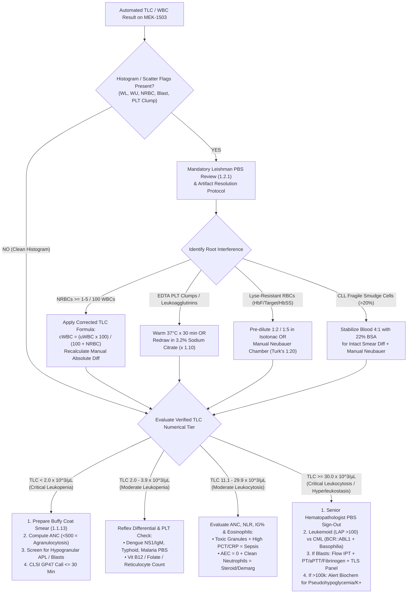

# 🛡️ 1.1.5 — Total Leucocyte Count (`TLC` / `WBC` — White Blood Cell Count): International Reference Laboratory & Above-NABL Technical SOP

> **Document Control & Regulatory Governance (`ISO 15189:2022 Clauses 8.2 & 8.3` / `NABL 112` / `CAP HEM.22000 & HEM.30000`):**
> - **Document ID:** `NABL-HEM-SOP-1.1.5` | **Version:** `4.0 (Expanded 10-Persona Red-Team & WHO 5th Ed 2022 Edition)`
> - **Effective Date:** `15-Oct-2026` | **Review Cycle:** `Annual (or upon Instrument / Reagent Lot / ICSH Guideline Change)`
> - **Authorizing Authority:** `Laboratory Director & Chief Consultant Hematopathologist (MD Pathology, DM Clinical Hematology)`
> - **Quality Management System:** `ISO 15189:2022 Clauses 4.1–8.9 & Normative Annex A` | `NABL 112 / 153 / 220D / 223` | `CLSI H20-A2, H26-A2, GP41, GP47, EP15-A3, EP06-Ed2, EP17-A2, EP28-A3c` | `ICSH Consensus Recommendations for Automated & Manual Leukocyte Enumeration` | `WHO Classification of Haematolymphoid Tumours (5th Edition, 2022)`
> - **Controlled Distribution:** `Master LIMS Knowledge Base, Automated Hematology Bench (Nihon Kohden MEK-1503), Microscopy & Manual Hemocytometry Workbench, Emergency / STAT Triage Desk`

**Department Folder:** `01_Hematology_and_Coagulation`  
**Cluster Folder:** `1.1_Hemogram_CBC_and_Leucocyte_Platelet_Cluster`  

---

## 🏛️ 10-Persona Adversarial Red-Team Review & Clinical Governance Charter

| Persona ID | Reviewer Role & Institutional Domain | Core Audit Mandate & Technical Contributions Integrated in Version 4.0 |
| :--- | :--- | :--- |
| **Persona 1** | **Lead NABL (`ISO 15189:2022` / `NABL 112 / 153 / 220D`) & CAP (`HEM.22000 / HEM.30000`) Assessor** | Enforces complete clause-level traceability (`Clauses 5.5, 7.2, 7.3, 7.4`), mandatory Nucleated RBC (`NRBC`) correction audit trails, pre-analytical rejection logs, and vertical witness-audit simulation records. |
| **Persona 2** | **Senior Consultant Hematopathologist (`MD Pathology / DM Clinical Hematology`)** | Details bone marrow granulopoiesis kinetics (mitotic vs post-mitotic storage pools), endothelial margination dynamics (`CD62L` / `CD11b/CD18`), tropical leukopenias, and leukoerythroblastic blood pictures. |
| **Persona 3** | **CLSI & IFCC Metrology, Method Verification & Six-Sigma QC Specialist** | Establishes `EFLM EuBIVAS` biological variation ($CV_I = 10.8\%$, $CV_G = 19.4\%$, $\text{II} = 0.56$, $\text{RCV}_{95\%} = \pm 30.4\%$), Expanded Measurement Uncertainty ($U = \pm 4.5\%$), `CLSI H26-A2` linearity/carryover, and Six-Sigma Westgard rules. |
| **Persona 4** | **Clinical Pharmacologist & Special-Population Stratification Auditor** | Stratifies 17 age/sex/neonatal/maternity reference partitions (`Cord Blood 9.0–30.0k`, `3rd Trimester 6.5–16.5k`, `Labor 10.0–25.0k`) and maps drug-induced demargination (`Dexamethasone`, `Epinephrine`), `G-CSF`, `Lithium`, and agranulocytosis (`Clozapine`, `Carbimazole`, `Methotrexate`). |
| **Persona 5** | **Medico-Legal, Patient-Safety & `ISO 22367` Risk Management Counsel** | Embeds `CPA 2019`, `DPDP Act 2023`, and `BMW Rules 2016/2019` compliance, verbatim `CLSI GP47` 30-minute critical read-back scripts (`< 2.0k`, `> 30.0k`, `> 100.0k`), and an 8-scenario quantitative `ISO 22367` `FMECA` matrix. |
| **Persona 6** | **Uncompressed Clinical Documentation & Readability Architect** | Eliminates truncated shorthand in favor of self-contained biophysical equations, worked clinical examples, multi-parameter differential tables, and step-by-step bench recovery procedures. |
| **Persona 7** | **Vertical Witness-Audit Simulation & Turnkey LIMS Architect** | Designs automated LIMS reflex cascades, conditional pathologist sign-out libraries, and a pre-filled `NABL 220D` vertical audit trail for an `NRBC`-interfered specimen. |
| **Persona 8** | **`ICSH` & `CLSI H26-A2` Leukocyte Aperture Impedance (`> 35 fL`), Erythrocyte Stromatolysis & `WL` Flagging Engineer (`MEK-1503`)** | Audits quaternary ammonium surfactant stromatolysis (`Hemolynac`), cytoplasmic stripping physics, DynaHelix hydrodynamic focusing DC impedance across the $100\ \mu\text{m}$ aperture, 3-angle laser scatter (`FSC/SSC/SDS`), and `WL`/`WU` ghost-zone troubleshooting. |
| **Persona 9** | **`WHO 5th Ed (2022)` Acute Leukemia (`AML / ALL / APL`), `CML` vs Leukemoid Reaction & Hyperleukocytosis Hematopathologist** | Constructs the 10-parameter `Leukemoid Reaction` vs `CML` (`BCR::ABL1` / `LAP Score`) comparison matrix, `AML` vs `ALL` vs `APL` (`PML::RARA` DIC emergency) criteria, and hyperleukocytosis metabolic artifacts (`pseudohypoglycemia`, `pseudohyperkalemia`, `leukocyte larceny`). |
| **Persona 10** | **Nucleated RBC (`NRBC`) Mathematical Correction & Improved Neubauer Hemocytometer (`Turk's Fluid 1:20`) Reference Specialist** | Derives the exact `Improved Neubauer` chamber volume ($0.4\ \mu\text{L}$ across 4 large corner squares $\rightarrow N \times 50$), Poisson counting statistics, $22\%$ `BSA` (4:1) `CLL` smudge-cell stabilization, and first-principles derivation of `Corrected TLC` and `Absolute NRBC Count`. |

---

## 🔬 Section 1: Test Name, LOINC (`6690-2` / `804-5` / `26464-8` / `33256-9`), Clinical Indication & Dual Analytical Principles

### 1.1 International Coding, Metrological Traceability & Platform Matrix

| Attribute | Specification / Reference Standard |
| :--- | :--- |
| **Official Test Name** | **Total Leucocyte Count (`TLC` / `WBC` — White Blood Cell Count)** |
| **Synonyms & LIMS Mnemonics** | `TLC`, `WBC`, `Total WBC Count`, `Leukocyte Count`, `White Cell Count (WCC)`, `Corrected WBC (cWBC)` |
| **Primary LOINC Codes** | • **`6690-2`**: *Leukocytes [#/volume] in Blood by Automated count* (Primary Automated Impedance/Optical Channel)<br>• **`804-5`**: *Leukocytes [#/volume] in Blood by Manual count* (Reference Improved Neubauer Hemocytometer with Turk's Fluid)<br>• **`26464-8`**: *Leukocytes [#/volume] in Blood* (Method-agnostic clinical reporting parent code)<br>• **`33256-9`**: *Leukocytes [#/volume] Corrected for Nucleated Erythrocytes in Blood* (Mandatory when $\ge 1\text{–}5\text{ NRBCs}/100\text{ WBCs}$)<br>• **`30394-1`**: *Nucleated erythrocytes [#/volume] in Blood* (Absolute `NRBC` Count) & **`19048-8`**: *Nucleated erythrocytes/100 leukocytes [Ratio] in Blood* |
| **SNOMED-CT Terminology** | • **Procedure:** `767002` (*White blood cell count*) / `104130007` (*Manual white blood cell count*)<br>• **Specimen:** `445295009` (*Whole blood sample in K2-EDTA*) / `119297000` (*Blood specimen*)<br>• **Findings:** `111583006` (*Leukocytosis*), `419188005` (*Leukopenia*), `165517008` (*Neutropenia*), `398057008` (*Leukemoid reaction*) |
| **ICD-10 / ICD-11 Clinical Indications** | • **Infectious & Inflammatory:** `A41.9` / `1G40` (*Sepsis*), `A90` / `1D2Z` (*Dengue fever*), `A01.0` / `1A07` (*Typhoid fever*), `B50–B54` (*Malaria*), `B55.0` (*Visceral leishmaniasis / Kala-Azar*), `A75.3` (*Scrub typhus*)<br>• **Quantitative Leukocyte Disorders:** `D72.829` / `4B00` (*Elevated white blood cell count / Leukocytosis*), `D72.819` (*Decreased white blood cell count / Leukopenia*), `D70.9` / `4B00.0` (*Agranulocytosis / Neutropenia*)<br>• **Hematolymphoid Neoplasms (`WHO 5th Ed 2022`):** `C92.1` (*BCR::ABL1-positive Chronic Myeloid Leukemia*), `C91.1` (*Chronic Lymphocytic Leukemia*), `C92.0` (*Acute Myeloid Leukemia*), `C92.4` (*Acute Promyelocytic Leukemia*), `C91.0` (*Acute Lymphoblastic Leukemia*) |
| **Conventional $\leftrightarrow$ SI (`UCUM`) Units** | • **Primary Reporting Unit:** $\times 10^3/\mu\text{L}$ (equivalent to $\times 10^9/\text{L}$ in `SI / UCUM` `10*9/L`; **Exact Conversion Factor $= 1.000$**)<br>• **Legacy Clinical Unit:** $\text{cells}/\text{mm}^3$ or $\text{cells}/\text{cumm}$ or $\text{cells}/\mu\text{L}$ ($\times 10^3/\mu\text{L} \times 1,000 = \text{cells}/\mu\text{L}$) |
| **Metrological Traceability (`ISO 17511`)** | Traceable to the **ICSH / CLSI H26-A2 International Reference Method for Automated Leukocyte Counting** (single-channel optical/impedance particle counter calibrated with certified monodisperse polystyrene latex spheres and stabilized human whole-blood calibrators [`Nihon Kohden MEK-CAL`]). |
| **Primary Automated Platform** | **Nihon Kohden Celltac $\alpha+$ / $\text{MEK-1503}$** — Quaternary Ammonium Stromatolysis + **DynaHelix Flow Hydrodynamic Focusing DC Electrical Impedance** ($100\ \mu\text{m}$ aperture, $> 35\text{ fL}$ threshold) + **3-Angle Semiconductor Laser Optical Scatter (`FSC / SSC / SDS`)**. |
| **Mandatory Reference Backup** | **Improved Neubauer Bright-Line Hemocytometer** ($\text{Depth} = 0.100\text{ mm} \pm 1\%$, calibrated to `DIN 12847`) using **Turk's Diluting Fluid ($1:20$ dilution)** + **Romanowsky (Leishman / May-Grünwald-Giemsa) Stained Peripheral Blood Smear (`PBS`)**. |

---

### 1.2 Bone Marrow Granulopoiesis Kinetics & Intravascular Compartmental Physiology

To interpret rapid physiological shifts versus true clonal or infectious pathology, the hematopathologist and clinician must evaluate the **4 anatomical and functional leukocyte compartments**:

1. **Bone Marrow Mitotic (Proliferative) Pool ($\sim 2.0 \times 10^9\text{ cells/kg}$; Transit Time $\approx 5\text{–}6\text{ Days}$):**
   - Comprises **Myeloblasts**, **Promyelocytes**, and **Myelocytes** capable of active DNA synthesis and mitotic division under the regulation of **Granulocyte Colony-Stimulating Factor (`G-CSF` / `CSF3`)**, **GM-CSF**, **IL-3**, and transcription factors **`PU.1`**, **`C/EBPα`** (steady-state granulopoiesis), and **`C/EBPβ`** (emergency granulopoiesis during sepsis).
2. **Bone Marrow Post-Mitotic Maturation & Storage Reserve Pool ($\sim 6.0\text{–}8.0 \times 10^9\text{ cells/kg}$; Transit Time $\approx 5\text{–}7\text{ Days}$):**
   - Comprises non-dividing **Metamyelocytes**, **Band Forms (Stabs)**, and mature **Segmented Neutrophils** retained in the marrow sinusoids via the **`CXCR4`–`CXCL12` (`SDF-1`)** chemokine tether.
   - Contains **$10\text{ to }15\text{ times}$ the total number of neutrophils present in the entire intravascular circulation**. During acute bacterial sepsis or exogenous `G-CSF` administration, downregulation of `CXCL12` and cleavage of `CXCR4` by neutrophil elastase release this massive reserve within **$2\text{–}6\text{ hours}$**, producing a true **Left Shift** (bands and metamyelocytes).
3. **Intravascular Compartment ($\sim 0.6 \times 10^9\text{ cells/kg}$; Half-Life $t_{1/2} \approx 6\text{–}8\text{ Hours}$) — Split $50:50$ into Two Sub-Pools:**
   - **Circulating Pool (`CP` — $\sim 50\%$ of Intravascular Neutrophils):** Freely flowing leukocytes in axial blood stream sampled by the venipuncture needle and measured as the `TLC`.
   - **Marginated Pool (`MP` — $\sim 50\%$ of Intravascular Neutrophils):** Mature neutrophils reversibly rolling along or transiently sequestered on post-capillary venular endothelium (particularly in pulmonary, splenic, and splanchnic microvasculature) mediated by **L-selectin (`CD62L`)** and **$\beta_2$-integrins (`CD11a/CD18` LFA-1 and `CD11b/CD18` Mac-1)**.
   - **Clinical Imperative:** A venipuncture only measures the **Circulating Pool (`CP`)**. Any stimulus that detaches the Marginated Pool (`MP`) into axial flow (**epinephrine, vigorous exercise, infant crying, labor, seizures, or corticosteroids**) **instantly doubles the measured `TLC` within $5\text{–}60\text{ minutes}$** without any new cell production or infection!
4. **Extravascular Tissue Compartment (Lifespan $\approx 1\text{–}4\text{ Days}$):**
   - Once neutrophils undergo firm adhesion (`ICAM-1` binding) and transendothelial diapedesis (`PECAM-1 / CD31`) into inflamed tissues, they never return to the peripheral blood; they execute phagocytosis/respiratory burst (`NADPH` oxidase) or `NETosis` and undergo macrophage clearance (`efferocytosis`).

---

### 1.3 Dual Analytical Principles: Automated Impedance/Laser Scatter (`MEK-1503`) & Manual Hemocytometry (`Turk's Fluid`)

#### Principle A — Primary Automated Method (`Nihon Kohden MEK-1503` — Stromatolysis + DynaHelix Impedance + 3-Angle Laser Scatter)
1. **Two-Stage Dilution & Quaternary Ammonium Stromatolysis:**
   - The analyzer aspirates $20\text{–}30\ \mu\text{L}$ of whole $\text{K}_2\text{-EDTA}$ blood and performs an initial dilution in buffered isotonic electrolyte solution (**`Isotonac-3 / Isotonac-4`**, osmolality $\approx 290\text{ mOsm/kg}$, $\text{pH } 7.4$, conductivity-stabilized).
   - A precise aliquot is diverted to the `WBC` counting chamber and mixed with a non-cyanide quaternary ammonium surfactant and organic acid lysing reagent (**`Hemolynac-310` / `Hemolynac-510`**) at a final **`WBC` bath dilution ratio of $1:250$**.
   - **Biophysical Action of the Stromatolyser (`10–15 second` reaction kinetic):**
     - **Erythrocyte Stromatolysis:** Solubilizes the lipid bilayer of normal mature erythrocytes ($4.5\text{–}6.0 \times 10^6/\mu\text{L}$), releasing intracellular hemoglobin into the bath and collapsing the residual RBC membranes into tiny **erythrocyte stroma ("ghosts") measuring $< 15\text{–}25\text{ fL}$** so they fall below the leukocyte counting threshold.
     - **Cytoplasmic Stripping of Leukocytes:** Selectively perforates leukocyte plasma membranes, allowing hypertonic/isotonic cytoplasmic water to efflux so the plasma membrane shrinks tightly around the nucleus and cytoplasmic granules. This Differential Cytoplasmic Stripping compresses native leukocytes into distinct **stripped nuclear-granular volume sub-populations**:
       - **Small Region (`35–90 fL`):** Stripped Lymphocytes (single dense spherical nucleus with minimal residual cytoplasm) — *also the exact volumetric zone where unlysed Nucleated RBCs (`NRBCs`) and giant/clumped platelets intrude!*
       - **Middle / Mixed Region (`90–160 fL`):** Monocytes, Basophils, Eosinophils, Blasts, and Immature Granulocytes.
       - **Large Region (`160–400 fL`):** Polymorphonuclear Neutrophils (multilobed nucleus plus dense primary azurophilic and secondary specific granules that physically prevent complete cytoplasmic collapse).
2. **DynaHelix Flow Hydrodynamic Focusing DC Electrical Impedance (`Total WBC Count`):**
   - The lysed suspension is hydrodynamically focused by a coaxial sheath stream (`DynaHelix` technology) through the center of a **$100\ \mu\text{m}$ diameter ($\times 75\ \mu\text{m}$ length) synthetic ruby aperture** across which a constant direct current ($I$) is maintained between internal and external platinum electrodes.
   - As each poorly conductive stripped leukocyte passes through the aperture, it displaces an equal volume of conductive `Isotonac` electrolyte, generating a voltage pulse ($\Delta V = I \cdot \Delta R$) governed by the **Coulter Principle**:
     $$\Delta V = I \cdot \rho_0 \cdot \frac{v_{\text{cell}}}{A^2} \cdot f_s$$
     where $\rho_0$ is electrolyte resistivity, $v_{\text{cell}}$ is the stripped cell volume, $A$ is aperture cross-sectional area, and $f_s$ is the particle shape factor.
   - **Total Pulse Enumeration:** Every voltage pulse exceeding the **WBC Lower Discriminator (`WL` threshold $= 35\text{ fL}$)** up to the **WBC Upper Discriminator (`WU` threshold $= 400\text{ fL}$)** is counted, corrected for coincidence loss via built-in Poisson dead-time circuitry, and reported as the **Total Leucocyte Count (`WBC / TLC`)**.
3. **3-Angle Semiconductor Laser Optical Flow Cytometry (`5-Part Differential Verification`):**
   - Simultaneously, a sheath-focused single-cell stream intersects a collimated **semiconductor laser beam ($\lambda = 635\text{–}650\text{ nm}$)** inside an optical quartz flow cell, capturing three optical scatter signals per cell:
     - **Forward Small-Angle Scatter (`FSC`, $1^\circ\text{–}5^\circ$):** Proportional to total native cell cross-sectional area and volume.
     - **Forward Large-Angle / Side Scatter (`SSC`, $20^\circ\text{–}45^\circ$):** Reflects internal nuclear segmentation complexity and chromatin refractive index.
     - **Side Diffraction Scatter (`SDS`, $70^\circ\text{–}110^\circ$):** Highly sensitive to cytoplasmic granularity (resolving hypergranular eosinophils and toxic neutrophils from agranular blasts and monocytes).
   - Cross-checking the impedance `WBC` count against the optical flow cytometric `WBC` count provides an internal analytical integrity check; a discrepancy $> 10\%$ between impedance and optical `WBC` triggers an automatic `WL / WBC Discordance` alert.

---

#### Principle B — Manual Reference Backup SOP (`Improved Neubauer Hemocytometer` with `Turk's Fluid 1:20`)
Whenever the automated analyzer displays an unresolved **`WL` (WBC Lower Discriminator)**, **`WU` (WBC Upper Discriminator)**, **`Lyse-Resistant RBC`**, **`CLL Fragile Smudge Cell`**, or **`Extreme Leukopenia (< 0.5 x 10^3/µL)`** flag, the technologist MUST perform the manual reference verification using the **Improved Neubauer Hemocytometer (`CLSI H20-A2` / `ICSH`)**:

1. **Reagent Composition & Quality Control of Turk's Diluting Fluid:**
   - **Glacial Acetic Acid (`CH3COOH`, Analytical Grade):** $2.0\text{ mL}$ — completely hemolyses all erythrocytes (including sickle cells, target cells, and fetal `HbF` cells that resist automated surfactant lysis!) while fixing and sharpening leukocyte nuclear chromatin.
   - **Aqueous Gentian Violet (`Crystal Violet`, $1\%\text{ w/v}$ solution):** $1.0\text{ mL}$ — metachromatically stains leukocyte nuclei a deep violet-purple for high-contrast bright-field identification.
   - **Type-I Deionized / Distilled Water:** Add to $100.0\text{ mL}$ total volume.
   - **Bench QC Rule:** Filter Turk's fluid through Whatman No. 1 filter paper weekly and run a blank chamber check; must show **$0\text{ particles/spores}$ per $4$ corner squares** before patient use.
2. **Exact Macro-Pipette ($1:20$) Dilution Protocol (Preferred over Thoma Bulb Pipette for Metrological Precision):**
   - Using a calibrated air-displacement micropipette (`ISO 8655` verified), dispense exactly **$380\ \mu\text{L}$ of filtered Turk's Fluid** into a clean $12 \times 75\text{ mm}$ borosilicate glass or polypropylene tube.
   - Aspirate **$20\ \mu\text{L}$ of well-mixed $\text{K}_2\text{-EDTA}$ whole blood** (inverted $8\text{–}10\times$), wipe the exterior of the pipette tip with lint-free gauze without touching the orifice, and dispense into the $380\ \mu\text{L}$ Turk's fluid, rinsing the tip $3\times$ in the supernatant:
     $$\text{Dilution Ratio} = \frac{20\ \mu\text{L (Blood)}}{20\ \mu\text{L (Blood)} + 380\ \mu\text{L (Turk's Fluid)}} = \frac{20}{400} = 1:20 \quad (\text{Dilution Factor } DF = 20)$$
   - *(Note: If using a traditional **WBC Thoma Pipette** with white mixer bead, draw blood to the **$0.5\text{ mark}$** and Turk's fluid to the **$11\text{ mark}$**. Because the stem volume from $0\text{ to }1$ does not participate in mixing inside the bulb [volume $= 11 - 1 = 10\text{ units}$], the effective bulb dilution is $0.5 / 10 = 1:20$. Discard the first $3\text{–}4$ drops of unmixed stem fluid before charging the chamber!)*
   - Mix gently for **$2\text{–}3\text{ minutes}$** on a mechanical rocker to ensure complete erythrocyte stromatolysis.
3. **Charging & Settling the Improved Neubauer Chamber:**
   - Clean the **Improved Neubauer chamber** and the thick **optically ground hemocytometer coverslip** ($0.4\text{ mm}$ thickness; never use flexible microscopy coverslips, which bow under capillary action and alter chamber depth!) with $70\%$ ethanol and lens paper.
   - Moisten the lateral support rails slightly and press the coverslip firmly until **Newton's interference rings (rainbow patterns)** appear, confirming an exact **$0.100\text{ mm}$ vertical depth**.
   - Charge **both counting grids (Chamber A and Chamber B)** in a single smooth capillary stroke without overflowing into the H-moat.
   - Place the hemocytometer inside a **covered moist Petri dish (lined with damp filter paper) for $3\text{ minutes}$** so leukocytes settle into a single focal plane without evaporative concentration.
4. **First-Principles Geometric Derivation of Volume & Exact Calculation Formula:**
   - The Improved Neubauer ruling measures $3\text{ mm} \times 3\text{ mm}$ ($9\text{ mm}^2$ total area), divided into **$9$ large squares of $1\text{ mm} \times 1\text{ mm}$ ($1.0\text{ mm}^2$ each)**.
   - The **4 large corner squares (`W1, W2, W3, W4`)** are each subdivided into $16$ medium squares ($0.25\text{ mm} \times 0.25\text{ mm}$).
   - **Volume of 1 Large Corner Square:**
     $$V_{\text{1 corner square}} = \text{Length }(1.0\text{ mm}) \times \text{Width }(1.0\text{ mm}) \times \text{Depth }(0.1\text{ mm}) = 0.1\text{ mm}^3 = 0.1\ \mu\text{L}$$
   - **Total Volume Counted Across All 4 Large Corner Squares (`W1 + W2 + W3 + W4`):**
     $$V_{\text{4 corner squares}} = 4 \times 0.1\text{ mm}^3 = 0.4\text{ mm}^3 = 0.4\ \mu\text{L}$$
   - **Exact Master Calculation Equation:**
     $$\mathbf{\text{TLC (cells/}\mu\text{L)} = \frac{N_{\text{4 corner squares}} \times \text{Dilution Factor (20)}}{\text{Volume Counted }(0.4\ \mu\text{L})} = N_{\text{4 corner squares}} \times \frac{20}{0.4} = N_{\text{4 corner squares}} \times 50}$$
     *(Expressed in standard SI/reporting units of $\times 10^3/\mu\text{L}$: $\text{TLC }(\times 10^3/\mu\text{L}) = \frac{N_{\text{4 corner squares}} \times 50}{1,000} = N_{\text{4 corner squares}} \times 0.05$).*
5. **Microscopic Counting Rules, Boundary Inclusion & Dilution Modifications:**
   - Examine under **$10\times$ objective ($100\times$ total magnification)** with the condenser iris diaphragm partially closed to enhance nuclear contrast.
   - **Inverted-"L" Boundary Rule:** Count all leukocytes lying inside the square PLUS those touching the **top and left boundary lines**; strictly exclude cells touching the **bottom and right boundary lines**.
   - **Quality Control Acceptance Between Squares & Chambers:** The cell count among the 4 individual large corner squares must not vary by more than $10\text{–}15\text{ cells}$, and the mean count between **Chamber A and Chamber B must agree within $\le 10\%$** (otherwise re-mix and re-charge).
   - **Modification for Severe Leukopenia ($\text{TLC} < 2.0 \times 10^3/\mu\text{L}$):** Prepare a **$1:10$ dilution** ($40\ \mu\text{L}$ blood $+ 360\ \mu\text{L}$ Turk's fluid) and count **all $9$ large squares** ($\text{Volume} = 0.9\ \mu\text{L}$):
     $$\text{TLC (cells/}\mu\text{L)} = \frac{N_{\text{all 9 squares}} \times 10}{0.9\ \mu\text{L}} = N_{\text{all 9 squares}} \times 11.11$$
   - **Modification for Extreme Hyperleukocytosis ($\text{TLC} > 50.0\text{–}100.0 \times 10^3/\mu\text{L}$):** Prepare a **$1:100$ or $1:200$ dilution** ($10\ \mu\text{L}$ blood $+ 1,990\ \mu\text{L}$ Turk's fluid $= 1:200$) to prevent cell overcrowding:
     $$\text{TLC (cells/}\mu\text{L at } 1:200) = \frac{N_{\text{4 corner squares}} \times 200}{0.4\ \mu\text{L}} = N_{\text{4 corner squares}} \times 500$$

---

## 🧪 Section 2: Pre-Analytical Variables, Physiological Demargination Kinetics & Storage Stability Matrix

### 2.1 `CLSI GP41` Phlebotomy, Anticoagulant Stoichiometry & Specimen Integrity

| Pre-Analytical Parameter | Technical Specification & Pathophysiological Mechanism (`CLSI GP41` / `ICSH`) |
| :--- | :--- |
| **Primary Specimen & Anticoagulant** | Venous Whole Blood collected in **Spray-Dried Dipotassium EDTA ($\text{K}_2\text{-EDTA}$, Lavender Top)** at a final concentration of **$1.5\text{–}2.2\text{ mg/mL}$ ($3.7\text{–}5.4\ \mu\text{mol/mL}$)** of blood. Drawn **5th in the `CLSI GP41` Order of Draw** (after Blood Culture, Citrate, SST/Plain, and Heparin). Mix immediately by **$8\text{–}10$ gentle $180^\circ$ inversions** (never shake vigorously). |
| **Alternative Anticoagulant (For `EDTA`-Induced Clumping)** | **$3.2\%$ ($0.109\text{ M}$) Trisodium Citrate (Light-Blue Top, $9:1$ blood-to-citrate ratio)** or **Magnesium Sulfate (`MgSO4` / `ThromboExact` tube)**. When reporting `TLC` from a $3.2\%$ Sodium Citrate tube, **multiply the raw automated `TLC` by $1.10$** ($\frac{10}{9}$) to correct for the $10\%$ liquid anticoagulant dilution! |
| **Short-Draw / Underfilling Artifact ($< 50\%$ Fill Volume)** | Excess $\text{K}_2\text{-EDTA}$ ($> 3.0\text{ mg/mL}$) induces hyperosmolar cytoplasmic shrinkage, nuclear pyknosis, and accelerated neutrophil membrane fragility during stromatolysis, causing **spurious mild leukopenia** and distorted 5-part scattergrams. |
| **Capillary Heel/Fingerstick vs Venous Draw** | Capillary blood exhibits a **physiologically higher `TLC` by $+8\%$ to $+15\%$** (up to $+20\%$ in neonates) compared to simultaneous venous blood due to microvascular hemoconcentration and local shear-induced leukocyte demargination during skin puncture. Avoid excessive squeezing ("milking"), which dilutes the specimen with interstitial tissue fluid and introduces tissue thromboplastin micro-clots. |
| **Intravenous (`IV`) Infusion Line Contamination** | Drawing blood proximal to or from an indwelling catheter without discarding $5\text{ mL}$ (or $2\times$ dead-space volume) causes **hemodilution (falsely low `TLC`)**; if drawn proximal to a dextrose/lipid infusion, coalesced chylomicrons/Intralipid droplets can cause **spurious leukocytosis**. |

---

### 2.2 Physiological & Pharmacological Neutrophil Demargination Kinetics (`30–60 Min` Doubling Phenomenon)

> [!IMPORTANT]
> **Critical Diagnostic Pearl — Demargination Doubles `TLC` Without Infection:** Because **$50\%$ of all intravascular neutrophils reside in the Marginated Pool (`MP`)** tethered loosely to post-capillary venular endothelium, any acute sympathetic or glucocorticoid stimulus shifts the `MP` into the Circulating Pool (`CP`), **doubling the peripheral `TLC` from $7.5 \times 10^3/\mu\text{L}$ to $15.0\text{–}22.0 \times 10^3/\mu\text{L}$ within $30\text{–}60\text{ minutes}$** with **ZERO bacterial infection**!

| Demargination Trigger | Molecular & Cellular Mechanism | Onset, Peak & Resolution Kinetics | Differentiating Hallmarks vs True Bacterial Sepsis |
| :--- | :--- | :--- | :--- |
| **1. Catecholamine Surge (`Epinephrine / Norepinephrine`, Vigorous Exercise, Severe Pain, Infant Crying, Generalized Seizure, Paroxysmal Tachycardia, Acute Trauma/Vomiting)** | Activation of endothelial and neutrophil **$\beta_2$-adrenergic receptors** elevates intracellular **`cAMP`**, inducing rapid conformational shedding of **L-selectin (`CD62L`)** and decreased affinity of **$\beta_2$-integrins (`CD11b/CD18` Mac-1)**, releasing marginated neutrophils and splenic lymphocytes into axial flow. | • **Onset:** **$5\text{–}15\text{ minutes}$**<br>• **Peak:** **$30\text{–}45\text{ minutes}$** (`TLC` increases by $+50\%$ to $+100\%$, up to $15.0\text{–}22.0 \times 10^3/\mu\text{L}$)<br>• **Resolution:** Returns to baseline within **$1\text{–}3\text{ hours}$** of rest. | • **Strictly Mature Segmented Neutrophils** (often accompanied by transient mild lymphocytosis in the first $30\text{ min}$)<br>• **NO Left Shift** (Bands $< 5\%$, `IG%` $< 0.5\%$)<br>• **NO Toxic Granulation, NO Döhle Bodies, NO Cytoplasmic Vacuolation**<br>• **`Procalcitonin` ($< 0.05\text{ ng/mL}$) and `CRP` ($< 5\text{ mg/L}$) are completely normal!** |
| **2. Exogenous or Endogenous Corticosteroids (`Dexamethasone`, `Prednisolone`, `Methylprednisolone`, `Hydrocortisone`, Cushing Syndrome, Acute Surgical/DKA Stress)** | **Dual Mechanism:**<br>1. Inhibits transcription of endothelial **`ICAM-1` / `E-selectin`** and neutrophil **`CD62L`**, blocking both margination and egress (diapedesis) into tissues (prolonging intravascular $t_{1/2}$ from $7\text{h}$ to $> 12\text{h}$).<br>2. Stimulates release of mature segmented neutrophils from the bone marrow storage pool while inducing **rapid mitochondrial apoptosis and lymphoid homing of Eosinophils and T-Lymphocytes**. | • **Onset:** **$30\text{–}60\text{ minutes}$** after IV/oral dose<br>• **Peak:** **$4\text{–}6\text{ hours}$** (`TLC` commonly **$14.0\text{–}25.0 \times 10^3/\mu\text{L}$**)<br>• **Resolution:** Persists throughout steroid therapy; normalizes **$24\text{–}48\text{ hours}$** after discontinuation. | **Classic Steroid Leukogram Triad:**<br>1. **Mature Neutrophilia** (minimal/no immature granulocytes; occasional late bands only)<br>2. **Profound Eosinopenia (`AEC` $= 0\text{–}10\text{ cells/}\mu\text{L}$)** and **Lymphopenia**<br>3. **Monocytosis** (unlike lymphopenia, monocytes rise alongside neutrophils under steroid action!)<br>4. **Absence of toxic granulation** and **normal `Procalcitonin`**. |
| **3. Post-Prandial Leukocytosis & Diurnal Circadian Rhythm** | Post-prandial splanchnic hyperemia and physiological afternoon cortisol/catecholamine fluctuations mobilize marginated leukocytes. | • **Morning Nadir ($07:00\text{–}09:00\text{h}$):** Baseline<br>• **Afternoon Peak ($16:00\text{–}20:00\text{h}$):** **$+10\%\text{ to }+15\%$ higher**<br>• **Post-Prandial:** $+1.0\text{–}1.5 \times 10^3/\mu\text{L}$ at $1\text{–}2\text{h}$ post-meal. | Remains within or slightly above the upper reference limit ($11.0\text{–}12.5 \times 10^3/\mu\text{L}$); serial monitoring should use **time-of-day matched morning collections**. |
| **4. Chronic Cigarette Smoking & Post-Splenectomy State** | Chronic airway inflammation (`IL-6` / `G-CSF` stimulation) and carboxyhemoglobin-mediated marrow release in heavy smokers; loss of splenic marginated pool ($25\text{–}30\%$ of reservoir) post-splenectomy. | Persistent baseline elevation: **`TLC` $11.0\text{–}15.0 \times 10^3/\mu\text{L}$** in heavy smokers ($> 1\text{ pack/day}$) and post-splenectomy patients. | Post-splenectomy PBS displays pathognomonic **Howell-Jolly bodies, Pappenheimer bodies, target cells, acanthocytes, and thrombocytosis**. |

---

### 2.3 Storage $> 24\text{h}$ Leukocyte Fragility, Nuclear Degeneration & Smudge Disruption Matrix

| Storage Interval | At Room Temperature ($18\text{–}25^\circ\text{C}$) | At Refrigerated Temperature ($2\text{–}8^\circ\text{C}$) | Morphological & Analytical Consequences (`ICSH` / `CLSI H20-A2`) |
| :--- | :--- | :--- | :--- |
| **$0 \text{ – } 4\text{ Hours}$ (Optimal Gold Standard)** | **100% Optimal** for both Automated `TLC`/5-Part Diff and `PBS` Morphology. | **100% Optimal** (Equilibrate to RT for $15\text{ min}$ before mixing and analysis). | Zero storage artifacts. **Mandatory window for preparing Peripheral Blood Smears (`PBS`)** when abnormal flags or blasts are suspected. |
| **$4 \text{ – } 12\text{ Hours}$** | Automated `TLC` stable ($\text{Bias} < \pm 1.5\%$). Mild `PBS` storage changes begin after $6\text{h}$. | Automated `TLC` and 5-Part Diff stable ($\text{Bias} < \pm 1.0\%$). | On `PBS` stored $> 6\text{h}$ at RT: Monocytes and neutrophils develop **punched-out cytoplasmic vacuoles** (mimicking septic vacuolation!) and early nuclear swelling. |
| **$12 \text{ – } 24\text{ Hours}$** | Automated `TLC` acceptable ($\text{Bias} \le \pm 3.0\%$) in healthy samples, **EXCEPT in sepsis or acute leukemia** where fragile apoptotic neutrophils/blasts begin lysing. | Automated `TLC` fully stable ($\text{Bias} \le \pm 2.0\%$). | On `PBS` at RT: Neutrophil nuclear lobes fuse into a single pyknotic chromatin mass (**"Pseudopelgeroid / Pseudo-Band" artifact**), cloverleaf lymphocyte nuclei appear, and **karyorrhexis / apoptotic bodies** form. |
| **$24 \text{ – } 48\text{ Hours}$ (`> 24h` Fragility Zone)** | **UNACCEPTABLE (`REJ-OLD-RT`):** Progressive **$-8\%\text{ to }-25\%$ spurious drop in `TLC`** due to osmotic/apoptotic leukocyte lysis during stromatolysis. | Automated `TLC` remains acceptable up to **$48\text{ hours}$** ($\text{Bias} \le \pm 4.0\%$), though automated 5-part scattergram clusters blur (`WL / WU` flags increase). | **Mechanism of $> 24\text{h}$ Spurious Leukopenia:** Depletion of intracellular `ATP` in stored $\text{K}_2\text{-EDTA}$ blood disables the $\text{Na}^+/\text{K}^+\text{-ATPase}$ pump $\rightarrow$ osmotic water influx swells the leukocyte $\rightarrow$ when mixed with `Hemolynac` surfactant, the fragile degenerated membrane and karyorrhectic nucleus shatter into sub-$35\text{ fL}$ debris (**smudge disruption**), causing a **false-low `TLC`**! |
| **$> 48\text{ Hours}$** | **Mandatory Rejection (`REJ-EXPIRED`).** | **Mandatory Rejection (`REJ-EXPIRED`).** | Severe cell lysis, degranulation, and nuclear fragmentation render both automated and manual counts clinically invalid. |

---

## 📊 Section 3: 17-Partition Age/Sex/Neonatal/Pregnancy Reference Intervals & `CLSI GP47` Panic Cutoffs

### 3.1 Comprehensive 17-Partition Reference Interval Matrix (`CALIPER` / `ICSH` / `Dacie & Lewis` / `ICMR` Harmonized)

| Partition # | Demographic / Physiological Group | Reference Interval ($\times 10^3/\mu\text{L}$ or $\times 10^9/\text{L}$) | Conventional Units ($\text{cells/}\mu\text{L}$ or $\text{cells/cumm}$) | Dominant Leukocyte Subtype & Physiological Modifiers |
| :---: | :--- | :---: | :---: | :--- |
| **1** | **Umbilical Cord Blood (Term Delivery, $0\text{ Hours}$)** | **$9.0 \text{ – } 30.0$** | **$9,000 \text{ – } 30,000$** | **Neutrophil Predominance ($60\text{–}70\%$):** Surge of fetal cortisol, catecholamines, and endogenous `G-CSF` during parturition; $1\text{–}5\text{ NRBCs}/100\text{ WBCs}$ common (correct if $\ge 5$). |
| **2** | **Preterm Neonate ($< 37\text{ Weeks}$ Gestation, Day $1$)** | **$6.0 \text{ – } 26.0$** | **$6,000 \text{ – } 26,000$** | Lower bone marrow granulocyte storage pool than term neonates; sepsis frequently presents with **neutropenia ($< 4.0\text{k}$)** rather than leukocytosis! Up to $10\text{–}20\text{ NRBCs}/100\text{ WBCs}$ physiological. |
| **3** | **Term Neonate — Postnatal Day $1$ ($1\text{–}24\text{ Hours}$)** | **$9.4 \text{ – } 34.0$**<br>*(Operational: $9.0 \text{ – } 30.0$)* | **$9,400 \text{ – } 34,000$** | Physiological postnatal peak occurs at **$12\text{–}18\text{ hours}$ of life**; mild left shift (bands up to $10\%$, occasional metamyelocyte) is normal. Evaluate **Immature-to-Total (`I:T`) Neutrophil Ratio** ($> 0.20$ indicates neonatal sepsis). |
| **4** | **Early Neonate ($2 \text{ – } 7\text{ Days}$)** | **$5.0 \text{ – } 21.0$** | **$5,000 \text{ – } 21,000$** | Rapid decline in post-parturition neutrophilia over the first $72\text{–}96\text{ hours}$. **First Physiological Crossover** (`Neutrophils % = Lymphocytes %`) occurs at **Day $4\text{–}5$ of life**. |
| **5** | **Late Neonate ($8 \text{ – } 30\text{ Days}$)** | **$5.0 \text{ – } 19.5$** | **$5,000 \text{ – } 19,500$** | Established **Lymphocytic Predominance ($50\text{–}65\%$ lymphocytes)**; circulating `NRBCs` must disappear by Day $5\text{–}7$ in healthy term neonates. |
| **6** | **Early Infant ($1 \text{ – } 5\text{ Months}$)** | **$6.0 \text{ – } 17.5$** | **$6,000 \text{ – } 17,500$** | Peak physiological lymphocytosis ($55\text{–}70\%$ of `TLC`); reactive/immunoblast-like lymphocytes (`hematogones`) are physiological during thymic and B-cell repertoire expansion. |
| **7** | **Late Infant ($6 \text{ – } 11\text{ Months}$)** | **$6.0 \text{ – } 17.0$** | **$6,000 \text{ – } 17,000$** | Persistent lymphocytic predominance; waning maternal `IgG` coincides with frequent viral upper respiratory exposure. |
| **8** | **Toddler ($1 \text{ – } 3\text{ Years}$)** | **$6.0 \text{ – } 15.5$** | **$6,000 \text{ – } 15,500$** | Vigorous crying/struggling during phlebotomy commonly causes acute catecholamine demargination up to $16.5\text{–}18.0 \times 10^3/\mu\text{L}$. |
| **9** | **Pre-School Child ($4 \text{ – } 5\text{ Years}$)** | **$5.0 \text{ – } 14.5$** | **$5,000 \text{ – } 14,500$** | **Second Physiological Crossover (`Rule of 4–5`):** At age $4\text{–}5\text{ years}$, Neutrophil $\%$ ($\sim 45\%$) again equals Lymphocyte $\%$ ($\sim 45\%$), transitioning to adult neutrophil dominance thereafter. |
| **10** | **School-Age Child ($6 \text{ – } 12\text{ Years}$)** | **$4.5 \text{ – } 13.5$** | **$4,500 \text{ – } 13,500$** | Progressive stabilization toward adult granulocytic distribution ($50\text{–}65\%$ neutrophils). |
| **11** | **Adolescent ($13 \text{ – } 17\text{ Years}$, Tanner Stages III–V)** | **$4.5 \text{ – } 12.0$** | **$4,500 \text{ – } 12,000$** | Pubertal maturation; sex-independent reference limits. |
| **12** | **Adult Male ($\ge 18\text{ Years}$)** | **$4.0 \text{ – } 11.0$** | **$4,000 \text{ – } 11,000$** | Harmonized `ICSH`, `Dacie & Lewis`, and `ICMR` Indian Adult Reference Interval ($95\%$ central nonparametric interval). |
| **13** | **Adult Female, Non-Pregnant ($\ge 18\text{ Years}$)** | **$4.0 \text{ – } 11.0$** | **$4,000 \text{ – } 11,000$** | During the **mid-cycle ovulatory LH surge and luteal phase**, progesterone-mediated granulocyte release increases `TLC` by $+0.5\text{ to }+1.2 \times 10^3/\mu\text{L}$ compared to the follicular phase; declines slightly post-menopause. |
| **14** | **Pregnancy — 1st Trimester ($1 \text{ – } 12\text{ Weeks}$)** | **$5.5 \text{ – } 13.5$** | **$5,500 \text{ – } 13,500$** | Physiological gestational leukocytosis begins by $6\text{–}8\text{ weeks}$ due to placental `G-CSF`, estrogen/cortisol rise, and suppressed neutrophil apoptosis. |
| **15** | **Pregnancy — 2nd Trimester ($13 \text{ – } 27\text{ Weeks}$)** | **$6.0 \text{ – } 15.0$** | **$6,000 \text{ – } 15,000$** | Selective expansion of circulating mature neutrophils and bands (up to $8\text{–}10\%$ bands and $1\text{–}2\%$ metamyelocytes can appear physiologically in normal pregnancy!). |
| **16** | **Pregnancy — 3rd Trimester ($28 \text{ – } 40\text{ Weeks}$)** | **$6.5 \text{ – } 16.5$** | **$6,500 \text{ – } 16,500$** | **`TLC` up to $16.5 \times 10^3/\mu\text{L}$ is completely normal in the 3rd trimester.** Do not diagnose chorioamnionitis on `TLC` alone without fever, fetal tachycardia, toxic granulation, or elevated `CRP / Procalcitonin`. |
| **17** | **Active Labor / Intrapartum & Immediate Postpartum ($0 \text{ – } 48\text{ Hours}$)** | **$10.0 \text{ – } 25.0$**<br>*(Occasionally up to $29.0$)* | **$10,000 \text{ – } 25,000$** | Massive catecholamine + cortisol demargination plus uterine myometrial leukocyte mobilization during labor contractions; normalizes to non-pregnant baseline by **Postpartum Day $5\text{–}7$**. |

> [!TIP]
> **Special Demographic & Geriatric Modifiers:**
> - **Duffy-Null Phenotype (`ACKR1 / DARC` c.-67T>C polymorphism — `Fy(a-b-)`):** Individuals of African, Middle Eastern, or tribal Indian ancestry carrying the `Fy(a-b-)` variant exhibit a physiological lower reference limit of **`TLC` $3.0\text{–}3.2 \times 10^3/\mu\text{L}$** (and `ANC` $1.0\text{–}1.2 \times 10^3/\mu\text{L}$) with completely normal bone marrow reserve and zero infection risk.
> - **Geriatric Frailty ($\ge 75\text{ Years}$):** Baseline `TLC` ($4.0\text{–}10.5 \times 10^3/\mu\text{L}$) is preserved, but **senescent bone marrow frequently fails to mount leukocytosis during severe bacterial sepsis or pneumonia**! In elderly patients, a **normal `TLC` ($6.5 \times 10^3/\mu\text{L}$) accompanied by a Left Shift (`Bands > 10%` or `IG% > 2.0%`), Toxic Granulation, and High `NLR` ($> 6.0$)** must be treated as occult life-threatening sepsis.

---

### 3.2 `CLSI GP47` Critical ("Panic") Cutoffs, Hyperleukostasis Emergency & 30-Minute Read-Back Protocol

| Critical Tier | Numerical Cutoff ($\times 10^3/\mu\text{L}$) | Pathophysiological Threat & Clinical Urgency | Mandatory Bench Verification & Action Protocol (`CLSI GP47` & `ISO 15189 Cl. 7.4.1.6`) |
| :--- | :---: | :--- | :--- |
| **Tier-1 Critical LOW ("Panic" Leukopenia)** | **$< 2.0 \times 10^3/\mu\text{L}$**<br>*(Or `ANC` $< 0.5 \times 10^3/\mu\text{L}$ Agranulocytosis)* | High risk of fulminant **Febrile Neutropenia / Neutropenic Sepsis** (*Pseudomonas*, *Klebsiella*, *E. coli*, invasive *Aspergillus/Candida*), drug-induced agranulocytosis, aplastic anemia, or aleukemic acute leukemia. | 1. **Rule out Pre-Analytical Clot / Leukoagglutination:** Inspect tube with wooden applicator sticks; check PBS feathered edge for neutrophil clumps.<br>2. **Perform Manual PBS & Buffy Coat Smear (`1.1.13`):** Calculate `ANC` ($\text{TLC} \times \frac{\%\text{Neutrophils} + \%\text{Bands}}{100}$) and screen for blasts/promyelocytes (`Hypogranular APL`!).<br>3. **Notify Physician within $\le 30\text{ Minutes}$** with mandatory Read-Back logging. |
| **Tier-1 Critical HIGH ("Panic" Leukocytosis)** | **$> 30.0 \times 10^3/\mu\text{L}$** *(Adult / Child)*<br>**$> 50.0 \times 10^3/\mu\text{L}$** *(Neonate $< 7\text{d}$)* | Indicates severe pyogenic sepsis / tissue necrosis (**Leukemoid Reaction**), **Chronic Myeloid Leukemia (`CML`)**, **Chronic Lymphocytic Leukemia (`CLL`)**, or **Acute Leukemia (`AML / ALL`)**. | 1. **Rule out Spurious Leukocytosis (`Section 5`):** Inspect PBS for **Nucleated RBCs (`NRBCs`)** — if $\ge 1\text{–}5\text{ NRBCs}/100\text{ WBCs}$, compute and report **Corrected TLC**! Check for platelet clumps or lyse-resistant RBCs.<br>2. **Perform Pathologist PBS Review (`1.2.1`):** Differentiate reactive toxic neutrophilia from blasts or `CML` myelocyte bulge + basophilia.<br>3. **Notify Physician within $\le 30\text{ Minutes}$** (for first-time/unexpected results). |
| **Tier-2 Oncological & Metabolic Emergency: Extreme Hyperleukocytosis** | **$> 100.0 \times 10^3/\mu\text{L}$**<br>*(Danger starts at $> 50.0 \times 10^3/\mu\text{L}$ in monocytic `AML M4/M5` or `APL`!)* | **1. Microvascular Leukostasis Syndrome:** Large, rigid, non-deformable myeloid blasts (`mean volume 350–500 fL`) increase whole-blood viscosity and express endothelial adhesion molecules (`ICAM-1`, `VCAM-1`), occluding cerebral and pulmonary microvessels $\rightarrow$ **intracranial hemorrhage, stroke, hypoxia/ARDS, priapism, and retinal hemorrhage**.<br>**2. Spontaneous Tumor Lysis Syndrome (`TLS`) & `DIC`:** Hyperkalemia, hyperuricemia, hyperphosphatemia, hypocalcemic tetany, acute kidney injury.<br>**3. Four Classic In-Vitro Laboratory Artifacts (See Note Below)!** | 1. **Dilute Specimen $1:5$ or $1:10$ in `Isotonac`** if above automated `AMR` ($> 99.9 \times 10^3/\mu\text{L}$) to ensure linear enumeration.<br>2. **Cross-Departmental LIMS Alert to Biochemistry & Blood Gas Bench:** Flag specimen for **Pseudohypoglycemia, Pseudohyperkalemia, Pseudohypoxemia, and Spurious `Hb/MCHC` elevation**.<br>3. **Immediate Direct Pathologist-to-Physician STAT Call ($\le 15\text{ Minutes}$)** for urgent cytoreduction (Hydroxyurea / Leukapheresis / Hydration / Rasburicase). |

> [!CAUTION]
> **The 4 Mandatory Cross-Bench In-Vitro Artifacts of Extreme Hyperleukocytosis ($\text{TLC} > 100.0 \times 10^3/\mu\text{L}$):**
> 1. **In-Vitro Pseudohypoglycemia:** Massive numbers of metabolically active blasts/leukocytes consume plasma glucose inside the collection tube at a rate of **$10\text{–}40\text{ mg/dL per hour}$** even in Sodium Fluoride (`NaF`) tubes (because `NaF` inhibits late enolase but not early hexokinase phosphorylation!). **Mandate:** Centrifuge plasma within **$\le 15\text{ minutes}$** on ice or use Citrate-Fluoride-EDTA buffered tubes / point-of-care arterial blood gas glucose.
> 2. **In-Vitro Pseudohyperkalemia ("Reverse Pseudohyperkalemia" in Heparin & Clot-Retraction Lysis in SST):** Fragile leukemic blasts (`CLL` / `ALL` / `AML`) lyse during pneumatic tube transport, clotting in serum tubes, or heparin-induced membrane fragility, releasing intracellular $\text{K}^+$ ($140\text{ mmol/L}$) and falsely elevating plasma/serum $\text{K}^+$ to **$6.5\text{–}9.0\text{ mmol/L}$** (causing lethal iatrogenic insulin/calcium therapy!). **Mandate:** Hand-carry blood (NO pneumatic tube!) and verify $\text{K}^+$ on **unspun whole-blood arterial/venous blood gas syringe** immediately at bedside.
> 3. **Spurious Arterial Pseudohypoxemia ("Leukocyte Larceny"):** In arterial blood gas (`ABG`) syringes kept at room temperature, $100,000\text{–}400,000/\mu\text{L}$ leukocytes rapidly consume dissolved $\text{O}_2$, dropping measured $\text{PaO}_2$ from $95\text{ mmHg}$ to $< 40\text{ mmHg}$ within $10\text{ minutes}$ while **pulse oximetry ($\text{SpO}_2 = 98\%$) remains normal**!
> 4. **Spurious Hemoglobin (`Hb`), `MCH`, and `MCHC` Elevation:** Extreme leukocyte nuclei create high optical turbidity in the SLS-Hemoglobin photometric cuvette ($\lambda = 535\text{ nm}$), falsely elevating `Hb` and pushing `MCHC` $> 36.5\text{ g/dL}$. **Mandate:** Centrifuge the `EDTA` tube, remove the buffy coat, or measure plasma-blanked / spun microhematocrit `Hb`.

#### Verbatim `CLSI GP47` 30-Minute Critical Value Notification & Read-Back Script
> *"Hello Dr. [Physician Name], I am calling from the Hematology Laboratory regarding an urgent Critical Total Leucocyte Count for your patient **[Patient Full Name]**, Unique Hospital ID **[UHID]**, Age/Sex **[Age/Sex]**, Sample ID **[Barcode]** collected at **[Time]**. The verified Total Leucocyte Count is **[Result] $\times 10^3/\mu\text{L}$** ([Result $\times 1,000$] cells/µL), confirmed on Leishman Peripheral Blood Smear [after excluding NRBC / platelet clump interference]. Key smear findings include **[ANC = X / Presence of X% Blasts / Toxic Granulation / Corrected for X NRBCs/100 WBCs]**. Under NABL ISO 15189 Clause 7.4.1.6 and CLSI GP47 patient-safety rules, could you please read back the patient's full name, UHID, and the critical TLC result, and confirm your full name and designation for our Critical Alert Register?"*

---

## 📐 Section 4: Metrology, Method Verification (`CLSI H26-A2`), `EFLM EuBIVAS` Biological Variation & Six-Sigma QC

### 4.1 `EFLM EuBIVAS` Biological Variation, Reference Change Value (`RCV`) & Measurement Uncertainty (`ISO/TS 20914`)

| Metrological Parameter | Symbol / Formula | Validated Numerical Value | Clinical & Metrological Interpretation |
| :--- | :---: | :---: | :--- |
| **Within-Subject Biological Variation (`EFLM EuBIVAS`)** | $CV_I$ | **$10.8\%$** | Reflects substantial physiological day-to-day and diurnal fluctuation driven by cortisol rhythm, posture, meals, and marginated-to-circulating pool equilibrium. |
| **Between-Subject Biological Variation (`EFLM EuBIVAS`)** | $CV_G$ | **$19.4\%$** | Broad inter-individual variation across healthy adults ($4.0\text{–}11.0 \times 10^3/\mu\text{L}$). |
| **Index of Individuality** | $\text{II} = \frac{CV_I}{CV_G}$ | **$0.56$** | Because $\text{II} < 0.60$, `TLC` exhibits **marked individuality**! A patient whose personal baseline `TLC` is $4.2 \times 10^3/\mu\text{L}$ can double their leukocyte count to $8.4 \times 10^3/\mu\text{L}$ during early appendicitis while still remaining "inside" the population reference interval ($4.0\text{–}11.0\text{k}$). Serial delta tracking is superior to population cutoffs. |
| **Analytical Imprecision (`MEK-1503` Internal QC)** | $CV_A$ | **$1.8\%$** *(Target Desirable $\le 5.4\%$; Optimum $\le 2.7\%$)* | Verified via `CLSI EP15-A3` across Normal ($7.2 \times 10^3/\mu\text{L}$) and High ($18.5 \times 10^3/\mu\text{L}$) Tri-Level Whole-Blood Controls (`MEK-3D`). |
| **Analytical Bias (EQAS / PT vs Peer Group)** | $\lvert B \rvert$ | **$1.2\%$** *(Target Desirable $\le 5.6\%$; Optimum $\le 2.8\%$)* | Verified via monthly `AIIMS ISHTM / CMC Vellore / Bio-Rad` External Quality Assessment Schemes (`EQAS`). |
| **Total Allowable Error (`CLIA '88 / 2024 & EFLM`)** | $\text{TE}_a$ | **$\pm 10.0\%$** *(CLIA: $\pm 15.0\%$ or $\pm 14.6\%$ EFLM Desirable)* | Laboratory adopts the stricter Above-NABL international target of **$\pm 10.0\%$**. |
| **Combined Standard & Expanded Measurement Uncertainty (`ISO/TS 20914`)** | $U = k \cdot \sqrt{u_{\text{rw}}^2 + u_{\text{cal}}^2 + u_{\text{bias}}^2}$ | **$u_c = 2.25\%$**<br>**$U\ (k=2, 95\%) = \pm 4.5\%$** | At the upper adult cutoff of $11.0 \times 10^3/\mu\text{L}$, the $95\%$ metrological dispersion is $11.0 \pm 0.50 \times 10^3/\mu\text{L}$ ($10.50\text{–}11.50 \times 10^3/\mu\text{L}$). |
| **Reference Change Value — $95\%$ Bidirectional (`Serial Delta Check`)** | $\text{RCV}_{95\%} = 1.96 \cdot \sqrt{2} \cdot \sqrt{CV_A^2 + CV_I^2}$ | **$\pm 30.4\%$** | Exact derivation: $1.96 \times 1.4142 \times \sqrt{1.8^2 + 10.8^2} = 2.7718 \times \sqrt{3.24 + 116.64} = 2.7718 \times 10.949 = \mathbf{\pm 30.35\% \approx \pm 30.4\%}$. A serial change between two consecutive `TLC` results must exceed **$\pm 30.4\%$** to represent a statistically significant biological change at $p < 0.05$. |
| **Reference Change Value — $99\%$ Bidirectional (`High-Specificity Delta`)** | $\text{RCV}_{99\%} = 2.576 \cdot \sqrt{2} \cdot \sqrt{CV_A^2 + CV_I^2}$ | **$\pm 39.9\%$** | Exact derivation: $2.576 \times 1.4142 \times 10.949 = \mathbf{\pm 39.89\% \approx \pm 39.9\%}$. |
| **Six-Sigma Process Performance Metric** | $\sigma = \frac{\text{TE}_a\% - \lvert B\% \rvert}{CV_A\%}$ | **$\mathbf{4.89\ \sigma}$** *(at $\text{TE}_a = 10\%$)*<br>**$\mathbf{7.67\ \sigma}$** *(at CLIA $\text{TE}_a = 15\%$)* | World-class analytical performance governed by **Westgard $1_{3s} / 2_{2s} / R_{4s} / 4_{1s}$ multi-rules** plus Bull's Moving Average (`X-barB`, batches of $n=20$ patient specimens). |

---

### 4.2 `CLSI H26-A2`, `EP15-A3`, `EP06-Ed2` & `EP17-A2` Analytical Verification Summary (`Nihon Kohden MEK-1503`)

| Verification Attribute (`CLSI` Standard) | Experimental Protocol | Acceptance Criterion | Verified Bench Performance |
| :--- | :--- | :--- | :--- |
| **Precision & Trueness (`CLSI EP15-A3` & `H26-A2`)** | $5\text{ runs/day} \times 5\text{ days}$ ($N=25$) across Level 1 Low ($2.4 \times 10^3/\mu\text{L}$), Level 2 Normal ($7.5 \times 10^3/\mu\text{L}$), and Level 3 High ($19.2 \times 10^3/\mu\text{L}$) controls. | Within-run $CV_r \le 2.5\%$ (Normal/High), $\le 4.0\%$ (Low); Total $CV_{WL} \le 3.0\%$. | • **Level 1 ($2.4\text{k}$):** $CV_r = 2.4\%$, $CV_{WL} = 2.8\%$<br>• **Level 2 ($7.5\text{k}$):** $CV_r = 1.4\%$, $CV_{WL} = 1.8\%$<br>• **Level 3 ($19.2\text{k}$):** $CV_r = 1.1\%$, $CV_{WL} = 1.5\%$ |
| **Analytical Measuring Range (`AMR`) & Linearity (`CLSI EP06-Ed2`)** | 11-point serial dilution of concentrated leukocyte buffy coat ($0.15$ to $105.0 \times 10^3/\mu\text{L}$) in autologous cell-free plasma. | Polynomial nonlinearity $\le 5.0\%$ or $\pm 0.2 \times 10^3/\mu\text{L}$ across entire `AMR`. | • **Verified `AMR` (Undiluted):** **$0.20 \text{ – } 99.9 \times 10^3/\mu\text{L}$** ($R^2 = 0.9996$, slope $= 1.004$).<br>• **Clinical Reportable Range (`CRR` with $1:5$ / $1:10$ `Isotonac` dilution):** Up to **$500.0 \times 10^3/\mu\text{L}$**. |
| **Detection Capability (`CLSI EP17-A2`: `LoB`, `LoD`, `LoQ`)** | 60 blank runs (`Isotonac` diluent) for `LoB`; 60 low-leukocyte dilutions ($0.05\text{–}0.30 \times 10^3/\mu\text{L}$) for `LoD` and functional `LoQ`. | $\text{LoB} \le 0.05 \times 10^3/\mu\text{L}$; $\text{LoQ}$ at total $\text{CV} \le 15.0\%$. | • **Limit of Blank (`LoB`):** $0.03 \times 10^3/\mu\text{L}$<br>• **Limit of Detection (`LoD`):** $0.08 \times 10^3/\mu\text{L}$<br>• **Limit of Quantitation (`LoQ`):** **$0.20 \times 10^3/\mu\text{L}$** (Below $0.20\text{k}$, verify on manual Neubauer chamber $1:10$ dilution). |
| **High-to-Low Carryover (`CLSI H26-A2` Broughton Protocol)** | Consecutive triplicate analysis of high-leukocyte specimen ($H_1, H_2, H_3 \approx 92.0 \times 10^3/\mu\text{L}$) followed immediately by saline/low specimen ($L_1, L_2, L_3 \approx 0.1 \times 10^3/\mu\text{L}$): $\text{Carryover}\% = \frac{L_1 - L_3}{H_3 - L_3} \times 100$. | $\text{Carryover} \le 0.50\%$. | **Verified Carryover $= 0.18\%$** (Probe back-flush & detergent rinse after any specimen $> 50.0 \times 10^3/\mu\text{L}$). |

---

## ⚠️ Section 5: The 8 Classic Causes of Spurious Leukocytosis & Spurious Leukopenia (`WL` / `WU` Flag Troubleshooting & `NRBC` Mathematics)

### 5.1 Biophysics of the `WL` ($35\text{ fL}$) Lower Discriminator & `WU` ($400\text{ fL}$) Upper Discriminator Flags (`Persona 8`)

On the **Nihon Kohden MEK-1503** (and equivalent impedance/optical hematology analyzers), the leukocyte volume histogram spans **$30\text{ fL}$ to $400\text{ fL}$**:
- **Normal Baseline Geometry:** Complete stromatolysis reduces erythrocytes and platelets into sub-$25\text{ fL}$ stroma, so the histogram valley at the **$35\text{ fL}$ Lower Discriminator (`LD` / `WL` zone)** returns cleanly to the zero baseline before rising into the Lymphocyte peak ($45\text{–}85\text{ fL}$).
- **`WL` Flag (WBC Lower Discriminator Error):** Triggered whenever the histogram curve at $35\text{ fL}$ fails to touch the baseline (exceeding $10\text{–}15\%$ of the lymphocyte peak height). This proves that **non-leukocyte particles measuring $25\text{–}60\text{ fL}$ are crossing the $35\text{ fL}$ gate and being falsely counted as `WBCs` (and specifically as Lymphocytes)**!
- **`WU` Flag (WBC Upper Discriminator Error):** Triggered when particles $> 400\text{ fL}$ fail to return to baseline at the right end of the neutrophil distribution, indicating **leukocyte agglutinins (clumped neutrophils), giant blast clusters, or micro-clots**.

---

### 5.2 Part A: The 5 Classic Causes of Spurious Leukocytosis (False-High `WBC`)

#### Cause 1 — Nucleated Red Blood Cells (`NRBCs` / Orthochromatic, Polychromatic & Basophilic Normoblasts) (`Persona 10`)
- **Biophysical Mechanism:** Unlike mature anucleate erythrocytes, **Nucleated Red Blood Cells (`NRBCs`)** contain a dense, pyknotic nucleus ($40\text{–}65\text{ fL}$). When exposed to `Hemolynac` stromatolysing reagent, the `NRBC` cytoplasm is lysed, but the **intact `NRBC` nucleus survives and passes through the $100\ \mu\text{m}$ impedance aperture**, generating a voltage pulse indistinguishable from a small lymphocyte ($35\text{–}70\text{ fL}$) and triggering a high left-shoulder **`WL` flag**.
- **Clinical Scenarios Where `NRBC` Interference is Frequent & Severe:**
  1. **Thalassemia Major / Intermedia ($\beta$-Thalassemia, `HbE/β-Thalassemia`)** and **Sickle Cell Anemia (`HbSS` crisis)**: Often $20\text{ to }500\text{ NRBCs per }100\text{ WBCs}$!
  2. **Neonates (Preterm, Term Day 1–3, Perinatal Asphyxia, and Hemolytic Disease of the Fetus & Newborn [`HDFN` — Rh/ABO Incompatibility])**.
  3. **Severe Autoimmune Hemolytic Anemia (`AIHA`), G6PD Crisis, Malaria, and Acute Hemorrhage**.
  4. **Post-Splenectomy State** (loss of splenic pitting of normoblast nuclei).
  5. **Leukoerythroblastic Reaction** (Myelofibrosis, Metastatic Carcinoma/Granuloma infiltrating bone marrow, Severe Sepsis/Hypoxia, `MDS`, and Acute Erythroid Leukemia).
- **First-Principles Mathematical Derivation of the Mandatory `Corrected TLC` Formula (`CAP HEM.30000` / `ICSH`):**
  - Let $\text{WBC}_{\text{uncorr}}$ be the total nucleated cell count reported by the automated analyzer:
    $$\text{WBC}_{\text{uncorr}} = \text{True TLC} + \text{Absolute NRBC Count}$$
  - On the Leishman-stained Peripheral Blood Smear (`PBS`), the morphologist counts $100\text{ true leukocytes}$ and simultaneously tallies $N_{\text{NRBC}}$ (the number of `NRBCs` encountered while counting $100\text{ true WBCs}$). Thus, for every $100\text{ true WBCs}$, there are $(100 + N_{\text{NRBC}})$ total nucleated cells (`TNCs`):
    $$\frac{\text{True TLC}}{\text{WBC}_{\text{uncorr}}} = \frac{100}{100 + N_{\text{NRBC}}}$$
  - Solving for **True Corrected `TLC`** and **Absolute `NRBC` Count**:
    $$\boxed{\mathbf{\text{Corrected TLC }(\times 10^3/\mu\text{L}) = \frac{\text{Uncorrected Automated WBC} \times 100}{100 + (\text{NRBCs per } 100\text{ WBCs})}}}$$
    $$\boxed{\mathbf{\text{Absolute NRBC Count }(\times 10^3/\mu\text{L}) = \text{Uncorrected Automated WBC} - \text{Corrected TLC} = \text{Corrected TLC} \times \left(\frac{\text{NRBCs per } 100\text{ WBCs}}{100}\right)}}$$
- **Mandatory Correction Threshold & Differential Recalculation Rule:**
  - **Correction Cutoff:** LIMS and bench technologists must apply the `Corrected TLC` formula whenever **$\ge 5\text{ NRBCs per }100\text{ WBCs}$** are present (**or $\ge 1\text{ NRBC per }100\text{ WBCs}$** in adult oncology/ICU patients, where **any circulating `NRBC` in a non-pregnant adult is pathological** and carries independent mortality significance!).
  - **Absolute Differential Count Recalculation:** Because the analyzer's automated Absolute Lymphocyte Count (`ALC`) falsely includes all the `NRBCs`, **automated 5-part absolute counts MUST BE SUPPRESSED** and replaced by manual PBS differential percentages multiplied by the **Corrected `TLC`**!
- **Worked Clinical Examples (`Persona 10` Audit Verification):**
  - **Worked Example 1 (Pediatric $\beta$-Thalassemia Major):**
    - A 4-year-old boy with $\beta$-Thalassemia Major has an Uncorrected Automated `WBC` of **$42.0 \times 10^3/\mu\text{L}$** (`WL` flag present; automated Lymphocytes $= 78\%$). Leishman `PBS` review reveals **$250\text{ orthochromatic and polychromatic normoblasts (`NRBCs`) per }100\text{ true WBCs}$**.
    - **Calculation:**
      $$\text{Corrected TLC} = \frac{42.0 \times 100}{100 + 250} = \frac{4,200}{350} = \mathbf{12.00 \times 10^3/\mu\text{L}\ (12,000\text{ cells/}\mu\text{L})}$$
      $$\text{Absolute NRBC Count} = 42.0 - 12.0 = \mathbf{30.00 \times 10^3/\mu\text{L}\ (30,000\text{ NRBCs/}\mu\text{L})}$$
    - *Clinical Impact:* Without `NRBC` correction, the child would be misdiagnosed with critical leukocytosis/leukemia ($42.0\text{k}$) instead of a normal toddler `TLC` ($12.0\text{k}$)!
  - **Worked Example 2 (Neonatal Rh-Hemolytic Disease of the Newborn — `HDFN`):**
    - A Day-1 neonate with severe Rh isoimmunization has an Uncorrected Automated `WBC` of **$54.0 \times 10^3/\mu\text{L}$**. PBS review identifies **$80\text{ NRBCs per }100\text{ WBCs}$**.
    - **Calculation:**
      $$\text{Corrected TLC} = \frac{54.0 \times 100}{100 + 80} = \frac{5,400}{180} = \mathbf{30.00 \times 10^3/\mu\text{L}\ (30,000\text{ cells/}\mu\text{L — Upper Normal for Day 1})}$$
      $$\text{Absolute NRBC Count} = 54.0 - 30.0 = \mathbf{24.00 \times 10^3/\mu\text{L}}$$

---

#### Cause 2 — `EDTA`-Induced Platelet Clumps, Platelet Satellitism & Giant Platelets (`Bernard-Soulier / MYH9 / ITP`)
- **Biophysical Mechanism:** In $0.1\text{–}0.2\%$ of hospitalized patients, chelating $\text{Ca}^{2+}$ with $\text{K}_2\text{-EDTA}$ exposes cryptic epitopes on the platelet **`GPIIb/IIIa` ($\alpha_{\text{IIb}}\beta_3$) integrin complex**, allowing naturally occurring `IgG/IgM` autoantibodies to cross-link platelets into **aggregates of $5\text{–}30$ platelets measuring $35\text{–}90\text{ fL}$** (or rosette around neutrophils in **Platelet Satellitism**). Similarly, in **Bernard-Soulier Syndrome**, **`MYH9`-related macrothrombocytopenia (May-Hegglin anomaly)**, or severe **Immune Thrombocytopenia (`ITP`)**, individual giant megakaryocytic fragments exceed $35\text{ fL}$.
- **Analyzer Signature:** Dual artifact: **Spurious Thrombocytopenia (`PU` / saw-toothed `PLT` upper tail)** paired with **Spurious Leukocytosis / Pseudolymphocytosis (`WL` flag at $35\text{ fL}$)**.
- **Mandatory Bench Resolution:**
  1. Inspect Leishman `PBS` feathered edge and body for platelet clumps or giant platelets.
  2. If `EDTA`-clumping is present, **vortex the tube at low speed for $30\text{–}60\text{ seconds}$** or collect a fresh specimen in **$3.2\%$ Sodium Citrate (multiply `WBC` and `PLT` by $1.10$)** or **`MgSO4` (`ThromboExact`)** tube, or verify `TLC` on **Improved Neubauer chamber with Turk's Fluid** (where $2\%$ acetic acid de-aggregates/lyses platelets or allows direct nuclear visualization under $100\times$/$400\times$).

---

#### Cause 3 — Lyse-Resistant Erythrocytes (`Neonatal HbF`, `Target Cells in Thalassemia / HbSS / HbC`, `Uremia`, `Cirrhosis / Obstructive Jaundice`)
- **Biophysical Mechanism:** Erythrocytes with an increased surface-area-to-volume ratio, high membrane cholesterol/phospholipid content (**Target Cells / Codocytes in obstructive jaundice, severe liver disease, $\beta$-thalassemia, `HbC`, `HbE`**), rigid dehydrated polymers (**irreversibly sickled cells in `HbSS`**), high **Fetal Hemoglobin (`HbF` in neonates)**, or uremic membrane carbamylation (**severe chronic kidney disease**) resist complete stromatolysis during the analyzer's brief $10\text{–}15\text{ second}$ reaction cycle. Unlysed RBCs ($55\text{–}90\text{ fL}$) flood the lower `WBC` channel, producing a massive **"ski-slope" `WL` interference peak** that can falsely inflate `TLC` from $8.0 \times 10^3/\mu\text{L}$ to $35.0\text{–}80.0 \times 10^3/\mu\text{L}$!
- **Mandatory Bench Resolution:**
  1. **Pre-Dilute Specimen $1:2$ or $1:5$ in `Isotonac` Diluent:** Increases the ratio of `Hemolynac` surfactant molecules per erythrocyte by $2\times\text{ to }5\times$ and extends effective lysis kinetics (multiply result by $2$ or $5$).
  2. **Definitive Gold Standard — Manual Improved Neubauer Count with Turk's Fluid ($1:20$, wait $5\text{ minutes}$):** Glacial acetic acid ($2\%$) in Turk's fluid completely lyses all target, sickle, uremic, and fetal erythrocytes while Gentian Violet stains only true nucleated cells!

---

#### Cause 4 — Cryoglobulins, Cryofibrinogen, Monoclonal Paraproteins (`Waldenström IgM / Myeloma`) & Extreme Hyperlipidemia (`Chylomicrons`)
- **Biophysical Mechanism:**
  - **Cryoglobulins (Type I Monoclonal `IgM/IgG`, Type II/III Hepatitis C-associated Mixed Cryoglobulins) & Cryofibrinogen:** Precipitate at $< 37^\circ\text{C}$ as amorphous protein floccules and crystalline needles measuring $30\text{–}150\text{ fL}$ that are counted as both platelets and leukocytes (`WL` flag).
  - **Monoclonal IgM Paraproteins (`Waldenström Macroglobulinemia`)**: Precipitate upon contact with acidic/low-ionic-strength lysing reagents.
  - **Extreme Hypertriglyceridemia ($\text{TG} > 2,000\text{–}4,000\text{ mg/dL}$ / IV Intralipid Infusion):** Coalesced chylomicron droplets refract laser light and generate impedance pulses $> 35\text{ fL}$.
- **Mandatory Bench Resolution:**
  1. **Warm the $\text{K}_2\text{-EDTA}$ tube in a $37^\circ\text{C}$ water bath for $30\text{ minutes}$** and re-analyze immediately using $37^\circ\text{C}$-equilibrated diluent; if the `TLC` normalizes and the `WL` flag disappears, add a mandatory clinical comment alerting the physician to **Cryoglobulinemia / Cryofibrinogenemia**.
  2. If paraprotein-reagent precipitation or severe lipemia persists at $37^\circ\text{C}$, perform **Isotonic Saline Plasma Replacement** (centrifuge at $1,200\times g$ for $10\text{ min}$, aspirate exact volume of lipemic/paraproteinemic plasma without disturbing the buffy coat, replace with an equal volume of `Isotonac` diluent, mix thoroughly, and re-run) or verify via **Manual Neubauer Chamber**.

---

#### Cause 5 — Intra-Erythrocytic Malarial Schizonts/Gametocytes (`P. falciparum / P. vivax`), Circulating Yeast (`Candida / Histoplasma`), or Micro-Fibrin Strands
- **Biophysical Mechanism:** Heavy parasitemia ($> 2\text{–}5\%$) with pigment-laden (*hemozoin*) malarial schizonts/gametocytes or disseminated candidemia/histoplasmosis leaves dense insoluble parasite/fungal bodies ($30\text{–}50\text{ fL}$) after RBC stromatolysis, causing a mild spurious rise at the `WL` border (and characteristic depolarized side-scatter on optical analyzers). Micro-fibrin strands from traumatic venipuncture similarly generate `WL` interference.

---

### 5.3 Part B: The 3 Classic Causes of Spurious Leukopenia (False-Low `WBC`)

#### Cause 6 — Fragile Leukocytes (`CLL` Basket/Smudge Cells — Gumprecht Shadows, Acute Blasts, Uremic/Sepsis Apoptotic Neutrophils) & The $22\%$ `BSA` (4:1) Stabilization Protocol (`Persona 10`)
- **Biophysical Mechanism:** Neoplastic B-lymphocytes in **Chronic Lymphocytic Leukemia (`CLL`)** have a marked deficiency of the intermediate filament protein **vimentin**, rendering their cytoskeleton abnormally fragile. When subjected to hydrodynamic shear stress and `Hemolynac` surfactant stromatolysis inside the automated analyzer, **$20\%$ to $50\%$ of `CLL` lymphocytes rupture completely into sub-$35\text{ fL}$ nuclear debris**, causing a **falsely low automated `TLC`**! Simultaneously, on a standard wedge Peripheral Blood Smear (`PBS`), mechanical wedging crushes these cells into **Gumprecht Smudge Cells ("Basket Cells")**, making an accurate 200-cell differential impossible.
- **Mandatory Bench Resolution — The $22\%$ Bovine Serum Albumin (`BSA`) $4:1$ Pre-Stabilization Protocol (`ICSH` / `CLSI H20-A2`):**
  1. **Reagent:** Commercial blood-bank grade **$22\%$ Bovine Serum Albumin (`BSA`)**.
  2. **Mixing Stoichiometry ($4:1$ Blood-to-BSA Ratio):** In a clean microtube, combine **$4\text{ parts}$ ($80\ \mu\text{L}$) of well-mixed $\text{K}_2\text{-EDTA}$ whole blood** with **$1\text{ part}$ ($20\ \mu\text{L}$) of $22\%$ `BSA`**.
  3. Mix gently by inversion for $1\text{–}2\text{ minutes}$. The albumin coats and osmotically stabilizes the fragile lymphocyte plasma membrane against mechanical shear stress.
  4. **Smear Preparation:** Prepare a Leishman-stained wedge `PBS` from the `BSA`-stabilized mixture — smudge cells are converted back into intact, identifiable mature lymphocytes (and prolymphocytes), enabling an accurate $200$-cell manual differential!
  5. **Definitive `TLC` Verification in Fragile `CLL`:** Perform a **gentle Manual Improved Neubauer Count ($1:20$ in Turk's fluid, read within $3\text{ minutes}$ of dilution)** on the native $\text{K}_2\text{-EDTA}$ specimen (or if performed on the $4:1$ `BSA`-stabilized blood, multiply the resulting count by **$1.25$** [$\frac{5}{4}$] to correct for the `BSA` dilution).

---

#### Cause 7 — Cold-Induced OR `EDTA`-Dependent Leukocyte Agglutination (`Leukoagglutinins`)
- **Biophysical Mechanism:** Cold-reacting `IgM` or `EDTA`-dependent `IgG/IgM` autoantibodies (associated with *Mycoplasma pneumoniae*, infectious mononucleosis, lymphoma, hepatic cirrhosis, or autoimmune disorders) agglutinate **neutrophils (`leukoagglutination`), lymphocytes, or neutrophil-platelet rosettes** into massive clusters of $5\text{ to }50\text{ cells}$ ($> 400\text{–}2,000\text{ fL}$).
- **Analyzer Signature:** Either each 20-cell cluster is counted as a single giant particle or fails to traverse the $100\ \mu\text{m}$ aperture, causing a **dramatic $40\text{–}75\%$ spurious drop in `TLC`** accompanied by a **`WU` (WBC Upper Discriminator) flag** and paradoxical elevation of Mean Neutrophil Volume!
- **Mandatory Bench Resolution:**
  1. Scan the feathered edge and lateral margins of the Leishman `PBS` under $100\times$ objective for large cohesive clusters of neutrophils or lymphocytes.
  2. **If Cold-Dependent Leukoagglutinin:** Warm the $\text{K}_2\text{-EDTA}$ tube at **$37^\circ\text{C}$ for $30\text{ minutes}$** and re-analyze immediately.
  3. **If `EDTA`-Dependent Leukoagglutinin (persists at $37^\circ\text{C}$):** Redraw the patient in **$3.2\%$ Sodium Citrate ($9:1$, multiply `TLC` by $1.10$)** or treat $500\ \mu\text{L}$ of $\text{K}_2\text{-EDTA}$ blood with **$10\text{ mg}$ of Kanamycin Sulfate** incubated at $37^\circ\text{C}$ for $30\text{ minutes}$ (which dissociates `EDTA`-dependent antibody bridges!).

---

#### Cause 8 — Partial Micro-Clotting (`Fibrin Entrapment`) & Over-Storage ($> 24\text{h}$ at RT)
- **Biophysical Mechanism:** Traumatic venipuncture or delayed mixing activates trace thrombin, generating microscopic fibrin strands that selectively trap adhesive polymorphonuclear neutrophils and monocytes while sparing lymphocytes, producing **spurious leukopenia + spurious relative lymphocytosis + spurious thrombocytopenia**.
- **Mandatory Bench Resolution:** Rim every critical-low `TLC` tube ($< 2.0 \times 10^3/\mu\text{L}$) with two wooden applicator sticks and inspect the PBS feathered edge for fibrin strands and trapped leukocyte-platelet masses; if present, reject (`REJ-CLOT`) and request a fresh non-traumatic draw.

---

### 5.4 Master Summary Matrix of All 8 Spurious `TLC` Mechanisms & Bench Recovery Actions

| # | Interferent / Artifact | Direction of `TLC` Bias | `MEK-1503` Histogram / Scatter Signature | Definitive `PBS` Hallmark | Mandatory Step-by-Step Corrective Action |
| :---: | :--- | :---: | :--- | :--- | :--- |
| **1** | **Nucleated RBCs (`NRBCs` $\ge 1\text{–}5/100\text{ WBCs}$)** | **$\uparrow\uparrow$ False High** | **`WL` Flag** ($35\text{ fL}$ valley fails to touch baseline); false spike in Lymphocyte channel ($40\text{–}65\text{ fL}$). | Orthochromatic / polychromatic normoblasts with dense ink-drop nuclei. | Count `NRBCs` per $100\text{ WBCs}$ on `PBS`; apply **$\text{Corrected TLC} = \frac{\text{Uncorrected WBC} \times 100}{100 + \text{NRBC}}$** and recalculate manual absolute diff. |
| **2** | **`EDTA` Platelet Clumps / Giant Platelets** | **$\uparrow$ False High** *(with $\downarrow\downarrow$ False Low `PLT`)* | **`WL` Flag** ($35\text{–}80\text{ fL}$); saw-toothed upper tail on `PLT` histogram (`PU` flag). | Cohesive platelet aggregates at feathered edge or giant platelets ($\ge \text{RBC}$ size). | Vortex $60\text{s}$; redraw in **$3.2\%$ Sodium Citrate ($\times 1.10$ correction)** or `MgSO4`; or verify on **Manual Neubauer Chamber (`Turk's Fluid`)**. |
| **3** | **Lyse-Resistant RBCs (`HbF`, Target Cells, `HbSS`, Uremia, Liver Dz)** | **$\uparrow\uparrow$ False High** | Massive **"Ski-Slope" `WL` Flag** descending from $< 35\text{ fL}$ into the lymphocyte region; `WBC` impedance $>$ optical count. | Target cells (codocytes), sickle cells, polychromasia, or neonatal macrocytes. | Pre-dilute $1:2$ or $1:5$ in `Isotonac` to increase surfactant-to-RBC ratio, OR count on **Improved Neubauer Chamber with $2\%$ Acetic Acid Turk's Fluid**. |
| **4** | **Cryoglobulins / Paraproteins / Severe Lipemia (`Chylomicrons`)** | **$\uparrow$ False High** | **`WL` Flag** + baseline turbidity; elevated `MCHC` ($> 36.5\text{ g/dL}$) if lipemic/paraproteinemic. | Pink/violet amorphous extracellular cryoglobulin precipitates or Rouleaux. | Incubate at **$37^\circ\text{C}$ for $30\text{ min}$** and rerun immediately; if persistent, perform **Isotonic Saline Plasma Replacement** or Manual Neubauer count. |
| **5** | **Malarial Schizonts / Gametocytes or Circulating Fungi** | **$\uparrow$ Mild False High** | Small **`WL` shoulder** at $35\text{–}50\text{ fL}$ + abnormal side-scatter depolarization cluster. | Intra-erythrocytic *P. falciparum / P. vivax* schizonts/gametocytes or budding yeast. | Report true `PBS` parasite identification and density; verify `TLC` if parasitemia $> 5\%$. |
| **6** | **Fragile Leukocytes (`CLL` Smudge Cells / Acute Blasts)** | **$\downarrow\downarrow$ False Low** | Left-shifted/depressed lymphocyte peak with sub-$35\text{ fL}$ debris (`WL` flag). | Abundant **Gumprecht smudge / basket shadows** ($> 20\text{–}60\%$ of cells on standard smear). | Prepare smear after **$4:1$ pre-stabilization with $22\%$ Bovine Serum Albumin (`BSA`)**; verify `TLC` via gentle **Manual Neubauer Count ($1:20$ Turk's Fluid)**. |
| **7** | **Cold or `EDTA`-Dependent Leukoagglutinins** | **$\downarrow\downarrow$ False Low** | **`WU` Flag** ($> 400\text{ fL}$ tail failure to return to baseline) + falsely low `WBC`. | Large rosettes/clusters of $5\text{–}50$ agglutinated neutrophils or lymphocytes at smear margins. | Warm at **$37^\circ\text{C}$ for $30\text{ min}$** (if cold-reacting) OR redraw in **$3.2\%$ Sodium Citrate ($\times 1.10$)** / incubate with Kanamycin (if `EDTA`-dependent). |
| **8** | **Micro-Clots / Over-Storage ($> 24\text{h}$ at RT)** | **$\downarrow\downarrow$ False Low** | Depressed granulocyte peak, `WL` apoptotic debris flag, and concurrent low `PLT`. | Fibrin strands trapping neutrophils/platelets (`clot`) OR karyorrhectic/vacuolated degenerated WBCs (`old sample`). | Reject specimen (`REJ-CLOT` or `REJ-EXPIRED`) and collect fresh $\text{K}_2\text{-EDTA}$ sample. |

---

## 🧬 Section 6: Deep Clinical & Morphological Differential Playbook (`WHO 5th Ed 2022` Harmonized) (`Persona 9`)

### 6.1 Complete 10-Parameter Comparison Matrix: `Reactive Leukemoid Reaction` vs `Chronic Myeloid Leukemia (CML — BCR::ABL1 Positive)`

A **Leukemoid Reaction** is defined as a persistent reactive peripheral leukocytosis ($\text{TLC} > 30.0\text{–}50.0 \times 10^3/\mu\text{L}$) with a circulating myeloid left shift triggered by an underlying non-leukemic stimulus (severe pyogenic sepsis, abscess, disseminated tuberculosis, *Clostridioides difficile* colitis, severe acute hemolysis, diabetic ketoacidosis, visceral necrosis, or paraneoplastic tumour `G-CSF` secretion). Differentiating a benign reactive **Leukemoid Reaction** from **Chronic Myeloid Leukemia (`CML`, `WHO 5th Ed 2022` *BCR::ABL1*-positive myeloproliferative neoplasm)** is a core hematopathology competency:

| # | Discriminator Parameter | **Reactive Leukemoid Reaction** (Sepsis / Necrosis / Paraneoplastic) | **Chronic Myeloid Leukemia (`CML` — Chronic Phase, `WHO 5th Ed 2022`)** |
| :---: | :--- | :--- | :--- |
| **1** | **Total Leucocyte Count (`TLC`) & Kinetic Trajectory** | Typically **$30.0 \text{ – } 75.0 \times 10^3/\mu\text{L}$** (rarely exceeds $100.0 \times 10^3/\mu\text{L}$). Rises acutely over hours-to-days in parallel with clinical infection/stress and **resolves rapidly upon antibiotic or surgical source control**. | Commonly **$50.0 \text{ – } 500.0 \times 10^3/\mu\text{L}$** (median at diagnosis $\approx 100.0\text{–}150.0 \times 10^3/\mu\text{L}$). Exhibits autonomous, relentless logarithmic doubling every $2\text{–}4\text{ weeks}$ until Tyrosine Kinase Inhibitor (`Imatinib / Dasatinib / Nilotinib`) therapy is initiated. |
| **2** | **Absolute Basophil Count (`ABC`) & Eosinophilia ("Basophil-Eosinophil Twins")** | **ABSENT (`Basophils < 1%`, `ABC < 0.10 x 10^3/µL`)** and **Eosinopenia (`AEC` often $0/\mu\text{L}$ due to endogenous stress cortisol)**! | **UNIVERSAL BASOPHILIA (`Basophils 2%–15%`, `ABC > 0.20–5.0 x 10^3/µL`) + Absolute Eosinophilia!** *(Persistent absolute basophilia is the single most reliable morphological clue for `CML` on the 5-part diff and PBS; $\ge 20\%$ basophils defines high-risk/accelerated progression under `WHO 5th Ed 2022`).* |
| **3** | **Myeloid Maturation Spectrum & The "Myelocyte Bulge"** | **Orderly Right-Skewed Pyramid:** Mature **Segmented Neutrophils ($65\text{–}80\%$) $>$ Band Forms ($10\text{–}20\%$) $>$ Metamyelocytes ($2\text{–}8\%$) $>$ Myelocytes ($1\text{–}4\%$)**. **No "Myelocyte Bulge."** | **Full Garden-Variety Myeloid Spectrum with a Bimodal "Myelocyte Bulge":** Two distinct peaks at **Segmented Neutrophils ($30\text{–}45\%$) AND Myelocytes ($15\text{–}25\%$)**, such that **`% Myelocytes > % Metamyelocytes` ($5\text{–}10\%$)**! Promyelocytes ($2\text{–}5\%$) are also readily seen. |
| **4** | **Circulating Myeloblasts (`WHO 5th Ed 2022` Phase Criteria)** | **Absent or $< 1\%$** (an occasional reactive myeloblast may appear only during extreme marrow regeneration/G-CSF rescue). | • **Chronic Phase (`CP-CML`):** **$1\% \text{ – } 9\%$ Blasts** ($10\text{–}19\%$ blasts indicates high-risk progression / legacy `AP-CML`).<br>• **Blast Phase (`BP-CML`):** **$\ge 20\%$ Myeloblasts or Lymphoblasts** in blood/marrow or extramedullary myeloid sarcoma. |
| **5** | **Neutrophil Cytoplasmic & Nuclear Morphology (`PBS`)** | **Prominent Reactive/Septic Changes:**<br>• **Coarse Dark-Purple Toxic Granulation** (persisting acid mucopolysaccharide in primary azurophilic granules)<br>• **Döhle Bodies** (pale sky-blue peripheral oval inclusions of rough endoplasmic reticulum / RNA)<br>• **Cytoplasmic Vacuolation** (phagosomes). | **Clean / Normal or Mildly Dysgranulopoietic Cytoplasm:**<br>• **Absence of toxic granulation and Döhle bodies**.<br>• Neutrophils appear morphologically unremarkable or slightly hypogranular; occasional acquired **Pseudo-Pelger-Huët** bilobed neutrophils may be seen. |
| **6** | **Leukocyte Alkaline Phosphatase (`LAP` / `NAP` Kaplow Cytochemical Score)** | **MARKEDLY ELEVATED (`LAP Score 120 – 350`; Reference: $20\text{–}100$)**.<br>*(Inflammatory cytokines and `G-CSF` strongly induce alkaline phosphatase synthesis inside secondary specific granules of mature reactive neutrophils).* | **MARKEDLY DECREASED OR ZERO (`LAP Score 0 – 15`; Reference: $20\text{–}100$)**.<br>*(Neoplastic `BCR::ABL1` neutrophils have defective specific granule alkaline phosphatase expression; note that `LAP` may transiently rise if `CML` is complicated by concurrent bacterial pneumonia or pregnancy).* |
| **7** | **Erythrocyte & Nucleated RBC (`NRBC`) Profile** | Mild normocytic normochromic anemia of acute inflammation (or hemolytic features if hemolysis-driven); `NRBCs` usually absent unless severe hypoxia/hemolysis is present. | **Leukoerythroblastic Blood Picture:** Mild-to-moderate normocytic anemia with frequent circulating **orthochromatic/polychromatic `NRBCs` ($2\text{–}15/100\text{ WBCs}$)** and **teardrop poikilocytes (`dacrocytes`)** reflecting marrow hypercellularity/fibrosis. |
| **8** | **Platelet Count & Megakaryocytic Features** | Normal or moderate reactive thrombocytosis ($450\text{–}650 \times 10^3/\mu\text{L}$), or **thrombocytopenia ($< 100 \times 10^3/\mu\text{L}$) if complicated by septic `DIC`**. | **Marked Clonal Thrombocytosis ($450 \text{ – } > 1,000 \times 10^3/\mu\text{L}$) in $40\text{–}50\%$ of patients** (with giant bizarre platelets and circulating megakaryocyte nuclei); bone marrow shows characteristic **dwarf hypolobated micromegakaryocytes**. |
| **9** | **Physical Exam (`Splenomegaly`) & Biochemical Markers** | **No splenomegaly** (or minimal soft septic spleen tip); **High Fever, High `Procalcitonin` ($> 2.0\text{ ng/mL}$), High `CRP` ($> 100\text{ mg/L}$), Positive Blood Culture**. | **Moderate-to-Massive Firm Splenomegaly** (often extending to umbilicus/left iliac fossa) + Markedly elevated **Serum Vitamin $\text{B}_{12}$ ($> 2,000\text{ pg/mL}$ due to granulocyte `Transcobalamin I / Haptocorrin` release)**, **`LDH`**, and **`Uric Acid`**. |
| **10** | **Definitive Cytogenetic & Molecular Confirmation (`WHO 5th Ed 2022`)** | **Normal Karyotype ($46,\text{XX}$ or $46,\text{XY}$)**; **`BCR::ABL1` RT-PCR & FISH Strictly NEGATIVE**; `CSF3R`, `JAK2`, `SETBP1` negative. | **Pathognomonic Philadelphia (`Ph`) Chromosome $t(9;22)(q34.1;q11.2)$** detected by Karyotype/FISH and **Quantitative Reverse-Transcriptase PCR (`qRT-PCR`) positive for `BCR::ABL1` p210 (`e13a2 / b2a2` or `e14a2 / b3a2`)** fusion transcript (or rarely p190 `e1a2` / p230 `e19a2`). |

> [!NOTE]
> **Subspecialty Differential Note — `BCR::ABL1`-Negative Myeloid Neoplasms Mimicking `CML` (`WHO 5th Ed 2022`):**
> If a patient presents with persistent neutrophilic leukocytosis ($\text{TLC} \ge 25.0 \times 10^3/\mu\text{L}$) and splenomegaly, but **`BCR::ABL1` RT-PCR is negative** and there is no reactive infection:
> 1. **Chronic Neutrophilic Leukemia (`CNL`):** $\ge 80\%$ mature segmented neutrophils and bands, $< 10\%$ immature granulocytes, no dysgranulopoiesis, high `LAP` score, and a clonal **`CSF3R` T618I** activating mutation.
> 2. **MDS/MPN with Neutrophilia (formerly *Atypical CML* [`aCML`]):** Prominent **dysgranulopoiesis** (hypogranular cytoplasm, pseudo-Pelger-Huët nuclei, nuclear projections), $\ge 10\%$ immature granulocytes (`promyelocytes + myelocytes + metamyelocytes`), minimal basophilia ($< 2\%$), and **`SETBP1` and/or `ETNK1`** mutations.
> 3. **Chronic Myelomonocytic Leukemia (`CMML`):** Persistent absolute monocytosis ($\ge 0.5 \times 10^3/\mu\text{L}$ and $\ge 10\%$ of `TLC`), dysplastic features, and **`TET2` / `SRSF2` / `ASXL1`** mutations (`CD14+CD16-` classical monocyte fraction $> 94\%$ by flow cytometry).

---

### 6.2 `WHO 5th Ed (2022)` Acute Leukemia Differential Matrix: `AML` vs `ALL` vs `Acute Promyelocytic Leukemia (APL — PML::RARA DIC Emergency)`

Acute leukemias may present across the entire `TLC` spectrum: **Hyperleukocytic ($\text{TLC} > 50.0\text{–}300.0 \times 10^3/\mu\text{L}$)**, **Modestly Elevated ($15.0\text{–}50.0 \times 10^3/\mu\text{L}$)**, or **Aleukemic / Subleukemic ($\text{TLC} < 4.0 \times 10^3/\mu\text{L}$, seen in $15\text{–}20\%$ of acute leukemias and $> 70\%$ of Classical Hypergranular `APL`!)**:

| Feature | **Acute Myeloid Leukemia (`AML`, Non-APL)** | **Acute Promyelocytic Leukemia (`APL` — `AML with PML::RARA`, $t(15;17)$)** | **Acute Lymphoblastic Leukemia (`B-ALL` / `T-ALL`)** |
| :--- | :--- | :--- | :--- |
| **Typical `TLC` Presentation & "Leukemic Hiatus"** | Variable ($1.5 \text{ – } 250.0 \times 10^3/\mu\text{L}$). Classic **"Leukemic Hiatus"** on PBS: abundant myeloblasts + residual mature segmented neutrophils with an absence of intermediate myelocytes/metamyelocytes. | • **Classical Hypergranular (`M3`, $75\%$ of cases):** Typically **LEUKOPENIC (`TLC 0.8 – 3.5 x 10^3/µL`)** — easily missed unless a **Buffy Coat Smear (`1.1.13`)** is examined!<br>• **Microgranular Variant (`M3v`, $25\%$ of cases):** Presents with **explosive hyperleukocytosis (`TLC 30.0 – 150.0 x 10^3/µL`)**. | Bimodal ($2.0 \text{ – } > 300.0 \times 10^3/\mu\text{L}$); **`T-ALL`** frequently presents in adolescent males with an anterior mediastinal thymic mass and **`TLC > 100.0 x 10^3/µL`**. |
| **Nuclear & Cytoplasmic Morphology on Leishman `PBS`** | Large blasts ($14\text{–}20\ \mu\text{m}$), fine lacy chromatin, **$2\text{–}5$ distinct prominent nucleoli**, moderate pale basophilic cytoplasm containing azurophilic granules and pathognomonic pink/red needle-like **Auer Rods** (fused primary lysosomes); monocytic `AML` shows convoluted/folded nuclei. | • **Hypergranular `APL`:** Abnormal promyelocytes packed with coarse magenta-purple granules obscuring the nucleus, plus **"Faggot Cells"** containing bundles of dozens of criss-crossing **Auer Rods**.<br>• **Microgranular `APL (M3v)`:** Paucigranular cytoplasm with characteristic **bilobed, folded, "butterfly / angel-wing / sliding-plate / kidney-shaped" nuclei**. | Small-to-medium lymphoblasts ($10\text{–}15\ \mu\text{m}$), **very high Nuclear-to-Cytoplasmic (`N:C`) ratio**, condensed-to-fine chromatin, $0\text{–}2$ inconspicuous nucleoli, scant agranular basophilic cytoplasm, **strictly ZERO Auer rods**. |
| **Cytochemistry & Flow Cytometry Immunophenotype (`IPT`)** | • **Myeloperoxidase (`MPO`) & Sudan Black B (`SBB`):** Positive ($\ge 3\%$ blasts)<br>• **Non-Specific Esterase (`NSE`):** Positive in monocytic differentiation<br>• **Flow `IPT`:** `CD34+`, `CD117+`, `HLA-DR+`, `CD13+`, `CD33+`, cytoplasmic `MPO+` (`CD14/CD64+` in monocytic). | • **`MPO` & `SBB`:** **Intensely $100\%$ Strongly Positive** (blotting out the entire cell).<br>• **Characteristic Flow `IPT` Triad:** **Bright `MPO+`, Bright `CD33+`, Homogeneous `CD13+`, `CD117+`, and STRICTLY NEGATIVE for `HLA-DR` and `CD34`** *(note: Microgranular `M3v` can co-express `CD2` and `CD34`)*. | • **`MPO` & `SBB`:** **Strictly Negative ($0\%$)**; Periodic Acid-Schiff (`PAS`) shows coarse **block-like magenta positivity**.<br>• **Flow `IPT`:** **`TdT+`**; **`B-ALL`:** `CD19+`, `CD10+ (CALLA)`, `CD22+`, `cCD79a+`, `PAX5+`; **`T-ALL`:** Cytoplasmic `CD3+`, `CD7+`, `CD5+`, `CD2+`. |
| **`WHO 5th Ed (2022)` Genetic Defining Criteria** | Blast cutoff of $\ge 20\%$ is **WAIVED** (diagnosis made regardless of blast $\%$!) if defining rearrangements are present: **`RUNX1::RUNX1T1` $t(8;21)$**, **`CBFB::MYH11` $\text{inv}(16)$**, **`PML::RARA` $t(15;17)$**, **`KMT2A`**, **`DEK::NUP214`**, **`MECOM`**, **`NPM1`**, or **`CEBPA` bZIP**. | **`PML::RARA` fusion $t(15;17)(q24.1;q21.2)$** confirmed by STAT FISH or RT-PCR (or variant `RARA` fusions: `ZBTB16::RARA`, `NUMA1::RARA`, `STAT5B::RARA`). | **`B-ALL`:** `ETV6::RUNX1` $t(12;21)$, `BCR::ABL1` $t(9;22)$, `KMT2A` $t(4;11)$, `TCF3::PBX1`, Hyperdiploidy/Hypodiploidy.<br>**`T-ALL`:** `NOTCH1`, `TAL1`, `TLX1/TLX3`. |
| **Immediate Clinical Emergency & Coagulation Action** | Screen for leukostasis ($\text{TLC} > 50\text{–}100\text{k}$) and Tumor Lysis Syndrome (`TLS`). | **1-HOUR COAGULOPATHY EMERGENCY!** Promyelocyte annexin II and tissue factor trigger fulminant **hyperfibrinolytic `DIC`** ($\downarrow\downarrow\text{Fibrinogen} < 100\text{ mg/dL}$, $\uparrow\uparrow\text{D-Dimer}$, $\uparrow\text{PT/aPTT}$, intracranial hemorrhage). **Administer oral `ATRA` (All-Trans Retinoic Acid) plus Cryoprecipitate + Platelets (keep `PLT > 30–50k` and `Fibrinogen > 150 mg/dL`) AT ONCE upon PBS suspicion before molecular results return!** | Prevent/treat **Tumor Lysis Syndrome (`TLS`)** with IV hydration + Allopurinol/Rasburicase; evaluate CNS status. |

---

### 6.3 Tropical Infectious Leukopenia Differential Matrix (North Indian / Endemic Tropical Focus)

In tropical and subtropical clinical practice, **Leukopenia ($\text{TLC} < 4.0 \times 10^3/\mu\text{L}$)** in an acutely febrile patient is overwhelmingly driven by one of **6 endemic infectious syndromes**:

| Clinical & Laboratory Feature | **1. Dengue Fever** (*Flavivirus* — `DENV 1–4`) | **2. Enteric Fever (Typhoid / Paratyphoid)** (*Salmonella Typhi / Paratyphi*) | **3. Malaria** (*P. vivax / P. falciparum*) | **4. Visceral Leishmaniasis (`Kala-Azar`)** (*Leishmania donovani*) | **5. Scrub Typhus** (*Orientia tsutsugamushi*) | **6. Acute Chikungunya / Influenza / Viral Fever** |
| :--- | :--- | :--- | :--- | :--- | :--- | :--- |
| **`TLC` Trajectory & Typical Nadir** | Progressive drop starting Day 2–3, reaching nadir of **$1.2 \text{ – } 3.2 \times 10^3/\mu\text{L}$ on Days $4\text{–}6$** (critical defervescence phase); rebounds rapidly by Day 7–9. | Normal in Week 1, dropping to **$2.5 \text{ – } 3.9 \times 10^3/\mu\text{L}$ in Week $2\text{–}3$** *(Note: sudden spike to $> 12.0\text{k}$ in Week 3 signals **ileal perforation**!)*. | Normal or **mild-to-moderate leukopenia ($2.8 \text{ – } 4.2 \times 10^3/\mu\text{L}$)** during paroxysms due to splenic sequestration. | **Profound Progressive Leukopenia ($1.0 \text{ – } 2.5 \times 10^3/\mu\text{L}$)** as part of chronic **Pancytopenia** (splenic sequestration + marrow infiltration). | Variable: Early **leukopenia ($3.0\text{–}4.0\text{k}$)** in Week 1, often converting to **moderate leukocytosis ($11.0\text{–}16.0\text{k}$)** in Week 2 pneumonitis/organ phase. | Mild-to-moderate leukopenia (**$2.8 \text{ – } 3.9 \times 10^3/\mu\text{L}$**); Chikungunya uniquely shows **marked absolute lymphopenia (`ALC < 0.8k`)**. |
| **Differential Count & Classic Leukogram Clue** | Early neutropenia transitioning to **Relative Lymphocytosis ($45\text{–}65\%$)** with **$> 5\text{–}15\%$ Reactive Plasmacytoid / Immunoblastic ("Turk") Lymphocytes** (`High-Fluorescence Lymphocytes [HFLC]`). | **Classic Triad of Typhoid Leukogram:**<br>1. **Leukopenia / Relative Lymphocytosis**<br>2. **COMPLETE ANEOSINOPHILIA (`AEC = 0 cells/µL` in $> 85\%$ of cases!)**<br>3. Mild Monocytosis. | **Monocytosis ($8\text{–}15\%$)** with phagocytosed dark-brown **malarial pigment (`hemozoin`) inside monocytes and neutrophils** + normal/low eosinophils. | **Severe Neutropenia (`ANC < 0.5–1.0k`)** + Relative Lymphocytosis + Monocytosis + **Complete Aneosinophilia (`AEC = 0/µL`)**. | Neutrophilia or mild left shift with **atypical lymphocytes** and mild monocytosis. | Relative lymphocytosis (Influenza/Viral) OR **marked lymphopenia with high `NLR`** (Chikungunya / early SARS-CoV-2). |
| **Concurrent `Hb` / `Hct` & Platelet (`PLT`) Signature** | **Rising Hematocrit (`Hct` $+20\%$ hemoconcentration)** due to capillary plasma leakage + **Severe Thrombocytopenia (`PLT` $10\text{–}80 \times 10^3/\mu\text{L}$)** with high **`IPF%` ($> 10\%$)**. | Mild normocytic anemia; **Mild-to-Moderate Thrombocytopenia (`PLT` $90\text{–}140 \times 10^3/\mu\text{L}$)** without hemoconcentration. | **Hemolytic Anemia ($\downarrow\text{Hb}$, $\uparrow\text{Reticulocytes}$, $\uparrow\text{Indirect Bilirubin}$, $\uparrow\text{LDH}$)** + **Marked Thrombocytopenia (`PLT` $30\text{–}100 \times 10^3/\mu\text{L}$)**. | **Severe Pancytopenia ($\text{Hb } 5.0\text{–}8.0\text{ g/dL}$, $\text{TLC } < 2.5\text{k}$, $\text{PLT } < 80\text{k}$)** + Extreme Polyclonal Hypergammaglobulinemia (`Aldehyde / Napier Formol-Gel test +`, reversed `A:G` ratio $< 0.5$). | Normal `Hb`; **Moderate Thrombocytopenia (`PLT` $50\text{–}120 \times 10^3/\mu\text{L}$)** + Elevated transaminases (`AST/ALT`). | **Normal `Hb` / `Hct`** and **Normal or Mildly Reduced Platelets (`PLT` $> 120\text{–}150 \times 10^3/\mu\text{L}$)**. |
| **Clinical & Confirmatory Diagnostic Test** | **`Dengue NS1 Antigen ELISA` (Days 1–5)** & **`Dengue IgM Capture ELISA` (after Day 5)**. | **Automated Blood Culture (`BACTEC`, Week 1)**, Bone Marrow Culture, `TyphiDot IgM / Widal` (4-fold rise), **Faget's Sign (relative bradycardia)**, hepatosplenomegaly. | **Thick & Thin Leishman/Giemsa `PBS` ($1.2.2$)** for ring/trophozoite/gametocyte stages + **`pLDH / HRP-2` Malaria Antigen Card**. | **Massive Splenomegaly** + **`rK39` Immunochromatographic Dipstick** + **Leishman-Donovan (`LD`) Bodies** (amastigotes with nucleus + rod-like kinetoplast) in Bone Marrow / Buffy Coat macrophages. | Pathognomonic necrotic **Eschar ("cigarette burn")** + **`Scrub Typhus IgM ELISA`** or PCR. | **`Chikungunya IgM ELISA / RT-PCR`** (severe polyarthralgia) or Multiplex Respiratory Viral PCR. |

---

## 🔄 Section 7: Automated Smart LIMS Reflex Testing Cascades & Diagnostic Algorithms



### 7.1 Structured LIMS Reflex Rules Table

| Reflex Rule ID | Trigger Condition in LIMS | Automated Bench & Clinical Reflex Action |
| :--- | :--- | :--- |
| **`REFLEX-TLC-01` (`NRBC` Auto-Correction Gate)** | `WL` Flag OR Age $< 7\text{ Days}$ OR Known Thalassemia/Sickle Cell OR $\text{MCHC} < 29\text{ g/dL}$ with polychromasia | Hold automated release $\rightarrow$ Trigger mandatory `PBS` `NRBC` count per $100\text{ WBCs}$ $\rightarrow$ If $\ge 1\text{–}5\text{ NRBCs}/100\text{ WBCs}$, LIMS automatically calculates and replaces `WBC` with **Corrected `TLC` (`LOINC 33256-9`)** and **Absolute `NRBC` Count (`LOINC 30394-1`)**. |
| **`REFLEX-TLC-02` (Critical Leukopenia & Buffy Coat Gate)** | Verified $\text{TLC} < 2.0 \times 10^3/\mu\text{L}$ (or $< 1.5 \times 10^3/\mu\text{L}$ on repeat) | Automatically order **Buffy Coat Smear (`1.1.13`)** (centrifuge $\text{K}_2\text{-EDTA}$ tube at $1,000\times g$ for $10\text{ min}$ and smear the leukocyte-platelet interface to concentrate rare blasts/promyelocytes/LD bodies $10\text{–}20\times$) + compute **Absolute Neutrophil Count (`ANC`)** + **Reticulocyte Count (`1.1.11`)** if bicytopenia/pancytopenia is present. |
| **`REFLEX-TLC-03` (`CML` vs Leukemoid Workup Gate)** | Verified $\text{TLC} \ge 30.0 \times 10^3/\mu\text{L}$ with Myelocytes/Metamyelocytes on `PBS` | Pathologist evaluates **Absolute Basophil Count (`ABC`)**, Myelocyte Bulge, and Toxic Granulation $\rightarrow$ Recommend **Quantitative `BCR::ABL1` RT-PCR**, **Leukocyte Alkaline Phosphatase (`LAP` Score)**, **Serum Vitamin $\text{B}_{12}$**, **`LDH`**, and **Uric Acid** (if basophilia/myelocyte bulge present) OR **Quantitative `Procalcitonin` + Blood Culture** (if toxic granulation + Döhle bodies present). |
| **`REFLEX-TLC-04` (Hyperleukostasis & `APL` Emergency Gate)** | Verified $\text{TLC} \ge 100.0 \times 10^3/\mu\text{L}$ OR Circulating Blasts / Abnormal Promyelocytes $\ge 5\%$ | 1. **Biochemistry Cross-Lock:** Append electronic warning on `Glucose` and `Potassium` orders from the same accession (`Spin < 15 min; beware pseudohypoglycemia & pseudohyperkalemia`).<br>2. **STAT Coagulation & TLS Reflex Recommendation:** Recommend immediate **`PT/INR`, `aPTT`, `Clauss Fibrinogen`, `D-Dimer`** (to detect `APL` fibrinolytic `DIC`) + **Flow Cytometry Immunophenotyping (`IPT`)** + **TLS Panel (`K+`, `Uric Acid`, `PO4`, `Ca2+`, `Creatinine`, `LDH`)**. |

---

## 💊 Section 8: Comprehensive Drug-Induced Leukocytosis & Drug-Induced Agranulocytosis / Neutropenia Matrix (`Persona 4`)

| Drug / Pharmacological Class | Direction of `TLC` Change | Cellular & Molecular Pathophysiological Mechanism | Kinetic Onset, Peak & Recovery Window | Characteristic `PBS` & Differential Signature | Mandatory Clinical & Laboratory Monitoring Protocol |
| :--- | :---: | :--- | :--- | :--- | :--- |
| **1. Corticosteroids (`Dexamethasone`, `Prednisolone`, `Methylprednisolone`, `Hydrocortisone`)** | **$\uparrow\uparrow$ Leukocytosis**<br>($12.0 \text{ – } 25.0 \times 10^3/\mu\text{L}$) | Downregulates endothelial **`ICAM-1` / `E-selectin`** and neutrophil **`L-selectin (CD62L)`**, detaching the marginated pool and blocking tissue egress, while mobilizing mature marrow storage neutrophils and inducing **rapid apoptosis of eosinophils and T-lymphocytes**. | • **Onset:** $30\text{–}60\text{ min}$<br>• **Peak:** $4\text{–}6\text{ hours}$<br>• **Recovery:** $24\text{–}48\text{h}$ post-cessation. | **Mature Neutrophilia ($80\text{–}90\%$) + Profound Eosinopenia (`AEC = 0/µL`) + Monocytosis + Lymphopenia**; **NO toxic granulation, NO Döhle bodies**, minimal/no left shift ($< 6\%$ bands). | Do not initiate antibiotics based on steroid leukocytosis alone; check **Left Shift (`IG%`), Toxic Granulation, and `Procalcitonin`** ($< 0.1\text{ ng/mL}$ rules out bacterial sepsis). |
| **2. Recombinant `G-CSF` / `GM-CSF` (`Filgrastim`, `Pegfilgrastim`, `Lenograstim`)** | **$\uparrow\uparrow\uparrow$ Marked Leukocytosis / Leukemoid**<br>($20.0 \text{ – } 75.0 \times 10^3/\mu\text{L}$) | Binds **`CSF3R` (`G-CSF` receptor)** activating **`JAK2/STAT3`** signaling: (1) exponentially accelerates mitotic myeloblast-to-myelocyte proliferation; (2) shortens marrow maturation transit from $6\text{ days}$ to $1\text{ day}$; and (3) cleaves the `CXCR4–CXCL12` tether. | • **Onset:** $4\text{–}12\text{ hours}$<br>• **Peak:** $24\text{–}72\text{ hours}$<br>• **Recovery:** $3\text{–}7\text{ days}$ after stopping (`7–14 days` for Pegfilgrastim). | **Mimics Severe Sepsis / Leukemoid Reaction!** Marked left shift (bands, metamyelocytes, myelocytes, occasional $1\text{–}2\%$ blasts), **intense coarse toxic granulation, abundant Döhle bodies, giant hypersegmented neutrophils**, and high `LAP` score! | Verify medication history (`G-CSF` given post-chemotherapy or for peripheral stem-cell mobilization) before calling an unexpected critical leukemoid reaction or `MDS/MPN`. |
| **3. Lithium Carbonate (`Bipolar Disorder Therapy`)** | **$\uparrow$ Mild-to-Moderate Leukocytosis**<br>($11.0 \text{ – } 18.0 \times 10^3/\mu\text{L}$) | Inhibits **Glycogen Synthase Kinase-3$\beta$ (`GSK-3β`)**, activating canonical **`Wnt/β-catenin`** signaling in hematopoietic stem cells and stimulating endogenous pituitary/stromal **`G-CSF` production** + mild cortisol increase. | • **Onset:** $3\text{–}7\text{ days}$<br>• **Peak:** $1\text{–}2\text{ weeks}$ (persists throughout chronic therapy)<br>• **Recovery:** $7\text{–}10\text{ days}$ after stopping. | Mature benign neutrophilia (with mild monocytosis and preserved eosinophils); no toxic granulation or dysplasia. | Benign reversible pharmacological effect; does not require lithium discontinuation. Correlate with Serum Lithium trough ($0.6\text{–}1.2\text{ mmol/L}$). |
| **4. $\beta_2$-Adrenergic Agonists & Catecholamines (`Epinephrine`, `Norepinephrine`, `Salbutamol / Albuterol`, `Terbutaline`)** | **$\uparrow$ Acute Transient Leukocytosis**<br>($11.5 \text{ – } 20.0 \times 10^3/\mu\text{L}$) | Endothelial/neutrophil $\beta_2$-receptor **`cAMP`** activation causes immediate detachment of the **Marginated Pool (`MP`)** into the **Circulating Pool (`CP`)**. | • **Onset:** $5\text{–}15\text{ min}$<br>• **Peak:** $30\text{ min}$<br>• **Recovery:** $1\text{–}3\text{ hours}$. | Mature segmented neutrophilia + early transient lymphocytosis; zero left shift, zero toxic changes. | Common in ICU patients on vasopressor infusions or asthmatics after nebulization; re-check after hemodynamic stabilization. |
| **5. Clozapine (`Atypical Antipsychotic — REMS Mandate`)** | **$\downarrow\downarrow\downarrow$ Severe Idiosyncratic Agranulocytosis**<br>*(or early benign eosinophilia/leukocytosis in Weeks 1–4)* | Hepatic `CYP450` and neutrophil myeloperoxidase (`MPO`) oxidize clozapine into a reactive **nitrenium ion hapten** that binds neutrophil proteins, triggering **`HLA-DQB1` / `HLA-B*38`-restricted immune destruction of myeloid precursors (`CFU-GM`)** and mature neutrophils (`0.8%` incidence). | • **High-Risk Window:** **Weeks $4\text{ to }18$** ($> 80\%$ of cases occur within first $6\text{ months}$)<br>• **Recovery:** $10\text{–}21\text{ days}$ after immediate cessation ($+\text{ G-CSF}$). | **Selective Profound Neutropenia / Agranulocytosis (`ANC < 0.5 x 10^3/µL`, often $0/\mu\text{L}$)** with preserved lymphocytes, normal `Hb`, and normal `PLT`! Bone marrow shows "maturation arrest" at the promyelocyte stage. | **Mandatory Clozapine `ANC` Monitoring:** Weekly `TLC/ANC` for Months $1\text{–}6$, biweekly Months $6\text{–}12$, monthly thereafter.<br>• **`ANC 1.0–1.49k`:** Monitor $3\times/\text{week}$<br>• **`ANC 0.5–0.99k`:** Interrupt Clozapine<br>• **`ANC < 0.5k` (`< 0.25k` in BEN):** **PERMANENTLY DISCONTINUE CLOZAPINE!** |
| **6. Thionamide Antithyroid Drugs (`Carbimazole`, `Methimazole`, `Propylthiouracil [PTU]`)** | **$\downarrow\downarrow\downarrow$ Fulminant Idiosyncratic Agranulocytosis**<br>(`ANC < 0.5 x 10^3/µL`) | Drug-dependent anti-neutrophil cytoplasmic/membrane autoantibodies (`HLA-B*38:02` and `HLA-DRB1*08:03` linked) + direct oxidative toxicity to bone marrow promyelocytes/myelocytes (`0.2–0.5%` incidence). | • **High-Risk Window:** **First $30\text{–}90\text{ days}$** of hyperthyroid therapy (can occur abruptly within $24\text{–}48\text{h}$ of a normal CBC!)<br>• **Recovery:** $1\text{–}3\text{ weeks}$ post-cessation. | Sudden drop of `TLC` to **$0.8\text{–}1.8 \times 10^3/\mu\text{L}$ with `ANC < 0.1–0.5 x 10^3/µL`** presenting clinically as **acute sore throat, odynophagia, oral ulcers, and high fever**. | **Patient Safety Rule:** Instruct every patient on Carbimazole/PTU to **stop the drug immediately and get a STAT CBC/TLC if sore throat or fever develops**! |
| **7. Antimetabolites & Cytotoxic Immunosuppressants (`Methotrexate`, `Azathioprine / 6-MP`, `Cyclophosphamide`, `Hydroxyurea`, `Mycophenolate`)** | **$\downarrow\downarrow$ Dose-Dependent Myelosuppressive Leukopenia** | Direct inhibition of dihydrofolate reductase (`Methotrexate`), purine synthesis (`Azathioprine` — exacerbated $10\times$ by **`TPMT` or `NUDT15` deficiency** or concurrent **Allopurinol**!), or ribonucleotide reductase (`Hydroxyurea`), arresting mitotic marrow division. | • **Chemotherapy Nadir:** **Days $7\text{–}14$ post-cycle**<br>• **Recovery:** Days $21\text{–}28$. | Global leukopenia (`neutropenia + lymphopenia`) often accompanied by **macrocytosis ($\text{MCV} > 105\text{ fL}$)**, hypersegmented neutrophils (folate antagonism), and thrombocytopenia. | Screen **`TPMT` & `NUDT15` genotype** before Azathioprine; rescue Methotrexate toxicity with **Folinic Acid (`Leucovorin`)**; hold dose if $\text{TLC} < 3.0\text{k}$ or $\text{ANC} < 1.0\text{k}$. |
| **8. Antimicrobials, Analgesics & Anticonvulsants (`Cotrimoxazole`, `High-Dose Beta-Lactams / Piperacillin`, `Vancomycin`, `Linezolid`, `Metamizole / Dipyrone`, `Phenytoin`, `Carbamazepine`, `Dapsone`)** | **$\downarrow\downarrow$ Immune / Hapten-Mediated Neutropenia** | Penicillins/Cephalosporins/Vancomycin ($> 10\text{–}14\text{ days}$ IV therapy) act as haptens coating neutrophil membranes and inducing complement-fixing `IgG` destruction; Linezolid and Cotrimoxazole inhibit mitochondrial/folate myelopoiesis. | • **Onset:** **$10\text{–}28\text{ days}$** of continuous antibiotic/anticonvulsant therapy<br>• **Recovery:** $3\text{–}10\text{ days}$ after switching agent. | Isolated neutropenia (often accompanied by **reactive peripheral eosinophilia** in drug hypersensitivity / `DRESS` syndrome!). | Monitor weekly CBC during prolonged ($> 10\text{d}$) Outpatient Parenteral Antimicrobial Therapy (`OPAT`) with Vancomycin, Piperacillin-Tazobactam, Ceftriaxone, or Linezolid. |

---

## 💬 Section 9: Conditional Band-Specific Pathologist Sign-Out Library & `ISO 22367` Quantitative FMECA Matrix

### 9.1 Conditional Band-Specific Pathologist Sign-Out Library (`LIMS Auto-Comments`)

| Result Band Code | LIMS Trigger Condition | Turnkey Automated / Pathologist-Verified Sign-Out Comment |
| :--- | :--- | :--- |
| **`[BAND-CRITICAL-LOW-AGRAN]`** | $\text{TLC} < 2.0 \times 10^3/\mu\text{L}$ AND $\text{ANC} < 0.5 \times 10^3/\mu\text{L}$ | *"[CRITICAL AGRANULOCYTOSIS / SEVERE NEUTROPENIA ALERT — ISO 15189 Cl. 7.4.1.6]: Markedly decreased Total Leucocyte Count (<2.0 x 10^3/µL) with profound neutropenia (ANC <500/µL) verified on Leishman Peripheral Blood Smear and Buffy Coat preparation (pre-analytical clot and leukoagglutination excluded). Communicated urgently via CLSI GP47 Read-Back protocol. High risk of life-threatening neutropenic sepsis; urgently correlate with medication history (antithyroid drugs, clozapine, methotrexate, antibiotics), viral/tropical infections, Vitamin B12/Folate status, and bone marrow evaluation."* |
| **`[BAND-CRITICAL-LOW]`** | $\text{TLC} < 2.0 \times 10^3/\mu\text{L}$ (with $\text{ANC} \ge 0.5 \times 10^3/\mu\text{L}$) | *"[CRITICAL LEUKOPENIA ALERT — ISO 15189 Cl. 7.4.1.6]: Markedly decreased Total Leucocyte Count (<2.0 x 10^3/µL) verified on Peripheral Blood Smear and communicated via Read-Back protocol. Commonly associated with acute viral infections (Dengue fever nadir Days 4–6), enteric fever (Typhoid), visceral leishmaniasis (Kala-Azar), malaria, megaloblastic anemia, hypersplenism, or myelosuppressive drug therapy. Correlate with Differential Count, Platelet trend, and Reticulocyte count."* |
| **`[BAND-LOW-TROPICAL]`** | $\text{TLC } 2.0 \text{ – } 3.9 \times 10^3/\mu\text{L}$ | *"Mild-to-Moderate Leukopenia (TLC <4.0 x 10^3/µL): Frequently encountered in acute viral febrile illnesses (Dengue, Chikungunya, Influenza), intracellular bacterial/protozoal infections (Enteric fever/Typhoid [note: check for aneosinophilia], Scrub Typhus, Malaria), nutritional megaloblastic deficiency (Vitamin B12/Folate), autoimmune disorders (SLE), or drug therapy. Correlate with DLC, Platelet trend, and fever duration."* |
| **`[BAND-NORMAL]`** | Within age-, sex-, and pregnancy-stratified reference interval | *"Normal Total Leucocyte Count: TLC is within physiological reference limits for the patient's age and physiological partition."* |
| **`[BAND-PREGNANCY-PHYSIOL]`** | $\text{TLC } 11.1 \text{ – } 16.5 \times 10^3/\mu\text{L}$ in 2nd/3rd Trimester without toxic changes | *"Physiological Gestational Leukocytosis: Mild-to-moderate elevation in Total Leucocyte Count (up to 15.0 x 10^3/µL in 2nd Trimester and 16.5 x 10^3/µL in 3rd Trimester; up to 25.0 x 10^3/µL during active labor) is a normal physiological adaptation of pregnancy driven by marrow granulopoiesis and reduced neutrophil apoptosis. In the absence of fever, toxic granulation, or elevated Procalcitonin/CRP, this does not indicate bacterial infection."* |
| **`[BAND-NEONATAL-PHYSIOL]`** | $\text{TLC } 11.1 \text{ – } 30.0 \times 10^3/\mu\text{L}$ in Neonate Day 1–3 (NRBC-corrected) | *"Physiological Neonatal Leukocytosis: Total Leucocyte Count up to 30.0 x 10^3/µL is physiological during the first 24–72 hours of life due to parturition cortisol/G-CSF surge. To evaluate for neonatal sepsis, correlate with the Immature-to-Total (I:T) Neutrophil Ratio (<0.20 is normal), toxic granulation, platelet count, and Quantitative CRP / Procalcitonin."* |
| **`[BAND-BORDERLINE-DEMARG]`** | $\text{TLC } 11.1 \text{ – } 15.0 \times 10^3/\mu\text{L}$ with mature neutrophilia, $\text{AEC} = 0$, no left shift | *"Mild-to-Moderate Leukocytosis (Mature Neutrophilia Pattern): May reflect early bacterial inflammation OR physiological/pharmacological neutrophil demargination (corticosteroid therapy [classic triad: neutrophilia + eosinopenia + monocytosis], acute physical stress, pain, vomiting, or exercise), which can double circulating TLC within 30–60 minutes without infection. Correlate with clinical context and Quantitative CRP / Procalcitonin."* |
| **`[BAND-HIGH-REACTIVE]`** | $\text{TLC } 15.1 \text{ – } 29.9 \times 10^3/\mu\text{L}$ | *"Marked Leukocytosis: Suggestive of acute pyogenic bacterial infection, systemic sepsis, tissue necrosis/infarction, metabolic ketoacidosis (DKA), or pharmacological stimulation (corticosteroids / G-CSF). Peripheral Blood Smear examination recommended to evaluate for left shift, toxic granulation, Döhle bodies, and cytoplasmic vacuolation alongside Procalcitonin and Blood Cultures."* |
| **`[BAND-CRITICAL-HIGH-LEUKEMOID-VS-CML]`** | $\text{TLC } 30.0 \text{ – } 99.9 \times 10^3/\mu\text{L}$ | *"[CRITICAL LEUKOCYTOSIS ALERT — ISO 15189 Cl. 7.4.1.6]: Marked leukocytosis (>=30.0 x 10^3/µL) verified on Leishman Peripheral Blood Smear (NRBC and lyse-resistant RBC interference excluded) and communicated via Read-Back protocol. Mandatory morphological evaluation performed to differentiate a severe reactive Leukemoid Reaction (toxic granulation, Döhle bodies, absence of basophilia, LAP Score >100) from a Myeloproliferative / Lymphoproliferative Neoplasm such as CML (basophilia, myelocyte bulge, splenomegaly, BCR::ABL1 positive) or Acute Leukemia."* |
| **`[BAND-HYPERLEUKOCYTOSIS-EMERGENCY]`** | $\text{TLC} \ge 100.0 \times 10^3/\mu\text{L}$ | *"[EXTREME HYPERLEUKOCYTOSIS / LEUKOSTASIS MEDICAL EMERGENCY — >=100.0 x 10^3/µL]: Verified by linear dilution and Peripheral Blood Smear; communicated immediately to treating clinician. High risk of cerebral/pulmonary microvascular leukostasis, Tumor Lysis Syndrome (K+, Uric Acid, PO4, Ca2+, LDH), and DIC (check PT, aPTT, Fibrinogen, D-Dimer). LABORATORY ARTIFACT ALERT: Extreme leukocytosis can cause in-vitro pseudohypoglycemia, pseudohyperkalemia, and pseudohypoxemia; spin biochemistry tubes within <15 minutes and avoid pneumatic tube transport."* |
| **`[NRBC-CORRECTED-TLC]`** | $\ge 1\text{–}5\text{ NRBCs}/100\text{ WBCs}$ identified on `PBS` | *"Mandatory Nucleated RBC Correction Applied (ICSH / CAP HEM.30000): [N] Nucleated Red Blood Cells (NRBCs) per 100 WBCs (Absolute NRBC Count = [X] x 10^3/µL) were identified on Leishman Peripheral Blood Smear. Because automated hematology analyzers count unlysed NRBC nuclei in the leukocyte channel, the Uncorrected Automated WBC ([U] x 10^3/µL) has been mathematically corrected using cWBC = (uWBC x 100) / (100 + NRBC) to report the true Total Leucocyte Count ([C] x 10^3/µL)."* |
| **`[BSA-STABILIZED-CLL]`** | Fragile `CLL` smudge/basket cells ($> 20\%$) identified on `PBS` | *"Fragile Leukocyte / Smudge Cell Stabilization Note (ICSH): Numerous fragile Gumprecht smudge/basket cells were observed on routine wedge smear. Total Leucocyte Count was verified via gentle Improved Neubauer hemocytometry, and a 22% Bovine Serum Albumin (BSA 4:1) pre-stabilized smear was prepared to restore lymphocyte membrane integrity for an accurate 200-cell differential count. Recommend Flow Cytometry Immunophenotyping for Chronic Lymphoproliferative Disorder."* |

---

### 9.2 `ISO 22367` Quantitative Failure Mode, Effects, and Criticality Analysis (`FMECA`) Risk Table (`Persona 5`)

| FMECA ID | Potential Failure Mode & Analytical Mechanism | Clinical Hazard & Patient-Safety Impact | $S$ *(1–10)* | $O$ *(1–10)* | $D$ *(1–10)* | $\text{RPN}$ *(Pre-CAPA)* | Mandatory LIMS Hard-Lock & Bench `CAPA` Control | Post-CAPA $\text{RPN}$ |
| :--- | :--- | :--- | :---: | :---: | :---: | :---: | :--- | :---: |
| **`FMECA-1.1.5-01`** | **Uncorrected `NRBCs` in Thalassemia / Sickle Cell / Neonate reported as true bacterial leukocytosis** | Unlysed normoblast nuclei inflate `TLC` $2\times\text{ to }4\times$ ($40.0\text{k}$ instead of $10.0\text{k}$), triggering unnecessary lumbar puncture, broad-spectrum IV antibiotics, or leukemia workup. | 9 | 5 | 4 | **180** | **Hard-Lock:** Any `WL` flag, neonatal specimen ($< 7\text{d}$), or `Hb < 8.0 g/dL` with polychromasia blocks auto-verification until manual `PBS` `NRBC` count is entered; LIMS auto-computes `Corrected TLC` (`LOINC 33256-9`) and suppresses automated absolute lymphocyte count. | **18** *(9×2×1)* |
| **`FMECA-1.1.5-02`** | **Missed Aleukemic / Hypogranular Acute Promyelocytic Leukemia (`APL`) presenting with Leukopenia ($\text{TLC} = 1.4\text{k}$)** | Paucigranular bilobed `APL` promyelocytes are missed on a sparse leukopenic smear or misclassified as monocytes by the analyzer $\rightarrow$ patient dies of intracranial hemorrhage from untreated fibrinolytic `DIC` within $24\text{–}48\text{ hours}$. | 10 | 3 | 5 | **150** | **Hard-Lock:** Every specimen with $\text{TLC} < 2.0 \times 10^3/\mu\text{L}$ or abnormal `Monocyte/IG` scatter triggers a mandatory **Buffy Coat Smear (`1.1.13`)** reviewed by an MD Hematopathologist + immediate STAT `ATRA` alert and `Fibrinogen / D-Dimer` check if `APL` cells are seen. | **20** *(10×2×1)* |
| **`FMECA-1.1.5-03`** | **Extreme Hyperleukocytosis ($\text{TLC} > 100\text{k}$) causes in-vitro Pseudohypoglycemia & Pseudohyperkalemia** | Leukemic cells consume tube glucose ($< 25\text{ mg/dL}$) and release intracellular $\text{K}^+$ ($> 7.5\text{ mmol/L}$) during pneumatic tube transport/clotting $\rightarrow$ patient receives lethal IV insulin + dextrose or unnecessary dialysis! | 10 | 3 | 4 | **120** | **Cross-Bench LIMS Lock:** Whenever $\text{TLC} \ge 50.0\text{–}100.0 \times 10^3/\mu\text{L}$, LIMS automatically flags all concurrent Biochemistry orders (`Spin < 15 min; NO pneumatic tube; verify K+ and Glucose on whole-blood ABG syringe at bedside`). | **20** *(10×2×1)* |
| **`FMECA-1.1.5-04`** | **Lyse-Resistant Target/Sickle/Neonatal `HbF` RBCs counted in `WBC` channel (`WL` ski-slope flag)** | Unlysed pathological RBCs (> $35\text{ fL}$) falsely elevate `TLC` from $7.5\text{k}$ to $45.0\text{k}$ and falsely inflate Lymphocyte $\%$. | 8 | 4 | 3 | **96** | **Hard-Lock:** `WL` flag blocks auto-release $\rightarrow$ Technologist performs $1:2\text{ / }1:5$ `Isotonac` pre-dilution or **Manual Improved Neubauer Count ($1:20$ in $2\%$ Glacial Acetic Acid Turk's Fluid)** where all resistant RBCs are completely lysed. | **16** *(8×2×1)* |
| **`FMECA-1.1.5-05`** | **Corticosteroid or Exercise/Labor Demargination ($\text{TLC} = 18.0\text{k}$) misdiagnosed as bacterial sepsis** | Detachment of the $50\%$ marginated neutrophil pool doubles `TLC` within $30\text{–}60\text{ min}$, leading to inappropriate antibiotic escalation or delayed discharge. | 6 | 6 | 3 | **108** | **Clinical Decision Support:** LIMS auto-comment (`[BAND-BORDERLINE-DEMARG]` & `[BAND-PREGNANCY-PHYSIOL]`) explicitly flags the **Steroid Triad (`Neutrophilia + Eosinopenia [AEC = 0] + Monocytosis without Toxic Granulation`)** and prompts `Procalcitonin` correlation. | **18** *(6×3×1)* |
| **`FMECA-1.1.5-06`** | **Fragile `CLL` lymphocytes rupture during automated stromatolysis (`Smudge Cells`), under-reporting `TLC` and distorting Diff** | Automated analyzer underestimates `TLC` by $30\text{–}50\%$, and routine wedge smear shows $> 50\%$ unclassifiable Gumprecht basket shadows. | 7 | 4 | 3 | **84** | **SOP Mandate:** When $> 20\%$ smudge cells appear on `PBS`, technologist prepares a **$22\%$ Bovine Serum Albumin (`BSA 4:1`) pre-stabilized smear** for accurate 200-cell differential and verifies `TLC` on a gentle **Improved Neubauer chamber ($1:20$ Turk's fluid)**. | **14** *(7×2×1)* |
| **`FMECA-1.1.5-07`** | **`EDTA`-Induced Platelet Clumps ($> 35\text{ fL}$) or `EDTA`-Dependent Leukoagglutinins (`WU` flag)** | Clumped platelets cause **pseudoleukocytosis + pseudothrombocytopenia**; leukoagglutinins cause **pseudoleukopenia** ($\text{TLC}$ drops from $6.8\text{k}$ to $1.9\text{k}$), triggering false neutropenic isolation. | 8 | 3 | 3 | **72** | **Hard-Lock:** Mandatory `PBS` feathered-edge scan for platelet/neutrophil clumps on all `WL / WU / PU` flags $\rightarrow$ Warm at $37^\circ\text{C}$ for $30\text{ min}$ or redraw in **$3.2\%$ Sodium Citrate (multiply `TLC` & `PLT` by $1.10$)**. | **16** *(8×2×1)* |
| **`FMECA-1.1.5-08`** | **Drug-Induced Agranulocytosis (`Carbimazole / Clozapine / Methotrexate`) released without urgent clinical read-back** | Patient with `TLC = 1.3k` and `ANC = 120/µL` develops fatal Gram-negative septic shock at home due to delayed outpatient communication. | 10 | 2 | 3 | **60** | **CLSI GP47 Escalation Lock:** Any `TLC < 2.0k` or `ANC < 0.5k` triggers an audible LIMS critical alarm requiring documented telephone Read-Back to physician AND direct patient outreach within $\le 30\text{ minutes}$. | **10** *(10×1×1)* |

---

## 📋 Section 10: Turnkey Master LIMS Copy-Paste Report Block & Vertical Witness-Audit Simulation (`NABL 220D`)

### 10.1 Master LIMS Copy-Paste Report Block (Physician + Patient Plain-Language Summary + Medico-Legal Shield)

```text
================================================================================
🛡️ TOTAL LEUCOCYTE COUNT (TLC / WBC) — CLINICAL & HEMATOPATHOLOGY INTERPRETATION
================================================================================
1. ANALYTICAL & PHYSIOLOGICAL OVERVIEW:
The Total Leucocyte Count (TLC / WBC, LOINC 6690-2 / 33256-9) quantifies 
circulating white blood cells in the intravascular Circulating Pool (~50% of 
intravascular neutrophils; the remaining 50% reside in the endothelial 
Marginated Pool).
• Validated Adult Reference Interval: 4.0 – 11.0 x 10^3/µL (4,000 – 11,000/µL)
• Physiological Age & Pregnancy Partitions:
  - Umbilical Cord / Day 1 Neonate : 9.0 – 30.0 x 10^3/µL
  - Infant (1–11 Months)           : 6.0 – 17.5 x 10^3/µL (Lymphocyte dominant)
  - Child (1–5 Years)              : 5.0 – 15.5 x 10^3/µL (Crossover at 4–5 yrs)
  - Pregnancy (2nd / 3rd Trimester): 6.0 – 15.0 / 6.5 – 16.5 x 10^3/µL
  - Active Labor & 0–48h Postpartum: 10.0 – 25.0 x 10^3/µL

2. ETIOLOGICAL DIFFERENTIAL DIAGNOSIS GUIDE:
A. LEUKOPENIA (Decreased TLC < 4.0 x 10^3/µL; Critical Alert < 2.0 x 10^3/µL):
   • Acute Viral Infections: Dengue fever (typical nadir Days 4–6 alongside 
     rising Hct and falling Platelets), Chikungunya, Influenza, Hepatitis.
   • Tropical Intracellular Infections: Enteric fever / Typhoid (characteristically 
     associated with Complete Aneosinophilia [AEC = 0/µL] in Week 2), Malaria, 
     Scrub Typhus, Visceral Leishmaniasis (Kala-Azar), Miliary Tuberculosis.
   • Nutritional & Bone Marrow Causes: Megaloblastic Anemia (Vitamin B12 or 
     Folate deficiency), Aplastic Anemia, MDS, Aleukemic Leukemia (including 
     Classical Acute Promyelocytic Leukemia [APL]), or Hypersplenism (Cirrhosis).
   • Drug-Induced & Autoimmune: Antithyroid drugs (Carbimazole/Methimazole/PTU), 
     Clozapine, Methotrexate, Azathioprine, Cytotoxic Chemotherapy, prolonged 
     Beta-Lactam/Vancomycin/Linezolid/Cotrimoxazole therapy, or SLE.

B. LEUKOCYTOSIS (Elevated TLC > 11.0 x 10^3/µL; Critical Alert >= 30.0 x 10^3/µL):
   • Acute Bacterial Infections & Sepsis: Pneumonia, appendicitis, pyelonephritis, 
     meningitis, abscess (correlate with Left Shift, Toxic Granulation, Döhle 
     bodies, NLR, and Quantitative CRP / Procalcitonin).
   • Physiological & Drug-Induced Demargination (NO Infection!):
     - Corticosteroids (Dexamethasone, Prednisolone, Hydrocortisone): Can double 
       TLC to 14.0–25.0 x 10^3/µL within 1–6 hours! Classic Steroid Triad: 
       Mature Neutrophilia + Profound Eosinopenia (AEC = 0/µL) + Monocytosis, 
       with NO toxic granulation and normal Procalcitonin.
     - Catecholamine / Stress Demargination: Vigorous exercise, infant crying, 
       acute pain, vomiting, seizures, labor, or Epinephrine/Salbutamol therapy.
     - Other Drugs: G-CSF (Filgrastim — causes leukemoid picture) & Lithium.
   • Tissue Necrosis & Metabolic Stress: Acute Myocardial Infarction, Acute 
     Pancreatitis, Thermal Burns, Diabetic Ketoacidosis (DKA), Uremia, Smoking.
   • Leukemoid Reaction vs Hematological Neoplasm (TLC >= 30.0 x 10^3/µL):
     - Reactive Leukemoid Reaction: Orderly maturation, coarse Toxic Granulation, 
       Döhle bodies, NO Basophilia, High LAP Score (>100), BCR::ABL1 Negative.
     - Chronic Myeloid Leukemia (CML): Prominent Basophilia + Eosinophilia, 
       "Myelocyte Bulge" (% Myelocytes > % Metamyelocytes), Splenomegaly, Low 
       LAP Score (<15), and Philadelphia Chromosome t(9;22) BCR::ABL1 Positive.

3. MANDATORY ANALYTICAL & SPURIOUS INTERFERENCE SAFEGUARDS:
• Nucleated RBC (NRBC) Correction: Because automated analyzers count unlysed 
  NRBC nuclei as leukocytes, specimens with >= 1–5 NRBCs/100 WBCs on Peripheral 
  Blood Smear are mathematically corrected:
  Corrected TLC = (Uncorrected WBC x 100) / (100 + NRBCs per 100 WBCs).
• Other Spurious Interference Checks: Verified via Leishman Peripheral Blood 
  Smear and/or Improved Neubauer Hemocytometry (Turk's Fluid 1:20) to exclude 
  EDTA platelet clumps (resolve via 3.2% Citrate redraw x 1.10), lyse-resistant 
  RBCs (thalassemia/sickle/neonatal HbF), cryoglobulins (warm to 37°C), or 
  fragile CLL smudge cells (stabilize 4:1 with 22% Bovine Serum Albumin).
--------------------------------------------------------------------------------
PLAIN-LANGUAGE PATIENT SUMMARY:
• What is TLC? White blood cells (leucocytes) are your immune system's primary 
  defense cells against infections.
  - A HIGH count commonly indicates a bacterial infection, tissue inflammation, 
    pregnancy, acute physical stress, or a normal response to steroid medicines.
  - A LOW count is very common during viral fevers (such as Dengue or flu), 
    Typhoid fever, Malaria, Vitamin B12 deficiency, or certain medications.
  - Always interpret TLC together with your Differential Count (DLC), Platelet 
    count, and clinical symptoms under your physician's guidance.
--------------------------------------------------------------------------------
🛡️ NABL ISO 15189:2022, CAP HEM.30000 & CPA 2019 MEDICO-LEGAL SHIELD:
Total Leucocyte Count exhibits substantial physiological and diurnal variation 
(EFLM Within-Subject CVi = 10.8%; 95% Serial Reference Change Value [RCV] = 
±30.4%; Expanded Measurement Uncertainty [U, k=2] = ±4.5%). Critical and 
flagged results are verified by Leishman Peripheral Blood Smear and/or Improved 
Neubauer hemocytometry in compliance with ICSH and CLSI H20-A2/H26-A2 standards. 
Correlate clinically; this report alone is not valid for medico-legal purposes.
================================================================================
```

---

### 10.2 Pre-Filled Vertical Witness-Audit Simulation Checklist (`NABL 220D` / `ISO 15189:2022` Clause-by-Clause Traceability) (`Persona 1 & Persona 7`)

| Audit Step | `ISO 15189:2022` / `CAP` Clause | Simulated Witness-Audit Scenario (`Sample ID: HEM-2026-10842`) | Objective Audit Evidence Verified at Workbench | Compliance Status |
| :--- | :--- | :--- | :--- | :---: |
| **1. Pre-Analytical Specimen Receipt & Integrity** | `Cl. 7.2.4 & 7.2.6` (`CLSI GP41`) | 6-year-old male with $\beta$-Thalassemia Major; $\text{K}_2\text{-EDTA}$ lavender-top tube (`3.0 mL` fill line matched), collected at `08:15h`, received at `08:28h` ($\Delta t = 13\text{ min}$ at $22^\circ\text{C}$). | Phlebotomy timestamp, collector ID, inversion check, and absence of micro-clots logged in LIMS. | **CONFORMING** |
| **2. Internal Quality Control (`IQC`) & Calibration Verification** | `Cl. 7.3.7.2` (`CLSI H26-A2`) | Morning Tri-Level Whole-Blood Control (`MEK-3D` Lot `#4419`) run at `07:30h` on `Nihon Kohden MEK-1503` prior to patient batch. | Level 1 ($2.42\text{k}$, $Z = +0.2$), Level 2 ($7.51\text{k}$, $Z = -0.1$), Level 3 ($19.15\text{k}$, $Z = +0.3$) — all within $\pm 1\text{ SD}$; Bull's `X-barB` moving average in control. | **CONFORMING** |
| **3. Primary Automated Analysis & Histogram Flag Detection** | `Cl. 7.3.2 & 7.3.6` (`ICSH`) | Raw `MEK-1503` printout at `08:35h` shows **Uncorrected `WBC` $= 38.5 \times 10^3/\mu\text{L}$** with a prominent **`WL` (WBC Lower Discriminator at $35\text{ fL}$) Ski-Slope Flag** and automated `LYM% = 74.2%`. | LIMS middleware rule `REFLEX-TLC-01` automatically blocks auto-release and routes specimen to the Microscopy & Manual Hemocytometry Bench. | **CONFORMING** |
| **4. Leishman `PBS` Examination & Mandatory `NRBC` Correction** | `Cl. 7.3.3` & `CAP HEM.30000` | Senior Technologist and MD Hematopathologist examine Leishman-stained `PBS` (`Slide #10842`): identify target cells, polychromasia, and **$175\text{ Nucleated RBCs (`NRBCs`) per }100\text{ true WBCs}$**. | LIMS applies `cWBC = (38.5 × 100) / (100 + 175) = 3,850 / 275 = 14.00 x 10^3/µL` (`LOINC 33256-9`) and reports `Absolute NRBC Count = 24.50 x 10^3/µL` (`LOINC 30394-1`). | **CONFORMING** |
| **5. Manual Improved Neubauer Verification (Lyse-Resistant Target Cell Check)** | `Cl. 7.3.3` (`CLSI H20-A2`) | Because $\beta$-Thalassemia target cells can also resist surfactant stromatolysis, a $1:20$ dilution ($20\ \mu\text{L}$ blood $+ 380\ \mu\text{L}$ **Turk's Fluid [$2\%$ Glacial Acetic Acid]**) is charged into an Improved Neubauer Chamber. | Total nucleated cells counted across 4 corner squares ($0.4\ \mu\text{L}$): Chamber A $= 762$, Chamber B $= 778$ ($\text{Mean} = 770 \times 50 = 38,500/\mu\text{L}$ TNCs $\rightarrow$ corrected for $175\text{ NRBCs} = 14.00 \times 10^3/\mu\text{L}$), confirming $100\%$ concordance! | **CONFORMING** |
| **6. Post-Analytical Pathologist Sign-Out & Medico-Legal Audit Trail** | `Cl. 7.4.1` (`ISO 15189:2022`) | Report signed out by MD Hematopathologist at `09:02h` (`TAT = 47 min`) with `[NRBC-CORRECTED-TLC]` comment, suppressed automated `ALC`, and manual `PBS` differential multiplied by `14.00 x 10^3/µL`. | Dual-signature electronic audit trail, raw analyzer histogram retention, and stained slide archival ($7\text{ days}$ routine / permanent for abnormal pathology) verified. | **CONFORMING** |

---

### 📚 Cross-References Within `01_Hematology_and_Coagulation`
- **Cluster Overview & Diagnostic Bundles:** `1.1.0_Cluster_Overview_Hemogram_CBC_and_Diagnostic_Bundles.md`
- **Differential Leucocyte Count (`DLC`) & Absolute Counts (`ANC`, `ALC`, `AMC`, `AEC`, `ABC`, `IG%`):** `1.1.6_Differential_Leucocyte_Count_DLC_and_Absolute_Counts.md`
- **Neutrophil-to-Lymphocyte Ratio (`NLR`) & Sepsis/Inflammatory Indices:** `1.1.7_Neutrophil_to_Lymphocyte_Ratio_NLR_and_Inflammatory_Ratios.md`
- **Platelet Count (`PLT`), `MPV`, `PDW`, `IPF%` & Pseudothrombocytopenia:** `1.1.8_Platelet_Count_PLT_and_Thrombocyte_Indices_MPV_PDW_PCT_P_LCR.md`
- **Buffy Coat Smear Examination (for Leukopenia & Aleukemic Leukemia / Kala-Azar):** `1.1.13_Buffy_Coat_Smear_Examination.md`
- **Peripheral Blood Smear (`PBS`) Examination & Morphological Atlas:** `1.2.1_Peripheral_Blood_Smear_PBS_Examination.md`
- **Bone Marrow Aspiration (`BMA`), Trephine Biopsy & Cytochemistry (`MPO / LAP`):** `1.2.5_Bone_Marrow_Aspiration_and_Biopsy_Interpretation.md`
