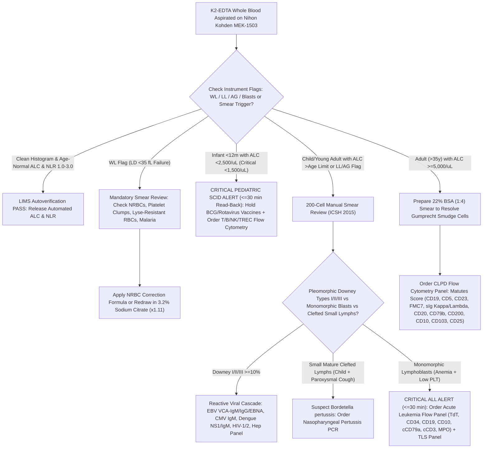

# 🧬 1.1.7 — Absolute Lymphocyte Count (`ALC`) & Neutrophil-to-Lymphocyte Ratio (`NLR`): Automated Impedance/Optical Sizing, `ICSH (2015)` Reactive vs Neoplastic Morphology, `iwCLL` Immunophenotyping & Systemic Inflammation Stratification SOP

> **Document Control (`ISO 15189:2022` Clauses 5.5, 7.2, 7.3, 7.4, 8.3 & `NABL 112 / 153 / 220D / 223`):**  
> **Document ID:** `NABL-HEM-SOP-1.1.7` | **Version:** `4.0` (10-Persona International & Above-NABL Red-Team Harmonized Edition)  
> **Effective Date:** `15-Oct-2026` | **Review Cycle:** Annual (`CLSI H20-A2` / `ICSH 2015` / `WHO 5th Ed 2022` / `iwCLL 2018` / `EFLM EuBIVAS` Aligned)  
> **Authorizing Authority:** Laboratory Director (MD Pathology) & Senior Consultant Hematopathologist (DM Hematopathology)  
> **Controlled Distribution:** Master Quality Management System (`QMS`), Hematology Bench Terminal (`Nihon Kohden MEK-1503` & Optical Microscopy Workstation), Flow Cytometry Division, Pediatric/Neonatal ICU (`NICU/PICU`), Adult Critical Care (`ICU`), and LIMS Autoverification Rules Engine  
> **Department Folder:** `01_Hematology_and_Coagulation` $\rightarrow$ **Cluster:** `1.1_Hemogram_CBC_and_Leucocyte_Platelet_Cluster`

---

## 🛡️ 10-Persona Adversarial Red-Team Review & Vertical Witness-Audit Governance Matrix

| Persona ID | Reviewer Role & International Regulatory Lens | Core Technical Audit Mandate & Red-Team Remediation Applied in Version 4.0 |
| :--- | :--- | :--- |
| **Persona 1** | **Lead NABL (`ISO 15189:2022` / `NABL 112 / 153 / 220D / 223`) & CAP (`HEM.30100–35500`) Assessor** | Enforced complete clause-to-bench traceability (`Clauses 4.1–8.9`), explicit LOINC distinction between automated (`731-0`) and manual (`732-8`) `ALC`, mandatory `NRBC` mathematical correction rules, and split-sample Primary-vs-Manual comparability (`CLSI EP31-A` / `H20-A2`). |
| **Persona 2** | **Senior Consultant Hematopathologist (`MD / DM Hematopathology`) & Clinical Oncologist** | Established exhaustive diagnostic algorithms separating self-limiting viral lymphocytosis (`EBV`, `CMV`, Dengue, Pertussis) from acute lymphoblastic leukemia (`ALL`) and chronic lymphoproliferative disorders (`CLPD`), plus `22% Bovine Serum Albumin (BSA)` $1:4$ smear stabilization for fragile `CLL` cells. |
| **Persona 3** | **`CLSI` & `IFCC` Metrology, Method Verification & Six-Sigma QC Specialist** | Embedded `EFLM EuBIVAS` biological variation ($CV_I = 10.4\%$, $CV_G = 27.8\%$, $\text{II} = 0.37$, $\text{RCV}_{95\%} = \pm 29.9\%$), `ISO/TS 20914` bottom-up/top-down Measurement Uncertainty ($U = \pm 8.2\%$ at $k=2$), `CLSI EP15-A3` ($5 \times 5$) verification, `CLSI EP06-Ed2` linearity, and Rümke binomial $95\%$ confidence envelopes (`CLSI H20-A2`). |
| **Persona 4** | **Clinical Pharmacologist, Immunologist & Special-Population Stratification Auditor** | Partitioned reference intervals across 14 physiological cohorts (`CALIPER` cord blood, neonatal postnatal hours, **physiological infant lymphocytosis [$3,000\text{–}10,500/\mu\text{L}$]**, childhood de-crossover at age $4\text{–}6\text{ y}$, pregnancy trimesters, geriatric immunosenescence) and mapped pharmacological lymphocyte shifts (`Ibrutinib` redistribution lymphocytosis vs `Fingolimod` / steroid sequestration lymphopenia). |
| **Persona 5** | **Medico-Legal, Patient-Safety & `ISO 22367:2020` Risk Management Counsel** | Built `CPA 2019`, `DPDP Act 2023`, and `HIV & AIDS Act 2017` confidentiality shields (preventing unauthorized disclosure of suspected `HIV` status via `ALC`-based $\text{CD4}$ surrogates), `CLSI GP47` 30-minute critical value read-back scripts, and quantitative `FMECA` tables (`RPN` scoring with LIMS hard-locks). |
| **Persona 6** | **Uncompressed Clinical Documentation & LIMS Autoverification Architect** | Eliminated compressed summaries; engineered deterministic LIMS middleware reflex logic, multi-parameter histogram/scattergram flag trees (`WL`, `LL`, `AG`, `Blasts`), conditional band-specific sign-out comments, and a plain-text LIMS copy-paste report block. |
| **Persona 7** | **`Nihon Kohden MEK-1503` Biomedical Engineer & Optical/Impedance Scatter Physics Specialist** | Detailed the exact fluidic and electrical aperture physics of the `MEK-1503` small-cell leukocyte (`s-WBC`) impedance channel ($35\text{–}90\text{ fL}$ post-lyse nuclear sizing), lower discriminator (`LD` at $30\text{–}35\text{ fL}$) and `T1` trough ($90\text{–}100\text{ fL}$) failure modes, and 5-part laser scatter (`FSC/SSC/SFL`) upgrade pathways. |
| **Persona 8** | **`ICSH (2015)` & `WHO 5th Ed (2022)` Reactive ("Downey Type I/II/III") vs Neoplastic Lymphoid Morphologist** | Constructed a granular cytomorphological atlas differentiating **Downey Type I** (plasmacytoid/Türk cell in Dengue/Rubella), **Downey Type II** ("ballerina-skirt" scalloped cytoplasm hugging RBCs in `EBV`/`CMV`), and **Downey Type III** (immunoblastic) from `ALL` lymphoblasts, Burkitt (`MYC`), `CLL`, Pertussis clefted lymphocytes, Hairy Cell, Mantle Cell, Follicular, `T-LGL`, and Sézary/`ATLL` flower cells. |
| **Persona 9** | **`iwCLL (2018)` Chronic Lymphocytic Leukemia (`Clonal B-Cell >= 5,000/uL` vs `MBL`) & Flow Cytometry (`Matutes Score`) Specialist** | Integrated the `iwCLL` diagnostic threshold ($\ge 5,000/\mu\text{L}$ clonal B-cells for $\ge 3\text{ months}$ vs Monoclonal B-Cell Lymphocytosis [`MBL`]), the **5-Point Matutes / Moreau Immunophenotyping Scoring System (`CD5+, CD23+, FMC7-, dim sIg, dim CD20/CD79b`)**, and extended markers (`CD200++, ROR1+, LEF1+` vs `CCND1/SOX11` in Mantle Cell and `BRAF V600E / CD11c / CD25 / CD103 / CD123` in Hairy Cell). |
| **Persona 10** | **Critical-Care Systemic Inflammation Biomarker (`NLR / PLR / SII`) & Pediatric `SCID` Emergency Specialist** | Embedded the **Zahorec `NLR` Clinical Risk Stratification Scale** (`1.0–2.3` Normal; `2.3–3.0` Gray Zone; `3.0–7.0` Moderate Inflammation/Sepsis; `7.0–15.0` Severe Sepsis/Cytokine Storm; `> 15.0` Critical Pre-Terminal Stress) and enforced the **Pediatric `SCID` Diagnostic Trap Alert** (proving why an `ALC` of $2,200/\mu\text{L}$ is normal in an adult but constitutes a life-threatening immunodeficiency emergency in a 3-month-old infant!). |

---

## 🏛️ Section 1: Test Name, `LOINC`/`SNOMED`/`ICD-10`/`UCUM` Coding, Clinical Indication & Analytical Principles on `Nihon Kohden MEK-1503`

### 1.1 International Regulatory, Coding & Hardware-Agnostic Platform Matrix

| Attribute | Specification & International Reference Standard |
| :--- | :--- |
| **Official Test Name & Acronym** | **Absolute Lymphocyte Count (`ALC`), Lymphocyte Percentage (`LYMPH%`), & Neutrophil-to-Lymphocyte Ratio (`NLR`)** *(with Integrated Extended Immune-Inflammation Indices: `PLR` & `SII`)* |
| **Document Control ID** | `NABL-HEM-SOP-1.1.7` (Version `4.0` — 10-Persona International & Above-NABL Red-Team Tier) |
| **Accreditation Clause Mapping** | `ISO 15189:2022` Clauses 5.5, 7.2 (*Pre-Examination*), 7.3 (*Examination Processes, Verification & MU*), 7.4 (*Post-Examination & Critical Alerts*), 8.5 (`ISO 22367:2020` *Risk Management*); `NABL 112` (*Specific Criteria for Hematology*), `NABL 153`, `NABL 220D`, `NABL 223`; `CAP` Hematology Checklist (`HEM.30100–35500`) |
| **Primary `LOINC` Code(s)** | • **`731-0`**: *Lymphocytes [#/volume] in Blood by Automated count* (`ALC` Auto)<br>• **`732-8`**: *Lymphocytes [#/volume] in Blood by Manual count* (`ALC` Manual Reference)<br>• **`736-9`**: *Lymphocytes/100 leukocytes in Blood by Automated count* (`LYMPH%` Auto)<br>• **`737-7`**: *Lymphocytes/100 leukocytes in Blood by Manual count* (`LYMPH%` Manual)<br>• **`80217-3`** / **`804-5`**: *Neutrophils/Lymphocytes [Pure ratio] in Blood* (`NLR`)<br>• **`13046-8`**: *Variant lymphocytes/100 leukocytes in Blood* (`Downey / Reactive Lymphocytes %`)<br>• **`35082-7`**: *Smudge cells/100 leukocytes in Blood by Manual count* (`Gumprecht Shadow Cells %`) |
| **`SNOMED-CT` Specimen & Concept** | Specimen: `445295009` (*Whole blood in $\text{K}_2\text{-EDTA}$*); Observable: `74765001` (*Absolute lymphocyte count*), `365632008` (*Finding of lymphocyte count*), `419188005` (*Neutrophil to lymphocyte ratio*) |
| **`ICD-10` / `ICD-11` Clinical Codes** | `D72.810` / `4B01` (*Lymphocytopenia*), `D72.820` / `4B02` (*Lymphocytosis, symptomatic/reactive*), `C91.10` / `2A82.0` (*Chronic lymphocytic leukemia of B-cell type [`CLL`]*), `C91.00` / `2A70` (*Acute lymphoblastic leukemia [`ALL`]*), `B27.90` / `1D81` (*Infectious mononucleosis*), `A37.00` / `1C12` (*Whooping cough due to Bordetella pertussis*), `D81.9` / `4A01.0` (*Severe combined immunodeficiency [`SCID`]*), `A41.9` / `1G40` (*Sepsis, unspecified*) |
| **Conventional $\leftrightarrow$ SI (`UCUM`) Units** | • **Conventional Units:** $\text{cells}/\mu\text{L}$ (or $\times 10^3/\mu\text{L}$); Relative: $\%$; `NLR`: Dimensionless Ratio (`{ratio}`)<br>• **SI (`UCUM`) Units:** $\times 10^9/\text{L}$ (`10*9/L`)<br>• **Exact Conversion Factor:** $\text{Cells}/\mu\text{L} \times 0.001 = \times 10^9/\text{L}$ (and $\times 10^3/\mu\text{L} \times 1.0 = \times 10^9/\text{L}$) |
| **Metrological Traceability (`ISO 17511`)** | Total Leukocyte Count (`WBC`) traceable to **ICSH Reference Flow/Aperture Method**; Differential Proportion traceable to **CLSI H20-A2 / ICSH (2015) 400-Cell Two-Observer Manual Microscopic Reference Method** on Romanowsky-stained wedge blood films |
| **Primary Analyzer Platform** | **Nihon Kohden MEK-1503 (`Celltac α+`) Automated Hematology Analyzer** *(Electrical Impedance Aperture Sizing with Integrated Small-Cell Leukocyte [`s-WBC`] Histogram Discrimination)* |
| **Backup / Reference Verification Platform** | **CLSI H20-A2 / ICSH (2015) Standardized Wedge Peripheral Blood Smear (`1.2.1`)** stained with buffered May-Grünwald-Giemsa (`MGG`) / Leishman-Giemsa ($p\text{H } 6.8 \pm 0.05$) with **200-Cell Routine / 400-Cell Referee Manual Differential** & **22% Bovine Serum Albumin (`BSA` $1:4$) Smear Protocol** *(Verified weekly via `CLSI EP31-A` split-sample comparability)* |
| **Future Platform Upgrade Slot** | **Next-Generation 5-Part / 6-Part Optical Laser Flow Cytometry Hematology Analyzer** (`FSC` $0^\circ$, `SSC` $90^\circ$, Polymethine `SFL` Nucleic Acid Fluorescence for High-Fluorescence Lymphocyte Count [`HFLC`] & Blast Gating) + **8-to-10 Color Clinical Flow Cytometer (`BD FACSLyric` / `Beckman Navios`)** |

---

### 1.2 Exact Mathematical Formulas & Derived Systemic Immune-Inflammation Equations

1. **Primary Automated or Manual Absolute Lymphocyte Count (`ALC`):**
   $$\mathbf{\text{ALC (cells/}\mu\text{L)} = \frac{\text{Total WBC (cells/}\mu\text{L)} \times \text{Lymphocytes (\%)}}{100}}$$
   $$\mathbf{\text{ALC (}\times 10^9\text{/L)} = \frac{\text{Total WBC (}\times 10^9\text{/L)} \times \text{Lymphocytes (\%)}}{100} = \text{ALC (cells/}\mu\text{L)} \times 0.001}$$

2. **Primary Neutrophil-to-Lymphocyte Ratio (`NLR` — Zahorec Index):**
   $$\mathbf{\text{NLR (Dimensionless)} = \frac{\text{ANC (cells/}\mu\text{L)}}{\text{ALC (cells/}\mu\text{L)}} = \frac{\text{Total Neutrophils (\%) [Segmented + Bands]}}{\text{Lymphocytes (\%)}}}$$
   *(Note: Mathematically, Total `WBC` cancels out in the numerator and denominator; however, when Nucleated RBCs [`NRBCs`] or Smudge Cells are present on the smear, `NLR` MUST be computed from the **Manual `NRBC`-Corrected `ANC` and `BSA`-Stabilized Manual `ALC`**, never from raw uncorrected impedance percentages!)*

3. **Mandatory `NRBC`-Corrected `WBC` & True `ALC` Formula (`ICSH` / `CAP HEM.30150`):**
   When Nucleated Red Blood Cells (`NRBCs` $\ge 1\text{–}5$ per $100\text{ WBCs}$) are present on the peripheral smear, their unlysed nuclei ($70\text{–}95\text{ fL}$) are counted directly inside the `Nihon Kohden MEK-1503` Total `WBC` and Small-Cell Lymphocyte (`s-WBC`) channel. Both Total `WBC` and `ALC` must be corrected prior to release:
   $$\mathbf{\text{WBC}_{\text{corrected}}\text{ (cells/}\mu\text{L)} = \text{WBC}_{\text{uncorrected}} \times \left(\frac{100}{100 + \text{NRBCs per 100 WBCs}}\right)}$$
   $$\mathbf{\text{ALC}_{\text{true}}\text{ (cells/}\mu\text{L)} = \frac{\text{WBC}_{\text{corrected}}\text{ (cells/}\mu\text{L)} \times \text{Manual Verified Lymphocytes (\%)}}{100}}$$

4. **Gumprecht Smudge Cell Correction via $22\%$ Bovine Serum Albumin (`BSA` $1:4$) Smear (`iwCLL` / `ICSH 2015`):**
   - **Preferred Method (Albuminized Smear):** Mix **$1\text{ part}$ ($20\ \mu\text{L}$) of $22\%$ Bovine Serum Albumin (`BSA`)** with **$4\text{ parts}$ ($80\ \mu\text{L}$) of $\text{K}_2\text{-EDTA}$ whole blood** prior to wedge slide spreading. The oncotic protein cushion stabilizes the vimentin-deficient cytoskeleton of fragile neoplastic B-lymphocytes (`CLL`), preventing mechanical shear rupture and allowing direct 200-cell differential counting of intact lymphocytes.
   - **Alternative Mathematical Equivalence (Only if `BSA` is unavailable and automated `LYMPH%` is free of `NRBC`/clump interference):** Under `ICSH (2015)` guidelines, if an automated counter measures intact cells in suspension prior to mechanical slide spreading, the automated `ALC` accurately reflects intact plus fragile lymphocytes; if a manual differential is performed on a non-albuminized `CLL` film with $> 10\%$ smudge cells, smudge cells must **not** be ignored without correction (either prepare a $22\%$ `BSA` smear or report Smudge Cells as a separate `% of 100 WBCs` [`LOINC 35082-7`] while correlating with automated suspension gating).

5. **Extended Critical-Care & Oncology Immune-Inflammation Indices (Available via LIMS Calculation):**
   $$\mathbf{\text{Platelet-to-Lymphocyte Ratio (PLR)} = \frac{\text{Platelet Count (cells/}\mu\text{L)}}{\text{ALC (cells/}\mu\text{L)}}} \quad (\text{Normal Adult: } 75\text{–}190)$$
   $$\mathbf{\text{Lymphocyte-to-Monocyte Ratio (LMR)} = \frac{\text{ALC (cells/}\mu\text{L)}}{\text{AMC (cells/}\mu\text{L)}}} \quad (\text{Normal Adult: } 3.0\text{–}9.0; \text{ Prognostic in Lymphoma})$$
   $$\mathbf{\text{Systemic Immune-Inflammation Index (SII)} = \frac{\text{Platelets (}\times 10^3/\mu\text{L)} \times \text{ANC (}\times 10^3/\mu\text{L)}}{\text{ALC (}\times 10^3/\mu\text{L)}}} \quad (\text{Normal Adult: } 160\text{–}550 \times 10^3/\mu\text{L})$$

---

### 1.3 Clinical Indications & Physiological Architecture of the Circulating Lymphocyte Pool

1. **Intravascular vs. Extravascular Lymphocyte Compartmentalization:**
   - The peripheral blood contains only **$\sim 2\%$ ($\approx 10^{10}$ cells)** of the total body lymphocyte pool ($\approx 5 \times 10^{11}$ cells); the remaining **$98\%$** reside within secondary lymphoid organs (lymph nodes, spleen white pulp, mucosal-associated lymphoid tissue [`MALT` / Peyer's patches], and bone marrow).
   - Circulating lymphocytes continuously traffic between blood and lymphoid tissues every **$12\text{–}24\text{ hours}$**, entering lymph nodes via L-selectin (`CD62L`) and chemokine receptor (`CCR7` / `CXCR4`) engagement on High Endothelial Venules (`HEVs`) and exiting back into efferent lymphatics via **Sphingosine-1-Phosphate Receptor 1 (`S1PR1`)** chemotaxis.
2. **Normal Adult Peripheral Blood Lymphocyte Subset Distribution:**
   - **$\text{CD3}^+$ T-Lymphocytes ($65\text{–}80\%$ of `ALC`; $\sim 700\text{–}2,500/\mu\text{L}$):** Mediating adaptive cellular immunity. Comprises **$\text{CD3}^+\text{CD4}^+$ Helper/Inducer T-cells** ($40\text{–}55\%$ of `ALC`; $\sim 500\text{–}1,500/\mu\text{L}$) and **$\text{CD3}^+\text{CD8}^+$ Cytotoxic/Suppressor T-cells** ($20\text{–}30\%$ of `ALC`; $\sim 200\text{–}900/\mu\text{L}$; normal $\text{CD4:CD8}$ ratio $= 1.2\text{–}2.5$).
   - **$\text{CD19}^+ / \text{CD20}^+$ B-Lymphocytes ($8\text{–}18\%$ of `ALC`; $\sim 100\text{–}500/\mu\text{L}$):** Mediating humoral antibody immunity and memory B-cell differentiation into plasma cells.
   - **$\text{CD3}^-\text{CD16}^+\text{CD56}^+$ Natural Killer (`NK`) Cells ($5\text{–}15\%$ of `ALC`; $\sim 70\text{–}450/\mu\text{L}$):** Mediating MHC-unrestricted innate cytotoxicity against virally infected and neoplastic cells (morphologically corresponding to normal Large Granular Lymphocytes [`LGLs`]).
3. **Pathophysiological Significance of `NLR` (Innate-to-Adaptive Immune Coupling):**
   - During acute bacterial infection, tissue trauma, myocardial infarction, or septic shock, massive release of **cortisol, catecholamines, IL-6, IL-1$\beta$, and G-CSF** simultaneously triggers:
     1. **Innate Neutrophilia (`↑ ANC`):** Mobilization of the marginated neutrophil pool, bone marrow release of bands/mature neutrophils, and delayed neutrophil apoptosis.
     2. **Adaptive Stress Lymphopenia (`↓ ALC`):** Glucocorticoid-receptor-mediated apoptosis of thymocytes/T-cells plus massive redistribution/sequestration of circulating lymphocytes into lymphatics and inflamed tissues.
   - Because `NLR` divides the rising numerator (`ANC`) by the falling denominator (`ALC`), **`NLR` amplifies early systemic inflammatory stress $6\text{–}12\text{ hours}$ before total `WBC` or `CRP` becomes abnormal**, serving as a premier rapid triage biomarker in Emergency Medicine, ICU Sepsis, and Surgical Oncology.

---

### 1.4 Analytical Physics on `Nihon Kohden MEK-1503` vs. 5-Part Optical Scatter & Manual Reference (`CLSI H20-A2`)

1. **Primary Automated Measurement (`Nihon Kohden MEK-1503` Electrical Impedance Nuclear-Membrane Sizing):**
   - **Dilution & Differential Hemolysis:** Whole blood ($10\text{–}20\ \mu\text{L}$) is aspirated and diluted ($1:200$) in isotonic phosphate-buffered electrolyte (`Isotonac-3`/`4`, osmolality $285 \pm 5\text{ mOsm/kg}$, $p\text{H } 7.4$) followed by addition of non-cyanide quaternary ammonium / surfactant lysing reagent (`Hemolynac-3N`).
   - **Differential Cytoplasmic Stripping (`35–90 fL` Small-Cell Window):** The lysing reagent completely dissolves erythrocyte membranes and selectively perforates leukocyte plasma membranes, causing water and soluble cytoplasm to efflux. Because mature lymphocytes possess a small spherical condensed nucleus ($7\text{–}9\ \mu\text{m}$) with only a thin rim of agranular cytoplasm, they shrink symmetrically into a tight nuclear-membrane sphere measuring **$35\text{ to } 90\text{ fL}$**.
   - **Tri-Modal Histogram Gating (`s-WBC` Channel):** As cells traverse the $100\ \mu\text{m}$ micro-aperture under constant direct current (`DC`), voltage pulses ($\Delta V = I \times \Delta R$) are sorted into 256 volume channels:
     - **Lower Discriminator (`LD` at $\sim 30\text{–}35\text{ fL}$):** Separates true lymphocytes ($> 35\text{ fL}$) from lysed RBC stroma, normal platelets, and background debris ($< 30\text{ fL}$). *Failure of valley clearance at `LD` triggers the **`WL` (WBC Lower Discriminator)** flag (caused by `NRBCs`, platelet clumps, giant platelets, malaria, or lyse-resistant thalassemic/sickle RBCs).*
     - **Small-Cell Region (`s-WBC` / Lymphocyte Gate, $35\text{–}90\text{ fL}$):** Enumerates mature lymphocytes.
     - **First Floating Valley Discriminator (`T1` at $\sim 90\text{–}100\text{ fL}$):** Separates small lymphocytes ($35\text{–}90\text{ fL}$) from the Mid-Cell Region (`m-WBC`: monocytes, eosinophils, basophils, reactive Downey lymphocytes, and blasts, $90\text{–}160\text{ fL}$). *Failure of valley separation at `T1` triggers the **`LL` / `AG` (Lymphocyte-Mid Valley Interference)** flag, which is classic for Downey Type II/III reactive viral lymphocytes or acute lymphoblasts (`ALL`) bridging across $85\text{–}140\text{ fL}$!*
2. **Next-Generation 5-Part / 6-Part Laser Optical Flow Cytometry Correlation:**
   - On 5-part laser analyzers (`WDF` channel), leukocytes are hydrodynamically focused through a semiconductor laser ($633\text{ nm}$):
     - **Forward Scatter (`FSC`, $1^\circ\text{–}6^\circ$):** Proportional to cell volume.
     - **Side Scatter (`SSC`, $90^\circ$):** Proportional to internal nuclear lobulation and cytoplasmic granularity (low in lymphocytes and monocytes; high in neutrophils and eosinophils).
     - **Side Fluorescence (`SFL`, $> 650\text{ nm}$ Polymethine Dye):** Binds cytoplasmic RNA and nuclear DNA. Resting mature lymphocytes have low `SSC` and low `SFL`; **reactive viral lymphocytes (Downey Types I/II/III) and plasma cells** synthesize abundant ribosomal/messenger RNA and therefore surge upward into the **High-Fluorescence Lymphocyte Count (`HFLC`)** zone, whereas **lymphoblasts (`ALL`)** cluster in the intermediate `SFL` / low `SSC` blast gate.
3. **Step-by-Step Bench SOP for `22% BSA` Albuminized Smear & `CLSI H20-A2` Manual Differential:**
   - **Step 1 (Trigger Criteria):** Whenever `ALC` $> 5,000/\mu\text{L}$ in an adult, `ALC` $>$ age-specific upper limit in a child, `NLR` $\ge 9.0$ or $< 0.7$, or any analyzer flag (`WL`, `LL`, `Blasts`, `Atypical Lymph`) is present, pull the $\text{K}_2\text{-EDTA}$ tube within $< 4\text{ hours}$ of collection.
   - **Step 2 (`22% BSA` Smear Protocol for Suspected `CLL` / Smudge Cells $> 10\%$):** If initial smear review reveals $> 10\%$ Gumprecht smudge/basket cells, pipette **$80\ \mu\text{L}$ ($4\text{ drops}$) of well-mixed $\text{K}_2\text{-EDTA}$ whole blood** into a clean micro-tube, add **$20\ \mu\text{L}$ ($1\text{ drop}$) of $22\%$ Bovine Serum Albumin (`BSA`)**, mix gently by 5 inversions, and immediately prepare a wedge blood film at a $30^\circ\text{–}35^\circ$ angle. Air-dry rapidly and stain with buffered May-Grünwald-Giemsa ($p\text{H } 6.8$).
   - **Step 3 (`CLSI H20-A2` Battlement Track Enumeration):** Using a $100\times$ oil-immersion plan-apochromatic objective ($\text{NA } 1.25\text{–}1.30$) in the monolayer zone (where RBCs just touch without overlapping), count **200 consecutive nucleated leukocytes** using the modified battlement track (3 fields horizontal, 2 fields vertical inward, 3 fields horizontal, 2 fields outward). Record mature lymphocytes, reactive/atypical lymphocytes (`Downey Types I/II/III`), prolymphocytes, clefted/hairy/villous cells, lymphoblasts, and `NRBCs per 100 WBCs`.

---

## 🧪 Section 2: Pre-Analytical Variables, Specimen Integrity, Physiological Kinetics & Rejection Matrix (`CLSI GP41` / `H26-A2` / `ICSH 2015`)

| Pre-Analytical Parameter | Mandatory Technical & Physiological Protocol (`CLSI GP41` / `CLSI H26-A2` / `ICSH 2015`) |
| :--- | :--- |
| **Primary Specimen & Anticoagulant** | Venous Whole Blood collected in **Spray-Dried Dipotassium EDTA ($\text{K}_2\text{-EDTA}$, $1.5\text{–}2.2\text{ mg/mL}$ blood)** Lavender-Top evacuating tube (`ISO 6710`). $\text{K}_2\text{-EDTA}$ is strictly preferred over $\text{K}_3\text{-EDTA}$ to prevent osmotic cellular shrinkage. |
| **Target Fill Volume & Underfill Artifact** | **Adult:** $2.0\text{–}3.0\text{ mL}$ (minimum $\ge 75\%$ fill mark). **Pediatric/Neonatal:** $0.5\text{ mL}$ Micro-EDTA (`MAP` tube filled strictly between $250\text{–}500\ \mu\text{L}$ lines). Severe underfilling ($< 50\%$ fill, excess EDTA $> 3.5\text{ mg/mL}$) causes hypertonic lymphocyte shrinkage, cytoplasmic vacuolization, and nuclear clefting mimicking lymphoma. |
| **CLSI GP41 Order of Draw** | Blood Culture $\rightarrow$ Sodium Citrate (Light Blue) $\rightarrow$ Serum/SST (Red/Gold) $\rightarrow$ Heparin (Green) $\rightarrow$ **$\text{K}_2\text{-EDTA}$ (Lavender)** $\rightarrow$ Fluoride/Oxalate (Grey). Never draw from an IV infusion line without discarding $5\text{ mL}$ dead-space volume (`hemodilution artifact`). |
| **Whole-Blood Homogenization** | Invert gently **$8\text{–}10\text{ times}$ ($180^\circ$)** immediately post-phlebotomy. Place on a calibrated mechanical roller/rocker mixer at **$20\text{–}30\text{ RPM}$ for $10\text{–}15\text{ minutes}$** at $18\text{–}25^\circ\text{C}$ prior to aspiration. Never vortex whole blood prior to routine CBC (except during specific `CLSI` cold-agglutinin/platelet-clump disaggregation protocols). |
| **Diurnal (Circadian) Rhythm** | **Marked Inverse Cortisol Rhythm:** Circulating `ALC` reaches its **physiological nadir in the morning ($08:00\text{–}10:00\text{ AM}$)** when endogenous serum cortisol peaks, and rises by **$+15\%$ to $+30\%$ to its physiological zenith at midnight ($00:00\text{–}02:00\text{ AM}$)**. Consequently, `NLR` is naturally slightly higher in early morning draws than evening draws. Serial monitoring in `CLL` or immunotherapy should be standardized to morning phlebotomy ($08:00\text{–}10:00\text{ AM}$). |
| **Acute Exercise, Stress & Epinephrine Surge** | Vigorous exercise, crying/struggling during pediatric venipuncture, febrile seizures, or acute catecholamine surge ($\beta_2$-adrenergic stimulation) detaches marginated $\text{CD8}^+$ T-cells and $\text{CD16}^+\text{CD56}^+$ NK cells from vascular endothelium within **minutes**, causing a transient **$+30\%$ to $+100\%$ physiological lymphocytosis** that resolves within $1\text{–}2\text{ hours}$ of rest. Require $15\text{–}20\text{ minutes}$ of seated rest before outpatient phlebotomy. |
| **Multi-Temperature Stability & Smear Ageing Artifacts** | • **Automated Impedance/Scatter `ALC`:** Stable up to **$12\text{–}24\text{ hours}$ at $18\text{–}25^\circ\text{C}$** and up to **$48\text{ hours}$ at $2\text{–}8^\circ\text{C}$** (warm to room temperature for $15\text{ min}$ before remixing).<br>• **Peripheral Blood Smear Morphology (`ICSH` Mandatory Window):** Wedge blood films **MUST be prepared within $< 3\text{–}4\text{ hours}$ of collection**. Prolonged $\text{K}_2\text{-EDTA}$ storage ($> 4\text{–}6\text{ hours}$ at room temperature) induces **storage-related lymphocyte nuclear lobulation ("clover-leaf" / pseudo-flower / pseudo-Sézary nuclear budding), chromatin homogenization, cytoplasmic vacuolization, and increased smudge cell formation**, which can cause catastrophic misdiagnosis of reactive blood as T-cell lymphoma! |
| **Mandatory Rejection Criteria** | 1. Presence of macro- or micro-fibrin clots (`reject immediately`).<br>2. Gross in-vitro hemolysis (`H-Index > 500 mg/dL`) where unlysed erythrocyte ghosts corrupt the `WL` lower discriminator.<br>3. Unlabeled/mislabeled tubes or tubes $> 24\text{ hours}$ old stored at room temperature ($> 25^\circ\text{C}$). |

---

## 📊 Section 3: Complete Age-Stratified Reference Intervals (Highlighting Physiological Infant Lymphocytosis vs. Adult & the Pediatric `SCID` Trap) & Zahorec `NLR` Clinical Risk Scale

### 3.1 Multi-Partitioned Reference Intervals for `ALC`, `LYMPH%` & `NLR` (`CALIPER` / `ICSH` / `Dacie & Lewis` Harmonized)

| Population / Age / Physiological Partition | Absolute Lymphocyte Count (`ALC`) Conventional (`/µL`) | `ALC` SI Units (`×10⁹/L`) | Relative Lymphocyte `%` (`LYMPH%`) | Normal `NLR` Range (Dimensionless) | Physiological Mechanism & Critical Clinical Interpretation Notes |
| :--- | :---: | :---: | :---: | :---: | :--- |
| **Umbilical Cord Blood (Term)** | **$2,000 \text{ – } 7,300 /\mu\text{L}$** | $2.00 \text{ – } 7.30$ | $25 \text{ – } 40\%$ | $1.1 \text{ – } 2.8$ | Neutrophil dominance at birth; baseline naive $\text{CD45RA}^+$ T-cell output. |
| **Neonate ($0 \text{ – } 3\text{ Days}$ / First $72\text{ h}$)** | **$2,000 \text{ – } 7,500 /\mu\text{L}$** | $2.00 \text{ – } 7.50$ | $20 \text{ – } 35\%$ | $1.5 \text{ – } 3.5$ | Perinatal cortisol surge suppresses `ALC` relative to elevated neonatal `ANC`. |
| **Neonate ($4 \text{ – } 7\text{ Days}$ — "First Crossover")** | **$2,500 \text{ – } 9,000 /\mu\text{L}$** | $2.50 \text{ – } 9.00$ | $35 \text{ – } 50\%$ | $0.8 \text{ – } 1.4$ | **First Physiological Leukocyte Crossover (Day 4–7):** `ALC%` intersects and surpasses `ANC%` ($\sim 45\%$ each). |
| **Neonate ($8 \text{ – } 30\text{ Days}$)** | **$2,800 \text{ – } 10,000 /\mu\text{L}$** | $2.80 \text{ – } 10.00$ | $40 \text{ – } 65\%$ | $0.4 \text{ – } 1.1$ | Rapid thymic emigration of naive $\text{CD4}^+$ and $\text{CD8}^+$ T-lymphocytes; **$\text{ALC} < 2,500/\mu\text{L}$ requires urgent `SCID` evaluation!** |
| **Infant ($2\text{ Months} \text{ – } 2\text{ Years}$)** | **$3,000 \text{ – } 10,500 /\mu\text{L}$** | **$3.00 \text{ – } 10.50$** | **$45 \text{ – } 70\%$** *(up to $75\%$)* | **$0.3 \text{ – } 0.9$** | **Peak Physiological Infant Lymphocytosis:** Lymphocytes are the dominant circulating leukocyte! Up to $5\text{–}10\%$ benign large/immunogenic lymphocytes are normal. **CRITICAL TRAP: An $\text{ALC}$ of $2,200/\mu\text{L}$ is profound lymphopenia in this age group!** |
| **Early Childhood ($2 \text{ – } 5\text{ Years}$)** | **$2,000 \text{ – } 8,000 /\mu\text{L}$** | $2.00 \text{ – } 8.00$ | $35 \text{ – } 60\%$ | $0.5 \text{ – } 1.5$ | **Second Physiological Leukocyte De-Crossover (Age 4–6 Years):** `ANC%` rises to intersect `ALC%` again at $\sim 45\%$. |
| **Late Childhood ($6 \text{ – } 12\text{ Years}$)** | **$1,500 \text{ – } 5,000 /\mu\text{L}$** | $1.50 \text{ – } 5.00$ | $25 \text{ – } 50\%$ | $0.8 \text{ – } 2.2$ | Post-second crossover; neutrophils resume permanent physiological dominance over lymphocytes. |
| **Adolescent ($13 \text{ – } 17\text{ Years}$)** | **$1,200 \text{ – } 4,200 /\mu\text{L}$** | $1.20 \text{ – } 4.20$ | $22 \text{ – } 45\%$ | $1.0 \text{ – } 2.5$ | Progressive involution of thymic cortex at puberty toward adult homeostasis. |
| **Adult Male & Non-Pregnant Female ($18 \text{ – } 65\text{ Years}$)** | **$1,000 \text{ – } 3,000 /\mu\text{L}$** *(Upper cutoff $3,500\text{–}4,000/\mu\text{L}$ in Indian population)* | **$1.00 \text{ – } 3.00$** *(up to $4.00$)* | **$20 \text{ – } 40\%$** | **$1.0 \text{ – } 2.3$** *(Mean $1.65$)* | Mature homeostatic baseline. Persistent clonal B-cell count $\ge 5,000/\mu\text{L}$ defines `CLL` (`iwCLL 2018`). |
| **Pregnancy — 1st Trimester ($1 \text{ – } 12\text{ Weeks}$)** | **$1,100 \text{ – } 3,200 /\mu\text{L}$** | $1.10 \text{ – } 3.20$ | $18 \text{ – } 36\%$ | $1.8 \text{ – } 4.0$ | Mild immunomodulatory shift ($\text{Th1} \rightarrow \text{Th2}/\text{Treg}$ tolerance). |
| **Pregnancy — 2nd Trimester ($13 \text{ – } 27\text{ Weeks}$)** | **$1,000 \text{ – } 3,000 /\mu\text{L}$** | $1.00 \text{ – } 3.00$ | $15 \text{ – } 32\%$ | $2.2 \text{ – } 4.8$ | Relative dilution of `LYMPH%` due to gestational neutrophilia (`ANC` up to $11,000/\mu\text{L}$). |
| **Pregnancy — 3rd Trimester ($28 \text{ – } 40\text{ Weeks}$)** | **$900 \text{ – } 2,900 /\mu\text{L}$** | $0.90 \text{ – } 2.90$ | $12 \text{ – } 28\%$ | $2.5 \text{ – } 5.8$ | Mild physiological decrease in absolute $\text{CD4}^+$ T-cells and NK cells; baseline `NLR` naturally rises up to $5.5$. |
| **Geriatric ($\ge 65\text{ Years}$)** | **$850 \text{ – } 2,800 /\mu\text{L}$** | $0.85 \text{ – } 2.80$ | $18 \text{ – } 38\%$ | $1.2 \text{ – } 3.2$ | Thymic involution & **immunosenescence** (reduced naive $\text{CD45RA}^+$ T-cells, oligoclonal expansion of $\text{CD8}^+\text{CD28}^-$ memory T-cells; higher prevalence of incidental `MBL` / `CLL`). |

---

### 3.2 The Pediatric Diagnostic Trap: Why an `ALC` of $2,200/\mu\text{L}$ is Normal in an Adult but Catastrophic in a 3-Month-Old Infant (`SCID`)

> [!CAUTION]
> **MANDATORY PEDIATRIC HEMATOLOGY & IMMUNOLOGY SAFETY DIRECTIVE (`ISO 22367` High-Severity Risk Control):**  
> Never apply adult reference intervals ($1,000\text{–}3,000/\mu\text{L}$) to neonates or infants!
> 1. **The Mathematical & Biological Reality:** In a healthy $3\text{-month-old}$ infant, active thymic lymphopoiesis maintains the normal `ALC` between **$3,000\text{ and } 10,500\text{ cells/}\mu\text{L}$ ($45\text{–}70\%$ of Total `WBC`)**, of which $\sim 70\%$ are T-lymphocytes.
> 2. **The Diagnostic Trap (`ALC = 2,200/uL`):** If a $3\text{-month-old}$ infant presents with recurrent oral candidiasis, chronic diarrhea, or pneumonia and has an `ALC` of **$2,200\text{ cells/}\mu\text{L}$**, a laboratory whose LIMS uses unpartitioned adult reference ranges ($1,000\text{–}3,000/\mu\text{L}$) will print **"NORMAL"** without a flag. In reality, an `ALC` of $2,200/\mu\text{L}$ (and critically $< 1,500\text{–}2,500/\mu\text{L}$) in an infant $< 12\text{ months}$ represents **profound T-cell depletion** and is the primary hematological hallmark of **Severe Combined Immunodeficiency (`SCID` — `IL2RG` X-linked, `ADA` deficiency, `JAK3`, or `RAG1/2` mutations)** or complete **DiGeorge Syndrome (`22q11.2` deletion)**.
> 3. **Lethal Iatrogenic Consequences of Missing Infant Lymphopenia:**
>    - **Fatal Disseminated Vaccine Infection:** Administering routine live-attenuated pediatric vaccines (**BCG at birth, Oral Rotavirus at $6/10/14\text{ weeks}$, Oral Polio [`OPV`], or MMR**) to an infant with unrecognized `SCID` triggers lethal disseminated *Mycobacterium bovis* BCGosis or vaccine-strain viral encephalitis/enteritis.
>    - **Fatal Transfusion-Associated Graft-Versus-Host Disease (`TA-GVHD`):** Transfusing non-irradiated packed RBCs or platelets to an infant with `SCID` allows donor T-lymphocytes to engraft and destroy the infant's bone marrow, liver, and skin ($> 95\%$ mortality).
>    - **Survival Window:** Hematopoietic Stem Cell Transplantation (`HSCT`) performed before age $3.5\text{ months}$ (prior to opportunistic *Pneumocystis jirovecii* or `CMV` infection) yields **$> 92\%$ survival**, whereas delayed diagnosis after $3.5\text{ months}$ with active infection drops survival to **$< 50\%$**.
> 4. **Opposite Infant Error (Over-Calling Leukemia):** Conversely, a healthy $6\text{-month-old}$ infant with an `ALC` of **$8,800/\mu\text{L}$ ($65\%$)** evaluated against an adult upper limit ($3,000/\mu\text{L}$) is frequently misflagged as "severe lymphocytosis / suspected leukemia," triggering unnecessary parental terror and invasive bone marrow aspiration.

---

### 3.3 Zahorec Neutrophil-to-Lymphocyte Ratio (`NLR`) Clinical Risk Stratification Scale

Originally described by **Roman Zahorec (2001, 2021)** and validated across $> 500,000$ ICU, emergency, sepsis, COVID-19, cardiovascular, and oncology cohorts, the `NLR` provides an immediate, zero-cost, continuous gauge of systemic neuroendocrine-immune stress:

| Zahorec `NLR` Tier | `NLR` Cutoff Range | Pathophysiological State (Neuroendocrine & Cytokine Balance) | Clinical Interpretation & Mandatory Bedside / ICU Action |
| :--- | :---: | :--- | :--- |
| **Tier 0: Inverted Ratio (Lymphocytic Dominance)** | **`NLR < 0.7`** *(in Adults)* | Marked adaptive lymphocytic expansion (`↑↑ ALC`) OR severe agranulocytosis/neutropenia (`↓↓ ANC`). *(Note: Normal in infants $1\text{m–}3\text{y}$!)* | In adults, inspect `ANC` and `ALC` separately: indicates either **acute viral lymphocytosis** (`EBV`, Dengue, Pertussis), **clonal lymphoproliferative disease (`CLL` / `ALL`)**, or **severe idiosyncratic/chemotherapy neutropenia**. |
| **Tier 1: Normal Homeostatic Baseline** | **`1.0 – 2.3`** *(Mean $\approx 1.65$)* | Balanced innate neutrophil patrolling (`ANC` $\sim 2,500\text{–}5,500/\mu\text{L}$) and preserved adaptive lymphocyte surveillance (`ALC` $\sim 1,500\text{–}2,800/\mu\text{L}$); low basal cortisol/IL-6. | **Physiological eustress / healthy baseline.** High negative predictive value ($> 94\%$) against occult severe bacterial sepsis in immunocompetent adults. |
| **Tier 2: Mild Stress / Early Warning "Gray Zone"** | **`2.3 – 3.0`** | Early sympathetic catecholamine tone or low-grade subclinical inflammation (`CRP` typically $3\text{–}10\text{ mg/L}$). | **Subclinical / Borderline Stress:** Seen in metabolic syndrome, atherosclerosis, early localized infection, mild dehydration, or psychological/post-exercise stress. Monitor serial trend. |
| **Tier 3: Moderate Systemic Inflammation / Bacterial Infection** | **`3.0 – 7.0`** | Active innate mobilization (`↑ ANC` $7,500\text{–}12,000/\mu\text{L}$) coupled with early cortisol/IL-6-driven lymphocyte margination (`↓ ALC` $900\text{–}1,400/\mu\text{L}$). | **Pathological Systemic Inflammation:** Strongly favors **acute bacterial infection** (acute appendicitis, bacterial pneumonia, pyelonephritis, cholecystitis) over uncomplicated viral fever (where `NLR` typically stays $< 3.0$). Correlate with `CRP` and Procalcitonin (`PCT`). |
| **Tier 4: Severe Sepsis / Systemic Inflammatory Response / Cytokine Storm** | **`7.0 – 15.0`** | Marked neutrophilia with left shift/bands (`ANC` $> 12,000/\mu\text{L}$) AND profound stress-induced T-cell apoptosis/lymphopenia (`ALC` $400\text{–}850/\mu\text{L}$). | **High-Risk Critical Illness Alert:** Indicates **severe bacterial sepsis, bacteremia, septic shock, necrotizing pancreatitis, major polytrauma, or severe viral cytokine storm**. If `NLR` fails to decline by $\ge 20\text{–}30\%$ within $48\text{–}72\text{ hours}$ of empiric antibiotics, suspect treatment failure or undrained abscess. |
| **Tier 5: Critical Pre-Terminal Stress / Multi-Organ Dysfunction** | **`> 15.0`** *(Extreme $> 25.0$)* | Exhausted adaptive immunity (**immunoparalysis**, `ALC` $< 300\text{–}500/\mu\text{L}$) with extreme leukemoid neutrophil reaction (`ANC` $> 18,000\text{–}25,000/\mu\text{L}$). | **Critical ICU Prognostic Alert:** Associated with high $28\text{-day}$ ICU mortality, multi-organ dysfunction syndrome (`MODS`), disseminated intravascular coagulation (`DIC`), and secondary opportunistic nosocomial/fungal superinfections. Trigger Tier-2/Tier-1 urgent clinical notification. |

---

## 📐 Section 4: Metrology (`EFLM EuBIVAS` Biological Variation, `ISO/TS 20914` Measurement Uncertainty, `CLSI H20-A2` Binomial Envelopes & Six-Sigma QC)

### 4.1 `EFLM EuBIVAS` Biological Variation, Total Allowable Error ($\text{TE}_a$) & Serial Delta Check (`RCV`)

| Metrological Metric | Parameter Value (`ALC`) | Parameter Value (`NLR`) | Mathematical Equation & Clinical Application (`ISO 15189:2022` Clause 7.3.4) |
| :--- | :---: | :---: | :--- |
| **Within-Subject Biological Variation ($CV_I\%$)** | **$10.4\%$** | **$19.2\%$** | Intra-individual homeostatic fluctuation derived from the **European Federation of Clinical Chemistry and Laboratory Medicine (`EFLM`) `EuBIVAS` Database** (Carobene et al.). |
| **Between-Subject Biological Variation ($CV_G\%$)** | **$27.8\%$** | **$33.5\%$** | Inter-individual dispersion across healthy reference adults. |
| **Index of Individuality ($\text{II} = CV_I / CV_G$)** | **$0.37$ (Markedly Low)** | **$0.57$ (Low)** | Because $\text{II} = 0.37 < 0.60$, an individual's personal baseline `ALC` spans only a narrow fraction of the broad population reference interval ($1,000\text{–}3,000/\mu\text{L}$). **Serial patient delta checks (`RCV%`) are substantially more sensitive than population cutoffs** for detecting early lymphopenia or `CLL` progression! |
| **Desirable Analytical Imprecision ($CV_A\%$)** | **$\le 5.2\%$** *(Target Bench $CV_A = 2.8\%$)* | **$\le 6.5\%$** *(Target Bench $CV_A = 4.2\%$)* | Desirable goal: $CV_A \le 0.50 \times CV_I$ ($0.50 \times 10.4\% = 5.2\%$). Optimal goal: $CV_A \le 0.25 \times CV_I = 2.6\%$. Automated `Nihon Kohden MEK-1503` routinely achieves $CV_A = 2.5\text{–}3.2\%$ at normal `ALC`. |
| **Desirable Analytical Bias ($B\%$)** | **$\le 7.4\%$** *(Target Bench $\lvert B \rvert \le 3.2\%$)* | **$\le 9.6\%$** | Desirable goal: $\lvert B \rvert \le 0.25 \times \sqrt{CV_I^2 + CV_G^2} = 0.25 \times \sqrt{10.4^2 + 27.8^2} = 7.42\%$. Optimal goal: $\le 3.7\%$. |
| **Total Allowable Error ($\text{TE}_a\%$)** | **$\pm 12.0\%$ to $\pm 15.0\%$** | **$\pm 18.0\%$** | `EFLM` / `CLIA` / `RCPA` / `IQMH` performance specification ($\text{TE}_a = 1.65 \times CV_A + \lvert B \rvert$). |
| **Standard & Expanded Measurement Uncertainty ($u_c$ & $U\%$ at $k=2$)** | **$u_c = 4.1\%$**<br>**$U = \pm 8.2\%$ ($k=2$)** | **$u_c = 5.8\%$**<br>**$U = \pm 11.6\%$ ($k=2$)** | Calculated per `ISO/TS 20914:2019` using long-term Level-2 IQC imprecision ($u_{rw} = 2.8\%$) and calibrator/EQAS bias uncertainty ($u_{\text{bias}} = 3.0\%$): $u_c = \sqrt{2.8^2 + 3.0^2} = 4.10\% \implies U = 2 \times 4.10\% = \mathbf{\pm 8.2\%}$ ($95.45\%$ confidence). *(At an adult `ALC` cutoff of $1,000/\mu\text{L}$, the $95\%$ uncertainty band is $918\text{–}1,082/\mu\text{L}$; at the `iwCLL` cutoff of $5,000/\mu\text{L}$, the band is $4,590\text{–}5,410/\mu\text{L}$.)* |
| **95% Reference Change Value ($\text{RCV}_{95\%}$)** | **$\pm 29.9\%$** *(at $CV_A = 2.8\%$)*<br>**$\pm 30.9\%$** *(at $CV_A = 4.0\%$)* | **$\pm 54.5\%$** | $\text{RCV}_{95\%} = 1.96 \times \sqrt{2} \times \sqrt{CV_I^2 + CV_A^2} = 2.7718 \times \sqrt{10.4^2 + 2.8^2} = \mathbf{\pm 29.9\%}$ ($p < 0.05$). A serial `ALC` change $\ge 30\%$ proves a true biological shift beyond random analytical + biological noise. |
| **99% Reference Change Value ($\text{RCV}_{99\%}$)** | **$\pm 39.4\%$** *(at $CV_A = 2.8\%$)*<br>**$\pm 40.7\%$** *(at $CV_A = 4.0\%$)* | **$\pm 71.7\%$** | $\text{RCV}_{99\%} = 2.576 \times \sqrt{2} \times \sqrt{CV_I^2 + CV_A^2} = 3.643 \times 10.77 = \mathbf{\pm 39.4\%}$ ($p < 0.01$). Programmed in LIMS as the high-specificity delta-check autoverification hold. |
| **Six-Sigma Process Metric ($\sigma$)** | **$4.21\,\sigma$ to $5.28\,\sigma$** | **$4.05\,\sigma$** | $\sigma = (\text{TE}_a - \lvert B \rvert) / CV_A = (15.0\% - 3.2\%) / 2.8\% = \mathbf{4.21\,\sigma}$ (governed by Westgard $1_{3s} / 2_{2s} / R_{4s} / 4_{1s}$ rules with 3-level daily `Assayed Hematology Control`). |

---

### 4.2 `CLSI H20-A2` Rümke Binomial $95\%$ Confidence Limits for Manual vs. Automated Lymphocyte Differentials

When verifying an automated `Nihon Kohden MEK-1503` lymphocyte percentage (`LYMPH%` counts $\sim 5,000\text{–}10,000$ cells) against a manual microscopic peripheral blood smear differential ($N = 200$ routine cells or $N = 400$ referee cells), sampling error follows the **Binomial Distribution ($\text{SE} = \sqrt{\frac{p(100-p)}{N}}$)**:

| True / Automated `LYMPH%` ($p$) | 100-Cell Manual Count $95\%$ Envelope *(Discouraged)* | **200-Cell Manual Count $95\%$ Confidence Envelope (`CLSI H20-A2` Routine Standard)** | **400-Cell Manual Count $95\%$ Confidence Envelope (2 Observers $\times$ 200 Cells Referee)** | Automated Counter ($N = 10,000$ Cells) $95\%$ Envelope |
| :---: | :---: | :---: | :---: | :---: |
| **$5\%$** | $1\% \text{ – } 11\%$ | **$2\% \text{ – } 9\%$** | **$3\% \text{ – } 8\%$** | $4.6\% \text{ – } 5.4\%$ |
| **$10\%$** | $5\% \text{ – } 18\%$ | **$6\% \text{ – } 15\%$** | **$7\% \text{ – } 13\%$** | $9.4\% \text{ – } 10.6\%$ |
| **$20\%$** | $12\% \text{ – } 29\%$ | **$14\% \text{ – } 26\%$** | **$16\% \text{ – } 24\%$** | $19.2\% \text{ – } 20.8\%$ |
| **$30\%$** | $21\% \text{ – } 40\%$ | **$24\% \text{ – } 37\%$** | **$25\% \text{ – } 35\%$** | $29.1\% \text{ – } 30.9\%$ |
| **$50\%$** | $40\% \text{ – } 60\%$ | **$43\% \text{ – } 57\%$** | **$45\% \text{ – } 55\%$** | $49.0\% \text{ – } 51.0\%$ |
| **$70\%$** | $60\% \text{ – } 79\%$ | **$63\% \text{ – } 76\%$** | **$65\% \text{ – } 75\%$** | $69.1\% \text{ – } 70.9\%$ |

*Metrological Rule:* If the automated `MEK-1503` histogram is clean (no `WL`, `LL`, or `AG` flags, no `NRBCs`, no platelet clumps, and no smudge cells) and the manual 200-cell count falls within the Rümke $95\%$ binomial envelope above, **report the automated `ALC`** because its $10,000$-cell sample size eliminates binomial counting imprecision. Override with the manual `ALC` **only** when `NRBCs`, platelet clumps, smudge cells, lyse-resistant RBCs, reactive Downey cells, or blasts invalidate the automated impedance gate!

---

### 4.3 `CLSI EP15-A3`, `EP06-Ed2`, `EP17-A2`, `EP28-A3c` & `ICSH` Method Verification Specifications on `Nihon Kohden MEK-1503`

| Verification Protocol & Standard | Experimental Design on `MEK-1503` | Acceptance Criteria & Bench Verification Target |
| :--- | :--- | :--- |
| **Precision & Trueness (`CLSI EP15-A3`)** | $5\text{ days} \times 5\text{ replicates/day}$ ($N=25$ per level) across 3 levels of commercial stabilized whole-blood control (`Low ALC` $\sim 600/\mu\text{L}$, `Normal ALC` $\sim 2,200/\mu\text{L}$, `High ALC` $\sim 6,500/\mu\text{L}$). | Repeatability $s_r \le 2.5\%$; Within-Laboratory Intermediate Precision $s_{WL} \le 3.5\%$ (Normal/High) and $\le 5.0\%$ (Low). Bias vs. peer-group/assignable reference value $\le \pm 4.5\%$. |
| **Linearity, `AMR` & `CRR` (`CLSI EP06-Ed2`)** | Serial 7-point proportional mixing of leukemic/concentrated leukocyte pool with autologous cell-free plasma across the Analytical Measurement Range (`AMR`). | • **`ALC` `AMR` (Undiluted):** $100 \text{ to } 99,000\text{ cells/}\mu\text{L}$ ($0.10 \text{ to } 99.0 \times 10^9/\text{L}$); Polynomial deviation from linearity $\le \pm 5.0\%$.<br>• **Clinical Reportable Range (`CRR` with Validated $1:5$ / $1:10$ `Isotonac` Predilution):** Up to **$495,000\text{ cells/}\mu\text{L}$** (for hyperleukocytic `CLL` / `ALL` / `PLL`). |
| **Detection Capability (`CLSI EP17-A2`)** | 60 blank diluent aspirations (`LoB`) + 60 replicates of ultra-low leukocyte post-chemotherapy samples (`LoD` / `LoQ`). | • **Limit of Blank (`LoB`):** $\le 20\text{ cells/}\mu\text{L}$ ($0.02 \times 10^9/\text{L}$).<br>• **Limit of Detection (`LoD`):** $\le 50\text{ cells/}\mu\text{L}$ ($0.05 \times 10^9/\text{L}$).<br>• **Functional Limit of Quantitation (`LoQ` at $\text{CV} \le 15\%$):** $100\text{ cells/}\mu\text{L}$ ($0.10 \times 10^9/\text{L}$). |
| **Carryover Verification (`ICSH` / `CLSI H26-A2`)** | Aspirate a high-count `CLL` specimen ($H_1, H_2, H_3 \approx 85,000/\mu\text{L}$) immediately followed by 3 consecutive aspirations of a cytopenic/blank specimen ($L_1, L_2, L_3$). | $$\text{Carryover (\%)} = \frac{L_1 - L_3}{H_3 - L_3} \times 100 \le \mathbf{0.50\%}$$ *(Verified bench carryover on `MEK-1503` $= 0.18\%$).* |
| **Reference Interval Transference (`CLSI EP28-A3c`)** | Non-parametric verification across $n = 20$ healthy adult males, $n = 20$ healthy non-pregnant adult females, and $n = 20$ pediatric subjects from the regional population. | Transference passes if $\le 2$ of $20$ ($\le 10\%$) reference subjects fall outside the candidate partition limits (Binomial test $p > 0.05$). |
| **Split-Sample Comparability (`CLSI EP31-A`)** | Weekly comparison of 5 patient EDTA samples spanning $500\text{ to } 18,000/\mu\text{L}$ between `MEK-1503` Automated `ALC` and 200-cell Manual Reference `ALC`. | Passing-Bablok regression slope $0.95\text{–}1.05$, $r \ge 0.98$, and individual differences within the `CLSI H20-A2` Rümke $95\%$ binomial confidence envelope. |

---

## ⚠️ Section 5: Spurious `ALC` Interference (`NRBCs`, `Small ALL Blasts`, `Lyse-Resistant RBCs`, `Platelet Clumps` in the `MEK-1503` Small-Cell Gate) & Drug-Induced Redistribution

### 5.1 Biophysical & Cellular Interferences in the `Nihon Kohden MEK-1503` Small-Cell (`35–90 fL`) Gate

Because the `Nihon Kohden MEK-1503` classifies any surfactant-resistant particle between **$35\text{ fL}$ and $90\text{ fL}$** as a "Lymphocyte" (`s-WBC`), several non-lymphoid or neoplastic cells directly masquerade as mature lymphocytes:

| Interfering Particle / Condition | Apparent Size in `MEK-1503` Post-Lyse Channel | Direction of Spurious Bias | Analyzer Histogram Signature & Flags | Root Biophysical Mechanism & Mandatory Bench Resolution Protocol |
| :--- | :---: | :---: | :--- | :--- |
| **1. Nucleated Red Blood Cells (`NRBCs` / Orthochromatic & Polychromatic Normoblasts)** | **$65 \text{ – } 95\text{ fL}$** | **↑↑ False-High `ALC` & ↑↑ False-High `WBC` (`↓↓ False-Low NLR`)** | **`WL` Flag** (High take-off at Lower Discriminator $30\text{–}35\text{ fL}$, merging into left shoulder of lymphocyte peak). | `NRBC` cytoplasm lyses, leaving a dense pyknotic nucleus ($7\text{–}9\ \mu\text{m}$) indistinguishable from a small lymphocyte by impedance. Common in **Thalassemia major/intermedia, Sickle cell crisis, HDN/erythroblastosis fetalis, severe hemolytic anemia, and myelofibrosis**. **Resolution:** Count `NRBCs / 100 WBCs` on 200-cell smear; apply the mandatory `NRBC` correction formula (Section 1.2) to both `WBC` and `ALC`. |
| **2. Small Homogeneous Lymphoblasts in Acute Lymphoblastic Leukemia (`ALL` — formerly FAB L1)** | **$70 \text{ – } 105\text{ fL}$** | **↑↑ Spurious "Mature" `ALC` (`Masked Acute Leukemia!`)** | **Unimodal high-amplitude `s-WBC` peak** with **`LL` / `T1` trough elevation** ($85\text{–}115\text{ fL}$) + severe thrombocytopenia & anemia. | Small `ALL` lymphoblasts ($10\text{–}13\ \mu\text{m}$) with scanty cytoplasm shrink after surfactant lysis into the $70\text{–}100\text{ fL}$ window, causing 3-part impedance counters to report them as "90% mature lymphocytes"! **Resolution:** Any child or adult with new lymphocytosis accompanied by anemia (`Hb < 10 g/dL`), thrombocytopenia (`PLT < 100,000/uL`), or `LL`/`T1` flag requires **immediate mandatory pathologist smear review** to identify fine blast chromatin and nucleoli. |
| **3. EDTA-Induced Platelet Clumps (`PTCP`) & Giant/Macro-Platelets (`Bernard-Soulier`, `MYH9`, `ITP`)** | **$35 \text{ – } 85\text{ fL}$** | **↑ False-High `ALC` & ↓↓ False-Low `PLT`** | **`WL` Flag** + saw-toothed upper tail on `PLT` histogram ($20\text{–}35\text{ fL}$) spilling across the $35\text{ fL}$ threshold into `s-WBC`. | Aggregated platelet triplets/clumps or giant platelets ($15\text{–}25\ \mu\text{m}$) exceed the $30\text{–}35\text{ fL}$ `LD` gate and are counted as small lymphocytes. **Resolution:** Inspect smear feather edge for platelet clumps; redraw in **3.2% Sodium Citrate (Blue-Top)** and multiply Citrate `WBC`, `ALC`, and `PLT` by **$1.11\times$** (`CLSI H26-A2`). |
| **4. Lyse-Resistant RBCs, Target Cells (`Thalassemia`, `HbC/HbS`, Severe Liver Disease), & Basophilic Stippling (`Lead Poisoning`)** | **$30 \text{ – } 60\text{ fL}$** | **↑ False-High `ALC` & ↑ False-High `WBC`** | **`WL` Flag** (Massive exponential left-hand spike rising from $< 30\text{ fL}$ into the $35\text{–}55\text{ fL}$ lymphocyte zone). | Abnormal hemoglobin precipitates, high membrane cholesterol, neonatal fetal RBCs, or coarse ribosomal aggregates fail to dissolve within the $12\text{-second}$ lytic reaction time. **Resolution:** Predilute blood $1:2$ or $1:5$ in `Isotonac` diluent to increase detergent-to-RBC ratio, or verify `WBC` via manual Neubauer hemocytometer ($2\%$ glacial acetic acid Turk's fluid) and manual 200-cell `LYMPH%`. |
| **5. Malaria Schizonts / Heavy *Plasmodium falciparum* or *P. vivax* Trophozoite & Hemozoin Load** | **$35 \text{ – } 75\text{ fL}$** | **↑ False-High `ALC` (or `m-WBC` Monocyte gate)** | **`WL` Flag** + abnormal shoulder at $35\text{–}60\text{ fL}$ + thrombocytopenia. | Unlysed intracellular malarial parasites and birefringent hemozoin pigment crystals register in the small-cell channel. **Resolution:** Examine thick/thin Giemsa smear (`1.2.1`) and Malaria Antigen (`4.1.1`). |
| **6. Cryoglobulin Precipitates (`HCV`, Waldenström, Myeloma) & Cold Agglutinins (`Mycoplasma`, `EBV`)** | **$30 \text{ – } 90\text{ fL}$** | **↑ False-High `ALC`, `WBC`, & `PLT`** | **`WL` Flag** + amorphous temperature-dependent baseline noise below $60\text{ fL}$ (plus `MCHC > 36.5 g/dL` in cold agglutinins). | At room temperature ($< 30^\circ\text{C}$), monoclonal/polyclonal cryoglobulins precipitate into globular crystals ($3\text{–}15\ \mu\text{m}$) sized as platelets and small lymphocytes. **Resolution:** Incubate $\text{K}_2\text{-EDTA}$ tube in a **$37^\circ\text{C}$ water bath for $30\text{ minutes}$** and re-aspirate immediately while warm ($37^\circ\text{C}$). |
| **7. Gumprecht Fragile `CLL` Lymphocytes on Non-Albuminized Manual Smear** | Intact in Suspension ($50\text{–}80\text{ fL}$); Ruptured on Slide | **↓↓ False-Low Manual `ALC` if Smudge Cells Ignored** | Normal/High automated `s-WBC` peak, but manual smear shows $20\text{–}70\%$ ruptured nuclear shadows. | Fragile `CLL` B-cells remain intact inside the liquid `MEK-1503` aperture bath, but rupture during glass-on-glass wedge spreading. **Resolution:** Prepare a **$22\%$ `BSA` ($1:4$) albuminized smear** (Section 1.2) before performing the manual differential. |

---

### 5.2 Pharmacological & Therapeutic Interference Matrix (In-Vivo Drug Redistribution vs. Cytotoxicity)

| Drug Class / Specific Agent | Effect on `ALC` & `NLR` | Kinetic Onset & Duration | Molecular & Cellular Mechanism (Critical Clinical Pitfall to Avoid) |
| :--- | :---: | :---: | :--- |
| **Bruton Tyrosine Kinase (`BTK`) Inhibitors (`Ibrutinib`, `Acalabrutinib`, `Zanubrutinib`) & PI3K$\delta$ Inhibitors (`Idelalisib`)** | **↑↑↑ Marked Paradoxical "Redistribution Lymphocytosis" (`ALC` rises $2\times$ to $5\times$ baseline!)** | Onset within **$24\text{–}48\text{ hours}$**; peaks at **$4\text{–}8\text{ weeks}$**; resolves over $4\text{–}9\text{ months}$. | **CRITICAL `iwCLL` CLINICAL RULE:** `Ibrutinib` inhibits `BTK` downstream of the B-cell receptor (`BCR`) and chemokine receptors (`CXCR4` / `CXCR5`), abolishing integrin-mediated adhesion (`VLA-4`) of `CLL` cells to lymph node and bone marrow stroma. Massive numbers of tissue `CLL` cells efflux into peripheral blood while **lymph nodes and spleen rapidly shrink**. **NEVER misinterpret Ibrutinib-induced rising `ALC` as disease progression or relapse!** |
| **Sphingosine-1-Phosphate (`S1P`) Receptor Modulators (`Fingolimod`, `Siponimod`, `Ozanimod` for Multiple Sclerosis)** | **↓↓↓ Profound Reversible Sequestration Lymphopenia (`ALC` drops by $70\text{–}80\%$ to $200\text{–}500/\mu\text{L}$)** | Onset within **$6\text{–}24\text{ hours}$** of first dose; persists throughout therapy. | Functional antagonism/internalization of lymphocyte **`S1PR1`** prevents naive and central memory $\text{CCR7}^+$ T/B lymphocytes from exiting lymph nodes into efferent lymphatics. An `ALC` of $200\text{–}500/\mu\text{L}$ is the **expected therapeutic target**; hold drug only if confirmed `ALC` drops **$< 200/\mu\text{L}$**. |
| **Systemic Corticosteroids (`Prednisolone`, `Dexamethasone`, `Methylprednisolone`, `Hydrocortisone`)** | **↓↓ Acute Lymphopenia (`ALC < 800/uL`) + ↑↑ Neutrophilia $\rightarrow$ ↑↑↑ Spurious `NLR` Spike ($> 8.0\text{–}15.0$)** | Onset **$2\text{–}4\text{ hours}$**; peaks at **$4\text{–}8\text{ hours}$**; returns to baseline **$24\text{–}48\text{ hours}$** after single dose. | Glucocorticoids downregulate L-selectin/integrins on neutrophils (demargination) while redistributing $\text{CD4}^+$ T-cells into bone marrow/lymph nodes and inducing caspase-mediated lymphocyte apoptosis. **Caveat:** In patients receiving steroids (e.g., COPD exacerbation, cerebral edema, COVID-19), an elevated `NLR` $> 10.0$ may reflect **iatrogenic steroid effect** rather than bacterial superinfection—correlate with Procalcitonin (`PCT`). |
| **Monoclonal Antibodies (`Rituximab` / `Obinutuzumab` [anti-`CD20`]; `Alemtuzumab` [anti-`CD52`]; `ATG`)** | **↓↓↓ Profound Targeted B-Cell or Pan-Lymphocyte Depletion** | Immediate ($< 24\text{ hours}$); B-cell recovery takes **$6\text{–}12\text{ months}$** (`Rituximab`); T-cell recovery takes **$1\text{–}3\text{ years}$** (`Alemtuzumab`). | Complement-dependent cytotoxicity (`CDC`) and antibody-dependent cellular cytotoxicity (`ADCC`) lyse circulating and tissue lymphocytes. |
| **Anticonvulsants (`Phenytoin`, `Carbamazepine`, `Lamotrigine`), `Allopurinol`, `Dapsone`, `Minocycline`** | **↑ Atypical Reactive Lymphocytosis (`Downey Cells`) + ↑↑ Eosinophilia** | **$2\text{–}8\text{ weeks}$** after starting therapy. | **DRESS Syndrome (Drug Reaction with Eosinophilia and Systemic Symptoms):** T-cell-mediated drug hypersensitivity producing abundant circulating **Downey Type II/III reactive lymphocytes** alongside eosinophilia ($> 1,500/\mu\text{L}$) and hepatitis, mimicking infectious mononucleosis or T-cell lymphoma. |

---

## 🔬 Section 6: Deep Morphological & Immunophenotypic Differential Playbook (`ICSH 2015`, `WHO 5th Ed 2022` & `iwCLL 2018`)

### 6.1 Table 6.1 — `ICSH (2015)` Reactive / Atypical Viral Lymphocytes (`Downey Types I / II / III`) vs. Acute Lymphoblastic Leukemia (`ALL` Lymphoblasts) vs. Chronic Lymphoproliferative Disorders (`CLPD`)

> **Terminology Note (`ICSH 2015` Standardization):** The International Council for Standardization in Haematology (`ICSH`) recommends the term **"Reactive Lymphocyte" (when benign/viral etiology is suspected)** or **"Abnormal Lymphocyte, NOS" (when neoplastic etiology is suspected)**, while cross-referencing the classic **Hal Downey & CA McKinlay (1923) Type I, II, and III morphological classification** still universally recognized at pathology boards and clinical benches. **Key Golden Rule of Reactive vs. Neoplastic Morphology:** Reactive viral blood films exhibit **marked morphological pleomorphism** (a heterogeneous spectrum of Downey Type I, II, and III cells coexisting on the same slide with preserved normal platelets and RBCs), whereas Acute Lymphoblastic Leukemia (`ALL`) and `CLPD` exhibit **clonal monomorphism** (thousands of identical-looking cells with obliteration of normal hematopoietic trilineage elements).

| Morphological Entity | Cell Size & Nuclear-to-Cytoplasmic (`N:C`) Ratio | Nuclear Contour, Chromatin Texture & Nucleoli | Cytoplasmic Color, Border & Inclusions | Classic Etiologies, Immunophenotype & Definitive Discriminator |
| :--- | :--- | :--- | :--- | :--- |
| **Normal Resting Small Lymphocyte** | **Small ($7 \text{ – } 10\ \mu\text{m}$)**; comparable to a normal normocytic RBC ($7.5\ \mu\text{m}$). High `N:C` ratio ($\sim 0.80\text{–}0.90$). | Round to slightly oval nucleus (occasionally a shallow indentation); **densely condensed, dark purple-violet clumped chromatin**; nucleoli absent or invisible. | Scanty, thin clear sky-blue peripheral rim; agranular. | Resting naive/memory T-cells ($70\%$) and B-cells ($15\%$). |
| **Normal Large Granular Lymphocyte (`LGL`)** | **Medium-to-Large ($12 \text{ – } 16\ \mu\text{m}$)**. Lower `N:C` ratio ($\sim 0.50\text{–}0.60$). | Round or slightly reniform eccentric nucleus; condensed dark chromatin; no nucleoli. | Abundant pale watery sky-blue cytoplasm containing **$5\text{–}15$ discrete coarse azurophilic (magenta-red) cytotoxic granules** (perforin/granzyme B). | Normal $\text{CD3}^-\text{CD16}^+\text{CD56}^+$ NK cells and $\text{CD3}^+\text{CD8}^+$ cytotoxic T-cells (normally $5\text{–}15\%$ of lymphocytes). If persistent $> 2,000/\mu\text{L}$ for $> 6\text{ months}$ with neutropenia $\rightarrow$ suspect **`T-LGL` Leukemia (`STAT3`)**. |
| **`Downey Type I` Reactive Lymphocyte (*Plasmacytoid / Türk Irritation Cell*)** | **Small-to-Medium ($10 \text{ – } 14\ \mu\text{m}$)**. Moderate `N:C` ratio ($\sim 0.60\text{–}0.70$). | Eccentric round-to-oval or slightly indented nucleus; **coarsely clumped chromatin arranged in blocks ("clock-face / cartwheel-like")**; nucleoli absent. | **Deeply basophilic ("royal blue" / dark Prussian blue) cytoplasm** due to dense rough endoplasmic reticulum (`rER` / RNA) with a prominent **pale perinuclear Golgi clearing ("hof")** and occasional small clear punched-out vacuoles. | Differentiating B-immunoblasts / plasmacytoid lymphocytes. **Classic Hallmark of Dengue Fever (Days 4–8 defervescence phase), Rubella, Measles, Viral Hepatitis (A/B/E), Serum Sickness, and Post-Vaccination.** |
| **`Downey Type II` Reactive Lymphocyte (*Classic "Ballerina Skirt" / "Dutch Skirt" Mononucleosis Cell*)** | **Large ($15 \text{ – } 25\ \mu\text{m}$)**. Low `N:C` ratio ($\sim 0.30\text{–}0.50$). | Central or eccentric oval, reniform, or lobulated nucleus; **partially condensed, smudgy chromatin** (less dense than resting lymphocyte, coarser than a blast); $0\text{–}1$ indistinct nucleolus. | **Abundant pale grey-blue cytoplasm that smoothly indents, molds around, and hugs adjacent RBCs ("ballerina skirt" / "fried-egg" / scalloped margin)** with **radial dark blue basophilic flaring strictly along the compressed peripheral cell membrane edge** and occasional azurophilic granules. | Polyclonal activated **$\text{CD3}^+\text{CD8}^+\text{HLA-DR}^+\text{CD38}^+$ cytotoxic T-lymphocytes** proliferating in response to infected B-cells. **Classic Hallmark of `EBV` Infectious Mononucleosis, `CMV` Mononucleosis, Acute *Toxoplasma gondii*, Acute `HIV-1` Retroviral Syndrome, HHV-6, and `DRESS` Drug Reaction.** |
| **`Downey Type III` Reactive Lymphocyte (*Immunoblastic / Blastoid Reactive Cell*)** | **Large ($16 \text{ – } 25\ \mu\text{m}$)**. Moderate-to-High `N:C` ratio ($\sim 0.65\text{–}0.75$). | Large round-to-oval or slightly folded nucleus; **finely reticular, open, dispersed lacy chromatin** with **$1\text{–}3$ distinct prominent blue nucleoli** (closely mimics an acute leukemia blast or high-grade lymphoma cell!). | Moderately abundant, **deeply basophilic royal-blue cytoplasm** (often with a faint perinuclear pale zone and small vacuoles). | Activated T- or B-immunoblasts in florid **`EBV` Infectious Mononucleosis, `CMV`, Dengue, or Viral Hepatitis**. **Critical Discriminator from `ALL` Blasts:** Downey Type III cells always coexist in a **pleomorphic continuum** with abundant Downey Type I and Type II cells, preserved `Hb`, and polyclonal flow cytometry ($\text{TdT}^-, \text{CD34}^-$). |
| **Acute Lymphoblastic Leukemia (`B-ALL` / `T-ALL` Lymphoblasts — formerly FAB L1 / L2)** | **Small Homogeneous ($10 \text{ – } 14\ \mu\text{m}$, L1) or Medium Heterogeneous ($14 \text{ – } 18\ \mu\text{m}$, L2)**. **Extremely High `N:C` ratio ($0.80\text{–}0.95$)**. | Round, clefted, or convoluted nucleus; **finely stippled, dispersed, ground-glass or open lacy chromatin**; inconspicuous (L1) or $1\text{–}2$ prominent (L2) nucleoli. | **Extremely scanty**, thin rim of pale-to-moderately blue cytoplasm; **strictly negative for Auer rods** ($\text{MPO}^-$); occasional coarse PAS+ glycogen blocks. | **Neoplastic Clonal Progenitors:** Monomorphic sheet of blasts replacing normal bone marrow (**severe anemia + severe thrombocytopenia + neutropenia**). **Flow Cytometry:** **$\text{TdT}^+, \text{CD34}^+$, dim $\text{CD45}$**; **`B-ALL`:** $\text{CD19}^+, \text{cCD79a}^+, \text{CD10}^+ (\text{CALLA}), \text{CD22}^+$; **`T-ALL`:** $\text{cCD3}^+, \text{CD7}^{++}, \text{CD5}^+, \text{CD2}^+, \text{CD1a}^+$. |
| **Burkitt Leukemia / Lymphoma (`MYC` Rearranged — formerly FAB L3)** | **Medium-to-Large Monomorphic ($14 \text{ – } 20\ \mu\text{m}$)**. High `N:C` ratio ($\sim 0.75\text{–}0.85$). | Round-to-oval regular nucleus; coarsely stippled/open chromatin with **$2\text{–}5$ distinct basophilic nucleoli**; frequent mitotic figures & apoptotic bodies. | **Intensely basophilic ("midnight blue") cytoplasm packed with numerous sharp, round, punched-out lipid vacuoles** (**Oil Red O positive**, PAS negative). | **Oncological / Tumor Lysis Emergency:** Driven by **`t(8;14)(q24;q32)` `IGH::MYC`** (or `t(2;8)` / `t(8;22)`). Mature germinal-center B-cell phenotype: **$\text{TdT}^-, \text{CD34}^-, \text{CD19}^+, \text{CD20}^+, \text{CD10}^+, \text{BCL6}^+, \text{BCL2}^-, \text{bright sIgM}^+, \text{Ki-67} \approx 100\%$**. |

---

### 6.2 Table 6.2 — Comprehensive Differential Diagnosis of Mature Absolute Lymphocytosis (`ALC > 4,000–5,000/µL` in Adults & Pediatric Pertussis Mimic)

| Clinical Disorder (`WHO 5th Ed 2022` / `iwCLL 2018`) | Characteristic Peripheral Smear Cytomorphology | Pathognomonic Immunophenotype (`Flow Cytometry`) & Matutes Score | Defining Cytogenetics / Molecular Driver & Key Clinical / Laboratory Discriminators |
| :--- | :--- | :--- | :--- |
| **1. Chronic Lymphocytic Leukemia (`CLL`) vs. Monoclonal B-Cell Lymphocytosis (`MBL`)** | **Monomorphic small mature lymphocytes ($7\text{–}10\ \mu\text{m}$)** with scanty rim of pale blue cytoplasm, round nucleus, absent nucleoli, and **"cracked-mud / soccer-ball / mosaic / checkerboard" coarsely clumped chromatin** + abundant **Gumprecht Smudge / Basket Cells** (fragile vimentin-deficient cells that rupture on slide spreading; resolved by **$22\%$ `BSA` $1:4$ smear**). Prolymphocytes constitute $< 15\%$ of lymphoid cells (if $15\text{–}55\%$ $\rightarrow$ `CLL/PL` accelerated phase). | **Matutes / Moreau Score $= 4\text{–}5 / 5$ Points:**<br>1. **$\text{CD5}^+$** ($1\text{ pt}$ — aberrant T-cell marker on $\text{CD19}^+$ B-cells)<br>2. **$\text{CD23}^+$** ($1\text{ pt}$)<br>3. **$\text{FMC7}^-$** ($1\text{ pt}$)<br>4. **Weak/Dim Surface Ig (`sIg` $\kappa$ or $\lambda$ restriction)** ($1\text{ pt}$)<br>5. **Weak/Dim $\text{CD20}$ & $\text{CD79b}$** ($1\text{ pt}$)<br>• **Extended `CLL` Panel:** **$\text{CD200}^{++}$ (Bright)**, **$\text{ROR1}^+$**, **$\text{LEF1}^+$**, **$\text{CD43}^+$**, **$\text{CD10}^-$**, **$\text{Cyclin D1}^-$**. | • **`iwCLL (2018)` Diagnostic Cutoff:** Requires **$\ge 5,000/\mu\text{L}$ ($\ge 5.0 \times 10^9/\text{L}$) clonal B-lymphocytes** persisting $\ge 3\text{ months}$. If clonal `CLL`-phenotype B-cells are **$< 5,000/\mu\text{L}$** with no lymphadenopathy, splenomegaly, or cytopenias $\rightarrow$ diagnose **Monoclonal B-Cell Lymphocytosis (`MBL`)** (High-count `MBL`: $500\text{–}4,999/\mu\text{L}$ progresses to `CLL` at $1\text{–}2\%/\text{year}$).<br>• **FISH / Molecular:** $\text{del(13q14)}$ ($55\%$, favorable), $\text{Trisomy 12}$ ($15\%$, atypical morphology), $\text{del(11q22.3)}$ (`ATM`), **$\text{del(17p13.1)}$ / `TP53` mutation** (chemo-refractory $\rightarrow$ treat with `BTK` / `BCL2` inhibitors), and **`IGHV` somatic hypermutation status**. |
| **2. *Bordetella pertussis* Infection ("Whooping Cough")** | **Paradoxical Marked Leukocytosis (`WBC` $15,000\text{–}50,000/\mu\text{L}$, occasionally $> 100,000/\mu\text{L}$) with $60\text{–}85\%$ Small Mature Lymphocytes displaying Deeply Cleaved / Clefted Nuclei!** Crucially, **NO smudge cells, NO Downey Type II cells, and NO lymphoblasts** are present, and platelets/Hb remain normal or elevated. | **Polyclonal Mature T- and B-Lymphocytes:** Normal $\text{CD3}^+$ ($\text{CD4:CD8}$ normal), polyclonal $\text{CD19}^+$ ($\kappa:\lambda = 1.5:1$), $\text{TdT}^-$, $\text{CD34}^-$. | • **Pathophysiological Mechanism:** ***Pertussis Toxin (`PTx`)*** catalyzes ADP-ribosylation of the $\alpha_i$-subunit of heterotrimeric $\text{G}_i$ proteins coupled to lymphocyte chemokine receptors ($\text{CCR7}, \text{CXCR4}$). This blocks integrin activation on High Endothelial Venules (`HEVs`), **paralyzing lymphocyte extravasation into lymph nodes** and trapping normal small cleaved lymphocytes inside the bloodstream!<br>• **Confirmation:** Nasopharyngeal swab **Bordetella PCR** (`IS481`). Extreme `ALC` $> 60,000/\mu\text{L}$ in infants carries high risk of fatal pulmonary hypertension. |
| **3. Hairy Cell Leukemia (`HCL` — Classic vs. `HCL-v` / Splenic B-Cell Lymphoma with Prominent Nucleoli)** | Medium-sized lymphoid cells ($12\text{–}18\ \mu\text{m}$) with eccentric oval, reniform ("bean-shaped"), or bilobed nucleus, spongy/lacy ground-glass chromatin, indistinct nucleoli, and abundant pale blue-grey cytoplasm displaying **fine circumferential "hair-like" or frayed projections** all around the cell perimeter. | **Diagnostic 4-Marker "Hairy Cell Quad" Score ($3\text{–}4/4$):**<br>1. **$\text{CD11c}^{++}$ (Bright)**<br>2. **$\text{CD25}^+$**<br>3. **$\text{CD103}^+$**<br>4. **$\text{CD123}^+$**<br>• Plus **Bright $\text{CD19}^+$, Bright $\text{CD20}^{++}$, Bright $\text{CD22}^{++}$, $\text{CD200}^{++}$, $\text{Annexin-A1}^+$**, $\text{CD5}^-$, $\text{CD10}^-$, $\text{CD23}^-$. Cytochemistry: **Tartrate-Resistant Acid Phosphatase (`TRAP+`)**. *(Note: Variant `HCL-v` is $\text{CD25}^-, \text{CD123}^-, \text{Annexin-A1}^-$ with a prominent nucleolus.)* | • **Molecular Hallmark:** **`BRAF V600E` point mutation in $> 95\text{–}99\%$ of classic `HCL`** (absent in `HCL-v`, which carries `MAP2K1` mutations).<br>• **Classic Clinical Triad:** **Massive Splenomegaly** (without lymphadenopathy) + **Pancytopenia with Profound Monocytopenia (`AMC < 100/µL`)** + **Bone Marrow "Dry Tap"** due to dense pericellular reticulin fibrosis ("fried-egg" marrow histology on trephine biopsy). |
| **4. Mantle Cell Lymphoma (`MCL` — Leukemic Phase)** | Pleomorphic spectrum of small-to-medium lymphoid cells ($10\text{–}16\ \mu\text{m}$) with **irregular, indented, angulated, or deeply cleaved nuclear contours**, moderately condensed chromatin, and occasional blastoid/pleomorphic variants. | **Matutes Score $= 1\text{–}2 / 5$:**<br>• **$\text{CD19}^+$, $\text{CD5}^+$**, **$\text{CD23}^-$**, **$\text{FMC7}^+$**, **Bright $\text{CD20}^{++}$**, **Bright surface Ig ($\lambda > \kappa$)**, **$\text{CD200}^-$ (Negative!)**, **$\text{CD43}^+$**, **$\text{CD10}^-$**. | • **Cytogenetic Hallmark:** **`t(11;14)(q13;q32)` `IGH::CCND1` rearrangement** ($> 95\%$) causing overexpression of **Nuclear Cyclin D1 (`BCL1+`)** plus **`SOX11+`** (classic nodal/leukemic `MCL`) or **`SOX11-`** (indolent leukemic non-nodal `MCL` with splenomegaly).<br>• **Critical Discriminator from `CLL`:** Both are $\text{CD5}^+\text{CD19}^+$, but `MCL` is **$\text{CD23}^-, \text{FMC7}^+, \text{CD200}^-, \text{Cyclin D1}^+$**! |
| **5. Follicular Lymphoma (`FL` — Leukemic Spillover)** | Small mature lymphocytes ($8\text{–}12\ \mu\text{m}$) with high `N:C` ratio, condensed angular chromatin, almost invisible cytoplasm, and a **characteristic deep, razor-sharp linear nuclear cleft splitting the nucleus into two lobes ("buttock cells" / cleaved centrocytes)**. | **Germinal-Center B-Cell Phenotype:**<br>• **$\text{CD19}^+$, Bright $\text{CD20}^{++}$, $\text{CD10}^+$**, **$\text{BCL2}^+$**, **$\text{BCL6}^+$**, **Bright `sIg`**, **$\text{CD5}^-$**, **$\text{CD23}^{-/\text{dim}}$**, **$\text{CD43}^-$**. | • **Cytogenetic Hallmark:** **`t(14;18)(q32;q21)` `IGH::BCL2` translocation** ($85\text{–}90\%$) preventing centrocyte apoptosis.<br>• Typically presents with generalized painless waxing-and-waning lymphadenopathy with peripheral blood spillover. |
| **6. Splenic Marginal Zone Lymphoma (`SMZL` — formerly Splenic Lymphoma with Villous Lymphocytes [`SLVL`])** | Small-to-medium mature B-lymphocytes ($10\text{–}14\ \mu\text{m}$) with round/oval condensed nucleus and short **polar cytoplasmic villi concentrated strictly at one or two opposite poles of the cell** (unlike `HCL` where hairs are circumferential!). Often accompanied by plasmacytoid cells. | **Non-Specific Mature B-Cell Phenotype (Diagnosis of Exclusion):**<br>• **$\text{CD19}^+$, $\text{CD20}^{++}$, $\text{FMC7}^+$, Moderate-to-Bright `sIg`**, **$\text{CD5}^-$**, **$\text{CD10}^-$**, **$\text{CD23}^-$**, **$\text{CD25}^-$**, **$\text{CD103}^-$**, **$\text{CD123}^-$**, **$\text{Annexin-A1}^-$**. | • **Cytogenetics / Associations:** $\text{del(7q31-32)}$ ($30\text{–}40\%$), `NOTCH2` / `KLF2` mutations. Strongly associated with chronic **Hepatitis C Virus (`HCV`) infection** (may regress completely with direct-acting antiviral `HCV` eradication!), autoimmune hemolytic anemia, and a small serum IgM paraprotein spike. **Monocyte count (`AMC`) is normal** (unlike `HCL`). |
| **7. B- or T-Cell Prolymphocytic Leukemia (`B-PLL` / `T-PLL`)** | Marked hyperleukocytosis (`WBC` often **$> 100,000/\mu\text{L}$**); **$> 55\%$ of lymphoid cells are Prolymphocytes** — medium-sized cells ($12\text{–}15\ \mu\text{m}$, twice the size of an RBC) with round/oval (or irregular in `T-PLL`) nucleus, moderately condensed chromatin, **a single prominent central vesicular "punched-out" nucleolus**, and moderate agranular basophilic cytoplasm (often with **cytoplasmic blebs/protrusions** in `T-PLL`). | • **`B-PLL`:** $\text{CD19}^+$, Bright $\text{CD20}^{++}$, Bright `sIg`, $\text{FMC7}^+$, $\text{CD5}^{-/+}$ ($30\%$), $\text{CD23}^-$.<br>• **`T-PLL`:** Post-thymic T-cell: **$\text{CD2}^+, \text{CD3}^+, \text{CD5}^+, \text{Bright CD7}^{++}, \text{CD52}^{++}$**, $\text{CD4}^+\text{CD8}^-$ ($60\%$) or **co-expressed $\text{CD4}^+\text{CD8}^+$ ($25\%$)**, $\text{TdT}^-$, **cytoplasmic $\text{TCL1}^+$**. | • **`T-PLL` Genetics:** **`inv(14)(q11q32)` or `t(14;14)` involving `TCL1A/B`** ($80\%$) or `t(X;14)` (`MTCP1`), plus `ATM` deletions. Presents with massive splenomegaly, hepatomegaly, skin infiltration, serous effusions, and rapid doubling time (treated with IV **`Alemtuzumab` [anti-CD52]**). *(Note: In `WHO 5th Ed 2022`, former `B-PLL` cases are reclassified into `MCL` blastoid, `CLL/PL` progression, or Splenic B-Cell Lymphoma/Leukemia with Prominent Nucleoli.)* |
| **8. Large Granular Lymphocytic Leukemia (`T-LGL` & Chronic `NK-LGL`)** | Persistent ($> 6\text{ months}$) expansion of large lymphocytes ($15\text{–}18\ \mu\text{m}$) with eccentric round/oval condensed nucleus and abundant pale watery blue cytoplasm containing **coarse azurophilic cytotoxic granules** (Absolute `LGL` count typically **$> 2,000/\mu\text{L}$**, or **$500\text{–}2,000/\mu\text{L}$** when paired with clonal `TCR` rearrangement and cytopenias). | • **`T-LGL` ($85\%$):** Cytotoxic effector T-cell: **$\text{CD3}^+, \text{CD8}^+, \text{CD16}^+, \text{CD57}^+, \text{TCR}\alpha\beta^+$**, dim/absent $\text{CD5}$ and $\text{CD7}$, **$\text{Granzyme B}^+ / \text{Perforin}^+ / \text{TIA-1}^+$**.<br>• **`NK-LGL` ($10\%$):** **$\text{sCD3}^-, \text{CD2}^+, \text{CD16}^+, \text{CD56}^+$**. | • **Molecular & Clinical Associations:** Somatic activating mutations in **`STAT3` ($40\%$) or `STAT5B`** plus monoclonal **`TCRG` / `TCRB` PCR rearrangement**. Strongly associated with **Rheumatoid Arthritis (overlapping with Felty Syndrome: RA + Splenomegaly + Severe Neutropenia)**, **Pure Red Cell Aplasia (`PRCA`)**, and recurrent bacterial infections due to severe Fas/FasL-mediated **neutropenia (`ANC < 500/µL`)**. |
| **9. Sézary Syndrome (`SS`) & Adult T-Cell Leukemia/Lymphoma (`ATLL`)** | • **Sézary Syndrome:** Small ("Lutzner") to large ("Sézary") T-cells with deeply folded, grooved **"cerebriform" (brain-gyrus-like) nuclei**.<br>• **`ATLL`:** Medium-to-large T-cells with pathognomonic **polylobated "flower-like" or "clover-leaf" nuclei** ($4\text{–}6$ nuclear petals) and basophilic cytoplasm. | • **Sézary:** Mature helper T-cell: **$\text{CD2}^+, \text{CD3}^+, \text{CD4}^+, \text{CD5}^+$** with **aberrant loss of $\text{CD7}^-$ and $\text{CD26}^-$** ($\ge 1,000/\mu\text{L}$ Sézary cells or $\text{CD4:CD8} \ge 10$).<br>• **`ATLL`:** Regulatory T-cell phenotype: **$\text{CD2}^+, \text{CD3}^{\text{dim}}, \text{CD4}^+, \text{CD5}^+, \text{Bright CD25}^{++}, \text{FOXP3}^+, \text{CD7}^-$**. | • **Sézary Clinical Triad:** Generalized exfoliative **erythroderma ("Red Man Syndrome")** + generalized lymphadenopathy + $\ge 1,000/\mu\text{L}$ circulating monoclonal Sézary cells.<br>• **`ATLL` Etiology:** Driven by **Human T-Cell Lymphotropic Virus Type 1 (`HTLV-1`)** seropositivity, presenting with **severe paraneoplastic hypercalcemia (`PTHrP`)**, lytic punched-out bone lesions, rash, and opportunistic infections. |
| **10. Persistent Polyclonal B-Cell Lymphocytosis (`PPBL`)** | Moderate absolute lymphocytosis ($4,000\text{–}15,000/\mu\text{L}$) featuring classic **binucleated (bilobed "coffee-bean" or twin-nuclei) mature lymphocytes** ($2\text{–}10\%$ of lymphocytes) with abundant pale cytoplasm. | **Strictly Polyclonal Mature Memory B-Cells:** $\text{CD19}^+, \text{CD20}^+, \text{CD27}^+, \text{IgM}^+\text{IgD}^+$, **Polyclonal $\kappa:\lambda$ ratio ($1.5:1$)**, $\text{CD5}^-, \text{CD23}^-$. | • **Classic Demographic:** Exclusively seen in **young-to-middle-aged female heavy cigarette smokers**, strongly associated with **`HLA-DR7`**, polyclonal serum **$\text{IgM}$ elevation**, and supernumerary isochromosome **`+i(3q)`**. Benign condition that regresses upon smoking cessation—do NOT misdiagnose as lymphoma! |

---

### 6.3 Table 6.3 — Comprehensive Differential Diagnosis of Adult (`ALC < 1,000/µL`) & Pediatric (`ALC < 2,500/µL`) Absolute Lymphopenia

| Category & Disease Entity | Typical `ALC` Range | Subset Depleted & `NLR` Impact | Pathophysiological Mechanism & Definitive Confirmatory Workup |
| :--- | :---: | :--- | :--- |
| **1. Pediatric Severe Combined Immunodeficiency (`SCID`) & Complete DiGeorge Syndrome (`22q11.2`)** | **Infant ($< 1\text{ y}$): `ALC < 1,500–2,500/µL`** *(Often $< 1,000/\mu\text{L}$)* | **Absent $\text{CD3}^+$ T-cells** ($\pm$ absent B/NK cells depending on genotype: $\text{T}^-\text{B}^+\text{NK}^-$ in X-linked `IL2RG`/`JAK3`; $\text{T}^-\text{B}^-\text{NK}^-$ in `ADA`; $\text{T}^-\text{B}^-\text{NK}^+$ in `RAG1/2`). | Failure of thymic T-cell V(D)J recombination, cytokine $\gamma_c$-chain signaling, or purine metabolism (`ADA` toxic deoxy-ATP accumulation). **Confirm via:** Newborn dried-blood-spot **T-Cell Receptor Excision Circles (`TREC` PCR)**, Flow Cytometry (`CD3, CD4, CD8, CD19, CD16/56, CD45RA/RO`), Chest X-Ray (**absent thymic shadow**), and Next-Generation Sequencing (`NGS`). **Hold all live vaccines (`BCG`, `Rotavirus`, `OPV`, `MMR`) & transfuse ONLY irradiated/CMV-safe blood!** |
| **2. HIV-1 / HIV-2 Infection & Acquired Immunodeficiency Syndrome (`AIDS`)** | **`ALC < 1,000/µL`** *(Severe `< 500/µL`)* | Selective progressive destruction of **$\text{CD3}^+\text{CD4}^+$ Helper T-cells** ($\text{CD4} < 200/\mu\text{L}$ defines `AIDS`; inverted $\text{CD4:CD8}$ ratio $< 0.5$). | Viral gp120 binding to $\text{CD4}$ and $\text{CCR5}/\text{CXCR4}$ co-receptors causes direct cytopathic pyroptosis/apoptosis of $\text{CD4}^+$ T-cells and thymic/lymph node fibrosis. **Confirm via:** 4th-Generation `HIV-1/2 Ag/Ab Combo` (`4.2.1`) under documented pre-test counseling & informed consent (`HIV & AIDS Act 2017`) + Flow Cytometric **$\text{CD4}$ Count**. *(Note: Total `ALC` $< 1,200/\mu\text{L}$ correlates loosely with $\text{CD4} < 200/\mu\text{L}$ in resource-limited settings, but `ALC` must NEVER replace direct flow cytometric $\text{CD4}$ enumeration.)* |
| **3. Acute Bacterial Sepsis, Septic Shock & Severe Viral Pneumonia (`SARS-CoV-2`, Influenza H1N1)** | **`ALC 200 – 900/µL`** | Pan-lymphopenia ($\text{CD4}^+, \text{CD8}^+, \text{NK}$ depletion) with **markedly elevated `NLR > 7.0–15.0`**. | Massive surge of endogenous cortisol, IL-6, and TNF-$\alpha$ triggers **Fas/FasL and PD-1/PD-L1-mediated lymphocyte apoptosis**, endothelial margination, and T-cell exhaustion. Persistent `ALC` $< 500/\mu\text{L}$ past Day 4 of ICU admission predicts secondary nosocomial/fungal sepsis and mortality. |
| **4. Active / Disseminated Miliary Tuberculosis (`Mycobacterium tuberculosis`)** | **`ALC 400 – 950/µL`** | Depletion of circulating $\text{CD4}^+$ T-cells with **Monocytosis (`↑ AMC`) $\rightarrow$ Low `LMR < 2.1`**. | Active sequestration/homing of antigen-specific $\text{CD4}^+$ Th1 lymphocytes out of peripheral blood into caseating granulomas, pleural fluid, or meninges, paired with bone marrow monocytopoiesis. |
| **5. Systemic Lupus Erythematosus (`SLE`) & Autoimmune Connective Tissue Diseases** | **`ALC < 1,000–1,500/µL`** *(ACR/EULAR Criterion)* | Complement-mediated lysis of T- and B-lymphocytes; low/normal `CRP` with high `ESR`. | Circulating **IgM/IgG anti-lymphocyte autoantibodies** (cold-reactive antibodies targeting $\text{CD45}, \text{CD4}$, and MHC antigens) + Type-I Interferon-induced lymphocyte apoptosis. (`ALC` $< 1,000/\mu\text{L}$ on $\ge 2$ occasions is an official `ACR/EULAR` classification criterion for `SLE`). |
| **6. Hodgkin Lymphoma (Advanced Stage / Lymphocyte-Depleted) & Sarcoidosis** | **`ALC < 600–1,000/µL`** | Selective T-cell lymphopenia (`ALC < 600/µL` or `< 8%` of `WBC`). | Reed-Sternberg cells secrete **TGF-$\beta$, IL-10, and Galectin-1**, while trapping reactive $\text{CD4}^+$ T-cells inside affected lymph nodes (`rosetting`). **Hasenclever IPS Prognostic Score:** `ALC` $< 600/\mu\text{L}$ (or $< 8\%$ of `WBC`) is an independent adverse prognostic factor in advanced Hodgkin Lymphoma! |
| **7. Protein-Losing Enteropathy, Chylothorax, Thoracic Duct Drainage & Congestive Right Heart Failure (Fontan)** | **`ALC 200 – 800/µL`** | Loss of long-lived recirculating **naive $\text{CD4}^+$ T-cells** + **Hypogammaglobulinemia + Hypoalbuminemia**. | Direct mechanical loss or intestinal lymphatic rupture (`intestinal lymphangiectasia`) drains thoracic duct lymph (which is $95\%$ T-lymphocytes, immunoglobulins, and albumin) into the gut lumen or pleural space. |

---

## 🚨 Section 7: Critical ("Panic") Thresholds (`CLSI GP47`), 30-Minute Read-Back Protocol & Smart LIMS Reflex Cascades

### 7.1 NABL & `CLSI GP47` Critical ("Panic") & Urgent Action Thresholds

| Alert Tier | Parameter & Quantitative Cutoff | Clinical Emergency Context | Mandatory Laboratory Verification & Notification Protocol (`ISO 15189:2022` Clause 7.4.1.6) |
| :--- | :--- | :--- | :--- |
| **Tier-1 Critical LOW ("Panic" — Pediatric `SCID` Emergency)** | **Infant / Neonate ($< 12\text{ Months}$): `ALC < 1,500/µL`** *(Urgent Flag at `< 2,500/µL` in neonates $< 30\text{ days}$)* | **Suspected Severe Combined Immunodeficiency (`SCID`) or Complete DiGeorge Syndrome** — **Pediatric Transplant & Live-Vaccine Contraindication Emergency!** | 1. Verify specimen integrity & confirm `ALC` on manual 200-cell smear.<br>2. **Execute Direct Telephone Read-Back to Attending Neonatologist / Pediatrician within $\le 30\text{ minutes}$** (`CLSI GP47`).<br>3. Explicitly advise: **"Hold all live vaccines (`BCG`, `Rotavirus`, `OPV`) and use ONLY irradiated, CMV-negative blood products pending urgent T/B/NK Flow Cytometry."** |
| **Tier-1 Critical LOW ("Panic" — Adult Profound Immunoparalysis)** | **Adult / Child ($\ge 1\text{ Year}$): `ALC < 300/µL`** *(New-onset)* | **Profound Cellular Immunodeficiency / Severe ICU Immunoparalysis / Opportunistic Infection Risk (`PCP`, `CMV`, Fungal)** | 1. Verify manual smear (`1.2.1`) to confirm true lymphopenia.<br>2. **Execute Direct Telephone Read-Back to Treating Physician / ICU within $\le 30\text{ minutes}$**.<br>3. Log date, exact time, caller ID, clinician name, and verbatim read-back in the `NABL Critical Value Register`. |
| **Tier-1 Critical HIGH ("Panic" — Acute Leukemia / Extreme Hyperleukocytosis)** | **1. Any `Lymphoblasts` ($\ge 1\%$) on Smear**<br>**2. New-Onset `ALC > 30,000/µL` (Child) or `> 50,000/µL` (Adult)**<br>**3. Any `ALC > 100,000/µL` (Leukostasis / Tumor Lysis Risk)** | **New-Onset Acute Lymphoblastic Leukemia (`ALL`), Burkitt Leukemia (`L3`), Prolymphocytic Leukemia (`PLL`), `CLL`, or Severe Pediatric Pertussis** | 1. Perform immediate `NRBC` check and $22\%$ `BSA` ($1:4$) smear review by Senior Hematopathologist.<br>2. **Execute Direct Telephone Read-Back within $\le 30\text{ minutes}$**.<br>3. Recommend urgent **Tumor Lysis Syndrome (`TLS`) panel** (`Uric Acid, Potassium, Phosphorus, Calcium, Creatinine, LDH`) and **Multiparameter Flow Cytometry**. |
| **Tier-2 Urgent Clinical Action Range** | **1. Persistent Adult `ALC >= 5,000/µL`** (`iwCLL` threshold)<br>**2. Adult `NLR >= 9.0` (or `> 15.0`)** in acute febrile/ICU patient<br>**3. `Downey Reactive Lymphocytes >= 10%`** | **1. Suspected `CLL` / `CLPD` Immunophenotyping**<br>**2. Severe Bacterial Sepsis / Systemic Stress**<br>**3. Mononucleosis / Dengue / Viral Syndrome** | Flag prominently on LIMS report with automated conditional pathologist interpretation and expedited electronic/HIS alert within **$< 2\text{ hours}$**. |

---

### 7.2 Deterministic LIMS Autoverification & Reflex Diagnostic Cascade (`Mermaid` Workflow)



---

### 7.3 Matutes / Moreau 5-Point & Extended 10-Marker Flow Cytometry Immunophenotyping Matrix for Mature B-Cell `CLPD` (`iwCLL` / `WHO 5th Ed 2022`)

When an adult presents with persistent `ALC` $\ge 5,000/\mu\text{L}$ (or cytopenias/splenomegaly with abnormal lymphoid cells), peripheral blood flow cytometry gates on **`CD19+ / CD45++ / low SSC`** B-lymphocytes and applies the classic **5-Point Matutes / Moreau Score** alongside modern extended discriminators (`CD200`, `ROR1`, `LEF1`, `CD10`, `CD103`, `CD25`, `CD123`):

| Immunophenotypic Marker | `CLL / SLL` *(Score 1 pt each)* | `Mantle Cell (MCL)` | `Follicular (FL)` | `Splenic Marginal Zone (SMZL)` | `Hairy Cell (Classic HCL)` | `B-Prolymphocytic (B-PLL)` |
| :--- | :---: | :---: | :---: | :---: | :---: | :---: |
| **1. `CD5` (T-cell co-expression)** | **Positive (`+`) [1 pt]** | **Positive (`+`)** | Negative (`-`) | Negative (`-`) *(Rare `+`)* | Negative (`-`) | Negative/Positive ($30\%$) |
| **2. `CD23` (Low-affinity IgE-R)** | **Positive (`+`) [1 pt]** | **Negative (`-`)** | Negative/Dim | Negative (`-`) | Negative (`-`) | Negative (`-`) |
| **3. `FMC7` (Conformational `CD20` epitope)** | **Negative (`-`) [1 pt]** | **Positive (`+`)** | **Positive (`+`)** | **Positive (`+`)** | **Positive (`+`)** | **Positive (`+`)** |
| **4. Surface Ig (`sIg` $\kappa$ or $\lambda$) Intensity** | **Weak / Dim [1 pt]** | **Moderate / Bright** | **Bright** | **Moderate / Bright** | **Bright** | **Bright** |
| **5. `CD20` / `CD79b` Intensity** | **Weak / Dim [1 pt]** | **Bright (`++`)** | **Bright (`++`)** | **Bright (`++`)** | **Bright (`++`)** | **Bright (`++`)** |
| **Total Matutes Score ($0\text{–}5$)** | **$4 \text{ – } 5\text{ Points}$** *(92% of `CLL`)* | **$1 \text{ – } 2\text{ Points}$** | **$0 \text{ – } 1\text{ Point}$** | **$0 \text{ – } 1\text{ Point}$** | **$0 \text{ – } 1\text{ Point}$** | **$0 \text{ – } 2\text{ Points}$** |
| **`CD200` (Crucial `CLL` vs `MCL` Tie-Breaker)** | **Bright Positive (`++`)** | **Negative (`-`)** | Negative / Dim | Dim / Moderate | **Bright Positive (`++`)** | Negative / Dim |
| **`LEF1` & `ROR1`** | **`LEF1+` / `ROR1+`** | `LEF1-` / `ROR1+` | `LEF1-` / `ROR1-` | `LEF1-` / `ROR1-` | `LEF1-` / `ROR1-` | `LEF1-` / `ROR1-` |
| **`CD10` (Germinal Center)** | Negative (`-`) | Negative (`-`) | **Positive (`+`)** | Negative (`-`) | Negative (`-`) | Negative (`-`) |
| **Hairy Cell Quad (`CD11c, CD25, CD103, CD123`)** | All Negative | All Negative | All Negative | `CD11c+/-`, others `-` | **All 4 Positive (`4/4`)** | All Negative |
| **Defining Molecular / FISH Test** | `del(13q)`, `+12`, `del(11q)`, `del(17p)/TP53`, `IGHV` | **`t(11;14)` `IGH::CCND1` (`Cyclin D1+` / `SOX11+`)** | **`t(14;18)` `IGH::BCL2`** | `del(7q31)`, `NOTCH2`, `KLF2` | **`BRAF V600E` ($>95\%$)**, `Annexin-A1+` | `MYC` / `TP53` / `del(17p)` |

---

### 7.4 Pre-Filled Worked Bench & Clinical Verification Scenarios (NABL Witness-Audit Examples)

1. **Scenario A — `NRBC` Interference in Beta-Thalassemia Major (`WL` Flag Resolution):**
   - *Raw `Nihon Kohden MEK-1503` Output:* Uncorrected `WBC` $= 32,000/\mu\text{L}$; Automated `LYMPH%` $= 78.0\%$; Uncorrected `ALC` $= 24,960/\mu\text{L}$; Automated `ANC` $= 5,120/\mu\text{L}$ (`NLR` $= 0.21$) with **`WL` Flag**.
   - *Manual 200-Cell Smear Verification:* Reveals **$150\text{ NRBCs per } 100\text{ WBCs}$**; true manual leukocyte differential shows $30\%$ Lymphocytes and $60\%$ Neutrophils.
   - *Mandatory Mathematical Correction:*
     $$\text{WBC}_{\text{corrected}} = 32,000 \times \frac{100}{100 + 150} = 32,000 \times 0.40 = \mathbf{12,800\text{ cells/}\mu\text{L}}$$
     $$\text{ALC}_{\text{true}} = \frac{12,800 \times 30\%}{100} = \mathbf{3,840\text{ cells/}\mu\text{L}} \qquad \text{ANC}_{\text{true}} = \frac{12,800 \times 60\%}{100} = \mathbf{7,680\text{ cells/}\mu\text{L}} \qquad \text{NLR}_{\text{true}} = \frac{7,680}{3,840} = \mathbf{2.00}$$
   - *Clinical Impact:* Prevents misreporting $24,960/\mu\text{L}$ spurious lymphocytosis!

2. **Scenario B — The Pediatric `SCID` Emergency Trap vs. Adult Normal (`ALC = 1,420/µL`):**
   - *Patient:* $10\text{-week-old}$ male infant in `PICU` with *Pneumocystis* pneumonia and oral thrush scheduled for routine 10-week oral Rotavirus vaccine.
   - *Results:* `WBC` $= 5,900/\mu\text{L}$, `ANC` $= 4,130/\mu\text{L}$ ($70\%$), **`ALC` $= 1,420/\mu\text{L}$ ($24\%$)**, `NLR` $= 2.91$.
   - *Bench Action:* Although $1,420/\mu\text{L}$ ($24\%$) would be completely normal for an adult ($1,000\text{–}3,000/\mu\text{L}$), the infant partition ($3,000\text{–}10,500/\mu\text{L}$) flags **`[ALC-PED-SCID-CRIT]`** (`< 1,500/µL`). Immediate $\le 30\text{-minute}$ read-back cancels the live Rotavirus vaccine, mandates irradiated blood products, and reflexes flow cytometry (confirming $\text{CD3}^+ = 0/\mu\text{L}$, $\text{CD19}^+ = 1,350/\mu\text{L}$, $\text{NK} = 40/\mu\text{L}$ $\rightarrow$ X-linked `IL2RG` `SCID`).

---

## 🛡️ Section 8: `ISO 22367:2020` Failure Mode, Effects & Criticality Analysis (`FMECA`) & Vertical Witness-Audit Checklist

### 8.1 Quantitative `ISO 22367:2020` Failure Mode, Effects & Criticality Analysis (`FMECA`)

| Failure Mode Code & Description | Pre-Mitigation $S \times O \times D = \text{RPN}$ | Engineered LIMS Hard-Lock & Bench Corrective/Preventive Action (`CAPA`) | Post-Mitigation $S \times O \times D = \text{RPN}$ |
| :--- | :---: | :--- | :---: |
| **`FMECA-1.1.7-01`: Infant ($< 12\text{ m}$) with `ALC = 1,800/µL` evaluated against adult reference limits ($1,000\text{–}3,000/\mu\text{L}$), missing lethal `SCID` prior to live BCG/Rotavirus vaccination.** | $10 \times 3 \times 4 = \mathbf{120}$ | **LIMS Hard-Lock:** Program mandatory `CALIPER` age-in-days/months reference partitions. Any infant $< 12\text{ months}$ with `ALC` $< 2,500/\mu\text{L}$ (and Tier-1 Critical at $< 1,500/\mu\text{L}$) is blocked from autoverification and triggers an automatic `SCID` critical alert banner. | $10 \times 1 \times 1 = \mathbf{10}$ |
| **`FMECA-1.1.7-02`: Healthy $8\text{-month-old}$ infant with physiological `ALC = 8,900/µL` ($64\%$) flagged against adult range, causing misdiagnosis of leukemia and unnecessary bone marrow biopsy.** | $8 \times 4 \times 2 = \mathbf{64}$ | **LIMS Partitioning:** Automatic age-linked selection of infant reference interval ($3,000\text{–}10,500/\mu\text{L}$; $45\text{–}70\%$) when patient `DOB` indicates age $2\text{–}23\text{ months}$. | $8 \times 1 \times 1 = \mathbf{8}$ |
| **`FMECA-1.1.7-03`: Thalassemia major or hemolytic crisis specimen with $180\text{ NRBCs / 100 WBCs}$ reported directly from `MEK-1503` as `ALC = 24,000/µL` (spurious lymphocytosis).** | $9 \times 3 \times 3 = \mathbf{81}$ | **Analyzer Interface Lock:** Any **`WL` (WBC Lower Discriminator)** flag on `MEK-1503` automatically suppresses `WBC`, `ALC`, and `NLR` release until a manual 200-cell smear review and LIMS `NRBC` mathematical correction formula are executed. | $9 \times 1 \times 1 = \mathbf{9}$ |
| **`FMECA-1.1.7-04`: Small homogeneous `ALL` lymphoblasts ($75\text{–}95\text{ fL}$) counted inside the `MEK-1503` `s-WBC` lymphocyte gate and released as "benign viral lymphocytosis".** | $10 \times 2 \times 3 = \mathbf{60}$ | **Multi-Parameter Reflex Rule:** Block autoverification on any new lymphocytosis (`ALC` $>$ age limit) OR any **`LL`/`T1` trough flag** OR any lymphocytosis accompanied by `Hb < 10.0 g/dL` or `PLT < 100,000/µL`. Require Senior Hematopathologist oil-immersion sign-out. | $10 \times 1 \times 1 = \mathbf{10}$ |
| **`FMECA-1.1.7-05`: Non-albuminized peripheral smear in `CLL` contains $55\%$ Gumprecht smudge cells; technician ignores smudge cells during 100-cell count, falsely reporting `LYMPH% = 40%` instead of $82\%$.** | $8 \times 3 \times 3 = \mathbf{72}$ | **Mandatory Bench SOP (`ICSH 2015`):** Whenever smudge cells exceed $> 10\%$ of nucleated cells or adult `ALC` $> 5,000/\mu\text{L}$, prepare a **$22\%$ Bovine Serum Albumin (`BSA` $1:4$) smear** prior to manual differential counting. | $8 \times 1 \times 1 = \mathbf{8}$ |
| **`FMECA-1.1.7-06`: Blood smear prepared $> 8\text{ hours}$ after $\text{K}_2\text{-EDTA}$ phlebotomy shows storage-induced clover-leaf nuclear lobulation, misreported as Sézary / `ATLL` flower cells.** | $8 \times 3 \times 2 = \mathbf{48}$ | **Time-Stamp Gate:** Enforce slide preparation within $< 3\text{–}4\text{ hours}$ of venipuncture. If specimen transit exceeds $4\text{ hours}$, append mandatory `EDTA Storage Artifact Disclaimer` and prohibit neoplastic lymphoid morphology sign-out on aged blood. | $8 \times 1 \times 1 = \mathbf{8}$ |

---

### 8.2 NABL 220D / 223 Vertical Witness-Audit Simulation Checklist (`ALC` & `NLR`)

| Audit Step | NABL / ISO 15189:2022 Clause | Assessor Verification Question / Trail | Mandatory Bench Evidence Required for Zero Non-Conformity |
| :--- | :---: | :--- | :--- |
| **1. Pre-Analytical Trail** | `Clause 7.2.4 / 7.2.6` | Show collection timestamp vs. smear preparation timestamp for a flagged `ALC` specimen (`> 5,000/µL`). | LIMS barcode log proving $\text{K}_2\text{-EDTA}$ inversion/roller mixing ($10\text{–}15\text{ min}$) and slide preparation within **$< 4\text{ hours}$** of venipuncture. |
| **2. Reagent & `22% BSA` Audit** | `Clause 6.6` | Inspect the Hematology Staining Bench for $22\%$ Bovine Serum Albumin (`BSA`) and May-Grünwald-Giemsa buffer $p\text{H}$ log. | Lot number, expiry date, $2\text{–}8^\circ\text{C}$ storage log for $22\%$ `BSA`, and daily Sorensen phosphate buffer $p\text{H}$ meter log ($6.80 \pm 0.05$). |
| **3. Analytical & IQC Trail** | `Clause 7.3.7.2` | Audit 3-level daily IQC (`Low`, `Normal`, `High`) and monthly `EQAS` (`AIIMS` / `CMC Vellore` / `RIQAS`) for `WBC` & `ALC`. | Levey-Jennings charts showing $CV_A \le 3.5\%$, zero unreleased Westgard $1_{3s}/2_{2s}$ violations, and EQAS $\lvert\text{Z-Score}\rvert < 2.0$. |
| **4. Witnessed Bench Test** | `Clause 7.3.2 / H20-A2` | Assessor hands technician a `CLL` slide (`ALC = 38,000/µL`) and a Dengue slide (`Downey Type I/II`). | Technician demonstrates $22\%$ `BSA` ($1:4$) smear preparation, 200-cell battlement differential, and accurate distinction between **cracked-mud `CLL` cells + smudge cells** vs. **Downey Type I/II reactive lymphocytes**. |
| **5. Post-Analytical Trail** | `Clause 7.4.1.6` | Audit the `Critical Value Register` for infant `ALC < 1,500/µL` and adult `ALC > 30,000/µL` / `Blasts`. | Documented telephone read-back within **$\le 30\text{ minutes}$** with clinician name, time, and verbatim read-back verification. |

---

## 💬 Section 9: Conditional Band-Specific Pathologist Sign-Out Library (Automated LIMS Rules-Based Comments)

| Result Band Code | Deterministic LIMS Trigger Rule | Automated Pathologist Sign-Out Comment (Appended to Patient Report) |
| :--- | :--- | :--- |
| **`[ALC-PED-SCID-CRIT]`** | **Age $< 12\text{ Months}$ AND $\text{ALC} < 1,500/\mu\text{L}$** *(or Neonate $< 30\text{d}$ with $\text{ALC} < 2,000/\mu\text{L}$)* | *"[CRITICAL PEDIATRIC IMMUNODEFICIENCY ALERT]: Profound Absolute Lymphopenia for infant age group (Normal Infant ALC: 3,000–10,500/µL). Verified on peripheral smear. Urgent evaluation for Severe Combined Immunodeficiency (SCID) or thymic aplasia (DiGeorge 22q11.2) via T/B/NK lymphocyte subset flow cytometry and TREC assay is strongly advised. Strictly avoid live-attenuated vaccines (BCG, Rotavirus, OPV, MMR) and administer only irradiated, CMV-safe blood products pending immunophenotyping."* |
| **`[ALC-ADULT-CRIT-LOW]`** | **Age $\ge 1\text{ Year}$ AND $\text{ALC} < 300/\mu\text{L}$** | *"[CRITICAL LYMPHOPENIA ALERT]: Severe Absolute Lymphopenia (<300/µL) verified on peripheral blood film. Indicates profound cellular immunosuppression or severe systemic stress/sepsis immunoparalysis. Correlate with corticosteroid/immunosuppressive/chemotherapy exposure, viral sepsis, or underlying T-cell immunodeficiency (CD4 enumeration if clinically indicated)."* |
| **`[ALC-ADULT-LOW-NLR-HIGH]`** | **Adult $\text{ALC } 300\text{–}999/\mu\text{L}$ AND $\text{NLR} \ge 7.0$** | *"Absolute Lymphopenia with Markedly Elevated Neutrophil-to-Lymphocyte Ratio (Zahorec NLR >= 7.0): Classic neuroendocrine-immune stress signature of acute bacterial infection, systemic sepsis, acute tissue trauma, or systemic corticosteroid therapy. Correlate with Serum Procalcitonin (PCT), Quantitative CRP, and blood cultures."* |
| **`[ALC-INFANT-PHYSIO]`** | **Age $1\text{ Month} \text{–} 4\text{ Years}$ AND $\text{ALC } 4,000\text{–}10,500/\mu\text{L}$ (Clean Smear)** | *"Normal Physiological Infant/Early-Childhood Lymphocytosis: Between 1 month and 4 years of age, lymphocytes are the predominant circulating leukocyte (normal ALC: 3,000–10,500/µL; 45–70%). No blasts or neoplastic lymphoid features identified."* |
| **`[ALC-REACTIVE-DOWNEY]`** | **$\text{ALC} > \text{Age Limit}$ (or Normal) WITH $\ge 10\%$ Reactive Lymphocytes (`Downey Types I/II/III`)** | *"Reactive / Atypical Viral Lymphocytosis: Peripheral smear demonstrates pleomorphic reactive lymphocytes (ICSH / Downey Types I/II/III — scalloped 'ballerina-skirt' and/or plasmacytoid forms) without monomorphic blasts. Most commonly associated with EBV Infectious Mononucleosis, CMV, Dengue fever (defervescence phase), Acute Viral Hepatitis, Toxoplasmosis, or drug hypersensitivity. Correlate with viral serology/NS1 panel."* |
| **`[ALC-PERTUSSIS-CLEAVED]`** | **Child with $\text{ALC} > 15,000/\mu\text{L}$ AND Small Mature Cleaved/Clefted Lymphocytes on Smear** | *"Marked Mature Lymphocytosis with Nuclear Clefts: Peripheral blood film shows abundant small mature lymphocytes with deeply clefted/cleaved nuclei and absence of smudge cells or blasts. In a child or infant with paroxysmal cough, this picture is highly characteristic of Bordetella pertussis (Whooping Cough); nasopharyngeal Pertussis PCR confirmation is recommended."* |
| **`[ALC-ADULT-CLPD-MBL]`** | **Adult ($\ge 35\text{ Years}$) WITH $\text{ALC } 5,000\text{–}29,999/\mu\text{L}$ AND Mature Monomorphic Lymphocytes $\pm$ Smudge Cells** | *"Adult Mature Absolute Lymphocytosis (ALC >= 5,000/µL): Peripheral smear (verified with 22% BSA stabilization) shows small mature monomorphic lymphocytes with clumped chromatin and Gumprecht smudge cells. Per WHO 5th Ed (2022) and iwCLL guidelines, persistent clonal B-lymphocytosis >= 5,000/µL warrants Multiparameter Flow Cytometry Immunophenotyping (Matutes Score: CD19, CD5, CD23, FMC7, sIg Kappa/Lambda, CD20, CD200, CD10) to evaluate for Chronic Lymphocytic Leukemia (CLL) vs. other chronic lymphoproliferative disorders."* |
| **`[ALC-CRIT-HIGH-BLASTS]`** | **$\text{ALC} \ge 30,000/\mu\text{L}$ OR Presence of `Lymphoblasts` ($\ge 1\%$) on Smear** | *"[CRITICAL HEMATOPATHOLOGY ALERT]: Marked lymphocytosis and/or immature lymphoid blasts identified on peripheral blood smear. Urgent clinical hematology/oncology consultation, Tumor Lysis Syndrome (TLS) biochemical monitoring, and Multiparameter Flow Cytometry / Bone Marrow evaluation are mandatory."* |

---

## 📋 Section 10: Master LIMS Copy-Paste Report Block (Physician + Patient Plain-Language Summary + Medico-Legal Shield)

```text
================================================================================
🧬 ABSOLUTE LYMPHOCYTE COUNT (ALC) & NEUTROPHIL-TO-LYMPHOCYTE RATIO (NLR) —
   CLINICAL INTERPRETATION, MORPHOLOGY & METROL0GICAL SUMMARY (SOP-1.1.7 v4.0)
================================================================================
1. MATHEMATICAL FORMULAS & METROLOGICAL TRACEABILITY:
• Absolute Lymphocyte Count (ALC) : (Total WBC [/μL] × Lymphocytes [%]) / 100
• Neutrophil-to-Lymphocyte (NLR)  : ANC [/μL] / ALC [/μL] = Neutrophils [%] / Lymphs [%]
• UCUM Unit Conversion            : Cells/μL × 0.001 = ×10^9/L
• Traceability & Verification     : Nihon Kohden MEK-1503 s-WBC Impedance Sizing
  verified against CLSI H20-A2 / ICSH (2015) 200-Cell Manual Smear Reference &
  22% Bovine Serum Albumin (BSA 1:4) smear stabilization for fragile cells.

2. AGE-STRATIFIED REFERENCE INTERVALS (CRITICAL PEDIATRIC vs ADULT PARTITIONS):
• Neonate (0 – 7 Days)            : ALC 2,000 – 9,000 /μL  (20 – 50%) | NLR 0.8 – 3.5
• Neonate (8 – 30 Days)           : ALC 2,800 – 10,000 /μL (40 – 65%) | NLR 0.4 – 1.1
• Infant (2 Months – 2 Years)     : ALC 3,000 – 10,500 /μL (45 – 70%) | NLR 0.3 – 0.9
  [⚠️ PEDIATRIC SAFETY ALERT: Lymphocytes are the dominant WBC in infants! An ALC
   of 2,200/μL is normal for an adult, but represents profound lymphopenia in a
   3-month-old infant (<2,500/μL; critical <1,500/μL) requiring urgent exclusion
   of Severe Combined Immunodeficiency (SCID) before giving live vaccines!]
• Early Childhood (2 – 5 Years)   : ALC 2,000 – 8,000 /μL  (35 – 60%) | NLR 0.5 – 1.5
• Late Childhood (6 – 12 Years)   : ALC 1,500 – 5,000 /μL  (25 – 50%) | NLR 0.8 – 2.2
• Adolescent (13 – 17 Years)      : ALC 1,200 – 4,200 /μL  (22 – 45%) | NLR 1.0 – 2.5
• Adult (≥ 18 Years)              : ALC 1,000 – 3,000 /μL  (20 – 40%) | NLR 1.0 – 2.3
  *(Upper reference limit up to 3,500–4,000/μL in validated regional cohorts)*

3. ZAHOREC NLR CLINICAL STRESS & SEPSIS STRATIFICATION SCALE (ADULTS):
• Normal Homeostasis              : NLR 1.0 – 2.3 (Mean ~1.65)
• Mild Stress / Gray Zone         : NLR 2.3 – 3.0 (Early low-grade stress/inflammation)
• Moderate Systemic Inflammation  : NLR 3.0 – 7.0 (Favors occult/localized bacterial sepsis)
• Severe Sepsis / Cytokine Storm  : NLR 7.0 – 15.0 (High-risk bacteremia / septic shock)
• Critical Pre-Terminal Stress    : NLR > 15.0 (Profound immunoparalysis / high ICU risk)

4. CRITICAL PANIC THRESHOLDS (CLSI GP47 ≤ 30-MINUTE READ-BACK):
• Tier-1 Critical LOW             : Infant (<12m) ALC < 1,500/μL (Urgent SCID screen;
                                    hold live BCG/Rotavirus vaccines!) | Adult ALC < 300/μL
• Tier-1 Critical HIGH            : ALC > 30,000/μL (Child) or > 50,000/μL (Adult) OR
                                    presence of any Lymphoblasts (≥1%) on blood smear
• Tier-2 Urgent Action            : Persistent Adult ALC ≥ 5,000/μL (iwCLL threshold for
                                    CLL vs MBL Flow Cytometry) OR Adult Sepsis NLR ≥ 9.0

5. EFLM EuBIVAS BIOLOGICAL VARIATION, MU & SERIAL DELTA CHECK (RCV%):
• Within-Subject Variation (CVi)  : 10.4% (ALC) | Between-Subject (CVg): 27.8% (II: 0.37)
• Expanded Measurement Uncertainty: ± 8.2% (at k=2, 95.45% coverage; TEa: ± 12.0–15.0%)
• Serial Reference Change Value   : 95% RCV = ± 29.9% | 99% RCV = ± 39.4%
• Minimum Retesting Interval (MRI): 24–48h in acute ICU/sepsis; 1–3 months in stable CLL

6. MORPHOLOGICAL & IMMUNOPHENOTYPIC DIFFERENTIAL GUIDE (ICSH 2015 / WHO 2022):
• Reactive Viral (Downey Cells)   : Type I (Plasmacytoid/Türk cell in Dengue/Rubella);
                                    Type II ('Ballerina-skirt' scalloped cytoplasm hugging
                                    RBCs in EBV, CMV, Toxoplasma, Acute HIV); Type III
                                    (Immunoblastic). Pleomorphic spectrum on smear.
• Chronic Lymphocytic Leukemia    : Clonal B-cells ≥ 5,000/μL; small lymphocytes with
  (CLL — iwCLL Criteria)            'cracked-mud' chromatin + Gumprecht smudge cells
                                    (resolved via 22% BSA 1:4 smear). Matutes Score 4–5/5:
                                    CD19+, CD5+, CD23+, CD200++, FMC7-, dim sIg, dim CD20.
• Bordetella pertussis (Whooping) : Marked mature lymphocytosis (15,000–50,000/μL) with
                                    deeply cleaved/clefted nuclei (Pertussis toxin blocks
                                    Gi-protein extravasation into lymph nodes).
• Other Neoplastic CLPDs          : Hairy Cell (BRAF V600E, CD11c/CD25/CD103/CD123+ &
                                    Monocytopenia); Mantle Cell (t(11;14) Cyclin D1+,
                                    CD5+/CD23-/CD200-); Follicular (t(14;18) cleaved
                                    'buttock' cells, CD10+); T-LGL (STAT3, CD3+/CD8+/CD57+
                                    with neutropenia); Sézary/ATLL (cerebriform/flower).
• Spurious ALC Interferences      : NRBCs, small ALL lymphoblasts, platelet clumps,
                                    lyse-resistant RBCs, and cryoglobulins entering the
                                    35–90 fL impedance window; Ibrutinib causes benign
                                    'redistribution lymphocytosis' (not relapse!).

--------------------------------------------------------------------------------
PLAIN-LANGUAGE PATIENT SUMMARY:
What is this test? Lymphocytes are specialized white blood cells (T-cells, B-cells,
and NK-cells) that fight viral infections and produce protective antibodies. The
Neutrophil-to-Lymphocyte Ratio (NLR) compares bacteria-fighting cells to virus-
fighting cells to measure overall body stress and inflammation.
• High ALC: Very common during or shortly after viral fevers (like Dengue, EBV,
  or seasonal viruses). Importantly, babies and toddlers naturally have much higher
  lymphocyte counts than adults as their immune system develops. In older adults,
  persistently high counts (>5,000/μL) are checked on a blood smear or special
  flow test.
• Low ALC: Often happens temporarily during bacterial infections, physical stress,
  or steroid medication, and usually recovers once the illness resolves.
--------------------------------------------------------------------------------
🛡️ NABL ISO 15189:2022, CAP, CLSI, HIV ACT 2017 & INDIAN CPA 2019 SHIELD:
Verified under ISO 15189:2022 & NABL 112 quality governance (Expanded MU: ±8.2%
at k=2; RCV95%: ±29.9%). Automated impedance/scatter counts are subject to
biological diurnal variation (morning nadir, midnight peak), posture/exercise
demargination, steroid/BTK-inhibitor therapy, and cellular interferences (NRBCs,
platelet clumps, lyse-resistant RBCs). Per the Indian HIV & AIDS (Prevention and
Control) Act 2017, total ALC is a general hematological parameter and must never
be used to infer HIV status without documented informed consent and confirmatory
testing. Correlate all results with clinical history, peripheral blood smear
morphology (1.2.1), and immunophenotyping. Not valid for medico-legal litigation
unless executed under documented Chain-of-Custody.
================================================================================
```
