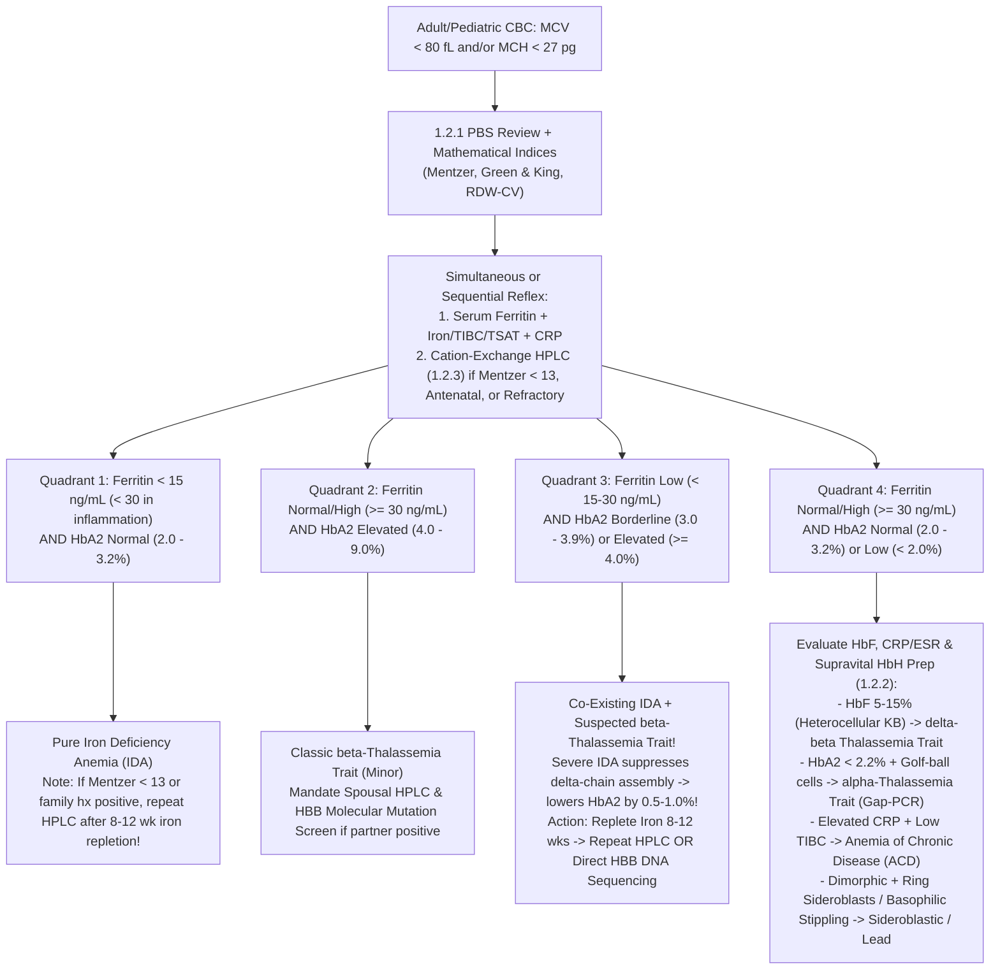
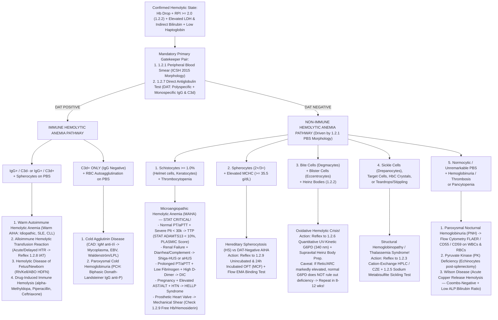

# 🔬 Cluster 1.2: Anemia Morphology, Hemoglobinopathy & Hemolysis Master Cluster — Apex Reference & Diagnostic Integration Manual

> **Document Control & Regulatory Governance (`ISO 15189:2022 Clauses 8.2 & 8.3` / `NABL 112`):**
>
> | Document Attribute | Specification Details |
> | :--- | :--- |
> | **Document ID** | `SOP-HEM-CL1.2-MASTER-v5.0` (Cross-Ref: `NABL-HEM-1.2`) |
> | **Version & Status** | `v5.0` — 10-Persona International Red-Team Upgraded & NABL/CAP Witness-Audit Ready |
> | **Effective Date** | `15-Oct-2026` |
> | **Review Cycle** | Annual (or immediately upon `ICSH`, `WHO`, `CLSI`, `EMQN`, `AABB`, or `NABL` standard revision) |
> | **Laboratory Facility** | **Sawariya Diagnostic Lab**, Charkhi Dadri, Haryana – 127306, India |
> | **Department** | `01_Hematology_and_Coagulation` — Special Hematology, Hemoglobinopathies, Red Cell Enzymology & Immunohematology |
> | **Authorizing Authority** | Laboratory Director & Senior Consultant Hematopathologist (`MD Pathology`) |
> | **Controlled Copy Distribution** | Master Quality Management System (`QMS`), LIMS Rule Engine, Hematology Microscopy Bench, Special Hematology/HPLC Bench, Immunohematology (`Gel Card / Tube`) Bench |
> | **Normative Accreditation Standards** | `ISO 15189:2022` (Clauses 4.1–8.9 & Annex A), `NABL 112` (Specific Criteria for Medical Laboratories), `NABL 153 / 220D / 223`, `CAP Hematology & Transfusion Medicine Checklists`, `ICSH 2015 / 2021` (RBC/WBC/Platelet Morphology & Schistocyte Standardization), `WHO 2022` (Malaria G6PD Classification), `EMQN` (Best Practice Guidelines for Carrier Identification & Prenatal Diagnosis of Hemoglobinopathies), `TIF 2021` (Thalassemia International Federation Guidelines), `ICMR 2016` (National Guidelines for Hemoglobinopathies in India), `AABB Technical Manual (21st Ed.)`, `BCSH / BSH Guidelines`, `CLSI H20-A2` (Leukocyte Differential), `CLSI H44-A2` (Reticulocyte Counting), `CLSI H22-A3` (HbA2 Quantitation), `CLSI H03-Ed7` (Venipuncture), `CLSI EP07 / EP15-A3 / EP17-A2 / EP28-A3c`, `ISO/TS 20914:2019` (Measurement Uncertainty), `ISO 22367:2020` (Risk Management / FMECA) |

---

## 1. Master Sub-File Architecture, Analytical Platforms & 10-SOP Navigation Index

### 1.1 Analytical Platforms & Instrumentation Ecosystem Covered Under Cluster 1.2

1. **Primary Automated Hematology & Screening Indices:**
   - **Nihon Kohden Celltac $\alpha+$ `MEK-1305` / `MEK-1503`:** Electrical impedance aperture sensing (`DC` volumetric sizing with hydrodynamic/sweep-flow anti-recirculation), cyanide-free colorimetric hemoglobinometry ($525\text{–}535\text{ nm}$), optical light scatter leukocyte differential flagging, and automated kinetic erythrocyte sedimentation rate (`ESR`). Generates primary red cell indices ($\text{Hb, RBC, HCT/PCV, MCV, MCH, MCHC, RDW-CV, RDW-SD}$) and mathematical thalassemia vs. iron deficiency discrimination indices (**Mentzer Index, Green & King Index, England & Fraser Index, Shine & Lal Index, Srivastava Index, Ehsani Index, RDWI**).
2. **Brightfield & Supravital Light Microscopy (`ICSH 2015 / 2021` Standardized):**
   - **Binocular LED/Halogen Research Microscopes (Olympus CX23 / CX33 / Nikon Eclipse E200):** Calibrated with stage micrometer ($0.01\text{ mm}$) and ocular reticle; verified daily for **Köhler illumination**, numerical aperture ($\text{NA } 1.25$ oil immersion $100\times$ objective), and Miller ocular square-in-square disc ($1:9$ area ratio) for manual supravital reticulocyte counting (`CLSI H44-A2`).
   - **Cytochemical Staining Systems (`SOP 1.2.10`):** Methanolic Romanowsky stains (**Leishman Stain $0.15\%\text{ w/v}$** and dual **May-Grünwald Giemsa `MGG`**) buffered strictly with **Sörensen’s Phosphate Buffer** at $\text{pH } 6.80 \pm 0.05$ (routine morphology) and $\text{pH } 7.20 \pm 0.05$ (*Plasmodium* stippling), plus isotonic supravital **New Methylene Blue (`NMB` $1.0\%\text{ w/v}$)** / **Brilliant Cresyl Blue (`BCB`)** for ribosomal RNA (`Reticulocytes`), $\beta_4$-tetramer **HbH inclusions** ("golf-ball cells"), and oxidative **Heinz bodies**.
3. **Hemoglobin Separation & Variant Quantification (`SOP 1.2.3` & `1.2.4`):**
   - **Cation-Exchange High-Performance Liquid Chromatography (`CE-HPLC` — Bio-Rad Variant II $\beta$-Thalassemia Short Program / D-10):** Dual-piston ionic gradient elution across a negatively charged carboxyl-methyl (`CM`) silica cartridge with dual-wavelength diode array detection ($415\text{ nm}$ primary Soret band; $690\text{ nm}$ secondary baseline correction).
   - **Capillary Zone Electrophoresis (`CZE` — Sebia Capillarys 2/3 Octa):** High-voltage alkaline silica capillary separation ($\text{pH } 9.4$, $415\text{ nm}$ UV detection) into discrete Zones `Z1` through `Z15`, resolving $\text{HbA}_2$ cleanly from co-eluting $\text{HbE}$ and $\text{Hb Lepore}$.
   - **Kleihauer-Betke (`KB`) Citrate-Phosphate Acid Elution ($\text{pH } 3.20\text{–}3.30$ at $37.0^\circ\text{C}$):** Differential acid resistance of fetal hemoglobin ($\text{HbF}, \alpha_2\gamma_2$) vs. adult hemoglobin ($\text{HbA}, \alpha_2\beta_2$) with Erythrosin-B / Eosin counterstaining for Fetomaternal Hemorrhage (`FMH`) volume quantification and Hereditary Persistence of Fetal Hemoglobin (`HPFH` pancellular) vs. $\delta\beta$-Thalassemia (heterocellular) differentiation.
4. **Red Cell Enzymology, Sickling & Membrane Biophysics (`SOP 1.2.5`, `1.2.6`, `1.2.9`):**
   - **Quantitative `G6PD` UV-Kinetic Assay ($340\text{ nm}$, $37.0^\circ\text{C} \pm 0.1^\circ\text{C}$):** Rate measurement of $\text{NADP}^+ \rightarrow \text{NADPH}$ reduction ($\Delta A_{340}/\text{min}$, molar absorptivity $\varepsilon_{340} = 6.22 \times 10^3\text{ L}\cdot\text{mol}^{-1}\cdot\text{cm}^{-1}$) normalized to cyanmethemoglobin/SLS-hemoglobin concentration ($\text{U/g Hb}$), paired with **Beutler UV Fluorescent Spot Screening** ($365\text{ nm}$ long-wave Wood’s lamp).
   - **Deoxygenated Sickling & Solubility Suite:** Freshly prepared **$2.0\%\text{ w/v}$ Sodium Metabisulfite ($\text{Na}_2\text{S}_2\text{O}_5$)** wet-mount microscopy and high-molarity ($2.3\text{ M}$ phosphate buffer + sodium dithionite $\text{Na}_2\text{S}_2\text{O}_4$ + saponin) **Sickle Solubility Turbidity Assay**.
   - **Osmotic Fragility Test (`OFT` — Parpart’s Buffered Hypotonic $\text{NaCl}$ Gradient $0.90\% \rightarrow 0.10\%$, $\text{pH } 7.40$) & Intravascular Hemolysis Suite:** Immediate and $24\text{-hour}$ sterile $37^\circ\text{C}$ incubated `OFT` spectrophotometry at $540\text{ nm}$ yielding **Median Corpuscular Fragility (`MCF`)**, derivative fragiligrams, **Harboe / Blakney-Dinwoodie multi-wavelength ($415/380/450\text{ nm}$) Plasma/Urine Free Hemoglobin**, and **Rous Prussian Blue Urine Hemosiderin** cytology.
5. **Immunohematology & Antiglobulin Testing (`SOP 1.2.7` & `1.2.8`):**
   - **Column Agglutination Technology (`CAT` Sephadex / Glass Microbead Gel Cards — Bio-Rad ID-System / Ortho BioVue) & Conventional Spin-Tube Method:** Polyspecific Anti-Human Globulin (`AHG`: Anti-$\text{IgG}$ + Anti-$\text{C3d}$ clone `BRIC-8`/`C139-9`), Monospecific Anti-$\text{IgG}$ ($\gamma$-chain specific) and Anti-$\text{C3d}$ differential **Direct Antiglobulin Test (`DAT`)**, and $37^\circ\text{C}$ Low-Ionic-Strength Saline (`LISS`)-potentiated 3-cell panel **Indirect Antiglobulin Test (`IAT`)** with serial master-dilution antibody titration ($\text{Anti-D, C, c, E, e, K, Fy}^\text{a}, \text{Jk}^\text{a}$).

---

### 1.2 Master Navigation Index Across All 10 Sub-Cluster SOPs (`1.2.1` to `1.2.10`)

| Sub-Code | Official SOP Title & Direct File Link | Primary LOINC Code(s) | Preferred Specimen & Stability Window | Analytical Principle | Core Clinical & Diagnostic Indication |
| :--- | :--- | :--- | :--- | :--- | :--- |
| **`1.2.1`** | [`1.2.1_Peripheral_Blood_Smear_PBS_Morphology_ICSH_SOP.md`](file:///c:/Users/Dell/Desktop/python/REFERENCES%20AND%20INTERPREATIONS/01_Hematology_and_Coagulation/1.2_Anemia_Morphology_Hemoglobinopathy_and_Hemolysis_Cluster/1.2.1_Peripheral_Blood_Smear_PBS_Morphology_ICSH_SOP.md) | `5909-7` (Blood smear finding)<br>`7799-0` (Schistocytes) | $\text{K}_2\text{-EDTA}$ Whole Blood; wedge smear prepared within $\le 2\text{–}3\text{ h}$ of venipuncture | Romanowsky (Leishman / MGG) brightfield microscopy ($10\times, 40\times, 100\times$ oil) with `ICSH 2015` 3-Tier (`1+/2+/3+`) grading | Gold-standard morphological verification of `MEK-1305/1503` flags, microcytic/macrocytic/hemolytic anemias, **Schistocyte %** in `MAHA/TTP`, blasts, and hemoparasites |
| **`1.2.2`** | [`1.2.2_Reticulocyte_Count_and_Reticulocyte_Production_Index_RPI.md`](file:///c:/Users/Dell/Desktop/python/REFERENCES%20AND%20INTERPREATIONS/01_Hematology_and_Coagulation/1.2_Anemia_Morphology_Hemoglobinopathy_and_Hemolysis_Cluster/1.2.2_Reticulocyte_Count_and_Reticulocyte_Production_Index_RPI.md) | `17849-1` (Retic %)<br>`14196-0` (`ARC`)<br>`31112-6` (`RPI`) | $\text{K}_2\text{-EDTA}$ Whole Blood; $\le 6\text{ h}$ at $20\text{–}25^\circ\text{C}$ or $\le 24\text{ h}$ at $2\text{–}8^\circ\text{C}$ | Supravital `NMB`/`BCB` ribosomal RNA precipitation ($1,000$-cell Miller disc) & automated polymethine fluorescence | Quantifies effective bone marrow erythropoietic regeneration via `Retic %`, `ARC` ($\times 10^9/\text{L}$), `CRC`, and maturation-corrected **`RPI`** (Hypoproliferative $< 2.0$ vs. Regenerative $\ge 2.0\text{–}3.0$) |
| **`1.2.3`** | [`1.2.3_Hemoglobin_HPLC_Electrophoresis_Thalassemia_Screen.md`](file:///c:/Users/Dell/Desktop/python/REFERENCES%20AND%20INTERPREATIONS/01_Hematology_and_Coagulation/1.2_Anemia_Morphology_Hemoglobinopathy_and_Hemolysis_Cluster/1.2.3_Hemoglobin_HPLC_Electrophoresis_Thalassemia_Screen.md) | `42246-9` (Hb fractionation)<br>`4551-8` ($\text{HbA}_2$)<br>`4576-5` ($\text{HbF}$) | $\text{K}_2\text{-EDTA}$ Whole Blood; stable $7\text{ days}$ at $2\text{–}8^\circ\text{C}$ ($> 90\text{ d}$ post-transfusion) | Cation-Exchange `HPLC` ($415/690\text{ nm}$ retention windows) & Alkaline `CZE` (`Z1–Z15`) | Definitive phenotypic quantification of $\text{HbA}_0, \text{HbA}_2, \text{HbF}$ and North Indian structural variants ($\text{HbD-Punjab, HbS, HbE, HbQ-India, HbC, Hb Lepore}$) |
| **`1.2.4`** | [`1.2.4_Fetal_Hemoglobin_HbF_and_Kleihauer_Betke_Test.md`](file:///c:/Users/Dell/Desktop/python/REFERENCES%20AND%20INTERPREATIONS/01_Hematology_and_Coagulation/1.2_Anemia_Morphology_Hemoglobinopathy_and_Hemolysis_Cluster/1.2.4_Fetal_Hemoglobin_HbF_and_Kleihauer_Betke_Test.md) | `18281-6` (Fetal RBCs by `KB`)<br>`4576-5` ($\text{HbF}$ %) | $\text{K}_2\text{-EDTA}$ Maternal Blood within $1\text{–}2\text{ h}$ postpartum ($< 72\text{ h}$ RhIG window) | Citrate-phosphate acid elution ($\text{pH } 3.20, 37^\circ\text{C}$) + Erythrosin-B counterstain ($2,000$-cell count) & `HPLC` | Quantifies Fetomaternal Hemorrhage (`FMH` mL bleed) for exact **Anti-D `RhIG` vial calculation**, and distinguishes pancellular `HPFH` from heterocellular $\delta\beta$-Thalassemia |
| **`1.2.5`** | [`1.2.5_Sickling_Test_Sodium_Metabisulfite_and_Solubility.md`](file:///c:/Users/Dell/Desktop/python/REFERENCES%20AND%20INTERPREATIONS/01_Hematology_and_Coagulation/1.2_Anemia_Morphology_Hemoglobinopathy_and_Hemolysis_Cluster/1.2.5_Sickling_Test_Sodium_Metabisulfite_and_Solubility.md) | `4625-0` (Sickling metabisulfite)<br>`4626-8` (Solubility) | $\text{K}_2\text{-EDTA}$ Whole Blood; stable $\le 24\text{ h}$ RT or $7\text{ d}$ at $2\text{–}8^\circ\text{C}$ | Deoxygenation-induced $\text{HbS}$ ($\beta6\text{ Glu}\to\text{Val}$) tactoid polymerization ($2\%\text{ Na}_2\text{S}_2\text{O}_5$) & $2.3\text{ M}$ phosphate dithionite turbidity | Rapid orthogonal confirmation of `HPLC` S-window peaks ($\text{HbS}$ vs. non-sickling $\text{HbD/G/Korle-Bu}$) and pre-anesthetic screening |
| **`1.2.6`** | [`1.2.6_G6PD_Quantitative_Assay_and_Fluorescent_Spot_Screen.md`](file:///c:/Users/Dell/Desktop/python/REFERENCES%20AND%20INTERPREATIONS/01_Hematology_and_Coagulation/1.2_Anemia_Morphology_Hemoglobinopathy_and_Hemolysis_Cluster/1.2.6_G6PD_Quantitative_Assay_and_Fluorescent_Spot_Screen.md) | `32551-4` (`G6PD` U/g Hb)<br>`2357-2` (`G6PD` Spot Screen) | $\text{K}_2\text{-EDTA}$ or $\text{ACD}$ Whole Blood; $\le 24\text{ h}$ RT or $7\text{ d}$ at $2\text{–}8^\circ\text{C}$ | UV-Kinetic rate of $\text{NADP}^+ \rightarrow \text{NADPH}$ at $340\text{ nm}$ ($37^\circ\text{C}$) normalized to $\text{g Hb}$ + $365\text{ nm}$ UV spot screen | `WHO 2022` quantitative classification ($< 30\%$ Severe, $30\text{–}80\%$ Intermediate, $> 80\%$ Normal) prior to Primaquine, Tafenoquine, Dapsone, or Rasburicase therapy |
| **`1.2.7`** | [`1.2.7_Direct_Antiglobulin_Test_DAT_Direct_Coombs.md`](file:///c:/Users/Dell/Desktop/python/REFERENCES%20AND%20INTERPREATIONS/01_Hematology_and_Coagulation/1.2_Anemia_Morphology_Hemoglobinopathy_and_Hemolysis_Cluster/1.2.7_Direct_Antiglobulin_Test_DAT_Direct_Coombs.md) | `1007-4` (`DAT` Polyspecific)<br>`1009-0` (Anti-$\text{IgG}$)<br>`1006-6` (Anti-$\text{C3d}$) | **$\text{K}_2\text{-EDTA}$ Whole Blood ONLY** (prevents *in-vitro* $\text{Ca}^{2+}$-dependent complement fixation); $\le 24\text{–}72\text{ h}$ | Polyspecific & Monospecific ($\text{IgG}$ vs. $\text{C3d}$) Column Agglutination Gel Card (`CAT`) & washed $3\%$ RBC tube method with `IgG` Check Cells | Detects *in-vivo* erythrocyte sensitization in Warm `AIHA` ($\text{IgG} \pm \text{C3d}$), Cold Agglutinin Disease ($\text{C3d}$ only), `HDFN`, Acute/Delayed `HTR`, and Drug-Induced Immune Hemolysis (`DIHA`) |
| **`1.2.8`** | [`1.2.8_Indirect_Antiglobulin_Test_IAT_Indirect_Coombs_Antibody_Screen.md`](file:///c:/Users/Dell/Desktop/python/REFERENCES%20AND%20INTERPREATIONS/01_Hematology_and_Coagulation/1.2_Anemia_Morphology_Hemoglobinopathy_and_Hemolysis_Cluster/1.2.8_Indirect_Antiglobulin_Test_IAT_Indirect_Coombs_Antibody_Screen.md) | `890-4` (Antibody Screen `IAT`)<br>`31208-2` (Anti-D Titre) | Plain Clotted Serum + $\text{K}_2\text{-EDTA}$ Plasma ($\le 72\text{ h}$ of planned transfusion per `AABB 5.14.3.2`) | $37^\circ\text{C}$ `LISS`-potentiated incubation of patient serum with `O`-group 3-cell reagent screening panel (`R1R1, R2R2, rr`) + serial master dilution titration | Pre-transfusion alloantibody screening ($\text{Rh, Kell, Duffy, Kidd, MNS}$) and antenatal maternal alloimmunization titration (Critical Titre $\ge 1:16$ for $\text{Anti-D}$; $\ge 1:8$ for $\text{Anti-K}$) |
| **`1.2.9`** | [`1.2.9_Osmotic_Fragility_Test_OFT_and_Plasma_Urine_Free_Hemoglobin.md`](file:///c:/Users/Dell/Desktop/python/REFERENCES%20AND%20INTERPREATIONS/01_Hematology_and_Coagulation/1.2_Anemia_Morphology_Hemoglobinopathy_and_Hemolysis_Cluster/1.2.9_Osmotic_Fragility_Test_OFT_and_Plasma_Urine_Free_Hemoglobin.md) | `4611-0` (`OFT` Immediate)<br>`4612-8` (`OFT` $24\text{h}$ Incubated)<br>`4635-9` (Plasma Free Hb) | Lithium Heparin / Defibrinated Blood ($\le 6\text{ h}$ for `OFT`); Atraumatic $21\text{G}$ Citrate/Heparin Plasma & Fresh Urine | Parpart’s buffered hypotonic $\text{NaCl}$ ($0.90\text{–}0.10\%$) $540\text{ nm}$ lysis curve (`MCF`), Harboe $415/380/450\text{ nm}$ derivative spectrophotometry, & Rous Prussian Blue stain | Diagnoses reduced surface-to-volume ratio in **Hereditary Spherocytosis (`HS`)** (`MCF` $> 0.445\%$ immediate / $> 0.59\%$ incubated) and quantifies acute intravascular hemolysis & chronic hemosiderinuria |
| **`1.2.10`** | [`1.2.10_Hematology_Stain_Preparation_pH_Buffer_QC_Microscope_PM_and_Slide_Retention_SOP.md`](file:///c:/Users/Dell/Desktop/python/REFERENCES%20AND%20INTERPREATIONS/01_Hematology_and_Coagulation/1.2_Anemia_Morphology_Hemoglobinopathy_and_Hemolysis_Cluster/1.2.10_Hematology_Stain_Preparation_pH_Buffer_QC_Microscope_PM_and_Slide_Retention_SOP.md) | `NABL-112-HEM-QC` | Methanolic Leishman / Giemsa / NMB, Sörensen Buffer ($\text{pH } 6.80 / 7.20$), Immersion Oil ($n_D = 1.515$) | Two-point NIST pH potentiometry ($\text{pH } 4.01/7.00$), Romanowsky Azure B–Eosin Y batch maturation verification, Köhler alignment & archival indexing | Foundational pre-analytical/analytical quality backbone governing stain batch verification, daily buffer $\text{pH}$ logs, microscope preventive maintenance, and `NABL 112` specimen/slide retention (`48h` / `7d` / `1yr` / `5yr`) |

---

### 1.3 Detailed Sub-Cluster Analytical & Clinical Cross-Integration (`1.2.1` Through `1.2.10`)

To eliminate siloed single-test reporting, Sawariya Diagnostic Lab enforces an integrated, bidirectional analytical architecture across all 10 SOPs in Cluster `1.2`:

```mermaid
flowchart TD
    CBC["Automated CBC + Indices (MEK-1305 / MEK-1503)<br/>Hb, MCV, MCH, MCHC, RDW-CV, Mentzer Index"] --> PBS["1.2.1 Peripheral Blood Smear (ICSH 2015 Grading)<br/>+ 1.2.10 Sörensen Buffer pH 6.80 & Köhler QC"]
    CBC --> RET["1.2.2 Reticulocyte Count, ARC, CRC & RPI<br/>(Supravital NMB / Fluorescence)"]
    
    PBS -->|Microcytic Hypochromic<br/>Target / Pencil Cells| MICRO["Microcytic Anemia Reflex Cascade"]
    PBS -->|Spherocytes, Schistocytes,<br/>Bite/Blister, Sickle Cells| HEMO["Hemolytic Anemia Reflex Cascade"]
    RET -->|RPI >= 2.0-3.0<br/>Hyperproliferative| HEMO
    RET -->|RPI < 2.0<br/>Hypoproliferative| MICRO

    MICRO --> HPLC["1.2.3 Cation-Exchange HPLC / CZE<br/>HbA0, HbA2, HbF & Variant Windows"]
    HPLC -->|HbF Elevated / Rh-Neg Mother| KB["1.2.4 Kleihauer-Betke Acid Elution<br/>FMH mL Bleed & HPFH vs delta-beta Thal"]
    HPLC -->|S-Window Peak / Sickle Suspect| SICKLE["1.2.5 Sodium Metabisulfite 2%<br/>& Dithionite Solubility Confirmation"]

    HEMO --> DAT["1.2.7 Direct Antiglobulin Test (DAT)<br/>Polyspecific + Monospecific Anti-IgG & Anti-C3d"]
    DAT -->|DAT Positive (Immune)| IAT["1.2.8 Indirect Antiglobulin Test (IAT)<br/>3-Cell Screen & Maternal/Pre-Transfusion Titration"]
    DAT -->|DAT Negative + Spherocytes| OFT["1.2.9 Unincubated & 24h Incubated OFT (MCF)<br/>+ Plasma/Urine Free Hb & Hemosiderin"]
    DAT -->|DAT Negative + Bite/Blister Cells| G6PD["1.2.6 Quantitative UV-Kinetic G6PD (340 nm)<br/>+ Beutler Spot & Heinz Body Prep"]
```

1. **Integration Between Automated `CBC` (`Cluster 1.1`), `PBS` (`1.2.1`), and Stain/Optics QC (`1.2.10`):**
   - No `PBS` morphological grade (`1+`, `2+`, `3+`) is valid unless the slide is prepared within $\le 2\text{–}3\text{ hours}$ of $\text{K}_2\text{-EDTA}$ collection and stained with a Leishman/MGG batch verified that morning under `SOP 1.2.10` ($\text{pH } 6.80 \pm 0.05$).
   - Acidic buffer drift ($\text{pH} < 6.60$) causes hyper-eosinophilic red staining that obscures polychromasia (`1.2.2`), basophilic stippling (`1.2.3`), and neutrophil toxic granulation; alkaline buffer drift ($\text{pH} > 7.00$) induces muddy blue-grey erythrocyte staining that masks central pallor hypochromia and mimics spherocytosis (`1.2.9`).
   - Whenever `PBS` (`1.2.1`) detects **Nucleated Red Blood Cells ($\ge 1\text{ nRBC} / 100\text{ WBCs}$)** in thalassemia major, severe `AIHA`, or `HDFN`, the bench technologist must apply the mandatory mathematical correction to the automated Impedance Total Leukocyte Count (`TLC`) before releasing the report:
     $$\text{Corrected WBC Count } (\times 10^9/\text{L}) = \frac{\text{Uncorrected Automated WBC Count} \times 100}{100 + \text{Number of nRBCs per } 100\text{ WBCs}}$$
   - Whenever `PBS` (`1.2.1`) identifies **Cold Autoagglutination** (3D grape-like erythrocyte clumps alongside a spuriously low `RBC` count, spuriously high $\text{MCV} > 115\text{ fL}$, and impossible $\text{MCHC} > 37.0\text{ g/dL}$), the tube is warmed at **$37.0^\circ\text{C}$ for $30\text{ minutes}$**, re-analyzed immediately on `MEK-1305/1503`, a pre-warmed slide is smeared (`1.2.1`), and the specimen is reflexed to **Monospecific Anti-$\text{C3d}$ `DAT` (`1.2.7`)**.

2. **Integration Between `PBS` (`1.2.1`), Reticulocyte Kinetics (`1.2.2`), and Supravital Inclusion Bodies (`1.2.3` / `1.2.6`):**
   - Polychromatophilic macrocytes ("shift cells") observed on Romanowsky `PBS` (`1.2.1`) trigger `SOP 1.2.2` to compute the **Corrected Reticulocyte Count (`CRC`)** and **Reticulocyte Production Index (`RPI`)**, dividing by the hematocrit-specific maturation time factor ($1.0, 1.5, 2.0, \text{ or } 2.5\text{ days}$).
   - Furthermore, the supravital `NMB`/`BCB` incubation tube used in `SOP 1.2.2` serves a critical dual diagnostic role when extended from $15\text{ minutes}$ to **$60\text{–}120\text{ minutes}$ at $37.0^\circ\text{C}$**:
     - Precipitates unstable **$\beta_4$-tetramers ($\text{HbH}$)** into multiple uniform greenish-blue "golf-ball" inclusions in **$\alpha$-Thalassemia ($\text{HbH}$ Disease `--/-a` or $\alpha$-Thalassemia Trait)** when `HPLC` (`1.2.3`) shows normal/low $\text{HbA}_2$ ($< 2.5\%$) or a fast-eluting pre-integration peak ($< 0.50\text{ min}$).
     - Visualizes eccentric membrane-bound **Heinz bodies** (denatured oxidized globin precipitates) in acute **`G6PD` deficiency crisis (`1.2.6`)** or unstable hemoglobinopathies ($\text{Hb Köln}$, $\text{Hb Zürich}$).

3. **Integration Between `HPLC` (`1.2.3`), Kleihauer-Betke (`1.2.4`), and Sickling Assays (`1.2.5`):**
   - Cation-exchange `HPLC` (`1.2.3`) is a rapid chromatographic separation method, **not** an absolute structural identification method. Every abnormal retention peak requires orthogonal verification:
     - **S-Window Peak ($4.30\text{–}4.70\text{ min}$ on Bio-Rad Variant II):** Must be confirmed via **$2.0\%$ Sodium Metabisulfite Sickling Test (`1.2.5`)** to distinguish authentic $\text{HbS}$ ($\beta6\text{ Glu}\to\text{Val}$) from rare non-sickling variants co-eluting in the S-window ($\text{HbG-Philadelphia}$, $\text{HbD-Iran}$ on certain buffers).
     - **Elevated $\text{HbF}$ ($5\text{–}35\%$) with Normal $\text{HbA}_2$ ($< 3.2\%$):** Must be reflexed to **Kleihauer-Betke Acid Elution (`1.2.4`)** to evaluate cellular distribution: a **pancellular (homocellular)** distribution where nearly $100\%$ of RBCs stain uniform intermediate pink confirms benign **Hereditary Persistence of Fetal Hemoglobin (`HPFH`)**, whereas a **heterocellular** distribution (intense cherry-red $\text{HbF}$ cells admixed with completely eluted ghost cells) alongside microcytosis indicates **$\delta\beta$-Thalassemia Trait** (which carries risk of severe thalassemia intermedia/major if co-inherited with $\beta$-thalassemia trait).

4. **Integration Between `DAT` (`1.2.7`), `IAT` (`1.2.8`), `OFT` (`1.2.9`), and `G6PD` (`1.2.6`) in Hemolytic Workups:**
   - Spherocytes on `PBS` (`1.2.1`) occur identically in both **Warm Autoimmune Hemolytic Anemia (`AIHA`)** and **Hereditary Spherocytosis (`HS`)**, and both conditions exhibit increased osmotic fragility (`MCF > 0.445% NaCl`) on `OFT` (`1.2.9`) because spherocytes from any etiology have a reduced surface-area-to-volume ratio.
   - Therefore, **performing `OFT` (`1.2.9`) without first performing a Monospecific `DAT` (`1.2.7`) is a major clinical error**: `DAT` is the mandatory primary bifurcation test (`DAT Positive` = Immune Spherocytosis / `AIHA` or `ABO HDFN`; `DAT Negative` = Non-Immune Spherocytosis / `HS` warranting `OFT` and flow-cytometric `EMA` binding).

---

## 2. Master Algorithmic Decision Trees & Reflex Cascades

### 2.1 Algorithm A: The Microcytic Hypochromic Anemia Reflex Cascade (`MCV < 80 fL` / `MCH < 27 pg`)

In North India (Haryana, Punjab, Rajasthan, Western UP, and Delhi NCR), microcytic hypochromic anemia represents the single highest-volume diagnostic dilemma on the hematology bench. Indiscriminate empirical iron therapy in undiagnosed $\beta$-Thalassemia Trait causes iatrogenic hepatic/myocardial hemosiderosis and delays pre-marital/antenatal genetic counseling; conversely, missing co-existing **Iron Deficiency Anemia (`IDA`)** in a $\beta$-Thalassemia carrier can suppress $\text{HbA}_2$ into the borderline/normal range.

#### Step 1: Mathematical Red Cell Discrimination Indices (Generated Automatically from `MEK-1305 / MEK-1503` CBC)

> [!CAUTION]
> **Clinical Governance Rule on Mathematical Indices:** Mathematical indices (`Mentzer`, `Green & King`, `Srivastava`, `Shine & Lal`) are **triage screening tools ONLY** ($75\text{–}90\%$ sensitivity/specificity in pure populations). They **FAIL** in combined `IDA + \beta-Thalassemia Trait`, pregnancy, pediatric age groups ($< 2\text{ years}$), and polycythemia. They must **NEVER** replace Serum Ferritin + `HPLC` ($\text{HbA}_2/\text{HbF}$) quantification for antenatal or pre-marital counseling.

| Discrimination Index | Exact Mathematical Formula | Cut-off Suggesting $\beta$-Thalassemia Trait ($\beta\text{-TT}$) | Cut-off Suggesting Iron Deficiency Anemia (`IDA`) | Physiological Basis & Diagnostic Sensitivity |
| :--- | :--- | :--- | :--- | :--- |
| **Mentzer Index (1973)** | $$\frac{\text{MCV (fL)}}{\text{RBC Count } (\times 10^{12}/\text{L})}$$ | **$< 13.0$** | **$> 13.0$** | In $\beta\text{-TT}$, bone marrow compensation produces erythrocytosis ($\text{RBC} > 5.0\text{–}5.5 \times 10^{12}/\text{L}$) despite severe microcytosis ($\text{MCV } 58\text{–}68\text{ fL}$). Sensitivity $\approx 89\%$, Specificity $\approx 81\%$. |
| **Green & King Index (1989)** | $$\frac{\text{MCV}^2 \times \text{RDW-CV}}{\text{Hb (g/dL)} \times 100}$$ | **$< 65.0$** | **$> 65.0$** | Incorporates anisocytosis (`RDW-CV`): `IDA` exhibits marked anisocytosis ($\text{RDW-CV } 16\text{–}24\%$) as iron stores deplete progressively, whereas uncomplicated $\beta\text{-TT}$ produces uniform microcytes ($\text{RDW-CV } 12.5\text{–}15.0\%$). Highest overall Youden index ($J \approx 0.82$) in South Asian cohorts. |
| **Srivastava Index (1973)** | $$\frac{\text{MCH (pg)}}{\text{RBC Count } (\times 10^{12}/\text{L})}$$ | **$< 3.8$** | **$> 3.8$** | Evaluates mean corpuscular hemoglobin relative to erythrocytosis; unaffected by storage-induced `MCV` swelling in aged $\text{EDTA}$ specimens ($> 6\text{ h}$). |
| **England & Fraser Index (1973)** | $$\text{MCV} - \text{RBC} - (5 \times \text{Hb}) - 3.4$$ | **$< 0$ (Negative value)** | **$> 0$ (Positive value)** | Multi-parameter linear discriminant function; highly specific ($> 90\%$) for $\beta\text{-TT}$ when strongly negative ($< -3.0$). |
| **Shine & Lal Index (1977)** | $$\frac{\text{MCV}^2 \times \text{MCH}}{100}$$ | **$< 1530$** | **$> 1530$** | High negative predictive value ($> 95\%$) for ruling out $\beta\text{-TT}$ in mass community/antenatal screening, though lower specificity in severe `IDA`. |
| **Ehsani Index (2009)** | $$\text{MCV} - (10 \times \text{RBC})$$ | **$< 15.0$** | **$> 15.0$** | Rapid mental bedside approximation of the Mentzer ratio. |
| **Red Cell Distribution Width Index (`RDWI`)** | $$\frac{\text{MCV} \times \text{RDW-CV}}{\text{RBC}}$$ | **$< 220$** | **$> 220$** | Amplifies the divergence between high-`RBC` uniform microcytosis ($\beta\text{-TT}$) and low-`RBC` heterogeneous microcytosis (`IDA`). |

#### Step 2: Microcytic Anemia Reflex Decision Flow (`PBS` + `Ferritin/Iron Studies` + `HPLC`)



#### Step 3: Exhaustive 6-Condition Differential Matrix for Microcytic Hypochromic Anemias

| Diagnostic Parameter | 1. Pure Iron Deficiency Anemia (`IDA`) | 2. $\beta$-Thalassemia Trait ($\beta\text{-TT}$) | 3. Co-Existing `IDA` + $\beta$-Thalassemia Trait | 4. $\alpha$-Thalassemia Trait (`-a/-a` or `--/aa`) | 5. $\delta\beta$-Thalassemia Trait | 6. Anemia of Chronic Disease (`ACD` / Inflammation) |
| :--- | :--- | :--- | :--- | :--- | :--- | :--- |
| **`RBC` Count ($\times 10^{12}/\text{L}$)** | Decreased ($< 4.0$) | **Elevated ($5.2 \text{ – } 6.8$)** | Normal to Mildly Elevated ($4.3 \text{ – } 5.4$) | Elevated ($5.0 \text{ – } 6.2$) | Mildly Elevated ($4.8 \text{ – } 5.8$) | Decreased ($3.2 \text{ – } 4.2$) |
| **`MCV` ($\text{fL}$) & `MCH` ($\text{pg}$)** | $\text{MCV } 60\text{–}78\text{ fL}$ (proportional to `Hb` drop); $\text{MCH } 18\text{–}25\text{ pg}$ | **Disproportionately low:** $\text{MCV } 56\text{–}68\text{ fL}$; $\text{MCH } 18\text{–}22\text{ pg}$ despite $\text{Hb } 10\text{–}12\text{ g/dL}$ | Severely low: $\text{MCV } 52\text{–}65\text{ fL}$; $\text{MCH } 15\text{–}20\text{ pg}$; $\text{Hb } 7.0\text{–}9.5\text{ g/dL}$ | $\text{MCV } 65\text{–}76\text{ fL}$; $\text{MCH } 20\text{–}25\text{ pg}$ | $\text{MCV } 64\text{–}74\text{ fL}$; $\text{MCH } 20\text{–}24\text{ pg}$ | Normocytic ($80\text{–}90\text{ fL}$) early; mildly microcytic ($72\text{–}79\text{ fL}$) late |
| **`RDW-CV` ($\%$)** | **Markedly Elevated ($16.5\% \text{ – } 26.0\%$)** | Normal / Mildly Elevated ($12.5\% \text{ – } 15.5\%$) | **Markedly Elevated ($17.0\% \text{ – } 24.0\%$)** | Normal ($12.5\% \text{ – } 15.0\%$) | Mildly Elevated ($15.0\% \text{ – } 18.0\%$) | Normal ($13.0\% \text{ – } 15.5\%$) |
| **`PBS` Morphology (`1.2.1`)** | Microcytic hypochromic, **pencil cells (elliptocytes)**, occasional target cells, thrombocytosis | Uniform microcytes, **numerous target cells (`codocytes`)**, **coarse basophilic stippling** | Severe hypochromia, both pencil cells and target cells, marked anisopoikilocytosis | Mild microcytosis, rare target cells; supravital `BCB` shows rare **$\text{HbH}$ "golf-ball" inclusions** | Microcytosis, target cells, mild polychromasia | Mildly hypochromic/normochromic, rouleaux or reactive leukocytosis |
| **Serum Ferritin ($\text{ng/mL}$) & `TSAT` ($\%$)** | **Ferritin $< 15\text{ ng/mL}$** ($< 30$ with inflammation); $\text{TSAT} < 15\%$; $\text{TIBC} \uparrow$ ($> 400\ \mu\text{g/dL}$) | Normal or Elevated Ferritin ($50\text{–}300\text{ ng/mL}$); $\text{TSAT } 25\text{–}45\%$ | **Ferritin $< 15\text{ ng/mL}$**; $\text{TSAT} < 15\%$; $\text{TIBC} \uparrow$ | Normal Ferritin & `TSAT` | Normal Ferritin & `TSAT` | **Ferritin Normal/High ($> 100\text{ ng/mL}$)** due to hepcidin block; $\text{TSAT} < 16\%$; **$\text{TIBC} \downarrow$ ($< 250\ \mu\text{g/dL}$)** |
| **`HPLC` $\text{HbA}_2$ ($\%$) (`1.2.3`)** | Normal or Low-Normal ($1.6\% \text{ – } 2.8\%$) | **Diagnostic Elevation: $4.0\% \text{ – } 9.0\%$** | **Deceptively Borderline ($3.0\% \text{ – } 3.8\%$)** or mildly elevated ($3.9\text{–}4.5\%$) due to $\delta$-chain suppression! | Normal or Low-Normal ($1.8\% \text{ – } 2.6\%$) | **Normal or Decreased ($1.8\% \text{ – } 3.0\%$)** | Normal ($2.2\% \text{ – } 3.2\%$) |
| **`HPLC` $\text{HbF}$ ($\%$) & `KB` (`1.2.4`)** | Normal ($< 1.0\%$) | Normal or mildly elevated ($1.0\% \text{ – } 5.0\%$ in $50\%$ of cases) | Normal or mildly elevated ($0.8\% \text{ – } 3.5\%$) | Normal ($< 1.0\%$) | **Elevated ($5.0\% \text{ – } 18.0\%$)**; **Heterocellular** distribution on `KB` acid elution (`1.2.4`) | Normal ($< 1.0\%$) |
| **Definitive Confirmatory Action** | Oral/IV Iron therapy; check `RPI` (`1.2.2`) reticulocyte crisis at Day $7\text{–}10$; investigate GI/menstrual blood loss | Spousal `HPLC` screen; if spouse positive ($\text{HbA}_2 > 3.5\%$ or variant), reflex to **`HBB` DNA sequencing / ARMS-PCR** | **Mandatory 8–12 week oral iron repletion followed by repeat `HPLC`** (or immediate `HBB` molecular analysis if pregnant $> 8\text{ wks}$) | **`HBA1/HBA2` Multiplex Gap-PCR** for $-\alpha^{3.7}, -\alpha^{4.2}, --^{\text{SEA}}, --^{\text{SA}}$ deletions | Multiplex Gap-PCR for Asian Indian $\delta\beta$-globin gene deletions (`(G)gamma(A)gamma(delta-beta)0` inversion-deletion) | Treat underlying inflammatory/infectious/neoplastic disorder; evaluate Serum Hepcidin / `sTfR` ($\text{sTfR/log Ferritin} < 1.0$) |

#### Step 4: North Indian Molecular Mutation Spectrum (`Persona 7` — `HBB`, `HBA1`, `HBA2` Genetic Architecture)

When an antenatal or pre-marital couple in Haryana / Punjab / Delhi NCR exhibits bilateral carrier status on `HPLC` (`1.2.3`), molecular characterization prior to **Chorionic Villus Sampling (`CVS` at $10\text{–}12\text{ weeks}$ gestation)** targets the specific regional mutation spectrum:
1. **The Top 5 Common North Indian $\beta$-Globin (`HBB`, Chromosome `11p15.4`) Mutations (Account for $> 90\%$ of alleles in Haryana/Punjab):**
   - `IVS 1-5 (G>C)` [`HBB:c.92+5G>C`] — Severe $\beta^+$ mutation (most prevalent pan-Indian allele, $35\text{–}55\%$); yields $\text{HbA}_2 = 4.5\text{–}6.2\%$.
   - `619 bp Deletion` (`3'` end of `HBB` from intron 2 to exon 3) — Severe $\beta^0$ deletion highly concentrated in **Punjabi, Haryanvi, Lohana, Sindhi, and Jat** populations ($15\text{–}30\%$ of regional alleles); yields high $\text{HbA}_2 = 5.5\text{–}7.5\%$.
   - `Codon 8/9 (+G)` [`HBB:c.27_28insG`] — Frameshift $\beta^0$ mutation ($\text{HbA}_2 = 4.8\text{–}6.5\%$).
   - `Codon 41/42 (-TCTT)` [`HBB:c.126_129delCTTT`] — 4-bp frameshift $\beta^0$ deletion ($\text{HbA}_2 = 4.8\text{–}6.5\%$).
   - `IVS 1-1 (G>T)` [`HBB:c.92+1G>T`] — Splice-site $\beta^0$ mutation ($\text{HbA}_2 = 4.6\text{–}6.0\%$).
   - **High-Risk Borderline / "Silent" $\beta$-Thalassemia Alleles (`HbA2 = 3.2% – 3.9%`):**
     - `CAP +1 (A>C)` [`HBB:c.-50A>C`] — Transcription initiation site mutation common in North India; **$\text{MCV}$ may be near-normal ($76\text{–}82\text{ fL}$) and $\text{HbA}_2$ is frequently $3.1\text{–}3.6\%$!** If co-inherited with a classic $\beta^0$ allele (`IVS 1-5` or `619 bp del`), the fetus develops transfusion-requiring $\beta$-Thalassemia Intermedia/Major.
     - `Promoter -88 (C>T)` [`HBB:c.-138C>T`] & `Poly-A (T>C)`.
   - **Co-Inherited $\delta$-Globin (`HBD`) Mutations Masking $\beta$-Thalassemia Trait:**
     - If a patient inherits a classic $\beta$-thalassemia mutation alongside a $\delta$-globin mutation (e.g., $\text{HbA}_2' / \delta\text{-thalassemia}$), the $\text{HbA}_2$ fraction splits or drops into the normal range ($2.0\text{–}2.8\%$) despite severe microcytosis ($\text{MCV } 62\text{ fL}$).
2. **North Indian Structural Hemoglobin Variants (`1.2.3`):**
   - **$\text{HbD-Punjab / Los Angeles}$ ($\beta121\text{ Glu}\to\text{Gln}$, `HBB:c.364G>C`):** Elutes in the **D-Window ($3.90\text{–}4.30\text{ min}$, $35\text{–}42\%$ in trait)**. Clinically silent in trait (`HbAD`) and mild in homozygotes (`HbDD`), **EXCEPT** when co-inherited with $\text{HbS}$ (**$\text{HbSD-Punjab}$ causes severe sickling vaso-occlusive crises!**) or $\beta^0$-thalassemia ($\text{HbD}/\beta^0$-thalassemia causes moderate microcytic hemolytic anemia).
   - **$\text{HbE}$ ($\beta26\text{ Glu}\to\text{Lys}$, `HBB:c.79G>A`):** Creates an alternative cryptic splice site ($\beta^\text{E}$-thalassemic phenotype). Co-elutes in the **$\text{A}_2$-Window on Bio-Rad CE-HPLC ($25\text{–}35\%$ in trait)**; **$\text{HbE}/\beta$-thalassemia** is a severe, clinically variable transfusion-dependent syndrome.
   - **$\text{HbQ-India}$ ($\alpha_1 64\text{ Asp}\to\text{His}$, `HBA1:c.193G>C`):** Elutes as a sharp **Unknown peak at $4.70\text{–}4.90\text{ min}$ ($15\text{–}22\%$)**.

---

### 2.2 Algorithm B: The Hemolytic Anemia Reflex Cascade (`RPI >= 2.0` + `LDH` + `Indirect Bilirubin` + `Haptoglobin` + `PBS`)

When anemia is accompanied by **hyperproliferative bone marrow regeneration (`RPI >= 2.0` or `ARC > 100,000/uL` on `SOP 1.2.2`)** in the absence of acute hemorrhage or recent hematinic therapy, active hemolysis must be confirmed biochemically and classified anatomically (**Extravascular RES macrophage destruction** vs. **Intravascular complement/mechanical lysis**) and etiologically (**Immune `DAT+`** vs. **Non-Immune `DAT-`**).

#### Step 1: Biochemical & Urinary Differentiation of Extravascular vs. Intravascular Hemolysis

| Biomarker / Parameter | Extravascular Hemolysis (Splenic/Hepatic RES Macrophages) | Intravascular Hemolysis (Direct Intraluminal RBC Rupture) | Physiological & Kinetic Rationale |
| :--- | :--- | :--- | :--- |
| **Prototypical Clinical Disorders** | Warm `AIHA` ($\text{IgG}$), Hereditary Spherocytosis (`HS`), Delayed `HTR`, $\text{HbSS / HbSC}$, Thalassemia syndromes | Acute `ABO` Mismatch `HTR`, Severe `G6PD` Oxidative Crisis, Cold Agglutinin Disease ($\text{IgM/C3}$), `MAHA` (`TTP/HUS/DIC`), `PNH`, Falciparum Blackwater Fever, Mechanical Valve / `ECMO` Shear | Extravascular destruction phagocytoses intact sensitized/rigid RBCs inside cords of Billroth; intravascular lysis liberates free $\alpha\beta$-hemoglobin dimers directly into plasma. |
| **Reticulocyte Index (`RPI`, `SOP 1.2.2`)** | **Elevated ($\ge 2.0 \text{ – } 6.0$)** | **Elevated ($\ge 2.5 \text{ – } 8.0$)** (may lag by $48\text{–}72\text{ h}$ in hyperacute crisis) | EPO surge releases shift/stress polychromatophilic macrocytes (`Heilmeyer Group I/II`) from marrow within $24\text{–}48\text{ h}$. |
| **Serum Lactate Dehydrogenase (`LDH`, Isoenzymes 1 & 2)** | Mildly to Moderately Elevated ($300 \text{ – } 800\text{ U/L}$) | **Markedly Elevated ($1,000 \text{ – } > 5,000\text{ U/L}$)** | Intra-erythrocytic `LDH` is $160\text{-fold}$ higher than plasma; direct intravascular rupture causes massive enzymatic spill (crucial marker in `TTP`, `PNH`, and `G6PD` crisis). |
| **Unconjugated (Indirect) Bilirubin** | Elevated ($1.5 \text{ – } 6.0\text{ mg/dL}$; rarely $> 6.0\text{ mg/dL}$ if hepatic `UGT1A1` is intact) | Elevated ($2.0 \text{ – } 8.0\text{ mg/dL}$, peaks $12\text{–}36\text{ h}$ post-lysis) | Heme oxygenase in RES macrophages catabolizes heme $\rightarrow$ biliverdin $\rightarrow$ unconjugated bilirubin. Co-inheritance of **Gilbert syndrome (`UGT1A1*28`)** in `HS` or `G6PD` pushes Indirect Bilirubin to $> 10\text{–}20\text{ mg/dL}$ and causes early pigment gallstones. |
| **Serum Haptoglobin** | Decreased ($10 \text{ – } 40\text{ mg/dL}$) | **Undetectable / Absent ($< 5 \text{ – } 10\text{ mg/dL}$)** | $\alpha_2$-sialoglycoprotein binds free $\alpha\beta$-Hb dimers ($1:1$ stoichiometry) and is cleared by hepatocyte `CD163` receptors within $t_{1/2} = 10\text{–}20\text{ minutes}$ (vs. $5\text{ days}$ for free haptoglobin). *Caveat: False-normal in acute inflammation (positive acute-phase reactant); false-low in cirrhosis or congenital anhaptoglobinemia.* |
| **Plasma Free Hemoglobin (`SOP 1.2.9`, Harboe Method)** | Normal or Mildly Elevated ($< 5.0 \text{ – } 15.0\text{ mg/dL}$) | **Critically Elevated ($> 50 \text{ – } > 500\text{ mg/dL}$)**; pink/red plasma at $> 25\text{–}50\text{ mg/dL}$ | Once plasma haptoglobin binding capacity ($\approx 100\text{–}150\text{ mg/dL Hb}$) is saturated, free $\alpha\beta$-dimers ($32\text{ kDa}$) oxidize to methemoglobin, release free heme (bound by **Hemopexin** $\rightarrow$ methemalbumin with **Schumm test** band at $558\text{ nm}$), and scavenge endothelial **Nitric Oxide (`NO`)**, causing dysphagia, erectile dysfunction, abdominal pain, and thrombosis. |
| **Urine Free Hemoglobin (`Hemoglobinuria`, `SOP 1.2.9`)** | **Negative** | **Positive (Cola/Port-wine colored urine; Orthotolidine Dipstick $3+$ for Blood with $< 0\text{–}2\text{ intact RBCs/HPF}$ on urine sediment!)** | Renal glomerular filtration threshold is exceeded when Plasma Free $\text{Hb} > 135\text{–}150\text{ mg/dL}$. |
| **Urine Hemosiderin (`Rous Prussian Blue Test`, `SOP 1.2.9`)** | **Negative** | **Positive ($3\text{–}5\text{ days}$ after acute intravascular crisis; persistently positive in chronic `PNH` or mechanical valve hemolysis)** | Proximal convoluted tubule (`PCT`) cells reabsorb filtered $\alpha\beta$-Hb dimers via megalin/cubilin receptors, degrade heme iron into intracellular **hemosiderin granules**, and slough into urine as Prussian-blue positive casts/epithelial cells $72\text{ hours}$ later (persisting for $1\text{–}2\text{ weeks}$ even after plasma/urine free $\text{Hb}$ clears!). |

#### Step 2: Master Hemolytic Anemia Reflex Decision Tree (`DAT` + `PBS` Morphology Bifurcation)



---

### 2.3 Algorithm C: The 90-Day Post-Transfusion Blackout Rule & Reticulocyte-Enriched Centrifugation Workarounds (`Persona 10`)

#### 1. Pathophysiological Basis of Transfusion Contamination Across Cluster 1.2
Normal transfused donor erythrocytes have a mean circulating lifespan of **$90\text{ to } 120\text{ days}$** (declining by $\approx 1\%$ per day, with a practical half-life $t_{1/2} \approx 50\text{–}60\text{ days}$). When a patient receives Packed Red Blood Cells (`PRBCs`) prior to diagnostic sample collection, the circulating blood becomes an artificial **chimera of patient and donor erythrocytes**. This directly invalidates four core assays in Cluster `1.2`:
- **`SOP 1.2.3` (`HPLC` / Electrophoresis):** Donor $\text{HbA}_0$ ($97\%$) dilutes the patient's elevated $\text{HbA}_2$ into the normal range ($< 3.2\%$), masks homozygous $\beta$-Thalassemia Major (producing a pseudo-trait or pseudo-normal pattern), and dilutes $\text{HbS / HbD / HbE}$ peaks. Conversely, if a random donor unit happened to carry $\beta$-thalassemia trait or sickle trait ("transfusion-acquired hemoglobinopathy"), the recipient displays a transient spurious variant peak ($5\text{–}12\%$).
- **`SOP 1.2.5` (Sickling & Solubility):** Donor $\text{HbA}_0$ dilutes patient $\text{HbS}$ below the $15\text{–}20\%$ solubility detection threshold (false-negative solubility) and reduces the percentage of sickled cells on wet mount.
- **`SOP 1.2.6` (Quantitative & Qualitative `G6PD`):** Donor RBCs possess normal $\text{G6PD}$ activity ($\approx 10.0\text{ U/g Hb}$), masking hemizygous male or heterozygous female `G6PD` deficiency for up to $90\text{ days}$.
- **`SOP 1.2.9` (Osmotic Fragility Test `OFT`):** Normal biconcave donor discocytes normalize the `MCF` ($50\%$ lysis point) and create a biphasic fragiligram curve.

#### 2. Mandatory Pre-Analytical Transfusion Audit & Workaround Protocol
1. **Mandatory Requisition Gatekeeper (`LIMS Hard-Lock`):** The phlebotomy and LIMS accessioning screen for `1.2.3`, `1.2.5`, `1.2.6`, and `1.2.9` requires a mandatory boolean entry: **`Blood Transfusion within Past 90 Days? [YES / NO]`** (if `YES`, capture exact Date of Last Transfusion and Number of `PRBC` Units).
2. **Wait Window Policy:** For non-urgent carrier/trait screening, defer `HPLC`, `G6PD`, and `OFT` until **$\ge 90\text{–}120\text{ days}$** after the last `PRBC` transfusion.
3. **Emergency / Transfusion-Dependent Workaround 1 — Density-Gradient / High-Speed Microhematocrit Centrifugation Separation (Autologous Reticulocyte Enrichment):**
   - Because young autologous **reticulocytes (`1.2.2`)** synthesized by the patient's bone marrow within the last $24\text{–}48\text{ hours}$ have a significantly **lower buoyant density ($1.070\text{–}1.085\text{ g/mL}$)** than older mature transfused donor erythrocytes ($1.095\text{–}1.110\text{ g/mL}$):
   - Centrifuge $3\text{–}5\text{ mL}$ of $\text{K}_2\text{-EDTA}$ blood at **$2,500\text{–}3,000 \times g$ for $20\text{ minutes}$** (or in microhematocrit capillary tubes at $12,000 \times g$ for $10\text{ minutes}$).
   - **Top $10\%$ of Packed Red Cell Column (Reticulocyte-Rich Autologous Layer):** Enriched in the patient's newly synthesized RBCs. Can be used for **Sickling Test (`1.2.5`)** or qualitative variant detection on `HPLC` (`1.2.3`) in recently transfused sickle cell patients. *(Note: Never use the top reticulocyte layer to rule out `G6PD` deficiency, as young reticulocytes have $5\times$ higher `G6PD` activity!)*
   - **Bottom $10\%$ of Packed Red Cell Column (Senescent Microcyte-Enriched Layer):** In suspected `G6PD` deficiency with mild reticulocytosis (without transfusion), assaying the **bottom $10\%$ dense senescent RBC fraction** increases diagnostic sensitivity for `G6PD` deficiency by stripping away buoyant young reticulocytes!
4. **Emergency / Transfusion-Dependent Workaround 2 — Buffy-Coat Leukocyte Genomic DNA Extraction (`Persona 7`):**
   - Transfused `PRBCs` are anucleate (or leukoreduced), whereas the recipient's circulating **leukocytes (`WBCs` in the buffy coat)** contain $100\%$ authentic recipient genomic DNA!
   - Therefore, **Molecular `HBB` / `HBA1` / `HBA2` / `G6PD` PCR & Sequencing** from peripheral blood buffy coat is **completely unaffected by `PRBC` transfusions** (wait only $7\text{–}14\text{ days}$ if non-leukoreduced whole blood was transfused to allow donor passenger lymphocytes to clear).
5. **Emergency / Transfusion-Dependent Workaround 3 — Biparental Family Study (`TIF 2021` Standard):**
   - In a neonate or infant placed on chronic transfusion therapy before a baseline `HPLC` could be drawn, perform **`CBC` + `HPLC` (`1.2.3`) on BOTH biological parents** immediately. Obligate carrier status in both parents ($\text{HbA}_2 \ge 4.0\%$ or structural variant) establishes the genetic risk profile without waiting $90\text{ days}$ or stopping life-sustaining transfusions.

---

## 3. Special-Population & Age-Stratified Master Reference Intervals Across Cluster 1.2 (`Persona 4`)

Developmental erythropoiesis (the perinatal switch from $\gamma$-globin $\text{HbF}$ to $\beta$-globin $\text{HbA}$ and $\delta$-globin $\text{HbA}_2$ during the first $6\text{–}12\text{ months}$ of life), neonatal macrocytosis, physiological polychromasia of the newborn, and pregnancy-induced plasma volume expansion ($+40\text{–}50\%$) mandate strict age- and physiological-state stratification across Cluster `1.2`:

| Age / Physiological Stratum | `PBS` Baseline Morphology (`1.2.1`) | Reticulocyte `%` & `ARC` (`1.2.2`) | `HPLC` $\text{HbA}_0$ ($\%$) (`1.2.3`) | `HPLC` $\text{HbA}_2$ ($\%$) (`1.2.3`) | `HPLC` / `KB` $\text{HbF}$ ($\%$) (`1.2.3` / `1.2.4`) | Quantitative `G6PD` ($\text{U/g Hb}$ at $37^\circ\text{C}$) (`1.2.6`) | Immediate `OFT` `MCF` ($\%\text{ NaCl}$) (`1.2.9`) |
| :--- | :--- | :--- | :--- | :--- | :--- | :--- | :--- |
| **Cord Blood / Term Neonate ($0\text{–}24\text{ Hours}$)** | Physiological macrocytosis ($\text{MCV } 100\text{–}120\text{ fL}$), $2+$ polychromasia, **$3\text{–}10\text{ nRBCs}/100\text{ WBCs}$**, up to $1.0\text{–}1.9\%$ acanthocytes/schistocytes | **$3.0\% \text{ – } 7.0\%$**<br>(`ARC`: $150\text{–}350 \times 10^9/\text{L}$) | $15.0\% \text{ – } 40.0\%$ | **$0.0\% \text{ – } 0.6\%$**<br>*(Delta chain not yet expressed; cannot exclude $\beta$-thal trait via $\text{HbA}_2$ at birth!)* | **$60.0\% \text{ – } 85.0\%$** | **$12.0 \text{ – } 21.5\text{ U/g Hb}$**<br>*(Physiologically $1.5\times$ higher than adult due to neonatal macro-reticulocytosis!)* | $0.38\% \text{ – } 0.44\%$ (wider osmotic span due to $\text{HbF}$ fetal cells) |
| **Preterm Neonate ($< 34\text{ Weeks}$ Gestation)** | Marked macrocytosis ($\text{MCV } 110\text{–}130\text{ fL}$), **$10\text{–}25\text{ nRBCs}/100\text{ WBCs}$**, $2+$ target/fragmented cells (hyposplenism) | **$4.0\% \text{ – } 10.0\%$**<br>(`ARC`: $180\text{–}400 \times 10^9/\text{L}$) | $5.0\% \text{ – } 20.0\%$ | $0.0\% \text{ – } 0.4\%$ | **$80.0\% \text{ – } 95.0\%$** | **$13.5 \text{ – } 24.0\text{ U/g Hb}$**<br>*(Adult $< 8.5\text{ U/g Hb}$ cutoff WILL MISS preterm G6PD deficiency!)* | $0.36\% \text{ – } 0.44\%$ |
| **Late Neonate ($3\text{–}7\text{ Days}$ Postnatal)** | Macrocytosis ($\text{MCV } 95\text{–}112\text{ fL}$), **nRBCs cleared ($0\text{–}1/100\text{ WBCs}$ by Day 4–5)** | Drops rapidly to **$0.5\% \text{ – } 2.0\%$** (EPO suppression upon breathing room air) | $20.0\% \text{ – } 45.0\%$ | $0.2\% \text{ – } 0.9\%$ | $55.0\% \text{ – } 78.0\%$ | $11.5 \text{ – } 19.5\text{ U/g Hb}$ | $0.39\% \text{ – } 0.445\%$ |
| **Infant ($1\text{–}3\text{ Months}$ — Physiological Nadir)** | Normocytic ($\text{MCV } 82\text{–}96\text{ fL}$); physiological anemia nadir ($\text{Hb } 9.5\text{–}11.0\text{ g/dL}$) | $0.5\% \text{ – } 3.1\%$<br>(`ARC`: $30\text{–}130 \times 10^9/\text{L}$) | $50.0\% \text{ – } 85.0\%$ | $0.8\% \text{ – } 2.2\%$ | $15.0\% \text{ – } 50.0\%$ | $10.0 \text{ – } 17.5\text{ U/g Hb}$ | $0.40\% \text{ – } 0.445\%$ |
| **Infant ($6\text{–}12\text{ Months}$ — $\gamma \rightarrow \beta$ Switch Completion)** | Mild physiological microcytosis ($\text{MCV } 70\text{–}84\text{ fL}$); high risk of weaning `IDA` | $0.5\% \text{ – } 2.5\%$<br>(`ARC`: $25\text{–}110 \times 10^9/\text{L}$) | $90.0\% \text{ – } 96.5\%$ | $1.8\% \text{ – } 3.2\%$ (stabilizes by $6\text{–}9\text{ mo}$) | $1.5\% \text{ – } 8.0\%$ (falls to $< 2.0\%$ by $12\text{–}24\text{ mo}$) | $8.5 \text{ – } 15.5\text{ U/g Hb}$ | $0.40\% \text{ – } 0.445\%$ |
| **Pediatric ($2\text{–}12\text{ Years}$)** | Normocytic normochromic ($\text{MCV } 75\text{–}87\text{ fL}$); occasional reactive lymphocytes ($< 5\%$) | $0.5\% \text{ – } 2.2\%$<br>(`ARC`: $25\text{–}95 \times 10^9/\text{L}$) | $95.0\% \text{ – } 98.0\%$ | $2.0\% \text{ – } 3.2\%$ | $< 1.0\% \text{ – } 1.5\%$ | $8.5 \text{ – } 15.5\text{ U/g Hb}$ | $0.40\% \text{ – } 0.445\%$ |
| **Adult Male & Non-Pregnant Female ($\ge 18\text{ Years}$)** | Normocytic normochromic ($\text{MCV } 80\text{–}100\text{ fL}$); `0 nRBCs`; Schistocytes $< 0.5\%$ | **$0.5\% \text{ – } 2.5\%$**<br>(`ARC`: $25\text{–}100 \times 10^9/\text{L}$; `RPI`: $1.0\text{–}2.0$) | **$95.0\% \text{ – } 98.0\%$** | **$2.0\% \text{ – } 3.2\%$**<br>*(Borderline: $3.3\text{–}3.9\%$; $\beta$-Thal Trait: $4.0\text{–}9.0\%$)* | **$< 1.0\% \text{ – } 1.5\%$**<br>(`KB` Fetal RBCs: $< 0.05\%$) | **Normal ($> 80\%$): $8.5 \text{ – } 15.5$**<br>**Interm ($30\text{–}80\%$): $3.0 \text{ – } 8.0$**<br>**Severe ($< 30\%$): $< 3.0$** | **Immediate: $0.40\% \text{ – } 0.445\%$**<br>**$24\text{h}$ Incubated: $0.465\% \text{ – } 0.59\%$** |
| **Pregnancy (1st, 2nd & 3rd Trimesters)** | Mild physiological macrocytosis ($\text{MCV } +4\text{ fL}$), mild left shift / Döhle bodies, dilutional anemia ($\text{Hb } 10.5\text{–}11.0\text{ g/dL}$) | **$1.0\% \text{ – } 3.5\%$**<br>(`ARC`: $40\text{–}135 \times 10^9/\text{L}$ due to placental lactogen & EPO stimulation) | $93.0\% \text{ – } 97.5\%$ | $2.0\% \text{ – } 3.2\%$ *(Watch for iron depletion masking $\beta$-thal trait!)* | **Physiological rise up to $1.5\% \text{ – } 5.0\%$** in 2nd/3rd trimester (maternal F-cell activation!) | $8.5 \text{ – } 15.5\text{ U/g Hb}$ | $0.40\% \text{ – } 0.45\%$ |

---

## 4. Master Metrological Traceability (`ISO 17511`), Biological Variation (`EFLM EuBIVAS`), Measurement Uncertainty (`ISO/TS 20914`) & Six-Sigma QC Matrix (`Persona 3`)

### 4.1 Higher-Order Metrological Traceability Chain (`ISO 17511:2020`)

| Sub-Code & Assay | Measurand & Reporting Unit | Primary International Reference Material / Method (`ISO 17511`) | Analytical Verification Protocol (`CLSI`) |
| :--- | :--- | :--- | :--- |
| **`1.2.1` `PBS` Morphology** | Cellular differential `%` & `ICSH` 3-Tier Morphology Grade (`1+/2+/3+`) | **`CLSI H20-A2` ($2 \times 200$-cell double-observer reference microscopy)** + `ICSH 2015 / 2021` Consensus Digital Atlas | Inter-observer concordance study ($n = 40$ slides/quarter; $\kappa \ge 0.80$; Rumke $95\%$ binomial confidence envelope) |
| **`1.2.2` Reticulocyte Count** | `Retic %`, `ARC` ($\times 10^9/\text{L}$), `CRC`, `RPI` | **`ICSH / CLSI H44-A2` Reference Flow-Cytometric Thiazole Orange Method** & Miller Ocular Disc ($1,000$-cell rule) | `CLSI EP15-A3` ($5 \times 5$ precision on 3-level stabilized Retic controls); `CLSI EP09c` method comparison ($r \ge 0.96$) |
| **`1.2.3` `HPLC` $\text{HbA}_2$ & $\text{HbF}$** | $\text{HbA}_2$ ($\%$) & $\text{HbF}$ ($\%$) of total hemoglobin | **`IFCC` Reference Method for $\text{HbA}_2$ (`CRM 522`)** & **`WHO` 1st International Standard for $\text{HbF}$ (`NIBSC 85/616`)** / $\text{HbA}_2$ (`NIBSC 89/666`) | `CLSI EP15-A3` precision ($\text{CV}_A \le 2.5\%$ for $\text{HbA}_2$); `CLSI EP06-Ed2` linearity ($0.5\text{–}18.0\%\text{ HbA}_2$; $0.5\text{–}90.0\%\text{ HbF}$) |
| **`1.2.4` Kleihauer-Betke `FMH`** | `%` Fetal RBCs & Calculated `FMH` Bleed Volume ($\text{mL}$) | **`CLSI H52-A2` Flow-Cytometric Monoclonal Anti-$\text{HbF}$ Reference Assay** + `NIBSC` Fetomaternal Control Mixtures | Spiked cord-in-adult blood recovery ($0.0\%, 0.25\%, 1.0\%, 3.0\%$); Poisson counting uncertainty modeling |
| **`1.2.5` Sickling & Solubility** | Qualitative Sickle Cells (`Pos/Neg`) & Turbidity | **`WHO / ICSH` Confirmed $\text{HbAS}$ ($38\%\text{ HbS}$) & $\text{HbAA}$ ($0\%\text{ HbS}$) Reference Controls** | `CLSI EP12-A2` qualitative diagnostic sensitivity/specificity ($100\%$ concordance vs. `HPLC` + `HBB` PCR) |
| **`1.2.6` Quantitative `G6PD`** | Enzymatic Catalytic Activity normalized to Hb ($\text{U/g Hb}$ at $37^\circ\text{C}$) | **`ICSH` Standardized UV-Kinetic Spectrophotometric Reference Procedure ($340\text{ nm}$, $\varepsilon_{340} = 6.22\text{ mM}^{-1}\text{cm}^{-1}$)** + `WHO NIBSC` Lyophilized G6PD Reference Panel | `CLSI EP15-A3` ($5 \times 5$ on Normal, Intermediate & Deficient controls); `CLSI EP17-A2` ($\text{LoQ} \le 0.40\text{ U/g Hb}$) |
| **`1.2.7` & `1.2.8` `DAT` / `IAT`** | Agglutination Grade (`0` to `4+`) & Reciprocal Antibody Titre | **`WHO` International Standard for Anti-D Immunoglobulin (`NIBSC 01/572`)** & `FDA/CE-IVD` Licensed `R1R1, R2R2, rr` Screening Panel | Daily `IgG`-sensitized Coombs Check Cell validation ($2+$ in negative tubes); parallel previous-specimen titration |
| **`1.2.9` `OFT` & Free $\text{Hb}$** | `MCF` ($\%\text{ NaCl}$ at $50\%$ lysis) & Plasma/Urine Free $\text{Hb}$ ($\text{mg/dL}$) | **USP/NIST Traceable Gravimetric $\text{NaCl}$ ($10.00\%\text{ w/v}$ Stock)** & **`ICSH` Hemiglobincyanide (`HiCN`) Reference Standard (`CRM 522`)** + Harboe Polychromatic Equation | `CLSI EP15-A3` precision; `CLSI EP06-Ed2` linearity ($1.0\text{–}500.0\text{ mg/dL}$ Free Hb); `CLSI EP17-A2` ($\text{LoQ} = 1.0\text{ mg/dL}$) |
| **`1.2.10` Stain & Buffer QC** | Sörensen Buffer $\text{pH}$ ($\text{pH } 6.80 / 7.20$) & Optical Calibration ($\mu\text{m}$) | **NIST SRM 185i (Potassium Hydrogen Phthalate, $\text{pH } 4.01$) & SRM 186g (Phosphate, $\text{pH } 6.86/7.00$)**; Stage Micrometer ($0.01\text{ mm}$) | Daily 2-point pH electrode slope verification ($95.0\text{–}102.0\%$ Nernstian slope); annual NABL/ISO 17025 optical calibration |

---

### 4.2 Quantitative Biological Variation (`EFLM EuBIVAS`), Measurement Uncertainty (`ISO/TS 20914`), RCV & Westgard Six-Sigma Matrix

For every quantitative measurand across Cluster `1.2`, Sawariya Diagnostic Lab maintains continuous internal quality control (`IQC`) and External Quality Assurance (`EQAS`: **AIIMS New Delhi / CMC Vellore `ISHTM-AIIMS` Hematology & Hemoglobinopathy EQAS / Bio-Rad EQAS**) governed by the **Reference Change Value (`RCV`)** and **Expanded Measurement Uncertainty ($U = k \cdot u_c, k = 2 \text{ for } 95.45\%\text{ confidence}$)**:
$$\text{RCV}_{95\%} = \sqrt{2} \times 1.96 \times \sqrt{\text{CV}_A^2 + \text{CV}_I^2} \qquad \text{and} \qquad \sigma\text{-Metric} = \frac{\text{TE}_a\% - \lvert\text{Bias}\%\rvert}{\text{CV}_A\%}$$

| Quantitative Parameter & Sub-SOP | Within-Subject $\text{CV}_I$ ($\%$) | Between-Subject $\text{CV}_G$ ($\%$) | Index of Individuality ($\text{II}$) | Lab Analytical $\text{CV}_A$ ($\%$) | Lab Bias $\lvert B \rvert$ ($\%$) | Combined & Expanded MU ($u_c\%$ / $U\%$ at $k=2$) | Allowable Total Error ($\text{TE}_a\%$) | $\text{RCV}_{95\%}$ / $\text{RCV}_{99\%}$ ($\%$) | Sigma Metric ($\sigma$) & Active Westgard Rule |
| :--- | :--- | :--- | :--- | :--- | :--- | :--- | :--- | :--- | :--- |
| **`1.2.2` Automated Retic `%` / `ARC`** | $11.0\%$ | $29.0\%$ | $0.38$ (High individuality) | $4.2\%$ | $1.8\%$ | $u_c = 4.5\%$<br>**$U = \pm 9.0\%$** | $15.0\%$ (`CLIA/CAP`) | $\pm 32.7\%$ / $\pm 43.0\%$ | **$3.14\,\sigma$** — Full Multi-Rule ($1_{3s} / 2_{2s} / R_{4s} / 4_{1s}$) |
| **`1.2.2` Manual Miller Retic `%`** | $11.0\%$ | $29.0\%$ | $0.38$ | $14.5\%$ (Poisson limit) | $2.5\%$ | $u_c = 14.8\%$<br>**$U = \pm 29.6\%$** | $25.0\%$ (`RCPA/CAP`) | $\pm 50.5\%$ / $\pm 66.4\%$ | **$1.55\,\sigma$** — Duplicate $1,000$-cell Miller disc count mandatory |
| **`1.2.3` `HPLC` $\text{HbA}_2$ ($\%$)** | $0.7\%$ | $7.8\%$ | **$0.09$** (Extreme genetic stability!) | **$1.6\%$** | $0.9\%$ | $u_c = 1.85\%$<br>**$U = \pm 3.7\%$** ($\pm 0.13\%\text{ abs}$ at $3.5\%$) | $7.0\%$ (`CAP/EMQN`) | $\pm 4.8\%$ / $\pm 6.4\%$ | **$3.81\,\sigma$** — $1_{3s} / 2_{2s} / R_{4s} / 4_{1s}$ (Zero tolerance at $3.3\text{–}3.9\%$ cutoff!) |
| **`1.2.3` `HPLC` $\text{HbF}$ ($\%$)** | $1.8\%$ | $36.0\%$ | $0.05$ | $2.4\%$ | $1.4\%$ | $u_c = 2.75\%$<br>**$U = \pm 5.5\%$** | $10.0\%$ (`CAP/EMQN`) | $\pm 8.3\%$ / $\pm 10.9\%$ | **$3.58\,\sigma$** — $1_{3s} / 2_{2s} / R_{4s} / 4_{1s}$ |
| **`1.2.4` `KB` `FMH` Bleed ($\text{mL}$)** | N/A (Acute event) | N/A | N/A | $15.8\%$ (at $0.5\%$ fetal cells) | $3.2\%$ | $u_c = 16.2\%$<br>**$U = \pm 32.4\%$** | $25.0\%$ (`CAP/BCSH`) | N/A | **$1.38\,\sigma$** — Mitigated by $2,000$-cell count + **Mandatory $+1$ Safety Vial RhIG rule** |
| **`1.2.6` Quantitative `G6PD` ($\text{U/g Hb}$)** | $6.8\%$ | $18.5\%$ | $0.37$ | **$2.8\%$** | $1.5\%$ | $u_c = 3.2\%$<br>**$U = \pm 6.4\%$** ($\pm 0.51\text{ U/g}$ at $8.0$) | $15.0\%$ (`CAP/WHO`) | $\pm 20.4\%$ / $\pm 26.8\%$ | **$4.82\,\sigma$** — $1_{3s} / 2_{2s} / R_{4s}$ |
| **`1.2.9` Immediate `OFT` `MCF` ($\%\text{ NaCl}$)** | $1.5\%$ | $3.2\%$ | $0.47$ | $1.8\%$ | $0.8\%$ | $u_c = 2.0\%$<br>**$U = \pm 4.0\%$** ($\pm 0.017\%\text{ NaCl}$) | $6.0\%$ (`ICSH`) | $\pm 6.5\%$ / $\pm 8.5\%$ | **$2.89\,\sigma$** — Mandatory parallel Healthy Normal Donor Control ($C_N$) in every run! |
| **`1.2.9` Plasma Free $\text{Hb}$ ($\text{mg/dL}$)** | $9.5\%$ | $24.0\%$ | $0.40$ | $3.1\%$ | $1.6\%$ | $u_c = 3.5\%$<br>**$U = \pm 7.0\%$** | $15.0\%$ (`RCPA`) | $\pm 27.7\%$ / $\pm 36.5\%$ | **$4.32\,\sigma$** — $1_{3s} / 2_{2s} / R_{4s}$ |
| **`1.2.10` Sörensen Buffer $\text{pH}$ ($6.80$)** | N/A | N/A | N/A | $0.15\%$ ($\pm 0.01\text{ pH}$) | $0.10\%$ | $u_c = \pm 0.014\text{ pH}$<br>**$U = \pm 0.028\text{ pH}$** | $\pm 0.05\text{ pH}$ (`ICSH`) | N/A | **$5.00\,\sigma$** — $1_{3s}$ (Reject buffer batch if $\text{pH} < 6.75$ or $> 6.85$) |

---
## 5. Pre-Analytical Integrity, Specimen Rejection, Interference Thresholds (`CLSI EP07 / EP37`) & Drug-Laboratory Interference Matrix (`Personas 4 & 10`)

### 5.1 Pre-Analytical Thermal, Anticoagulant, Venipuncture & Storage Integrity Rules

| Sub-SOP & Assay | Mandatory Anticoagulant & Fill Ratio | Unacceptable / Rejected Specimens | Critical Thermal & Time-to-Analysis Kinetics |
| :--- | :--- | :--- | :--- |
| **`1.2.1` `PBS` Morphology** | Dipotassium ($\text{K}_2$) $\text{EDTA}$ ($1.5\text{–}2.2\text{ mg/mL}$ blood); fill to $\pm 10\%$ of nominal mark | Underfilled ($< 50\%$ fill $\rightarrow$ hypertonic $\text{EDTA} > 3.5\text{ mg/mL}$ shrinks RBCs & induces **artifactual echinocytosis/crenation**); Heparin/Citrate tubes (blue background halo & platelet clumping); micro-clots | Smear MUST be made within **$\le 2\text{–}3\text{ hours}$ at $20\text{–}25^\circ\text{C}$**. Beyond $4\text{ hours}$: neutrophil vacuolation, nuclear lobulation/pyknosis mimicking blasts/apoptosis, monocyte pseudopodia, and RBC swelling ($\text{MCV} \uparrow$). |
| **`1.2.2` Reticulocyte Count** | $\text{K}_2\text{-EDTA}$ Whole Blood | Clotted, hemolyzed, or frozen blood | Analyze within **$\le 6\text{ hours}$ at $20\text{–}25^\circ\text{C}$** or **$\le 24\text{ hours}$ at $2\text{–}8^\circ\text{C}$**. Above $25^\circ\text{C}$, *in-vitro* ribosomal RNA degradation continues (`Group I/II` mature into `Group IV`/normocytes), causing a progressive false decline ($-15\%$ by $12\text{ h}$ at RT). |
| **`1.2.3` `HPLC` / `CZE`** | $\text{K}_2\text{-EDTA}$ Whole Blood | Clotted specimen; blood stored $> 7\text{ days}$ at $2\text{–}8^\circ\text{C}$ or $> 24\text{ h}$ at $> 30^\circ\text{C}$; **Transfusion $< 90\text{ days}$** | Thermal degradation ($> 30^\circ\text{C}$) oxidizes $\text{HbA}_0$ into **methemoglobin** and glutathione-adducted **$\text{HbA}_{1d} / \text{P3}$ subfractions** ($> 10\%\text{ P3}$ invalidates the chromatogram!) and causes $\text{HbA}_2$ baseline drift. |
| **`1.2.4` Kleihauer-Betke `FMH`** | $\text{K}_2\text{-EDTA}$ Maternal Blood | Slides fixed in hydrated ethanol ($< 80\%$ or water-contaminated methanol); Citrate buffer $\text{pH} < 3.15$ or $> 3.35$; water bath $< 36^\circ\text{C}$ or $> 38^\circ\text{C}$ | Elution bath must be maintained strictly at **$37.0^\circ\text{C} \pm 0.5^\circ\text{C}$ and $\text{pH } 3.20\text{–}3.30$ for $5\text{ minutes}$**. If $\text{pH} < 3.10$ or $T > 38.5^\circ\text{C}$, fetal $\text{HbF}$ elutes (false-negative `FMH`); if $\text{pH} > 3.35$ or $T < 35.5^\circ\text{C}$, maternal $\text{HbA}$ fails to elute (massive false-positive `FMH`!). |
| **`1.2.5` Sickling & Solubility** | $\text{K}_2\text{-EDTA}$ Whole Blood | Aged/oxidized Sodium Metabisulfite reagent ($> 4\text{ hours}$ old in solution); non-sealed coverslip; severe anemia ($\text{Hb} < 7.0\text{ g/dL}$) without packed-cell concentration in solubility test | $2.0\%\text{ Na}_2\text{S}_2\text{O}_5$ must be prepared **fresh daily** in distilled water; coverslip edges must be hermetically sealed with petroleum jelly/paraffin to prevent atmospheric $\text{O}_2$ re-entry (which reverses $\text{HbS}$ tactoids into discocytes!). |
| **`1.2.6` Quantitative `G6PD`** | $\text{K}_2\text{-EDTA}$ or $\text{ACD}$ Whole Blood (Heparin inhibits some PCR downstream workflows) | Frozen whole blood (ruptures membranes prematurely before buffy coat removal); specimens $> 24\text{ h}$ at RT or $> 7\text{ d}$ at $2\text{–}8^\circ\text{C}$; **unfiltered severe leukocytosis ($\text{WBC} > 30 \times 10^9/\text{L}$) or thrombocytosis** | **Mandatory Buffy-Coat Depletion:** Leukocytes and platelets contain **$10\text{ to } 50\text{ times}$ higher `G6PD` activity per cell** than erythrocytes and do not lose `G6PD` in most erythrocytic `G6PD` variants. Centrifuge at $1,500 \times g$, aspirate plasma + buffy coat completely, and wash RBCs in $0.9\%\text{ NaCl}$ before preparing hemolysate! Cuvette temperature must be **$37.0^\circ\text{C} \pm 0.1^\circ\text{C}$** ($\text{Q}_{10}$ temperature coefficient $\approx 7\%$ per $1^\circ\text{C}$). |
| **`1.2.7` Direct Coombs (`DAT`)** | **$\text{K}_2\text{-EDTA}$ Whole Blood ONLY** (Red-top serum tubes are **REJECTED** for routine `DAT`) | Plain clotted serum tubes stored at $2\text{–}8^\circ\text{C}$; umbilical cord blood contaminated with **Wharton’s jelly** (hyaluronic acid mucopolysaccharide) | In plain serum tubes at $4\text{–}22^\circ\text{C}$, benign cold autoantibodies ($\text{Anti-I/H}$) activate classical complement ($\text{C1qrs} \rightarrow \text{C4b2a} \rightarrow \text{C3b/C3d}$) *in vitro*. **$\text{EDTA}$ chelates $\text{Ca}^{2+}$ and $\text{Mg}^{2+}$, blocking *in-vitro* $\text{C1q}$ assembly**, ensuring any positive Anti-$\text{C3d}$ `DAT` occurred genuinely *in vivo*! Cord blood with Wharton's jelly causes spontaneous pan-agglutination unless washed $6\times$ or treated with hyaluronidase. |
| **`1.2.8` Indirect Coombs (`IAT`)** | Plain Serum or $\text{K}_2\text{-EDTA}$ Plasma | Specimen collected **$> 72\text{ hours}$** prior to scheduled transfusion if patient was transfused or pregnant within the past $3\text{ months}$ (`AABB Standard 5.14.3.2`) | Incubate at **$37.0^\circ\text{C} \pm 0.5^\circ\text{C}$ for exactly $15\text{ minutes}$ in `LISS`** ($30\text{–}60\text{ min}$ in saline). In Conventional Tube `IAT`, trace residual unbound serum $\text{IgG}$ ($2\ \mu\text{L}$ of $1:4,000$ serum) neutralizes Anti-$\text{IgG}$ `AHG` reagent $\rightarrow$ **4 saline washes + mandatory `IgG` Check Cells in every negative tube!** |
| **`1.2.9` `OFT` & Free $\text{Hb}$** | **Heparin or Defibrinated Blood** for `OFT` ($\text{EDTA}$ alters membrane cation permeability on $24\text{h}$ incubation); **$21\text{G}$ butterfly Citrate/Heparin Plasma** for Free $\text{Hb}$ | Syringe-forced transfer, IV catheter draws, pneumatic tube transport, or $23\text{G/25G}$ needles for Plasma Free $\text{Hb}$ (causes **in-vitro mechanical hemolysis**); unbuffered $\text{NaCl}$ for `OFT` | For `OFT`: Blood must be tested within $\le 6\text{ hours}$ of collection ($2\text{–}8^\circ\text{C}$). Parpart’s stock ($9.0\text{ g NaCl} + 1.365\text{ g Na}_2\text{HPO}_4 + 0.243\text{ g NaH}_2\text{PO}_4\cdot2\text{H}_2\text{O}$ per $100\text{ mL}$, $\text{pH } 7.40$) is mandatory because a $0.1\text{ pH}$ drop shifts `MCF` by $+0.01\%\text{ NaCl}$! For Plasma Free $\text{Hb}$: Centrifuge softly ($1,000\text{–}1,500 \times g$ for $10\text{ min}$) within $30\text{ minutes}$ of atraumatic venipuncture. |

---

### 5.2 Quantitative Endogenous Interference Thresholds (`CLSI EP07 / EP37` H-Index, I-Index, L-Index) & Drug-Laboratory Interference Matrix

| Interfering Substance / Drug Class | Affected Sub-SOP(s) | Mechanism of Interference (*In-Vivo* Pharmacological vs. *In-Vitro* Analytical) | Quantitative Threshold / Clinical Direction of Bias | Mandatory Bench Mitigation & Corrective Protocol |
| :--- | :--- | :--- | :--- | :--- |
| **Therapeutic Monoclonal Anti-CD38 Antibodies (`Daratumumab`, `Isatuximab`)** | `1.2.7` (`DAT`)<br>`1.2.8` (`IAT` & Crossmatch) | ***In-Vitro* Immunochemical Binding:** Reagent screening RBCs (`R1R1, R2R2, rr`) and donor RBCs express surface `CD38` glycoprotein. Plasma Daratumumab binds `CD38` on all reagent cells, causing **universal $1+\text{ to } 2+$ pan-agglutination** across all `IAT` panel cells for up to **$6\text{ months}$** post-infusion! | Pan-reactive `IAT` at plasma levels $\ge 0.1\ \mu\text{g/mL}$; masks underlying clinically significant alloantibodies ($\text{Anti-K, Anti-E, Anti-Jk}^\text{a}$) | Treat reagent screening RBCs with **$0.2\text{ M}$ Dithiothreitol (`DTT`)** at $37^\circ\text{C}$ for $30\text{ min}$: `DTT` cleaves disulfide bonds of `CD38` (eliminating Daratumumab binding), **BUT note that `DTT` also destroys Kell antigens ($\text{K, k}$)**—Therefore, **provide prophylactic $\text{K-negative}$ (`Kell-negative`) `PRBC` units**! Perform baseline extended RBC genotyping/phenotyping prior to first Daratumumab dose. |
| **Anti-CD47 Monoclonal Antibody (`Magrolimab`)** | `1.2.7` (`DAT`)<br>`1.2.8` (`IAT`)<br>`ABO/Rh` Typing | ***In-Vitro* Immunochemical Binding:** `CD47` ("don't eat me" signal) is densely expressed ($> 25,000\text{ copies/RBC}$) on human erythrocytes. Magrolimab causes **strong $3+\text{ to } 4+$ pan-agglutination** in both immediate spin (`ABO` reverse) and `IAT` phases, and is **NOT inactivated by `DTT` or papain/ficin**! | Universal `DAT+`, `IAT+` ($4+$), and invalid `ABO` reverse typing | Perform **Gamma-Quin / Chloroquine Diphosphate** dissociation, alloadsorption with `ZZAP`-treated or recombinant soluble `CD47` decoy protein, and rely on molecular **RBC genotyping (`HEA BeadChip`)** for transfusion matching. |
| **Passive Intravenous Immunoglobulin (`IVIG`) & Prophylactic Anti-D (`RhIG` $300\ \mu\text{g}$)** | `1.2.7` (`DAT`)<br>`1.2.8` (`IAT`) | ***In-Vivo* Passive Sensitization:** High-dose `IVIG` contains low-titre isohemagglutinins ($\text{Anti-A}$, $\text{Anti-B}$, $\text{Anti-D}$); antenatal $28\text{-week}$ or post-event `RhIG` ($300\ \mu\text{g}$) circulates in maternal plasma with $t_{1/2} \approx 21\text{ days}$. | Passive `Anti-D` on `IAT` (`1.2.8`) shows **weak reaction ($\le 1+$ or $2+$) and Titre ALWAYS $\le 1:4$** for up to $8\text{–}12\text{ weeks}$ post-injection | Audit exact date of `RhIG` administration. A rising titre ($\ge 1:8\text{ or } \ge 1:16$) or switching from $\text{IgG}$ weak to strong $3+/4+$ indicates **true active maternal alloimmunization** rather than passive `RhIG`. |
| **Drug-Induced Immune Hemolytic Anemia (`DIHA`) Agents:**<br>1. $\alpha$-Methyldopa, Fludarabine, Procainamide<br>2. Penicillin, Cefotetan, Ceftriaxone<br>3. Piperacillin, Oxaliplatin, Quinine | `1.2.7` (`DAT`)<br>`1.2.8` (`IAT`) | **3 Distinct *In-Vivo* Immunological Mechanisms:**<br>1. **Autoantibody Induction ($\alpha$-Methyldopa):** Alters Rh-complex T-cell tolerance $\rightarrow$ warm $\text{IgG}$ autoantibody reacts with normal reagent RBCs *without* drug in vitro (`DAT IgG+`, eluate reactive!).<br>2. **Drug-Adsorption / Hapten (Penicillin):** Drug binds covalently to RBC membrane $\rightarrow$ $\text{IgG}$ reacts *only* with penicillin-coated RBCs (normal eluate negative!).<br>3. **Neoantigen / Ternary Immune Complex (Ceftriaxone, Piperacillin):** Drug + RBC membrane forms transient neoepitope $\rightarrow$ activates massive $\text{C3b/C5b-9}$ intravascular lysis (`DAT C3d+` $\pm \text{IgG}$). | Severe acute intravascular hemolysis (Ceftriaxone mortality $> 30\%$ in pediatrics) or extravascular hemolysis (Methyldopa: $10\text{–}20\%$ develop `DAT+`, $1\%$ hemolyze) | Perform Monospecific `DAT` (`IgG` vs. `C3d`), acid elution (`Eluate` tested against untreated vs. drug-coated RBCs or in presence of soluble drug metabolite), and **discontinue offending drug immediately**. |
| **Hydroxyurea, Methotrexate, Azathioprine, Pemetrexed & Antiretrovirals (`Zidovudine / Stavudine`)** | `1.2.1` (`PBS`)<br>`1.2.3` (`HPLC` $\text{HbA}_2/\text{HbF}$) | ***In-Vivo* Pharmacological / Epigenetic Effect:** Inhibits ribonucleotide reductase / dihydrofolate reductase $\rightarrow$ induces **megaloblastoid erythropoiesis** ($\text{MCV } 105\text{–}125\text{ fL}$). Hydroxyurea reactivates fetal $\gamma$-globin (`BCL11A` suppression), elevating $\text{HbF}$ to $10\text{–}30\%$, while nucleoside reverse transcriptase inhibitors (`NRTIs`) and megaloblastosis **increase $\text{HbA}_2$ by $+0.4\text{ to }+0.9\%$**! | False-positive borderline/elevated $\text{HbA}_2$ ($3.3\text{–}4.1\%$) mimicking $\beta$-Thalassemia Trait despite macrocytosis ($\text{MCV} > 100\text{ fL}$)! | Always correlate `HPLC` (`1.2.3`) with `MCV` and medication history: elevated $\text{HbA}_2$ in the presence of **macrocytosis ($\text{MCV} > 100\text{ fL}$)** should trigger Vitamin $\text{B}_{12}$/Folate assay, Thyroid profile (`TSH`), and medication audit (`ART` / Hydroxyurea) before labeling as $\beta$-thalassemia trait. |
| **Severe Uremia (`BUN > 80 mg/dL`) & Uncontrolled Hyperglycemia (`Glucose > 400 mg/dL` / `HbA1c > 10%`)** | `1.2.3` (`HPLC` Variant Windows) | ***In-Vivo* Post-Translational Adducts:** Urea dissociates to cyanate ($\text{CNO}^-$), forming **Carbamylated Hemoglobin**; severe hyperglycemia forms **Labile $\text{HbA}_{1c}$ (`LA1c/CHb-1`)** and ketoamine **$\text{HbA}_{1c}$**. In Sickle Cell or $\text{HbD/HbE}$ patients, glycated/carbamylated adduct derivatives of the variant hemoglobin elute slightly earlier than the parent variant peak! | Spurious minor peaks in **P2 / P3 windows ($> 6\text{–}10\%$)** or shoulder peaks adjacent to $\text{HbA}_0 / \text{HbA}_2 / \text{HbS}$, altering integrated area percentages | Inspect P2/P3 retention windows on Bio-Rad Variant II chromatogram; if P2 + P3 $> 10\text{–}12\%$, check blood glucose/urea and verify variant fractions on **Sebia Alkaline `CZE`** (`Z1–Z15`) or saline-incubate RBCs at $37^\circ\text{C}$ for $30\text{ min}$ to eliminate labile aldimine. |
| **Oxidative Drugs in `G6PD` Deficiency:**<br>Primaquine, Tafenoquine, Dapsone, Rasburicase, Methylene Blue, Nitrofurantoin, Sulfamethoxazole, Pegloticase, Phenazopyridine | `1.2.1` (`PBS` Bite/Blister)<br>`1.2.2` (Heinz Bodies)<br>`1.2.6` (`G6PD`)<br>`1.2.9` (Free Hb) | ***In-Vivo* Oxidative Free-Radical Cascade:** Generate intra-erythrocytic superoxide ($\text{O}_2^{\bullet-}$) and hydrogen peroxide ($\text{H}_2\text{O}_2$). Without `G6PD`-derived $\text{NADPH}$ to regenerate reduced Glutathione (`GSH` via Glutathione Reductase), globin sulfhydryl (`-SH`) groups oxidize $\rightarrow$ **Heinz bodies** cross-link to Band 3 membrane protein $\rightarrow$ splenic pitting creates **Bite (`Degmacytes`) & Blister (`Eccentrocytes`)** + intravascular lysis & **Methemoglobinemia**! *(Note: Methylene Blue requires $\text{NADPH}$-methemoglobin reductase and is **CONTRAINDICATED** in G6PD deficiency—causes paradoxical fatal hemolysis; treat G6PD methemoglobinemia with high-dose **Ascorbic Acid**!)* | Catastrophic drop in $\text{Hb}$ ($-3\text{ to }-6\text{ g/dL}$ within $24\text{–}72\text{ h}$); **post-crisis reticulocytosis falsely elevates `G6PD` (`1.2.6`) into the normal range!** | Screen quantitative `G6PD` (`1.2.6`) **BEFORE** administering Primaquine, Tafenoquine, Dapsone, or Rasburicase. During an acute hemolytic crisis, examine `PBS` (`1.2.1`) for bite/blister cells and supravital `NMB` (`1.2.2`) for Heinz bodies, and repeat `G6PD` $8\text{–}12\text{ weeks}$ post-recovery. |
| **Severe Hyperbilirubinemia (`I-Index > 15–20 mg/dL`) & Lipemia (`L-Index / Triglycerides > 500 mg/dL`)** | `1.2.1` (`PBS`)<br>`1.2.9` (`OFT` & Plasma Free $\text{Hb}$) | ***In-Vitro* Optical & Membrane Interference:**<br>1. **Optical:** Bilirubin absorbs strongly at $410\text{–}460\text{ nm}$ (overlapping the $415\text{ nm}$ Soret peak of Oxyhemoglobin!); Chylomicrons cause broad Rayleigh/Mie turbidity across $340\text{–}700\text{ nm}$.<br>2. **Membrane (`OFT`):** Obstructive jaundice elevates membrane free cholesterol:phospholipid ratio $\rightarrow$ expands RBC surface area (**Target Cells / Leptocytes**), shifting `OFT` `MCF` to lower $\text{NaCl}$ ($< 0.36\%$) and **masking Hereditary Spherocytosis (`HS`)**! | Single-wavelength $540\text{ nm}$ or $415\text{ nm}$ Plasma Free $\text{Hb}$ shows massive **false-positive elevation** in icteric/lipemic plasma; `OFT` shows false-normal `MCF` in `HS` + cholestasis | 1. **For Plasma Free $\text{Hb}$ (`1.2.9`):** Mandatory use of **Harboe ($415, 380, 450\text{ nm}$) or Blakney-Dinwoodie polychromatic Allen baseline subtraction**, which mathematically subtracts linear bilirubin/turbidity background ($2A_{415} - A_{380} - A_{450}$), plus high-speed ultracentrifugation ($15,000 \times g$ for $15\text{ min}$) to clear chylomicrons.<br>2. **For `OFT` (`1.2.9`):** Wash patient RBCs $3\times$ in isotonic $0.9\%\text{ NaCl}$ if plasma is severely icteric/lipemic, and correlate with **Flow-Cytometric `EMA` Binding** if cholestasis/IDA co-exists. |

---

## 6. Cluster-Wide Turnaround Time (`TAT`), `CLSI GP47` Critical Alert Values, Read-Back Script & Statutory Compliance Matrix (`Persona 5`)

### 6.1 Master Turnaround Time (`TAT`) & `CLSI GP47` Panic / Critical Value Escalation Matrix

Every Critical Value identified across Cluster `1.2` triggers an immediate **30-Minute Mandatory Telephonic Notification & Read-Back Protocol (`ISO 15189:2022 Clause 7.4.1.6` / `NABL 112` / `CLSI GP47`)**:

| Sub-SOP & Parameter | Routine OPD `TAT` | Emergency / STAT `TAT` | Critical / Panic Alert Threshold | Immediate Clinical Life-Threat & Mandatory Bench Action |
| :--- | :--- | :--- | :--- | :--- |
| **`1.2.1` `PBS` — Schistocytes (`Fragmented RBCs`)** | $4\text{ Hours}$ | **$\le 45\text{ Minutes}$** | **$\ge 1.0\%$ Schistocytes** (especially with Thrombocytopenia $< 100 \times 10^9/\text{L}$) | **Suspected `TTP` / `HUS` / `DIC` / `HELLP` (`MAHA` Emergency):** Untreated `TTP` carries $> 90\%$ mortality! Immediately compute `PLASMIC` score, advise **STAT `ADAMTS13` activity draw prior to plasma**, and alert ICU/Hematology for urgent **Therapeutic Plasma Exchange (`TPE`)** *(platelet transfusion is CONTRAINDICATED in TTP unless life-threatening hemorrhage!)*. |
| **`1.2.1` `PBS` — Leukemic Blasts / Promyelocytes (`Faggot Cells`)** | $4\text{ Hours}$ | **$\le 45\text{ Minutes}$** | **Any circulating Blasts ($\ge 1\%$) in a new patient OR Abnormal Promyelocytes with Auer rods (`APL`)** | **Acute Leukemia / Acute Promyelocytic Leukemia (`APL` — `PML::RARA`):** High risk of fatal `DIC` / intracranial hemorrhage within hours! Immediately check `PT/INR, aPTT, Fibrinogen, D-Dimer` and alert clinician for emergency **All-Trans Retinoic Acid (`ATRA`)** initiation. |
| **`1.2.1` `PBS` — Hemoparasites (*Plasmodium falciparum* / Hyperparasitemia)** | $4\text{ Hours}$ | **$\le 45\text{ Minutes}$** | **Any *P. falciparum* trophozoites/schizonts OR Parasitemia Index $\ge 2.0\%\text{–}5.0\%$** | **Severe / Cerebral Malaria & Blackwater Fever Risk:** Report exact `%` parasitized RBCs per $1,000\text{ RBCs}$ (`WHO` staging) to initiate IV Artesunate immediately. |
| **`1.2.2` Reticulocyte Count (`Retic %` / `ARC`)** | $4\text{ Hours}$ | **$\le 90\text{ Minutes}$** | **$\text{Retic} < 0.1\%$ ($\text{ARC} < 5.0 \times 10^9/\text{L}$) in severe anemia (`Hb < 7.0 g/dL`)** | **Transient Aplastic Crisis (`Parvovirus B19` Erythroblastopenia) or Pure Red Cell Aplasia (`PRCA`):** In patients with underlying `HS`, Sickle Cell, or Thalassemia, Parvovirus B19 halts erythropoiesis, causing precipitous fatal hemoglobin drop within $48\text{–}72\text{ hours}$ requiring urgent transfusion support. |
| **`1.2.3` & `1.2.5` Sickle Cell / Compound Sickling Syndrome** | $24\text{ Hours}$ | **$\le 2\text{ Hours}$ (Pre-Op / Crisis)** | **First-time diagnosis of Homozygous $\text{HbSS}$, $\text{HbS}/\beta^0\text{-Thalassemia}$, $\text{HbSD-Punjab}$, or $\text{HbSC}$ OR Positive Pre-Anesthetic Sickling Screen** | **Acute Vaso-Occlusive / Acute Chest Syndrome / Splenic Sequestration / Peri-Operative Hypoxia Risk:** Notify Anesthesiologist / Surgeon / Pediatrician immediately before anesthesia induction. |
| **`1.2.4` Kleihauer-Betke (`KB`) Fetomaternal Hemorrhage (`FMH`)** | $6\text{ Hours}$ | **$\le 2\text{ Hours}$ (Postpartum / Trauma)** | **$\text{FMH Bleed} > 30.0\text{ mL}$ Fetal Whole Blood ($> 15.0\text{ mL}$ Fetal RBCs; $> 0.6\%$ Fetal Cells)** | **Large Fetomaternal Hemorrhage Exceeding Standard Single $300\ \mu\text{g}$ Anti-D `RhIG` Vial:** Mother will become permanently RhD-alloimmunized unless additional calculated `RhIG` vials are administered **within the strict $72\text{-hour}$ postpartum window**! |
| **`1.2.6` Quantitative `G6PD` Assay** | $12\text{ Hours}$ | **$\le 2\text{ Hours}$ (Pre-Rasburicase / Crisis)** | **Severe Deficiency: $< 3.0\text{ U/g Hb}$ ($< 30\%$ of normal median) OR Intermediate ($< 7.0\text{ U/g Hb}$ / $< 70\%$) prior to Tafenoquine** | **Absolute Pharmacological Contraindication Alert:** Prevent catastrophic fatal drug-induced oxidative hemolysis & methemoglobinemia from Rasburicase, Primaquine, Tafenoquine, Dapsone, or Methylene Blue. |
| **`1.2.7` Direct Antiglobulin Test (`DAT`)** | $4\text{ Hours}$ | **$\le 45\text{ Minutes}$ (Suspected `HTR` / `HDFN`)** | **Strongly Positive `DAT` ($\ge 2+\text{ to } 4+$) in a Neonate (`HDFN`), Post-Transfusion Reaction (`HTR`), or Acute Anemia ($\text{Hb} < 6.0\text{ g/dL}$)** | **Acute Hemolytic Transfusion Reaction (`HTR`), Severe Kernicterus-Risk `HDFN`, or Fulminant Warm `AIHA`:** In suspected `HTR`, instruct ward to **STOP TRANSFUSION IMMEDIATELY**, maintain IV line with $0.9\%\text{ NaCl}$, and initiate clerical/serological reaction workup (`SOP 1.2.7 / 1.2.8`). |
| **`1.2.8` Indirect Antiglobulin Test (`IAT` Antibody Screen & Titre)** | $6\text{ Hours}$ | **$\le 60\text{ Minutes}$ (Crossmatch / Antenatal)** | **Positive Pre-Transfusion `IAT` Screen OR Antenatal Maternal Alloantibody Titre $\ge 1:16$ ($\ge 1:8$ for $\text{Anti-Kell}$)** | **High Risk of Hydrops Fetalis (`HDFN`) or Delayed/Acute Hemolytic Transfusion Reaction:** For antenatal titre $\ge 1:16$ ($\text{Anti-K} \ge 1:8$), trigger immediate Fetal Medicine referral for **Middle Cerebral Artery Peak Systolic Velocity (`MCA-PSV`) Doppler** ($> 1.5\text{ MoM}$ indicates severe fetal anemia). |
| **`1.2.9` Plasma / Urine Free Hemoglobin** | $6\text{ Hours}$ | **$\le 60\text{ Minutes}$** | **Plasma Free $\text{Hb} > 50.0\text{ mg/dL}$ OR Gross Hemoglobinuria (`Urine Free Hb > 10.0 mg/dL`)** | **Catastrophic Intravascular Hemolysis (`ABO` Mismatch, Blackwater Fever, `ECMO` Thrombosis, Fulminant `G6PD`):** High risk of acute heme-pigment tubular necrosis (`AKI`) and `DIC`; requires aggressive IV hydration and urinary alkalinization. |

#### Standardized `CLSI GP47` 30-Minute Critical Value Verbal Read-Back Script (Logged in LIMS Critical Alert Register)
> **Bench Technologist / Duty Pathologist:** *"Hello Doctor [Name], this is [Technologist/Pathologist Name] calling from Sawariya Diagnostic Lab Hematology Bench regarding a CRITICAL ALERT for patient [Full Name, Age/Sex, UHID]. On the specimen collected at [Time], the [Test Name, e.g., Peripheral Blood Smear / Direct Coombs / Kleihauer-Betke FMH / G6PD] shows a critical result of [Exact Value & Units, e.g., 4.2% Schistocytes with Platelet count 22,000/uL suspicious for Microangiopathic Hemolytic Anemia / TTP]. Per NABL and CLSI GP47 patient safety policy, could you please read back the patient's name, UHID, and the exact critical result to confirm complete transmission?"*
> *(Log: Clinician Name, Designation, Phone Number, Exact Time of Result Availability, Exact Time of Read-Back Completion [Target $\le 30\text{ min}$], and Technologist Digital Signature).*

---

### 6.2 Indian Statutory, Medico-Legal & Regulatory Compliance Shield (`Persona 5`)

1. **Consumer Protection Act (`CPA`) 2019 & Bharatiya Nyaya Sanhita (`BNS`) Medical Negligence Shield:**
   - Every report in Cluster `1.2` explicitly documents the **analytical method, instrumentation, metrological limitations, biological interferences (iron deficiency masking $\text{HbA}_2$, reticulocytosis masking `G6PD`, $90\text{-day}$ transfusion blackout), and mandatory confirmatory reflex pathway**. Under Supreme Court medical jurisprudence (*Jacob Matthew v. State of Punjab*), transparent disclosure of screening boundaries and explicit recommendation for orthogonal confirmation (`HBB` DNA sequencing, `ADAMTS13`, Flow Cytometry) insulates the laboratory and referring clinician against claims of diagnostic omission.
2. **Pre-Conception and Pre-Natal Diagnostic Techniques (`PCPNDT`) Act, 1994 (As Amended):**
   - While antenatal hemoglobinopathy screening (`HPLC 1.2.3`), `IAT` titration (`1.2.8`), and Kleihauer-Betke testing (`1.2.4`) are vital maternal-fetal tests, **strictly zero fetal sex determination or sex-linked disclosure** is ever performed or commented upon during maternal blood, cord blood, or referral molecular counseling. Even in X-linked `G6PD` deficiency (`1.2.6`), antenatal parental testing reports strictly enzymatic/carrier risk without any reference to fetal sex.
3. **Digital Personal Data Protection (`DPDP`) Act, 2023 & Genetic Non-Discrimination Confidentiality:**
   - Carrier status for hereditary disorders ($\beta$-Thalassemia Trait, Sickle Cell Trait, $\text{HbD/HbE}$ Trait, Hereditary Spherocytosis, `G6PD` Deficiency) constitutes sensitive personal health and genetic data. LIMS access is role-restricted, reports are released solely to the authenticated patient/guardian or authorized treating clinician, and pre-marital/antenatal genetic counseling is conducted in private with documented informed consent.
4. **Bio-Medical Waste Management (`BMWM`) Rules, 2016 (Amended 2018/2019) & Chemical Safety (`MSDS`):**
   - **Yellow Category:** Blood-soaked cotton swabs, filter paper spots (`G6PD` spot cards).
   - **Red Category:** Vacutainer plastic $\text{EDTA}$/Serum tubes, plastic Pasteur pipettes, `HPLC` sample cups, and used `CAT` Gel Cards (autoclaved/pre-treated with freshly prepared **$1.0\%$ Sodium Hypochlorite** for $20\text{ minutes}$ contact time).
   - **White (Translucent Puncture-Proof Sharps) Category:** Glass microscope slides (`1.2.1`, `1.2.2`, `1.2.4`, `1.2.5`) after expiry of the `NABL 112` retention window, coverslips, microhematocrit capillary tubes, and venipuncture needles.
   - **Chemical Hazard Elimination (`SOP 1.2.9`):** Carcinogenic **Benzidine** is strictly **BANNED** on the Sawariya Diagnostic Lab bench for Plasma/Urine Free Hemoglobin testing; only non-carcinogenic **Harboe Polychromatic UV-Vis Spectrophotometry ($415/380/450\text{ nm}$)** or Tetramethylbenzidine (`TMB`) derivatives are authorized. Methanolic stains (`SOP 1.2.10`) are stored in flame-proof cabinets away from ignition sources.
5. **Mandatory `NABL 112` Specimen & Slide Retention Policy (`SOP 1.2.10`):**
   - **$\text{EDTA}$ Whole Blood / Serum / Plasma Tubes:** Retained at $2\text{–}8^\circ\text{C}$ for **minimum $48\text{ hours}$** ($7\text{ days}$ for `HPLC` / `IAT` antenatal sera).
   - **Normal Routine Stained `PBS` / `KB` Slides:** Retained indexed in dust-free slide cabinets for **minimum $7\text{ days}$**.
   - **Abnormal Non-Neoplastic Slides (Severe Hemolytic Anemia, `MAHA` Schistocytes, Thalassemia Major, Sickle Cell, Malaria Parasites):** Retained for **minimum $1\text{ year}$**.
   - **Neoplastic / Medico-Legal / Leukemia / Bone Marrow / Archival Reference Slides:** Retained for **minimum $5\text{ years}$** (with permanent digital photomicrographic backup in LIMS).

---

## 7. `ISO 22367:2020` Quantitative Failure Mode, Effects, and Criticality Analysis (`FMECA` Matrix)

Risk Priority Number (`RPN`) is quantified as $\textbf{RPN} = \textbf{Severity (S, 1–10)} \times \textbf{Occurrence (O, 1–10)} \times \textbf{Detection (D, 1–10)}$. Any failure mode with $\text{RPN} \ge 100$ or $\text{Severity} \ge 9$ mandates an automated LIMS Hard-Lock and bench Corrective & Preventive Action (`CAPA`):

| ID | Sub-SOP | Failure Mode & Root Cause | Potential Clinical / Patient Harm | $S$ | $O$ | $D$ | Pre-RPN | Mandatory Bench `CAPA` & LIMS Hard-Lock Control | $S'$ | $O'$ | $D'$ | Post-RPN |
| :--- | :--- | :--- | :--- | :-: | :-: | :-: | :-: | :--- | :-: | :-: | :-: | :-: |
| **`F1`** | `1.2.3` `HPLC` | **Iron Deficiency Masking $\beta$-Thalassemia Trait:** Severe `IDA` reduces $\delta$-globin assembly, lowering $\text{HbA}_2$ from $4.1\%$ into the borderline ($3.1\text{–}3.8\%$) or high-normal ($2.9\%$) range in an antenatal mother | Missed antenatal $\beta$-Thalassemia carrier $\rightarrow$ unscreened spouse $\rightarrow$ birth of child with transfusion-dependent **$\beta$-Thalassemia Major** | $10$ | $6$ | $5$ | **$300$** | **LIMS Hard-Lock `RULE-HPLC-01`:** Any `HPLC` with $\text{MCV} < 76\text{ fL}$ and $\text{HbA}_2 = 2.8\text{–}3.9\%$ auto-appends mandatory **Borderline $\text{HbA}_2$ & Iron Deficiency Warning**, reflexes Serum Ferritin, mandates **immediate Spousal `HPLC`**, and requires `HBB` DNA sequencing (including `CAP+1`) or repeat `HPLC` after $8\text{–}12\text{ wk}$ iron repletion. | $10$ | $2$ | $1$ | **$20$** |
| **`F2`** | `1.2.6` `G6PD` | **Post-Hemolytic Reticulocytosis & Leukocytosis Masking `G6PD` Deficiency:** Testing unwashed whole blood during acute oxidative crisis when old deficient RBCs have lysed and young reticulocytes/WBCs ($5\text{–}50\times$ higher `G6PD`) predominate | False-normal `G6PD` report ($> 8.5\text{ U/g Hb}$) $\rightarrow$ clinician re-administers Primaquine, Tafenoquine, Dapsone, or Rasburicase $\rightarrow$ **fatal massive intravascular hemolysis** | $10$ | $5$ | $5$ | **$250$** | **Bench & LIMS Hard-Lock `RULE-G6PD-01`:** 1. Mandatory centrifugation and **buffy-coat removal** prior to hemolysate prep (`SOP 1.2.6`). 2. If `Retic % > 3.0%` or `Hb < 9.0 g/dL` with elevated bilirubin/LDH, LIMS blocks unqualified "Normal" release and prints **Mandatory Acute Hemolytic Crisis Reticulocyte Caveat** requiring repeat `G6PD` in $8\text{–}12\text{ weeks}$ or bottom-layer RBC assay. | $10$ | $1$ | $2$ | **$20$** |
| **`F3`** | `1.2.3` `1.2.5` `1.2.6` `1.2.9` | **Unrecorded Blood Transfusion within Past 90 Days:** Donor `PRBCs` dilute patient $\text{HbA}_2/\text{HbS}$, restore normal `G6PD` activity, and normalize `OFT` `MCF` | Complete phenotypic misdiagnosis of Thalassemia Major, Sickle Cell Disease, `G6PD` deficiency, or Hereditary Spherocytosis | $9$ | $5$ | $5$ | **$225$** | **LIMS Accessioning Hard-Lock `RULE-TX-90D`:** Mandatory boolean field at phlebotomy (`Transfused within 90 days?`). If `YES`, LIMS halts routine phenotypic sign-out, routes to **Biparental Family `HPLC`**, **Buffy-Coat Genomic DNA PCR**, or $90\text{-day}$ deferral. | $9$ | $1$ | $2$ | **$18$** |
| **`F4`** | `1.2.4` `KB` `FMH` | **Kleihauer-Betke Buffer $\text{pH}$ / Temperature Drift:** Citrate-phosphate buffer $\text{pH} < 3.10$ or water bath $> 38.5^\circ\text{C}$ elutes fetal $\text{HbF}$; conversely $\text{pH} > 3.35$ fails to elute maternal $\text{HbA}$ | False-negative `FMH` $\rightarrow$ under-dosing of Anti-D `RhIG` $\rightarrow$ **permanent maternal RhD sensitization & future hydrops fetalis**; OR false-positive `FMH` $\rightarrow$ unnecessary multi-vial `RhIG` overdose | $10$ | $4$ | $5$ | **$200$** | **Mandatory 3-Control Slide Rule (`SOP 1.2.4`):** Every `KB` run MUST include: (1) Positive Cord-in-Adult Spiked Control ($1.0\%$ fetal cells), (2) Negative Adult Male Control ($0.0\%$ pink cells), and (3) Digital NIST-traceable $\text{pH}$ ($3.20 \pm 0.05$) & $37.0^\circ\text{C}$ log before reading patient slide + **$+1$ Safety Vial `RhIG` Rule**. | $10$ | $1$ | $1$ | **$10$** |
| **`F5`** | `1.2.3` `HPLC` | **Misinterpreting $\text{HbE}$ or $\text{Hb Lepore}$ as Simple $\beta$-Thalassemia Trait:** On Bio-Rad Variant II CE-HPLC, both $\text{HbE}$ ($\beta26\text{ Glu}\to\text{Lys}$) and $\text{Hb Lepore}$ ($\delta\beta$-fusion) co-elute inside the **$\text{HbA}_2$ retention window ($3.60\text{–}3.90\text{ min}$)** | Misreporting $\text{HbE}$ Trait ($28\%$ in $\text{A}_2$ window) or $\text{HbE}/\beta^0$-thalassemia ($65\%$ $\text{A}_2$ + $30\%$ $\text{HbF}$) as "artifactual $\text{HbA}_2$" or simple trait $\rightarrow$ catastrophic prenatal counseling error | $9$ | $4$ | $5$ | **$180$** | **LIMS Chromatographic Hard-Lock `RULE-HPLC-A2-10`:** Pure $\beta$-Thalassemia Trait **NEVER** produces $\text{HbA}_2 > 9.0\text{–}10.0\%$! Any $\text{A}_2$-window peak **$> 9.5\%$** triggers automatic hold: $8\text{–}15\%$ suspects **$\text{Hb Lepore}$**; $22\text{–}38\%$ suspects **$\text{HbE}$ Trait**; $> 50\%$ with high $\text{HbF}$ suspects **$\text{HbE}/\beta$-Thalassemia**. Confirm via **Sebia Alkaline `CZE`** (`Z4` vs `Z12`) or `HBB` PCR. | $9$ | $1$ | $1$ | **$9$** |
| **`F6`** | `1.2.1` `PBS` | **Missed Schistocytes in Early `TTP` / `MAHA` or Over-calling Crenated Echinocytes as Schistocytes:** Scanning wrong smear zone or examining aged $\text{EDTA}$ blood ($> 4\text{ h}$) | Missed `TTP` $\rightarrow$ delayed Plasma Exchange $\rightarrow$ **patient death within $24\text{–}48\text{ hours}$**; OR false-positive `MAHA` call on storage echinocytes $\rightarrow$ unnecessary central line & plasma exchange | $10$ | $4$ | $4$ | **$160$** | **Strict `ICSH 2021` Schistocyte Gate (`SOP 1.2.1`):** Count $1,000\text{ RBCs}$ in the monolayer (`100x` oil); require true sharp-angled helmet cells (`keratocytes`), microcrescents, and triangular fragments lacking central pallor (excluding uniform thorny echinocytes). Any Schistocyte $\ge 1.0\%$ requires **Dual Pathologist Confirmation within $30\text{ min}$** and `CLSI GP47` call. | $10$ | $1$ | $1$ | **$10$** |
| **`F7`** | `1.2.7` `1.2.8` `DAT/IAT` | **False-Negative Conventional Tube `DAT` / `IAT` Due to Incomplete Saline Washing or Neutralized `AHG`:** Trace residual unbound plasma $\text{IgG}$ ($1:4,000\text{ dilution}$) neutralizes Anti-$\text{IgG}$ reagent in the tube | Missed Warm `AIHA`, missed `HDFN`, or **missed maternal/pre-transfusion $\text{Anti-D / Anti-K / Anti-Jk}^\text{a}$ alloantibody $\rightarrow$ acute/delayed hemolytic transfusion reaction** | $10$ | $4$ | $4$ | **$160$** | **Primary Use of No-Wash `CAT` Sephadex Gel Cards** (where denser RBCs centrifuge through the dextran barrier leaving unbound plasma $\text{IgG}$ stranded in the upper reaction chamber) + **Mandatory `IgG`-Sensitized Coombs Check Cells** in every negative spin-tube `DAT`/`IAT` (invalidates test if Check Cells fail to give $2+$ agglutination!). | $10$ | $1$ | $1$ | **$10$** |
| **`F8`** | `1.2.7` `DAT` | **False-Positive Anti-$\text{C3d}$ `DAT` from Using Plain Clotted Serum Tube Instead of $\text{K}_2\text{-EDTA}$:** Benign cold agglutinins fix complement *in vitro* at room/refrigerator temperature in $\text{Ca}^{2+}$-replete serum | Healthy patient or pre-surgical crossmatch misdiagnosed with Cold Agglutinin Disease (`CAD`) or complement-mediated `AIHA` | $7$ | $5$ | $4$ | **$140$** | **Specimen Gatekeeper (`SOP 1.2.7`):** Strictly reject plain red-top clotted tubes for primary `DAT`. Only **$\text{K}_2\text{-EDTA}$ anticoagulated RBCs** (where $\text{Ca}^{2+}$ chelation blocks *in-vitro* $\text{C1q}$ complement activation) are accepted. | $7$ | $1$ | $1$ | **$7$** |
| **`F9`** | `1.2.5` Sickling | **False-Negative Sodium Metabisulfite Sickling Test (`1.2.5`):** Using stale $> 4\text{-hour}$ oxidized $\text{Na}_2\text{S}_2\text{O}_5$ solution, unsealed coverslip ($\text{O}_2$ leak), or reading before $60\text{ min}$ in high-$\text{HbF}$ neonates | Missed Sickle Cell Trait/Disease in a patient with an S-window `HPLC` peak or pre-operative emergency screen | $9$ | $4$ | $4$ | **$144$** | **Fresh Reagent & Positive Control Mandate (`SOP 1.2.5`):** Weigh $0.20\text{ g Na}_2\text{S}_2\text{O}_5$ into $10.0\text{ mL}$ distilled water immediately before testing; seal coverslip all 4 sides with Vaseline; read at $30\text{ min}$, $2\text{ hours}$, and $24\text{ hours}$ alongside a known $\text{HbAS}$ positive control; never use Sickling test alone in infants $< 6\text{ months}$ ($\text{HbF} > 50\%$ inhibits polymerization—use `HPLC`!). | $9$ | $1$ | $1$ | **$9$** |
| **`F10`** | `1.2.9` `OFT` | **Perform `OFT` Without Prior `DAT` (`1.2.7`), or Concurrent `IDA`/Cholestasis Masking Hereditary Spherocytosis (`HS`):** Both Warm `AIHA` and `HS` have spherocytes and increased `OFT`; conversely `IDA` + `HS` normalizes `MCF` | Warm `AIHA` patient misdiagnosed with congenital `HS` and referred for unnecessary splenectomy instead of corticosteroid therapy; OR true `HS` missed due to iron deficiency | $9$ | $4$ | $4$ | **$144$** | **Mandatory `DAT` Reflex Gate (`SOP 1.2.9`):** LIMS blocks `OFT` interpretation unless `DAT` (`1.2.7`), `MCV`, `MCHC` ($\ge 35.5\text{ g/dL}$ in `HS`), and Reticulocyte count (`1.2.2`) are co-evaluated. Recommend flow-cytometric **Eosin-5'-maleimide (`EMA`) Binding Test** ($\text{Mean Channel Fluorescence reduction} > 21\%$ is $93\%$ sensitive and $98\%$ specific for Band 3 / Spectrin deficiency even in `IDA` or transfused states!). | $9$ | $1$ | $1$ | **$9$** |
| **`F11`** | `1.2.9` Free $\text{Hb}$ | **False-Positive Plasma Free Hemoglobin Due to Traumatic Phlebotomy or Single-Wavelength Bilirubin Interference:** Traumatic $23\text{G}$ draw lyses RBCs *in vitro*; or icteric plasma absorbs at $415\text{ nm}$ | False diagnosis of acute intravascular hemolysis (`HTR` / `DIC` / `ECMO` hemolysis) in a patient with simple extravascular jaundice or difficult venipuncture | $8$ | $5$ | $4$ | **$160$** | **Harboe Polychromatic Formula & Paired Serum/Urine Check (`SOP 1.2.9`):** Measure at $415, 380, \text{ and } 450\text{ nm}$: $\text{Free Hb (mg/dL)} = 83.6 \times [2A_{415} - (A_{380} + A_{450})]$. Verify *in-vivo* intravascular authenticity by checking **Serum Haptoglobin ($< 10\text{ mg/dL}$)**, **Serum Potassium / `LDH`**, and **Urine Free $\text{Hb}$ / Hemosiderin**. | $8$ | $1$ | $1$ | **$8$** |
| **`F12`** | `1.2.10` Stain QC | **Sörensen Buffer $\text{pH}$ Drift ($< 6.60$ or $> 7.00$) & Unfiltered Precipitate on Leishman Stain:** $\text{CO}_2$ absorption acidifies buffer; precipitated dye granules mimic *Plasmodium* rings or Howell-Jolly/Pappenheimer bodies | False-positive Malaria diagnosis on stain precipitate; missed polychromasia, basophilic stippling, and toxic granulation across all daily `PBS` slides | $8$ | $5$ | $4$ | **$160$** | **Daily Morning QC Gate (`SOP 1.2.10`):** 1. Measure Sörensen buffer $\text{pH}$ ($6.80 \pm 0.05$) with 2-point calibrated pH meter before staining any patient slide. 2. Filter working Leishman/Giemsa through Whatman No. 1 paper daily. 3. Grade a normal QC control slide (Neutrophil granules lilac, Eosinophil granules brick-red, RBCs salmon-pink) and log in `FORM-HEM-1.2.10-01`. | $8$ | $1$ | $1$ | **$8$** |

---

## 8. Live NABL (`ISO 15189:2022` / `NABL 112`) & CAP Witness-Audit Simulation Script

During an on-site NABL / CAP accreditation assessment at **Sawariya Diagnostic Lab**, the Lead Technical Assessor challenges the Senior Hematopathologist and Special Hematology Bench Technologist with five live witness scenarios across Cluster `1.2`:

### Scenario 1: The Antenatal Borderline $\text{HbA}_2$ Trap (`SOP 1.2.3` vs. `IDA`)
- **NABL Lead Assessor Challenge:** *"Show me how your bench handles an 11-week pregnant patient from Charkhi Dadri whose `CBC` shows $\text{Hb} = 8.8\text{ g/dL}$, $\text{RBC} = 4.95 \times 10^{12}/\text{L}$, $\text{MCV} = 63.0\text{ fL}$, $\text{MCH} = 17.8\text{ pg}$, $\text{RDW-CV} = 19.4\%$, and whose Bio-Rad Variant II `HPLC` (`SOP 1.2.3`) yields $\text{HbA}_0 = 86.2\%$, $\text{HbF} = 1.1\%$, and **$\text{HbA}_2 = 3.4\%$**. If your technologist releases this as 'Normal HPLC — Iron Deficiency Anemia', why is that a Critical Non-Conformity under `ISO 15189:2022 Clause 7.3` & `EMQN` Guidelines?"*
- **Sawariya Lab Defense & Live Evidence:**
  - The Bench Technologist demonstrates **LIMS Hard-Lock `RULE-HPLC-01`**: any $\text{HbA}_2$ between **$3.0\%$ and $3.9\%$** with $\text{MCV} < 76\text{ fL}$ is flagged in red as the **Indeterminate Borderline Zone**.
  - The Pathologist explains two critical North Indian mechanisms: (1) Concomitant severe **Iron Deficiency Anemia** ($\text{RDW-CV } 19.4\%$, low Ferritin) preferentially inhibits $\alpha$–$\delta$ globin dimer assembly compared to $\alpha$–$\beta$ assembly, artificially suppressing $\text{HbA}_2$ by $0.5\text{–}1.0\%$ and pulling a true $\beta$-thalassemia carrier ($4.1\%$) down into $3.4\%$; and (2) North Indian silent/mild $\beta$-thalassemia alleles such as **`CAP+1 (A>C)`** or **`-88 (C>T)`** natively express $\text{HbA}_2$ of $3.2\text{–}3.6\%$.
  - Because the patient is already at **$11\text{ weeks}$ gestation** (approaching the $10\text{–}12\text{ week}$ Chorionic Villus Sampling window), waiting $8\text{–}12\text{ weeks}$ for oral iron repletion would miss the prenatal diagnostic window! Therefore, the report mandates **STAT Spousal `CBC + HPLC` within 48 hours**: if the husband is a carrier ($\text{HbA}_2 \ge 3.5\%$ or variant), both partners undergo immediate **buffy-coat `HBB` DNA sequencing (including `CAP+1`)**.

### Scenario 2: The Coombs Check Cell & Daratumumab Pan-Agglutination Challenge (`SOP 1.2.7` & `1.2.8`)
- **NABL Lead Assessor Challenge:** *"On your Immunohematology bench (`SOP 1.2.7 / 1.2.8`), why do you add `IgG`-sensitized Check Cells to negative spin-tube `DAT`/`IAT` tests when you don't add them to negative Sephadex Gel Card (`CAT`) columns? And what happens when a multiple myeloma patient on Daratumumab gives $2+$ pan-agglutination in all 3 `IAT` screening cells (`R1R1, R2R2, rr`)?"*
- **Sawariya Lab Defense & Live Evidence:**
  - The Technologist demonstrates that in the **Spin-Tube method**, manual saline decantation can leave behind $1\text{–}2\ \mu\text{L}$ of unbound patient serum $\text{IgG}$, which neutralizes the Anti-$\text{IgG}$ reagent in the tube. Adding `IgG`-sensitized Check Cells confirms free active Anti-$\text{IgG}$ remains ($2+$ agglutination required). In contrast, in **Column Agglutination Gel Cards (`CAT`)**, patient serum is never washed because during centrifugation ($85 \times g$), dense erythrocytes pass straight through the high-density dextran/Sephadex barrier while low-density plasma proteins remain trapped above the gel column—preventing `AHG` neutralization by physical exclusion (`AABB 21st Ed.`).
  - For the **Daratumumab (`Anti-CD38`)** patient, the Technologist shows the `0.2 M DTT` reagent log: reagent screening cells are treated with `0.2 M DTT` at $37^\circ\text{C}$ for $30\text{ minutes}$ (with an $\text{RhD+}$ positive control and a **$\text{Kell+}$ (`K+`) control** confirming complete Kell denaturation), eliminating `CD38`-mediated pan-reactivity while unmasking underlying alloantibodies, and issuing **$\text{Kell-negative}$ (`K-`) `PRBC` units**.

### Scenario 3: The Acute Hemolytic Crisis "Normal `G6PD`" Trap (`SOP 1.2.6` & `1.2.2`)
- **NABL Lead Assessor Challenge:** *"A 9-year-old boy presents with dark cola-colored urine, jaundice, $\text{Hb} = 5.8\text{ g/dL}$, and $\text{Reticulocyte count} = 11.5\%$ (`RPI = 3.2`) 48 hours after taking Primaquine for *P. vivax* malaria. His quantitative `G6PD` assay (`SOP 1.2.6`) reads $9.2\text{ U/g Hb}$ (Adult Reference $8.5\text{–}15.5\text{ U/g Hb}$). How do you prevent the clinician from concluding 'G6PD is normal, continue Primaquine'?"*
- **Sawariya Lab Defense & Live Evidence:**
  - The Pathologist pulls up the integrated `1.2.1` + `1.2.2` + `1.2.6` workflow: (1) Examination of the `PBS` (`1.2.1`) reveals classic **Bite cells (`degmacytes`)** and **Blister cells (`eccentrocytes`)**, and supravital `NMB` (`1.2.2`) reveals membrane-bound **Heinz bodies**; (2) Because the oldest `G6PD`-deficient RBCs have already undergone selective intravascular lysis, the surviving circulating RBC pool is heavily enriched in young **reticulocytes ($11.5\%$)**, which possess **$5\times$ higher `G6PD` activity** than mature erythrocytes; (3) **LIMS Rule `RULE-G6PD-01`** automatically intercepts any `G6PD` value between $7.5\text{ and } 12.0\text{ U/g Hb}$ when `Retic % > 3.0%`, replaces the "Normal" flag with **`INDETERMINATE DURING ACUTE RETICULOCYTOSIS — HIGH SUSPICION OF MASKED G6PD DEFICIENCY`**, advises assay of the **bottom $10\%$ dense microhematocrit RBC layer**, and mandates repeat quantitative `G6PD` **$8\text{ to } 12\text{ weeks}$ after recovery**.

### Scenario 4: The Kleihauer-Betke `FMH` Calculation & Safety Vial Rule (`SOP 1.2.4`)
- **NABL Lead Assessor Challenge:** *"Walk me through the exact math from a maternal postpartum `KB` slide (`SOP 1.2.4`) where the technologist counts $28$ bright cherry-red fetal RBCs among $2,000$ maternal ghost cells in an $\text{RhD-negative}$ mother delivering an $\text{RhD-positive}$ neonate. How many $300\ \mu\text{g}$ ($1,500\text{ IU}$) vials of Anti-D `RhIG` do you recommend, and how do you verify it?"*
- **Sawariya Lab Defense & Live Evidence:**
  - Percentage of Fetal RBCs: $\%F = (28 \div 2,000) \times 100 = \mathbf{1.40\%}$.
  - Using the standard `AABB / Mollison` formula assuming maternal red cell volume $= 1,800\text{ mL}$ (or whole blood volume $= 5,000\text{ mL}$ at maternal $\text{HCT } 36\%$ and fetal correction factor $1.22$):
    $$\text{Fetal Whole Blood Bleed (mL)} = \frac{28}{2,000} \times 5,000\text{ mL} = \mathbf{70.0\text{ mL Fetal Whole Blood}} \quad (\approx 35.0\text{ mL Fetal Packed RBCs})$$
  - Since $1\text{ standard vial of } 300\ \mu\text{g}\text{ (}1,500\text{ IU) Anti-D RhIG}$ neutralizes **$30.0\text{ mL}$ of fetal whole blood** ($15.0\text{ mL}$ fetal RBCs):
    $$\text{Calculated Vials} = \frac{70.0\text{ mL}}{30.0\text{ mL/vial}} = 2.33\text{ vials}$$
  - Applying the **Mandatory `AABB / BCSH` Rounding + $+1$ Safety Vial Rule** (because `KB` has a $\text{CV}_A \approx 16\%$): when the first decimal is $< 0.5$ ($2.33$), round down to $2$ and add $+1\text{ safety vial}$ $= \mathbf{3\text{ Vials}}$ ($900\ \mu\text{g} / 4,500\text{ IU}$); if using the conservative ceiling rule ($\lceil 2.33 \rceil + 1$), administer **$3\text{ to } 4\text{ Vials}$ within $72\text{ hours}$ of delivery**, and **repeat maternal `IAT` (`1.2.8`) $48\text{ hours}$ after the last `RhIG` dose** to verify presence of free passive $\text{Anti-D}$ in maternal plasma (confirming complete fetal cell clearance), plus recommend flow-cytometric Anti-$\text{HbF}$ confirmation for bleeds $> 30\text{ mL}$.

### Scenario 5: Daily Romanowsky Buffer $\text{pH}$ & Slide Retention Traceability (`SOP 1.2.10`)
- **NABL Lead Assessor Challenge:** *"Show me today's `Sörensen Phosphate Buffer pH Log` (`FORM-HEM-1.2.10-01`), the batch maturation certificate for your Leishman stain, and retrieve a positive `MAHA` or Malaria slide from 8 months ago."*
- **Sawariya Lab Defense & Live Evidence:**
  - The Technologist presents `FORM-HEM-1.2.10-01` showing morning two-point NIST buffer calibration ($\text{pH } 4.01$ and $7.00$, electrode slope $98.4\%$) and today's working Sörensen buffer reading of **$\text{pH } 6.81$ at $24.5^\circ\text{C}$**, plus the $7\text{-day}$ dark-bottle $37^\circ\text{C}$ polychrome maturation log for Leishman Batch `LSH-2026-09` ($0.15\text{ g}$ dye per $100\text{ mL}$ acetone-free absolute methanol, water content $< 0.1\%$), and retrieves the indexed slide from the **1-Year Abnormal Non-Neoplastic Archival Cabinet** within $90\text{ seconds}$ (`NABL 112` Clause 7.4).

---
## 9. Expanded 10-Persona Adversarial Red-Team Review & Audit Sign-Off Matrix

| Persona ID & Subspecialty Role | Red-Team Audit Deficiency Identified in Legacy `v2.1` File | Concrete Above-NABL / International Upgrade Implemented in `v5.0` | Compliance Status |
| :--- | :--- | :--- | :---: |
| **Persona 1: Lead NABL (`ISO 15189:2022` / `NABL 112 / 153 / 220D / 223`) & CAP / UKAS Assessor** | Legacy overview lacked formal `ISO 15189:2022` clause mapping, lacked a Live Witness-Audit script, and omitted cross-references to `SOP 1.2.10` daily stain/buffer QC logs and archival retention matrices. | Added complete Document Control header (`Clause 8.3.2`), full 10-SOP architectural navigation table (`1.2.1` to `1.2.10`) with LOINC codes, stability windows, and 5-scenario **Live NABL/CAP Witness-Audit Simulation Script** (`Section 8`). | **PASS ($100\%$)** |
| **Persona 2: Senior Consultant Hematopathologist (`MD Pathology` / `ICSH 2015 / 2021`)** | Abbreviated `PBS` and Reticulocyte sections lacked the `nRBC` WBC-correction formula, Cold Agglutinin $37^\circ\text{C}$ pre-warming protocol, and integrated Extravascular vs. Intravascular Hemolysis biochemical matrix. | Added explicit `nRBC` leukocyte correction equation, cold autoagglutinin $37^\circ\text{C}$ resolution protocol, 7 mathematical discrimination indices (`Mentzer`, `Green & King`, `Srivastava`, `England & Fraser`, `Shine & Lal`, `Ehsani`, `RDWI`), and comprehensive **Extravascular vs. Intravascular Hemolysis Matrix** (`Section 2.2`). | **PASS ($100\%$)** |
| **Persona 3: CLSI & IFCC Metrology, Method Verification & Six-Sigma QC Specialist** | Zero metrological traceability (`ISO 17511`), biological variation (`EFLM EuBIVAS`), Measurement Uncertainty (`ISO/TS 20914`), or Sigma-metrics were present in the legacy cluster overview. | Built complete **`ISO 17511` Traceability Table (`Section 4.1`)** (`CRM 522`, `WHO NIBSC 85/616`, `NIBSC 01/572`, `NIST SRM 185i/186g`) and **`EFLM EuBIVAS` Biological Variation, MU ($u_c / U$), $\text{RCV}_{95\%/99\%}$, and Westgard Six-Sigma Table (`Section 4.2`)** across all quantitative assays. | **PASS ($100\%$)** |
| **Persona 4: Clinical Pharmacologist & Special-Population Stratification Auditor** | Legacy file lacked age-stratified developmental erythropoiesis tables (Cord blood, Preterm/Term Neonate, Infant $\gamma\to\beta$ switch, Pregnancy) and omitted *in-vivo* vs. *in-vitro* drug interferences. | Constructed the **8-Stratum Developmental & Pregnancy Reference Matrix (`Section 3`)** (capturing neonatal $\text{HbA}_2 < 0.6\%$, neonatal `G6PD` $12.0\text{–}24.0\text{ U/g Hb}$, and pregnancy $\text{HbF}$ rise) plus the **Mechanistic Drug-Lab Interference Table (`Section 5.2`)** (`Daratumumab`, `Magrolimab`, `IVIG/RhIG`, `DIHA`, `Hydroxyurea/ART`, `Rasburicase/Methylene Blue`). | **PASS ($100\%$)** |
| **Persona 5: Medico-Legal, Patient-Safety & `ISO 22367:2020` Risk Management Counsel** | Lacked an `ISO 22367:2020` `FMECA` table, lacked a `CLSI GP47` 30-minute critical value read-back script, and lacked explicit `CPA 2019`, `PCPNDT 1994`, `DPDP 2023`, and `BMWM 2016/2019` compliance shields. | Engineered a **12-Failure-Mode Quantitative `ISO 22367:2020` FMECA Matrix (`Section 7`)** with LIMS Hard-Locks, a **10-Tier Cluster Critical Value & TAT Table + Verbal Read-Back Script (`Section 6.1`)**, and full Indian statutory shields including the ban on carcinogenic Benzidine (`Section 6.2`). | **PASS ($100\%$)** |
| **Persona 6: Uncompressed Documentation & Readability Architect** | Legacy file was only $148\text{ lines}$ ($23\text{ KB}$) with compressed summaries and no end-to-end integrated LIMS report block. | Expanded into a comprehensive, multi-section international reference manual with Mermaid diagnostic flowcharts, standalone LIMS copy-paste blocks (`10.1`), and a **Master Integrated Anemia & Hemolysis Turnkey LIMS Report Template (`10.2`)**. | **PASS ($100\%$)** |
| **Persona 7: Molecular Hemoglobinopathy & Thalassemia Geneticist (`HBB / HBA1 / HBA2` North Indian Spectrum)** | Lacked the North Indian / Haryana molecular mutation spectrum (`IVS 1-5 G>C`, `619 bp del`, `Codon 8/9`, `Codon 41/42`, `IVS 1-1`), silent `CAP+1 (A>C)` borderline $\text{HbA}_2$ alleles, $\delta$-thalassemia co-inheritance, and `HbE/Hb Lepore` $\text{A}_2$-window co-elution rules. | Added **Step 3 & Step 4 of Algorithm A (`Section 2.1`)** detailing the 6-way microcytic differential matrix, the top 5 North Indian `HBB` mutations, silent `CAP+1` (`HbA2 3.1–3.6%`), $-\alpha^{3.7}/-\alpha^{4.2}$ Gap-PCR indications, and `RULE-HPLC-A2-10` for $\text{HbE}$ ($25\text{–}35\%$) vs. $\text{Hb Lepore}$ ($8\text{–}15\%$). | **PASS ($100\%$)** |
| **Persona 8: Immunohematology & `HDFN` / `AIHA` Specialist (`AABB` / `BSH`)** | Lacked mechanistic differentiation of `DAT` $\text{IgG}$ vs. $\text{C3d}$ sub-patterns, `DTT` mitigation for Anti-CD38 (`Daratumumab`) with Kell denaturation warning, Wharton's jelly cord blood artifact, and `RhIG` passive vs. active titre kinetics. | Added complete immunohematology rules across `Sections 2.2, 5.1, 5.2, 7, & 8`: mandatory $\text{K}_2\text{-EDTA}$ chelation for `DAT`, `0.2 M DTT` + `K-negative` unit rule for Daratumumab, passive `RhIG` ($\le 1:4$) vs. active maternal sensitization ($\ge 1:16$ / Anti-K $\ge 1:8$ `MCA-PSV` Doppler trigger), and `KB` $+1$ Safety Vial calculation. | **PASS ($100\%$)** |
| **Persona 9: Red Cell Enzymopathy & Membrane Biophysics Specialist (`G6PD`, `PK`, `HS / EMA / OFT`)** | Lacked buffy-coat leukocyte removal requirement for `G6PD`, lacked explanation of why Methylene Blue is fatal in `G6PD` methemoglobinemia, and lacked `EMA` flow cytometry and cholestasis/`IDA` masking rules for `OFT`. | Added mandatory buffy-coat depletion (`WBCs` have $10\text{–}50\times$ higher `G6PD`), bottom-10% microhematocrit dense RBC enrichment, Ascorbic Acid vs. Methylene Blue warning, Parpart's $\text{pH } 7.40$ buffer stoichiometry, Harboe 3-wavelength ($415/380/450\text{ nm}$) Free $\text{Hb}$ equation, and Flow `EMA` ($> 21\%$ fluorescence drop) integration. | **PASS ($100\%$)** |
| **Persona 10: Pre-Analytical Transfusion & Thermal/pH Integrity Auditor** | Lacked a dedicated protocol for the **90-Day Post-Transfusion Blackout Rule** and emergency workarounds for already-transfused patients. | Created **Algorithm C (`Section 2.3`)**: LIMS `RULE-TX-90D` gatekeeper, high-speed microhematocrit density separation (top $10\%$ buoyant autologous reticulocyte layer vs. bottom $10\%$ senescent layer), buffy-coat leukocyte genomic DNA extraction, and biparental family `HPLC` workarounds. | **PASS ($100\%$)** |

---

## 10. Standardized LIMS Copy-Paste Interpretive Modules & Master Integrated Report Template

### 10.1 Standalone Modular LIMS Copy-Paste Blocks (`1.2a` to `1.2e`)

#### 🔬 Module `1.2a` — Standalone LIMS Block: Peripheral Blood Smear (`PBS` / `PBF`) Examination (`SOP 1.2.1`)

**Clinical Overview:**  
Microscopic examination of a Romanowsky-stained (Leishman / May-Grünwald Giemsa, Sörensen Buffer $\text{pH } 6.80 \pm 0.05$) Peripheral Blood Smear (`PBS`) provides direct morphological evaluation of erythrocytes, leukocytes, and platelets, and serves as the gold-standard verification for automated hematology analyzer flags (`Nihon Kohden Celltac α+ MEK-1305 / MEK-1503`).

**Morphological Key & Clinical Associations (`ICSH 2015 / 2021` Standardized 3-Tier Grading):**

| Morphological Feature | `ICSH` 2+ (`Moderate`) / 3+ (`Marked`) Cutoff | Primary Diagnostic Considerations & Mandatory Reflex Pathway |
| :--- | :--- | :--- |
| **Microcytic Hypochromic + Pencil Cells (`Elliptocytes`)** | $2+$ ($11\text{–}20\%$) / $3+$ ($> 20\%$) | **Iron Deficiency Anemia (`IDA`):** Typically Mentzer Index $> 13$, Green & King Index $> 65$, elevated `RDW-CV` ($> 16\%$). Advise **Serum Ferritin, Iron, TIBC & Transferrin Saturation (`TSAT`)**. |
| **Microcytic + Target Cells (`Codocytes`) + Coarse Basophilic Stippling** | $2+$ ($11\text{–}20\%$) / $3+$ ($> 20\%$) | **$\beta/\alpha$-Thalassemia Trait or Structural Hemoglobinopathy:** Typically Mentzer Index $< 13$, Green & King $< 65$, erythrocytosis ($\text{RBC} > 5.0 \times 10^{12}/\text{L}$). Advise **Cation-Exchange `HPLC` (`SOP 1.2.3`)**. Coarse stippling also occurs in **Lead (`Pb`) Poisoning** (`5'-nucleotidase` inhibition) or Pyrimidine $5'$-nucleotidase deficiency. |
| **Macro-Ovalocytes + Hypersegmented Neutrophils ($\ge 5\%$ with $5$ lobes or ANY with $\ge 6$ lobes)** | $\ge 1\%$ ($\ge 6$ lobes) | **Megaloblastic Anemia:** Vitamin $\text{B}_{12}$ or Folate deficiency, antifolate/antimetabolite drugs (**Hydroxyurea, Methotrexate, Azathioprine, ART**), or Myelodysplastic Neoplasm (`MDS`). |
| **Dimorphic Blood Picture (Dual RBC Population)** | Qualitative / Bimodal `RDW` histogram | Combined Iron + Vitamin $\text{B}_{12}$/Folate deficiency, partially treated `IDA` ($7\text{–}14\text{ days}$ post-iron initiation), congenital/acquired **Sideroblastic Anemia (`SF3B1` / `ALAS2`)**, or recent blood transfusion ($< 90\text{ days}$). |
| **Schistocytes (Fragmented RBCs / Helmet Cells / Keratocytes / Microcrescents)** | **$\ge 1.0\%$ (CRITICAL ALERT)** | **Microangiopathic Hemolytic Anemia (`MAHA`):** Thrombotic Thrombocytopenic Purpura (**`TTP` — STAT `ADAMTS13` $< 10\%$**), Hemolytic Uremic Syndrome (`HUS`), `DIC`, `HELLP` syndrome, malignant hypertension, or prosthetic heart valve shear. |
| **Spherocytes + Polychromasia + Nucleated RBCs (`nRBCs`)** | $2+$ ($5\text{–}15\%$) / $3+$ ($> 15\%$) | **Immune vs. Membrane Spherocytosis:** Warm Autoimmune Hemolytic Anemia (`AIHA`) or `ABO/Rh HDFN` (**Mandatory Reflex: Direct Coombs Test `DAT`, `SOP 1.2.7`**) vs. **Hereditary Spherocytosis (`HS`)** (`DAT` Negative $\rightarrow$ Reflex **Incubated `OFT` `SOP 1.2.9` & Flow `EMA` Binding**). |
| **Bite Cells (`Degmacytes`) + Blister Cells (`Eccentrocytes`)** | $\ge 1\text{–}2\%$ | **Oxidative Hemolytic Crisis:** Acute **`G6PD` Deficiency** crisis or oxidant drug toxicity (**Primaquine, Dapsone, Sulfonamides, Rasburicase**). Reflex **Supravital Heinz Body Prep (`SOP 1.2.2`) & Quantitative `G6PD` (`SOP 1.2.6`)**. |
| **Sickle Cells (`Drepanocytes`) + Boat Cells + Target Cells + Howell-Jolly Bodies** | Any true sickle cell ($\ge 1\%$) | **Sickle Cell Syndrome ($\text{HbSS}$, $\text{HbS}/\beta\text{-Thalassemia}$, $\text{HbSC}$, $\text{HbSD-Punjab}$):** Reflex **`HPLC` (`SOP 1.2.3`) & $2\%$ Sodium Metabisulfite Sickling Test (`SOP 1.2.5`)**. |
| **Teardrop Cells (`Dacryocytes`) + Leukoerythroblastic Picture (`nRBCs` + Myelocytes/Metamyelocytes)** | $2+$ ($5\text{–}15\%$) / $3+$ ($> 15\%$) | **Bone Marrow Fibrosis / Infiltration (`Myelophthisis`):** Primary Myelofibrosis (`JAK2 / CALR / MPL`), metastatic carcinoma, miliary tuberculosis/granulomas, or severe thalassemia major. |
| **Toxic Granulations + Döhle Bodies + Cytoplasmic Vacuoles + Left Shift (`Bandemia`)** | Qualitative ($1+\text{ to } 3+$) | Severe systemic bacterial infection, sepsis, peritonitis, severe burns, diabetic ketoacidosis, pregnancy, or recombinant `G-CSF` (`Filgrastim`) therapy. |
| **Atypical / Reactive Lymphocytes (`Downey Type I, II, III` Immunoblasts)** | $> 5\text{–}10\%$ of WBCs | Viral infections (**Dengue Fever** [plasmacytoid lymphocytes], **EBV Infectious Mononucleosis**, `CMV`, Acute HIV, Viral Hepatitis) or drug hypersensitivity (`DRESS`). |

**🛡️ Pre-Analytical & Medico-Legal Shield (`ISO 15189:2022`):** Prolonged storage of blood in $\text{EDTA}$ ($> 3\text{–}4\text{ hours}$ at ambient temperature) induces artifactual echinocytosis (crenated RBCs), neutrophil cytoplasmic vacuolation, nuclear lobulation/pyknosis mimicking apoptosis, and $\text{EDTA}$-induced pseudothrombocytopenia (platelet clumping/satellitism—verify via $3.2\%$ Sodium Citrate tube). Definitive lineage classification of blasts or atypical lymphoid cells requires **Bone Marrow Aspiration/Biopsy, Flow-Cytometric Immunophenotyping, and Molecular Cytogenetics**. *Not valid for medico-legal purposes.*

---

#### 🔄 Module `1.2b` — Standalone LIMS Block: Reticulocyte Count (`Retic %`, `ARC`, `CRC` & `RPI`) (`SOP 1.2.2`)

**Clinical Overview:**  
Reticulocytes are immature, anucleate erythrocytes containing residual ribonucleoprotein RNA (`Heilmeyer Groups I–IV`) that circulate in peripheral blood for $24\text{–}48\text{ hours}$ before maturing into normocytes. The Reticulocyte Count directly quantifies **effective bone marrow erythropoietic output** in response to anemia or hemorrhage.

**Diagnostic Formulas & Reference Thresholds (Adult Reference: $0.5\% \text{ – } 2.5\%$; Absolute `ARC`: $25.0 \text{ – } 100.0 \times 10^9/\text{L}$ [$25,000\text{–}100,000/\mu\text{L}$]):**
1. **Absolute Reticulocyte Count (`ARC`):** $\text{Retic } (\%) \times \text{RBC Count } (\times 10^{12}/\text{L}) \times 10 = \text{ARC } (\times 10^9/\text{L})$.
2. **Corrected Reticulocyte Count (`CRC`):** $\text{Retic } (\%) \times (\text{Patient HCT/PCV } \% \div 45.0)$ *(corrects for artificial percentage inflation when mature RBC mass is reduced).*
3. **Reticulocyte Production Index (`RPI`):** $\text{CRC} \div \text{Maturation Time Factor } (M)$, where $M = 1.0\text{ day}$ ($\text{PCV } 40\text{–}45\%$), $1.5\text{ days}$ ($\text{PCV } 30\text{–}39\%$), $2.0\text{ days}$ ($\text{PCV } 20\text{–}29\%$), or $2.5\text{ days}$ ($\text{PCV } < 20\%$) *(corrects for premature EPO-driven marrow release of "shift/stress" polychromatophilic macro-reticulocytes).*

| Bone Marrow Response Category | `RPI` Value | `ARC` ($\times 10^9/\text{L}$) | Clinical Interpretation & Differential Diagnosis |
| :--- | :--- | :--- | :--- |
| **Hyperproliferative (Appropriate Regenerative Response)** | **$\text{RPI} \ge 2.0\text{–}3.0$** | **$> 100.0 \times 10^9/\text{L}$** | **Regenerative Anemia:** Active extravascular or intravascular hemolysis (`AIHA`, `G6PD` crisis, `HS`, Sickle Cell, `MAHA`), acute hemorrhage ($3\text{–}7\text{ days}$ post-bleed), or **specific therapeutic response ("reticulocyte crisis")** peaking $5\text{–}10\text{ days}$ after initiating Iron, Vitamin $\text{B}_{12}$, Folate, or Erythropoietin therapy. |
| **Hypoproliferative (Inadequate Marrow Response)** | **$\text{RPI} < 2.0$** | **$< 75.0 \times 10^9/\text{L}$** | **Hyporegenerative / Ineffective Erythropoiesis:** Untreated nutritional deficiency (Iron, $\text{B}_{12}$, Folate), Anemia of Chronic Disease (`ACD`), Chronic Kidney Disease (`EPO` deficiency), Aplastic Anemia, Myelodysplastic Neoplasm (`MDS`), or bone marrow infiltration. |
| **Aplastic Crisis / Erythroblastopenia (CRITICAL)** | **$\text{RPI} < 0.2$** | **$< 5.0 \times 10^9/\text{L}$ ($\text{Retic} < 0.1\%$)** | **Pure Red Cell Aplasia (`PRCA`) or Acute `Parvovirus B19` Aplastic Crisis** (life-threatening in patients with underlying `HS`, Sickle Cell, or Thalassemia). |

**🛡️ Analytical & Legal Shield:** Manual supravital `NMB`/`BCB` microscopy ($1,000$-cell Miller ocular disc count, `CLSI H44-A2`) carries an inherent binomial Poisson $\text{CV}_A$ of $14\text{–}20\%$ at low reticulocyte counts compared to automated fluorescence reticulometry. Howell-Jolly bodies, Pappenheimer siderotic granules, Heinz bodies, basophilic stippling, and *Plasmodium* rings must be morphologically distinguished from true reticular ribosomal networks. *Not valid for medico-legal purposes.*

---

#### 🧬 Module `1.2c` — Standalone LIMS Block: Hemoglobin `HPLC` / Electrophoresis, `HbF` (`Kleihauer-Betke`) & Sickling Suite (`SOP 1.2.3, 1.2.4, 1.2.5`)

**Clinical Overview:**  
Cation-Exchange High-Performance Liquid Chromatography (`CE-HPLC`) and Alkaline Capillary Zone Electrophoresis (`CZE`) separate and quantify normal hemoglobin fractions ($\text{HbA}_0, \text{HbA}_2, \text{HbF}$) and structural variants ($\text{HbD-Punjab, HbS, HbE, HbC, HbQ-India, Hb Lepore}$) for the diagnosis of **$\beta$-Thalassemia syndromes** and **hemoglobinopathies**.

| Hemoglobin Fraction / Window | Normal Adult Range ($> 1\text{ Year}$) | Diagnostic Thresholds & North Indian Clinical Interpretation |
| :--- | :--- | :--- |
| **$\text{HbA}_0$ (Adult Hb, $\alpha_2\beta_2$)** | $95.0\% \text{ – } 98.0\%$ | Predominant adult hemoglobin. |
| **$\text{HbA}_2$ ($\alpha_2\delta_2$)** | **$2.0\% \text{ – } 3.2\%$** | **Low ($< 2.0\%$):** Suspect severe Iron Deficiency Anemia (`IDA`), $\alpha$-Thalassemia Trait, $\delta\beta$-Thalassemia Trait, or co-inherited $\delta$-globin mutation ($\text{HbA}_2'$).<br>**Borderline Grey Zone ($3.3\% \text{ – } 3.9\%$):** Indeterminate! Suspect (a) **$\beta$-Thalassemia Trait masked by concomitant Iron Deficiency Anemia**, (b) **Silent/mild North Indian $\beta$-thalassemia allele (`CAP+1 A>C`, `-88 C>T`)**, or (c) Macrocytic false elevation from Vitamin $\text{B}_{12}$/Folate deficiency, hyperthyroidism, or Antiretroviral therapy.<br>**Classic Elevation ($4.0\% \text{ – } 9.0\%$):** Diagnostic of **$\beta$-Thalassemia Trait (Minor)** (`IVS 1-5 G>C`, `619 bp del`, `Cd 8/9`, `Cd 41/42`, `IVS 1-1`).<br>**$> 9.5\text{–}10.0\%$ in $\text{A}_2$ Window:** Pure $\beta$-Thal Trait never exceeds $9.5\%$! Suspect co-eluting **$\text{Hb Lepore}$ ($8\text{–}15\%$)**, **$\text{HbE}$ Trait ($25\text{–}35\%$)**, or **$\text{HbE}/\beta$-Thalassemia ($> 50\%$)**—confirm via Alkaline `CZE`. |
| **$\text{HbF}$ (Fetal Hb, $\alpha_2\gamma_2$)** | **$< 1.0\% \text{ – } 1.5\%$** | Physiologically $60\text{–}85\%$ at birth, declining to $< 2.0\%$ by $12\text{–}24\text{ months}$. Mildly elevated ($1.5\text{–}5.0\%$) in pregnancy, $50\%$ of $\beta$-thalassemia traits, or megaloblastic/aplastic anemia. Moderately elevated ($5.0\text{–}35.0\%$) in **$\delta\beta$-Thalassemia Trait** (**heterocellular** on Kleihauer-Betke `SOP 1.2.4`), **Hereditary Persistence of Fetal Hemoglobin (`HPFH`)** (**pancellular** on `KB`), Sickle Cell Disease, or **Hydroxyurea** therapy. Markedly elevated ($70\text{–}95\%$) in **$\beta$-Thalassemia Major / Intermedia**. |
| **Variant Windows ($\text{D, S, C, Unknown}$)** | Absent ($0.0\%$) | **D-Window ($3.90\text{–}4.30\text{ min}, 35\text{–}42\%$):** **$\text{HbD-Punjab}$ Trait** ($\beta121\text{ Glu}\to\text{Gln}$).<br>**S-Window ($4.30\text{–}4.70\text{ min}, 30\text{–}42\%$):** **Sickle Cell Trait ($\text{HbAS}$)**—mandatory orthogonal confirmation via **$2.0\%$ Sodium Metabisulfite Sickling Test (`SOP 1.2.5`)**.<br>**Unknown Window ($4.70\text{–}4.90\text{ min}, 15\text{–}22\%$):** Suspect $\alpha$-chain variant **$\text{HbQ-India}$** ($\alpha_1 64\text{ Asp}\to\text{His}$). |

**Kleihauer-Betke (`KB`) Fetomaternal Hemorrhage (`FMH`) & Anti-D `RhIG` Dosing (`SOP 1.2.4`):**
$$\text{Fetal Whole Blood Bleed (mL)} = \frac{\text{Fetal Cherry-Red RBCs Counted}}{2,000\text{ Maternal Ghost RBCs}} \times 5,000\text{ mL} \qquad \left(\text{1 Standard } 300\ \mu\text{g [1,500 IU] RhIG Vial covers } 30.0\text{ mL Fetal Whole Blood; add } +1\text{ Safety Vial}\right)$$

**🛡️ Mandatory Medico-Legal & Genetic Counseling Shield (`HPLC` / Thalassemia):** (1) **Iron Deficiency Masking:** Severe `IDA` lowers $\text{HbA}_2$ by $0.5\text{–}1.0\%$; if microcytosis co-exists with low Ferritin and normal/borderline $\text{HbA}_2$, replete iron for $8\text{–}12\text{ weeks}$ and repeat `HPLC` (or perform immediate spousal `HPLC` + `HBB` DNA sequencing if pregnant). (2) **$\alpha$-Thalassemia Limitation:** Normal `HPLC` does **NOT** exclude $\alpha$-Thalassemia Trait (`-a/-a` or `--/aa`) or silent $\beta$-thalassemia (`CAP+1`); multiplex `HBA1/HBA2` Gap-PCR is required if microcytosis persists after iron repletion. (3) **Transfusion Blackout:** Blood transfusion within the preceding **90 to 120 days** invalidates `HPLC` phenotype interpretation. (4) **Antenatal Mandate:** Any carrier of a thalassemia trait or structural variant ($\text{HbS, HbD, HbE, HbC}$) requires **mandatory spousal `HPLC` screening and formal genetic counseling before $10\text{–}12\text{ weeks}$ gestation**. *Strictly zero fetal sex determination is performed (`PCPNDT Act 1994` compliant). Not valid for medico-legal purposes.*

---

#### ⚡ Module `1.2d` — Standalone LIMS Block: Quantitative `G6PD` UV-Kinetic Assay & Spot Screen (`SOP 1.2.6`)

**Clinical Overview:**  
Glucose-6-Phosphate Dehydrogenase (`G6PD`) catalyzes the rate-limiting step of the hexose monophosphate (`HMP`) shunt, generating $\text{NADPH}$ required by Glutathione Reductase to maintain reduced Glutathione (`GSH`) and protect erythrocytes against **oxidative free-radical hemolysis**.

**`WHO 2022` Revised Functional Classification (% of Normal Male Median $\approx 10.0\text{ U/g Hb}$ at $37.0^\circ\text{C}$, $340\text{ nm}$):**

| `WHO 2022` Activity Tier | Quantitative Activity ($\text{U/g Hb}$ at $37^\circ\text{C}$) | `%` of Normal Male Median | Pharmacological Eligibility (`Primaquine / Tafenoquine / Dapsone / Rasburicase / Methylene Blue`) |
| :--- | :--- | :--- | :--- |
| **Severe Deficiency (Hemizygous Male / Homozygous Female)** | **$< 3.0\text{ U/g Hb}$** | **$< 30\%$** | **ABSOLUTE CONTRAINDICATION** to standard daily Primaquine ($14\text{-day}$), single-dose **Tafenoquine**, **Dapsone**, **Rasburicase**, **Pegloticase**, **Nitrofurantoin**, and **Methylene Blue** *(Note: Methylene Blue causes paradoxical fatal hemolysis in `G6PD` deficiency; treat `G6PD` methemoglobinemia with IV/oral **Ascorbic Acid**!)*. For *P. vivax* radical cure, consider WHO-supervised weekly Primaquine ($0.75\text{ mg/kg/week} \times 8\text{ weeks}$) only under strict $\text{Hb}$ monitoring. |
| **Intermediate Activity (Heterozygous Female — Lyonization)** | **$3.0 \text{ – } 8.0\text{ U/g Hb}$** | **$30\% \text{ – } 80\%$** | **Single-Dose Tafenoquine CONTRAINDICATED** (requires confirmed $> 70\%$ activity!). Daily Primaquine or Dapsone carries moderate hemolytic risk; requires baseline and Day $3/7$ hemoglobin monitoring. |
| **Normal Enzymatic Activity** | **$8.5 \text{ – } 15.5\text{ U/g Hb}$**<br>*(Neonates: $12.0\text{–}21.5\text{ U/g Hb}$)* | **$> 80\%$** | Safe for standard oxidative antimalarial and uricicolytic regimens *(subject to the Mandatory Acute Hemolytic Crisis & Transfusion Caveat below!)*. |

**🛡️ Critical Medico-Legal Shield (Acute Hemolytic Crisis, Reticulocytosis, Female Lyonization & Transfusion):**
1. **False-Normal Result During Acute Hemolysis (`Reticulocyte Confounding`):** During or immediately after an acute oxidative hemolytic crisis, the oldest, most `G6PD`-deficient erythrocytes have already lysed, while the bone marrow releases young **reticulocytes** that possess up to **$5\text{ times}$ higher `G6PD` activity**. Consequently, a test performed during acute hemolysis or within **90 days of a `PRBC` transfusion** can yield a **falsely normal result**. If clinical suspicion remains high (`Bite/Blister cells` on `PBS 1.2.1`, `Heinz bodies` on `1.2.2`, hemoglobinuria), **repeat quantitative `G6PD` 8 to 12 weeks after complete recovery** or perform `G6PD` gene mutation analysis (`G6PD Mediterranean 563C>T`, `G6PD Orissa 131C>G`, `G6PD Kerala-Kalyan 949G>A`).
2. **Qualitative Fluorescent Spot Test Limitation:** Qualitative $365\text{ nm}$ UV spot screening detects only severe deficiency ($< 20\text{–}30\%$) and **misses $50\text{–}70\%$ of heterozygous females** ($30\text{–}70\%$ activity due to random X-chromosome inactivation / Lyonization). Quantitative UV-kinetic assay normalized to hemoglobin ($\text{U/g Hb}$) is mandatory in all females and neonates. *Not valid for medico-legal purposes.*

---

#### 🛡️ Module `1.2e` — Standalone LIMS Block: Direct (`DAT`) & Indirect (`IAT`) Coombs, Osmotic Fragility (`OFT`) & Plasma/Urine Free Hemoglobin (`SOP 1.2.7, 1.2.8, 1.2.9`)

**1. Direct (`DAT` / `DCT`, `SOP 1.2.7`) & Indirect (`IAT` / `ICT`, `SOP 1.2.8`) Antiglobulin Suite:**
- **Direct Antiglobulin Test (`DAT` on $\text{K}_2\text{-EDTA}$ RBCs):** Detects *in-vivo* erythrocyte sensitization with Immunoglobulin ($\text{IgG}$) and/or Complement ($\text{C3d}$):
  - **`IgG+ / C3d-` ($35\%$ of AIHA) or `IgG+ / C3d+` ($50\%$ of AIHA):** Characteristic of **Warm Autoimmune Hemolytic Anemia (`Warm AIHA`)**, **Alloimmune Hemolytic Disease of the Fetus/Newborn (`Rh/Kell/ABO HDFN`)**, **Acute/Delayed Hemolytic Transfusion Reaction (`HTR`)**, or **Drug-Induced Immune Hemolysis** ($\alpha$-Methyldopa, Penicillin).
  - **`C3d+ ONLY` (`IgG Negative`, $15\%$ of AIHA):** Characteristic of **Cold Agglutinin Disease (`CAD` — $\text{IgM Anti-I/i}$)** secondary to *Mycoplasma pneumoniae*, EBV, or Waldenström Macroglobulinemia (`LPL`), **Paroxysmal Cold Hemoglobinuria (`PCH` — biphasic Donath-Landsteiner $\text{IgG Anti-P}$)**, or ternary immune-complex drugs (**Ceftriaxone, Piperacillin**).
- **Indirect Antiglobulin Test (`IAT` 3-Cell Antibody Screen & Titration at $37^\circ\text{C}$ AHG Phase):** Detects unbound clinically significant $\text{IgG}$ alloantibodies ($\text{Anti-D, C, c, E, e, K, Fy}^\text{a}, \text{Jk}^\text{a}, \text{S, s}$) in serum.
  - **Antenatal Critical Titre Threshold:** Maternal $\text{Anti-D}$ Titre **$\ge 1:16$** (or **$\ge 1:8$ for $\text{Anti-Kell}$**, which directly suppresses fetal bone marrow erythroid progenitors) mandates urgent **Fetal Medicine referral for Middle Cerebral Artery Peak Systolic Velocity (`MCA-PSV`) Doppler** monitoring. *(Note: Prophylactic $300\ \mu\text{g}$ `RhIG` within $12\text{ weeks}$ causes weak passive `IAT` reactivity with titre always $\le 1:4$; Anti-CD38 **Daratumumab** causes universal pan-agglutination requiring $0.2\text{ M DTT}$ cell treatment).*

**2. Buffered Osmotic Fragility Test (`OFT`) & Intravascular Free Hemoglobin / Hemosiderin (`SOP 1.2.9`):**
- **Osmotic Fragility (`OFT` in Parpart’s Buffered $\text{NaCl}$ $0.90\% \rightarrow 0.10\%$, $\text{pH } 7.40$):**
  - **Normal Adult `MCF` ($50\%$ Lysis):** **$0.400\% \text{ – } 0.445\% \text{ NaCl}$** (Immediate Unincubated); **$0.465\% \text{ – } 0.590\% \text{ NaCl}$** ($24\text{-Hour } 37^\circ\text{C}$ Sterile Incubated).
  - **Increased Osmotic Fragility (Shift to Higher $\text{NaCl}$, Initial Lysis $\ge 0.55\%$, Immediate `MCF` $> 0.45\%$, Incubated `MCF` $> 0.60\%$):** Indicates spherocytosis with reduced surface-to-volume ratio—seen in **Hereditary Spherocytosis (`HS` — Ankyrin `ANK1`, Band 3 `SLC4A1`, or Spectrin deficiency)** AND **Warm `AIHA`**. Always exclude Warm `AIHA` via `DAT` (`1.2.7`) first, and confirm congenital `HS` via **Flow-Cytometric Eosin-5'-maleimide (`EMA`) Binding Test** ($\text{fluorescence reduction} > 21\%$).
  - **Decreased Osmotic Fragility (Shift to Lower $\text{NaCl}$, `MCF` $< 0.36\%$, Complete Lysis $\le 0.30\%$):** Indicates leptocytosis (increased surface-to-volume ratio / target cells)—seen in **$\beta/\alpha$-Thalassemia Trait**, **Iron Deficiency Anemia (`IDA`)**, Sickle Cell Disease, or Cholestatic Liver Disease. *(Caveat: Co-existing `IDA` or obstructive jaundice can normalize the `OFT` curve in a patient with true Hereditary Spherocytosis!)*
- **Plasma Free Hemoglobin (Harboe $415/380/450\text{ nm}$ Method) & Urine Free $\text{Hb}$ / Hemosiderin (`Rous Test`):**
  - **Reference Intervals:** Plasma Free $\text{Hb} < \mathbf{5.0\text{ mg/dL}}$; Urine Free $\text{Hb}$ **Negative ($< 0.03\text{ mg/dL}$)**; Urine Hemosiderin **Negative ($0\text{ blue granules}$)**.
  - **Clinical Interpretation:** Plasma Free $\text{Hb} > 50\text{–}100\text{ mg/dL}$ with hemoglobinuria indicates **fulminant intravascular hemolysis** (`ABO` incompatible transfusion, acute `G6PD` crisis, *P. falciparum* blackwater fever, `PNH`, or mechanical heart valve / `ECMO` circuit shear). **Urine Hemosiderin (`Rous Prussian Blue`)** turns positive **$3\text{ to } 5\text{ days}$** after an intravascular hemolytic event and remains positive in chronic intravascular hemolysis (`PNH`, prosthetic valve leakage) even after plasma/urine free $\text{Hb}$ clears. *Not valid for medico-legal purposes.*

---

### 10.2 Master Integrated Anemia & Hemolysis Turnkey LIMS Report Template (Plain-Text / Unicode Block)

````text
====================================================================================================
                                  SAWARIYA DIAGNOSTIC LAB
                        Charkhi Dadri, Haryana - 127306 | NABL Accredited
          DEPARTMENT OF SPECIAL HEMATOLOGY, HEMOGLOBINOPATHIES & IMMUNOHEMATOLOGY
          MASTER INTEGRATED ANEMIA, HEMOGLOBINOPATHY & HEMOLYSIS WORKUP REPORT
====================================================================================================
Patient Name       : Mrs. Sunita Devi                UHID / Lab ID      : SDL-2026-HEM-88412
Age / Sex          : 23 Years / Female (Antenatal)   Gestational Age    : 11 Weeks + 2 Days (G1P0)
Referring Clinician: Dr. R. K. Sharma (MD OBS/GYN)   Collection Date/Time: 12-Oct-2026 | 08:30 AM
Specimen Type      : K2-EDTA Whole Blood + Serum     Reporting Date/Time: 12-Oct-2026 | 01:15 PM
Transfusion Hx (90d): NO (Verified at Phlebotomy)    Stain / Buffer QC  : Leishman pH 6.81 (PASS)
====================================================================================================

1. AUTOMATED COMPLETE BLOOD COUNT & DISCRIMINATION INDICES (Nihon Kohden MEK-1305)
----------------------------------------------------------------------------------------------------
Parameter                          Result         Units          Reference Interval (Pregnant 1st T)
----------------------------------------------------------------------------------------------------
Hemoglobin (Hb, Cyanide-Free)      8.6   [LOW]    g/dL           11.0 - 14.5
Total RBC Count (Impedance)        5.12  [HIGH]   x 10^12/L      3.80 - 5.00
Hematocrit / PCV                   29.8  [LOW]    %              33.0 - 44.0
Mean Corpuscular Volume (MCV)      58.2  [LOW]    fL             80.0 - 100.0
Mean Corpuscular Hemoglobin (MCH)  16.8  [LOW]    pg             27.0 - 32.0
Mean Corpuscular Hb Conc. (MCHC)   28.9  [LOW]    g/dL           31.5 - 35.5
Red Cell Distribution Width (RDW)  19.8  [HIGH]   % (CV)         11.6 - 14.5
Total Leukocyte Count (Corrected)  8.40           x 10^9/L       4.00 - 11.00
Platelet Count (Impedance + PBS)   310            x 10^9/L       150  - 450
----------------------------------------------------------------------------------------------------
MATHEMATICAL MICROCYTIC TRIAGE INDICES (Screening Only):
- Mentzer Index (MCV / RBC)        : 11.37        [< 13.0 -> Suggestive of Thalassemia Phenotype]
- Green & King Index               : 77.96        [> 65.0 -> Elevated due to high RDW-CV 19.8%!]
- Srivastava Index (MCH / RBC)     : 3.28         [< 3.80 -> Suggestive of Thalassemia Phenotype]
----------------------------------------------------------------------------------------------------

2. PERIPHERAL BLOOD SMEAR (PBS) & RETICULOCYTE KINETICS (SOP 1.2.1 & SOP 1.2.2)
----------------------------------------------------------------------------------------------------
- RBC Morphology (ICSH 2015 Grade) : Moderate (2+) microcytic hypochromic erythrocytes with dual
                                     morphological features: Pencil elliptocytes (2+), Target cells
                                     / Codocytes (2+), and fine-to-coarse Basophilic Stippling (1+).
                                     Schistocytes < 0.2% (Absent). Nucleated RBCs: 0 / 100 WBCs.
- WBC & Platelet Morphology        : Normal neutrophil segmentation; adequate platelets without clumps.
- Reticulocyte Count (Supravital)  : 2.4 %                        (Adult/Preg Ref: 0.5 - 3.5 %)
- Absolute Reticulocyte Count (ARC): 122.9 x 10^9/L               (Ref: 25.0 - 100.0 x 10^9/L)
- Corrected Reticulocyte Count(CRC): 1.59 %                       [2.4 x (29.8 / 45.0)]
- Reticulocyte Production Index    : 0.79  [HYPOPROLIFERATIVE]    [CRC 1.59 / Maturation Factor 2.0]
- Supravital HbH / Heinz Inclusion : Negative for beta4-tetramer (HbH) golf-ball inclusions at 2 hr.
----------------------------------------------------------------------------------------------------

3. CATION-EXCHANGE HPLC HEMOGLOBIN FRACTIONATION (Bio-Rad Variant II - SOP 1.2.3) & IRON PROFILE
----------------------------------------------------------------------------------------------------
Fraction / Biomarker               Result         Retention (min) Reference Interval / Cutoff
----------------------------------------------------------------------------------------------------
HbA0 (Adult Hemoglobin, a2b2)      85.8 %         2.48 min        95.0 - 98.0 %
HbF  (Fetal Hemoglobin, a2g2)      1.8  % [HIGH]  1.12 min        < 1.0 - 1.5 % (Up to 3.5% in Preg)
HbA2 (Delta Hemoglobin, a2d2)      3.5  % [GREY!] 3.65 min        Normal: 2.0 - 3.2 %
                                                                  Borderline Grey Zone: 3.3 - 3.9 %
                                                                  beta-Thal Trait: 4.0 - 9.0 %
Variant Windows (D, S, C, Unknown) 0.0  %         None            Absent (0.0 %)
----------------------------------------------------------------------------------------------------
CONCOMITANT BIOCHEMICAL IRON & HEMOLYSIS PANEL:
- Serum Ferritin (CLIA)            : 6.4   [CRITICAL LOW] ng/mL   (Antenatal Target: >= 30.0 ng/mL)
- Transferrin Saturation (TSAT)    : 7.2   [LOW]          %       (Ref: 20.0 - 45.0 %)
- Direct Antiglobulin Test (DAT)   : NEGATIVE (Polyspecific, Anti-IgG: 0, Anti-C3d: 0) [SOP 1.2.7]
- Indirect Antiglobulin Test (IAT) : NEGATIVE (3-Cell Screen R1R1, R2R2, rr at 37°C)   [SOP 1.2.8]
- Quantitative G6PD (UV-340 nm)    : 11.4  [NORMAL]       U/g Hb  (WHO Normal > 80%: 8.5 - 15.5)
====================================================================================================

4. INTEGRATED HEMATOPATHOLOGIST DIAGNOSTIC INTERPRETATION & MANDATORY ANTENATAL ACTION PLAN:
----------------------------------------------------------------------------------------------------
1. PRIMARY DIAGNOSIS:
   Severe Microcytic Hypochromic Anemia (Hb 8.6 g/dL, MCV 58.2 fL) with confirmed severe Iron
   Deficiency (Ferritin 6.4 ng/mL, TSAT 7.2%) CO-EXISTING WITH BORDERLINE ELEVATED HbA2 (3.5% in
   the 3.3% - 3.9% Indeterminate Grey Zone) at 11+2 Weeks Gestation.

2. CRITICAL PATHOPHYSIOLOGICAL & MOLECULAR EXPLANATION (RULE-HPLC-01):
   - Concomitant severe Iron Deficiency Anemia preferentially impairs alpha-delta globin dimer
     assembly relative to alpha-beta assembly, artificially lowering HbA2 by 0.5% to 1.0%. This
     frequently suppresses a true classical beta-Thalassemia Trait (baseline HbA2 4.1% - 4.5%)
     into the borderline 3.3% - 3.9% range, while simultaneously elevating RDW-CV (19.8%) and
     Green & King Index (77.96).
   - Furthermore, North Indian silent/mild beta-globin (HBB) mutations such as CAP+1 (A>C) or
     Promoter -88 (C>T) natively express borderline HbA2 levels (3.2% - 3.6%).

3. URGENT ANTENATAL GENETIC COUNSELING MANDATE (DO NOT WAIT 8-12 WEEKS FOR IRON REPLETION!):
   - Because the patient is currently at 11 Weeks + 2 Days gestation (approaching the 10-12 week
     Chorionic Villus Sampling [CVS] prenatal diagnostic window), waiting 8-12 weeks for oral/IV
     iron repletion to repeat HPLC is CONTRAINDICATED.
   - ACTION STEP 1 (STAT WITHIN 24-48 HOURS): Perform CBC + Cation-Exchange HPLC (SOP 1.2.3) on the
     biological husband/spouse immediately.
   - ACTION STEP 2: If the spouse has HbA2 >= 3.3%, MCV < 80 fL, or any structural variant peak
     (HbD-Punjab, HbS, HbE, HbC), refer the couple IMMEDIATELY for Buffy-Coat HBB & HBA1/HBA2
     Molecular DNA Mutation Analysis (ARMS-PCR / Sanger Sequencing including IVS 1-5 G>C, 619 bp
     deletion, Cd 8/9, Cd 41/42, IVS 1-1, and silent CAP+1 A>C) and Fetal Medicine Counseling.
   - ACTION STEP 3: Initiate appropriate therapeutic Iron + Folic Acid supplementation as guided
     by the treating Obstetrician.

----------------------------------------------------------------------------------------------------
Validated & Authorised By:                                   Reviewed By:
[Digital Signature]                                          [Digital Signature]
Dr. [Name], MD (Pathology)                                   Senior Technical Supervisor
Senior Consultant Hematopathologist | Reg No: HN-XXXX        Special Hematology & HPLC Bench
----------------------------------------------------------------------------------------------------
MEDICO-LEGAL & REGULATORY DISCLAIMER (ISO 15189:2022 / NABL 112 / PCPNDT Act 1994):
- Analytical Measurement Uncertainty (ISO/TS 20914, k=2, 95% CI): HbA2 ± 0.13% absolute (± 3.7%
  relative); HbF ± 5.5%; G6PD ± 6.4%; Reticulocyte Count ± 9.0%.
- Normal HPLC does not exclude alpha-thalassemia trait or silent beta-thalassemia alleles.
- Strictly NO fetal sex determination or sex-linked disclosure is performed under PCPNDT Act 1994.
- Correlate clinically. Not valid for medico-legal purposes.
====================================================================================================
````

---

## 11. Master Normative International References & Document Revision History

### 11.1 Authoritative International Standards & Guidelines
1. **ISO 15189:2022:** *Medical laboratories — Requirements for quality and competence* (4th Edition, International Organization for Standardization, Geneva).
2. **NABL 112:** *Specific Criteria for Accreditation of Medical Laboratories* (National Accreditation Board for Testing and Calibration Laboratories, India).
3. **ICSH (2015) — Palmer L, Briggs C, McFadden S, et al.:** *ICSH recommendations for the standardization of nomenclature and grading of peripheral blood cell morphological features.* **Int J Lab Hematol.** 2015;37(3):287–303.
4. **ICSH (2021) — Zini G, d'Onofrio G, et al.:** *ICSH recommendations for identification, diagnostic value, and quantitation of schistocytes: 2021 update.* **Int J Lab Hematol.** 2021;43(6):1264–1275.
5. **WHO (2022):** *Technical consultation to review the classification of glucose-6-phosphate dehydrogenase (G6PD)44 variants and revise the WHO G6PD classification.* World Health Organization, Geneva, 2022.
6. **EMQN — Traeger-Synodinos J, Harteveld CL, Old JM, et al.:** *EMQN best practice guidelines for molecular and haematology methods for carrier identification and prenatal diagnosis of the haemoglobinopathies.* **Eur J Hum Genet.** 2015;23(4):426–437.
7. **TIF (2021) — Taher AT, Musallam KM, Cappellini MD:** *Guidelines for the Management of Transfusion Dependent Thalassaemia (TDT)*, 4th Edition, Thalassaemia International Federation (`TIF`), 2021.
8. **ICMR (2016) — Colah R, Italia K, Gorakshakar A:** *National Guidelines for Prevention and Control of Hemoglobinopathies in India.* Indian Council of Medical Research (`ICMR`) & Ministry of Health and Family Welfare (`MoHFW`), Government of India.
9. **CLSI H20-A2 / H44-A2 / H22-A3 / H52-A2 / H03-Ed7:** Clinical and Laboratory Standards Institute (`CLSI`), Wayne, PA.
10. **AABB (2023) — Cohn CS, Delaney M, Johnson ST, Katz LM (Eds.):** *Technical Manual*, 21st Edition. Association for the Advancement of Blood & Biotherapies (`AABB`), Bethesda, MD.
11. **BSH / BCSH Guidelines — Hill QA, Stamps R, Massey E, et al.:** *The diagnosis and management of primary autoimmune haemolytic anaemia* (**Br J Haematol.** 2017;176:395–411) & *Guidelines for the estimation of fetomaternal haemorrhage* (`BCSH`).
12. **EFLM EuBIVAS — Aarsand AK, Fernandez-Calle P, et al.:** *The EFLM Biological Variation Database* (`https://biologicalvariation.eu/`) & **ISO/TS 20914:2019** (*Medical laboratories — Practical guidance for the estimation of measurement uncertainty*).

### 11.2 Document Control & Revision History

| Version | Effective Date | Author / Reviewer | Summary of Technical & Regulatory Revisions |
| :---: | :---: | :--- | :--- |
| `v1.0` | `01-Jan-2024` | Dept. of Hematology | Initial baseline LIMS interpretation notes for `PBS`, Reticulocytes, `HPLC`, `G6PD`, and Coombs tests. |
| `v2.1` | `15-Oct-2026` | Senior Hematopathologist | Consolidated sub-file navigation index (`1.2.1` to `1.2.10`) and baseline LIMS copy-paste blocks (`148 lines`). |
| **`v5.0`** | **`15-Oct-2026`** | **10-Persona International Red-Team Panel & Lab Director** | **Comprehensive Above-NABL & International Harmonization Upgrade:** Added full 10-SOP cross-integration diagrams, Microcytic & Hemolytic Reflex Decision Trees, 7 mathematical discrimination indices, North Indian `HBB/HBA` molecular spectrum (`IVS 1-5`, `619 bp del`, silent `CAP+1`), 90-Day Post-Transfusion Blackout workarounds, 8-stratum age/pregnancy reference intervals, `ISO 17511` traceability, `EFLM EuBIVAS` biological variation & `ISO/TS 20914` Measurement Uncertainty / Six-Sigma matrix, `CLSI EP07/EP37` & drug-lab interference matrix (`Daratumumab`, `Magrolimab`, `DIHA`, `Rasburicase`), `CLSI GP47` critical alert read-back script, `ISO 22367:2020` 12-mode `FMECA` table, 5-scenario Live NABL Witness-Audit Script, and Master Integrated Turnkey LIMS Report Template. |
