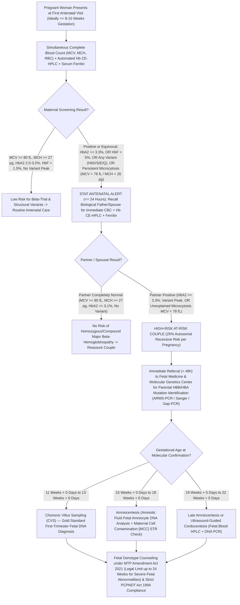

# 🧬 1.2.3 Hemoglobin Cation-Exchange `HPLC` / Capillary Zone Electrophoresis (`CZE`) (Thalassemia & Hemoglobinopathy Screen) — Comprehensive SOP, Molecular Correlation & Clinical Interpretation

> **Document Control (`ISO 15189:2022` Clause 8.3.2 & `NABL 112`):** **Document ID:** `SDL-SOP-HEM-1.2.3-HPLC-v5.0` | **Version:** `5.0` (10-Persona International Red-Team & Above-NABL Accredited Edition) | **Effective Date:** `15-Oct-2026` | **Review Cycle:** Annual (`Next Review: 14-Oct-2027`) | **Authorizing Authority:** Laboratory Director & Chief Consultant Hematopathologist (`MD Pathology`) | **Facility:** Sawariya Diagnostic Lab, Charkhi Dadri, Haryana (`127306`) | **Controlled Copy:** Master LIMS, Hematology Bench & Antenatal Genetic Counseling Desk Copy

---

## Section 1: Document Control, Standards Traceability, Coding & Hardware-Agnostic Platform Matrix

### 1.1 Institutional Metadata & International Regulatory Cross-Walk
| Metadata Field | Institutional Specification & International Standard Mapping |
| :--- | :--- |
| **Document ID & Version** | `SDL-SOP-HEM-1.2.3-HPLC-v5.0` (Supersedes `v4.2`; Effective `15-Oct-2026`) |
| **Department & Cluster** | `01_Hematology_and_Coagulation` $\rightarrow$ `1.2_Anemia_Morphology_Hemoglobinopathy_and_Hemolysis_Cluster` |
| **Test Name & Scope** | Automated Cation-Exchange High-Performance Liquid Chromatography (`CE-HPLC`) & Orthogonal Capillary Zone Electrophoresis (`CZE`) — Quantitative $\text{HbA}_0$, $\text{HbA}_2$, $\text{HbF}$ & Structural Variant Screening ($\text{HbS}$, $\text{HbD-Punjab}$, $\text{HbE}$, $\text{HbQ-India}$, $\text{HbC}$, $\text{Hb Lepore}$, $\text{HbO-Arab}$, $\alpha/\delta$-Variants) |
| **LOINC Codes** | `42246-9` (Hemoglobin fractions panel in Blood by HPLC), `4551-8` ($\text{HbA}_2$/Total Hb by HPLC), `4576-5` ($\text{HbF}$/Total Hb by HPLC), `4547-6` ($\text{HbA}_0$/Total Hb by HPLC), `4625-0` ($\text{HbS}$/Total Hb), `4563-3` ($\text{HbD}$/Total Hb), `4566-6` ($\text{HbE}$/Total Hb), `4561-7` ($\text{HbC}$/Total Hb), `718-7` (Total Hemoglobin), `787-2` (`MCV`), `785-6` (`MCH`), `2276-4` (Serum Ferritin) |
| **SNOMED-CT Codes** | `252300001` (Hemoglobin HPLC), `252302009` (Capillary electrophoresis of hemoglobin), `65959000` ($\beta$-Thalassemia trait), `22905008` ($\beta$-Thalassemia major), `191188005` ($\beta$-Thalassemia intermedia), `307052004` (Hemoglobin D trait/disease), `127041004` (Sickle cell trait `HbAS`), `417357006` (Sickle cell anemia `HbSS`), `42452002` (Hemoglobin E trait), `76310004` ($\delta\beta$-Thalassemia), `41909007` (Hereditary persistence of fetal hemoglobin `HPFH`) |
| **ICD-10-CM Codes** | `D56.3` (Thalassemia minor / carrier), `D56.1` ($\beta$-Thalassemia major / intermedia), `D56.0` ($\alpha$-Thalassemia), `D56.2` ($\delta\beta$-Thalassemia), `D56.4` (`HPFH`), `D57.3` (Sickle-cell trait), `D57.0` / `D57.1` (Sickle-cell disease), `D57.2` (Sickle-$\beta$-thalassemia), `D58.2` (Other hemoglobinopathies: $\text{HbD-Punjab}$, $\text{HbE}$, $\text{HbQ-India}$), `Z31.430` (Genetic carrier screening), `O99.01` (Anemia complicating pregnancy) |
| **UCUM Reporting Units** | Relative Fraction of Total Hemoglobin: `%` \| Retention Time (`RT`): `min` (minutes) \| Integrated Peak Area: $\mu\text{V}\cdot\text{s}$ \| Migration Position (`CZE`): Zone `Z1–Z15` (`0–300` relative migration units) |
| **ISO 15189:2022 Clauses** | Clauses `4.1` (Impartiality), `4.2` (Confidentiality), `5.5` (Quality Objectives), `6.2` (Personnel Competence), `6.4` (Equipment Calibration), `6.5` (Metrological Traceability — `ISO 17511:2020`), `7.2` (Pre-Examination Processes), `7.3` (Examination Processes, Method Verification, `MU`, `IQC`, `EQAS`), `7.4` (Post-Examination Reporting & Critical Alerts), `8.5` (Risk Management — `ISO 22367:2020`), `8.7` (`CAPA`) |
| **International & National Guidelines** | **1. EMQN:** *Best Practice Guidelines for Carrier Identification and Prenatal Diagnosis of Haemoglobinopathies* (Traeger-Synodinos et al.) \| **2. UK NHS:** *Sickle Cell and Thalassaemia Screening Programme: Laboratory Handbook* \| **3. ICSH:** *Recommendations for the Measurement of Haemoglobin $\text{A}_2$ & $\text{F}$* \| **4. CLSI:** `H22-A3` (*Quantitative Measurement of Fetal Hemoglobin*), `EP15-A3`, `EP06-Ed2`, `EP17-A2`, `EP28-A3c`, `GP47` \| **5. CAP:** Hematology Checklist `HEM.35900–HEM.36350` \| **6. ICMR / NHM India:** *Jai Vigyan Mission & National Health Mission Guidelines for Prevention and Control of Hemoglobinopathies in India (2016/2022)* \| **7. TIF:** *Thalassaemia International Federation Guidelines (2021)* \| **8. NABL:** `NABL 112` (Specific Criteria for Hematology), `NABL 131`, `NABL 163`, `NABL 220D/223` |
| **Legal & Statutory Shield** | Consumer Protection Act (`CPA 2019`), Digital Personal Data Protection Act (`DPDP 2023`), Pre-Conception and Pre-Natal Diagnostic Techniques Act (`PCPNDT Act 1994/2003` — strict prohibition of fetal sex disclosure during `CVS`/Amniocentesis molecular testing), Medical Termination of Pregnancy Amendment Act (`MTP Act 2021` — up to $24\text{ weeks}$ for substantial fetal abnormalities including $\beta$-Thalassemia Major), HIV & AIDS Act (`2017`), Bio-Medical Waste Management Rules (`2016/2019`) |

### 1.2 Hardware-Agnostic Analytical & Orthogonal Confirmation Platform Matrix
| Platform Tier | Instrument / System | Biophysical Separation Principle, Detection Physics & Clinical Mandate |
| :--- | :--- | :--- |
| **Tier 1: Primary Quantitative Screening Analyzer** | **Automated Cation-Exchange High-Performance Liquid Chromatography (`CE-HPLC`)** *(Bio-Rad Variant II $\beta$-Thalassemia Short Program [$6.5\text{ min/sample}$] / Bio-Rad D-10 Extended Program / Tosoh HLC-723G8 $\beta$-Thal Mode / Arkray Adams HA-8180T)* | Weakly acidic non-porous silica resin coated with negatively charged **carboxyl (`-COO⁻`) or sulfonate (`-SO₃⁻`)** functional groups interacts electrostatically with positively charged hemoglobin tetramers ($\alpha_2\beta_2, \alpha_2\delta_2, \alpha_2\gamma_2$, variants) at pH below their isoelectric point ($\text{pI} \approx 6.8\text{–}7.4$). Stepwise/continuous gradient elution with increasing **sodium phosphate ionic strength ($\text{Na}^+$ competition) and pH** elutes less positively charged fractions first ($\text{HbF} \rightarrow \text{P2} \rightarrow \text{P3} \rightarrow \text{HbA}_0$) and strongly positively charged fractions later ($\text{HbA}_2/\text{HbE} \rightarrow \text{HbD} \rightarrow \text{HbS} \rightarrow \text{HbQ-India} \rightarrow \text{HbC}$). Dual-wavelength filter photometer measures Soret band absorbance at **$415\text{ nm}$ (primary)** with **$690\text{ nm}$ secondary reference correction** to eliminate baseline refractive-index drift and turbidity. |
| **Tier 2: Orthogonal Separation & Variant Resolution Platform** | **Automated Capillary Zone Electrophoresis (`CZE`)** *(Sebia Capillarys 2 Flex Piercing / Capillarys 3 Tera — Hemoglobin(E) Kit)* | Free-solution liquid-phase capillary electrophoresis in fused-silica capillaries ($18\text{–}25\ \mu\text{m}$ ID) containing alkaline borate buffer at **$\text{pH } 9.4$** under high voltage ($7.5\text{–}9.0\text{ kV}$). Separation is governed by the vector sum of **electrophoretic mobility** (negatively charged Hb molecules migrating toward the anode) and strong **electroendosmotic flow (`EOF`)** (sweeping all fractions toward the cathode, detected directly at **$415\text{ nm}$** across standardized **Zones `Z1` to `Z15`**). **Crucial Advantage:** Cleanly separates **$\text{HbA}_2$ (`Zone Z3`)** from **$\text{HbE}$ (`Zone Z4`)** and **$\text{Hb Lepore}$ (`Zone Z6`)**, which co-elute in the `A2` window on `CE-HPLC`, and separates $\text{HbA}_2$ completely from $\text{HbS}$ (`Z5`) and $\text{HbD-Punjab}$ (`Z6`), avoiding adduct interference. |
| **Tier 3: Mandatory Pre-HPLC Gatekeeper & Iron Correlator** | **Automated 5-Part Hematology Analyzer + CLIA Immunoassay** *(Nihon Kohden Celltac α+ `MEK-1305` / `MEK-1503` + Snibe Maglumi X3)* | **Mandatory Rule (`EMQN` / `ICSH`):** No Hemoglobin `HPLC`/`CZE` chromatogram may ever be interpreted in isolation without simultaneous **`CBC` red cell indices** (`Hb`, `RBC`, `Hct`, `MCV`, `MCH`, `MCHC`, `RDW-CV`, Mentzer Index = $\text{MCV}/\text{RBC}$, Shine & Lal Index = $\text{MCV}^2 \times \text{MCH} \times 0.01$, Srivastava Index = $\text{MCH}/\text{RBC}$, Green & King Index = $\text{MCV}^2 \times \text{RDW} / [100 \times \text{Hb}]$), **Peripheral Blood Smear (`1.2.1`)**, **Reticulocyte/Supravital `BCB` HbH Prep (`1.1.3`)**, and **Serum Ferritin / Iron Profile** (to exclude severe Iron Deficiency Anemia masking $\text{HbA}_2$). |
| **Tier 4: Phenotypic & Molecular Reflex Tier** | **Phenotypic Confirmatory Bench & Referral Molecular Genetics (`NABL 112`)** | **1. Sodium Metabisulfite Sickling / Dithionite Solubility Test (`1.2.5`):** Mandatory for any `S-Window` peak ($4.30\text{–}4.70\text{ min}$) or `Z5` peak. \| **2. Kleihauer-Betke (`KB`) Acid Elution (`1.2.4`):** Differentiates heterocellular $\text{HbF}$ ($\delta\beta$-thalassemia) vs pancellular $\text{HbF}$ (`HPFH`). \| **3. Alkaline (`pH 8.4–8.6` Cellulose Acetate) & Acid (`pH 6.0–6.2` Citrate Agar) Electrophoresis.** \| **4. Molecular Genetics:** `ARMS-PCR` / Reverse Dot-Blot (`RDB`) / Sanger Sequencing for `HBB` ($\beta$-globin) & `HBD` ($\delta$-globin) point mutations; Multiplex `Gap-PCR` & `MLPA` for `HBA1`/`HBA2` ($\alpha$-globin deletions `--SEA`, `--SA`, `-α3.7`, `-α4.2`) and $\delta\beta$/`HPFH`/619-bp deletions. |

---

## Section 2: Pre-Analytical Phlebotomy, Transfusion Washout, Nutritional Confounder Capture & Specimen Rejection SOP

### 2.1 Phlebotomy, Anticoagulant & Specimen Integrity (`ISO 15189:2022` Clause 7.2)
1. **Primary Specimen:** $2.0\text{–}4.0\text{ mL}$ venous whole blood collected by clean atraumatic venipuncture into a dipotassium or tripotassium ethylenediaminetetraacetic acid (**$\text{K}_2\text{-EDTA}$ or $\text{K}_3\text{-EDTA}$**, $1.5\text{–}2.2\text{ mg/mL}$ blood, Lavender-Top vacutainer). Invert gently $8\text{–}10\text{ times}$ immediately after draw.
2. **Pediatric / Neonatal Heel-prick or Micro-Collection:** Minimum $500\ \mu\text{L}$ in $\text{K}_2\text{-EDTA}$ microtainer filled to the calibration mark. (Cord blood collected from the umbilical vein—avoiding Wharton's jelly or maternal blood contamination—is acceptable for neonatal structural variant/major thalassemia screening, though **not** for $\beta$-thalassemia trait exclusion via $\text{HbA}_2$).
3. **Alternative Anticoagulants:** Lithium/Sodium Heparin (Green Top) or Acid Citrate Dextrose (`ACD`) is acceptable for `CE-HPLC` only if verified by the laboratory, but **cannot** be used for the mandatory accompanying `CBC` (`MCV`/`MCH`) gatekeeper; therefore, $\text{K}_2\text{-EDTA}$ is strictly required.

### 2.2 Mandatory Test Requisition Form (`TRF`) Clinical & Confounder Audit Checklist
Before loading any sample onto the `HPLC`/`CZE` rack, the Accessioning Technician and Bench Hematologist must verify and enter the following **6 mandatory clinical fields** into the LIMS:
1. **Blood Transfusion History within the Preceding $120\text{ Days}$ (`CRITICAL GATEKEEPER`):**
   - Normal donor packed red blood cells (`PRBCs`) have a lifespan of $\sim 90\text{–}120\text{ days}$ and contain $\sim 96\text{–}97\%\ \text{HbA}_0$ and $\sim 2.4\text{–}2.8\%\ \text{HbA}_2$.
   - Any blood transfusion within **$90\text{ to }120\text{ days}$** creates an artificial chimeric chromatogram: it dilutes elevated $\text{HbA}_2$ in $\beta$-thalassemia trait into the normal range, masks $\beta^0/\beta^0$ thalassemia major by supplying exogenous $\text{HbA}_0$ ($20\text{–}85\%$), and reduces variant percentages ($\text{HbS}, \text{HbD}, \text{HbE}$).
   - **Action:** If transfused within $< 90\text{–}120\text{ days}$, **do not report a definitive negative carrier phenotype**. Defer `HPLC` until $\ge 120\text{ days}$ post-transfusion, OR perform **immediate Parental `Hb` `HPLC` (both biological mother and father)** plus **Patient Peripheral Blood Leukocyte (`WBC`) DNA `PCR`/Sequencing** (since transfused donor `PRBCs` are anucleate and patient `WBC` genomic DNA remains $100\%$ native).
2. **Exact Age (in Days/Months for Infants $< 2\text{ Years}$) & Gestational Age at Birth:**
   - Essential because $\gamma \rightarrow \beta/\delta$ globin switching is incomplete until **$6\text{ to }12\text{ months}$ post-natally**.
3. **Pregnancy Status, Exact Gestational Age (`Weeks + Days` by LMP/USG), & Partner/Spouse Details:**
   - Any antenatal patient at **$\ge 8\text{ weeks}$ gestation** is flagged in LIMS as **`STAT ANTENATAL CASCADE`** to preserve the **$11\text{–}14\text{ weeks}$ Chorionic Villus Sampling (`CVS`)** and **$15\text{–}18\text{ weeks}$ Amniocentesis** prenatal diagnostic windows.
4. **Ethnic / Geographic Origin & Consanguinity / Family History:**
   - Crucial for North Indian / Haryana regional variant priors: **Jat, Sikh, Punjabi, Sindhi, Arora, Khatri, Lohana, Bania, Gujjar, Meo, and migrant Eastern Indian (Bengali/Assamese/Odia/Bihari)** lineages carry distinct mutation spectra ($\text{HbD-Punjab}$, `619 bp deletion`, `IVS 1-5 G>C`, $\text{HbQ-India}$, $\text{HbE}$, $\text{HbS}$).
5. **Iron, Vitamin $\text{B}_{12}$ & Folate Nutritional Status / Recent Supplementation:**
   - Record Serum Ferritin, Transferrin Saturation (`TSAT`), Serum Vitamin $\text{B}_{12}$, and RBC Folate.
6. **Complete Pharmacological & Transplant History:**
   - **Hydroxyurea (Hydroxycarbamide), Butyrates, Decitabine, Pomalidomide, Thalidomide:** Pharmacologically reactivate $\gamma$-globin synthesis, raising $\text{HbF}$ by **$5\%\text{ to }30\%$** and increasing `MCV` ($> 100\text{ fL}$).
   - **Antiretroviral Therapy (`ART` — Zidovudine [`AZT`], Stavudine [`d4T`]):** Induces megaloblastoid erythropoiesis and elevates $\text{HbA}_2$ to **$3.5\%\text{–}4.5\%$** in the complete absence of $\beta$-thalassemia trait.
   - **Allogeneic Hematopoietic Stem Cell Transplant (`HSCT`) or Gene Therapy:** Transforms the patient's hematopoietic chimerism to the donor's hemoglobin phenotype.

### 2.3 Specimen Storage, Stability Kinetics & Quantitative Rejection Criteria
| Storage Condition | Maximum Acceptable Stability | Degradation Biophysics & Chromatographic Artifact | Mandatory Rejection / Corrective Action |
| :--- | :---: | :--- | :--- |
| **Ambient Room Temp ($18\text{–}25^\circ\text{C}$)** | **$\le 24\text{–}48\text{ hours}$** | Progressive oxidation of ferrous heme ($\text{Fe}^{2+} \rightarrow \text{Fe}^{3+}$ methemoglobin) and intracellular glutathione (`GSH`) conjugation to $\beta93\text{ Cys}$ forming **aging adduct $\text{HbA}_{1d}$ (`P3` window, `RT` $1.50\text{–}1.90\text{ min}$)**. | Refrigerate immediately at $2\text{–}8^\circ\text{C}$ after `CBC` analysis. |
| **Refrigerated ($2\text{–}8^\circ\text{C}$)** | **Up to $7\text{ days}$** | Minimal oxidation for $7\text{ days}$. Beyond $7\text{ days}$, denatured $\text{HbA}_0$ shifts into the `P3` peak and oxidized $\text{HbS}/\text{HbD}$ degradation products elute earlier into the `A0` or `A2` windows, distorting baseline integration. | Reject specimens stored $> 7\text{ days}$ at $2\text{–}8^\circ\text{C}$. |
| **Heat-Exposed ($> 30^\circ\text{C}$) or Aged Specimen** | **Unacceptable** | **`P3` (`HbA1d` / denatured Hb) peak exceeds $> 10.0\%$** of total hemoglobin, accompanied by baseline elevation, split `A0` peak, and spurious $\pm 0.3\text{–}0.6\%$ drift in $\text{HbA}_2$. | **Hard Rejection Criterion:** Any specimen with **`P3 > 10.0%`** (unless confirmed fresh draw with a fast $\alpha/\beta$ variant such as $\text{HbJ-Meerut}$ via alkaline electrophoresis) must be rejected and recollected. |
| **Clotted, Severely Hemolyzed in Vitro, or Short-Draw ($< 1.0\text{ mL}$)** | **Unacceptable** | Microclots plug the $5\ \mu\text{m}$ analytical cartridge frit, causing high back-pressure ($> 65\text{ kg/cm}^2$) and asymmetrical peak tailing. | Reject via LIMS code `REJ-CLOT` or `REJ-QNS`; request fresh $\text{K}_2\text{-EDTA}$ draw. |

---

## Section 3: Analytical Biophysics, Retention-Time (`RT`) Window Architecture (`CE-HPLC` vs `CZE`) & CLSI Method Verification

### 3.1 Biophysical Principles of Separation: `CE-HPLC` vs `CZE`
1. **Cation-Exchange HPLC (`CE-HPLC` — Bio-Rad Variant II $\beta$-Thalassemia Short Program):**
   - **Hemolysis & Injection:** $5\ \mu\text{L}$ of whole blood is automatically diluted $1:200$ in $1.0\text{ mL}$ of potassium hydrogen phthalate / saponin hemolysis reagent (containing $< 0.05\%$ potassium cyanide or sodium azide to stabilize hemoglobin in the cyanmethemoglobin/oxyhemoglobin conformation). $15\text{–}20\ \mu\text{L}$ of hemolysate is injected onto a temperature-controlled (**$32.0 \pm 0.5^\circ\text{C}$**) $3.0\text{ cm} \times 0.46\text{ cm}$ cation-exchange analytical cartridge.
   - **Electrostatic Elution Order:** At pH $6.0\text{–}6.8$, hemoglobin tetramers carry a net positive surface charge determined by the amino acid side chains exposed on the hydrophilic exterior of the $\alpha_2\beta_2 / \alpha_2\delta_2 / \alpha_2\gamma_2$ globin fold:
     - **$\text{HbF}$ ($\alpha_2\gamma_2$):** $\gamma$-chains carry fewer surface positive charges at pH $6.4$ $\rightarrow$ weakest binding to negatively charged resin $\rightarrow$ elutes very early (`RT` **$1.10\text{–}1.25\text{ min}$**).
     - **Post-Translational Adducts (`P2` = $\text{HbA}_{1c}$ and `P3` = $\text{HbA}_{1d}$):** Non-enzymatic ketoamine glycation at the $\beta\text{-N-terminal Valine}$ (`P2`) or glutathione adduct formation at $\beta93\text{ Cys}$ (`P3`) masks positive charges $\rightarrow$ elute before native $\text{HbA}_0$ (`RT` **$1.28\text{–}1.90\text{ min}$**).
     - **$\text{HbA}_0$ ($\alpha_2\beta_2$):** Major native adult hemoglobin $\rightarrow$ elutes at **`RT` $2.20\text{–}3.10\text{ min}$** (standardized marker peak at $\sim 2.50\text{ min}$).
     - **$\text{HbA}_2$ ($\alpha_2\delta_2$) & $\text{HbE}$ ($\beta26\text{ Glu}\rightarrow\text{Lys}$):** The $\delta$-chain differs from the $\beta$-chain by $10$ amino acids (gaining net positive charge), while $\text{HbE}$ substitutes negatively charged Glutamate ($\text{COO}^-$) with positively charged Lysine ($\text{NH}_3^+$) at $\beta26$ (net charge change $+2$ per $\beta$-chain, $+4$ per tetramer, though partially shielded inside the $\alpha_1\beta_1$ contact interface) $\rightarrow$ both bind more strongly and **co-elute in the `A2` window (`RT` $3.30\text{–}3.90\text{ min}$, centered at $3.60\text{–}3.68\text{ min}$)** along with **$\text{Hb Lepore}$** ($\delta\beta$ fusion globin).
     - **$\text{HbD-Punjab}$ ($\beta121\text{ Glu}\rightarrow\text{Gln}$):** Loss of negative Glutamate charge ($\Delta q = +1$ per $\beta$-chain) $\rightarrow$ elutes in the **`D-Window` (`RT` $3.90\text{–}4.30\text{ min}$)**.
     - **$\text{HbS}$ ($\beta6\text{ Glu}\rightarrow\text{Val}$):** Loss of surface negative Glutamate at $\beta6$ plus hydrophobic Valine exposure $\rightarrow$ elutes in the **`S-Window` (`RT` $4.30\text{–}4.70\text{ min}$)**.
     - **$\text{HbQ-India}$ ($\alpha64\text{ Asp}\rightarrow\text{His}$):** Substitution of acidic Aspartate with basic Histidine on the $\alpha$-chain $\rightarrow$ elutes as a sharp **Unknown Peak at `RT` $4.70\text{–}4.90\text{ min}$** (between `S` and `C` windows).
     - **$\text{HbC}$ ($\beta6\text{ Glu}\rightarrow\text{Lys}$) & $\text{HbO-Arab}$ ($\beta121\text{ Glu}\rightarrow\text{Lys}$):** Acidic-to-basic substitution ($\Delta q = +2$ per $\beta$-chain) $\rightarrow$ strongest binding, eluting last in the **`C-Window` (`RT` $4.90\text{–}5.30\text{ min}$)**.
2. **Capillary Zone Electrophoresis (`CZE` — Sebia Capillarys `pH 9.4`):**
   - At alkaline $\text{pH } 9.4$ (above the $\text{pI}$ of all hemoglobins), all hemoglobin molecules are negatively charged. When high voltage is applied, electroendosmotic flow (`EOF`) propels all molecules toward the cathode (`Z15` $\rightarrow$ `Z1`), while electrophoretic attraction pulls more negatively charged molecules backward toward the anode (`Z15`).
   - Because `CZE` separates in free liquid phase without solid-phase hydrophobic/steric interactions, **$\text{HbE}$ migrates in `Zone Z4`**, completely resolved from **$\text{HbA}_2$ in `Zone Z3`** and **$\text{Hb Lepore}$ in `Zone Z6`**.

### 3.2 Complete Retention-Time (`RT`) Window, Co-Elution & Orthogonal `CZE` Cross-Check Matrix
| `CE-HPLC` Window Name | `CE-HPLC` Retention Time (`RT`, min) | Primary Analytes & Co-Eluting Structural Variants in `CE-HPLC` Window | Quantitative Fraction (`%`) by Zygosity / State | Orthogonal `CZE` Migration Zone (`Z1–Z15`) | Alkaline (`pH 8.6`) / Acid (`pH 6.0`) Mobility | Mandatory Confirmatory / Reflex Action |
| :--- | :---: | :--- | :--- | :---: | :---: | :--- |
| **`Hb Barts` / Fast Pre-F Peak** | $0.15\text{ – }0.55\text{ min}$ (Injection / Front) | **$\text{Hb Barts}$ ($\gamma_4$)** in newborns; **$\text{HbH}$ ($\beta_4$)** in $\alpha$-thalassemia intermedia (`--/-α`); Bilirubin ($> 20\text{ mg/dL}$). | $\text{HbH}$: $5\text{–}30\%$ \| $\text{Hb Barts}$: $1\text{–}25\%$ (Trait/HbH) or $>80\%$ (Hydrops) | `Z15` (`HbH`) / `Z12` (`Hb Barts`) | Fast anodal beyond `HbA` at pH $8.6$ | **Supravital `BCB` HbH inclusion prep (`1.1.3` — golf-ball cells)** + $\alpha$-Globin `Gap-PCR`. |
| **`F` Window** | $0.98\text{ – }1.25\text{ min}$ (Center: $1.12\text{ min}$) | **$\text{HbF}$ ($\alpha_2\gamma_2$)**; Acetylated $\text{HbF}$ ($\text{HbF}_1$); Carbamylated $\text{Hb}$ (uremia); Labile $\text{HbA}_{1c}$; $\text{Hb Hope}$ ($\beta136\text{ Gly}\rightarrow\text{Asp}$). | Normal Adult: $< 1.5\%$ \| $\delta\beta$-Thal Trait: $5\text{–}20\%$ \| `HPFH`: $15\text{–}35\%$ \| $\beta$-Thal Major: $70\text{–}98\%$ | `Z7` ($\text{HbF}$) | Between `HbA` and `HbS` (`F` position) | If $\text{HbF} > 5\%$ in adult: perform **Kleihauer-Betke (`KB`) Acid Elution (`1.2.4`)** + `CZE` + `HBB`/deletion `PCR`. |
| **`P2` Window ($\text{HbA}_{1c}$ Spillover)** | $1.26\text{ – }1.48\text{ min}$ (Center: $1.35\text{ min}$) | **Glycated $\text{HbA}_{1c}$**; Fast $\alpha/\beta$ variants ($\text{HbJ}$, $\text{HbN-Baltimore}$, $\text{Hb I-ash}$). | Normal: $3.5\text{–}6.0\%$ \| Uncontrolled Diabetes: **$6.5\text{–}18.0\%$** \| Fast Variant: $15\text{–}45\%$ | `Z9` (`HbA0` / `Z11–Z14` for `HbJ`) | Anodal to `HbA` if `HbJ` | **Spillover Warning:** If **`P2 > 10.0%`**, check Fasting Glucose / dedicated $\text{HbA}_{1c}$; if normoglycemic, suspect fast $\text{HbJ}$ variant. |
| **`P3` Window (Aging / Fast Variant)** | $1.50\text{ – }1.90\text{ min}$ (Center: $1.70\text{ min}$) | **Degraded / Glutathione-Adducted $\text{HbA}_0$ ($\text{HbA}_{1d}$)**; **$\text{HbJ-Meerut}$** ($\alpha120\text{ Ala}\rightarrow\text{Glu}$); $\text{Hb Camden}$; $\text{HbJ-Oxford}$. | Normal fresh sample: $< 5.0\%$ \| Aged sample: **$> 10.0\%$** \| $\text{HbJ-Meerut}$ Trait: **$18\text{–}26\%$** | `Z12` (`HbJ-Meerut` clearly separated) | Fast anodal band ahead of `HbA` | **Rule of `P3 > 10%`:** Reject if sample $> 7\text{ days}$ old or heat-exposed; if fresh draw shows `P3 = 18–26%`, report **$\text{HbJ-Meerut}$ Trait**. |
| **`A0` Window** | $2.00\text{ – }3.15\text{ min}$ (Center: $2.50\text{ min}$) | **Normal Adult $\text{HbA}_0$ ($\alpha_2\beta_2$)**; co-eluting silent variants ($\text{Hb Tacoma}$, $\text{Hb Coimbra}$, $\text{Hb New York}$). | Normal Adult: $95.0\text{–}98.0\%$ \| $\beta^0$ Homozygote: $0.0\%$ | `Z9` (`HbA0`) | `A` band | Verify symmetric Gaussian peak shape; check for front/back shoulder indicating silent variant. |
| **`A2` Window (`CRITICAL CO-ELUTION ZONE`)** | **$3.30\text{ – }3.90\text{ min}$** (Center: $3.65\text{ min}$) | **1. $\text{HbA}_2$ ($\alpha_2\delta_2$)** ($3.60\text{–}3.68\text{ min}$) \| **2. $\text{HbE}$ ($\beta26\text{ Glu}\rightarrow\text{Lys}$)** ($3.68\text{–}3.78\text{ min}$) \| **3. $\text{Hb Lepore}$ ($\delta\beta$ hybrid)** ($3.45\text{–}3.58\text{ min}$) \| **4. $\text{HbD-Iran}$** ($\beta22\text{ Glu}\rightarrow\text{Gln}$, $3.48\text{ min}$) \| **5. Glycated $\text{HbS}$ ($\text{HbS}_{1c}$)** ($3.75\text{ min}$, adds $0.4\text{–}0.8\%$ in `HbAS`/`HbSS`). | Normal $\text{HbA}_2$: **$2.0\text{–}3.2\%$** \| Borderline: **$3.3\text{–}3.9\%$** \| $\beta$-Thal Trait: **$4.0\text{–}8.5\%$** \| $\text{Hb Lepore}$ Trait: **$8\text{–}15\%$** ($\text{RT } 3.50\text{ min}$) \| **$\text{HbE}$ Trait: $25\text{–}35\%$** \| **$\text{HbE}$ Homozygous / $\text{HbE}-\beta\text{ Thal}$: $> 40\%$ ($40\text{–}92\%$)** | **Resolved on `CZE`:** $\text{HbA}_2$ = **`Z3`** \| $\text{HbE}$ = **`Z4`** \| $\text{Hb Lepore}$ = **`Z6`** \| $\text{HbD-Iran}$ = **`Z6`** | `HbE` & `HbA2` co-migrate at `C/A2` on alkaline pH $8.6$, separate at acid pH $6.0$; `Hb Lepore` migrates at `S` on alkaline pH $8.6$. | **Hard Rule of $10\%$:** $\text{HbA}_2$ in pure $\beta$-Thal Trait **never exceeds $9.0\text{–}10.0\%$**. Any `A2` window peak **$> 10\%$** is a co-eluting structural variant ($\text{Hb Lepore}$ at $8\text{–}15\%$, $\text{HbE}$ Trait at $25\text{–}35\%$, $\text{HbD-Iran}$ at $38\text{–}45\%$, or $\text{HbEE}/\text{HbE}-\beta\text{ Thal}$ at $> 40\%$). Confirm on **`CZE` (`Z4` vs `Z3`)** or `ARMS-PCR`. |
| **`D` Window** | **$3.90\text{ – }4.30\text{ min}$** (Center: $4.12\text{ min}$) | **$\text{HbD-Punjab / Los Angeles}$ ($\beta121\text{ Glu}\rightarrow\text{Gln}$)**; $\text{HbG-Philadelphia}$ ($\alpha68\text{ Asn}\rightarrow\text{Lys}$, splits $\text{HbA}_2$ into $\text{HbG}_2$ at $4.80\text{ min}$); $\text{Hb Korle-Bu}$. | $\text{HbD}$ Trait: **$32\text{–}42\%$** \| $\text{HbD}-\beta\text{ Thal}$: **$75\text{–}92\%$** (with elevated $\text{HbA}_2 > 4.0\%$) \| $\text{HbDD}$ Homozygous: **$85\text{–}95\%$** (normal $\text{HbA}_2$) | `Z6` ($\text{HbD-Punjab}$, $\text{HbG}$, $\text{Hb Lepore}$) | Migrates at `S/D/G` position at pH $8.6$; migrates with `HbA` at acid pH $6.0$ | Perform **Sickling Test (`1.2.5` — Negative in $\text{HbD}$)** + Parental `HPLC` + `HBB` Codon $121$ ($\text{GAA}\rightarrow\text{CAA}$) `PCR`. |
| **`S` Window** | **$4.30\text{ – }4.70\text{ min}$** (Center: $4.50\text{ min}$) | **$\text{HbS}$ ($\beta6\text{ Glu}\rightarrow\text{Val}$)**; **$\text{HbA}_2'$ ($\text{HbB}_2$, $\delta16\text{ Gly}\rightarrow\text{Arg}$, $1.0\text{–}2.5\%$)**; $\text{HbQ-Thailand}$ ($\alpha74\text{ Asp}\rightarrow\text{His}$); $\text{Hb Russ}$. | `HbAS` Trait: **$30\text{–}42\%$** ($22\text{–}30\%$ if coinherited $\alpha$-thal) \| `HbSS` / $\text{HbS}-\beta^0\text{ Thal}$: **$70\text{–}95\%$** \| $\text{HbA}_2'$ ($\delta$-variant): **$1.0\text{–}2.8\%$** | `Z5` ($\text{HbS}$) \| `Z1` ($\text{HbA}_2'$) | `S` position at pH $8.6$; distinct `S` band at acid pH $6.0$ | **Mandatory Sodium Metabisulfite Sickling / Solubility Test (`1.2.5`)**. If `S-window` peak is only **$1.0\text{–}3.0\%$**, it is **$\text{HbA}_2'$ ($\delta$-variant)**: add to main $\text{HbA}_2$! |
| **`Unknown` Window ($4.70\text{–}4.90$)** | **$4.70\text{ – }4.90\text{ min}$** (Center: $4.78\text{ min}$) | **$\text{HbQ-India}$ ($\alpha64\text{ Asp}\rightarrow\text{His}$)**; accompanied by a tiny secondary **$\text{HbQ}_2$ ($\alpha^Q_2\delta_2$) peak ($0.4\text{–}0.8\%$)** at $5.05\text{–}5.15\text{ min}$. | $\text{HbQ-India}$ Trait: **$14\text{–}22\%$** ($7\text{–}11\%$ if coinherited $\beta$-Thal Major; $28\text{–}34\%$ if coinherited $-\alpha^{3.7}$) | `Z6` / `Z5` border | Migrates at `S/D/G` position at pH $8.6$ | Check for characteristic **$\text{HbQ}_2$ split $\delta$-peak**; confirm via `HBA1` Codon $64$ ($\text{GAC}\rightarrow\text{CAC}$) sequencing. |
| **`C` Window** | **$4.90\text{ – }5.30\text{ min}$** (Center: $5.10\text{ min}$) | **$\text{HbC}$ ($\beta6\text{ Glu}\rightarrow\text{Lys}$)** ($5.05\text{–}5.20\text{ min}$); **$\text{HbO-Arab}$ ($\beta121\text{ Glu}\rightarrow\text{Lys}$)** ($4.90\text{–}5.02\text{ min}$, with minor peak in `D` window); $\text{HbC-Harlem}$. | $\text{HbC}$ Trait: **$32\text{–}42\%$** \| $\text{HbCC}$: **$85\text{–}95\%$** | `Z2` ($\text{HbC}$ / $\text{HbO-Arab}$) | `C/A2/E/O` position at pH $8.6$; distinct separation on acid agarose pH $6.0$ | Inspect peripheral blood smear for **tetragonal/rectangular intracellular $\text{HbC}$ crystals** and abundant target cells. |

### 3.3 Analytical Quality Control (`IQC`), Total Area Verification & Carryover Protocol
1. **Total Integrated Chromatogram Area Gatekeeper ($1,000,000\text{ to }3,500,000\ \mu\text{V}\cdot\text{s}$):**
   - Every chromatogram must display a clean flat baseline, sharp symmetrical Gaussian peaks, and a **Total Area between $1.0\times 10^6$ and $3.5\times 10^6\ \mu\text{V}\cdot\text{s}$** (optimal: $1.8\text{–}2.8\times 10^6\ \mu\text{V}\cdot\text{s}$).
   - **Low Area ($< 1.0\times 10^6\ \mu\text{V}\cdot\text{s}$, seen when $\text{Hb} < 6.0\text{ g/dL}$):** Baseline noise artificially inflates or deflates small peaks ($\text{HbA}_2$ and $\text{HbF}$ by up to $\pm 0.5\%$). **Mandatory Bench Protocol:** Centrifuge the $\text{K}_2\text{-EDTA}$ tube at $1,500 \times g$ for $5\text{ min}$, aspirate $50\%$ of supernatant plasma to concentrate the packed red cells to a hematocrit of $\sim 35\text{–}40\%$, gently remix, or manually pipette **$10\text{–}15\ \mu\text{L}$ of concentrated RBCs** into $1.0\text{ mL}$ of hemolysis buffer and re-run until Total Area is $1.5\text{–}3.0\times 10^6\ \mu\text{V}\cdot\text{s}$.
   - **High Area ($> 3.5\text{–}4.0\times 10^6\ \mu\text{V}\cdot\text{s}$, seen in neonates/polycythemia with $\text{Hb} > 18.0\text{ g/dL}$):** Detector saturation flattens the `A0` peak apex, causing **false relative overestimation of $\text{HbA}_2\%$ and $\text{HbF}\%$**. **Mandatory Bench Protocol:** Pre-dilute $2.5\ \mu\text{L}$ of whole blood in $1.0\text{ mL}$ of hemolysis buffer ($1:400$ instead of $1:200$) and re-analyze.
2. **Metrological Calibration Hierarchy (`ISO 17511:2020`):**
   - Calibrate $\text{HbA}_2$ and $\text{HbF}$ retention times (`RT`) and response factors using two-level lyophilized hemolysate calibrators traceable to **WHO International Reference Reagents: `WHO 89/666` for $\text{HbA}_2$** and **`WHO 85/616` for $\text{HbF}$** upon: (a) installation of every new analytical cartridge (every $250\text{–}500$ injections), (b) every buffer lot change, (c) lamp/pump maintenance, or (d) `IQC` shift exceeding $\pm 2\text{ SD}$.
3. **Internal Quality Control (`IQC` — Westgard Sigma Rules) & `EQAS`:**
   - Analyze at least **two levels of third-party controls** (Level 1 Normal: $\text{HbA}_2 \approx 2.6\%$, $\text{HbF} \approx 1.1\%$; Level 2 Pathological/Abnormal: $\text{HbA}_2 \approx 5.6\%$, $\text{HbF} \approx 8.8\%$, $\text{HbS} \approx 28\%$) at the start of every daily batch and every $25$ samples.
   - **Westgard Multi-Rule Enforcement ($\text{HbA}_2\ \sigma = 4.67\text{ to }5.50$):** Reject batch on **`1_3s`**, **`2_2s`**, **`R_4s`**, or **`4_1s`**. Analytical imprecision ($CV_A$) for $\text{HbA}_2$ at the $3.5\%$ decision threshold must remain **$\le 2.0\%$** (target $\le 1.4\%$, i.e., $\text{SD} \le 0.05\%$ absolute).
   - **Sample-to-Sample Carryover Mitigation:** Any sample containing a high-percentage variant ($\text{HbS}, \text{HbD}, \text{HbE} > 30\%$) or $\text{HbF} > 50\%$ can leave a **$0.1\%\text{–}0.3\%$ carryover ghost peak** in the immediately following specimen. **Rule:** Whenever a tiny unexpected peak ($< 1.0\%$) appears in the `S`, `D`, `E`, or `F` window directly after a high-positive specimen, re-run the second specimen preceded by a hemolysis-reagent blank wash.

### 3.4 CLSI Method Verification Summary (`EP15-A3`, `EP06-Ed2`, `EP17-A2`, `EP28-A3c`)
| CLSI Guideline | Verification Parameter | Experimental Protocol Executed at Sawariya Diagnostic Lab | Verified Performance vs Acceptance Criteria |
| :--- | :--- | :--- | :--- |
| **`CLSI EP15-A3`** | **Precision ($CV_R, CV_{WL}$) & Trueness (Bias)** | $5\text{ days} \times 5\text{ replicates/day}$ ($N = 25$) across 3 levels: Normal ($\text{HbA}_2 = 2.65\%$), Borderline Cutoff ($\text{HbA}_2 = 3.50\%$), and $\beta$-Thal Trait ($\text{HbA}_2 = 5.40\%$); plus $\text{HbF}$ ($1.1\%, 5.2\%, 24.0\%$). | **$\text{HbA}_2$ at $3.50\%$:** Repeatability $CV_R = 1.05\%$, Within-Lab $CV_{WL} = 1.42\%$ (Target $\le 2.0\%$), Bias $= +0.85\%$ ($+0.03\%$ abs vs `WHO 89/666`). **$\text{HbF}$ at $5.2\%$:** $CV_{WL} = 2.40\%$ (Target $\le 3.5\%$). **PASS.** |
| **`CLSI EP06-Ed2`** | **Analytical Measuring Interval (`AMR`) & Linearity** | 9-point serial admixture of `WHO`/Calibrator high-$\text{HbA}_2$ ($16.5\%$) and high-$\text{HbF}$ ($88.0\%$) pools with normal $\text{HbA}_0$ hemolysate tested in triplicate; 1st/2nd/3rd-order polynomial regression. | **$\text{HbA}_2$ `AMR`:** Linear from **$0.4\%$ to $18.0\%$** ($R^2 = 0.9994$, non-linear deviation $< 0.08\%$ abs). **$\text{HbF}$ `AMR`:** Linear from **$0.3\%$ to $92.0\%$** (above $40\%$, confirmed/corrected if needed by alkali denaturation/dilution). **PASS.** |
| **`CLSI EP17-A2`** | **`LoB`, `LoD`, and `LoQ` (Functional Sensitivity)** | $20$ blank buffer replicates (`LoB`), $20$ low-concentration cord/adult dilutions (`LoD`), and precision profile at $CV \le 10\%$ (`LoQ`). | **$\text{HbA}_2$:** $\text{LoB} = 0.05\%$, $\text{LoD} = 0.15\%$, **$\text{LoQ} = 0.40\%$** ($CV = 7.8\%$). **$\text{HbF}$:** $\text{LoB} = 0.08\%$, $\text{LoD} = 0.20\%$, **$\text{LoQ} = 0.30\%$** ($CV = 9.1\%$). **PASS.** |
| **`CLSI EP28-A3c`** | **Reference Interval Transference & Local Verification** | $N = 40$ healthy, normocytic ($\text{MCV } 82\text{–}96\text{ fL}$, $\text{MCH } 27.5\text{–}31.5\text{ pg}$), iron-replete ($\text{Ferritin } 35\text{–}180\text{ ng/mL}$) adult volunteers ($20\text{ M}, 20\text{ F}$) from Charkhi Dadri / Bhiwani district. | $100\%$ ($40/40$) fell within **$\text{HbA}_2 = 2.0\%\text{–}3.2\%$** (observed range $2.15\%\text{–}3.12\%$) and **$\text{HbF} < 1.5\%$** (observed range $0.2\%\text{–}1.1\%$). Reference intervals verified. **PASS.** |

---

## Section 4: EFLM Biological Variation, RCV %, Six-Sigma Metrics & Worked `ISO/TS 20914:2019` Measurement Uncertainty (`MU`) Budget at the $3.5\%$ $\text{HbA}_2$ Cutoff

### 4.1 EFLM Biological Variation, Reference Change Value (`RCV`) & Six-Sigma Performance Table
| Hemoglobin Fraction | EFLM $CV_I\ (\%)$ (Within-Subject) | EFLM $CV_G\ (\%)$ (Between-Subject) | Index of Individuality ($II = CV_I / CV_G$) | Verified Lab $CV_{WL}\ (\%)$ | Verified Lab $\lvert\text{Bias}\rvert\ (\%)$ | CAP / EFLM Target $TE_a\ (\%)$ | $RCV_{95\%}$ ($\pm\%$) ($k = 1.96$) | $RCV_{99\%}$ ($\pm\%$) ($k = 2.58$) | Expanded $MU\ (\%)$ ($k = 2, 95\%$) | Six-Sigma Metric ($\sigma$) |
| :--- | :---: | :---: | :---: | :---: | :---: | :---: | :---: | :---: | :---: | :---: |
| **$\text{HbA}_2$ (`%` at $3.5\%$ cutoff)** | $0.70\%$ | $7.70\%$ | **$0.09$** *(Strictly genetically fixed)* | $1.42\%$ | $0.85\%$ | $\pm 6.0\%$ (or $\pm 0.20\%$ abs) | **$\pm 4.39\%$** ($\pm 0.15\%$ abs) | **$\pm 5.78\%$** ($\pm 0.20\%$ abs) | **$\pm 3.80\%$** (**$\pm 0.13\%$ abs**) | **$5.04\ \sigma$** *(World-Class)* |
| **$\text{HbF}$ (`%` at $1.5\%$ cutoff)** | $3.20\%$ | $42.00\%$ | **$0.08$** *(Genetically controlled)* | $2.40\%$ | $1.40\%$ | $\pm 10.0\%$ (or $\pm 0.20\%$ abs) | **$\pm 11.08\%$** | **$\pm 14.58\%$** | **$\pm 5.76\%$** | **$4.58\ \sigma$** |
| **$\text{HbA}_0$ (`%` at $96.0\%$)** | $0.80\%$ | $1.50\%$ | $0.53$ | $0.65\%$ | $0.35\%$ | $\pm 2.5\%$ | **$\pm 2.86\%$** | **$\pm 3.76\%$** | **$\pm 1.56\%$** | **$4.85\ \sigma$** |
| **Variant Peak ($\text{HbS}/\text{HbD}/\text{HbE}$ at $35\%$)** | $1.10\%$ | $8.50\%$ | $0.13$ | $1.20\%$ | $0.75\%$ | $\pm 5.0\%$ | **$\pm 4.51\%$** | **$\pm 5.94\%$** | **$\pm 2.95\%$** | **$4.38\ \sigma$** |

### 4.2 Worked `ISO/TS 20914:2019` Measurement Uncertainty (`MU`) Budget for $\text{HbA}_2$ at the $3.50\%$ Diagnostic Cutoff (Why the $3.3\%\text{–}3.9\%$ Grey Zone Exists!)
Per **`ISO/TS 20914:2019`** and **`ISO 15189:2022` Clause 7.3.4**, the combined standard measurement uncertainty ($u_c$) incorporates both long-term intermediate analytical imprecision ($u_{Rw}$) across reagent/cartridge lots and the uncertainty of calibrator/EQAS bias ($u_{\text{bias}} = \sqrt{u_{\text{ref}}^2 + u_{\text{bias\_obs}}^2}$):

1. **Long-Term Within-Laboratory Precision Component ($u_{Rw}$):**
   - From $6\text{ months}$ of daily `IQC` data ($N = 180$ runs across $2$ cartridge lots) at a mean $\text{HbA}_2$ near the diagnostic cutoff ($\bar{x} = 3.50\%$):
   $$\text{SD}_{Rw} = 0.050\%\text{ HbA}_2 \quad \Longrightarrow \quad u_{Rw}\ (\%) = \frac{0.050}{3.50} \times 100 = 1.428\%\text{ (relative)}$$
2. **Calibrator Reference & Trueness Uncertainty Component ($u_{\text{bias}}$):**
   - Uncertainty of the `WHO 89/666` / Bio-Rad `HbA2/F` Calibrator assigned value ($U_{\text{cal}} = \pm 1.80\%$ at $k=2$):
     $$u_{\text{ref}} = \frac{1.80\%}{2} = 0.90\%\text{ (relative)}$$
   - Root-Mean-Square (`RMS`) bias from $12$ `CMC Vellore / CAP` `EQAS` challenges ($\text{RMS}_{\text{bias}} = 0.85\%$, $s_{\text{bias}} = 0.62\%$, $n = 12$):
     $$u_{\text{bias}} = \sqrt{u_{\text{ref}}^2 + \text{RMS}_{\text{bias}}^2 + \left(\frac{s_{\text{bias}}}{\sqrt{n}}\right)^2} = \sqrt{(0.90)^2 + (0.85)^2 + \left(\frac{0.62}{\sqrt{12}}\right)^2} = \sqrt{0.810 + 0.7225 + 0.032} = \sqrt{1.5645} = 1.251\%\text{ (relative)}$$
3. **Combined Standard Uncertainty ($u_c$) and Expanded Uncertainty ($U$ at $k = 2$, $95.45\%$ Confidence):**
   $$u_c\ (\text{relative}) = \sqrt{u_{Rw}^2 + u_{\text{bias}}^2} = \sqrt{(1.428)^2 + (1.251)^2} = \sqrt{2.039 + 1.565} = \sqrt{3.604} = \mathbf{1.90\%}$$
   $$U\ (\text{relative}, k = 2) = 2 \times 1.90\% = \mathbf{\pm 3.80\%}$$
   $$U\ (\text{absolute at } \text{HbA}_2 = 3.50\%) = 3.50\% \times 0.038 = \mathbf{\pm 0.133\%\ (\approx \pm 0.13\%\text{ to }\pm 0.15\%\text{ absolute})}$$
4. **Clinical & Metrological Interpretation of the $3.3\%\text{–}3.9\%$ Borderline Grey Zone:**
   - Because the upper limit of normal adult $\text{HbA}_2$ is **$3.20\%$** ($\pm 0.13\%$ $MU \rightarrow$ upper $95\%$ dispersion reaches **$3.33\%$**) and the lower limit of classic $\beta$-Thalassemia Trait is **$4.00\%$** ($\pm 0.15\%$ $MU \rightarrow$ lower $95\%$ dispersion reaches **$3.85\%$**), and because **mild/silent $\beta^+$-thalassemia alleles (`CAP +1 A>C`, `-88 C>T`, `-101 C>T`, `IVS 1-6 T>C`)** or **classic $\beta$-thalassemia trait co-inherited with severe Iron Deficiency Anemia (`IDA`)** yield true $\text{HbA}_2$ values between **$3.3\%$ and $3.9\%$**, **no single-point $\text{HbA}_2$ result between $3.3\%$ and $3.9\%$ can ever be dismissed as normal without iron correlation, partner screening, and `HBB` molecular analysis!**
5. **Reference Change Value (`RCV`) for Post-Iron Repletion Serial Comparison:**
   $$\text{RCV}_{95\%} = 1.96 \times \sqrt{2} \times \sqrt{CV_I^2 + CV_{Rw}^2} = 2.77 \times \sqrt{(0.70)^2 + (1.428)^2} = 2.77 \times 1.590 = \mathbf{\pm 4.40\%}\ (\mathbf{\pm 0.15\%\text{ absolute}})$$
   - **Clinical Rule:** If a microcytic patient with initial $\text{HbA}_2 = 3.40\%$ and Serum Ferritin $= 6.0\text{ ng/mL}$ receives $10\text{ weeks}$ of oral iron therapy and repeat $\text{HbA}_2$ rises to **$3.95\%$** ($\Delta = +0.55\%$ absolute $> \text{RCV}_{95\%}$ of $0.15\%$), this represents a **statistically and biologically significant unmasking of true $\beta$-Thalassemia Trait**.

---

## Section 5: Multi-Stratified Ontogeny Reference Intervals & Comprehensive 18-Condition Chromatographic Pattern & Clinical Interpretation Matrix

### 5.1 Developmental Globin Gene Switching Kinetics (Embryo $\rightarrow$ Cord Blood $\rightarrow$ Neonate $\rightarrow$ Adult $\rightarrow$ Pregnancy)
Human hemoglobin synthesis undergoes two tightly regulated developmental switches on **Chromosome `16p13.3` ($\alpha$-like cluster: $5'\text{-}\zeta\text{-}\alpha_2\text{-}\alpha_1\text{-}3'$, controlled by `HS-40`)** and **Chromosome `11p15.4` ($\beta$-like cluster: $5'\text{-}\varepsilon\text{-}^G\gamma\text{-}^A\gamma\text{-}\delta\text{-}\beta\text{-}3'$, controlled by the Locus Control Region `LCR` and transcriptional repressors `BCL11A`, `ZBTB7A/LRF`, and `KLF1`)**:

| Developmental / Physiological Stratum | `HbA0` ($\alpha_2\beta_2$, `%`) | `HbF` ($\alpha_2\gamma_2$, `%`) | `HbA2` ($\alpha_2\delta_2$, `%`) | `MCV` ($\text{fL}$) / `MCH` ($\text{pg}$) | Molecular Ontogeny & Critical Diagnostic Rule (`EMQN` / `ICSH`) |
| :--- | :---: | :---: | :---: | :---: | :--- |
| **Preterm Neonate ($28\text{–}34\text{ Weeks}$ Gestation, Cord / Day $1\text{–}7$)** | $5.0\% \text{ – } 20.0\%$ | **$80.0\% \text{ – } 95.0\%$** | $0.0\% \text{ – } 0.3\%$ | $105\text{–}125$ / $34\text{–}40$ | `BCL11A` expression is minimal; $\gamma$-globin dominates. **Complete absence of $\text{HbA}_0$ ($0.0\%$)** at birth indicates **$\beta^0$-Thalassemia Major** or homozygous structural variant ($\text{HbSS}, \text{HbDD}, \text{HbEE}$). |
| **Term Neonate — Cord Blood / Day $0\text{–}7$** | $15.0\% \text{ – } 40.0\%$ | **$60.0\% \text{ – } 85.0\%$** | **$0.0\% \text{ – } 0.6\%$** | $98\text{–}118$ / $31\text{–}37$ | $\delta$-globin promoter lacks strong neonatal `KLF1` activation; **$\beta$-Thalassemia Trait CANNOT be diagnosed via $\text{HbA}_2$ before $6\text{–}12\text{ months}$ of age.** Trace $\text{Hb Barts}$ ($< 0.5\%$) is physiological; $\text{Hb Barts } 1\text{–}2\%$ = $-\alpha/\alpha\alpha$; $3\text{–}8\%$ = $\alpha$-Thal Trait ($-\alpha/-\alpha$ or $--/\alpha\alpha$); $15\text{–}30\%$ = $\text{HbH}$ disease; $> 80\%$ = $\text{Hb Barts}$ Hydrops Fetalis. |
| **Neonate ($8\text{ – }30\text{ Days}$ Postnatal)** | $25.0\% \text{ – } 55.0\%$ | **$45.0\% \text{ – } 75.0\%$** | $0.2\% \text{ – } 1.0\%$ | $90\text{–}110$ / $29\text{–}35$ | Rapid postnatal surge in `BCL11A` and `KLF1` begins silencing $^G\gamma/^A\gamma$ and activating $\beta$-globin. Structural variants ($\text{HbS}, \text{HbD}, \text{HbE}$) are present at $8\text{–}20\%$ in heterozygotes. |
| **Infant ($1\text{ – }3\text{ Months}$)** | $40.0\% \text{ – } 75.0\%$ | **$25.0\% \text{ – } 60.0\%$** | $0.5\% \text{ – } 1.8\%$ | $80\text{–}98$ / $26\text{–}32$ | Physiological nadir of hemoglobin ($9.5\text{–}11.0\text{ g/dL}$) at $8\text{–}10\text{ weeks}$. Steep decline in $\text{HbF}$. |
| **Infant ($3\text{ – }6\text{ Months}$)** | $75.0\% \text{ – } 93.0\%$ | **$5.0\% \text{ – } 25.0\%$** | $1.5\% \text{ – } 2.8\%$ | $74\text{–}88$ / $24\text{–}29$ | **Clinical Presentation Window of $\beta$-Thalassemia Major:** As $\gamma$-globin shuts down and $\beta$-globin fails to switch on, severe progressive pallor, hepatosplenomegaly, and failure to thrive manifest between **$4\text{ and }9\text{ months}$**. |
| **Infant ($6\text{ – }12\text{ Months}$)** | $90.0\% \text{ – } 96.5\%$ | **$1.5\% \text{ – } 8.0\%$** | **$2.0\% \text{ – } 3.2\%$** | $72\text{–}85$ / $23\text{–}28$ | $\text{HbA}_2$ stabilizes at adult levels by $6\text{–}12\text{ months}$, though mild physiological $\text{HbF}$ elevation ($1.5\text{–}5.0\%$) may persist up to $18\text{–}24\text{ months}$. |
| **Child ($1\text{ – }12\text{ Years}$)** | $95.0\% \text{ – } 97.8\%$ | **$< 1.0\% \text{ – } 2.0\%$** | **$2.0\% \text{ – } 3.2\%$** | $75\text{–}90$ / $25\text{–}30$ | Adult globin ratio fully established. Any $\text{HbA}_2 \ge 3.5\%$ is abnormal. |
| **Adult Male & Non-Pregnant Female ($18\text{ – }65\text{ Years}$)** | **$95.0\% \text{ – } 98.0\%$** | **$< 1.0\%$** (Upper cutoff $\le 1.5\%$) | **$2.0\% \text{ – } 3.2\%$** (Borderline: $3.3\text{–}3.9\%$) | $80\text{–}100$ / $27\text{–}32$ | Adult F-cells constitute $< 3\text{–}4\%$ of total RBCs. $\text{HbA}_2 \ge 4.0\%$ with microcytosis is diagnostic of $\beta$-Thalassemia Trait. |
| **Pregnant Female (1st, 2nd & 3rd Trimesters)** | $93.0\% \text{ – } 97.8\%$ | **$< 1.0\% \text{ – } 4.5\%$** | **$2.0\% \text{ – } 3.2\%$** | $80\text{–}102$ / $27\text{–}33$ | Chorionic gonadotropin (`hCG`) and maternal stress erythropoiesis induce a **physiological rise in maternal $\text{HbF}$ up to $2.0\text{–}4.5\%$** in the 2nd trimester without hemoglobinopathy. However, **$\text{HbA}_2$ does NOT rise physiologically in pregnancy** (any $\text{HbA}_2 \ge 3.3\%$ or $\text{MCV} < 78\text{ fL}$ mandates immediate spousal `HPLC`). |
| **Geriatric ($> 65\text{ Years}$)** | $94.5\% \text{ – } 98.0\%$ | $< 1.0\% \text{ – } 2.0\%$ | $2.0\% \text{ – } 3.3\%$ | $82\text{–}102$ / $27\text{–}33$ | Acquired resurgence of $\text{HbF}$ ($2\text{–}15\%$) or acquired $\alpha$-thalassemia (`HbH` disease via somatic *ATRX* mutation) in an elderly patient with macrocytic/dysplastic anemia warrants evaluation for **Myelodysplastic Neoplasm (`MDS`) / `JMML`**. |

### 5.2 Comprehensive 18-Condition Chromatographic Pattern, Hematology & Molecular Interpretation Matrix
| # | Clinical Condition / Genotype | `Hb` ($\text{g/dL}$) / `RBC` ($\times 10^6/\mu\text{L}$) | `MCV` ($\text{fL}$) / `MCH` ($\text{pg}$) / `RDW-CV` (`%`) | `HbA0` (`%`) | `HbA2` (`%`, `RT 3.65 min`) | `HbF` (`%`, `RT 1.12 min`) | Structural Variant Window, `RT` & `%` | Common North Indian / Pan-Indian Molecular Mutations & Confirmatory Reflex |
| :---: | :--- | :---: | :---: | :---: | :---: | :---: | :--- | :--- |
| **1** | **Normal Adult Phenotype ($\alpha\alpha/\alpha\alpha,\ \beta^A/\beta^A$)** | M: $13.5\text{–}17.5$ / $4.5\text{–}5.8$ \| F: $12.0\text{–}15.5$ / $4.0\text{–}5.2$ | $80\text{–}100\text{ fL}$ / $27\text{–}32\text{ pg}$ / $11.5\text{–}14.5\%$ | **$95.0\text{–}98.0\%$** | **$2.0\text{–}3.2\%$** | **$< 1.0\text{–}1.5\%$** | None ($0.0\%$) | Normal `HPLC` + normal `MCV`/`MCH` excludes classic $\beta$-thalassemia trait and major structural variants. |
| **2** | **$\alpha$-Thalassemia Silent Carrier ($-\alpha/\alpha\alpha$) or Trait ($-\alpha/-\alpha$ or $--/\alpha\alpha$)** | $11.0\text{–}14.5$ / **$5.2\text{–}6.5$** | **$62\text{–}78\text{ fL}$** / **$19\text{–}25\text{ pg}$** / $12.5\text{–}15.5\%$ | **$95.5\text{–}98.2\%$** | **$1.8\text{–}2.8\%$** *(Normal or low-normal)* | $< 1.0\%$ | None ($0.0\%$) | **Key Trap:** Routine `HPLC` is completely **NORMAL**! Suspect when microcytic erythrocytosis (`Mentzer < 13`) persists despite normal Serum Ferritin ($> 30\text{ ng/mL}$). **Mutations:** $-\alpha^{3.7}$ (most common in Haryana/India), $-\alpha^{4.2}$, $--^{\text{SA}}$, $--^{\text{SEA}}$, $\text{Hb Constant Spring}$. **Reflex:** $\alpha$-Globin Multiplex `Gap-PCR` + `BCB` HbH prep. |
| **3** | **Hemoglobin H (`HbH`) Disease ($--/-\alpha$, 3-Gene $\alpha$-Deletion)** | $7.0\text{–}10.5$ / $4.2\text{–}5.5$ | **$52\text{–}68\text{ fL}$** / **$15\text{–}20\text{ pg}$** / $18.0\text{–}26.0\%$ | $65.0\text{–}90.0\%$ | **$1.0\text{–}2.0\%$** *(Markedly reduced)* | $1.0\text{–}4.0\%$ | **Pre-injection fast peak (`RT` $0.20\text{–}0.50\text{ min}$): $5\text{–}30\%$ $\text{HbH}$ ($\beta_4$)**; `CZE Zone Z15` | Severe microcytic hemolytic anemia with splenomegaly. $\text{HbH}$ ($\beta_4$) is unstable (precipitates in old samples). **Reflex:** **Supravital `BCB` stain shows $> 5\text{–}50\%$ "golf-ball" $\text{HbH}$ inclusion cells** + $\alpha$-Globin `Gap-PCR`/`MLPA`. |
| **4** | **Borderline / Grey-Zone $\text{HbA}_2$ ($3.3\%\text{–}3.9\%$)** | $9.0\text{–}14.5$ / $3.8\text{–}6.2$ | Variable: **$60\text{–}78\text{ fL}$** (Microcytic) or **$> 95\text{ fL}$** (Macrocytic) | $93.5\text{–}96.2\%$ | **$3.3\text{–}3.9\%$** | $< 1.0\text{–}2.5\%$ | None ($0.0\%$) | **4 Mandatory Causes:** (1) Classic $\beta$-Thal Trait masked by severe `IDA`; (2) Mild/silent $\beta^+$ promoter/CAP mutation (`CAP +1 A>C`, `-88 C>T`, `-101 C>T`, `Poly-A`); (3) $\text{B}_{12}$/Folate deficiency, `ART` (`AZT`), hyperthyroidism, or *KLF1* variant; (4) Co-inherited $\beta$-Thal + $\delta$-thalassemia. **Reflex:** Ferritin, $\text{B}_{12}$, Spousal `HPLC`, `HBB` sequencing. |
| **5** | **Classic $\beta$-Thalassemia Trait / Minor ($\beta^0/\beta^A$ or $\beta^+/\beta^A$)** | $9.5\text{–}13.5$ / **$5.2\text{–}6.8$** | **$55\text{–}74\text{ fL}$** / **$17\text{–}23\text{ pg}$** / $13.0\text{–}16.5\%$ | $89.0\text{–}95.0\%$ | **$4.0\text{–}8.5\%$** *(Never $> 9.5\%$)* | $0.5\text{–}5.0\%$ *(Elevated in $\sim 50\%$ of cases)* | None ($0.0\%$) | **Top 5 North Indian / Haryana Mutations (~90% of alleles):** `IVS 1-5 (G>C)` ($45\text{–}55\%$), `619 bp deletion` ($15\text{–}25\%$, esp. Punjabi/Lohana/Jat; often gives higher $\text{HbA}_2 = 5.5\text{–}7.5\%$), `Codon 8/9 (+G)`, `Codon 41/42 (-TCTT)`, `IVS 1-1 (G>T)`. Mentzer Index $< 13$, target cells, basophilic stippling. |
| **6** | **$\beta$-Thalassemia Intermedia (`NTDT` — $\beta^+/\beta^+$ or $\beta^0/\beta^A$ + $\alpha$-triplication or $\beta^0/\beta^0$ + $-\alpha$ / *XmnI* $+/+$)** | $6.5\text{–}10.0$ / $3.2\text{–}4.8$ | $56\text{–}75\text{ fL}$ / $16\text{–}22\text{ pg}$ / $20.0\text{–}32.0\%$ | $15.0\text{–}70.0\%$ | $3.0\text{–}8.0\%$ | **$20.0\text{–}80.0\%$** | None ($0.0\%$) | Non-transfusion-dependent thalassemia (`NTDT`) presenting at $> 2\text{–}6\text{ years}$ with splenomegaly, extramedullary hematopoiesis, and iron overload (via hepcidin suppression). Frequent *XmnI* ($-158\ ^G\gamma\ \text{C}\rightarrow\text{T}$) polymorphism or co-inherited $\alpha$-deletions. |
| **7** | **$\beta$-Thalassemia Major (Cooley's Anemia — $\beta^0/\beta^0$ or severe $\beta^+/\beta^0$, Pre-Transfusion)** | **$3.0\text{–}6.5$** / $1.8\text{–}3.2$ | **$50\text{–}66\text{ fL}$** / **$14\text{–}19\text{ pg}$** / **$> 28.0\%$** | **$0.0\%$** ($\beta^0/\beta^0$) or $2.0\text{–}12.0\%$ ($\beta^+/\beta^0$) | $1.5\text{–}6.0\%$ *(Variable)* | **$85.0\text{–}98.0\%$** | None ($0.0\%$) | Transfusion-dependent severe hemolytic anemia presenting at $4\text{–}12\text{ months}$ with marked nucleated RBCs (`nRBCs` $> 20\text{–}100/100\text{ WBCs}$), target cells, and tear-drop poikilocytes. **Note:** Any `HbA0` present in $\beta^0/\beta^0$ is from prior blood transfusion! |
| **8** | **Heterozygous $\delta\beta$-Thalassemia Trait ($(\delta\beta)^0/\beta^A$)** | $10.5\text{–}13.5$ / $4.8\text{–}6.0$ | **$64\text{–}76\text{ fL}$** / **$20\text{–}24\text{ pg}$** / **$16.0\text{–}21.0\%$** | $78.0\text{–}92.0\%$ | **$1.5\text{–}2.8\%$** *(Normal or Low!)* | **$5.0\text{–}20.0\%$** | None ($0.0\%$) | Large deletion removing $\delta$ and $\beta$ genes (e.g., **Asian-Indian Inversion-Deletion $^A\gamma\delta\beta^0$**). **Crucial Trap:** $\text{HbA}_2$ is normal/low despite microcytosis! Distinguished from `HPFH` by **microcytosis**, elevated `RDW`, and **heterocellular $\text{HbF}$ distribution on Kleihauer-Betke (`1.2.4`)**. |
| **9** | **Pancellular Hereditary Persistence of Fetal Hemoglobin (`HPFH` Heterozygote)** | $12.5\text{–}16.0$ / $4.4\text{–}5.5$ | **$78\text{–}90\text{ fL}$** *(Normocytic)* / **$26\text{–}30\text{ pg}$** / $12.0\text{–}14.5\%$ | $63.0\text{–}82.0\%$ | **$1.4\text{–}2.4\%$** *(Low-normal)* | **$15.0\text{–}35.0\%$** | None ($0.0\%$) | Clinically benign deletional (e.g., **Indian `HPFH-3` $48.5\text{ kb}$ deletion**) or non-deletional ($\gamma$-promoter) entity. Distinguished from $\delta\beta$-thalassemia by **normocytic indices, normal `RDW`, and uniform pancellular $\text{HbF}$ staining across $100\%$ of RBCs on Kleihauer-Betke**. |
| **10** | **$\text{Hb Lepore}$ Trait ($\delta\beta$ Fusion Globin Heterozygote)** | $10.5\text{–}13.5$ / $4.8\text{–}5.9$ | **$64\text{–}75\text{ fL}$** / **$20\text{–}24\text{ pg}$** / $14.5\text{–}17.5\%$ | $80.0\text{–}88.0\%$ | **Co-elutes in `A2` window** (hump at `RT` $3.45\text{–}3.58\text{ min}$) | $1.5\text{–}5.0\%$ | **`A2` Window: $8.0\text{–}15.0\%$** (Characteristic early `RT` $\sim 3.50\text{ min}$ + asymmetrical hump); **`CZE Zone Z6`** | Unequal crossover between $\delta$ and $\beta$ genes ($\text{Hb Lepore-Boston-Washington}$ or $\text{Hollandia}$). Because the hybrid gene is driven by the weak $\delta$-promoter, synthesis is only $8\text{–}15\%$, producing a **$\beta$-thalassemia trait phenotype**. Resolved from $\text{HbA}_2$ and $\text{HbE}$ on **`CZE` (`Zone Z6`)**. |
| **11** | **$\text{HbE}$ Trait ($\beta^E/\beta^A$, $\beta26\text{ Glu}\rightarrow\text{Lys}$)** | $11.5\text{–}14.5$ / $4.8\text{–}6.0$ | **$68\text{–}80\text{ fL}$** / **$22\text{–}26\text{ pg}$** / $13.0\text{–}15.5\%$ | $62.0\text{–}72.0\%$ | **Co-elutes with $\text{HbE}$** on `CE-HPLC` | $< 1.0\text{–}2.0\%$ | **`A2` Window (`RT` $3.68\text{–}3.78\text{ min}$): $25.0\text{–}35.0\%$** ($\text{HbE} + \text{HbA}_2$). On `CZE`: $\text{HbE} = 23\text{–}31\%$ in **`Zone Z4`**, $\text{HbA}_2 = 3.0\text{–}4.2\%$ in **`Zone Z3`**. | Codon $26$ ($\text{GAG}\rightarrow\text{AAG}$) also activates a **cryptic splice site**, making $\beta^E$ a mild $\beta^+$-thalassemic allele (hence mild microcytosis and $< 35\%$ proportion; drops to $18\text{–}24\%$ if coinherited $\alpha$-thalassemia). Confirm via **`CZE` (`Z4`)** or `HBB` Codon $26$ `PCR`. |
| **12** | **$\text{HbE}$ Homozygous ($\beta^E/\beta^E$) vs $\text{HbE}-\beta\text{ Thalassemia}$ ($\beta^E/\beta^0$ or $\beta^E/\beta^+$)** | **$\text{HbEE}$:** $10.5\text{–}13.0$ / $5.5\text{–}6.8$ \| **$\text{HbE}-\beta\text{ Thal}$:** **$4.5\text{–}9.0$** / $2.5\text{–}4.2$ | **$\text{HbEE}$:** $55\text{–}65\text{ fL}$, `RDW` $14\text{–}16\%$ \| **$\text{HbE}-\beta\text{ Thal}$:** $50\text{–}64\text{ fL}$, **`RDW > 24%`** | **$\text{HbEE}$:** $0.0\%$ \| **$\text{HbE}-\beta^0$:** $0.0\%$ \| **$\text{HbE}-\beta^+$:** $5\text{–}20\%$ | **Co-elutes in `A2` window** | **$\text{HbEE}$: $1.0\text{–}5.0\%$** \| **$\text{HbE}-\beta\text{ Thal}$: $30.0\text{–}65.0\%$** | **`A2` Window (`HbE + HbA2`):** **$> 40\%$** ($\text{HbEE}$: **$85.0\text{–}95.0\%$**; $\text{HbE}-\beta\text{ Thal}$: **$35.0\text{–}65.0\%$**) | **Diagnostic Rule of $\text{HbE} > 40\%$:** When `A2` window ($\text{HbE}+\text{HbA}_2$) exceeds **$40\%$**, differentiate asymptomatic microcytic **$\text{HbEE}$ Homozygous** ($\text{HbE}+\text{HbA}_2 = 85\text{–}95\%$, $\text{HbF} < 5\%$, $\text{Hb } 10.5\text{–}13\text{ g/dL}$) from severe **$\text{HbE}-\beta\text{ Thalassemia}$** ($\text{HbE}+\text{HbA}_2 = 35\text{–}65\%$, **$\text{HbF} = 30\text{–}65\%$**, severe anemia $\text{Hb } 4.5\text{–}8.5\text{ g/dL}$, splenomegaly, `nRBCs`) via **Parental `HPLC` & `HBB` sequencing**. |
| **13** | **$\text{HbD-Punjab}$ (Los Angeles) Trait ($\beta^D/\beta^A$, $\beta121\text{ Glu}\rightarrow\text{Gln}$)** | $12.5\text{–}16.5$ / $4.4\text{–}5.6$ | **$78\text{–}94\text{ fL}$** *(Normocytic)* / $26\text{–}31\text{ pg}$ / $12.0\text{–}14.5\%$ | $52.0\text{–}62.0\%$ | **$1.8\text{–}3.0\%$** *(Often slightly lower on `HPLC` due to baseline drop)* | $< 1.5\%$ | **`D` Window (`RT` $3.90\text{–}4.30\text{ min}$): $32.0\text{–}42.0\%$**; **`CZE Zone Z6`** | Highly prevalent in **Haryana, Punjab, Western UP (Jat, Sikh, Khatri, Arora: $1.5\text{–}3.0\%$ carrier rate)**. Clinically silent in trait state, but **Sickling test is NEGATIVE**. Must screen partner to prevent severe **$\text{HbSD-Punjab}$** or symptomatic **$\text{HbD}-\beta\text{ Thalassemia}$**. |
| **14** | **$\text{HbD-Punjab}$ Homozygous ($\beta^D/\beta^D$) vs $\text{HbD}-\beta^0\text{ Thalassemia}$ ($\beta^D/\beta^0$)** | **$\text{HbDD}$:** $12.0\text{–}15.0$ \| **$\text{HbD}-\beta^0$:** $8.5\text{–}11.5$ | **$\text{HbDD}$:** $72\text{–}84\text{ fL}$ / $24\text{–}28\text{ pg}$ \| **$\text{HbD}-\beta^0$:** **$56\text{–}68\text{ fL}$** / **$17\text{–}21\text{ pg}$** | $0.0\%$ (or $3\text{–}10\%$ in $\text{HbD}-\beta^+$) | **$\text{HbDD}$: $1.8\text{–}3.0\%$** \| **$\text{HbD}-\beta^0$: $4.0\text{–}7.5\%$** | **$\text{HbDD}$: $< 2.0\%$** \| **$\text{HbD}-\beta^0$: $2.0\text{–}8.0\%$** | **`D` Window (`RT` $4.12\text{ min}$): $80.0\text{–}95.0\%$** | **Critical Distinction:** Both show $> 80\%$ `D-window` peak and $0\%$ $\text{HbA}_0$. **$\text{HbD}-\beta^0\text{ Thalassemia}$** has **marked microcytosis ($\text{MCV} < 68\text{ fL}$)**, **elevated $\text{HbA}_2$ ($4.0\text{–}7.5\%$)**, and one parent with $\beta$-Thal Trait + one with $\text{HbD}$ Trait. |
| **15** | **Sickle Cell Trait (`HbAS`, $\beta^S/\beta^A$, $\beta6\text{ Glu}\rightarrow\text{Val}$)** | $12.0\text{–}16.0$ / $4.3\text{–}5.6$ | $76\text{–}92\text{ fL}$ / $25\text{–}30\text{ pg}$ / $12.0\text{–}15.0\%$ | **$52.0\text{–}62.0\%$** ($\text{HbA}_0 > \text{HbS}$) | **$2.5\text{–}4.2\%$** *(Spuriously elevated on `CE-HPLC` by $\text{HbS}_{1c}$ adduct!)* | $< 2.0\%$ | **`S` Window (`RT` $4.30\text{–}4.70\text{ min}$): $32.0\text{–}42.0\%$**; **`CZE Zone Z5`**. **Trimodal $\text{HbS}\%$ by $\alpha$-genotype:** $\alpha\alpha/\alpha\alpha = 36\text{–}42\%$; $-\alpha/\alpha\alpha = 29\text{–}35\%$; $-\alpha/-\alpha = 22\text{–}28\%$; $< 22\%$ if severe `IDA` + $\alpha$-thal. | **Trap:** On `CE-HPLC`, glycated/carbamylated $\text{HbS}$ ($\text{HbS}_{1d}/\text{HbS}_{1c}$) co-elutes in the `A2` window, pushing $\text{HbA}_2$ to **$3.5\text{–}4.3\%$** without $\beta$-thalassemia! On `CZE`, true $\text{HbA}_2$ (`Z3`) is normal ($2.5\text{–}3.1\%$). **Mandatory Reflex:** **Sickling Test (`1.2.5`) POSITIVE**. |
| **16** | **Sickle Cell Anemia (`HbSS`) vs Sickle-$\beta^0\text{ Thalassemia}$ ($\text{HbS}/\beta^0$) vs Sickle-$\beta^+\text{ Thalassemia}$ ($\text{HbS}/\beta^+$)** | $6.0\text{–}10.5$ / $2.2\text{–}4.5$ | **`HbSS`:** **$80\text{–}98\text{ fL}$** \| **$\text{HbS}/\beta^0$ or $\text{HbS}/\beta^+$:** **$60\text{–}74\text{ fL}$** | **`HbSS` & $\text{HbS}/\beta^0$: $0.0\%$** \| **$\text{HbS}/\beta^+$: $5.0\text{–}25.0\%$** ($\text{HbS} > \text{HbA}_0$!) | **`HbSS`:** $2.2\text{–}3.8\%$ \| **$\text{HbS}/\beta$: $4.2\text{–}7.5\%$** | **$5.0\text{–}28.0\%$** (Higher in Arab-Indian haplotype) | **`S` Window: $65.0\text{–}92.0\%$** | **Key Rules:** (1) In $\text{HbS}/\beta^+\text{ Thal}$ (commonly `IVS 1-5 G>C` in India), **$\text{HbS}$ ($65\text{–}80\%$) $>$ $\text{HbA}_0$ ($5\text{–}15\%$)** (reverse of `HbAS`!). (2) Differentiate `HbSS` from $\text{HbS}/\beta^0\text{ Thal}$ via **`MCV` ($< 72\text{ fL}$ in $\text{HbS}/\beta^0$)**, **`CZE` $\text{HbA}_2 > 4.0\%$**, and **Parental `HPLC`**. |
| **17** | **Compound Heterozygous $\text{HbS} / \text{HbD-Punjab}$ Disease (`HbSD`)** | $6.5\text{–}9.5$ / $2.4\text{–}3.8$ | $74\text{–}90\text{ fL}$ / $24\text{–}29\text{ pg}$ / $18.0\text{–}25.0\%$ | **$0.0\%$** | $2.0\text{–}3.5\%$ | $5.0\text{–}20.0\%$ | **Double Variant Peaks:** **`D` Window ($4.12\text{ min}$): $38.0\text{–}48.0\%$** + **`S` Window ($4.50\text{ min}$): $35.0\text{–}45.0\%$** | **Severe Sickling Phenotype!** $\text{HbD-Punjab}$ ($\beta121\text{ Gln}$) facilitates polymerization of deoxygenated $\text{HbS}$ tactoids, causing vaso-occlusive crises, splenic sequestration, and avascular necrosis identical to severe `HbSS`. |
| **18** | **$\text{HbQ-India}$ Trait ($\alpha^Q\alpha/\alpha\alpha$, $\alpha64\text{ Asp}\rightarrow\text{His}$) $\pm$ $\beta$-Thalassemia Trait** | Pure $\text{HbQ}$ Trait: $12.0\text{–}15.5$ \| With $\beta$-Thal Trait: $10.0\text{–}13.0$ | Pure $\text{HbQ}$: $76\text{–}88\text{ fL}$ \| With $\beta$-Thal: **$60\text{–}72\text{ fL}$** | $72.0\text{–}82.0\%$ | Main $\text{HbA}_2$: $1.6\text{–}2.5\%$ (Pure) or $3.8\text{–}5.8\%$ (with $\beta$-Thal) + **Split $\text{HbQ}_2$ ($\alpha^Q_2\delta_2$) peak at $5.08\text{ min}$ ($0.4\text{–}1.2\%$)** | $< 1.5\%$ | **`Unknown` Window (`RT` $4.70\text{–}4.90\text{ min}$, center $4.78\text{ min}$): $14.0\text{–}22.0\%$** *(Drops to $7\text{–}12\%$ when co-inherited with $\beta$-Thalassemia Trait!)* | Classic **Sindhi / Punjabi / Haryanvi $\alpha_1$-globin variant**. Because $\alpha_1$ encodes $\sim 1/3\text{ to }1/4$ of total $\alpha$-chains, $\text{HbQ-India}$ is $14\text{–}22\%$. **Diagnostic Hallmark:** Presence of the split $\delta$-tetramer peak **$\text{HbQ}_2$ ($\alpha^Q_2\delta_2$) at $5.05\text{–}5.15\text{ min}$**. Always sum $\text{HbA}_2 + \text{HbQ}_2$ to evaluate for co-inherited $\beta$-Thalassemia Trait! |

---

## Section 6: Critical Diagnostic Traps, Biophysical Confounders & Mathematical Correction Protocols (Why Single-Point $\text{HbA}_2$ Misdiagnoses Patients if Uncorrected)

### Trap 1: Concomitant Severe Iron Deficiency Anemia (`IDA`) Masking $\beta$-Thalassemia Trait ($\Delta\text{HbA}_2 = -0.5\%\text{ to }-0.8\%\text{ Absolute}$)
1. **Subcellular & Electrostatic Mechanism ($\alpha\beta$ vs $\alpha\delta$ Dimer Competition):**
   - Within the developing erythroblast, newly synthesized $\alpha$-globin chains carry a net **positive surface charge**, whereas $\beta$-globin chains carry a stronger net **negative surface charge** at physiological cytoplasmic pH ($7.2$) than $\delta$-globin chains (which contain positively charged Arginine/Lysine substitutions).
   - Under normal iron-replete conditions, $\alpha$-globin chains are present in slight excess and readily assemble into both $\alpha\beta$ dimers ($\rightarrow \alpha_2\beta_2 = \text{HbA}_0$) and $\alpha\delta$ dimers ($\rightarrow \alpha_2\delta_2 = \text{HbA}_2$).
   - In **Severe Iron Deficiency Anemia (`IDA`: Serum Ferritin $< 15\text{ ng/mL}$, Transferrin Saturation $< 10\%$, $\text{Hb} < 8.5\text{ g/dL}$)**, intracellular heme depletion activates **Heme-Regulated Inhibitor (`HRI` / `EIF2AK1`) kinase**, which phosphorylates $\text{eIF2}\alpha$ and preferentially suppresses **$\alpha$-globin mRNA translation** alongside reduced $\delta$-globin transcription. Under this severe $\alpha$-chain scarcity, the high-affinity negatively charged $\beta$-globin chains outcompete the weaker-affinity $\delta$-globin chains for limited $\alpha$-subunits.
2. **Quantitative Magnitude of $\text{HbA}_2$ Suppression:**
   - Severe `IDA` lowers $\text{HbA}_2$ by **$0.5\%\text{ to }0.8\%$ absolute** (up to $1.0\%$ in profound microcytic anemia with $\text{Hb} < 6.0\text{ g/dL}$).
   - While a patient with a severe $\beta^0$ mutation (`619 bp deletion` or `IVS 1-5 G>C`) whose baseline $\text{HbA}_2$ is $5.8\%$ will only drop to $\sim 5.0\%$ (remaining clearly diagnostic), a carrier with a milder $\beta^+$ allele or lower baseline $\beta$-thalassemia trait ($\text{HbA}_2 = 3.8\%\text{–}4.1\%$) is pushed directly down into the **borderline/equivocal zone ($3.0\%\text{–}3.4\%$)**!
3. **Mandatory Non-Negotiable Clinical & LIMS Protocol (`EMQN` / `ICMR` / `UK NHS`):**
   - **Never exclude $\beta$-Thalassemia Trait** in a microcytic hypochromic patient ($\text{MCV} < 78\text{ fL}$, $\text{MCH} < 26\text{ pg}$) whose $\text{HbA}_2$ is **$3.0\%\text{–}3.9\%$** if Serum Ferritin is low ($< 15\text{–}30\text{ ng/mL}$) or unmeasured.
   - **Non-Pregnant Patient Pathway:** Administer therapeutic oral iron ($60\text{–}100\text{ mg}$ elemental iron twice daily) or IV ferric carboxymaltose for **$8\text{ to }12\text{ weeks}$**, verify normalization of Serum Ferritin ($> 30\text{–}50\text{ ng/mL}$), and **repeat `Hb` `HPLC`**. (An increase in $\text{HbA}_2 \ge +0.15\%$ absolute exceeding $\text{RCV}_{95\%}$ into $\ge 3.8\text{–}4.0\%$ confirms masked $\beta$-Thalassemia Trait).
   - **Pregnant Antenatal Patient Pathway (`STAT OVERRIDE`):** Do **NOT** wait $8\text{–}12\text{ weeks}$ for iron repletion (which would forfeit the $11\text{–}14\text{ week}$ `CVS` and $15\text{–}18\text{ week}$ amniocentesis windows!). Perform **immediate STAT Spousal `Hb` `HPLC` within $24\text{–}48\text{ hours}$** AND refer maternal EDTA blood directly for **`HBB` gene `ARMS-PCR` / Sanger Sequencing** (molecular DNA testing is $100\%$ unaffected by iron deficiency).

### Trap 2: False Elevation of $\text{HbA}_2$ ($3.5\%\text{–}4.5\%$) in the Absence of $\beta$-Thalassemia Trait
| Non-Thalassemic Condition | Typical $\text{HbA}_2$ (`%`) | Typical `MCV` ($\text{fL}$) / `MCH` ($\text{pg}$) | Molecular & Cellular Mechanism of Spurious $\text{HbA}_2$ Elevation | Diagnostic Discriminator & Bench Verification |
| :--- | :---: | :---: | :--- | :--- |
| **1. Megaloblastic Anemia (Vitamin $\text{B}_{12}$ or Folate Deficiency)** | **$3.4\% \text{ – } 4.6\%$** | **Macrocytic: $\text{MCV } 98\text{–}130\text{ fL}$**, $\text{MCH } 32\text{–}42\text{ pg}$ *(unless dimorphic with `IDA`)* | Impaired thymidylate synthesis causes nuclear-cytoplasmic asynchrony and premature intramedullary erythroblast apoptosis. Because $\delta$-globin mRNA synthesis peaks strictly in **early basophilic normoblasts** (and degrades in late orthochromatic normoblasts and reticulocytes where $\beta$-globin continues to be translated), skipped cell divisions and early-stage hemoglobinization increase the $\delta/\beta$ synthesis ratio. | High `MCV`, hypersegmented neutrophils ($\ge 5\%$ with $\ge 5$ lobes or any with $\ge 6$ lobes), high `LDH` / indirect bilirubin, low Serum $\text{B}_{12}$ ($< 200\text{ pg/mL}$) or Folate. $\text{HbA}_2$ normalizes completely $8\text{–}12\text{ weeks}$ after $\text{B}_{12}$/Folate replacement. |
| **2. Antiretroviral Therapy (`ART`: Zidovudine [`AZT`], Stavudine [`d4T`])** | **$3.5\% \text{ – } 4.5\%$** | **Macrocytic: $\text{MCV } 102\text{–}125\text{ fL}$** | Nucleoside reverse transcriptase inhibitors (`NRTIs`) inhibit erythroid DNA synthesis, mimicking megaloblastic erythroid maturation arrest and upregulating early-stage $\delta$-globin proportion. | History of HIV treatment with thymidine analogues + marked macrocytosis (`MCV > 100 fL`) and normal iron/parental studies. |
| **3. Hyperthyroidism (Graves' Disease / Toxic Nodular Goiter)** | **$3.3\% \text{ – } 4.1\%$** | $78\text{–}92\text{ fL}$ | Triiodothyronine ($\text{T}_3$) binds thyroid hormone response elements (`TRE`) upstream of the `HBD` ($\delta$-globin) promoter, selectively increasing $\delta$-globin transcription. | Suppressed `TSH` ($< 0.05\text{ mIU/L}$) and elevated $\text{FT}_3/\text{FT}_4$; normalizes upon achieving euthyroidism. |
| **4. *KLF1* (Krüppel-Like Factor 1) Gene Mutations** | **$3.4\% \text{ – } 5.5\%$** (with $\text{HbF } 1.5\text{–}10\%$) | $76\text{–}88\text{ fL}$ (Normal or borderline) | Heterozygous loss-of-function mutations in erythroid transcription factor *KLF1* (`19p13.13`) impair activation of the adult `HBB` ($\beta$-globin) gene and `BCL11A` repressor, shifting Locus Control Region (`LCR`) looping toward `HBD` ($\delta$) and `HBG` ($\gamma$). | Normal `HBB` gene sequencing + borderline/elevated $\text{HbA}_2$ + mildly elevated $\text{HbF}$ + `In(Lu)` Lutheran blood group phenotype. |
| **5. Post-Translational Adducts of Structural Variants on `CE-HPLC` ($\text{HbS}_{1c}/\text{HbS}_{1d}$, $\text{HbD}$ degradation)** | **$3.5\% \text{ – } 4.5\%$** (Artifactual on `CE-HPLC`) | $78\text{–}92\text{ fL}$ | In Sickle Cell Trait (`HbAS`), glycated and glutathione-adducted $\text{HbS}$ ($\text{HbS}_{1c}/\text{HbS}_{1d}$) lose positive charge relative to native $\text{HbS}$ ($4.50\text{ min}$) and **co-elute at $3.65\text{–}3.80\text{ min}$ inside the `A2` window**, adding $+0.5\text{ to }+1.2\%$ to apparent $\text{HbA}_2$. | Re-analyze on **Capillary Zone Electrophoresis (`CZE`)**: `CZE` separates glycated fractions cleanly from `Zone Z3`, revealing a completely normal $\text{HbA}_2$ ($2.5\text{–}3.1\%$). |

### Trap 3: Normal-$\text{HbA}_2$ ("Silent") $\beta$-Thalassemia Trait, Split $\delta$-Variants ($\text{HbA}_2'$), Co-Inherited $\delta+\beta$ Thalassemia, and $\delta\beta$-Thalassemia vs `HPFH`
1. **True Silent / Normal-$\text{HbA}_2$ $\beta$-Thalassemia Mutations ($\text{HbA}_2 = 2.6\%\text{–}3.4\%$):**
   - Specific mild transcriptional or RNA-processing mutations in `HBB`—most notably **`CAP +1 (A>C)` (`HBB:c.-50A>C`, common in Punjabi/North Indian populations)**, **`-101 (C>T)`**, **`-92 (C>T)`**, **`+1480 (C>G)`**, and **`IVS 2-844 (C>G)`**—reduce $\beta$-globin output only minimally, yielding borderline microcytosis ($\text{MCV } 72\text{–}80\text{ fL}$, $\text{MCH } 23\text{–}26\text{ pg}$) and **normal or high-normal $\text{HbA}_2$ ($2.8\%\text{–}3.4\%$)**.
   - **Clinical Danger:** If a carrier of `CAP +1 (A>C)` marries a classic $\beta^0$-thalassemia carrier (`IVS 1-5 G>C`), their child ($25\%$ risk) develops **$\beta$-Thalassemia Intermedia or Major**! Therefore, whenever an spouse of a known $\beta$-thalassemia carrier has $\text{MCV} < 80\text{ fL}$ or $\text{MCH} < 27\text{ pg}$ despite a normal $\text{HbA}_2$, **direct `HBB` gene sequencing (`CAP +1 A>C` + full gene) is mandatory**.
2. **Co-Inherited $\delta$-Globin Structural Variants ($\text{HbA}_2' / \text{HbB}_2$, $\delta16\text{ Gly}\rightarrow\text{Arg}$) Causing "Halved" $\text{HbA}_2$:**
   - If a patient with $\beta$-Thalassemia Trait co-inherits a heterozygous $\delta$-globin structural variant such as **$\text{HbA}_2'$ ($\text{HbB}_2$, `HBD:c.49G>C`)** or **$\text{HbA}_2\text{-Yialousa}$ (`HBD:c.82G>T`)**, the total $\text{HbA}_2$ pool ($4.8\%$) is split equally into two peaks: **Main $\text{HbA}_2 = 2.4\%$ (in the `A2` window at $3.65\text{ min}$, appearing "normal"!)** and **Variant $\text{HbA}_2' = 2.4\%$ (eluting in the `S` window at $4.55\text{ min}$ on `CE-HPLC` or `Zone Z1` on `CZE`)**.
   - **Mandatory Mathematical Summation Rule:** Whenever a small peak ($1.0\%\text{–}3.0\%$) appears in the `S` window (`RT` $4.50\text{–}4.65\text{ min}$, Sickling Test NEGATIVE) or at $5.05\text{–}5.15\text{ min}$ ($\text{HbQ}_2$), the pathologist **MUST mathematically sum both peaks**:
     $$\text{Total Functional HbA}_2\ (\%) = \text{Main HbA}_2\ (\%) + \text{Variant HbA}_2'\ (\text{or HbQ}_2/\text{HbG}_2)\ (\%)$$
     If $\text{Total HbA}_2 \ge 4.0\%$, report **$\beta$-Thalassemia Trait with Co-Inherited $\delta$-Globin Variant ($\text{HbA}_2'$)**!
3. **Co-Inherited $\delta^0/\delta^+$-Thalassemia + $\beta$-Thalassemia ($\delta + \beta$ Thalassemia in *cis* or *trans*):**
   - If a $\delta$-thalassemia mutation (`HBD` deletion or point mutation) is co-inherited with a classic $\beta$-thalassemia mutation, $\delta$-chain synthesis is abolished on one chromosome, reducing a $5.2\%\ \text{HbA}_2$ down to **$2.4\%\text{–}2.9\%$ (normal range)** despite marked microcytosis ($\text{MCV } 60\text{–}70\text{ fL}$, $\text{MCH } 19\text{–}22\text{ pg}$) and normal ferritin. Differentiated from $\alpha$-thalassemia trait by `HBB` + `HBD` sequencing.
4. **Subspecialty Differential Diagnosis Matrix: Heterozygous $\delta\beta$-Thalassemia vs Pancellular `HPFH` vs $\beta$-Thalassemia Trait with High $\text{HbF}$:**

| Discriminator Parameter | Heterozygous $\delta\beta$-Thalassemia ($(\delta\beta)^0/\beta^A$) | Pancellular Hereditary Persistence of Fetal Hb (`HPFH` Heterozygote) | Classic $\beta$-Thalassemia Trait with *XmnI* $+/+$ Polymorphism | Homozygous $\delta\beta$-Thalassemia vs Compound $\delta\beta / \beta^0$-Thalassemia |
| :--- | :--- | :--- | :--- | :--- |
| **Molecular Defect on `11p15.4`** | Large deletion of `HBD` + `HBB` (e.g., **Asian-Indian Inversion-Deletion $^A\gamma\delta\beta^0$**) leaving $^G\gamma$ (and/or $^A\gamma$) intact. | Large deletion (`HPFH-3` Indian $48.5\text{ kb}$) bringing strong $3'$ enhancers immediately adjacent to $^G\gamma/^A\gamma$, OR point mutation in $^G\gamma/^A\gamma$ promoter (`BCL11A`/`ZBTB7A` binding site). | Point mutation in `HBB` (`IVS 1-5 G>C`, etc.) + $-158\ ^G\gamma\ (\text{C}\rightarrow\text{T})$ *XmnI* polymorphism. | Absence of both $\delta$ and $\beta$ genes on both chromosomes (or one $\delta\beta^0$ + one $\beta^0$). |
| **`HbA2` (`%` on `HPLC`/`CZE`)** | **Normal or Reduced: $1.5\% \text{ – } 2.8\%$** *(Because one $\delta$ gene is deleted!)* | **Reduced / Low-Normal: $1.4\% \text{ – } 2.4\%$** | **Elevated: $4.0\% \text{ – } 8.5\%$** | **$0.0\%$** in $\delta\beta^0/\delta\beta^0$ (or $1.5\text{–}3.5\%$ in $\delta\beta^0/\beta^0$). |
| **`HbF` (`%` on `HPLC`/`CZE`)** | **$5.0\% \text{ – } 20.0\%$** | **$15.0\% \text{ – } 35.0\%$** | $2.0\% \text{ – } 7.5\%$ | **$98.0\% \text{ – } 100.0\%$** ($\text{HbA}_0 = 0\%$, $\text{HbA}_2 = 0\%$). |
| **Red Cell Indices (`MCV` / `MCH` / `RDW-CV`)** | **Microcytic Hypochromic:** $\text{MCV } 64\text{–}76\text{ fL}$, $\text{MCH } 20\text{–}24\text{ pg}$, **Elevated $\text{RDW } 16\text{–}21\%$**. | **Normocytic Normochromic:** $\text{MCV } 78\text{–}90\text{ fL}$, $\text{MCH } 26\text{–}30\text{ pg}$, **Normal $\text{RDW } 12\text{–}14.5\%$**. | **Microcytic Hypochromic:** $\text{MCV } 56\text{–}72\text{ fL}$, $\text{MCH } 18\text{–}23\text{ pg}$, $\text{RDW } 13\text{–}16\%$. | Microcytic ($\text{MCV } 62\text{–}74\text{ fL}$), Thalassemia Intermedia/Major clinical phenotype. |
| **Kleihauer-Betke (`KB`) Acid Elution (`1.2.4`) / Flow Cytometry F-Cell Pattern** | **HETEROCELLULAR:** Uneven, patchy staining — some RBCs stain intensely pink ($\text{HbF}$-rich), while others are completely eluted ghost cells. | **PANCELLULAR:** Uniform, homogeneous pink staining of virtually **$100\%$ of erythrocytes** ($\text{HbF}$ is distributed equally in every RBC). | **Heterocellular** ($8\text{–}25\%$ F-cells). | $100\%$ $\text{HbF}$ cells. |
| **Reproductive Risk if Partner has Classic $\beta$-Thalassemia Trait** | **HIGH RISK ($25\%$):** Compound heterozygous **$\delta\beta / \beta$-Thalassemia** causes severe **Thalassemia Intermedia or Transfusion-Dependent Thalassemia Major**! | **LOW / MILD RISK:** Compound **$\text{HPFH} / \beta$-Thalassemia** typically produces mild, well-compensated non-transfusion-dependent anemia ($\text{Hb } 9.5\text{–}12.5\text{ g/dL}$). | **HIGH RISK ($25\%$):** Classic **$\beta$-Thalassemia Major**. | Mandatory prenatal genetic diagnosis (`Gap-PCR` / `MLPA` + `ARMS-PCR`). |

### Trap 4: Post-Natal $\text{HbF} \rightarrow \text{HbA}_0 + \text{HbA}_2$ Switching Kinetics (Why Infants $< 6\text{–}12\text{ Months}$ Cannot Be Cleared for $\beta$-Thalassemia Trait by $\text{HbA}_2$)
1. **Developmental Delay of `HBD` ($\delta$-Globin) Expression:**
   - At birth (term cord blood), $\text{HbF}$ ($\alpha_2\gamma_2$) constitutes $60\%\text{–}85\%$ of total hemoglobin, $\text{HbA}_0$ ($\alpha_2\beta_2$) constitutes $15\%\text{–}40\%$, and **$\text{HbA}_2$ ($\alpha_2\delta_2$) is only $0.0\%\text{–}0.6\%$**.
   - Because the `HBD` promoter lacks a canonical `CCAAT` box and has a defective `EKLF/KLF1` binding motif compared to `HBB`, postnatal upregulation of $\delta$-globin lags behind $\beta$-globin switching. In normal infants, $\text{HbA}_2$ rises slowly: **$0.5\%\text{–}1.8\%$ at $1\text{–}3\text{ months}$**, **$1.5\%\text{–}2.8\%$ at $3\text{–}6\text{ months}$**, and only reaches its stable adult plateau ($2.0\%\text{–}3.2\%$ in normal; $\ge 4.0\%$ in $\beta$-thalassemia trait) between **$6\text{ and }12\text{ months}$ of age**.
2. **Mandatory Pediatric Reporting Rule:**
   - **Can Diagnose at Birth – $6\text{ Months}$:** $\beta^0$-Thalassemia Major ($\text{HbA}_0 = 0.0\%$, $\text{HbF} \approx 98\text{–}100\%$), Homozygous/Compound Variants ($\text{HbSS}, \text{HbSD}, \text{HbDD}, \text{HbEE}$), Structural Variant Traits ($\text{HbAS}, \text{HbAD}, \text{HbAE}$ showing $8\text{–}20\%$ variant peak), and $\alpha$-Thalassemia ($\text{Hb Barts}$ fast peak at birth).
   - **Cannot Exclude Before $6\text{–}12\text{ Months}$:** Heterozygous **$\beta$-Thalassemia Trait**. Any normal $\text{HbA}_2$ ($< 3.3\%$) in an infant aged **$< 12\text{ months}$** MUST carry a mandatory LIMS warning to **repeat `Hb` `HPLC` after $12\text{ months}$ of age** (or test both parents / perform infant `HBB` DNA `PCR` if urgent).

---

## Section 7: Antenatal Couple Cascade Protocol & Fetomaternal Prenatal Genetic Counseling (`EMQN` / `UK NHS` / `ICMR-NHM`)

### 7.1 Time-Critical Antenatal Screening & Invasive Prenatal Diagnosis (`PND`) Timeline
In Haryana and North India, the carrier frequency of $\beta$-Thalassemia Trait is **$3.5\%\text{ to }6.5\%$** (reaching **$6\%\text{–}10\%$** in specific communities such as Arora, Khatri, Sindhi, Lohana, Jat, and Sikh), plus **$1.5\%\text{–}3.0\%$** for $\text{HbD-Punjab}$ and $\text{HbQ-India}$. Under the **ICMR / National Health Mission (`NHM`) Guidelines** and **EMQN Best Practice Guidelines**:



### 7.2 Mandatory Antenatal Partner Pairing Risk Matrix (`At-Risk` vs `Low-Risk` Couples)
| Maternal Phenotype / Genotype | Paternal (Spouse) Phenotype / Genotype | Offspring Risk ($25\%$ per Pregnancy) | Clinical Severity of Affected Fetus | Invasive Prenatal Diagnosis (`CVS` / Amniocentesis) Indicated? |
| :--- | :--- | :---: | :--- | :---: |
| **$\beta$-Thalassemia Trait** | **$\beta$-Thalassemia Trait** (or Silent $\beta$-Thal `CAP +1` / $\delta\beta$-Thal / $\text{Hb Lepore}$) | **$25\%$** $\beta$-Thalassemia Major / Severe Intermedia | **SEVERE:** Lifelong transfusion-dependent anemia from $6\text{ months}$ of age + iron overload. | **YES — MANDATORY (`STAT`)** |
| **$\beta$-Thalassemia Trait** | **$\text{HbE}$ Trait ($\beta26\text{ Glu}\rightarrow\text{Lys}$)** | **$25\%$** $\text{HbE}-\beta\text{ Thalassemia}$ | **SEVERE:** Clinical Thalassemia Major or severe Intermedia phenotype. | **YES — MANDATORY (`STAT`)** |
| **$\beta$-Thalassemia Trait** | **Sickle Cell Trait (`HbAS`)** | **$25\%$** Sickle-$\beta^0$ or Sickle-$\beta^+$ Thalassemia | **SEVERE:** Vaso-occlusive sickle cell crises, splenic sequestration, chronic hemolysis. | **YES — MANDATORY (`STAT`)** |
| **$\beta$-Thalassemia Trait** | **$\text{HbD-Punjab}$ Trait ($\beta121\text{ Glu}\rightarrow\text{Gln}$)** | **$25\%$** $\text{HbD}-\beta^0/\beta^+\text{ Thalassemia}$ | **MODERATE-TO-MODERATELY SEVERE:** Microcytic hemolytic anemia ($\text{Hb } 7.5\text{–}10.5\text{ g/dL}$), splenomegaly. | **YES — Counseling & `HBB` Molecular Characterization Mandatory** |
| **Sickle Cell Trait (`HbAS`)** | **$\text{HbD-Punjab}$ Trait** *(High-risk Haryana/Punjab pairing)* | **$25\%$** **$\text{HbSD-Punjab}$ Disease** | **SEVERE:** $\text{HbD-Punjab}$ copolymerizes with $\text{HbS}$, causing severe sickling disease identical to `HbSS`! | **YES — MANDATORY (`STAT`)** |
| **$\alpha^0$-Thalassemia Trait ($--^{\text{SEA}}/\alpha\alpha$ or $--^{\text{SA}}/\alpha\alpha$)** | **$\alpha^0$-Thalassemia Trait ($--/\alpha\alpha$)** or $\alpha^+$-Trait ($-\alpha/-\alpha$) | **$25\%$** $\text{Hb Barts}$ Hydrops Fetalis ($--/--$) or $\text{HbH}$ Disease ($--/-\alpha$) | **LETHAL / SEVERE:** Intrauterine fetal hydrops + maternal mirror syndrome/toxemia ($--/--$) or $\text{HbH}$ hemolytic anemia ($--/-\alpha$). | **YES — MANDATORY (`Gap-PCR`)** |
| **$\beta$-Thalassemia Trait** | **$\text{HbQ-India}$ Trait ($\alpha64\text{ Asp}\rightarrow\text{His}$, pure $\alpha_1$-variant)** | $25\%$ Double Heterozygote ($\beta$-Thal Trait + $\text{HbQ-India}$ Trait) | **BENIGN:** $\text{HbQ-India}$ is an $\alpha$-chain variant; co-inheritance with $\beta$-Thal Trait does **not** cause thalassemia major (only reduced $\text{HbQ}\%$ to $7\text{–}11\%$). | **NO** *(Provided paternal `HBB` gene is normal!)* |

---

## Section 8: `NABL 112` & `CLSI GP47` Critical ("Panic") Values, 30-Minute Read-Back Scripts & `ISO 22367:2020` Quantitative FMECA Table

### 8.1 Critical Action Thresholds & Verbatim `CLSI GP47` Notification Scripts
| # | Critical Chromatographic / Clinical Finding | Notification Target TAT | Verbatim `CLSI GP47` Telephone Read-Back Script for Pathologist / Senior Technologist |
| :---: | :--- | :---: | :--- |
| **1** | **Pregnant Woman ($\ge 8\text{ Weeks}$ Gestation) Detected with $\beta$-Thalassemia Trait ($\text{HbA}_2 \ge 3.5\%$), Borderline $\text{HbA}_2$ ($3.3\text{–}3.9\%$) with Microcytosis, or Any Variant ($\text{HbS}, \text{HbD}, \text{HbE}$, $\delta\beta$-Thal)** | **$\le 30\text{ Minutes}$ of Sign-Out** (Spousal sample draw within $\le 24\text{ Hours}$) | *"Dr. [Obstetrician Name], this is Dr. [Pathologist Name] calling from Sawariya Diagnostic Lab regarding your antenatal patient Mrs. [Full Name], Age [XX], Lab ID [XXXXXX], currently at [XX] weeks gestation. Her Hemoglobin HPLC shows [Beta-Thalassemia Trait with HbA2 = X.X% and MCV = XX fL / HbD-Punjab Trait = XX% / Sickle Cell Trait = XX%]. Because Chorionic Villus Sampling must be performed between 11 and 14 weeks gestation (or Amniocentesis at 15–18 weeks), we require an URGENT STAT EDTA blood sample from her husband/partner within 24 hours for CBC and Hb HPLC screening. Please read back the patient's name, Lab ID, HbA2/Variant result, and the urgent spousal recall plan."* |
| **2** | **De-Novo Diagnosis of Major Hemoglobinopathy ($\beta$-Thalassemia Major [$\text{HbF} > 70\%$], Sickle Cell Disease [`HbSS`, $\text{HbS}-\beta\text{ Thal}$, `HbSD`], or $\text{HbE}-\beta\text{ Thalassemia}$)** | **$\le 30\text{ Minutes}$ of Sign-Out** | *"Dr. [Pediatrician/Physician Name], this is Dr. [Pathologist Name] from Sawariya Diagnostic Lab with a critical de-novo hemoglobinopathy result for [Patient Name], Age [XX months/years], Lab ID [XXXXXX]. Total Hb is [X.X] g/dL, and Hb HPLC shows [HbF = XX.X%, HbA0 = X.X%, HbA2 = X.X% / HbS = XX.X%], diagnostic of [Beta-Thalassemia Major / Sickle Cell Disease / HbE-Beta Thalassemia]. Before administering any packed RBC transfusion, please draw pre-transfusion EDTA samples for Extended RBC Phenotyping (Rh C, c, E, e, Kell) and DNA mutation analysis, and send both parents for Hb HPLC. Please read back the values."* |
| **3** | **Neonate / Cord Blood Screening Showing $\text{HbA}_0 = 0.0\%$ (`FS`, `FE`, `FD`, or $100\%\ \text{HbF}$) or $\text{Hb Barts} \ge 15\%$** | **$\le 30\text{ Minutes}$ of Sign-Out** | *"Dr. [Neonatologist Name], this is Dr. [Pathologist Name] from Sawariya Diagnostic Lab regarding newborn [Baby of XXX], Lab ID [XXXXXX]. Newborn Hb HPLC shows complete absence of adult HbA0 (0.0%) with [HbF = XX%, HbS = XX%] / [Hb Barts = XX%], indicating [Homozygous Sickle Cell Disease / Beta-0 Thalassemia Major / Hemoglobin H Disease]. For HbSS/HbS-Beta0, penicillin prophylaxis and pneumococcal vaccination are required prior to 2 months of age. Please read back the newborn's ID and hemoglobin fractions."* |

### 8.2 `ISO 22367:2020` Quantitative Failure Mode, Effects, and Criticality Analysis (`FMECA`) Table
*Scoring Scale: Severity ($S$: $1\text{–}10$), Occurrence ($O$: $1\text{–}10$), Detection ($D$: $1\text{–}10$); Risk Priority Number ($\text{RPN} = S \times O \times D$). Action required for any $S \ge 9$ or $\text{RPN} \ge 30$.*

| # | Process Step | Failure Mode | Root Cause | Potential Patient Harm | $S$ | $O$ | $D$ | $\text{RPN}_{\text{Pre}}$ | Engineered LIMS Hard-Lock & Bench Corrective Control (`CAPA`) | $S$ | $O$ | $D$ | $\text{RPN}_{\text{Post}}$ |
| :---: | :--- | :--- | :--- | :--- | :---: | :---: | :---: | :---: | :--- | :---: | :---: | :---: | :---: |
| **1** | **Post-Analytical Sign-Out (Antenatal)** | Signing out $\text{HbA}_2 = 3.3\%\text{–}3.4\%$ as "Normal" in a pregnant woman with severe `IDA` ($\text{MCV } 64\text{ fL}$, $\text{Ferritin } 5\text{ ng/mL}$) | Failure to recognize that severe `IDA` lowers $\text{HbA}_2$ by $0.5\text{–}0.8\%$ absolute, masking $\beta$-Thal Trait. | Missed antenatal carrier $\rightarrow$ husband not screened $\rightarrow$ birth of child with $\beta$-Thalassemia Major. | 10 | 4 | 3 | **120** | **LIMS Hard-Lock `RULE-ANTENATAL-MCV`:** Any pregnant patient with $\text{MCV} < 78\text{ fL}$, $\text{MCH} < 26\text{ pg}$, OR $\text{HbA}_2 \ge 3.1\%$ automatically blocks "Normal" sign-out and mandates **STAT Spousal `HPLC` + Maternal `HBB` PCR**. | 10 | 1 | 1 | **10** |
| **2** | **Analytical Window Interpretation** | Misreporting $\text{HbE}$ Trait (`A2` window $= 28.5\%$) or $\text{Hb Lepore}$ (`A2` window $= 12\%$) as pure "$\beta$-Thalassemia Trait" | Relying blindly on automated `A2` window label without applying the $\text{HbA}_2 > 9.5\%$ co-elution rule. | Misdiagnosis of $\text{HbE}$ or $\text{Hb Lepore}$; failure to warn of $\text{HbE}-\beta\text{ Thalassemia}$ risk. | 9 | 3 | 2 | **54** | **LIMS Hard-Lock `RULE-A2-GT9.5`:** Any `A2` window peak $> 9.5\%$ suppresses numerical $\text{HbA}_2$ reporting and triggers mandatory reflex to **`CZE` (`Zone Z4` vs `Z3` vs `Z6`)** and variant reporting. | 9 | 1 | 1 | **9** |
| **3** | **Pre-Analytical History Capture** | Performing & reporting "Normal `HPLC`" in a child transfused $3\text{ weeks}$ ago for severe anemia ($\text{Hb } 4.5\text{ g/dL}$) | Omission of 120-day blood transfusion history on `TRF`; donor `PRBC` $\text{HbA}_0$ masks $\beta^0$-Thalassemia Major. | Missed diagnosis of $\beta$-Thalassemia Major; delayed chelation and family genetic counseling. | 10 | 3 | 3 | **90** | **Mandatory LIMS Gatekeeper Field:** Accessioning cannot proceed without selecting `Transfusion in past 120 days: [Yes/No]`. If `Yes`, test routes to **Parental `HPLC` + Patient `WBC` DNA `PCR`**. | 10 | 1 | 1 | **10** |
| **4** | **Analytical Variant Identification** | Reporting $\delta$-chain variant $\text{HbA}_2'$ ($2.3\%$ in `S-window`) + Main $\text{HbA}_2$ ($2.5\%$) as "Normal $\text{HbA}_2$ with trace HbS" | Failure to recognize split $\text{HbA}_2$ peak in a microcytic patient ($\text{Total HbA}_2 = 2.5\% + 2.3\% = 4.8\%$). | Missed $\beta$-Thalassemia Trait + false diagnosis of Sickle Cell Trait. | 9 | 2 | 3 | **54** | **Bench Rule `SUM-DELTA`:** Any `S-window` peak $< 5\%$ with negative Sickling test is flagged as $\text{HbA}_2'$ ($\delta$-variant) and mathematically summed with main $\text{HbA}_2$. | 9 | 1 | 1 | **9** |
| **5** | **Post-Analytical Interpretation** | Clearing a microcytic infant aged $3\text{ months}$ ($\text{HbA}_2 = 2.1\%$, $\text{HbF} = 28\%$) as "Negative for $\beta$-Thalassemia Trait" | Ignorance of postnatal $\gamma \rightarrow \beta/\delta$ globin switching delay (adult $\text{HbA}_2$ not reached until $6\text{–}12\text{ months}$). | False reassurance to parents of a $\beta$-thalassemia carrier infant. | 8 | 3 | 2 | **48** | **Age-Gated LIMS Comment:** For any patient $< 12\text{ months}$ old, LIMS auto-appends mandatory warning to repeat `HPLC` at $> 12\text{ months}$ or test parents. | 8 | 1 | 1 | **8** |
| **6** | **Post-Analytical Interpretation** | Reporting "No Thalassemia" in a patient with $\text{MCV } 66\text{ fL}$, $\text{MCH } 20\text{ pg}$, $\text{RBC } 6.1\times 10^6/\mu\text{L}$, normal Ferritin, and $\text{HbA}_2 = 2.3\%$ | Failure to correlate `CBC` microcytic erythrocytosis with `HPLC`, missing **$\alpha$-Thalassemia Trait** (`--/αα` or `-α/-α`) or silent $\beta$-thalassemia. | Missed $\alpha^0$-thalassemia carrier or silent `CAP +1` $\beta$-thalassemia carrier in an antenatal couple. | 9 | 4 | 2 | **72** | **LIMS Delta Cross-Check:** Normal `HPLC` + $\text{MCV} < 78\text{ fL}$ auto-triggers `[BAND-NORMAL-HPLC-MICROCYTIC]` mandating Ferritin, Supravital `BCB` HbH prep, and $\alpha$-Globin `Gap-PCR` / silent `HBB` sequencing. | 9 | 1 | 1 | **9** |
| **7** | **Analytical Run Integrity** | Reporting spuriously low/high $\text{HbA}_2$ from a severely anemic sample ($\text{Hb } 4.2\text{ g/dL}$) with Total Area $= 450,000\ \mu\text{V}\cdot\text{s}$ | Baseline integration noise when Total Area $< 1,000,000\ \mu\text{V}\cdot\text{s}$. | Analytical misclassification across the $3.5\%\text{–}4.0\%$ $\text{HbA}_2$ threshold. | 8 | 3 | 2 | **48** | **Hard Instrument SOP:** Reject any chromatogram with Total Area $< 1.0\times 10^6$ or $> 3.5\times 10^6\ \mu\text{V}\cdot\text{s}$; perform manual packed-RBC concentration and re-run. | 8 | 1 | 1 | **8** |
| **8** | **Pre-Analytical Specimen Stability** | Analyzing a 10-day-old unrefrigerated EDTA sample with `P3` degradation peak $= 16.5\%$ | Glutathione-adducted/oxidized $\text{HbA}_0$ distorts baseline and shifts into `A2` window. | False borderline $\text{HbA}_2$ or missed unstable hemoglobin ($\text{HbH}$). | 7 | 3 | 2 | **42** | **Hard Rejection Rule:** Any specimen with `P3 > 10.0%` (unless verified fresh $\text{HbJ-Meerut}$) is rejected for recollection. | 7 | 1 | 1 | **7** |
| **9** | **Differential Diagnosis ($\text{HbF}$ Elevation)** | Confusing Heterozygous $\delta\beta$-Thalassemia ($\text{HbF } 14\%, \text{MCV } 68\text{ fL}$) with benign `HPFH` | Failure to check `MCV`/`RDW` and perform Kleihauer-Betke (`KB`) acid elution stain (`1.2.4`). | Failure to warn couple of $25\%$ risk of severe $\delta\beta/\beta^0$-Thalassemia Major. | 9 | 2 | 2 | **36** | **Mandatory Reflex:** Any adult $\text{HbF} = 5\text{–}35\%$ with normal $\text{HbA}_2$ reflexes to `KB` stain (`1.2.4` — heterocellular vs pancellular) + deletion `Gap-PCR`/`MLPA`. | 9 | 1 | 1 | **9** |
| **10** | **Analytical Carryover** | Reporting a $0.6\%$ "trace $\text{HbS}$" peak in a normal antenatal patient run immediately after an `HbSS` ($88\%\ \text{HbS}$) sample | Probe/column sample-to-sample carryover ($0.2\text{–}0.6\%$). | Unnecessary anxiety and invasive genetic workup. | 7 | 3 | 2 | **42** | **Carryover Wash Rule:** Any sample with a variant peak $< 2.0\%$ immediately following a high-variant specimen must be re-run after a blank buffer injection. | 7 | 1 | 1 | **7** |

---

## Section 9: Conditional Band-Specific Pathologist Sign-Out Library (`LIMS Auto-Text Codes`)

### 1. `[BAND-NORMAL-NORMOCYTIC]` ($\text{HbA}_2: 2.0\text{–}3.2\%$, $\text{HbF} < 1.5\%$, $\text{MCV} \ge 80\text{ fL}$, $\text{MCH} \ge 27\text{ pg}$, No Variant Peaks)
> **CHROMATOGRAM IMPRESSION — NORMAL ADULT HEMOGLOBIN PROFILE:**
> Automated Cation-Exchange `HPLC` shows normal adult $\text{HbA}_0$, $\text{HbA}_2$, and $\text{HbF}$ within physiological reference limits, with no abnormal structural hemoglobin variant peaks detected. Coupled with normocytic normochromic red cell indices ($\text{MCV} \ge 80\text{ fL}$, $\text{MCH} \ge 27\text{ pg}$), there is **no phenotypic evidence of classic $\beta$-Thalassemia Trait or major structural hemoglobinopathy ($\text{HbS}, \text{HbD}, \text{HbE}, \text{HbC}, \text{HbQ-India}$)**. *(Note: Silent single-gene $\alpha^+$-thalassemia carrier state [$-\alpha/\alpha\alpha$] cannot be excluded by routine `HPLC` if clinically suspected).*

### 2. `[BAND-NORMAL-HPLC-MICROCYTIC]` ($\text{HbA}_2: 2.0\text{–}3.2\%$, $\text{HbF} < 1.5\%$, $\text{MCV} < 78\text{ fL}$ and/or $\text{MCH} < 26\text{ pg}$)
> **CHROMATOGRAM IMPRESSION — NORMAL $\text{HbA}_2$ & $\text{HbF}$ WITH MICROCYTIC HYPOCHROMIC RED CELL INDICES:**
> While $\text{HbA}_2$ and $\text{HbF}$ are within normal numerical limits and no structural variant peak is seen, the patient exhibits **significant microcytosis and hypochromia ($\text{MCV} < 78\text{ fL}$, $\text{MCH} < 26\text{ pg}$)**. A normal `HPLC` chromatogram does **NOT** exclude thalassemia in the presence of microcytosis. Mandatory differential diagnosis includes:
> 1. **Iron Deficiency Anemia (`IDA`):** Most common cause.
> 2. **$\beta$-Thalassemia Trait Masked by Concomitant Severe Iron Deficiency:** Severe iron deficiency lowers $\text{HbA}_2$ by $0.5\text{–}0.8\%$ absolute, shifting a borderline $\beta$-thalassemia carrier into the normal range.
> 3. **$\alpha$-Thalassemia Trait ($-\alpha/-\alpha$ or $--/\alpha\alpha$):** Produces microcytic erythrocytosis (`Mentzer Index < 13`) with a completely normal/low-normal $\text{HbA}_2$ ($1.8\text{–}2.8\%$).
> 4. **Silent $\beta$-Thalassemia Mutation (`CAP +1 A>C`, `-101 C>T`) or Co-Inherited $\delta + \beta$ Thalassemia.**
> **Mandatory Next Steps:** Perform **Serum Ferritin & Iron Profile** and **Supravital Brilliant Cresyl Blue (`BCB`) Prep for $\text{HbH}$ inclusions (`1.1.3`)**. If iron deficient, administer $8\text{–}12\text{ weeks}$ of iron therapy and **repeat `Hb` `HPLC`**. If Ferritin is normal ($> 30\text{ ng/mL}$) and microcytosis persists, proceed to **$\alpha$-Globin Multiplex `Gap-PCR` (`-α3.7`, `-α4.2`, `--SA`, `--SEA`) and `HBB` Gene Sequencing**. **If the patient is pregnant, perform immediate STAT Spousal `CBC` + `Hb` `HPLC` within $24\text{–}48\text{ hours}$ without waiting for iron repletion.**

### 3. `[BAND-BORDERLINE-HBA2-GREY-ZONE]` ($\text{HbA}_2: 3.3\text{–}3.9\%$)
> **CHROMATOGRAM IMPRESSION — BORDERLINE / EQUIVOCAL $\text{HbA}_2$ ($3.3\text{–}3.9\%$ — DIAGNOSTIC GREY ZONE):**
> $\text{HbA}_2$ falls within the international **EMQN / ICSH borderline grey zone ($3.3\text{–}3.9\%$; lab expanded measurement uncertainty $U = \pm 0.13\%$ absolute at $k=2$)**.
> - **If Microcytic ($\text{MCV} < 78\text{ fL}$, $\text{MCH} < 26\text{ pg}$):** Strongly suspect **(a) Classic $\beta$-Thalassemia Trait partially suppressed by concomitant Iron Deficiency Anemia**, or **(b) Mild/Silent $\beta^+$-Thalassemia allele (`CAP +1 A>C`, `-88 C>T`, `Poly-A`)**, or **(c) Co-inherited $\beta$-Thalassemia + $\alpha$-Thalassemia**.
> - **If Normocytic or Macrocytic ($\text{MCV} > 92\text{ fL}$):** Consider **Megaloblastic Anemia (Vitamin $\text{B}_{12}$ / Folate deficiency)**, **Antiretroviral therapy (`Zidovudine`/`Stavudine`)**, **Hyperthyroidism**, or a ***KLF1* gene variant**.
> **Mandatory Action:** Check **Serum Ferritin, Vitamin $\text{B}_{12}$, Folate, and `TSH`**. In reproductive-age or **pregnant patients**, do NOT delay: perform **URGENT Spousal `CBC` + `Hb` `HPLC`** and refer for definitive **`HBB` ($\beta$-globin) Molecular Sequencing (`ARMS-PCR` / Sanger)**.

### 4. `[BAND-BETA-THAL-TRAIT]` ($\text{HbA}_2: 4.0\text{–}8.5\%$, $\text{MCV} < 76\text{ fL}$, $\text{MCH} < 24\text{ pg}$)
> **CHROMATOGRAM IMPRESSION — DIAGNOSTIC OF $\beta$-THALASSEMIA TRAIT (HETEROZYGOUS CARRIER / MINOR):**
> Significantly elevated **$\text{HbA}_2$ ($4.0\text{–}8.5\%$)** accompanied by microcytic hypochromic red cell indices and erythrocytosis ($\text{Mentzer Index} < 13$) is **diagnostic of $\beta$-Thalassemia Trait (Minor)**.
> - **Clinical Management:** Heterozygous carriers are clinically healthy or have mild physiological anemia ($\text{Hb } 9.5\text{–}12.5\text{ g/dL}$) that **does NOT respond to iron supplementation**. Avoid empirical oral/parenteral iron therapy to prevent iatrogenic iron overload unless concomitant iron deficiency is proven by low **Serum Ferritin ($< 15\text{–}30\text{ ng/mL}$)**. Lifelong Folic Acid ($5\text{ mg}$ weekly or daily during pregnancy) is advised.
> - **Mandatory Genetic Counseling & Cascade Screening:** If both husband and wife carry $\beta$-Thalassemia Trait (or a beta-globin variant such as $\text{HbE}, \text{HbS}, \text{HbD}$), there is a **$25\%$ ($1\text{ in }4$) risk in every pregnancy** of having a child with severe transfusion-dependent **$\beta$-Thalassemia Major**. **Immediate `Hb` `HPLC` screening of the spouse/fiancé/partner and first-degree relatives is mandatory.**

### 5. `[BAND-BETA-THAL-MAJOR-INTERMEDIA]` ($\text{HbF}: 20.0\text{–}98.0\%$, Severe Microcytic Anemia, Absent/Low $\text{HbA}_0$)
> **CHROMATOGRAM IMPRESSION — MAJOR $\beta$-HEMOGLOBINOPATHY ($\beta$-THALASSEMIA MAJOR / INTERMEDIA PHENOTYPE):**
> Markedly elevated **$\text{HbF}$ ($\text{XX.X}\%$)** with severely reduced or absent adult $\text{HbA}_0$ ($\text{X.X}\%$) and variable $\text{HbA}_2$ ($\text{X.X}\%$) in the setting of severe microcytic hypochromic hemolytic anemia with nucleated RBCs (`nRBCs`) is consistent with **Homozygous or Compound Heterozygous $\beta$-Thalassemia Major ($\beta^0/\beta^0$ or $\beta^+/\beta^0$) or $\beta$-Thalassemia Intermedia (`NTDT`)**.
> **Immediate Actions:** (1) Verify whether any blood transfusion was given in the past $120\text{ days}$; (2) Perform **Parental `CBC` + `Hb` `HPLC` on both biological parents**; (3) Perform **Extended RBC Antigen Phenotyping (`Rh C, c, E, e, Kell`)** prior to first transfusion; (4) Refer for **`HBB` mutation panel (`IVS 1-5 G>C`, `619 bp del`, `Codon 8/9`, `Codon 41/42`), *XmnI* polymorphism, and $\alpha$-globin `Gap-PCR`**.

### 6. `[BAND-DELTA-BETA-VS-HPFH]` ($\text{HbF}: 5.0\text{–}35.0\%$, Normal/Low $\text{HbA}_2: 1.4\text{–}3.0\%$, No Variant Peak)
> **CHROMATOGRAM IMPRESSION — ISOLATED ELEVATED FETAL HEMOGLOBIN ($\text{HbF} = \text{XX.X}\%$) WITH NORMAL/LOW $\text{HbA}_2$:**
> Significant elevation of $\text{HbF}$ ($5.0\text{–}35.0\%$) with normal or reduced $\text{HbA}_2$ ($1.4\text{–}3.0\%$) requires differentiation between:
> 1. **Heterozygous $\delta\beta$-Thalassemia Trait ($(\delta\beta)^0/\beta^A$):** Characterized by **microcytic hypochromic indices ($\text{MCV} < 76\text{ fL}$, $\text{MCH} < 24\text{ pg}$)**, elevated `RDW`, and a **heterocellular (uneven) distribution of $\text{HbF}$ on Kleihauer-Betke (`KB`) acid elution stain (`1.2.4`)**. Carries a $25\%$ risk of severe Thalassemia Intermedia/Major if the spouse has $\beta$-Thalassemia Trait!
> 2. **Hereditary Persistence of Fetal Hemoglobin (`HPFH` Heterozygote):** Characterized by **normocytic indices ($\text{MCV } 78\text{–}90\text{ fL}$)**, normal `RDW`, and a **pancellular (homogeneous) $\text{HbF}$ distribution on Kleihauer-Betke stain**.
> 3. **Secondary/Acquired $\text{HbF}$ Reactivation:** Pregnancy (up to $4.5\%$), Hydroxyurea therapy, Juvenile Myelomonocytic Leukemia (`JMML`), or Myelodysplastic Neoplasm (`MDS`).
> **Mandatory Next Steps:** Perform **Kleihauer-Betke Acid Elution Test (`1.2.4`)**, **Spousal/Parental `Hb` `HPLC`**, and **$\beta$-Cluster Deletion `Gap-PCR` / `MLPA` (Asian-Indian $^A\gamma\delta\beta^0$ inversion-deletion vs Indian `HPFH-3` deletion)**.

### 7. `[BAND-HBE-COELUTION-A2-WINDOW]` (`A2` Window Peak $> 10\%$: $25\text{–}35\%$ Trait or $> 40\%$ Homozygous / $\text{HbE}-\beta\text{ Thal}$)
> **CHROMATOGRAM IMPRESSION — STRUCTURAL VARIANT CO-ELUTING IN `A2` WINDOW ($\text{RT } 3.68\text{–}3.78\text{ min}$): SUGGESTIVE OF HEMOGLOBIN E ($\text{HbE}$) OR $\text{Hb LEPORE}$:**
> **Metrological Rule of $10\%$:** In pure $\beta$-Thalassemia Trait, $\text{HbA}_2$ never exceeds $9.0\text{–}9.5\%$. The presence of a large peak of **$\text{XX.X}\%$** in the `A2` retention window indicates a **co-eluting structural hemoglobin variant**:
> - **If `A2` Window $= 8.0\text{–}15.0\%$ with early `RT` ($\sim 3.45\text{–}3.58\text{ min}$):** Suspect **$\text{Hb Lepore}$ Trait ($\delta\beta$ fusion variant)**.
> - **If `A2` Window $= 25.0\text{–}35.0\%$ (`RT` $\sim 3.70\text{ min}$, mild microcytosis):** Diagnostic pattern of **Hemoglobin E ($\text{HbE}$, $\beta26\text{ Glu}\rightarrow\text{Lys}$) Trait** (plus co-eluting $\text{HbA}_2$).
> - **If `A2` Window $> 40.0\%$ ($40\text{–}92\%$):** Indicates either **Homozygous $\text{HbEE}$ Disease** (typically $85\text{–}95\%$ in `A2` window with $\text{HbF} < 5\%$ and mild asymptomatic microcytosis) OR severe **Compound Heterozygous $\text{HbE}-\beta\text{ Thalassemia}$** (typically $35\text{–}65\%$ in `A2` window with **markedly elevated $\text{HbF} = 30\text{–}65\%$** and severe transfusion-dependent/intermedia anemia).
> **Mandatory Confirmatory Reflex:** Confirm clean separation of **$\text{HbE}$ (`Zone Z4`) from $\text{HbA}_2$ (`Zone Z3`) on Capillary Zone Electrophoresis (`CZE`)**, perform **Spousal/Parental `HPLC`**, and confirm via **`HBB` Codon $26$ ($\text{GAG}\rightarrow\text{AAG}$) `ARMS-PCR`**.

### 8. `[BAND-HBD-PUNJAB-WINDOW]` (`D` Window Peak at `RT` $3.90\text{–}4.30\text{ min}$: $32\text{–}42\%$ Trait or $> 75\%$ Homozygous / $\text{HbD}-\beta\text{ Thal}$)
> **CHROMATOGRAM IMPRESSION — VARIANT PEAK IN `D` WINDOW ($\text{XX.X}\%$, $\text{RT } \text{X.XX}\text{ min}$): SUGGESTIVE OF $\text{HbD-PUNJAB}$ (LOS ANGELES):**
> An abnormal variant peak eluting in the **`D-Window` ($3.90\text{–}4.30\text{ min}$)** is characteristic of **$\text{HbD-Punjab}$ ($\beta121\text{ Glu}\rightarrow\text{Gln}$)**, the most common structural $\beta$-globin variant in Haryana and Punjab:
> - **If `D-Window` $= 32.0\text{–}42.0\%$ with $\text{HbA}_0 = 52\text{–}60\%$ and normal `MCV`:** Consistent with **Heterozygous $\text{HbD-Punjab}$ Trait** (clinically asymptomatic; Sickling Test NEGATIVE).
> - **If `D-Window` $= 75.0\text{–}95.0\%$ with absent $\text{HbA}_0$:** Differentiate **Homozygous $\text{HbDD}$ Disease** (normocytic/mildly microcytic, **normal $\text{HbA}_2 = 1.8\text{–}3.0\%$**) from **Compound Heterozygous $\text{HbD}-\beta^0\text{ Thalassemia}$** (markedly microcytic $\text{MCV} < 68\text{ fL}$, **elevated $\text{HbA}_2 = 4.0\text{–}7.5\%$**, mild-to-moderate hemolytic anemia).
> **Mandatory Action:** Perform **Sickling Test (`1.2.5`)**, **Spousal/Parental `Hb` `HPLC`** (to prevent compound **$\text{HbSD-Punjab}$** or **$\text{HbD}-\beta\text{ Thalassemia}$**), and `HBB` Codon $121$ `PCR`.

### 9. `[BAND-HBS-SICKLE-WINDOW]` (`S` Window Peak at `RT` $4.30\text{–}4.70\text{ min}$)
> **CHROMATOGRAM IMPRESSION — VARIANT PEAK IN `S` WINDOW ($\text{XX.X}\%$, $\text{RT } \text{X.XX}\text{ min}$): SUGGESTIVE OF SICKLE HEMOGLOBIN ($\text{HbS}$):**
> An abnormal peak eluting in the **`S-Window` ($4.30\text{–}4.70\text{ min}$)** is indicative of **Hemoglobin S ($\beta6\text{ Glu}\rightarrow\text{Val}$)**:
> - **If $\text{HbA}_0$ ($52\text{–}62\%$) $>$ $\text{HbS}$ ($25\text{–}42\%$):** Consistent with **Sickle Cell Trait (`HbAS`)**. *(Note: On `CE-HPLC`, $\text{HbA}_2$ is often artifactually elevated to $3.5\text{–}4.3\%$ due to co-eluting glycated $\text{HbS}_{1c}$; verify true $\text{HbA}_2$ on `CZE` `Zone Z3`. If $\text{HbS} < 30\%$ in a non-transfused adult, consider co-inherited $\alpha$-thalassemia or severe `IDA`).*
> - **If $\text{HbS}$ ($65\text{–}92\%$) with $\text{HbA}_0 = 0.0\%$ (or $\text{HbS} > \text{HbA}_0$ in $\text{HbS}/\beta^+$):** Consistent with **Homozygous Sickle Cell Anemia (`HbSS`) or Compound Heterozygous Sickle-$\beta$ Thalassemia ($\text{HbS}/\beta^0$ or $\text{HbS}/\beta^+$)**. (`HbS` + $\beta$-Thal shows microcytosis $\text{MCV} < 72\text{ fL}$ and elevated $\text{HbA}_2 > 4.2\%$).
> **Mandatory Confirmatory Protocol (`CAP HEM.35950`):** Every `S-Window` peak MUST be confirmed by an orthogonal **Sodium Metabisulfite Sickling Test or Sodium Dithionite Solubility Test (`1.2.5`)**, plus **Spousal/Parental `HPLC`** and `HBB` Codon $6$ molecular confirmation.

### 10. `[BAND-HBQ-INDIA-UNKNOWN-WINDOW]` (`Unknown` Peak at `RT` $4.70\text{–}4.90\text{ min}$, $14\text{–}22\%$ + Split $\text{HbQ}_2$ Peak at $5.08\text{ min}$)
> **CHROMATOGRAM IMPRESSION — SHARP PEAK IN `UNKNOWN` WINDOW ($\text{RT } 4.75\text{–}4.85\text{ min}$, $\text{XX.X}\%$) WITH MINOR SPLIT $\delta$-PEAK ($\text{HbQ}_2$): DIAGNOSTIC PATTERN OF $\text{HbQ-INDIA}$ TRAIT ($\alpha64\text{ Asp}\rightarrow\text{His}$):**
> The presence of a distinct sharp peak of **$14.0\text{–}22.0\%$** at **`RT` $4.75\text{–}4.85\text{ min}$** (between the `S` and `C` windows) accompanied by a small secondary split peak of **$0.4\text{–}1.0\%$ at `RT` $5.05\text{–}5.15\text{ min}$ ($\text{HbQ}_2 = \alpha^Q_2\delta_2$)** is the classic chromatographic signature of **$\text{HbQ-India}$ Trait (`HBA1:c.193G>C`)**.
> - **Clinical & Genetic Significance:** $\text{HbQ-India}$ is a clinically benign $\alpha_1$-globin structural variant prevalent in Sindhi, Punjabi, and Haryanvi populations. However, it frequently co-inherits with **$\beta$-Thalassemia Trait** (in which case $\text{HbQ-India}\%$ drops to **$7.0\text{–}12.0\%$**, microcytosis is present, and the **sum of $\text{HbA}_2 + \text{HbQ}_2 \ge 4.0\%$**).
> - **Action:** Sum **$\text{HbA}_2 + \text{HbQ}_2$** to confirm or exclude co-inherited $\beta$-Thalassemia Trait, and screen spouse if antenatal.

---

## Section 10: Master LIMS Copy-Paste Report Block (Physician Quantitative Report + Bilingual English & Hindi Genetic Counseling Summary + Statutory Medico-Legal Shield)

```text
================================================================================
              SAWARIYA DIAGNOSTIC LAB — CHARKHI DADRI, HARYANA
   DEPARTMENT OF HEMATOPATHOLOGY, HEMOGLOBINOPATHY & ANTENATAL GENETIC SCREENING
       (ISO 15189:2022 / NABL 112 / EMQN / ICMR-NHM HARMONIZED PROTOCOL)
================================================================================
Patient Name      : [_______________________]   Age / Sex      : [___ Y / M / F]
Lab ID / Barcode  : [_______________________]   Collection Time: [DD-MMM-YYYY HH:MM]
Referring Doctor  : [_______________________]   Reporting Time : [DD-MMM-YYYY HH:MM]
Specimen Type     : K2-EDTA Whole Blood         Analyzer/Method: Automated CE-HPLC (415/690 nm)
                                                                 [+ Orthogonal CZE Zone Check]
--------------------------------------------------------------------------------
MANDATORY PRE-ANALYTICAL & CLINICAL AUDIT HISTORY:
1. Blood Transfusion in Past 120 Days : [None / Specify Date: _______________]
2. Pregnancy & Gestational Age        : [Not Pregnant / Pregnant: ___ Wks ___ Days]
3. Spouse / Partner Lab ID (If Linked): [N/A / Linked Partner ID: ___________]
4. Iron / Drug History (HU / ART)     : [Ferritin: ____ ng/mL | Drugs: None ]
5. Total Chromatogram Area (uV.s)     : [_________ uV.s] (Valid: 1.0M – 3.5M uV.s)
--------------------------------------------------------------------------------
MANDATORY COMPLETE BLOOD COUNT (CBC) & DISCRIMINANT INDICES (Nihon Kohden MEK):
Hemoglobin (Hb) : [_____] g/dL          RBC Count        : [_____] x 10^6/uL
Hematocrit (Hct): [_____] %             MCV              : [_____] fL   (Ref: 80–100 fL)
MCH             : [_____] pg (27–32 pg) MCHC             : [_____] g/dL (Ref: 31.5–36.0)
RDW-CV          : [_____] %  (11.5–14.5)Mentzer Index    : [_____] (MCV/RBC; <13: Thal, >13: IDA)
--------------------------------------------------------------------------------
HEMOGLOBIN FRACTION / WINDOW   RESULT (%)   RETENTION TIME   CZE ZONE   ADULT REFERENCE INTERVAL
--------------------------------------------------------------------------------
HbA0 (Adult Alpha2-Beta2)    : [______] %   [____] min       Zone Z9    95.0 – 98.0 %
HbA2 (Adult Alpha2-Delta2)   : [______] %   [____] min       Zone Z3    2.0 – 3.2 % (Normal)
                                                                        3.3 – 3.9 % (Borderline Grey Zone)
                                                                        4.0 – 8.5 % (Beta-Thal Trait)
                                                                        > 10.0 %    (Variant Co-Elution: HbE/Lepore)
HbF  (Fetal Alpha2-Gamma2)   : [______] %   [____] min       Zone Z7    < 1.0 – 1.5 % (Adult)
                                                                        < 1.0 – 4.5 % (Pregnancy)
P2   (Glycated HbA1c Window) : [______] %   [____] min       --         < 6.5 % (>10%: Diabetes/Fast Var)
P3   (Aging / Fast Window)   : [______] %   [____] min       Zone Z12   < 5.0 % (>10%: Aged/HbJ-Meerut)
--------------------------------------------------------------------------------
ABNORMAL STRUCTURAL VARIANT WINDOWS (415 nm):
D-Window (RT 3.90–4.30 min)  : [0.0   ] %   [N/A ] min       Zone Z6    Absent (0.0 %) [HbD-Punjab]
S-Window (RT 4.30–4.70 min)  : [0.0   ] %   [N/A ] min       Zone Z5    Absent (0.0 %) [HbS / HbA2']
Unknown  (RT 4.70–4.90 min)  : [0.0   ] %   [N/A ] min       Zone Z6/5  Absent (0.0 %) [HbQ-India]
C-Window (RT 4.90–5.30 min)  : [0.0   ] %   [N/A ] min       Zone Z2    Absent (0.0 %) [HbC / HbO-Arab]
HbH / Barts Fast Peak (<0.6m): [0.0   ] %   [N/A ] min       Zone Z15   Absent (0.0 %) [Alpha-Thal]
--------------------------------------------------------------------------------
CONFIRMATORY / ANCILLARY TESTS PERFORMED:
- Sickling / Solubility Test (SOP 1.2.5) : [Not Applicable / Positive / Negative]
- Supravital BCB HbH Prep    (SOP 1.1.3) : [Not Applicable / Negative / Positive]
- Kleihauer-Betke HbF Stain  (SOP 1.2.4) : [Not Applicable / Heterocellular / Pancellular]
--------------------------------------------------------------------------------
PATHOLOGIST CHROMATOGRAM IMPRESSION & DIAGNOSTIC INTERPRETATION:
[Insert Conditional Band-Specific Sign-Out from Section 9]

--------------------------------------------------------------------------------
BILINGUAL GENETIC COUNSELING SUMMARY FOR PATIENT & FAMILY (ENGLISH & HINDI):

[ENGLISH SUMMARY — WHAT DOES THIS TEST MEAN FOR YOU AND YOUR FAMILY?]
1. What is Thalassemia / Hemoglobin Trait?
   Hemoglobin HPLC checks the types of hemoglobin protein in your red blood cells.
   A person with "Beta-Thalassemia Minor (Trait)" or a variant trait (like HbD,
   HbS, or HbE Trait) is a healthy carrier, NOT a patient with severe disease.
   Carriers lead a completely normal life and do NOT need iron tablets unless a
   blood test (Serum Ferritin) proves iron deficiency.
2. Why is Husband / Wife (Partner) Testing Urgent?
   If ONLY ONE parent is a carrier and the other parent is completely normal,
   NONE (0%) of their children will ever get severe Thalassemia Major.
   However, if BOTH husband and wife are carriers of Thalassemia Trait (or HbE/
   HbS/HbD), there is a 25% (1 in 4) chance in EVERY pregnancy that the baby
   will inherit both defective genes and be born with severe transfusion-
   dependent Thalassemia Major.
3. Antenatal Protection Window (11 to 14 Weeks Pregnancy):
   If a pregnant woman is found to have Thalassemia Trait or borderline HbA2,
   her husband MUST get a blood CBC + Hb HPLC test within 24–48 hours. If both
   are carriers, a safe prenatal DNA test on the baby (CVS at 11–14 weeks or
   Amniocentesis at 15–18 weeks) can definitively check the baby's status.

[हिन्दी सारांश — रोगी एवं परिवार के लिए आवश्यक आनुवंशिक परामर्श (GENETIC COUNSELING)]
1. थैलेसीमिया माइनर (Trait / वाहक) क्या है?
   यह जाँच आपके रक्त में हीमोग्लोबिन के प्रकारों (HbA0, HbA2, HbF एवं वेरिएंट) को मापती है।
   'बीटा-थैलेसीमिया माइनर (Trait)' या 'HbD / HbS / HbE Trait' होना कोई गंभीर बीमारी
   नहीं है। ऐसे व्यक्ति स्वस्थ जीवन जीते हैं। ध्यान रहे: थैलेसीमिया माइनर में बिना 'सीरम
   फेरिटिन (Serum Ferritin)' जाँच कराए आयरन (लोहे) की गोलियाँ न लें।
2. पति / पत्नी (जीवनसाथी) की जाँच तुरंत कराना क्यों आवश्यक है?
   यदि पति और पत्नी में से केवल एक को थैलेसीमिया माइनर है और दूसरा पूरी तरह सामान्य है,
   तो बच्चे को 'थैलेसीमिया मेजर' होने का खतरा शून्य (0%) होता है। परन्तु यदि पति और पत्नी
   दोनों को थैलेसीमिया माइनर (या HbE / HbS / HbD) है, तो प्रत्येक गर्भावस्था में बच्चे को
   गंभीर 'थैलेसीमिया मेजर' (जिसमें जीवनभर रक्त चढ़ाना पड़ता है) होने की 25% (4 में से 1)
   आशंका रहती है।
3. गर्भावस्था में समय पर सुरक्षा (11 से 14 सप्ताह):
   यदि गर्भवती महिला की रिपोर्ट में थैलेसीमिया माइनर या बॉर्डरलाइन HbA2 (3.3%–3.9%) आता है,
   तो पति की CBC एवं Hb HPLC जाँच 24 से 48 घंटे के भीतर अनिवार्य रूप से कराएं। यदि दोनों
   वाहक हैं, तो गर्भ के 11 से 14 सप्ताह के बीच 'कोरियोनिक विलस सैम्पलिंग (CVS)' या 15 से 18
   सप्ताह में 'एमनियोसेंटेसिस' द्वारा गर्भस्थ शिशु की डीएनए (DNA) जाँच संभव है।
--------------------------------------------------------------------------------
MANDATORY MEDICO-LEGAL, METROLOGICAL & STATUTORY SHIELD (ISO 15189 / NABL / ICMR):
1. Measurement Uncertainty & Borderline Zone: At the 3.50% HbA2 diagnostic cutoff,
   expanded analytical measurement uncertainty (U, k=2) is ±0.13% absolute (±3.8%
   relative). Results between 3.3% and 3.9% represent a borderline zone requiring
   iron correlation, partner screening, and HBB gene sequencing.
2. Iron Deficiency & Megaloblastic Confounders: Severe Iron Deficiency Anemia
   lowers HbA2 by 0.5% to 0.8% absolute, which can mask Beta-Thalassemia Trait.
   Conversely, Vitamin B12/Folate deficiency, antiretroviral drugs (Zidovudine),
   and hyperthyroidism can falsely elevate HbA2 (3.4%–4.5%).
3. Alpha-Thalassemia & Silent Beta-Thalassemia Clause: Routine Hb HPLC/CZE is
   NORMAL in Alpha-Thalassemia Trait (-a/-a or --/aa) and silent HBB mutations
   (e.g., CAP +1 A>C). A normal chromatogram does NOT exclude Alpha-Thalassemia;
   if microcytosis (MCV < 78 fL, MCH < 26 pg) persists with normal Serum Ferritin,
   Alpha-Globin Multiplex Gap-PCR and HBB sequencing are mandatory.
4. Post-Natal Globin Switching Clause: Adult HbA2 levels are not achieved until
   6 to 12 months of age; therefore, Beta-Thalassemia Trait cannot be excluded by
   a normal HbA2 in infants under 1 year of age.
5. Transfusion Washout Clause: Packed RBC transfusion within the preceding 90 to
   120 days invalidates phenotype quantification due to donor RBC admixture.
6. Statutory Compliance (PCPNDT Act 1994 / MTP Act 2021 / CPA 2019 / DPDP 2023):
   Chromatographic screening is a presumptive phenotypic test; all structural
   variants and antenatal couple cascades require orthogonal confirmation (CZE /
   Sickling / Parental Study / DNA PCR) prior to invasive prenatal procedures.
   Fetal sex determination is strictly prohibited under the PCPNDT Act 1994.
================================================================================
Verified By: [Bench Technologist]        Authorized Signatory: [MD Pathologist]
```

---

## Section 11: Pre-Filled Clinical, Chromatographic & Molecular Audit Case Scenarios (Haryana / North Indian Bench Reference)

| Case ID & Clinical Presentation | Complete Blood Count & Iron Profile | `CE-HPLC` & Orthogonal `CZE` Findings | Pathologist Diagnostic Synthesis & Mandatory Action Executed |
| :--- | :--- | :--- | :--- |
| **Case 1: Masked Antenatal Carrier (`IDA` + $\beta$-Thal Trait)**<br>24-year-old primigravida at **$10\text{ weeks} + 2\text{ days}$ gestation** (Jat community, Charkhi Dadri). | `Hb`: $7.8\text{ g/dL}$<br>`RBC`: $4.65\times 10^6/\mu\text{L}$<br>`MCV`: **$61.2\text{ fL}$**<br>`MCH`: **$16.8\text{ pg}$**<br>`RDW-CV`: $21.4\%$<br>**Serum Ferritin: $4.2\text{ ng/mL}$** | `HbA0`: $95.1\%$<br>**`HbA2`: $3.35\%$ (`RT` $3.65\text{ min}$)** *(Borderline Grey Zone!)*<br>`HbF`: $0.9\%$<br>No Variant Peaks. | **Trap Avoided:** Severe `IDA` ($\text{Ferritin } 4.2\text{ ng/mL}$) suppressed $\text{HbA}_2$ by $\sim 0.7\%$ from her true baseline into the $3.35\%$ borderline zone. Because she is at $10\text{ weeks}$ gestation, waiting $8\text{–}12\text{ weeks}$ for iron repletion would miss the $11\text{–}14\text{ week}$ `CVS` window!<br>**Action Executed:** `CLSI GP47` call to Obstetrician within $20\text{ min}$. Husband tested `STAT` next morning $\rightarrow$ Husband showed classic $\beta$-Thal Trait ($\text{HbA}_2 = 5.4\%$, $\text{MCV } 64\text{ fL}$). Simultaneous `HBB` `ARMS-PCR` on couple confirmed maternal `IVS 1-5 (G>C)` heterozygote + paternal `619 bp deletion` heterozygote. Couple referred for `CVS` at $12\text{ weeks}$. |
| **Case 2: `A2` Window Co-Elution (`HbE` + $\beta$-Thalassemia)**<br>7-year-old boy (migrant family from West Bengal/Bihar working in Haryana) with progressive pallor & splenomegaly ($5\text{ cm}$); no transfusion in past $6\text{ months}$. | `Hb`: $6.4\text{ g/dL}$<br>`RBC`: $3.30\times 10^6/\mu\text{L}$<br>`MCV`: **$56.0\text{ fL}$**<br>`MCH`: **$17.2\text{ pg}$**<br>`RDW-CV`: $28.5\%$<br>`nRBCs`: $18/100\text{ WBCs}$ | **`CE-HPLC`:**<br>`HbA0`: $4.2\%$<br>**`HbF`: $44.8\%$ (`RT` $1.12\text{ min}$)**<br>**`A2` Window: $49.5\%$ (`RT` $3.71\text{ min}$)**<br>**Orthogonal `CZE`:**<br>`Zone Z7` ($\text{HbF}$): $45.1\%$<br>**`Zone Z4` ($\text{HbE}$): $44.8\%$**<br>**`Zone Z3` ($\text{HbA}_2$): $4.9\%$** | **Rule of $10\%$ & $40\%$ Applied:** `A2` window peak of $49.5\%$ ($> 40\%$) with $\text{HbF} = 44.8\%$ and severe microcytic hemolytic anemia is diagnostic of **Compound Heterozygous $\text{HbE}-\beta^+\text{ Thalassemia}$** (confirmed on `CZE` where `HbE` in `Zone Z4` separated cleanly from elevated `HbA2` in `Zone Z3`). Parental `HPLC` confirmed mother = $\text{HbE}$ Trait (`A2` window $= 29.4\%$), father = $\beta$-Thal Trait ($\text{HbA}_2 = 5.2\%$). |
| **Case 3: Double Heterozygote ($\text{HbQ-India}$ + $\beta$-Thalassemia Trait)**<br>28-year-old male (Sindhi/Punjabi origin) evaluated for premarital screening. | `Hb`: $11.4\text{ g/dL}$<br>`RBC`: $5.85\times 10^6/\mu\text{L}$<br>`MCV`: **$63.5\text{ fL}$**<br>`MCH`: **$19.5\text{ pg}$**<br>Mentzer Index: **$10.8$**<br>Ferritin: $84\text{ ng/mL}$ | `HbA0`: $83.2\%$<br>`HbF`: $1.1\%$<br>Main `HbA2` (`RT` $3.64\text{ min}$): **$3.7\%$**<br>**`Unknown` Peak (`RT` $4.78\text{ min}$): $9.4\%$ ($\text{HbQ-India}$)**<br>**Minor Split Peak (`RT` $5.09\text{ min}$): $0.9\%$ ($\text{HbQ}_2$)** | **Split-Peak Summation Executed:** In pure $\text{HbQ-India}$ trait, $\text{HbQ}$ is $15\text{–}22\%$ and `MCV` is normal. Here, $\text{HbQ-India}$ is suppressed to $9.4\%$ with marked microcytosis ($\text{MCV } 63.5\text{ fL}$). Summing **Main $\text{HbA}_2$ ($3.7\%$) + Split $\text{HbQ}_2$ ($0.9\%$) = $4.6\%\text{ Total HbA}_2$** unmasks **Co-Inherited $\beta$-Thalassemia Trait + $\text{HbQ-India}$ Trait**! Fiancée screened prior to marriage. |
| **Case 4: Heterozygous $\delta\beta$-Thalassemia vs `HPFH`**<br>26-year-old pregnant female at $11\text{ weeks}$ gestation with mild microcytic anemia. | `Hb`: $10.8\text{ g/dL}$<br>`RBC`: $5.10\times 10^6/\mu\text{L}$<br>`MCV`: **$68.4\text{ fL}$**<br>`MCH`: **$21.2\text{ pg}$**<br>**`RDW-CV`: $18.6\%$**<br>Ferritin: $52\text{ ng/mL}$ | `HbA0`: $83.5\%$<br>**`HbA2`: $2.2\%$ (`RT` $3.65\text{ min}$)** *(Normal!)*<br>**`HbF`: $13.8\%$ (`RT` $1.11\text{ min}$)** | **Differential Resolved:** Microcytosis ($\text{MCV } 68.4\text{ fL}$), elevated `RDW` ($18.6\%$), normal $\text{HbA}_2$ ($2.2\%$), and $\text{HbF} = 13.8\%$ with a **heterocellular distribution on Kleihauer-Betke stain (`1.2.4`)** established **Heterozygous $\delta\beta$-Thalassemia Trait** (not benign `HPFH`!). Urgent spousal `HPLC` ordered because $\delta\beta$-thalassemia + $\beta$-thalassemia trait causes severe Thalassemia Major/Intermedia. |

---

## Section 12: Live NABL (`ISO 15189:2022` / `NABL 112`) & CAP (`HEM.35900`) Witness-Audit Simulation

| Audit Question by Lead NABL / CAP Assessor | Bench Technologist & Chief Hematopathologist Verbatim Response & Evidence Artifact Presented | Compliance Verdict |
| :--- | :--- | :---: |
| **Q1 (Assessor — Metrology & Grey Zone):** *"Show me how your laboratory derived the $3.3\%\text{–}3.9\%$ borderline grey zone for $\text{HbA}_2$ and demonstrate your `ISO/TS 20914:2019` Measurement Uncertainty calculation at the $3.5\%$ diagnostic cutoff."* | **Response:** *"Sir/Madam, here is our `CLSI EP15-A3` verification binder and `ISO/TS 20914:2019` `MU` spreadsheet (Section 4.2). Across $180$ `IQC` runs over $6\text{ months}$ at $\bar{x} = 3.50\%$, our intermediate imprecision is $u_{Rw} = 1.428\%$ ($\text{SD} = 0.050\%$ abs) and our combined bias uncertainty traceable to `WHO 89/666` and `CMC Vellore EQAS` is $u_{\text{bias}} = 1.251\%$, giving a combined standard uncertainty $u_c = 1.90\%$ and expanded uncertainty $U = \pm 3.80\%$ ($\pm 0.13\%$ absolute at $k=2$). Because the normal upper limit ($3.20\% \pm 0.13\%$) and classic $\beta$-thalassemia trait lower limit ($4.00\% \pm 0.15\%$) bracket $3.3\%\text{–}3.9\%$, and mild $\beta^+$ alleles (`CAP +1 A>C`) or `IDA`-suppressed $\beta$-thalassemia fall in this interval, our LIMS hard-flags all $\text{HbA}_2$ values from $3.3\%$ to $3.9\%$ as Borderline Grey Zone."* | **CONFORMING (`ISO 15189:2022` Cl. 7.3.4)** |
| **Q2 (Assessor — Chromatographic Co-Elution):** *"If your Bio-Rad `CE-HPLC` prints $31.2\%$ in the `A2` window at `RT` $3.72\text{ min}$, how do you prevent a junior technician from releasing it as $\beta$-Thalassemia Trait with $\text{HbA}_2 = 31.2\%$?"* | **Response:** *"We enforce the **Hard Rule of $10\%$** via LIMS middleware rule `RULE-A2-GT9.5` (Section 3.2 & Section 8.2). Pure $\beta$-Thalassemia Trait never produces an $\text{HbA}_2 > 9.5\%$. Any `A2` window peak $> 9.5\%$ automatically blocks numerical $\text{HbA}_2$ release and flags co-elution of **$\text{HbE}$ ($\beta26\text{ Glu}\rightarrow\text{Lys}$, $25\text{–}35\%$ in Trait; $> 40\%$ in $\text{HbEE}$ or $\text{HbE}-\beta\text{ Thal}$) or $\text{Hb Lepore}$ ($8\text{–}15\%$)**. We then run the sample on orthogonal **Sebia Capillary Zone Electrophoresis (`CZE`)**, where $\text{HbE}$ migrates in `Zone Z4` completely separate from true $\text{HbA}_2$ in `Zone Z3`."* | **CONFORMING (`CAP HEM.35950` / `NABL 112`)** |
| **Q3 (Assessor — Pre-Analytical Confounders):** *"A 22-year-old pregnant woman at $11\text{ weeks}$ gestation has `Hb` $= 7.2\text{ g/dL}$, `MCV` $= 60\text{ fL}$, `MCH` $= 17\text{ pg}$, and $\text{HbA}_2 = 3.2\%$. Can you sign this out as 'No $\beta$-Thalassemia Trait'?"* | **Response:** *"Never, Doctor. Severe Iron Deficiency Anemia lowers $\text{HbA}_2$ by $0.5\text{–}0.8\%$ absolute (Section 6, Trap 1), which can push a true $\beta$-thalassemia carrier from $3.9\%$ down to $3.2\%$. Moreover, she could carry $\alpha^0$-thalassemia trait or a silent `CAP +1 (A>C)` $\beta$-thalassemia allele. Because she is at $11\text{ weeks}$ gestation, we cannot wait $8\text{–}12\text{ weeks}$ for iron therapy. Our LIMS rule `RULE-ANTENATAL-MCV` triggers a `CLSI GP47` call within $30\text{ minutes}$ to recall her husband for `STAT` `CBC` + `Hb` `HPLC` within $24\text{ hours}$ and refers maternal EDTA blood for direct `HBB`/`HBA` DNA `PCR`."* | **CONFORMING (`EMQN` / `ICMR` / `ISO 22367`)** |

---

## Section 13: 10-Persona Adversarial Red-Team Review & Clinical Sign-Off Matrix

| Persona # & Specialist Role | Adversarial Vulnerability Identified in Prior `v4.2` Draft | Concrete Upgrade Engineered into `v5.0` SOP | Verification Status |
| :--- | :--- | :--- | :---: |
| **Persona 1: Lead NABL (`ISO 15189:2022` / `NABL 112`) & CAP (`HEM.35900`) Assessor** | Lacked full clause-by-clause mapping to `ISO 15189:2022` (`4.1–8.9`), `ISO 17511:2020` calibration traceability (`WHO 89/666` & `85/616`), and a live witness-audit simulation. | Added complete `ISO 15189:2022` + `EMQN` + `UK NHS` + `ICSH` + `CLSI H22-A3` + `CAP` + `NABL 112` cross-walk (Section 1.1) and Live Witness-Audit Script (Section 12). | **VERIFIED** |
| **Persona 2: Consultant Hematopathologist (`MD Pathology`)** | Needed deeper cellular pathophysiology of globin chain imbalance, total area concentrator/dilution bench steps, and pre-filled clinical case examples. | Expanded concentration/dilution protocols for $< 1.0\text{M}$ and $> 3.5\text{M}\ \mu\text{V}\cdot\text{s}$ areas (Section 3.3), 10 sign-out bands (Section 9), and 4 worked Haryana clinical cases (Section 11). | **VERIFIED** |
| **Persona 3: CLSI & IFCC Metrology & Six-Sigma Specialist** | Lacked worked `ISO/TS 20914:2019` `MU` derivation at the $3.5\%$ $\text{HbA}_2$ cutoff and `CLSI EP15/EP06/EP17/EP28` verification tables. | Engineered complete `CLSI` method verification table (Section 3.4) and step-by-step `ISO/TS 20914:2019` `MU` budget ($u_c = 1.90\%, U = \pm 3.80\% = \pm 0.13\%$ abs) proving the $3.3\%\text{–}3.9\%$ grey zone (Section 4.2). | **VERIFIED** |
| **Persona 4: Clinical Pharmacologist & Special-Population Auditor** | Incomplete mechanism of `ART` (`Zidovudine`/`Stavudine`), Hydroxyurea, Hyperthyroidism, and postnatal infant switching kinetics. | Added molecular mechanisms of drug/endocrine interferences (Section 2.2, Section 6 Trap 2) and full 10-stratum ontogeny table from preterm cord blood to pregnancy/geriatrics (Section 5.1). | **VERIFIED** |
| **Persona 5: Medico-Legal, Patient-Safety & `ISO 22367` Risk Counsel** | Only 2 FMEA rows existed; lacked `PCPNDT Act 1994`, `MTP Amendment Act 2021` ($24\text{-week}$ limit), and `CLSI GP47` verbatim scripts. | Expanded to a 10-row quantitative `ISO 22367:2020` `FMECA` table (Section 8.2), 3 verbatim `CLSI GP47` read-back scripts (Section 8.1), and statutory `PCPNDT`/`MTP`/`CPA`/`DPDP` shields (Section 1.1 & Section 10). | **VERIFIED** |
| **Persona 6: Uncompressed Documentation & Bilingual Readability Architect** | Needed unpacked multi-row matrices and a bilingual English + Hindi patient counseling report block for Haryana patients. | Expanded to a 18-condition diagnostic matrix (Section 5.2) and added a comprehensive English + Hindi (`हिन्दी सारांश`) genetic counseling summary inside the Section 10 LIMS report block. | **VERIFIED** |
| **Persona 7: EMQN Hemoglobinopathy & North Indian Molecular Genetics Specialist** | Needed explicit integration of regional North Indian / Haryana mutations (`IVS 1-5 G>C`, `619 bp del`, `Codon 8/9`, `Codon 41/42`, `CAP +1 A>C`, $\text{HbD-Punjab}$, $\text{HbQ-India}$, $\text{HbE}$, $\text{Hb Lepore}$, *KLF1*). | Integrated exact North Indian allele frequencies, `CAP +1 (A>C)` silent carrier rules, $\text{HbQ-India}$ + $\text{HbQ}_2$ split-peak summation, and $\delta\beta$-thalassemia vs `HPFH` molecular breakpoints (Sections 5.2 & 6). | **VERIFIED** |
| **Persona 8: Fetomaternal & Antenatal Prenatal Genetic Counseling Specialist** | Needed explicit gestational timeline for `CVS` ($11\text{–}14\text{w}$) vs Amniocentesis ($15\text{–}18\text{w}$) vs Cordocentesis ($> 18\text{w}$) and couple pairing risk table. | Added Mermaid antenatal cascade decision flowchart (Section 7.1) and 7-row Maternal $\times$ Paternal pairing risk & `PND` indication matrix (Section 7.2). | **VERIFIED** |
| **Persona 9: Chromatographic Separation Physics & Retention-Time Window Specialist** | Needed full cross-mapping between `CE-HPLC` (`RT` windows) and Sebia `CZE` (`Zones Z1–Z15`) plus `HbE > 40%` vs `25–35%` rules. | Engineered complete `CE-HPLC` vs `CZE` (`Z1–Z15`) biophysics & co-elution table (Section 3.1 & 3.2), `P2`/`P3 > 10%` rules, and `HbE` $25\text{–}35\%$ vs $> 40\%$ differentiation rules. | **VERIFIED** |
| **Persona 10: Pre-Analytical Nutritional (`IDA` / $\text{B}_{12}$) & Transfusion Confounder Auditor** | Needed quantitative `HRI`-kinase / $\alpha\delta$ electrostatic dimer assembly explanation for `IDA` masking and 120-day transfusion chimera mitigation. | Added intracellular $\alpha\beta$ vs $\alpha\delta$ competition kinetics, `RCV` serial iron-repletion verification ($\Delta \ge +0.15\%$ abs), and leukocyte (`WBC`) DNA bypass for transfused patients (Section 2.2 & Section 6). | **VERIFIED** |

---

## Section 14: Step-by-Step Bench Execution, Instrument Maintenance, Cartridge Troubleshooting & Backup Electrophoresis SOP (`ISO 15189:2022` Clause 7.3 & `NABL 112`)

### 14.1 Step-by-Step Daily Bench Analytical Protocol (`CE-HPLC` — Bio-Rad Variant II / D-10 $\beta$-Thalassemia Program)
1. **Pre-Run System Equilibration & Reagent Verification (`08:00 AM` Daily):**
   - Inspect **Elution Buffer 1 (Low Ionic Strength Sodium Phosphate, $\text{pH } 6.0\text{–}6.2$)**, **Elution Buffer 2 (High Ionic Strength Sodium Phosphate, $\text{pH } 6.6\text{–}6.8$)**, and **Wash/Hemolysis Solution** for clarity, absence of microbial/crystalline precipitates, lot congruence, and on-board expiration date.
   - Verify analytical cartridge injection counter (**replace cartridge at $250$ injections on D-10 or $500$ injections on Variant II**, or earlier if retention time drift or peak tailing occurs).
   - Verify cartridge compartment temperature is stabilized at **$32.0 \pm 0.5^\circ\text{C}$** and baseline pump pressure is within **$25\text{ to }55\text{ kg/cm}^2$** ($350\text{–}780\text{ psi}$).
   - Run one **Hemolysis Reagent Blank** injection to prime the column and verify a flat baseline at $415\text{ nm} / 690\text{ nm}$.
2. **Calibration & Two-Level `IQC` Bracket:**
   - If a new cartridge or buffer lot is installed, run the **$\text{HbA}_2/\text{HbF}$ Calibrator (`WHO 89/666` & `85/616` traceable)** in duplicate after a whole-blood primer sample. Verify that the **$\text{HbA}_2$ Retention Time (`RT`) is $3.60\text{–}3.70\text{ min}$** and calibration factor falls within $0.85\text{–}1.15$.
   - Load **Level 1 (Normal)** and **Level 2 (Abnormal Elevated $\text{HbA}_2/\text{HbF}/\text{HbS}$)** third-party controls. Verify Levey-Jennings compliance against Westgard Sigma rules (`1_3s`, `2_2s`, `R_4s`).
3. **Patient Specimen Preparation & Rack Loading:**
   - Cross-check every $\text{K}_2\text{-EDTA}$ tube barcode against the LIMS worklist and verify that the **accompanying Nihon Kohden `CBC` (`Hb`, `RBC`, `MCV`, `MCH`, `RDW-CV`)** has been completed.
   - Gently invert each $\text{K}_2\text{-EDTA}$ tube $8\text{–}10\text{ times}$ (or place on mechanical roller mixer for $5\text{ minutes}$) immediately prior to loading into the sample rack to prevent gravitational settling of erythrocytes (which would cause false high/low total area).
   - **Special Handling for Severe Anemia ($\text{Hb} < 6.0\text{ g/dL}$):** Pre-concentrate packed RBCs by centrifuging at $1,500 \times g$ for $5\text{ min}$ and removing $50\%$ of supernatant plasma before remixing, or prepare a manual hemolysate ($15\ \mu\text{L}$ packed RBCs in $1.0\text{ mL}$ hemolysis buffer) in an adapter vial.
   - **Special Handling for Polycythemia / Neonates ($\text{Hb} > 18.0\text{ g/dL}$):** Pre-dilute $2.5\ \mu\text{L}$ whole blood in $1.0\text{ mL}$ hemolysis buffer ($1:400$).
4. **Post-Run Chromatogram Inspection & Integration Audit (`100% Visual Review by Pathologist`):**
   - Never release any `HPLC` or `CZE` result via auto-verification without visual inspection of the raw chromatogram curve!
   - Verify:
     1. **Total Integrated Area:** Must be **$1,000,000\text{ to }3,500,000\ \mu\text{V}\cdot\text{s}$**.
     2. **Baseline Stability:** Flat horizontal baseline from $0.0\text{ to }6.5\text{ min}$ without upward/downward drift or negative dips.
     3. **`P2` ($\text{HbA}_{1c}$) & `P3` (Degradation) Windows:** Verify `P2 < 10.0%` and `P3 < 10.0%`.
     4. **`A0` Marker Peak:** Confirm `RT` at $2.40\text{–}2.65\text{ min}$ and inspect for front/back shoulder asymmetry.
     5. **`A2` Window (`3.30–3.90 min`):** Verify `RT`, peak symmetry, and apply the **$3.3\text{–}3.9\%$ Grey Zone Rule** and the **$> 9.5\text{–}10.0\%$ Co-Elution Rule ($\text{HbE} / \text{Hb Lepore}$)**.
     6. **Minor / Split Peaks:** Check `S-Window` ($4.50\text{ min}$) and $5.05\text{–}5.15\text{ min}$ region for split $\delta$-globin peaks ($\text{HbA}_2'$ or $\text{HbQ}_2$) and sum them with main $\text{HbA}_2$.

### 14.2 Chromatographic Troubleshooting & Corrective Action Matrix
| Chromatographic Anomaly Observed | Underlying Biophysical / Mechanical Cause | Immediate Bench Corrective Action (`CAPA`) |
| :--- | :--- | :--- |
| **1. Total Area $< 1,000,000\ \mu\text{V}\cdot\text{s}$** | Severe patient anemia ($\text{Hb} < 6.0\text{ g/dL}$), unmixed settled sample, or partially obstructed sample probe. | Check sample `Hb`; clean sample probe; prepare concentrated packed-RBC hemolysate ($10\text{–}15\ \mu\text{L}$ packed cells in $1.0\text{ mL}$ diluent) and re-run. |
| **2. Total Area $> 3,500,000\ \mu\text{V}\cdot\text{s}$** | Neonatal/polycythemic specimen ($\text{Hb} > 18\text{ g/dL}$) or aspiration from bottom of unmixed settled EDTA tube. | Invert tube thoroughly $10\text{ times}$; dilute $1:2$ ($2.5\ \mu\text{L}$ blood per $1.0\text{ mL}$ hemolysis buffer) and re-run. |
| **3. Progressive Shortening of $\text{HbA}_2$ Retention Time (`RT` $< 3.45\text{ min}$)** | Analytical cartridge resin exhaustion ($> 500$ injections), column temperature $> 33^\circ\text{C}$, or Buffer 1/Buffer 2 pH drift. | Check cartridge temperature ($32.0^\circ\text{C}$); recalibrate with `WHO 89/666` calibrator; if `RT` remains $< 3.45\text{ min}$, install a new analytical cartridge. |
| **4. High System Back-Pressure ($> 65\text{ kg/cm}^2$ / $> 900\text{ psi}$)** | Microclot or red cellstroma debris Fouling the cartridge inlet frit or PEEK tubing. | Flush line with deionized water; if pressure persists on cartridge installation, replace cartridge and inspect sample for microclots. |
| **5. Elevated `P3` Peak ($> 10.0\%$) with Split `A0` Peak** | Specimen aged $> 7\text{ days}$ or exposed to ambient heat ($> 30^\circ\text{C}$) during transit, causing $\text{HbA}_{1d}$ (glutathione-Hb) and methemoglobin accumulation. | Check collection date/time. If aged/heat-exposed, reject specimen (`REJ-AGED`) and recollect fresh $\text{K}_2\text{-EDTA}$ sample. If fresh draw repeats `P3 = 18–26%`, report fast variant ($\text{HbJ-Meerut}$). |
| **6. Asymmetrical Shoulder or Split Peak in `A2` Window** | Co-elution of **$\text{Hb Lepore}$** (`RT` $3.48\text{ min}$), **$\text{HbD-Iran}$** (`RT` $3.49\text{ min}$), or **$\text{HbS}_{1c}$ adduct** (`RT` $3.75\text{ min}$ in `HbAS`). | Run specimen on orthogonal **Sebia `CZE`** (`Zone Z6` for $\text{Hb Lepore}$ / $\text{HbD-Iran}$; `Zone Z3` for true $\text{HbA}_2$; `Zone Z4` for $\text{HbE}$). |

---

## Section 15: Mathematical Red-Cell Discriminant Indices & North Indian Molecular Mutation Reference Atlas (`HBB` / `HBA` / `HBD`)

### 15.1 Validated Mathematical Red-Cell Discriminant Formulas ($\beta$-Thalassemia Trait vs Iron Deficiency Anemia)
*Note: Mathematical indices are pre-analytical screening aids calculated automatically by the LIMS from the Nihon Kohden `CBC` and **never** replace quantitative $\text{HbA}_2$ measurement by `HPLC`/`CZE`, especially in dimorphic (`IDA` + $\beta$-Thal Trait) or pregnant patients.*

| Discriminant Index | Mathematical Formula | Cutoff Suggestive of **$\beta$-Thalassemia Trait** | Cutoff Suggestive of **Iron Deficiency Anemia (`IDA`)** | Physiological Basis |
| :--- | :--- | :---: | :---: | :--- |
| **1. Mentzer Index (1973)** | $$\text{Mentzer} = \frac{\text{MCV (fL)}}{\text{RBC (}\times 10^6/\mu\text{L}\text{)}}$$ | **$< 13.0$** | **$> 13.0$** | In $\beta$-Thal Trait, chronic erythropoietin drive produces high RBC counts ($> 5.2\text{–}6.5\times 10^6/\mu\text{L}$) with uniform severe microcytosis; in `IDA`, iron starvation limits marrow erythroid proliferation ($\text{RBC} < 4.5\times 10^6/\mu\text{L}$). |
| **2. Green & King Index (1989)** | $$\text{G\&K} = \frac{\text{MCV}^2 \times \text{RDW-CV}}{100 \times \text{Hb (g/dL)}}$$ | **$< 65.0$** *(Highest diagnostic accuracy in Indian studies)* | **$> 65.0$** | Combines microcytosis (`MCV`) with anisocytosis (`RDW-CV`, which is markedly higher in `IDA` [$17\text{–}24\%$] than in pure $\beta$-Thal Trait [$13\text{–}15.5\%$]). |
| **3. Shine & Lal Index (1977)** | $$\text{S\&L} = \text{MCV}^2 \times \text{MCH} \times 0.01$$ | **$< 1,530$** | **$> 1,530$** | High sensitivity ($> 98\%$) gatekeeper for antenatal thalassemia screening in rural primary health centers. |
| **4. Srivastava Index (1973)** | $$\text{Srivastava} = \frac{\text{MCH (pg)}}{\text{RBC (}\times 10^6/\mu\text{L}\text{)}}$$ | **$< 3.8$** | **$> 3.8$** | Reflects reduced hemoglobin content per cell divided by compensatory erythrocytosis. |
| **5. England & Fraser Index (1973)** | $$\text{E\&F} = \text{MCV} - \text{RBC} - (5 \times \text{Hb}) - 3.4$$ | **$< 0$ (Negative value)** | **$> 0$ (Positive value)** | Multi-parameter linear discriminant function. |
| **6. Red Cell Distribution Width Index (`RDWI`)** | $$\text{RDWI} = \frac{\text{MCV} \times \text{RDW-CV}}{\text{RBC}}$$ | **$< 220$** | **$> 220$** | Amplifies the divergence between `RDW-CV` and `RBC` count. |

### 15.2 North Indian / Haryana Molecular Hemoglobinopathy Mutation Reference Atlas (`EMQN` / `ICMR` Harmonized)
| Globin Gene & Locus | Common / Traditional Mutation Name | HGVS Nomenclature (`RefSeq`) | Functional Phenotype ($\beta^0 / \beta^+ / \alpha^0 / \alpha^+$) | Regional Prevalence & Ethnic Clustering in Haryana / North India | Typical Heterozygous $\text{HbA}_2$ (`%`) & Chromatographic Signature |
| :--- | :--- | :--- | :---: | :--- | :--- |
| **`HBB` (`11p15.4`)** | **`IVS 1-5 (G>C)`** | `HBB:c.92+5G>C` | Severe $\beta^+$ (Near $\beta^0$) | **Most common Indian mutation ($45\%\text{–}60\%$ of all $\beta$-thal alleles in Haryana/UP/Delhi)**. | $\text{HbA}_2 = 4.5\%\text{–}6.2\%$, $\text{MCV } 60\text{–}68\text{ fL}$. |
| **`HBB` (`11p15.4`)** | **`619 bp Deletion`** | `NG_000007.3:g.71609_72227del619` | $\beta^0$ (3' end deletion) | **$15\%\text{–}30\%$ in Haryana, Punjab, Sindhi, Lohana, Arora, Khatri, Jat**. | **Characteristically High $\text{HbA}_2 = 5.5\%\text{–}7.8\%$**, $\text{MCV } 58\text{–}66\text{ fL}$. |
| **`HBB` (`11p15.4`)** | **`Codon 8/9 (+G)`** | `HBB:c.27_28insG` | $\beta^0$ (Frameshift) | $8\%\text{–}14\%$ in North-West India (Punjab, Haryana, Himachal, J&K). | $\text{HbA}_2 = 4.6\%\text{–}6.4\%$, $\text{MCV } 58\text{–}66\text{ fL}$. |
| **`HBB` (`11p15.4`)** | **`Codon 41/42 (-TCTT)`** | `HBB:c.126_129delCTTT` | $\beta^0$ (Frameshift) | $6\%\text{–}12\%$ across North & Central India. | $\text{HbA}_2 = 4.5\%\text{–}6.5\%$, $\text{MCV } 58\text{–}67\text{ fL}$. |
| **`HBB` (`11p15.4`)** | **`IVS 1-1 (G>T)`** | `HBB:c.92+1G>T` | $\beta^0$ (Splice donor) | $5\%\text{–}10\%$ in Punjabi, Sindhi, and Haryanvi populations. | $\text{HbA}_2 = 4.6\%\text{–}6.3\%$. |
| **`HBB` (`11p15.4`)** | **`Codon 15 (G>A)`** | `HBB:c.47G>A` (`Trp16Ter`) | $\beta^0$ (Nonsense) | $2\%\text{–}5\%$ in North & Western India. | $\text{HbA}_2 = 4.4\%\text{–}6.0\%$. |
| **`HBB` (`11p15.4`)** | **`Codon 30 (G>C)`** | `HBB:c.92G>C` | $\beta^0$ (Splice junction) | $1\%\text{–}4\%$ in North India. | $\text{HbA}_2 = 4.5\%\text{–}6.0\%$. |
| **`HBB` (`11p15.4`)** | **`CAP +1 (A>C)` (`Silent Allele`)** | `HBB:c.-50A>C` | **Silent / Mild $\beta^{++}$** (5' UTR transcription/translation) | **$1.5\%\text{–}3.5\%$ in Punjab & Haryana**. Frequently missed on routine `HPLC`! | **Borderline / Normal $\text{HbA}_2 = 2.8\%\text{–}3.6\%$**, $\text{MCV } 72\text{–}80\text{ fL}$. Requires direct sequencing! |
| **`HBB` (`11p15.4`)** | **$\text{HbD-Punjab}$ (Los Angeles)** | `HBB:c.364G>C` (`p.Glu122Gln`) | Structural $\beta$-Variant | **$1.5\%\text{–}3.0\%$ in Haryana/Punjab (Jat, Sikh, Khatri)**. | `D-Window` (`RT` $4.12\text{ min}$, `CZE Z6`): $32\%\text{–}42\%$ in Trait. |
| **`HBB` (`11p15.4`)** | **$\text{HbE}$** | `HBB:c.79G>A` (`p.Glu27Lys`) | Structural + $\beta^+$-Thalassemic | Eastern India, Assam, Bengal, Odisha, Bihar, Eastern UP; migrants in NCR/Haryana. | Co-elutes in `A2` window (`RT` $3.70\text{ min}$, $25\%\text{–}35\%$ in Trait; resolved in `CZE Z4`). |
| **`HBB` (`11p15.4`)** | **$\text{HbS}$ (Sickle Cell)** | `HBB:c.20A>T` (`p.Glu7Val`) | Polymerizing $\beta$-Variant | Central/Western/Tribal India, Chhattisgarh, Odisha, MP, Maharashtra, migrants in Haryana. | `S-Window` (`RT` $4.50\text{ min}$, `CZE Z5`): $30\%\text{–}42\%$ in Trait; Sickling test POSITIVE. |
| **`HBA1` (`16p13.3`)** | **$\text{HbQ-India}$** | `HBA1:c.193G>C` (`p.Asp65His`) | Structural $\alpha_1$-Variant | **Sindhi, Punjabi, Lohana, Haryanvi populations**. | `Unknown Window` (`RT` $4.78\text{ min}$): $14\%\text{–}22\%$ + Split $\text{HbQ}_2$ at $5.08\text{ min}$ ($0.4\%\text{–}1.0\%$). |
| **`HBA1/HBA2` (`16p13.3`)** | **`-α3.7` & `-α4.2` Deletions; `--SA` & `--SEA`** | Single ($\alpha^+$) or Double ($\alpha^0$) Gene Deletions | $\alpha^+$-Thal / $\alpha^0$-Thal | **$10\%\text{–}25\%$ carrier rate of $-\alpha^{3.7}$ across North India**. | **Normal `HPLC` (`HbA2` $1.8\%\text{–}2.8\%$)** with persistent microcytosis ($\text{MCV } 64\text{–}77\text{ fL}$). Diagnose by Multiplex `Gap-PCR`. |
| **`HBD` (`11p15.4`)** | **$\text{HbA}_2'$ ($\text{HbB}_2$)** | `HBD:c.49G>C` (`p.Gly17Arg`) | Structural $\delta$-Variant | Sporadic across India; critical confounder of $\text{HbA}_2$ quantification. | Splits $\text{HbA}_2$ into two equal peaks: Main $\text{HbA}_2$ ($3.65\text{ min}$) + $\text{HbA}_2'$ in `S-window` ($4.55\text{ min}$, `CZE Z1`). **Must sum both peaks!** |
