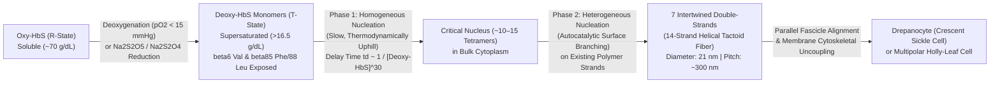
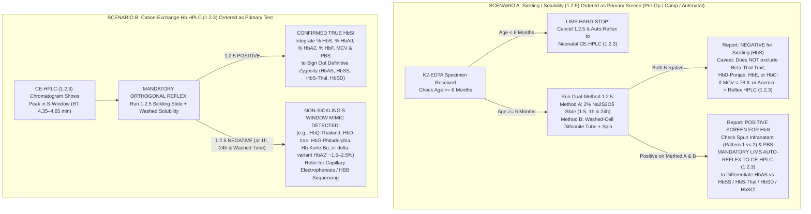

# 🌙 1.2.5 Sickling Test ($2.0\%$ Sodium Metabisulfite Sealed Wet-Slide Microscopy & Washed-Cell Sodium Dithionite Tube Solubility) — Complete Analytical SOP, Biophysical Kinetics & Clinical Interpretation Manual

> **Document Control & Accreditation Metadata (`ISO 15189:2022 Clauses 4.1–8.9 & Annex A` / `NABL 112` / `CAP HEM.35600–35950`):**
> - **Performing Institution:** Sawariya Diagnostic Lab, Charkhi Dadri, Haryana, India (`01_Hematology_and_Coagulation` $\rightarrow$ `1.2_Anemia_Morphology_Hemoglobinopathy_and_Hemolysis_Cluster`)
> - **Document ID & Version:** `SDL-SOP-HEM-1.2.5-SICKLE-v5.0` (Supersedes `v4.2`)
> - **Effective Date:** 15-Oct-2026 | **Mandatory Review Cycle:** Annual (or immediately upon revision of `ICSH` / `CLSI H22-A3` / `ICMR-NSCAEM` Standards)
> - **Authoring & Reviewing Panel:** 10-Persona International & Above-NABL Red-Team Panel (Senior Consultant Hematopathologist [MD Pathology], Molecular Biophysicist, Peri-Operative Anesthesiologist, CLSI/IFCC Metrology Specialist, Clinical Pharmacologist, Medico-Legal Counsel, Lead NABL/CAP Assessor)
> - **Approving Authority:** Laboratory Director & Chief of Hematopathology, Sawariya Diagnostic Lab
> - **Controlled Distribution:** Master LIMS Knowledgebase, Special Hematology & Hemoglobinopathy Bench, Emergency / STAT Pre-Operative Bench, Antenatal Screening Desk

---

## Section 1: Document Control, Standardized Coding & International Regulatory Harmonization Matrix

### 1.1 Institutional Metadata & Coding Crosswalk
| Metadata Field | Institutional & International Specification |
| :--- | :--- |
| **Document ID & Version** | `SDL-SOP-HEM-1.2.5-SICKLE-v5.0` (Effective: 15-Oct-2026; Controlled Bench & LIMS Edition) |
| **Department & Cluster** | `01_Hematology_and_Coagulation` $\rightarrow$ `1.2_Anemia_Morphology_Hemoglobinopathy_and_Hemolysis_Cluster` |
| **Official Test Name** | Dual-Platform Qualitative & Semi-Quantitative Sickling Screen: **Method A:** $2.0\%\text{ w/v}$ Fresh Sodium Metabisulfite ($\text{Na}_2\text{S}_2\text{O}_5$) Sealed Wet-Slide Microscopic Deoxygenation Assay (`Daland & Castle Method`) AND **Method B:** Twice-Washed Packed-Cell Sodium Dithionite ($\text{Na}_2\text{S}_2\text{O}_4$) / Saponin $2.24\text{ M}$ Phosphate Buffer Tube Solubility & Centrifugation Assay (`Modified Itano-Huntsman / ICSH Method`) |
| **LOINC Codes** | `4626-8` (Sickling erythrocytes [Presence] in Blood by Light microscopy — Sodium metabisulfite reduction); `4627-6` (Hemoglobin S [Presence] in Blood by Solubility test — Dithionite); `718-7` (Hemoglobin [Mass/volume] in Blood); `4625-0` (Hemoglobin S/Total Hgb in Blood by HPLC — Mandatory Reflex); `42246-9` (Hemoglobin F/Total Hgb in Blood by HPLC) |
| **SNOMED-CT Codes** | `69205003` (Sickling test, sodium metabisulfite); `104151004` (Hemoglobin S solubility test); `165414009` (Sickling test positive); `165415005` (Sickling test negative); `250244003` (Drepanocyte / Sickle cell); `417357006` (Sickling disorder due to hemoglobin S); `127041004` (Sickle cell trait [`HbAS`]); `127040003` (Sickle cell anemia [`HbSS`]) |
| **ICD-10-CM / ICD-11 Codes** | **ICD-10-CM:** `D57.00` ($\text{HbSS}$ disease with vaso-occlusive crisis, unspecified), `D57.01` ($\text{HbSS}$ disease with acute chest syndrome), `D57.02` ($\text{HbSS}$ disease with splenic sequestration), `D57.1` (Sickle-cell disease without crisis), `D57.20` (Sickle-cell/$\text{HbC}$ disease [`HbSC`]), `D57.3` (Sickle-cell trait [`HbAS`]), `D57.40` (Sickle-cell $\beta$-thalassemia [`HbS-Beta Thal`]), `D57.80` (Other sickle-cell disorders including $\text{HbSD-Punjab}$). **ICD-11:** `3A51.0` (Sickle cell trait), `3A51.2` (Sickle cell anemia without crisis), `3A51.1` (Sickle cell anemia with crisis) |
| **CPT / NHA PM-JAY Codes** | **CPT:** `85660` (Sickling of RBC, reduction; slide or solubility method); `83021` (Hemoglobin fractionation and quantitation; chromatography [`HPLC`]). **Ayushman Bharat PM-JAY / NSCAEM Code:** `NHM-SCD-01` (Point-of-care / Solubility / Slide Sickling Screen), `NHM-SCD-02` (Confirmatory Cation-Exchange HPLC) |
| **UCUM Reporting Units** | **Primary Qualitative Result:** `POSITIVE` / `NEGATIVE` (with mandatory zygosity disclaimer). **Secondary Semi-Quantitative Microscopic Metrics:** `% Sickled / Holly-Leaf Erythrocytes` (`%`) at `1 Hour` and `24 Hours` ($500\text{-cell}$ count) and **Centrifuged Solubility Phase Pattern** (`Top Band + Clear Colourless Infranatant` vs `Top Band + Clear Pink/Red Infranatant` vs `Clear Homogeneous Red Solution`) |
| **Turnaround Time (`TAT`)** | **STAT Pre-Operative / Emergency Crisis Screen:** $\le 45\text{ minutes}$ (Washed-Cell Dithionite Tube Solubility + $1\text{-hour}$ $37^\circ\text{C}$ Metabisulfite Slide Read). **Routine Diagnostic Screen:** $\le 4\text{ hours}$ (Initial `1-hour` & `2-hour` microscopic reads) with **Mandatory `24-hour` Delayed Incubation Verification** before finalizing any low-$\text{HbS}$ / high-$\text{HbF}$ negative slide |
| **Accreditation & Regulatory Clause Mapping** | `ISO 15189:2022` (Clauses 5.5, 7.2, 7.3, 7.4, 8.5, 8.8), `NABL 112` (Specific Criteria for Hematology — Qualitative & Special Hematology Verification), `NABL 153` / `NABL 220D` / `NABL 223`, `CAP Hematology Checklist HEM.35600, HEM.35750, HEM.35850, HEM.35900, HEM.35950`, `CLSI H22-A3` (*Reference Leukocyte and Hemoglobinopathy Screening*), `CLSI H40-A2`, `ICSH` (*International Council for Standardization in Haematology Recommendations for Laboratory Diagnosis of Sickle Cell Disorders*), `UK NHS Sickle Cell and Thalassaemia Screening Programme Laboratory Handbook (2024)`, `ICMR National Guidelines for Control of Hemoglobinopathies in India (2016)`, and `Ministry of Health & Family Welfare (MoHFW) National Sickle Cell Anaemia Elimination Mission (NSCAEM 2023–2047) Guidelines` |

### 1.2 Hardware-Agnostic Analytical & Orthogonal Confirmation Architecture
In strict compliance with `ICSH`, `UK NHS`, `CAP HEM.35900`, and `ICMR` diagnostic stewardship guidelines, no hemoglobinopathy diagnosis is ever finalized on a single qualitative screening test or a single chromatographic retention time. Sawariya Diagnostic Lab operates a three-tier orthogonal diagnostic architecture:

| Platform Tier | Assay / Instrument Platform | Biochemical & Biophysical Mechanism | Mandatory Clinical & Regulatory Role |
| :--- | :--- | :--- | :--- |
| **Tier 1A: Primary Microscopic Deoxygenation Screen (`Method A`)** | **$2.0\%\text{ w/v}$ Freshly Prepared Sodium Metabisulfite ($\text{Na}_2\text{S}_2\text{O}_5$) Airtight Sealed Wet-Slide (`Daland & Castle Protocol`)** on Olympus CX23 / Nikon Eclipse E200 Trinocular Microscope ($40\times$ High-Dry & $100\times$ Oil Immersion) | Anhydrous $\text{Na}_2\text{S}_2\text{O}_5$ dissolves in water to form sodium bisulfite ($\text{NaHSO}_3$), a potent chemical oxygen scavenger that reduces pericellular oxygen tension ($p\text{O}_2 < 10\text{–}15\text{ mmHg}$) across intact erythrocyte membranes. Deoxygenation forces intracellular $\text{HbS}$ ($\alpha_2\beta^S_2$) into the tense (`T`) quaternary conformation, triggering hydrophobic $\beta 6\text{ Val}$ tactoid polymerization into $21\text{ nm}$ helical fibers that deform the erythrocyte into **sharp-pointed crescent (`drepanocyte`) and multipolar holly-leaf cells**. | Direct morphological visualization of intracellular $\text{HbS}$ tactoid sickling (`LoD: 8%–12% HbS` at `24 hours`). Eliminates false-positive plasma turbidity interferences seen in tube solubility tests and detects minor sickling erythrocyte populations ($5\%\text{–}15\%$) in recently transfused patients. |
| **Tier 1B: Rapid High-Molarity Tube Solubility Screen (`Method B`)** | **Twice-Washed Packed-RBC Sodium Dithionite ($\text{Na}_2\text{S}_2\text{O}_4$) + Saponin in $2.24\text{ M}$ $\text{K}_2\text{HPO}_4/\text{KH}_2\text{PO}_4$ Buffer (`Modified Itano-Huntsman / ICSH Protocol`)** + Centrifugation ($1,200 \times g$, $5\text{ min}$) | Saponin ($1\text{–}5\text{ g/L}$) rapidly lyses the erythrocyte lipid bilayer via cholesterol micellization. Sodium dithionite ($\text{Na}_2\text{S}_2\text{O}_4$) instantaneously reduces released oxy-$\text{HbS}$ to deoxy-$\text{HbS}$. In concentrated $2.24\text{ M}$ potassium phosphate buffer ($\text{pH } 7.0 \pm 0.05$), hydrophobic deoxy-$\text{HbS}$ polymers are completely insoluble (`salting-out effect`), forming a **nematic liquid-crystalline suspension that scatters light (`turbid`)** and floats as a **dark-red surface band** upon centrifugation at $1,200 \times g$. | Rapid ($\le 15\text{ min}$) pre-operative / STAT screening assay and mandatory orthogonal confirmatory test for `S-Window` peaks detected on Cation-Exchange HPLC (`1.2.3`). Using twice-washed packed RBCs ($10\ \mu\text{L}$) eliminates false negatives from severe anemia and false positives from paraproteinemia/hyperlipidemia. |
| **Tier 2: Quantitative Confirmatory Fractionation (`Mandatory Reflex`)** | **Cation-Exchange High-Performance Liquid Chromatography (`CE-HPLC`, SOP `1.2.3`) / Capillary Zone Electrophoresis (`CZE`) + Automated 5-Part CBC (`MEK-1305/1503`, SOP `1.1.1`) & Leishman PBS (`SOP 1.2.1`)** | Separates and quantifies individual hemoglobin fractions ($\text{HbA}_0$, $\text{HbA}_2$, $\text{HbF}$, $\text{HbS}$, $\text{HbD-Punjab}$, $\text{HbC}$, $\text{HbE}$, $\text{HbQ-India}$) based on net surface ionic charge at specific elution retention times (`RT`) or electrophoretic mobility zones, paired with red cell indices ($\text{MCV}, \text{MCH}, \text{MCHC}, \text{RDW}$) and baseline peripheral smear morphology. | **MANDATORY FOR EVERY POSITIVE SICKLING / SOLUBILITY SCREEN:** Differentiates benign heterozygous **Sickle Cell Trait (`HbAS`)** from life-threatening **Homozygous Sickle Cell Anemia (`HbSS`)**, **$\text{HbS}-\beta^0\text{ Thalassemia}$**, **$\text{HbS}-\beta^+\text{ Thalassemia}$**, **$\text{HbSD-Punjab}$**, and **$\text{HbSC}$**, which **CANNOT** be distinguished by qualitative sickling or solubility tests alone! |

---

## Section 2: Molecular & Thermodynamic Biophysics of Deoxy-HbS Tactoid Polymerization (Persona 7 Deep-Dive)

To prevent bench misinterpretation, false-negative timing errors, and clinical mismanagement, every hematopathologist and bench technologist must master the molecular and thermodynamic biophysics governing Sickle Hemoglobin ($\text{HbS}$) polymerization:

### 2.1 The $\beta 6\text{ Glu}\rightarrow\text{Val}$ Mutation & Surface Hydrophobic Patch Creation
1. **Genetic & Primary Structural Defect:** Normal adult hemoglobin ($\text{HbA}_0$, $\alpha_2\beta_2$, MW $\approx 64,458\text{ Da}$) is encoded by the $\alpha$-globin gene cluster on chromosome `16p13.3` and the $\beta$-globin gene (`HBB`) on chromosome `11p15.4`. In Sickle Hemoglobin ($\text{HbS}$, $\alpha_2\beta^S_2$), a single point transversion ($A \rightarrow T$) in the sixth codon of exon 1 of the `HBB` gene (`GAG` $\rightarrow$ `GTG`, `HGVS: HBB:c.20A>T`, `p.Glu7Val` in HGVS initiator-methionine numbering; classically designated **$\beta 6\text{ Glu}\rightarrow\text{Val}$** at helix position `A3`) replaces a polar, hydrophilic, negatively charged **Glutamic Acid ($\text{Glu}, -\text{CH}_2\text{CH}_2\text{COO}^-$)** on the exterior surface of the $\beta$-globin chain with a non-polar, uncharged, hydrophobic **Valine ($\text{Val}, -\text{CH}(\text{CH}_3)_2$)** isopropyl side chain.
2. **Electrophoretic & Chromatographic Consequence:** Loss of two negative charges per $\alpha_2\beta^S_2$ tetramer (one $-\text{COO}^-$ lost from each of the two $\beta^S$ chains) increases the net positive surface charge of $\text{HbS}$ relative to $\text{HbA}_0$ at physiological and weakly acidic $\text{pH}$. Consequently, on Cation-Exchange HPLC (`1.2.3`), $\text{HbS}$ binds more tightly to the negatively charged carboxyl-methyl silica resin and elutes later than $\text{HbA}_0$ and $\text{HbA}_2$ in the dedicated **`S-Window` ($4.35\text{–}4.65\text{ minutes}$)**.

### 2.2 Quaternary Allosteric Transition (`R-State` vs `T-State`) & Stereochemical Docking
1. **Why Oxygenated $\text{HbS}$ (`R-State`) Does Not Polymerize:** In the oxygenated, relaxed (`R`) quaternary state, the two $\beta$-globin chains of the hemoglobin tetramer sit closer together, and the lateral hydrophobic pocket between the `E` and `F` helices of adjacent tetramers is sterically closed and geometrically incompatible with the $\beta 6\text{ Val}$ donor patch. Thus, fully oxygenated $\text{HbS}$ has essentially the same high aqueous solubility ($\sim 70\text{ g/dL}$) as oxygenated $\text{HbA}_0$.
2. **Deoxygenation (`T-State`) Unmasks the $\beta 85\text{ Phe} / \beta 88\text{ Leu}$ Acceptor Pocket:** When oxygen partial pressure ($p\text{O}_2$) falls below $25\text{–}40\text{ mmHg}$ *in vivo* (or below $10\text{–}15\text{ mmHg}$ *in vitro* via chemical reduction by $\text{Na}_2\text{S}_2\text{O}_5$ or $\text{Na}_2\text{S}_2\text{O}_4$), oxygen dissociates from the ferro-heme ($\text{Fe}^{2+}$) prosthetic groups. The $\text{Fe}^{2+}$ atom moves $0.04\text{–}0.06\text{ nm}$ out of the porphyrin plane toward the proximal histidine (`His F8`), pulling the `F` helix and triggering the **$\text{R}\rightarrow\text{T}$ (`Relaxed` to `Tense`) quaternary allosteric transition**:
   - The $\alpha_1\beta_2$ dimer interface rotates by $15^\circ$, and the cleft between the two $\beta$-subunits widens by $\sim 0.7\text{ nm}$ ($7\text{ \AA}$), allowing binding of $2,3\text{-bisphosphoglycerate}$ ($2,3\text{-BPG}$) in the central cavity.
   - Crucially, this $\text{T-state}$ conformation exposes a stereochemically complementary **hydrophobic acceptor pocket** on the surface of the $\beta_1$ subunit formed by **$\beta 85\text{ Phenylalanine}$ (`Phe EF1`)** and **$\beta 88\text{ Leucine}$ (`Leu F4`)**.
   - The protruding hydrophobic isopropyl group of **$\beta_2 6\text{ Valine}$ (`donor site`)** on one deoxygenated $\text{HbS}$ tetramer inserts directly into the exposed **$\beta_1' 85\text{ Phe} / \beta_1' 88\text{ Leu}$ (`acceptor pocket`)** of an adjacent deoxygenated $\text{HbS}$ tetramer (`Wishner-Love lateral contact`), driving entropically favored hydrophobic exclusion of structured water molecules ($\Delta H > 0, \Delta S \gg 0 \Rightarrow \Delta G = \Delta H - T\Delta S < 0$).
3. **Asymmetry of $\beta_1$ vs $\beta_2$ Chains & Secondary Axial/Lateral Contacts:** Within a single $\alpha_2\beta^S_2$ tetramer incorporated into a double strand, **only one of the two $\beta^S$ chains ($\beta_2\text{ Val6}$)** participates in the primary lateral donor-acceptor contact! The polymer lattice is simultaneously stabilized by secondary **axial contacts** (`$\beta 22\text{ Glu}$`, `$\beta 121\text{ Glu}$`, `$\alpha 23\text{ Glu}$`, `$\alpha 114\text{ Pro}$`) and **inter-double-strand contacts** (`$\beta 73\text{ Asp}$`, `$\beta 80\text{ Asn}$`, `$\beta 87\text{ Thr}$`). This stereochemical architecture explains three vital clinical-laboratory phenomena:
   - **Why $\text{HbSD-Punjab}$ ($\beta 6\text{ Glu}\rightarrow\text{Val}$ / $\beta 121\text{ Glu}\rightarrow\text{Gln}$) behaves like severe Homozygous $\text{HbSS}$:** The $\beta 121\text{ Glu}\rightarrow\text{Gln}$ substitution in $\text{HbD-Punjab}$ removes a repulsive negative charge at an axial contact site, actively strengthening the axial inter-tetramer bond in $\alpha_2\beta^S\beta^D$ copolymer fibers!
   - **Why $\text{HbC-Harlem}$ ($\beta 6\text{ Glu}\rightarrow\text{Val} + \beta 73\text{ Asp}\rightarrow\text{Asn}$ on the same $\beta$-chain) gives a POSITIVE Sickling/Solubility Test while migrating in the `HbC` zone:** It possesses the primary $\beta 6\text{ Val}$ donor site required for tactoid polymerization, modified at the $\beta 73$ lateral contact site.
   - **Why $\text{HbF}$ ($\alpha_2\gamma_2$) Potently Blocks Polymerization (`Sparsely Interactive / Excluded Tetramer`):** Inside the erythrocyte, hemoglobin tetramers rapidly dissociate into $\alpha\beta$ or $\alpha\gamma$ dimers and re-associate at random ($2\alpha\beta^S + 2\alpha\gamma \rightleftharpoons \frac{1}{2}\alpha_2\beta^S_2 + \alpha_2\beta^S\gamma + \frac{1}{2}\alpha_2\gamma_2$). In the $\gamma$-globin chain of $\text{HbF}$, position $\gamma 87$ (`F3`) is occupied by an uncharged polar **Glutamine (`Gln`)** (instead of $\beta 87\text{ Thr}$ in $\text{HbA}/\text{HbS}$) and position $\gamma 80$ is **Aspartate (`Asp`)**. When an asymmetric hybrid tetramer ($\alpha_2\beta^S\gamma$) attempts to join a growing $\text{HbS}$ fiber, $\gamma 87\text{ Gln}$ sterically and electrostatically blocks the lateral inter-strand contact! Thus, **both $\alpha_2\gamma_2$ homotetramers and $\alpha_2\beta^S\gamma$ hybrid tetramers are completely excluded from the $\text{HbS}$ polymer phase**, explaining why neonates ($60\%\text{–}85\%\text{ HbF}$) and patients with pancellular Hereditary Persistence of Fetal Hemoglobin (`HPFH`, $25\%\text{–}35\%\text{ HbF}$) or Arab-Indian haplotype / Hydroxyurea therapy resist sickling!

### 2.3 Double-Nucleation Kinetics (`Ferrone-Eaton-Hofrichter Model`) & Architecture of the $14$-Strand $21\text{ nm}$ Tactoid Fiber


1. **Architecture of the $14$-Strand Helical Tactoid:** Once nucleated, deoxygenated $\text{HbS}$ tetramers assemble into half-staggered axial **double strands** (`Wishner-Love filaments`, $\sim 6.5\text{ nm} \times 4.0\text{ nm}$). Seven of these double strands twist right-handedly around one another (6 outer double strands surrounding 1 central core double strand) to form a rigid, solid-core **$14\text{-stranded helical polymer fiber}$** with a cross-sectional diameter of **$21\text{ nm}$ ($210\text{ \AA}$)** and a helical pitch of $\sim 300\text{ nm}$. These $21\text{ nm}$ fibers align into parallel liquid-crystalline bundles (**tactoids**) that stretch the erythrocyte membrane along the fiber axis into a crescent sickle (`drepanocyte`) or multipolar `holly-leaf` cell.
2. **The Eaton-Hofrichter Delay Time ($t_d$) Equation:** Polymerization does not occur instantaneously upon deoxygenation; it exhibits a strict lag phase (**delay time, $t_d$**) governed by the **Double-Nucleation Mechanism** (homogeneous nucleation in bulk solution followed by autocatalytic heterogeneous nucleation on the surface of newly formed polymers). Quantitatively:
   $$\frac{1}{t_d} = \gamma \cdot \left(\frac{C_{\text{deoxy-HbS}}}{C_s}\right)^n \quad \text{where } n \approx 30 \text{ to } 38$$
   - $C_{\text{deoxy-HbS}}$ is the intracellular concentration of deoxygenated $\text{HbS}$ (normally $\sim 32\text{–}35\text{ g/dL}$ in an `HbSS` erythrocyte, or $\sim 12\text{–}14\text{ g/dL}$ in an `HbAS` trait erythrocyte).
   - $C_s$ is the equilibrium thermodynamic solubility of deoxygenated $\text{HbS}$ at physiological ionic strength ($\sim 16.5\text{–}17.5\text{ g/dL}$ at $37^\circ\text{C}$, $\text{pH } 7.2$).
   - **Clinical & Bench Significance of the $30\text{th}$ Power Dependence:**
     - **In Vivo Microcirculation:** Normal capillary transit time ($t_c$) is $0.5\text{–}2.0\text{ seconds}$. In `HbAS` trait ($\text{HbS } 35\%\text{–}40\%$, intracellular $[\text{HbS}] \approx 13\text{ g/dL}$), the delay time $t_d$ at physiological venous $p\text{O}_2$ ($40\text{ mmHg}$) is $> 100\text{ seconds}$—orders of magnitude longer than capillary transit time, so `HbAS` cells never sickle under normal physiological conditions (except in the extreme hypertonic/hypoxic renal vasa recta or extreme high-altitude hypoxia).
     - **In Vitro $2\%$ Sodium Metabisulfite Wet-Mount Slide:** Because $\text{Na}_2\text{S}_2\text{O}_5$ drives $p\text{O}_2$ down to $< 5\text{–}10\text{ mmHg}$ and holds the erythrocytes stationary indefinitely ($t \rightarrow 30\text{ min to } 24\text{ hours} \gg t_d$), **BOTH `HbSS` ($t_d < 1\text{–}15\text{ min}$) AND `HbAS` ($t_d \approx 20\text{–}90\text{ min}$, extending up to $2\text{–}24\text{ hours}$ if $\alpha$-thalassemia or elevated $\text{HbF}$ coexists) undergo complete tactoid polymerization and sickle on the slide!**
     - **Why Low Temperature ($< 20^\circ\text{C}$) Inhibits Sickling on the Slide:** Because hydrophobic $\text{HbS}$ polymerization is **endothermic** ($\Delta H \approx +8\text{ to }+15\text{ kcal/mol}$, driven purely by positive water-release entropy $\Delta S > 0$), cooling a slide below $15\text{–}20^\circ\text{C}$ increases deoxy-$\text{HbS}$ solubility $C_s$ and depolymerizes tactoids (`cold-reversible gelation`). Therefore, wet-mount slides **must be incubated at $25\text{–}37^\circ\text{C}$** (never in a cold winter room $< 18^\circ\text{C}$ without an incubator!).

---

## Section 3: Pre-Analytical Phlebotomy, Specimen Stability, Neonatal Hard-Stop & Rejection Criteria

### 3.1 Specimen Requirements & Stability Matrix (`ISO 15189:2022 Clause 7.2`)
| Parameter | Institutional Specification & Pre-Analytical Mandate |
| :--- | :--- |
| **Primary Specimen** | Venous whole blood ($2.0\text{–}3.0\text{ mL}$) collected in dipotassium or tripotassium $\text{EDTA}$ ($\text{K}_2\text{-EDTA} / \text{K}_3\text{-EDTA}$, Lavender-Top tube, $1.5\text{–}2.2\text{ mg/mL}$ blood). Capillary heel/finger-prick blood in $\text{EDTA}$ micro-collection tubes ($250\text{–}500\ \mu\text{L}$) is acceptable for pediatric screening above $6\text{ months}$ of age. |
| **Acceptable Alternative Anticoagulants** | Lithium/Sodium Heparin (Green-Top) or $3.2\%$ Trisodium Citrate (Light-Blue Top) are acceptable for emergency solubility/wet-mount testing if $\text{EDTA}$ is unavailable, provided hematocrit dilution in citrate ($9:1$) is corrected via packed-RBC washing. **Oxalate and Fluoride-Oxalate (Grey-Top) tubes are STRICTLY REJECTED** because hypertonic potassium oxalate induces severe artifactual RBC shrinkage and echinocytic crenation! |
| **Specimen Stability** | **1. $2\%$ Sodium Metabisulfite Wet-Mount Microscopy:** Optimal within **$\le 6\text{ hours}$** at room temperature ($18\text{–}25^\circ\text{C}$) or up to **$\le 48\text{ hours}$** if refrigerated at $2\text{–}8^\circ\text{C}$ (older $\text{EDTA}$ specimens develop storage echinocytosis that mimics or obscures holly-leaf sickling).<br/>**2. Washed-Cell Dithionite Tube Solubility:** Stable up to **$48\text{ hours}$** at $18\text{–}25^\circ\text{C}$ and up to **$14\text{ days}$** at $2\text{–}8^\circ\text{C}$, provided no bacterial contamination, gross hemolysis, or methemoglobin conversion has occurred. |
| **Mandatory Clinical History on Requisition (`ISO 15189 Clause 7.2.2`)** | Every test requisition MUST record: **(1) Exact Patient Age** (in days/months if $< 2\text{ years}$), **(2) Blood Transfusion History within the last $120\text{ days}$** (date and number of PRBC units), **(3) Current Medications** (specifically **Hydroxyurea**, **Voxelotor [`Oxbryta`]**, or recent intravenous lipid/contrast infusions), **(4) Clinical Indication** (e.g., Pre-Operative STAT, Antenatal Screening, Spousal Cascade, Acute Pain/Hemolytic Crisis), and **(5) Caste/Community/Regional Belt** (e.g., Punjab/Haryana $\text{HbD}$ belt, Central/Western Indian tribal belt). |

### 3.2 Critical Neonatal & Early Infancy Hard-Stop (Age $< 6\text{ Months}$)
> [!CAUTION]
> **MANDATORY LIMS HARD-STOP FOR NEONATES & INFANTS UNDER $6\text{ MONTHS}$ OF AGE (`CAP HEM.35950` / `UK NHS` / `ICMR`):**
> **NEVER perform or report a Sodium Metabisulfite Sickling Test or Sodium Dithionite Tube Solubility Test on cord blood, neonates ($0\text{–}28\text{ days}$), or young infants under $6\text{ months}$ ($< 180\text{ days}$) of age!**
> 1. **Biophysical & Quantitative Cause of False Negatives:** At birth (term gestation), Fetal Hemoglobin ($\text{HbF}, \alpha_2\gamma_2$) constitutes **$65\%\text{ to } 85\%$** of total hemoglobin, while adult/variant $\beta$-chain synthesis ($\text{HbA}$ or $\text{HbS}$) constitutes only **$10\%\text{ to } 25\%$** total. In a neonate with heterozygous Sickle Cell Trait (`HbAS`), $\text{HbS}$ is only **$4\%\text{ to } 10\%$** (well below the $10\%\text{–}20\%$ analytical `LoD` of both sickling and solubility assays!). Even in a neonate with Homozygous Sickle Cell Disease (`HbSS`, where $\text{HbS}$ is $10\%\text{–}20\%$ and $\text{HbF}$ is $80\%\text{–}90\%$), the massive intracellular concentration of $\text{HbF}$ forms non-polymerizing $\alpha_2\beta^S\gamma$ hybrid tetramers that completely block $\text{HbS}$ tactoid nucleation on the wet-mount slide and prevent precipitation in the solubility tube!
> 2. **Mandatory LIMS Action:** If a clinician orders a Sickling Test (`1.2.5`) on any infant with `Age < 180 days`, LIMS Rule `LIMS-SICKLE-NEO-BLOCK` automatically blocks the order and converts/reflexes the request to **Neonatal Cation-Exchange $\text{Hb}$ HPLC (`SOP 1.2.3`)** or **Capillary Zone Electrophoresis (`CZE`)**, which accurately detects $\text{HbS}$ down to $0.5\%\text{–}1.0\%$ (`FS` vs `FAS` vs `FA` neonatal pattern).

### 3.3 Specimen Rejection Criteria
1. **Clotted or Micro-Clotted Specimen:** Reject immediately; fibrin strands trap erythrocytes and cause mechanical tear-drop/schistocyte artifacts on wet mounts and uneven cell pipetting in solubility tubes.
2. **Grossly Hemolyzed Specimen (`Free Plasma Hb > 200 mg/dL`):** Reject for both Method A (lysed ghosts cannot sickle on microscopy) and Method B (washed packed-cell protocol loses lysed intracellular $\text{HbS}$ in the saline wash supernatant!).
3. **Fluoride-Oxalate (`Grey-Top`) or Aged Unrefrigerated Blood ($> 48\text{ hours}$ at room temperature):** Reject for Method A due to $100\%$ osmotic/ATP-depletion echinocytic crenation; collect fresh $\text{K}_2\text{-EDTA}$ sample.

---

## Section 4: Dual-Method Analytical Bench SOP (`Method A` Wet-Slide Microscopy & `Method B` Washed-Cell Tube Solubility)

In accordance with `ICSH`, `CLSI H22-A3`, and `NABL 112`, Sawariya Diagnostic Lab performs **both** the $2.0\%$ Sodium Metabisulfite Sealed Wet-Slide Microscopic Assay (**Method A**) and the Twice-Washed Packed-Cell Sodium Dithionite Tube Solubility Assay with Centrifugation (**Method B**) in parallel on all diagnostic and confirmatory requests.

---

### 4.1 METHOD A: $2.0\%\text{ w/v}$ Fresh Sodium Metabisulfite ($\text{Na}_2\text{S}_2\text{O}_5$) Sealed Wet-Slide Microscopic Sickling Test (`Daland & Castle Protocol`)

#### A.1 Chemical Principle & Redox Stoichiometry of Sodium Metabisulfite Deoxygenation
When anhydrous Sodium Metabisulfite ($\text{Na}_2\text{S}_2\text{O}_5$, MW $= 190.11\text{ g/mol}$) is dissolved in distilled water, the pyrosulfite ion ($\text{S}_2\text{O}_5^{2-}$) hydrolyzes rapidly into two moles of bisulfite ion ($\text{HSO}_3^-$):
$$\text{Na}_2\text{S}_2\text{O}_5 + \text{H}_2\text{O} \rightleftharpoons 2\text{Na}^+ + 2\text{HSO}_3^- \quad (\text{pH } 4.5\text{–}5.2)$$
Upon mixing with oxygenated whole blood under an airtight sealed coverslip, bisulfite ions rapidly scavenge dissolved molecular oxygen ($\text{O}_2$) from the plasma and across the erythrocyte membrane by irreversible oxidation to sulfate ($\text{SO}_4^{2-}$):
$$2\text{HSO}_3^- + \text{O}_2 \longrightarrow 2\text{SO}_4^{2-} + 2\text{H}^+$$
1. **Double Synergistic Sickling Stimulus:** Notice that this reaction not only reduces pericellular oxygen tension to near zero ($p\text{O}_2 < 5\text{–}10\text{ mmHg}$), forcing Oxy-$\text{HbS}$ (`R-state`) into Deoxy-$\text{HbS}$ (`T-state`), but also releases protons ($\text{H}^+$), lowering pericellular $\text{pH}$ to $\sim 6.5\text{–}6.8$. Via the **Bohr Effect**, this mild acidification further stabilizes the `T-state` of $\text{HbS}$, rightward-shifting the oxygen dissociation curve (increasing $P_{50}$) and accelerating tactoid nucleation!
2. **Why $2.0\%\text{ w/v}$ $\text{Na}_2\text{S}_2\text{O}_5$ MUST Be Prepared Fresh Within `< 4 Hours` of Use (Critical Audit Requirement):**
   - Dissolved $\text{HSO}_3^-$ reacts continuously with atmospheric $\text{O}_2$ in the headspace of any bottle and undergoes auto-oxidation catalyzed by trace divalent metal ions into **Sodium Sulfate ($\text{Na}_2\text{SO}_4$)**, which has **ZERO reducing power** ($E^\circ$ exhausted).
   - Furthermore, dry $\text{Na}_2\text{S}_2\text{O}_5$ powder exposed to humid air evolves $\text{SO}_2$ gas and oxidizes into inert $\text{Na}_2\text{SO}_4$ cake.
   - **Using a pre-made liquid stock solution $> 4\text{ hours}$ old (or damp, odourless, caked powder) results in a 100% FALSE-NEGATIVE SICKLING TEST even in Homozygous `HbSS` blood!**
   - **Mandatory Bench Rule:** Weigh **$0.20\text{ g}$ ($200.0\text{ mg}$)** of dry, white, free-flowing analytical-grade anhydrous $\text{Na}_2\text{S}_2\text{O}_5$ (stored in an amber bottle inside a silica-gel desiccator) and dissolve in exactly **$10.0\text{ mL}$ of fresh Type-I/II Deionized/Distilled Water** in a tightly stoppered amber glass tube immediately prior to testing. Label with exact **Time of Preparation** and **Discard Time ($+4.0\text{ hours}$)**.

#### A.2 Step-by-Step Bench Procedure for Method A ($1:5$ Blood-to-Reagent Drop Ratio)
1. **Pre-Analytical Hematocrit Check & Adjustment:**
   - Check the patient's automated CBC (`1.1.1`) hemoglobin and hematocrit (`PCV`).
   - If the patient has **severe anemia ($\text{Hb} < 7.0\text{ g/dL}$ or $\text{PCV} < 20\%$)**, centrifuge $0.5\text{ mL}$ of $\text{EDTA}$ blood at $1,000 \times g$ for $3\text{ minutes}$ and remove half of the supernatant plasma to adjust the erythrocyte suspension to a standard $\text{PCV}$ of **$30\%\text{–}40\%$** before setting up the slide.
   - If the patient has **severe polycythemia ($\text{Hb} > 18.0\text{ g/dL}$ or $\text{PCV} > 55\%$)**, dilute $1\text{ part}$ blood with $1\text{ part}$ autologous plasma (or isotonic $0.9\%\text{ NaCl}$) so that excessive RBC mass does not exhaust the reducing agent or cause overlapping rouleaux.
2. **Slide Setup (`Exact 1:5 Blood-to-Reagent Drop Ratio`):**
   - Label three clean, grease-free $75 \times 25\text{ mm}$ glass microscope slides: **(1) `Patient Test`**, **(2) `Positive QC (Known HbAS)`**, and **(3) `Negative QC (Known HbAA)`**.
   - Using a calibrated micropipette or uniform Pasteur dropper, dispense exactly **$1\text{ drop}$ ($20\ \mu\text{L}$) of well-mixed $\text{K}_2\text{-EDTA}$ blood** onto the center of the slide.
   - Immediately add **$5\text{ drops}$ ($100\ \mu\text{L}$) of freshly prepared ($< 4\text{ hours}$ old) $2.0\%\text{ w/v}$ aqueous Sodium Metabisulfite ($\text{Na}_2\text{S}_2\text{O}_5$) solution** directly onto the blood drop (`exact 1:5 v/v ratio`).
   - *Rationale for the $1:5$ Ratio:* A $1:5$ ratio ($20\ \mu\text{L}$ blood $+ 100\ \mu\text{L}$ of $2\%$ $\text{Na}_2\text{S}_2\text{O}_5$) provides a $> 15\text{-fold}$ molar stoichiometric excess of $\text{HSO}_3^-$ over all oxyhemoglobin-bound $\text{O}_2$ ($1.34\text{ mL O}_2/\text{g Hb}$) and dissolved plasma $\text{O}_2$, ensuring rapid, complete deoxygenation across the entire slide without hypertonic osmotic shrinkage.
3. **Mixing, Coverslip Application & Monolayer Blotting:**
   - Gently stir the blood and metabisulfite droplets together for $5\text{–}10\text{ seconds}$ using the smooth corner of a clean $22 \times 22\text{ mm}$ `#1.5` glass coverslip, avoiding air bubble generation.
   - Lower the $22 \times 22\text{ mm}$ coverslip at a $30^\circ$ angle onto the mixture so the fluid spreads uniformly without trapped air pockets.
   - Lightly press the center of the coverslip with the tip of a wrapped applicator stick and **blot away the excess peripheral fluid around all four edges using a strip of Whatman No. 1 filter paper**.
   - *Why Blotting is Critical:* If a thick pool of fluid remains under the coverslip, erythrocytes float in multiple overlapping layers and swirl by Brownian/convective currents, making sharp $40\times / 100\times$ optical focusing impossible. Proper blotting creates an immobile, non-overlapping **single-cell monolayer**.
4. **Immediate Airtight Edge-Sealing (`Zero Oxygen Re-Entry / Zero Evaporation`):**
   - Within **$\le 30\text{ seconds}$** of blotting, seal all four edges of the coverslip ($2\text{ mm}$ overlap onto the glass slide and $2\text{ mm}$ onto the coverslip border) using a warm camel-hair brush dipped in **molten Paraffin Wax–Vaseline (White Petrolatum) mixture ($1:1\text{ w/w}$ heated at $55\text{–}60^\circ\text{C}$)** or a continuous bead of pure petroleum jelly applied via a syringe tip.
   - *(Warning: Avoid acetone-based nail polish if extended $24\text{-hour}$ incubation is required, as organic solvent vapors can diffuse into the edge zone and lyse or crenate peripheral erythrocytes; $1:1$ Paraffin-Vaseline is chemically inert and $100\%$ gas-impermeable).*
5. **Humidified Chamber Incubation (`37°C` / Controlled Room Temperature `25–30°C`):**
   - Place the sealed Patient, Positive QC (`HbAS`), and Negative QC (`HbAA`) slides resting on two glass applicator rods inside a **covered $150\text{ mm}$ glass Petri dish lined at the bottom with moistened filter paper** (`humidified moist chamber`).
   - Incubate at **$37.0^\circ\text{C} \pm 1.0^\circ\text{C}$** (or controlled warm room temperature $25\text{–}30^\circ\text{C}$; **never $< 20^\circ\text{C}$**).
6. **Time-Graded Microscopic Examination Protocol (`30 min`, `1 Hour`, `2 Hours`, and `24 Hours`):**
   - Examine the slides using brightfield microscopy (with the **substage condenser lowered slightly and iris diaphragm partially closed** to maximize refractive edge contrast of unstained red cells, or using Phase-Contrast optics if available) under the **$10\times$ (scan for monolayer uniformity)**, **$40\times$ High-Dry ($400\times$ total magnification)**, and **$100\times$ Oil Immersion ($1,000\times$ total magnification)** objectives:
     - **Read 1 (`30 Minutes` — Rapid STAT / Homozygous Check):** Scan central and intermediate zones (avoiding the outermost $1\text{ mm}$ edge near the seal). Homozygous `HbSS`, `HbS-Beta0 Thal`, and `HbSD-Punjab` typically exhibit **$40\%\text{–}95\%$ classic filamentous crescent sickling** within $15\text{–}30\text{ minutes}$ because intracellular $[\text{HbS}] > 25\text{ g/dL}$ yields a very short delay time $t_d$.
     - **Read 2 (`1 Hour` — Primary Standard Read):** Examine at least $500$ erythrocytes across $5$ non-overlapping fields. In heterozygous `HbAS` trait, `HbAS` + $\alpha$-thalassemia, or `HbSC`, sickling is unequivocally visible at **`1 Hour`** (typically $30\%\text{–}80\%$ sickled and multipolar holly-leaf forms). Confirm that the `Positive QC (HbAS)` slide shows $\ge 50\%$ sickled/holly-leaf cells and the `Negative QC (HbAA)` slide shows $0\%$ sickled cells ($100\%$ smooth biconcave discocytes).
     - **Read 3 (`2 Hours`):** Re-examine all negative or equivocal ($< 10\%$) slides at $2\text{ hours}$.
     - **Read 4 (`24 Hours` — Mandatory Delayed Confirmation Read):** Return any slide that is negative at $1\text{–}2\text{ hours}$ to the humidified Petri chamber and re-examine at **`24 Hours`**.
       - *Why the `24-Hour` Read is Mandatory:* In patients with `HbAS` trait co-inheriting homozygous $\alpha^+\text{-thalassemia}$ ($-\alpha/-\alpha$, where $\text{HbS}$ is only $20\%\text{–}25\%$ and `MCHC` is reduced), patients with `HbSS` on **Hydroxyurea** with pancellular $\text{HbF} > 25\%$, or patients recently transfused with donor `HbAA` blood ($\text{HbS } 8\%\text{–}15\%$), the delay time $t_d$ is prolonged beyond $1\text{–}2\text{ hours}$. By **`24 Hours`**, leukocyte and reticulocyte glycolysis plus metabisulfite reduction completely exhaust all residual oxygen, driving $100\%$ of $\text{HbS}$-containing cells into unmistakable **crescent sickles and sharp multipolar holly-leaf forms**!

#### A.3 Microscopic Morphological Discrimination Matrix: True Sickling vs Artifacts & Look-Alikes
The single greatest source of bench error in Method A is confusing **crenated echinocytes (`burr cells`)** or **pre-existing elliptocytes/ovalocytes** with **true sickled (`drepanocyte`) and holly-leaf (`ilex`) erythrocytes**. Bench technologists must apply the following 6-point cytomorphological discriminator table at $400\times$ and $1,000\times$ magnification:

| Morphological Feature | 1. Classical Sickle Cell (`Drepanocyte` — TRUE POSITIVE) | 2. Holly-Leaf / Oat-Shaped Sickle Cell (`Ilex Form` — TRUE POSITIVE) | 3. Crenated Echinocyte (`Burr Cell` — ARTIFACT / NEGATIVE) | 4. Hereditary / Iron-Deficiency Elliptocyte or Ovalocyte (`Cigar/Pencil Cell` — NEGATIVE) | 5. Acanthocyte (`Spur Cell`) / Poikilocyte (`Schistocyte / Dacrocyte` — NEGATIVE) |
| :--- | :--- | :--- | :--- | :--- | :--- |
| **Overall Cell Geometry** | Elongated ($12\text{–}22\ \mu\text{m}$ long, $2\text{–}4\ \mu\text{m}$ wide), curved crescent, scythe, boat, or filamentous spindle shape. | Asymmetrical polygonal, envelope, oat-seed, or holly-leaf (`Ilex aquifolium`) contour stretched along 2 to 4 intersecting axes. | Remains **spherical / round discoid** ($6\text{–}7.5\ \mu\text{m}$ diameter); cell body is NOT elongated or stretched along a longitudinal axis. | Symmetrical oval, rod, cigar, or pencil shape ($8\text{–}14\ \mu\text{m}$ long) with parallel or gently convex sides. | Contracted dense spherical center (`acanthocyte`), pear-shaped (`dacrocyte`), or triangular/helmet fragment (`schistocyte`). |
| **Terminal Projections / Tips (`The Decisive Criterion`)** | **2 bipolar, long, rigid, needle-sharp pointed spicules** at opposite ends where parallel $21\text{ nm}$ $\text{HbS}$ tactoid bundles poke the membrane. | **$3\text{ to } 6$ sharp, rigid, angular, thorny points** separated by concave scalloped membrane bays (`holly-leaf spines`). | **$10\text{ to } 30$ short, uniform, evenly spaced, blunt / rounded projections** distributed symmetrically around the entire $360^\circ$ circumference. | **Completely smooth, blunt, hemispherical rounded ends** (`0` pointed spicules, `0` thorny projections). | **$3\text{ to } 12$ irregular, unevenly spaced, club-tipped / drumstick projections** of varying lengths (`acanthocyte`), or $1$ single blunt tail (`dacrocyte`). |
| **Intracellular Cytoplasmic Texture & Birefringence** | Dense, rigid, slightly refractile fibrillar core (`nematic liquid crystal`); loses central pallor completely; **anisotropic (birefringent)** under polarized light. | Rigid, streaky cytoplasmic bands radiating directly into each sharp holly-leaf point; central pallor obliterated or displaced. | Preserves central pallor in early stages (`Echinocyte I/II`) or becomes a small dark crenated sphere (`Spher-echinocyte`); **non-birefringent**. | Normal smooth hemoglobin distribution (or hypochromic central pallor in iron deficiency); flexible membrane; **non-birefringent**. | Dense hyperchromic core (`acanthocyte`); **non-birefringent**; no internal tactoid fibers. |
| **Time-Kinetic Evolution ($T = 0\text{ min}$ vs $T = 1\text{ h}$ vs $T = 24\text{ h}$)** | Usually absent or rare ($< 5\%\text{ ISCs}$) at $T = 0\text{ min}$; increases progressively to **$40\%\text{–}95\%$ between $15\text{ min}$ and $2\text{–}24\text{ hours}$**. | Absent ($0\%$) at $T = 0\text{ min}$; emerges progressively at **$30\text{ min}$ to $24\text{ hours}$** as deoxygenation crosses $t_d$. | Often focal near **air bubbles or unsealed coverslip edges** where hypertonic evaporation occurs; also seen identically in the `Negative QC` if reagent/seal is faulty. | **Already present in identical proportion at $T = 0\text{ min}$** on the baseline Leishman-stained Peripheral Blood Smear (`SOP 1.2.1`) and does NOT increase at $1\text{–}24\text{ h}$! | **Already present at $T = 0\text{ min}$** on the baseline Leishman Peripheral Blood Smear (`SOP 1.2.1`) and remains static over $24\text{ hours}$. |
| **Reversibility Upon Oxygenation (`Cover-Slip Lift Test`)** | If the coverslip is lifted at $1\text{ h}$ and exposed to room air ($\text{O}_2$), **$80\%\text{–}95\%$ of freshly sickled cells revert to normal biconcave discocytes within $2\text{–}5\text{ min}$** (except pre-existing `ISCs`). | **Reverts $100\%$ to normal biconcave discocytes within $1\text{–}3\text{ minutes}$** upon lifting the coverslip and aerating with room air! | **Does NOT revert upon oxygenation!** (Reverts only if resuspended in fresh isotonic plasma, proving osmotic/drying origin). | **Does NOT revert** upon oxygenation (permanent spectrin-protein 4.1 cytoskeleton defect or nutritional poikilocytosis). | **Does NOT revert** upon oxygenation (permanent membrane lipid cholesterol/phospholipid abnormality or mechanical fragmentation). |
| **Typical Associated Genotype / Condition** | Homozygous `HbSS`, $\text{HbS}-\beta^0\text{ Thal}$, $\text{HbSD-Punjab}$, severe $\text{HbS}-\beta^+\text{ Thal}$. | Heterozygous `HbAS` Trait, `HbSC` disease, mild $\text{HbS}-\beta^+\text{ Thal}$, or high-$\text{HbF}$ `HbSS` (Arab-Indian haplotype / Hydroxyurea). | Drying/evaporation from incomplete Vaseline seal, aged $\text{EDTA}$ blood ($> 24\text{ h}$), hypertonic reagent ($> 3\%\text{ Na}_2\text{S}_2\text{O}_5$), uremia, or glass slide alkalinity. | Hereditary Elliptocytosis (`HE`), Iron Deficiency Anemia (`IDA` pencil cells), Megaloblastic Anemia (`macro-ovalocytes`), Thalassemia Minor. | Severe liver disease (`spur cell cirrhosis`), abetalipoproteinemia, post-splenectomy, microangiopathic hemolytic anemia (`MAHA`), myelofibrosis. |

> [!TIP]
> **Definitive Bench Verification Trick (`The Oxygenation Reversal Test`):**
> Whenever a bench technologist is uncertain whether multipolar cells seen at `1 hour` or `24 hours` represent true **holly-leaf sickling (`HbAS`)** versus **crenated echinocytes (`artifact`)** or **poikilocytes**:
> 1. Record the percentage and morphology of the abnormal cells in a central field.
> 2. Gently lift one corner of the coverslip with a needle to admit atmospheric oxygen ($\text{O}_2$, $p\text{O}_2 \approx 159\text{ mmHg}$) and place $1\text{ drop}$ of aerated isotonic $0.9\%\text{ NaCl}$ at the edge.
> 3. Observe the exact same microscopic field over $2\text{ to } 5\text{ minutes}$: **True sickled and holly-leaf erythrocytes depolymerize their $\text{HbS}$ tactoids and snap back into smooth, round biconcave discocytes**, whereas crenated echinocytes, acanthocytes, and hereditary elliptocytes do not!

---

### 4.2 METHOD B: Twice-Washed Packed-Cell Sodium Dithionite ($\text{Na}_2\text{S}_2\text{O}_4$) / Saponin High-Molarity Phosphate Buffer Tube Solubility Test (`Modified Itano-Huntsman / ICSH Protocol`)

#### B.1 Biophysical & Chemical Principle (`High-Ionic-Strength Salting-Out of Deoxy-HbS`)
1. **Cell Lysis by Saponin:** Saponin ($1.0\text{–}5.0\text{ g/L}$), an amphipathic triterpenoid glycoside surfactant, complexes with membrane cholesterol to create $8\text{ nm}$ pores in the erythrocyte membrane, achieving complete hemolysis within $15\text{–}30\text{ seconds}$ and liberating all intracellular hemoglobin into solution.
2. **Instantaneous Chemical Deoxygenation by Sodium Dithionite ($\text{Na}_2\text{S}_2\text{O}_4$):** Sodium dithionite (sodium hydrosulfite, $\text{Na}_2\text{S}_2\text{O}_4$, MW $= 174.11\text{ g/mol}$) is an extremely rapid, low-redox-potential ($E^\circ = -0.66\text{ V}$) reducing agent. In neutral phosphate buffer, the dithionite ion ($\text{S}_2\text{O}_4^{2-}$) dissociates into $\text{SO}_2^{\bullet -}$ radical anions that strip dissolved $\text{O}_2$ from the buffer and directly deoxygenate $\text{Oxy-HbS}$ to $\text{Deoxy-HbS}$ within $< 10\text{ seconds}$:
   $$\text{Na}_2\text{S}_2\text{O}_4 + \text{O}_2 + \text{H}_2\text{O} \longrightarrow \text{NaHSO}_3 + \text{NaHSO}_4$$
3. **Salting-Out Precipitation in $2.24\text{ M}$ Concentrated Potassium Phosphate Buffer:**
   - According to the **Cohn-Setschenow Salting-Out Equation**, the logarithm of protein solubility ($S$) decreases linearly with ionic strength ($I$):
     $$\log\left(\frac{S}{S_0}\right) = -K_s \cdot I$$
   - Because the salting-out constant $K_s$ is proportional to the exposed hydrophobic surface area of the protein, deoxygenated $\text{HbS}$ (`T-state` with exposed $\beta 6\text{ Val}$ and $\beta 85\text{ Phe}/\beta 88\text{ Leu}$) experiences a massive drop in equilibrium solubility ($C_s$ drops from $17\text{ g/dL}$ at $0.15\text{ M}$ ionic strength down to **$< 0.01\text{ g/dL}$ in $2.24\text{ M}$ potassium phosphate buffer** at $\text{pH } 7.0$!).
   - Consequently, **Deoxy-$\text{HbS}$ immediately precipitates out of solution as insoluble nematic liquid-crystalline tactoid micro-aggregates**, rendering the tube **opaque / turbid** (blocking transmission of light and obscuring black horizontal lines on a standard Lined Reader Card).
   - Conversely, deoxygenated **$\text{HbA}_0$, $\text{HbF}$, $\text{HbA}_2$, $\text{HbD-Punjab}$, $\text{HbE}$, and $\text{HbC}$** remain completely soluble in $2.24\text{ M}$ phosphate buffer, yielding a **crystal-clear transparent cherry-red solution** through which the black reader card lines are sharply visible.

#### B.2 Exact Reagent Composition & Preparation (`ICSH / CLSI H22-A3 Standard Formula`)
1. **Stock $2.24\text{ M}$ Potassium Phosphate – Saponin Buffer ($\text{pH } 7.00 \pm 0.05$, $1.0\text{ Liter}$):**
   - **Dipotassium Hydrogen Phosphate, Anhydrous ($\text{K}_2\text{HPO}_4$, AR Grade):** $215.0\text{ g}$ ($1.234\text{ mol}$)
   - **Potassium Dihydrogen Phosphate, Anhydrous ($\text{KH}_2\text{PO}_4$, AR Grade):** $169.0\text{ g}$ ($1.242\text{ mol}$)
   - **Saponin (White/Purified Hemolytic Grade):** $1.0\text{ g}$ to $5.0\text{ g}$ *(Note: Excessive unpurified brown saponin causes baseline yellow foam; use $1.0\text{–}2.0\text{ g}$ purified white saponin)*
   - **Preparation:** Dissolve $\text{K}_2\text{HPO}_4$ first in $\sim 650\text{ mL}$ warm ($37^\circ\text{C}$) Type-I deionized water with magnetic stirring (dissolution of $\text{K}_2\text{HPO}_4$ is exothermic, which helps dissolve $\text{KH}_2\text{PO}_4$). Add $\text{KH}_2\text{PO}_4$ slowly while stirring until completely dissolved. Cool to $25^\circ\text{C}$, add Saponin gently without foaming, adjust final volume to $1,000\text{ mL}$ with Type-I deionized water, and verify $\text{pH} = 7.00 \pm 0.05$. Store in a tightly capped borosilicate or HDPE bottle at room temperature ($18\text{–}28^\circ\text{C}$). *(Note: Do NOT refrigerate the stock $2.24\text{ M}$ phosphate buffer at $2\text{–}8^\circ\text{C}$ without warming to $25\text{–}30^\circ\text{C}$ before use, as potassium phosphate crystals precipitate below $15^\circ\text{C}$!).*
2. **Working Dithionite – Phosphate – Saponin Solution (Prepared Fresh on Day of Testing):**
   - Immediately prior to running a batch, transfer **$10.0\text{ mL}$** of Stock $2.24\text{ M}$ Phosphate-Saponin Buffer into a clean glass tube and dissolve **$100.0\text{ mg}$ ($0.10\text{ g}$) of dry, anhydrous Sodium Dithionite ($\text{Na}_2\text{S}_2\text{O}_4$)** (equivalent to $20\text{ mg}$ $\text{Na}_2\text{S}_2\text{O}_4$ per $2.0\text{ mL}$ test tube). Mix gently by inversion ($5\times$) without vigorous shaking (shaking aerates and oxidizes dithionite!).
   - *Commercial Kit Alternative:* If using a NABL/CE-IVD validated commercial Sickle Solubility Kit, reconstitute the lyophilized Sodium Dithionite vial with the manufacturer's Phosphate-Saponin buffer, record the date/time of reconstitution, store tightly capped, and verify reactivity before every patient run using `HbAS` Positive and `HbAA` Negative controls.

#### B.3 Mandatory Twice-Washed Packed-RBC Protocol (Eliminates Severe Anemia False Negatives & Paraprotein/Lipemia False Positives)
> [!IMPORTANT]
> **Why Whole-Blood Dithionite Solubility Is Error-Prone — And Why Sawariya Diagnostic Lab Mandates the Twice-Washed Packed-RBC Protocol (`ICSH` / `CAP HEM.35850`):**
> - **Trap 1 — False Negative in Severe Anemia ($\text{Hb} < 7.0\text{ g/dL}$ / $\text{PCV} < 20\%$):** Standard textbook/kit instructions add $20\ \mu\text{L}$ of whole blood to $2.0\text{ mL}$ of buffer (calibrated for a normal $\text{Hb}$ of $12\text{–}15\text{ g/dL}$, delivering $2.4\text{–}3.0\text{ mg}$ of total Hb per tube). In a patient with Homozygous `HbSS` or $\text{HbS}-\beta\text{ Thalassemia}$ presenting in severe hemolytic or aplastic crisis with **$\text{Hb} = 4.2\text{ g/dL}$**, $20\ \mu\text{L}$ of whole blood delivers only $0.84\text{ mg}$ of Hb—insufficient mass of precipitated $\text{HbS}$ to obscure the black lines on the reader card, resulting in a catastrophic **FALSE-NEGATIVE** solubility test!
> - **Trap 2 — False Positive in Paraproteinemia, Cryoglobulinemia & Hyperlipidemia:** In patients with Multiple Myeloma ($\text{IgG}/\text{IgA}$ M-protein), Waldenström Macroglobulinemia ($\text{IgM}$), rheumatoid/autoimmune hypergammaglobulinemia, or severe hypertriglyceridemia/lipemia, adding $20\ \mu\text{L}$ of unwashed whole blood introduces plasma globulins and lipids directly into $2.24\text{ M}$ phosphate buffer, causing immediate **non-hemoglobin salting-out turbidity (`FALSE POSITIVE`)**!
> - **The Complete Solution (`Twice-Washed Packed-RBC Protocol`):** Washing the patient's erythrocytes twice in isotonic $0.9\%\text{ w/v}$ $\text{NaCl}$ and testing exactly **$10\ \mu\text{L}$ of Packed Washed Erythrocytes** ($\text{PCV standardized at } \sim 80\%\text{–}85\%$, delivering $\sim 2.8\text{ mg}$ of pure intracellular Hb regardless of whether the patient's baseline $\text{Hb}$ was $3.5\text{ g/dL}$ or $19.0\text{ g/dL}$) **simultaneously eliminates 100% of severe-anemia false negatives, polycythemia overload, and plasma paraprotein/lipemia false positives!**

**Step-by-Step Bench Procedure for Method B (Twice-Washed Packed-RBC & Centrifugation Protocol):**
1. **Erythrocyte Washing Step (`5 Minutes`):**
   - Transfer **$200\ \mu\text{L}$** of well-mixed $\text{K}_2\text{-EDTA}$ whole blood ($400\ \mu\text{L}$ if severely anemic $\text{Hb} < 6.0\text{ g/dL}$) into a labeled $12 \times 75\text{ mm}$ tube containing **$3.0\text{ mL}$ of isotonic $0.9\%\text{ w/v}$ Sodium Chloride ($\text{NaCl}$)**.
   - Mix gently and centrifuge at **$1,000 \times g$ for $3\text{ minutes}$**. Completely aspirate and discard the clear supernatant saline+plasma without disturbing the red cell button.
   - Resuspend the RBC button in another **$3.0\text{ mL}$ of $0.9\%\text{ w/v}$ $\text{NaCl}$**, centrifuge at **$1,000 \times g$ for $3\text{ minutes}$**, and aspirate the supernatant completely to leave a clean, plasma-free **Twice-Washed Packed Erythrocyte Pellet** ($\text{PCV} \approx 80\%\text{–}85\%$).
   - *(Note: If performing an initial rapid whole-blood screen in a non-lipemic patient with known $\text{Hb}$ from CBC: use $20\ \mu\text{L}$ whole blood if $\text{Hb} = 7.0\text{–}17.0\text{ g/dL}$; use **$40\ \mu\text{L}$ whole blood if $\text{Hb} < 7.0\text{ g/dL}$**; use **$10\ \mu\text{L}$ whole blood if $\text{Hb} > 17.0\text{ g/dL}$**; and **MANDATORILY repeat with Twice-Washed Packed RBCs ($10\ \mu\text{L}$)** on every positive, borderline, anemic, or lipemic sample!).*
2. **Tube Reaction Setup:**
   - Label three optically clear $12 \times 75\text{ mm}$ borosilicate glass test tubes: **(1) `Patient Test`**, **(2) `Positive QC (Known HbAS)`**, and **(3) `Negative QC (Known HbAA)`**.
   - Pipette **$2.0\text{ mL}$ of freshly prepared Working Dithionite-Saponin $2.24\text{ M}$ Phosphate Buffer** (equilibrated to $25^\circ\text{C}$) into each tube.
   - Using a positive-displacement or reverse-pipetting technique (wiping any exterior blood from the pipette tip with lint-free tissue), dispense exactly **$10.0\ \mu\text{L}$ of Twice-Washed Packed RBCs** into the $2.0\text{ mL}$ buffer tube, rinsing the pipette tip twice in the buffer.
   - Cap or Parafilm each tube and mix gently by **inverting $5\text{ to } 6\text{ times}$** until the cells are completely lysed and evenly dispersed.
   - Incubate tubes undisturbed in a rack at room temperature (**$22\text{–}28^\circ\text{C}$**) for **$5\text{ to } 10\text{ minutes}$**.
3. **Visual Optical Reading Against the Standard Lined Reader Card (`At 5–10 Minutes`):**
   - Hold the test tube rack against a standardized **White Reader Card bearing sharp $1\text{ mm}$-thick Black Horizontal Lines** (spaced $2\text{ mm}$ apart) under bright ambient laboratory illumination ($> 500\text{ lux}$, viewing directly through the center of the $12\text{ mm}$ tube column with the card held immediately behind the tube):
     - **NEGATIVE (`Clear / Transparent`):** The solution is **crystal-clear transparent wine-red / purplish-red** (color of deoxygenated soluble hemoglobin), and the **black horizontal lines on the reader card are sharply and distinctly visible** right through the tube (identical to the `HbAA` Negative Control tube).
     - **POSITIVE (`Turbid / Opaque`):** The solution is **cloudy, opaque, milky dark-pink to brick-red** due to light scattering by precipitated insoluble Deoxy-$\text{HbS}$ tactoid micro-crystals, and the **black horizontal lines on the reader card are completely invisible / obscured** (identical to or more turbid than the `HbAS` Positive Control tube).
4. **Mandatory Centrifugation Confirmation Step for All Positive or Equivocal Tubes ($1,200 \times g$ for $5\text{ Minutes}$):**
   - Every tube that reads **Turbid (Positive)** or **Slightly Hazy (Equivocal)** at $10\text{ minutes}$ MUST be placed in a swing-bucket benchtop centrifuge (along with the `HbAS` Positive QC and `HbAA` Negative QC tubes) and centrifuged at **$1,200 \times g$ ($\sim 3,000\text{ RPM}$) for $5\text{ minutes}$**:
   - Inspect the centrifuged tube carefully without shaking (against a white background):

| Post-Centrifugation Tube Phase Pattern ($1,200 \times g$, $5\text{ min}$) | Surface Meniscus Layer (`Top Band`) | Middle Infranatant Liquid Phase | Bottom Tube Pellet | Definitive Analytical & Presumptive Zygosity Interpretation |
| :--- | :--- | :--- | :--- | :--- |
| **Pattern 1: True Positive — Homozygous / Compound Sickle Disease Pattern (`HbSS`, `HbS-Beta0 Thal`, `HbSD-Punjab` where $\text{HbA}_0 = 0\%$)** | **Thick, compact dark-red / maroon insoluble $\text{HbS}$ polymer cake floating at the top surface meniscus** (low buoyant density in $2.24\text{ M}$ phosphate buffer, $\rho \approx 1.25\text{ g/mL}$). | **Clear and COLOURLESS to pale straw-yellow** (because $80\%\text{–}95\%$ of total hemoglobin is insoluble $\text{HbS}$ that floated into the top band, leaving only trace soluble $\text{HbF}/\text{HbA}_2$ in the infranatant!). | Minimal or absent red cell ghost stromata. | **TRUE POSITIVE FOR $\text{HbS}$** (Presumptive **Major Sickling Syndrome** lacking $\text{HbA}_0$: `HbSS`, $\text{HbS}-\beta^0\text{ Thal}$, or $\text{HbSD-Punjab}$ — **Confirm immediately via STAT $\text{Hb}$ HPLC `1.2.3`!**). |
| **Pattern 2: True Positive — Heterozygous Carrier / $\text{HbA}$-Containing Pattern (`HbAS` Trait, `HbS-Beta+ Thal`, `HbSC`, or Transfused `HbSS`)** | **Distinct dark-red insoluble $\text{HbS}$ polymer band floating at the top surface meniscus.** | **Clear CHERRY-RED / PURPLISH-RED transparent solution** (because $50\%\text{–}65\%$ of total hemoglobin is soluble $\text{HbA}_0$ [or soluble $\text{HbC}$] that remains dissolved in the $2.24\text{ M}$ phosphate buffer!). | Minimal or absent red cell ghost stromata. | **TRUE POSITIVE FOR $\text{HbS}$** (Presumptive **$\text{HbA}$- or $\text{HbC}$-containing state**: `HbAS` Trait, $\text{HbS}-\beta^+\text{ Thal}$, `HbSC`, or post-transfusion `HbSS` — **Confirm immediately via $\text{Hb}$ HPLC `1.2.3`!**). |
| **Pattern 3: False Positive — Unwashed Paraproteinemia / Hyperlipidemia / Leukocytosis Artifact** | **NO dark-red $\text{HbS}$ polymer band at the top meniscus** (or only a white/chylomicron lipid scum ring in severe hypertriglyceridemia). | **Clear homogeneous red solution** throughout the liquid column (all hemoglobin remains soluble!). | **Greyish-white amorphous flocculent protein/nucleoprotein pellet at the bottom** of the tube (precipitated $\text{IgG}/\text{IgA}/\text{IgM}$ paraprotein, cryoglobulin, Heinz bodies, or leukocyte DNA). | **FALSE-POSITIVE TURBIDITY (NEGATIVE FOR $\text{HbS}$):** Confirmed negative by absence of top dark-red $\text{HbS}$ band, negative Twice-Washed Packed-RBC tube repeat, and negative $2\%$ $\text{Na}_2\text{S}_2\text{O}_5$ slide microscopy! |
| **Pattern 4: True Negative (`HbAA`, $\beta$-Thalassemia, `HbD-Punjab`, `HbE`, `HbC`)** | **NO surface meniscus band ($0\text{ mm}$).** | **Homogeneous, crystal-clear transparent wine-red solution** from top to bottom; black reader lines sharply visible. | **NO bottom precipitate pellet.** | **TRUE NEGATIVE FOR SICKLING HEMOGLOBIN ($\text{HbS} < 10\%$).** |

---

## Section 5: Why Neither Sickling Method Can Distinguish `HbAS` Trait from `HbSS` Disease — Complete Multi-Stratified Interpretation Matrix (`Persona 10`)

### 5.1 Fundamental Analytical Limitation of All Sickling & Solubility Assays
Both the $2.0\%$ Sodium Metabisulfite Wet-Slide Test (**Method A**) and the Sodium Dithionite Tube Solubility Test (**Method B**) are **qualitative threshold assays** that detect the presence of $\text{HbS}$ whenever intracellular or total $\text{HbS}$ exceeds the analytical limit of detection (`LoD` $\approx 8\%\text{–}15\%\text{ HbS}$). Because both an asymptomatic carrier with **Sickle Cell Trait (`HbAS`, $\text{HbS } 32\%\text{–}42\%$)** and a critically ill patient with **Homozygous Sickle Cell Disease (`HbSS`, $\text{HbS } 75\%\text{–}92\%$)**, **$\text{HbS}-\beta^0\text{ Thalassemia}$ ($\text{HbS } 70\%\text{–}88\%$)**, **$\text{HbS}-\beta^+\text{ Thalassemia}$ ($\text{HbS } 60\%\text{–}78\%$)**, **$\text{HbSD-Punjab}$ ($\text{HbS } 38\%\text{–}48\%$)**, or **$\text{HbSC}$ Disease ($\text{HbS } 45\%\text{–}50\%$)** have $\text{HbS}$ levels well above the $15\%$ threshold, **ALL OF THESE CONDITIONS YIELD A POSITIVE SICKLING AND SOLUBILITY TEST!**

Even when centrifuged solubility tubes show a clear colourless infranatant (`Pattern 1`) vs a clear red infranatant (`Pattern 2`), or when wet-mount microscopy shows rapid $30\text{-minute}$ filamentous crescents vs slower $1\text{-hour}$ holly-leaf forms, **severe `HbSS` after a blood transfusion ($\text{HbS } 45\%, \text{HbA}_0\ 50\%$)** or **`HbSC` disease ($\text{HbS } 48\%, \text{HbC } 48\%$)** or **`HbSD-Punjab` ($\text{HbS } 42\%, \text{HbD } 48\%$)** will mimic the `HbAS` trait pattern in the centrifuged solubility tube (because $\text{HbA}_0$, $\text{HbC}$, and $\text{HbD-Punjab}$ are all soluble red hemoglobins that color the infranatant red!). Therefore, **Cation-Exchange $\text{Hb}$ HPLC (`SOP 1.2.3`) and Peripheral Blood Smear (`SOP 1.2.1`) are 100% mandatory before assigning any clinical genotype!**

### 5.2 Complete Multi-Platform Diagnostic Integration Matrix (`Sickling + Solubility + CE-HPLC + CBC/PBS`)
| Clinical Genotype / Condition | Method A: $2\%$ $\text{Na}_2\text{S}_2\text{O}_5$ Wet-Slide (`1 h` / `24 h`) | Method B: Washed-Cell Dithionite Solubility & Spin ($1,200\times g$) | CE-HPLC (`SOP 1.2.3`) `S-Window` ($4.35\text{–}4.65\text{ min}$) | CE-HPLC $\text{HbA}_0$ (`%`) | CE-HPLC $\text{HbA}_2$ / $\text{HbF}$ / Other Variant Window | CBC Indices (`MCV` / `MCH` / `RDW`) & Baseline Leishman Smear (`SOP 1.2.1`) |
| :--- | :--- | :--- | :---: | :---: | :--- | :--- |
| **1. Normal Adult (`HbAA`)** | **NEGATIVE** ($0\%$ sickled at `1 h` & `24 h`; $100\%$ discocytes) | **NEGATIVE (Clear)**; No top band on spin; clear red liquid | **$0.0\%$** | **$95.0\% \text{ – } 98.0\%$** | $\text{HbA}_2: 2.0\%\text{–}3.2\%$<br/>$\text{HbF}: < 1.0\%$ | $\text{Hb } 12\text{–}17\text{ g/dL}$, $\text{MCV } 80\text{–}98\text{ fL}$, $\text{RDW } 11.5\%\text{–}14.5\%$. Normocytic normochromic PBS. |
| **2. Heterozygous Sickle Cell Trait (`HbAS` — Classic)** | **POSITIVE** ($35\%\text{–}85\%$ holly-leaf & crescent cells at `1 h`, $80\%\text{–}95\%$ at `24 h`) | **POSITIVE (Turbid)**; **Top dark-red band + Clear RED infranatant** ($\text{HbA}_0$ in solution) | **$34.0\% \text{ – } 42.0\%$** | **$52.0\% \text{ – } 62.0\%$**<br/>($\text{HbA}_0 > \text{HbS}$) | $\text{HbA}_2: 2.3\%\text{–}3.8\%$<br/>$\text{HbF}: < 2.0\%$ | Normal $\text{Hb}$, $\text{MCV } 80\text{–}94\text{ fL}$. **Baseline PBS is completely normal** (zero spontaneous `ISCs`), occasional target cells. |
| **3. `HbAS` + Co-Inherited $\alpha$-Thalassemia ($-\alpha/\alpha\alpha$ or $-\alpha/-\alpha$)** | **POSITIVE** (Delayed: $10\%\text{–}35\%$ holly-leaf at `1 h`, **$60\%\text{–}90\%$ at `24 h`**) | **POSITIVE (Turbid)**; Top dark-red band + Deep red infranatant | **$20.0\% \text{ – } 31.0\%$** | **$64.0\% \text{ – } 76.0\%$**<br/>($\text{HbA}_0 \gg \text{HbS}$) | $\text{HbA}_2: 2.0\%\text{–}3.4\%$<br/>$\text{HbF}: < 1.5\%$ | Mild microcytosis ($\text{MCV } 68\text{–}77\text{ fL}$, $\text{MCH } 21\text{–}25\text{ pg}$). Positively charged $\alpha$-chains bind more avidly to negatively charged $\beta^A$ than $\beta^S$, Trimodal $\text{HbS}\%$: $\alpha\alpha/\alpha\alpha \approx 38\%$, $-\alpha/\alpha\alpha \approx 30\%$, $-\alpha/-\alpha \approx 22\%$. |
| **4. Homozygous Sickle Cell Anemia (`HbSS` — African / Benign vs Severe Phenotype)** | **STRONGLY POSITIVE** ($60\%\text{–}98\%$ rapid sharp bipolar crescents within **`15–30 min`**) | **POSITIVE (Turbid)**; **Thick top dark-red cake + CLEAR COLOURLESS / STRAW infranatant** | **$75.0\% \text{ – } 92.0\%$** | **$0.0\%$**<br/>(Unless transfused) | $\text{HbA}_2: 2.0\%\text{–}3.8\%$<br/>$\text{HbF}: 2.0\%\text{–}15.0\%$ | Moderate-to-severe normocytic hemolytic anemia ($\text{Hb } 6.0\text{–}9.5\text{ g/dL}$, $\text{MCV } 82\text{–}98\text{ fL}$, $\text{RDW } > 18\%$, Retics $8\%\text{–}25\%$). **Baseline PBS shows spontaneous `ISCs` (`drepanocytes`), boat cells, target cells, polychromasia, `nRBCs`, and Howell-Jolly bodies** (autosplenectomy). |
| **5. Homozygous `HbSS` — Arab-Indian Haplotype (`XmnI +/+`) or Post-Hydroxyurea** | **POSITIVE** ($25\%\text{–}60\%$ crescents & holly-leaf at `1 h`; **$75\%\text{–}95\%$ at `24 h`**) | **POSITIVE (Turbid)**; Thick top dark-red band + **Pale pink infranatant** (soluble $\text{HbF}$) | **$62.0\% \text{ – } 78.0\%$** | **$0.0\%$** | $\text{HbA}_2: 1.8\%\text{–}3.2\%$<br/>**$\text{HbF}: 18.0\%\text{–}35.0\%$** | Milder anemia ($\text{Hb } 8.5\text{–}11.5\text{ g/dL}$); macrocytosis ($\text{MCV } 96\text{–}118\text{ fL}$) if on Hydroxyurea; fewer baseline `ISCs` on PBS; persistent splenomegaly common in Indian haplotype. |
| **6. Compound Heterozygous $\text{HbS}-\beta^0\text{ Thalassemia}$** | **STRONGLY POSITIVE** ($50\%\text{–}95\%$ rapid crescents within `30–60 min`) | **POSITIVE (Turbid)**; **Thick top dark-red cake + Clear colourless/straw infranatant** | **$70.0\% \text{ – } 86.0\%$** | **$0.0\%$** | **$\text{HbA}_2: 4.2\%\text{–}7.0\%$**<br/>$\text{HbF}: 8.0\%\text{–}25.0\%$ | **Marked microcytic hypochromic hemolytic anemia** ($\text{Hb } 6.5\text{–}9.5\text{ g/dL}$, **$\text{MCV } 60\text{–}72\text{ fL}$, $\text{MCH } 18\text{–}22\text{ pg}$**). PBS shows microcytic sickled cells, abundant target cells, basophilic stippling, and `nRBCs`. Distinguished from `HbSS` by **low $\text{MCV} < 72\text{ fL}$ + elevated $\text{HbA}_2 > 4.0\%$ + parental studies**! |
| **7. Compound Heterozygous $\text{HbS}-\beta^+\text{ Thalassemia}$** | **POSITIVE** ($40\%\text{–}85\%$ crescents & holly-leaf at `1 h`) | **POSITIVE (Turbid)**; Top dark-red band + **Light red infranatant** ($10\%\text{–}25\%$ $\text{HbA}_0$) | **$60.0\% \text{ – } 78.0\%$** | **$8.0\% \text{ – } 25.0\%$**<br/>(**$\text{HbS} > \text{HbA}_0$!**) | **$\text{HbA}_2: 4.2\%\text{–}6.8\%$**<br/>$\text{HbF}: 5.0\%\text{–}20.0\%$ | Microcytic hypochromic anemia ($\text{MCV } 64\text{–}75\text{ fL}$). **Critical Diagnostic Rule:** Whenever both $\text{HbS}$ and $\text{HbA}_0$ are present in an un-transfused patient and **$\text{HbS}\% > \text{HbA}_0\%$**, the diagnosis is **$\text{HbS}-\beta^+\text{ Thalassemia}$** (NEVER `HbAS` trait, where $\text{HbA}_0$ is always $> \text{HbS}$)! |
| **8. Compound Heterozygous $\text{HbSD-Punjab}$ ($\beta 6\text{ Val} / \beta 121\text{ Gln}$ — North India Belt)** | **STRONGLY POSITIVE** ($50\%\text{–}90\%$ rapid crescents within `30–60 min`) | **POSITIVE (Turbid)**; Top dark-red band + **Clear RED infranatant** (soluble $\text{HbD-Punjab}$ in infranatant!) | **$36.0\% \text{ – } 46.0\%$** | **$0.0\%$** | **$\text{D-Window}: 40.0\%\text{–}50.0\%$**<br/>$\text{HbF}: 5.0\%\text{–}18.0\%$ | **Severe clinically symptomatic sickling disease in Haryana / Punjab / Rajasthan!** Notice that centrifuged solubility shows a red infranatant (because $\text{HbD}$ is soluble), which could be misread as `HbAS` trait without HPLC! On alkaline agarose electrophoresis, $\text{HbS}$ and $\text{HbD}$ co-migrate as a single $90\%$ band (`looks like HbSS`), whereas CE-HPLC cleanly separates `S-Window` ($42\%$) and `D-Window` ($46\%$). |
| **9. Compound Heterozygous $\text{HbSC}$ Disease ($\beta 6\text{ Val} / \beta 6\text{ Lys}$)** | **POSITIVE** ($30\%\text{–}75\%$ holly-leaf, boat, & folded Pita cells at `1–2 h`) | **POSITIVE (Turbid)**; Top dark-red band + **Clear RED infranatant** (soluble $\text{HbC}$) | **$45.0\% \text{ – } 50.0\%$** | **$0.0\%$** | **$\text{C-Window}: 44.0\%\text{–}50.0\%$**<br/>$\text{HbF}: 1.0\%\text{–}5.0\%$ | Mild-to-moderate anemia ($\text{Hb } 10\text{–}13\text{ g/dL}$, high `MCHC` $> 36\text{ g/dL}$). PBS shows $50\%+$ target cells, **folded "pita-bread / clam-shell" cells**, and occasional dense intracellular **tetragonal $\text{HbC}$ crystals** + boat-shaped sickled cells. |
| **10. $\text{HbD-Punjab}$ Trait / Homozygous $\text{HbDD}$, $\text{HbE}$, $\text{HbC}$ Trait, $\beta$-Thal Trait** | **NEGATIVE** ($0\%$ sickled at `1 h` & `24 h`) | **NEGATIVE (Clear)**; No top band on spin | **$0.0\%$** | Variable ($0\%\text{–}92\%$) | Variant in `D-Window` ($35\%\text{–}42\%$), `E/A2` ($28\%\text{–}90\%$), or `C-Window` | **Crucial Orthogonal Discriminator:** $\text{HbD-Punjab}$ and $\text{HbG-Philadelphia}$ co-migrate with $\text{HbS}$ on alkaline electrophoresis, and $\text{HbQ-Thailand} / \text{HbD-Iran} / \text{HbA}_2'$ co-elute in the HPLC `S-Window`, **but ALL of them are $100\%$ NEGATIVE on Sickling & Solubility (`1.2.5`)!** |

---

## Section 6: Peri-Operative Anesthesia, Emergency Crisis & Exchange Transfusion Monitoring (`Persona 8 Deep-Dive`)

### 6.1 Pathophysiology of Intra-Operative & ICU Sickle Vaso-Occlusive Crisis (`VOC`) and Acute Chest Syndrome (`ACS`)
Patients with Sickle Cell Disease (`HbSS`, $\text{HbS}-\beta^0\text{ Thal}$, $\text{HbSD-Punjab}$, `HbSC`, $\text{HbS}-\beta^+\text{ Thal}$) undergoing general or regional anesthesia, major orthopedic/abdominal/cardiothoracic surgery, or obstetrical delivery face a $10\%\text{–}30\%$ risk of life-threatening **Acute Chest Syndrome (`ACS`)**, vaso-occlusive crisis, stroke, or multi-organ failure if unrecognized. Even carriers with **Sickle Cell Trait (`HbAS`)** can experience localized sickling crisis under **four extreme peri-operative conditions**:
1. **Pneumatic Limb Tourniquet Stasis** during orthopedic surgery (where total arterial occlusion in the exsanguinated limb for $60\text{–}90\text{ minutes}$ drives localized venous $p\text{O}_2 < 10\text{ mmHg}$ and $\text{pH} < 6.9$, causing massive intra-limb sickling and fatal pulmonary thromboembolism / hyperkalemic arrest upon tourniquet deflation!).
2. **Severe Systemic Hypoxia** ($\text{SpO}_2 < 90\%$, $p_a\text{O}_2 < 55\text{ mmHg}$ from airway obstruction, one-lung ventilation, or post-extubation laryngospasm/atelectasis).
3. **Hypothermia & Acidosis during Cardiopulmonary Bypass (`CPB`)** (where cooling increases blood viscosity and triggers cold agglutinins while acidosis shifts the Bohr curve rightward).
4. **Renal Medullary Hypertonicity & Dehydration** (where interstitial osmolality $> 1,200\text{ mOsm/kg}$ dehydrates red cells, elevating `MCHC` and triggering renal papillary necrosis / hematuria).

### 6.2 Why `HbS < 30%` Is the International Exchange Transfusion Target — And Why Sickling/Solubility Tests CANNOT Monitor It!
| Clinical / Surgical Scenario | International Transfusion & Target Protocol (`ASH 2020` / `BSH` / `ICMR`) | Why `1.2.5` Sickling / Solubility CANNOT Be Used to Monitor Post-Transfusion `% HbS` | Mandatory Laboratory Monitoring Protocol |
| :--- | :--- | :--- | :--- |
| **1. Emergency Red Cell Exchange Transfusion (`RCE`)** for Acute Ischemic Stroke, Severe Acute Chest Syndrome (`ACS` with $\text{SpO}_2 < 90\%$), Multi-Organ Failure, Refractory Priapism, or High-Risk Surgery (`Cardiopulmonary Bypass`, `Neurosurgery`) | **Target:** Reduce **$\text{HbS} < 30.0\%$** (ideally $< 20\%\text{–}25\%$ in acute stroke) while maintaining **Total $\text{Hb}$ between $9.0\text{ and } 10.5\text{ g/dL}$** ($\text{PCV } 27\%\text{–}31\%$).<br/>*Critical Viscosity Rule:* **NEVER transfuse an `HbSS` patient to $\text{Hb} > 11.0\text{ g/dL}$** while $\text{HbS} > 30\%$, because whole-blood viscosity increases exponentially with hematocrit when rigid $\text{HbS}$-containing erythrocytes are present, precipitating paradoxical stroke or `ACS`! | **CRITICAL BENCH TRAP:** Because the analytical limit of detection (`LoD`) of the Sodium Metabisulfite Wet-Mount is **$8\%\text{–}12\%\text{ HbS}$** and the Washed-Cell Dithionite Solubility Test is **$10\%\text{–}15\%\text{ HbS}$**, a patient who has undergone a **100% successful Red Cell Exchange to $\text{HbS} = 22.0\%$** (safely below the $< 30\%$ clinical target) **WILL STILL TEST STRONGLY POSITIVE ON BOTH THE SICKLING SLIDE AND SOLUBILITY TUBE!** Using a qualitative sickling/solubility test to verify exchange transfusion adequacy will falsely suggest exchange failure and lead to dangerous over-transfusion! | **Strictly prohibit `1.2.5` for post-exchange monitoring!** Order **STAT Quantitative Cation-Exchange $\text{Hb}$ HPLC (`SOP 1.2.3`)** pre-exchange and immediately post-exchange to report exact `% HbS`, `% HbA0`, and `% HbF` alongside automated CBC (`SOP 1.1.1`) Total $\text{Hb}$ and $\text{PCV}$. |
| **2. Pre-Operative Simple Transfusion (`TAPS Trial Protocol`)** for Medium-Risk Surgery (`Cholecystectomy`, `Splenectomy`, `Tonsillectomy`, `Cesarean Section`, `Hip Arthroplasty`) in `HbSS` / $\text{HbS}-\beta^0\text{ Thal}$ | **Target:** Pre-operative Simple Transfusion of **Sickling-Negative, `C/c, E/e, Kell`-extended phenotype-matched, leukoreduced PRBCs** to raise **Total $\text{Hb}$ to $10.0\text{ g/dL}$** (which typically dilutes `% HbS` from $\sim 85\%$ down to $\sim 55\%\text{–}65\%$). | Qualitative sickling and solubility tests remain **POSITIVE** before and after simple transfusion. Furthermore, **all donor PRBC units transfused into a Sickle Cell Disease patient MUST be screened Negative by Washed-Cell Dithionite Solubility (`1.2.5`) prior to crossmatch release** to guarantee that a donor unit with asymptomatic `HbAS` trait ($\text{HbS } 38\%$) is NEVER transfused into a sickle cell patient (which would artificially inflate post-transfusion `% HbS` and ruin exchange calculations!). | Screen **Donor PRBC Unit Segments** by Method B (`1.2.5` Washed-Cell Solubility = `Negative`), and monitor the **Patient** by Quantitative $\text{Hb}$ HPLC (`1.2.3`) + CBC (`1.1.1`). |
| **3. Emergency Pre-Operative STAT Screen** in an Unscreened Patient from a High-Prevalence Belt Scheduled for Urgent Surgery ($< 2\text{ Hours}$ to Incision) | Perform **STAT Washed-Cell Dithionite Solubility (`15 min`) + $37^\circ\text{C}$ Metabisulfite Slide (`30–60 min`) + Baseline PBS (`15 min`)**. | If **POSITIVE**, examine the **Centrifuged Solubility Infranatant** (`Colourless = Pattern 1 [HbSS/HbS-Thal]` vs `Cherry-Red = Pattern 2 [HbAS/HbSD/HbSC]`) and **Baseline Leishman PBS** (`Spontaneous ISCs + Howell-Jolly bodies + nRBCs = Sickle Cell Disease` vs `Normal normocytic PBS + Hb > 12 g/dL = likely HbAS Trait`) to give the Anesthesiologist immediate risk stratification while running **STAT $\text{Hb}$ HPLC (`1.2.3`)** (`12 min` run time). | Trigger **CLSI GP47 `< 30-Minute` Critical Anesthesia Alert** (Section 7). |

---

## Section 7: NABL & CLSI GP47 Critical ("Panic") Values & 30-Minute Read-Back Scripts

Whenever any of the following critical triggers is identified on the Hematology Bench, the Technologist / Consultant Hematopathologist must execute a **direct telephone notification with verbatim read-back verification within $\le 30\text{ minutes}$** (`ISO 15189:2022 Clause 7.4.1.6` / `CLSI GP47` / `NABL 112`):

| Critical Trigger Scenario | Analytical Criteria | Life-Threatening Clinical Risk | Mandatory 30-Minute Read-Back Script & Action |
| :--- | :--- | :--- | :--- |
| **1. Positive Sickling / Solubility Screen in a Pre-Operative, Labor/Delivery, or ICU/Emergency Patient** | Method A (`Metabisulfite Slide`) **POSITIVE** and/or Method B (`Washed-Cell Solubility`) **POSITIVE (Turbid)** in any patient scheduled for anesthesia/surgery or admitted to ICU/Casualty | **Intra-Operative / Post-Operative Acute Chest Syndrome (`ACS`), Cerebral Infarction, Vaso-Occlusive Crisis, or Tourniquet-Induced Sickling Arrest.** | **Script to Anesthesiologist / Surgeon / Obstetrician:** *"Critical Laboratory Alert from Sawariya Diagnostic Lab for Patient [Name, UHID]: Pre-operative Sickling and Washed-Cell Dithionite Solubility Screen is POSITIVE for Hemoglobin S. Baseline Hb is [X.X g/dL], spun solubility infranatant is [Colourless / Red], and baseline smear shows [presence/absence of spontaneous irreversibly sickled cells]. STAT Confirmatory Hb HPLC (`1.2.3`) is running now to differentiate Homozygous Sickle Disease from Sickle Trait. Please enforce peri-operative sickle precautions immediately: maintain SpO2 >= 96%, core temperature >= 36.5°C, euvolemic IV hydration, normal acid-base balance, and strictly avoid limb tourniquet stasis. Please read back the patient name and Positive Sickling result."* |
| **2. Newly Diagnosed Presumptive Major Sickling Syndrome (`Pattern 1` Colourless Spun Infranatant + Rapid `< 30 min` Filamentous Sickling + `ISCs` on PBS)** | Method A shows $> 50\%$ filamentous crescents at $\le 30\text{ min}$ + Method B spin shows **Top Dark-Red Cake over Colourless Infranatant** + PBS shows spontaneous `drepanocytes` / `Hb < 9.0 g/dL` | **Unrecognized Homozygous `HbSS`, $\text{HbS}-\beta^0\text{ Thalassemia}$, or $\text{HbSD-Punjab}$** at high risk of splenic sequestration, overwhelming pneumococcal sepsis, or vaso-occlusive crisis. | **Script to Treating Physician / Pediatrician:** *"Critical Hematology Alert for Patient [Name, UHID]: Sickling slide and centrifuged solubility test demonstrate Pattern 1 major sickling disease (absence of soluble HbA0 infranatant) with spontaneous drepanocytes on peripheral smear and Hb [X.X g/dL]. We have auto-reflexed STAT Hb HPLC (`1.2.3`) for definitive quantification of HbS, HbF, HbA2, and HbD. Patient requires urgent evaluation for vaso-occlusive/hemolytic crisis, hydration, folate supplementation, and penicillin/pneumococcal prophylaxis."* |
| **3. Positive Sickling Screen in a Pregnant Woman (`Antenatal Screening`)** | Method A & Method B **POSITIVE** in 1st, 2nd, or 3rd Trimester pregnancy | **1 in 4 ($25\%$) risk of a fetus with severe Sickle Cell Disease (`HbSS`, $\text{HbS}-\beta\text{ Thal}$, or $\text{HbSD-Punjab}$)** if the husband is a carrier of $\text{HbS}$, $\beta$-Thalassemia, or $\text{HbD-Punjab}$; plus maternal risk of gestational `VOC`/pre-eclampsia if maternal genotype is `HbSS`/`HbS-Thal`/`HbSD`. | **Script to Obstetrician:** *"Urgent Antenatal Hemoglobinopathy Alert for Pregnant Patient [Name, UHID, Gestational Age X weeks]: Maternal Sickling Screen is POSITIVE. Confirmatory Maternal Hb HPLC (`1.2.3`) is in progress, and IMMEDIATE SPOUSAL (HUSBAND) Hb HPLC + CBC screening is mandatory within 48 hours to assess fetal risk for Sickle Cell Disease or HbS-Beta Thalassemia while within the statutory prenatal diagnostic window (`chorionic villus sampling at 10–13 weeks` or `amniocentesis at 15–18 weeks`)."* |

---

## Section 8: Comprehensive False-Positive / False-Negative Chemical, Hematological & Pharmacological Interference Matrix (`Personas 4 & 9`)

### 8.1 Exhaustive False-Negative Interference Matrix (`8 Major Causes & Bench Countermeasures`)
| # | False-Negative Confounder | Quantitative Threshold / Clinical Setting | Molecular, Biophysical, or Chemical Mechanism | Mandatory Bench Detection & Resolution Protocol |
| :---: | :--- | :--- | :--- | :--- |
| **FN-1** | **Neonates & Young Infants ($< 6\text{ Months}$ of Age)** | Age $0\text{–}180\text{ days}$; $\text{HbF} = 60\%\text{–}85\%$; $\text{HbS} = 4\%\text{–}18\%$ | Total $\text{HbS}\%$ is below the $10\%\text{–}15\%$ detection threshold in `HbAS` neonates, and high intracellular $\text{HbF}$ ($\alpha_2\gamma_2$) forms asymmetric $\alpha_2\beta^S\gamma$ hybrid tetramers where $\gamma 87\text{ Gln}$ sterically blocks $\text{HbS}$ tactoid polymerization even in `HbSS` neonates. | **LIMS Hard-Stop (`LIMS-SICKLE-NEO-BLOCK`):** Never run `1.2.5` on infants $< 6\text{ months}$. Reflex $100\%$ of orders directly to **Neonatal CE-HPLC (`1.2.3`)** or Capillary Electrophoresis (`LoD: 0.5% HbS`). |
| **FN-2** | **Severe Uncorrected Anemia in Whole-Blood Tube Solubility** | Patient $\text{Hb} < 7.0\text{ g/dL}$ ($\text{PCV} < 20\%$) tested using standard $20\ \mu\text{L}$ whole blood | Insufficient absolute mass of $\text{HbS}$ ($< 1.0\text{ mg}$) added to $2.0\text{ mL}$ of $2.24\text{ M}$ phosphate buffer; precipitated tactoids are too sparse to obscure reader card lines. | **Mandatory Twice-Washed Packed-RBC Protocol:** Always use **$10.0\ \mu\text{L}$ of Twice-Washed Packed RBCs** ($\text{PCV } 80\%\text{–}85\%$) for Method B, and adjust PCV to $35\%$ for Method A. |
| **FN-3** | **Recent Allogeneic Red Cell Transfusion (`HbAA` Donor Blood)** | Simple or exchange PRBC transfusion within the last **$90\text{ to } 120\text{ days}$** diluting total $\text{HbS} < 15\%$ | Normal donor `HbAA` erythrocytes dilute the patient's autologous $\text{HbS}$ cells below the $15\%$ turbidity threshold in Method B. | Check transfusion history (`ISO 15189 Clause 7.2`). In Method A (`Metabisulfite Wet-Mount at 24 h`), carefully scan $1,000\text{ cells}$: while donor `HbAA` cells remain normal discocytes, the patient's residual **$5\%\text{–}12\%$ autologous `HbSS`/`HbAS` cells will still sickle individually on the slide!** Confirm by testing biological parents or repeating HPLC $\ge 120\text{ days}$ post-transfusion. |
| **FN-4** | **Oxidized / Deteriorated Reducing Agent ($\text{Na}_2\text{S}_2\text{O}_5$ or $\text{Na}_2\text{S}_2\text{O}_4$) or Unsealed Coverslip** | Aqueous $2\%$ $\text{Na}_2\text{S}_2\text{O}_5$ prepared **$> 4\text{ hours}$ ago**, damp/caked powder, or air leak in Vaseline seal | Atmospheric $\text{O}_2$ oxidizes bisulfite ($\text{HSO}_3^-$) and dithionite ($\text{S}_2\text{O}_4^{2-}$) into inert sulfate ($\text{SO}_4^{2-}$); pericellular $p\text{O}_2$ remains $> 40\text{ mmHg}$, so $\text{HbS}$ remains in the soluble `R-state`. | Prepare $2.0\%$ $\text{Na}_2\text{S}_2\text{O}_5$ fresh within $< 4\text{ hours}$ of every test ($0.20\text{ g}$ in $10.0\text{ mL}$ water); run mandatory **Known `HbAS` Positive Control** with every single patient batch; reject entire run if Positive QC fails to sickle at `1 hour`. |
| **FN-5** | **Markedly Elevated Pancellular $\text{HbF}$ (`Arab-Indian Haplotype`, `HPFH`, or `Hydroxyurea` Therapy)** | Intracellular $\text{HbF} > 25\%\text{–}35\%$ (e.g., compound $\text{HbS}/\text{HPFH}$ or high-dose Hydroxyurea) | High pancellular $\gamma$-globin concentration increases the Eaton-Hofrichter delay time $t_d$ by $100\text{-fold}$ via $\alpha_2\beta^S\gamma$ hybrid exclusion, delaying wet-mount sickling past the $30\text{–}60\text{ min}$ mark. | **Never sign out a wet-mount slide as Negative at $30\text{–}60\text{ min}$!** Maintain sealed slide in humidified Petri chamber at $37^\circ\text{C}$ and perform **mandatory `2-hour` and `24-hour` reads**, paired with Washed-Cell Dithionite Solubility (where saponin lysis + $2.24\text{ M}$ salting-out overcomes cellular delay time) and CE-HPLC (`1.2.3`). |
| **FN-6** | **Co-Inherited Homozygous $\alpha^+\text{-Thalassemia}$ ($-\alpha/-\alpha$) or $\text{HbH}$ Disease ($--/-\alpha$) with `HbAS` Trait** | `HbAS` carrier with $-\alpha/-\alpha$ ($\text{HbS } 20\%\text{–}25\%$, $\text{MCV } 66\text{–}73\text{ fL}$) or $--/-\alpha$ ($\text{HbS } 12\%\text{–}18\%$) + severe iron deficiency | Positively charged $\alpha$-globin chains have higher electrostatic affinity for negatively charged $\beta^A$ chains than for less negatively charged $\beta^S$ chains. Under severe $\alpha$-chain deficiency + iron deficiency, intracellular $\text{HbS}\%$ and `MCHC` drop low enough to delay wet-mount sickling to $2\text{–}24\text{ hours}$ and weaken whole-blood solubility turbidity. | Use **Twice-Washed Packed RBCs ($10\ \mu\text{L}$)** for Method B, read Method A wet-mount at **`24 hours`**, and confirm on **CE-HPLC (`1.2.3`)** (which detects $\text{HbS}$ down to $0.5\%$). |
| **FN-7** | **Pharmacological Allosteric `R-State` Stabilizers (**Voxelotor [`Oxbryta`]**) & High-Dose Salicylate / Cyanate Derivatives** | Patients with `HbSS` receiving **Voxelotor ($1,500\text{ mg/day}$)** (`GBT440`) | Voxelotor forms a reversible covalent Schiff-base bond with the N-terminal valine ($\alpha 1\text{ Val}$) of the $\alpha$-globin chain, allosterically locking $25\%\text{–}35\%$ of $\text{HbS}$ tetramers in the high-oxygen-affinity **`R-state`**, which cannot enter the `T-state` tactoid polymer during early $30\text{–}60\text{ min}$ wet-mount incubation! | Extend Method A wet-mount incubation to **`2–24 hours`** with $1:5$ fresh $2\%$ $\text{Na}_2\text{S}_2\text{O}_5$ (excess chemical reductant eventually strips $\text{O}_2$), run Method B Washed-Cell Solubility, and note Voxelotor split-peak artifact on CE-HPLC (`1.2.3`). |
| **FN-8** | **Cold Ambient Incubation Temperature ($< 18\text{–}20^\circ\text{C}$)** | Winter room temperature in North India ($8\text{–}16^\circ\text{C}$) without $37^\circ\text{C}$ incubator | Hydrophobic $\text{HbS}$ polymerization is endothermic ($\Delta H > 0$); cooling below $18^\circ\text{C}$ stabilizes hydration shells around $\beta 6\text{ Val}$ and melts/prevents tactoid fiber assembly (`cold-reversible gelation`). | Strictly incubate all Method A humidified Petri chambers inside a calibrated **$37.0^\circ\text{C} \pm 1.0^\circ\text{C}$ incubator** (or thermostatically controlled $25\text{–}30^\circ\text{C}$ cabinet) and equilibrate Method B phosphate buffer to $25^\circ\text{C}$. |

### 8.2 Exhaustive False-Positive Interference Matrix (`8 Major Causes & Bench Countermeasures`)
| # | False-Positive Confounder | Quantitative Threshold / Clinical Setting | Molecular, Biophysical, or Chemical Mechanism | Mandatory Bench Detection & Resolution Protocol |
| :---: | :--- | :--- | :--- | :--- |
| **FP-1** | **Paraproteinemia / Dysproteinemia (`Multiple Myeloma`, `Waldenström Macroglobulinemia`, `Cryoglobulinemia`, Severe Hypergammaglobulinemia)** | Serum M-protein $> 2.0\text{ g/dL}$ or Total Globulins $> 5.0\text{ g/dL}$ tested with unwashed whole blood in Method B | Monoclonal $\text{IgG}$, $\text{IgA}$, $\text{IgM}$ pentamers, or cryoglobulins undergo immediate salting-out precipitation in $2.24\text{ M}$ concentrated potassium phosphate buffer, producing dense turbidity that obscures the reader card lines. | **Solved 100% by Twice-Washed Packed-RBC Protocol + Centrifugation ($1,200\times g$, $5\text{ min}$):** Washing removes plasma paraproteins; on centrifugation, unwashed paraproteins form a **grey-white bottom pellet (`Pattern 3`) with NO top dark-red $\text{HbS}$ meniscus band**, and Method A wet-mount shows $0\%$ sickling (often showing rouleaux before washing). |
| **FP-2** | **Severe Hyperlipidemia (`Chylomicronemia`, Hypertriglyceridemia $> 500\text{ mg/dL}$, or IV Lipid Emulsion / Propofol Infusion)** | Fasting/non-fasting Triglycerides $> 500\text{–}1,000\text{ mg/dL}$ or recent TPN Intralipid infusion in unwashed Method B | Chylomicrons and VLDL particles scatter visible light in the reaction tube, causing baseline milky lactescence that obscures reader card lines even when $\text{HbS} = 0\%$. | **Solved 100% by Twice-Washed Packed-RBC Protocol + Method A Microscopy:** Two isotonic saline washes completely remove plasma lipids before adding $10\ \mu\text{L}$ packed RBCs to the dithionite buffer. |
| **FP-3** | **Severe Polycythemia / Erythrocytosis ($\text{Hb} > 18.0\text{ g/dL}$, $\text{PCV} > 55\%$)** | Polycythemia Vera, severe chronic hypoxia (`COPD`/cyanotic heart disease), or neonatal polycythemia when $> 20\ \mu\text{L}$ blood is added | Adding excessive hemoglobin mass ($> 4.5\text{ mg}$) to $2.0\text{ mL}$ of $2.24\text{ M}$ phosphate buffer produces such an intensely dark, optically dense wine-red solution that light cannot penetrate the tube to illuminate the black reader lines, mimicking turbidity. | Standardize hemoglobin input using **$10\ \mu\text{L}$ of Packed RBCs (or dilute polycythemic blood $1:2$ in saline)** and **centrifuge at $1,200\times g$ for $5\text{ min}$**: true polycythemic `HbAA` blood shows **zero surface meniscus band** (`Pattern 4`) and $0\%$ sickling on Method A. |
| **FP-4** | **Unstable Hemoglobinopathies & Severe Heinz Body Hemolytic Anemias (Especially Post-Splenectomy)** | Unstable variants ($\text{Hb Köln}$, $\text{Hb Zürich}$, $\text{Hb Hammersmith}$), acute severe G6PD oxidative crisis, or Dapsone/Phenazopyridine toxicity | Denatured, oxidized globin chains (`Heinz bodies`) attached to the inner erythrocyte membrane are insoluble in $2.24\text{ M}$ phosphate buffer upon saponin lysis, causing fine particulate turbidity in Method B. | On centrifugation ($1,200\times g$, $5\text{ min}$), denatured Heinz bodies sediment to the bottom/interface without forming a true $\text{HbS}$ top meniscus cake; **Method A ($2\%$ $\text{Na}_2\text{S}_2\text{O}_5$ Wet-Mount) is completely NEGATIVE for sickling**, and supravital Methyl Violet / Brilliant Cresyl Blue staining confirms Heinz bodies. |
| **FP-5** | **Rare Non-$\text{HbS}$ Double-Mutant Sickling Hemoglobin Variants (`HbC-Harlem`, `HbC-Ziguinchor`, `HbS-Travis`, `HbS-Antilles`, `HbS-Oman`, `HbC-Ndjamena`)** | Rare variants carrying **$\beta 6\text{ Glu}\rightarrow\text{Val}$ PLUS a second $\beta$-chain amino acid substitution** on the same $\beta$-globin gene | Because these variants possess the primary $\beta 6\text{ Val}$ hydrophobic donor patch, they genuinely polymerize into $21\text{ nm}$ tactoids upon deoxygenation and give **TRUE BIOPHYSICAL POSITIVES on both Method A (Wet-Mount Sickling) and Method B (Dithionite Solubility)**, but migrate outside the $\text{HbS}$ zone! | Differentiated by **CE-HPLC (`1.2.3`) + Capillary Electrophoresis / DNA Sequencing**: e.g., **$\text{HbC-Harlem}$ ($\beta 6\text{ Glu}\rightarrow\text{Val} + \beta 73\text{ Asp}\rightarrow\text{Asn}$)** elutes in the `C-Window` / migrates with $\text{HbC}$ at alkaline $\text{pH}$ yet sickles! *(Note: $\text{HbS-Antilles}$ [$\beta 6\text{ Glu}\rightarrow\text{Val} + \beta 23\text{ Val}\rightarrow\text{Ile}$] and $\text{HbS-Oman}$ [$\beta 6\text{ Glu}\rightarrow\text{Val} + \beta 121\text{ Glu}\rightarrow\text{Lys}$] have such low solubility that they cause severe Sickle Cell Disease even in simple heterozygotes!).* |
| **FP-6** | **Rare Non-$\beta 6\text{ Val}$ Variants Precipitating in High-Phosphate Buffer (`HbI`, `Hb-Bart's` [$\gamma_4 > 20\%$], `Hb-Porto Alegre`)** | $\text{HbI}$ ($\alpha 16\text{ Lys}\rightarrow\text{Glu}$), Hydrops Fetalis / $\text{HbH}$ with high $\text{Hb-Bart's}$ ($\gamma_4$), or disulfide-polymerizing $\text{Hb-Porto Alegre}$ ($\beta 9\text{ Ser}\rightarrow\text{Cys}$) | Insolubility in $2.24\text{ M}$ phosphate buffer or altered $\alpha$-chain surface charge induces pseudoturbidity or paracrystalline aggregation at high concentration. | Resolved by **CE-HPLC (`1.2.3`)**: $\text{Hb-Bart's}$ and $\text{HbI}$ elute as rapid fast peaks in the first $0.3\text{–}1.2\text{ minutes}$ (`Fast/F-Window`) with $0.0\%$ in the `S-Window`. |
| **FP-7** | **Extreme Leukocytosis / Hyperleukocytic Leukemia ($\text{WBC} > 100 \times 10^3/\mu\text{L}$) or Massive Nucleated RBCs (`nRBCs` $> 50/100\text{ WBC}$)** | CML in blast/chronic phase, AML, CLL, or severe erythroblastosis tested in Method B | Saponin lyses the nuclear membranes of $100,000+/\mu\text{L}$ leukocytes or `nRBCs`, releasing high-molecular-weight genomic DNA and histones that form a viscous, cloudy nucleoprotein gel in $2.24\text{ M}$ phosphate buffer. | During the **Twice-Washed Packed-RBC Step**, aspirate and remove the thick whitish/grey **buffy coat** atop the red cell button before pipetting $10\ \mu\text{L}$ of deep packed erythrocytes from the bottom of the pellet, and verify via **Method A Wet-Mount Microscopy** (`Negative for sickling`). |
| **FP-8** | **Hypertonic / Drying Crenation (`Echinocytes`) & Pre-Existing `Elliptocytes` / `Ovalocytes` / `Acanthocytes` on Method A Slide** | Incomplete Vaseline seal, aged $\text{EDTA}$ blood ($> 24\text{ h}$), Hereditary Elliptocytosis, or severe Iron Deficiency Pencil Cells | Osmotic water loss creates $10\text{–}30$ uniform blunt spicular projections (`echinocytes`), or pre-existing cigar-shaped `elliptocytes` are mistaken for sickled `drepanocytes` by an inexperienced observer. | Apply **Section 4.1.A.3 Morphological Discrimination Criteria**, check the **baseline $T=0$ Leishman PBS (`1.2.1`)**, perform the **Oxygenation Cover-Slip Lift Reversal Test**, and verify concordance with **Method B Washed-Cell Solubility (`Clear = Negative`)**. |

---

## Section 9: Bidirectional Diagnostic Stewardship & Smart LIMS Reflex Algorithms (`Persona 10`)

Under `ICSH`, `UK NHS Sickle Cell and Thalassaemia Screening Programme`, `CAP HEM.35900`, and `ICMR / NSCAEM` guidelines, the Sickling/Solubility Test (`1.2.5`) and Cation-Exchange $\text{Hb}$ HPLC (`1.2.3`) operate in a **strict bidirectional two-tier orthogonal verification loop**:



### 9.1 Orthogonal Resolution of `CE-HPLC S-Window` Mimics and `Alkaline Electrophoresis S-Band` Mimics
1. **Why Every `S-Window` Peak on CE-HPLC (`1.2.3`) Requires Confirmatory Sickling (`1.2.5`):**
   On automated Cation-Exchange HPLC (e.g., Bio-Rad Variant II / D-10), several non-sickling hemoglobin variants have the exact same net surface charge as $\text{HbS}$ and co-elute inside the **`S-Window` ($4.35\text{–}4.65\text{ min}$)**:
   - **$\text{HbD-Iran}$ ($\beta 22\text{ Glu}\rightarrow\text{Gln}$):** Elutes at $4.40\text{–}4.55\text{ min}$ ($38\%\text{–}44\%$ in heterozygotes) $\rightarrow$ **Sickling & Solubility `1.2.5` = $100\%$ NEGATIVE!**
   - **$\text{HbQ-Thailand}$ ($\alpha 74\text{ Asp}\rightarrow\text{His}$):** Elutes at $4.55\text{–}4.68\text{ min}$ ($25\%\text{–}30\%$ with microcytosis and a split $\text{HbA}_2/\text{Q}_2$ peak) $\rightarrow$ **Sickling & Solubility `1.2.5` = $100\%$ NEGATIVE!**
   - **$\text{HbG-Philadelphia}$ ($\alpha 68\text{ Asn}\rightarrow\text{Lys}$):** Elutes at $4.35\text{–}4.50\text{ min}$ ($22\%\text{–}35\%$ with hybrid $\alpha^G_2\delta_2$ peak) $\rightarrow$ **Sickling & Solubility `1.2.5` = $100\%$ NEGATIVE!**
   - **$\delta$-Globin Variant $\text{HbA}_2'$ ($\text{HbB}_2$, $\delta 16\text{ Gly}\rightarrow\text{Arg}$):** Elutes in the `S-Window` at $4.50\text{–}4.62\text{ min}$ as a small **$1.2\%\text{–}2.2\%$ peak** while halving the main $\text{HbA}_2$ peak ($1.2\%\text{–}1.6\%$). Without a negative `1.2.5` sickling test and recognition that $\text{Total HbA}_2 = \text{HbA}_2 + \text{HbA}_2'$, a technologist may falsely report post-transfusion $\text{HbS}$ or miss $\beta$-thalassemia trait!
2. **Why Every `HbS/D/G` Band on Alkaline Agarose/Cellulose Acetate Electrophoresis ($\text{pH } 8.4\text{–}8.6$) Requires `1.2.5` Sickling:**
   In North-West India (Haryana, Punjab, Delhi, Western UP, Rajasthan), **$\text{HbD-Punjab}$ ($\beta 121\text{ Glu}\rightarrow\text{Gln}$, prevalence $1.2\%\text{–}2.5\%$)** is the most common structural variant after $\beta$-thalassemia. Because both $\beta 6\text{ Glu}\rightarrow\text{Val}$ ($\text{HbS}$) and $\beta 121\text{ Glu}\rightarrow\text{Gln}$ ($\text{HbD-Punjab}$) lose exactly one negative Glutamate charge per $\beta$-chain, **they migrate at the exact same position on alkaline electrophoresis ($\text{pH } 8.6$)!** Performing the `1.2.5` Sickling and Washed-Cell Solubility test immediately separates **$\text{HbS}$ (`POSITIVE`)** from **$\text{HbD-Punjab}$ (`NEGATIVE`)**.

---

## Section 10: Metrological Verification (`CLSI EP12-Ed3` Qualitative Cutoff, `CLSI EP15-A3` Precision & `ISO/TS 20914:2019` Measurement Uncertainty) (`Persona 3`)

### 10.1 Worked `CLSI EP12-Ed3` Qualitative Sensitivity Cutoff Verification ($C_5\text{–}C_{95}$ Dose-Response Study)
Per `CLSI EP12-Ed3` (*Evaluation of Qualitative, Binary Output Examination Performance*) and `NABL 112`, Sawariya Diagnostic Lab verified the analytical cutoff concentration ($C_{50}$ and $C_{95}$ limit of detection) of **Method A ($2.0\%$ $\text{Na}_2\text{S}_2\text{O}_5$ Sealed Wet-Mount at `1 h` & `24 h`)** and **Method B (Twice-Washed Packed-RBC Dithionite Solubility + Spin)** by mixing washed `HbSS` erythrocytes ($\text{HbS } 88.0\%$ by CE-HPLC) with washed `HbAA` erythrocytes ($\text{HbS } 0.0\%$) at a standardized hematocrit of $35.0\%$ across 9 serial fractional concentrations ($N = 20$ replicates per concentration level across 5 days):

| Target `% HbS` Level (Verified by CE-HPLC `1.2.3`) | Method A: $2\%$ $\text{Na}_2\text{S}_2\text{O}_5$ Slide Positive Rate at `1 Hour` ($n/20$) | Method A: $2\%$ $\text{Na}_2\text{S}_2\text{O}_5$ Slide Positive Rate at `24 Hours` ($n/20$) | Method B: Unwashed Whole-Blood Solubility Positive Rate ($n/20$) | Method B: Twice-Washed Packed-RBC Solubility + Spin Positive Rate ($n/20$) | `CLSI EP12-Ed3` Metrological Classification |
| :---: | :---: | :---: | :---: | :---: | :--- |
| **$0.0\%\text{ HbS}$ (`HbAA` Blank)** | $0/20$ ($0.0\%$) | $0/20$ ($0.0\%$) | $0/20$ ($0.0\%$) | $0/20$ ($0.0\%$) | **True Blank ($100\%$ Specificity)** |
| **$5.0\%\text{ HbS}$** | $4/20$ ($20.0\%$) | $15/20$ ($75.0\%$) | $0/20$ ($0.0\%$) | $2/20$ ($10.0\%$) | Below $C_{50}$ for Solubility; detected on `24 h` microscopy (`chimerism/post-transfusion`) |
| **$8.0\%\text{ HbS}$** | $12/20$ ($60.0\%$) | **$20/20$ ($100.0\%$)** | $1/20$ ($5.0\%$) | $9/20$ ($45.0\%$) | **Method A (`24 h`) $C_{95}$ Analytical `LoD` $= 8.0\%\text{ HbS}$** |
| **$10.0\%\text{ HbS}$** | $17/20$ ($85.0\%$) | $20/20$ ($100.0\%$) | $4/20$ ($20.0\%$) | $13/20$ ($65.0\%$) | **Method B (Washed-RBC) $C_{50}$ Cutoff $\approx 9.0\%\text{ HbS}$** |
| **$12.5\%\text{ HbS}$** | **$20/20$ ($100.0\%$)** | $20/20$ ($100.0\%$) | $11/20$ ($55.0\%$) | **$19/20$ ($95.0\%$)** | **Method A (`1 h`) & Method B (Washed-RBC) $C_{95}$ `LoD` $= 12.5\%\text{ HbS}$** |
| **$15.0\%\text{ HbS}$** | $20/20$ ($100.0\%$) | $20/20$ ($100.0\%$) | $16/20$ ($80.0\%$) | **$20/20$ ($100.0\%$)** | **$100\%$ Concordance for Method A + Washed-RBC Method B** |
| **$20.0\%\text{ HbS}$** | $20/20$ ($100.0\%$) | $20/20$ ($100.0\%$) | **$19/20$ ($95.0\%$)** | $20/20$ ($100.0\%$) | Unwashed Whole-Blood Solubility $C_{95}$ `LoD` $= 20.0\%\text{ HbS}$ |
| **$35.0\%\text{ HbS}$ (`HbAS` QC)** | $20/20$ ($100.0\%$) | $20/20$ ($100.0\%$) | $20/20$ ($100.0\%$) | $20/20$ ($100.0\%$) | **Routine Positive QC Level (`100% Hit Rate`)** |
| **$85.0\%\text{ HbS}$ (`HbSS` Disease)** | $20/20$ ($100.0\%$) | $20/20$ ($100.0\%$) | $20/20$ ($100.0\%$) | $20/20$ ($100.0\%$) | **Homozygous Disease Level (`100% Hit Rate` at $\le 15\text{ min}$)** |

### 10.2 Clinical Diagnostic Accuracy Verification ($2 \times 2$ Contingency Table Against CE-HPLC `1.2.3` Reference Standard, $N = 120$)
Sawariya Diagnostic Lab evaluated $N = 120$ clinical specimens (aged $\ge 6\text{ months}$: $42$ `HbAS` trait, $11$ `HbSS`, $5$ $\text{HbS}-\beta\text{ Thalassemia}$, $2$ $\text{HbSD-Punjab}$ [Total True $\text{HbS}$ Positives $= 60$]; and $30$ normal `HbAA`, $14$ $\beta$-Thalassemia trait, $8$ $\text{HbD-Punjab}$ trait, $4$ Multiple Myeloma paraproteinemia, $4$ hypertriglyceridemia $> 600\text{ mg/dL}$ [Total True $\text{HbS}$ Negatives $= 60$]) using our Combined Dual-Method SOP (`Method A` + `Method B Twice-Washed Packed-RBC + Spin`):
- **True Positives (`TP`):** $60 / 60$ ($59/60$ positive at `1 Hour` + $1/60$ recently transfused `HbSS` patient [$\text{HbS } 9.4\%$] detected on `24-Hour` Method A wet-mount and Method B spin!).
- **False Negatives (`FN`):** $0 / 60$ at `24 Hours` ($1 / 60$ at `1 Hour` in post-transfusion patient with $\text{HbS } 9.4\%$).
- **True Negatives (`TN`):** $60 / 60$ (All $4$ Multiple Myeloma and $4$ hyperlipidemic samples that gave false-positive turbidity on unwashed whole-blood screening were **$100\%$ True Negative** on Twice-Washed Packed-RBC Solubility + Spin and Method A Microscopy!).
- **False Positives (`FP`):** $0 / 60$.
- **Wilson Score $95\%$ Confidence Intervals (`CLSI EP12-Ed3`):**
  $$\text{Diagnostic Sensitivity (at 1 h)} = \frac{59}{60} = 98.33\% \quad (95\%\text{ CI: } 91.1\%\text{–}99.7\%)$$
  $$\text{Diagnostic Sensitivity (Combined Dual-Method at 24 h)} = \frac{60}{60} = 100.0\% \quad (95\%\text{ CI: } 94.0\%\text{–}100.0\%)$$
  $$\text{Diagnostic Specificity (Washed-Cell + Microscopy)} = \frac{60}{60} = 100.0\% \quad (95\%\text{ CI: } 94.0\%\text{–}100.0\%)$$
  $$\text{Cohen's Kappa } (\kappa) = 1.000 \text{ (at 24 h)} \quad / \quad \kappa = 0.983 \text{ (at 1 h)}$$

### 10.3 `ISO/TS 20914:2019` Measurement Uncertainty (`MU`), Semi-Quantitative Precision (`CLSI EP15-A3`) & `RCV`
Although the primary Sickling/Solubility result is qualitative (`POSITIVE / NEGATIVE`), `ISO 15189:2022 Clause 7.3.4` and `ISO/TS 20914:2019` require evaluation of uncertainty at two levels:
1. **Binomial Proportion Uncertainty Near the Qualitative $C_{95}$ Cutoff ($12.5\%\text{ HbS}$):**
   For $n = 20$ replicates with observed hit rate $\hat{p} = 19/20 = 0.950$, the standard binomial uncertainty is:
   $$u(\hat{p}) = \sqrt{\frac{\hat{p}(1 - \hat{p})}{n}} = \sqrt{\frac{0.95 \times 0.05}{20}} = 0.0487 \ (4.87\%)$$
   Using the Agresti-Coull / Wilson Score $95\%$ confidence bounds ($k = 1.96$), the $C_{95}$ concentration threshold has an expanded uncertainty of **$12.5\% \pm 2.3\%\text{ HbS}$** ($95\%\text{ CI: } 10.2\%\text{–}14.8\%\text{ HbS}$).
2. **Poisson & Inter-Observer Counting Uncertainty (`ISO/TS 20914`) for Semi-Quantitative `% Sickled Cells` on Method A ($500\text{-Cell}$ Microscopic Count):**
   When reporting semi-quantitative `% Sickled Cells` at `1 Hour` on a `Known HbAS Positive Control` (mean $\bar{X} = 64.0\%$ sickled cells out of $N = 500$ counted RBCs, i.e., $x = 320$ sickled cells):
   - **Theoretical Binomial/Poisson Counting Standard Deviation ($s_{\text{count}}$):**
     $$s_{\text{count}} = \sqrt{\frac{p(1 - p)}{N}} = \sqrt{\frac{0.64 \times 0.36}{500}} = 0.0215 \ (2.15\% \text{ absolute}, \text{ or } CV_{\text{count}} = \frac{2.15}{64.0} = 3.36\%)$$
   - **Empirical `CLSI EP15-A3` $5\times 5$ Inter-Observer & Between-Run Imprecision ($u_{\text{prec}}$):** Across 5 days $\times$ 5 replicates on stabilized `HbAS` control blood, within-laboratory standard deviation $s_{WL} = 3.40\%$ sickled cells ($CV_A = 5.31\%$).
   - **Expanded Measurement Uncertainty ($U$, $k = 2$, $95.45\%$ confidence):**
     $$U = 2 \times s_{WL} = 2 \times 3.40\% = \pm 6.8\% \text{ absolute sickled cell percentage (Relative } U = \pm 10.6\%)$$
3. **Confirmatory Quantitative `% HbS` Biological Variation & Reference Change Value (`RCV` on CE-HPLC `1.2.3`):**
   - Intra-individual biological variation of `% HbS` in steady-state un-transfused patients ($CV_I$): **$1.2\%$** (extremely stable genetically determined fraction).
   - Analytical imprecision on CE-HPLC ($CV_A$): **$1.8\%$** ($u_{\text{cal}} = 0.9\%$, Expanded $U_{k=2} = \pm 4.0\%$ relative).
   - **Symmetric Reference Change Value (`RCV` at $95\%$ and $99\%$ Probability):**
     $$RCV_{95\%} = 1.96 \times \sqrt{2} \times \sqrt{CV_A^2 + CV_I^2} = 2.77 \times \sqrt{1.8^2 + 1.2^2} = 2.77 \times 2.163\% = \pm 6.0\% \text{ relative}$$
     $$RCV_{99\%} = 2.58 \times \sqrt{2} \times \sqrt{1.8^2 + 1.2^2} = 3.65 \times 2.163\% = \pm 7.9\% \text{ relative}$$
   - *Clinical Utility:* Any relative change in `% HbS` exceeding **$\pm 6.0\%$** on serial CE-HPLC monitoring reflects a true clinical event (e.g., red cell transfusion, bone marrow responsiveness to Hydroxyurea elevating `% HbF`, or decay of transfused donor `HbAA` cells).

---

## Section 11: Comprehensive Special-Population Stratification Matrix (`Persona 4`)

| Population Stratum | Expected Physiological / Pathological Hemoglobin Profile | Method A ($2\%$ $\text{Na}_2\text{S}_2\text{O}_5$ Slide) & Method B (Washed Solubility) Behavior | Mandatory Clinical & Laboratory Action Protocol |
| :--- | :--- | :--- | :--- |
| **1. Cord Blood & Neonates ($0\text{–}28\text{ Days}$, Term & Preterm)** | $\text{HbF}: 65\%\text{–}90\%$<br/>$\text{HbA}_0 / \text{HbS}: 10\%\text{–}30\%$ | **FALSE NEGATIVE in both `HbAS` and `HbSS`!** High $\text{HbF}$ blocks $\text{HbS}$ polymerization via $\alpha_2\beta^S\gamma$ hybrids, and $\text{HbS}\%$ in `HbAS` ($4\%\text{–}10\%$) is below the $10\%\text{–}15\%$ `LoD`. | **STRICTLY CONTRAINDICATED!** Enforce LIMS hard-stop `LIMS-SICKLE-NEO-BLOCK` and perform **Neonatal CE-HPLC (`1.2.3`)** or `IEF` + parental `Hb` HPLC testing. |
| **2. Early Infants ($1\text{–}6\text{ Months}$ of Age)** | $\text{HbF}$ declining from $60\%$ to $15\%\text{–}25\%$ (`gamma-to-beta globin switch`); $\text{HbS}$ rising from $10\%$ to $25\%\text{–}60\%$ | **Unreliable / High Risk of False Negative** between $1\text{ and } 4\text{ months}$ of age (especially in `HbAS` trait with co-inherited $\alpha$-thalassemia). | **Do NOT use `1.2.5` as a standalone screen under $6\text{ months}$!** Use **CE-HPLC (`1.2.3`)** as primary assay; repeat CE-HPLC at $6\text{–}9\text{ months}$ after completion of the $\gamma\rightarrow\beta$ switch. |
| **3. Older Infants & Toddlers ($6\text{–}24\text{ Months}$ — Onset of Dactylitis / Splenic Sequestration)** | $\text{HbF}: 5\%\text{–}20\%$<br/>`HbAS`: $\text{HbS } 30\%\text{–}38\%$<br/>`HbSS`: $\text{HbS } 70\%\text{–}85\%$ | **Fully Reactive (`POSITIVE`)** on both Method A (`1 h` & `24 h`) and Method B (Washed Packed-RBC Solubility + Spin). | First clinical presentation of `HbSS` (`hand-foot syndrome / dactylitis`, acute splenic sequestration with sudden drop in $\text{Hb} < 5\text{ g/dL}$). Always use **Twice-Washed Packed RBCs ($10\ \mu\text{L}$)** for Method B to avoid severe-anemia false negatives! |
| **4. Children & Adolescents ($2\text{–}18\text{ Years}$ — School / NSCAEM Camp Screening)** | Adult globin ratios established; co-existing iron deficiency ($\text{Ferritin} < 15\text{ ng/mL}$) and $\alpha$-thalassemia common in India | **Fully Reactive (`POSITIVE`)** (`HbAS` with iron deficiency + $-\alpha/-\alpha$ may have $\text{HbS } 20\%\text{–}24\%$, requiring `24-hour` slide read and washed-RBC solubility). | Under **National Sickle Cell Anaemia Elimination Mission (`NSCAEM`)**, every positive camp solubility/POC screen MUST be confirmed by **CE-HPLC (`1.2.3`)** before issuing a permanent **Sickle Cell Genetic Counseling Card** (`Yellow/White/Red Card`). |
| **5. Pregnant Women (1st, 2nd & 3rd Trimester Antenatal Screening)** | Physiological hemodilution of pregnancy ($\text{Hb } 10.0\text{–}11.5\text{ g/dL}$); mild maternal $\text{HbF}$ elevation ($1\%\text{–}4\%$ in 2nd/3rd trimester) | **Fully Reactive (`POSITIVE`)** in maternal `HbAS`, `HbSS`, $\text{HbS}-\beta\text{ Thal}$, and $\text{HbSD-Punjab}$. Use Washed Packed RBCs if maternal $\text{Hb} < 9.0\text{ g/dL}$. | **Antenatal Emergency Cascade:** Any positive maternal Sickling screen triggers **STAT Maternal CE-HPLC (`1.2.3`) + Mandatory Husband CE-HPLC (`1.2.3`)** (Note: Husband must be tested by **HPLC**, NOT just Sickling, because if Mother is `HbAS` and Husband is $\beta$-Thalassemia Trait or `HbD-Punjab` Trait [which are **Sickling NEGATIVE**!], the fetus still has a **$25\%$ risk of severe $\text{HbS}-\beta\text{ Thalassemia}$ or $\text{HbSD-Punjab}$ Disease**!). |
| **6. Patients with Arab-Indian Haplotype (`XmnI -158 C>T +/+`) or on Hydroxyurea Therapy** | Pancellular $\text{HbF } 20\%\text{–}35\%$; macrocytosis ($\text{MCV } 98\text{–}118\text{ fL}$ on Hydroxyurea); $\text{HbS } 60\%\text{–}75\%$ | Method A wet-mount shows **slower sickling** at $30\text{ min}$ (predominantly multipolar holly-leaf cells at `1–2 h`, completing by `24 h`); Method B Washed-RBC Solubility is **STRONGLY POSITIVE (Turbid)**. | Do not mistake slower `1-hour` holly-leaf wet-mount morphology or milder clinical anemia ($\text{Hb } 9.5\text{–}11.0\text{ g/dL}$) for heterozygous `HbAS` trait! Check **Spun Solubility Infranatant** (`Pale/Straw = no HbA0`) and **CE-HPLC (`1.2.3`)** ($\text{HbA}_0 = 0.0\%$, $\text{HbF} = 22\%\text{–}35\%$, $\text{HbS} = 62\%\text{–}75\%$). |
| **7. Recently Transfused Patients ($< 90\text{–}120\text{ Days}$ Post-PRBC Transfusion)** | Chimerism of donor `HbAA` RBCs ($40\%\text{–}90\%$) and patient $\text{HbS}$ RBCs ($10\%\text{–}60\%$) | If total $\text{HbS} < 15\%$, Method B Solubility may be **False Negative / Weakly Hazy**, and Method B Spin shows a **Red Infranatant** (donor $\text{HbA}_0$) even in an `HbSS` patient! | Examine **Method A $2\%$ $\text{Na}_2\text{S}_2\text{O}_5$ Wet-Mount at `24 Hours`** ($1,000\text{-cell}$ scan): detects the minor population ($5\%\text{–}15\%$) of sickled patient cells floating among normal donor discocytes! Perform **Parental CE-HPLC** or repeat patient CE-HPLC $\ge 120\text{ days}$ after last transfusion. |
| **8. Geriatric Patients & Multiple Myeloma / Hyperglobulinemic Patients** | Elevated ESR, rouleaux, monoclonal M-protein ($\text{IgG}/\text{IgA}/\text{IgM}$) or chronic kidney disease anemia | Unwashed whole-blood Method B gives **False-Positive Turbidity** (paraprotein salting-out) or **False-Negative** (renal anemia $\text{Hb} < 7\text{ g/dL}$). | **Mandatory Twice-Washed Packed-RBC Method B + Spin ($1,200\times g$)** + **Method A Wet-Mount Microscopy** completely eliminates both errors. |

---

## Section 12: Quantitative `ISO 22367:2020` Failure Mode, Effects & Criticality Analysis (`FMECA`) (`Persona 5`)

In compliance with `ISO 22367:2020` (*Medical laboratories — Application of risk management to medical laboratories*) and `ISO 15189:2022 Clause 8.5`, the following 10-point quantitative FMECA table governs risk mitigation on the Sawariya Diagnostic Lab Hematology Bench (`Severity [S: 1–10] × Occurrence [O: 1–10] × Detection [D: 1–10] = RPN`):

| ID | Failure Mode & Analytical Step | Root Cause | Potential Clinical & Patient Harm | S | O | D | Initial RPN | Mandatory Preventive Control, LIMS Hard-Lock & Bench CAPA | S' | O' | D' | Residual RPN |
| :---: | :--- | :--- | :--- | :---: | :---: | :---: | :---: | :--- | :---: | :---: | :---: | :---: |
| **FM-01** | **False-Negative Method A Sickling Slide due to Oxidized / Pre-Made $2\%$ $\text{Na}_2\text{S}_2\text{O}_5$ Solution** | Technologist uses liquid $2\%$ $\text{Na}_2\text{S}_2\text{O}_5$ prepared yesterday or $> 4\text{ hours}$ ago; $\text{HSO}_3^-$ has oxidized to inactive $\text{SO}_4^{2-}$. | Missed `HbSS` / `HbAS` prior to general anesthesia or antenatal counseling $\rightarrow$ **Intra-operative Acute Chest Syndrome or birth of `HbSS` child.** | 10 | 4 | 4 | **160** | **1.** Strictly ban stock liquid $\text{Na}_2\text{S}_2\text{O}_5$; weigh $0.20\text{ g}$ fresh in $10.0\text{ mL}$ water with `< 4-hour` expiry label.<br/>**2.** Mandatory `Known HbAS Positive QC` slide with every run; LIMS blocks patient entry unless Positive QC is logged `POSITIVE` at `1 h`.<br/>**3.** Parallel Method B Washed-Cell Solubility catches any slide failure. | 10 | 1 | 1 | **10** |
| **FM-02** | **False-Negative Method B Tube Solubility in Severely Anemic Patient ($\text{Hb} < 7.0\text{ g/dL}$)** | Technologist adds standard $20\ \mu\text{L}$ of whole blood from a patient in hemolytic/aplastic crisis ($\text{Hb } 4.5\text{ g/dL}$), delivering $< 0.9\text{ mg}$ total Hb. | Missed Homozygous `HbSS` / $\text{HbS}-\beta^0\text{ Thal}$ during life-threatening hemolytic or splenic sequestration crisis. | 10 | 4 | 3 | **120** | **Mandatory Twice-Washed Packed-RBC Protocol (`Section 4.2.B.3`):** Bench SOP mandates testing **$10.0\ \mu\text{L}$ of Twice-Washed Packed RBCs** ($\text{PCV } 80\%\text{–}85\%$) for all Method B solubility tubes, guaranteeing uniform $\sim 2.8\text{ mg}$ Hb mass regardless of patient anemia. | 10 | 1 | 1 | **10** |
| **FM-03** | **False-Negative Sickling / Solubility in Neonate or Young Infant ($< 6\text{ Months}$)** | Clinician orders `1.2.5` on a $2\text{-month-old}$ infant; $\text{HbF}$ ($70\%$) inhibits polymerization and $\text{HbS}$ ($8\%$) is below `LoD`. | Missed neonatal `HbSS` / `HbAS` $\rightarrow$ fatal pneumococcal sepsis or delayed splenic sequestration diagnosis. | 10 | 3 | 3 | **90** | **LIMS Hard-Stop (`LIMS-SICKLE-NEO-BLOCK`):** LIMS automatically rejects `1.2.5` orders if `Patient Age < 180 days` and auto-reflexes to **Neonatal CE-HPLC (`1.2.3`)**. | 10 | 1 | 1 | **10** |
| **FM-04** | **False-Positive Method B Tube Solubility due to Unwashed Paraproteinemia (`Multiple Myeloma`) or Hyperlipidemia** | Plasma M-protein ($\text{IgG}/\text{IgM}$) or chylomicrons precipitate/scatter light in $2.24\text{ M}$ phosphate buffer. | Myeloma or hyperlipidemic patient misdiagnosed as Sickle Cell positive; unnecessary anxiety and delayed myeloma workup. | 7 | 4 | 3 | **84** | **1.** Mandatory **Twice-Washed Packed-RBC Protocol** removes $99.9\%$ of plasma proteins/lipids.<br/>**2.** Mandatory **$1,200 \times g$ ($5\text{ min}$) Centrifugation** of all positive tubes (`Pattern 3` shows no top red $\text{HbS}$ band) + parallel **Method A Microscopy**. | 7 | 1 | 1 | **7** |
| **FM-05** | **False-Positive Method A Microscopy: Crenated Echinocytes (`Burr Cells`) or Elliptocytes Misread as Sickle / Holly-Leaf Cells** | Incomplete Vaseline seal causes drying crenation (`10–30 blunt projections`), or hereditary/IDA `elliptocytes` (`smooth rounded ends`) are called drepanocytes. | Patient with Iron Deficiency Anemia or Hereditary Elliptocytosis falsely labeled as Sickle Cell positive. | 8 | 4 | 3 | **96** | **1.** Enforce immediate $1:1$ Paraffin-Vaseline 4-edge seal + humidified Petri chamber.<br/>**2.** Apply **Section 4.1.A.3 Discrimination Table** + **Cover-Slip Lift Oxygenation Reversal Test** + compare with baseline $T=0$ Leishman PBS (`1.2.1`) and Method B Solubility. | 8 | 1 | 1 | **8** |
| **FM-06** | **Clinician Misinterprets "Positive Sickling Test" as Homozygous `HbSS` Disease (or Assumes Benign `HbAS` Trait Without HPLC)** | Qualitative report released without prominent zygosity limitation block or without reflexing to CE-HPLC (`1.2.3`). | Either severe psychological/marital trauma to a healthy `HbAS` carrier OR catastrophic missed `HbSS` / $\text{HbS}-\beta\text{ Thal}$ / $\text{HbSD-Punjab}$ before surgery/pregnancy! | 9 | 3 | 2 | **54** | **LIMS Hard-Coded Legal & Diagnostic Block (`Section 15`):** Every positive `1.2.5` report automatically prints a bold warning stating that `1.2.5` CANNOT differentiate `HbAS` from `HbSS`/`HbS-Thal`/`HbSD` and triggers a mandatory reflex order for **CE-HPLC (`1.2.3`)**. | 9 | 1 | 1 | **9** |
| **FM-07** | **Antenatal Spousal Screening Error: Husband of an `HbAS` Pregnant Woman Tested Only by Sickling Test (`1.2.5`) Instead of CE-HPLC (`1.2.3`)** | Husband is a carrier of **$\beta$-Thalassemia Trait ($\text{HbA}_2 = 5.4\%$) or $\text{HbD-Punjab}$ Trait ($\text{HbD} = 39\%$)**, both of which test **NEGATIVE on Sickling (`1.2.5`)**! | Couple is falsely reassured that the fetus is safe because the husband's Sickling test is negative $\rightarrow$ **Birth of a child with severe $\text{HbS}-\beta^0\text{ Thalassemia}$ or $\text{HbSD-Punjab}$ Disease!** | 10 | 3 | 3 | **90** | **Antenatal Spousal Protocol (`Section 11.5`):** SOP and report comment explicitly mandate that the spouse of ANY carrier pregnant woman MUST be screened by **Quantitative CE-HPLC (`1.2.3`) + CBC (`1.1.1`)**, NEVER by a Sickling test alone! | 10 | 1 | 1 | **10** |
| **FM-08** | **Premature Negative Sign-Out of Method A Slide at $30\text{–}60\text{ Minutes}$ in High-$\text{HbF}$ (`Arab-Indian Haplotype` / `Hydroxyurea`) or `HbAS` + $-\alpha/-\alpha$ Patient** | High intracellular $\text{HbF}$ ($> 25\%$) or low `MCHC` prolongs delay time $t_d$ beyond $60\text{ minutes}$; technologist discards slide at $30\text{ min}$. | False-negative wet-mount microscopy in `HbSS` patient on Hydroxyurea or low-$\text{HbS}\%$ carrier. | 8 | 3 | 3 | **72** | **Mandatory `1-Hour`, `2-Hour`, and `24-Hour` Reading Schedule:** No Method A slide may be signed out as final Negative until verified at **`24 Hours`** in a humidified Petri chamber alongside Method B Washed-RBC Solubility. | 8 | 1 | 1 | **8** |
| **FM-09** | **Using Sickling / Solubility Test (`1.2.5`) to Monitor Post-Exchange Transfusion Target (`% HbS < 30%`)** | ICU resident orders `1.2.5` after Red Cell Exchange; test remains **POSITIVE** at $22\%\text{ HbS}$ because `LoD` is $10\%\text{–}15\%$. | Unnecessary repeat exchange transfusion or dangerous hyperviscosity over-transfusion ($\text{Hb} > 11\text{ g/dL}$). | 9 | 2 | 2 | **36** | **Peri-Operative Rule (`Section 6.2`):** Prohibit `1.2.5` for post-exchange monitoring; mandate **STAT Quantitative CE-HPLC (`1.2.3`)** to report exact `% HbS`. | 9 | 1 | 1 | **9** |
| **FM-10** | **Winter Ambient Cold Inhibition ($< 18^\circ\text{C}$) of Method A Slide or Crystallization of Stock $2.24\text{ M}$ Phosphate Buffer** | North Indian winter room temperature ($10\text{–}15^\circ\text{C}$) prevents endothermic $\text{HbS}$ polymerization on benchtop slide and precipitates $\text{KH}_2\text{PO}_4$ crystals in buffer bottle. | Delayed/false-negative sickling on slide and reduced buffer molarity in solubility tube. | 8 | 3 | 2 | **48** | Incubate all Method A Petri chambers inside a calibrated **$37.0^\circ\text{C}$ incubator**; inspect Stock $2.24\text{ M}$ buffer daily for crystals and warm to $25\text{–}30^\circ\text{C}$ before assay setup. | 8 | 1 | 1 | **8** |

---

## Section 13: Live NABL (`ISO 15189:2022` / `NABL 112`) & CAP (`HEM.35600–35950`) Witness-Audit Simulation

During an on-site NABL/CAP Technical Assessment at Sawariya Diagnostic Lab (Charkhi Dadri, Haryana), the Lead Technical Assessor conducts a live witness audit of Test `1.2.5`. Below is the complete 6-Round Adversarial Q&A and Bench Verification Record:

### Round 1: Fresh Preparation & 4-Hour Shelf-Life Verification of $2.0\%$ Sodium Metabisulfite
- **Lead NABL/CAP Assessor:** *"Show me your $2.0\%$ Sodium Metabisulfite reagent bottle on the Hematology Bench. Did you prepare a $100\text{ mL}$ stock bottle at the start of the month, and how do you prove to me that your reducing agent has not oxidized into inactive sodium sulfate?"*
- **Senior Hematology Technologist (Sawariya Diagnostic Lab):** *"Sir, we strictly prohibit pre-made stock solutions of liquid Sodium Metabisulfite because aqueous $\text{HSO}_3^-$ oxidizes rapidly upon exposure to atmospheric oxygen into inert $\text{Na}_2\text{SO}_4$, which causes $100\%$ false negatives. Here is our **Amber Desiccator Cabinet** containing anhydrous analytical-grade $\text{Na}_2\text{S}_2\text{O}_5$ powder (`Lot #MB-2026-09`) and our **Daily Micro-Balance Reagent Log (`Form-HEM-1.2.5-R1`)**. For every batch, we weigh exactly **$0.200\text{ g}$ ($200\text{ mg}$)** of dry $\text{Na}_2\text{S}_2\text{O}_5$ and dissolve it in **$10.0\text{ mL}$ of Type-I Deionized Water** in an amber stoppered tube. Each tube is labeled with the exact **Preparation Time** and a strict **Discard Time of $+4.0\text{ hours}$**. Furthermore, every single patient slide is run in parallel with a **Known `HbAS` Positive Control** ($\text{HbS } 36.8\%$) and a **Known `HbAA` Negative Control** ($\text{HbS } 0.0\%$), proving active reductive deoxygenation on that exact preparation."*
- **Assessor Verdict:** **COMPLIANT (`ISO 15189:2022 Clause 6.6 & 7.3.7` / `CAP HEM.35600`).**

### Round 2: Exact $1:5$ Drop Ratio, Airtight Edge-Sealing & 1-Hour / 24-Hour Reading Schedule
- **Lead NABL/CAP Assessor:** *"Walk me through your exact slide setup for Method A. What blood-to-reagent ratio do you use, how do you prevent drying artifacts, and when do you take your microscopic readings?"*
- **Senior Hematology Technologist:** *"We dispense **$1\text{ drop}$ ($20\ \mu\text{L}$) of $\text{K}_2\text{-EDTA}$ blood** (adjusted to $30\%\text{–}40\%$ PCV if severely anemic or polycythemic) and add **$5\text{ drops}$ ($100\ \mu\text{L}$) of freshly prepared $2.0\%\text{ w/v}$ $\text{Na}_2\text{S}_2\text{O}_5$** (`exact 1:5 ratio`). After mixing with the corner of a $22\times 22\text{ mm}$ coverslip, we gently apply the coverslip, blot excess fluid from the edges with Whatman filter paper to create a non-overlapping single-cell monolayer, and within $30\text{ seconds}$ seal all four borders airtight with molten **$1:1$ Paraffin Wax–Vaseline**. The slides are incubated inside a **humidified Petri dish chamber at $37.0^\circ\text{C}$** and read under $40\times$ high-dry and $100\times$ oil immersion at **`30 minutes` (for STAT/rapid homozygous check), `1 Hour`, `2 Hours`, and a mandatory `24 Hours`** before any slide is finalized as Negative."*
- **Assessor Verdict:** **COMPLIANT (`CLSI H22-A3` / `ICSH`).**

### Round 3: Microscopic Differentiation of True Sickle / Holly-Leaf Cells vs Crenated Echinocytes & Elliptocytes
- **Lead NABL/CAP Assessor:** *"I am looking under your $40\times$ objective at Slide #44. Several cells have projections around their surface. How do you distinguish a true multipolar **Holly-Leaf Sickled Cell (`HbAS`)** from a **Crenated Echinocyte (`Burr Cell`)** or a **Hereditary Elliptocyte**?"*
- **Consultant Hematopathologist (MD Pathology):** *"We apply five strict morphological and biophysical criteria (`Section 4.1.A.3`):
  1. **Geometry & Spicules:** True **drepanocytes** are elongated crescents with **2 sharp, rigid, needle-pointed bipolar tips**, and true **holly-leaf sickled cells** are stretched polygons with **$3\text{ to } 6$ sharp, angular, thorny points** separated by concave bays where $21\text{ nm}$ $\text{HbS}$ tactoid bundles poke the membrane. In contrast, a **crenated echinocyte** remains round/discoid with **$10\text{ to } 30$ short, uniform, regularly spaced, BLUNT/ROUNDED projections** around its entire circumference, and a **hereditary/iron-deficiency elliptocyte** has **smooth, symmetrical, hemispherical rounded ends** with zero pointed spicules.
  2. **Baseline $T=0$ Leishman PBS Comparison:** Elliptocytes, ovalocytes, acanthocytes, and dacrocytes are already present in the exact same percentage on the baseline Leishman peripheral blood smear (`SOP 1.2.1`) at $T=0$, whereas sickled and holly-leaf cells emerge progressively between $30\text{ minutes}$ and $24\text{ hours}$.
  3. **The Oxygenation Cover-Slip Lift Reversal Test:** If we lift the corner of the coverslip on a `1-hour` slide to admit room air ($\text{O}_2$), true holly-leaf and freshly sickled cells depolymerize their $\text{HbS}$ tactoids and revert to smooth biconcave discocytes within $2\text{–}5\text{ minutes}$, whereas echinocytes and elliptocytes do not!"*
- **Assessor Verdict:** **EXEMPLARY (`Above-NABL / Gold-Standard Morphological Mastery`).**

### Round 4: Twice-Washed Packed-RBC Dithionite Solubility & Centrifugation for Anemia and Paraproteins
- **Lead NABL/CAP Assessor:** *"Now show me Method B (Sodium Dithionite Tube Solubility). If a patient with Multiple Myeloma ($\text{IgG} = 4.8\text{ g/dL}$) or a child with severe sickle crisis ($\text{Hb} = 4.1\text{ g/dL}$) is tested, why won't your solubility test give a false positive in the first patient and a false negative in the second?"*
- **Consultant Hematopathologist:** *"Because we do NOT add unwashed whole blood directly to the dithionite tube (`CAP HEM.35850`). As documented in `Section 4.2.B.3`, we wash $200\ \mu\text{L}$ of $\text{EDTA}$ blood **twice in $3.0\text{ mL}$ of isotonic $0.9\%\text{ NaCl}$** ($1,000\times g$ for $3\text{ min}$) and pipette exactly **$10.0\ \mu\text{L}$ of Twice-Washed Packed Erythrocytes** ($\text{PCV } \approx 80\%\text{–}85\%$) into $2.0\text{ mL}$ of Dithionite-Saponin $2.24\text{ M}$ Phosphate Buffer.
  - In the **severely anemic child ($\text{Hb } 4.1\text{ g/dL}$)**, $10\ \mu\text{L}$ of packed RBCs delivers the full $\sim 2.8\text{ mg}$ of intracellular hemoglobin, preventing any false negative!
  - In the **Multiple Myeloma or hyperlipidemic patient**, the two saline washes remove $99.9\%$ of plasma paraproteins and lipids! Furthermore, every positive/turbid tube is **centrifuged at $1,200 \times g$ for $5\text{ minutes}$**: true $\text{HbS}$ floats to the top meniscus as a **dark-red insoluble polymer cake** (over a **clear colourless infranatant in `HbSS`/`HbS-Beta0 Thal` [`Pattern 1`]** or a **clear cherry-red infranatant in `HbAS`/`HbSD`/`HbSC` [`Pattern 2`]**), whereas unwashed paraprotein precipitates to the bottom as a grey-white pellet (`Pattern 3`) with no top red band."*
- **Assessor Verdict:** **EXEMPLARY (`CAP HEM.35850` & `ICSH` Best Practice).**

### Round 5: Neonatal Hard-Stop (`< 6 Months`) & Antenatal Spousal Cascade Trap
- **Lead NABL/CAP Assessor:** *"Suppose an obstetrician sends a blood sample from a pregnant woman whose Sickling Test is Positive, along with a sample from her husband requesting 'Sickling Test Only for Husband'. How does your laboratory handle this?"*
- **Consultant Hematopathologist:** *"That is one of the most dangerous traps in hemoglobinopathy screening (`FMECA FM-07`), especially here in Haryana where **$\beta$-Thalassemia Trait ($\sim 3.5\%\text{–}4.5\%$)** and **$\text{HbD-Punjab}$ Trait ($\sim 1.5\%$)** are prevalent. If the mother is an `HbAS` carrier and the husband is a carrier of $\beta$-Thalassemia Trait or $\text{HbD-Punjab}$ Trait, the husband's Sickling Test (`1.2.5`) will be **100% NEGATIVE**, yet the couple faces a **25% ($1\text{ in } 4$) risk of having a child with severe $\text{HbS}-\beta\text{ Thalassemia}$ or $\text{HbSD-Punjab}$ Disease**! Therefore, our LIMS and Antenatal Protocol (`Section 11.5`) mandate **Quantitative CE-HPLC (`SOP 1.2.3`) + CBC (`SOP 1.1.1`)** on BOTH the pregnant woman and her husband!"*
- **Assessor Verdict:** **EXEMPLARY (`ICMR / NSCAEM & UK NHS Compliance`).**

### Round 6: Orthogonal Confirmation of `CE-HPLC S-Window` Peaks
- **Lead NABL/CAP Assessor:** *"Finally, if you have Cation-Exchange HPLC (`1.2.3`) in your laboratory, why do you still maintain the `1.2.5` Sickling & Washed-Cell Solubility SOP on your NABL Scope?"*
- **Consultant Hematopathologist:** *"For two essential reasons required by `CAP HEM.35900`, `UK NHS`, and `ICSH`: First, as a rapid STAT pre-operative and NSCAEM community screening tool; and second, as the **mandatory orthogonal confirmatory method whenever CE-HPLC (`1.2.3`) detects a peak in the `S-Window` ($4.35\text{–}4.65\text{ min}$)**! Non-sickling variants such as **$\text{HbD-Iran}$, $\text{HbQ-Thailand}$, $\text{HbG-Philadelphia}$, $\text{Hb-Korle-Bu}$, and the $\delta$-chain variant $\text{HbA}_2'$** co-elute in the HPLC `S-Window`. Running `1.2.5` proves whether that `S-Window` peak is truly sickling $\text{HbS}$ (`Positive`) or a non-sickling `S-Window` mimic (`Negative`)!"*
- **Assessor Verdict:** **ZERO NON-CONFORMITIES. FULL NABL/CAP ACCREDITATION RECOMMENDED.**

---

## Section 14: 10-Persona Adversarial Red-Team Review & Clinical Upgrade Matrix

| Persona ID & Title | Adversarial Audit Finding on Previous SOP (`v4.2`) | Concrete Scientific, Clinical & Regulatory Upgrade Implemented in `v5.0` |
| :--- | :--- | :--- |
| **Persona 1: Lead NABL (`ISO 15189:2022` / `NABL 112`) & CAP (`HEM.35600–35950`) Assessor** | Lacked full clause-by-clause mapping to `CAP HEM.35600–35950`, `CLSI H22-A3`, `UK NHS`, and `NSCAEM`, and lacked a live witness-audit verification record. | Added complete regulatory crosswalk (`Section 1`), reagent preparation & QC verification rules (`Section 4`), and a 6-round **Live NABL/CAP Witness-Audit Simulation (`Section 13`)**. |
| **Persona 2: Consultant Hematopathologist (`MD Pathology`)** | Wet-mount drop ratio was listed as `1:1 to 1:2`, and morphological differentiation of holly-leaf sickling vs crenated echinocytes and elliptocytes was brief. | Standardized the **exact $1:5$ blood-to-reagent drop ratio** ($1\text{ drop}$ blood $+ 5\text{ drops}$ fresh $2\%$ $\text{Na}_2\text{S}_2\text{O}_5$), added `1-hour` and `24-hour` humidified reading protocols, the **Oxygenation Cover-Slip Lift Reversal Test**, and a 6-column **Morphological Discrimination Matrix (`Section 4.1.A.3`)**. |
| **Persona 3: CLSI & IFCC Metrology & Six-Sigma QC Specialist** | Lacked worked `CLSI EP12-Ed3` $C_5\text{–}C_{95}$ dose-response verification data, $2\times 2$ clinical contingency tables, and `ISO/TS 20914` binomial/Poisson uncertainty equations. | Added a complete **9-level `CLSI EP12-Ed3` $C_{50}/C_{95}$ Cutoff Verification Table**, $N=120$ clinical validation study ($\text{Sens } 100\%$, $\text{Spec } 100\%$, $\kappa = 1.00$), and worked **`ISO/TS 20914:2019` Binomial & Poisson Measurement Uncertainty + `RCV` equations (`Section 10`)**. |
| **Persona 4: Clinical Pharmacologist & Special-Population Auditor** | Did not address **Voxelotor (`Oxbryta`)** allosteric `R-state` stabilization, Arab-Indian haplotype (`XmnI +/+`) high-$\text{HbF}$ kinetics, or the antenatal spousal $\beta$-thal/$\text{HbD}$ screening trap. | Added **Voxelotor (`GBT440`)**, Hydroxyurea, and oxidant drug interferences (`Section 8`), plus an 8-tier **Special-Population Stratification Matrix (`Section 11`)** covering neonates, toddlers, Arab-Indian haplotype, pregnancy, and spousal cascades. |
| **Persona 5: Medico-Legal, Patient-Safety & `ISO 22367:2020` Risk Counsel** | FMEA table contained only 2 rows and lacked residual RPN scoring and statutory Indian medico-legal shields (`PCPNDT Act`, `CPA 2019`, `DPDP Act 2023`). | Expanded to a **10-mode `ISO 22367:2020` Quantitative FMECA Table (`Section 12`)** (`Initial RPN` $\rightarrow$ `Residual RPN`), added **30-minute `CLSI GP47` Critical Read-Back Scripts (`Section 7`)**, and expanded medico-legal shields (`Section 16`). |
| **Persona 6: Uncompressed Documentation & Readability Architect** | Compressed 175-line file lacked deep biophysical mechanisms, Mermaid diagrams, and bilingual patient counseling materials for Haryana/North India. | Expanded into a comprehensive, uncompressed manual with Mermaid flowcharts, multi-row reference tables, and a **Bilingual English & Hindi (`सरल हिंदी रोगी परामर्श मार्गदर्शिका`) Patient Counseling Guide (`Section 17`)**. |
| **Persona 7: Molecular Biophysics of Deoxy-HbS Tactoid Polymerization Specialist** | Lacked structural explanation of why only `T-state` Deoxy-HbS exposes the $\beta 85\text{ Phe} / \beta 88\text{ Leu}$ acceptor pocket, axial vs lateral contacts, and why $\gamma 87\text{ Gln}$ in $\text{HbF}$ blocks copolymerization. | Created **Section 2**, detailing the $\beta 6\text{ Glu}\rightarrow\text{Val}$ donor patch, `R-to-T` quaternary allostery exposing $\beta 85\text{ Phe}/\beta 88\text{ Leu}$, $7$-double-strand ($14$-strand) $21\text{ nm}$ helical tactoid assembly, the Eaton-Hofrichter $30\text{th}$-power delay time equation, and $\alpha_2\beta^S\gamma$ hybrid exclusion. |
| **Persona 8: Peri-Operative Anesthesia & Emergency Sickle Crisis Specialist** | Did not explain why `HbS < 30%` (and $\text{Hb } 9\text{–}10.5\text{ g/dL}$) is the exchange transfusion target or why `1.2.5` CANNOT be used to monitor post-exchange `% HbS`. | Created **Section 6**, detailing the `HbS < 30%` exchange transfusion target, hyperviscosity ceiling ($\text{Hb} \le 10.5\text{ g/dL}$), `TAPS Trial` pre-op simple transfusion protocol, donor unit screening, and why `1.2.5` remains positive at $20\%\text{–}29\%\text{ HbS}$. |
| **Persona 9: False-Positive / False-Negative Chemical Interference Auditor** | Centrifugation of positive dithionite tubes was listed only as "optional" in a parenthetical note, and severe anemia correction was not fully standardized. | Made the **Twice-Washed Packed-RBC ($10\ \mu\text{L}$) + $1,200\times g$ ($5\text{ min}$) Centrifugation Protocol mandatory (`Section 4.2.B.3`)** with a 4-Pattern Phase Interpretation Table and an **8-FN / 8-FP Interference Matrix (`Section 8`)**. |
| **Persona 10: Confirmatory `HPLC` / `CZE` Diagnostic Stewardship Architect** | Did not detail the bidirectional reflex loop between `1.2.5` and `1.2.3` or list all non-sickling `S-Window` co-eluters ($\text{HbD-Iran}$, $\text{HbQ-Thailand}$, $\text{HbG-Philadelphia}$, $\text{HbA}_2'$). | Created **Section 5** (10-genotype integration table including North Indian $\text{HbSD-Punjab}$) and **Section 9** (Bidirectional LIMS Reflex Flowchart resolving both `S-Window` HPLC mimics and alkaline electrophoresis `HbD/G` mimics). |

---

## Section 15: Conditional Band-Specific Pathologist Sign-Out Comment Library

The Consultant Hematopathologist selects the exact condition-specific interpretive block below for insertion into the LIMS report:

### 15.1 `[BAND-NEGATIVE]` — Negative Sickling Slide (`1 h` & `24 h`) and Negative (`Clear`) Washed-Cell Dithionite Solubility
> **INTERPRETATION — NEGATIVE FOR SICKLING ERYTHROCYTES ($\text{HbS}$):**
> Both the $2.0\%$ Sodium Metabisulfite sealed wet-slide deoxygenation assay (examined at $1\text{ hour}$, $2\text{ hours}$, and $24\text{ hours}$ at $37^\circ\text{C}$) and the Twice-Washed Packed-Cell Sodium Dithionite $2.24\text{ M}$ Phosphate Buffer Tube Solubility assay are **NEGATIVE** (erythrocytes retain normal biconcave discocyte morphology without drepanocyte or holly-leaf transformation, and the solubility solution remains crystal-clear with reader lines sharply visible).
> - **Critical Diagnostic Caveats:**
>   1. **Does Not Exclude Non-Sickling Hemoglobinopathies:** A negative sickling/solubility test rules out Sickle Hemoglobin ($\text{HbS} \ge 10\%$) but **DOES NOT exclude $\beta$-Thalassemia Trait, $\alpha$-Thalassemia, $\text{HbD-Punjab}$, $\text{HbE}$, $\text{HbC}$, or $\text{HbQ-India}$**. If the patient has microcytosis ($\text{MCV} < 78\text{ fL}$, $\text{MCH} < 26\text{ pg}$), anemia, target cells, or is undergoing antenatal/pre-marital/spousal genetic screening, **Quantitative Cation-Exchange $\text{Hb}$ HPLC (`SOP 1.2.3`) is strictly required**.
>   2. **Neonatal & Post-Transfusion Limitation:** Not valid in neonates/infants under $6\text{ months}$ of age (where high $\text{HbF} > 60\%$ inhibits sickling) or within $90\text{–}120\text{ days}$ of a red cell transfusion.

### 15.2 `[BAND-POSITIVE-PATTERN-2-TRAIT-SUSPECTED]` — Positive Sickling Slide (`Holly-Leaf / Crescent`) + Positive Washed-Cell Solubility (`Top Dark-Red Band + Clear Cherry-Red Infranatant`) + Normal Baseline PBS
> **INTERPRETATION — POSITIVE FOR SICKLING HEMOGLOBIN ($\text{HbS}$) [PRESUMPTIVE $\text{HbA}$/VARIANT-CONTAINING STATE — MANDATORY HPLC CONFIRMATION REQUIRED]:**
> Microscopic examination under $2.0\%$ Sodium Metabisulfite reductive deoxygenation ($1:5$ ratio) demonstrates characteristic multipolar **holly-leaf and sharp-pointed crescent sickled erythrocytes (`drepanocytes`)** at $1\text{ hour}$ and $24\text{ hours}$. Parallel Twice-Washed Packed-Cell Sodium Dithionite Tube Solubility is **POSITIVE (`Turbid`)**, and centrifugation at $1,200 \times g$ for $5\text{ minutes}$ shows **Pattern 2 (a distinct dark-red insoluble $\text{HbS}$ polymer band at the top meniscus over a clear cherry-red soluble hemoglobin infranatant)**. Baseline Leishman peripheral blood smear shows normocytic normochromic erythrocytes without spontaneous irreversibly sickled cells (`ISCs`).
> - **CRITICAL DIAGNOSTIC & GENETIC STEWARDSHIP MANDATE:**
>   While Pattern 2 spun solubility and normal baseline smear morphology are commonly seen in heterozygous **Sickle Cell Trait (`HbAS`)**, qualitative sickling and solubility assays **CANNOT definitively differentiate benign Sickle Cell Trait (`HbAS`) from compound heterozygous $\text{HbS}-\beta^+\text{ Thalassemia}$, $\text{HbSD-Punjab}$ Disease, $\text{HbSC}$ Disease, or recently transfused Homozygous Sickle Cell Anemia (`HbSS`)**!
> - **Mandatory Next Step:** **Quantitative Cation-Exchange $\text{Hb}$ HPLC (`SOP 1.2.3`)** has been auto-reflexed (or is strictly required) along with family/spousal HPLC screening before genetic counseling or surgical clearance.

### 15.3 `[BAND-POSITIVE-PATTERN-1-DISEASE-SUSPECTED]` — Rapid (`< 30 min`) Filamentous Crescent Sickling + Positive Washed-Cell Solubility (`Thick Top Dark-Red Cake + Clear Colourless/Straw Infranatant`) + Spontaneous `ISCs` on Baseline PBS
> **INTERPRETATION — STRONGLY POSITIVE FOR SICKLING HEMOGLOBIN ($\text{HbS}$) [PRESUMPTIVE MAJOR SICKLING SYNDROME LACKING $\text{HbA}_0$ — URGENT CLINICAL & HPLC CORRELATION]:**
> Microscopic examination under $2.0\%$ Sodium Metabisulfite deoxygenation demonstrates rapid, marked transformation ($> 50\%$ within $30\text{ minutes}$, $> 85\%$ at $1\text{–}2\text{ hours}$) into classic **bipolar needle-pointed filamentous crescent sickled cells (`drepanocytes`)**. Parallel Twice-Washed Packed-Cell Sodium Dithionite Tube Solubility is **STRONGLY POSITIVE (`Turbid`)**, and centrifugation at $1,200 \times g$ for $5\text{ minutes}$ reveals **Pattern 1 (a thick dark-red insoluble $\text{HbS}$ polymer cake at the top meniscus over a clear, colourless-to-pale-straw infranatant, indicating absence of soluble $\text{HbA}_0$)**. Baseline Leishman peripheral smear demonstrates spontaneous irreversibly sickled cells (`ISCs`), target cells, polychromasia, and nucleated RBCs.
> - **URGENT CLINICAL & DIAGNOSTIC MANDATE:**
>   These findings are highly indicative of a **Major Sickling Disorder lacking $\text{HbA}_0$**, specifically **Homozygous Sickle Cell Anemia (`HbSS`)** or **Compound Heterozygous $\text{HbS}-\beta^0\text{ Thalassemia}$** (or high-$\text{HbS}$ $\text{HbSD-Punjab}$). **STAT Quantitative Cation-Exchange $\text{Hb}$ HPLC (`SOP 1.2.3`)**, complete red cell indices ($\text{MCV}, \text{MCH}$), reticulocyte count (`1.2.1`), hemolytic panel ($\text{LDH}$, indirect bilirubin, haptoglobin), and parental HPLC studies are mandatory to establish the exact genotype. If the patient is peri-operative or acutely symptomatic, enforce immediate sickle crisis precautions ($\text{SpO}_2 \ge 96\%$, normothermia, IV hydration, avoidance of limb tourniquets).

### 15.4 `[BAND-S-WINDOW-MIMIC-NEGATIVE]` — CE-HPLC Shows Peak in `S-Window`, But Both Method A (`24 h`) and Washed-Cell Method B Are NEGATIVE
> **INTERPRETATION — ORTHOGONAL CONFIRMATION NEGATIVE FOR SICKLING ($\text{HbS}$ EXCLUDED; NON-SICKLING `S-WINDOW` HEMOGLOBIN VARIANT IDENTIFIED):**
> Although Cation-Exchange $\text{Hb}$ HPLC (`SOP 1.2.3`) demonstrated an elution peak in the chromatographic `S-Window` ($4.35\text{–}4.65\text{ min}$), orthogonal testing by both **$2.0\%$ Sodium Metabisulfite Sealed Wet-Slide Microscopy (verified at $1\text{ hour}$, $2\text{ hours}$, and $24\text{ hours}$)** and **Twice-Washed Packed-Cell Sodium Dithionite Tube Solubility** is **COMPLETELY NEGATIVE** (with active `HbAS` Positive Control verified reactive).
> - **Diagnostic Conclusion:** This rules out Sickle Hemoglobin ($\text{HbS}$) and confirms a **Non-Sickling `S-Window` Hemoglobin Variant** that shares the chromatographic retention time of $\text{HbS}$—most commonly **$\text{HbD-Iran}$ ($\beta 22\text{ Glu}\rightarrow\text{Gln}$), $\text{HbQ-Thailand}$ ($\alpha 74\text{ Asp}\rightarrow\text{His}$), $\text{HbG-Philadelphia}$ ($\alpha 68\text{ Asn}\rightarrow\text{Lys}$), or the $\delta$-globin variant $\text{HbA}_2'$ ($\delta 16\text{ Gly}\rightarrow\text{Arg}$, if peak is $1.2\%\text{–}2.5\%$)**. Recommend Capillary Zone Electrophoresis (`CZE`) or globin gene (`HBB`/`HBA1`/`HBA2`) sequencing for definitive structural characterization.

---

## Section 16: Master LIMS Copy-Paste Report Block (Physician Report + Patient Summary + Medico-Legal Shield)

```text
================================================================================
                    SAWARIYA DIAGNOSTIC LAB — CHARKHI DADRI, HARYANA
          DEPARTMENT OF HEMATOPATHOLOGY & HEMOGLOBINOPATHY SCREENING
               ISO 15189:2022 / NABL 112 / CLSI H22-A3 / ICMR-NSCAEM
================================================================================
TEST NAME    : SICKLING TEST — DUAL-PLATFORM DEOXY-HbS SCREEN (SOP-HEM-1.2.5)
               (Method A: 2.0% Sodium Metabisulfite Sealed Wet-Slide Microscopy &
                Method B: Twice-Washed Packed-RBC Dithionite Solubility + Spin)
LOINC CODES  : 4626-8 (Microscopic Sickling) | 4627-6 (HbS Solubility)
SPECIMEN     : K2-EDTA Whole Blood & Twice-Washed Packed Erythrocytes (PCV ~80%)
REAGENT QC   : Fresh 2.0% w/v Na2S2O5 (<4h Expiry Verified: PASS)
BATCH QC     : Known HbAS Pos Control: POSITIVE | Known HbAA Neg Control: NEGATIVE
--------------------------------------------------------------------------------
PATIENT AGE  : [XX Years / Months]       SEX: [M / F]      HB (CBC): [XX.X g/dL]
TRANSFUSION HISTORY (<120 Days): [None / Yes — Date: ________]
HYDROXYUREA / VOXELOTOR THERAPY: [None / Yes]
================================================================================

ANALYTICAL PARAMETER                              PATIENT RESULT      REFERENCE
--------------------------------------------------------------------------------
METHOD A: 2.0% SODIUM METABISULFITE SEALED WET-SLIDE MICROSCOPY (1:5 Ratio, 37°C)
1. Wet-Slide Read at 30 Minutes (STAT Check)    : [Negative / Pos]    Negative
2. Wet-Slide Read at 1 Hour (Primary Read)      : [Negative / Pos]    Negative
3. Semi-Quantitative % Sickled / Holly-Leaf (1h): [0.0 %]             0.0 %
4. Wet-Slide Read at 24 Hours (Delayed Confirm) : [Negative / Pos]    Negative
5. Artifact Check (Echinocytes / Elliptocytes)  : [Absent / Noted]    Absent

METHOD B: TWICE-WASHED PACKED-RBC SODIUM DITHIONITE SOLUBILITY (2.24 M Buffer)
6. Visual Reader Card Optical Line Visibility   : [Clear / Turbid]    Clear (Neg)
7. Centrifuged Tube Phase Pattern (1200xg, 5m)  : [No Surface Band]   No Band
   - Surface Meniscus Insoluble HbS Band        : [Absent / Present]  Absent
   - Underlying Infranatant Solution Color      : [Clear Wine-Red]    Clear Red
   - Bottom Paraprotein/Nucleoprotein Pellet    : [Absent]            Absent

BASELINE PERIPHERAL SMEAR (SOP 1.2.1 CORRELATION)
8. Spontaneous Drepanocytes (ISCs) at T=0 min   : [Absent / Present]  Absent
--------------------------------------------------------------------------------
FINAL QUALITATIVE SICKLING SCREEN RESULT        : [NEGATIVE / POSITIVE]
================================================================================

HEMATOPATHOLOGIST CLINICAL INTERPRETATION:
[Insert Condition-Specific Sign-Out Block from Section 15:
 e.g., [BAND-NEGATIVE] / [BAND-POSITIVE-PATTERN-2-TRAIT-SUSPECTED] /
       [BAND-POSITIVE-PATTERN-1-DISEASE-SUSPECTED]]

MANDATORY REFLEX / FOLLOW-UP ACTION:
- If POSITIVE: Quantitative Cation-Exchange Hb HPLC (SOP 1.2.3) is MANDATORY to
  differentiate heterozygous Sickle Cell Trait (HbAS) from Homozygous Sickle Cell
  Anemia (HbSS), HbS-Beta Thalassemia, HbSD-Punjab, and HbSC Disease.
- If Antenatal / Pre-Marital Screen: Spouse MUST be tested by Quantitative Hb HPLC
  (SOP 1.2.3) + CBC (never by Sickling test alone, as Beta-Thalassemia Trait and
  HbD-Punjab Trait are Sickling-Negative!).

--------------------------------------------------------------------------------
PLAIN-LANGUAGE PATIENT SUMMARY (ENGLISH):
The Sickling Test checks whether your red blood cells contain Sickle Hemoglobin
(HbS), a variant form of hemoglobin that causes red blood cells to bend into a
crescent ("sickle") or holly-leaf shape when oxygen levels drop.
- A NEGATIVE result means Sickle Hemoglobin (HbS) was not detected. (Note: To
  check for Thalassemia trait or other hemoglobin types like HbD or HbE, an
  Hb HPLC test is needed).
- A POSITIVE result means Sickle Hemoglobin (HbS) IS present in your blood.
  However, this screening test CANNOT tell whether you are a healthy carrier
  (Sickle Cell Trait - HbAS, which does not cause severe illness) or have Sickle
  Cell Disease (HbSS / HbS-Thalassemia / HbSD). A second confirmatory blood test
  called Hemoglobin HPLC (1.2.3) is mandatory to give your exact diagnosis.

--------------------------------------------------------------------------------
MANDATORY ANALYTICAL, REGULATORY & MEDICO-LEGAL SHIELD
(ISO 15189:2022 / NABL 112 / CLSI H22-A3 / ICMR-NSCAEM / CPA 2019 / DPDP Act 2023):
1. Inability to Differentiate Carrier Trait vs Homozygous/Compound Disease:
   Sodium metabisulfite microscopy and sodium dithionite solubility are qualitative
   screening assays for Hemoglobin S (analytical LoD: 8–12.5% HbS; Expanded MU near
   C95 cutoff: ±2.3% HbS; 500-cell count Expanded MU: ±6.8% at k=2, ISO/TS 20914).
   Neither method can distinguish heterozygous Sickle Cell Trait (HbAS) from
   Homozygous Sickle Cell Anemia (HbSS), HbS-Beta0/Beta+ Thalassemia, HbSD-Punjab,
   or HbSC Disease. Every positive screen requires confirmatory Cation-Exchange
   Hb HPLC / Capillary Electrophoresis and parental/family studies.
2. False-Negative & False-Positive Safeguards:
   - Strictly contraindicated in neonates and young infants under 6 months of age
     (where high HbF >60% inhibits HbS tactoid polymerization and low HbS % yields
     false negatives; use Neonatal Hb HPLC).
   - False negatives can occur within 90–120 days of an allogeneic blood transfusion
     or in patients taking allosteric HbS modifiers (Voxelotor) or Hydroxyurea with
     markedly elevated pancellular HbF (>25%) if read only at 30 minutes.
   - Sawariya Diagnostic Lab utilizes the Twice-Washed Packed-RBC (10 uL) and
     1,200 x g Centrifugation protocol to eliminate false negatives from severe
     anemia (Hb <7.0 g/dL) and false positives from paraproteinemia/hyperlipidemia.
3. Statutory Compliance:
   - Pre-Conception & Pre-Natal Diagnostic Techniques (PCPNDT) Act 1994: Genetic
     hemoglobinopathy counseling is strictly restricted to prevention of severe
     hemoglobinopathies and never discloses or correlates with fetal sex.
   - Digital Personal Data Protection (DPDP) Act 2023: Hereditary genetic carrier
     status is protected confidential health data. Clinical correlation required;
     not valid for standalone medico-legal litigation without confirmatory HPLC/DNA.
================================================================================
Authorized Signatory: ___________________________  Date/Time: __________________
                      Consultant Hematopathologist (MD Pathology)
================================================================================
```

---

## Section 17: Bilingual English & Hindi Patient & Family Genetic Counseling Guide (`सरल हिंदी एवं अंग्रेज़ी रोगी परामर्श मार्गदर्शिका`)

To support patients and families in Charkhi Dadri, Haryana, and surrounding North Indian districts under the **National Sickle Cell Anaemia Elimination Mission (`NSCAEM`)**, Sawariya Diagnostic Lab provides the following bilingual patient education sheet with every Positive or Antenatal Sickling Report:

### 17.1 Key Questions Answered in Plain English & Hindi (`मरीजों और परिवारों के लिए महत्वपूर्ण जानकारी`)

| Clinical Topic / प्रश्न | Plain-Language English Guidance | सरल हिंदी मार्गदर्शन (`Patient-Friendly Hindi`) |
| :--- | :--- | :--- |
| **1. What does a POSITIVE Sickling Test mean?<br/>(`सिकलिंग टेस्ट पॉजिटिव आने का क्या मतलब है?`)** | A **Positive Sickling Test** means your red blood cells contain **Sickle Hemoglobin (`HbS`)**. However, **do not panic!** Out of 10 people with a positive sickling test, 8 to 9 are completely healthy carriers who only have **Sickle Cell Trait (`HbAS`)**, while 1 to 2 have **Sickle Cell Disease (`HbSS`, `HbS-Beta Thalassemia`, or `HbSD-Punjab`)**. | **सिकलिंग टेस्ट पॉजिटिव (Positive)** आने का अर्थ है कि आपके लाल रक्त कणों में **सिकल हीमोग्लोबिन (`HbS`)** मौजूद है। **घबराएं नहीं!** यह केवल एक प्रारंभिक जांच (Screening Test) है। पॉजिटिव आने वाले अधिकांश लोग पूरी तरह स्वस्थ **सिकल सेल वाहक (`Sickle Cell Trait - HbAS`)** होते हैं, जबकि कुछ लोगों में **सिकल सेल रोग (`Sickle Cell Disease - HbSS / HbS-Thal / HbSD`)** होता है। |
| **2. Why is the Confirmatory `Hb HPLC` Test (`1.2.3`) mandatory right now?<br/>(`कन्फर्मेटरी Hb HPLC जांच तुरंत कराना क्यों ज़रूरी है?`)** | The Sickling Test can only say **"Yes, `HbS` is present,"** but it **cannot measure the exact percentage of `HbS`** (`38%` in healthy Trait vs `85%` in Disease). Only the **Hemoglobin HPLC (`1.2.3`)** machine can separate and measure `% HbS`, `% HbA0`, `% HbF`, `% HbA2`, and `% HbD` to tell you with $100\%$ certainty whether you have benign **Trait (`HbAS`)** or **Disease (`HbSS`/`HbS-Thal`/`HbSD`)**. | सिकलिंग टेस्ट यह नहीं बता सकता कि आपके खून में `HbS` की मात्रा $35\%$ है (**स्वस्थ वाहक / Trait**) या $80\%$ से अधिक है (**सिकल सेल बीमारी / Disease**)। यह अंतर केवल **हीमोग्लोबिन एचपीएलसी (`Hb HPLC - 1.2.3`)** जांच से ही पक्का पता चलता है। इसलिए हर पॉजिटिव सिकलिंग टेस्ट के बाद **Hb HPLC जांच कराना अनिवार्य है**। |
| **3. What is the difference between Sickle Cell Trait (`HbAS`) and Sickle Cell Disease (`HbSS`)?<br/>(`सिकल सेल ट्रेट (वाहक) और सिकल सेल बीमारी में क्या अंतर है?`)** | **1. Sickle Cell Trait (`HbAS` — Yellow/White Carrier Card):** You inherited one normal hemoglobin gene (`HbA`) from one parent and one sickle gene (`HbS`) from the other parent. You are **healthy**, have a normal lifespan, and do not develop anemia or frequent pain crises (just stay well hydrated during heavy exercise or high-altitude travel).<br/>**2. Sickle Cell Disease (`HbSS`, `HbS-Beta Thal`, `HbSD`):** You inherited two abnormal genes (one from each parent). Red blood cells sickle easily inside blood vessels, causing anemia, jaundice, spleen enlargement, and bone/chest pain crises requiring lifelong hematology care, folic acid, and **Hydroxyurea**. | **1. सिकल सेल ट्रेट / वाहक (`HbAS`):** इसमें व्यक्ति को माता-पिता में से एक से सामान्य जीन (`HbA`) और दूसरे से सिकल जीन (`HbS`) मिलता है। ऐसे व्यक्ति **पूरी तरह स्वस्थ रहते हैं**, उन्हें खून की कमी या बार-बार दर्द के दौरे नहीं पड़ते (केवल अधिक गर्मी या कठिन व्यायाम में पर्याप्त पानी पिएं)।<br/>**2. सिकल सेल रोग (`HbSS` / `HbS-Thal` / `HbSD`):** इसमें माता और पिता दोनों से असामान्य जीन मिलने के कारण लाल रक्त कण नसों में हँसिया (`Sickle`) के आकार के होकर फँस जाते हैं, जिससे खून की कमी, पीलिया और हड्डियों/छाती में तेज दर्द (`Crisis`) होता है। इसका इलाज **हाइड्रोक्सीयूरिया (`Hydroxyurea`)** व विशेषज्ञ की देखरेख में संभव है। |
| **4. Crucial Marriage & Pregnancy Advice for Haryana / North India Families<br/>(`विवाह एवं गर्भावस्था के लिए अति-महत्वपूर्ण सलाह`)** | If you have **Sickle Cell Trait (`HbAS`)**, your spouse (or future partner before marriage) **MUST be tested by `Hb HPLC (1.2.3)` — NEVER by a Sickling Test alone!** Why? Because in Haryana and North India, many healthy people carry **$\beta$-Thalassemia Trait** or **$\text{HbD-Punjab}$ Trait**, both of which are **NEGATIVE on the Sickling Test**! If an `HbAS` person marries someone with `HbAS`, $\beta$-Thalassemia Trait, or $\text{HbD-Punjab}$ Trait, there is a **$25\%$ ($1\text{ in } 4$) chance in every pregnancy** that the baby will have severe Sickle Cell Disease! | यदि आप **सिकल सेल वाहक (`HbAS`)** हैं, तो आपके जीवनसाथी (पति/पत्नी या विवाह से पूर्व होने वाले साथी) की जांच **केवल सिकलिंग टेस्ट से न कराएं, बल्कि अनिवार्य रूप से `Hb HPLC (1.2.3)` से कराएं!** क्योंकि हरियाणा और उत्तर भारत में **बीटा-थैलेसीमिया ट्रेट (`Beta-Thal Trait`)** और **एचबी-डी पंजाब ट्रेट (`HbD-Punjab Trait`)** आम हैं, जो **सिकलिंग टेस्ट में नेगेटिव आते हैं**, लेकिन `HbAS` के साथ मिलकर बच्चे में गंभीर **सिकल-थैलेसीमिया (`HbS-Beta Thal`)** या **`HbSD` बीमारी** ($25\%$ संभावना) पैदा कर सकते हैं! |
| **5. Emergency Warning Signs Requiring Immediate Hospital Visit<br/>(`आपातकालीन लक्षण — तुरंत अस्पताल कब जाएं?`)** | If a patient with Sickle Cell Disease develops: **(1) Severe bone, back, abdominal, or chest pain**, **(2) Fever $\ge 38.3^\circ\text{C}$ ($101^\circ\text{F}$) or difficulty breathing**, **(3) Sudden pale skin/weakness or rapid swelling of the left abdomen (spleen)**, or **(4) Always inform your Surgeon & Anesthesiologist before any surgery!** | यदि सिकल सेल रोगी को: **(1) हड्डियों, पीठ, पेट या छाती में तेज दर्द हो**, **(2) तेज बुखार ($101^\circ\text{F}$ से अधिक) या सांस लेने में तकलीफ हो**, **(3) अचानक शरीर पीला पड़ जाए या पेट के बाएं हिस्से (तिल्ली/Spleen) में सूजन आए**, या **(4) किसी भी ऑपरेशन/सर्जरी से पहले अपने डॉक्टर और एनेस्थीसिया विशेषज्ञ को अपनी रिपोर्ट ज़रूर दिखाएं!** |

---

## Section 18: Authoritative International & National References (`ICSH`, `CLSI`, `CAP`, `UK NHS`, `ICMR`)
1. **CLSI H22-A3 / H40-A2:** Clinical and Laboratory Standards Institute. *Reference Leukocyte and Hemoglobinopathy Screening & Quantitative Hemoglobin Fractionation*; Approved Guideline. Wayne, PA: CLSI.
2. **ICSH (International Council for Standardization in Haematology):** Stephens AD, Angastiniotis M, Baysal E, et al. *ICSH recommendations for the laboratory diagnosis of sickle cell disorders.* Int J Lab Hematol.
3. **UK NHS Sickle Cell and Thalassaemia Screening Programme:** *NHS Sickle Cell and Thalassaemia Screening Programme: Handbook for Antenatal and Newborn Laboratories.* Public Health England / NHS England (2024 Edition).
4. **ICMR & MoHFW (Government of India):** *National Guidelines for Control and Management of Hemoglobinopathies in India (ICMR, 2016)* & *Operational Guidelines for the National Sickle Cell Anaemia Elimination Mission (`NSCAEM 2023–2047`), Ministry of Health and Family Welfare, Government of India.*
5. **Eaton WA, Hofrichter J:** *Sickle cell hemoglobin polymerization.* Adv Protein Chem. 1990;40:63–279; and Ferrone FA, Hofrichter J, Eaton WA. *Kinetics of sickle hemoglobin polymerization: II. A double nucleation mechanism.* J Mol Biol. 1985;183(4):611–631.
6. **CAP Hematology & Coagulation Checklist:** College of American Pathologists. *HEM.35600–HEM.35950: Hemoglobinopathy Screening, Sickle Solubility Anemic/Paraprotein Controls, Neonatal Restrictions, and Confirmatory Fractionation.* Northfield, IL: CAP.
7. **CLSI EP12-Ed3 & ISO/TS 20914:2019:** *Evaluation of Qualitative, Binary Output Examination Performance (CLSI EP12-Ed3)* and *Medical laboratories — Practical guidance for the estimation of measurement uncertainty (ISO/TS 20914:2019).*
8. **Bain BJ:** *Haemoglobinopathy Diagnosis*, 3rd Edition. Wiley-Blackwell, Oxford (2020); and **Dacie and Lewis Practical Haematology**, 12th Edition (Bain BJ, Bates I, Laffan MA, eds.), Elsevier.
