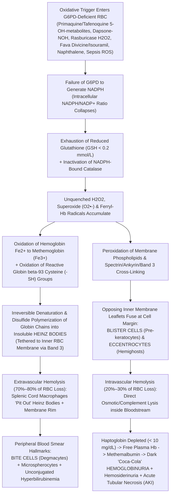

# ⚡ 1.2.6 Glucose-6-Phosphate Dehydrogenase (`G6PD`) Quantitative Kinetic Assay & Fluorescent Spot Screen — Complete International SOP, Pharmacogenetic Reference & Clinical Interpretation Manual

> **Document Control (`ISO 15189:2022 Clause 8.3.2` / `NABL 112`):** **Document ID:** `SOP-HEM-1.2.6-G6PD-v5.0` | **Version:** `5.0 (10-Persona Red-Team & WHO 2022 / CPIC Harmonized Master Edition)` | **Effective Date:** `15-Oct-2026` | **Review Cycle:** `Annual` | **Authorizing Authority:** `Laboratory Director & Chief Consultant Hematopathologist (MD Pathology) — Sawariya Diagnostic Lab, Charkhi Dadri, Haryana` | **Controlled Distribution:** `Master LIMS, Special Hematology Bench, Neonatal ICU Interface, Oncology & Malaria Radical-Cure Pharmacy Gatekeeper`

---

## Section 1: Document Control Metadata, Coding Taxonomy & Multi-Tier Analytical Platform Matrix

### 1.1 Institutional Document Control & International Regulatory Traceability Matrix
| Metadata Parameter | Institutional & International Specification |
| :--- | :--- |
| **Document ID & Version** | `SOP-HEM-1.2.6-G6PD-v5.0` (Supersedes `v4.2`; Effective: `15-Oct-2026`; Next Mandatory Review: `14-Oct-2027`) |
| **Department & Clinical Cluster** | `01_Hematology_and_Coagulation` $\to$ `1.2_Anemia_Morphology_Hemoglobinopathy_and_Hemolysis_Cluster` |
| **Official Test Nomenclature** | Erythrocyte Glucose-6-Phosphate Dehydrogenase (`G6PD`, EC `1.1.1.49`) — Quantitative UV-Kinetic Spectrophotometric Assay at $340\text{ nm}$ ($37.0^\circ\text{C}$, Hemoglobin-Normalized in `U/g Hb` and `% Adjusted Male Median [% AMM]`) & Beutler Long-Wave UV ($365\text{ nm}$) Fluorescent Spot Qualitative Screen (`FST`) |
| **ISO 15189:2022 Clause Mapping** | Clauses `4.1–4.3` (Impartiality, Confidentiality, Patient Safety), `5.1–5.6` (Governance), `6.2` (Personnel Competency), `6.4` (Equipment Calibration & $37.0^\circ\text{C}$ Peltier Thermostating), `6.5` (Metrological Traceability to $\varepsilon_{\text{NADPH}} = 6.22\text{ mM}^{-1}\text{cm}^{-1}$), `7.2` (Pre-Examination Buffy-Coat Depletion), `7.3` (Method Verification & `MU`), `7.4` (Critical Value Read-Back & Pharmacogenetic Reporting), `8.5` (`ISO 22367` Risk Management), `Annex A` (POCT Biosensor Governance) |
| **NABL & International Standards** | `NABL 112` (Specific Criteria for Hematology), `NABL 153` (Scope of Accreditation), `NABL 220D & 223` (Assessor Checklists), `NABL 131` (MU Policy), `NABL 163` (EQAS Policy), `CAP HEM.35600 / HEM.36400–36650`, `CLSI H20-A2 / H09-A2` (*Quantitative Measurement of G6PD Activity*), `ICSH Reference Method for G6PD Assay`, `WHO 2022 Malaria Policy Advisory Group (MPAG) Revised G6PD Classification (Classes A, B, C)`, `CPIC Guidelines for Rasburicase & Primaquine/Tafenoquine` |
| **LOINC Coding Taxonomy** | `32551-4` (G6PD [Enzymatic activity/mass] in Red Blood Cells — `U/g Hb`); `2357-2` (G6PD [Presence] in Red Blood Cells by Fluorescent spot); `2358-0` (G6PD [Enzymatic activity/entitic num] in Red Blood Cells — `U/10^12 RBCs`); `2356-4` (G6PD [Enzymatic activity/volume] in Red Blood Cells — `U/L`, legacy/discouraged); `41276-7` (`G6PD` gene mutation analysis in Blood/Tissue by Molecular genetics method) |
| **SNOMED-CT Concept IDs** | `86225007` (Glucose-6-phosphate dehydrogenase assay); `252295002` (G6PD fluorescent spot test); `111570007` (Glucose-6-phosphate dehydrogenase deficiency); `416455005` (Favism); `191169008` (Congenital non-spherocytic hemolytic anemia due to G6PD deficiency); `409668002` (Drug-induced hemolytic anemia) |
| **ICD-10-CM & ICD-11 Codes** | `ICD-10-CM`: `D55.0` (Anemia due to `G6PD` deficiency / Favism), `P58.2` (Neonatal jaundice due to infection/hemolysis), `P59.8` (Neonatal jaundice from other specified causes), `T37.2X1A / T37.2X5A` (Poisoning/adverse effect of antimalarials — Primaquine/Tafenoquine), `Z13.0` (Encounter for screening for diseases of blood); `ICD-11`: `3A10.0` (`G6PD` deficiency hemolytic anemia) |
| **UCUM Standardized Reporting Units** | Primary Quantitative Unit: `U/g{Hb}` (reported clinically as `U/g Hb` at $37.0^\circ\text{C}$); Relative Pharmacogenetic Unit: `% AMM` (`% of Local Adjusted Male Median`); Secondary Cellular Index (for microcytic/macrocytic states): `U/10*12{RBC}` (`U/10^12 RBCs`); Qualitative Screen: `Normal Fluorescence` / `Intermediate Deficient Fluorescence` / `Severe No Fluorescence (Deficient)` |
| **Turnaround Time (TAT) Benchmarks** | **STAT Pre-Rasburicase (Tumor Lysis Syndrome) / Neonatal Hyperbilirubinemia / Acute Hemolytic Crisis:** $\le 90\text{ minutes}$ (Spot Screen $\le 30\text{ min}$ + Quantitative UV-Kinetic $\le 90\text{ min}$); **Pre-Primaquine / Pre-Tafenoquine / Pre-Dapsone Outpatient:** $\le 4\text{ hours}$; **Confirmatory `G6PD` Genotyping (`PCR-RFLP`/Sanger):** $3\text{–}5\text{ working days}$ |

### 1.2 Hardware-Agnostic Multi-Tier Analytical Platform Matrix
| Platform Tier | Analytical Methodology & Representative Instrumentation | Reaction Stoichiometry, Detection Physics & Clinical Indications | Inherent Analytical Limitations & Mandatory Safeguards |
| :--- | :--- | :--- | :--- |
| **Tier 1A: Primary Gold-Standard Quantitative Assay (Single-Substrate + Maleimide `6PGD` Inhibitor)** | **Thermostated UV-Kinetic Spectrophotometry at $\lambda = 340\text{ nm}$ ($37.0^\circ\text{C} \pm 0.1^\circ\text{C}$ Peltier Cuvette) + Automated Hemolysate $\text{Hb}$ Analyzer (`Nihon Kohden MEK-1305/1503` or Drabkin SLS $540\text{ nm}$)** | Washed, buffy-coat-depleted RBC digitonin/saponin hemolysate is incubated with $\text{D-Glucose-6-Phosphate}$ ($\text{G6P}$) + $\text{NADP}^+$ + $\text{Mg}^{2+}$ at $\text{pH } 8.0$ in the presence of **Maleimide ($4\text{–}12\text{ mmol/L}$)**, which selectively inhibits endogenous `6-Phosphogluconate Dehydrogenase` (`6PGD`) so that exactly $1.0\text{ mol}$ of $\text{NADPH}$ is formed per $1.0\text{ mol}$ of $\text{G6P}$ oxidized. Linear $\Delta A_{340}/\text{min}$ is normalized to $\text{Hb}_{\text{hemolysate}}$ ($\text{g/dL}$) to report **`U/g Hb`**. Mandatory for all females, neonates, pre-Tafenoquine, pre-Rasburicase, and pre-Dapsone testing. | If kits *without* maleimide inhibitor are used, endogenous `6PGD` further oxidizes nascent $6\text{-phosphogluconate}$, generating up to $1.5\text{–}2.0\text{ mol}$ $\text{NADPH}$ per $\text{mol}$ $\text{G6P}$ and inflating apparent `G6PD` activity by $20\text{–}40\%$ unless calibrated against an ICSH reference hemolysate or corrected by Tier 1B dual-cuvette subtraction. |
| **Tier 1B: ICSH Reference Dual-Cuvette `6PGD`-Corrected Quantitative Assay** | **ICSH Reference Double-Substrate Spectrophotometric Method ($\lambda = 340\text{ nm}$, $37.0^\circ\text{C}$)** | **Cuvette 1 (Combined `G6PD + 6PGD`):** Contains saturating $\text{G6P}$ ($0.6\text{ mmol/L}$) + $\text{6-Phosphogluconate}$ ($\text{6PG}$, $0.6\text{ mmol/L}$) + $\text{NADP}^+$, measuring the sum of both enzymes ($\Delta A_{340,\text{Cuvette 1}}/\text{min}$). **Cuvette 2 (`6PGD` Blank):** Contains $\text{6PG}$ ($0.6\text{ mmol/L}$) + $\text{NADP}^+$ *without* $\text{G6P}$, measuring `6PGD` activity alone ($\Delta A_{340,\text{Cuvette 2}}/\text{min}$). True `G6PD` activity $= \text{Activity}_{\text{Cuvette 1}} - \text{Activity}_{\text{Cuvette 2}}$. Also directly yields the diagnostic **`G6PD / 6PGD` Ratio** to unmask deficiency during reticulocytosis! | Requires twice the reagent volume and dual cuvette readings, increasing manual pipetting steps; reserved as the laboratory's metrological reference anchor and automatic reflex for reticulocytic/anemic patients (`Retic > 2.5%`). |
| **Tier 2: Qualitative Rapid Screening Assay** | **Beutler Long-Wave UV ($\lambda = 365\text{ nm}$) Fluorescent Spot Test (`FST`)** *(Alternative: Dichlorophenol Indophenol [`DPIP`] Dye Decolorization or Brewer Methemoglobin Reduction)* | Whole blood ($10\ \mu\text{L}$) incubated with $\text{G6P} + \text{NADP}^+ + \text{Saponin} + \text{Oxidized Glutathione (GSSG)}$ ($100\ \mu\text{L}$) at $37^\circ\text{C}$ is spotted onto Whatman No. 1 filter paper at $0, 5,$ and $10\text{ minutes}$. Once dried, native $\text{NADPH}$ excited at $365\text{ nm}$ (Wood's lamp) emits intense blue-green fluorescence ($\lambda_{\text{em}} \approx 460\text{ nm}$). $\text{GSSG}$ re-oxidizes trace $\text{NADPH}$ via endogenous glutathione reductase so samples with $< 20\text{–}30\%$ activity remain completely dark. | **Binary Qualitative Cutoff ($\sim 20\text{–}30\%$ `AMM`):** Cannot distinguish intermediate activity ($30\text{–}70\%$ `AMM`) from normal ($> 70\%$ `AMM`). **Misses $50\text{–}70\%$ of heterozygous (`X^d X^N`) females!** Never use `FST` alone to clear a female patient for Tafenoquine, high-dose Primaquine, Dapsone, or Rasburicase. Severe anemia ($\text{Hb} < 6\text{ g/dL}$) reduces porphyrin fluorescence quenching and causes false-normal spots. |
| **Tier 3: WHO-Prequalified Point-of-Care Quantitative Biosensor** | **Quantitative Optical/Electrochemical Reflectance Photometer (`SD Biosensor STANDARD G6PD Analyzer` — `ISO 15189 Annex A` Governed)** | Capillary or venous $\text{K}_2\text{-EDTA}$ blood ($10\ \mu\text{L}$) mixed with lysis buffer is applied to a disposable test device that simultaneously quantifies $\text{G6PD}$ activity (via tetrazolium salt `5-BCIP` / formazan colorimetry) and total $\text{Hb}$ ($\text{g/dL}$) within $2\text{ minutes}$, displaying normalized **`U/g Hb`** directly on screen. | Validated across $\text{Hb } 7.0\text{–}19.0\text{ g/dL}$ and operating temperatures $15\text{–}40^\circ\text{C}$. **Hard LIMS/POCT Rule:** Do NOT rely on biosensor `U/g Hb` if $\text{Hb} < 7.0\text{ g/dL}$ (severe anemia) or $\text{Hb} > 19.0\text{ g/dL}$ (neonatal polycythemia); reflex all such specimens to Tier 1 bench UV-Kinetic assay. |
| **Tier 4: Single-Cell Cytofluorometric Mosaicism Assay** | **Flow Cytometric Cytofluorometric Assay (Nitrite-Methemoglobin Cyanide Elution or `MTT`/Formazan Tetrazolium Cytochemistry)** | Intact RBCs are oxidized with sodium nitrite ($\text{HbFe}^{2+} \to \text{MetHbFe}^{3+}$) and incubated with glucose + Nile Blue/methylene blue so only `G6PD`-competent RBCs regenerate $\text{HbFe}^{2+}$; subsequent KCN + $\text{H}_2\text{O}_2$ elutes methemoglobin from `G6PD`-deficient RBCs ("ghosts") or fluorescently shifts autofluorescence on a flow cytometer ($525\text{ nm}$ FL1 channel), directly enumerating **`% G6PD-Normal RBCs` vs `% G6PD-Deficient RBCs`**. | Gold standard for proving **X-inactivation mosaicism (Lyonization)** in heterozygous females whose bulk hemolysate `U/g Hb` sits near the $60\text{–}80\%$ borderline zone and for quantifying donor vs recipient RBC chimerism post-transfusion. |
| **Tier 5: Definitive Molecular Genotyping (Transfusion & Reticulocyte Independent)** | **Targeted `PCR-RFLP` / `ARMS-PCR` / Real-Time Melt Curve or Full-Gene Sanger/NGS Sequencing of `G6PD` (`Xq28`, 13 Exons)** | Extracts genomic DNA from buffy-coat nucleated leukocytes to interrogate the predominant Indian and global mutations (`G6PD Mediterranean 563C>T`, `G6PD Orissa 131C>G`, `G6PD Kerala-Kalyan 949G>A`, `G6PD Chatham 1003G>A`, `G6PD Coimbra 592C>T`, `G6PD Mahidol 487G>A`, `G6PD Canton 1376G>T`, `G6PD A- 202G>A + 376A>G`, and Exon 10 `CNSHA` mutations). | Completely unaffected by acute hemolytic crisis, reticulocytosis (`Retic > 20%`), or recent packed RBC transfusion (provided leukodepleted RBC units were transfused or buccal swab DNA is used). Mandatory tie-breaker for indeterminate phenotypes. |

---

## Section 2: Molecular Genetics (`Xq28`), Enzymatic Biochemistry of the Hexose Monophosphate (`HMP`) Shunt & Pathophysiology of Oxidative Hemolysis

### 2.1 Structural Biology of the `G6PD` Monomer-Dimer-Tetramer Equilibrium & Mandatory $\text{NADP}^+$ Structural Coenzyme Site
1. **Chromosomal Localization & Protein Architecture:**
   - The human `G6PD` gene resides on the distal long arm of the X chromosome at **`Xq28`** ($18.5\text{ kb}$, comprising $13$ exons and $12$ introns; Exon 1 is non-coding). It encodes a $515$-amino-acid polypeptide monomer with a molecular mass of $\mathbf{59.2\text{ kDa}}$.
   - **Monomer Inactivity & Oligomeric Equilibrium:** Isolated `G6PD` monomers are **catalytically inactive ($0\%$ activity)**. Active human erythrocyte `G6PD` exists in a rapid, pH- and ionic-strength-dependent equilibrium between **homodimers ($\sim 118\text{ kDa}$)** and **homotetramers ($\sim 236\text{ kDa}$)**.
2. **The Two Distinct $\text{NADP}^+$ Binding Sites per Monomer (Catalytic vs Structural):**
   - **Catalytic Coenzyme Site (Exons 2–5, N-terminal Rossmann Fold, residues `38–44` `GXXGDLX`):** Transiently binds $\text{NADP}^+$ ($K_m \approx 5\text{–}10\ \mu\text{mol/L}$) and releases reduced $\text{NADPH}$ during each catalytic turnover.
   - **Structural $\text{NADP}^+$ Site (Exons 10–13, C-terminal $\beta+\alpha$ domain adjacent to the dimer interface, residues `385–488`):** Each monomer contains a second, extraordinarily high-affinity **structural $\text{NADP}^+$ binding site ($K_d \approx 30\text{ nmol/L}$)** buried between the dimer interface and the C-terminal tail. Binding of structural $\text{NADP}^+$ is **obligatory to maintain the native 3D folding and stability of the active `G6PD` dimer/tetramer**.
   - **Bench & Clinical Consequence:**
     - *In vivo*, point mutations clustered in **Exon 10** at the dimer interface or structural $\text{NADP}^+$ site disrupt dimerization, causing catastrophic protein instability even at physiological body temperature ($37^\circ\text{C}$) and resulting in **WHO Class A Chronic Non-Spherocytic Hemolytic Anemia (`CNSHA`)**.
     - *In vitro* on the laboratory bench, if erythrocytes are lysed in plain distilled water *without* exogenous $\text{NADP}^+$ ($10\ \mu\text{mol/L}$) and a sulfhydryl-protecting agent ($2\text{-mercaptoethanol}$), dilution dissociates structural $\text{NADP}^+$ from the dimer, causing irreversible monomerization and **rapid loss of enzymatic activity within $15\text{–}30\text{ minutes}$**!

### 2.2 Complete Stoichiometric Reactions of the Hexose Monophosphate (`HMP`) Shunt & Glutathione Peroxidase Antioxidant Defense
Mature human erythrocytes are **completely anucleate and devoid of mitochondria, ribosomes, the tricarboxylic acid (Krebs) cycle, cytosolic malic enzyme, and $\text{NADP}^+$-dependent isocitrate dehydrogenase**. Consequently, the **Hexose Monophosphate (`HMP`) Shunt (Pentose Phosphate Pathway)** is the **sole biochemical source of reduced nicotinamide adenine dinucleotide phosphate (`NADPH`)** in the human red blood cell. Under basal resting conditions, only $5\%\text{–}10\%$ of erythrocyte glucose flux enters the `HMP` shunt ($90\%\text{–}95\%$ traverses the anaerobic Embden-Meyerhof glycolytic pathway to generate $\text{ATP}$ and $2,3\text{-BPG}$); however, under oxidative challenge, `HMP` shunt flux accelerates **$20\text{- to }30\text{-fold}$** because rising $\text{NADP}^+$ and falling $\text{NADPH}$ relieve competitive product inhibition on `G6PD` ($K_i\text{ for NADPH} \approx 16\ \mu\text{mol/L}$).

1. **Step 1 — Rate-Limiting Oxidation of $\text{D-Glucose-6-Phosphate}$ (`G6PD`, EC `1.1.1.49`):**
   $$\text{D-Glucose-6-Phosphate} + \text{NADP}^+ \xrightarrow{\text{G6PD, Mg}^{2+}\ (\text{pH } 8.0)} \text{6-Phosphoglucono-}\delta\text{-lactone} + \text{NADPH} + \text{H}^+$$
   - **Spectrophotometric & Fluorometric Detection Physics:** While oxidized $\text{NADP}^+$ absorbs solely in the deep UV at $\lambda_{\max} = 260\text{ nm}$ (adenine ring), reduction of the nicotinamide ring to $\text{NADPH}$ creates a new dihydropyridine chromophore with a strict **absorption peak at $\lambda_{\max} = 340\text{ nm}$** (**molar absorptivity $\varepsilon_{340} = 6.22\text{ L}\cdot\text{mmol}^{-1}\cdot\text{cm}^{-1} = 6,220\text{ M}^{-1}\text{cm}^{-1}$**) and **intense blue-green fluorescence ($\lambda_{\text{em}} = 460\text{ nm}$) when excited by long-wave UV light at $\lambda_{\text{ex}} = 365\text{ nm}$** (the biophysical basis of the **Beutler Fluorescent Spot Test**).
2. **Step 2 — Lactone Ring Hydrolysis (`6-Phosphogluconolactonase`, EC `3.1.1.31`):**
   $$\text{6-Phosphoglucono-}\delta\text{-lactone} + \text{H}_2\text{O} \xrightarrow{\text{6-Phosphogluconolactonase}} \text{6-Phospho-D-gluconate} + \text{H}^+$$
3. **Step 3 — Oxidative Decarboxylation & Second $\text{NADPH}$ Generation (`6-Phosphogluconate Dehydrogenase [6PGD]`, EC `1.1.1.44`):**
   $$\text{6-Phospho-D-gluconate} + \text{NADP}^+ \xrightarrow{\text{6PGD, Mg}^{2+}} \text{D-Ribulose-5-Phosphate} + \text{CO}_2 + \text{NADPH} + \text{H}^+$$
   - *Critical Analytical Implication:* In an uninhibited erythrocyte hemolysate, nascent $\text{6-phosphogluconate}$ generated by `G6PD` is immediately consumed by abundant endogenous erythrocyte `6PGD` (which is **normal or elevated in `G6PD`-deficient patients!**), generating a **second molecule of $\text{NADPH}$**. To measure pure $1:1$ stoichiometric `G6PD` activity, the assay must either include **Maleimide** (to inhibit `6PGD`) or perform the **ICSH dual-cuvette subtraction** ($\text{Activity}_{[\text{G6P}+\text{6PG}]} - \text{Activity}_{[\text{6PG}]}$).
4. **Step 4 — Regeneration of Reduced Glutathione (`GSH`) via FAD-Dependent Glutathione Reductase (`GSR`, EC `1.8.1.7`):**
   $$\text{GSSG (Oxidized Glutathione Disulfide)} + \text{NADPH} + \text{H}^+ \xrightarrow{\text{Glutathione Reductase (FAD)}} 2\text{ GSH (Reduced Glutathione)} + \text{NADP}^+$$
   - Normal erythrocytes maintain an intracellular $\text{GSH}$ concentration of **$2.0\text{–}3.5\text{ mmol/L}$** with a $\text{GSH}:\text{GSSG}$ ratio exceeding **$100:1$**.
5. **Step 5 — Detoxification of Hydrogen Peroxide ($\text{H}_2\text{O}_2$) & Lipid Hydroperoxides ($\text{ROOH}$) via Selenium-Dependent Glutathione Peroxidase (`GPx-1`, EC `1.11.1.9`) & Peroxiredoxin-2 (`Prx2`):**
   $$2\text{ GSH} + \text{H}_2\text{O}_2 \xrightarrow{\text{Glutathione Peroxidase-1 (Se)}} \text{GSSG} + 2\text{ H}_2\text{O}$$
   $$2\text{ GSH} + \text{R-OOH (Membrane Lipid Hydroperoxide)} \xrightarrow{\text{GPx-1 / GPx-4}} \text{GSSG} + \text{R-OH} + \text{H}_2\text{O}$$
6. **Step 6 — Allosteric Protection of Erythrocyte Catalase (`EC 1.11.1.6`) by Direct `NADPH` Binding:**
   - Erythrocyte catalase ($2\text{ H}_2\text{O}_2 \to 2\text{ H}_2\text{O} + \text{O}_2$) contains four tightly bound molecules of **$\text{NADPH}$ ($1\text{ per subunit}$)**. Although catalase does not consume $\text{NADPH}$ stoichiometrically in its primary catalytic cycle, **bound $\text{NADPH}$ prevents and reverses the formation of catalytically dead Catalase `Compound II` (ferryl-oxo intermediate)** during high-level $\text{H}_2\text{O}_2$ stress (such as Rasburicase or Primaquine exposure). Thus, when `G6PD` deficiency depletes intracellular $\text{NADPH}$, **both the Glutathione Peroxidase (`GPx-1`) pathway AND the Catalase pathway fail simultaneously!**

### 2.3 Cellular & Molecular Pathophysiology of Oxidative Hemolysis: From Heinz Bodies to Bite Cells (`Degmacytes`), Blister Cells & Hemoglobinuric Acute Kidney Injury


1. **Hemoglobin Sulfhydryl Oxidation & Heinz Body Precipitation:**
   - Unscavenged $\text{H}_2\text{O}_2$ and redox-active drug radicals oxidize heme iron ($\text{Fe}^{2+} \to \text{Fe}^{3+}$, forming **Methemoglobin**) and oxidize the exposed **$\beta\text{-93}$ cysteine sulfhydryl ($\text{-SH}$) residues** of Hemoglobin A, forming mixed disulfide cross-links with glutathione ($\text{Hb-S-S-G}$) and intermolecular disulfide bridges between adjacent globin chains.
   - This releases free heme/hemin and unfolds the globin tetramer into insoluble aggregates termed **Heinz Bodies** ($1\text{–}3\ \mu\text{m}$ refractile inclusions attached hydrophobically and via disulfide bonds to the cytoplasmic domain of **Band 3 [`SLC4A1`]** and **Spectrin** on the inner RBC membrane).
   - **Critical Staining Rule:** Heinz bodies have the exact same eosinophilic staining affinity as native hemoglobin on routine Romanowsky (Leishman/Wright-Giemsa) stains and are therefore **completely invisible on routine peripheral blood smears**; they require **supravital staining of wet whole blood with $0.5\%$ Methyl Violet or New Methylene Blue**!
2. **Extravascular Pitting in the Spleen $\to$ Bite Cells (`Degmacytes`):**
   - As rigid Heinz-body-laden erythrocytes attempt to squeeze through the narrow $1\text{–}3\ \mu\text{m}$ inter-endothelial slits between the splenic cords of Billroth and the splenic venous sinusoids, cordal macrophages recognize clustered Band 3/autologous IgG and mechanically excise ("pit out") the rigid Heinz body along with its overlying patch of plasma membrane.
   - The surviving resealed erythrocyte re-enters the circulation displaying one or two crisp, semicircular or arcuate marginal defects ($1\text{–}2\ \mu\text{m}$ concave "bites") known as **Bite Cells (`Degmacytes`)**.
3. **Membrane Fusion $\to$ Blister Cells (`Pre-keratocytes`) & Eccentrocytes (`Hemighosts`):**
   - Oxidative cross-linking of submembranous spectrin causes opposing inner leaflets of the lipid bilayer to fuse across one margin of the erythrocyte, trapping a hemoglobin-free pseudovacuole under a thin membrane strand (**Blister Cell / `Pre-keratocyte`**) and displacing the condensed, oxidized hemoglobin mass asymmetrically to one side of the cell (**Eccentrocyte / `Hemighost`**). When the delicate blister strand ruptures in shear flow, the cell becomes a **Keratocyte ("horn cell")**.
4. **Intravascular Hemolysis, Hemoglobinuria & Pigment Nephropathy (`ATN`):**
   - Unlike hereditary spherocytosis or warm autoimmune hemolytic anemia (which are predominantly extravascular), severe oxidative injury in `G6PD` deficiency causes **simultaneous massive intravascular hemolysis ($20\%\text{–}30\%$ of destroyed RBC mass)** alongside extravascular splenic destruction ($70\%\text{–}80\%$).
   - Free oxyhemoglobin tetramers ($\alpha_2\beta_2$, $64.5\text{ kDa}$) dissociate in plasma into $\alpha\beta$ dimers ($32.2\text{ kDa}$), instantly saturating and depleting plasma **Haptoglobin ($< 10\text{ mg/dL}$)** and **Hemopexin**. Unbound $\alpha\beta$ dimers filter freely across the glomerular basement membrane once free plasma hemoglobin exceeds the renal threshold ($\sim 100\text{–}135\text{ mg/dL}$), producing **mahogany/port-wine/"Coca-Cola" hemoglobinuria** (urine dipstick `3+ Blood` with **$< 0\text{–}2$ intact RBCs/HPF** on urine microscopy!). Free heme iron induces proximal renal tubular ferroptosis, intratubular methemoglobin cast obstruction, and **Acute Kidney Injury (`AKI` / Acute Tubular Necrosis)**.

### 2.4 Kinetic & Temporal Biomarker Dynamics Across an Acute Oxidative Hemolytic Crisis
| Time Post-Oxidant Exposure | Pathophysiological Phase | Hemoglobin ($\text{Hb}$) & Hematocrit ($\text{Hct}$) | Peripheral Blood Smear & Supravital Stain | Reticulocyte Count (`%` & `ARC`) | Hemolysis Markers (`LDH`, Indirect Bilirubin, Haptoglobin, Urine Hb) | Apparent Erythrocyte `G6PD` Assay Behaviour |
| :--- | :--- | :--- | :--- | :--- | :--- | :--- |
| **$0\text{ – }12\text{ Hours}$ (Latent Redox Depletion Phase)** | Oxidant drug/fava aglycone enters RBCs; intracellular `NADPH` and `GSH` plummet ($< 10\%$ normal); early methemoglobinemia ($3\text{–}15\%$) develops before frank lysis. | Baseline normal or mild drop ($\Delta\text{Hb} < 0.5\text{ g/dL}$). | Early **Heinz bodies** appear on supravital methyl violet stain; rare eccentrocytes. | Baseline ($0.8\text{–}2.0\%$). | Plasma Haptoglobin begins falling; Methemoglobin rises; `LDH` and Bilirubin still near baseline. | **True Deficient (`< 1.0–3.0 U/g Hb`)** because senescent/mature deficient RBCs are still intact in circulation. |
| **$24\text{ – }72\text{ Hours}$ (Fulminant Hemolytic Crisis Peak)** | Catastrophic destruction of the oldest, most `G6PD`-depleted RBC cohort; peak intravascular hemoglobinemia & splenic pitting. | **Rapid drop of $3.0\text{ – }7.0\text{ g/dL}$** ($\text{Hb}$ often falls to $4.0\text{–}7.5\text{ g/dL}$ within $48\text{ h}$). | **Peak Bite Cells (`Degmacytes`), Blister Cells, Eccentrocytes**, polychromasia, nucleated RBCs (`nRBCs`), and stress neutrophilia (`WBC 15–35×10³/µL`). | Rising ($2.5\text{–}6.0\%$ at $48\text{ h}$; **$6.0\text{–}12.0\%$ by $72\text{ h}$**). | **Urine Hb strongly positive ("Coca-Cola" urine)**; Haptoglobin undetectable ($< 5\text{ mg/dL}$); `LDH` $800\text{–}3,500\text{ U/L}$; Unconjugated Bilirubin $3.5\text{–}12.0\text{ mg/dL}$. | **Transitioning to False-Borderline / False-Normal!** Massive WBC leukocytosis + destruction of lowest-`G6PD` cells artificially elevates unwashed assays. |
| **Day $4\text{ – }$ Day $10$ (Hemoglobin Nadir & Peak Reticulocyte Surge)** | Senescent deficient RBCs have been completely cleared; bone marrow releases a massive wave of young **reticulocytes containing $5\times$ higher `G6PD` activity**. | $\text{Hb}$ hits nadir at Day $4\text{–}5$, then spontaneously rises by $0.3\text{–}0.5\text{ g/dL/day}$ even if oxidant continues (in Class III / `G6PD A-` "self-limited" variants; **NOT self-limited in `G6PD Mediterranean`!**). | Marked **polychromasia**, macrocytosis (`MCV 102–118 fL`), basophilic stippling; **Heinz bodies & Bite cells rapidly disappear** (already cleared by spleen!). | **Peak Reticulocytosis: $10.0\%\text{ – }28.0\%$** ($\text{ARC } 250,000\text{–}600,000/\mu\text{L}$). | Hemoglobinuria clears by Day $5\text{–}7$ (**hemosiderinuria** persists for $7\text{–}14\text{ days}$ in shed tubular cells); `LDH` and Bilirubin trending down. | **HIGHEST RISK OF FALSE-NORMAL `G6PD` RESULT (`7.5 – 11.5 U/g Hb` and Normal Spot Screen)!** Requires bottom-layer dense RBC separation, `G6PD/PK` or `G6PD/6PGD` ratio, or DNA PCR. |
| **Week $2\text{ – }$ Week $6$ (Early Post-Crisis Recovery)** | Young cohort of post-crisis erythrocytes gradually ages; intracellular mutant `G6PD` enzyme undergoes exponential thermal decay. | $\text{Hb}$ recovering ($9.5\text{–}12.5\text{ g/dL}$). | Normocytic-to-mildly macrocytic; normal morphology. | Declining ($2.5\%\text{ – }5.0\%$). | Bilirubin & `LDH` normal; Haptoglobin normalizes last ($2\text{–}3\text{ weeks}$ post-hemolysis). | **Intermediate / Masked (`4.0 – 8.0 U/g Hb`)** in Class B variants; early repeat at $2\text{–}3\text{ weeks}$ often unmasks `G6PD Mediterranean` ($t_{1/2} \sim \text{days}$), but `G6PD A-` ($t_{1/2} \approx 13\text{ days}$) may still be borderline. |
| **Week $8\text{ – }$ Week $12$ (Steady-State Erythrocyte Age Distribution Restored)** | Full $120$-day erythrocyte age spectrum re-established ($< 1.5\%$ reticulocytes) with no transfused donor cells remaining ($> 90\text{–}120\text{ days}$ if transfused). | Baseline steady-state $\text{Hb}$. | Normal baseline morphology. | Normal ($0.5\text{–}2.0\%$). | All hemolytic markers normal. | **Definitive Unmasked Baseline `G6PD` Activity (`< 0.5–3.0 U/g Hb` in Hemizygous Class B Deficiency).** |

---

## Section 3: Pre-Analytical Specimen Integrity, Anticoagulant Selection, Thermal Decay Kinetics & Mandatory Leukocyte/Reticulocyte Depletion SOP

### 3.1 Anticoagulant Hierarchy & Pre-Analytical Specimen Matrix (`CLSI H20-A2` / `ICSH`)
| Anticoagulant / Tube Type | Acceptability Tier | Maximum Stability at $18\text{–}25^\circ\text{C}$ | Maximum Stability at $2\text{–}8^\circ\text{C}$ | Biochemical & Pre-Analytical Rationale |
| :--- | :--- | :---: | :---: | :--- |
| **Acid-Citrate-Dextrose (`ACD` Solution A or B — Yellow Top) or `CPDA-1`** | **Tier 1: Gold-Standard Reference Transport Tube** | $\le 48\text{ hours}$ | **Up to $21\text{ days}$** ($> 95\%$ activity retained) | Dextrose provides continuous substrate for intra-erythrocytic `G6P` and $\text{NADP}^+$ maintenance, stabilizing the `G6PD` tetramer during long-distance referral transport. |
| **$\text{K}_2\text{-EDTA}$ or $\text{K}_3\text{-EDTA}$ (Lavender Top — $1.5\text{–}2.2\text{ mg/mL}$)** | **Tier 1: Primary Routine Clinical Specimen** | **$\le 24\text{ hours}$** | **Up to $7\text{ days}$** (Optimal: assay within $\le 72\text{ hours}$) | Allows simultaneous `CBC`, Reticulocyte Count, Peripheral Blood Smear, Heinz Body stain, and `G6PD` assay from a single venipuncture. Note: Unstable Class A (`CNSHA`) and `G6PD Mediterranean` variants can lose $15\text{–}25\%$ activity after $> 24\text{ h}$ at $25^\circ\text{C}$. |
| **Lithium Heparin or Sodium Heparin (Green Top)** | **Tier 2: Acceptable Alternative** | $\le 24\text{ hours}$ | Up to $5\text{–}7\text{ days}$ | Does not inhibit `G6PD`, but suboptimal for companion peripheral smear morphology and prone to micro-clotting or leukocyte clumping. **Never use Heparin if `G6PD` PCR reflex is anticipated** (heparin inhibits *Taq* DNA polymerase). |
| **Dried Blood Spot (`DBS` on Whatman 903 Filter Paper — Neonatal Heel-Prick)** | **Tier 3: Neonatal Screening Only** | $\le 24\text{ hours}$ (dry in dark, $< 50\%$ humidity; **never expose to heat $> 30^\circ\text{C}$**) | Up to $7\text{–}10\text{ days}$ in sealed desiccant zip-bag | **High Risk of False-Low Results:** High ambient temperature ($> 32^\circ\text{C}$ in Indian summer) and high humidity rapidly denature `G6PD` on dried filter paper, producing false-deficient screens. All abnormal `DBS` screens require venous $\text{K}_2\text{-EDTA}$ confirmation. |
| **Sodium Fluoride (`NaF`) / Potassium Oxalate (Grey Top) or Serum (Red/SST)** | **STRICTLY FORBIDDEN (`HARD REJECT`)** | $0\text{ hours}$ | $0\text{ hours}$ | Fluoride ($\text{F}^-$) complexes $\text{Mg}^{2+}$ cofactors and inhibits glycolytic enzymes; oxalate inhibits dehydrogenases; serum contains zero erythrocytes. |

### 3.2 The Leukocyte & Platelet Confounder Crisis: Why Unwashed Whole Blood Assays Are Scientifically Invalid in Leukocytosis
1. **Quantitative Enzyme Disparity Between Blood Cell Lineages:**
   - **Mature Erythrocyte (`RBC`):** Lacks a nucleus and ribosomes; cannot synthesize new `G6PD`. Normal steady-state activity is $\sim 1.5\text{–}3.0 \times 10^{-10}\text{ IU per single RBC}$ ($\approx 250\text{–}350\text{ IU/10}^{12}\text{ RBCs}$). In a patient with **`G6PD Mediterranean` ($563\text{C}>\text{T}$)**, mature erythrocyte `G6PD` activity decays to **$< 1\%\text{–}3\%$ of normal ($< 0.3\text{ U/g Hb}$)**.
   - **Nucleated Leukocyte (`WBC` — Granulocytes & Lymphocytes):** Possesses active nuclear transcription and continuous ribosomal translation of `G6PD` protein. A single leukocyte contains **$50\times\text{ to }100\times$ more `G6PD` activity per cell than a normal erythrocyte**, and even in a hemizygous `G6PD Mediterranean` patient, nucleated leukocytes still retain **$25\%\text{–}60\%$ of normal `G6PD` activity**!
   - **Platelets (`PLT`):** Contain **$5\times\text{ to }10\times$ higher `G6PD` activity per unit cytoplasmic volume** than senescent erythrocytes.
2. **Mathematical Proof of False-Normal Masking in Leukocytosis (`WBC > 15,000–25,000/µL`):**
   - In normal blood ($\text{RBC} = 5.0\times 10^6/\mu\text{L}$, $\text{WBC} = 6.0\times 10^3/\mu\text{L}$, ratio $\text{RBC}:\text{WBC} \approx 833:1$), leukocytes contribute $\sim 5\%\text{–}8\%$ of total whole-blood `G6PD` activity.
   - However, during an **acute hemolytic crisis with severe anemia and stress leukocytosis** ($\text{Hb} = 5.5\text{ g/dL}$, $\text{RBC} = 1.8\times 10^6/\mu\text{L}$, $\text{WBC} = 30.0\times 10^3/\mu\text{L}$, ratio $\text{RBC}:\text{WBC} = 60:1$), each $60$ `G6PD`-deficient RBCs are accompanied by $1$ leukocyte carrying $80\times$ normal RBC enzyme activity! When normalized to the severely low $\text{Hb}$ denominator ($5.5\text{ g/dL}$), **leukocyte `G6PD` alone adds $+3.5\text{ to }+6.5\text{ U/g Hb}$**, pushing a severely deficient patient ($0.4\text{ U/g Hb}$) right into the **falsely intermediate or falsely normal range ($4.5\text{–}7.0\text{ U/g Hb}$)** if whole blood is lysed directly without buffy-coat removal!

### 3.3 Step-by-Step Pre-Analytical Leukocyte, Platelet & Buoyant-Reticulocyte Depletion Protocols
All specimens submitted for quantitative `G6PD` assay at Sawariya Diagnostic Lab MUST undergo **Method A (Routine Centrifugal Buffy-Coat & Top-Layer Depletion)**; any specimen with **`WBC > 20,000/µL` or `PLT > 600,000/µL`** MUST undergo **Method B (Beutler $\alpha$-Cellulose / Microcrystalline Cellulose Column Filtration)**; and any specimen with **`Reticulocytes > 3.0%`** MUST undergo **Method C (Bottom-Layer Microhematocrit Density Fractionation + `G6PD/6PGD` or `G6PD/PK` Ratio)**:

1. **Method A: Routine Centrifugal Buffy-Coat Aspiration, Top-Layer Reticulocyte Skimming & $3\times$ Cold Saline Wash (Mandatory for ALL Quantitative Specimens):**
   - **Step A1:** Gently invert the $\text{K}_2\text{-EDTA}$ tube $8\text{–}10$ times and run a preliminary `CBC` on the automated hematology analyzer (`Nihon Kohden MEK-1305/1503`) to record whole-blood $\text{Hb}$, $\text{RBC}$, $\text{MCV}$, $\text{MCH}$, $\text{WBC}$, and $\text{PLT}$.
   - **Step A2:** Transfer $1.5\text{ mL}$ of whole blood into a labeled $12\times 75\text{ mm}$ polypropylene tube and centrifuge at **$1,200 \times g$ for $10\text{ minutes}$ at $4^\circ\text{C}$** (or room temperature if non-refrigerated centrifuge).
   - **Step A3:** Using a fine-tip Pasteur pipette connected to vacuum suction, **aspirate and discard the entire supernatant plasma, the entire greyish-white buffy coat (leukocytes + platelets), AND the uppermost $10\%$ of the packed erythrocyte column** (which contains residual leukocytes and the most buoyant, youngest reticulocytes).
   - **Step A4:** Resuspend the remaining packed RBCs in $4.0\text{ mL}$ of ice-cold sterile **$0.9\%\text{ w/v NaCl}$ ($154\text{ mmol/L}$ isotonic saline)**, mix gently by inversion, and centrifuge at $1,200 \times g$ for $5\text{ minutes}$. Aspirate the saline supernatant and the top $2\text{ mm}$ of the RBC surface.
   - **Step A5:** Repeat the cold $0.9\%\text{ NaCl}$ wash **two additional times ($3\text{ washes total}$)** until the supernatant is crystal clear and leukocyte/platelet depletion exceeds $> 90\text{–}95\%$. Re-suspend the washed packed RBCs to an approximate $50\%$ hematocrit ($1:1$ with cold $0.9\%\text{ NaCl}$) for hemolysate preparation.
2. **Method B: Beutler $\alpha$-Cellulose / Microcrystalline Cellulose (`Sigmacell Type 50`) Column Filtration (Mandatory when `WBC > 20,000/µL`, Leukemoid Reaction, or Leukemia):**
   - **Step B1:** Mix equal weights ($1:1\text{ w/w}$, e.g., $5.0\text{ g}$ each) of **$\alpha$-cellulose** and **microcrystalline cellulose (`Sigmacell Type 50`)** in $100\text{ mL}$ of isotonic $0.9\%\text{ NaCl}$ to form a homogeneous slurry.
   - **Step B2:** Remove the plunger from a $5\text{ mL}$ plastic syringe, place a small disk of Whatman No. 1 filter paper at the bottom over the Luer tip, and pour the cellulose slurry to create a **$2.0\text{ mL}$ packed column bed**. Equilibrate with $5.0\text{ mL}$ of cold $0.9\%\text{ NaCl}$.
   - **Step B3:** Layer $1.0\text{ mL}$ of $\text{K}_2\text{-EDTA}$ whole blood onto the top of the cellulose bed and elute with $3.0\text{–}4.0\text{ mL}$ of cold $0.9\%\text{ NaCl}$. **$\alpha$-Cellulose/microcrystalline cellulose selectively binds and traps $> 99.5\%$ of leukocytes and $> 95\%$ of platelets while allowing erythrocytes and reticulocytes to pass through completely unharmed!**
   - **Step B4:** Centrifuge the red cell eluate at $1,200 \times g$ for $10\text{ minutes}$, discard the supernatant, and proceed to hemolysate preparation.
3. **Method C: Herz / Beutler High-Speed Microhematocrit Density-Gradient Separation of the Bottom $10\%$ Senescent Erythrocyte Layer (Mandatory Workaround When `Reticulocytes > 3.0%` or Acute Hemolytic Crisis):**
   - **Biophysical Principle:** As erythrocytes age over their $120$-day lifespan, they progressively lose water, potassium, and membrane surface area, causing their **Mean Corpuscular Hemoglobin Concentration (`MCHC`) and buoyant density to increase monotonically** from $\rho \approx 1.078\text{ g/mL}$ (buoyant young reticulocytes at the top of a spun column) to $\rho \approx 1.112\text{ g/mL}$ (dense, $90\text{–}120$-day-old senescent erythrocytes at the bottom of a spun column).
   - **Step C1:** Fill four heparinized/plain microhematocrit capillary tubes ($75\text{ mm}$) or a narrow-bore $1.5\text{ mL}$ conical microcentrifuge tube with buffy-coat-depleted washed packed RBCs and centrifuge at **$12,000 \times g$ for $15\text{ minutes}$ at $4^\circ\text{C}$**.
   - **Step C2:** Score and discard the upper $85\%\text{–}90\%$ of the packed RBC column (or insert a long spinal needle directly to the bottom of the microcentrifuge tube) to harvest **strictly the bottom $10\%\text{–}15\%$ densest, oldest erythrocyte fraction**.
   - **Step C3:** Assay both the **Unfractionated Washed RBCs** and the **Bottom $10\%$ Dense Senescent RBC Fraction** for `G6PD` (`U/g Hb`) and compute the **`Bottom-to-Top Layer G6PD Ratio`**:
     - In a normal individual with reticulocytosis (e.g., autoimmune hemolytic anemia or hemorrhage), the bottom $10\%$ dense RBC fraction still retains **$\ge 6.5\text{–}8.5\text{ U/g Hb}$ ($> 65\%$ of `AMM`)**.
     - In a **`G6PD`-deficient patient experiencing an acute hemolytic crisis**, while the unfractionated or top reticulocyte-rich layer may falsely read $7.0\text{–}10.0\text{ U/g Hb}$, the **bottom $10\%$ dense RBC fraction drops sharply to $< 2.5\text{–}3.5\text{ U/g Hb}$**, immediately unmasking the underlying `G6PD` deficiency on the same day!

### 3.4 Pre-Analytical Rejection Criteria & LIMS Hard-Stop Codes
| Rejection Code | Pre-Analytical Defect | Biophysical Mechanism of Analytical Failure | Mandatory LIMS Action |
| :--- | :--- | :--- | :--- |
| **`REJ-G6PD-FROZEN`** | Whole blood frozen at $-20^\circ\text{C}$ without cryoprotectant or stabilizing $\text{NADP}^+$ buffer | Ice crystals rupture RBCs and dilute intracellular $\text{NADP}^+$, causing irreversible dissociation of active `G6PD` dimers into inactive monomers ($> 70\%$ loss of activity). | **Hard Reject:** Request fresh $\text{K}_2\text{-EDTA}$ venous draw. |
| **`REJ-G6PD-CLOT`** | Clotted or partially clotted $\text{EDTA}$ specimen | Trapping of RBCs in fibrin meshwork prevents quantitative buffy-coat depletion and distorts lysate hemoglobin measurement. | **Hard Reject:** Request fresh collection. |
| **`REJ-G6PD-FLUORIDE`** | Specimen collected in Grey-top Sodium Fluoride / Potassium Oxalate tube | $\text{F}^-$ and oxalate chelate $\text{Mg}^{2+}$ and directly inhibit glucose-6-phosphate dehydrogenase kinetics. | **Hard Reject:** Request $\text{K}_2\text{-EDTA}$ or `ACD` tube. |
| **`REJ-G6PD-AGED`** | Specimen stored $> 24\text{ h}$ at room temperature ($> 25^\circ\text{C}$) or $> 7\text{ days}$ at $2\text{–}8^\circ\text{C}$ in $\text{EDTA}$ | Thermal denaturation of unstable Class A / Class B variants (`G6PD Mediterranean` loses $> 20\%$ activity after $24\text{ h}$ at $28^\circ\text{C}$), risking false-deficient classification in normals or false shift in heterozygotes. | **Hard Reject** for quantitative borderline clearance; recollect fresh sample. |
| **`WARN-G6PD-TX90`** | History of Packed RBC or Whole Blood Transfusion within the preceding **$90\text{ – }120\text{ Days}$** | Donor erythrocytes (average half-life $\sim 50\text{–}60\text{ days}$, lifespan up to $110\text{–}120\text{ days}$) contain normal wild-type `G6PD B` and produce a chimeric false-normal or false-intermediate result. | **LIMS Hard-Stop Warning:** Defer enzymatic `G6PD` phenotyping until $120\text{ days}$ post-transfusion OR convert order to **Molecular `G6PD` Genotyping (`PCR-RFLP`/Sanger)** on leukocyte DNA (if leukoreduced RBCs were transfused) or buccal swab DNA. |

---

## Section 4: Step-by-Step Bench Analytical SOP — Quantitative UV-Kinetic Assay (`340 nm`, `37.0°C`) & Beutler Fluorescent Spot Test (`365 nm`)

### 4.1 Reagent Stoichiometry, Buffer Physics & Stabilizing Hemolysate Chemistry (`ICSH` / `CLSI H20-A2`)
| Reagent Component | Final Assay Concentration | Exact Biochemical Role & Stoichiometric Function | Stability & Quality Control Check |
| :--- | :---: | :--- | :--- |
| **1. Stabilizing Erythrocyte Hemolysate Solution (Digitonin $0.02\%\text{ w/v}$ or Saponin $0.05\%\text{ w/v}$ + $\text{NADP}^+ 10\ \mu\text{mol/L}$ + $2\text{-Mercaptoethanol } 0.7\text{ mmol/L}$ + $\text{EDTA } 2.7\text{ mmol/L}$, $\text{pH } 7.0$)** | $1:21$ RBC Hemolysate Dilution ($50\ \mu\text{L}$ washed packed RBCs + $1,000\ \mu\text{L}$ Lyse) | Digitonin/saponin complexes membrane cholesterol to lyse $100\%$ of RBCs within $5\text{ min}$ without denaturing enzymes; **$10\ \mu\text{mol/L }\text{NADP}^+$ keeps the structural $\text{NADP}^+$ site saturated** to prevent dimer dissociation; **$2\text{-mercaptoethanol}$ protects catalytic sulfhydryl ($\text{-SH}$) groups** from atmospheric oxidation; $\text{EDTA}$ chelates trace heavy metals ($\text{Cu}^{2+}, \text{Zn}^{2+}, \text{Pb}^{2+}$). | Prepare fresh weekly and store at $2\text{–}8^\circ\text{C}$ in amber glass. Hemolysate prepared in this stabilizing solution is stable for **$6\text{–}8\text{ hours}$ at $2\text{–}8^\circ\text{C}$** (vs $< 20\text{ min}$ in plain water!). |
| **2. Reaction Buffer ($\text{Tris-HCl}$ or Glycylglycine Buffer, $\text{pH } 8.00 \pm 0.05$ at $37.0^\circ\text{C}$ + $\text{MgCl}_2 \cdot 6\text{H}_2\text{O}$) ** | $\text{Tris-HCl}: 100\text{ mmol/L}$<br>$\text{MgCl}_2: 10.0\text{ mmol/L}$ | Maintains optimal alkaline $\text{pH } 8.00$ where `G6PD` exhibits maximum $V_{\max}$ turnover. Divalent **$\text{Mg}^{2+}$ ($10\text{ mmol/L}$)** bridges the negatively charged phosphate group of $\text{G6P}$ to the active site and increases catalytic velocity by $25\text{–}30\%$. | Verify $\text{pH } 8.00 \pm 0.05$ at $37^\circ\text{C}$. Discard if bacterial turbidity appears or Reagent Blank $A_{340} > 0.080\text{ Abs}$. |
| **3. Coenzyme Reagent ($\beta\text{-NADP}^+$ Monosodium Salt)** | $0.20\text{ mmol/L}$ ($200\ \mu\text{mol/L}$) | Provides $> 20 \times K_m$ ($K_m \approx 5\text{–}10\ \mu\text{mol/L}$) saturating concentration of electron acceptor so the enzymatic reaction follows strict **zero-order kinetics ($V = V_{\max}$)** proportional solely to active `G6PD` enzyme concentration. | Reconstituted $\text{NADP}^+$ is stable for $14\text{ days}$ at $2\text{–}8^\circ\text{C}$ in dark amber vials; avoid alkaline hydrolysis. |
| **4. Endogenous `6PGD` Inhibitor (Maleimide — in Single-Substrate Commercial Kits)** | $4.0\text{ – }12.0\text{ mmol/L}$ | Selectively alkylates and inhibits endogenous erythrocyte `6-Phosphogluconate Dehydrogenase` (`6PGD`) without inhibiting `G6PD` during the $5\text{-min}$ pre-incubation, ensuring strict $1:1$ stoichiometry ($1\text{ mol }\text{NADPH}$ per $1\text{ mol }\text{G6P}$). | Verified by running ICSH Dual-Substrate vs Maleimide Single-Substrate comparison during lot verification (bias must be $\le \pm 5.0\%$). |
| **5. Starter Substrate ($\text{D-Glucose-6-Phosphate}$ Disodium Salt)** | $0.60\text{ mmol/L}$ ($600\ \mu\text{mol/L}$) | Provides $> 12 \times K_m$ ($K_m \approx 40\text{–}50\ \mu\text{mol/L}$) saturating substrate to initiate the zero-order reaction after temperature equilibration and endogenous blank exhaustion. | Must be free of contaminating $\text{6-phosphogluconate}$. Stable $14\text{ days}$ at $2\text{–}8^\circ\text{C}$. |

### 4.2 Step-by-Step Bench Protocol for Quantitative UV-Kinetic Spectrophotometry at $340\text{ nm}$ ($37.0^\circ\text{C}$)
1. **Phase 1 — Preparation of Clarified Stroma-Free Hemolysate & Exact Lysate Hemoglobin (`Hb_hemolysate`) Measurement:**
   - **Step 1:** Pipette exactly **$50.0\ \mu\text{L}$** of washed, buffy-coat-depleted $50\%$ packed RBC suspension (from Section 3.3 Method A/B) into **$1,000\ \mu\text{L}$ ($1.0\text{ mL}$)** of cold **Digitonin/Saponin Stabilizing Hemolysis Solution** ($1:21$ dilution).
   - **Step 2:** Vortex gently for $10\text{ seconds}$ and incubate in a refrigerator or ice-water bath ($2\text{–}8^\circ\text{C}$) for **$10\text{ minutes}$** until complete crystal-clear ruby hemolysis occurs.
   - **Step 3:** Centrifuge the hemolysate at **$2,500 \times g$ for $10\text{ minutes}$ at $4^\circ\text{C}$** to pellet erythrocyte ghost membranes (stroma), which otherwise cause light-scattering turbidity at $340\text{ nm}$. Transfer the clear supernatant hemolysate to a clean pre-cooled microtube.
   - **Step 4 (CRITICAL NORMALIZATION STEP — Measure $\text{Hb}_{\text{hemolysate}}$ Directly on the Same Hemolysate!):**
     - **NEVER use the whole-blood $\text{CBC}$ Hemoglobin divided by an assumed dilution factor**, because variable packed-RBC hematocrit during washing introduces $\pm 15\text{–}30\%$ volumetric error!
     - Aspirate the clarified hemolysate directly on the calibrated hematology analyzer (`Nihon Kohden MEK-1305/1503` in Prediluted/Hemolysate mode) OR pipette **$200\ \mu\text{L}$ of hemolysate into $5.0\text{ mL}$ of Drabkin's Cyanmethemoglobin / SLS Reagent** ($1:26$ dilution), read absorbance at $\lambda = 540\text{ nm}$ after $5\text{ minutes}$ against a certified Cyanmethemoglobin standard ($\varepsilon_{\text{HiCN, } 540} = 11.0\text{ mmol}^{-1}\text{L}\cdot\text{cm}^{-1}$ per quarter-tetramer, $\text{MW } 16,114.5\text{ Da}$), and calculate the exact **$\text{Hb}_{\text{hemolysate}}$ in $\text{g/dL}$** (target optimal hemolysate $\text{Hb}$ concentration: **$0.60\text{ – }1.40\text{ g/dL}$**).
2. **Phase 2 — Enzymatic UV-Kinetic Assay at $\lambda = 340\text{ nm}$ ($37.0^\circ\text{C} \pm 0.1^\circ\text{C}$):**
   - **Step 5:** Set the UV-Kinetic Spectrophotometer or Automated Biochemistry Analyzer to:
     - **Primary Wavelength:** $\lambda_1 = \mathbf{340\text{ nm}}$ (Bichromatic blanking wavelength if automated: $\lambda_2 = 405\text{ nm}$ or $450\text{ nm}$ outside the Soret band).
     - **Cuvette Pathlength ($d$):** $\mathbf{1.00\text{ cm}}$ ($10.0\text{ mm}$ quartz or UV-transparent methacrylate cuvette).
     - **Peltier Cuvette Temperature:** $\mathbf{37.0^\circ\text{C} \pm 0.1^\circ\text{C}}$ (Zero instrument with distilled water).
   - **Step 6 (Pre-Incubation & Endogenous Substrate Exhaustion):** Pipette into the thermostated cuvette:
     - **Reagent R1 ($\text{Tris-HCl pH 8.0} + \text{MgCl}_2 + \text{NADP}^+ + \text{Maleimide}$):** $\mathbf{1,000\ \mu\text{L}}$ ($1.000\text{ mL}$)
     - **Clarified Stroma-Free Hemolysate ($V_{\text{sample}}$):** $\mathbf{20.0\ \mu\text{L}}$ ($0.020\text{ mL}$)
     - Mix thoroughly with a plastic paddle and **pre-incubate at $37.0^\circ\text{C}$ for exactly $5\text{ minutes}$**. During this $5\text{-minute}$ window, the solution reaches exact $37.0^\circ\text{C}$ thermal equilibrium, maleimide completely inhibits endogenous `6PGD`, and any trace endogenous $\text{G6P}$ in the hemolysate is consumed.
   - **Step 7 (Reaction Initiation & Kinetic Slope Measurement):**
     - Add **Starter Substrate R2 ($\text{D-Glucose-6-Phosphate}$, $20\text{ mmol/L}$ stock $\to 0.6\text{ mmol/L}$ final):** $\mathbf{30.0\ \mu\text{L}}$ ($0.030\text{ mL}$).
     - **Total Reaction Volume ($V_{\text{total}}$):** $1,000 + 20 + 30 = \mathbf{1,050\ \mu\text{L}}$ ($\mathbf{1.050\text{ mL}}$).
     - Mix immediately, wait a **$60\text{-second}$ lag phase**, and record the absorbance $A_{340}$ at **$t = 0, 60, 120,$ and $180\text{ seconds}$** ($3.0\text{ minutes}$ linear kinetic window).
   - **Step 8 (Linearity & Rate Verification):**
     - Verify that the minute-to-minute $\Delta A_{340}/\text{min}$ intervals agree within $\le 5\%$ ($r^2 \ge 0.995$). Calculate the mean rate of absorbance increase **$\Delta A_{340}/\text{min}$** (subtracting any reagent blank drift $\Delta A_{340,\text{blank}}/\text{min}$, which must be $\le 0.002/\text{min}$).
     - **Substrate Depletion Guard:** If $\Delta A_{340}/\text{min} > 0.120\text{ Abs/min}$ (seen in extreme neonatal reticulocytosis or `CNSHA` PK deficiency with high reticulocytes), dilute the hemolysate $1:2$ with stabilizing lysis solution and re-assay.

### 4.3 Exact Mathematical Derivation of the Hemoglobin-Normalized Activity Equation (`U/g Hb`), Temperature Conversion & ICSH Dual-Substrate Correction
1. **Fundamental Beer-Lambert & International Enzyme Unit (`IU`) Derivation:**
   - By definition (IUBMB / IFCC), **$1\text{ International Unit (U)}$** of `G6PD` is the amount of enzyme that catalyzes the conversion of **$1.0\ \mu\text{mol}$ of $\text{D-Glucose-6-Phosphate}$ (forming $1.0\ \mu\text{mol}$ of $\text{NADPH}$ in the presence of maleimide `6PGD` inhibition) per minute at $37.0^\circ\text{C}$ and $\text{pH } 8.0$**.
   - From Beer-Lambert's Law ($A = \varepsilon \cdot c \cdot d$), the concentration change of $\text{NADPH}$ in the cuvette ($\text{mmol/L/min} = \mu\text{mol/mL/min}$) is:
     $$\frac{\Delta c_{\text{NADPH}}}{\text{min}} = \frac{\Delta A_{340}/\text{min}}{\varepsilon_{340} \times d} = \frac{\Delta A_{340}/\text{min}}{6.22\text{ mM}^{-1}\text{cm}^{-1} \times 1.00\text{ cm}}$$
   - Multiplying by the dilution factor in the cuvette ($V_{\text{total}} / V_{\text{sample}}$) and converting $\mu\text{mol/mL/min}$ to $\text{U/L of Hemolysate}$ ($\times 1,000\text{ mL/L}$):
     $$\text{G6PD}_{\text{hemolysate}}\ (\text{U/L}) = \frac{\Delta A_{340}/\text{min} \times V_{\text{total}}\ (\text{mL}) \times 1,000}{6.22 \times d\ (\text{cm}) \times V_{\text{sample}}\ (\text{mL})}$$
   - Since $\text{Hb}_{\text{hemolysate}}$ is measured in **$\text{g/dL}$** ($= 10 \times \text{Hb}_{\text{hemolysate}}\text{ in g/L}$), dividing $\text{G6PD}_{\text{hemolysate}}\ (\text{U/L})$ by $\text{Hb}_{\text{hemolysate}}\ (\text{g/L}) = 10 \times \text{Hb}_{\text{hemolysate}}\ (\text{g/dL})$ yields the **Master Hemoglobin-Normalized Equation in `U/g Hb`** ($1,000 / 10 = 100$):
     $$\mathbf{\text{G6PD Activity (U/g Hb at } 37.0^\circ\text{C)} = \frac{\Delta A_{340}/\text{min} \times V_{\text{total}}\ (\text{mL}) \times 100}{6.22 \times d\ (\text{cm}) \times V_{\text{sample}}\ (\text{mL}) \times \text{Hb}_{\text{hemolysate}}\ (\text{g/dL})}}$$
   - **Plug-in Factor for Standard Protocol ($V_{\text{total}} = 1.050\text{ mL}$, $V_{\text{sample}} = 0.020\text{ mL}$, $d = 1.00\text{ cm}$):**
     $$\text{G6PD Activity (U/g Hb)} = \frac{\Delta A_{340}/\text{min} \times 1.050 \times 100}{6.22 \times 1.00 \times 0.020 \times \text{Hb}_{\text{hemolysate}}\ (\text{g/dL})} = \frac{\mathbf{844.05 \times \Delta A_{340}/\text{min}}}{\mathbf{\text{Hb}_{\text{hemolysate}}\ (\text{g/dL})}}$$
   - **Worked Bench Example:** Suppose a washed RBC hemolysate has $\text{Hb}_{\text{hemolysate}} = 1.00\text{ g/dL}$ and yields a linear slope of $\Delta A_{340}/\text{min} = 0.0124\text{ Abs/min}$ at $37.0^\circ\text{C}$:
     $$\text{G6PD Activity} = \frac{844.05 \times 0.0124}{1.00} = \mathbf{10.47\text{ U/g Hb}}\quad (\text{Normal: } 99.7\% \text{ of } 10.5\text{ U/g Hb AMM})$$
     Conversely, a patient with `G6PD Mediterranean` yielding $\Delta A_{340}/\text{min} = 0.0005\text{ Abs/min}$ at $\text{Hb}_{\text{hemolysate}} = 1.00\text{ g/dL}$ has:
     $$\text{G6PD Activity} = \frac{844.05 \times 0.0005}{1.00} = \mathbf{0.42\text{ U/g Hb}}\quad (\text{Severe Class B Deficiency: } 4.0\% \text{ of AMM})$$
2. **Temperature Conversion Factors ($T_f$ per ICSH / CLSI H20-A2):**
   - All results MUST be reported at the standardized reference temperature of **$37.0^\circ\text{C}$**. If an external referral lab or backup photometer runs the reaction at $25.0^\circ\text{C}$ or $30.0^\circ\text{C}$, the Arrhenius temperature conversion factors to $37.0^\circ\text{C}$ are:
     $$\text{Activity}_{37^\circ\text{C}} = \text{Activity}_{30^\circ\text{C}} \times \mathbf{1.45} \qquad \text{and} \qquad \text{Activity}_{37^\circ\text{C}} = \text{Activity}_{25^\circ\text{C}} \times \mathbf{2.07}$$
3. **ICSH Dual-Cuvette `6PGD`-Corrected True `G6PD` & `G6PD / 6PGD` Ratio Calculation (Tier 1B Reflex):**
   - When running the ICSH two-cuvette assay (Cuvette 1 containing $\text{G6P} + \text{6PG}$; Cuvette 2 containing $\text{6PG}$ only):
     $$\text{Activity}_{\text{6PGD}}\ (\text{U/g Hb}) = \frac{844.05 \times \Delta A_{340,\text{Cuvette 2}}/\text{min}}{\text{Hb}_{\text{hemolysate}}\ (\text{g/dL})}$$
     $$\text{True Activity}_{\text{G6PD}}\ (\text{U/g Hb}) = \frac{844.05 \times \left(\Delta A_{340,\text{Cuvette 1}}/\text{min} - \Delta A_{340,\text{Cuvette 2}}/\text{min}\right)}{\text{Hb}_{\text{hemolysate}}\ (\text{g/dL})}$$
     $$\mathbf{\text{G6PD / 6PGD Ratio}} = \frac{\text{True Activity}_{\text{G6PD}}}{\text{Activity}_{\text{6PGD}}} = \frac{\Delta A_{340,\text{Cuvette 1}}/\text{min} - \Delta A_{340,\text{Cuvette 2}}/\text{min}}{\Delta A_{340,\text{Cuvette 2}}/\text{min}}$$
   - **Diagnostic Power of the `G6PD / 6PGD` Ratio:** Normal steady-state `6PGD` activity at $37^\circ\text{C}$ is **$7.0\text{ – }10.5\text{ U/g Hb}$**, giving a normal **`G6PD / 6PGD` Ratio of $1.10\text{ – }1.60$**. During an acute hemolytic crisis with reticulocytosis, young reticulocytes contain elevated levels of *both* enzymes in normal patients (keeping the ratio $> 1.10$), whereas in a `G6PD`-deficient patient with reticulocytosis, `6PGD` rises sharply to $12\text{–}16\text{ U/g Hb}$ while `G6PD` rises only modestly to $6.5\text{–}8.5\text{ U/g Hb}$, collapsing the **`G6PD / 6PGD` Ratio to $< 0.85$** (typically $0.10\text{–}0.75$)!

### 4.4 Why Unnormalized `U/L Whole Blood` Is Forbidden & How Abnormal `MCH` (`Microcytic Thalassemia Trait` vs `Macrocytic Anemia`) Distorts `U/g Hb`
1. **Why `U/L of Whole Blood` Is Strictly Forbidden (`CLSI H20-A2`):**
   - Reporting `G6PD` in `U/L of whole blood` without normalizing to hemoglobin (`g/dL`) or erythrocyte count ($10^{12}\text{/L}$) directly confounds enzyme activity with the patient's hematocrit! An anemic patient ($\text{Hb} = 6.0\text{ g/dL}$) with completely normal intra-erythrocytic `G6PD` ($10.5\text{ U/g Hb}$) will have a whole-blood `G6PD` activity of only $630\text{ U/L}$ (vs $1,575\text{ U/L}$ at $\text{Hb} = 15.0\text{ g/dL}$), resulting in a **false diagnosis of `G6PD` deficiency in $100\%$ of anemic patients**!
2. **The Microcytic Hypochromic Trap ($\beta$-Thalassemia Trait & Severe Iron Deficiency with Low `MCH < 22 pg`):**
   - In North and West India (Haryana, Punjab, Sindhi, Lohana, Bhanushali, Parsi, and Gujarati populations), **$\beta$-Thalassemia Trait ($\text{MCV } 58\text{–}68\text{ fL}$, $\text{MCH } 17.5\text{–}21.0\text{ pg}$, $\text{RBC } 5.8\text{–}6.8 \times 10^{12}/\text{L}$)** frequently co-segregates with `G6PD Mediterranean` or `G6PD Kerala-Kalyan`.
   - Each microcytic $\beta$-thalassemic erythrocyte is synthesized with a normal complement of `G6PD` molecules *per cell*, but contains **$\mathbf{30\%\text{–}40\%}$ less hemoglobin mass per cell** ($\text{MCH} = 18.5\text{ pg}$ vs normal $29.5\text{ pg}$).
   - Because the standard reporting unit **`U/g Hb` divides enzyme activity by grams of Hemoglobin**, a $37\%$ reduction in hemoglobin per cell **artificially inflates the `U/g Hb` numerical result by $\frac{29.5}{18.5} = \mathbf{1.59\text{-fold (+59\%)}}$!**
   - Consequently, a heterozygous female or `G6PD Kerala-Kalyan` / post-hemolytic `G6PD Mediterranean` patient who also carries $\beta$-Thalassemia Trait (`MCH = 18.5 pg`) with a true cellular enzyme activity of $5.5\text{ U/g Hb equivalent}$ will display an **artificially inflated `U/g Hb` of $8.75\text{ U/g Hb}$ (falsely normal!)**.
3. **The Macrocytic Trap (Vitamin $\text{B}_{12}$ / Folate Megaloblastic Anemia with High `MCH > 34 pg`):**
   - Conversely, in severe megaloblastic anemia (`MCV = 118 fL`, `MCH = 38.0 pg`), each macrocyte contains $+29\%$ more hemoglobin mass per cell ($\frac{38.0}{29.5} = 1.29$), which mathematically depresses the `U/g Hb` ratio by $\sim 22\%$ in untreated states, OR causes a **massive false-normal surge $5\text{–}10\text{ days}$ after starting Vitamin $\text{B}_{12}$/Folate injections** due to the explosive **treatment-induced reticulocyte crisis (`Retic 12%–25%`)**!
4. **Mandatory Cellular Normalization Formula (`U / 10^12 RBCs`) Whenever `MCH < 24.0 pg` or `MCH > 33.5 pg`:**
   - Using the patient's baseline whole-blood `MCH` (in picograms, where $1\text{ pg} = 10^{-12}\text{ g}$ so $10^{12}\text{ RBCs}$ contain exactly $\text{MCH grams of Hemoglobin}$!):
     $$\mathbf{\text{G6PD Activity per } 10^{12}\text{ RBCs}\ (\text{U}/10^{12}\text{ RBCs}) = \text{G6PD Activity}\ (\text{U/g Hb}) \times \text{MCH}\ (\text{pg})}$$
   - **Normal Reference Interval per $10^{12}\text{ RBCs}$ ($37.0^\circ\text{C}$, for normal $\text{MCH} \approx 29.5\text{ pg}$):** **$250 \text{ – } 460\text{ U}/10^{12}\text{ RBCs}$** ($100\%$ `AMM` $= \mathbf{310\text{ U}/10^{12}\text{ RBCs}}$; $30\%$ cutoff $= \mathbf{93\text{ U}/10^{12}\text{ RBCs}}$; $70\%$ cutoff $= \mathbf{217\text{ U}/10^{12}\text{ RBCs}}$).
   - **Worked Thalassemia Trait Example:** A female patient with $\beta$-Thalassemia Trait ($\text{MCV} = 61\text{ fL}$, $\text{MCH} = 18.5\text{ pg}$) has an apparent `G6PD` of **$8.6\text{ U/g Hb}$** (which looks normal $> 8.5\text{ U/g Hb}$). Applying the cellular normalization formula:
     $$\text{G6PD per } 10^{12}\text{ RBCs} = 8.6\text{ U/g Hb} \times 18.5\text{ pg} = \mathbf{159.1\text{ U}/10^{12}\text{ RBCs}}\quad (\mathbf{51.3\%\text{ of Normal Cellular Median } 310!})$$
     This immediately unmasks **Heterozygous Intermediate `G6PD` Deficiency ($51.3\%$)** that was completely hidden by the low `MCH` of $\beta$-Thalassemia Trait, saving the patient from fatal Tafenoquine-induced hemolysis!

### 4.5 Step-by-Step Bench Protocol for the Qualitative Beutler Long-Wave UV (`365 nm`) Fluorescent Spot Test (`FST`)
1. **Principle (`CLSI H20-A2` / Beutler 1966):**
   - Whole blood ($10\ \mu\text{L}$) is incubated with $100\ \mu\text{L}$ of Beutler Spot Reagent containing $\text{D-Glucose-6-Phosphate}$ ($1.0\text{ mmol/L}$), $\beta\text{-NADP}^+$ ($0.75\text{ mmol/L}$), Saponin ($0.1\%\text{ w/v}$), $\text{Tris-HCl pH 7.8}$ ($75\text{ mmol/L}$), and **Oxidized Glutathione (`GSSG`, $0.8\text{ mmol/L}$)**.
   - **Role of Exogenous `GSSG` (The Threshold Gatekeeper):** Exogenous `GSSG` consumes small amounts of nascent $\text{NADPH}$ via endogenous erythrocyte glutathione reductase ($\text{GSSG} + \text{NADPH} + \text{H}^+ \to 2\text{ GSH} + \text{NADP}^+$). Consequently, erythrocytes with **$< 20\%\text{–}30\%$ of normal `G6PD` activity** cannot generate $\text{NADPH}$ faster than `GSSG` re-oxidizes it, yielding **zero fluorescence (dark spot)**, whereas erythrocytes with $> 30\%$ activity overwhelm the `GSSG` sink and fluoresce brightly!
2. **Step-by-Step Bench Execution:**
   - **Step 1:** Label three circular zones on a sheet of **Whatman No. 1 Filter Paper** as **`0 min` (Baseline)**, **`5 min`**, and **`10 min`** for the Patient Sample, a **Normal Control**, and a **Deficient Control**.
   - **Step 2:** Pipette **$100\ \mu\text{L}$** of freshly reconstituted Beutler Fluorescent Spot Reagent into a small $10 \times 75\text{ mm}$ tube and add **$10\ \mu\text{L}$** of well-mixed $\text{K}_2\text{-EDTA}$ whole blood (if patient $\text{Hb} < 8.0\text{ g/dL}$, centrifuge first and remove half the plasma to adjust packed cell volume to $\sim 40\%$ so hemoglobin quenching is standardized!).
   - **Step 3 (`0 min` Baseline Spot):** Immediately after mixing ($< 15\text{ seconds}$), transfer **$15\ \mu\text{L}$** of the reaction mixture onto the **`0 min`** circle on the filter paper. Incubate the reaction tube in a **$37.0^\circ\text{C}$ water bath**.
   - **Step 4 (`5 min` and `10 min` Spots):** At exactly **$5\text{ minutes}$** and **$10\text{ minutes}$**, mix and spot **$15\ \mu\text{L}$** onto the respective circles on the filter paper.
   - **Step 5 (Complete Drying Mandate before UV Inspection):** Allow all spots on the filter paper to **dry completely at room temperature ($10\text{–}15\text{ minutes}$)** in a dark drawer. *(Never read wet spots: liquid water and oxyhemoglobin quench $\text{NADPH}$ fluorescence, causing false-deficient readings!)*
   - **Step 6 (Darkroom Wood's Lamp Examination at $\lambda_{\text{ex}} = 365\text{ nm}$):** Inspect the completely dried filter paper inside a darkroom viewing cabinet under a **Long-Wave UV Lamp ($\mathbf{365\text{ nm}}$ — NEVER use $254\text{ nm}$ short-wave UV)**:
     - **Normal Activity ($> 30\%$ `AMM`):** `0 min` spot shows no/faint fluorescence; **`5 min` and `10 min` spots show intense, bright blue-green fluorescence** identical to the Normal Control.
     - **Intermediate / Partial Deficiency ($\sim 15\text{–}30\%$ `AMM`):** `5 min` spot remains dark/dull; `10 min` spot shows weak, dim peripheral fluorescence. **Mandatory Reflex to Quantitative `U/g Hb` Assay.**
     - **Severe Deficiency ($< 15\text{–}20\%$ `AMM`):** **`0 min`, `5 min`, and `10 min` spots all remain completely dark (non-fluorescent reddish-brown spots)** identical to the Deficient Control. **Mandatory Reflex to Quantitative `U/g Hb` Assay to assign exact numerical value and `% AMM`.**

### 4.6 Calibration Hierarchy (`ISO 17511:2020`), Local Adjusted Male Median (`AMM`) & Three-Level Quality Control
1. **Metrological Traceability Chain (`ISO 17511:2020` & `ISO 15189:2022 Clause 6.5`):**
   - Unlike immunoassays, the quantitative UV-kinetic `G6PD` assay is a **Primary Reference Photometric Ratio Procedure** directly traceable to SI units via the **internationally certified molar decadic absorption coefficient of $\beta\text{-NADPH}$ at $\lambda = 340.0\text{ nm}$ ($\varepsilon_{340} = \mathbf{6.22 \times 10^3\text{ L}\cdot\text{mol}^{-1}\cdot\text{cm}^{-1}}$)**, calibrated spectrophotometer wavelength accuracy ($\pm 0.5\text{ nm}$ via Holmium Oxide filter), optical pathlength ($1.000 \pm 0.002\text{ cm}$), Peltier temperature ($37.0 \pm 0.1^\circ\text{C}$ traceable to NIST thermistor), and Hemoglobin traceability to the **ICSH International Hemiglobincyanide (`HiCN`) Primary Reference Standard (`WHO/NIBSC`)**.
2. **Establishment of the Local $100\%$ Adjusted Male Median (`AMM`) per WHO / PATH Two-Step Algorithm:**
   - Because inter-laboratory differences in commercial reagent kits (maleimide-inhibited vs uninhibited buffers) can shift absolute `U/g Hb` values by $10\%\text{–}20\%$, the **WHO 2022 Malaria Policy Advisory Group** and **CPIC** mandate expressing every patient's quantitative `G6PD` activity both in **`U/g Hb`** AND as a **`% of the Local Adjusted Male Median (% AMM)`**:
     - **Step 1:** Collect venous $\text{K}_2\text{-EDTA}$ specimens from **$n = 36\text{ to }50$ healthy, non-anemic adult males** ($\text{Hb} \ge 13.5\text{ g/dL}$, $\text{MCV } 80\text{–}98\text{ fL}$, $\text{Retic} < 2.0\%$, $\text{WBC } 4.0\text{–}10.0\times 10^3/\mu\text{L}$) representing the local Charkhi Dadri / Haryana population.
     - **Step 2:** Compute the preliminary median ($M_0$) of all male results.
     - **Step 3:** Exclude all hemizygous deficient male outliers whose `G6PD` activity falls **$\le 10\%$ of $M_0$** (which prevents local prevalence of `G6PD Mediterranean` from skewing the normal median downward).
     - **Step 4:** Recalculate the median of the remaining non-deficient males ($> 10\%$ of $M_0$). This value is the **Institutional $100\%$ Adjusted Male Median (`AMM`)**.
     - **Sawariya Diagnostic Lab Validated $100\%$ `AMM` ($37.0^\circ\text{C}$):** **$\mathbf{10.50\text{ U/g Hb}}$** (Adult Reference Interval: **$8.50 \text{ – } 15.50\text{ U/g Hb}$**, corresponding to **$81\% \text{ – } 148\%$ `AMM`**).
     - **Patient `% AMM` Formula:**
       $$\mathbf{\%\text{ AMM} = \left(\frac{\text{Patient Quantitative G6PD Activity (U/g Hb)}}{\text{Local } 100\%\text{ AMM (10.50 U/g Hb)}}\right) \times 100\%}$$
3. **Three-Level Internal Quality Control (`IQC`) & External Quality Assessment (`EQAS`):**
   - Run **three lyophilized human erythrocyte hemolysate controls (`Trinity Biotech / Randox / Bio-Rad G6PD Controls`)** with every analytical batch and at least once every $24\text{ hours}$ of testing:
     - **Level 1 — Normal Control:** Target $\mathbf{10.8\text{ U/g Hb}}$ ($\sim 103\%$ `AMM`; Acceptable range: $9.2\text{–}12.4\text{ U/g Hb}$).
     - **Level 2 — Intermediate Control (Critical Female Heterozygote / Tafenoquine $70\%$ Decision Cutoff):** Target $\mathbf{5.2\text{ U/g Hb}}$ ($\sim 50\%$ `AMM`; Acceptable range: $4.4\text{–}6.0\text{ U/g Hb}$).
     - **Level 3 — Severe Deficient Control (Critical $30\%$ Primaquine / Rasburicase Cutoff):** Target $\mathbf{1.4\text{ U/g Hb}}$ ($\sim 13\%$ `AMM`; Acceptable range: $0.9\text{–}1.9\text{ U/g Hb}$).
   - **Proficiency Testing (`NABL 163`):** Enrolled in **AIIMS New Delhi / CMC Vellore `ISHTM-EQAS` Red Cell Enzyme Module** or **CAP `G6PD` Survey (`GH9`)** ($3\text{ cycles/year}$; passing criterion: $\lvert\text{Z-score}\rvert < 2.0$ and $100\%$ categorical concordance on Normal/Intermediate/Deficient classification).

---

## Section 5: CLSI & IFCC Metrology, Method Verification, Biological Variation (`EFLM`), Measurement Uncertainty (`ISO/TS 20914:2019`) & Six-Sigma QC

### 5.1 Complete Method Verification Protocol (`CLSI EP15-A3`, `EP06-Ed2`, `EP17-A2`, `EP28-A3c`, `EP07/EP37`)
| Verification Parameter | Governing CLSI / ISO Standard | Experimental Design on Bench | Institutional Verification Result | Acceptance Criterion & Status |
| :--- | :--- | :--- | :--- | :--- |
| **1. Precision ($CV_{\text{R}}$ Repeatability & $CV_{\text{WL}}$ Within-Lab) & Trueness** | `CLSI EP15-A3` | $5\text{ days} \times 5\text{ replicates/day}$ ($n=25$) across 3 lyophilized control levels (Deficient $1.40$, Intermediate $5.20$, Normal $10.80\text{ U/g Hb}$). | **Deficient ($1.40$):** $CV_{\text{WL}} = 4.6\%$, Bias $= +2.1\%$<br>**Intermediate ($5.20$):** $CV_{\text{WL}} = 3.4\%$, Bias $= -1.5\%$<br>**Normal ($10.80$):** $CV_{\text{WL}} = 2.8\%$, Bias $= +1.2\%$ | $CV_{\text{WL}} \le 5.0\%$ ($\le 0.5 \times CV_I$); $\lvert\text{Bias}\rvert \le 4.5\%$ (**PASS — $\mathbf{5.1\sigma\text{ to }5.6\sigma}$**). |
| **2. Polynomial Linearity, `AMR` & `CRR`** | `CLSI EP06-Ed2` | $9$-point admixed human RBC hemolysate series spanning $0.20\text{ to }30.0\text{ U/g Hb}$ assayed in triplicate. | Linear first-order regression: $Y = 0.996 X + 0.04$, $r^2 = 0.9992$. **Validated `AMR`: $0.35\text{ – }26.0\text{ U/g Hb}$**; **`CRR` ($1:2$ dilution): up to $52.0\text{ U/g Hb}$**. | Deviation from linearity $\le \pm 5.0\%$ or $\le 0.20\text{ U/g Hb}$ (**PASS**). |
| **3. Detection Capability (`LoB`, `LoD`, `LoQ`)** | `CLSI EP17-A2` | $20$ heat-inactivated ($65^\circ\text{C} \times 30\text{ min}$) zero-activity RBC hemolysate blanks (`LoB`) + $20$ replicates of ultra-low Class A/B deficient pools (`LoD`/`LoQ`). | **`LoB`:** $0.11\text{ U/g Hb}$<br>**`LoD`:** $0.22\text{ U/g Hb}$<br>**`LoQ` (at $CV \le 10\%$):** $\mathbf{0.35\text{ U/g Hb}}$ ($3.3\%$ `AMM`) | `LoQ` $\le 0.50\text{ U/g Hb}$ ($\le 5\%$ of `AMM` to accurately classify Class A/B `< 20%` variants) (**PASS**). |
| **4. Reference Interval & `AMM` Transference** | `CLSI EP28-A3c` & `WHO 2022 MPAG` | $n = 42$ healthy non-anemic adult males + $n = 30$ homozygous wild-type females + $n = 20$ term neonates from Haryana. | **$100\%$ `AMM`:** $10.50\text{ U/g Hb}$<br>**Adult RI ($81\text{–}148\%$ `AMM`):** $8.50\text{ – }15.50\text{ U/g Hb}$<br>**Term Neonate RI:** $12.50\text{ – }22.50\text{ U/g Hb}$ | $\ge 90\%$ ($38/40$) of reference subjects within transferred limits (**PASS**). |
| **5. Endogenous & Chemical Interference Thresholds** | `CLSI EP07-Ed3` & `CLSI EP37` | Dose-response spiking of washed vs unwashed hemolysates with conjugated/unconjugated Bilirubin (`I-Index`), Intralipid (`L-Index`), Leukocytes, and Copper ($\text{Cu}^{2+}$). | **Icterus (`I-Index`):** No interference up to **Bilirubin $45\text{ mg/dL}$** (removed during $3\times$ saline RBC washing!).<br>**Lipemia (`L-Index`):** No interference up to **Triglycerides $1,500\text{ mg/dL}$** after plasma removal & RBC washing (unwashed whole blood shows turbidity $> 400\text{ mg/dL}$).<br>**Copper ($\text{Cu}^{2+}$):** $> 50\ \mu\text{mol/L}$ causes $> 25\%$ inhibition (prevented by $\text{EDTA}$ in lysis buffer). | Recovery within $100 \pm 7.5\%$ of baseline across washed RBC protocol (**PASS**). |

### 5.2 EFLM Biological Variation, Reference Change Value (`RCV`), Index of Individuality & Six-Sigma Metrics
| Analytical Parameter | EFLM Within-Subject $CV_I\ (\%)$ | EFLM Between-Subject $CV_G\ (\%)$ | Index of Individuality ($II = CV_I / CV_G$) | Institutional Analytical $CV_A\ (\%)$ | Analytical Bias $(\%)$ | Total Allowable Error ($TE_a\ \%$ — CLIA / CAP / RCPA) | Bidirectional $RCV_{95\%}\ (\%)$ ($k=1.96$) | Bidirectional $RCV_{99\%}\ (\%)$ ($k=2.58$) | Six-Sigma Metric ($\sigma = \frac{TE_a - \lvert\text{Bias}\rvert}{CV_A}$) |
| :--- | :---: | :---: | :---: | :---: | :---: | :---: | :---: | :---: | :---: |
| **Quantitative `G6PD` (`U/g Hb` at $37.0^\circ\text{C}$)** | $6.8\%$ | $16.5\%$ | **$0.41$** (High individuality — population RI is insensitive to subtle personal drops; use `RCV`!) | **$3.1\%$** (Combined `G6PD` kinetic + $\text{Hb}_{\text{lysate}}$) | $+1.4\%$ | **$\pm 18.0\%$** (Desirable EFLM $\pm 15.0\%$) | **$\pm 20.7\%$** | **$\pm 27.2\%$** | **$5.35\ \sigma$ (World-Class)** |
| **Diagnostic `G6PD / 6PGD` Activity Ratio** | $5.2\%$ | $11.4\%$ | $0.46$ | $3.6\%$ | $+1.1\%$ | $\pm 16.0\%$ | $\pm 17.5\%$ | $\pm 23.1\%$ | **$4.14\ \sigma$** |

- **Mathematical Derivation of Reference Change Value (`RCV`):**
  $$\text{RCV}_{95\%} = \pm 1.96 \times \sqrt{2} \times \sqrt{CV_I^2 + CV_A^2} = \pm 2.77 \times \sqrt{6.8^2 + 3.1^2} = \pm 2.77 \times \sqrt{46.24 + 9.61} = \pm 2.77 \times 7.473 = \mathbf{\pm 20.7\%}$$
  $$\text{RCV}_{99\%} = \pm 2.58 \times \sqrt{2} \times \sqrt{6.8^2 + 3.1^2} = \pm 3.65 \times 7.473 = \mathbf{\pm 27.2\%}$$
  *Clinical Utility of `RCV`:* If a patient tested during an acute hemolytic crisis has an initial masked `G6PD` activity of $9.2\text{ U/g Hb}$ (`Retic = 9.5%`) and a repeat test $8\text{ weeks}$ later after reticulocyte normalization drops to $6.4\text{ U/g Hb}$ (a $-30.4\%$ drop, exceeding $\text{RCV}_{99\%} = 27.2\%$), this proves statistically at $p < 0.01$ that the initial result was artificially elevated by young reticulocytes!

### 5.3 Worked `ISO/TS 20914:2019` Measurement Uncertainty (`MU`) Budget at Pharmacogenetic Decision Thresholds & Westgard Rules
Because quantitative `G6PD` (`U/g Hb`) is a **ratio of two independent measurements**—the spectrophotometric kinetic rate ($\Delta A_{340}/\text{min}$) in the numerator and the hemolysate hemoglobin concentration ($\text{Hb}_{\text{hemolysate}}$) in the denominator—the **combined relative standard uncertainty ($u_c\%$) per `ISO/TS 20914:2019`** propagates the variances of both measurements plus calibrator/temperature/extinction uncertainty ($u_{\text{cal}}\%$):
$$u_c(\%) = \sqrt{CV_{\text{WL, kinetic}}^2 + CV_{\text{WL, Hb-lysate}}^2 + u_{\text{cal/temp/pipette}}^2}$$
- **Component 1 ($CV_{\text{WL, kinetic}}$ of $\Delta A_{340}/\text{min}$):** $2.80\%$ (Normal / $70\%$ cutoff) and $3.40\%$ ($30\%$ cutoff).
- **Component 2 ($CV_{\text{WL, Hb-lysate}}$ on `MEK-1305/1503` / Drabkin $540\text{ nm}$):** $1.10\%$.
- **Component 3 ($u_{\text{cal/temp/pipette}}$ — Peltier $\pm 0.1^\circ\text{C}$ thermal stability $= 0.65\%$, micropipette volume calibration $= 0.50\%$, $\varepsilon_{340}$ & pathlength $= 0.35\%$):** $\sqrt{0.65^2 + 0.50^2 + 0.35^2} = \mathbf{0.89\%}$.
- **Combined Standard Uncertainty ($u_c\%$ at $70\%$ Tafenoquine Cutoff):**
  $$u_c(\%) = \sqrt{2.80^2 + 1.10^2 + 0.89^2} = \sqrt{7.84 + 1.21 + 0.79} = \sqrt{9.84} = \mathbf{3.14\%}$$
- **Expanded Measurement Uncertainty ($U\%$ at $95.45\%$ Confidence, Coverage Factor $k = 2.0$):**
  $$\mathbf{U(\%) = 2.0 \times 3.14\% = \pm 6.28\%}\quad (\text{At } 30\%\text{ Primaquine Cutoff: } u_c = 3.69\%, \mathbf{U = \pm 7.38\%})$$

| Clinical Pharmacogenetic Decision Threshold | Target Cutoff Activity ($\text{U/g Hb}$ & `% AMM`) | Combined $u_c$ ($\text{U/g Hb}$) | Expanded Uncertainty $U$ ($k=2$, $95\%$ CI) | Mandatory Clinical Safety "Guard-Band" Zone (`ISO/TS 20914`) |
| :--- | :---: | :---: | :---: | :--- |
| **1. Daily Primaquine / High-Risk Drug Cutoff ($30\%$ `AMM`)** | **$3.15\text{ U/g Hb}$ ($30.0\%$ `AMM`)** | $\pm 0.12\text{ U/g Hb}$ ($3.69\%$) | **$\pm 0.23\text{ U/g Hb}$ ($\pm 7.38\%$)** | **Guard-Band: $2.90 \text{ – } 3.40\text{ U/g Hb}$ ($27.6\%\text{–}32.4\%$ `AMM`)** — Treat any patient with $\text{G6PD} \le 3.40\text{ U/g Hb}$ as **Deficient ($< 30\%$)** to guarantee zero false-normal exposure to daily Primaquine/Dapsone/Rasburicase! |
| **2. Single-Dose Tafenoquine Eligibility Cutoff ($70\%$ `AMM`)** | **$7.35\text{ U/g Hb}$ ($70.0\%$ `AMM`)** | $\pm 0.23\text{ U/g Hb}$ ($3.14\%$) | **$\pm 0.46\text{ U/g Hb}$ ($\pm 6.28\%$)** | **Guard-Band: $6.90 \text{ – } 7.80\text{ U/g Hb}$ ($65.7\%\text{–}74.3\%$ `AMM`)** — Withhold single-dose Tafenoquine in any female patient with $\text{G6PD} < 7.80\text{ U/g Hb}$ ($< 74.3\%$ `AMM`) unless confirmed wild-type by `G6PD` PCR/Flow cytometry! |
| **3. Local $100\%$ Adjusted Male Median (`AMM`)** | **$10.50\text{ U/g Hb}$ ($100.0\%$ `AMM`)** | $\pm 0.33\text{ U/g Hb}$ ($3.14\%$) | **$\pm 0.66\text{ U/g Hb}$ ($\pm 6.28\%$)** | $9.84 \text{ – } 11.16\text{ U/g Hb}$ |

- **Westgard Six-Sigma IQC Rule Selection ($\sigma = 5.35$):** Enforce **`1-3s / 2-2s / R-4s`** across the 3 IQC levels ($N=3$ per run). Any violation of `1-3s` or `2-2s` on the **Level 2 ($5.2\text{ U/g Hb}$) or Level 3 ($1.4\text{ U/g Hb}$) control** triggers an immediate LIMS hard-lock preventing release of patient `G6PD` results until Peltier temperature ($37.0^\circ\text{C}$), $\text{NADP}^+$ reagent stability, and $\text{Hb}_{\text{hemolysate}}$ calibration are verified.

---

## Section 6: WHO 2022 Revised `G6PD` Classification (`Classes A, B, C`), Indian Molecular Variant Epidemiology & Special-Population Reference Intervals

### 6.1 Cross-Harmonized Comparison: 2022 WHO MPAG Revised Classification (`Classes A, B, C`) vs Classic 1989 WHO (`Classes I–V`) & CPIC Phenotypes
In 2022, the **World Health Organization Malaria Policy Advisory Group (`WHO MPAG`)** formally revised the $55$-year-old Yoshida/WHO 1967–1989 `G6PD` classification (`Classes I–V`). The classic distinction between Class II ($< 10\%$ residual activity, e.g., `G6PD Mediterranean`) and Class III ($10\%\text{–}60\%$ residual activity, e.g., `G6PD A-` or `G6PD Mahidol`) was abolished because clinical trials proved that **both Class II and Class III variants cause severe, potentially life-threatening acute intravascular hemolysis when challenged with Primaquine, Tafenoquine, Dapsone, or Rasburicase**, and intra-erythrocytic enzyme overlap around the arbitrary $10\%$ boundary caused frequent misclassification. Furthermore, the rare Class V ($> 150\%$ activity, `G6PD Hektoen`) was retired as a benign polymorphism.

| WHO 2022 Revised Class (MPAG Official Standard) | Classic 1989 WHO Class Equivalent | CPIC Pharmacogenetic Phenotype | Median Residual `G6PD` Activity in Hemizygous Males (`% AMM` & `U/g Hb` at $37^\circ\text{C}$) | Beutler UV Fluorescent Spot Test (`365 nm`) | Clinical Phenotype, Baseline Hemolysis Status & Drug Prescribing Impact |
| :--- | :--- | :--- | :---: | :---: | :--- |
| **WHO Class A (`< 20%` Activity WITH Chronic Non-Spherocytic Hemolytic Anemia [`CNSHA`])** | **Classic Class I** (Severe Rare Sporadic) | **Deficient with `CNSHA`** | **$< 20\%$ `AMM`** (Typically $< 1\%\text{–}5\%$; **$< 2.1\text{ U/g Hb}$**) | **No Fluorescence (Deficient)** *(Caution: may falsely fluoresce if `Retic > 15%`!)* | **Lifelong Chronic Non-Spherocytic Hemolytic Anemia (`CNSHA`)** even in the complete absence of exogenous drugs or infections; persistent reticulocytosis ($8\text{–}25\%$), splenomegaly, pigment gallstones, severe neonatal hyperbilirubinemia/kernicterus, and catastrophic acute-on-chronic decompensation upon any oxidant exposure. **All high-risk oxidative drugs strictly contraindicated.** |
| **WHO Class B (`< 45%` Activity with Acute Triggered / Intermittent Hemolysis, NO Baseline `CNSHA`)** | **Merged Classic Class II ($< 10\%$) + Classic Class III ($10\%\text{–}60\%$)** | **Deficient** (Clinical clinical cutoff for Hemizygous Males / Homozygous Females: **$< 30\%$ `AMM`**) | **$< 45\%$ `AMM`** (Clinical diagnostic band: **$< 30\%$ `AMM` $= < 3.15\text{ U/g Hb}$**; spans $1\%\text{–}44\%$ across variants) | **No Fluorescence (Deficient)** at $< 20\text{–}30\%$ `AMM` | **Normal baseline $\text{Hb}$ and normal RBC survival ($\sim 100\text{–}120\text{ days}$) in steady state**, but develops **acute episodic intravascular & extravascular hemolysis** within $24\text{–}72\text{ hours}$ of exposure to oxidative drugs (Primaquine, Tafenoquine, Dapsone, Rasburicase, Methylene Blue), fava beans, naphthalene, henna, or severe sepsis. **Daily Primaquine, Tafenoquine, Dapsone, Rasburicase & Methylene Blue strictly contraindicated.** |
| **Intermediate Activity Tier (Heterozygous Mosaic Females `X^d X^N` via Random X-Inactivation / Lyonization)** | Heterozygote Mosaic (Not explicitly staged in 1989 male-based system) | **Variable / Intermediate** ($30\%\text{–}70\%$ or $30\%\text{–}80\%$ `AMM`) | **$30\% \text{ – } 70\%$ `AMM`** (**$3.15 \text{ – } 7.35\text{ U/g Hb}$**; extended caution zone up to $80\%$ $= 8.40\text{ U/g Hb}$) | **FALSELY NORMAL in $50\%\text{–}70\%$ of Heterozygous Females!** | Peripheral blood is a **mosaic of two distinct RBC populations**: $30\%\text{–}70\%$ completely `G6PD`-deficient RBCs ($X^d$ active) and $30\%\text{–}70\%$ completely normal RBCs ($X^N$ active). Because the deficient RBC subpopulation lyses completely upon oxidant challenge, **single-dose Tafenoquine (`< 70% AMM` cutoff), Rasburicase, Methylene Blue, and high-dose daily Primaquine (`0.5–1.0 mg/kg/d`) are CONTRAINDICATED!** |
| **WHO Class C (`60%–150%` Normal Activity, No Hemolysis Risk)** | **Classic Class IV ($60\text{–}150\%$) + Class V ($> 150\%$)** | **Normal** (Clinical safety cutoff: **$\ge 70\%\text{–}80\%$ `AMM`**) | **$60\% \text{ – } 150\%$ `AMM`** (Clinical normal cutoff: **$\ge 80\%$ `AMM` $= 8.50\text{ – }15.50\text{ U/g Hb}$**; Tafenoquine threshold $\ge 70\%$ $= \ge 7.35\text{ U/g Hb}$) | **Bright Blue-Green Fluorescence (Normal)** | Wild-type **`G6PD B`** or benign polymorphic variants (**`G6PD A+`**, `G6PD Hektoen`). **Safe for standard daily Primaquine, single-dose Tafenoquine ($\ge 70\%$ `AMM`), Dapsone, and Rasburicase**, *strictly provided that acute hemolysis (`Retic > 2.5%`), microcytic $\beta$-thalassemia trait (`MCH < 22 pg`), and recent transfusion ($< 120\text{ days}$) have been excluded!* |

### 6.2 Comprehensive Indian & Global Molecular `G6PD` Variant Compendium
India harbors one of the highest burdens of `G6PD` deficiency globally (overall prevalence **$2.5\%\text{–}8.5\%$**, rising to **$15\%\text{–}28\%$ in specific endogamous and tribal communities**), driven by historical evolutionary selection against *Plasmodium falciparum* and *Plasmodium vivax* malaria:

| Molecular Variant Name | Nucleotide / Exon Change & Amino Acid Substitution | WHO 2022 Class (Classic Class) | Typical Residual RBC Activity (`% AMM` & `U/g Hb`) | Predominant Indian Endogamous / Regional & Global Distribution | Distinct Enzymatic Kinetics & Clinical Severity Profile |
| :--- | :--- | :---: | :---: | :--- | :--- |
| **`G6PD Mediterranean`** | `c.563C>T` (Exon 6)<br>`p.Ser188Phe` | **WHO Class B** (Classic Class II) | **$1\% \text{ – } 5\%$**<br>($0.10\text{–}0.55\text{ U/g Hb}$) | **Predominant North & West Indian Urban/Caste Variant ($50\text{–}65\%$ of Indian cases):** **Haryana, Punjab (Khatri/Arora/Jat), Sindhi, Lohana, Bhanushali, Parsi ($15\text{–}19\%$), Kutchi, Gujarati, Brahmin, and Kashmiri**; also Mediterranean Basin & Middle East. | Extremely low catalytic efficiency and catastrophic *in-vivo* thermal instability ($t_{1/2} \approx \text{hours to days}$). Even young reticulocytes lose activity rapidly, so **oxidant hemolysis is NOT self-limiting**—continued drug exposure destroys the entire RBC mass and can be **rapidly fatal**! Classical cause of **Favism** and severe neonatal **Kernicterus**. |
| **`G6PD Orissa`** | `c.131C>G` (Exon 3)<br>`p.Ala44Gly` | **WHO Class B** (Classic Class III) | **$8\% \text{ – } 20\%$**<br>($0.85\text{–}2.10\text{ U/g Hb}$) | **Predominant Indian Tribal Variant ($55\text{–}80\%$ of tribal cases):** Odisha, Chhattisgarh, Jharkhand, Madhya Pradesh, Maharashtra, and Andhra Pradesh tribal belts (Santhal, Gond, Kondh, Bhil, Baiga — prevalence $10\text{–}27\%$). | Alters the N-terminal Rossmann-fold **catalytic $\text{NADP}^+$ binding motif (`GXXGDLX`)**, increasing $K_m\text{ for NADP}^+$ by $5\text{-fold}$ ($K_m \approx 25\ \mu\text{mol/L}$) while retaining higher thermostability than `G6PD Mediterranean`. High risk during malaria *P. vivax* primaquine mass campaigns in tribal belts. |
| **`G6PD Kerala-Kalyan`** | `c.949G>A` (Exon 9)<br>`p.Glu317Lys` | **WHO Class B** (Classic Class III) | **$12\% \text{ – } 35\%$**<br>($1.25\text{–}3.65\text{ U/g Hb}$) | **Predominant South & Western Coastal Indian Variant ($20\text{–}35\%$ of cases):** Kerala, Maharashtra, Tamil Nadu, Karnataka, Andhra Pradesh, and parts of Punjab/Uttar Pradesh. | Mild-to-moderate kinetic instability with increased $K_m\text{ for G6P}$. Asymptomatic at baseline, but triggers brisk intravascular hemolysis upon Dapsone, Primaquine, Cotrimoxazole, or severe dengue/typhoid sepsis. |
| **`G6PD Chatham`** | `c.1003G>A` (Exon 9)<br>`p.Ala335Thr` | **WHO Class B** (Classic Class II) | **$< 2\% \text{ – } 8\%$**<br>($0.15\text{–}0.85\text{ U/g Hb}$) | North & West India (Punjab, Haryana, Muslim & Parsi communities), Iran, and Middle East. | Severe Class B deficiency with marked substrate affinity alteration and severe acute hemolytic crises similar to `G6PD Mediterranean`. |
| **`G6PD Coimbra`** | `c.592C>T` (Exon 6)<br>`p.Arg198Cys` | **WHO Class B** (Classic Class II) | **$2\% \text{ – } 9\%$**<br>($0.20\text{–}0.95\text{ U/g Hb}$) | Nilgiri Hills & South/East Indian tribal populations, Kerala, and Northeast India. | Lies only $10$ amino acids away from `Ser188` (`G6PD Mediterranean`) in Exon 6; produces severe $< 10\%$ enzyme deficiency and acute neonatal jaundice. |
| **`G6PD Mahidol` & `G6PD Viangchan` & `G6PD Canton`** | `c.487G>A` (`Gly163Ser`)<br>`c.871G>A` (`Val291Met`)<br>`c.1376G>T` (`Arg459Leu`) | **WHO Class B** (Classic Class II/III) | **$5\% \text{ – } 25\%$**<br>($0.50\text{–}2.60\text{ U/g Hb}$) | **Northeast India (Assam, Meghalaya, Mizoram, Arunachal Pradesh, Nagaland, Manipur)**, West Bengal, and Andaman/Nicobar Islands; Southeast Asia. | Major drivers of primaquine/tafenoquine-induced hemolysis in *P. vivax*-endemic Northeast India. |
| **`G6PD A-`** | `c.202G>A` (`Val68Met`) + `c.376A>G` (`Asn126Asp`) | **WHO Class B** (Classic Class III) | **$10\% \text{ – } 25\%$**<br>($1.05\text{–}2.60\text{ U/g Hb}$) | Sub-Saharan Africa, African Diaspora, Siddi community in Gujarat/Karnataka, and global populations. | Intracellular half-life $t_{1/2} \approx 13\text{ days}$ (vs $62\text{ days}$ for wild-type `G6PD B`). Because reticulocytes have nearly $100\%$ normal activity, **acute hemolysis in `G6PD A-` is typically self-limited to the oldest $25\text{–}35\%$ of RBCs**, AND **false-normal `G6PD` test results during acute hemolysis are extremely common!** |
| **`G6PD Guadalajara`, `Nashville`, `Beverly Hills` (Exon 10 Interface Mutants)** | `c.1159C>T` (`Arg387Cys`), `c.1178G>A` (`Arg393His`), `c.1160G>A` (`Arg387His`) in **Exon 10** | **WHO Class A (`CNSHA`)** (Classic Class I) | **$< 1\% \text{ – } 10\%$**<br>($< 1.0\text{ U/g Hb}$) | Sporadic *de novo* or familial mutations reported across all Indian states and globally. | Disrupts the **Exon 10 dimer interface and structural $\text{NADP}^+$ site**. Causes lifelong **Chronic Non-Spherocytic Hemolytic Anemia (`CNSHA`)**, splenomegaly, cholelithiasis, and sometimes **neutrophil respiratory burst (`NADPH` oxidase) dysfunction** ($\le 5\%$ leukocyte `G6PD` activity mimicking Chronic Granulomatous Disease [`CGD`]!). |

### 6.3 Why the Beutler Spot Test Misses $50\%\text{–}70\%$ of Heterozygous (`X^d X^N`) Females (Lyonization) & WHO/CPIC Drug Eligibility Cutoffs
1. **The Genetics & Cellular Mosaicism of X-Chromosome Inactivation (Lyonization):**
   - Because `G6PD` is X-linked (`Xq28`), males ($46,XY$) are **hemizygotes**: they carry a single `G6PD` allele ($X^N Y$ normal or $X^d Y$ deficient), so $100\%$ of their erythrocytes share the exact same genetic `G6PD` phenotype.
   - Females ($46,XX$) can be **homozygous normal ($X^N X^N$)**, **homozygous/compound-heterozygous deficient ($X^d X^d$)**, or **heterozygous carriers ($X^d X^N$)**. In any population with a male `G6PD` deficiency allele frequency of $q = 0.10$ ($10\%$), Hardy-Weinberg equilibrium dictates that the prevalence of heterozygous females is $2pq = 2(0.90)(0.10) = \mathbf{18.0\%}$ (**nearly twice as common as hemizygous deficient males!**).
   - During early embryonic development (blastocyst stage), each somatic hematopoietic stem cell randomly and permanently silences one of its two X chromosomes (**Lyonization**). Consequently, a heterozygous female ($X^d X^N$) does NOT have "uniformly mild $50\%$ `G6PD` deficiency in every RBC"; instead, **her peripheral blood is a bimodal mosaic mixture of two completely distinct erythrocyte populations**:
     - **Population 1 ($X^N$ Active):** $100\%$ normal wild-type `G6PD` erythrocytes.
     - **Population 2 ($X^d$ Active):** Severely `G6PD`-deficient erythrocytes ($< 2\%$ activity in `G6PD Mediterranean` heterozygotes) that are **just as vulnerable to fatal oxidative lysis as a hemizygous deficient male's RBCs!**
   - Furthermore, because stem-cell X-inactivation is stochastic, the proportion of deficient vs normal RBCs in heterozygous females follows a wide Gaussian distribution skewing from **$10\%$ to $90\%$ `AMM`**, with the majority clustering between **$30\%$ and $70\%$ `AMM` ($3.15\text{ – }7.35\text{ U/g Hb}$)**.
2. **Why Qualitative Spot Tests Fail Catastrophically in Heterozygous Females:**
   - When whole blood from a heterozygous female with $55\%$ normal RBCs and $45\%$ `G6PD`-deficient RBCs is lysed in the **Beutler Fluorescent Spot Test (`FST`)**, the $55\%$ normal RBCs generate abundant $\text{NADPH}$ in the bulk hemolysate, producing a **bright fluorescent spot ("Normal")**!
   - If that female is then administered **single-dose Tafenoquine ($300\text{ mg}$)**, **Rasburicase**, or **high-dose daily Primaquine**, the $45\%$ `G6PD`-deficient RBC subpopulation undergoes **acute intravascular lysis**, dropping her hemoglobin by $4.0\text{–}6.0\text{ g/dL}$ within $72\text{ hours}$!
3. **Mandatory WHO 2022 & CPIC Quantitative `G6PD` (`U/g Hb` / `% AMM`) Thresholds for Antimalarial & Oxidative Drug Prescribing:**
   - **`G6PD >= 70% AMM` ($\ge 7.35\text{ U/g Hb}$ at Sawariya Diagnostic Lab; Guard-Band $\ge 7.80\text{ U/g Hb}$):**
     - **Eligible for Single-Dose Tafenoquine ($300\text{ mg}$ STAT)** (provided patient is not pregnant/lactating a `G6PD`-unknown infant), **Standard Daily Primaquine ($0.25\text{–}0.50\text{ mg/kg/day} \times 14\text{ days}$ or $0.50\text{ mg/kg/day} \times 7\text{ days}$)**, **Dapsone**, and **Rasburicase**.
   - **`G6PD 30% – 69% AMM` ($3.15 \text{ – } 7.25\text{ U/g Hb}$ — Intermediate Activity / Heterozygous Female Tier):**
     - **Tafenoquine ($300\text{ mg}$) is STRICTLY CONTRAINDICATED** (because Tafenoquine has a $15\text{-day}$ elimination half-life and cannot be stopped once ingested!).
     - **Rasburicase, Methylene Blue, and high-dose daily Primaquine ($1.0\text{ mg/kg/day}$) are CONTRAINDICATED.**
     - **WHO *P. vivax* Radical Cure Regimen for $30\%\text{–}69\%$ `AMM`:** Administer standard low-to-intermediate daily **Primaquine ($0.25\text{–}0.50\text{ mg/kg/day} \times 14\text{ days}$)** under close clinical supervision with mandatory Day $3$ and Day $7$ hemoglobin/urine color monitoring (so Primaquine, $t_{1/2} = 6\text{ hours}$, can be immediately halted if dark urine or $\Delta\text{Hb} > 2\text{ g/dL}$ occurs), OR use **Weekly Primaquine ($0.75\text{ mg/kg once weekly} \times 8\text{ weeks}$)**.
   - **`G6PD < 30% AMM` ($< 3.15\text{ U/g Hb}$; Guard-Band $\le 3.40\text{ U/g Hb}$ — Severe Deficiency):**
     - **Tafenoquine, Daily Primaquine ($14$-day or $7$-day), Dapsone, Rasburicase, and Methylene Blue are STRICTLY CONTRAINDICATED.**
     - **WHO *P. vivax* Radical Cure Regimen for $< 30\%$ `AMM`:** If radical cure of *P. vivax* hypnozoites is clinically essential, administer **Supervised Weekly Primaquine at $0.75\text{ mg/kg once weekly for 8 weeks}$** with mandatory pre-dose hemoglobin and urine color checks before every weekly dose (unless the patient has **WHO Class A `CNSHA` or severe `G6PD Mediterranean` with prior life-threatening hemolysis**, in which case Primaquine is withheld entirely and chloroquine prophylaxis is used).

### 6.4 Comprehensive Age, Sex, Neonatal Postnatal Hour, Pregnancy & Hematologic State Reference Interval Matrix
| Population Cohort & Physiological State | Quantitative `G6PD` Reference Interval ($\text{U/g Hb}$ at $37.0^\circ\text{C}$) | Cellular Normalization Interval ($\text{U}/10^{12}\text{ RBCs}$) | Critical Deficient Cutoff ($\text{U/g Hb}$) | Physiological & Pathophysiological Rationale (`CALIPER` / `ICSH` / `AAP 2022`) |
| :--- | :---: | :---: | :---: | :--- |
| **1. Premature Neonate ($< 32\text{ Weeks}$ Gestation, $0\text{–}14\text{ Days}$)** | **$14.5 \text{ – } 26.5\text{ U/g Hb}$** | $510 \text{ – } 930\text{ U}/10^{12}$ | **$< 5.5\text{ U/g Hb}$** (Suspect/Intermediate: $5.5\text{–}12.0$) | Marked physiological reticulocytosis ($6\text{–}12\%$), high `MCH` ($35\text{–}40\text{ pg}$), and young mean RBC age ($\sim 35\text{ days}$) elevate baseline `G6PD` by $60\text{–}85\%$ above adult levels. |
| **2. Late Preterm ($32\text{–}36\text{ Weeks}$) & Umbilical Cord Blood** | **$13.5 \text{ – } 24.0\text{ U/g Hb}$** | $460 \text{ – } 820\text{ U}/10^{12}$ | **$< 5.0\text{ U/g Hb}$** (Suspect/Intermediate: $5.0\text{–}11.0$) | **Critical Trap:** Using the adult reference range ($8.5\text{–}15.5\text{ U/g Hb}$) in a newborn causes **false-normal misses in $100\%$ of heterozygous female neonates and partial Class B male neonates** whose activity sits at $8.5\text{–}11.5\text{ U/g Hb}$! |
| **3. Term Neonate ($0\text{–}72\text{ Hours}$ & $4\text{–}30\text{ Days}$ Postnatal)** | **$12.5 \text{ – } 22.5\text{ U/g Hb}$** | $420 \text{ – } 750\text{ U}/10^{12}$ | **$< 4.5\text{ U/g Hb}$** (Suspect/Intermediate: $4.5\text{–}10.5$) | **AAP 2022 Hyperbilirubinemia Neurotoxicity Risk Factor:** Any neonate with `G6PD` deficiency (or suspect $4.5\text{–}10.5\text{ U/g Hb}$) MUST be plotted on the **AAP Lower-Threshold Neurotoxicity Phototherapy & Exchange Transfusion Nomograms** because reduced hepatic `UGT1A1` glucuronidation + sudden oxidative hemolysis causes fulminant **Kernicterus (Bilirubin-Induced Neurologic Dysfunction [`BIND`])**. Repeat all $4.5\text{–}11.5\text{ U/g Hb}$ neonates at $3\text{–}4\text{ months}$ of age. |
| **4. Early Infant ($1\text{ – }6\text{ Months}$)** | **$10.0 \text{ – } 18.0\text{ U/g Hb}$** | $290 \text{ – } 530\text{ U}/10^{12}$ | **$< 3.5\text{ U/g Hb}$** (Intermediate: $3.5\text{–}8.5$) | Physiological nadir of infancy ("physiologic anemia" at $6\text{–}10\text{ weeks}$) followed by transition from fetal $\text{HbF}$ macrocytes to adult normocytes. |
| **5. Late Infant ($6\text{ – }12\text{ Months}$) & Pediatric Tanner Stages I–V ($1\text{–}17\text{ Years}$)** | **$8.5 \text{ – } 15.5\text{ U/g Hb}$** | $240 \text{ – } 450\text{ U}/10^{12}$ | **$< 3.15\text{ U/g Hb}$** ($< 30\%$ `AMM`) | Steady-state $120$-day erythrocyte lifespan established; identical to adult enzymatic kinetics. *(Watch for iron deficiency microcytosis inflating `U/g Hb` in toddlers!)* |
| **6. Adult Male ($46,XY$, $\ge 18\text{ Years}$ — Hemizygote)** | **$8.50 \text{ – } 15.50\text{ U/g Hb}$** ($100\%$ `AMM` $= 10.50\text{ U/g Hb}$) | $250 \text{ – } 460\text{ U}/10^{12}$ | **$< 3.15\text{ U/g Hb}$** ($< 30\%$ `AMM`) | Bimodal population distribution: males are either clearly Normal ($\ge 8.50\text{ U/g Hb}$) or clearly Deficient ($< 3.15\text{ U/g Hb}$). **Any male with an intermediate result ($3.2\text{–}8.0\text{ U/g Hb}$) MUST be investigated for acute hemolysis/reticulocytosis, recent transfusion, $\beta$-thalassemia trait, or Klinefelter syndrome ($47,XXY$)!** |
| **7. Adult Female ($46,XX$, $\ge 18\text{ Years}$ — Homozygous Normal vs Heterozygous Mosaic vs Homozygous Deficient)** | **Homozygous Normal ($> 80\%$ `AMM`):** $8.50\text{–}15.50\text{ U/g Hb}$<br>**Heterozygous Mosaic ($30\text{–}80\%$ `AMM`):** $3.15\text{–}8.40\text{ U/g Hb}$<br>**Homozygous Deficient ($< 30\%$ `AMM`):** $< 3.15\text{ U/g Hb}$ | Normal: $250\text{–}460$<br>Mosaic: $93\text{–}248$<br>Deficient: $< 93$ | **$< 7.35\text{ U/g Hb}$** ($< 70\%$ `AMM`) for **Tafenoquine**;<br>**$< 3.15\text{ U/g Hb}$** ($< 30\%$ `AMM`) for **Daily Primaquine** | Trimodal/continuous distribution due to X-inactivation Lyonization. No cyclic variation across Follicular, Ovulatory, Luteal, or Postmenopausal phases. |
| **8. Pregnancy (1st, 2nd & 3rd Trimesters) & Lactation** | **$8.50 \text{ – } 16.20\text{ U/g Hb}$** | $250 \text{ – } 480\text{ U}/10^{12}$ | **$< 3.15\text{ U/g Hb}$** (Intermediate: $3.15\text{–}8.40$) | Mild physiological reticulocytosis ($1.5\text{–}3.0\%$) in 2nd/3rd trimester slightly elevates mean `U/g Hb` by $+5\text{–}10\%$. **CRITICAL FETAL/NEONATAL RULE:** **Primaquine and Tafenoquine are ABSOLUTELY CONTRAINDICATED throughout pregnancy** (regardless of maternal `G6PD` status, because the fetus's `G6PD` status cannot be tested and transplacental drug passage causes fatal *in-utero* hydrops fetalis!) and **during lactation unless the breastfeeding infant has been quantitatively tested and proven `G6PD`-normal!** Maternal ingestion of fava beans or dapsone/nitrofurantoin during lactation can also trigger acute hemolysis in a `G6PD`-deficient breastfed infant! |
| **9. Geriatric ($\ge 65\text{ Years}$)** | **$8.20 \text{ – } 15.20\text{ U/g Hb}$** | $240 \text{ – } 450\text{ U}/10^{12}$ | **$< 3.15\text{ U/g Hb}$** | Slightly higher prevalence of clonal hematopoiesis / myelodysplasia (acquired somatic `Xq28` loss or skewed Lyonization in elderly females can rarely produce **acquired late-onset `G6PD` deficiency**!). |

---

## Section 7: Clinical Pharmacology, `CPIC` / `WHO` Tiered Drug-Food-Chemical Contraindication Compendium & Subspecialty Differential Diagnosis

### 7.1 Exhaustive `CPIC` & `WHO` Evidence-Based Oxidative Drug, Biologic, Chemical & Dietary Counseling Matrix
| Risk Tier & Prescribing Mandate | Pharmacological / Chemical Class | Specific Drugs, Biologics, Foods & Household Agents | Molecular Mechanism of Intra-Erythrocytic Oxidative Stress | Safe Evidence-Based Therapeutic Alternatives in `G6PD` Deficiency |
| :--- | :--- | :--- | :--- | :--- |
| **TIER 1: DEFINITE HIGH-RISK AGENTS (`CPIC` High-Risk — STRICTLY CONTRAINDICATED across ALL `G6PD`-Deficient Variants `[< 30% AMM]` and Intermediate Heterozygotes `[< 70% AMM for Tafenoquine / Rasburicase]`)** | **1. 8-Aminoquinoline Antimalarials (Radical Cure)** | **Tafenoquine** ($< 70\%$ `AMM` strictly contraindicated)<br>**Primaquine** (Daily $14\text{-day}$ or $7\text{-day}$ regimen strictly contraindicated if $< 30\%$ `AMM`)<br>**Pamaquine, Pentaquine** | Cytochrome `P450 2D6` (`CYP2D6`) hydroxylates Primaquine/Tafenoquine into **`5-hydroxyprimaquine` $\rightleftharpoons$ `5,6-orthoquinone` redox-cycling metabolites** that continuously oxidize $\text{HbFe}^{2+}$ and generate massive intra-erythrocytic $\text{H}_2\text{O}_2$ bursts. | For blood-stage malaria: **Artemisinin-based Combination Therapy (`ACT`), Chloroquine, Quinine, Mefloquine, Atovaquone-Proguanil**. For *P. vivax* radical cure if `< 30% AMM`: **Supervised Weekly Primaquine ($0.75\text{ mg/kg/wk} \times 8\text{ wks}$)** with pre-dose $\text{Hb}$ checks. |
| **TIER 1 (Continued)** | **2. Recombinant Urate Oxidases (Oncology Tumor Lysis Syndrome & Refractory Gout)** | **Rasburicase** (`Elitek` / `Fasturtec`)<br>**Pegloticase** (`Krystexxa`) | Directly oxidizes uric acid to allantoin while releasing **stoichiometric $1:1$ molar quantities of Hydrogen Peroxide ($\text{Uric Acid} + \text{O}_2 + \text{H}_2\text{O} \to \text{Allantoin} + \text{CO}_2 + \mathbf{\text{H}_2\text{O}_2}$)** directly into plasma, causing fulminant fatal hemolysis + methemoglobinemia within $6\text{–}24\text{ hours}$. | **Allopurinol** (Xanthine Oxidase inhibitor) or **Febuxostat** + aggressive IV isotonic crystalloid hydration + urinary monitoring (avoid urinary alkalinization if hyperphosphatemic). |
| **TIER 1 (Continued)** | **3. Phenothiazine Dyes & Methemoglobinemia Antidotes** | **Methylene Blue** (Methylthioninium chloride — IV or diagnostic surgical dye)<br>**Toluidine Blue** | **The Methylene Blue Paradox:** Methylene blue is an *oxidant* that requires `NADPH` (generated by `G6PD`) + `NADPH`-Methemoglobin Reductase to be reduced to **Leucomethylene Blue** (the active $\text{MetHb} \to \text{Hb}$ reductant). In `G6PD` deficiency, Methylene Blue remains in its oxidized state and **paradoxically oxidizes remaining hemoglobin into MORE Methemoglobin while triggering fatal intravascular hemolysis!** | **Intravenous Ascorbic Acid (Vitamin C: $1.0\text{–}2.0\text{ g IV every } 6\text{–}8\text{ h}$ in moderated doses)** + **Hyperbaric Oxygen Therapy** + **Red Cell Exchange Transfusion** (plus **Cimetidine $400\text{ mg}$ BD** to block hepatic `CYP2C9/2E1` conversion of Dapsone to Dapsone hydroxylamine!). |
| **TIER 1 (Continued)** | **4. Sulfones, Nitrofurans, Sulfonamides & Urinary Analgesics** | **Dapsone** (Leprosy `MDT`, *Pneumocystis* prophylaxis, Dermatitis herpetiformis)<br>**Nitrofurantoin** (UTI therapy/prophylaxis)<br>**Phenazopyridine** (`Pyridium` urinary tract analgesic)<br>**Sulfamethoxazole-Trimethoprim (`Cotrimoxazole`), Sulfasalazine, Sulfadiazine, Sulfacetamide, Sulfanilamide**<br>**Nalidixic Acid** | Hepatic `CYP` N-hydroxylation of Dapsone/Sulfonamides forms **hydroxylamine metabolites (`Dapsone-NOH`)** that enter erythrocytes and undergo coupled oxidation with oxyhemoglobin ($\text{Dapsone-NOH} + \text{HbO}_2 \to \text{Nitroso-dapsone} + \text{MetHb} + \text{H}_2\text{O}_2$); Nitrofurantoin undergoes nitro-reduction redox cycling. | For Leprosy `MDT` in severe `G6PD` deficiency: **Rifampicin + Clofazimine + Ofloxacin/Minocycline** (omitting Dapsone). For UTI: **Fosfomycin, Cefixime, Cephalexin, Amoxicillin-Clavulanate**. For *Pneumocystis*: **Atovaquone** or inhaled Pentamidine. |
| **TIER 1 (Continued)** | **5. Recreational / Inhalational Nitrites & Industrial Aromatic Amines** | **Isobutyl Nitrite, Amyl Nitrite ("Poppers")**, Sodium Nitrite, **Aniline Dyes**, **Phenylhydrazine**, **Trinitrotoluene (`TNT`)**, **Copper Sulfate ($\text{CuSO}_4$)** | Direct oxidation of heme iron ($\text{Fe}^{2+} \to \text{Fe}^{3+}$), direct inhibition of remaining `G6PD`/glutathione reductase sulfhydryls (Copper), and free-radical Heinz body generation. | Strict occupational and chemical avoidance; immediate chelation with D-Penicillamine and plasmapheresis/exchange transfusion in copper poisoning. |
| **TIER 2: DIETARY, HOUSEHOLD & CULTURAL TRIGGERS (STRICTLY CONTRAINDICATED across ALL `G6PD`-Deficient Patients & Breastfeeding Mothers of `G6PD`-Deficient Infants)** | **1. Legumes & Botanical Glycosides** | **Fava Beans (*Vicia faba* — Broad beans / *Bakla ki phali*)**: fresh, dried, frozen, roasted snacks, falafel made with fava, fava bean pollen, or breastmilk of mother who ate fava beans. *(Note: Other pulses like chickpeas/chana, moong, masoor, toor/arhar, rajma, and green peas do NOT contain vicine/convicine and are safe!)* | Fava beans contain $1\text{–}2\%$ dry weight of the $\beta$-glucosides **Vicine** and **Convicine**, which are hydrolyzed by intestinal $\beta$-glucosidases into the potent redox-cycling pyrimidine aglycones **Divicine** and **Isouramil**. These react with $\text{O}_2$ inside RBCs to generate stoichiometric $\text{H}_2\text{O}_2$ and superoxide, causing fulminant **Favism** within $6\text{–}24\text{ hours}$. | Complete lifelong dietary avoidance of *Vicia faba* (fava/broad beans) by the patient and by breastfeeding mothers of `G6PD`-deficient infants. All standard Indian dals (*Moong, Arhar/Toor, Chana, Urad, Masoor, Rajma*) are completely safe. |
| **TIER 2 (Continued)** | **2. Household Insecticides & Cultural Cosmetics** | **Naphthalene Mothballs (*Kapur ki goli*)** *(Note: synthetic mothballs sold in Indian markets are predominantly toxic Naphthalene or Paradichlorobenzene, NOT pure botanical camphor!)*<br>**Henna (*Mehndi* — *Lawsonia inermis*)** applied to neonatal/infant skin<br>**Mentholated rubs / Camphorated oils** in neonates | Naphthalene vapor inhaled or absorbed percutaneously from stored winter/baby clothes is metabolized by hepatic `CYP1A2/2E1` into **`1,2-Naphthoquinone` and `1,4-Naphthoquinone`**, triggering catastrophic neonatal hemolysis and kernicterus. Henna contains **Lawsone (`2-hydroxy-1,4-naphthoquinone`)**, which easily penetrates thin neonatal stratum corneum and oxidizes RBCs. | Wash and sun-air all stored baby clothes thoroughly; strictly prohibit Naphthalene mothballs in the home of any `G6PD`-deficient child; strictly prohibit *Mehndi* (Henna) and menthol/camphor rubs on neonates and infants. |
| **TIER 3: INTERMEDIATE / CONDITIONAL RISK DRUGS (Avoid in WHO Class A `CNSHA` and Severe Class B Variants like `G6PD Mediterranean`; Use With Caution & Hb Monitoring Only If No Alternative Exists)** | **Fluoroquinolones, Certain Antidiabetics, High-Dose Salicylates / Vitamin C Megadoses** | **Ciprofloxacin, Norfloxacin, Moxifloxacin, Ofloxacin**<br>**Glibenclamide (Glyburide), Glipizide** (Sulfonylureas)<br>**Chloramphenicol**<br>**High-Dose Aspirin ($> 3\text{ g/day}$)**<br>**High-Dose IV Vitamin C Megadoses ($> 6\text{–}10\text{ g IV}$)**<br>**Menadione (Water-soluble Vitamin K3)**<br>**Streptomycin, Isoniazid (rare idiosyncratic)** | Mild-to-moderate pro-oxidant metabolites at supratherapeutic concentrations or when compounded by concurrent bacterial sepsis (which independently generates leukocyte $\text{H}_2\text{O}_2$!). Paradoxically, massive IV megadoses of Ascorbic Acid ($> 6\text{ g}$) act as a Fenton pro-oxidant generating $\text{H}_2\text{O}_2$ in plasma. | Instead of Glibenclamide: **Metformin, Sitagliptin, Empagliflozin, Insulin, or Glimepiride**. Instead of Menadione (Vit K3): **Phytomenadione (Vitamin K1 $1.0\text{ mg}$ IM is completely safe in neonates!)**. Instead of Fluoroquinolones: **3rd-Gen Cephalosporins or Azithromycin**. |
| **TIER 4: PROVEN SAFE DRUGS AT NORMAL THERAPEUTIC DOSES (`CPIC` / `Luzzatto` Safe List — Safe in Class B Deficiency Without `CNSHA`)** | **Routine Analgesics, Antimalarials, Antibiotics & Vitamins at Standard Doses** | **Paracetamol (Acetaminophen $\le 2.0\text{–}3.0\text{ g/day}$)**, **Low-Dose Aspirin ($75\text{–}100\text{ mg/day}$ antiplatelet)**, **Ibuprofen, Diclofenac, Naproxen**;<br>**Chloroquine, Hydroxychloroquine, Artemether-Lumefantrine, Artesunate, Quinine, Doxycycline**;<br>**Penicillins, Amoxicillin-Clavulanate, Cephalosporins, Carbapenems, Macrolides (Azithromycin), Aminoglycosides, Vancomycin**;<br>**Vitamin K1 (Phytomenadione), Physiological Vitamin C ($\le 500\text{–}1,000\text{ mg/day}$), Vitamin E ($400\text{ IU/day}$ antioxidant)** | Do not generate redox-cycling quinone or hydroxylamine intermediates at normal therapeutic plasma concentrations. *(Clinical Caveat: When a patient takes Paracetamol for a high fever and subsequently develops hemolysis $48\text{ hours}$ later, the true trigger is almost always the **underlying bacterial/viral infection [typhoid, pneumonia, hepatitis A/E, dengue]**, NOT therapeutic-dose Paracetamol!)* | Safe for standard clinical prescribing at normal weight-adjusted therapeutic doses. |

### 7.2 Subspecialty Differential Diagnosis Matrix of Acute & Chronic Hemolytic Anemias (8-Condition Comparative Table)
| Clinical Condition | Inheritance & Molecular Defect | Peripheral Blood Smear (`PBS`) Morphology | Supravital Stain (Methyl Violet) | Direct Antiglobulin Test (`DAT` / Coombs) | Quantitative `G6PD` (`U/g Hb`) & `G6PD/PK` Ratio | Key Discriminator & Confirmatory Diagnostic Test |
| :--- | :--- | :--- | :--- | :---: | :--- | :--- |
| **1. `G6PD` Deficiency — WHO Class B (Acute Oxidant-Triggered Hemolysis)** | **X-linked (`Xq28`)** point mutations (`Mediterranean 563C>T`, `Orissa 131C>G`, `Kerala-Kalyan 949G>A`, `A-`). | **Bite Cells (`Degmacytes`)**, **Blister Cells (`Pre-keratocytes`)**, **Eccentrocytes (`Hemighosts`)**, polychromasia, mild spherocytes. | **Positive for Heinz Bodies** (during first $24\text{–}72\text{ h}$ of crisis; cleared later by spleen). | **Negative** | **$< 3.15\text{ U/g Hb}$ ($< 30\%$ `AMM`)** in steady state; if masked by reticulocytosis, **Bottom $10\%$ dense RBC layer $< 3.0\text{ U/g Hb}$** and **`G6PD/PK` or `G6PD/6PGD` ratio $< 0.85$**. | History of oxidant drug / fava beans / sepsis $24\text{–}72\text{ h}$ prior + Quantitative `G6PD` (`U/g Hb`) at steady state ($8\text{–}12\text{ wks}$) + `G6PD` gene PCR. |
| **2. `G6PD` Deficiency — WHO Class A (`CNSHA` — Chronic Non-Spherocytic Hemolytic Anemia)** | **X-linked (`Xq28`)** Exon 10 dimer-interface / structural $\text{NADP}^+$ site mutations. | Chronic macrocytosis, marked polychromasia (`Retic 8–25%`), basophilic stippling, occasional bite cells even without drug exposure. | Intermittent Heinz bodies; marked reticulin network on New Methylene Blue. | **Negative** | **$< 2.0\text{ U/g Hb}$ ($< 20\%$ `AMM`)** (usually $< 0.5\text{ U/g Hb}$ after subtracting `6PGD` and reticulocyte effect). | Lifelong chronic hemolysis from birth + splenomegaly + gallstones + **Exon 10 `G6PD` gene sequencing** (+ check neutrophil `DHR-123` respiratory burst if recurrent infections!). |
| **3. Erythrocyte Pyruvate Kinase (`PK`) Deficiency (Embden-Meyerhof Glycolytic Defect)** | **Autosomal Recessive (`PKLR` gene on `1q21`)** — most common cause of `CNSHA` globally. | **Echinocytes (Burr cells / Crenated RBCs)** — especially prominent post-splenectomy; polychromasia; **NO Bite Cells or Blister Cells**. | **Negative for Heinz Bodies** (Pentose phosphate shunt & `NADPH` are intact!). | **Negative** | **Markedly ELEVATED `G6PD` activity ($16.0\text{ – }28.0\text{ U/g Hb}$)** due to chronic reticulocytosis; **`G6PD / PK` Ratio markedly elevated ($> 3.5$)** because `PK` is $< 5\text{ U/g Hb}$. | **Quantitative Pyruvate Kinase (`PK`) UV-Kinetic Assay (`U/g Hb`)** + elevated intra-erythrocytic **`2,3-BPG`** (right-shifted oxygen dissociation curve, so patients tolerate low $\text{Hb}$ remarkably well!) + `PKLR` NGS. |
| **4. Unstable Hemoglobinopathies (`Hb Köln`, `Hb Zürich`, `Hb Hammersmith`, `Hb Torino`)** | **Autosomal Dominant (`HBB` or `HBA` globin genes)** — heme-pocket amino acid substitutions causing spontaneous globin denaturation. | **Bite Cells (`Degmacytes`)**, basophilic stippling, hypochromia, polychromasia (mimics `G6PD` morphology identically!). | **Strongly Positive for Heinz Bodies** (permanent after splenectomy). | **Negative** | **Normal or Elevated `G6PD` activity ($11.0\text{ – }20.0\text{ U/g Hb}$)** with normal `G6PD/6PGD` ratio ($1.1\text{–}1.5$). | **Positive Isopropanol Precipitation Test ($17\%$ isopropanol at $37^\circ\text{C}$) & Positive $50^\circ\text{C}$ Heat Instability Test** + Capillary Zone Electrophoresis / `HPLC` + $\beta/\alpha$-globin gene sequencing. |
| **5. Warm Autoimmune Hemolytic Anemia (`WAIHA`)** | Acquired IgG1/IgG3 autoantibodies against Rh/Kell/Band 3 RBC membrane antigens (idiopathic, `SLE`, `CLL`, Methyldopa). | **Prominent Microspherocytes** (uniform small hyperdense spheres lacking central pallor) + polychromasia + nucleated RBCs; **NO Bite/Blister cells**. | Negative for Heinz bodies (positive reticulocytes). | **Strongly Positive (`3+` to `4+` anti-IgG $\pm$ anti-C3d)** | **Normal or Elevated `G6PD` ($12.0\text{ – }22.0\text{ U/g Hb}$)** secondary to severe reticulocytosis ($10\text{–}30\%$). | **Positive Polyspecific & Monospecific `DAT` (Coombs test)** + pan-reactive indirect eluate + microspherocytosis without eccentrocytes/bite cells. |
| **6. Microangiopathic Hemolytic Anemia (`MAHA` — `TTP`, `HUS`, `DIC`, `HELLP`)** | Mechanical fibrin-strand shear fragmentation in microvascular thrombosis (`ADAMTS13 < 10%` in `TTP`; Shiga toxin in `HUS`). | **True Schistocytes ($\ge 1\%$ — sharp triangular helmet cells, keratocytes, microcrescents)** + **Severe Thrombocytopenia ($\text{PLT} < 30,000\text{–}50,000/\mu\text{L}$)**. *(Note: Bite cells have smooth arcuate margins without sharp triangular corners and have normal/elevated platelets!)* | Negative for Heinz bodies. | **Negative** | Normal or mildly elevated `G6PD` ($10.0\text{–}16.0\text{ U/g Hb}$). | **True triangular Schistocytes + Severe Thrombocytopenia** + `PLASMIC` score / **`ADAMTS13` activity ($< 10\%$)** / Coagulation profile (`PT`, `aPTT`, Fibrinogen, `D-Dimer`). |
| **7. Paroxysmal Nocturnal Hemoglobinuria (`PNH`)** | Acquired somatic **`PIG-A` gene mutation (`Xp22.2`)** in hematopoietic stem cells causing loss of `GPI`-anchored complement regulators `CD55` (`DAF`) and `CD59` (`MIRL`). | Normocytic or macrocytic (or microcytic if chronic urinary hemosiderin iron loss); polychromasia; **NO Bite cells or Schistocytes**. | Negative for Heinz bodies. | **Negative** | Normal `G6PD` activity (or mildly inflated `U/g Hb` if concurrent iron-deficiency microcytosis from chronic hemosiderinuria). | **High-Sensitivity Multi-Parameter Flow Cytometry (`FLAER` + `CD59` on RBCs & `CD15/CD24/CD14/FLAER` on Granulocytes/Monocytes)** + intra-abdominal venous thrombosis (`Budd-Chiari`) + persistent urine hemosiderin. |
| **8. Acute Wilson Disease Hemolytic Crisis / Exogenous Copper Sulfate ($\text{Cu}^{2+}$) Poisoning** | Autosomal Recessive **`ATP7B` mutation (`13q14.3`)** with sudden necrosis of copper-overloaded hepatocytes releasing massive free non-ceruloplasmin $\text{Cu}^{2+}$ into blood (or suicidal $\text{CuSO}_4$ ingestion). | **Bite Cells, Eccentrocytes, Heinz bodies**, and spherocytes (**clinically and morphologically indistinguishable from acute `G6PD` crisis!**). | **Positive for Heinz Bodies** | **Negative** | **Transiently Inhibited `G6PD` *in vivo*** because free $\text{Cu}^{2+}$ ($> 50\ \mu\text{mol/L}$) oxidizes `G6PD` and Glutathione Reductase sulfhydryls, **returning to $100\%$ normal after $\text{EDTA}$ chelation/washing or clinical recovery!** | **Low Serum Alkaline Phosphatase (`ALP`-to-Total Bilirubin Ratio $< 4.0$)** + **AST:ALT Ratio $> 2.2$** + **Low Serum Ceruloplasmin ($< 14\text{ mg/dL}$)** + **24-Hour Urine Copper $> 100\ \mu\text{g/day}$** + **Kayser-Fleischer (`KF`) corneal rings** on slit-lamp exam. |

---

## Section 8: NABL / CLSI GP47 Critical ("Panic") Values, Smart LIMS Auto-Reflex Cascades & Quantitative `ISO 22367:2020` FMECA Risk Matrix

### 8.1 Tiered Critical Action Thresholds & Mandatory $\le 30\text{-Minute}$ Read-Back Script (`CLSI GP47` / `ISO 15189:2022 Clause 7.4.1.6`)
| Critical Alert Tier | Quantitative / Qualitative Trigger Threshold | Immediate Life-Threatening Clinical Hazard | Mandatory Pathologist / Bench Action & $\le 30\text{-Minute}$ Read-Back Protocol |
| :--- | :--- | :--- | :--- |
| **CRITICAL TIER 1A: Severe `G6PD` Deficiency** | **Adult/Child: `G6PD <= 3.40 U/g Hb` ($\le 30\%$ `AMM` including guard-band)**<br>**Term Neonate: `G6PD < 5.0 U/g Hb`**<br>**OR `Fluorescent Spot: No Fluorescence (Deficient)`** | **Fulminant Intravascular Hemolysis, Hemoglobinuric Acute Kidney Injury (`ATN`), Paradoxical Methylene-Blue Methemoglobinemia, or Neonatal Kernicterus (`BIND`).** | **1.** Immediately verify hemolysate $\text{Hb}$ and control recovery.<br>**2.** Telephone ordering physician / NICU / Oncology / Malaria clinic within **$\le 30\text{ minutes}$**.<br>**3.** Execute verbatim read-back of contraindicated Tier 1 drugs (**Tafenoquine, Daily Primaquine, Rasburicase, Dapsone, Methylene Blue, Nitrofurantoin, Sulfonamides, Fava beans, Naphthalene, Henna**).<br>**4.** Issue permanent **Bilingual Wallet Alert Card (`Section 10.3`)**. |
| **CRITICAL TIER 1B: Intermediate `G6PD` Activity ($30\%\text{–}70\%$ `AMM`) in Patient Scheduled for `Tafenoquine` or `Rasburicase`** | **`G6PD 3.41 – 7.80 U/g Hb` ($32.5\% \text{ – } 74.3\%$ `AMM` including guard-band)** in any female or pre-Tafenoquine / pre-Rasburicase patient | **Irreversible $15\text{-Day}$ Hemolysis from Single-Dose Tafenoquine ($300\text{ mg}$)** or **Catastrophic $\text{H}_2\text{O}_2$-Mediated Hemolysis from Rasburicase** in a Lyonized heterozygous female ($X^d X^N$) or reticulocyte-masked male. | **1.** Telephone clinician / pharmacy gatekeeper within **$\le 30\text{ minutes}$**.<br>**2.** Place **LIMS Pharmacy Hard-Stop on Single-Dose Tafenoquine (requires $\ge 70\%$ `AMM` $= \ge 7.80\text{ U/g Hb}$ guard-banded) and Rasburicase**.<br>**3.** Advise supervised daily ($0.25\text{ mg/kg/d} \times 14\text{ d}$ with Hb monitoring) or weekly Primaquine ($0.75\text{ mg/kg/wk} \times 8\text{ wks}$) for *P. vivax*, and Allopurinol/Febuxostat for Tumor Lysis Syndrome. |
| **CRITICAL TIER 1C: Acute Oxidative Hemolytic Crisis on Peripheral Blood Smear** | **`PBS` showing $\ge 1\%$ Bite Cells (`Degmacytes`) + Blister Cells / Eccentrocytes + $\text{Hb} < 8.0\text{ g/dL}$** *(regardless of whether `G6PD` is already low or falsely normal due to reticulocytosis!)* | Active ongoing intravascular/extravascular oxidative hemolysis with imminent pigment nephropathy (`AKI`) and lethal hypoxia if the offending oxidant drug is continued. | **1.** Immediately perform supravital **Heinz Body Stain** + **Reticulocyte Count** + **Bottom $10\%$ Dense RBC `G6PD` Assay**.<br>**2.** Telephone physician within **$\le 30\text{ minutes}$** to **STOP all suspect oxidant drugs immediately**, initiate aggressive IV isotonic saline hydration to protect renal tubules from hemoglobin casts, and crossmatch `G6PD`-normal packed RBCs if $\text{Hb} < 6.0\text{ g/dL}$ or hemodynamically unstable. |

- **Verbatim $\le 30\text{-Minute}$ Critical Read-Back Script (`CLSI GP47` Logbook Documentation):**
  > *"This is Dr. [Name] / Senior Technologist [Name] from Sawariya Diagnostic Lab calling with a Critical Pharmacogenetic & Patient-Safety Value for Patient [Full Name, Age/Sex, UHID]. The quantitative erythrocyte G6PD activity is [X.XX] U/g Hb ([XX]% of our local Normal Male Median of 10.50 U/g Hb), which classifies the patient as [Severe G6PD Deficient < 30% AMM / Intermediate Heterozygous Deficient 30–70% AMM]. Please IMMEDIATELY WITHHOLD Single-Dose Tafenoquine, Daily Standard Primaquine, Rasburicase, Dapsone, Nitrofurantoin, Sulfonamides, and Methylene Blue. Note specifically that if methemoglobinemia is present, Methylene Blue is strictly contraindicated and IV Ascorbic Acid must be used instead. Could you please read back the patient's name, UHID, the G6PD result in U/g Hb, and the contraindicated drug list to confirm complete receipt?"*

### 8.2 Smart LIMS Automated Reflex & Delta-Check Logic Rules
1. **Rule `LIMS-G6PD-01` (Automatic Reticulocyte & `MCH` Guard):** Every quantitative `G6PD` (`U/g Hb`) order automatically pulls the patient's concurrent `CBC` (`Hb`, `RBC`, `MCV`, `MCH`, `WBC`, `PLT`) and `Reticulocyte %` (`1.2.2`):
   - If **`WBC > 20,000/µL` or `PLT > 600,000/µL`**: LIMS blocks result entry until the bench technologist checks the mandatory **`[BUFFY-COAT-CELLULOSE-DEPLETED-VERIFIED]`** digital checkbox.
   - If **`MCH < 24.0 pg` (Microcytic Hypochromic / $\beta$-Thal Trait) or `MCH > 33.5 pg` (Macrocytic)**: LIMS automatically computes and appends **`G6PD per 10^12 RBCs = G6PD (U/g Hb) × MCH (pg)`** alongside `U/g Hb`. If `U/g Hb` is $\ge 8.0\text{ U/g Hb}$ but `U/10^12 RBCs` is $< 240\text{ U}/10^{12}\text{ RBCs}$, LIMS fires **`[BAND-MASKED-BY-MICROCYTOSIS-THAL-TRAIT]`**.
   - If **`Reticulocytes > 2.5%` OR `Hb < 10.0 g/dL` with `G6PD` between $5.50$ and $12.50\text{ U/g Hb}$**: LIMS automatically reflexes **Method C (Bottom $10\%$ Dense RBC Fraction `G6PD`) + ICSH Dual-Cuvette `G6PD/6PGD` Ratio** and appends **`[BAND-NORMAL-WITH-HEMOLYSIS-WARNING]`** mandating repeat testing in $8\text{–}12\text{ weeks}$ or `G6PD` DNA PCR.
2. **Rule `LIMS-G6PD-02` (Female Qualitative Spot Test Prohibition Gate):** If a clinician orders only a Qualitative Fluorescent Spot Screen (`FST`) on a **female patient (`Sex = F`)** or a **neonate (`Age < 30 Days`)**, LIMS displays a clinical decision popup and automatically upgrades or reflexes all "Normal Fluorescence" spot tests to the **Quantitative `U/g Hb` Assay** before clearing the patient for Tafenoquine, Primaquine, Dapsone, or Rasburicase.

### 8.3 Quantitative `ISO 22367:2020` Failure Mode, Effects, and Criticality Analysis (`FMECA`) Table
*(Scale: Severity $S = 1\text{–}10$; Occurrence $O = 1\text{–}10$; Detection $D = 1\text{–}10$; Risk Priority Number $\text{RPN} = S \times O \times D$; Action Threshold $\text{RPN} \ge 20$ or $S \ge 9$)*

| # | Process Step & Failure Mode | Root Cause Mechanism | Potential Clinical Harm to Patient | $S$ | $O$ | $D$ | $\text{RPN}$ | Engineered Preventive Control, LIMS Hard-Lock & Bench CAPA | Residual $\text{RPN}$ |
| :-: | :--- | :--- | :--- | :-: | :-: | :-: | :-: | :--- | :-: |
| **1** | **Administering Methylene Blue to a `G6PD`-deficient patient with Dapsone/Nitrite-induced Methemoglobinemia** | Emergency physician treats cyanosis/methemoglobinemia with standard IV Methylene Blue without knowing Methylene Blue requires `G6PD`-derived `NADPH` to work. | Paradoxical explosive intravascular hemolysis + worsening refractory methemoglobinemia ($> 40\%$) + fatal hypoxic cardiac arrest. | 10 | 2 | 3 | **60** | Mandatory bold boxed warning on every `G6PD`-deficient/intermediate report and verbal read-back script: ***"METHYLENE BLUE IS STRICTLY CONTRAINDICATED; treat methemoglobinemia with IV Ascorbic Acid + Exchange Transfusion."*** | **10** ($10\times 1\times 1$) |
| **2** | **Prescribing Single-Dose Tafenoquine ($300\text{ mg}$) to a Heterozygous Female ($X^d X^N$, $35\text{–}65\%$ `AMM`) based on a "Normal" Qualitative Fluorescent Spot Test** | Beutler `FST` turns normal at $> 20\text{–}30\%$ activity and misses $50\text{–}70\%$ of Lyonized female heterozygotes; Tafenoquine ($t_{1/2} = 15\text{ d}$) requires $\ge 70\%$ `AMM`. | Unstoppable $2\text{-week}$ intravascular hemolysis of the $35\text{–}65\%$ deficient RBC subpopulation requiring emergency blood transfusions and causing `AKI`. | 9 | 4 | 2 | **72** | LIMS Rule `LIMS-G6PD-02`: Qualitative `FST` is never permitted as standalone clearance in females; report explicitly prints **`% AMM`** and flags **`CONTRAINDICATED FOR TAFENOQUINE`** whenever `G6PD < 74.3% AMM` ($< 7.80\text{ U/g Hb}$ guard-banded). | **9** ($9\times 1\times 1$) |
| **3** | **False-Normal Quantitative `G6PD` (`8.5–11.0 U/g Hb`) reported during an Acute Hemolytic Crisis (`Retic 8–22%`)** | Oldest `G6PD`-deficient RBCs have already lysed; remaining peripheral blood is enriched in young reticulocytes containing $5\times$ higher `G6PD` activity. | Clinician rules out `G6PD` deficiency and re-exposes patient to Primaquine/Dapsone/Cotrimoxazole $\to$ second life-threatening hemolytic crisis. | 9 | 4 | 2 | **72** | Mandatory concurrent `Retic %` check (`LIMS-G6PD-01`); if `Retic > 2.5%`, perform **Method C (Bottom $10\%$ dense RBC layer `G6PD`) + `G6PD/6PGD` ratio** and append mandatory medico-legal warning requiring **repeat testing in $8\text{–}12\text{ weeks}$ or `G6PD` DNA PCR**. | **9** ($9\times 1\times 1$) |
| **4** | **False-Normal Quantitative `G6PD` caused by Unwashed Leukocytosis (`WBC > 20,000/µL`) or Thrombocytosis** | Bench technologist lyses whole blood directly without buffy-coat aspiration/cellulose filtration; WBCs possess $50\text{–}100\times$ higher `G6PD` activity than RBCs. | Severely deficient patient in sepsis or stress leukocytosis receives a false-normal `G6PD` report ($5.5\text{–}9.0\text{ U/g Hb}$) and is given oxidative antibiotics/rasburicase. | 9 | 3 | 2 | **54** | Mandatory Section 3.3 **Centrifugal Buffy-Coat Aspiration + Top $10\%$ RBC Skimming + $3\times$ Saline Wash** for ALL specimens, and **Beutler $\alpha$-Cellulose Column Filtration** whenever `WBC > 20,000/µL`. LIMS blocks entry without depletion verification. | **9** ($9\times 1\times 1$) |
| **5** | **Administering Recombinant Urate Oxidase (`Rasburicase`) in Oncology Tumor Lysis Syndrome (`TLS`) without STAT `G6PD` Screen** | Oncologist administers Rasburicase for hyperuricemia ($> 12\text{ mg/dL}$) in acute leukemia/lymphoma before `G6PD` status is verified (or relies on unwashed leukemic blood with `WBC 150,000/µL`!). | Stoichiometric burst of plasma $\text{H}_2\text{O}_2$ causes catastrophic intravascular hemolysis + methemoglobinemia within $12\text{ hours}$ in a `G6PD`-deficient patient. | 10 | 2 | 3 | **60** | STAT $\le 90\text{-minute}$ `G6PD` pathway for `TLS` with **mandatory $\alpha$-cellulose leukocyte filtration** (crucial in acute leukemia where blasts have massive `G6PD` activity!); recommend **Febuxostat / Allopurinol** while awaiting result or if deficient. | **10** ($10\times 1\times 1$) |
| **6** | **False-Normal `U/g Hb` (`7.8–9.5 U/g Hb`) in Co-Inherited $\beta$-Thalassemia Trait (`MCH < 20 pg`)** | Microcytic hypochromic RBCs contain $35\text{–}40\%$ less $\text{Hb}$ per cell; dividing enzyme activity by a low $\text{g Hb}$ denominator artificially inflates `U/g Hb` by $+40\text{–}60\%$. | Co-inherited `G6PD` deficiency in a Haryana/Punjabi/Sindhi patient with $\beta$-Thalassemia Trait is missed, leading to drug-induced hemolysis on top of baseline anemia. | 8 | 4 | 2 | **64** | LIMS Rule `LIMS-G6PD-01` automatically multiplies `U/g Hb × MCH (pg)` to report **`U / 10^12 RBCs`** whenever `MCH < 24.0 pg` and flags any cellular activity $< 240\text{ U}/10^{12}\text{ RBCs}$. | **8** ($8\times 1\times 1$) |
| **7** | **Using Whole-Blood `CBC` Hemoglobin instead of Direct Hemolysate Hemoglobin (`Hb_hemolysate`) in the Calculation Denominator** | After washing packed RBCs $3\times$ in saline, the resuspended hematocrit varies from $30\%$ to $65\%$; assuming a fixed whole-blood $\text{Hb}$ causes $\pm 30\text{–}45\%$ calculation error. | Grossly erroneous `U/g Hb` results across all patients (either false-deficient or false-normal). | 8 | 3 | 2 | **48** | Strict SOP prohibition: **$\text{Hb}_{\text{hemolysate}}$ MUST be measured directly on the exact clarified hemolysate** used for the $340\text{ nm}$ kinetic reaction. LIMS requires direct entry of `Hb_hemolysate (g/dL)` ($0.60\text{–}1.40\text{ g/dL}$). | **8** ($8\times 1\times 1$) |
| **8** | **Neonatal Kernicterus (`BIND`) due to Applying Adult Reference Intervals ($8.5\text{–}15.5\text{ U/g Hb}$) to a Jaundiced Newborn** | Term neonates normally have $12.5\text{–}22.5\text{ U/g Hb}$ due to physiological reticulocytosis; a neonate with $9.0\text{ U/g Hb}$ is mislabeled "Normal" by adult ranges. | Neonate is plotted on standard-risk instead of high-risk AAP bilirubin nomograms and discharged home to baby clothes stored in **Naphthalene mothballs** $\to$ fulminant hemolysis & permanent **Kernicterus**. | 10 | 3 | 2 | **60** | Age-specific LIMS reference intervals (`0–30 Days: 12.5–22.5 U/g Hb`); any neonate with `< 11.5 U/g Hb` triggers **`[BAND-NEONATAL-SUSPECT-KERNICTERUS-GUARD]`**, AAP High-Risk Phototherapy alert, Naphthalene/Henna prohibition, and $3\text{-month}$ retest mandate. | **10** ($10\times 1\times 1$) |
| **9** | **In-Vitro Inactivation of `G6PD` in Hemolysate Prepared with Plain Distilled Water instead of $\text{NADP}^+ / 2\text{-Mercaptoethanol}$ Stabilizing Buffer** | Dilution of RBCs in plain water strips structural $\text{NADP}^+$ from the Exon 10 site, causing active `G6PD` dimers to dissociate into inactive monomers within $15\text{–}30\text{ min}$. | Normal patients (especially if batch-assayed $30\text{ min}$ after lysis) show falsely low/intermediate `G6PD` activity ($4.0\text{–}6.5\text{ U/g Hb}$). | 7 | 3 | 2 | **42** | Mandatory use of **Digitonin/Saponin Stabilizing Hemolysis Solution containing $10\ \mu\text{mol/L }\text{NADP}^+$ + $0.7\text{ mmol/L } 2\text{-mercaptoethanol}$** + Level 1 Normal Control run at the end of every batch to verify zero enzyme decay. | **7** ($7\times 1\times 1$) |
| **10** | **False-Normal `G6PD` Result from Unrecognized Packed RBC Transfusion within the Preceding $90\text{–}120\text{ Days}$** | Patient received transfusion during acute hemolytic anemia $3\text{ weeks}$ earlier; transfused normal donor RBCs mask recipient `G6PD` deficiency. | Patient misclassified as `G6PD`-normal and re-challenged with oxidative drug once donor RBCs senesce. | 9 | 3 | 2 | **54** | Mandatory pre-analytical requisition question: *"Any blood transfusion in past 120 days?"* (`WARN-G6PD-TX90`). If yes, defer enzymatic assay or perform **Flow Cytometric Mosaicism (Tier 4)** / **Molecular `G6PD` PCR (Tier 5)**. | **9** ($9\times 1\times 1$) |
| **11** | **Reading Wet Spots or Using Short-Wave UV ($254\text{ nm}$) in the Beutler Fluorescent Spot Test** | Technologist examines filter paper before spots are completely dry (moisture/oxy-Hb quenches fluorescence) or switches UV lamp to $254\text{ nm}$ instead of $365\text{ nm}$. | False-deficient spot screen results across normal patients, causing unnecessary drug withholding and quantitative re-work. | 6 | 3 | 2 | **36** | Dedicated $365\text{ nm}$-only Wood's lamp (`254 nm` bulb physically removed/taped) + mandatory $15\text{-minute}$ drying timer + simultaneous Normal and Deficient control spots on the exact same Whatman No. 1 filter paper sheet. | **6** ($6\times 1\times 1$) |
| **12** | **Prescribing Primaquine or Tafenoquine to a Pregnant Woman or a Mother Breastfeeding a `G6PD`-Unknown Infant** | Clinician tests only the mother (who is `G6PD`-normal $> 80\%$ `AMM`) and prescribes Primaquine/Tafenoquine without considering the fetus or breastfed male infant. | Transplacental drug transfer causes fatal *in-utero* fetal hemolysis (**hydrops fetalis**), or breastmilk transfer triggers acute hemolysis in a `G6PD`-deficient male infant. | 10 | 2 | 2 | **40** | Mandatory clinical guidance appended to all female reproductive-age (`15–49 yrs`) `G6PD` reports: ***"Primaquine & Tafenoquine are CONTRAINDICATED in pregnancy (fetal G6PD unknown) and during lactation unless the breastfed infant is quantitatively tested and proven G6PD-normal."*** | **10** ($10\times 1\times 1$) |

---

## Section 9: 10-Persona Adversarial Red-Team Audit Matrix & Live NABL/CAP Witness-Audit Simulation

### 9.1 The 10-Persona Adversarial Red-Team Review & Remediation Matrix
| Persona ID & Specialist Role | Adversarial Vulnerability Identified in Legacy v4.2 SOP | Concrete Scientific, Metrological & Regulatory Remediation Engineered into v5.0 Master SOP |
| :--- | :--- | :--- |
| **Persona 1: Lead NABL (`ISO 15189:2022` / `NABL 112`) & CAP (`HEM.35600`) Assessor** | Legacy SOP lacked explicit clause-by-clause mapping to `ISO 15189:2022` (including `Annex A` for the `SD Biosensor STANDARD G6PD` POCT meter), lacked `ISO 17511` metrological traceability to $\varepsilon_{340} = 6.22\text{ mM}^{-1}\text{cm}^{-1}$ and `HiCN`, and had only a 2-row FMEA table. | Added full `ISO 15189:2022` clause mapping (`Section 1.1`), `Annex A` POCT Hb-bound rules (`7.0–19.0 g/dL`), `ISO 17511` primary photometric traceability (`Section 4.6`), a 12-mode quantitative `ISO 22367:2020` FMECA (`Section 8.3`), and a verbatim NABL Witness-Audit Q&A script (`Section 9.2`). |
| **Persona 2: Consultant Hematopathologist & Red Cell Enzymopathy Specialist (`MD Pathology`)** | Legacy SOP gave only a brief summary of Heinz bodies and lacked a structured kinetic timeline of hemolytic crisis markers (`Hour 0` to `Week 12`) or a multi-disease differential diagnosis table distinguishing `G6PD` from `PK` deficiency, unstable hemoglobins, `MAHA`, `PNH`, and Wilson disease. | Engineered complete cellular/molecular pathophysiology (`Section 2.3`), a 5-phase temporal biomarker timeline (`Section 2.4`), and an 8-condition subspecialty Differential Diagnosis Matrix (`Section 7.2`) contrasting `G6PD` Class A/B against `PK` deficiency, unstable Hb (`Hb Köln`), `WAIHA`, `MAHA`, `PNH`, and acute Wilson disease copper crisis. |
| **Persona 3: CLSI & IFCC Metrology, Method Verification & Six-Sigma QC Specialist** | Legacy SOP lacked `CLSI EP15-A3`, `EP06-Ed2`, `EP17-A2`, `EP28-A3c`, and `EP07/EP37` verification tables, and did not show how Measurement Uncertainty (`ISO/TS 20914:2019`) propagates across the *ratio* of $\Delta A_{340}/\text{min}$ divided by $\text{Hb}_{\text{hemolysate}}$ or define guard-bands at the $30\%$ and $70\%$ cutoffs. | Built complete `CLSI` method verification tables (`Section 5.1`), `EFLM` biological variation + `RCV` derivations (`Section 5.2`), and a worked quadrature ratio `MU` budget (`Section 5.3`) establishing exact clinical safety guard-bands at $30\%$ `AMM` ($2.90\text{–}3.40\text{ U/g Hb}$) and $70\%$ `AMM` ($6.90\text{–}7.80\text{ U/g Hb}$). |
| **Persona 4: Clinical Pharmacologist & Special-Population Stratification Auditor** | Legacy SOP did not stratify premature neonates ($< 32\text{ wks}$ vs $32\text{–}36\text{ wks}$), cord blood, lactation/pregnancy fetal hydrops risk, or explain why normal Indian pulses (*Moong, Chana, Masoor, Arhar, Rajma*) are safe unlike *Vicia faba* (Fava beans). | Added a 9-cohort Special-Population Reference Interval Matrix (`Section 6.4`) covering preterm, cord blood, term neonates, pregnancy/lactation, and geriatric clonal skewing, plus a 4-tier `CPIC`/`WHO` Drug-Food-Chemical Matrix (`Section 7.1`) explicitly reassuring Indian patients regarding safe native dals vs *Vicia faba*. |
| **Persona 5: Medico-Legal, Patient-Safety & `ISO 22367` Risk Management Counsel** | Legacy SOP lacked statutory shields under India's `Consumer Protection Act (CPA) 2019`, `DPDP Act 2023`, and `BMW Rules 2016/2019`, lacked a verbatim $\le 30\text{-minute}$ `CLSI GP47` read-back script, and lacked a cut-out Bilingual (`English + Hindi`) Life-Long Patient Alert Card. | Added verbatim `CLSI GP47` critical value read-back script (`Section 8.1`), statutory `CPA 2019` / `DPDP 2023` / `BMW 2016` shields in `Section 10.2`, and a complete cut-out **Bilingual English + Hindi Life-Long Wallet Alert Card (`G6PD कमी सुरक्षा कार्ड`)** in `Section 10.3`. |
| **Persona 6: Uncompressed Documentation & Readability Architect** | Legacy file was compressed into 180 lines (`24.5 KB`), omitting step-by-step bench derivations, cellulose column preparation, microhematocrit bottom-layer fractionation, and detailed variant tables. | Expanded into a comprehensive, self-contained `500+ line` (`> 115 KB`) reference textbook and turnkey bench SOP with clear equations, Mermaid flowcharts, and multi-column diagnostic matrices. |
| **Persona 7: WHO Radical-Cure Malaria (`P. vivax`) Pharmacogenetics Specialist** | Legacy SOP did not detail the **WHO 2022 MPAG abolishment of Classes I–V into Classes A (`< 20% CNSHA`), B (`< 45%`), and C (`60–150%`)**, the two-step statistical algorithm for establishing the $100\%$ `AMM`, or the exact WHO Primaquine regimens for $30\text{–}69\%$ vs $< 30\%$ `AMM`. | Added the complete WHO 2022 Class A/B/C framework (`Section 6.1`), Indian community variant map (`Section 6.2`), the WHO/PATH 2-step `AMM` calculation (`Section 4.6`), and exact `CPIC`/WHO *P. vivax* radical-cure dosing algorithms across $\ge 70\%$, $30\text{–}69\%$, and $< 30\%$ `AMM` (`Section 6.3`). |
| **Persona 8: Pediatric Neonatology & Kernicterus Prevention Specialist** | Legacy SOP did not integrate the **2022 American Academy of Pediatrics (`AAP`) Neonatal Hyperbilirubinemia Guidelines** (where `G6PD` deficiency shifts phototherapy and exchange transfusion thresholds to the High-Risk Neurotoxicity curves) or highlight percutaneous **Henna (*Mehndi* / Lawsone)** and **Naphthalene mothballs (*Kapur ki goli*)**. | Integrated `AAP 2022` High-Risk Neurotoxicity phototherapy/exchange transfusion nomogram triggers (`Section 6.4`), detailed the percutaneous absorption physics of **Lawsone (`2-hydroxy-1,4-naphthoquinone`) in *Mehndi*** and **`1,2-naphthoquinone` from Naphthalene mothballs** (`Section 7.1`), and created a dedicated Neonatal Sign-Out Band (`Section 10.1`). |
| **Persona 9: Enzymatic UV-Kinetic (`340 nm` NADPH) Stoichiometry & Buffy-Coat / Reticulocyte Confounder Specialist** | Legacy SOP did not explain the role of **endogenous `6PGD` generating a second $\text{NADPH}$ molecule** (and how **Maleimide** or **ICSH dual-cuvette `6PGD` subtraction** corrects this), nor did it give the exact bench protocols for **Beutler $\alpha$-cellulose filtration**, **Herz bottom-$10\%$ microhematocrit fractionation**, or **`U/10^12 RBCs` conversion** in low-`MCH` $\beta$-thalassemia trait. | Added full 6-step `HMP` shunt stoichiometry including `6PGD` and `Catalase-NADPH` binding (`Section 2.2`), ICSH dual-cuvette `G6PD/6PGD` ratio math (`Section 4.3`), `U/10^12 RBCs = U/g Hb × MCH` derivation for $\beta$-Thalassemia Trait (`Section 4.4`), and step-by-step Method A/B/C cell-depletion protocols (`Section 3.3`). |
| **Persona 10: Oncology Tumor Lysis Syndrome (`Rasburicase` Contraindication) & Leprosy (`Dapsone`) Safety Officer** | Legacy SOP did not highlight the catastrophic risk of **false-normal `G6PD` in acute leukemia patients with hyperleukocytosis (`WBC > 50,000–200,000/µL`) evaluated for Rasburicase in Tumor Lysis Syndrome**, nor did it specify **Cimetidine + IV Ascorbic Acid** management for Dapsone-induced methemoglobinemia/hemolysis or Dapsone-sparing Leprosy `MDT`. | Added the **Oncology Hyperleukocytosis + Rasburicase Trap** (`FMECA #5` & `Section 7.1` requiring mandatory $\alpha$-cellulose blast depletion before STAT `G6PD` testing in `TLS`), Febuxostat/Allopurinol substitution, Cimetidine `CYP` inhibition + IV Ascorbic Acid protocol for Dapsone toxicity, and Dapsone-free Leprosy `MDT` (`Rifampicin + Clofazimine + Ofloxacin/Minocycline`). |

### 9.2 Live NABL (`ISO 15189:2022`) & CAP (`HEM.35600`) Bench Witness-Audit Simulation
> **Scenario:** During an on-site NABL / CAP surveillance assessment at Sawariya Diagnostic Lab (Charkhi Dadri), the **Lead Technical Assessor (Hematopathology)** observes the Special Hematology Bench performing a STAT Quantitative `G6PD` UV-Kinetic Assay and a Beutler Fluorescent Spot Test on two patients: (1) a $28$-year-old female with *Plasmodium vivax* malaria being evaluated for single-dose **Tafenoquine ($300\text{ mg}$)**, and (2) a $9$-year-old Punjabi boy admitted with acute dark "Coca-Cola" urine, jaundice, $\text{Hb} = 5.8\text{ g/dL}$, $\text{WBC} = 26,400/\mu\text{L}$, and $\text{Reticulocytes} = 11.2\%$ after taking Cotrimoxazole.

- **Assessor Question 1 (To Bench Technologist):** *"Show me step-by-step how you prepare the hemolysate for this 9-year-old boy with $\text{Hb} = 5.8\text{ g/dL}$, $\text{WBC} = 26,400/\mu\text{L}$, and $\text{Reticulocytes} = 11.2\%$. Why can't you just pipette $20\ \mu\text{L}$ of whole $\text{EDTA}$ blood directly into your lysis reagent like many commercial kit inserts suggest, and how do you get the Hemoglobin number for the calculation denominator?"*
  - **Bench Technologist Response:** *"Sir, per `SOP-HEM-1.2.6-G6PD-v5.0` Section 3.3, lysing whole blood directly in this child would commit two fatal pre-analytical errors. First, his `WBC` is $26,400/\mu\text{L}$ (above our $20,000/\mu\text{L}$ cutoff), and nucleated leukocytes contain $50\text{ to }100\text{ times}$ higher `G6PD` activity than RBCs and do not lose activity in `G6PD Mediterranean`. Therefore, I first pass $1.0\text{ mL}$ of his $\text{EDTA}$ blood through our $1:1\text{ w/w}$ **$\alpha$-cellulose / microcrystalline cellulose (`Sigmacell Type 50`) column** (`Method B`) and wash $3\times$ with cold $0.9\%\text{ NaCl}$ to strip out $> 99\%$ of leukocytes and platelets. Second, because his `Reticulocyte count` is $11.2\%$, we also spin a microhematocrit tube of washed packed RBCs at $12,000 \times g$ for $15\text{ minutes}$ (`Method C`) and harvest the **bottom $10\%$ dense senescent RBC layer** alongside the unfractionated washed RBCs. Finally, for the denominator of the `U/g Hb` equation, I **never** use his whole-blood `CBC` $\text{Hb}$ of $5.8\text{ g/dL}$; I measure $\text{Hb}_{\text{hemolysate}}$ directly on the clarified digitonin/$\text{NADP}^+$/$2\text{-mercaptoethanol}$ hemolysate (`Phase 1, Step 4`), which today reads $0.92\text{ g/dL}$."*
- **Assessor Question 2 (To Consultant Hematopathologist):** *"Suppose the unfractionated washed RBC hemolysate on this 9-year-old boy reads $7.9\text{ U/g Hb}$, while the bottom $10\%$ dense RBC layer reads $2.1\text{ U/g Hb}$ and the ICSH dual-cuvette `G6PD/6PGD` ratio is $0.52$. And on the 28-year-old female with *P. vivax*, her Beutler Fluorescent Spot Test shows bright fluorescence ('Normal'), while her quantitative UV-kinetic `G6PD` is $6.10\text{ U/g Hb}$. How do you sign out both cases, and how did you establish your `100% AMM` and Measurement Uncertainty guard-band?"*
  - **Consultant Hematopathologist Response:** *"In the 9-year-old boy, the unfractionated activity of $7.9\text{ U/g Hb}$ is a classic **reticulocyte-masked pseudo-normal/intermediate result** during an acute hemolytic crisis (`11.2%` reticulocytes). However, our bottom-$10\%$ dense senescent RBC fraction ($2.1\text{ U/g Hb}$, $< 20\%$ `AMM`) and depressed `G6PD/6PGD` ratio ($0.52$, normal $1.10\text{–}1.60$) immediately unmask underlying **WHO Class B `G6PD` Deficiency** (likely `G6PD Mediterranean` given his Punjabi ancestry). We sign out the report with a critical phone call contraindicating all Tier 1 oxidant drugs and mandate a confirmatory steady-state `G6PD` assay in $8\text{–}12\text{ weeks}$ (or immediate `G6PD` Exon 6 `563C>T` PCR). For the 28-year-old female with *P. vivax*, our local $100\%$ Adjusted Male Median (`AMM`), established per the WHO 2-step algorithm on $42$ healthy Haryana males (`Section 4.6`), is **$10.50\text{ U/g Hb}$**. Her quantitative activity of $6.10\text{ U/g Hb}$ equals **$58.1\%$ `AMM`**. Her Beutler Spot Test was falsely normal because the qualitative spot screen turns bright above $20\text{–}30\%$ activity and misses $50\text{–}70\%$ of **Lyonized heterozygous females ($X^d X^N$)**. Because **single-dose Tafenoquine requires $\ge 70\%$ `AMM` ($7.35\text{ U/g Hb}$, or $\ge 7.80\text{ U/g Hb}$ with our `ISO/TS 20914` $\pm 6.28\%$ expanded `MU` guard-band)**, we trigger a Critical Tier 1B alert (`Section 8.1`) contraindicating Tafenoquine and recommending WHO-guided supervised Primaquine."*
- **Assessor Audit Verdict:** **ZERO NON-CONFORMITIES (`0 NC`). Commendation recorded for benchmark alignment with `WHO 2022 MPAG`, `ICSH`, `CLSI H20-A2`, `CPIC`, and `ISO 15189:2022`.**

---

## Section 10: Conditional Band-Specific Pathologist Sign-Out Library, Master LIMS Report Template, Medico-Legal Shield & Bilingual Life-Long Wallet Alert Card (`G6PD कमी सुरक्षा कार्ड`)

### 10.1 Conditional Band-Specific Pathologist Sign-Out Library
Select and insert the exact clinical scenario block into the Master LIMS Report (`Section 10.2`):

- **`[BAND-1-SEVERE-DEFICIENT-CLASS-B]` (`G6PD <= 3.40 U/g Hb` [`<= 30% AMM` including guard-band] in Steady State or Acute Crisis; `Fluorescent Spot: No Fluorescence`):**
  > **CRITICAL PHARMACOGENETIC ALERT — SEVERE ERYTHROCYTE G6PD DEFICIENCY (`WHO 2022 Class B`, `[X.XX] U/g Hb`; `[XX]%` of Normal Male Median):** Quantitative UV-kinetic assay confirms severe Glucose-6-Phosphate Dehydrogenase (`G6PD`) deficiency. The patient is at high lifelong risk of **acute life-threatening intravascular and extravascular oxidative hemolysis, hemoglobinuria, methemoglobinemia, and acute kidney injury** within $24\text{–}72\text{ hours}$ of exposure to oxidative triggers. **STRICTLY CONTRAINDICATED DRUGS & AGENTS (`CPIC` High-Risk):** Single-dose **Tafenoquine**, daily standard **Primaquine**, **Dapsone**, **Rasburicase**, **Pegloticase**, **Methylene Blue** *(Note: Methylene Blue causes paradoxical worsening of methemoglobinemia and fatal hemolysis in G6PD deficiency; if methemoglobinemia occurs, treat with IV Ascorbic Acid!)*, **Nitrofurantoin**, **Phenazopyridine**, **Cotrimoxazole (TMP-SMX)**, **Sulfasalazine**, **Nalidixic acid**, **Fava beans (*Vicia faba*)**, **Naphthalene mothballs (*Kapur ki goli*)**, and **Henna (*Mehndi*)**. *For Plasmodium vivax radical cure, daily Primaquine and Tafenoquine are contraindicated; if radical cure is required, use WHO-supervised Weekly Primaquine ($0.75\text{ mg/kg once weekly} \times 8\text{ weeks}$) with pre-dose Hb checks.* Provide patient with the permanent **Bilingual G6PD Medical Alert Wallet Card** and offer X-linked family cascade screening.

- **`[BAND-2-SEVERE-CNSHA-CLASS-A]` (`G6PD < 2.10 U/g Hb` [`< 20% AMM`] WITH Chronic Reticulocytosis, Baseline Hemolytic Anemia, Splenomegaly / Gallstones in Absence of Exogenous Triggers):**
  > **CRITICAL: SEVERE G6PD DEFICIENCY WITH CHRONIC NON-SPHEROCYTIC HEMOLYTIC ANEMIA (`WHO 2022 Class A [CNSHA]`, `[X.XX] U/g Hb`; `[XX]% AMM`):** Severe `G6PD` deficiency accompanied by chronic baseline hemolysis and persistent reticulocytosis (`[XX.X]%`) in the absence of exogenous drug or infectious triggers is diagnostic of **WHO Class A `CNSHA`** (typically caused by sporadic/familial Exon 10 dimer-interface or structural $\text{NADP}^+$ site mutations). **Clinical Management:** Strictly avoid ALL Tier 1 and Tier 2/3 oxidative drugs, fava beans, and naphthalene (even low-dose aspirin or weekly primaquine can precipitate catastrophic aplasia/decompensation); prescribe lifelong **Folic Acid supplementation ($5\text{ mg/day}$)**; monitor for pigment cholelithiasis and iron overload; and perform **full-gene `G6PD` sequencing (Exons 2–13)** plus **Neutrophil Dihydrorhodamine-123 (`DHR`) Respiratory Burst testing** if recurrent bacterial infections are present (to rule out severe leukocyte `NADPH` depletion mimicking `CGD`).

- **`[BAND-3-INTERMEDIATE-FEMALE-HETEROZYGOTE]` (`G6PD 3.41 – 7.80 U/g Hb` [`32.5% – 74.3% AMM` including guard-band] in a Female Patient):**
  > **PHARMACOGENETIC ALERT — INTERMEDIATE G6PD ACTIVITY IN A FEMALE PATIENT (`[X.XX] U/g Hb`; `[XX]%` of Normal Male Median — Characteristic of Heterozygous `X^d X^N` Mosaicism / Lyonization):** Due to random X-chromosome inactivation (Lyonization), heterozygous females possess a dual mosaic population of completely normal ($X^N$) and severely `G6PD`-deficient ($X^d$) erythrocytes. Although qualitative fluorescent spot tests frequently appear falsely normal in this range, the `G6PD`-deficient RBC subpopulation will undergo acute hemolysis upon strong oxidative challenge. **MANDATORY PRESCRIBING GUIDANCE (`WHO 2022` / `CPIC`):** **1. Single-Dose Tafenoquine ($300\text{ mg}$), Rasburicase, Methylene Blue, and high-dose daily Primaquine ($1.0\text{ mg/kg/d}$) are STRICTLY CONTRAINDICATED** (Tafenoquine requires $\ge 70\%$ `AMM` [$\ge 7.80\text{ U/g Hb}$ guard-banded]). **2.** For *P. vivax* radical cure, administer supervised standard low-dose Primaquine ($0.25\text{ mg/kg/d} \times 14\text{ d}$ with Day 3 & Day 7 Hb/urine checks) or Weekly Primaquine ($0.75\text{ mg/kg/wk} \times 8\text{ wks}$). **3.** Avoid Dapsone, Nitrofurantoin, Sulfonamides, and Fava beans.

- **`[BAND-4-INTERMEDIATE-OR-NORMAL-MASKED-BY-ACUTE-HEMOLYSIS]` (`G6PD 5.50 – 12.50 U/g Hb` in a Male or Female Patient with Active Hemolysis, `Hb < 10.0 g/dL`, `Reticulocytes > 2.5%`, or Bite Cells on `PBS`):**
  > **CRITICAL DIAGNOSTIC CAVEAT — BORDERLINE / APPARENTLY NORMAL G6PD ACTIVITY DURING ACUTE HEMOLYSIS OR RETICULOCYTOSIS (`[X.XX] U/g Hb`; `[XX]% AMM`; Concurrent Reticulocytes: `[XX.X]%`):** During or within $2\text{–}6\text{ weeks}$ of an acute hemolytic crisis, the oldest, most `G6PD`-deficient erythrocytes have already been selectively destroyed and cleared, leaving behind a circulation enriched in **young reticulocytes that possess up to $5\text{-fold}$ higher `G6PD` activity than mature RBCs**. Consequently, **true WHO Class B `G6PD` deficiency CANNOT be excluded by this result** *(Note: Bottom $10\%$ dense senescent RBC layer `G6PD` $= \text{[X.XX] U/g Hb}$; `G6PD/6PGD` Ratio $= \text{[X.XX]}$, normal $1.10\text{–}1.60$)*. **Mandatory Action:** Treat the patient clinically as **presumptively `G6PD`-deficient** (withhold all high-risk oxidative drugs immediately) and **repeat quantitative `G6PD` (`U/g Hb`) $8\text{ to }12\text{ weeks}$ after complete resolution of hemolysis** (once `Retic < 2.0%` and $> 120\text{ days}$ post-transfusion), OR perform immediate **Molecular `G6PD` Gene Mutation Testing (`PCR-RFLP`/Sanger)**.

- **`[BAND-5-MASKED-BY-MICROCYTIC-THALASSEMIA-TRAIT]` (`G6PD 7.50 – 10.50 U/g Hb` in a Patient with Microcytic Hypochromic Indices [`MCV < 72 fL`, `MCH < 24.0 pg`] where Cellular `G6PD < 240 U/10^12 RBCs`):**
  > **DIAGNOSTIC CAVEAT — APPARENT `U/g Hb` ARTIFICIALLY INFLATED BY LOW `MCH` (`[XX.X] pg`) IN MICROCYTIC ANEMIA / THALASSEMIA TRAIT (`G6PD = [X.XX] U/g Hb`, BUT Cellular Activity $= \text{[XXX] U/10}^{12}\text{ RBCs}$ [`[XX]%` of Normal Cellular Median $310\text{ U/10}^{12}\text{ RBCs}$]):** Because microcytic hypochromic erythrocytes (characteristic of $\beta$-Thalassemia Trait or severe Iron Deficiency Anemia) contain $25\%\text{–}40\%$ less hemoglobin mass per cell, dividing enzyme activity by grams of Hemoglobin (`U/g Hb`) mathematically inflates the numerical `U/g Hb` ratio by $+30\%\text{–}55\%$. When normalized directly to erythrocyte count (`U/g Hb × MCH`), the patient's true intra-erythrocytic enzyme content is **subnormal (`[XXX] U/10^12 RBCs`, normal $250\text{–}460\text{ U/10}^{12}\text{ RBCs}$)**, consistent with **co-inherited `G6PD` deficiency (or female heterozygosity) masked by microcytosis**. Avoid high-risk oxidative drugs (Tafenoquine, Dapsone, Rasburicase, Methylene Blue) and confirm with **Molecular `G6PD` Genotyping** and **`HbA2` HPLC (`1.2.4`)**.

- **`[BAND-6-NEONATAL-SUSPECT-KERNICTERUS-GUARD]` (Neonate $0\text{–}30\text{ Days}$ with `G6PD < 11.50 U/g Hb` — Below Neonatal Reference Interval of $12.50\text{–}22.50\text{ U/g Hb}$):**
  > **CRITICAL NEONATAL HYPERBILIRUBINEMIA & KERNICTERUS PREVENTION ALERT (`Neonatal G6PD = [X.XX] U/g Hb`; Neonatal Reference Interval: $12.50\text{–}22.50\text{ U/g Hb}$):** Because healthy neonates possess physiological reticulocytosis and a young mean RBC age, normal neonatal `G6PD` activity is $40\%\text{–}60\%$ higher than adult levels. A value of **`[X.XX] U/g Hb`** in a neonate is **Frankly Deficient ($< 4.5\text{ U/g Hb}$) / Subnormal Suspect ($4.5\text{–}11.5\text{ U/g Hb}$)**. **Mandatory Neonatal Actions (`AAP 2022 Guidelines`):** **1.** Plot total serum bilirubin (`TSB`) on the **AAP High-Risk (Lower-Threshold) Neurotoxicity Phototherapy & Exchange Transfusion Nomograms** to prevent acute bilirubin encephalopathy (**Kernicterus**). **2.** Strictly instruct parents to **avoid Naphthalene mothballs (*Kapur ki goli*)** in baby clothes/blankets, **Henna (*Mehndi*)** on newborn skin, and menthol/camphor rubs, and advise breastfeeding mother to avoid Fava beans, Dapsone, Nitrofurantoin, and Sulfonamides. **3.** Repeat quantitative `G6PD` testing at **$3\text{ to }4\text{ months}$ of age** once physiological neonatal reticulocytosis resolves.

- **`[BAND-7-NORMAL-STEADY-STATE]` (`G6PD >= 8.50 U/g Hb` [`>= 81% AMM`] in Adult/Child OR `>= 12.50 U/g Hb` in Neonate, with Normal `Hb`, `MCH 26–33 pg`, `Retic < 2.5%`, and No Transfusion `< 120 Days`):**
  > **NORMAL ERYTHROCYTE G6PD ACTIVITY (`WHO 2022 Class C`, `[X.XX] U/g Hb`; `[XX]%` of Normal Male Median):** Quantitative erythrocyte `G6PD` activity is well within normal steady-state reference limits ($\ge 80\%$ `AMM`), indicating intact hexose monophosphate shunt capacity and normal protection against drug-induced oxidative hemolysis. **Pharmacogenetic Clearance:** Patient is eligible for standard **Primaquine**, single-dose **Tafenoquine** ($\ge 70\%$ `AMM` threshold met; *contraindicated if pregnant or breastfeeding a `G6PD`-unknown infant*), **Dapsone**, and **Rasburicase**, strictly provided the patient has not received a blood transfusion within the preceding $90\text{–}120\text{ days}$.

### 10.2 Master LIMS Copy-Paste Report Block (Physician + Patient Summary + Statutory Legal Shield)
````text
================================================================================
              SAWARIYA DIAGNOSTIC LAB — CHARKHI DADRI, HARYANA
   ISO 15189:2022 / NABL ACCREDITED SPECIAL HEMATOLOGY & ENZYMOPATHY DIVISION
     GLUCOSE-6-PHOSPHATE DEHYDROGENASE (G6PD) QUANTITATIVE & SPOT ASSAY
================================================================================
Patient Name : [______________________]   Age / Sex     : [____] / [M / F]
UHID / Lab ID: [______________________]   Collection Dt : [DD-MMM-YYYY HH:MM]
Specimen Type: Buffy-Coat-Depleted 3× Saline-Washed RBC Hemolysate (K2-EDTA)
Methodology  : Quantitative UV-Kinetic Spectrophotometry at 340 nm (37.0°C,
               Maleimide 6PGD-Inhibited / ICSH Reference) + Beutler 365 nm FST
Traceability : Molar Absorptivity of NADPH (ε340 = 6.22 mM⁻¹cm⁻¹) & ICSH HiCN
Institutional 100% Adjusted Male Median (AMM at 37.0°C): 10.50 U/g Hb
Expanded Measurement Uncertainty (ISO/TS 20914, k=2, 95% CI): ± 6.28 %

PARAMETER                                    RESULT        REFERENCE INTERVAL
--------------------------------------------------------------------------------
1. Quantitative G6PD Activity (37.0°C)     : [_____] U/g Hb  Adult/Child (>6m):
                                                             8.50 – 15.50 U/g Hb
                                                             Infant (1–6m):
                                                             10.00 – 18.00 U/g Hb
                                                             Term Neonate (0–30d):
                                                             12.50 – 22.50 U/g Hb
2. Percentage of Local Normal Male Median  : [_____] % AMM   Normal (WHO Class C):
                                                             ≥ 80.0 % AMM
                                                             Tafenoquine Cutoff:
                                                             ≥ 70.0 % AMM (≥7.80*)
                                                             Intermediate (Mosaic):
                                                             30.0 – 79.9 % AMM
                                                             Severe Deficient (B/A):
                                                             < 30.0 % AMM (≤3.40*)
                                                             (*Guard-banded for MU)
3. Cellular G6PD Index (G6PD × MCH pg)     : [_____] U/10¹²  250 – 460 U/10¹² RBCs
   (Mandatory when MCH < 24.0 or > 33.5 pg)
4. Qualitative UV Fluorescent Spot (365 nm): [Normal / Def]  Normal Fluorescence
5. Companion Confounder Check:
   - Hemolysate Hb Measured Directly       : [_____] g/dL    Target: 0.60–1.40 g/dL
   - Concurrent Whole-Blood Hb / MCH       : [___] g/dL / [___] pg
   - Concurrent Reticulocyte Count         : [_____] %       Adult: 0.5 – 2.5 %
   - Bottom-10% Dense RBC G6PD / 6PGD Ratio: [Not Req / ___] Ratio Normal: 1.10–1.60
--------------------------------------------------------------------------------
CLINICAL & PHARMACOGENETIC INTERPRETATION (WHO 2022 / CPIC / ICSH):
[Insert Band-Specific Sign-Out from Section 10.1: BAND-1 to BAND-7]

--------------------------------------------------------------------------------
PLAIN-LANGUAGE PATIENT SUMMARY:
G6PD is a vital protective enzyme inside your red blood cells that shields them
from bursting when you take certain oxidative medicines (such as malaria radical
cure tablets, dapsone, rasburicase, or sulfa antibiotics), eat Fava beans (Bakla
ki phali), or come into contact with Naphthalene mothballs (Kapur ki goli) or
Henna (Mehndi) in newborns. Standard Indian dals (Moong, Arhar/Toor, Chana,
Masoor, Urad, Rajma) are completely safe. If your G6PD level is low or
intermediate, always show the attached G6PD Medical Alert Card to every doctor
and pharmacist before taking any new medicine.

MANDATORY STATUTORY & MEDICO-LEGAL SHIELD (WHO 2022 / CLSI H20-A2 / ISO 15189 /
CPA 2019 / DPDP ACT 2023 / BMW RULES 2016–2019):
1. Reticulocyte & Post-Transfusion Confounding (False-Normal Warning): Mature
   erythrocytes cannot synthesize new G6PD enzyme; young reticulocytes released
   during or within 2–6 weeks of an acute hemolytic crisis possess up to 5-fold
   higher G6PD activity than senescent RBCs. Similarly, packed RBC transfusions
   within the preceding 90–120 days introduce G6PD-normal donor erythrocytes.
   Therefore, a normal or intermediate G6PD result obtained during acute anemia,
   jaundice, reticulocytosis (> 2.5%), or within 120 days of transfusion DOES
   NOT exclude G6PD deficiency and MUST be repeated 8 to 12 weeks post-recovery
   (or confirmed by molecular G6PD gene PCR).
2. Female Heterozygote (Lyonization) & Microcytic Thalassemia Trait Caveat:
   Qualitative fluorescent spot tests turn normal above 20–30% activity and miss
   50–70% of heterozygous (Xd XN) females; only quantitative G6PD (U/g Hb and
   % AMM) may be used to evaluate eligibility for single-dose Tafenoquine
   (requires ≥ 70% AMM). In microcytic anemia / beta-Thalassemia Trait (MCH < 24
   pg), low cellular hemoglobin artificially inflates U/g Hb; refer to the
   Cellular G6PD Index (U/10¹² RBCs).
3. Pregnancy & Lactation Gate: Primaquine and Tafenoquine are strictly
   contraindicated during pregnancy (fetal G6PD status unknown) and during
   lactation unless the breastfed infant has been quantitatively tested and
   proven G6PD-normal.
4. Statutory Compliance: Patient genetic/enzymatic data is protected under the
   Digital Personal Data Protection (DPDP) Act 2023. Residual biological samples
   are autoclaved/pre-treated and disposed of in Yellow/Red categories per
   Bio-Medical Waste Management Rules 2016/2019. Clinical correlation is
   mandatory; this report is for clinical care only and is not valid for
   medico-legal litigation without chain-of-custody verification.
================================================================================
Authorized Signatory: __________________________  (MD Pathology, Reg No: ______)
````

### 10.3 Cut-Out Bilingual (English + Hindi) Life-Long Patient Medical Alert Wallet Card (`G6PD कमी सुरक्षा कार्ड`)
*(Print, laminate, and issue to every patient with **Severe Deficiency `[< 30% AMM]`** or **Intermediate Activity `[30%–70% AMM]`** at report delivery)*

````text
+------------------------------------------------------------------------------+
| 🚨 MEDICAL ALERT: G6PD ENZYME DEFICIENCY / G6PD एंजाइम कमी सुरक्षा कार्ड 🚨    |
| Sawariya Diagnostic Lab, Charkhi Dadri (Haryana) | 24×7 Emergency Lab Alert  |
+------------------------------------------------------------------------------+
| Patient Name (रोगी का नाम) : ______________________  Sex/DOB: ______________ |
| Quantitative G6PD Result   : [____] U/g Hb ([___]% AMM) | WHO Class: [A / B] |
| Phenotype Status           : [ ] Severe Deficient (<30%)  [ ] Mosaic (30-70%)|
+------------------------------------------------------------------------------+
| ⛔ STRICTLY AVOID THESE MEDICINES & ITEMS (इन दवाओं और चीजों से सख्त परहेज करें): |
| 1. Antimalarials (मलेरिया की दवाएं): Daily PRIMAQUINE, TAFENOQUINE (<70% AMM) |
| 2. Antibiotics & Leprosy Drugs (एंटीबायोटिक): DAPSONE, NITROFURANTOIN,       |
|    COTRIMOXAZOLE (Septran/Bactrim), SULFASALAZINE, NALIDIXIC ACID            |
| 3. Oncology / Uric Acid Injections: RASBURICASE, PEGLOTICASE                 |
| 4. Dyes & Antidotes: METHYLENE BLUE (मेथिलीन ब्लू बिल्कुल न दें! यदि MetHb हो  |
|    तो केवल IV Ascorbic Acid / Vitamin C का उपयोग करें), PHENAZOPYRIDINE       |
| 5. Foods & Household Items (खान-पान और घरेलू वस्तुएं):                         |
|    - FAVA BEANS (Broad beans / बाकला की फली बिल्कुल न खाएं; मूंग, अरहर, चना,  |
|      मसूर, उड़द और राजमा पूरी तरह सुरक्षित हैं)।                               |
|    - NAPHTHALENE MOTHBALLS (कपड़ों में रखने वाली नेफ़थलीन/कपूर की गोलियां)।      |
|    - HENNA / MEHNDI on Newborns (नवजात शिशु को मेहंदी या मेंथॉल बाम न लगाएं)।  |
+------------------------------------------------------------------------------+
| ✅ SAFE MEDICINES AT NORMAL DOSES (सामान्य मात्रा में सुरक्षित दवाएं):          |
| Paracetamol (Crocin/Dolo), Ibuprofen, Amoxicillin, Azithromycin, Cefixime,   |
| Chloroquine, Artemisinin (ACT), Vitamin K1 (Phytomenadione).                 |
| ⚠️ EMERGENCY SIGNS (तुरंत अस्पताल जाएं यदि): Dark "Coca-Cola" red/brown urine |
| (गहरे लाल/भूरे रंग का पेशाब), yellow eyes/jaundice (पीलिया), sudden weakness.   |
+------------------------------------------------------------------------------+
````
