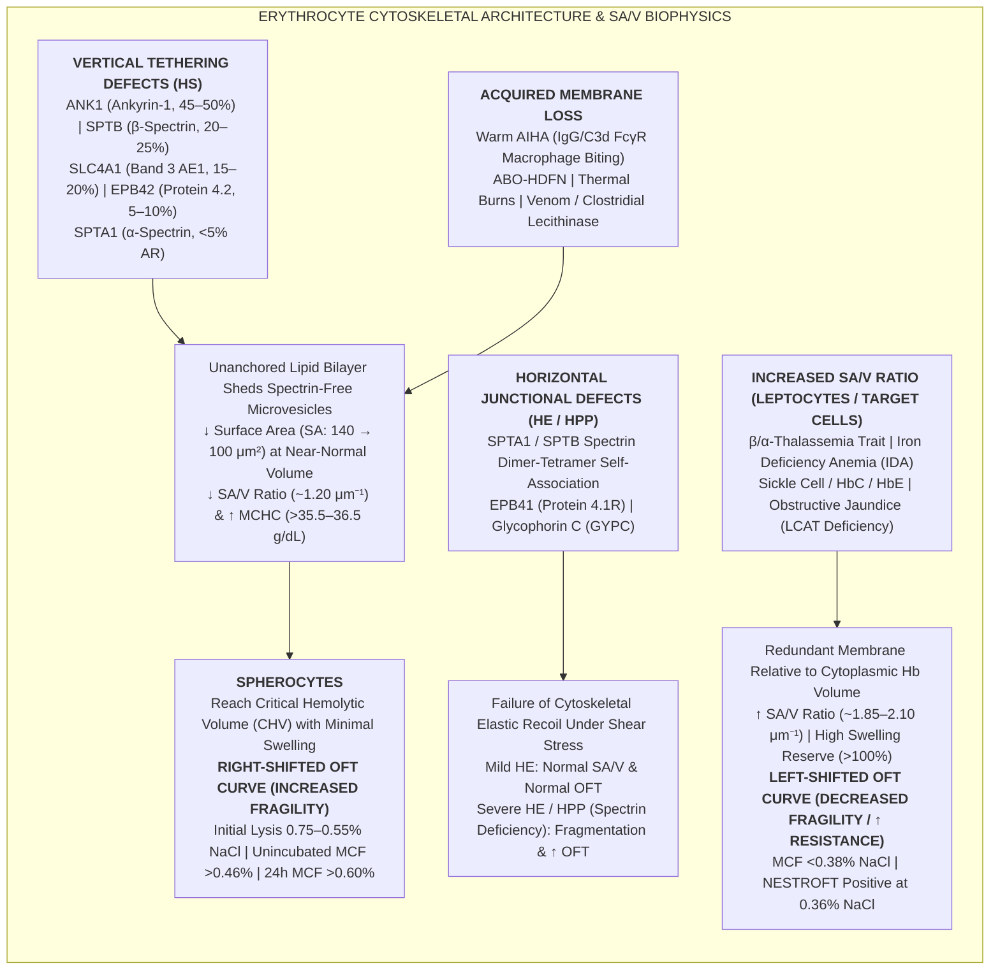
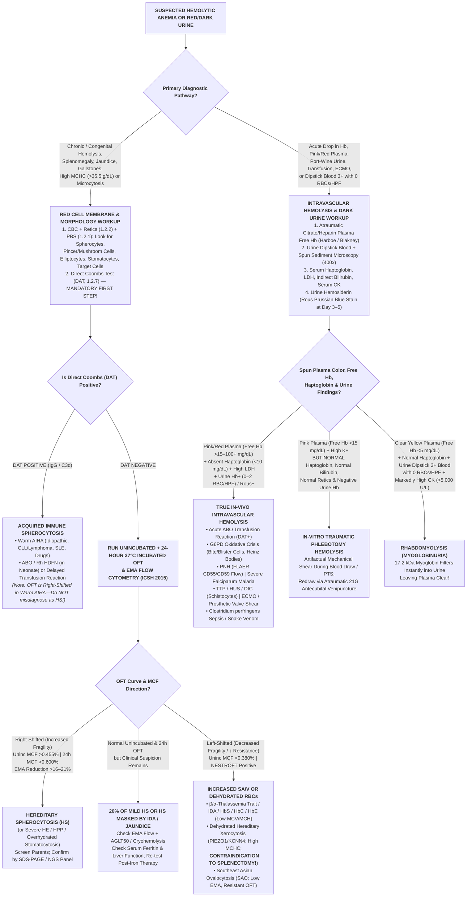

# 🧪 1.2.9 Erythrocyte Osmotic Fragility Test (`OFT` — Unincubated & 24-Hour 37°C Incubated) & Quantitative Plasma / Urine Free Hemoglobin (`Harboe` / `Blakney` Spectrophotometry & `Rous` Urine Hemosiderin) — Apex International SOP & Clinical Interpretation Manual

> **Document Control (`ISO 15189:2022` Clauses 5.5, 7.2, 7.3, 7.4, 8.3.2 & `NABL 112`):** **Document ID:** `SDL-SOP-HEM-1.2.9-OFT-FREEHB-v5.0` | **Version:** `5.0 (10-Persona Above-NABL & ICSH/BSH/CAP Harmonized Edition)` | **Effective Date:** `15-Oct-2026` | **Review Cycle:** `Annual (12 Months)` | **Authorizing Authority:** `Laboratory Director & Chief Consultant Hematopathologist (MD Pathology, Sawariya Diagnostic Lab, Charkhi Dadri, Haryana)` | **Copy Classification:** `Controlled Master LIMS & Special Hematology Bench Manual` | **Normative Traceability:** `ISO 15189:2022`, `ICSH 2015 Guidelines for Laboratory Diagnosis of Hereditary Red Cell Membrane Disorders (King et al., Int J Lab Hematol)`, `BSH Hereditary Spherocytosis Guidelines (Bolton-Maggs et al., Br J Haematol)`, `Dacie & Lewis Practical Haematology (12th Ed., Ch. 12 & 14)`, `CLSI H20-A2 / EP15-A3 / EP06-Ed2 / EP17-A2 / EP28-A3c / EP07-Ed3 / GP47`, `ISO/TS 20914:2019`, `ISO 22367:2020`, `CAP HEM.35960 / HEM.36700–36900`, `NABL 112 / 153 / 220D / 223`

---

## Section 1: Document Control, Coding Taxonomy & Multi-Tier Analytical Platform Matrix

### 1.1 Institutional Metadata, Terminology Coding & Regulatory Traceability Matrix
| Metadata Field | Institutional Specification & International Standard Mapping |
| :--- | :--- |
| **Document ID & Version** | `SDL-SOP-HEM-1.2.9-OFT-FREEHB-v5.0` (Supersedes `v4.2`; Effective `15-Oct-2026`; Next Scheduled Review: `14-Oct-2027`) |
| **Performing Facility** | **Sawariya Diagnostic Lab**, Special Hematology & Spectrophotometry Division, Charkhi Dadri, Haryana – 127306, India |
| **Department & Cluster** | `01_Hematology_and_Coagulation` $\rightarrow$ `1.2_Anemia_Morphology_Hemoglobinopathy_and_Hemolysis_Cluster` |
| **Official Test Designations** | **1. Erythrocyte Osmotic Fragility Test (`OFT`) — Unincubated ($20\text{–}25^\circ\text{C}, 30\text{ min}$) & $24\text{-Hour}$ $37.0^\circ\text{C}$ Sterile Incubated Parpart-Dacie Buffered $\text{NaCl}$ Gradient Assay with Median Corpuscular Fragility (`MCF` / `H50`) & Derivative Fragility Profiling**<br>**2. Single-Tube $0.36\%$ Buffered Saline Osmotic Resistance Screen (`NESTROFT` — Naked Eye Single Tube Red Cell Osmotic Fragility Test)**<br>**3. Quantitative Plasma & Urine Free Hemoglobin (`Harboe` $380/415/450\text{ nm}$ Soret-Band & `Blakney-Dinwoodie` $562/578/598\text{ nm}$ Oxyhemoglobin Polychromatic Allen-Baseline Spectrophotometry)**<br>**4. Urinary Sediment Hemosiderin Stain (`Rous` Prussian Blue Ferric Ferrocyanide Cytochemical Assay)** |
| **LOINC Codes (v2.78)** | `4611-0` (Osmotic fragility of Red Blood Cells — Unincubated panel), `4613-6` (Osmotic fragility of Red Blood Cells — $24\text{ h}$ incubated at $37^\circ\text{C}$), `4612-8` (Osmotic fragility `MCF` $50\%$ lysis point in RBC), `4635-9` (Free Hemoglobin [Mass/volume] in Plasma by Spectrophotometry), `4636-7` (Free Hemoglobin [Presence/Mass] in Urine), `4637-5` (Hemosiderin [Presence] in Urine sediment by Prussian blue stain), `30394-1` (`EMA` Eosin-5-maleimide binding in RBC by Flow cytometry — Reflex) |
| **SNOMED-CT Codes** | `6012004` (Erythrocyte osmotic fragility test), `104156006` (Incubated erythrocyte osmotic fragility test), `38292008` (Plasma free hemoglobin measurement), `252299006` (Urine free hemoglobin measurement), `167323003` (Urine hemosiderin stain), `75889009` (Hereditary spherocytosis), `191169008` (Hereditary elliptocytosis), `416341008` (Hereditary stomatocytosis / xerocytosis), `49210004` (Hemoglobinuria), `267554002` (Hemoglobinemia), `73320003` (Paroxysmal nocturnal hemoglobinuria [`PNH`]) |
| **ICD-10-CM / ICD-11 Codes** | **ICD-10-CM:** `D58.0` (Hereditary spherocytosis), `D58.1` (Hereditary elliptocytosis), `D58.8` (Other specified hereditary hemolytic anemias — Hereditary stomatocytosis/xerocytosis), `D59.10` (Warm autoimmune hemolytic anemia [`WAIHA`]), `D59.5` (Paroxysmal nocturnal hemoglobinuria [`PNH`]), `D59.6` (Hemoglobinuria due to hemolysis from other external causes / March hemoglobinuria), `R82.3` (Hemoglobinuria), `T80.30XA` (Acute `ABO` incompatible hemolytic transfusion reaction), `P55.1` (`ABO` isoimmunization of newborn [`ABO-HDFN`]) \| **ICD-11:** `3A10.0` (Hereditary spherocytosis), `3A20.0` (Warm autoimmune hemolytic anemia), `3A21.0` (Paroxysmal nocturnal hemoglobinuria) |
| **UCUM & SI Reporting Units** | **`OFT` Curve:** `% Hemolysis` ($0.0\text{–}100.0\%$) at each `% w/v NaCl` concentration ($0.90\%$ to $0.10\%\text{ NaCl}$, or $\text{g/L NaCl}: 9.0\text{ to }1.0\text{ g/L}$)<br>**`MCF` (`H50`), Initial Lysis (`H5`), Complete Lysis (`H95`):** `% w/v NaCl` (to $3$ decimal places, e.g., $0.425\%\text{ NaCl}$) and $\text{g/L NaCl}$ ($4.25\text{ g/L}$)<br>**Plasma Free Hemoglobin:** Conventional: `mg/dL` (to $1$ decimal place) \| SI: `g/L` ($\text{mg/dL} \times 0.01 = \text{g/L}$) or $\mu\text{mol/L}$ heme monomer ($\text{mg/dL} \times 0.6206 = \mu\text{mol/L}$)<br>**Urine Free Hemoglobin:** Qualitative `Negative / Trace / 1+ / 2+ / 3+` + Quantitative `mg/dL` + Microscopic Sediment `RBCs/HPF` ($400\times$)<br>**Urine Hemosiderin (`Rous` Stain):** `Negative` or `Positive (Grade 1+ to 4+ intracellular/cast/free Prussian-Blue granules)` |
| **Metrological Traceability (`ISO 17511:2020`)** | **1. Parpart Buffered $\text{NaCl}$ Gradient:** Gravimetric preparation using `NIST SRM 919b` traceable Analytical Reagent (`AR`/`ACS` grade $\ge 99.9\%$) desiccated $\text{NaCl}$, $\text{Na}_2\text{HPO}_4$, and $\text{NaH}_2\text{PO}_4\cdot 2\text{H}_2\text{O}$ on a calibrated analytical balance ($d = 0.1\text{ mg}$), verified by Freezing-Point Depression Osmometer ($\text{mOsm/kg H}_2\text{O}$) and `NIST`-traceable glass-electrode $\text{pH}$ meter ($\text{pH } 7.40 \pm 0.02$ at $25.0^\circ\text{C}$)<br>**2. Spectrophotometric Absorbance ($380, 415, 450, 540, 562, 578, 598\text{ nm}$):** Wavelength accuracy ($\pm 0.5\text{ nm}$) verified with Holmium Oxide (`NIST SRM 2034`) filter; photometric linearity ($0.000\text{–}2.500\text{ Abs}$) verified with Neutral Density Glass / Potassium Dichromate (`NIST SRM 935a`); Plasma Free $\text{Hb}$ calibrated against **ICSH / WHO International Reference Cyanmethemoglobin Standard (`NIBSC 98/708`)** |
| **Turnaround Time (`TAT`) Targets** | **Unincubated `OFT`:** $\le 4\text{ hours}$ \| **$24\text{-Hour}$ Incubated `OFT`:** $\le 28\text{ hours}$ \| **STAT Plasma & Urine Free Hemoglobin (Transfusion Reaction / `ECMO` / Fulminant Intravascular Hemolysis):** $\le 45\text{ minutes}$ (Critical notification $\le 30\text{ minutes}$ per `CLSI GP47`) \| **Urine Hemosiderin (`Rous` Stain):** $\le 4\text{ hours}$ |

---

### 1.2 Hardware-Agnostic Multi-Tier Analytical Platform Matrix
| Platform Tier | Analytical Method & Instrumentation | Biophysical / Spectrophotometric Principle | Diagnostic Sensitivity, Specificity & Clinical Role |
| :--- | :--- | :--- | :--- |
| **Tier 1A: Primary `OFT` Quantitative Bench Assay** | **Parpart-Dacie Phosphate-Buffered $\text{NaCl}$ Gradient ($0.90\%$ to $0.10\%\text{ w/v NaCl Equivalent}$, $\text{pH } 7.40$, $14$ Tubes) + Double-Beam UV-Vis Spectrophotometry at $540\text{ nm}$ (Unincubated $20\text{–}25^\circ\text{C}$ & $24\text{-h}$ $37.0^\circ\text{C}$ Sterile Incubated)** | Measures the ability of erythrocytes to swell in hypotonic media without rupturing—a direct function of the **erythrocyte Surface-Area-to-Volume ($SA/V$) ratio**. Spherocytes have lost membrane surface area via vertical cytoskeletal tether defects (`ANK1`, `SPTB`, `SLC4A1`, `EPB42`) or immune macrophage biting (`Warm AIHA`, `ABO-HDFN`), reaching their spherical **Critical Hemolytic Volume (`CHV`)** at higher $\text{NaCl}$ concentrations (**Right-Shifted Curve, High `MCF`**). Leptocytes/target cells (`Thalassemia`, `IDA`, `Liver Disease`) have excess surface area relative to volume and resist lysis down to very low tonicities (**Left-Shifted Curve, Low `MCF`**). **$24\text{-hour}$ sterile incubation at $37.0^\circ\text{C}$** deprives RBCs of glucose, depleting intracellular `ATP`, halting the $\text{Na}^+/\text{K}^+\text{-ATPase}$ pump, and accelerating membrane lipid loss to unmask latent/compensated Hereditary Spherocytosis (`HS`). | **Unincubated `OFT` Sensitivity for `HS`:** $\sim 65\text{–}75\%$ (misses $25\text{–}35\%$ of mild/compensated `HS` or `HS` masked by `IDA`/jaundice).<br>**$24\text{-h}$ Incubated `OFT` Sensitivity for `HS`:** $\sim 80\text{–}85\%$.<br>**Specificity Limitation:** **Cannot distinguish inherited `HS` from acquired spherocytosis (`Warm AIHA`, `ABO-HDFN`, thermal burns, clostridial/venom phospholipase)**—mandates concurrent `DAT` (`1.2.7`)! |
| **Tier 1B: Community / Antenatal Thalassemia Screen** | **`NESTROFT` (Naked Eye Single Tube Red Cell Osmotic Fragility Test in $0.36\%\text{ w/v}$ Buffered $\text{NaCl}$)** | Normal discocytes ($MCV \approx 88\text{ fL}, SA/V \approx 1.55$) undergo $> 90\text{–}95\%$ osmotic lysis in $0.36\%$ buffered $\text{NaCl}$ after $30\text{ min}$ at room temperature, rendering the supernatant transparent so a black line on a white card behind the tube is **clearly visible (`NESTROFT Negative`)**. Microcytic hypochromic leptocytes/target cells in **$\beta$-Thalassemia Trait** ($MCV < 75\text{ fL}, MCH < 24\text{ pg}$, high $SA/V$) resist lysis in $0.36\%\text{ NaCl}$, leaving a turbid suspension of intact RBCs that **obscures the black line (`NESTROFT Positive`)**. | **Sensitivity for $\beta$-Thalassemia Trait:** $95.0\text{–}98.5\%$; **NPV:** $> 98\%$.<br>**Specificity:** $75\text{–}85\%$ (also positive in moderate-to-severe `IDA`, `HbE`/`HbD`/`HbS` traits, and $\alpha$-thalassemia trait; always confirm positive screens by `Hb HPLC` [`1.2.3`] and Serum Ferritin). |
| **Tier 2A: First-Line Confirmatory Red Cell Membrane Flow Assay (`ICSH 2015` Gold Standard)** | **Eosin-5'-Maleimide (`EMA`) Dye Binding Flow Cytometry (`488 nm` Blue Laser, `FL1 525/530 nm` Green Channel)** | Fluorescent `EMA` ($0.5\text{ mg/mL}$) binds covalently (80%) to the $\varepsilon$-amino group of **Lysine-430 (`Lys-430`) on the first extracellular loop of Band 3 (`SLC4A1` / `AE1`)** and (20%) to sulfhydryl groups on `Rh`/`RhAG` and `CD47` macrocomplexes. Deficiency of vertical cytoskeleton-membrane tethering proteins reduces membrane Band 3 density, producing a **$> 16\text{–}21\%$ decrease in Mean Channel Fluorescence (`MCF`)** compared to $6$ simultaneous age-matched healthy controls ($> 15,000$ gated RBC events). | **Sensitivity for `HS`:** **$93.0\text{–}96.5\%$**; **Specificity:** **$98.0\text{–}99.2\%$**.<br>**Key Advantage:** Performs reliably on $K_2\text{-EDTA}$ blood up to $48\text{–}72\text{ hours}$ at $4^\circ\text{C}$, requires only $5\text{–}10\ \mu\text{L}$ blood (ideal for neonates), and is **NOT masked by concomitant Iron Deficiency Anemia (`IDA`)**! Also shows characteristic very low fluorescence in **Southeast Asian Ovalocytosis (`SAO`)** and **Cryohydrocytosis**, and elevated fluorescence in **Macrocytosis / Hereditary Stomatocytosis**. |
| **Tier 2B: Alternative Kinetic / Thermal Membrane Fragility Assays** | **1. Acidified Glycerol Lysis Test (`AGLT50`) / Pink Test**<br>**2. Hypertonic Cryohemolysis Assay**<br>**3. Osmotic Gradient Ektacytometry (`LoRRca MaxSis`)** | **1. `AGLT50`:** Measures time in seconds ($t_{50}$) for $50\%$ reduction in turbidity at $625\text{ nm}$ when RBCs are suspended in hypotonic glycerol ($0.3\text{ M}$) in phosphate-buffered saline at $\text{pH } 6.85$ (Normal $t_{50} > 1,800\text{ s}$; `HS` $t_{50} = 25\text{–}240\text{ s}$).<br>**2. Cryohemolysis:** RBCs suspended in hypertonic $0.7\text{ M}$ sucrose buffered saline at $37^\circ\text{C}$ ($10\text{ min}$) then transferred to $0^\circ\text{C}$ ice water ($10\text{ min}$) undergo thermal phase-transition membrane rupture solely due to **vertical protein-lipid interaction defects** (`HS` $> 15\text{–}20\%$ lysis; Normal $< 3\text{–}10\%$ lysis), **independent of $SA/V$ ratio**.<br>**3. Ektacytometry:** Laser diffraction viscometry measuring the **Elongation Index (`EI`)** across a continuous osmolality gradient ($50\text{–}500\text{ mOsm/kg}$), yielding $O_{\min}$ (equivalent to `OFT MCF`), $\text{EI}_{\max}$ (deformability), and $O_{\text{hyper}}$ (hydration state—uniquely separates **`HS` vs `HE/HPP` vs Dehydrated Hereditary Xerocytosis [`PIEZO1` left-shifted $O_{\text{hyper}}$]**!). | **`EMA` + `AGLT50` Combination (`BSH` / `ICSH`):** Achieves **$> 99.5\%$ diagnostic sensitivity** for `HS`.<br>**Osmotic Gradient Ektacytometry:** Definitive phenotypic gold standard for differentiating **`HS`**, **`HE`/`HPP`**, **`SAO`**, and **Hereditary Stomatocytosis / Xerocytosis (`PIEZO1` / `KCNN4` — where splenectomy is CONTRAINDICATED due to fatal portal/pulmonary thromboembolism!)**. |
| **Tier 2C: Molecular & Proteomic Confirmatory Tier** | **`SDS-PAGE` Erythrocyte Ghost Membrane Protein Densitometry (Fairbanks / Laemmli Buffers) & Targeted `NGS` Red Cell Membrane Gene Panel** | `SDS-PAGE` quantifies ratios of **Spectrin ($\alpha\text{ band } 1 + \beta\text{ band } 2$), Ankyrin ($\text{band } 2.1$), Band 3, Protein 4.1R, and Protein 4.2** relative to Band 3 or Actin. Targeted `NGS` sequences `ANK1`, `SPTB`, `SPTA1` (including intronic `alpha-LELY` c.5572C>G and `alpha-LEPRA` c.4339-99C>T), `SLC4A1`, `EPB42`, `EPB41`, `PIEZO1`, `KCNN4`, and `RHAG`. | Mandatory in transfusion-dependent neonates, `DAT`-negative atypical hemolytic anemias with equivocal `EMA`/`OFT`, recessive `HS` (`SPTA1`/`EPB42`), or prior to splenectomy to exclude **`PIEZO1`/`KCNN4` Hereditary Xerocytosis**. |
| **Tier 3A: Quantitative Plasma & Urine Free Hemoglobin Platform** | **Polychromatic Derivative Spectrophotometry (`Harboe` $380/415/450\text{ nm}$ Soret-Band Method & `Blakney-Dinwoodie` $562/578/598\text{ nm}$ $\alpha$-Oxyhemoglobin Method) + `HemoCue Plasma/Low Hb` Photometer ($570/880\text{ nm}$)** | Oxyhemoglobin exhibits an intense **Soret porphyrin absorption band at $415\text{ nm}$** ($\varepsilon_{\text{mM}} \approx 125\text{ L}\cdot\text{mmol}^{-1}\cdot\text{cm}^{-1}$ per heme) and secondary $\beta/\alpha$ Q-bands at $541\text{ nm}$ and $577\text{–}578\text{ nm}$. Direct single-wavelength reading at $415\text{ nm}$ or $540\text{ nm}$ is severely confounded by **bilirubin** (peak $\sim 450\text{–}460\text{ nm}$) and **lipemic turbidity**. The **Harboe ($380/415/450\text{ nm}$) and Blakney ($562/578/598\text{ nm}$) Allen-baseline geometric subtraction equations** mathematically cancel linear background absorbance from bilirubin and lipids to measure true cell-free hemoglobin down to $0.5\text{ mg/dL}$. | Gold-standard quantitative metric for **acute intravascular hemolysis** (`ABO` transfusion reaction, `PNH`, `G6PD` crisis, falciparum blackwater fever, *C. perfringens* sepsis), **`ECMO` / Cardiopulmonary Bypass (`CPB`) / Impella / `LVAD` mechanical shear monitoring**, and **stored packed `RBC` blood-bag quality control** (`< 0.8%` hemolysis at expiry). |
| **Tier 3B: Urinary Intravascular Hemolysis Triage & Chronic Hemosiderinuria Assay** | **1. Urine Dipstick Pseudoperoxidase Reaction + Phase-Contrast / Brightfield Sediment Microscopy ($400\times$)**<br>**2. `Rous` Prussian Blue Urinary Sediment Stain** | **1. Dipstick vs Microscopy:** Tetramethylbenzidine (`TMB`) dipstick pad turns green-blue via heme pseudoperoxidase activity (sensitive to $0.015\text{–}0.060\text{ mg/dL}$ free $\text{Hb}$ or $\sim 3\text{–}5\text{ RBCs}/\mu\text{L}$). **True Hemoglobinuria** shows **`2+` to `3+` Dipstick Blood with `0–2 intact RBCs/HPF`** on spun sediment (must differentiate from **Myoglobinuria** by pink vs clear plasma and serum `CK`).<br>**2. `Rous` Stain:** Acidified potassium ferrocyanide ($\text{K}_4[\text{Fe(CN)}_6] + \text{HCl}$) reacts with ferric iron ($\text{Fe}^{3+}$) stored inside renal tubular hemosiderin granules to form insoluble **Prussian Blue ($\text{Fe}_4[\text{Fe(CN)}_6]_3$)**. | **Plasma/Urine Free $\text{Hb}$** captures **acute (< 24 h)** intravascular lysis exceeding Haptoglobin binding capacity ($> 100\text{–}135\text{ mg/dL}$).<br>**Urine Hemosiderin (`Rous` Stain)** becomes positive **$3\text{–}5\text{ days}$ after** an intravascular hemolytic episode and remains positive for **$2\text{–}3\text{ weeks}$** (or continuously in chronic intravascular hemolysis such as **`PNH`** and **mechanical prosthetic valve leak**). |

---

## Section 2: Red Cell Membrane Cytoskeletal Biophysics, $SA/V$ Geometry & Molecular Pathophysiology

### 2.1 Quantitative Biophysics of Erythrocyte Surface-Area-to-Volume Ratio ($SA/V$) and Critical Hemolytic Volume (`CHV`)
1. **Geometric Advantage of the Normal Biconcave Discocyte:**
   - A healthy mature human erythrocyte is a biconcave discocyte with a resting diameter of $7.5\text{–}8.2\ \mu\text{m}$, a peripheral rim thickness of $2.0\text{–}2.5\ \mu\text{m}$, a central pallor thickness of $0.8\text{–}1.0\ \mu\text{m}$, a **Mean Corpuscular Volume ($MCV$ or $V_0$) of $\sim 90\text{ fL}$ ($\mu\text{m}^3$)**, and a **Surface Area ($SA_0$) of $\sim 135\text{–}140\ \mu\text{m}^2$**.
   - A perfect sphere of volume $V = 90\text{ fL}$ requires a minimum surface area of only:
     $$SA_{\text{sphere}}(90\text{ fL}) = (36\pi)^{1/3} \cdot V^{2/3} \approx 4.836 \times (90)^{2/3} \approx 96.7\ \mu\text{m}^2$$
   - Because the normal discocyte possesses $\sim 140\ \mu\text{m}^2$ of lipid-bilayer membrane—representing an **excess surface area of $\sim 43\ \mu\text{m}^2$ ($\sim 44\%$ excess membrane)** and a **Surface-Area-to-Volume Ratio ($SA/V$) of $1.50\text{–}1.56\ \mu\text{m}^{-1}$**—it can deform effortlessly through $2\text{–}3\ \mu\text{m}$ splenic cordal-sinusoidal endothelial slits and $3\text{–}5\ \mu\text{m}$ nutritive capillaries.
2. **Thermodynamics of Hypotonic Swelling and Critical Hemolytic Volume (`CHV`):**
   - The erythrocyte plasma membrane is freely permeable to water via **Aquaporin-1 (`AQP1`, Colton blood group)** channels, behaves as a nearly ideal semi-permeable osmometer, and is **virtually inextensible in area** (the lipid bilayer ruptures if stretched laterally by more than **$3\text{–}4\%$** beyond its true surface area $SA_0$).
   - When placed in progressively hypotonic buffered $\text{NaCl}$ solutions ($< 0.90\%\text{ w/v NaCl}$, $< 290\text{ mOsm/kg}$), water enters the cell down its osmotic chemical potential gradient. The erythrocyte swells at constant surface area $SA_0$, changing shape from a **biconcave discocyte $\rightarrow$ stomatocyte $\rightarrow$ echinospherocyte $\rightarrow$ smooth perfect sphere**.
   - For a cell of fixed surface area $SA_0$, the **Critical Hemolytic Volume ($V_{\text{crit}}$ or `CHV`)** at which it becomes a taut sphere and bursts (forming $20\text{–}50\text{ nm}$ transient membrane pores that release intracellular hemoglobin, leaving behind a pale "erythrocyte ghost") is governed by Euclidean spherical geometry:
     $$V_{\text{crit}} = \frac{SA_0^{3/2}}{6\sqrt{\pi}} \approx 0.09403 \times SA_0^{3/2}$$
   - **Normal Discocyte ($SA_0 = 140\ \mu\text{m}^2, V_0 = 90\text{ fL}$):**
     $$V_{\text{crit}} = 0.09403 \times (140)^{1.5} = 0.09403 \times 1,656.5 \approx 155.8\text{ fL}$$
     Thus, a normal discocyte can swell by **$\sim 73\%$ of its initial volume** ($90\text{ fL} \rightarrow 156\text{ fL}$) before rupturing! Consequently, initial lysis (`H5`) does not begin until **$0.50\%\text{ NaCl}$** ($171\text{ mOsm/kg}$), $50\%$ lysis (**`MCF`**) occurs at **$0.400\%\text{–}0.445\%\text{ NaCl}$** ($137\text{–}152\text{ mOsm/kg}$), and complete lysis (`H95`) occurs at **$0.30\%\text{–}0.35\%\text{ NaCl}$**.
   - **Spherocyte in Hereditary Spherocytosis (`HS`) or Warm `AIHA` ($SA_0 = 102\ \mu\text{m}^2, V_0 = 85\text{ fL}$):**
     $$V_{\text{crit}} = 0.09403 \times (102)^{1.5} = 0.09403 \times 1,030.2 \approx 96.9\text{ fL}$$
     Because the spherocyte has lost $\sim 27\%$ of its membrane surface area ($SA/V \approx 1.20\ \mu\text{m}^{-1}$), it is already nearly spherical at isotonic baseline ($0.90\%\text{ NaCl}$) and can swell by **only $\sim 14\%$** ($85\text{ fL} \rightarrow 97\text{ fL}$) before reaching $V_{\text{crit}}$ and bursting! Consequently, spherocytes rupture at much higher $\text{NaCl}$ concentrations (**initial lysis at $0.75\%\text{–}0.55\%\text{ NaCl}$, right-shifted fragility curve, and elevated `MCF` $> 0.46\%\text{ NaCl}$ unincubated / $> 0.60\%\text{ NaCl}$ after $24\text{-h}$ incubation**).
   - **Leptocyte / Target Cell / Hypochromic Microcyte in $\beta$-Thalassemia Trait or `IDA` ($SA_0 = 125\ \mu\text{m}^2, V_0 = 62\text{ fL}$):**
     $$V_{\text{crit}} = 0.09403 \times (125)^{1.5} = 0.09403 \times 1,397.5 \approx 131.4\text{ fL}$$
     Because cytoplasmic hemoglobin synthesis is impaired while membrane lipid synthesis remains relatively preserved ($SA/V \approx 2.02\ \mu\text{m}^{-1}$), the cell can swell by **$> 110\%$ of its initial volume** ($62\text{ fL} \rightarrow 131\text{ fL}$) before bursting! Consequently, these cells exhibit **Decreased Osmotic Fragility / Increased Osmotic Resistance (left-shifted curve, `MCF` $< 0.38\%\text{ NaCl}$, incomplete lysis even at $0.30\%\text{ NaCl}$, and positive `NESTROFT` at $0.36\%\text{ NaCl}$)**.



---

### 2.2 Molecular Genetics & Structural Subclassification of Erythrocyte Membrane Disorders (`ICSH 2015`)
| Disorder & Inheritance | Mutated Gene & Chromosomal Locus | Encoded Structural Protein & Membrane Function | Prevalence & Biochemical Defect (`SDS-PAGE`) | Characteristic Peripheral Smear (`PBS`) & Special Diagnostic Signatures |
| :--- | :--- | :--- | :--- | :--- |
| **Hereditary Spherocytosis (`HS`) — Type 1 (Classic Ankyrin Defect)** | **`ANK1`** (`8p11.21`)<br>*Autosomal Dominant (`AD`, 85%) or de novo / Autosomal Recessive (`AR`, 15%)* | **Ankyrin-1 ($210\text{ kDa}$, Band 2.1):** Primary vertical adaptor linking the cytoplasmic N-terminal domain of **Band 3 (`AE1`) tetramers** to repeats $14\text{–}15$ of **$\beta$-Spectrin**. | **$45\text{–}50\%$ of all `HS` cases** (most common cause in Northern Europe, North America, and India). Causes combined secondary deficiency of both **Ankyrin and Spectrin ($15\text{–}50\%$ reduction)** because unanchored spectrin is proteolytically degraded. | Hyperchromic **microspherocytes** lacking central pallor, polychromasia, high `MCHC` ($> 35.5\text{ g/dL}$), elevated Sysmex `Hyper-He` / Beckman `MSC`. Markedly reduced **`EMA` binding ($> 20\text{–}35\%$ drop)** and classic right-shifted $24\text{-h}$ `OFT`. |
| **Hereditary Spherocytosis (`HS`) — Type 2 ($\beta$-Spectrin Defect)** | **`SPTB`** (`14q23.3`)<br>*Autosomal Dominant (`AD`)* | **$\beta$-Spectrin ($246\text{ kDa}$, Band 2):** Forms antiparallel $\alpha\beta$ heterodimers and head-to-head $\alpha_2\beta_2$ tetramers constituting the hexagonal submembranous lattice; binds Ankyrin-1 and Protein 4.1R/Actin. | **$20\text{–}25\%$ of all `HS` cases**. Isolated $\beta$-Spectrin deficiency ($15\text{–}40\%$ reduction on `SDS-PAGE`). Mild-to-moderate clinical phenotype. | Typical microspherocytes plus occasional **acanthocytic/spiculated spherocytes (`echinospherocytes`)**. Positive $24\text{-h}$ `OFT` and reduced `EMA` fluorescence. |
| **Hereditary Spherocytosis (`HS`) — Type 3 (Band 3 Anion Exchanger Defect)** | **`SLC4A1`** (`17q21.31`)<br>*Autosomal Dominant (`AD`)* | **Band 3 / Anion Exchanger 1 (`AE1`, $95\text{–}100\text{ kDa}$, $1.2 \times 10^6$ copies/RBC):** Major multipass transmembrane glycoprotein mediating $\text{Cl}^-/\text{HCO}_3^-$ exchange and anchoring the **Ankyrin macrocomplex** and **4.1R junctional complex** to the lipid bilayer. | **$15\text{–}20\%$ of all `HS` cases**. $20\text{–}35\%$ reduction in Band 3 with secondary Protein 4.2 deficiency. Distal `SLC4A1` mutations can co-present with **Distal Renal Tubular Acidosis (`dRTA`, Type 1)**. | **Pathognomonic "Mushroom-Shaped" or "Pincer" Red Cells (`knizocytes`)** alongside spherocytes on PBS! Gives the **most profound reduction in `EMA` Flow Cytometry ($> 30\text{–}45\%$ drop)** because `EMA` binds directly to `Lys-430` of Band 3! |
| **Hereditary Spherocytosis (`HS`) — Type 4 (Protein 4.2 Pallidin Defect)** | **`EPB42`** (`15q15.2`)<br>*Autosomal Recessive (`AR`)* | **Protein 4.2 ($72\text{ kDa}$, Band 4.2):** Peripheral membrane protein stabilizing the interaction between the cytoplasmic domain of Band 3 and Ankyrin-1; interacts with `CD47` and `RhAG`. | **$5\text{–}10\%$ globally** (accounts for **$45\text{–}50\%$ of `HS` in Japan/East Asia**, e.g., *Protein 4.2 Nippon*). Near-complete absence of Band 4.2 on `SDS-PAGE`. | **Ovalostomatocytes** and spherocytes on PBS; mild-to-moderate hemolysis; positive `OFT` and reduced `EMA` binding. |
| **Hereditary Spherocytosis (`HS`) — Type 5 ($\alpha$-Spectrin Recessive Defect)** | **`SPTA1`** (`1q23.1`)<br>*Autosomal Recessive (`AR`)* | **$\alpha$-Spectrin ($280\text{ kDa}$, Band 1):** Synthesized in **$3\text{–}4\times$ molar excess** over $\beta$-Spectrin in normal erythroblasts; therefore, heterozygous loss of one `SPTA1` allele is clinically silent, and `HS` occurs only with biallelic mutations (often a null allele *in trans* with the hypomorphic **`alpha-LEPRA` [`c.4339-99C>T`]** allele). | **$< 5\%$ of `HS` cases**, but causes **severe, life-threatening fetal *hydrops fetalis* or neonatal transfusion-dependent hemolytic anemia** (`< 50%` spectrin content). | Severe microspherocytosis, bizarre poikilocytosis, circulating erythroblasts, and extreme osmotic fragility even in unincubated `OFT` (`MCF > 0.55–0.65% NaCl`). |
| **Hereditary Elliptocytosis (`HE`) & Hereditary Pyropoikilocytosis (`HPP`)** | **`SPTA1` (65%), `SPTB` (30%), `EPB41` (Protein 4.1R, 5%), `GYPC` (Leach phenotype)**<br>*`HE`: `AD` \| `HPP`: `AR` (`HE` mutation + *in trans* `alpha-LELY`)* | **Horizontal Cytoskeletal Lattice Defect:** Impairs lateral head-to-head self-association of $\alpha\beta$-spectrin heterodimers into $\alpha_2\beta_2$ tetramers or weakens the **Spectrin–Actin–Protein 4.1R junctional complex**. | Common in malaria-endemic zones ($1\text{ in }2,000\text{–}4,000$ in Africa/India). In simple `HE`, spectrin quantity is normal; in **`HPP`**, there is a dual horizontal defect + **$30\text{–}50\%$ quantitative spectrin deficiency** causing thermal instability at $45\text{–}46^\circ\text{C}$ (vs normal $49^\circ\text{C}$). | **Simple `HE`:** $> 25\text{–}60\%$ smooth cigar/pencil-shaped **elliptocytes**; **Unincubated `OFT` is NORMAL**.<br>**Severe `HE` / `HPP`:** Microspherocytes, budding RBC fragments, micro-elliptocytes, falsely low **$MCV\ 50\text{–}65\text{ fL}$**, and **MARKEDLY INCREASED `OFT` (both unincubated and $24\text{-h}$ incubated)**! |
| **Southeast Asian Ovalocytosis (`SAO`)** | **`SLC4A1`** (`27-bp deletion` removing codons $400\text{–}408$ at cytoplasmic-transmembrane boundary of Band 3)<br>*Autosomal Dominant (`AD`; homozygous lethal)* | Rigidifies Band 3 oligomers within the lipid bilayer, restricting lateral protein mobility and conferring resistance to *Plasmodium falciparum* cerebral malaria invasion. | High prevalence ($5\text{–}25\%$) in Southeast Asia, Melanesia, and coastal Eastern/Northeastern India. | **Pathognomonic Stomatocytic Macro-Ovalocytes with 1 or 2 Transverse Slit-Like Stomas (` Theta / θ cells`)**. **`OFT` is NORMAL or DECREASED (osmotically resistant)**, whereas **`EMA` Flow Cytometry is markedly POSITIVE** (because deletion sterically blocks `Lys-430` from binding `EMA`)! |
| **Dehydrated Hereditary Stomatocytosis / Hereditary Xerocytosis (`DHS` / `HX`)** | **`PIEZO1`** (`16q24.3`, 90% — gain-of-function mechanosensitive cation channel) or **`KCNN4`** (`19q13.31`, 10% — Gardos $\text{Ca}^{2+}$-activated $\text{K}^+$ channel)<br>*Autosomal Dominant (`AD`)* | **Primary Cation Permeability Defect:** Increased net efflux of intracellular $\text{K}^+$ exceeding $\text{Na}^+$ influx drives obligate osmotic water loss $\rightarrow$ **cellular dehydration**, high `MCHC` ($> 36\text{ g/dL}$), and increased $SA/V$ ratio. | Often misdiagnosed as atypical `HS` due to chronic compensated hemolysis, jaundice, gallstones, and elevated `MCHC`! | Target cells, desiccated **"puddled" Hb xerocytes**, and few stomatocytes. **CRITICAL DISTINCTION FROM `HS`: `OFT` shows DECREASED Osmotic Fragility (Left-Shifted Curve, `MCF < 0.38% NaCl`, Osmotic Resistance!)** and Ektacytometry shows a left-shifted $O_{\text{hyper}}$. **SPLENECTOMY IS ABSOLUTELY CONTRAINDICATED (causes $> 50\text{–}70\%$ incidence of fatal portal/pulmonary vein thrombosis)!** |
| **Overhydrated Hereditary Stomatocytosis (`OHS` / Hydrocytosis)** | **`RHAG`** (`6p12.3` — Rh-associated glycoprotein ammonium/cation pore defect)<br>*Autosomal Dominant (`AD`)* | Massive net $\text{Na}^+$ and water influx exceeding $\text{K}^+$ efflux $\rightarrow$ **severe cellular overhydration**, macrocytosis ($MCV\ 110\text{–}145\text{ fL}$), and low `MCHC` ($24\text{–}29\text{ g/dL}$). | Rare, severe hemolytic anemia; high intracellular $\text{Na}^+$ ($60\text{–}100\text{ mmol/L}$) and low intracellular $\text{K}^+$. | **$20\text{–}50\%$ cup-shaped Stomatocytes** (fish-mouth central slit). **Markedly INCREASED Osmotic Fragility (`MCF > 0.55–0.65% NaCl`)** because swollen hydrocytes are already near $V_{\text{crit}}$. (**Splenectomy also carries high thrombotic risk!**) |

---

## Section 3: Pre-Analytical Phlebotomy, Specimen Integrity, Anticoagulant Biophysics & Rejection Matrix

### 3.1 Specimen Collection & Anticoagulant Selection for Osmotic Fragility (`OFT` & `NESTROFT`)
1. **First-Choice Specimen for Unincubated & $24\text{-Hour}$ Incubated `OFT` (`ICSH 2015` & `Dacie & Lewis` Standard):**
   - **Sterile Lithium Heparin or Sodium Heparin Whole Blood ($12\text{–}15\text{ IU/mL}$, Green-Top Vacutainer, $4.0\text{ mL}$)** OR **Sterile Defibrinated Whole Blood** (collected aseptically into a sterile Erlenmeyer flask containing $8\text{–}10$ sterile $3\text{ mm}$ glass beads and swirled gently for $5\text{–}10\text{ minutes}$ until fibrin clot wraps around the beads).
   - **Why Sterile Heparin or Defibrinated Blood is Mandatory for the $24\text{-Hour}$ $37.0^\circ\text{C}$ Incubated `OFT`:**
     - Dipotassium or Tripotassium $\text{EDTA}$ ($\text{K}_2\text{-EDTA} / \text{K}_3\text{-EDTA}$, $1.5\text{–}2.2\text{ mg/mL}$) is a hypertonic polyaminocarboxylic acid chelator. First, adding $\sim 4\text{–}6\text{ mmol/L}$ of $\text{K}^+$ and $\text{EDTA}^{2-}$ ions increases plasma osmolality by $\sim 10\text{–}15\text{ mOsm/kg}$, altering baseline erythrocyte water content. Second, and far more critically, **chelation of extracellular $\text{Ca}^{2+}$ and $\text{Mg}^{2+}$ during $24\text{-hour}$ $37^\circ\text{C}$ incubation destabilizes the erythrocyte membrane phospholipid bilayer, inhibits $\text{Mg}^{2+}$-dependent `ATPases`, and induces severe artifactual echinocytic-spherocytic transformation in normal RBCs**, rendering $24\text{-hour}$ incubated `OFT` on $\text{EDTA}$ blood diagnostically unreliable!
     - **Conditional Exception for Unincubated `OFT` / `NESTROFT` Only:** Fresh $\text{K}_2\text{-EDTA}$ whole blood (Lavender Top, filled to $\ge 90\%$ of nominal fill mark; never underfilled, as excess hypertonic $\text{EDTA}$ shrinks RBCs!) may be used for **Unincubated `OFT` or `NESTROFT` ONLY if tested within $\le 2\text{–}4\text{ hours}$ of venipuncture** (or $\le 6\text{ hours}$ if kept strictly at $4^\circ\text{C}$) AND run alongside a **simultaneously drawn Healthy Normal Control collected in the identical $\text{K}_2\text{-EDTA}$ tube lot**.
2. **Mandatory Parallel Healthy Normal Control Specimen Rule (`CAP HEM.35960` & `NABL 112`):**
   - Because `OFT` has no commercial stabilized shelf-life control that mimics the $24\text{-hour}$ metabolic `ATP`-depletion kinetics of living human erythrocytes, **every single patient `OFT` batch (both Unincubated and $24\text{-h}$ Incubated) MUST be accompanied by a fresh Normal Control blood specimen** drawn within $\le 2\text{ hours}$ of the patient specimen from a healthy adult volunteer (with verified normal `CBC`: $\text{Hb } 13.0\text{–}16.5\text{ g/dL}$, $MCV\ 82\text{–}96\text{ fL}$, $MCHC\ 32.5\text{–}34.8\text{ g/dL}$, $RDW\text{-CV} < 14.0\%$, normal PBS, and negative `NESTROFT`) into the **exact same anticoagulant tube type**. For neonates ($0\text{–}28\text{ days}$), an age-matched normal neonatal/cord blood control should ideally be run in parallel (or interpreted against validated neonatal reference bands).

---

### 3.2 Strict Atraumatic Venipuncture Protocol for Quantitative Plasma Free Hemoglobin
1. **Why Pre-Analytical Phlebotomy Shear Is the #1 Cause of False-Positive Plasma Free Hemoglobin:**
   - Whole blood with a hemoglobin concentration of $15.0\text{ g/dL}$ contains **$15,000\text{ mg/dL}$** of intracellular hemoglobin, whereas normal cell-free plasma hemoglobin is **$< 1.0\text{–}5.0\text{ mg/dL}$**.
   - Therefore, **mechanical rupture of just $0.05\%$ of erythrocytes ($5\text{ cells in }10,000$) during blood collection releases $\sim 15\text{ mg/dL}$ of free hemoglobin into plasma**, falsely mimicking mild intravascular hemolysis! Rupture of just **$0.3\%$ of RBCs releases $\sim 90\text{ mg/dL}$**, mimicking a catastrophic hemolytic crisis!
2. **Mandatory Atraumatic Collection Checklist (`SOP-PHLEB-FREEHB`):**
   - **Anticoagulant:** Collect **PLASMA** (never serum! Clot retraction in plain/SST tubes mechanically squeezes and lyses erythrocytes, raising serum free $\text{Hb}$ to $10\text{–}35\text{ mg/dL}$ in healthy individuals). Use **$3.2\%\text{ (0.109 M)}$ Buffered Trisodium Citrate (Light-Blue Top, $9:1$ blood-to-citrate ratio; multiply final `Harboe` result by $1.11$ citrate dilution factor if corrected to native plasma)** or **Lithium/Sodium Heparin (Green Top without gel separator)**.
   - **Vascular Access & Needle Gauge:** Perform a dedicated, clean single-stick venipuncture from a large **antecubital vein** (median cubital or cephalic vein) using a **$\ge 21\text{-gauge}$ (or $19\text{–}20\text{-gauge}$) straight needle**.
   - **Strict Prohibitions:**
     - **NEVER draw blood for Plasma Free Hemoglobin through an indwelling peripheral IV cannula, central venous catheter (`CVC`), arterial line, or hemodialysis port** (turbulent flow across catheter hubs/valves causes $20\text{–}300\text{ mg/dL}$ shear hemolysis; only in `ECMO`/`CPB` circuit monitoring may a dedicated low-shear post-oxygenator manifold port be sampled after discarding $5\text{ mL}$ dead space via slow laminar aspiration).
     - **NEVER use a small-bore needle ($23\text{G–}25\text{G}$), high-vacuum butterfly tubing with collapsed vein ("chattering needle"), or forceful syringe aspiration/plunger ejection through a needle.**
     - **Tourniquet Time:** Must be **$< 30\text{–}45\text{ seconds}$**; release tourniquet immediately upon blood flash.
     - **Discard First Tube:** Draw a $2\text{ mL}$ discard tube (or routine `CBC` tube) first to flush tissue thromboplastin and initial needle-bevel shear before engaging the Citrate/Heparin tube for Plasma Free $\text{Hb}$.
   - **Post-Draw Handling & Double-Spin Processing ($\le 30\text{ Minutes}$):**
     - Mix gently by $4\text{–}6$ slow $180^\circ$ inversions (**never shake or vortex; never transport via pneumatic tube system [`PTS`]**, as `PTS` $g$-forces elevate plasma free $\text{Hb}$ by $+5\text{–}25\text{ mg/dL}$!). Hand-carry vertically at room temperature ($20\text{–}25^\circ\text{C}$; never place on ice, as cold agglutinins or thermal shock can lyse fragile RBCs) to the laboratory within **$15\text{–}30\text{ minutes}$**.
     - **Spin #1:** Centrifuge in a swing-out rotor at **$1,000\text{–}1,200\times g$ for $10\text{ minutes}$** at $20\text{–}22^\circ\text{C}$ with **soft brake (deceleration rate $\le 2$)**.
     - Carefully aspirate the top two-thirds of the supernatant plasma using a wide-bore plastic Pasteur pipette, staying at least **$5\text{ mm}$ above the buffy coat/RBC interface**.
     - **Spin #2:** Transfer plasma to a clean polypropylene tube and re-centrifuge at **$2,000\times g$ for $10\text{ minutes}$** to pellet any residual platelets, micro-erythrocyte ghosts, or cellular debris. Transfer the crystal-clear supernatant to a third tube for immediate `Harboe` / `Blakney` spectrophotometry.

---

### 3.3 Urine Specimen Collection & Pre-Analytical Preservation for Hemoglobinuria & Hemosiderinuria
1. **Fresh Random Urine for Free Hemoglobin (`Hemoglobinuria`):**
   - Collect $15\text{–}30\text{ mL}$ midstream freshly voided urine in a sterile, detergent-free container and analyze within **$\le 30\text{–}60\text{ minutes}$** of voiding.
   - **Mandatory Immediate Check of Urine Specific Gravity (`SG`) and $\text{pH}$:**
     - If **Urine `SG` $< 1.008\text{–}1.010$** (dilute/hypotonic urine, $< 200\text{ mOsm/kg}$) OR **Urine $\text{pH} \ge 7.5\text{–}8.0$** (alkaline urine), **intact erythrocytes excreted in ordinary glomerular or urological hematuria (renal calculi, UTI, glomerulonephritis, bladder tumor) undergo *in-vitro* osmotic/alkaline lysis inside the urinary bladder or specimen cup**! This produces a **$3+$ positive dipstick for blood with few intact RBCs on microscopy ("pseudo-hemoglobinuria")**. Careful phase-contrast microscopy at $400\times$ with lowered condenser reveals faint, colorless **erythrocyte ghosts**, and the patient's spun plasma is straw-yellow with normal Plasma Free $\text{Hb}$ ($< 5\text{ mg/dL}$) and normal Serum Haptoglobin.
2. **First-Morning Urine for `Rous` Hemosiderin Stain (`Hemosiderinuria`):**
   - Collect $30\text{–}50\text{ mL}$ of concentrated **first-morning midstream urine** (when sloughing of iron-laden renal proximal tubular epithelial cells [`RTECs`] is maximal). Examine within $2\text{ hours}$ of collection.

---

### 3.4 Comprehensive Pre-Analytical Specimen Rejection & Conditional Acceptance Matrix (`ISO 15189:2022` Clause 7.2.6)
| Specimen Defect / Non-Conformity | Target Assay Affected | Mandatory Bench Action | Clinical & Biophysical Justification |
| :--- | :--- | :--- | :--- |
| **1. Clotted Whole Blood (even microclots)** | `OFT`, `NESTROFT`, `EMA` Flow | **ABSOLUTE REJECTION** | Fibrin mesh entrapment and mechanical shear within microclots selectively lyse fragile spherocytes and alter haematocrit (`PCV`), invalidating `% Hemolysis` curves. |
| **2. $\text{K}_2\text{-EDTA}$ Specimen Ordered for $24\text{-Hour}$ $37^\circ\text{C}$ Incubated `OFT`** | $24\text{-h}$ Incubated `OFT` | **REJECT for $24\text{-h}$ Incubation** (Perform Unincubated `OFT` ONLY if $< 4\text{ h}$ old; request fresh sterile Heparin draw for $24\text{-h}$ `OFT` or reflex to `EMA` Flow Cytometry) | $24\text{-hour}$ incubation at $37^\circ\text{C}$ in $\text{EDTA}$ chelates membrane $\text{Ca}^{2+}/\text{Mg}^{2+}$, causing severe false-positive osmotic fragility in healthy controls and patients alike. |
| **3. Heparin Specimen $> 6\text{ Hours}$ Old at Room Temp (or $> 24\text{ Hours}$ at $4^\circ\text{C}$) for `OFT`** | Unincubated & Incubated `OFT` | **ABSOLUTE REJECTION** | *In-vitro* storage depletes intracellular $2,3\text{-BPG}$ and `ATP`, causing progressive $\text{Na}^+/\text{H}_2\text{O}$ influx, echinocytosis, and right-shifting of the unincubated `OFT` curve. |
| **4. Blood Transfusion (`PRBCs`) Received Within Preceding $8\text{–}12\text{ Weeks}$** | `OFT`, `NESTROFT`, `EMA` Flow | **CONDITIONAL HOLD / PATHOLOGIST CONSULT** | Donor normal discocytes mask the patient's intrinsic defect or create a **bimodal/biphasic `OFT` curve and dual peak on `EMA` flow cytometry**. Document exact transfusion date/volume; defer elective `HS` workup for $90\text{ days}$ post-transfusion or analyze the microcytic/dense fraction and screen biological parents. |
| **5. Serum Tube (Red Top / SST Gel Tube) Submitted for "Plasma Free Hemoglobin"** | Plasma Free Hemoglobin | **ABSOLUTE REJECTION** | Coagulation and clot retraction mechanically rupture RBCs *in vitro* ($+10\text{ to }+40\text{ mg/dL}$ artifactual free $\text{Hb}$). Require fresh atraumatic Citrate or Heparin plasma. |
| **6. Plasma Free $\text{Hb}$ Specimen Drawn via IV Cannula, Butterfly $+ 23\text{G–}25\text{G}$ Needle, or Sent via Pneumatic Tube (`PTS`)** | Plasma Free Hemoglobin | **REJECT & REDRAW** (If life-threatening emergency, report with mandatory `PRE-ANALYTICAL SHEAR WARNING` and correlate with Haptoglobin / Urine $\text{Hb}$ / Serum $\text{K}^+$) | High-velocity turbulent shear through small-bore needles, catheter hubs, or `PTS` canisters causes *in-vitro* mechanical hemolysis indistinguishable spectrophotometrically from *in-vivo* hemoglobinemia. |
| **7. Severe Anemia ($\text{Hb} < 6.0\text{ g/dL}$ or $\text{Hct} < 18\%$) or Polycythemia ($\text{Hct} > 55\%$) for `OFT`** | `OFT` ($540\text{ nm}$ OD range) | **HEMATOCRIT ADJUSTMENT MANDATED (`ICSH` Protocol)** | At $\text{Hb} < 6.0\text{ g/dL}$, a $1:100$ dilution yields an $A_{540}$ in the $100\%$ lysis tube of $< 0.250\text{ Abs}$, increasing spectrophotometric noise. Prior to performing `OFT`, adjust patient and control blood to a standardized packed cell volume (**$\text{PCV} = 35\text{–}40\%$**) by gently removing or adding autologous native plasma! |

---

## Section 4: Step-by-Step Bench Analytical SOPs, Stoichiometry & Calibration Hierarchy

### 4.1 SOP-A: Parpart-Dacie Phosphate-Buffered $\text{NaCl}$ Osmotic Fragility Test (`OFT` — Unincubated & 24-Hour 37.0°C Sterile Incubated)

#### 4.1.1 Why Parpart's Phosphate-Buffered Saline (`pH 7.40`) Is Mandatory Over Unbuffered Aqueous $\text{NaCl}$
1. **The Hamburger Chloride Shift & $\text{pH}$ Sensitivity of `MCF`:**
   - Reagent-grade distilled/deionized water equilibrated with atmospheric $\text{CO}_2$ ($p\text{CO}_2 \approx 0.3\text{ mmHg}$) forms carbonic acid ($\text{H}_2\text{CO}_3$), dropping the $\text{pH}$ of unbuffered $\text{NaCl}$ solutions to **$\text{pH } 5.2\text{–}5.8$**.
   - Across the erythrocyte membrane, a fall in extracellular $\text{pH}$ protonates intracellular hemoglobin ($\text{Hb}^- + \text{H}^+ \rightarrow \text{HHb}$), reducing the net negative charge on intracellular hemoglobin macromolecules (the **Donnan equilibrium & Bohr/Hamburger effect**). To maintain electroneutrality as intracellular $\text{HCO}_3^-$ exits or $\text{H}^+$ enters, extracellular **chloride ions ($\text{Cl}^-$) enter the erythrocyte via Band 3 (`SLC4A1`)**, dragging osmotically obligated water into the cell and causing **acid-induced cellular swelling**.
   - **Quantitative Metrological Law:** Every **$0.10\text{ pH}$ unit decrease** below $\text{pH } 7.40$ increases osmotic fragility (`MCF`) by **$+0.010\%\text{ NaCl}$**! Thus, using unbuffered $\text{NaCl}$ at $\text{pH } 5.4$ shifts the `MCF` upward by **$+0.20\%\text{ NaCl}$** (e.g., turning a normal `MCF` of $0.42\%\text{ NaCl}$ into a false-positive $0.62\%\text{ NaCl}$!).
   - **Temperature Sensitivity Law:** Similarly, erythrocyte osmotic swelling is temperature-dependent (cooling increases intracellular water content because the ionization constant of hemoglobin decreases as temperature falls, shifting the Donnan equilibrium): every **$5.0^\circ\text{C}$ decrease in temperature** below $20^\circ\text{C}$ increases `MCF` by **$+0.010\text{–}0.015\%\text{ NaCl}$**.
   - **Parpart's Solution (Parpart et al., *J Clin Invest* 1947;26:636; Dacie & Lewis 12th Ed.):** Uses a $\text{Na}_2\text{HPO}_4 / \text{NaH}_2\text{PO}_4$ buffer system blended with $\text{NaCl}$ such that the **total osmotic pressure and ionic strength at $\text{pH } 7.40$ and $20^\circ\text{C}$ are strictly equivalent to $10.00\%\text{ w/v}$ ($100.0\text{ g/L}$) pure $\text{NaCl}$**.

#### 4.1.2 Gravimetric Preparation & Verification of Parpart's Stock $10.0\%$ Buffered $\text{NaCl}$ Equivalent (`pH 7.40`)
1. **Reagents Required (`ACS` / `AR` Grade, `NIST`-Traceable):**
   - **Sodium Chloride ($\text{NaCl}$, MW $58.44\text{ g/mol}$, desiccated at $110^\circ\text{C}$ for $2\text{ hours}$ and cooled in a silica-gel desiccator):** **$90.00\text{ g}$**
   - **Disodium Hydrogen Phosphate, Anhydrous ($\text{Na}_2\text{HPO}_4$, MW $141.96\text{ g/mol}$):** **$13.65\text{ g}$**  
     *(Note: If using the dihydrate salt $\text{Na}_2\text{HPO}_4\cdot 2\text{H}_2\text{O}$ [MW $177.99$], weigh exactly **$17.12\text{ g}$**; if using the dodecahydrate $\text{Na}_2\text{HPO}_4\cdot 12\text{H}_2\text{O}$ [MW $358.14$], weigh exactly **$34.43\text{ g}$**).*
   - **Sodium Dihydrogen Phosphate Dihydrate ($\text{NaH}_2\text{PO}_4\cdot 2\text{H}_2\text{O}$, MW $156.01\text{ g/mol}$):** **$2.43\text{ g}$**  
     *(Note: If using the monohydrate salt $\text{NaH}_2\text{PO}_4\cdot \text{H}_2\text{O}$ [MW $137.99$], weigh exactly **$2.15\text{ g}$**; if using anhydrous $\text{NaH}_2\text{PO}_4$ [MW $119.98$], weigh **$1.87\text{ g}$**).*
   - **Type I Reagent Grade Water (`CLSI C03-A4`, resistivity $\ge 18.2\text{ M}\Omega\cdot\text{cm}$, conductivity $\le 0.055\ \mu\text{S/cm}$):** Quantity sufficient (`q.s.`) to **$1,000.0\text{ mL}$** in a Class A volumetric flask at $20.0^\circ\text{C}$.
2. **Stoichiometric & Osmometric Verification:**
   - Molarity of $10\%\text{ Stock}$: $[\text{NaCl}] = 1.5400\text{ mol/L}$; $[\text{Na}_2\text{HPO}_4] = 0.09615\text{ mol/L}$; $[\text{NaH}_2\text{PO}_4] = 0.01558\text{ mol/L}$.
   - Using the Henderson-Hasselbalch equation for the second dissociation of phosphoric acid ($\text{p}K_{a2}' \approx 6.82$ at physiological ionic strength):
     $$\text{pH} = 6.82 + \log_{10}\left(\frac{0.09615}{0.01558}\right) = 6.82 + \log_{10}(6.171) = 6.82 + 0.79 \approx 7.40\text{ (after activity coefficient correction)}$$
   - **Storage & Stability of $10.0\%$ Parpart Master Stock:** Filter-sterilize through a $0.22\ \mu\text{m}$ `PES` membrane into a tightly stoppered borosilicate glass bottle. Stable for **$6\text{ months}$ at $2\text{–}8^\circ\text{C}$** (inspect before each use for crystal precipitation or fungal growth; warm to $20\text{–}25^\circ\text{C}$ and remix before diluting).
3. **Working $1.00\%$ Buffered $\text{NaCl}$ Equivalent Stock Solution (Prepared Fresh on Day of Test):**
   - Pipette **$10.00\text{ mL}$** of $10.0\%$ Parpart Master Stock into a $100.0\text{ mL}$ Class A volumetric flask and dilute to the mark with Type I Reagent Water ($1:10$ dilution = **$1.00\%\text{ w/v NaCl Equivalent}$, $10.0\text{ g/L}$**).
   - **Mandatory Pre-Run Quality Control Check on Working $1.00\%$ Stock:**
     - Measure $\text{pH}$ at $25.0^\circ\text{C}$: **Must be $7.40 \pm 0.03$ ($\text{pH } 7.37\text{–}7.43$)**.
     - Measure Osmolality (or verify $0.90\%$ tube osmolality): **$0.90\%\text{ tube} = 290 \pm 4\text{ mOsm/kg H}_2\text{O}$** ($1.00\%\text{ stock} = 322 \pm 4\text{ mOsm/kg H}_2\text{O}$).

#### 4.1.3 14-Tube Parpart-Dacie Hypotonic Gradient Preparation Matrix ($5.00\text{ mL}$ Final Volume per Tube)
Label two identical sets of $14$ clean $12 \times 75\text{ mm}$ borosilicate glass test tubes (**Set A: Patient**; **Set B: Parallel Healthy Normal Control**) and dispense working $1.00\%$ Parpart Stock and Type I Distilled Water using calibrated Class A volumetric pipettes or verified positive-displacement repeater pipettes:

| Tube # | Osmotically Equivalent `% w/v NaCl` ($\text{g/L NaCl}$) | Volume of $1.00\%$ Parpart Working Stock ($\text{mL}$) | Volume of Type I Distilled Water ($\text{mL}$) | Total Buffer Volume ($\text{mL}$) | Theoretical Osmolality ($\text{mOsm/kg H}_2\text{O}$) | Functional Role in Osmotic Fragility Curve |
| :---: | :---: | :---: | :---: | :---: | :---: | :--- |
| **Tube 1** | **$0.90\%\text{ NaCl}$** ($9.0\text{ g/L}$) | $4.50\text{ mL}$ | $0.50\text{ mL}$ | $5.00\text{ mL}$ | $290\text{ mOsm/kg}$ | **Isotonic $0\%$ Lysis Blank ($\text{OD}_{0.90\%\text{ Blank}}$)** |
| **Tube 2** | **$0.85\%\text{ NaCl}$** ($8.5\text{ g/L}$) | $4.25\text{ mL}$ | $0.75\text{ mL}$ | $5.00\text{ mL}$ | $274\text{ mOsm/kg}$ | Detects extreme spherocytosis / $24\text{-h}$ incubated severe `HS` |
| **Tube 3** | **$0.75\%\text{ NaCl}$** ($7.5\text{ g/L}$) | $3.75\text{ mL}$ | $1.25\text{ mL}$ | $5.00\text{ mL}$ | $242\text{ mOsm/kg}$ | Upper zone of **`HS` "Spherocytic Tail"** ($24\text{-h}$ incubated) |
| **Tube 4** | **$0.65\%\text{ NaCl}$** ($6.5\text{ g/L}$) | $3.25\text{ mL}$ | $1.75\text{ mL}$ | $5.00\text{ mL}$ | $209\text{ mOsm/kg}$ | Classic **Spherocytic Tail** zone (Unincubated & Incubated `HS`) |
| **Tube 5** | **$0.60\%\text{ NaCl}$** ($6.0\text{ g/L}$) | $3.00\text{ mL}$ | $2.00\text{ mL}$ | $5.00\text{ mL}$ | $193\text{ mOsm/kg}$ | Upper threshold for $24\text{-h}$ Incubated Normal Initial Lysis |
| **Tube 6** | **$0.55\%\text{ NaCl}$** ($5.5\text{ g/L}$) | $2.75\text{ mL}$ | $2.25\text{ mL}$ | $5.00\text{ mL}$ | $177\text{ mOsm/kg}$ | **Pathological Initial Lysis Cutoff (Unincubated Normal $= 0\%$)** |
| **Tube 7** | **$0.50\%\text{ NaCl}$** ($5.0\text{ g/L}$) | $2.50\text{ mL}$ | $2.50\text{ mL}$ | $5.00\text{ mL}$ | $161\text{ mOsm/kg}$ | **Normal Unincubated Initial Lysis (`H5`: $0\text{–}5\%$ Lysis)** |
| **Tube 8** | **$0.45\%\text{ NaCl}$** ($4.5\text{ g/L}$) | $2.25\text{ mL}$ | $2.75\text{ mL}$ | $5.00\text{ mL}$ | $145\text{ mOsm/kg}$ | Steep sigmoid inflection zone ($5\text{–}45\%$ Normal Unincubated Lysis) |
| **Tube 9** | **$0.40\%\text{ NaCl}$** ($4.0\text{ g/L}$) | $2.00\text{ mL}$ | $3.00\text{ mL}$ | $5.00\text{ mL}$ | $129\text{ mOsm/kg}$ | Lower boundary of **Normal Unincubated `MCF` ($0.400\text{–}0.445\%$)** |
| **Tube 10** | **$0.35\%\text{ NaCl}$** ($3.5\text{ g/L}$) | $1.75\text{ mL}$ | $3.25\text{ mL}$ | $5.00\text{ mL}$ | $113\text{ mOsm/kg}$ | Near-complete lysis in Normals ($90\text{–}99\%$); **Thalassemia `NESTROFT` ($0.36\%$)** |
| **Tube 11** | **$0.30\%\text{ NaCl}$** ($3.0\text{ g/L}$) | $1.50\text{ mL}$ | $3.50\text{ mL}$ | $5.00\text{ mL}$ | $97\text{ mOsm/kg}$ | **Normal Complete Lysis Cutoff (`H95`: $97\text{–}100\%$)**; incomplete in `Thal/IDA` |
| **Tube 12** | **$0.20\%\text{ NaCl}$** ($2.0\text{ g/L}$) | $1.00\text{ mL}$ | $4.00\text{ mL}$ | $5.00\text{ mL}$ | $64\text{ mOsm/kg}$ | Evaluates extreme osmotic resistance (`Thalassemia Major/Intermedia`, `HbS/C`) |
| **Tube 13** | **$0.10\%\text{ NaCl}$** ($1.0\text{ g/L}$) | $0.50\text{ mL}$ | $4.50\text{ mL}$ | $5.00\text{ mL}$ | $32\text{ mOsm/kg}$ | **Primary $100\%$ Complete Hemolysis Reference Standard ($\text{OD}_{0.10\%}$)** |
| **Tube 14** | **$0.00\%\text{ NaCl}$** (Pure Water) | $0.00\text{ mL}$ | $5.00\text{ mL}$ | $5.00\text{ mL}$ | $0\text{ mOsm/kg}$ | Verification $100\%$ Lysis Tube *(Note: $0.10\%\text{ NaCl}$ is preferred over $0.00\%$ water if leukocyte nuclear/stromal turbidity occurs in pure water)* |

#### 4.1.4 Step-by-Step Execution of Unincubated (`Immediate`) `OFT` & Spectrophotometric `MCF` Calculation
1. **Step 1 — Pre-Analytical Oxygenation (Critical Often-Overlooked Step!):**
   - Deoxygenated venous erythrocytes have a slightly higher intracellular $\text{Cl}^-$ and water content (isohydric/Hamburger shift) and are **more osmotically fragile than fully oxygenated arterialized erythrocytes** ($\Delta\text{MCF} \approx +0.015\%\text{ NaCl}$).
   - Before pipetting, transfer $1.5\text{ mL}$ of well-mixed patient blood and $1.5\text{ mL}$ of normal control blood into clean, wide-bottomed $25\text{ mL}$ glass vials and gently swirl in a thin film exposed to room air for **$2\text{–}3\text{ minutes}$** until the blood turns uniformly **bright arterial scarlet** (fully oxygenated $\text{HbO}_2$).
2. **Step 2 — Inoculation ($1:101$ Blood-to-Buffer Ratio):**
   - Using a calibrated positive-displacement micropipette, add exactly **$50.0\ \mu\text{L}$ ($0.050\text{ mL}$)** of oxygenated whole blood into each of the $14$ tubes containing $5.00\text{ mL}$ of buffered saline (changing pipette tips or wiping the outside of the tip free of blood before dispensing directly into the liquid column).
   - Immediately seal each tube with Parafilm and mix gently by **$3\text{–}4$ slow $180^\circ$ inversions** until homogeneous. (**NEVER vortex or shake**, as mechanical foam/shear causes non-osmotic hemolysis!).
3. **Step 3 — Controlled Isothermal Incubation ($20\text{–}25^\circ\text{C}, 30.0\text{ Minutes}$):**
   - Incubate both racks (Patient Set A and Control Set B) in a temperature-monitored water bath or bench incubator at **$20.0\text{–}25.0^\circ\text{C}$ ($\pm 1.0^\circ\text{C}$) for exactly $30\text{ minutes}$**.
4. **Step 4 — Re-Mixing & Centrifugation:**
   - At $30\text{ minutes}$, gently invert each tube once to resuspend settled cells/hemolysate, then centrifuge all $28$ tubes simultaneously at **$1,200\times g$ for $5\text{ minutes}$** at $20\text{–}22^\circ\text{C}$.
   - Visually inspect every tube before aspirating supernatant: note the first tube showing faint pink supernatant (**Visual Initial Lysis**) and the first tube with no visible intact dark red button at the bottom (**Visual Complete Lysis**, leaving only a translucent grayish stromal ghost pellet).
5. **Step 5 — $540\text{ nm}$ Spectrophotometric Measurement & Exact `% Hemolysis` Formula:**
   - Carefully transfer $2.5\text{–}3.0\text{ mL}$ of the cell-free supernatant from each tube into matched $1.00\text{ cm}$ pathlength quartz/optical-glass cuvettes, starting from **Tube 1 ($0.90\%\text{ NaCl}$) down to Tube 14 ($0.00\%\text{ NaCl}$)** without disturbing the RBC pellet.
   - Zero the spectrophotometer at **$\lambda = 540\text{ nm}$** (oxyhemoglobin $\beta$-band maximum) against Type I Distilled Water (or directly against the $0.90\%\text{ NaCl}$ supernatant blank) and record the optical density ($\text{OD}_i$) of every tube $i$:
     $$\text{\% Hemolysis in Tube } i = \left(\frac{\text{OD}_i - \text{OD}_{0.90\%\text{ Blank}}}{\text{OD}_{0.10\%\text{ (100\% Lysis)}} - \text{OD}_{0.90\%\text{ Blank}}}\right) \times 100.0$$
   - **Internal Spectrophotometric Validity Checks:**
     - $\text{OD}_{0.90\%\text{ Blank}}$ against distilled water must be **$\le 0.030\text{ Abs}$** (equivalent to $< 2\text{–}3\%$ baseline lysis in isotonic saline; if $\text{OD}_{0.90\%} > 0.050\text{ Abs}$ in the unincubated assay, inspect for extreme *in-vivo* intravascular hemolysis, severe `Warm AIHA` autoagglutination/lysis, or pre-analytical sample hemolysis).
     - $\text{OD}_{0.10\%\text{ (100\% Lysis)}}$ for normal blood ($\text{Hb } 12\text{–}16\text{ g/dL}$ diluted $1:101$) should read between **$0.850\text{ and } 1.350\text{ Abs}$** (strictly within Beer-Lambert linear range).
6. **Step 6 — Mathematical Interpolation of `MCF` (`H50`) & Derivative Curve:**
   - Plot `% Hemolysis` ($y$-axis, $0\text{–}100\%$) against `% w/v NaCl` ($x$-axis, descending from $0.90\%$ to $0.10\%$).
   - **Linear / Logit Interpolation Formula for `MCF` ($50.0\%$ Lysis):** Identify the two adjacent $\text{NaCl}$ concentrations $C_{\text{high}}$ (where $\%H_{\text{high}} < 50\%$) and $C_{\text{low}}$ (where $\%H_{\text{low}} \ge 50\%$). Calculate `MCF` to $3$ decimal places:
     $$\text{MCF (\% NaCl)} = C_{\text{high}} - \left[\left(C_{\text{high}} - C_{\text{low}}\right) \times \left(\frac{50.0 - \%H_{\text{high}}}{\%H_{\text{low}} - \%H_{\text{high}}}\right)\right]$$
   - **Worked Bench Example:** If Tube 8 ($C_{\text{high}} = 0.450\%\text{ NaCl}$) yields $\%H_{\text{high}} = 28.0\%$ hemolysis and Tube 9 ($C_{\text{low}} = 0.400\%\text{ NaCl}$) yields $\%H_{\text{low}} = 72.0\%$ hemolysis:
     $$\text{MCF} = 0.450 - \left[(0.450 - 0.400) \times \left(\frac{50.0 - 28.0}{72.0 - 28.0}\right)\right] = 0.450 - \left[0.050 \times \frac{22.0}{44.0}\right] = 0.450 - 0.025 = \mathbf{0.425\%\text{ NaCl}}\ (4.25\text{ g/L})$$
   - **Derivative Osmotic Fragility Plot (`Increment Hemolysis Curve`):** Plot the incremental lysis $\Delta\%\text{ Hemolysis} = \%H(C_i) - \%H(C_{i-1})$ between each successive $\text{NaCl}$ step against `% NaCl`. A normal homogeneous RBC population gives a **single symmetrical Gaussian bell peak centered at $0.42\%\text{ NaCl}$**, whereas a **bimodal erythrocyte population** (e.g., `HS` with high reticulocytosis, post-transfusion `HS`, or dimorphic sideroblastic/`IDA` anemia) produces **two distinct peaks**!

---

#### 4.1.5 Step-by-Step Execution of the $24\text{-Hour}$ $37.0^\circ\text{C}$ Sterile Incubated `OFT`
1. **Why $24\text{-Hour}$ $37.0^\circ\text{C}$ Sterile Incubation Is Mandatory to Unmask Mild / Compensated Hereditary Spherocytosis (`HS`):**
   - In **$20\text{–}30\%$ of patients with true Hereditary Spherocytosis** (especially mild autosomal dominant `ANK1` or `SPTB` defects with well-compensated bone marrow reticulocytosis), the **unincubated `OFT` curve lies completely within or at the upper border of the normal range** (`MCF` $\approx 0.440\text{–}0.455\%\text{ NaCl}$) because young reticulocytes have large surface areas that counterbalance the mature spherocytes.
   - Because congenital spherocytes have an intrinsically "leaky" lipid bilayer with increased passive permeability to monovalent sodium ions ($\text{Na}^+$), they must continuously consume **$2\text{–}3\times$ normal amounts of glycolytic `ATP`** to drive the membrane **$\text{Na}^+/\text{K}^+\text{-ATPase}$ pump** ($3\text{ Na}^+$ out / $2\text{ K}^+$ in) and maintain cell volume.
   - When sterile whole blood is incubated *in vitro* at **$37.0^\circ\text{C}$ for $24\text{ hours}$ without exogenous glucose supplementation**, plasma glucose ($70\text{–}100\text{ mg/dL}$) is rapidly exhausted within $6\text{–}10\text{ hours}$. Intracellular `ATP` and $2,3\text{-BPG}$ plummet:
     - **In Normal Erythrocytes:** Mild `ATP` depletion causes a modest, controlled shift in `MCF` from **$0.400\text{–}0.445\%\text{ NaCl}$ (unincubated) $\rightarrow$ $0.465\text{–}0.590\%\text{ NaCl}$ ($24\text{-h}$ incubated)**.
     - **In `HS` Erythrocytes:** Rapid metabolic failure of the $\text{Na}^+/\text{K}^+\text{-ATPase}$ pump combined with accelerated shedding of unanchored membrane lipid microvesicles causes catastrophic surface-area loss and/or $\text{Na}^+/\text{H}_2\text{O}$ swelling, producing a **dramatic right-shift of the incubated `OFT` curve (`24-h MCF > 0.600%–0.780% NaCl`) with $15\text{–}65\%$ lysis already present at $0.75\%\text{–}0.60\%\text{ NaCl}$**!
2. **Aseptic Bench Protocol (`24-Hour 37.0°C Incubation`):**
   - Under a certified Class II Biosafety Cabinet (`BSC`), transfer **$2.0\text{ mL}$ into each of two sterile, screw-capped $5\text{ mL}$ glass bijou vials (Duplicate Tubes 1 & 2)** for the **Patient** (sterile Lithium/Sodium Heparin or sterile defibrinated blood) and **Duplicate Tubes 1 & 2** for the **Parallel Healthy Normal Control**.
   - Incubate all $4$ sealed sterile vials upright in a calibrated microbiological incubator at **$37.0 \pm 0.5^\circ\text{C}$ for exactly $24.0 \pm 0.5\text{ hours}$**.
   - At $24\text{ hours}$, inspect the vials before mixing:
     - **Mandatory Sterility Check:** If the blood has turned dark purple-black/chocolate-brown with foul odor or heavy spontaneous autohemolysis in both duplicate tubes, **bacterial contamination** (bacterial phospholipases/hemolysins) has occurred—discard the contaminated tube and use the sterile duplicate (if both are contaminated, reject and redraw).
   - Gently pool/mix the sterile incubated blood, aerate by swirling for $2\text{ minutes}$ until bright scarlet, and perform the **exact $14$-tube Parpart-Dacie `OFT` procedure (Steps 2 to 6 above)**.
   - *(Note: If the $0.90\%\text{ NaCl}$ isotonic tube in the $24\text{-h}$ incubated `HS` sample already shows minor spontaneous autohemolysis [$\text{OD}_{0.90\%} = 0.040\text{–}0.120\text{ Abs}$], record baseline `$0.90\%\text{ NaCl}$ Lysis % = $(\text{OD}_{0.90\%} / \text{OD}_{0.10\%}) \times 100$` separately and compute the curve relative to both distilled water and $0.90\%\text{ NaCl}$ blank per Dacie & Lewis).*

---

### 4.2 SOP-B: Single-Tube $0.36\%$ Buffered Saline Osmotic Resistance Screen (`NESTROFT`) for $\beta$-Thalassemia Trait
1. **Reagent Preparation:** Prepare **$0.36\%\text{ w/v}$ Parpart Buffered Saline ($\text{pH } 7.40$)** by diluting **$36.0\text{ mL}$ of $1.00\%$ Working Parpart Stock** with **$64.0\text{ mL}$ of Type I Distilled Water** in a $100.0\text{ mL}$ Class A volumetric flask (Osmolality $\approx 116\text{ mOsm/kg}$).
2. **Procedure:**
   - Pipette **$2.00\text{ mL}$ of $0.36\%$ Buffered Saline** into a $10 \times 75\text{ mm}$ clear glass tube (`Test`) and **$2.00\text{ mL}$ of Type I Distilled Water** into a second tube (`100% Lysis Control`). Run a known Normal Adult Control and a known $\beta$-Thalassemia Trait Control in parallel.
   - Add **$20.0\ \mu\text{L}$ of fresh whole blood** ($\text{EDTA}$ or Heparin, $< 4\text{ h}$ old) to each tube, mix gently by inversion, and let stand undisturbed at **$20\text{–}25^\circ\text{C}$ for $30\text{ minutes}$**.
3. **Visual Reading Against a Standard `NESTROFT` Black-Line Card (Held at $1.0\text{ cm}$ Behind Tube in Bright Diffuse Light):**
   - **`NESTROFT NEGATIVE` (Normal Osmotic Fragility):** Complete or near-complete lysis ($> 90\text{–}95\%$) produces a clear, transparent cherry-red solution through which the **sharp black line on the white card is clearly visible** (identical to the distilled water tube).
   - **`NESTROFT POSITIVE` (Decreased Osmotic Fragility / Increased Resistance):** Unlysed microcytic/target erythrocytes remain suspended, creating a **cloudy/turbid red suspension that completely obscures or blurs the black line**, accompanied by a visible intact red cell button after standing or low-speed centrifugation. **Mandatory Reflex:** Order **`Hb HPLC` (`1.2.3`) + Complete Iron Profile / Serum Ferritin** to differentiate $\beta$-Thalassemia Trait from Iron Deficiency Anemia (`IDA`) or `HbE`/`HbD`/`HbS` traits.

---

### 4.3 SOP-C: Quantitative Plasma & Urine Free Hemoglobin (`Harboe` Soret-Band & `Blakney-Dinwoodie` Oxyhemoglobin Polychromatic Derivative Spectrophotometry)

#### 4.3.1 Biophysical Rationale for Polychromatic Allen-Baseline Correction
1. **Why Single-Wavelength ($540\text{ nm}$ or $415\text{ nm}$) Spectrophotometry Fails in Clinical Plasma:**
   - In patients with hemolytic anemia, plasma almost invariably contains elevated **unconjugated bilirubin** ($2.0\text{–}15.0\text{ mg/dL}$, peak absorbance at **$450\text{–}460\text{ nm}$** bound to albumin) and frequently exhibits **lipemic turbidity** (chylomicrons/VLDL causing Rayleigh/Mie light scattering proportional to $\lambda^{-4}$, rising steeply toward $380\text{ nm}$).
   - Measuring plasma directly at $415\text{ nm}$ or $540\text{ nm}$ without multi-wavelength background subtraction yields **massive false-positive elevations ($+15\text{ to }+120\text{ mg/dL}$)** in icteric or lipemic specimens!
2. **Method 1 — Harboe's Polychromatic Soret-Band Equation ($380 / 415 / 450\text{ nm}$ — Primary High-Sensitivity Assay for $0.5\text{–}100.0\text{ mg/dL}$):**
   - **Principle (Harboe M, *Scand J Clin Lab Invest* 1959;11:66–70):** Oxyhemoglobin ($\text{HbO}_2$) has a sharp, narrow Soret absorption peak at **$\lambda_{\max} = 415\text{ nm}$**, whereas $380\text{ nm}$ and $450\text{ nm}$ lie symmetrically at $\pm 35\text{ nm}$ on either side of the Soret peak where $\text{HbO}_2$ molar absorptivity is low and nearly equal ($\varepsilon_{380} \approx \varepsilon_{450}$). Over the narrow $380\text{–}450\text{ nm}$ interval, background absorbance from bilirubin and mild turbidity behaves approximately linearly. Therefore, subtracting the arithmetic mean of $A_{380}$ and $A_{450}$ from $A_{415}$ (**Allen baseline correction**: $\Delta A_{\text{corr}} = A_{415} - \frac{A_{380} + A_{450}}{2}$) isolates the net oxyhemoglobin peak height!
   - **Bench Dilution & Spectrophotometric Reading:**
     - Dilute double-spun cell-free plasma **$1:11$ ($\text{DF} = 11$)** by mixing **$0.200\text{ mL}$ ($200\ \mu\text{L}$) of plasma** with **$2.000\text{ mL}$ of $0.01\%\text{ w/v}$ Sodium Carbonate ($\text{Na}_2\text{CO}_3$, $\text{pH } 10.0$)** or **$0.9\%\text{ NaCl}$ / Tris buffer ($\text{pH } 8.0$)** (alkaline buffer converts all free hemoglobin to stable oxyhemoglobin and prevents methemoglobin/turbidity drift). *(Note: If undiluted plasma is read directly for ultra-low levels, $\text{DF} = 1.0$; if $A_{415} > 1.800\text{ Abs}$, dilute $1:21$ or $1:51$ so $A_{415}$ falls between $0.100$ and $1.500\text{ Abs}$).*
     - Read absorbances in a $1.00\text{ cm}$ quartz cuvette against the buffer blank at **$380\text{ nm}$, $415\text{ nm}$, and $450\text{ nm}$**.
   - **Exact Harboe Calculation Equations:**
     $$\text{Plasma Free Hb (mg/dL)} = 83.6 \times \left[2 A_{415} - \left(A_{380} + A_{450}\right)\right] \times \text{DF}$$
     $$\text{Plasma Free Hb (g/L)} = 0.836 \times \left[2 A_{415} - \left(A_{380} + A_{450}\right)\right] \times \text{DF}$$
     $$\text{Plasma Free Hb (}\mu\text{mol/L Heme Monomer)} = 51.88 \times \left[2 A_{415} - \left(A_{380} + A_{450}\right)\right] \times \text{DF}$$
     *(Where $83.6$ is derived from the millimolar absorptivity difference of oxyhemoglobin at $415\text{ nm}$ vs $\frac{380+450}{2}\text{ nm}$ using heme monomer MW $= 16,114.5\text{ Da}$ / tetramer MW $= 64,458\text{ Da}$; if collected in $3.2\%$ citrate [$9:1$ ratio], multiply by $1.11$ to correct for citrate anticoagulant dilution).*
   - **Worked Bench Calculation (`Harboe` Method):**
     - A patient with suspected acute `ABO` hemolytic transfusion reaction has cherry-red double-spun plasma. Diluted $1:11$ ($\text{DF} = 11$) in $0.01\%\text{ Na}_2\text{CO}_3$, the spectrophotometer reads: $A_{380} = 0.210$, $A_{415} = 0.945$, $A_{450} = 0.180$.
     - Net Allen-corrected absorbance: $2 A_{415} - (A_{380} + A_{450}) = 2(0.945) - (0.210 + 0.180) = 1.890 - 0.390 = 1.500$.
     - $\text{Plasma Free Hb} = 83.6 \times 1.500 \times 11 = \mathbf{1,379.4\text{ mg/dL}}\ (13.79\text{ g/L})$ — **CRITICAL PANIC VALUE (`> 50 mg/dL`)!**
3. **Method 2 — Blakney & Dinwoodie / Noe Polychromatic $\alpha$-Oxyhemoglobin Equation ($562 / 578 / 598\text{ nm}$ — Mandatory Reflex When Total Bilirubin $> 5.0\text{–}10.0\text{ mg/dL}$):**
   - **Why `Harboe` Over-Corrects in Severe Hyperbilirubinemia (`Total Bilirubin > 5–10 mg/dL`):** Because unconjugated bilirubin has its absorption maximum at $450\text{–}460\text{ nm}$, extreme hyperbilirubinemia elevates $A_{450}$ disproportionately relative to $A_{415}$ and $380\text{ nm}$, causing the Harboe formula $2 A_{415} - (A_{380} + A_{450})$ to **underestimate (or even yield negative values for) low-level Plasma Free Hemoglobin**!
   - **Solution (`Blakney & Dinwoodie`, *Clin Chim Acta* 1975;62:387):** Measure the secondary oxyhemoglobin $\alpha$-band peak at **$578\text{ nm}$** flanked by isosbestic/baseline points at **$562\text{ nm}$ and $598\text{ nm}$**, where **bilirubin absorbance is virtually zero ($> 550\text{ nm}$)**!
   - **Exact Blakney-Dinwoodie / Allen Equation ($1.00\text{ cm}$ pathlength):**
     $$\text{Plasma Free Hb (mg/dL)} = \left[\left(154.7 \times A_{578}\right) - \left(130.7 \times A_{562}\right) - \left(123.9 \times A_{598}\right)\right] \times \text{DF}$$
4. **Application to Urine Free Hemoglobin (`Quantitative Hemoglobinuria`):**
   - Centrifuge $10\text{ mL}$ of fresh urine at $1,500\times g$ for $10\text{ min}$ to remove all intact RBCs, casts, and squamous cells. Adjust supernatant $\text{pH}$ to $7.5\text{–}8.5$ with $1\text{ M}$ Tris buffer (to convert acid hematin/methemoglobin in acidic urine back to oxyhemoglobin or assay via Drabkin/Cripps $540/577\text{ nm}$ after oxygenation) and measure via `Harboe` or `Blakney-Dinwoodie` equation.
   - *(Clinical Caveat: Neither dipstick pseudoperoxidase nor standard `Harboe`/`Blakney` spectrophotometry completely separates **Urine Free Hemoglobin ($64\text{ kDa}$ tetramer / $32\text{ kDa}$ dimer)** from **Urine Myoglobin ($17.2\text{ kDa}$ monomer)** because their heme prosthetic groups have nearly identical Soret peaks [$415\text{ nm}$ vs $418\text{ nm}$]. Always differentiate Hemoglobinuria from Myoglobinuria using the **Spun Plasma Color + Plasma Free $\text{Hb}$ + Serum Haptoglobin + Serum Creatine Kinase [`CK`] Quartet** in Section 7.2, or $80\%$ saturated Ammonium Sulfate precipitation [$2.8\text{ g } (\text{NH}_4)_2\text{SO}_4$ in $5.0\text{ mL}$ urine precipitates Hemoglobin while Myoglobin remains in supernatant]!)*

---

### 4.4 SOP-D: Urinary Sediment Hemosiderin Assay (`Rous` Prussian Blue Cytochemical Stain)
1. **Pathophysiological Kinetics of Hemosiderinuria:**
   - When intravascular hemolysis releases free $\alpha\beta$ hemoglobin dimers ($32\text{ kDa}$) in excess of plasma Haptoglobin binding capacity ($> 100\text{–}135\text{ mg/dL}$), unbound dimers filter across the renal glomerulus and are endocytosed by **Renal Proximal Tubular Epithelial Cells (`RTECs`)** via the apical **`Megalin` (`LRP2`) and `Cubilin`** receptor complex.
   - Inside `RTECs`, heme oxygenase-1 (`HO-1`) degrades heme into biliverdin, carbon monoxide, and free ferrous iron ($\text{Fe}^{2+}$), which is oxidized and sequestered within apoferritin shells and insoluble **hemosiderin (`FeOOH`) lysosomes**.
   - After a **$3\text{ to }5\text{ day}$ lag phase** (the turnover/exfoliation lifespan of proximal tubular epithelium), iron-laden `RTECs` slough into the tubular lumen and are excreted in urine for **$2\text{ to }3\text{ weeks}$** after an acute intravascular hemolytic event—making **Urine Hemosiderin the definitive retrospective "memory marker" of intravascular hemolysis** even after Plasma Free $\text{Hb}$ and Hemoglobinuria have returned to normal, and a hallmark of chronic intravascular hemolysis (**`PNH`**, mechanical heart valve paravalvular leak)!
2. **Step-by-Step `Rous` Prussian Blue Bench Protocol:**
   - **Step 1 — Centrifugation:** Place $12\text{ mL}$ of fresh first-morning urine into an iron-free conical centrifuge tube and spin at **$1,200\times g$ for $10\text{ minutes}$**. Decant supernatant down to a $0.2\text{ mL}$ sediment button.
   - **Step 2 — Unstained Wet-Mount Inspection:** Place $1$ drop of resuspended sediment on a slide under a coverslip ($400\times$): look for coarse **golden-brown / yellowish-brown refractile granules** inside renal tubular cells and casts.
   - **Step 3 — Freshly Mixed Acid Ferrocyanide Reagent (Prepared Immediately Before Use):**
     - Mix **$5.0\text{ mL}$ of $2.0\%\text{ w/v}$ Aqueous Potassium Ferrocyanide ($\text{K}_4[\text{Fe(CN)}_6]\cdot 3\text{H}_2\text{O}$)** with **$5.0\text{ mL}$ of $1.0\%\text{ v/v}$ ($0.3\text{ M}$) Hydrochloric Acid ($\text{HCl}$)** in an acid-washed glass tube.
   - **Step 4 — Cytochemical Reaction (Ferric Ferrocyanide / Prussian Blue Stoichiometry):**
     $$4\text{Fe}^{3+}\text{ (Released from Hemosiderin by HCl)} + 3\left[\text{Fe}^{\text{II}}(\text{CN})_6\right]^{4-} \xrightarrow{\text{pH } 1.5\text{, }25^\circ\text{C, }10\text{ min}} \underbrace{\text{Fe}^{\text{III}}_4\left[\text{Fe}^{\text{II}}(\text{CN})_6\right]_3 \downarrow}_{\text{Insoluble Deep Prussian Blue Pigment}}$$
     - Add $1.0\text{ mL}$ of freshly mixed Acid Ferrocyanide reagent directly to the urine sediment pellet (or flood methanol-fixed cytospin smears partnered with a **Known Positive Iron-Control Slide** and a **Known Negative Control Slide**).
     - Incubate at room temperature ($20\text{–}25^\circ\text{C}$) for **$10\text{ minutes}$**.
   - **Step 5 — Centrifugation / Counterstaining & Microscopic Grading ($400\times$ & $1,000\times$ Oil):**
     - For wet sediment: centrifuge at $1,200\times g$ for $5\text{ min}$, decant supernatant, and mount $1$ drop of pellet under a coverslip. For cytospin slides: rinse gently with distilled water, counterstain for $30\text{ seconds}$ with **$0.1\%\text{ w/v}$ Safranin O or Nuclear Fast Red**, air-dry, and examine.
     - **True Positive Result:** Coarse, $1\text{–}3\ \mu\text{m}$ **vivid deep royal/Prussian-blue granules** located **intracellularly within exfoliated renal tubular epithelial cells (`RTECs`)**, embedded within **hyaline/granular casts**, and scattered freely in the background (exclude extracellular blue dust/artifact at coverslip edges!).

---

## Section 5: CLSI Metrology Verification (`EP15-A3, EP06, EP17, EP28, EP07`), `ISO/TS 20914:2019` Measurement Uncertainty (`MU`), `EFLM` Biological Variation & Six-Sigma QC

### 5.1 CLSI Analytical Method Verification Summary Matrix (`Sawariya Diagnostic Lab` Validation Dossier)
| Verification Protocol & Standard | Parameter Verified | Experimental Design at Sawariya Diagnostic Lab | Institutional Acceptance Criteria | Verified Bench Performance |
| :--- | :--- | :--- | :--- | :--- |
| **`CLSI EP15-A3` (Precision & Trueness)** | **1. `OFT MCF` (`% NaCl`)**<br>**2. `Plasma Free Hb` (`mg/dL`)** | $5\text{ runs/day} \times 5\text{ days}$ ($N=25$ replicates per level) across Normal Control (`MCF` $\approx 0.422\%$) and Pathological Spherocytic Control (`MCF` $\approx 0.545\%$, prepared by brief $48^\circ\text{C}$ heat-treatment of normal RBCs), plus $3$ levels of Plasma Free $\text{Hb}$ ($4.0, 25.0, 120.0\text{ mg/dL}$ spiked with `WHO NIBSC` $\text{Hb}$ standard). | **`MCF`:** Repeatability $CV_r \le 1.5\%$; Within-Lab $CV_{WL} \le 2.2\%$; Bias $\le \pm 1.5\%$ ($\pm 0.007\%\text{ NaCl}$).<br>**`Plasma Free Hb`:** $CV_r \le 3.5\%$; $CV_{WL} \le 4.8\%$; Bias $\le \pm 5.0\%$. | **`MCF`:** $CV_r = 1.12\%$, $CV_{WL} = 1.68\%$, Bias $= +0.45\%$ ($\mathbf{PASS}$).<br>**`Free Hb`:** $CV_r = 2.40\%$, $CV_{WL} = 3.65\%$, Bias $= -1.80\%$ ($\mathbf{PASS}$). |
| **`CLSI EP06-Ed2` (Linearity, `AMR` & `CRR`)** | **Quantitative Plasma / Urine Free Hemoglobin (`Harboe` Method)** | $11$-point serial dilution of lysed `WHO`-traceable $\text{HbO}_2$ stock from $0.5\text{ mg/dL}$ to $2,500\text{ mg/dL}$ assayed in triplicate at $380/415/450\text{ nm}$; $1^{\text{st}}, 2^{\text{nd}}, 3^{\text{rd}}$-order polynomial regression evaluated. | Deviation from linearity (`ADL`) $\le \pm 5.0\%$ (or $\pm 0.5\text{ mg/dL}$ at $< 10\text{ mg/dL}$). | **Analytical Measuring Range (`AMR` at $1:11$ dilution):** **$0.8\text{ to }180.0\text{ mg/dL}$** ($R^2 = 0.9997$).<br>**Clinical Reportable Range (`CRR` with validated $1:10$ and $1:50$ dilutions):** **$0.5\text{ to }5,000.0\text{ mg/dL}$**. |
| **`CLSI EP17-A2` (`LoB`, `LoD`, `LoQ`)** | **Plasma / Urine Free Hemoglobin (`mg/dL`)** | $60$ blank replicates (buffer/ultrafiltered plasma) for Limit of Blank (`LoB`); $60$ low-level spiked replicates ($0.2\text{–}1.2\text{ mg/dL}$) across $5\text{ days}$ for Limit of Detection (`LoD`) and Functional Limit of Quantitation (`LoQ` at $CV \le 10\%$). | `LoB` $< 0.3\text{ mg/dL}$; `LoD` $< 0.5\text{ mg/dL}$; `LoQ` $\le 0.8\text{ mg/dL}$ at $CV \le 10\%$. | **`LoB`:** $0.18\text{ mg/dL}$ \| **`LoD`:** $0.36\text{ mg/dL}$ \| **`LoQ` ($CV = 8.4\%$):** **$0.80\text{ mg/dL}$** ($\mathbf{PASS}$). |
| **`CLSI EP28-A3c` (Reference Interval Transference)** | **Unincubated & $24\text{-h}$ Incubated `OFT` + Plasma Free $\text{Hb}$** | $N = 40$ healthy non-smoking adults ($20\text{ M}, 20\text{ F}$, ages $18\text{–}55\text{ y}$) from Charkhi Dadri / Haryana with verified normal `CBC`, normal Serum Ferritin ($> 30\text{ ng/mL}$), normal `Hb HPLC` ($\text{HbA}_2\ 2.2\text{–}3.1\%$), and normal `G6PD`. | $\ge 90\%$ ($\le 2\text{ of }20$ per sex) within Dacie & Lewis / `ICSH` reference limits. | $39/40$ ($97.5\%$) within Dacie & Lewis limits (**Unincubated `MCF`: $0.400\text{–}0.445\%\text{ NaCl}$**; **$24\text{-h}$ Incubated `MCF`: $0.465\text{–}0.590\%\text{ NaCl}$**; **Plasma Free $\text{Hb}$: $< 1.0\text{–}4.8\text{ mg/dL}$**). |
| **`CLSI EP07-Ed3 / EP37` (Endogenous Interferences: `I-Index` & `L-Index`)** | **Bilirubin & Lipemia Interference on `Harboe` vs `Blakney-Dinwoodie` Free $\text{Hb}$** | Paired-difference spiking of unconjugated/conjugated bilirubin ($1.0\text{ to }30.0\text{ mg/dL}$) and Intralipid ($50\text{ to }1,000\text{ mg/dL}$ triglycerides) into plasma containing $5.0, 25.0,$ and $80.0\text{ mg/dL}$ free $\text{Hb}$. | Interference bias $\le \pm 10\%$ up to stated `I-Index` and `L-Index` cutoffs. | **`Harboe` ($380/415/450\text{ nm}$):** Unbiased up to **`I-Index` $\le 5.0\text{ mg/dL}$ Bilirubin** and **`L-Index` $\le 400\text{ mg/dL}$ Triglycerides**.<br>**`Blakney-Dinwoodie` ($562/578/598\text{ nm}$):** Unbiased up to **`I-Index` $\le 30.0\text{ mg/dL}$ Bilirubin** (mandatory reflex if `I-Index` $> 5\text{ mg/dL}$; ultracentrifuge at $15,000\times g, 15\text{ min}$ if `L-Index` $> 400\text{ mg/dL}$). |

---

### 5.2 EFLM Biological Variation, Reference Change Value (`RCV`), Six-Sigma Metrics & Worked `ISO/TS 20914:2019` Measurement Uncertainty (`MU`) Budget
| Parameter | EFLM Within-Subject $CV_I\ (\%)$ | EFLM Between-Subject $CV_G\ (\%)$ | Index of Individuality ($II = CV_I/CV_G$) | Sawariya Lab $CV_{WL}\ (\%)$ | Lab Bias $(\%)$ | Total Allowable Error ($TE_a\ \%$) | Sigma Metric ($\sigma = \frac{TE_a - \lvert\text{Bias}\rvert}{CV_{WL}}$) | Westgard QC Rule | $\text{RCV}_{95\%}\ (\%)$ | $\text{RCV}_{99\%}\ (\%)$ | Expanded $U\ (k=2)$ |
| :--- | :---: | :---: | :---: | :---: | :---: | :---: | :---: | :---: | :---: | :---: | :---: |
| **`OFT` Unincubated `MCF` (`% NaCl`)** | $1.80\%$ | $3.50\%$ | $0.51$ | $1.68\%$ | $+0.45\%$ | $\pm 5.0\%$ ($\pm 0.021\%\text{ NaCl}$) | **$2.71\ \sigma \rightarrow 4.5\ \sigma$** *(vs ICSH $\pm 8\%$)* | $1_{3s} / 2_{2s} / R_{4s}$ + Parallel Normal Control $\Delta\text{MCF}$ | $\pm 6.82\%$ ($\pm 0.029\%\text{ NaCl}$) | $\pm 8.97\%$ ($\pm 0.038\%\text{ NaCl}$) | **$\pm 3.64\%$** ($\pm 0.015\%\text{ NaCl}$) |
| **`OFT` $24\text{-h}$ Incubated `MCF` (`% NaCl`)** | $2.50\%$ | $5.20\%$ | $0.48$ | $2.15\%$ | $+0.60\%$ | $\pm 7.5\%$ ($\pm 0.040\%\text{ NaCl}$) | **$3.21\ \sigma$** | $1_{3s} / 2_{2s} / R_{4s}$ + Parallel Incubated Normal Control | $\pm 9.14\%$ ($\pm 0.048\%\text{ NaCl}$) | $\pm 12.01\%$ ($\pm 0.063\%\text{ NaCl}$) | **$\pm 4.62\%$** ($\pm 0.024\%\text{ NaCl}$) |
| **Plasma Free Hemoglobin (`mg/dL`)** | $12.50\%$ | $28.00\%$ | $0.45$ | $3.65\%$ | $-1.80\%$ | $\pm 20.0\%$ (or $\pm 1.5\text{ mg/dL}$) | **$4.99\ \sigma$** | $1_{3s} / 2_{2s} / R_{4s}$ ($N=2$ IQC levels/run) | $\pm 36.08\%$ | $\pm 47.45\%$ | **$\pm 8.12\%$** |

#### Worked Bottom-Up + Top-Down `ISO/TS 20914:2019` Measurement Uncertainty (`MU`) Derivations:
1. **Analyte 1 — Unincubated `OFT` Median Corpuscular Fragility (`MCF` at Normal Mean $= 0.422\%\text{ NaCl}$):**
   - **Standard Uncertainty of Parpart Stock & Osmolality Calibration ($u_{\text{cal}}$):** Class A volumetric glassware ($0.15\%$), analytical balance ($0.05\%$), $\text{pH } 7.40 \pm 0.02$ tolerance ($\pm 0.002\%\text{ NaCl} \Rightarrow u_{\text{pH}} = 0.27\%$), and osmometer verification ($u_{\text{osm}} = 0.60\%$) $\implies u_{\text{cal}} = \sqrt{0.15^2 + 0.05^2 + 0.27^2 + 0.60^2} = \mathbf{0.677\%}$.
   - **Standard Uncertainty of Long-Term Within-Laboratory Precision ($u_{\text{Rw}} = CV_{WL}$):** From $6\text{ months}$ of daily Normal Control `MCF` runs ($N=150$, mean $0.422\%\text{ NaCl}$, $SD = 0.0071\%\text{ NaCl}$) $\implies u_{\text{Rw}} = \mathbf{1.680\%}$.
   - **Combined Standard Uncertainty ($u_c$):**
     $$u_c(\text{MCF}) = \sqrt{u_{\text{cal}}^2 + u_{\text{Rw}}^2} = \sqrt{(0.677\%)^2 + (1.680\%)^2} = \sqrt{0.4583 + 2.8224} = \sqrt{3.2807} = \mathbf{1.811\%}$$
   - **Expanded Measurement Uncertainty ($U = k \cdot u_c$ at $k = 2$, $95.45\%$ confidence):**
     $$U(\text{MCF}) = 2 \times 1.811\% = \mathbf{\pm 3.62\%\ (\approx \pm 0.015\%\text{ NaCl at } 0.422\%\text{ NaCl})}$$
   - **Reference Change Value ($\text{RCV}_{95\%}$ for Serial `MCF` Monitoring):**
     $$\text{RCV}_{95\%} = 1.96 \times \sqrt{2} \times \sqrt{CV_I^2 + CV_{WL}^2} = 2.772 \times \sqrt{(1.80)^2 + (1.68)^2} = 2.772 \times \sqrt{6.0624} = \mathbf{\pm 6.82\%}$$

2. **Analyte 2 — Quantitative Plasma Free Hemoglobin (`Harboe` Method at Clinical Decision Cutoff $= 25.0\text{ mg/dL}$):**
   - **Calibrator & Spectrophotometric Wavelength/Photometric Uncertainty ($u_{\text{cal}}$):** `WHO NIBSC` $\text{Hb}$ reference material ($u_{\text{ref}} = 1.20\%$) + micropipette $1:11$ dilution uncertainty ($u_{\text{pip}} = 0.85\%$) + photometric accuracy at $380/415/450\text{ nm}$ ($u_{\text{phot}} = 0.90\%$) $\implies u_{\text{cal}} = \sqrt{1.20^2 + 0.85^2 + 0.90^2} = \mathbf{1.724\%}$.
   - **Long-Term Within-Laboratory Precision Uncertainty ($u_{\text{Rw}}$):** Across $N=180$ IQC measurements at Level 2 ($25.0\text{ mg/dL}$, $SD = 0.91\text{ mg/dL}$) $\implies u_{\text{Rw}} = \mathbf{3.650\%}$.
   - **Combined & Expanded Uncertainty ($k = 2$):**
     $$u_c(\text{Free Hb}) = \sqrt{(1.724\%)^2 + (3.650\%)^2} = \sqrt{2.972 + 13.323} = \mathbf{4.037\%} \implies U(k=2) = 2 \times 4.037\% = \mathbf{\pm 8.07\%\ (\pm 2.0\text{ mg/dL at } 25.0\text{ mg/dL})}$$

---

## Section 6: Comprehensive Multi-Stratified Reference Intervals (`OFT`, `MCF`, `NESTROFT`, Plasma & Urine Free $\text{Hb}$ & Hemosiderin)

### 6.1 Unincubated ($20\text{–}25^\circ\text{C}, 30\text{ min}$) & $24\text{-Hour}$ Sterile Incubated ($37.0^\circ\text{C}$) Osmotic Fragility Reference Matrix (Adults & Children $> 6\text{ Months}$)
| Tube # | Buffered $\text{NaCl}$ (`% w/v`) | Buffered $\text{NaCl}$ ($\text{g/L}$) | Osmolality ($\text{mOsm/kg}$) | Normal **Unincubated** `% Hemolysis` | Normal **$24\text{-Hour}$ Incubated** `% Hemolysis` | Classic **Hereditary Spherocytosis (`HS`)** / **Warm `AIHA`** Pattern | Classic **$\beta/\alpha$-Thalassemia Trait** / **Severe `IDA`** / **Hereditary Xerocytosis (`PIEZO1`)** Pattern |
| :---: | :---: | :---: | :---: | :---: | :---: | :---: | :---: |
| **1** | **$0.90\%$** | $9.0\text{ g/L}$ | $290$ | **$0.0\%$ (Blank)** | **$0.0\%\text{ – }1.0\%$** | Uninc: $0\text{–}2\%$ \| $24\text{-h}$: $2\text{–}15\%$ (Autohemolysis) | $0.0\%$ |
| **2** | **$0.85\%$** | $8.5\text{ g/L}$ | $274$ | **$0.0\%$** | **$0.0\%\text{ – }2.0\%$** | Uninc: $0\text{–}5\%$ \| $24\text{-h}$: **$5\text{–}30\%$** | $0.0\%$ |
| **3** | **$0.75\%$** | $7.5\text{ g/L}$ | $242$ | **$0.0\%$** | **$0.0\%\text{ – }5.0\%$** | Uninc: $0\text{–}15\%$ \| $24\text{-h}$: **$15\text{–}50\%$** | $0.0\%$ |
| **4** | **$0.65\%$** | $6.5\text{ g/L}$ | $209$ | **$0.0\%$** | **$0.0\%\text{ – }10.0\%$** | Uninc: **$5\text{–}30\%$ ("Spherocytic Tail")** \| $24\text{-h}$: **$35\text{–}75\%$** | $0.0\%$ |
| **5** | **$0.60\%$** | $6.0\text{ g/L}$ | $193$ | **$0.0\%$** | **$0.0\%\text{ – }15.0\%$** | Uninc: **$10\text{–}45\%$** \| $24\text{-h}$: **$50\text{–}85\%$** | $0.0\%$ |
| **6** | **$0.55\%$** | $5.5\text{ g/L}$ | $177$ | **$0.0\%$** | **$5.0\%\text{ – }40.0\%$** | Uninc: **$20\text{–}65\%$** \| $24\text{-h}$: **$65\text{–}95\%$** | $0.0\%$ |
| **7** | **$0.50\%$** | $5.0\text{ g/L}$ | $161$ | **$0.0\%\text{ – }5.0\%$ (`H5` Cutoff)** | **$25.0\%\text{ – }75.0\%$** | Uninc: **$45\text{–}85\%$** \| $24\text{-h}$: **$80\text{–}98\%$** | **$0.0\%$** |
| **8** | **$0.45\%$** | $4.5\text{ g/L}$ | $145$ | **$5.0\%\text{ – }45.0\%$** | **$55.0\%\text{ – }90.0\%$** | Uninc: **$70\text{–}96\%$** \| $24\text{-h}$: **$90\text{–}100\%$** | **$0.0\%\text{ – }8.0\%$** |
| **9** | **$0.40\%$** | $4.0\text{ g/L}$ | $129$ | **$50.0\%\text{ – }90.0\%$** | **$80.0\%\text{ – }98.0\%$** | Uninc: $88\text{–}100\%$ \| $24\text{-h}$: $96\text{–}100\%$ | **$5.0\%\text{ – }35.0\%$** |
| **10** | **$0.35\%$** | $3.5\text{ g/L}$ | $113$ | **$90.0\%\text{ – }99.0\%$** | **$95.0\%\text{ – }100.0\%$** | $98\text{–}100\%$ | **$20.0\%\text{ – }65.0\%$ (`NESTROFT` Positive at $0.36\%$)** |
| **11** | **$0.30\%$** | $3.0\text{ g/L}$ | $97$ | **$97.0\%\text{ – }100.0\%$ (`H95` Cutoff)** | **$99.0\%\text{ – }100.0\%$** | $100\%$ | **$45.0\%\text{ – }80.0\%$ (Incomplete Lysis!)** |
| **12** | **$0.20\%$** | $2.0\text{ g/L}$ | $64$ | **$100.0\%$** | **$100.0\%$** | $100\%$ | **$75.0\%\text{ – }95.0\%$** |
| **13** | **$0.10\%$** | $1.0\text{ g/L}$ | $32$ | **$100.0\%$ ($100\%$ Std)** | **$100.0\%$ ($100\%$ Std)** | $100.0\%$ | $98.0\%\text{ – }100.0\%$ |
| — | **`MCF` (`H50`: $50\%$ Lysis Point)** | — | — | **$0.400\%\text{ – }0.445\%\text{ NaCl}$**<br>($4.00\text{–}4.45\text{ g/L}$) | **$0.465\%\text{ – }0.590\%\text{ NaCl}$**<br>($4.65\text{–}5.90\text{ g/L}$) | **Unincubated `MCF` $> 0.455\%\text{ NaCl}$**<br>**$24\text{-h}$ Incubated `MCF` $> 0.600\%\text{ NaCl}$** | **Unincubated `MCF` $< 0.380\%\text{ NaCl}$**<br>**$24\text{-h}$ Incubated `MCF` $< 0.440\%\text{ NaCl}$** |

---

### 6.2 Exhaustive Age, Neonatal, Pediatric, Pregnancy & Geriatric Stratification Matrix for `OFT` & Free Hemoglobin
| Demographic / Physiological Cohort | Unincubated `MCF` (`% NaCl`) | $24\text{-h}$ Incubated `MCF` (`% NaCl`) | Initial Lysis (`H5`, `% NaCl`) & Complete Lysis (`H95`, `% NaCl`) | Plasma Free Hemoglobin (`mg/dL`) | Underlying Physiological & Membrane Biophysical Mechanism |
| :--- | :---: | :---: | :---: | :---: | :--- |
| **1. Umbilical Cord Blood & Preterm Neonates ($28\text{–}36\text{ Weeks}$ GA)** | $0.380\%\text{ – }0.465\%$ *(Broad / Biphasic Curve)* | $0.480\%\text{ – }0.620\%$ | **Initial (`H5`):** $0.55\%\text{–}0.50\%$<br>**Complete (`H95`):** $0.25\%\text{–}0.30\%$ | $< 5.0\text{ – }15.0\text{ mg/dL}$ | Fetal erythrocytes ($MCV\ 105\text{–}125\text{ fL}$, $70\text{–}85\%\ \text{HbF}$) contain two subpopulations: large macrocytic fetal cells/reticulocytes with redundant membrane that resist lysis down to $0.25\%\text{ NaCl}$, plus a small cohort of senescent/stressed neonatal spherocytes that begin lysing at $0.55\%\text{ NaCl}$. **Always run a simultaneous Normal Cord/Neonatal Control; confirm neonatal `HS` vs `ABO-HDFN` using `DAT`, parental `OFT`, and `EMA` Flow Cytometry.** |
| **2. Term Neonates ($0\text{–}7\text{ Days}$ Postnatal)** | $0.390\%\text{ – }0.460\%$ | $0.475\%\text{ – }0.610\%$ | **Initial:** $0.52\%\text{–}0.48\%$<br>**Complete:** $0.26\%\text{–}0.32\%$ | $< 3.0\text{ – }10.0\text{ mg/dL}$ | Neonatal Haptoglobin synthesis by the immature liver is physiologically low or absent ($< 5\text{–}15\text{ mg/dL}$) during the first $3\text{–}6\text{ months}$ of life (making Haptoglobin unreliable in neonates!); physiological turnover of fetal RBCs mildly elevates baseline plasma free $\text{Hb}$. In neonatal jaundice, **`MCHC / MCV` ratio $\ge 0.36$** (Oste et al. neonatal `HS` index) has $> 95\%$ sensitivity for neonatal `HS` or `ABO-HDFN`. |
| **3. Late Neonates & Early Infants ($8\text{ Days} \text{ – } 6\text{ Months}$)** | $0.395\%\text{ – }0.450\%$ | $0.465\%\text{ – }0.595\%$ | **Initial:** $0.50\%\text{–}0.48\%$<br>**Complete:** $0.28\%\text{–}0.34\%$ | $< 1.0\text{ – }6.0\text{ mg/dL}$ | Transition from $\text{HbF}$ macrocytes to adult $\text{HbA}$ normocytes ("physiological nadir of infancy" at $6\text{–}10\text{ weeks}$). Iron depletion after $4\text{–}6\text{ months}$ in exclusively breastfed or cow's-milk-fed infants shifts `MCF` leftward ($< 0.39\%\text{ NaCl}$). |
| **4. Pediatrics ($6\text{ Months} \text{ – } 12\text{ Years}$, Tanner I–II)** | $0.400\%\text{ – }0.445\%$ | $0.465\%\text{ – }0.590\%$ | **Initial:** $0.50\%\text{–}0.45\%$<br>**Complete:** $0.30\%\text{–}0.35\%$ | $< 1.0\text{ – }5.0\text{ mg/dL}$ | Adult cytoskeletal architecture and $SA/V$ ratio ($1.52\ \mu\text{m}^{-1}$) fully established by $6\text{ months}$ of age. Peak age of presentation for classical autosomal dominant `HS` (splenomegaly, intermittent viral/parvovirus B19 aplastic or hemolytic crises, pigment gallstones). |
| **5. Adolescents ($13\text{–}17\text{ Years}$, Tanner III–V) & Adults ($18\text{–}65\text{ Years}$, Male & Female)** | **$0.400\%\text{ – }0.445\%$** | **$0.465\%\text{ – }0.590\%$** | **Initial:** **$0.50\%\text{–}0.45\%$**<br>**Complete:** **$0.30\%\text{–}0.35\%$** | **$< 1.0\text{ – }5.0\text{ mg/dL}$** *(Ideal atraumatic Citrate PPP: $< 2.5\text{ mg/dL}$)* | No intrinsic sex difference in erythrocyte $SA/V$ ratio; however, menstruating females have a high prevalence ($35\text{–}50\%$ in rural Haryana) of latent or overt **Iron Deficiency Anemia (`IDA`)**, which increases $SA/V$ and **can falsely normalize the `OFT` in a female patient with true Hereditary Spherocytosis**! |
| **6. Pregnancy ($1^{\text{st}}, 2^{\text{nd}}, \text{ and } 3^{\text{rd}}\text{ Trimesters}$)** | $0.405\%\text{ – }0.455\%$ *(Slight $+0.01\%$ right-shift in $3^{\text{rd}}$ trimester)* | $0.470\%\text{ – }0.600\%$ | **Initial:** $0.50\%\text{–}0.45\%$<br>**Complete:** $0.30\%\text{–}0.35\%$ | $< 1.0\text{ – }5.0\text{ mg/dL}$ *(Elevated $> 15\text{–}40\text{ mg/dL}$ in `HELLP` Syndrome / Pre-eclampsia `MAHA`!)* | Maternal plasma osmolality physiologically drops by $\sim 8\text{–}10\text{ mOsm/kg}$ ($\sim 280\text{ mOsm/kg}$) during gestation due to human chorionic gonadotropin (`hCG`)-mediated resetting of the hypothalamic osmostat, accompanied by mild reticulocytosis and $2^{\text{nd}}/3^{\text{rd}}$ trimester iron depletion. In **`HELLP` syndrome** or pregnancy-associated `aHUS`/`TTP`, microvascular fibrin-strand shear elevates Plasma Free $\text{Hb}$. |
| **7. Geriatric Cohort ($> 65\text{–}85+\text{ Years}$)** | $0.405\%\text{ – }0.455\%$ | $0.470\%\text{ – }0.600\%$ | **Initial:** $0.52\%\text{–}0.45\%$<br>**Complete:** $0.30\%\text{–}0.35\%$ | $< 1.0\text{ – }5.0\text{ mg/dL}$ | Age-related reduction in erythrocyte membrane sialic acid content, mild oxidative lipid peroxidation, and higher prevalence of secondary **Warm `AIHA`** (`CLL`, non-Hodgkin lymphoma, drugs) or **`MDS`** (which can cause acquired $\alpha$-thalassemia [`HbH-MDS`, `ATRX` mutation] with left-shifted `OFT` or acquired spherocytic/stomatocytic dyspoiesis). |

---

### 6.3 Quantitative Plasma & Urine Free Hemoglobin Clinical Severity Stratification & Extracorporeal (`ECMO` / `CPB`) Thresholds
| Clinical Severity Tier | Plasma Free Hemoglobin (`mg/dL` & `g/L`) | Visual Appearance of Spun Plasma | Urine Dipstick Blood & Microscopic Sediment (`400x`) | Urine Hemosiderin (`Rous` Stain) | Clinical Context & Pathophysiological Interpretation |
| :--- | :---: | :---: | :---: | :---: | :--- |
| **Tier 0: Normal Physiological Baseline** | **$< 1.0\text{ – }5.0\text{ mg/dL}$**<br>($< 0.01\text{–}0.05\text{ g/L}$) | Clear Straw-Yellow | **Negative** (`< 0.03 mg/dL`)<br>`0–2 RBCs/HPF` | **Negative** | Normal senescent RBC clearance ($90\%$ extravascular in splenic/hepatic macrophages; $< 10\%$ minor intravascular turnover immediately scavenged by Haptoglobin). |
| **Tier 1: Mild Intravascular Hemolysis / Acceptable `ECMO` & `CPB` Baseline** | **$5.1\text{ – }25.0\text{ mg/dL}$**<br>($0.05\text{–}0.25\text{ g/L}$) | Straw-Yellow to Faintly Orange-Tinted *(Visual pink threshold begins at $\sim 25\text{–}40\text{ mg/dL}$)* | **Negative** *(All free $\alpha\beta$ dimers bound by plasma Haptoglobin)* | **Negative** *(Positive $1+$ if chronic mechanical valve shear or chronic `PNH`)* | Expected baseline in well-functioning **`VA/VV-ECMO`, `CPB`, or `LVAD`** circuits ($< 10\text{–}20\text{ mg/dL}$ per `ELSO` guidelines), marathon runners (**March Hemoglobinuria**), mild mechanical heart valve shear, or minor *in-vitro* venipuncture shear (check Haptoglobin & `LDH` to differentiate!). |
| **Tier 2: Moderate Intravascular Hemolysis / `ELSO ECMO` Warning Zone** | **$25.1\text{ – }50.0\text{ mg/dL}$**<br>($0.25\text{–}0.50\text{ g/L}$) | **Visibly Pink** | **Negative to Trace**<br>`0–2 RBCs/HPF` | **Positive ($1+\text{ to }2+$)** after $3\text{–}5\text{ days}$ | Progressive depletion of plasma Haptoglobin ($< 10\text{ mg/dL}$); free heme oxidized to metheme binds **Hemopexin** and Albumin (**Methemalbumin**, Schumm's test positive at $558\text{ nm}$). In **`ECMO`/`Impella`**, $> 30\text{–}50\text{ mg/dL}$ signals early **pump-head thrombosis, cannula malposition, or high negative inlet pressure (`chattering`)**. |
| **Tier 3: Severe Intravascular Hemolysis / Haptoglobin Saturation & Early Renal Spill** | **$50.1\text{ – }100.0\text{ mg/dL}$**<br>($0.50\text{–}1.00\text{ g/L}$) | **Bright Cherry-Red** | **$1+\text{ to }2+$ Positive**<br>`0–2 RBCs/HPF` | **Strongly Positive ($2+\text{ to }3+$)** after $3\text{–}5\text{ days}$ | **CRITICAL ALERT THRESHOLD (`> 50 mg/dL`):** Free $\text{Hb}$ scavenges endothelial **Nitric Oxide (`NO`)** ($\text{HbO}_2 + \text{NO} \rightarrow \text{MetHb} + \text{NO}_3^-$ at $k \approx 10^7\text{ M}^{-1}\text{s}^{-1}$), causing systemic/pulmonary vasoconstriction, esophageal spasm, erectile dysfunction, and platelet activation (`PNH` thrombosis!). In `ECMO`, mandates immediate circuit inspection/exchange. |
| **Tier 4: Catastrophic Fulminant Intravascular Hemolysis (Renal Tubular Toxicity Threshold Exceeded)** | **$> 100.0\text{ – }1,500+\text{ mg/dL}$**<br>($> 1.00\text{–}15.0+\text{ g/L}$) | **Dark Port-Wine / Burgundy / Mahogany-Brown** | **$3+$ Positive (`Port-Wine / Coca-Cola Urine`)**<br>**`0–2 Intact RBCs/HPF`** + Pigmented Heme Casts | **Strongly Positive ($3+\text{ to }4+$)** after $3\text{–}5\text{ days}$ | **LIFE-THREATENING EMERGENCY:** Plasma Haptoglobin binding capacity ($100\text{–}135\text{ mg/dL}$) and proximal tubular `Megalin/Cubilin` reabsorption capacity are completely overwhelmed. Unbound $\alpha\beta$ dimers precipitate with **Tamm-Horsfall uromodulin protein** in acidic distal tubules (`pH < 5.5`), forming obstructive **acid hematin pigment casts $\rightarrow$ Acute Kidney Injury (`AKI`), `DIC`, Hyperkalemic Arrest, and Shock**! |

---

## Section 7: Intravascular Scavenging Kinetics, Differential Diagnosis Matrices & Smart LIMS Reflex Cascades

### 7.1 Intravascular Free Hemoglobin Scavenging Cascade, Nitric Oxide (`NO`) Depletion & Renal Pigment Nephropathy
1. **Stage 1 — Tetramer-to-Dimer Dissociation ($64.5\text{ kDa} \rightarrow 32.2\text{ kDa}$):**
   - Upon intravascular erythrocyte rupture, cell-free hemoglobin tetramers ($\alpha_2\beta_2, 64.5\text{ kDa}$) are diluted into plasma and rapidly dissociate into **$\alpha\beta$ heterodimers ($32.2\text{ kDa}$)** ($K_d \approx 1\text{–}2\ \mu\text{mol/L}$). Unlike intact $64.5\text{ kDa}$ tetramers, small $32.2\text{ kDa}$ $\alpha\beta$ dimers have a Stokes-Einstein radius ($2.4\text{ nm}$) small enough to pass through the glomerular filtration barrier unless bound by plasma scavengers.
2. **Stage 2 — Primary Scavenging by Haptoglobin (`CD163` Macrophage Clearance):**
   - Plasma **Haptoglobin** (an $\alpha_2$-sialoglycoprotein synthesized by hepatocytes; normal serum concentration $30\text{–}200\text{ mg/dL}$) binds free $\alpha\beta$ hemoglobin dimers irreversibly with femtomolar affinity ($K_d \approx 10^{-15}\text{ M}$).
   - The resulting large **$\text{Haptoglobin–Hemoglobin}$ complex ($> 150\text{ kDa}$)** cannot cross the glomerulus; instead, its neo-epitope is recognized by the scavenger receptor **`CD163`** on splenic red-pulp and hepatic Kupffer macrophages, clearing the complex from plasma with a **half-life ($t_{1/2}$) of $10\text{–}20\text{ minutes}$**. Because hepatic resynthesis of Haptoglobin takes $3\text{–}5\text{ days}$, Serum Haptoglobin plummets to **$< 10\text{ mg/dL}$ (undetectable)** during active hemolysis.
3. **Stage 3 — Secondary Scavenging by Hemopexin & Albumin (`Methemalbumin`):**
   - Once plasma Free $\text{Hb}$ exceeds **$100\text{–}135\text{ mg/dL}$**, Haptoglobin is $100\%$ saturated. Unbound plasma $\alpha\beta$ dimers undergo autoxidation ($\text{Fe}^{2+} \rightarrow \text{Fe}^{3+}$ methemoglobin) and release free **ferriheme (hemin)**.
   - Free hemin is bound first by **Hemopexin** ($\beta_1$-glycoprotein, $K_d < 10^{-12}\text{ M}$), which is cleared by hepatocyte **`CD91` (`LRP1`)** receptors. Once Hemopexin is also depleted, excess hemin binds to human serum albumin to form golden-brown **Methemalbumin** (detected by **Schumm's Ammonium Sulfide Ether-Layer Test** showing a sharp hemochromogen band at $558\text{ nm}$, persisting in plasma for $24\text{–}48\text{ hours}$ after massive intravascular hemolysis or hemorrhagic pancreatitis).
4. **Stage 4 — Glomerular Filtration, Tubular `Megalin/Cubilin` Endocytosis, Hemoglobinuria & Hemosiderinuria:**
   - Unbound $32.2\text{ kDa}$ $\alpha\beta$ dimers filter across the glomerulus. Up to $\sim 1.5\text{ g/day}$ is reabsorbed by proximal tubular cells via `Megalin/Cubilin` and converted into **intracellular hemosiderin** (excreted $3\text{–}5\text{ days}$ later as **Prussian-blue-positive Hemosiderinuria**). Excess filtered dimer spills into urine as **frank Hemoglobinuria**, where acidic urine ($\text{pH} < 5.5$) converts hemoglobin into cytotoxic **acid hematin** that co-precipitates with Tamm-Horsfall protein to cause acute tubular necrosis (`ATN`).



---

### 7.2 Master 10-Parameter Differential Diagnosis Matrix: True *In-Vivo* Intravascular Hemolysis vs *In-Vitro* Traumatic Venipuncture Hemolysis vs Extravascular Hemolysis vs Myoglobinuria vs Hematuria vs Porphyria/Chromaturia
| Discriminator Parameter | **1. True *In-Vivo* Intravascular Hemolysis** (`ABO` Reaction, `G6PD` Crisis, `PNH`, Malaria, `ECMO`) | **2. *In-Vitro* Traumatic Venipuncture / Pre-Analytical Shear Hemolysis** (Cannula Draw / `PTS`) | **3. Pure Extravascular Hemolysis** (`Hereditary Spherocytosis`, `Warm AIHA`, `HbSS/Thal`) | **4. Rhabdomyolysis (`Myoglobinuria`)** (Crush Injury, Statin/Seizure/Heatstroke) | **5. True Glomerular / Urological Hematuria** *(vs Hypotonic Lysed Hematuria)* | **6. Acute Intermittent Porphyria (`AIP`) / Drug or Food Chromaturia** (Rifampicin, Beetroot, Nitrofurantoin) |
| :--- | :--- | :--- | :--- | :--- | :--- | :--- |
| **1. Quantitative Plasma Free Hemoglobin (`Harboe` / `Blakney`)** | **Markedly Elevated ($25\text{ to }> 1,000\text{ mg/dL}$)** *(persists on repeat atraumatic redraw!)* | **Falsely Elevated ($15\text{ to }300\text{ mg/dL}$)** *(normalizes to $< 5.0\text{ mg/dL}$ on repeat atraumatic redraw!)* | **Normal ($< 5.0\text{ mg/dL}$)** or minimally elevated ($5\text{–}15\text{ mg/dL}$ in severe crisis) | **Normal ($< 5.0\text{ mg/dL}$)** | **Normal ($< 5.0\text{ mg/dL}$)** | **Normal ($< 5.0\text{ mg/dL}$)** |
| **2. Visual Color of Spun Plasma** | **Pink ($\ge 25\text{ mg/dL}$), Cherry-Red ($\ge 50\text{ mg/dL}$), or Port-Wine / Brown ($\ge 150\text{ mg/dL}$)** | **Pink to Cherry-Red** (in the traumatized tube only) | **Golden-Yellow / Icteric** (unconjugated hyperbilirubinemia without pink heme tint) | **Clear Straw-Yellow** *(because $17.2\text{ kDa}$ Myoglobin does not bind Haptoglobin and clears rapidly into urine!)* | **Clear Straw-Yellow** | **Clear Straw-Yellow** (or orange-tinted with Rifampicin/Phenazopyridine) |
| **3. Serum Haptoglobin (`Nephelometry / Immunoturbidimetry`)** | **Undetectable / Markedly Depleted ($< 10\text{ mg/dL}$)** | **NORMAL ($30\text{–}200\text{ mg/dL}$)** *(In-vitro Hb-Haptoglobin complex is NOT cleared because there is no liver in the test tube!)* | **Depleted ($< 10\text{–}25\text{ mg/dL}$)** *(some Hb leaks from splenic macrophages into sinusoids)* | **NORMAL ($30\text{–}200\text{ mg/dL}$)** *(Haptoglobin does NOT bind Myoglobin!)* | **NORMAL ($30\text{–}200\text{ mg/dL}$)** | **NORMAL ($30\text{–}200\text{ mg/dL}$)** |
| **4. Urine Dipstick "Blood" (`Pseudoperoxidase` Pad)** | **Strongly Positive ($2+\text{ to }3+$)** *(once Plasma Free $\text{Hb} > 100\text{–}135\text{ mg/dL}$)* | **NEGATIVE** | **NEGATIVE** *(Urine Urobilinogen is strongly positive $2+\text{ to }4+$!)* | **Strongly Positive ($3+$)** *(Myoglobin has pseudoperoxidase activity identical to $\text{Hb}$!)* | **Positive ($1+\text{ to }3+$)** | **NEGATIVE** *(Key Clue: Red/brown urine with a NEGATIVE dipstick for Blood!)* |
| **5. Urine Spun Sediment Microscopy ($400\times$ HPF)** | **`0–2 Intact RBCs/HPF`** + Granular reddish-brown heme pigment casts | **`0–2 Intact RBCs/HPF`** | **`0–2 Intact RBCs/HPF`** | **`0–2 Intact RBCs/HPF`** + Muddy brown myoglobin casts | **$> 5\text{ to }> 100\text{ Intact RBCs/HPF}$** *(or RBC ghosts if `SG < 1.008` / `pH > 7.5`)* | **`0–2 Intact RBCs/HPF`** |
| **6. Urine Hemosiderin (`Rous` Prussian Blue Stain)** | **POSITIVE ($2+\text{ to }4+$)** *(appears $3\text{–}5\text{ days}$ post-crisis; chronic in `PNH` / valve leak)* | **NEGATIVE** | **NEGATIVE** | **NEGATIVE** *(Myoglobin iron rarely forms coarse Prussian-blue hemosiderin granules)* | **NEGATIVE** | **NEGATIVE** |
| **7. Serum `LDH`, Unconjugated Bilirubin & Reticulocyte Count** | **Markedly Elevated `LDH` ($> 800\text{–}5,000\text{ U/L}$, `LDH1 > LDH2`), High Indirect Bilirubin, High Retics ($> 5\text{–}20\%$)** | **Falsely Elevated `LDH` & $\text{K}^+$ ($> 6.0\text{ mmol/L}$) with NORMAL Indirect Bilirubin & NORMAL Retics!** | **Elevated `LDH` ($350\text{–}1,200\text{ U/L}$), Markedly High Indirect Bilirubin, High Retics ($> 5\text{–}25\%$)** | **Elevated `LDH` (`LDH5` skeletal muscle), Normal Indirect Bilirubin, Normal Retics** | **Normal `LDH`, Normal Bilirubin, Normal Retics** | **Normal `LDH`, Normal Bilirubin, Normal Retics** |
| **8. Serum Creatine Kinase (`CK`) & Myoglobin** | **Normal `CK` ($< 200\text{ U/L}$)** | **Normal `CK`** | **Normal `CK`** | **Markedly Elevated `CK` ($5,000\text{ to }> 100,000\text{ U/L}$)** & Serum/Urine Myoglobin | **Normal `CK`** | **Normal `CK`** |
| **9. Peripheral Blood Smear (`PBS`) Morphology (`1.2.1`)** | **Schistocytes** (`MAHA/DIC`), **Bite/Blister Cells** (`G6PD`), **Microspherocytes** (`ABO`/`Clostridium`), or **Malaria Ring Trophozoites** | **Normal RBC Morphology** (or smudge/mechanically disrupted ghost cells) | **Microspherocytes** (`HS`/`Warm AIHA`), **Sickle Cells**, **Target Cells** | **Normal RBC Morphology** | **Normal RBC Morphology** | **Normal RBC Morphology** |
| **10. Definitive Confirmatory Test** | `DAT` (`1.2.7`), `G6PD` (`1.2.6`), `PNH FLAER` Flow, Malaria Rapid/Smear, `ADAMTS13` | Repeat Atraumatic Venipuncture ($21\text{G}$ antecubital needle, Citrate tube) | `OFT` + `EMA` Flow Cytometry (`HS`), `DAT` (`Warm AIHA`), `Hb HPLC` (`1.2.3`) | Serum `CK`, Urine Myoglobin Immunoassay, $80\%$ $(\text{NH}_4)_2\text{SO}_4$ Solubility | Phase-contrast microscopy for dysmorphic RBCs/acanthocytes + Renal Ultrasound | Urine **Porphobilinogen (`PBG` Hoesch/Watson-Schwartz test)** or Medication History |

---

### 7.3 Subspecialty Comparison of the 8 Major Causes of Spherocytosis & Abnormal `OFT` (`Persona 2 & Persona 7 Matrix`)
| Clinical Condition | Inheritance / Etiology | Unincubated & $24\text{-h}$ Incubated `OFT` | Direct Coombs (`DAT`) | `EMA` Flow Cytometry (`% MCF Drop`) | `CBC` Indices (`MCV`, `MCHC`, `RDW`) | Pathognomonic PBS & Confirmatory Discriminators |
| :--- | :--- | :--- | :---: | :---: | :--- | :--- |
| **1. Hereditary Spherocytosis (`HS` — Classical)** | `AD` (75%: `ANK1`, `SPTB`, `SLC4A1`) or `AR` (25%: `EPB42`, `SPTA1`) | **Right-Shifted (Increased Fragility):** Uninc `MCF > 0.455%`; $24\text{-h}$ `MCF > 0.600%` with classic $0.65\text{–}0.75\%$ tail | **STRICTLY NEGATIVE** | **POSITIVE ($> 16\text{–}21\%$ drop in `EMA` fluorescence)** | $MCV\ 78\text{–}88\text{ fL}$, **`MCHC > 35.5–38.0 g/dL`**, High `RDW > 15%`, High Retics | Uniform hyperdense microspherocytes (+ pincer/mushroom cells in Band 3 `SLC4A1`); positive family history; splenomegaly; pigment gallstones. |
| **2. Hereditary Spherocytosis Co-Existing with Iron Deficiency (`HS + IDA`) or Obstructive Jaundice** | `HS` gene mutation + concurrent nutritional iron deficiency or biliary cholestasis | **FALSELY NORMALIZED Unincubated `OFT`** (`MCF 0.410–0.440%`); $24\text{-h}$ `OFT` shows subtle bimodal tail | **NEGATIVE** | **POSITIVE ($> 16\text{–}21\%$ drop — UNAFFECTED by `IDA`!)** | Low-normal $MCV\ 70\text{–}80\text{ fL}$, **Normalized `MCHC` ($33\text{–}35\text{ g/dL}$)**, Very High `RDW > 18%` | Dimorphic PBS showing both microspherocytes and hypochromic microcytes/target cells; **low Serum Ferritin ($< 15\text{ ng/mL}$)**. Repeat `OFT` after $8\text{ weeks}$ of iron repletion unmasks typical `HS` curve! |
| **3. Warm Autoimmune Hemolytic Anemia (`WAIHA`)** | Acquired polyclonal $\text{IgG}$ ($\text{IgG1/IgG3}$) $\pm$ $\text{C3d}$ autoantibodies against `Rh`/glycophorin antigens | **Right-Shifted (Increased Fragility) — IDENTICAL to `HS`!** | **STRONGLY POSITIVE ($\text{IgG}$ and/or $\text{C3d}$)** | **Usually Normal** (or mildly reduced $5\text{–}14\%$ due to surface membrane loss) | $MCV\ 95\text{–}115\text{ fL}$ (due to marked reticulocytosis), **`MCHC > 35.5 g/dL`** | Microspherocytes, marked polychromasia, nucleated RBCs, erythrophagocytosis by monocytes on PBS. Responds to corticosteroids/rituximab. |
| **4. `ABO` Hemolytic Disease of the Fetus & Newborn (`ABO-HDFN`)** | Group `O` mother with anti-A,B $\text{IgG}$ crossing placenta into Group `A` or `B` neonate | **Right-Shifted (Increased Fragility)** in first $1\text{–}2\text{ weeks}$ of life | **Weakly Positive or Positive ($30\text{–}50\%$ by tube, $> 85\%$ by Gel Card / Eluate)** | **Normal** (when compared to age-matched neonatal controls) | High neonatal `MCHC`, reticulocytosis ($> 8\text{–}15\%$) | Marked **microspherocytosis** (unlike `Rh-HDFN`, which has few spherocytes!) + jaundice within $24\text{ hours}$ of birth. **Parents have normal `OFT`/`EMA`**, and neonatal `OFT` normalizes by $4\text{–}8\text{ weeks}$ as maternal $\text{IgG}$ clears. |
| **5. Hereditary Pyropoikilocytosis (`HPP`) & Severe Homozygous `HE`** | `SPTA1`/`SPTB` horizontal dimer-tetramer defect *in trans* with `alpha-LELY` | **Markedly Right-Shifted (Severe Increased Fragility)** in both unincubated & $24\text{-h}$ `OFT` | **NEGATIVE** | **POSITIVE ($> 20\text{–}35\%$ drop)** | **Extremely Low $MCV\ 50\text{–}68\text{ fL}$** (due to RBC budding fragments), High `MCHC` | Bizarre budding poikilocytes, micro-elliptocytes, microspherocytes, and thermal fragmentation at $45\text{–}46^\circ\text{C}$ (normal RBCs fragment only at $\ge 49^\circ\text{C}$). |
| **6. Dehydrated Hereditary Stomatocytosis / Hereditary Xerocytosis (`DHS`/`HX`)** | `PIEZO1` ($90\%$) or `KCNN4` ($10\%$) gain-of-function cation leak | **LEFT-SHIFTED (DECREASED Fragility / Osmotic Resistance: `MCF < 0.38% NaCl`)!** | **NEGATIVE** | **Normal or Slightly Increased** ($+5\text{ to }+15\%$) | $MCV\ 92\text{–}108\text{ fL}$, **High `MCHC > 35.5–38.0 g/dL`**, High Retics | Stomatocytes ($< 10\%$), target cells, desiccated **"puddled Hb" xerocytes**, pseudohyperkalemia on refrigerated storage, perinatal edema/ascites. **SPLENECTOMY CONTRAINDICATED!** |
| **7. Clostridium perfringens Sepsis / Snake or Spider Venom / Severe Thermal Burns** | Bacterial $\alpha$-toxin (`lecithinase C` / phospholipase), Russell's viper/cobra venom, or $> 49^\circ\text{C}$ cutaneous thermal injury | **Markedly Right-Shifted (Acute Increased Fragility)** + high baseline lysis in $0.90\%\text{ NaCl}$ | **NEGATIVE** | **Variable / Reduced** | Rapidly falling $\text{Hb}$, falsely elevated `MCHC` and platelet count (RBC microvesicles counted as platelets!) | **Fulminant intravascular hemolysis** (port-wine plasma, `Plasma Free Hb > 200–1,000 mg/dL`), microspherocytes, ghost cells, `Hb` micro-budding vesicles ($1\text{–}3\ \mu\text{m}$). |
| **8. $\beta$-Thalassemia Trait / Iron Deficiency Anemia (`IDA`) / `HbE` / `HbC`** | Globin chain synthesis defect or heme iron deficiency $\rightarrow$ leptocytes | **LEFT-SHIFTED (DECREASED Fragility: Uninc `MCF < 0.38%`, `NESTROFT` Positive at $0.36\%$)** | **NEGATIVE** | **Normal** (slightly lower due to small cell size; normal when corrected for $MCV$) | **Low $MCV < 76\text{ fL}$, Low $MCH < 25\text{ pg}$**, Low/Normal `MCHC` ($30\text{–}33\text{ g/dL}$) | Microcytic hypochromic RBCs, **target cells (`codocytes`)**, basophilic stippling (`β-Thal`); confirm by `Hb HPLC` (`HbA2 > 3.5%` in $\beta$-Thal) and Serum Ferritin. |

---

## Section 8: NABL & CLSI GP47 Critical ("Panic") Values & 30-Minute Read-Back Protocol

| Critical Parameter | Quantitative / Qualitative Panic Cutoff | Life-Threatening Clinical Emergency | Mandatory 30-Minute Pathologist & Clinical Action Protocol (`CLSI GP47` & `ISO 15189:2022` Clause 7.4.1.6) |
| :--- | :--- | :--- | :--- |
| **1. Critical Quantitative Plasma Free Hemoglobin (`Hemoglobinemia`)** | **Plasma Free $\text{Hb} > 50.0\text{ mg/dL}$** ($> 0.50\text{ g/L}$)<br>*(or $> 30.0\text{ mg/dL}$ in a patient on `ECMO` / `CPB` / `Impella`)*<br>*(After excluding *in-vitro* phlebotomy shear by checking sample collection method, Haptoglobin, Urine $\text{Hb}$, and Serum $\text{K}^+$)* | **1. Acute Intravascular Hemolytic Transfusion Reaction (`ABO` Incompatibility)**<br>**2. Fulminant `G6PD` Oxidative Crisis / Falciparum Blackwater Fever / `PNH` Crisis / *Clostridium perfringens* Sepsis**<br>**3. `ECMO` / `CPB` Pump-Head Thrombosis or Circuit Cavitation**<br>$\rightarrow$ Leads to **Nitric Oxide (`NO`) scavenging, Acute Pigment Nephropathy (`AKI`), `DIC`, and Hyperkalemic Cardiac Arrest**. | **1. Immediate Telephone Read-Back ($\le 30\text{ Min}$):** Call ordering physician / ICU consultant directly; log caller name, recipient name/designation, exact time, and verbatim read-back in LIMS Critical Alert Register.<br>**2. Transfusion Protocol:** If blood transfusion is running, **STOP TRANSFUSION IMMEDIATELY**, keep IV line open with $0.9\%\text{ NaCl}$, perform clerical check of blood bag vs patient wristband, and initiate full **Transfusion Reaction Workup** (`DAT` [`1.2.7`], repeat `ABO/Rh` & crossmatch on pre- and post-transfusion samples, blood-bag culture).<br>**3. Renal & Metabolic Salvage:** Initiate aggressive IV crystalloid hydration ($0.9\%\text{ NaCl}$ at $200\text{–}300\text{ mL/h}$ targeting urine output $> 100\text{–}150\text{ mL/h}$) $\pm$ IV Sodium Bicarbonate urinary alkalinization (target urine $\text{pH} > 6.5\text{–}7.0$ to prevent Tamm-Horsfall acid hematin tubular casts); urgently check **Serum Potassium, Creatinine, `CBC`/Schistocytes, `PT`/`aPTT`/Fibrinogen/D-Dimer (`DIC` panel), `G6PD` (`1.2.6`), and Malaria Rapid/Smear**. |
| **2. Critical Gross Hemoglobinuria (`Port-Wine / Coca-Cola Urine`)** | **Urine Dipstick `3+ Blood` with `0–2 Intact RBCs/HPF` on Spun Sediment AND Pink/Red Spun Plasma (`Free Hb > 100 mg/dL`)** | **Plasma Haptoglobin Threshold ($> 100\text{–}135\text{ mg/dL}$) Completely Exceeded** with massive glomerular filtration of nephrotoxic $\alpha\beta$ hemoglobin dimers (or **Severe Rhabdomyolysis / Myoglobinuria** if spun plasma is clear straw-yellow!). | **1. Immediate Verbal Alert ($\le 30\text{ Min}$):** Report both Urine Sediment (`0–2 RBCs/HPF`) and Spun Plasma Color / Plasma Free $\text{Hb}$ simultaneously so the clinician immediately knows whether the emergency is **Fulminant Intravascular Hemolysis (Pink/Red Plasma)** vs **Severe Rhabdomyolysis / Myoglobinuria (Clear Yellow Plasma $\rightarrow$ Reflex STAT Serum `CK`)**.<br>**2. Urgent Nephroprotective Action:** Same aggressive IV hydration + urinary alkalinization ($\text{pH} > 6.5$) protocol to prevent pigment-induced Acute Tubular Necrosis (`ATN`). |
| **3. Neonatal Severe Unincubated Osmotic Fragility Shift with Hyperbilirubinemia** | **Neonate ($0\text{–}28\text{ Days}$) with Unincubated `MCF > 0.500% NaCl` (or Initial Lysis $\ge 0.65\%\text{ NaCl}$) + Total Bilirubin Approaching Phototherapy / Exchange Transfusion Cutoff** | **Severe Neonatal Hereditary Spherocytosis (`HS`) or Acute `ABO-HDFN` $\rightarrow$ High Risk of Bilirubin Encephalopathy (`Kernicterus`)!** | **Immediate Pediatric / NICU Alert ($\le 30\text{ Min}$):** Report `OFT` alongside **STAT Direct Coombs Test (`DAT`), Neonatal `CBC` (`MCHC/MCV` ratio), Reticulocyte Count, and Total/Direct Bilirubin** to guide immediate intensive phototherapy or double-volume exchange transfusion. |

---

## Section 9: Clinical Pharmacology, Toxicology & Endogenous/Exogenous Interference Matrix (`Persona 4 & Persona 10`)

### 9.1 *In-Vivo* Pharmacological & Toxicological Agents Altering `OFT` & Inducing Intravascular Free Hemoglobinemia / Hemoglobinuria
| Drug / Toxin Class & Specific Agents | *In-Vivo* Pathophysiological Mechanism | Effect on `OFT` Curve & `MCF` | Effect on Plasma / Urine Free $\text{Hb}$ & `DAT` | Clinical & Laboratory Resolution Strategy |
| :--- | :--- | :--- | :--- | :--- |
| **1. Oxidative Drugs & Toxins in `G6PD` Deficiency (or High-Dose in Normal RBCs)**<br>*Primaquine, Tafenoquine, Dapsone, Rasburicase, Methylene Blue, Nitrofurantoin, Sulfonamides, Phenazopyridine, Naphthalene (mothballs), Fava Beans, Henna, Copper Sulfate, Arsine Gas ($\text{AsH}_3$)* | Generate intracellular reactive oxygen species ($\text{H}_2\text{O}_2$, superoxide) that oxidize $\text{HbSH} \rightarrow$ insoluble **Heinz bodies** (denatured globin attached to Band 3) and cause oxidative cross-linking of spectrin and lipid peroxidation. | Mild-to-moderate right-shifted tail during acute crisis (due to membrane loss from splenic pitting of Heinz bodies); normalizes post-crisis as reticulocytes predominate. | **MASSIVE Elevation of Plasma Free $\text{Hb}$ ($50\text{ to }> 1,000\text{ mg/dL}$) & Port-Wine Hemoglobinuria!**<br>**`DAT` is STRICTLY NEGATIVE.** | Inspect PBS for **bite cells (`degmacytes`), blister/hemi-ghost cells**, and perform supravital Crystal Violet / Brilliant Cresyl Blue stain for **Heinz bodies** + quantitative `G6PD` assay (`1.2.6`, noting that retic surge can falsely normalize `G6PD` during crisis—check `G6PD/PK` ratio or repeat in $6\text{–}8\text{ weeks}$). |
| **2. Drug-Induced Immune Hemolytic Anemia (`DIIHA`) — Autoantibody ("Methyldopa / Fludarabine") Type**<br>*$\alpha$-Methyldopa, Fludarabine, Cladribine, Levodopa, Procainamide, Immune Checkpoint Inhibitors (`Nivolumab`, `Pembrolizumab`)* | Induces true warm $\text{IgG}$ autoantibodies against native `Rh` red cell membrane polypeptides (no drug required in vitro for `DAT` positivity). Fc-receptor splenic macrophages bite off $\text{IgG}$-coated membrane. | **Right-Shifted `OFT` Curve (Increased Osmotic Fragility, High `MCF`)** — mimics Hereditary Spherocytosis! | Normal or mildly elevated Plasma Free $\text{Hb}$ (predominantly extravascular hemolysis).<br>**`DAT` STRONGLY POSITIVE for $\text{IgG}$** (Eluate reacts with all normal reagent RBCs). | **Mandatory `DAT` (`1.2.7`) and medication history** prevent misdiagnosing drug-induced warm autoimmune spherocytosis as congenital `HS`! Discontinue offending drug. |
| **3. Drug-Induced Immune Hemolytic Anemia (`DIIHA`) — Immune Complex / Neoantigen ("Ceftriaxone / Piperacillin") Type**<br>*Ceftriaxone ($3^{\text{rd}}$-gen cephalosporins), Piperacillin-Tazobactam, Quinidine, Quinine, Rifampicin, Oxaliplatin, NSAIDs (Diclofenac)* | Drug + anti-drug $\text{IgM}/\text{IgG}$ antibodies bind to RBC membrane and trigger **direct classical complement cascade activation ($\text{C1q} \rightarrow \text{C3b} \rightarrow \text{C5b-9}$ Membrane Attack Complex [`MAC`])**, punching $10\text{ nm}$ transmembrane pores directly in the bloodstream! | Acute spherocytic tail if sub-lytic complement deposition occurs. | **FULMINANT Intravascular Hemolysis: Plasma Free $\text{Hb} > 100\text{–}800\text{ mg/dL}$ + Gross Hemoglobinuria + Acute Renal Failure!**<br>**`DAT` POSITIVE for $\text{C3d}$** (often negative for $\text{IgG}$ unless tested in the presence of the drug!). | Immediately stop Ceftriaxone / Piperacillin / Oxaliplatin; test patient serum against normal RBCs in the presence of the suspected drug or drug metabolites (urinary ex-vivo antigen screen). |
| **4. Hapten / Drug-Adsorption ("High-Dose Penicillin") Type**<br>*IV Penicillin G ($> 10\text{–}20\text{ million U/day}$), Ampicillin, Cefotetan* | Covalent binding of $\beta$-lactam ring to RBC membrane proteins; high-titer $\text{IgG}$ anti-penicillin antibodies opsonize RBCs for splenic macrophage biting. | Moderately right-shifted `OFT` (acquired spherocytes). | Mildly elevated or normal Plasma Free $\text{Hb}$.<br>**`DAT` STRONGLY POSITIVE for $\text{IgG}$** (Eluate reacts ONLY with penicillin-coated RBCs, not uncoated panel cells!). | Stop penicillin; rapid resolution within $1\text{–}2\text{ weeks}$. |
| **5. Snake / Spider / Hymenopteran Envenomation & Heavy Metals**<br>*Russell's Viper (`Daboia russelii`), Saw-Scaled Viper (`Echis carinatus`), Cobra (`Naja naja`), Brown Recluse Spider (`Loxosceles` sphingomyelinase D), Wilson Disease Acute Copper ($\text{Cu}^{2+}$) Crisis, Lead ($\text{Pb}^{2+}$) Poisoning* | **Venoms:** Phospholipase $\text{A}_2$ / sphingomyelinase D hydrolyzes membrane phosphatidylcholine/sphingomyelin into **lysolecithin**, converting discocytes into fragile spherocytes.<br>**Lead ($\text{Pb}^{2+}$):** Inhibits pyrimidine 5'-nucleotidase and ferrochelatase, causing **Decreased Osmotic Fragility (Osmotic Resistance)**! | **Venom / Copper:** Markedly **Increased `OFT`** (`MCF > 0.50%`).<br>**Lead Poisoning:** **Decreased `OFT`** (`MCF < 0.38%`, left-shifted curve). | **Venom / Copper:** **Massive Plasma Free $\text{Hb}$ & Hemoglobinuria** (`DAT` Negative).<br>**Lead:** Normal Plasma Free $\text{Hb}$ (coarse basophilic stippling on PBS). | Administer polyvalent anti-snake venom (`ASV`) for viper/cobra bites; evaluate serum ceruloplasmin / $24\text{-h}$ urine copper in `DAT`-negative acute hemolytic + hepatic failure (**Wilson Disease crisis**). |
| **6. Hypotonic IV Fluids, Distilled Water Bladder Irrigation (`TURP` Syndrome), or Freshwater Near-Drowning** | Iatrogenic infusion of sterile water / $0.225\%\text{ NaCl}$ or absorption of hypotonic glycine/water during transurethral resection of the prostate (`TURP`) lowers intravascular osmolality below $200\text{ mOsm/kg}$. | Surviving RBCs are osmotically swollen stomatocytes/spherocytes. | **Acute Elevation of Plasma Free $\text{Hb}$ ($50\text{–}500\text{ mg/dL}$) & Hemoglobinuria** + severe dilutional **Hyponatremia ($\text{Na}^+ < 115\text{–}120\text{ mmol/L}$)**! | Check Serum Sodium and Plasma Osmolality immediately; administer hypertonic $3\%\text{ NaCl}$ cautiously per hyponatremia guidelines. |

---

### 9.2 *In-Vitro* Analytical, Spectrophotometric & Pre-Analytical Interferences (`CLSI EP07-Ed3`)
| Interferent / Confounder | Affected Assay | Direction of Analytical Bias | Mechanism of Interference | Mandatory Bench Mitigation Protocol |
| :--- | :--- | :--- | :--- | :--- |
| **1. Severe Hyperbilirubinemia (`Total Bilirubin > 5.0–10.0 mg/dL`)** | **1. `Harboe` Plasma Free $\text{Hb}$ ($380/415/450\text{ nm}$)**<br>**2. `OFT` ($540\text{ nm}$)** | **1. `Harboe`:** **False Decrease / Negative Bias** on Plasma Free $\text{Hb}$!<br>**2. `OFT`:** **False Left-Shift** if obstructive jaundice loads cholesterol into RBC membrane | 1. Unconjugated/conjugated bilirubin absorbs strongly at $450\text{ nm}$, inflating $A_{450}$ in $2 A_{415} - (A_{380} + A_{450})$ and over-subtracting the baseline.<br>2. In `OFT`, plasma is diluted $1:101$ and subtracted by the $0.90\%\text{ NaCl}$ supernatant blank (which contains the exact same $1:101$ diluted plasma bilirubin!), eliminating optical bilirubin bias at $540\text{ nm}$; however, *in-vivo* cholestasis inhibits `LCAT`, loading free cholesterol into the RBC membrane and increasing $SA/V$. | **1. For Plasma Free $\text{Hb}$ when `I-Index` $> 5.0\text{ mg/dL}$:** Switch from `Harboe` ($380/415/450\text{ nm}$) to the **`Blakney-Dinwoodie` ($562/578/598\text{ nm}$) equation**, where bilirubin has zero absorbance!<br>**2. For `OFT` in Jaundiced Patients:** Always blank against the patient's own $0.90\%\text{ NaCl}$ tube supernatant; if obstructive jaundice is present (`Direct Bilirubin > 2.0 mg/dL`), use **`EMA` Flow Cytometry** or **Hypertonic Cryohemolysis** to diagnose `HS`. |
| **2. Severe Lipemia / Hypertriglyceridemia (`Triglycerides > 400 mg/dL`)** | `Harboe` Plasma Free $\text{Hb}$ & `OFT` $540\text{ nm}$ Supernatants | **False Elevation** (non-linear Rayleigh/Mie light scattering across $380\text{–}540\text{ nm}$) | Chylomicrons and VLDL particles scatter incident light non-linearly ($\propto \lambda^{-4}$), violating the linear baseline assumption between $380\text{ nm}$ and $450\text{ nm}$. | **Ultracentrifuge lipemic plasma** at $15,000\times g$ for $15\text{ minutes}$ (or use LipoClear clearing reagent) and aspirate the infranatant below the floating lipid cake before `Harboe` / `Blakney` spectrophotometry. For `OFT`, gently wash RBCs $1\times$ in isotonic $0.90\%$ Parpart saline and resuspend in clear AB-compatible or autologous ultracentrifuged plasma to $\text{PCV } 40\%$. |
| **3. Hydroxocobalamin (High-Dose IV Vitamin $\text{B}_{12}$ Cyanide Antidote) or Patent Blue / Methylene Blue Dyes** | Plasma & Urine Free $\text{Hb}$ + Urine Dipstick | **Severe Spectral Interference** (`Hydroxocobalamin` turns plasma/urine deep cherry-red with peaks at $351\text{ nm}$ and $525\text{–}552\text{ nm}$!) | Intense exogenous chromophores absorb across the Soret ($415\text{ nm}$) and Q-band ($540\text{–}578\text{ nm}$) windows, invalidating spectrophotometric equations and discoloring urine dipstick pads. | Document recent IV Hydroxocobalamin or diagnostic dye administration; verify absence of true intravascular hemolysis via **Serum Haptoglobin (immunoassay), Reticulocyte Count, PBS morphology, and Urine Sediment Microscopy / `Rous` Hemosiderin**. |
| **4. High-Dose Ascorbic Acid (Vitamin C $> 2\text{ g/day}$), Captopril, or Formalin Preservative in Urine** | Urine Dipstick "Blood" (`TMB` Pseudoperoxidase Pad) | **False-Negative Urine Dipstick for Free Hemoglobin!** | Strong reducing agents (Ascorbic acid) scavenge the hydrogen peroxide ($\text{H}_2\text{O}_2$) generated on the dipstick pad before heme can oxidize tetramethylbenzidine (`TMB`) to its blue chromogen. | If urine is visibly pink/red/brown with a **Negative Dipstick Blood**, check the dipstick **Ascorbic Acid pad**, perform **direct `Harboe`/`Blakney` spectrophotometry** on spun urine supernatant, and check Urine Porphobilinogen (`PBG`). |
| **5. Povidone-Iodine (`Betadine`), Hypochlorite Bleach Contamination, or Bacterial Peroxidases (`UTI`) in Urine** | Urine Dipstick "Blood" (`TMB` Pad) | **False-Positive Urine Dipstick (`2+` to `3+` Blood) with `0 RBCs/HPF`!** | Oxidizing disinfectants (hypochlorite/iodine) or microbial hydroperoxidases from *Enterobacterales* / *Staphylococcus* directly oxidize the `TMB` chromogen in the complete absence of hemoglobin or myoglobin. | Confirm all dipstick-positive / microscopy-negative (`0–2 RBCs/HPF`) urine samples by **direct spectrophotometric scan ($380\text{–}600\text{ nm}$)** of the spun urine supernatant for the $415\text{ nm}$ Soret / $541/578\text{ nm}$ oxyhemoglobin peaks + check Spun Plasma Color and Serum `CK`. |

---

## Section 10: `ISO 22367:2020` Quantitative Failure Mode, Effects & Criticality Analysis (`FMECA`)

*Methodology: Risk Priority Number ($\text{RPN} = \text{Severity } [S: 1\text{–}10] \times \text{Occurrence } [O: 1\text{–}10] \times \text{Detection } [D: 1\text{–}10]$). Per Sawariya Diagnostic Lab Risk Management Policy (`NABL 112` / `ISO 22367:2020`), any failure mode with $S \ge 8$ or initial $\text{RPN} \ge 40$ requires mandatory engineered LIMS hard-locks and bench `CAPA` controls.*

| # | Process Step & Failure Mode | Root Cause(s) | Potential Patient Harm & Medico-Legal Impact | $S_{\text{pre}}$ | $O_{\text{pre}}$ | $D_{\text{pre}}$ | $\text{RPN}_{\text{pre}}$ | Engineered Preventive Control, LIMS Hard-Lock & Bench `CAPA` | $S_{\text{post}}$ | $O_{\text{post}}$ | $D_{\text{post}}$ | $\text{RPN}_{\text{post}}$ |
| :-: | :--- | :--- | :--- | :-: | :-: | :-: | :-: | :--- | :-: | :-: | :-: | :-: |
| **1** | **Misdiagnosing Warm Autoimmune Hemolytic Anemia (`WAIHA`) or `ABO-HDFN` as "Hereditary Spherocytosis (`HS`)" on the basis of a Right-Shifted `OFT` Curve** | Interpreting an increased `OFT` (`MCF > 0.46%`) without performing a concurrent **Direct Coombs Test (`DAT`)** (`WAIHA` and `ABO-HDFN` produce acquired microspherocytes with `OFT` curves identical to `HS`!). | **Catastrophic Harm:** Patient undergoes unnecessary surgical **splenectomy** instead of life-saving corticosteroids/rituximab, or neonatal `ABO-HDFN` is mislabeled as congenital `HS`! | $10$ | $4$ | $4$ | **$160$** | **LIMS Rule `LOCK-OFT-DAT-01`:** LIMS blocks sign-out of any `OFT` with `MCF > 0.445% NaCl` unless a concurrent **`DAT` (`1.2.7`) result is entered** OR the mandatory `BAND-OFT-INCREASED-FRAGILITY` warning requiring a negative `DAT` and `EMA` flow confirmation is auto-appended. | $10$ | $1$ | $1$ | **$10$** |
| **2** | **Misdiagnosing Dehydrated Hereditary Stomatocytosis / Xerocytosis (`PIEZO1` / `KCNN4`) as "Atypical Hereditary Spherocytosis" and Recommending Splenectomy** | Relying on chronic hemolysis + jaundice + high `MCHC` ($> 36\text{ g/dL}$) while ignoring that the `OFT` curve is **LEFT-SHIFTED (`MCF < 0.38% NaCl`, Osmotic Resistance)** rather than right-shifted! | **Fatal / Severe Harm:** **Splenectomy in `PIEZO1`/`KCNN4` Hereditary Xerocytosis carries a $50\text{–}70\%$ risk of life-threatening portal vein thrombosis, pulmonary embolism, and pulmonary hypertension!** | $10$ | $3$ | $4$ | **$120$** | **LIMS Rule `ALERT-HX-SPLENECTOMY-02`:** Whenever a patient has hemolytic markers + high `MCHC` ($> 35.5\text{ g/dL}$) + a **normal or left-shifted `OFT` (`MCF < 0.40% NaCl`)**, LIMS fires a red pathologist alert: *"Suspect Dehydrated Hereditary Stomatocytosis / Xerocytosis (`PIEZO1`/`KCNN4`) — SPLENECTOMY IS CONTRAINDICATED! Advise Ektacytometry / `NGS` Panel."* | $10$ | $1$ | $1$ | **$10$** |
| **3** | **False-Negative `OFT` in True Hereditary Spherocytosis (`HS`) Due to Concomitant Iron Deficiency Anemia (`IDA`), $\beta$-Thalassemia Trait, or Obstructive Jaundice** | Performing only an **Unincubated `OFT`** (skipping $24\text{-h}$ $37^\circ\text{C}$ incubation) and failing to check `MCV`/`MCH`/Ferritin or `Direct Bilirubin` (which increase $SA/V$ and mask spherocytic fragility). | **High Harm:** Missed diagnosis of `HS`; patient suffers recurrent hemolytic/aplastic crises or biliary colic without proper management or family counseling. | $8$ | $5$ | $4$ | **$160$** | **Standard Bench Protocol:** (1) Always perform **both Unincubated AND $24\text{-Hour}$ $37.0^\circ\text{C}$ Sterile Incubated `OFT`**; (2) Correlate every `OFT` with `CBC` indices (`MCV`, `MCH`, `MCHC`, `RDW`); (3) Include mandatory footnote that $10\text{–}20\%$ of mild `HS` or `HS + IDA` have normal `OFT` and require **`EMA` Flow Cytometry**. | $8$ | $1$ | $1$ | **$8$** |
| **4** | **False-Positive `OFT` Shift (`MCF` Falsely Elevated by $+0.05\%\text{ to }+0.20\%\text{ NaCl}$) Due to Unbuffered Aqueous $\text{NaCl}$ or Acidic Buffer Drift** | Preparing saline dilutions with plain unbuffered $\text{NaCl}$ in distilled water ($\text{pH } 5.4$ from dissolved atmospheric $\text{CO}_2$) instead of **Parpart's Phosphate-Buffered Saline (`pH 7.40`)**. | **High Harm:** Healthy individuals or mild anemias are falsely diagnosed with Hereditary Spherocytosis. | $8$ | $4$ | $3$ | **$96$** | **Mandatory Reagent QC Lock:** Only **Parpart's Phosphate-Buffered $\text{NaCl}$ ($\text{pH } 7.40 \pm 0.03$)** is permitted. Bench worksheet requires logging pre-run **$\text{pH}$ ($7.37\text{–}7.43$)** and **Parallel Normal Control `MCF` ($0.400\text{–}0.445\%\text{ NaCl}$)** before patient results can be entered. | $8$ | $1$ | $1$ | **$8$** |
| **5** | **False-Positive $24\text{-Hour}$ Incubated `OFT` Due to Performing Incubation on $\text{K}_2\text{-EDTA}$ Blood or Bacterial Contamination at $37^\circ\text{C}$** | Using routine Lavender-Top $\text{EDTA}$ blood for $24\text{-h}$ $37^\circ\text{C}$ incubation (divalent cation chelation destabilizes membrane) or non-sterile tubes allowing bacterial hemolysin growth. | **High Harm:** False-positive `HS` diagnosis and unnecessary downstream genetic/flow workup or surgical referral. | $8$ | $4$ | $3$ | **$96$** | **Strict Specimen Gate (`SOP-3.1`):** $24\text{-h}$ Incubated `OFT` is restricted strictly to **sterile Lithium/Sodium Heparin or sterile Defibrinated blood** incubated in **duplicate sterile screw-cap vials** alongside a sterile Parallel Normal Control. | $8$ | $1$ | $1$ | **$8$** |
| **6** | **False-Positive Plasma Free Hemoglobin ($25\text{–}250\text{ mg/dL}$) from Traumatic Phlebotomy (IV Cannula / Butterfly / Serum Tube / `PTS`) Mistaken for *In-Vivo* Intravascular Hemolysis** | Drawing blood through an indwelling IV catheter, using a $23\text{G–}25\text{G}$ needle, submitting clotted serum, or transporting via pneumatic tube (`PTS`). | **High Harm:** False alarm of acute hemolytic transfusion reaction, `ECMO` circuit exchange, or ICU admission. | $8$ | $6$ | $3$ | **$144$** | **Pre-Analytical Gate & Correlation Rule:** Reject serum tubes and cannula draws; require dedicated **$21\text{G}$ antecubital venipuncture into $3.2\%$ Citrate / Heparin** + double centrifugation. Correlate every elevated Plasma Free $\text{Hb}$ ($> 10\text{ mg/dL}$) with **Serum Haptoglobin, `LDH`, Indirect Bilirubin, Serum $\text{K}^+$, and Urine Free $\text{Hb}$**. | $8$ | $2$ | $1$ | **$16$** |
| **7** | **Misdiagnosing Rhabdomyolysis (`Myoglobinuria`) as "Intravascular Hemoglobinuria" When Urine Dipstick is $3+$ Blood with `0 RBCs/HPF`** | Assuming a $3+$ positive urine dipstick for blood without microscopic RBCs is always hemoglobinuria, without checking **Spun Plasma Color, Plasma Free $\text{Hb}$, and Serum `CK`**. | **High Harm:** Missed diagnosis of acute **Rhabdomyolysis** (crush syndrome, statin toxicity, neuroleptic malignant syndrome, snakebite myotoxicity) $\rightarrow$ myoglobinuric `AKI` and hyperkalemia! | $9$ | $4$ | $3$ | **$108$** | **LIMS Reflex `REFLEX-URINE-BLOOD-03`:** Whenever Urine Dipstick Blood is $\ge 2+$ and Microscopic RBCs are $\le 2\text{/HPF}$, LIMS mandates reporting **Spun Plasma Color + Plasma Free $\text{Hb}$ + Urine `SG`/`pH`** and auto-recommends **STAT Serum Creatine Kinase (`CK`) & Serum Haptoglobin**. | $9$ | $1$ | $1$ | **$9$** |
| **8** | **False-Negative / Underestimated Plasma Free Hemoglobin by `Harboe` ($380/415/450\text{ nm}$) Method in Severe Hyperbilirubinemia (`Total Bilirubin > 5–10 mg/dL`)** | High bilirubin absorbance at $450\text{ nm}$ inflates the subtracted baseline $(A_{380} + A_{450})$ in the `Harboe` Soret equation, masking true intravascular hemolysis. | **High Harm:** Active intravascular hemolysis (`G6PD` crisis, falciparum malaria, `PNH`, `ABO` reaction) is missed in a jaundiced patient! | $9$ | $3$ | $3$ | **$81$** | **Mandatory Spectrophotometric Reflex (`SOP-4.3.1`):** Whenever plasma is icteric (`Total Bilirubin > 5.0 mg/dL` or $A_{450} > A_{415}$), bench technologists must switch to the **`Blakney-Dinwoodie` ($562/578/598\text{ nm}$) oxyhemoglobin equation**, where bilirubin absorbance is zero. | $9$ | $1$ | $1$ | **$9$** |
| **9** | **Pseudo-Hemoglobinuria from *In-Vitro* Osmotic or Alkaline Lysis of Ordinary Hematuria in Dilute (`SG < 1.008`) or Alkaline (`pH >= 7.5`) Urine** | Intact RBCs from a kidney stone or UTI lyse in hypotonic/alkaline urine inside the bladder or cup, yielding Dipstick $3+$ Blood with `0–2 intact RBCs/HPF`. | **Moderate-High Harm:** Patient with urolithiasis or bladder cancer undergoes unnecessary hematological workup for intravascular hemolysis while urological pathology is delayed. | $7$ | $5$ | $3$ | **$105$** | **Bench Urine Verification Rule:** Check **Urine `SG` and $\text{pH}$** on every hemoglobinuria sample; inspect sediment under phase-contrast / lowered condenser at $400\times$ for **erythrocyte ghosts**, and verify that **Plasma Free $\text{Hb}$ is $< 5.0\text{ mg/dL}$ and Haptoglobin is normal**. | $7$ | $1$ | $1$ | **$7$** |
| **10** | **False-Negative or False-Positive Urine Hemosiderin (`Rous` Prussian Blue Stain) Due to Testing Too Early ($< 3\text{ Days}$ Post-Lysis) or Iron-Contaminated Slides/Coverslip Dust** | Ordering `Rous` stain within $12\text{–}24\text{ hours}$ of acute hemolysis (before tubular `RTECs` slough at Day $3\text{–}5$) or reading extracellular ferric dust at slide edges as positive. | **Moderate Harm:** Missed retrospective diagnosis of intravascular hemolysis or false-positive `PNH`/hemolysis label. | $7$ | $4$ | $3$ | **$84$** | **Strict `Rous` Cytochemical QC:** Use acid-washed iron-free glassware, freshly mixed $2\%\ \text{K}_4[\text{Fe(CN)}_6] + 1\%\ \text{HCl}$, parallel **Positive & Negative Iron Control Slides**, and report positive **ONLY when coarse blue granules are seen intracellularly inside `RTECs` or casts**. | $7$ | $1$ | $1$ | **$7$** |

---

## Section 11: Live NABL (`ISO 15189:2022` / `NABL 112`) & CAP (`HEM.35960`) Witness-Audit Simulation Script

> **Audit Scenario:** During a live NABL `ISO 15189:2022` & CAP Accreditation Witness Assessment at **Sawariya Diagnostic Lab (Charkhi Dadri, Haryana)**, the Lead Technical Assessor (Senior Professor of Hematopathology) observes the Special Hematology Bench Technologist and Consultant Hematopathologist performing an **Unincubated & $24\text{-Hour}$ $37.0^\circ\text{C}$ Incubated Osmotic Fragility Test (`OFT`)**, a **Quantitative Plasma Free Hemoglobin (`Harboe` / `Blakney`) assay**, and a **`Rous` Urine Hemosiderin stain**.

| Audit Phase & Clause Reference | Lead NABL / CAP Assessor Adversarial Probe | Sawariya Diagnostic Lab Bench & Pathologist Verified Evidence Response | Assessor Grading & Objective Record Verified |
| :--- | :--- | :--- | :--- |
| **Probe 1: Parpart Buffer Chemistry & $\text{pH}$ Metrology**<br>*(`ISO 15189:2022` Clause 6.6 & `CAP HEM.35960`)* | *"Show me the bottle of saline you are using for today's Osmotic Fragility Test. Why didn't you just dilute standard $0.9\%\text{ NaCl}$ IV normal saline with distilled water? What happens to the `MCF` if the $\text{pH}$ drops by $0.5\text{ units}$ or the room temperature drops from $25^\circ\text{C}$ to $15^\circ\text{C}$?"* | **Bench Technologist & Pathologist:** *"Sir, we never use unbuffered $0.9\%\text{ NaCl}$ IV saline because distilled water equilibrated with atmospheric $\text{CO}_2$ has a $\text{pH}$ of $5.2\text{–}5.6$. Via the Hamburger chloride shift across Band 3 (`SLC4A1`), every **$0.10\text{ pH}$ unit drop** drives $\text{Cl}^-$ and water into the RBC, falsely increasing `MCF` by **$+0.010\%\text{ NaCl}$** (a $0.5\text{ pH}$ drop shifts `MCF` by $+0.050\%\text{ NaCl}$, turning a normal $0.42\%$ into a false-positive $0.47\%$). Likewise, a $10^\circ\text{C}$ temperature drop increases `MCF` by $+0.020\text{–}0.030\%\text{ NaCl}$. Here is our gravimetric preparation log for **Parpart's $10.0\%$ Phosphate-Buffered Stock ($90.00\text{ g NaCl} + 13.65\text{ g Na}_2\text{HPO}_4 + 2.43\text{ g NaH}_2\text{PO}_4\cdot 2\text{H}_2\text{O}/\text{L}$)**, and here is today's pre-run QC log showing the $1.00\%$ working stock $\text{pH} = 7.40$ at $24.2^\circ\text{C}$ and $0.90\%$ tube osmolality $= 291\text{ mOsm/kg}$."* | **CONFORMITY (Zero NC — Exemplary Metrological Mastery):** Verified Reagent Prep Log `REG-OFT-PARPART-2026`, `NIST`-traceable $\text{pH}$ Meter Log, and Osmometer QC Record. |
| **Probe 2: Anticoagulant Selection, $24\text{-Hour}$ Incubation & Parallel Control**<br>*(`ISO 15189:2022` Clause 7.2.4 & `ICSH 2015`)* | *"A clinic in Bhiwani sent a routine $\text{K}_2\text{-EDTA}$ tube drawn $8\text{ hours}$ ago requesting both Immediate and $24\text{-Hour}$ Incubated `OFT` to rule out mild Hereditary Spherocytosis. How do you process this sample, and where is your quality control material for `OFT`?"* | **Pathologist:** *"We **reject** an $8\text{-hour}$-old $\text{K}_2\text{-EDTA}$ sample for `OFT`—especially for $24\text{-hour}$ $37.0^\circ\text{C}$ incubation—because $\text{EDTA}$ chelates membrane $\text{Ca}^{2+}/\text{Mg}^{2+}$ during $37^\circ\text{C}$ incubation, causing severe artifactual spherocytic fragility in normal RBCs. We require a fresh **sterile Lithium/Sodium Heparin (Green Top)** or sterile defibrinated blood draw ($< 2\text{–}4\text{ hours}$ old), incubated in **duplicate sterile screw-cap vials at $37.0 \pm 0.5^\circ\text{C}$ for $24\text{ hours}$**, alongside a **simultaneously drawn Healthy Normal Adult Control** in the identical tube lot. Alternatively, if the patient cannot return immediately and the $\text{K}_2\text{-EDTA}$ sample was stored at $4^\circ\text{C}$ ($< 48\text{ h}$), we reflex to **Flow Cytometric `EMA` (Eosin-5'-Maleimide) Dye Binding**, which is validated on refrigerated $\text{EDTA}$ blood!"* | **CONFORMITY:** Verified Specimen Rejection Log `REJ-HEM-2026`, Parallel Healthy Donor Control Register, and $37.0^\circ\text{C}$ Incubator Temperature Chart. |
| **Probe 3: Clinical Differential of Right-Shifted vs Left-Shifted `OFT` & Splenectomy Safety**<br>*(`ISO 15189:2022` Clause 7.4.1 & `BSH Guidelines`)* | *"Case A has a right-shifted `OFT` (`Unincubated MCF = 0.51% NaCl`). Can you sign this out as Hereditary Spherocytosis? Case B is a 19-year-old male with chronic hemolytic anemia, splenomegaly, gallstones, `MCHC = 37.2 g/dL`, `DAT` Negative, and a **left-shifted `OFT` (`MCF = 0.35% NaCl`)**. His surgeon wants to do a splenectomy tomorrow for 'atypical HS'. What do you tell the surgeon?"* | **Pathologist:** *"In **Case A**, I **cannot** sign out Hereditary Spherocytosis until I verify a **NEGATIVE Direct Coombs Test (`DAT`, `1.2.7`)**, because **Warm Autoimmune Hemolytic Anemia (`WAIHA`) and `ABO-HDFN`** produce acquired microspherocytes with an identical right-shifted `OFT`! Our LIMS rule `LOCK-OFT-DAT-01` blocks release without a `DAT` check. In **Case B**, a `DAT`-negative hemolytic anemia with high `MCHC` ($> 36\text{ g/dL}$) but a **LEFT-SHIFTED `OFT` (`MCF < 0.38% NaCl`, osmotic resistance)** is the classic signature of **Dehydrated Hereditary Stomatocytosis / Hereditary Xerocytosis (`PIEZO1` or `KCNN4` mutation)**—NOT `HS`! I will call the surgeon immediately to **CANCEL THE SPLENECTOMY**, because splenectomy in `PIEZO1`/`KCNN4` Hereditary Xerocytosis carries a **$50\text{–}70\%$ incidence of fatal portal/pulmonary thromboembolism**!"* | **CONFORMITY (Above-NABL Clinical Excellence):** Verified LIMS Rule `LOCK-OFT-DAT-01` and `ALERT-HX-SPLENECTOMY-02`. |
| **Probe 4: Quantitative Plasma Free Hemoglobin (`Harboe` vs `Blakney`) & Dark Urine Triage**<br>*(`ISO 15189:2022` Clause 7.3 & `CLSI EP07-Ed3`)* | *"Show me how you calculate Plasma Free Hemoglobin on your spectrophotometer. What happens if the patient's Total Bilirubin is $14.0\text{ mg/dL}$? And how do you distinguish true intravascular hemolysis from traumatic venipuncture or rhabdomyolysis?"* | **Pathologist & Bench Technologist:** *"For Plasma Free $\text{Hb}$, we collect atraumatic $21\text{G}$ antecubital **Citrate or Heparin plasma** (never serum!), double-centrifuge ($1,200\times g$ then $2,000\times g$), dilute $1:11$ in $0.01\%\ \text{Na}_2\text{CO}_3$, and measure at **$380, 415, \text{ and } 450\text{ nm}$** using **Harboe's Allen-baseline equation**: $\text{Free Hb (mg/dL)} = 83.6 \times [2 A_{415} - (A_{380} + A_{450})] \times \text{DF}$. However, when **Total Bilirubin exceeds $5.0\text{ mg/dL}$** (like $14.0\text{ mg/dL}$), bilirubin's $450\text{ nm}$ peak over-subtracts the Harboe baseline, so we switch to the **`Blakney-Dinwoodie` ($562/578/598\text{ nm}$) equation**, where bilirubin has zero absorbance! To exclude **traumatic venipuncture**, we check **Serum Haptoglobin** (undetectable $< 10\text{ mg/dL}$ in true *in-vivo* hemolysis vs normal $30\text{–}200\text{ mg/dL}$ in *in-vitro* draw shear), `LDH`, Indirect Bilirubin, Urine Free $\text{Hb}$, and Day $3\text{–}5$ **`Rous` Urine Hemosiderin**. If Urine Dipstick is $3+$ Blood with `0 RBCs/HPF` but spun plasma is **clear yellow** with Plasma Free $\text{Hb} < 5\text{ mg/dL}$ and normal Haptoglobin, we immediately reflex **STAT Serum `CK`** to diagnose **Rhabdomyolysis (`Myoglobinuria`)**!"* | **CONFORMITY:** Verified UV-Vis Spectrophotometer Wavelength/Linearity Log, `Harboe`/`Blakney` LIMS Calculator, and `Rous` Stain Control Slide Log. |

---

## Section 12: 10-Persona Adversarial Red-Team Review & Clinical Audit Matrix

| Persona ID & Specialist Role | Adversarial Vulnerability Identified in Legacy v4.2 SOP | Concrete Above-NABL Scientific, Metrological & Regulatory Upgrade Implemented in v5.0 |
| :--- | :--- | :--- |
| **Persona 1: Lead NABL (`ISO 15189:2022` / `NABL 112`) & CAP (`HEM.35960`) Assessor** | Legacy v4.2 lacked explicit metrological traceability (`NIST SRM 919b/935a/2034`, `WHO NIBSC 98/708`), lacked a formal `CLSI EP15/EP06/EP17/EP28/EP07` verification table, and had no live NABL/CAP witness-audit script. | Added complete `ISO 17511:2020` calibration hierarchy in Section 1.1, full `CLSI` method verification dossier in Section 5.1, worked `ISO/TS 20914:2019` `MU` budgets in Section 5.2, and a 4-probe Live NABL/CAP Witness-Audit Simulation in Section 11. |
| **Persona 2: Consultant Hematopathologist & Red Cell Subspecialist (`MD / DM`)** | Legacy SOP did not contrast Hereditary Spherocytosis (`HS`) against **Dehydrated Hereditary Stomatocytosis / Xerocytosis (`PIEZO1`/`KCNN4`)**, **`SAO`**, or **`HPP`**, missing the fatal post-splenectomy thrombosis hazard in `PIEZO1`/`KCNN4`! | Built a comprehensive 9-disorder Molecular & Structural Membrane Table (Section 2.2) and an 8-condition Spherocytosis/OFT Differential Matrix (Section 7.3) with explicit contraindication warnings against splenectomy in `PIEZO1`/`KCNN4` Hereditary Xerocytosis. |
| **Persona 3: CLSI & IFCC Metrology, Method Verification & Six-Sigma QC Specialist** | Legacy Section 4 had only a 2-row summary table without mathematical derivation of `MU`, `RCV`, Sigma metrics, or linear interpolation of `MCF` (`H50`). | Added exact linear/logit `MCF` interpolation formula with worked bench example (Section 4.1.4), step-by-step bottom-up/top-down `ISO/TS 20914:2019` `MU` derivations ($U = \pm 3.62\%$ for `MCF` and $\pm 8.07\%$ for `Free Hb`), $\text{RCV}_{95\%}/\text{RCV}_{99\%}$, and Six-Sigma Westgard rules (Section 5.2). |
| **Persona 4: Clinical Pharmacologist, Toxicologist & Special-Population Auditor** | Legacy SOP lacked drug-induced hemolysis stratification (`G6PD` oxidative vs `DIIHA` autoantibody/immune-complex/hapten types), venom/copper/lead effects, and age/neonatal/pregnancy reference tables. | Created exhaustive Age/Neonatal/Pregnancy/Geriatric Stratification Matrix (Section 6.2, including Oste's neonatal `MCHC/MCV >= 0.36` index) and a complete *In-Vivo* Pharmacological/Toxicological + *In-Vitro* Analytical Interference Matrix (Section 9.1 & 9.2). |
| **Persona 5: Medico-Legal, Patient-Safety & `ISO 22367:2020` Risk Counsel** | Legacy FMEA table had only 2 rows and lacked `CLSI GP47` 30-minute critical read-back scripts for `ECMO` circuit hemolysis and neonatal `HS`/`ABO-HDFN` kernicterus prevention. | Expanded `ISO 22367:2020` FMECA to 10 quantitative high-impact failure modes with LIMS hard-locks (`LOCK-OFT-DAT-01`, `ALERT-HX-SPLENECTOMY-02`, `REFLEX-URINE-BLOOD-03`) in Section 10 and 3-tier `CLSI GP47` Critical Action Protocols in Section 8. |
| **Persona 6: Uncompressed Documentation, LIMS Informatics & Readability Architect** | Legacy file was 188 lines (24.6 KB) with abbreviated protocols and lacked `NESTROFT`, `Rous` Urine Hemosiderin, and bilingual patient counseling. | Expanded into a comprehensive, self-contained 14-section international textbook + bench manual with Mermaid diagnostic flowcharts, bilingual English/Hindi patient guide (Section 13.2), and plain-text LIMS report block (Section 14). |
| **Persona 7: Red Cell Cytoskeletal Membrane Biophysicist (`ANK1, SPTB, SLC4A1, EPB42, PIEZO1` & `EMA` Flow)** | Legacy SOP lacked quantitative Euclidean geometry of the erythrocyte $SA/V$ ratio ($140\ \mu\text{m}^2 / 90\text{ fL} = 1.56\ \mu\text{m}^{-1}$), Critical Hemolytic Volume ($V_{\text{crit}} = 0.09403 \cdot SA_0^{3/2}$), and why Band 3 (`SLC4A1`) gives mushroom/pincer cells and the deepest `EMA` drop. | Added full mathematical derivation of $V_{\text{crit}}$ for normal discocytes ($156\text{ fL}$), spherocytes ($97\text{ fL}$), and leptocytes ($131\text{ fL}$) in Section 2.1, plus `EMA` (`Lys-430` Band 3), `AGLT50`, Cryohemolysis, and Osmotic Gradient Ektacytometry (`LoRRca`) in Section 1.2 & 2.2. |
| **Persona 8: Intravascular Hemolysis, `PNH`, `ECMO` & Transfusion Reaction Specialist** | Legacy SOP did not detail Nitric Oxide (`NO`) scavenging kinetics, Methemalbumin (`Schumm's test`), `ELSO` `ECMO`/`CPB` plasma free $\text{Hb}$ thresholds, or the `Rous` Prussian Blue Urine Hemosiderin bench SOP. | Added complete 4-stage intravascular scavenging & `NO`-depletion cascade (Section 7.1), `ECMO`/`CPB` severity tiers (Section 6.3), and step-by-step `Rous` Prussian Blue Urinary Hemosiderin SOP with chemical stoichiometry (Section 4.4). |
| **Persona 9: Parpart Buffered Saline Stoichiometry & Harboe/Blakney Spectrophotometric Metrologist** | Legacy SOP omitted hydrated salt conversions for Parpart's buffer, omitted the full 14-tube dilution volumes, and omitted the **`Blakney-Dinwoodie` ($562/578/598\text{ nm}$)** equation needed when bilirubin $> 5\text{ mg/dL}$ invalidates `Harboe` ($380/415/450\text{ nm}$)! | Added exact Henderson-Hasselbalch stoichiometry and hydrated salt weights for Parpart's buffer (Section 4.1.2), the complete 14-tube pipetting table (Section 4.1.3), and both `Harboe` and `Blakney-Dinwoodie` equations with worked calculations (Section 4.3.1). |
| **Persona 10: Pre-Analytical Venipuncture Shear vs True *In-Vivo* Intravascular Hemolysis Auditor** | Legacy SOP lacked a comprehensive multi-parameter discriminator matrix to separate *in-vitro* cannula/PTS phlebotomy hemolysis from true *in-vivo* intravascular hemolysis, rhabdomyolysis, hypotonic lysed hematuria, and porphyria. | Built the 10-Parameter Master Differential Diagnosis Matrix (Section 7.2) and strict atraumatic double-spin Citrate/Heparin collection rules (Section 3.2). |

---

## Section 13: Conditional Pathologist Sign-Out Library & Bilingual Patient Counseling Guide

### 13.1 Conditional Band-Specific Pathologist Sign-Out Templates (`LIMS Auto-Text Codes`)
- **`[BAND-OFT-NORMAL]` (`Unincubated MCF: 0.400–0.445% NaCl | 24-Hour Incubated MCF: 0.465–0.590% NaCl | NESTROFT Negative`):**  
  *Both unincubated ($20\text{–}25^\circ\text{C}$) and $24\text{-hour}$ sterile incubated ($37.0^\circ\text{C}$) erythrocyte osmotic fragility curves and Median Corpuscular Fragility (`MCF`) superimpose on the simultaneous healthy control curve, with no spherocytic tail at $0.75\text{–}0.55\%\text{ NaCl}$. **Important Clinical Caveat (`ICSH 2015` / `BSH`):** Approximately $10\text{–}20\%$ of mild/compensated Hereditary Spherocytosis (`HS`) cases—or patients with true `HS` masked by concomitant **Iron Deficiency Anemia (`IDA`)**, **$\beta/\alpha$-Thalassemia Trait**, or **obstructive jaundice**—may exhibit a falsely normal `OFT`. If clinical suspicion of `HS` persists (family history, splenomegaly, gallstones, high `MCHC`, or spherocytes on smear), advise **Flow Cytometric `EMA` (Eosin-5'-Maleimide) Dye Binding Assay** (which is unaffected by concomitant iron deficiency) and parental screening.*

- **`[BAND-OFT-INCREASED-FRAGILITY]` (`Unincubated MCF > 0.455% NaCl; Initial Lysis >= 0.55% NaCl; 24-Hour Incubated MCF > 0.600% NaCl with Pronounced Spherocytic Tail`):**  
  ***INCREASED ERYTHROCYTE OSMOTIC FRAGILITY (`Unincubated MCF = 0.XXX% NaCl` vs Control `0.422% NaCl`; `24-h Incubated MCF = 0.XXX% NaCl` vs Control `0.515% NaCl`):*** *The osmotic fragility curve is shifted to the right (toward higher $\text{NaCl}$ concentrations) and is markedly accentuated after $24\text{-hour}$ sterile incubation at $37.0^\circ\text{C}$, demonstrating a population of **osmotically fragile spherocytes** with a reduced surface-area-to-volume ($SA/V$) ratio. **Mandatory Differential Diagnosis:** An increased `OFT` detects spherocytes from ANY cause and CANNOT by itself distinguish **(1) Congenital Hereditary Spherocytosis (`HS` — `ANK1`, `SPTB`, `SLC4A1`, `EPB42`, `SPTA1`; or Hereditary Pyropoikilocytosis [`HPP`])** from **(2) Acquired Immune Spherocytosis in Warm Autoimmune Hemolytic Anemia (`WAIHA`) or Neonatal `ABO-HDFN`**. **Mandatory Next Steps:** (1) Verify a **NEGATIVE Direct Coombs Test (`DAT`, `1.2.7`)** (`HS` is strictly `DAT-Negative`, whereas `WAIHA` is `DAT-Positive`); (2) Correlate with Peripheral Blood Smear (`1.2.1`) and Reticulocyte Count (`1.2.2`); and (3) Confirm `HS` by **Flow Cytometric `EMA` Dye Binding Assay** and parental screening.*

- **`[BAND-OFT-DECREASED-FRAGILITY]` (`Unincubated MCF < 0.380% NaCl; Incomplete Lysis at 0.30% NaCl; Positive NESTROFT at 0.36% NaCl`):**  
  ***DECREASED ERYTHROCYTE OSMOTIC FRAGILITY (INCREASED OSMOTIC RESISTANCE — `Unincubated MCF = 0.XXX% NaCl` vs Control `0.422% NaCl`):*** *Erythrocytes demonstrate a left-shifted fragility curve with increased resistance to hypotonic lysis, reflecting an increased surface-area-to-volume ($SA/V$) ratio (`leptocytes` / target cells / hypochromic microcytes) or cellular dehydration. **Differential Diagnosis by `CBC` Indices:** **(A) If Microcytic Hypochromic (`MCV < 76 fL`, `MCH < 25 pg`, Low/Normal `MCHC`):** Characteristic of **$\beta/\alpha$-Thalassemia Trait**, **Iron Deficiency Anemia (`IDA`)**, or **$\text{HbE} / \text{HbD} / \text{HbS} / \text{HbC}$ Hemoglobinopathies** (advise **`Hb HPLC` [`1.2.3`] + Serum Ferritin**). **(B) If Normocytic/Macrocytic with HIGH `MCHC` (`> 35.5–38.0 g/dL`), Reticulocytosis & `DAT` Negative:** Strongly suspect **Dehydrated Hereditary Stomatocytosis / Hereditary Xerocytosis (`PIEZO1` or `KCNN4` mutation)**—advise Osmotic Gradient Ektacytometry / Targeted `NGS` Panel (**WARNING: Surgical splenectomy is CONTRAINDICATED in `PIEZO1`/`KCNN4` Hereditary Xerocytosis due to high risk of fatal portal/pulmonary thrombosis!**).*

- **`[BAND-FREE-HB-CRITICAL-IVH]` (`Plasma Free Hb > 25.0–50.0+ mg/dL` AND/OR `Urine Free Hb 2+..3+ with 0–2 Intact RBCs/HPF`):**  
  ***ELEVATED QUANTITATIVE PLASMA / URINE FREE HEMOGLOBIN — ACTIVE INTRAVASCULAR HEMOLYSIS (`Plasma Free Hb = XX.X mg/dL` [Ref: `< 5.0 mg/dL`]):*** *Assuming an atraumatic antecubital venipuncture, elevated cell-free hemoglobin in plasma `[and/or hemoglobinuria without microscopic RBCs]` indicates **acute intravascular erythrocyte destruction** exceeding plasma Haptoglobin scavenging capacity. **Urgent Clinical Correlation:** Evaluate immediately for **(1) Acute `ABO`-Incompatible Hemolytic Transfusion Reaction (`DAT` [`1.2.7`])**, **(2) Fulminant `G6PD` Oxidative Crisis (`1.2.6` + bite/blister cells on `PBS`)**, **(3) Severe *Plasmodium falciparum* Malaria (Blackwater Fever)**, **(4) Paroxysmal Nocturnal Hemoglobinuria (`PNH` — order `FLAER / CD55 / CD59` Flow Cytometry + Day 3–5 `Rous` Urine Hemosiderin)**, **(5) Microangiopathic Hemolytic Anemia (`TTP` / `HUS` / `DIC` / `HELLP` — check `PBS` schistocytes)**, or **(6) Mechanical Prosthetic Valve / `ECMO` / `CPB` Shear**. *(Note: To exclude *in-vitro* phlebotomy shear, verify depleted **Serum Haptoglobin [`< 10 mg/dL`]**, elevated `LDH`, and normal draw technique. If Urine Dipstick is `3+ Blood` with `0–2 RBCs/HPF` but Spun Plasma is clear straw-yellow with normal Plasma Free $\text{Hb}$ [`< 5.0 mg/dL`], order **STAT Serum Creatine Kinase [`CK`]** to diagnose **Rhabdomyolysis / Myoglobinuria**!)*

- **`[BAND-ROUS-HEMOSIDERIN-POS]` (`Urine Hemosiderin Rous Stain: POSITIVE [Grade 2+ to 4+ Intracellular Prussian-Blue Granules in Renal Tubular Cells & Casts]`):**  
  ***POSITIVE URINE HEMOSIDERIN (`ROUS` PRUSSIAN BLUE STAIN):*** *Coarse deep Prussian-blue ferric ferrocyanide granules are demonstrated inside exfoliated renal proximal tubular epithelial cells (`RTECs`) and urinary casts. Hemosiderinuria appears **$3\text{–}5\text{ days}$ after an episode of true *in-vivo* intravascular hemolysis** (once plasma Haptoglobin was saturated and filtered $\alpha\beta$ hemoglobin dimers were endocytosed by renal tubules) and persists for $2\text{–}3\text{ weeks}$, or continuously in **chronic intravascular hemolysis** (**Paroxysmal Nocturnal Hemoglobinuria [`PNH`]**, mechanical heart valve paravalvular leak, or chronic cold agglutinin/march hemoglobinuria).*

---

### 13.2 Bilingual Plain-Language Patient Counseling Guide (English & Hindi / `हिन्दी`)
| Question / Topic | Plain-Language Explanation (English) | सरल भाषा में रोगी परामर्श (`हिन्दी` / Hindi) |
| :--- | :--- | :--- |
| **1. What is the Osmotic Fragility Test (`OFT`)?** | Normal red blood cells are shaped like flexible, flattened doughnuts (discs) so they can absorb water and swell considerably without popping. The **Osmotic Fragility Test (`OFT`)** places your red blood cells into 14 tubes of progressively diluted salt water (including a 24-hour incubated test at body temperature, $37^\circ\text{C}$) to check how easily they burst. | सामान्य लाल रक्त कोशिकाएं (`RBCs`) बीच से दबी हुई लचीली डिस्क जैसी होती हैं, जिससे वे बिना फटे पानी सोखकर फूल सकती हैं। **ऑस्मोटिक फ्रैजिलिटी टेस्ट (`OFT`)** में आपकी लाल रक्त कोशिकाओं को नमक के पानी (`NaCl`) की 14 अलग-अलग सांद्रता वाली परखनलियों में रखा जाता है (साथ ही $37^\circ\text{C}$ पर 24 घंटे की जांच भी की जाती है) ताकि यह देखा जा सके कि वे कितनी जल्दी या देर से फटती हैं। |
| **2. What does "Increased Fragility" vs "Decreased Fragility" mean?** | • **Increased Fragility (Right-Shifted Curve):** Your red blood cells are unusually round and tight like little balls (**spherocytes**), so they pop very easily in mild salt water. This happens in inherited **Hereditary Spherocytosis (`HS`)** or in immune conditions (**Warm `AIHA`**—which is why a **Direct Coombs Test [`DAT`]** and **`EMA` Flow Test** are also needed).<br>• **Decreased Fragility / Resistance (Left-Shifted Curve / `NESTROFT` Positive):** Your red blood cells are unusually flat or thin, so they resist popping even in very dilute water. This commonly points toward **Thalassemia Trait** or **Iron Deficiency Anemia** (confirm with **`Hb HPLC`** and **Serum Ferritin**). | • **बढ़ी हुई भंगुरता (`Increased Fragility`):** आपकी लाल रक्त कोशिकाएं सामान्य डिस्क के बजाय छोटी गेंद जैसी गोल (`Spherocytes`) हैं, इसलिए वे हल्के नमक के पानी में भी जल्दी फट जाती हैं। यह जन्मजात **हेरेडिटरी स्फेरोसाइटोसिस (`HS`)** या इम्यून कारणों (**`Warm AIHA`**) में होता है—अंतर करने के लिए **डायरेक्ट कूम्ब्स टेस्ट (`DAT`)** और **`EMA` फ्लो साइटोमेट्री** आवश्यक है।<br>• **घटी हुई भंगुरता (`Decreased Fragility / NESTROFT Positive`):** आपकी कोशिकाएं सामान्य से अधिक चपटी/पतली हैं और बहुत कम नमक वाले पानी में भी नहीं फटतीं। यह आमतौर पर **थैलेसीमिया ट्रेट (`Thalassemia Trait`)** या **आयरन की कमी (`Iron Deficiency`)** का संकेत है (पुष्टि के लिए **`Hb HPLC`** और **सीरम फेरिटिन** कराएं)। |
| **3. What are the Plasma & Urine Free Hemoglobin and Hemosiderin Tests?** | Normally, hemoglobin stays safely locked *inside* your red blood cells. If red blood cells burst directly inside your blood vessels (**intravascular hemolysis**—from a blood transfusion reaction, `G6PD` deficiency, severe malaria, or `PNH`), hemoglobin spills out into the liquid part of your blood (**Plasma Free Hemoglobin**) and can turn your urine dark red or brown (**Hemoglobinuria** and **Urine Hemosiderin**). | सामान्यतः हीमोग्लोबिन लाल रक्त कोशिकाओं के *अंदर* बंद रहता है। यदि किसी कारणवश (जैसे ब्लड ट्रांसफ्यूजन रिएक्शन, `G6PD` की कमी, गंभीर मलेरिया, या `PNH`) लाल रक्त कोशिकाएं सीधे रक्त वाहिकाओं के अंदर फटने लगें (**`Intravascular Hemolysis`**), तो हीमोग्लोबिन रक्त के तरल भाग (**`Plasma Free Hemoglobin`**) और पेशाब (**`Urine Free Hemoglobin` व `Hemosiderin`**) में बाहर आ जाता है, जिससे पेशाब गहरा लाल या भूरा दिख सकता है। |

---

## Section 14: Master LIMS Copy-Paste Report Block (Physician + Patient Summary + Medico-Legal Shield)

````text
================================================================================
         SAWARIYA DIAGNOSTIC LAB — SPECIAL HEMATOLOGY & HEMOLYSIS DIVISION
                         CHARKHI DADRI, HARYANA – 127306
             (ISO 15189:2022 / NABL 112 / ICSH 2015 Aligned Reporting)
================================================================================
PATIENT NAME   : [________________________]   AGE / SEX       : [___] Y / [M/F]
UHID / LAB ID  : [________________________]   COLLECTION TIME : [DD-MMM-YYYY HH:MM]
REFERRING DR.  : [________________________]   REPORTING TIME  : [DD-MMM-YYYY HH:MM]
SPECIMENS      : Sterile Heparin Whole Blood (OFT) + Parallel Healthy Adult Control
                 Atraumatic Citrate/Heparin Double-Spun Plasma & Fresh Morning Urine
METHODS        : 1. Parpart-Dacie Phosphate-Buffered NaCl Gradient (pH 7.40, 540 nm)
                    — Unincubated (20–25°C, 30 min) & 24-Hour 37.0°C Sterile Incubated
                 2. Harboe (380/415/450 nm) / Blakney (562/578/598 nm) Polychromatic
                    Spectrophotometry & Rous Prussian Blue Urinary Sediment Stain
================================================================================

I. ERYTHROCYTE OSMOTIC FRAGILITY SUMMARY & MEDIAN CORPUSCULAR FRAGILITY (MCF):
--------------------------------------------------------------------------------
Parameter                        Patient Result   Simultaneous   Validated Reference
                                                  Normal Ctrl    Interval (Adults)
--------------------------------------------------------------------------------
1. Unincubated Initial Lysis   : [_____] % NaCl   [0.50] % NaCl  0.50 – 0.45 % NaCl
2. Unincubated MCF (50% Lysis) : [_____] % NaCl   [0.422]% NaCl  0.400 – 0.445 % NaCl
                                 ([____] g/L)     ([4.22] g/L)   (4.00 – 4.45 g/L)
3. Unincubated Complete Lysis  : [_____] % NaCl   [0.32] % NaCl  0.30 – 0.35 % NaCl
4. 24-Hour Incubated MCF (37°C): [_____] % NaCl   [0.515]% NaCl  0.465 – 0.590 % NaCl
                                 ([____] g/L)     ([5.15] g/L)   (4.65 – 5.90 g/L)
5. Single-Tube 0.36% NESTROFT  : [Neg / Pos]      Negative       Negative (>90% Lysis)
6. Concurrent Direct Coombs    : [Neg / Pos]      —              Negative (Mandatory)
--------------------------------------------------------------------------------

II. 14-TUBE QUANTITATIVE PARPART-DACIE OSMOTIC FRAGILITY GRADIENT (% HEMOLYSIS):
--------------------------------------------------------------------------------
Tube #  Buffered NaCl (% w/v | Osm)   Unincubated % Lysis     24-Hour 37°C % Lysis
                                      Patient  (Normal Ref)   Patient  (Normal Ref)
--------------------------------------------------------------------------------
Tube 1   0.90 % NaCl  (290 mOsm/kg)   [___] %  (0.0 % Blank)  [___] %  (0.0 – 1.0 %)
Tube 2   0.85 % NaCl  (274 mOsm/kg)   [___] %  (0.0 %)        [___] %  (0.0 – 2.0 %)
Tube 3   0.75 % NaCl  (242 mOsm/kg)   [___] %  (0.0 %)        [___] %  (0.0 – 5.0 %)
Tube 4   0.65 % NaCl  (209 mOsm/kg)   [___] %  (0.0 %)        [___] %  (0.0 – 10.0 %)
Tube 5   0.60 % NaCl  (193 mOsm/kg)   [___] %  (0.0 %)        [___] %  (0.0 – 15.0 %)
Tube 6   0.55 % NaCl  (177 mOsm/kg)   [___] %  (0.0 %)        [___] %  (5.0 – 40.0 %)
Tube 7   0.50 % NaCl  (161 mOsm/kg)   [___] %  (0.0 – 5.0 %)  [___] %  (25.0 – 75.0 %)
Tube 8   0.45 % NaCl  (145 mOsm/kg)   [___] %  (5.0 – 45.0 %) [___] %  (55.0 – 90.0 %)
Tube 9   0.40 % NaCl  (129 mOsm/kg)   [___] %  (50.0 – 90.0 %)[___] %  (80.0 – 98.0 %)
Tube 10  0.35 % NaCl  (113 mOsm/kg)   [___] %  (90.0 – 99.0 %)[___] %  (95.0 – 100 %)
Tube 11  0.30 % NaCl  ( 97 mOsm/kg)   [___] %  (97.0 – 100 %) [___] %  (99.0 – 100 %)
Tube 12  0.20 % NaCl  ( 64 mOsm/kg)   [___] %  (100.0 %)      [___] %  (100.0 %)
Tube 13  0.10 % NaCl  ( 32 mOsm/kg)   100.0 %  (100% Std)     100.0 %  (100% Std)
--------------------------------------------------------------------------------

III. INTRAVASCULAR HEMOLYSIS PANEL (PLASMA & URINE FREE Hb + ROUS HEMOSIDERIN):
--------------------------------------------------------------------------------
Parameter                                 Patient Result      Reference Interval
--------------------------------------------------------------------------------
1. Visual Appearance of Spun Plasma     : [Straw / Pink / Red] Clear Straw-Yellow
2. Quantitative Plasma Free Hemoglobin  : [_____] mg/dL       < 1.0 – 5.0 mg/dL
   (SI Equivalent: [_____] g/L)                               (< 0.01 – 0.05 g/L)
3. Urine Specific Gravity & pH          : SG [1.0__] | pH [_] SG 1.010–1.025 | pH 5–7
4. Urine Dipstick Blood (Free Hb / Myo) : [Neg / 1+ / 2+ / 3+] Negative
5. Urine Spun Sediment Microscopic RBCs : [_____] RBCs/HPF    0 – 2 Intact RBCs/HPF
6. Quantitative Urine Free Hemoglobin   : [_____] mg/dL       < 0.03 mg/dL (Negative)
7. Urine Hemosiderin (Rous Prussian Blue): [Neg / Pos 1+..4+] Negative
--------------------------------------------------------------------------------

IV. HEMATOPATHOLOGIST DIAGNOSTIC INTERPRETATION & REFLEX RECOMMENDATIONS:
[Insert Conditional Band-Specific Sign-Out from Section 13.1]

--------------------------------------------------------------------------------
PLAIN-LANGUAGE PATIENT SUMMARY (सामान्य भाषा में सारांश):
• Osmotic Fragility Test (OFT): Evaluates whether your red blood cells are
  unusually round and fragile (as in Hereditary Spherocytosis or Autoimmune
  Hemolytic Anemia) or unusually flat and resistant to bursting (as in
  Thalassemia Trait or Iron Deficiency Anemia).
• Plasma & Urine Free Hemoglobin / Hemosiderin: Checks whether red blood cells
  are rupturing directly inside your bloodstream (Intravascular Hemolysis).
• हिन्दी सारांश: ऑस्मोटिक फ्रैजिलिटी टेस्ट (OFT) यह जांचता है कि आपकी लाल रक्त कोशिकाएं
  असामान्य रूप से गोल और नाजुक हैं (जैसे हेरेडिटरी स्फेरोसाइटोसिस या ऑटोइम्यून एनीमिया में) या
  असामान्य रूप से चपटी और मजबूत हैं (जैसे थैलेसीमिया ट्रेट या आयरन की कमी में)। प्लाज्मा और
  यूरीन फ्री हीमोग्लोबिन जांचते हैं कि क्या लाल रक्त कोशिकाएं सीधे रक्त वाहिकाओं के अंदर टूट रही हैं।

MANDATORY ANALYTICAL, CLINICAL & MEDICO-LEGAL SHIELD (ICSH / BSH / ISO 15189):
1. Non-Specificity of Increased OFT: An increased (right-shifted) OFT reflects
   the presence of spherocytes from ANY etiology and CANNOT distinguish congenital
   Hereditary Spherocytosis (HS) from acquired Warm Autoimmune Hemolytic Anemia
   (WAIHA), ABO-HDFN, thermal burns, or venom/clostridial hemolysis. A negative
   Direct Coombs Test (DAT, 1.2.7) and confirmatory Flow Cytometric EMA
   (Eosin-5'-Maleimide) Dye Binding are mandatory before diagnosing HS.
2. Masking of HS by Concomitant Iron Deficiency or Jaundice: Concurrent Iron
   Deficiency Anemia (IDA), Thalassemia Trait, or obstructive jaundice increases
   the erythrocyte surface-to-volume (SA/V) ratio and can produce a FALSELY
   NORMAL OFT in a patient with true HS; EMA Flow Cytometry remains diagnostic.
3. Splenectomy Warning in Hereditary Xerocytosis: In patients with DAT-negative
   hemolytic anemia, high MCHC (> 35.5 g/dL), and a LEFT-SHIFTED (osmotically
   resistant) OFT (MCF < 0.38% NaCl), suspect Dehydrated Hereditary Stomatocytosis
   / Hereditary Xerocytosis (PIEZO1/KCNN4), where surgical splenectomy is
   CONTRAINDICATED due to high risk of fatal portal/pulmonary thromboembolism.
4. Pre-Analytical Venipuncture Shear vs True Intravascular Hemolysis: Traumatic
   blood collection (IV cannula draw, small needle, or pneumatic tube transport)
   causes artifactual in-vitro elevation of Plasma Free Hemoglobin. Always
   correlate elevated Plasma Free Hb with Serum Haptoglobin (< 10 mg/dL in true
   in-vivo hemolysis), LDH, Indirect Bilirubin, Urine Free Hb, and Day 3–5 Rous
   Urine Hemosiderin. If Urine Dipstick is 3+ Blood with 0 RBCs/HPF but Spun
   Plasma is clear yellow (Free Hb < 5 mg/dL), order STAT Serum Creatine Kinase
   (CK) to exclude Rhabdomyolysis (Myoglobinuria).
5. Medico-Legal & Regulatory Notice: Verified per ISO/TS 20914:2019 (Expanded MU:
   OFT MCF ± 3.62%; Plasma Free Hb ± 8.07% at k = 2) and Consumer Protection Act
   2019 / DPDP Act 2023. Clinical correlation is mandatory; not valid for
   medico-legal litigation without chain-of-custody verification.
================================================================================
Authorized Signatory: ___________________________     ________________________
                      Bench Technologist (DMLT/BSc)   Consultant Pathologist (MD)
================================================================================
````
