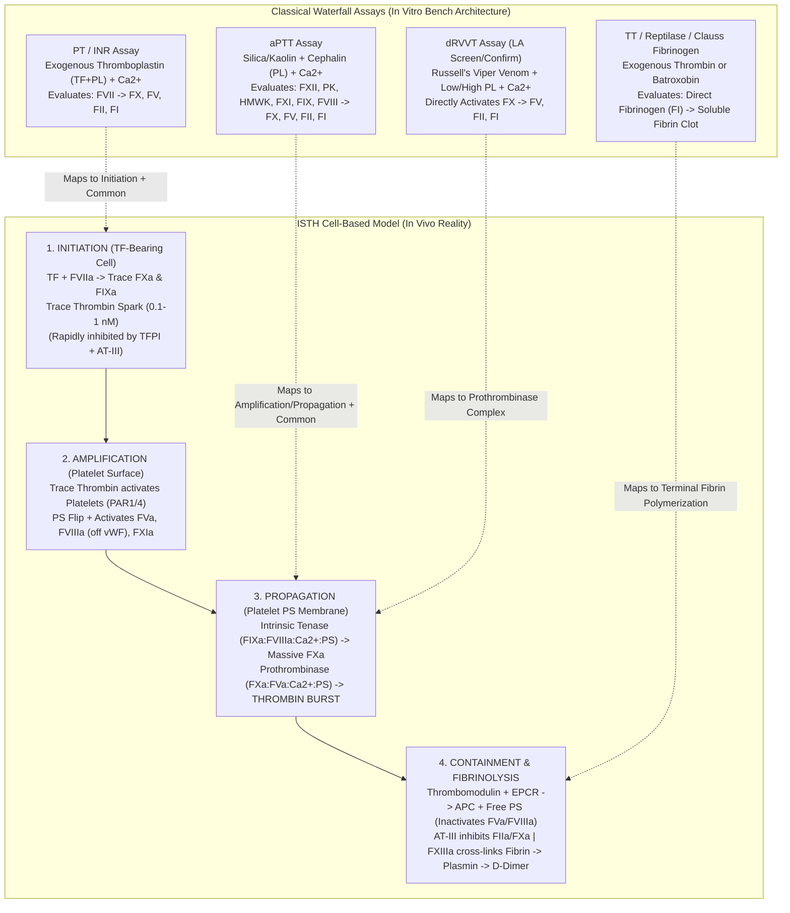
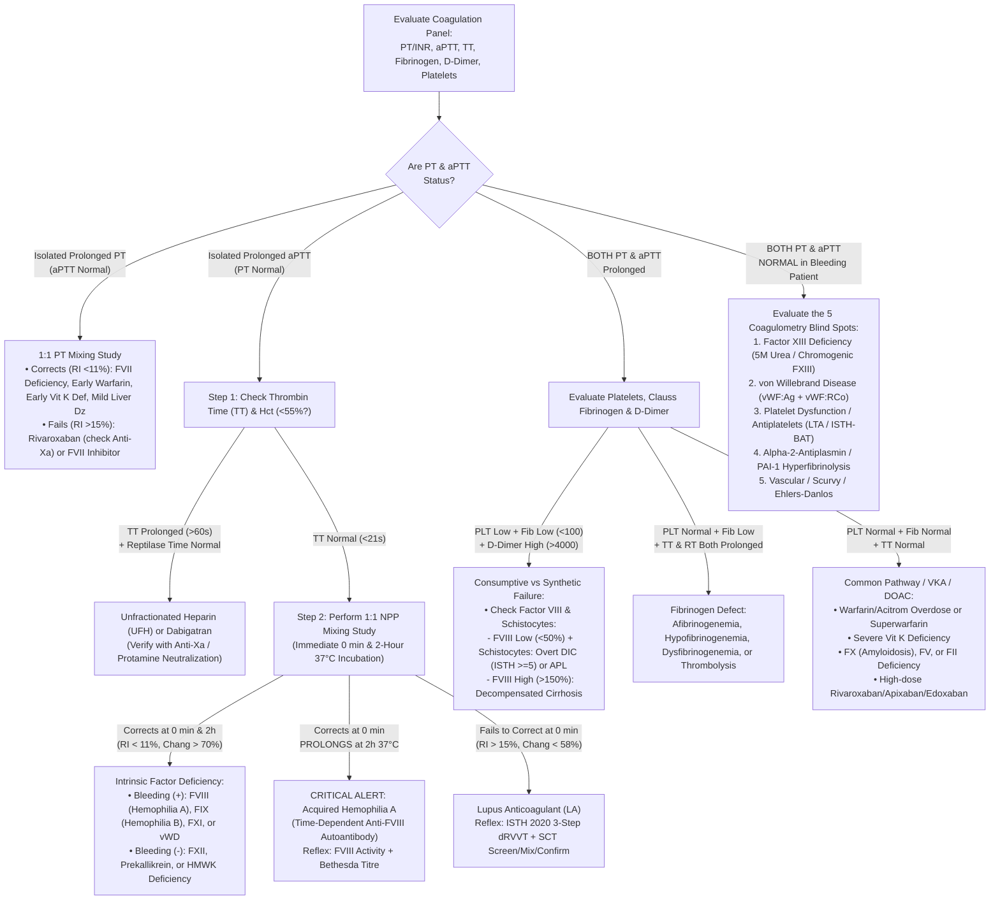

# 🩸 Cluster 1.3: Coagulation, Fibrinolysis & Thrombosis Master Cluster — International Reference Manual & Above-NABL Accredited Clinical Governance SOP

> **Document Control & Regulatory Traceability (`ISO 15189:2022 Clause 8.3.2` & `NABL 112`):**
> - **Laboratory Name:** Sawariya Diagnostic Lab, Charkhi Dadri, Haryana, India
> - **Master Document ID:** `SOP-COA-CL1.3-MASTER-v5.0` (Supersedes `v4.2` / `NABL-HEM-1.3 v2.1`)
> - **Department & Sub-Cluster:** `01_Hematology_and_Coagulation` $\rightarrow$ `1.3_Coagulation_and_Thrombosis_Cluster`
> - **Accreditation & Normative Alignment:** `ISO 15189:2022` (Clauses 4.1–8.9 & Annex A), `NABL 112` (Specific Criteria for Hematology & Coagulation), `NABL 153 / 220D / 223`, `CAP Coagulation Checklist (HEM.36800–38400)`, `CLSI H21-Ed6` (Collection, Transport, and Processing of Blood Specimens for Testing Plasma-Based Coagulation Assays), `CLSI H47-A2` (One-Stage PT and aPTT), `CLSI H54-A` (Local INR/MNPT/ISI Verification), `CLSI H59-A` (Quantitative D-Dimer in VTE Exclusion), `CLSI H60-A` (Viscoelastic & Fibrinogen Testing), `CLSI H45-A2` (Bleeding Time Deprecation), `ISTH SSC Guidelines` (Overt DIC 2001/2025, Lupus Anticoagulant 2020, Hereditary Thrombophilia 2023), `ICSH`, `EFLM EuBIVAS`, `ISO 17511:2020`, `ISO/TS 20914:2019`, and `ISO 22367:2020`.
> - **Effective Date:** `15-Oct-2026` | **Review Cycle:** Annual (or immediately upon Thromboplastin / Cephalin Reagent Lot Change)
> - **Authorizing Signatories:** Technical Manager (Coagulation & Special Hemostasis), Quality Manager (`ISO 15189:2022`), & Laboratory Director / Senior Consultant Hematopathologist (`MD Pathology`)
> - **Controlled Distribution:** Master Quality Management System (`QMS`), Coagulation Bench Workstation, Phlebotomy Command Center, & LIMS Autoverification Rules Engine

---

## 🏛️ SECTION 1: MASTER ARCHITECTURE, BIOPHYSICAL HEMOSTASIS MODEL & SUB-CLUSTER INTEGRATION (`1.3.1` – `1.3.10`)

### 1.1 Dual-Model Biophysical Synthesis: Classical Waterfall Cascade (*In Vitro*) vs. ISTH Cell-Based Hemostasis (*In Vivo*)

A rigorous clinical coagulation laboratory must reconcile the apparent paradox between *in vitro* clotting times and *in vivo* patient bleeding or thrombosis. For instance, severe congenital **Factor XII (Hageman Factor)**, **Prekallikrein (Fletcher Factor)**, or **High-Molecular-Weight Kininogen (`HMWK`, Fitzgerald Factor)** deficiency produces an alarmingly prolonged `aPTT` ($> 100\text{–}150\text{ seconds}$) on the analyzer, yet causes **zero clinical bleeding** in the operating theater. Conversely, **Factor XIIIa (Fibrin-Stabilizing Transglutaminase)** deficiency, **$\alpha_2$-Antiplasmin** deficiency, or mild **von Willebrand Disease (`vWD` Type 1)** can cause life-threatening delayed surgical or postpartum hemorrhage despite a **100% normal `PT/INR` and `aPTT`**.

#### A. The *In Vitro* Macfarlane / Davie-Ratnoff Waterfall Cascade (Analytical Basis of Coagulometry)
On automated photo-optical ($405\text{ nm}$ / $660\text{ nm}$) and electromechanical steel-ball coagulometers (`Stago STart Max`, `Sysmex CA-660`, `Erba ECL 105`, `Horiba Yumizen G`), platelet-poor plasma (`PPP`) is artificially compartmentalized into four analytical pathways:
1. **Extrinsic Pathway (`PT / INR`):** Triggered by adding exogenous **Tissue Factor (`TF`, Thromboplastin — recombinant human or rabbit brain)**, synthetic/natural phospholipids, and excess calcium ions ($\text{CaCl}_2$, $0.025\text{ mol/L}$). `TF` complexes with circulating **Factor VII / VIIa** ($\text{TF:FVIIa:Ca}^{2+}$), directly cleaving **Factor X $\rightarrow$ Factor Xa** and **Factor IX $\rightarrow$ Factor IXa** (the Josso loop, which is bypassed *in vitro* by the massive excess of exogenous thromboplastin). Because **Factor VII** possesses the shortest biological half-life of all procoagulant zymogens ($t_{1/2} = 4\text{–}6\text{ hours}$), `PT/INR` is the earliest laboratory sensor of Vitamin K Antagonist (`VKA`: Warfarin / Acenocoumarol) initiation, early dietary/antibiotic Vitamin K depletion, and acute synthetic liver failure.
2. **Intrinsic / Contact Activation Pathway (`aPTT`):** Triggered by incubating citrated `PPP` at $37.0^\circ\text{C}$ with a negatively charged **contact activator** (micronized silica, kaolin, ellagic acid, or celite) and a **partial thromboplastin** (cephalin phospholipid substitute lacking Tissue Factor, explaining why the assay is termed *partial* thromboplastin time), followed by re-calcification ($\text{CaCl}_2$). Contact activation converts **Factor XII $\rightarrow$ FXIIa** (amplified reciprocally by **Prekallikrein** and **`HMWK`**), which activates **Factor XI $\rightarrow$ FXIa**, which subsequently activates **Factor IX $\rightarrow$ FIXa** in a $\text{Ca}^{2+}$-dependent step. **Factor IXa** forms the **Intrinsic Tenase Complex** with thrombin-activated **Factor VIIIa**, phospholipid (`PL`), and $\text{Ca}^{2+}$ ($\text{FIXa:FVIIIa:Ca}^{2+}\text{:PL}$) to cleave **Factor X $\rightarrow$ FXa**.
3. **Common Pathway (`PT`, `aPTT`, and `dRVVT` Convergence):** **Factor Xa** complexes with **Factor Va**, anionic phospholipids, and $\text{Ca}^{2+}$ to form the **Prothrombinase Complex** ($\text{FXa:FVa:Ca}^{2+}\text{:PL}$), which accelerates the conversion of **Prothrombin (Factor II) $\rightarrow$ $\alpha$-Thrombin (Factor IIa)** by a factor of $\sim 300,000\text{-fold}$. Note that **Dilute Russell's Viper Venom (`dRVVT`)** directly activates **Factor X $\rightarrow$ FXa**, bypassing both Factor VII (Extrinsic) and Factors XII/XI/IX/VIII (Intrinsic).
4. **Fibrin Polymerization & Cross-Linking (`Clauss Fibrinogen`, `TT`, `Reptilase Time`):**
   - **Step 1 (Proteolytic Cleavage):** $\alpha$-Thrombin (`Factor IIa`) cleaves soluble hexameric **Fibrinogen (`Factor I`, $\text{A}\alpha_2\text{B}\beta_2\gamma_2$, $340\text{ kDa}$)**, releasing **Fibrinopeptide A (`FpA`)** and **Fibrinopeptide B (`FpB`)** to generate **Fibrin Monomers**. *(By contrast, **Batroxobin / Reptilase** from Bothrops atrox venom cleaves ONLY **Fibrinopeptide A** and is completely unaffected by Antithrombin-Heparin complexes or Dabigatran).*
   - **Step 2 (Spontaneous Hydrogen-Bonded Polymerization):** Fibrin monomers spontaneously self-assemble end-to-end and side-to-side into non-covalently linked **Soluble Fibrin Polymers**. **This is the exact physical endpoint detected by `PT`, `aPTT`, `TT`, `RT`, `dRVVT`, and `Clauss Fibrinogen` coagulometers** (via increased optical turbidity $\Delta\text{OD}$ at $405/660\text{ nm}$ or mechanical arrest of an oscillating steel ball).
   - **Step 3 (Factor XIIIa Covalent Cross-Linking — Invisible to Routine Clotting Times!):** Thrombin activates **Factor XIII $\rightarrow$ Factor XIIIa**, a $\text{Ca}^{2+}$-dependent transglutaminase that catalyzes covalent $\varepsilon$-($\gamma$-glutamyl)lysine isopeptide bonds between adjacent **$\gamma$-chains ($\gamma\text{–}\gamma$ dimers)** and **$\alpha$-chains ($\alpha$-polymers)**, converting urea-soluble fibrin into an insoluble, mechanically stable clot.
5. **Endogenous Fibrinolysis (`D-Dimer` & `FDP`):** Endothelial **Tissue Plasminogen Activator (`tPA`)** binds to cross-linked fibrin and converts **Plasminogen $\rightarrow$ Plasmin**. While plasmin cleaves both native fibrinogen and non-crosslinked fibrin into general **Fibrin/Fibrinogen Degradation Products (`FDPs`: Fragments X, Y, D, and E)**, ONLY the plasmin-mediated proteolysis of **Factor XIIIa-cross-linked insoluble fibrin** releases the covalently linked **`D-Dimer` neo-epitope ($\text{D-D-E}$ complex)** recognized by monoclonal antibodies (`MAb DD-3B6 / 8D3`).

#### B. The Hoffman-Monroe ISTH Cell-Based Model of Hemostasis (*In Vivo* Physiological Reality)
In living human vasculature, coagulation does not occur in bulk fluid plasma; it occurs strictly on localized cell-membrane surfaces in four overlapping phases:
- **Phase 1 — Initiation (on Tissue Factor-Bearing Extravascular Cells):** Following endothelial injury, subendothelial fibroblasts, pericytes, and monocytes expressing transmembrane **Tissue Factor (`TF`)** bind trace circulating **Factor VIIa** ($1\%$ of total FVII). The $\text{TF:FVIIa}$ complex generates picomolar quantities of **Factor Xa** and **Factor IXa** (Josso loop). On the TF-bearing cell surface, trace $\text{FXa:FVa}$ produces a tiny "spark" of **Thrombin (`FIIa`, $\sim 0.1\text{–}1.0\text{ nmol/L}$)**—insufficient to polymerize a stable fibrin clot before **Tissue Factor Pathway Inhibitor (`TFPI`)** (complexed with Protein S) and **Antithrombin (`AT-III`)** extinguish the Extrinsic `TF:FVIIa:FXa` complex.
- **Phase 2 — Amplification (on Adherent Platelet Surfaces):** The picomolar thrombin spark diffuses to platelets tethered at the injury site via **$\text{vWF}$–Glycoprotein $\text{Ib/IX/V}$**, cleaving platelet **Protease-Activated Receptors (`PAR-1` and `PAR-4`)**. Activated platelets undergo shape change, degranulate $\alpha$-granules (releasing partially activated **Factor V**, **vWF**, and **Fibrinogen**) and dense granules ($\text{ADP}$, $\text{Ca}^{2+}$, serotonin), and flip negatively charged **Phosphatidylserine (`PS`)** from the inner to the outer membrane leaflet via scramblase (`TMEM16F`). Simultaneously, trace thrombin cleaves **Factor VIII** away from its carrier **vWF** ($\rightarrow \text{FVIIIa}$), activates **Factor V $\rightarrow$ FVa**, and activates **Factor XI $\rightarrow$ FXIa** directly on the platelet surface—*explaining why Factor XII is completely dispensable for in-vivo hemostasis!*
- **Phase 3 — Propagation (The Thrombin Burst on Phosphatidylserine-Rich Platelet Membranes):** **Factor IXa** (derived both from Phase 1 $\text{TF:FVIIa}$ and from platelet-bound $\text{FXIa}$) complexes with **Factor VIIIa** on the platelet $\text{PS}$ membrane to form the **Intrinsic Tenase Complex**, generating massive quantities of **Factor Xa** directly on the platelet surface where it is shielded from plasma `TFPI` and `AT-III`. Platelet-bound **Prothrombinase ($\text{FXa:FVa:Ca}^{2+}\text{:PS}$)** then triggers the explosive **Thrombin Burst ($> 100\text{–}500\text{ nmol/L}$)** required to cleave Fibrinogen into dense Fibrin fibers, activate **Factor XIII $\rightarrow$ FXIIIa**, and activate **Thrombin-Activatable Fibrinolysis Inhibitor (`TAFI`)** to protect the nascent clot from premature lysis. *(Clinical corollary: Hemophilia A [FVIII deficiency] and Hemophilia B [FIX deficiency] bleed severely because, once `TFPI` shuts down the Extrinsic pathway, they cannot assemble the Intrinsic Tenase complex to generate the Phase 3 Thrombin Burst!)*
- **Phase 4 — Endothelial Termination & Anticoagulant Containment:** Thrombin escaping onto intact adjacent endothelium binds transmembrane **Thrombomodulin (`TM`)**, which switches thrombin's substrate specificity from procoagulant (cleaving Fibrinogen/FV/FVIII) to anticoagulant: the **$\text{Thrombin:TM}$ complex** activates **Endothelial Protein C Receptor (`EPCR`)-bound Protein C $\rightarrow$ Activated Protein C (`APC`)**. With **Free Protein S** as cofactor, **`APC` proteolytically inactivates Factor Va and Factor VIIIa** (at $\text{Arg}^{506}$, the exact mutation site in **Factor V Leiden**!). Simultaneously, endothelial **Heparan Sulfate Proteoglycans** accelerate **Antithrombin (`AT-III`)** inhibition of Factors IIa, Xa, IXa, and XIa by $1,000\text{-fold}$.



---

### 1.2 Kinetic Biophysical & Half-Life Matrix of Coagulation & Anticoagulant Proteins

Understanding biological half-lives ($t_{1/2}$), vitamin K dependence ($\gamma$-glutamyl carboxylation of N-terminal `Gla` domains), acute-phase reactivity, and minimum hemostatic plasma levels is essential for interpreting serial coagulation trends, plasma transfusion thresholds (`FFP` vs `Cryoprecipitate` vs `4F-PCC`), and anticoagulant transitions:

| Coagulation Factor / Regulator | Synonym / Gene | Site of Synthesis | Vitamin K (`Gla`) Dependent? | Acute-Phase Reactant? | Biological Half-Life ($t_{1/2}$) | Normal Adult Plasma Concentration | Minimum Hemostatic Level for Surgery | Analytical Assay Sensitivity |
| :--- | :--- | :--- | :--- | :--- | :--- | :--- | :--- | :--- |
| **Factor I** | Fibrinogen (`FGA/FGB/FGG`) | Hepatocyte | No | **Yes** ($\uparrow\uparrow$ in inflammation & pregnancy) | **$72 \text{ – } 120\text{ h}$** ($3\text{–}5\text{ days}$) | $200 \text{ – } 400\text{ mg/dL}$ ($2.0\text{–}4.0\text{ g/L}$) | **$\ge 100\text{ mg/dL}$** ($\ge 200\text{ mg/dL}$ in Obstetric PPH) | Clauss Functional Fibrinogen, `TT`, `RT` (Prolongs `PT`/`aPTT` only when $< 80\text{–}100\text{ mg/dL}$) |
| **Factor II** | Prothrombin (`F2`) | Hepatocyte | **Yes** (`10 Gla` residues) | No | **$60 \text{ – } 72\text{ h}$** ($2.5\text{–}3\text{ days}$) | $80 \text{ – } 120\text{ IU/dL}$ ($\sim 100\text{ }\mu\text{g/mL}$) | $20 \text{ – } 40\%$ | `PT/INR`, `aPTT`, `dRVVT`; governs true antithrombotic steady-state of Warfarin |
| **Factor V** | Labile Factor / Proaccelerin (`F5`) | Hepatocyte ($80\%$) & Megakaryocyte/$\alpha$-granules ($20\%$) | No | No | **$12 \text{ – } 36\text{ h}$** | $70 \text{ – } 130\text{ IU/dL}$ ($\sim 10\text{ }\mu\text{g/mL}$) | $15 \text{ – } 25\%$ | `PT/INR`, `aPTT`, `dRVVT` (Decreased in DIC & liver failure; normal in Vitamin K deficiency) |
| **Factor VII** | Stable Factor / Proconvertin (`F7`) | Hepatocyte | **Yes** (`10 Gla` residues) | No | **$4 \text{ – } 6\text{ h}$** *(Shortest procoagulant $t_{1/2}$!)* | $70 \text{ – } 130\text{ IU/dL}$ ($\sim 0.5\text{ }\mu\text{g/mL}$) | $15 \text{ – } 25\%$ | **Strictly `PT/INR` only** (`aPTT` is $100\%$ normal in isolated FVII deficiency) |
| **Factor VIII** | Antihemophilic Factor (`F8`) | **Liver Sinusoidal Endothelial Cells (`LSECs`)** & Extrahepatic Endothelium *(NOT Hepatocytes!)* | No | **Yes** ($\uparrow\uparrow$ in cirrhosis, pregnancy, stress, inflammation) | **$8 \text{ – } 12\text{ h}$** *(Drops to $< 2\text{ h}$ if `vWF` is absent!)* | $50 \text{ – } 150\text{ IU/dL}$ ($\sim 0.1\text{ }\mu\text{g/mL}$) | $30 \text{ – } 50\%$ ($80\text{–}100\%$ for major surgery/CNS bleed) | **Strictly `aPTT` only**; elevated (`> 200%`) in cirrhosis vs low (`< 50%`) in `DIC` |
| **von Willebrand Factor (`vWF`)** | FVIII Carrier & Platelet Tether (`VWF`) | Endothelial Weibel-Palade bodies & Megakaryocytes | No | **Yes** ($\uparrow\uparrow$ in stress, cirrhosis, pregnancy; lower in Blood Group `O`) | **$12 \text{ – } 16\text{ h}$** | $50 \text{ – } 160\text{ IU/dL}$ (Group `O`: $40\text{–}125\text{ IU/dL}$) | $\ge 50\text{ IU/dL}$ (`vWF:RCo` / `vWF:GPIbM`) | `vWF:Ag`, `vWF:RCo`; `aPTT` prolongs ONLY if secondary `FVIII` falls below $30\text{–}40\%$ |
| **Factor IX** | Christmas Factor (`F9`) | Hepatocyte | **Yes** (`12 Gla` residues) | No | **$18 \text{ – } 24\text{ h}$** | $65 \text{ – } 140\text{ IU/dL}$ ($\sim 5\text{ }\mu\text{g/mL}$) | $30 \text{ – } 50\%$ ($60\text{–}80\%$ for major surgery) | **Strictly `aPTT` only** (Note: Warfarin suppresses FIX, moderately prolonging `aPTT` at high INR) |
| **Factor X** | Stuart-Prower Factor (`F10`) | Hepatocyte | **Yes** (`11 Gla` residues) | No | **$30 \text{ – } 48\text{ h}$** | $70 \text{ – } 130\text{ IU/dL}$ ($\sim 10\text{ }\mu\text{g/mL}$) | $15 \text{ – } 25\%$ | `PT/INR`, `aPTT`, `dRVVT` (Acquired deficiency seen in **AL Amyloidosis** due to fibril adsorption!) |
| **Factor XI** | Plasma Thromboplastin Antecedent (`F11`) | Hepatocyte | No | No | **$45 \text{ – } 80\text{ h}$** | $65 \text{ – } 135\text{ IU/dL}$ ($\sim 5\text{ }\mu\text{g/mL}$) | $20 \text{ – } 30\%$ | **Strictly `aPTT` only** (Hemophilia C — variable mucosal bleeding risk) |
| **Factor XII** | Hageman Factor (`F12`) | Hepatocyte | No | No | **$48 \text{ – } 60\text{ h}$** | $50 \text{ – } 150\text{ IU/dL}$ ($\sim 30\text{ }\mu\text{g/mL}$) | **$0\%$ (Does NOT cause bleeding!)** | **Strictly `aPTT` only** ($<1\%$ FXII causes `aPTT > 120 s` with zero clinical bleeding) |
| **Factor XIII** | Fibrin-Stabilizing Factor (`F13A1/B`) | Megakaryocytes (`A` subunit) & Hepatocytes (`B` subunit) | No | No | **$168 \text{ – } 288\text{ h}$** ($7\text{–}12\text{ days}$, longest $t_{1/2}$!) | $70 \text{ – } 140\text{ IU/dL}$ ($\sim 20\text{ }\mu\text{g/mL}$) | $5 \text{ – } 10\%$ | **Invisible to `PT`, `aPTT`, and `TT`!** Requires `5M Urea Clot Solubility` or Quantitative Chromogenic FXIII Assay |
| **Protein C (`PC`)** | Autoprothrombin IIA (`PROC`) | Hepatocyte | **Yes** (`9 Gla` residues) | No | **$6 \text{ – } 8\text{ h}$** *(Shortest anticoagulant $t_{1/2}$!)* | $70 \text{ – } 140\text{ IU/dL}$ ($\sim 4\text{ }\mu\text{g/mL}$) | N/A (Deficiency causes **Thrombosis / Warfarin Skin Necrosis**) | Chromogenic Amidolytic `PC` Assay (preferred over clot-based `PC` to avoid LA/FVIII artifacts) |
| **Protein S (`PS`)** | APC Cofactor (`PROS1`) | Hepatocyte & Endothelial cells | **Yes** (`11 Gla` residues) | Indirect (`60%` bound to acute-phase **C4b-Binding Protein [`C4BP`]**) | **$30 \text{ – } 42\text{ h}$** | Free `PS`: Male $74\text{–}146\%$, Female $55\text{–}124\%$ | N/A (Deficiency causes **Thrombosis**; physiologically drops in Pregnancy/OCPs) | Monoclonal Latex Immunoassay for **Free Protein S Antigen** ($40\%$ active fraction) |
| **Antithrombin (`AT-III`)** | Heparin Cofactor I (`SERPINC1`) | Hepatocyte | No | Negative acute-phase reactant | **$48 \text{ – } 72\text{ h}$** | $80 \text{ – } 120\text{ IU/dL}$ ($\sim 150\text{ }\mu\text{g/mL}$) | $\ge 80\%$ (for therapeutic response to `UFH` / `LMWH`) | Chromogenic Anti-IIa or Anti-Xa `AT-III` Assay (Decreased in Nephrotic Syndrome, Cirrhosis, Asparaginase, DIC, UFH) |

---

### 1.3 Master Sub-File Architecture & Deep Clinical-Analytical Navigation Index (`1.3.1` to `1.3.10`)

Cluster `1.3` comprises ten interconnected, audit-ready Standard Operating Procedures (`SOPs`). Every bench technologist, duty pathologist, and LIMS autoverification rule must cross-reference the master index below:

| Sub-Code | Test Name & SOP Document Link | LOINC Code | Primary Specimen & Centrifugation | Analytical Method & Platform | Turnaround Time (`TAT`) — STAT / Routine | Core Clinical & Regulatory Mandate |
| :--- | :--- | :--- | :--- | :--- | :--- | :--- |
| **`1.3.1`** | [`1.3.1_Coagulation_and_DIC_Profile_Master_Panel.md`](file:///c:/Users/Dell/Desktop/python/REFERENCES%20AND%20INTERPREATIONS/01_Hematology_and_Coagulation/1.3_Coagulation_and_Thrombosis_Cluster/1.3.1_Coagulation_and_DIC_Profile_Master_Panel.md) | `34714-6` / `5902-2` | $3.2\%$ Citrate Single-Spun PPP ($1,500 \times g$, $15\text{ min}$) + $\text{K}_2\text{EDTA}$ Whole Blood | Integrated Photo-Optical/Mechanical Clotting + Latex `FEU` D-Dimer + Impedance/Optical `PLT` | **STAT:** $\le 45\text{ min}$<br>**Routine:** $\le 2\text{ h}$ | 8-Point **`ISTH` Overt DIC Score ($\ge 5$)**, Sepsis/Obstetric/Trauma Coagulopathy, Cirrhosis vs DIC differentiation (`FVIII` discriminator) |
| **`1.3.2`** | [`1.3.2_Prothrombin_Time_PT_and_International_Normalized_Ratio_INR.md`](file:///c:/Users/Dell/Desktop/python/REFERENCES%20AND%20INTERPREATIONS/01_Hematology_and_Coagulation/1.3_Coagulation_and_Thrombosis_Cluster/1.3.2_Prothrombin_Time_PT_and_International_Normalized_Ratio_INR.md) | `5902-2` / `6301-6` | $3.2\%$ Citrate Single-Spun PPP (Stable $24\text{ h}$ at $18\text{–}25^\circ\text{C}$; **NEVER refrigerate**) | Recombinant / High-Sensitivity Thromboplastin ($\text{ISI } 0.90\text{–}1.05$) + $\text{CaCl}_2$ at $37.0^\circ\text{C}$ | **STAT:** $\le 30\text{ min}$<br>**Routine:** $\le 90\text{ min}$ | Extrinsic/Common pathway, Warfarin/Acitrom `VKA` monitoring, `MELD-Na` / `King's College` liver scoring, `CLSI H54-A` Geometric `MNPT` |
| **`1.3.3`** | [`1.3.3_Activated_Partial_Thromboplastin_Time_aPTT_and_Mixing_Studies.md`](file:///c:/Users/Dell/Desktop/python/REFERENCES%20AND%20INTERPREATIONS/01_Hematology_and_Coagulation/1.3_Coagulation_and_Thrombosis_Cluster/1.3.3_Activated_Partial_Thromboplastin_Time_aPTT_and_Mixing_Studies.md) | `14979-9` / `5946-9` | $3.2\%$ Citrate Single-Spun PPP (Spin $\le 1\text{ h}$ if on `UFH`; test $\le 4\text{ h}$) | Micronized Silica / Ellagic Acid + Cephalin + $0.025\text{ M CaCl}_2$ + $1:1$ `NPP` Mixing (`0 min` & `2 h` $37^\circ\text{C}$) | **STAT (`aPTT`):** $\le 30\text{ min}$<br>**Mixing Study:** $\le 3.5\text{ h}$ | Intrinsic pathway, `UFH` Anti-Xa calibrated range, Hemophilia A/B, **`Rosner Index` (`<11%` vs `>15%`)** & **`Chang % Correction`** for Factor Deficiency vs Acquired FVIII Inhibitor / `LA` |
| **`1.3.4`** | [`1.3.4_Quantitative_D_Dimer_FEU_Age_and_Pregnancy_Adjusted.md`](file:///c:/Users/Dell/Desktop/python/REFERENCES%20AND%20INTERPREATIONS/01_Hematology_and_Coagulation/1.3_Coagulation_and_Thrombosis_Cluster/1.3.4_Quantitative_D_Dimer_FEU_Age_and_Pregnancy_Adjusted.md) | `48065-7` | $3.2\%$ Citrate Single-Spun PPP (Stable $8\text{ h}$ at $18\text{–}25^\circ\text{C}$) | Monoclonal Latex-Enhanced Immunoturbidimetry ($540/800\text{ nm}$) or `CLIA` (`Maglumi X3`) reported in `ng/mL FEU` | **STAT:** $\le 45\text{ min}$<br>**Routine:** $\le 2\text{ h}$ | `CLSI H59-A` VTE (`DVT`/`PE`) exclusion in Low/Intermediate Wells Score, **Age-Adjusted Cutoff ($\text{Age} \times 10\text{ ng/mL FEU}$ for $> 50\text{ yr}$)**, **`YEARS`** & Trimester Pregnancy Cutoffs |
| **`1.3.5`** | [`1.3.5_Plasma_Fibrinogen_Clauss_Functional_Assay.md`](file:///c:/Users/Dell/Desktop/python/REFERENCES%20AND%20INTERPREATIONS/01_Hematology_and_Coagulation/1.3_Coagulation_and_Thrombosis_Cluster/1.3.5_Plasma_Fibrinogen_Clauss_Functional_Assay.md) | `3255-7` | $3.2\%$ Citrate Single-Spun PPP | **Clauss Functional Method:** $1:10$ Owren's Veronal Buffered Plasma + Excess Bovine Thrombin ($\sim 50\text{–}100\text{ NIH U/mL}$) | **STAT (PPH/DIC):** $\le 30\text{ min}$<br>**Routine:** $\le 90\text{ min}$ | True functional Factor I quantification in `DIC`, **Obstetric Postpartum Hemorrhage (`PPH` Action Threshold $< 200\text{ mg/dL}$)**; prohibition of PT-Derived Fibrinogen in coagulopathy |
| **`1.3.6`** | [`1.3.6_Bleeding_Time_BT_and_Clotting_Time_CT_PreOp_Deprecation_Shield.md`](file:///c:/Users/Dell/Desktop/python/REFERENCES%20AND%20INTERPREATIONS/01_Hematology_and_Coagulation/1.3_Coagulation_and_Thrombosis_Cluster/1.3.6_Bleeding_Time_BT_and_Clotting_Time_CT_PreOp_Deprecation_Shield.md) | `5769-5` / `3178-1` | Capillary / Venous Whole Blood *(Deprecated Legacy Bedside Tests)* | Legacy Template Ivy (`40 mmHg` sphygmomanometer cuff) / Duke `BT` & Lee-White `37°C` Glass Tube `CT` | **Bedside:** $\le 30\text{ min}$ | **Mandatory `CLSI H45-A2` / `CAP` / `BCSH` / `ASA` Pre-Operative Deprecation Shield**; structured transition to **`ISTH-BAT` Bleeding Score** + `PLT` + `PT/INR` + `aPTT` + `vWF` |
| **`1.3.7`** | [`1.3.7_Thrombin_Time_TT_and_Fibrin_Degradation_Products_FDP.md`](file:///c:/Users/Dell/Desktop/python/REFERENCES%20AND%20INTERPREATIONS/01_Hematology_and_Coagulation/1.3_Coagulation_and_Thrombosis_Cluster/1.3.7_Thrombin_Time_TT_and_Fibrin_Degradation_Products_FDP.md) | `3243-3` / `48058-2` | $3.2\%$ Citrate Single-Spun PPP | Low-Concentration Bovine Thrombin ($\sim 1.5\text{–}3.0\text{ NIH U/mL}$) `TT` + **Batroxobin (`Reptilase Time`)** + Latex `FDP` | **STAT:** $\le 45\text{ min}$<br>**Routine:** $\le 2\text{ h}$ | Ultra-sensitive detection of **Dabigatran** ($>100\text{ s}$) & **Unfractionated Heparin**; **`TT` vs `Reptilase Time` (`RT`)** discrimination of Heparin/Dabigatran vs Dysfibrinogenemia/Hypofibrinogenemia |
| **`1.3.8`** | [`1.3.8_Lupus_Anticoagulant_LA_dRVVT_and_SCT_Screen_Confirm.md`](file:///c:/Users/Dell/Desktop/python/REFERENCES%20AND%20INTERPREATIONS/01_Hematology_and_Coagulation/1.3_Coagulation_and_Thrombosis_Cluster/1.3.8_Lupus_Anticoagulant_LA_dRVVT_and_SCT_Screen_Confirm.md) | `50410-0` / `75516-5` | $3.2\%$ Citrate **Double-Spun PPP (`PLT < 10,000/μL`)** | **`ISTH 2020` 3-Step Protocol (`Screen` $\rightarrow$ `1:1 Mix` $\rightarrow$ `Confirm`)** across paired **`dRVVT`** & **Silica Clotting Time (`SCT`)** + `DOAC-Stop` | **Routine / Specialized:** $\le 24\text{ h}$ | Antiphospholipid Syndrome (**`2023 ACR/EULAR` & `2006 Sydney` Criteria**), Normalized Screen/Confirm Ratio ($\ge 1.20$), `% Correction`, & mandatory **$\ge 12\text{-week}$ persistence check** |
| **`1.3.9`** | [`1.3.9_Thrombophilia_Profile_Protein_C_Protein_S_Antithrombin_III.md`](file:///c:/Users/Dell/Desktop/python/REFERENCES%20AND%20INTERPREATIONS/01_Hematology_and_Coagulation/1.3_Coagulation_and_Thrombosis_Cluster/1.3.9_Thrombophilia_Profile_Protein_C_Protein_S_Antithrombin_III.md) | `27818-4` / `27822-6` / `27811-9` | $3.2\%$ Citrate **Double-Spun PPP (`PLT < 10,000/μL`)** | Chromogenic Amidolytic `Protein C` ($405\text{ nm}$), Monoclonal Latex `Free Protein S`, Chromogenic `AT-III`, & `APCR / Factor V Leiden` | **Routine / Specialized:** $\le 24\text{–}48\text{ h}$ | Hereditary Venous Thromboembolism evaluation, strict **Acute VTE / VKA / Estrogen / DOAC Washout Gating** to eliminate false-positive and false-negative thrombophilia diagnoses |
| **`1.3.10`** | [`1.3.10_Coagulometer_Operation_PPP_Centrifuge_Verification_MNPT_ISI_and_PM_SOP.md`](file:///c:/Users/Dell/Desktop/python/REFERENCES%20AND%20INTERPREATIONS/01_Hematology_and_Coagulation/1.3_Coagulation_and_Thrombosis_Cluster/1.3.10_Coagulometer_Operation_PPP_Centrifuge_Verification_MNPT_ISI_and_PM_SOP.md) | `NABL-112` / `CAP-HEM` | Coagulometer + Citrate Centrifuge + Normal Donors ($n \ge 20$) | Daily $37.0^\circ\text{C} \pm 0.5^\circ\text{C}$ Thermal Block QC, Lot-to-Lot Geometric `MNPT` ($n \ge 20$) & `ISI` Verification (`CLSI H54-A`), Semi-Annual Centrifuge `PPP` Audit | **Daily / Lot-Change / Semi-Annual** | Foundational `ISO 15189:2022 Clause 6.4 & 7.3` metrological traceability, pipette/probe carryover elimination, and centrifuge tachometer/platelet-count verification |

---

### 1.4 Granular Sub-Cluster Analytical & Mathematical Synthesis (`1.3.1` to `1.3.10`)

#### 1. `1.3.1` — Coagulation & ISTH Overt DIC Profile Master Panel
- **8-Point ISTH Overt DIC Diagnostic Scoring System (`Taylor et al., ISTH SSC 2001` & `ISTH 2025 Harmonized Update`):**
  - *Mandatory Prerequisite Entry Gate:* Does the patient have an **underlying disorder known to be associated with overt DIC** (e.g., Gram-negative/Gram-positive Sepsis, Severe Trauma/Crush Injury, Obstetric Abruptio Placentae / Amniotic Fluid Embolism / Retained Dead Fetus, Acute Promyelocytic Leukemia [`APL`], Mucinous Adenocarcinoma, Acute Hemolytic Transfusion Reaction, or Russell's Viper Envenomation)? **If NO $\rightarrow$ Do not apply the ISTH DIC algorithm.** **If YES $\rightarrow$ Proceed to score:**
  1. **Platelet Count ($\text{K}_2\text{EDTA}$, verified free of pseudothrombocytopenia clumps):**
     - $> 100 \times 10^3/\mu\text{L}$ ($> 100 \times 10^9/\text{L}$) $= \mathbf{0\text{ Points}}$
     - $50 \text{ – } 100 \times 10^3/\mu\text{L}$ ($50\text{–}100 \times 10^9/\text{L}$) $= \mathbf{1\text{ Point}}$
     - $< 50 \times 10^3/\mu\text{L}$ ($< 50 \times 10^9/\text{L}$) $= \mathbf{2\text{ Points}}$
  2. **Elevated Fibrin-Related Marker (`Quantitative D-Dimer` in $\text{ng/mL FEU}$):**
     - No increase ($< 500\text{ ng/mL FEU}$) $= \mathbf{0\text{ Points}}$
     - Moderate increase ($500 \text{ – } 4,000\text{ ng/mL FEU}$) $= \mathbf{2\text{ Points}}$
     - Strong increase ($> 4,000\text{ ng/mL FEU}$) $= \mathbf{3\text{ Points}}$
  3. **Prolonged Prothrombin Time ($\Delta\text{PT in seconds above Local Geometric MNPT}$):**
     - $< 3.0\text{ seconds}$ prolongation above `MNPT` $= \mathbf{0\text{ Points}}$
     - $3.0 \text{ – } 6.0\text{ seconds}$ prolongation above `MNPT` $= \mathbf{1\text{ Point}}$
     - $> 6.0\text{ seconds}$ prolongation above `MNPT` $= \mathbf{2\text{ Points}}$
  4. **Functional Clauss Fibrinogen Level:**
     - $\ge 100\text{ mg/dL}$ ($\ge 1.0\text{ g/L}$) $= \mathbf{0\text{ Points}}$
     - $< 100\text{ mg/dL}$ ($< 1.0\text{ g/L}$) $= \mathbf{1\text{ Point}}$ *(Note: Because Fibrinogen is a potent positive acute-phase reactant in sepsis, baseline Fibrinogen often starts at $500\text{–}700\text{ mg/dL}$; a rapid $50\%$ drop from $600 \rightarrow 220\text{ mg/dL}$ represents massive consumption even while remaining $> 100\text{ mg/dL}$!)*
  - **Total ISTH Score Interpretation:**
    - **Score $\ge 5\text{ Points}$:** **Compatible with Overt (Decompensated) DIC** — Systemic microvascular fibrin thrombosis with simultaneous consumption of platelets and coagulation factors; repeat scoring every **$6\text{–}12\text{ hours}$**.
    - **Score $< 5\text{ Points}$:** **Suggestive of Non-Overt (Compensated) DIC** — Does not exclude evolving consumptive coagulopathy; repeat scoring in **$24\text{–}48\text{ hours}$** using kinetic trends ($\Delta\text{PLT}$ and $\Delta\text{D-Dimer}$).

#### 2. `1.3.2` — Prothrombin Time (`PT`) & International Normalized Ratio (`INR`)
- **Mathematical Standardization (`WHO / ISTH / CLSI H54-A`):**
  $$\text{INR} = \left(\frac{\text{PT}_{\text{Patient (seconds)}}}{\text{MNPT}_{\text{Local Geometric Mean (seconds)}}}\right)^{\text{ISI}}$$
  where the **Local Geometric Mean Normal Prothrombin Time (`MNPT`)** is established on every new reagent lot and every instrument channel using fresh citrated `PPP` from $n \ge 20$ healthy adult donors ($10\text{ males} + 10\text{ females}$):
  $$\text{MNPT} = \left(\prod_{i=1}^{n} \text{PT}_i\right)^{\frac{1}{n}} = \exp\left(\frac{1}{n}\sum_{i=1}^{n} \ln(\text{PT}_i)\right)$$
- **Critical Regulatory Rule:** Never substitute the arithmetic mean or the midpoint of the reference range for the geometric `MNPT`, and never use a thromboplastin reagent with $\text{ISI} > 1.20$ (Sawariya Diagnostic Lab mandates recombinant/human-placental/high-purity rabbit thromboplastin with **$\text{ISI} = 0.90\text{–}1.05$** to minimize inter-laboratory `INR` imprecision).

#### 3. `1.3.3` — Activated Partial Thromboplastin Time (`aPTT`) & $1:1$ Immediate / 2-Hour Incubated Mixing Studies
- **Dual Mathematical Mixing Study Discriminators (`CLSI H47-A2`):**
  When an unexplained isolated `aPTT` prolongation is encountered (after excluding pre-analytical underfilling, $\text{Hct} > 55\%$, and heparin line contamination via Thrombin Time `TT`), perform a **$1:1$ mix ($50\%\text{ Patient PPP} + 50\%\text{ Commercial/Pooled Normal Plasma [NPP with } \ge 80\text{–}100\%\text{ of all factors]}$)** both **Immediately ($t = 0\text{ min}$)** and after **2-Hour Incubation at $37.0^\circ\text{C}$** (running the patient plasma and `NPP` in separate tubes at $37.0^\circ\text{C}$ for $2\text{ hours}$ before combining $1:1$ as the incubated control to correct for thermal Factor V/VIII decay!):
  1. **Rosner Index (`RI`, Index of Circulating Anticoagulant):**
     $$\text{Rosner Index (RI \%)} = \left(\frac{\text{aPTT}_{1:1\text{ Mix}} - \text{aPTT}_{\text{NPP}}}{\text{aPTT}_{\text{Patient}}}\right) \times 100$$
     - **$\text{RI} < 11.0\%$:** **Full Correction** $\rightarrow$ Indicates **Coagulation Factor Deficiency** (a single $1:1$ mix with `NPP` restores any factor from $0\%$ to $\ge 50\%$, which is sufficient to normalize `aPTT`).
     - **$\text{RI} = 11.0\% \text{ – } 15.0\%$:** **Borderline / Equivocal Zone** $\rightarrow$ Repeat with $4:1$ ($80\%\text{ Patient} : 20\%\text{ NPP}$) mix and calculate **Chang Percent Correction**.
     - **$\text{RI} > 15.0\%$:** **Non-Correction** $\rightarrow$ Indicates a **Circulating Inhibitor** (Lupus Anticoagulant, Specific Factor Inhibitor, or Unfractionated Heparin / Dabigatran).
  2. **Chang Percent Correction Formula:**
     $$\text{Chang Correction (\%)} = \left(\frac{\text{aPTT}_{\text{Patient}} - \text{aPTT}_{1:1\text{ Mix}}}{\text{aPTT}_{\text{Patient}} - \text{aPTT}_{\text{NPP}}}\right) \times 100$$
     - **$> 70\%$ Correction:** Factor Deficiency.
     - **$< 58\%$ Correction:** Circulating Inhibitor.
  3. **Time- & Temperature-Dependent Factor VIII Autoantibody (Acquired Hemophilia A Hallmark):**
     - **Immediate Mix ($0\text{ min}$):** **Corrects** ($\text{RI} < 11\%$, Chang $> 70\%$).
     - **2-Hour $37.0^\circ\text{C}$ Incubated Mix:** **Fails to Correct** ($\text{RI} > 15\%$, Chang $< 58\%$, or $\Delta\text{aPTT}_{\text{2h Mix} - \text{2h Control Mix}} > 8\text{–}10\text{ seconds}$).
     - *Pathophysiology:* Autoantibodies against **Factor VIII** (and rarely Factor V) exhibit slow, second-order **time- and temperature-dependent kinetics**, unlike **Lupus Anticoagulant** or **Factor IX inhibitors**, which act **immediately ($0\text{ min}$)**.

#### 4. `1.3.4` — Quantitative `D-Dimer` (`FEU`) with Age-Adjusted, `YEARS` & Pregnancy Cutoffs
- **Molecular Mass & Unit Conversion (`CLSI H59-A`):**
  - **Fibrinogen Equivalent Units (`FEU`):** Calibrated against the molecular mass of intact Fibrinogen ($340\text{ kDa}$). Standard young-adult VTE exclusion cutoff: **$< 500\text{ ng/mL FEU}$** ($< 0.50\text{ }\mu\text{g/mL FEU}$ or $< 0.50\text{ mg/L FEU}$).
  - **D-Dimer Units (`DDU`):** Calibrated against the purified D-Dimer fragment ($195\text{ kDa}$). Standard young-adult VTE exclusion cutoff: **$< 250\text{ ng/mL DDU}$** ($< 0.25\text{ }\mu\text{g/mL DDU}$).
  - **Exact Stoichiometric Relationship:** **$1.0\text{ ng/mL DDU} \approx 2.0\text{ ng/mL FEU}$** (exact mass ratio $340 / 195 = 1.74\text{–}2.00$). Sawariya Diagnostic Lab standardizes all reporting strictly to **`ng/mL FEU`** with dual-unit parenthetical equivalence to prevent lethal $2\times$ clinician misinterpretation.
- **Validated Clinical Decision Cutoffs:**
  - **Patients $\le 50\text{ Years}$ (Low/Intermediate Wells or Revised Geneva Score):** Exclude DVT/PE if **$\text{D-Dimer} < 500\text{ ng/mL FEU}$** ($\text{NPV} > 99.5\%$).
  - **Age-Adjusted Cutoff for Patients $> 50\text{ Years}$ (`ADJUST-PE` Trial / `ESC` Guidelines):**
    $$\text{Age-Adjusted Cutoff (ng/mL FEU)} = \text{Patient Age (Years)} \times 10\text{ ng/mL FEU}$$
    *(Example: For a $68\text{-year-old}$ patient with a low Wells score, a D-Dimer of $610\text{ ng/mL FEU}$ is **NEGATIVE** for VTE because it is below the age-adjusted threshold of $680\text{ ng/mL FEU}$, safely avoiding unnecessary CTPA radiation and contrast nephropathy!)*
  - **`YEARS` Clinical Decision Algorithm (Adult & Pregnancy-Adapted `ARTEMIS` Study):**
    Evaluates three `YEARS` items: (1) Clinical signs of DVT, (2) Hemoptysis, (3) PE is the most likely diagnosis:
    - **$0\text{ YEARS items}$ present:** Exclude PE if **$\text{D-Dimer} < 1,000\text{ ng/mL FEU}$**.
    - **$\ge 1\text{ YEARS item}$ present:** Exclude PE only if **$\text{D-Dimer} < 500\text{ ng/mL FEU}$**.

#### 5. `1.3.5` — Plasma Fibrinogen (`Clauss` Functional Assay vs. Prohibited `PT-Derived` Estimate)
- **Analytical Principle (`Clauss 1957` / `CLSI H60-A`):** Patient `PPP` is diluted **$1:10$ in Owren's Veronal Buffer ($\text{pH } 7.35$)** (to dilute out endogenous heparin up to $0.6\text{ IU/mL}$ and low-level `FDPs`) and reacted with a **massive excess of bovine thrombin ($\sim 50\text{–}100\text{ NIH U/mL}$)**. Because thrombin is in large excess, the log of the clotting time is **inversely proportional** to the log of functional Fibrinogen concentration ($\log[\text{Time}] \propto -\log[\text{Fibrinogen}]$). Auto-redilution at **$1:20$** (for hyperfibrinogenemia $> 500\text{ mg/dL}$) and **$1:5$** (for severe hypofibrinogenemia $< 80\text{ mg/dL}$) extends the Clinical Reportable Range (`CRR`) from **$30\text{ to } 1,200\text{ mg/dL}$**.
- **CAP / BCSH Prohibition of `PT-Derived` Fibrinogen:** Many optical coagulometers estimate "Derived Fibrinogen" from the total change in optical density ($\Delta\text{OD}$) during the routine `PT` test. **Derived Fibrinogen is strictly prohibited for clinical reporting in `DIC`, liver disease, dysfibrinogenemia, fibrinolysis, and anticoagulant therapy** because it systematically overestimates true functional Fibrinogen by **$50\text{–}150\text{ mg/dL}$**, masking critical hypofibrinogenemia ($< 100\text{ mg/dL}$)!

#### 6. `1.3.6` — Legacy Pre-Operative `BT` / `CT` Deprecation Shield & `ISTH-BAT` Transition
- **Regulatory Mandate (`CLSI H45-A2`, `CAP`, `BCSH`, `ASA`):** Skin Bleeding Time (`BT` — Ivy/Duke) and Capillary/Venous Clotting Time (`CT` — Wright/Lee-White) are obsolete screening tests with **$r < 0.15$ correlation** to visceral/surgical bleeding and **$< 5\%$ positive predictive value**. Whole-blood `CT` remains normal until Factor VIII or IX falls below **$< 1\text{–}2\%$** (completely missing mild/moderate Hemophilia A/B with $5\text{–}35\%$ factor levels who bleed catastrophically during surgery!). Whenever a surgeon orders pre-operative `BT/CT`, the LIMS appends the mandatory **Medico-Legal Deprecation Shield** and guides transition to the **ISTH Bleeding Assessment Tool (`ISTH-BAT`: Abnormal if $\ge 4$ in adult males, $\ge 6$ in adult females, $\ge 3$ in children)** plus automated **`Platelet Count` + `PT/INR` + `aPTT`**.

#### 7. `1.3.7` — Thrombin Time (`TT`), Reptilase Time (`RT` / Batroxobin), & `FDP`
- **The `TT` vs. `Reptilase Time` (`RT`) Diagnostic Discriminator Matrix:**
  Because **Thrombin Time (`TT`)** uses low-concentration bovine thrombin ($\sim 1.5\text{–}3.0\text{ NIH U/mL}$), it is exquisitely sensitive to trace **Unfractionated Heparin (`UFH` $\ge 0.05\text{ IU/mL}$)** and **Dabigatran ($\ge 10\text{–}20\text{ ng/mL}$)**. Conversely, **Reptilase (`Batroxobin`)** is a snake-venom serine protease that cleaves Fibrinopeptide A (`FpA`) without being inhibited by **Antithrombin-Heparin** or **Direct Thrombin Inhibitors (`Dabigatran` / `Argatroban` / `Bivalirudin`)**:
  - **`TT` Markedly Prolonged ($> 60\text{–}120\text{ s}$) + `Reptilase Time` NORMAL ($14\text{–}20\text{ s}$):** Confirms **Unfractionated Heparin (`UFH`)** or **Direct Thrombin Inhibitor (`Dabigatran`, `Argatroban`, `Bivalirudin`)**! *(Confirmed further if mixing with `Protamine Sulfate` or `Hepzyme` corrects `TT` in `UFH`, whereas `Dabigatran` does NOT correct with Protamine/Hepzyme).*
  - **`TT` Prolonged + `Reptilase Time` ALSO Prolonged ($> 22\text{ s}$):** Confirms a **Fibrinogen / Fibrin Polymerization Defect**: Severe Hypofibrinogenemia ($< 100\text{ mg/dL}$), Congenital or Acquired **Dysfibrinogenemia** (hepatocellular carcinoma, cirrhosis), high-level **`FDPs` / Primary Hyperfibrinolysis**, or **Paraproteinemia (Multiple Myeloma / Waldenström Macroglobulinemia)** physically sterically hindering fibrin monomer polymerization.

#### 8. `1.3.8` — Lupus Anticoagulant (`LA`) — `ISTH 2020` 3-Step `dRVVT` & `SCT` Protocol
- **Paradoxical Biophysical Mechanism:** Lupus Anticoagulants are heterogeneous **antiphospholipid autoantibodies (`IgG` or `IgM`)** directed against phospholipid-binding plasma proteins—principally **$\beta_2$-Glycoprotein I ($\beta_2\text{GPI}$, Domain I)** and **Prothrombin (`Factor II`)**. *In vitro*, they compete with coagulation factors (`FXa`, `FVa`, `FIXa`, `FVIIIa`, `FII`) for binding to the limited synthetic phospholipids in **`dRVVT` Screen** and **`SCT` / `LA-aPTT` Screen** reagents, **prolonging the clotting time**. *In vivo*, where cell membranes are abundant, they cross-link $\beta_2\text{GPI}$ on endothelial cells, monocytes, and platelets (via `ApoER2` and `TLR4`), upregulating Tissue Factor, inhibiting Protein C/Thrombomodulin, disrupting the placental **Annexin A5 anticoagulant shield**, and causing **arterial, venous, and microvascular thrombosis plus recurrent pregnancy morbidity (Antiphospholipid Syndrome [`APS`])**.
- **`ISTH SSC 2020` Mandatory Dual-Pathway 3-Step Architecture:**
  Because no single assay detects all `LA` isotypes, `ISTH 2020` mandates performing **two tests based on different principles** in parallel: (1) **Dilute Russell's Viper Venom Time (`dRVVT` — primary gold standard, activating Factor X directly)** and (2) **Silica Clotting Time (`SCT` or `LA-sensitive low-phospholipid aPTT` with silica activator — kaolin and ellagic acid are discouraged)**:
  - **Step 1 — Screen (Low Phospholipid Concentration):** Prolongs if `LA`, Factor deficiency, or anticoagulant is present:
    $$\text{Normalized Screen Ratio (}\text{SR}_{\text{norm}}\text{)} = \frac{\text{Patient Screen Time (s)}}{\text{Pooled Normal Plasma (NPP) Screen Time (s)}} \quad (\text{Positive if } \ge 1.20)$$
  - **Step 2 — $1:1$ Mixing Study ($50\%\text{ Patient Double-Spun PPP} + 50\%\text{ Double-Spun NPP}$ in Screen Reagent without Incubation):**
    $$\text{Normalized Mix Ratio (}\text{MR}_{\text{norm}}\text{)} = \frac{\text{1:1 Mix Screen Time (s)}}{\text{NPP Screen Time (s)}} \quad (\text{Inhibitor confirmed if } \ge 1.20\text{ or }\text{RI} > 11\text{–}15\%)$$
  - **Step 3 — Confirm (High Phospholipid Concentration — Bilayer or Hexagonal Phase Phospholipids):** Excess phospholipid neutralizes ("swamps") the `LA` autoantibody, shortening the clotting time back toward normal:
    $$\text{Normalized Confirm Ratio (}\text{CR}_{\text{norm}}\text{)} = \frac{\text{Patient Confirm Time (s)}}{\text{NPP Confirm Time (s)}}$$
    $$\text{Normalized LA Screen/Confirm Ratio (}\text{TR}_{\text{norm}}\text{)} = \frac{\text{SR}_{\text{norm}}}{\text{CR}_{\text{norm}}} \quad (\text{LA Positive if } \ge 1.20)$$
    $$\text{Percent Phospholipid Correction (\%)} = \left(\frac{\text{SR}_{\text{norm}} - \text{CR}_{\text{norm}}}{\text{SR}_{\text{norm}}}\right) \times 100 \quad (\text{LA Positive if } \ge 10\%\text{–}15\%)$$

#### 9. `1.3.9` — Hereditary Thrombophilia Profile (`Protein C`, `Free Protein S`, `Antithrombin III`, `APC Resistance`)
- **Assay Method Selection Mandate (`ISTH SSC` & `CAP HEM`):**
  - **Protein C (`PC`):** Must be measured using a **Chromogenic Amidolytic Assay** (activating `PC` with *Agkistrodon contortrix contortrix* snake venom [**Protac**] and measuring cleavage of chromogenic substrate `pNA` at $405\text{ nm}$). Clot-based `PC` assays are prone to **false-low results** in patients with **Elevated Factor VIII ($> 200\%$)** or **Factor V Leiden**, and **false-high (normal) results** in the presence of **Lupus Anticoagulant** or **DOACs**! *(Note: Only rare **Type IIb Protein C deficiency** [$<2\%$ of cases, defective phospholipid/substrate binding] requires a functional clot-based `PC` assay).*
  - **Protein S (`PS`):** Must be screened using a **Monoclonal Latex-Enhanced Immunoassay for `Free Protein S Antigen`** (measuring the $40\%$ physiologically active unbound fraction not complexed to `C4b-Binding Protein`). Clot-based `PS` activity assays suffer from severe interference by `Factor V Leiden` and `LA`.
  - **Antithrombin (`AT-III`):** Measured via a **Heparin-Cofactor Chromogenic Assay** ($405\text{ nm}$). Note that **Factor Xa-based chromogenic `AT-III` assays** are falsely elevated by **Rivaroxaban / Apixaban / Edoxaban**, whereas **Factor IIa (Thrombin)-based chromogenic `AT-III` assays** are falsely elevated by **Dabigatran**!

#### 10. `1.3.10` — Coagulometer Operation, `PPP` Centrifuge Verification, `MNPT`/`ISI` Verification & Maintenance
- Establishes daily $37.0^\circ\text{C} \pm 0.5^\circ\text{C}$ reaction block thermal verification, two-level normal and pathological commercial plasmas (`IQC` before every shift and every $8\text{ hours}$), lot-to-lot geometric `MNPT` ($n \ge 20$) and `ISI` orthogonal regression verification (`CLSI H54-A`), and semi-annual **Citrate Centrifuge `PPP` Verification** ($1,500 \times g$ for $15\text{ minutes}$ verified to yield **$\text{Platelet Count} < 10,000/\mu\text{L}$** across $n = 10$ patient plasmas).

---

## 🧪 SECTION 2: STRICT PRE-ANALYTICAL GOVERNANCE (`CLSI H21-Ed6` & `CAP HEM.37000`)

Over **$68\text{–}75\%$ of all erroneous coagulation results** originate in the pre-analytical phase. Unlike routine biochemistry or $\text{EDTA}$ hematology, plasma-based coagulation assays depend on an exact chemical equilibrium between endogenous plasma calcium, sodium citrate chelator, and the exogenous $\text{CaCl}_2$ added on the analyzer.

### 2.1 Exact `9:1` Blood-to-$3.2\%$ ($0.109\text{ mol/L}$) Buffered Trisodium Citrate Stoichiometry

1. **Mandatory Anticoagulant Specification (`CLSI H21-Ed6` & `ISTH`):**
   - Specimens must be collected into **Light-Blue Top evacuated siliconized glass or polypropylene tubes** containing **$3.2\%$ ($0.109\text{ mol/L}$ or $109\text{ mmol/L}$) Buffered Trisodium Citrate Dihydrate ($\text{Na}_3\text{C}_6\text{H}_5\text{O}_7 \cdot 2\text{H}_2\text{O}$)**.
   - **Prohibition of $3.8\%$ ($0.129\text{ mol/L}$) Citrate Tubes:** Legacy $3.8\%$ trisodium citrate tubes contain $18\%$ more citrate ions per milliliter. When standard $0.025\text{ mol/L }\text{CaCl}_2$ reagent is added on the coagulometer, the excess citrate binds more reagent calcium, artificially prolonging `PT` and `aPTT` and **overestimating `INR` by $+0.2\text{ to }+0.7\text{ INR units}$** (especially with higher-`ISI` thromboplastins). Sawariya Diagnostic Lab strictly prohibits $3.8\%$ citrate tubes.
2. **The `9:1` Volumetric Ratio & $\ge 90\%$ Fill-Line Hard Gate:**
   - Standard coagulation tubes are calibrated for an exact **$9\text{ parts venous whole blood} : 1\text{ part } 3.2\%\text{ liquid trisodium citrate}$** volumetric ratio (e.g., inside a standard $2.7\text{ mL}$ draw tube, $0.30\text{ mL}$ of liquid $3.2\%$ citrate is pre-dispensed to mix with $2.70\text{ mL}$ of whole blood, yielding a total tube volume of $3.00\text{ mL}$; or inside a $1.8\text{ mL}$ draw tube, $0.20\text{ mL}$ of citrate mixes with $1.80\text{ mL}$ of whole blood for $2.00\text{ mL}$ total).
   - **Biophysical Mechanism of Underfilling ($< 90\%$ of Nominal Fill Mark):**
     Because trisodium citrate is restricted exclusively to the **extracellular plasma phase** (citrate anions cannot penetrate erythrocyte membranes), adding insufficient blood to a fixed volume of liquid citrate leaves a **stoichiometric excess of unbound free citrate anions in the plasma**. When the coagulometer adds a fixed concentration of exogenous calcium ($\text{CaCl}_2$) to trigger clotting, the excess free citrate chelates the reagent $\text{Ca}^{2+}$, starving the Tenase ($\text{FIXa:FVIIIa:Ca}^{2+}\text{:PL}$) and Prothrombinase ($\text{FXa:FVa:Ca}^{2+}\text{:PL}$) complexes of free ionized calcium and causing **severe, artifactual prolongation of `aPTT` (affected first at $< 85\text{–}90\%$ fill) and `PT/INR` (affected at $< 80\text{–}85\%$ fill)**!
   - **Mandatory Rejection Criterion:** Any citrate tube filled to **$< 90\%$** (or overfilled $> 110\%$ via syringe forced injection, which causes insufficient anticoagulation and micro-clot formation) of the manufacturer's etched frost-line mark is **summarily rejected at the Accessioning Bench (`Error Code: PRE-COA-01`)**.

---

### 2.2 `CLSI H21-Ed6` Mathematical Citrate-Volume Adjustment for Polycythemia (`Hct > 55%`)

#### A. Biophysical Derivation & The Exact `CLSI H21-Ed6` Formula
The standard $9:1$ blood-to-citrate ratio assumes a normal adult **Hematocrit (`Hct` / `PCV`) of $25\% \text{ – } 55\%$**, where approximately $55\text{–}60\%$ of the whole blood draw consists of plasma. In patients with **severe erythrocytosis / polycythemia ($\text{Hct} > 55\%$)**—such as **Term/Preterm Neonates ($\text{Hct } 56\text{–}68\%$)**, **Polycythemia Vera (`JAK2 V617F`)**, **Cyanotic Congenital Heart Disease (Tetralogy of Fallot / Eisenmenger Syndrome)**, **Chronic Obstructive Pulmonary Disease (`COPD`)**, or **Severe Dengue Hemorrhagic Fever / Burn Hemoconcentration**—the plasma compartment shrinks drastically while the liquid citrate volume inside the commercial tube remains fixed. Consequently, the effective plasma-to-citrate ratio drops from normal $\sim 5:1$ down to $2.5:1$ or $3:1$, producing **pseudocoagulopathy (falsely prolonged `PT/INR` and `aPTT`)** identical to an underfilled tube!

Per **`CLSI H21-Ed6`**, whenever a patient's known or concurrent $\text{EDTA}$ **Hematocrit exceeds $55\%$ ($\text{PCV} > 0.55\text{ L/L}$)**, the volume of $3.2\%$ ($0.109\text{ mol/L}$) trisodium citrate must be mathematically adjusted using the **CLSI Citrate Adjustment Equation**:

$$C = \left(1.85 \times 10^{-3}\right) \times \left(100 - \text{Hct}[\%]\right) \times V_{\text{blood}}$$

Where:
- **$C$** $=$ Exact volume ($\text{mL}$) of $3.2\%$ ($0.109\text{ M}$) buffered trisodium citrate required to remain in the tube.
- **$\text{Hct}[\%]$** $=$ Patient's Hematocrit expressed as a whole percentage (e.g., $62$ for $62\%$).
- **$V_{\text{blood}}$** $=$ Volume ($\text{mL}$) of whole blood to be added to the tube.
- **$1.85 \times 10^{-3}$** $=$ Constant derived from standard normal baseline ($\text{Hct} = 46\%$, where $100 - 46 = 54$, and $1 / [9 \times 54] \approx 0.00205$ or $1 / [10 \times 54] = 0.00185\text{ mL citrate per mL total tube volume}$).

#### B. Why Severe Anemia ($\text{Hct} < 20\%$) Does NOT Require Citrate Adjustment (`CLSI H21-Ed6`)
Historically, legacy textbooks speculated that severe anemia ($\text{Hct} < 20\%$) might dilute citrate across an expanded plasma volume and require adding extra citrate. **`CLSI H21-Ed6` explicitly states that citrate adjustment is NOT required or recommended for severe anemia ($\text{Hct} < 20\%$)** because:
1. Empirical clinical studies (`Siegel et al.`, `Marlar et al.`) demonstrate that even at $\text{Hct} = 10\text{–}15\%$, there is still a large stoichiometric excess of trisodium citrate relative to plasma $\text{Ca}^{2+}$, preventing any *in vitro* clotting or clinically significant shortening of `PT`/`aPTT`.
2. Attempting to inject additional citrate into an evacuated tube introduces unvalidated dilution errors and bacterial/air contamination risks.

#### C. Turnkey Bench Reference Table for `CLSI H21-Ed6` Citrate Adjustment ($\text{Hct } 56\% \text{ to } 75\%$)
*Bench Protocol:* Using a sterile $1.0\text{ mL}$ tuberculin syringe (calibrated in $0.01\text{ mL}$ increments) or a calibrated micropipette inside a Biosafety Cabinet (replacing the sterile stopper immediately or drawing blood via syringe and dispensing the exact $V_{\text{blood}}$ into a sterile polypropylene tube containing the exact adjusted citrate volume $C$), remove the specified excess citrate **before** adding the patient's whole blood:

| Patient Hematocrit (`Hct / PCV %`) | **Standard $2.7\text{ mL}$ Draw Tube**<br>*(Initial Citrate $= 0.30\text{ mL}$; $V_{\text{blood}} = 2.70\text{ mL}$)*<br>**Retain Citrate $C$ ($\text{mL}$)** | **Standard $2.7\text{ mL}$ Draw Tube**<br>**Volume of Citrate to ASPIRATE & DISCARD ($\text{mL}$ / $\mu\text{L}$)** | **Pediatric $1.8\text{ mL}$ Draw Tube**<br>*(Initial Citrate $= 0.20\text{ mL}$; $V_{\text{blood}} = 1.80\text{ mL}$)*<br>**Retain Citrate $C$ ($\text{mL}$)** | **Pediatric $1.8\text{ mL}$ Draw Tube**<br>**Volume of Citrate to ASPIRATE & DISCARD ($\text{mL}$ / $\mu\text{L}$)** | **Standard $4.5\text{ mL}$ Draw Tube**<br>*(Initial Citrate $= 0.50\text{ mL}$; $V_{\text{blood}} = 4.50\text{ mL}$)*<br>**Retain Citrate $C$ ($\text{mL}$)** | **Standard $4.5\text{ mL}$ Draw Tube**<br>**Volume of Citrate to ASPIRATE & DISCARD ($\text{mL}$ / $\mu\text{L}$)** |
| :---: | :---: | :---: | :---: | :---: | :---: | :---: |
| **$\le 55\%$ (Normal)** | **$0.30\text{ mL}$** | **$0.00\text{ mL}$ (No adjustment)** | **$0.20\text{ mL}$** | **$0.00\text{ mL}$ (No adjustment)** | **$0.50\text{ mL}$** | **$0.00\text{ mL}$ (No adjustment)** |
| **$56\%$** | $0.22\text{ mL}$ | **Remove $0.08\text{ mL}$ ($80\text{ }\mu\text{L}$)** | $0.15\text{ mL}$ | **Remove $0.05\text{ mL}$ ($50\text{ }\mu\text{L}$)** | $0.37\text{ mL}$ | **Remove $0.13\text{ mL}$ ($130\text{ }\mu\text{L}$)** |
| **$58\%$** | $0.21\text{ mL}$ | **Remove $0.09\text{ mL}$ ($90\text{ }\mu\text{L}$)** | $0.14\text{ mL}$ | **Remove $0.06\text{ mL}$ ($60\text{ }\mu\text{L}$)** | $0.35\text{ mL}$ | **Remove $0.15\text{ mL}$ ($150\text{ }\mu\text{L}$)** |
| **$60\%$** | $0.20\text{ mL}$ | **Remove $0.10\text{ mL}$ ($100\text{ }\mu\text{L}$)** | $0.13\text{ mL}$ | **Remove $0.07\text{ mL}$ ($70\text{ }\mu\text{L}$)** | $0.33\text{ mL}$ | **Remove $0.17\text{ mL}$ ($170\text{ }\mu\text{L}$)** |
| **$62\%$** | $0.19\text{ mL}$ | **Remove $0.11\text{ mL}$ ($110\text{ }\mu\text{L}$)** | $0.13\text{ mL}$ | **Remove $0.07\text{ mL}$ ($70\text{ }\mu\text{L}$)** | $0.32\text{ mL}$ | **Remove $0.18\text{ mL}$ ($180\text{ }\mu\text{L}$)** |
| **$64\%$** | $0.18\text{ mL}$ | **Remove $0.12\text{ mL}$ ($120\text{ }\mu\text{L}$)** | $0.12\text{ mL}$ | **Remove $0.08\text{ mL}$ ($80\text{ }\mu\text{L}$)** | $0.30\text{ mL}$ | **Remove $0.20\text{ mL}$ ($200\text{ }\mu\text{L}$)** |
| **$66\%$** | $0.17\text{ mL}$ | **Remove $0.13\text{ mL}$ ($130\text{ }\mu\text{L}$)** | $0.11\text{ mL}$ | **Remove $0.09\text{ mL}$ ($90\text{ }\mu\text{L}$)** | $0.28\text{ mL}$ | **Remove $0.22\text{ mL}$ ($220\text{ }\mu\text{L}$)** |
| **$68\%$** | $0.16\text{ mL}$ | **Remove $0.14\text{ mL}$ ($140\text{ }\mu\text{L}$)** | $0.11\text{ mL}$ | **Remove $0.09\text{ mL}$ ($90\text{ }\mu\text{L}$)** | $0.27\text{ mL}$ | **Remove $0.23\text{ mL}$ ($230\text{ }\mu\text{L}$)** |
| **$70\%$** | $0.15\text{ mL}$ | **Remove $0.15\text{ mL}$ ($150\text{ }\mu\text{L}$)** | $0.10\text{ mL}$ | **Remove $0.10\text{ mL}$ ($100\text{ }\mu\text{L}$)** | $0.25\text{ mL}$ | **Remove $0.25\text{ mL}$ ($250\text{ }\mu\text{L}$)** |
| **$72\%$** | $0.14\text{ mL}$ | **Remove $0.16\text{ mL}$ ($160\text{ }\mu\text{L}$)** | $0.09\text{ mL}$ | **Remove $0.11\text{ mL}$ ($110\text{ }\mu\text{L}$)** | $0.23\text{ mL}$ | **Remove $0.27\text{ mL}$ ($270\text{ }\mu\text{L}$)** |
| **$75\%$** | $0.125\text{ mL}$ | **Remove $0.175\text{ mL}$ ($175\text{ }\mu\text{L}$)** | $0.08\text{ mL}$ | **Remove $0.12\text{ mL}$ ($120\text{ }\mu\text{L}$)** | $0.21\text{ mL}$ | **Remove $0.29\text{ mL}$ ($290\text{ }\mu\text{L}$)** |

---

### 2.3 Order of Draw (`CLSI GP41-Ed7` & `H21-Ed6`), Butterfly Dead-Space Rules & Line-Draw Prohibitions

1. **Mandatory Order of Draw (`CLSI GP41-Ed7`):**
   - **1st:** Blood Culture Bottles (Sterile Aerobic $\rightarrow$ Anaerobic).
   - **2nd:** **Light-Blue Top $3.2\%$ Buffered Trisodium Citrate Tube (`Coagulation`)** — Drawn **BEFORE** all other additive tubes!
   - **3rd:** Serum Tubes (Red Top / Gold `SST` containing micronized silica particles or thrombin clot activators — if drawn before Citrate, needle carryover of silica/thrombin activates the contact pathway and **falsely shortens `aPTT` or causes micro-clots**).
   - **4th:** Green Top Lithium/Sodium Heparin Tube (if drawn before Citrate, heparin carryover **prolongs `aPTT` $> 150\text{ s}$ and `TT` $> 120\text{ s}$**).
   - **5th:** Lavender Top $\text{K}_2\text{EDTA}$ Tube (if drawn before Citrate, irreversible $\text{EDTA}$ chelation of $\text{Ca}^{2+}$ and Factor V/VIII instability causes **extreme false prolongation of `PT` and `aPTT` plus false-positive Factor V/VIII inhibitor patterns**!).
   - **6th:** Grey Top Sodium Fluoride / Potassium Oxalate Tube.
2. **Winged Blood Collection Set ("Butterfly") Dead-Space Air Rule (`CLSI H21-Ed6`):**
   - Flexible plastic tubing of a winged butterfly needle contains **$0.3\text{ to } 0.5\text{ mL}$ of dead-space air**. If a Light-Blue Citrate tube is connected as the very first tube on a butterfly set, that $0.4\text{ mL}$ of air is sucked into the citrate vacuum first, reducing the blood draw volume by $15\text{–}22\%$ and causing **automatic $< 90\%$ underfilling**!
   - **Mandatory Butterfly Rule:** When using a winged butterfly set, the phlebotomist **MUST first attach a non-additive clear discard tube (or a second Light-Blue Citrate tube)** solely to prime the tubing with blood until blood reaches the hub, then remove the discard tube and fill the analytical Light-Blue Citrate tube to $100\%$ capacity.
   - *Note on Straight Evacuated Needles:* When performing a clean, direct venipuncture with a straight double-ended needle (`CLSI H21-Ed6`), a discard tube is **NOT required** for routine `PT/INR` and `aPTT` (because tissue thromboplastin contamination from a clean venipuncture is negligible), *except* when drawing specialized assays (`Lupus Anticoagulant`, `Factor Assays`, `Thrombophilia`) where a discard tube remains best practice.
3. **Gentle Inversion & Line-Draw Rules:**
   - Immediately after draw, gently invert the Light-Blue tube **$3\text{ to } 4\text{ times}$** ($180^\circ$ end-over-end) to mix blood with liquid citrate. **Never shake vigorously** (causes *in vitro* hemolysis and platelet activation releasing `PF4` and thromboplastin-like phospholipids).
   - **Indwelling Vascular Catheters:** Drawing coagulation specimens from heparin-flushed IV lines, central venous catheters, or arterial lines is strongly discouraged. If clinically unavoidable, flush with $5\text{ mL}$ sterile saline and **aspirate and discard $5.0\text{ mL}$ of whole blood (or $6\times$ the catheter dead-space volume)** before collecting the citrate tube; always verify unexpected `aPTT` prolongation with a **Thrombin Time (`TT`)**.

---

### 2.4 Platelet-Poor Plasma (`PPP` $< 10,000\text{ Platelets/}\mu\text{L}$) Single & Double-Centrifugation Protocol

#### A. Biophysical Mechanism of Residual Platelet Contamination ($> 10,000/\mu\text{L}$)
Why does **`CLSI H21-Ed6`** and **`ISTH 2020`** mandate that coagulation testing be performed strictly on **Platelet-Poor Plasma (`PPP`) containing $< 10,000\text{ platelets/}\mu\text{L}$ ($< 10 \times 10^9/\text{L}$)**?
1. **In-Vitro Heparin Neutralization via Platelet Factor 4 (`PF4`):** Intact and damaged platelets continuously leach **Platelet Factor 4 (`PF4`)**, a cationic $\alpha$-granule chemokine with high electrostatic affinity for negatively charged **Unfractionated Heparin (`UFH`)**. If blood or improperly spun plasma ($> 10,000\text{ platelets/}\mu\text{L}$) sits for $> 1\text{ hour}$, released `PF4` neutralizes `UFH` *in vitro*, causing a **falsely shortened `aPTT` (pseudo-subtherapeutic heparin resistance)** and prompting the clinician to dangerously escalate the patient's IV heparin infusion!
2. **False-Negative Lupus Anticoagulant (`LA`) via Freeze-Thaw Phosphatidylserine Exposure:** If plasma containing $> 10,000\text{ platelets/}\mu\text{L}$ is frozen (at $-20^\circ\text{C}$ or $-70^\circ\text{C}$) and thawed for `dRVVT` / `SCT` or Factor assays, ice crystals lyse the residual platelet membranes, releasing a massive surge of **anionic Phosphatidylserine (`PS`) microvesicles**. In the `dRVVT` or `SCT` **Screen** step (which relies on *dilute/low phospholipid* to stay sensitive to `LA`), these endogenous platelet phospholipids act exactly like the **Confirm** reagent—binding and neutralizing the patient's Lupus Anticoagulant antibodies *before* the test starts and causing a **False-Negative Lupus Anticoagulant result**!

#### B. Step-by-Step Single vs. Double Centrifugation Bench Protocol
- **Single-Spin Protocol (Permitted ONLY for Immediate Routine Fresh `PT/INR`, `aPTT`, `Clauss Fibrinogen`, and `D-Dimer` — NEVER for Freezing or `LA`):**
  1. Inspect whole blood tube for `< 90%` underfilling and visible clots. Keep tube capped.
  2. Centrifuge in a calibrated ambient-temperature swing-out or fixed-angle centrifuge at **$1,500 \times g$ for a minimum of $15\text{ minutes}$ at $18\text{–}25^\circ\text{C}$** with the **Centrifuge Brake switched OFF** (rapid mechanical braking resuspends the top layer of the buffy coat platelets into the lower plasma!).
  3. Relative Centrifugal Force (`RCF`) verification formula:
     $$\text{RCF (}\times g\text{)} = 1.118 \times 10^{-5} \times r_{\text{cm}} \times (\text{RPM})^2$$
     *(Example: For a rotor radius $r = 12.0\text{ cm}$, achieving $1,500 \times g$ requires $\text{RPM} = \sqrt{1,500 / (1.118 \times 10^{-5} \times 12.0)} \approx \mathbf{3,350\text{ RPM}}$ for $15\text{ min}$).*
- **Mandatory Double-Spin Protocol (`ISTH 2020` / `CLSI H21-Ed6` — Required for ALL `Lupus Anticoagulant`, `Protein C`, `Protein S`, `AT-III`, `Mixing Studies`, `Factor Assays`, and ANY Plasma Intended for Freezing):**
  1. **First Spin:** Centrifuge the capped primary citrate tube at **$1,500 \times g$ for $15\text{ minutes}$ at $18\text{–}25^\circ\text{C}$** (Brake OFF).
  2. **Careful Supernatant Transfer:** Using a plastic Pasteur pipette (never glass, which activates Factor XII/VII!), aspirate the **upper two-thirds ($\sim 75\%$) of the supernatant plasma**, staying strictly **at least $0.5\text{ cm}$ ($5\text{ mm}$) above the buffy coat / RBC interface**. Transfer into a clean, labeled **secondary non-activating polypropylene tube**.
  3. **Second Spin:** Centrifuge the secondary polypropylene tube at **$1,500 \times g$ for an additional $15\text{ minutes}$** (or $2,500 \times g$ for $10\text{ minutes}$).
  4. **Final Aliquoting:** Aspirate the upper $80\%$ of the double-spun plasma (leaving the bottom $100\text{–}200\text{ }\mu\text{L}$ pellet untouched) into final polypropylene cryovials. Verify that residual platelet count is **$< 10,000/\mu\text{L}$ ($< 10 \times 10^9/\text{L}$)**.
  5. **Cryopreservation & Rapid $37.0^\circ\text{C}$ Thawing Rule:** Freeze immediately at **$-70^\circ\text{C}$ to $-80^\circ\text{C}$** (stable $6\text{–}12\text{ months}$) or non-frost-free **$-20^\circ\text{C}$** (stable $\le 2\text{ weeks}$). Prior to testing, **thaw rapidly in a $37.0^\circ\text{C} \pm 0.5^\circ\text{C}$ water bath for exactly $5\text{ minutes}$** until the last ice crystal disappears, then invert gently $5\text{ times}$. **NEVER thaw frozen plasma slowly at room temperature or $2\text{–}8^\circ\text{C}$**, as slow thawing across $0\text{–}4^\circ\text{C}$ precipitates **Cryoprecipitate (`Factor VIII`, `vWF`, `Fibrinogen`, `Factor XIII`)**, causing severe artifactual deficiency!

---

### 2.5 Comprehensive Specimen Stability & Storage Matrix (`CLSI H21-Ed6`)

| Coagulation Assay | Whole Blood / Unspun Capped Tube (`18–25°C` Room Temp) | Spun Plasma (`PPP`) at Room Temp (`18–25°C`) | Refrigerator Storage (`2–8°C`) — **CRITICAL PROHIBITION** | Frozen Double-Spun `PPP` at `-20°C` (Non-Frost-Free) | Frozen Double-Spun `PPP` at `-70°C to -80°C` | Biophysical Rationale & Failure Mechanism if Exceeded |
| :--- | :--- | :--- | :--- | :--- | :--- | :--- |
| **`PT / INR`** | **$24\text{ Hours}$** *(Capped, uncentrifuged or centrifuged at $18\text{–}25^\circ\text{C}$)* | **$24\text{ Hours}$** | **🚫 STRICTLY PROHIBITED** | $\le 2\text{ Weeks}$ | $\le 12\text{ Months}$ | Cold storage at $2\text{–}8^\circ\text{C}$ triggers **kallikrein-mediated Cold Activation of Factor VII $\rightarrow$ Factor VIIa**, causing **falsely shortened `PT/INR`** (up to $-30\%$), while prolonged $> 24\text{ h}$ RT storage degrades labile **Factor V**, falsely prolonging `PT/INR`. |
| **Routine `aPTT` *(No Heparin)*** | **$4\text{ Hours}$** | **$4\text{ Hours}$** | **🚫 STRICTLY PROHIBITED** | $\le 2\text{ Weeks}$ | $\le 6\text{–}12\text{ Months}$ | **Factor VIII** is the most labile intrinsic factor, losing $> 20\text{–}30\%$ activity after $4\text{ h}$ at RT (falsely prolonging `aPTT`). Cold storage ($2\text{–}8^\circ\text{C}$) precipitates **`vWF` and Factor VIII**. |
| **`aPTT` on `UFH` *(Unfractionated Heparin)*** | **$\le 1\text{ Hour}$ to Centrifuge!** | **$\le 4\text{ Hours}$ after Centrifugation** | **🚫 STRICTLY PROHIBITED** | $\le 2\text{ Weeks}$ | $\le 6\text{ Months}$ | Platelets in uncentrifuged blood continuously release **Platelet Factor 4 (`PF4`)** after $60\text{ min}$, which neutralizes `UFH` *in vitro* and causes **falsely shortened `aPTT`**! |
| **Clauss `Fibrinogen`** | **$24\text{ Hours}$** *(4 Hours if in active DIC / Thrombolysis)* | **$8\text{–}24\text{ Hours}$** | **🚫 PROHIBITED** (Cryoprecipitation risk) | $\le 1\text{ Month}$ | $\le 12\text{ Months}$ | Fibrinogen is structurally stable at RT for $24\text{ h}$, except in patients receiving **Alteplase / Tenecteplase** or in hyperfibrinolytic `DIC`, where *in vitro* plasmin continues to degrade Fibrinogen unless tested within $1\text{–}2\text{ h}$. |
| **Quantitative `D-Dimer` (`FEU`)** | **$8\text{–}24\text{ Hours}$** | **$8\text{–}24\text{ Hours}$** | $24\text{–}48\text{ Hours}$ *(Separated `PPP` only)* | $\le 1\text{ Month}$ | $\le 12\text{ Months}$ | Cross-linked D-Dimer neo-epitope is resistant to further proteolysis at RT for $8\text{–}24\text{ h}$. |
| **Thrombin Time (`TT`) & Reptilase Time (`RT`)** | **$4\text{ Hours}$** *(1 Hour to spin if on `UFH`)* | **$4\text{ Hours}$** | **🚫 STRICTLY PROHIBITED** | $\le 2\text{ Weeks}$ | $\le 6\text{–}12\text{ Months}$ | Sensitive to `PF4` heparin neutralization and `FDP` generation. |
| **Lupus Anticoagulant (`dRVVT` & `SCT`)** | **$\le 4\text{ Hours}$** *(Must Double-Spin before analysis or freezing!)* | **$\le 4\text{ Hours}$** | **🚫 STRICTLY PROHIBITED** | $\le 2\text{ Weeks}$ *(Double-spun `<10k PLT/μL`)* | $\le 6\text{–}12\text{ Months}$ *(Double-spun `<10k PLT/μL`)* | Freezing single-spun plasma ruptures residual platelets ($> 10,000/\mu\text{L}$), releasing phosphatidylserine that **quenches `LA` and causes false-negative `dRVVT`/`SCT`**. |
| **`Protein C`, `Free Protein S`, `AT-III`** | **$\le 4\text{ Hours}$** *(Double-Spin)* | **$\le 4\text{ Hours}$** | **🚫 PROHIBITED** | $\le 2\text{ Weeks}$ | $\le 6\text{–}12\text{ Months}$ | `Protein S` is sensitive to thermal proteolysis; `Double-Spun PPP` prevents platelet phospholipid/protease release. |
| **Factor VIII & Factor V Assays** | **$\le 2\text{–}4\text{ Hours}$** *(Double-Spin immediately)* | **$\le 2\text{–}4\text{ Hours}$** | **🚫 STRICTLY PROHIBITED** | $\le 2\text{ Weeks}$ | $\le 6\text{ Months}$ | Rapid decay of labile cofactors `FVIII` and `FV` at ambient temperature ($> 15\%$ loss beyond $4\text{ h}$). |

---

## 🧭 SECTION 3: COMPLETE 4-QUADRANT & MULTI-PARAMETER ALGORITHMIC DIAGNOSTIC MATRIX (`PT` vs. `aPTT` vs. `TT` vs. `RT` vs. `PLT` vs. `Fibrinogen` vs. `D-Dimer`)

When reviewing any coagulation panel on the bench or during pathologist sign-out, integrate all seven parameters plus the $1:1$ Mixing Study (`Rosner Index`) across the **14-Pattern Master Diagnostic Matrix** below:

| Pattern # | `PT / INR` | `aPTT` | `Thrombin Time (TT)` | `Reptilase Time (RT)` | `Platelet Count` | `Clauss Fibrinogen` | `D-Dimer (FEU)` | $1:1$ `NPP` Mixing Study (`RI %` at $0\text{ min}$ / $2\text{ h}$) | Definitive Clinical Diagnosis & Confirmatory Reflex Pathway |
| :---: | :---: | :---: | :---: | :---: | :---: | :---: | :---: | :--- | :--- |
| **1** | **Prolonged** | **Normal** | Normal | Normal | Normal | Normal | Normal | `PT` Mix Corrects ($\text{RI} < 11\%$) | **Isolated Extrinsic Defect (`Factor VII`):** Early Warfarin/Acitrom (`VKA`) initiation (first $24\text{–}48\text{ h}$), Early Vitamin K deficiency (dietary, biliary obstruction, broad-spectrum antibiotics), Mild Synthetic Liver Disease, or Congenital Factor VII Deficiency ($t_{1/2} = 4\text{–}6\text{ h}$). *(Note: Rarely a Specific Factor VII Inhibitor if Mix fails to correct).* |
| **2** | **Normal** | **Prolonged** | Normal | Normal | Normal | Normal | Normal | **Corrects** at $0\text{ min}$ & $2\text{ h}$ ($\text{RI} < 11\%$, Chang $> 70\%$) | **Intrinsic Pathway Factor Deficiency:**<br>• **With Clinical Bleeding:** **Hemophilia A (`Factor VIII`)**, **Hemophilia B (`Factor IX`)**, **Factor XI Deficiency**, or **von Willebrand Disease (`vWD` with secondary $\text{FVIII} < 30\text{–}40\%$)**.<br>• **With ZERO Clinical Bleeding:** **Contact Factor Deficiency (`Factor XII`, `Prekallikrein`, or `HMWK`)** — `aPTT` is often $> 100\text{ s}$ yet completely corrects on $1:1$ mix! |
| **3** | **Normal** | **Prolonged** | Normal | Normal | Normal / Mild $\downarrow$ | Normal | Normal | **Fails to Correct** at $0\text{ min}$ & $2\text{ h}$ ($\text{RI} > 15\%$) | **Lupus Anticoagulant (`LA` / Antiphospholipid Syndrome):** Immediate non-correcting inhibitor in `aPTT` mix; **paradoxical prothrombotic state** (DVT, PE, stroke, recurrent fetal loss). **Reflex:** Perform `ISTH 2020` 3-Step `dRVVT` + `SCT` Screen/Mix/Confirm (`1.3.8`) + Anti-Cardiolipin (`IgG/IgM`) + Anti-$\beta_2\text{GPI}$ (`IgG/IgM`). |
| **4** | **Normal** | **Prolonged** | Normal | Normal | Normal | Normal | Normal | **Corrects at $0\text{ min}$** ($\text{RI} < 11\%$) $\rightarrow$ **Prolongs at $2\text{ h } 37^\circ\text{C}$** ($\text{RI} > 15\%$) | **Acquired Hemophilia A (`Time- & Temperature-Dependent Anti-Factor VIII Autoantibody`):** **LIFE-THREATENING HEMORRHAGIC EMERGENCY!** Seen in elderly patients, postpartum women, autoimmune disease (SLE/RA), or malignancy. Causes massive subcutaneous hematomas and retroperitoneal bleeding. **Reflex:** Immediate Factor VIII Activity ($< 5\%$) + **Nijmegen-Modified Bethesda Inhibitor Assay ($\text{BU/mL}$)**; treat bleed with `rFVIIa (NovoSeven)` or `FEIBA` / `Emicizumab`. |
| **5** | **Normal / Mild $\uparrow$** | **Prolonged** | **Markedly Prolonged ($> 60\text{–}120\text{ s}$)** | **NORMAL ($14\text{–}20\text{ s}$)** | Normal *(Watch for $>50\%$ drop in `HIT`!)* | Normal | Normal / Low | Fails to Correct ($\text{RI} > 15\%$); **Corrects after `Hepzyme` or `Protamine`** | **Unfractionated Heparin (`UFH`) Therapy or Heparin Line Contamination:** `UFH` accelerates `AT-III` inhibition of Factors IIa and Xa, markedly prolonging `TT` and `aPTT` while sparing `Reptilase Time` (`RT`). **Reflex:** Check `Anti-Xa` ($0.30\text{–}0.70\text{ IU/mL}$ for therapeutic `UFH`) or redraw from peripheral vein if line contamination suspected. |
| **6** | **Normal / Mild $\uparrow$** | **Prolonged** | **Extreme Prolongation ($> 120\text{–}300\text{ s}$)** | **NORMAL ($14\text{–}20\text{ s}$)** | Normal | Normal *(False-low on low-thrombin Clauss!)* | Normal / Low | Fails to Correct; **Does NOT correct with `Protamine` / `Hepzyme`**; neutralized by `DOAC-Stop` | **Direct Thrombin Inhibitor (`DTI`): Dabigatran (`Pradaxa`), Argatroban, or Bivalirudin:** Directly inhibits free and clot-bound Thrombin (`Factor IIa`). **Note:** A **normal `TT` ($< 20\text{ s}$) $100\%$ excludes clinically relevant Dabigatran levels**! |
| **7** | **Prolonged** | **Prolonged** | Normal | Normal | Normal | Normal | Normal | **Corrects** at $0\text{ min}$ & $2\text{ h}$ ($\text{RI} < 11\%$) | **Vitamin K Deficiency / Therapeutic-to-Supratherapeutic `VKA` (`Warfarin / Acitrom`) / Superwarfarin Rodenticide (`Brodifacoum`) / Isolated Common Pathway Deficiency (`Factor X`, `Factor V`, or `Factor II`):** Depletion of Factors II, VII, IX, and X. *(Note: In **Primary Systemic `AL` Amyloidosis**, amyloid fibrils selectively adsorb **Factor X**).* |
| **8** | **Prolonged** | **Mild $\uparrow$ / Normal** | **NORMAL** | **NORMAL** | Normal | Normal | Normal / Low | Incomplete correction; **Neutralized by `DOAC-Stop` (Activated Charcoal)** | **Direct Factor Xa Inhibitor (`DOAC`): Rivaroxaban (`Xarelto`), Apixaban (`Eliquis`), or Edoxaban (`Lixiana`):** Directly inhibits Factor Xa in the Prothrombinase complex. `Rivaroxaban` strongly prolongs `PT` (reagent-dependent), whereas `Apixaban` often leaves `PT` and `aPTT` **deceptively normal or minimally prolonged** despite therapeutic levels! **Reflex:** Drug-calibrated **Chromogenic Anti-Xa Assay**. |
| **9** | **Prolonged** | **Prolonged** | **Prolonged** | **Prolonged** | Normal | **Markedly Low ($< 80\text{ mg/dL}$) or Normal Antigen** | Normal | Corrects in Afibrinogenemia; variable in Dysfibrinogenemia | **Congenital/Acquired Hypofibrinogenemia, Afibrinogenemia, or Dysfibrinogenemia:** Both `TT` and `Reptilase Time` (`RT`) are prolonged because the defect lies in **Factor I (Fibrinogen) structure or concentration** itself. In **Dysfibrinogenemia**, Functional `Clauss Fibrinogen` is low ($< 100\text{ mg/dL}$) while Immunological Fibrinogen Antigen is normal ($\text{Clauss : Antigen Ratio} < 0.70$). |
| **10** | **Prolonged** | **Prolonged** | **Prolonged** | **Prolonged** | **Decreased ($< 100\times 10^3/\mu\text{L}$)** | **Decreased ($< 100\text{ mg/dL}$)** | **Markedly Elevated ($> 4,000\text{ ng/mL FEU}$)** | Partial correction (`FDPs` inhibit fibrin monomer polymerization) | **Overt Decompensated `DIC` (`ISTH Score >= 5`):** Systemic thrombin generation + plasmin activation consumes Platelets, Factors I, II, V, VIII, X, XIII, `AT-III`, and `Protein C`, with **Schistocytes ($\ge 1\text{–}2\%$)** on peripheral smear and **Decreased Factor VIII ($< 50\%$)**. |
| **11** | **Prolonged** | **Prolonged** | Mild $\uparrow$ / Normal | Mild $\uparrow$ / Normal | **Decreased ($50\text{–}110\times 10^3/\mu\text{L}$, Hypersplenism)** | **Normal or Mild $\downarrow$ ($100\text{–}220\text{ mg/dL}$)** | Mild / Mod $\uparrow$ ($500\text{–}2,000\text{ ng/mL}$) | Corrects on $1:1$ Mix | **Decompensated Chronic Liver Disease / Cirrhosis (`Rebalanced Hemostasis`):** Impaired hepatocyte synthesis of Factors II, V, VII, IX, X, XI + **Simultaneous reduction of `Protein C`, `Protein S`, `AT-III`** + **Markedly ELEVATED `Factor VIII` ($> 150\text{–}250\%$, synthesized by endothelial cells) & `vWF`**. **(Key Discriminator: `Factor VIII` is HIGH in Cirrhosis vs. LOW in `DIC`!)** |
| **12** | **Normal** | **Normal** | Normal | Normal | **Severely Decreased ($< 30\times 10^3/\mu\text{L}$)** | **Normal ($200\text{–}400\text{ mg/dL}$)** | Normal or Mild $\uparrow$ | N/A (`PT/aPTT` Normal) | **Thrombotic Microangiopathy (`TTP` / `HUS`) or Immune Thrombocytopenia (`ITP`) / Dengue:**<br>• **Check Peripheral Blood Smear (`PBS`):** If **Schistocytes $> 1\%$ + High `LDH` + Indirect Hyperbilirubinemia + Reticulocytosis** with **Normal `PT/aPTT/Fibrinogen`** $\rightarrow$ **Microangiopathic Hemolytic Anemia (`TTP` [`ADAMTS13 < 10%`] or `HUS`)**!<br>• If Giant Platelets with Zero Schistocytes $\rightarrow$ **`ITP`**.<br>• If Hematocrit rising ($\Delta\text{Hct} \ge 20\%$) + Leukopenia + `NS1/IgM` $\rightarrow$ **Dengue Shock Syndrome**. |
| **13** | **Normal** | **Normal** | Normal | Normal | **Normal ($150\text{–}400\times 10^3/\mu\text{L}$)** | **Normal** | Normal or Elevated (Post-Clot Lysis) | N/A (`PT/aPTT` Normal) | **Bleeding Patient with 100% Normal Routine Coagulation Panel (`PT`, `aPTT`, `TT`, `PLT`, `Fibrinogen`):**<br>Must evaluate the **5 "Blind Spots" of Routine Coagulometry:**<br>1. **Factor XIII Deficiency** (Delayed umbilical stump / intracranial bleeding $\rightarrow$ run `5M Urea Clot Lysis` or Quantitative `FXIII` Assay).<br>2. **Mild/Moderate von Willebrand Disease (`vWD` Type 1 / 2A / 2B / 2M)** ($\text{FVIII} > 40\%$ keeps `aPTT` normal $\rightarrow$ run `vWF:Ag` + `vWF:RCo`).<br>3. **Platelet Function Disorders / Antiplatelet Drugs** (`Aspirin`, `Clopidogrel`, `Ticagrelor`, `Glanzmann Thrombasthenia`, `Bernard-Soulier`, `Uremia` $\rightarrow$ `LTA` / `PFA-100`).<br>4. **Hyperfibrinolysis** (`Alpha-2-Antiplasmin` or `PAI-1` deficiency).<br>5. **Vascular / Connective Tissue Disorders** (`Ehlers-Danlos`, `Scurvy / Vitamin C deficiency`, `Hereditary Hemorrhagic Telangiectasia`, `Henoch-Schönlein Purpura`). |
| **14** | **Markedly Prolonged ($> 60\text{ s}$)** | **Markedly Prolonged ($> 150\text{ s}$)** | Normal or Prolonged | Normal | Normal or Artifacts | Normal or Falsely Low | Normal | Fails to correct or bizarre kinetics | **Pre-Analytical $\text{K}_2\text{EDTA}$ Contamination / Pour-Over Artifact:** Phlebotomist poured blood from a Lavender $\text{EDTA}$ tube into a Light-Blue Citrate tube (or drew $\text{EDTA}$ before Citrate). $\text{EDTA}$ irreversibly chelates $\text{Ca}^{2+}$ and destroys Factor V and Factor VIII. **Confirmatory Check:** Measure **Plasma Potassium ($\text{K}^+ > 15\text{ mmol/L}$) and Calcium ($\text{Ca}^{2+} \approx 0.0\text{ mg/dL}$)** on the biochemistry analyzer! |



---

## 👶🤰 SECTION 4: DEVELOPMENTAL HEMOSTASIS & SPECIAL-POPULATION REFERENCE INTERVAL MATRIX (`CLSI EP28-A3c`, Andrew / Monagle Neonatal Standards & Trimester Pregnancy Strata)

### 4.1 Pathophysiology of Developmental Hemostasis in Neonates & Infants (`Andrew et al., Blood` / `Monagle et al., Thromb Haemost`)

A major cause of iatrogenic Fresh Frozen Plasma (`FFP`) transfusion in Neonatal Intensive Care Units (`NICUs`) is evaluating a preterm or term newborn's `PT` and `aPTT` against **adult reference intervals**. At birth:
1. **Vitamin K-Dependent Factors (`Factors II, VII, IX, X`) and Contact Factors (`Factors XI, XII, Prekallikrein, HMWK`) are physiologically $30\% \text{ to } 50\%$ of adult levels** due to hepatic immaturity. Consequently, a completely healthy **Day 1 Term Neonate has a physiological `aPTT` of $35.0\text{ to } 55.0\text{ seconds}$ (and up to $75.0\text{ seconds}$ in a Preterm Neonate!)** without any bleeding tendency.
2. **Why Healthy Neonates Do Not Bleed ("Neonatal Rebalanced Hemostasis"):** Simultaneously, natural anticoagulants **Protein C ($20\text{–}40\%$)**, **Protein S ($25\text{–}45\%$)**, and **Antithrombin (`AT-III`, $40\text{–}65\%$)** are equally reduced, while **von Willebrand Factor (`vWF`, $100\text{–}200\%$ with Ultra-Large `vWF` Multimers)** and **Factor VIII ($80\text{–}150\%$)** are at or above adult levels! Coagulation proteins mature progressively over the first **$6\text{ months}$ of postnatal life** (except `Protein C`, which reaches full adult levels only around adolescence).
3. **Mandatory Neonatal Pre-Analytical Alert:** Because normal neonatal Hematocrit is **$50\% \text{ to } 68\%$**, any neonate with **$\text{Hct} > 55\%$** requires **`CLSI H21-Ed6` citrate-volume adjustment** (Section 2.2) to prevent artifactual `PT/aPTT` prolongation!

### 4.2 Pathophysiology of Gestational Hypercoagulability across Trimesters (`1st`, `2nd`, `3rd` Trimester & Postpartum)

Normal pregnancy induces an evolutionary survival state of **marked physiological hypercoagulability and suppressed systemic fibrinolysis** designed to prevent fatal maternal exsanguination during placental separation:
- **Progressive Elevation ($+50\%\text{ to }+200\%$):** **Fibrinogen** rises from adult baseline ($200\text{–}400\text{ mg/dL}$) to **$370\text{–}620\text{ mg/dL}$ in the 3rd Trimester** (**critical corollary: a "normal adult" Fibrinogen of $180\text{ mg/dL}$ in a bleeding postpartum woman represents severe, life-threatening consumptive coagulopathy!**). **Factors VII, VIII, IX, X, XII, and `vWF`** rise markedly, **shortening `PT` and `aPTT`** by $1.0\text{–}2.5\text{ seconds}$.
- **Progressive Physiological Fall:** **Free Protein S falls dramatically to $30\text{–}55\%$** in the 2nd and 3rd trimesters (due to estrogen-driven upregulation of `C4b-Binding Protein` and downregulated Free `PS` synthesis)—meaning **Protein S deficiency MUST NEVER be diagnosed during pregnancy, within $8\text{ weeks}$ postpartum, or on combined oral contraceptives!**
- **Physiological Rise in `D-Dimer`:** Ongoing uteroplacental remodeling and local fibrin turnover elevate `D-Dimer` up to **$1,500\text{ ng/mL FEU}$** in normal 3rd-trimester gestation.

### 4.3 Comprehensive Age, Sex, Neonatal, Pediatric, Pregnancy & Geriatric Reference Interval Matrix

*(Verified for $3.2\%$ Citrate Plasma on Photo-Optical / Mechanical Coagulometry using $\text{ISI } \approx 1.00$ Thromboplastin, Micronized Silica `aPTT`, Clauss Fibrinogen, and Monoclonal Latex `FEU` D-Dimer per `CLSI EP28-A3c`, `Monagle et al.`, & `ISTH SSC`):*

| Population Stratum | `PT` (Seconds)<br>*(Local MNPT $= 12.2\text{ s}$)* | `INR`<br>*(Baseline Non-Anticoagulated)* | `aPTT` (Seconds)<br>*(Control $= 29.5\text{ s}$)* | `Clauss Fibrinogen` ($\text{mg/dL}$) | `Quantitative D-Dimer` ($\text{ng/mL FEU}$) | `Thrombin Time (TT)` (Seconds) | `Chromogenic Protein C` ($\%$) | `Free Protein S Antigen` ($\%$) | `Chromogenic AT-III` ($\%$) |
| :--- | :---: | :---: | :---: | :---: | :---: | :---: | :---: | :---: | :---: |
| **Umbilical Cord Blood (Term)** | $13.0 \text{ – } 17.5\text{ s}$ | $1.05 \text{ – } 1.45$ | $35.0 \text{ – } 58.0\text{ s}$ | $150 \text{ – } 320\text{ mg/dL}$ | $< 900\text{ ng/mL}$ | $17.0 \text{ – } 24.0\text{ s}$ | $25 \text{ – } 48\%$ | $28 \text{ – } 55\%$ | $42 \text{ – } 75\%$ |
| **Preterm Neonate ($30\text{–}36\text{ wk}$) — Day 1** | $13.0 \text{ – } 19.5\text{ s}$ | $1.06 \text{ – } 1.62$ | $38.0 \text{ – } 75.0\text{ s}$ | $150 \text{ – } 370\text{ mg/dL}$ | $< 1,200\text{ ng/mL}$ | $17.0 \text{ – } 25.0\text{ s}$ | $18 \text{ – } 42\%$ | $22 \text{ – } 50\%$ | $28 \text{ – } 62\%$ |
| **Preterm Neonate ($30\text{–}36\text{ wk}$) — Day 5** | $12.2 \text{ – } 16.5\text{ s}$ | $1.00 \text{ – } 1.38$ | $35.0 \text{ – } 65.0\text{ s}$ | $160 \text{ – } 400\text{ mg/dL}$ | $< 850\text{ ng/mL}$ | $16.5 \text{ – } 23.5\text{ s}$ | $22 \text{ – } 48\%$ | $30 \text{ – } 60\%$ | $35 \text{ – } 68\%$ |
| **Preterm Neonate ($30\text{–}36\text{ wk}$) — Day 30** | $11.5 \text{ – } 14.8\text{ s}$ | $0.94 \text{ – } 1.22$ | $32.0 \text{ – } 54.0\text{ s}$ | $160 \text{ – } 410\text{ mg/dL}$ | $< 600\text{ ng/mL}$ | $16.0 \text{ – } 22.0\text{ s}$ | $28 \text{ – } 58\%$ | $42 \text{ – } 78\%$ | $45 \text{ – } 82\%$ |
| **Term Neonate ($\ge 37\text{ wk}$) — Day 1 ($0\text{–}24\text{ h}$)** | $12.5 \text{ – } 16.2\text{ s}$ | $1.02 \text{ – } 1.35$ | $34.0 \text{ – } 55.0\text{ s}$ | $165 \text{ – } 380\text{ mg/dL}$ | $< 950\text{ ng/mL}$ | $16.5 \text{ – } 23.5\text{ s}$ | $24 \text{ – } 48\%$ | $30 \text{ – } 58\%$ | $45 \text{ – } 78\%$ |
| **Term Neonate ($\ge 37\text{ wk}$) — Day 5** | $11.5 \text{ – } 15.0\text{ s}$ | $0.94 \text{ – } 1.24$ | $31.0 \text{ – } 50.0\text{ s}$ | $170 \text{ – } 400\text{ mg/dL}$ | $< 650\text{ ng/mL}$ | $16.0 \text{ – } 22.0\text{ s}$ | $28 \text{ – } 56\%$ | $38 \text{ – } 72\%$ | $52 \text{ – } 85\%$ |
| **Term Neonate ($\ge 37\text{ wk}$) — Day 30 ($1\text{ Month}$)** | $11.0 \text{ – } 14.2\text{ s}$ | $0.90 \text{ – } 1.18$ | $29.0 \text{ – } 45.0\text{ s}$ | $170 \text{ – } 400\text{ mg/dL}$ | $< 550\text{ ng/mL}$ | $15.5 \text{ – } 21.0\text{ s}$ | $35 \text{ – } 68\%$ | $50 \text{ – } 88\%$ | $58 \text{ – } 92\%$ |
| **Infant ($2 \text{ – } 6\text{ Months}$)** | $11.0 \text{ – } 13.8\text{ s}$ | $0.90 \text{ – } 1.14$ | $27.0 \text{ – } 41.0\text{ s}$ | $175 \text{ – } 400\text{ mg/dL}$ | $< 500\text{ ng/mL}$ | $15.0 \text{ – } 20.5\text{ s}$ | $48 \text{ – } 86\%$ | $62 \text{ – } 105\%$ | $75 \text{ – } 115\%$ |
| **Pediatric ($1 \text{ – } 5\text{ Years}$)** | $11.0 \text{ – } 13.6\text{ s}$ | $0.88 \text{ – } 1.12$ | $25.5 \text{ – } 37.5\text{ s}$ | $180 \text{ – } 400\text{ mg/dL}$ | $< 500\text{ ng/mL}$ | $14.5 \text{ – } 20.0\text{ s}$ | $55 \text{ – } 105\%$ | $65 \text{ – } 118\%$ | $82 \text{ – } 122\%$ |
| **Pediatric / Adolescent ($6 \text{ – } 16\text{ Years}$)** | $11.0 \text{ – } 13.5\text{ s}$ | $0.85 \text{ – } 1.12$ | $25.0 \text{ – } 36.5\text{ s}$ | $190 \text{ – } 400\text{ mg/dL}$ | $< 500\text{ ng/mL}$ | $14.0 \text{ – } 19.5\text{ s}$ | $62 \text{ – } 125\%$ | $68 \text{ – } 125\%$ | $82 \text{ – } 122\%$ |
| **Adult Male ($18 \text{ – } 50\text{ Years}$)** | **$11.0 \text{ – } 13.5\text{ s}$** | **$0.85 \text{ – } 1.15$** | **$24.0 \text{ – } 35.0\text{ s}$** | **$200 \text{ – } 400\text{ mg/dL}$** | **$< 500\text{ ng/mL FEU}$** | **$14.0 \text{ – } 19.0\text{ s}$** | **$70 \text{ – } 140\%$** | **$74 \text{ – } 146\%$** | **$80 \text{ – } 120\%$** |
| **Adult Female ($18 \text{ – } 50\text{ Years}$, Non-Pregnant)** | **$11.0 \text{ – } 13.5\text{ s}$** | **$0.85 \text{ – } 1.15$** | **$24.0 \text{ – } 35.0\text{ s}$** | **$200 \text{ – } 400\text{ mg/dL}$** | **$< 500\text{ ng/mL FEU}$** | **$14.0 \text{ – } 19.0\text{ s}$** | **$70 \text{ – } 140\%$** | **$55 \text{ – } 124\%$**<br>*(Lower on OCPs)* | **$80 \text{ – } 120\%$** |
| **Pregnancy — 1st Trimester ($\le 13\text{ Weeks}$)** | $10.5 \text{ – } 13.0\text{ s}$ | $0.82 \text{ – } 1.08$ | $23.5 \text{ – } 34.0\text{ s}$ | $240 \text{ – } 470\text{ mg/dL}$ | **$< 750\text{ ng/mL FEU}$** | $13.5 \text{ – } 18.5\text{ s}$ | $72 \text{ – } 145\%$ | **$42 \text{ – } 95\%$** *(Physiological $\downarrow$)* | $78 \text{ – } 118\%$ |
| **Pregnancy — 2nd Trimester ($14 \text{ – } 27\text{ Weeks}$)** | $10.2 \text{ – } 12.6\text{ s}$ | $0.80 \text{ – } 1.05$ | $22.5 \text{ – } 32.5\text{ s}$ | $290 \text{ – } 540\text{ mg/dL}$ | **$< 1,000\text{ ng/mL FEU}$** | $13.0 \text{ – } 18.0\text{ s}$ | $75 \text{ – } 150\%$ | **$32 \text{ – } 75\%$** *(Physiological $\downarrow$)* | $75 \text{ – } 115\%$ |
| **Pregnancy — 3rd Trimester ($\ge 28\text{ Weeks}$)** | $9.8 \text{ – } 12.2\text{ s}$ | $0.78 \text{ – } 1.02$ | $21.5 \text{ – } 31.5\text{ s}$ | **$370 \text{ – } 620\text{ mg/dL}$**<br>*(PPH Alert if $< 200$!)* | **$< 1,500\text{ ng/mL FEU}$** | $12.5 \text{ – } 17.5\text{ s}$ | $75 \text{ – } 155\%$ | **$26 \text{ – } 65\%$** *(Physiological $\downarrow$)* | $72 \text{ – } 112\%$ |
| **Geriatric Adults ($> 50\text{ to } 90+\text{ Years}$)** | $10.8 \text{ – } 13.5\text{ s}$ | $0.85 \text{ – } 1.15$ | $23.5 \text{ – } 35.0\text{ s}$ | $220 \text{ – } 460\text{ mg/dL}$ | **$< \text{Age (yr)} \times 10\text{ ng/mL}$** | $14.0 \text{ – } 19.0\text{ s}$ | $75 \text{ – } 145\%$ | $65 \text{ – } 140\%$ | $78 \text{ – } 118\%$ |

---

## 💊 SECTION 5: ANTICOAGULANT PHARMACOKINETICS, DRUG-ASSAY INTERFERENCE MATRIX & REVERSAL VERIFICATION

### 5.1 Master Anticoagulant Pharmacokinetic & Multi-Assay Interference Matrix

Clinical pathologists and bench staff must distinguish between **true *in-vivo* pharmacological anticoagulation** and **artifactual *in-vitro* interference** on specialized hemostasis assays (`LA`, `Protein C/S`, `AT-III`, `Clauss Fibrinogen`, and `Factor Assays`):

| Anticoagulant Class & Drug | Target & Mechanism | Peak ($T_{\text{max}}$) & Half-Life ($t_{1/2}$) | Effect on `PT / INR` | Effect on `aPTT` | Effect on `TT` / `Reptilase (RT)` | Effect on `Clauss Fibrinogen` | Interference on `Lupus Anticoagulant (dRVVT / SCT)` | Interference on `Protein C`, `Protein S`, & `AT-III` | Gold-Standard Monitoring Assay & Washout Mandate |
| :--- | :--- | :--- | :--- | :--- | :--- | :--- | :--- | :--- | :--- |
| **Vitamin K Antagonists (`VKAs`):**<br>• **Warfarin**<br>• **Acenocoumarol (`Acitrom`)** | Inhibits hepatic **Vitamin K Epoxide Reductase (`VKORC1`)**, depleting $\gamma$-carboxylated Factors **II, VII, IX, X** and **Protein C & S** | **Warfarin:** $t_{1/2} = 36\text{–}42\text{ h}$<br>**Acitrom:** $t_{1/2} = 8\text{–}11\text{ h}$<br>*(Full antithrombotic effect takes $5\text{–}7\text{ d}$ for FII depletion)* | **Markedly Prolonged** (**Primary Monitoring Target:** $\text{INR } 2.0\text{–}3.0$ or $2.5\text{–}3.5$) | Mild-to-Moderately Prolonged (due to FIX, FX, FII depletion) | **`TT` Normal**<br>**`RT` Normal** | **Normal** (Unchanged) | **False-Positive `dRVVT`/`SCT` Screen & Mix** if $\text{INR} > 1.5\text{–}3.0$ (Use $1:1$ `NPP` dilution or defer until washout) | **True *In-Vivo* Suppression ($< 30\text{–}50\%$)** of **Protein C** and **Free Protein S**! (`AT-III` is unaffected) | **Monitor:** **`PT / INR`**<br>**Washout for PC/PS/LA:** **$\ge 2 \text{ to } 4\text{ Weeks}$** after stopping VKA |
| **Unfractionated Heparin (`UFH`)** | Pentasaccharide sequence binds **`AT-III`**, accelerating inhibition of **Factor IIa (Thrombin) & Factor Xa** by $1,000\times$ | **IV:** Immediate peak; $t_{1/2} = 60\text{–}90\text{ min}$ (dose-dependent) | Normal or Mildly Prolonged at high doses *(Thromboplastin contains `Hepzyme`/polybrene neutralizer up to $1.0\text{ IU/mL}$)* | **Markedly Prolonged** (Target: $1.5\text{–}2.5\times$ local control calibrated to **Anti-Xa $0.30\text{–}0.70\text{ IU/mL}$**) | **`TT` Extreme $\uparrow$ ($> 100\text{ s}$)**<br>**`RT` Normal ($14\text{–}20\text{ s}$)** | Normal up to $0.6\text{ IU/mL}$ `UFH` (**Falsely Low** if `UFH` $> 0.8\text{–}1.0\text{ IU/mL}$) | **False-Positive `LA`** if `UFH` exceeds reagent polybrene neutralizer capacity ($> 0.8\text{–}1.0\text{ IU/mL}$) | **True *In-Vivo* Consumption of `AT-III`** ($\downarrow$ by $15\text{–}30\%$ during prolonged IV `UFH` infusion); false-high clot-based PC/PS | **Monitor:** **Chromogenic Anti-Xa ($0.30\text{–}0.70\text{ IU/mL}$)** or Anti-Xa-Calibrated `aPTT`<br>**Washout:** **$\ge 24\text{–}48\text{ h}$** |
| **Low-Molecular-Weight Heparin (`LMWH`):**<br>• **Enoxaparin (`Clexane`)**<br>• **Dalteparin** | Catalyzes **`AT-III`** inhibition predominantly against **Factor Xa** ($\text{Anti-Xa : Anti-IIa Ratio} \approx 3:1\text{ to } 4:1$) | **SC Peak:** $3\text{–}5\text{ h}$<br>$t_{1/2} = 4\text{–}7\text{ h}$ *(Renally cleared — accumulates if $\text{eGFR} < 30\text{ mL/min}$!)* | **Normal** | **Normal** or Mildly Prolonged ($+3\text{–}8\text{ s}$ at peak) — **`aPTT` CANNOT monitor `LMWH`!** | **`TT` Normal or Mild $\uparrow$**<br>**`RT` Normal** | **Normal** | Minimal interference at prophylactic doses; supratherapeutic peak $> 1.0\text{ IU/mL}$ can prolong `dRVVT` | Minimal effect on Chromogenic `PC`, `Free PS`, and `AT-III` | **Monitor:** **Peak ($4\text{ h}$ post-SC) Chromogenic `LMWH Anti-Xa`** (Therapeutic: $0.60\text{–}1.00\text{ IU/mL}$ BID)<br>**Washout:** **$\ge 24\text{–}48\text{ h}$** |
| **Fondaparinux (`Arixtra`)** | Synthetic pentasaccharide; selective **`AT-III`-mediated Factor Xa inhibitor** (Zero anti-IIa activity) | **SC Peak:** $2\text{–}3\text{ h}$<br>$t_{1/2} = 17\text{–}21\text{ h}$ (Strict renal clearance) | **Normal** | **Normal** | **`TT` Normal**<br>**`RT` Normal** | **Normal** | Minimal effect | **Falsely Elevates Factor Xa-based Chromogenic `AT-III`** slightly | **Monitor:** **Fondaparinux-Calibrated Chromogenic `Anti-Xa` ($\text{mg/L}$)** |
| **Direct Thrombin Inhibitor (`DTI` — Oral DOAC):**<br>• **Dabigatran (`Pradaxa`)** | Reversible, competitive **direct inhibitor of free and clot-bound Factor IIa (Thrombin)** | **Peak:** $1.5\text{–}3\text{ h}$<br>$t_{1/2} = 12\text{–}17\text{ h}$ ($\ge 28\text{ h}$ in CKD; $80\%$ renal clearance) | Insensitive / Mild-to-Moderately Prolonged | **Curvilinear Prolongation** (Prolonged at therapeutic trough/peak, but plateaus at high levels) | **`TT` Ultra-Sensitive ($> 120\text{–}300\text{ s}$ even at $20\text{ ng/mL}$!)**<br>**`RT` Normal** | **Falsely LOW `Clauss Fibrinogen`** if analyzer uses low-thrombin reagent ($< 35\text{ NIH U/mL}$) | **Severe False-Positive `dRVVT` & `SCT` Screen/Mix!** *(Must treat plasma with **`DOAC-Stop` / Activated Charcoal** before `LA` testing!)* | **Falsely Elevates Clot-Based `PC`/`PS` & Factor IIa-based Chromogenic `AT-III`**! *(Chromogenic `PC` & Latex `Free PS` are unaffected!)* | **Monitor:** **Dilute Thrombin Time (`dTT` / `Hemoclot`) or Ecarin Clotting/Chromogenic Time (`ECT`/`ECA`)**<br>**Washout:** **$\ge 48\text{–}96\text{ h}$** |
| **Parenteral `DTIs`:**<br>• **Argatroban** (Hepatic)<br>• **Bivalirudin** (Renal/Proteolytic) | Direct univalent/bivalent **Factor IIa (Thrombin)** inhibitors used in **`HIT`** | **Argatroban:** $t_{1/2} = 40\text{–}50\text{ min}$<br>**Bivalirudin:** $t_{1/2} = 25\text{ min}$ | **Argatroban Markedly Prolongs `PT/INR`** (complicating transition to Warfarin!) | **Prolonged** (Target $1.5\text{–}3.0\times$ baseline) | **`TT` Extreme $\uparrow$ ($> 150\text{ s}$)**<br>**`RT` Normal** | **Falsely LOW `Clauss Fibrinogen`** (often $< 80\text{ mg/dL}$ artifact!) | **Severe False-Positive `LA`** | **Falsely Elevates Clot-Based `PC`/`PS` & IIa-based `AT-III`** | **Monitor:** **`dTT` / `ECA` or `aPTT`** |
| **Direct Factor Xa Inhibitors (`Oral DOACs`):**<br>• **Rivaroxaban (`Xarelto`)**<br>• **Apixaban (`Eliquis`)**<br>• **Edoxaban (`Lixiana`)** | Reversible, competitive **direct inhibitors of free and prothrombinase-bound Factor Xa** | **Peak:** $1\text{–}4\text{ h}$<br>**$t_{1/2}$:** Rivaroxaban $5\text{–}9\text{ h}$ ($11\text{–}13\text{ h}$ elderly); Apixaban $12\text{ h}$; Edoxaban $10\text{–}14\text{ h}$ | **Rivaroxaban & Edoxaban Prolong `PT`** (reagent-dependent); **Apixaban has minimal/normal `PT`!** *(Normal `PT` does NOT exclude Apixaban!)* | Insensitive / Mildly Prolonged (Normal `aPTT` does NOT exclude Factor Xa DOACs!) | **`TT` 100% NORMAL**<br>**`RT` Normal** | **Normal** (100% Unaffected) | **SEVERE FALSE-POSITIVE `dRVVT` (`Screen Ratio > 1.5–2.5` & False-Positive `SR/CR Ratio > 1.20` especially with Rivaroxaban!)** *(Must neutralize with **`DOAC-Stop` / `DOAC-Remove`**!)* | **Falsely Elevates Clot-Based `PC`/`PS` and Factor Xa-based Chromogenic `AT-III`** (causing missed `AT-III` deficiency!). **Chromogenic `PC` & Latex `Free PS` are 100% UNAFFECTED!** | **Monitor:** **Drug-Specific Calibrated Chromogenic `Anti-Xa` ($\text{ng/mL}$)**<br>**Washout:** **$\ge 48\text{–}72\text{ h}$** |
| **Thrombolytic Agents:**<br>• **Alteplase (`rt-PA`)**<br>• **Tenecteplase (`TNK`)**<br>• **Streptokinase** | Converts **Plasminogen $\rightarrow$ Plasmin**, lysing cross-linked fibrin AND degrading circulating Fibrinogen, FV, and FVIII | **Alteplase:** $t_{1/2} = 4\text{–}5\text{ min}$<br>**TNK:** $t_{1/2} = 20\text{–}24\text{ min}$ | **Prolonged** | **Prolonged** | **`TT` & `RT` Both Prolonged** (due to hypofibrinogenemia & high `FDPs`) | **Markedly Decreased ($< 100\text{–}150\text{ mg/dL}$)** | Uninterpretable | Consumptive decrease | **Monitor:** **`Clauss Fibrinogen`**, `PT`, `aPTT`, `TT` |

---

### 5.2 Spectral, Immunological & Non-Anticoagulant Drug Interferences (`CLSI EP07 / EP37`)

1. **Hemolysis, Icterus, and Lipemia (`HIL` Indices) — Photo-Optical ($405/660\text{ nm}$) vs. Electromechanical Steel-Ball Coagulometry:**
   - **In-Vitro Hemolysis (`Free Hemoglobin > 100 mg/dL` / `H-Index >= 100`):** Regardless of whether the analyzer is photo-optical or mechanical, **hemolyzed coagulation specimens MUST BE REJECTED (`CLSI H21-Ed6`)**! *Why?* Erythrocyte lysis is accompanied by simultaneous **platelet lysis and leukocyte membrane disruption**, releasing intracellular **ADP, Phosphatidylserine (`PS`), and Tissue Factor-like activity** that activates the contact and extrinsic pathways *in vitro*, **falsely shortening `aPTT` and `PT`** (or consuming factors if severe) and invalidating `D-Dimer`!
   - **Severe Icterus (`Bilirubin > 20 mg/dL`) & Severe Lipemia (`Triglycerides > 500 mg/dL`):** Absorb strongly at $405\text{ nm}$ (the primary optical clotting and chromogenic `pNA` wavelength).
     - **Corrective Action:** Shift optical measurement from $405\text{ nm}$ to the secondary **$660\text{ nm} / 800\text{ nm}$ wavelength**, ultracentrifuge lipemic plasma ($10,000 \times g$ for $10\text{ min}$) to clear chylomicrons, or analyze clotting times (`PT`, `aPTT`, `TT`, `Clauss Fibrinogen`, `dRVVT`) on the **Electromechanical Steel-Ball Coagulometer (`Stago STart Max`)**, which detects viscosity magnetically and is **100% immune to optical turbidity, bilirubin, and lipemia**!
2. **Lipoglycopeptide Antibiotics (`Oritavancin` & `Telavancin`) and `Daptomycin`:**
   - These cationic amphiphilic antibiotics bind directly to the **artificial phospholipid vesicles** in `PT`, `aPTT`, and `dRVVT` reagents, preventing assembly of the Tenase and Prothrombinase complexes *in vitro* and causing **false prolongation of `PT/INR` (for up to $12\text{ hours}$ after Oritavancin), `aPTT` (for up to $120\text{ hours}$ / $5\text{ days}$!), and false-positive `dRVVT`** without any *in-vivo* bleeding risk! *(Chromogenic Factor Xa assays are unaffected).*
3. **Hydroxocobalamin (`Cyanokit` for Cyanide Poisoning):**
   - Intense ruby-red chromophore absorbing at $350\text{–}600\text{ nm}$; causes optical failure on $405\text{ nm}$ coagulometers and chromogenic assays—must be analyzed via **mechanical steel-ball detection**.
4. **Immunoturbidimetric `D-Dimer` Confounders:**
   - **Rheumatoid Factor (`RF` $> 100\text{ IU/mL}$) & Heterophile / `HAMA` Antibodies:** Cross-link mouse monoclonal antibody-coated latex microparticles, causing **false-positive `D-Dimer` elevations** ($600\text{–}2,500\text{ ng/mL FEU}$) in patients with Rheumatoid Arthritis who have zero thrombosis! Verify by serial dilution linearity (`1:2`, `1:4`) or heterophile blocking tubes (`HBT`).
   - **High-Dose Hook Effect (`Prozone Phenomenon`):** In massive `DIC` or saddle `PE` where true `D-Dimer` exceeds **$50,000\text{–}100,000\text{ ng/mL FEU}$**, antigen excess saturates all latex antibody binding sites, preventing lattice agglutination and yielding a **falsely low/moderate reading** unless automatic kinetic rate-check triggers **`1:10` / `1:20` auto-dilution**.

---

### 5.3 Anticoagulant Emergency Reversal & Hemostatic Resuscitation Verification Matrix

| Anticoagulant / Bleed Scenario | First-Line Specific Reversal Agent & Dose | Alternative / Second-Line Agent | Biophysical Mechanism of Reversal | Mandatory Post-Reversal Laboratory Verification Assay & Target (`STAT 30 min`) |
| :--- | :--- | :--- | :--- | :--- |
| **Warfarin / Acenocoumarol (`VKA`) Life-Threatening Bleed or Emergency Surgery** | **4-Factor Prothrombin Complex Concentrate (`4F-PCC`: Factors II, VII, IX, X + Protein C/S)** $25\text{–}50\text{ IU/kg}$ IV over $15\text{ min}$ **PLUS Vitamin $\text{K}_1$ (Phytonadione) $10\text{ mg}$ slow IV** | **Fresh Frozen Plasma (`FFP`)** $15\text{–}20\text{ mL/kg}$ IV + **Vitamin $\text{K}_1$ $10\text{ mg}$ IV** *(Only if `4F-PCC` is unavailable; slower & risks `TACO` volume overload)* | `4F-PCC` immediately restores $\gamma$-carboxylated Factors II, VII, IX, and X within $15\text{ min}$, while IV Vitamin $\text{K}_1$ restarts endogenous hepatic `VKORC1` synthesis within $6\text{–}12\text{ h}$ (preventing rebound INR rise when FVII in PCC decays). | **Repeat `PT / INR` at $15\text{–}30\text{ min}$ post-`4F-PCC` infusion** (Target: **$\text{INR} \le 1.3 \text{ – } 1.4$**) and re-check at $6\text{ h}$ and $24\text{ h}$. |
| **Unfractionated Heparin (`UFH`) Overdose / Bleed** | **Protamine Sulfate** $1.0\text{ mg}$ slow IV per $100\text{ IU}$ of active `UFH` given in the last $2\text{–}3\text{ hours}$ (Max single dose $50\text{ mg}$ over $10\text{ min}$) | Discontinue `UFH` infusion ($t_{1/2} = 60\text{–}90\text{ min}$) | Strongly cationic arginine-rich peptide forms an irreversible $1:1$ electrostatic salt complex with anionic `UFH`, stripping `UFH` from `AT-III` ($100\%$ neutralization). *(Note: Excess Protamine $> 50\text{ mg}$ has weak intrinsic anticoagulant activity inhibiting Factor V!)* | **Repeat `aPTT` and `Thrombin Time (TT)` at $15\text{ min}$ post-Protamine** (Target: Normalization of `aPTT` and `TT`). |
| **Low-Molecular-Weight Heparin (`LMWH` — Enoxaparin)** | **Protamine Sulfate** $1.0\text{ mg}$ per $1.0\text{ mg}$ of Enoxaparin (if given within $8\text{ h}$; $0.5\text{ mg}$ per $1.0\text{ mg}$ if $8\text{–}12\text{ h}$) | **Andexanet Alfa** (off-label) or `rFVIIa` (refractory bleed) | Protamine neutralizes $100\%$ of the Anti-IIa activity of `LMWH` but **only $\sim 60\%\text{–}70\%$ of the short-chain Anti-Xa pentasaccharide activity**! | **Repeat Chromogenic `LMWH Anti-Xa`** (Target: $< 0.20\text{ IU/mL}$). |
| **Dabigatran (`Pradaxa`) Life-Threatening Bleed** | **Idarucizumab (`Praxbind`)** **$5.0\text{ g}$ IV** ($2 \times 2.5\text{ g}$ boluses within $15\text{ min}$) | **Hemodialysis** (removes $\sim 60\%$ of unbound Dabigatran over $4\text{ h}$) or **`4F-PCC` / `aPCC (FEIBA)`** $50\text{ IU/kg}$ | Humanized monoclonal antibody fragment (`Fab`) binding Dabigatran with **$350\times$ higher affinity than Thrombin**, completely neutralizing Dabigatran within $5\text{ minutes}$. | **Repeat `Thrombin Time (TT)` / `dTT` and `aPTT` at $30\text{ min}$ and $12\text{ h}$** (Monitor for $12\text{–}24\text{ h}$ tissue redistribution rebound!). |
| **Rivaroxaban / Apixaban / Edoxaban (`FXa DOACs`)** | **Andexanet Alfa (`Andexxa`)** ($400\text{–}800\text{ mg}$ IV bolus + $4\text{–}8\text{ mg/min}$ infusion for $2\text{ h}$) **OR `4F-PCC` $50\text{ IU/kg}$ IV** | **`aPCC (FEIBA)`** $50\text{ IU/kg}$ IV | Andexanet alfa is a recombinant catalytically inactive human Factor Xa decoy protein (`Ser419Ala`) that sequesters FXa inhibitors. *(Warning: Andexanet dissociates *in vitro* in high-dilution standard Anti-Xa assays!)* | **Drug-Specific Chromogenic `Anti-Xa`** (using low-dilution modified protocol if post-Andexanet) + Clinical Hemostasis. |
| **Hypofibrinogenemic Bleed (`DIC`, Obstetric `PPH`, Thrombolysis)** | **Cryoprecipitate** ($1\text{–}2\text{ pools}$ of $5\text{–}10\text{ units}$; each unit contains $\sim 150\text{–}250\text{ mg}$ Fibrinogen + FVIII + vWF + FXIII) **OR Purified Fibrinogen Concentrate (`RiaSTAP`)** $2\text{–}4\text{ g}$ IV **+ Tranexamic Acid (`TXA`) $1.0\text{ g}$ IV** | **`FFP`** (Requires large volumes—$1\text{ L}$ of `FFP` raises Fibrinogen by only $\sim 25\text{–}30\text{ mg/dL}$ vs $10\text{ U}$ Cryoprecipitate in $150\text{ mL}$ raising Fibrinogen by $+70\text{–}100\text{ mg/dL}$!) | Direct replacement of functional Factor I substrate + lysine-analog blockade of plasminogen binding (`TXA`). | **Repeat Functional `Clauss Fibrinogen` at $30\text{ min}$** (Target: **$\ge 150\text{ mg/dL}$** in general DIC/surgery; **$\ge 200\text{ mg/dL}$ in active Obstetric `PPH`**). |

---

## 📏 SECTION 6: METROLOGICAL TRACEABILITY (`ISO 17511`), METHOD VERIFICATION (`CLSI EP15-A3 / H47-A2 / H54-A`), `EFLM EuBIVAS`, MEASUREMENT UNCERTAINTY (`ISO/TS 20914`), & SIX-SIGMA QC

### 6.1 Master Metrological Traceability, `EFLM EuBIVAS` Biological Variation & Six-Sigma Performance Matrix

Per **`ISO 15189:2022 Clause 7.3.3 & 7.3.4`**, **`ISO 17511:2020`**, and **`ISO/TS 20914:2019`**, all Cluster `1.3` parameters at Sawariya Diagnostic Lab maintain an unbroken calibration hierarchy to `WHO` International Standards (`NIBSC`), with analytical performance Specifications (`APS`) anchored to the **European Federation of Clinical Chemistry and Laboratory Medicine (`EFLM`) Biological Variation Database (`EuBIVAS`)** and `CAP` / `CLIA` / `RCPA` proficiency testing limits:

- **Reference Change Value (`RCV`, Significant Serial Clinical Delta):**
  $$\text{RCV} = \sqrt{2} \times Z \times \sqrt{CV_A^2 + CV_I^2} \quad (Z = 1.96\text{ for } 95\%\text{ probability; } Z = 2.58\text{ for } 99\%\text{ probability})$$
- **Expanded Measurement Uncertainty ($U_{95\%}$, `ISO/TS 20914`):**
  $$u_c = \sqrt{u_{\text{rw}}^2 + u_{\text{cal/bias}}^2}, \qquad U_{95\%} = k \times u_c \quad (k = 2.00\text{ for } 95.45\%\text{ confidence})$$
- **Process Sigma-Metric ($\sigma$):**
  $$\sigma = \frac{\text{TE}_a(\%) - \lvert\text{Bias}(\%)\rvert}{CV_A(\%)}$$

| Parameter | Higher-Order Metrological Reference Standard (`ISO 17511` / `WHO NIBSC`) | Analytical Measuring Interval (`AMR`) & Extended `CRR` | Within-Subject $CV_I$ (`%`) | Between-Subject $CV_G$ (`%`) | Index of Individuality ($\text{II} = CV_I/CV_G$) | Desirable $I_{\text{max}}$ ($0.5 \cdot CV_I$) | Desirable $B_{\text{max}}$ | Allowable Total Error ($\text{TE}_a$ — `CAP/EFLM`) | Local Bench $CV_A$ (`%`) | Local Bias (`%`) | Expanded Uncertainty $U_{95\%}$ ($k=2$) | $\text{RCV}_{95\%}$ / $\text{RCV}_{99\%}$ (`%`) | Sigma ($\sigma$) & Westgard Rule |
| :--- | :--- | :--- | :---: | :---: | :---: | :---: | :---: | :---: | :---: | :---: | :---: | :---: | :--- |
| **`PT` (Seconds)** | `WHO` International Reference Preparation (`IRP`) Human/Rabbit Thromboplastin (`rTF/16`) | **AMR:** $9.0\text{–}120.0\text{ s}$ | $2.6\%$ | $5.1\%$ | $0.51$ | $1.30\%$ | $1.45\%$ | **$\pm 15.0\%$** (`CAP`) / $3.6\%$ (`EFLM`) | $1.45\%$ | $+0.80\%$ | **$\pm 3.30\%$** | $\pm 8.2\% \text{ / } \pm 10.9\%$ | **$9.79\,\sigma$** ($1_{3s}$) |
| **`INR`** | Mathematical power transformation via `WHO` certified `ISI` & Local Geometric `MNPT` | **AMR:** $0.80\text{–}10.00$ | $2.6\%$ | $5.1\%$ | $0.51$ | $1.30\%$ | $1.45\%$ | **$\pm 15.0\%$** (`CAP` / `CLSI H54-A`) | $1.60\%$ | $+0.95\%$ | **$\pm 3.65\%$** | $\pm 8.5\% \text{ / } \pm 11.2\%$ | **$8.78\,\sigma$** ($1_{3s}$) |
| **`aPTT` (Seconds)** | Method-specific (Silica/Ellagic Acid + Cephalin) harmonized against `CLSI H47-A2` / `EQAS` peer group | **AMR:** $18.0\text{–}180.0\text{ s}$ | $2.8\%$ | $6.8\%$ | $0.41$ | $1.40\%$ | $1.83\%$ | **$\pm 15.0\%$** (`CAP`) / $4.1\%$ (`EFLM`) | $1.85\%$ | $-1.10\%$ | **$\pm 4.18\%$** | $\pm 9.3\% \text{ / } \pm 12.2\%$ | **$7.51\,\sigma$** ($1_{3s}$) |
| **Clauss `Fibrinogen` ($\text{mg/dL}$)** | **`WHO` 3rd International Standard for Fibrinogen Plasma (`NIBSC 09/264`)** | **AMR:** $60\text{–}600\text{ mg/dL}$<br>**CRR ($1:5 / 1:20$):** $30\text{–}1,200\text{ mg/dL}$ | $10.2\%$ | $16.5\%$ | $0.62$ | $5.10\%$ | $4.85\%$ | **$\pm 20.0\%$** (`CAP`) / $13.3\%$ (`EFLM`) | $3.20\%$ | $+1.40\%$ | **$\pm 7.12\%$** | $\pm 29.6\% \text{ / } \pm 39.0\%$ | **$5.81\,\sigma$** ($1_{3s} / 2_{2s} / R_{4s}$) |
| **Quantitative `D-Dimer` ($\text{ng/mL FEU}$)** | Assay-specific Monoclonal Calibrator harmonized to `CLSI H59-A` Fibrin Clot Digest (`FEU`) | **AMR:** $50\text{–}5,000\text{ ng/mL}$<br>**CRR ($1:20$):** $50\text{–}100,000\text{ ng/mL}$ | $23.3\%$ | $26.5\%$ | $0.88$ | $11.65\%$ | $8.82\%$ | **$\pm 25.0\%$** (`CAP` / `EFLM`) | $3.80\%$ | $+2.10\%$ | **$\pm 8.58\%$** | $\pm 65.4\% \text{ / } \pm 86.2\%$ | **$6.03\,\sigma$** ($1_{3s}$) |
| **Thrombin Time (`TT`, Seconds)** | `WHO` International Standard for Alpha-Thrombin (`NIBSC 01/580`) | **AMR:** $10.0\text{–}240.0\text{ s}$ | $3.1\%$ | $6.2\%$ | $0.50$ | $1.55\%$ | $1.73\%$ | **$\pm 15.0\%$** | $2.10\%$ | $+1.20\%$ | **$\pm 4.74\%$** | $\pm 10.4\% \text{ / } \pm 13.7\%$ | **$6.57\,\sigma$** ($1_{3s}$) |
| **`dRVVT` & `SCT` Normalized Ratio** | `WHO` 1st Reference Reagent for Lupus Anticoagulant Plasma (`NIBSC 13/172`) & Local `NPP` | **Ratio:** $0.70\text{–}4.50$ | $3.5\%$ | $6.0\%$ | $0.58$ | $1.75\%$ | $1.74\%$ | **$\pm 12.0\%$** | $2.05\%$ | $+0.90\%$ | **$\pm 4.50\%$** | $\pm 11.2\% \text{ / } \pm 14.8\%$ | **$5.41\,\sigma$** ($1_{3s} / 2_{2s} / R_{4s}$) |
| **Chromogenic `Protein C` (`%`)** | **`WHO` 2nd International Standard for Protein C in Plasma (`NIBSC 02/342`)** | **AMR:** $10\text{–}150\%$ | $5.6\%$ | $18.8\%$ | $0.30$ | $2.80\%$ | $4.90\%$ | **$\pm 15.0\%$** | $2.45\%$ | $-1.15\%$ | **$\pm 5.41\%$** | $\pm 16.9\% \text{ / } \pm 22.3\%$ | **$5.65\,\sigma$** ($1_{3s} / 2_{2s} / R_{4s}$) |
| **`Free Protein S` Antigen (`%`)** | **`WHO` 2nd International Standard for Protein S in Plasma (`NIBSC 03/228`)** | **AMR:** $10\text{–}150\%$ | $5.8\%$ | $16.4\%$ | $0.35$ | $2.90\%$ | $4.35\%$ | **$\pm 15.0\%$** | $2.65\%$ | $+1.30\%$ | **$\pm 5.86\%$** | $\pm 17.7\% \text{ / } \pm 23.3\%$ | **$5.17\,\sigma$** ($1_{3s} / 2_{2s} / R_{4s}$) |
| **Chromogenic `Antithrombin (AT-III)` (`%`)** | **`WHO` 3rd International Standard for Antithrombin in Plasma (`NIBSC 06/166`)** | **AMR:** $15\text{–}150\%$ | $3.2\%$ | $7.8\%$ | $0.41$ | $1.60\%$ | $2.11\%$ | **$\pm 15.0\%$** | $2.20\%$ | $-0.95\%$ | **$\pm 4.80\%$** | $\pm 10.8\% \text{ / } \pm 14.2\%$ | **$6.39\,\sigma$** ($1_{3s}$) |

---

### 6.2 Mandatory Lot-to-Lot Verification Protocols (`CLSI H54-A`, `CLSI H47-A2` & `CAP HEM.37300–37940`)

1. **Local Geometric `MNPT` & `ISI` Verification (`CLSI H54-A` — Mandatory on Every New Thromboplastin Lot):**
   - Collect fresh $3.2\%$ citrated `PPP` from **$n \ge 20$ healthy, non-anticoagulated adults ($10\text{ males} + 10\text{ females}$)** over $3\text{–}5\text{ days}$.
   - Compute the **Geometric Mean**:
     $$\text{MNPT} = \left(\prod_{i=1}^{20} \text{PT}_i\right)^{\frac{1}{20}}$$
   - **Direct `INR` Verification (`CLSI H54-A`):** Analyze a minimum of **$4\text{ to } 5$ certified `INR` verification plasmas** (spanning $\text{INR } 1.5\text{ to } 4.5$) in duplicate. The local calculated `INR` must agree within **$\pm 15\%$** of the certified assigned `INR` value across all levels; if bias exceeds $\pm 15\%$, perform local orthogonal regression `ISI` calibration.
2. **`aPTT` Unfractionated Heparin Therapeutic Range (`HTR`) Verification (`CLSI H47-A2` & `CAP HEM.37940`):**
   - **Prohibition of Fixed $1.5\text{–}2.5\times$ Control Ratios:** Different commercial `aPTT` cephalin/activator lots vary by up to $100\%$ in their responsiveness to `UFH` (an Anti-Xa level of $0.30\text{–}0.70\text{ IU/mL}$ may correspond to $52\text{–}78\text{ s}$ on Lot A and $68\text{–}105\text{ s}$ on Lot B!).
   - **Mandatory `CLSI H47-A2` Protocol:** Establish the baseline `HTR` via linear regression of `aPTT` (seconds) vs. **Chromogenic `UFH Anti-Xa` ($0.30\text{–}0.70\text{ IU/mL}$)** on **$n \ge 30$ *ex-vivo* plasmas from patients receiving IV `UFH`** (never *in-vitro* heparin-spiked normal plasma, which overestimates `aPTT` prolongation!). For subsequent `aPTT` reagent lot changes, perform a **$n = 20$ patient parallel lot comparison**: if the mean `aPTT` shift between old and new lots is **$\le 5.0\text{ seconds}$**, retain the existing `HTR`; if the shift exceeds **$> 5.0\text{ seconds}$** (or cumulative shift across successive lots exceeds $5.0\text{ seconds}$), re-establish the `HTR` against Chromogenic Anti-Xa!
3. **Semi-Annual Citrate Centrifuge `PPP` Verification (`CAP HEM.37150` & `NABL 112`):**
   - Every **$6\text{ months}$** (and after any centrifuge motor/rotor repair), test **$n = 10$ routine citrated patient plasmas** spun at $1,500 \times g$ for $15\text{ minutes}$ on the automated hematology analyzer (`PLT-O` / `PLT-I` low-count mode) to verify that **$100\%$ of supernatants achieve $\text{Platelet Count} < 10,000/\mu\text{L}$** ($< 10 \times 10^9/\text{L}$), and verify RPM with a NIST-traceable optical tachometer.

---

## 🚨 SECTION 7: CRITICAL CARE THROMBO-HEMORRHAGIC EMERGENCY ALGORITHMS (`ISTH` & `CLSI GP47`)

### 7.1 7-Way Critical Care Thrombo-Hemorrhagic Differential Diagnosis Matrix

In the Intensive Care Unit (`ICU`), Operating Theater, and Labor Ward, seven life-threatening coagulopathies frequently masquerade as one another, yet require diametrically opposite treatments (e.g., platelet transfusion is life-saving in `DIC`/`APL` bleeding, but **contraindicated and potentially fatal in `TTP` and `HIT`**!):

| Discriminator Parameter | **1. Overt Sepsis / Trauma `DIC`** (`ISTH Score >= 5`) | **2. Decompensated Liver Cirrhosis** (`AICF / ACLF`) | **3. Thrombotic Microangiopathy (`TTP` / `HUS`)** | **4. Heparin-Induced Thrombocytopenia (`HIT` Type II)** | **5. Acute Promyelocytic Leukemia (`APL` — `PML::RARA`)** | **6. Obstetric Postpartum Hemorrhage (`PPH` Coagulopathy)** | **7. Trauma-Induced Coagulopathy (`TIC`)** |
| :--- | :--- | :--- | :--- | :--- | :--- | :--- | :--- |
| **Core Pathophysiological Driver** | Systemic Tissue Factor (`TF`) expression + cytokine-driven thrombin burst + `PAI-1` microvascular occlusion | Hepatocyte synthetic failure + portal hypertension hypersplenism + **Rebalanced Hemostasis** | **`ADAMTS13 < 10%` (`TTP`)** or Shiga-toxin/Complement (`HUS`) $\rightarrow$ Ultra-large `vWF` platelet strings without fibrin | **IgG antibodies against `PF4-Heparin` complexes** activating platelet $\text{Fc}\gamma\text{RIIa}$ $\rightarrow$ massive thrombin generation | Promyelocyte release of **Annexin II (tPA receptor)** + Tissue Factor + Elastase $\rightarrow$ **Explosive Primary & Secondary Hyperfibrinolysis** | Uterine atony / placental abruption (`TF` release) $\rightarrow$ rapid **hyperfibrinolysis and early Fibrinogen depletion** | Tissue hypoperfusion/shock $\rightarrow$ Endothelial glycocalyx shedding + **Activated Protein C (`APC`) surge** + `tPA` release |
| **`PT / INR`** | **Prolonged** ($\Delta\text{PT} > 3\text{–}6\text{ s}$) | **Markedly Prolonged** ($\text{INR } 1.6\text{–}3.5+$) | **100% NORMAL** | **Normal** (unless on Warfarin/Argatroban) | **Prolonged** | Normal early $\rightarrow$ **Prolonged** late | **Prolonged** ($\text{INR} > 1.5$ predicts mortality) |
| **`aPTT`** | **Prolonged** | **Moderately Prolonged** | **100% NORMAL** | **Prolonged only if on `UFH`** | **Prolonged** | Normal early $\rightarrow$ **Prolonged** late | **Prolonged** |
| **`Platelet Count`** | **Decreased** ($< 50\text{–}100\times 10^3/\mu\text{L}$, progressive drop) | **Moderately Decreased** ($50\text{–}110\times 10^3/\mu\text{L}$, stable chronic splenic sequestration) | **Severely Decreased ($< 10\text{–}30\times 10^3/\mu\text{L}$)** | **$> 50\%$ Drop from Baseline** (Nadir typically **$20\text{–}80\times 10^3/\mu\text{L}$** on Day $5\text{–}10$ of Heparin) | **Severely Decreased ($< 30\times 10^3/\mu\text{L}$)** | Normal early ($150\text{–}250\text{k}$) $\rightarrow$ Drops $< 75\text{k}$ after massive blood loss | Mildly Decreased early $\rightarrow$ Platelet dysfunction |
| **`Clauss Fibrinogen`** | **Decreased ($< 100\text{–}150\text{ mg/dL}$)** | **Normal or Mild $\downarrow$** ($120\text{–}250\text{ mg/dL}$; $< 100$ only in terminal liver failure) | **100% NORMAL ($200\text{–}450\text{ mg/dL}$)** | **Normal ($250\text{–}500\text{ mg/dL}$)** | **Critically Low ($< 50\text{–}100\text{ mg/dL}$ — hallmark of `APL`!)** | **EARLIEST SENSOR: $< 200\text{ mg/dL}$** ($100\%$ PPV for severe `PPH` progression!) | **Rapid Early Drop ($< 150\text{ mg/dL}$)** |
| **`Quantitative D-Dimer (FEU)`** | **Markedly High ($> 4,000\text{–}20,000\text{ ng/mL}$)** | Mild-to-Moderately Elevated ($500\text{–}2,500\text{ ng/mL}$ due to impaired hepatic clearance) | Normal or Mildly Elevated ($< 1,500\text{ ng/mL}$) | Moderately Elevated (due to active venous/arterial thrombosis) | **Extremely High ($> 10,000\text{ ng/mL}$ + High `FDP`)** | **Markedly High ($> 4,000\text{ ng/mL}$)** | **Markedly High ($> 5,000\text{ ng/mL}$)** |
| **`Factor VIII` vs `Factor V` Discriminator** | **Factor V LOW ($< 50\%$) AND Factor VIII LOW ($< 50\%$)** *(Both consumed!)* | **Factor V LOW ($< 40\%$) BUT Factor VIII HIGH ($> 150\text{–}250\%$)** *(Endothelial synthesis preserved!)* | Both Normal | Both Normal / Elevated | Both Low (degraded by plasmin & elastase) | Both Low in Abruption | Factor V & VIII cleaved by surge of `APC` |
| **Peripheral Smear (`PBS`) & Key Confirmatory Test** | **Schistocytes ($1\text{–}3\%$)** + Toxic neutrophils | **Target cells, Acanthocytes (`Spur cells`)**, Macrocytosis | **Abundant Schistocytes ($> 2\text{–}10\%$)** + Nucleated RBCs + High `LDH` + **`ADAMTS13 < 10%`** | Zero Schistocytes; **`4T Score >= 4`** + **Anti-`PF4/Heparin` ELISA (`OD > 1.0`)** + **`SRA`** | **Hypergranular Faggot Cells (Multiple Auer Rods)** + `t(15;17)` | Normocytic anemia | Normocytic anemia |
| **First-Line Emergency Management** | Treat sepsis/trigger + **Cryoprecipitate** (if Fib $< 100$), `FFP`, Platelets (if $< 20\text{k}$ or $< 50\text{k}$ with bleed) | **Avoid prophylactic `FFP` for `INR` alone!** Give **Cryoprecipitate** if Fib $< 100\text{–}120\text{ mg/dL}$ during variceal bleed | **URGENT PLASMA EXCHANGE (`PEX`) + Steroids + Caplacizumab** (**🚫 Avoid Platelet Transfusion!**) | **STOP ALL HEPARIN (`UFH`/`LMWH`/Flushes) IMMEDIATELY!** Start **Argatroban, Bivalirudin, Fondaparinux, or DOAC** (**🚫 Avoid Platelets & Avoid Warfarin until PLT $> 150\text{k}$!**) | **IMMEDIATE `ATRA` (All-Trans Retinoic Acid)** + aggressive **Cryoprecipitate (keep Fib $> 150\text{ mg/dL}$)** & **Platelets (keep PLT $> 30\text{–}50\text{k}$)** | **Early Tranexamic Acid (`TXA` $1\text{ g}$ IV within $3\text{ h}$)** + **Cryoprecipitate / Fibrinogen Concentrate (keep Fib $> 200\text{ mg/dL}$)** | **Damage-Control Resuscitation ($1:1:1$ `PRBC:FFP:PLT`)** + **Early `TXA` ($1\text{ g}$ IV within $3\text{ h}$)** + Calcium + Cryoprecipitate |

---

### 7.2 Loek's `4T` Clinical Scoring System for Heparin-Induced Thrombocytopenia (`HIT` — Mandatory Pre-Test Gate)

Whenever a heparinized patient (`UFH` or `LMWH`) develops thrombocytopenia or new thrombosis, calculate the **8-Point `4T` Score (`Lo et al., J Thromb Haemost`)**:
1. **Thrombocytopenia:**
   - **2 Points:** Platelet count fall $> 50\%$ AND platelet nadir $\ge 20 \times 10^3/\mu\text{L}$.
   - **1 Point:** Platelet count fall $30\text{–}50\%$ OR platelet nadir $10\text{–}19 \times 10^3/\mu\text{L}$.
   - **0 Points:** Platelet count fall $< 30\%$ OR platelet nadir $< 10 \times 10^3/\mu\text{L}$ (Nadir $< 10\text{k}$ is typical of `ITP`, `PTP`, or drug-induced immune thrombocytopenia like Vancomycin/Linezolid, NOT `HIT`!).
2. **Timing of Platelet Count Fall:**
   - **2 Points:** Clear onset between **Days $5\text{ and } 10$** of heparin exposure (or **$\le 1\text{ day}$** if patient had prior heparin exposure within the past $30\text{ days}$).
   - **1 Point:** Consistent with Days $5\text{–}10$ fall, but unclear (missing baseline counts), OR onset after Day $10$, OR fall $\le 1\text{ day}$ with prior heparin exposure $30\text{–}100\text{ days}$ ago.
   - **0 Points:** Platelet count fall **$< 4\text{ days}$** without recent heparin exposure.
3. **Thrombosis or Other Sequelae:**
   - **2 Points:** New confirmed venous or arterial thrombosis, **heparin-induced skin necrosis**, or acute systemic reaction after IV heparin bolus.
   - **1 Point:** Progressive or recurrent thrombosis, non-necrotizing erythematous skin lesions, or suspected (not yet proven) thrombosis.
   - **0 Points:** None.
4. **oTher Causes for Thrombocytopenia:**
   - **2 Points:** None apparent.
   - **1 Point:** Possible other cause present (sepsis, chemotherapy, cardiopulmonary bypass).
   - **0 Points:** Definite other cause present.
- **Clinical Action:**
  - **`4T` Score $0\text{–}3$ (Low Probability):** Negative Predictive Value $> 99\%$; **do NOT order `PF4` immunoassay**; continue heparin safely.
  - **`4T` Score $4\text{–}5$ (Intermediate Probability) or $6\text{–}8$ (High Probability):** **Discontinue all heparin immediately**, initiate a non-heparin anticoagulant (`Argatroban`, `Bivalirudin`, `Fondaparinux`, or `Apixaban`/`Rivaroxaban`), and order **Anti-`PF4/Heparin` IgG Immunoassay** + functional **Serotonin Release Assay (`SRA`)**.

---

### 7.3 Critical Value ("Panic") Notification Thresholds & `CLSI GP47` 30-Minute Read-Back Script

Per **`ISO 15189:2022 Clause 7.4.1.6`**, **`NABL 112`**, and **`CLSI GP47`**, the following coagulation results trigger an immediate LIMS audio-visual alarm and mandatory **verbal telephone notification with read-back verification within $\le 30\text{ minutes}$** of analytical confirmation:

| Parameter | Critical Low ("Panic") Threshold | Critical High ("Panic") Threshold | Mandatory Pre-Call Bench Verification (`<= 10 min`) | Primary Clinical Hazard |
| :--- | :--- | :--- | :--- | :--- |
| **`INR` (`PT`)** | N/A | **$> 4.5$** *(or $> 3.5$ if non-anticoagulated liver/sepsis patient)* | Inspect citrate tube for `< 90%` underfilling, clot, or $\text{Hct} > 55\%$; verify optical curve / mechanical endpoint | Exponentially increased risk of spontaneous **intracranial hemorrhage (`ICH`)** or retroperitoneal/GI bleeding |
| **`aPTT`** | N/A | **$> 100.0\text{ Seconds}$** *(or $> 70.0\text{ s}$ in non-heparinized patient)* | Inspect tube fill/clot; run STAT **Thrombin Time (`TT`)** if heparin contamination suspected; verify plasma $\text{K}^+/\text{Ca}^{2+}$ if $\text{EDTA}$ pour-over suspected | Supratherapeutic `UFH` overdose, severe Hemophilia A/B, or Acquired Factor VIII Inhibitor |
| **Clauss `Fibrinogen`** | **$< 100\text{ mg/dL}$ ($< 1.0\text{ g/L}$)**<br>**($< 200\text{ mg/dL}$ in Obstetric Labor / `PPH`!)** | **$> 800\text{ mg/dL}$** *(Urgent hypercoagulable alert)* | Auto-redilute at $1:5$ in Owren's Veronal Buffer; inspect for sample clot (in-vitro clotting consumes Fibrinogen into the tube clot!) | Imminent spontaneous microvascular/surgical exsanguination (`DIC`, `APL`, `PPH`, thrombolysis) |
| **`ISTH Overt DIC Score`** | N/A | **Score $\ge 5\text{ Points}$** | Verify `EDTA` smear for platelet clumps + Schistocytes ($\ge 1\%$); confirm Clauss Fibrinogen & D-Dimer | Acute Decompensated Disseminated Intravascular Coagulation |
| **`1:1 aPTT Mixing Study`** | N/A | **Positive Time-Dependent Inhibitor ($\text{RI} < 11\%$ at $0\text{ min} \rightarrow \text{RI} > 15\%$ at $2\text{ h } 37^\circ\text{C}$)** | Verify $2\text{ h } 37^\circ\text{C}$ incubated control mix (`Patient` and `NPP` incubated separately then mixed) | **Acquired Hemophilia A (`Anti-Factor VIII Autoantibody`)** — high mortality from spontaneous hemorrhage |
| **Quantitative `D-Dimer`** | N/A | **$> 5,000\text{ ng/mL FEU}$** *(First-time acute elevation)* | Verify $1:10$ auto-dilution kinetics to exclude prozone hook effect | High-burden Saddle Pulmonary Embolism, Acute Aortic Dissection, or Overt `DIC` |

#### Standardized `CLSI GP47` Verbal Read-Back Script (Logged in `LIMS Critical Call Register`):
> *"Hello Doctor / Nursing Officer [Name], this is [Technologist/Pathologist Name] calling from the Coagulation Bench at Sawariya Diagnostic Lab, Charkhi Dadri, with a **CRITICAL COAGULATION ALERT** for patient **[Full Name, Age/Sex, UHID]**. We have verified a critical **[Test Name, e.g., INR of 6.4 / Clauss Fibrinogen of 72 mg/dL / ISTH Overt DIC Score of 6 points]** on specimen **[Barcode ID]** collected at **[Time]**, after confirming proper $9:1$ citrate tube fill volume and absence of sample clotting. To ensure patient safety under ISO 15189 and CLSI GP47, please **read back the patient's full name, UHID, and critical numerical result**, and provide your full name and designation for our LIMS timestamped audit log."*

---

## 🛡️ SECTION 8: `ISO 22367:2020` QUANTITATIVE FAILURE MODE, EFFECTS, AND CRITICALITY ANALYSIS (`FMECA`)

Per **`ISO 22367:2020`** (*Medical laboratories — Application of risk management to medical laboratories*) and **`ISO 15189:2022 Clause 8.5`**, all pre-analytical, analytical, and post-analytical failure modes in Cluster `1.3` are quantitatively scored on a $1\text{–}10$ scale for **Severity ($S$)**, **Occurrence ($O$)**, and **Detection ($D$)** ($\text{RPN} = S \times O \times D$):

| Failure Mode ID & Phase | Specific Failure Mode & Root Cause | Potential Clinical Patient Harm | $S$ | $O_{\text{pre}}$ | $D_{\text{pre}}$ | $\text{RPN}_{\text{pre}}$ | Engineered LIMS Hard-Lock, Bench Mitigation & `CAPA` | $S$ | $O_{\text{post}}$ | $D_{\text{post}}$ | $\text{RPN}_{\text{post}}$ | Residual Risk Status |
| :--- | :--- | :--- | :---: | :---: :---: | :---: | :---: | :--- | :---: | :---: | :---: | :---: | :--- |
| **`FMEA-COA-01`**<br>*(Pre-Analytical)* | **Underfilled $3.2\%$ Citrate Tube ($< 90\%$ Fill Line)** due to butterfly dead-space air ($0.4\text{ mL}$) or premature tube removal during venipuncture | Excess free citrate chelates reagent $\text{CaCl}_2$ $\rightarrow$ **Falsely prolonged `PT/INR` and `aPTT`** $\rightarrow$ Unnecessary `FFP` transfusion or inappropriate withholding of therapeutic Warfarin/Heparin (leading to stroke/PE) | $9$ | $6$ | $5$ | **$270$** | **1.** Mandatory clear/citrate discard tube whenever using a butterfly needle (`CLSI H21-Ed6`).<br>**2.** Acrylic $90\%$ fill-level comparison template at Accessioning Bench (`Error Code: PRE-COA-01` hard rejection in LIMS). | $9$ | $1$ | $1$ | **$9$** | **Acceptable** ($\le 25$) |
| **`FMEA-COA-02`**<br>*(Pre-Analytical)* | **Uncorrected Polycythemia ($\text{Hct} > 55\%$)** in Neonates, Polycythemia Vera, Cyanotic CHD, or Severe Dengue Hemoconcentration | Reduced plasma volume relative to fixed citrate ($< 5:1$ plasma-to-citrate ratio) $\rightarrow$ **Artifactual prolongation of `PT` and `aPTT`** $\rightarrow$ Iatrogenic `FFP` administration in NICU/ICU | $9$ | $5$ | $6$ | **$270$** | **1.** Automated LIMS cross-check rule (`RULE-COA-HCT55`): Whenever concurrent/recent (`< 72 h`) `CBC` shows **$\text{Hct} > 55.0\%$**, LIMS **blocks `PT/aPTT` release** until technologist logs `CLSI H21-Ed6` citrate-volume adjustment ($C = 1.85\times 10^{-3}\times [100-\text{Hct}]\times V$). | $9$ | $1$ | $1$ | **$9$** | **Acceptable** ($\le 25$) |
| **`FMEA-COA-03`**<br>*(Pre-Analytical)* | **$\text{K}_2\text{EDTA}$ Cross-Contamination / Pour-Over** (drawing Lavender $\text{EDTA}$ before Light-Blue Citrate or decanting $\text{EDTA}$ blood to top up an underfilled Citrate tube) | Irreversible $\text{EDTA}$ chelation of $\text{Ca}^{2+}$ and destruction of Factors V & VIII $\rightarrow$ **`PT > 60 s` and `aPTT > 150 s` with false-positive inhibitor mixing study** $\rightarrow$ Misdiagnosis of Acquired Hemophilia or VKA overdose | $10$ | $4$ | $6$ | **$240$** | **1.** Strict `CLSI GP41` Order of Draw audit (Citrate drawn **before** $\text{EDTA}$).<br>**2.** Mandatory biochemistry reflex check (`RULE-COA-EDTA`): Any unexplained `PT > 50 s` + `aPTT > 120 s` triggers STAT plasma **$\text{K}^+$ and $\text{Ca}^{2+}$** check ($\text{K}^+ > 15\text{ mmol/L}$ + $\text{Ca}^{2+} < 1.0\text{ mg/dL}$ proves $\text{EDTA}$ contamination!). | $10$ | $1$ | $1$ | **$10$** | **Acceptable** ($\le 25$) |
| **`FMEA-COA-04`**<br>*(Pre-Analytical)* | **Delayed Centrifugation ($> 1\text{ Hour}$) of Whole Blood from Patient on Unfractionated Heparin (`UFH`)** | Platelets leach **Platelet Factor 4 (`PF4`)** *in vitro*, neutralizing `UFH` $\rightarrow$ **Falsely shortened `aPTT` (pseudo-subtherapeutic)** $\rightarrow$ Clinician escalates `UFH` infusion $\rightarrow$ **Fatal Intracranial / Retroperitoneal Hemorrhage** | $10$ | $5$ | $6$ | **$300$** | **1.** Barcode collection timestamp hard-gate (`RULE-COA-UFH60`): All `UFH` monitoring `aPTT` tubes are tagged STAT Red and must be centrifuged within **$\le 60\text{ minutes}$** of venipuncture; if $> 60\text{ min}$ unspun, LIMS forces recollection or reflex to `Anti-Xa`. | $10$ | $1$ | $1$ | **$10$** | **Acceptable** ($\le 25$) |
| **`FMEA-COA-05`**<br>*(Pre-Analytical)* | **Freezing Single-Spun Plasma ($\text{Platelets} > 10,000/\mu\text{L}$) for Lupus Anticoagulant (`dRVVT` / `SCT`)** | Freeze-thaw lyses residual platelets, exposing anionic **Phosphatidylserine (`PS`)** that quenches `LA` antibodies in the Screen step $\rightarrow$ **False-Negative Lupus Anticoagulant** $\rightarrow$ Missed Antiphospholipid Syndrome (`APS`) & recurrent thrombosis/fetal loss | $9$ | $5$ | $7$ | **$315$** | **1.** Mandatory **Double-Centrifugation SOP** ($1,500 \times g \times 15\text{ min}$ twice in polypropylene tubes) for all `LA`, Thrombophilia, and frozen plasmas.<br>**2.** LIMS requires entry of verified supernatant platelet count (**$< 10 \times 10^3/\mu\text{L}$**) before freezing. | $9$ | $1$ | $1$ | **$9$** | **Acceptable** ($\le 25$) |
| **`FMEA-COA-06`**<br>*(Pre-Analytical)* | **Refrigeration ($2\text{–}8^\circ\text{C}$) of Whole Blood or Plasma for `PT / INR`** | Cold-induced kallikrein activation converts **Factor VII $\rightarrow$ Factor VIIa** $\rightarrow$ **Falsely shortened `PT / INR`** (masking Factor VII deficiency or Warfarin anticoagulation) while precipitating `vWF`/`FVIII` | $8$ | $4$ | $6$ | **$192$** | **1.** Strict ambient-temperature ($18\text{–}25^\circ\text{C}$) insulated transport boxes for all citrate tubes.<br>**2.** Receiving bench IR thermometer check; any chilled citrate tube ($< 12^\circ\text{C}$) is rejected (`PRE-COA-04`). | $8$ | $1$ | $1$ | **$8$** | **Acceptable** ($\le 25$) |
| **`FMEA-COA-07`**<br>*(Pre-Analytical / Clinical)* | **Testing `Protein C`, `Free Protein S`, `AT-III`, or `LA` During Acute Thrombosis or Active `VKA` / `DOAC` / Pregnancy** | Warfarin suppresses `PC`/`PS` (**False-Positive Deficiency**); Pregnancy/OCPs suppress `Free PS`; Acute DVT consumes `AT-III`/`PC`/`PS`; Rivaroxaban causes **False-Positive `LA` (`dRVVT`)** and **False-Normal Clot-Based `PC`/`PS`** $\rightarrow$ Lifelong misdiagnosis | $9$ | $7$ | $5$ | **$315$** | **1.** Mandatory **Pre-Test Clinical Anticoagulant Questionnaire** hard-gate in LIMS.<br>**2.** Use **Chromogenic `PC`** and **Monoclonal Latex `Free PS`** (immune to `LA`/`DOACs`), plus mandatory **`DOAC-Stop` (Activated Charcoal)** treatment prior to `dRVVT`/`SCT` if patient is on a `DOAC`. | $9$ | $1$ | $2$ | **$18$** | **Acceptable** ($\le 25$) |
| **`FMEA-COA-08`**<br>*(Analytical)* | **Reporting `PT-Derived Fibrinogen` Instead of Functional `Clauss Fibrinogen` in `DIC` or Obstetric `PPH`** | Optical `PT-Derived` Fibrinogen overestimates true Fibrinogen by **$+50\text{ to }+150\text{ mg/dL}$** in coagulopathy/dysfibrinogenemia $\rightarrow$ **Masks critical hypofibrinogenemia ($< 100\text{–}200\text{ mg/dL}$)** $\rightarrow$ Failure to transfuse Cryoprecipitate in `PPH`/`DIC` | $10$ | $5$ | $6$ | **$300$** | **1.** `PT-Derived Fibrinogen` is **permanently disabled** in coagulometer host-interface transmission (`SOP-COA-1.3.5`).<br>**2.** $100\%$ of Fibrinogen orders execute the **true functional `Clauss` assay** ($1:10$ Owren's buffer + excess bovine thrombin). | $10$ | $1$ | $1$ | **$10$** | **Acceptable** ($\le 25$) |
| **`FMEA-COA-09`**<br>*(Analytical)* | **Using Unverified Textbook `MNPT` or Uncalibrated `ISI` After Thromboplastin Lot Change** | Shift of $1.5\text{ s}$ in `MNPT` or $0.25$ in `ISI` causes **$\pm 0.5\text{ to }\pm 1.2\text{ INR}$ systematic error** at therapeutic/supratherapeutic levels $\rightarrow$ Widespread Warfarin under- or over-dosing across the clinic | $9$ | $4$ | $5$ | **$180$** | **1.** Mandatory **`CLSI H54-A` Lot-to-Lot Verification SOP (`1.3.10`)**: Establish local geometric `MNPT` on $n \ge 20$ normal donors and verify `ISI` with $4\text{–}5$ certified plasmas before activating any new thromboplastin lot in LIMS. | $9$ | $1$ | $1$ | **$9$** | **Acceptable** ($\le 25$) |
| **`FMEA-COA-10`**<br>*(Post-Analytical)* | **Reporting `D-Dimer` Without Specifying `FEU` vs. `DDU` Units or Without Age-Adjusted Cutoff ($> 50\text{ yr}$)** | Clinician confuses `FEU` ($< 500\text{ ng/mL}$) with `DDU` ($< 250\text{ ng/mL}$ — $2:1$ error!) or subjects every elderly patient ($> 50\text{ yr}$) with `D-Dimer` $520\text{–}750\text{ ng/mL}$ to unnecessary `CTPA` contrast/radiation | $8$ | $6$ | $5$ | **$240$** | **1.** LIMS hard-codes explicit **`ng/mL FEU`** units alongside parenthetical `DDU` equivalence ($2\text{ FEU} = 1\text{ DDU}$).<br>**2.** LIMS auto-calculates and prints the **Patient-Specific Age-Adjusted Cutoff ($\text{Age} \times 10\text{ ng/mL FEU}$)** whenever patient age is $> 50\text{ years}$. | $8$ | $1$ | $1$ | **$8$** | **Acceptable** ($\le 25$) |

---

## 🎙️ SECTION 9: LIVE NABL (`ISO 15189:2022` / `NABL 112`) & CAP (`HEM.36800–38400`) WITNESS-AUDIT SIMULATION + 10-PERSONA RED-TEAM MATRIX

### 9.1 Live NABL / CAP Coagulation Bench Witness-Audit Simulation Script

During an on-site **`ISO 15189:2022` / `NABL 112` / `CAP`** assessment at Sawariya Diagnostic Lab, the Lead Technical Assessor challenges the Senior Coagulation Technologist and Consultant Hematopathologist with six high-complexity witness scenarios:

#### **Audit Challenge 1: The Polycythemic Neonate ($\text{Hct} = 66\%$) & `CLSI H21-Ed6` Citrate Adjustment**
- **Lead NABL Assessor:** *"Your hematology bench just ran a `CBC` on a 2-day-old neonate with Tetralogy of Fallot showing a Hematocrit (`PCV`) of $66\%$. The pediatrician has ordered a pre-catheterization `PT/INR` and `aPTT` and sends a standard $1.8\text{ mL}$ pediatric Light-Blue $3.2\%$ citrate tube (which contains $0.20\text{ mL}$ of liquid citrate). Show me what happens on your LIMS and walk me through the exact mathematical calculation and bench procedure."*
- **Coagulation Technologist & Pathologist Response:**
  1. *"First, our LIMS delta/cross-check rule **`RULE-COA-HCT55`** automatically detects that the patient's concurrent $\text{EDTA}$ Hematocrit is $66.0\%$ ($> 55.0\%$) and places a **Hard Pre-Analytical Hold** on the standard citrate tube (`Error Code: PRE-COA-02`)."*
  2. *"If we tested that standard tube directly, the shrunken plasma compartment ($34\%$ plasma instead of normal $55\%$) would be over-citrated, chelating the analyzer's $\text{CaCl}_2$ and causing a **falsely prolonged `PT` and `aPTT`**."*
  3. *"Using the **`CLSI H21-Ed6` formula** for a $V_{\text{blood}} = 1.80\text{ mL}$ draw at $\text{Hct} = 66\%$:*
     $$C = (1.85 \times 10^{-3}) \times (100 - 66) \times 1.80 = 0.00185 \times 34 \times 1.80 = \mathbf{0.113\text{ mL } (\approx 0.11\text{ mL})}\text{ of } 3.2\%\text{ citrate required.}$$
     *Since the commercial $1.8\text{ mL}$ tube contains $0.20\text{ mL}$ of citrate, we use a calibrated sterile micropipette inside the biosafety cabinet to **aspirate and discard $0.20 - 0.11 = 0.09\text{ mL}$ ($90\text{ }\mu\text{L}$) of citrate**, leaving exactly $0.11\text{ mL}$ of citrate in the tube before adding $1.80\text{ mL}$ of the neonate's whole blood and inverting $4\text{ times}$. Furthermore, we evaluate the result against our **Term Neonate Day 1–5 developmental reference interval (`aPTT 31.0–55.0 s`)** rather than the adult interval!"*
- **Documentary Trail Verified:** `LIMS Rule Log RULE-COA-HCT55`, `Citrate Adjustment Bench Chart (Table 2.2C)`, and `Developmental Hemostasis Reference Table (Section 4.3)`.

#### **Audit Challenge 2: Differentiating Time-Dependent Acquired Factor VIII Inhibitor vs. Lupus Anticoagulant in $1:1$ Mixing Studies**
- **Lead NABL Assessor:** *"A 68-year-old woman presents with spontaneous large ecchymoses over her flank and thigh. Her `PT` is $12.1\text{ s}$ (normal), `Platelets` are $240\times 10^3/\mu\text{L}$, `TT` is $16.2\text{ s}$ (normal), and `aPTT` is $78.4\text{ s}$ (`NPP` $= 29.0\text{ s}$). Her immediate ($0\text{ min}$) $1:1$ mix with `NPP` shortens to $31.8\text{ s}$. Can you sign this out as a simple congenital Factor VIII/IX deficiency?"*
- **Coagulation Technologist & Pathologist Response:**
  1. *"Absolutely **NOT**, Sir! Signing out a $1:1$ mixing study based solely on the immediate ($0\text{ min}$) mix is a fatal diagnostic trap that misses **Acquired Hemophilia A (Autoantibodies against Factor VIII)**."*
  2. *"While the immediate $0\text{ min}$ Rosner Index is $\text{RI}_{0\text{min}} = [(31.8 - 29.0) / 78.4] \times 100 = \mathbf{3.57\%}$ ($< 11\%$, apparent correction), autoantibodies against Factor VIII exhibit **second-order time- and temperature-dependent kinetics**."*
  3. *"Per `SOP-COA-1.3.3`, we mandatory incubate two separate capped tubes at **$37.0^\circ\text{C}$ for $2\text{ hours}$**: Tube A containing `1:1 Patient + NPP` (Test Incubated Mix) and Tube B containing `Patient PPP` and `NPP` incubated *separately* for $2\text{ hours}$ and mixed $1:1$ immediately before reading (Incubated Control Mix, which accounts for normal thermal decay of labile Factor VIII/V at $37^\circ\text{C}$)."*
  4. *"In this patient, after $2\text{ hours}$ at $37.0^\circ\text{C}$, the Incubated Control Mix is $33.0\text{ s}$, whereas the Patient Incubated Mix prolongs to **$66.5\text{ s}$** ($\text{RI}_{2\text{h}} = [(66.5 - 33.0)/78.4] \times 100 = \mathbf{42.7\%} > 15\%$, Chang Correction $= 15.2\% < 58\%$). This proves a **Time-Dependent Factor VIII Inhibitor (Acquired Hemophilia A)**! We trigger a **STAT 30-Minute Critical Call (`CLSI GP47`)** to the physician and reflex to **One-Stage Factor VIII Activity ($< 2\%$) and Nijmegen-Bethesda Inhibitor Titre ($\text{BU/mL}$)**."*
- **Documentary Trail Verified:** `SOP-COA-1.3.3 Mixing Study Logbook`, `37.0°C Water Bath Calibration Log`, and `Critical Call Register`.

#### **Audit Challenge 3: Rivaroxaban Interference on Lupus Anticoagulant (`dRVVT`) & Antithrombin (`AT-III`)**
- **Lead NABL Assessor:** *"A 42-year-old man who suffered an unprovoked DVT 10 days ago was started on **Rivaroxaban (`Xarelto`) $15\text{ mg}$ BID**. Today his outpatient clinician orders a complete Thrombophilia & Lupus Anticoagulant panel (`dRVVT`, `SCT`, `Protein C`, `Protein S`, `AT-III`). Show me what would go wrong if you ran these assays blindly and how your SOP prevents it."*
- **Coagulation Technologist & Pathologist Response:**
  1. *"If run blindly on a patient taking Rivaroxaban (a direct Factor Xa inhibitor), three catastrophic analytical errors occur:*
     - **First (`Lupus Anticoagulant`):** Because **`dRVVT`** directly activates Factor X to Factor Xa, Rivaroxaban inhibits `FXa` disproportionately more in the low-phospholipid `dRVVT Screen` than in the `dRVVT Confirm`, producing a **false-positive `dRVVT Screen` ($> 2.0$), false-positive $1:1$ Mix, and a false-positive Normalized Screen/Confirm Ratio ($\ge 1.20\text{–}1.60$)**—falsely diagnosing Antiphospholipid Syndrome!
     - **Second (`Antithrombin III`):** If a laboratory uses a **Factor Xa-based chromogenic `AT-III` assay**, the patient's Rivaroxaban directly inhibits the exogenous bovine Factor Xa in the reagent kit, mimicking endogenous `AT-III` activity and elevating a truly deficient patient's `AT-III` from **$48\%$ (true hereditary deficiency) up to $105\%$ (False-Normal / Missed Deficiency!)**.
     - **Third (`Clot-Based Protein C / Protein S`):** Rivaroxaban prolongs the clotting time of clot-based `PC` and `PS` assays, causing **falsely elevated (false-normal) `PC` and `PS` levels**."*
  2. *"How Sawariya Diagnostic Lab prevents all three errors (`SOP-COA-1.3.8 & 1.3.9`):*
     - *Our LIMS Anticoagulant Gate flags active Rivaroxaban therapy and recommends deferring elective thrombophilia testing until $3\text{ months}$ post-acute VTE after a $48\text{–}72\text{ h}$ DOAC washout.*
     - *If immediate testing is clinically mandated, we use **Chromogenic Amidolytic `Protein C`** and **Monoclonal Latex `Free Protein S` Antigen** (both $100\%$ immune to Rivaroxaban!), use a **Factor IIa (Thrombin)-based Chromogenic `AT-III` assay** (unaffected by Factor Xa inhibitors), and pre-treat the double-spun plasma with **`DOAC-Stop` / `DOAC-Remove` (activated charcoal adsorbent tablets)** followed by centrifugation before running `dRVVT` and `SCT`!"*
- **Documentary Trail Verified:** `SOP-COA-1.3.8 DOAC-Stop Neutralization Log` and `Chromogenic PC / Free PS Method Verification File`.

#### **Audit Challenge 4: Semi-Annual Citrate Centrifuge `PPP` Verification (`< 10,000 PLT/μL`) & Local Geometric `MNPT`**
- **Lead NABL Assessor:** *"Show me your last semi-annual verification proving your coagulation centrifuge produces Platelet-Poor Plasma (`PPP`) with $< 10,000\text{ platelets/}\mu\text{L}$, and show me how you calculated your current `MNPT`."*
- **Coagulation Technologist & Pathologist Response:**
  1. *"Here is our `SOP-COA-1.3.10` Semi-Annual Citrate Centrifuge Verification Log (dated `01-Oct-2026`). Our centrifuge is set to **$3,350\text{ RPM}$ ($1,500 \times g$ at rotor radius $r = 12.0\text{ cm}$) for $15\text{ minutes}$ with the brake OFF**. We aspirated the top $75\%$ plasma from $n = 10$ patient citrate tubes and ran platelet counts on our `Mindray BC-5150`: all $10$ single-spun plasmas yielded **$2,000 \text{ to } 7,000\text{ platelets/}\mu\text{L}$** (mean $4.2 \times 10^3/\mu\text{L}$, well below the $10,000/\mu\text{L}$ `CLSI H21-Ed6` cutoff), and our double-spun `LA` plasmas yielded **$< 1,000\text{ platelets/}\mu\text{L}$**."*
  2. *"For our current Thromboplastin Lot (`ISI = 0.98`), here is the spreadsheet of $n = 24$ healthy adult donors ($12\text{ M} + 12\text{ F}$). Rather than taking the arithmetic mean ($12.24\text{ s}$), we computed the exact **`CLSI H54-A` Geometric Mean**: $\text{MNPT} = (\prod_{i=1}^{24} \text{PT}_i)^{1/24} = \mathbf{12.20\text{ seconds}}$, and verified `INR` accuracy within $\pm 3.8\%$ (vs $\pm 15\%$ allowable limit) across $4$ certified `CLSI H54-A` verification plasmas."*
- **Documentary Trail Verified:** `Centrifuge PPP Verification Register (SOP-1.3.10)` and `Geometric MNPT & ISI Lot Verification File`.

---

### 9.2 10-Persona Adversarial Red-Team Review & Clinical Upgrade Matrix

| Persona ID & Specialist Role | Legacy `v4.2` Vulnerability Identified | Concrete Above-NABL Upgrade Implemented in `v5.0` |
| :--- | :--- | :--- |
| **Persona 1:** Lead NABL (`ISO 15189:2022` / `NABL 112`) & `CAP HEM.36800–38400` Assessor | Legacy overview lacked granular `CAP HEM` checklist mapping, `CLSI H54-A` geometric `MNPT` formula, `CLSI H47-A2` heparin therapeutic range verification, and a live witness-audit simulation. | Added full clause-level `ISO 15189:2022` & `CAP HEM` traceability, exact geometric `MNPT` / `CLSI H47-A2` anti-Xa calibration rules, and a 4-scenario Live Witness-Audit Script (`Section 9.1`). |
| **Persona 2:** Senior Consultant Hematopathologist (`MD Pathology`) | Lacked factor half-life kinetics ($t_{1/2}$), minimum surgical hemostatic levels, `Chang % Correction` alongside `Rosner Index`, and the 5 "Blind Spots" of a normal coagulation panel in a bleeding patient. | Built the 14-row Factor Kinetics & Hemostatic Level Table (`Section 1.2`), added `Chang % Correction` (`Section 1.4.3`), and created the 14-Pattern Master Diagnostic Matrix (`Section 3`) including `FXIII`, `vWD`, platelet function, and $\text{EDTA}$ contamination checks. |
| **Persona 3:** `CLSI` & `IFCC` Metrology, `EFLM EuBIVAS` & Six-Sigma QC Specialist | Legacy file had zero `EFLM EuBIVAS` biological variation metrics ($CV_I, CV_G, II, RCV$), zero `ISO 17511` `WHO NIBSC` reference standards, and zero `ISO/TS 20914` Measurement Uncertainty ($U_{95\%}$) or Sigma ($\sigma$) calculations. | Constructed the comprehensive 10-Assay Metrological Traceability, `EFLM EuBIVAS` ($CV_I, CV_G, II, RCV_{95\%/99\%}$), Measurement Uncertainty ($U_{95\%}$), and Six-Sigma Westgard QC Table (`Section 6.1`). |
| **Persona 4:** Clinical Pharmacologist & Developmental Hemostasis Auditor | Legacy file had no neonatal/pediatric developmental hemostasis reference intervals (`Andrew / Monagle` standards) and only brief text mentions of drug interferences. | Added the 16-stratum Developmental Hemostasis, Pediatric, Adult, 1st/2nd/3rd Trimester Pregnancy, and Geriatric Reference Matrix (`Section 4.3`) plus the full Anticoagulant & Non-Anticoagulant Interference Matrix (`Section 5.1 & 5.2`). |
| **Persona 5:** Medico-Legal, Patient-Safety & `ISO 22367:2020` Risk Counsel | Lacked quantitative `ISO 22367:2020` `FMECA` (`S × O × D = RPN`) and `CLSI GP47` 30-minute critical value read-back thresholds/scripts. | Built the 10-Row Quantitative `ISO 22367:2020` `FMECA` Table (`Section 8`) with concrete LIMS hard-locks (`RULE-COA-HCT55`, `RULE-COA-EDTA`, `RULE-COA-UFH60`) and the `CLSI GP47` Critical Read-Back Script (`Section 7.3`). |
| **Persona 6:** Uncompressed Documentation & LIMS Architecture Specialist | Legacy file was compressed into 136 lines with abbreviated LIMS snippets and no standalone plain-text monospace report templates. | Expanded into a comprehensive, multi-hundred-line international reference manual with six turnkey plain-text monospace LIMS report templates (`Section 10.1–10.6`). |
| **Persona 7:** `ISTH` Cell-Based Hemostasis & Coagulation Cascade Biophysicist | Legacy file mentioned only Extrinsic/Intrinsic/Common pathways without explaining why Factor XII deficiency does not bleed *in vivo* or why Factor XIII deficiency is invisible to `PT/aPTT/TT`. | Added full biophysical synthesis of the **Hoffman-Monroe `ISTH` Cell-Based Model (Initiation, Amplification, Propagation, Termination)** vs. the *in vitro* Waterfall Cascade with Mermaid architecture diagram (`Section 1.1`). |
| **Persona 8:** Pre-Analytical Citrate Stoichiometry (`9:1`), `CLSI H21-Ed6` & `PPP` Auditor | Legacy file gave the `CLSI` formula in one sentence without a worked bench table for $\text{Hct } 56\text{–}75\%$, omitted why $\text{Hct} < 20\%$ does NOT require adjustment, and lacked a complete stability table. | Built the worked `CLSI H21-Ed6` Citrate-Volume Adjustment Table across $1.8\text{ mL}$, $2.7\text{ mL}$, and $4.5\text{ mL}$ tubes for $\text{Hct } 56\text{–}75\%$ (`Section 2.2`), explained the $\text{Hct} < 20\%$ rule, detailed `PF4` & freeze-thaw `PS` biophysics (`Section 2.4`), and added the Stability Matrix (`Section 2.5`). |
| **Persona 9:** Anticoagulant Pharmacokinetics (`VKA`, `UFH`, `LMWH`, `DOACs`) & Reversal Specialist | Legacy file lacked pharmacokinetic half-lives, `DOAC-Stop` activated charcoal neutralization, Factor Xa vs Factor IIa chromogenic `AT-III` selectivity, and a Reversal Agent Verification Matrix. | Added full `VKA`, `UFH`, `LMWH`, `Fondaparinux`, `Dabigatran`, `Rivaroxaban`, `Apixaban`, `Edoxaban`, and `Argatroban` assay impact rules (`Section 5.1`) plus the Emergency Reversal Verification Matrix (`4F-PCC`, `Idarucizumab`, `Andexanet alfa`, `Protamine`, `Cryoprecipitate` — `Section 5.3`). |
| **Persona 10:** Critical Care Thrombo-Hemorrhagic Emergency (`DIC`, `HIT`, `TIC`, `PPH`, `APL`) Specialist | Lacked a side-by-side ICU differential diagnosis matrix distinguishing `DIC` vs. `Decompensated Cirrhosis` (`Factor VIII` discriminator) vs. `TTP/HUS` vs. `HIT` (`4T Score`) vs. `APL` vs. `PPH` vs. `TIC`. | Created the 7-Way Critical Care Thrombo-Hemorrhagic Emergency Matrix (`Section 7.1`) and the complete 8-Point `Lo 4T Score` for `HIT` (`Section 7.2`). |

---

## 📋 SECTION 10: MASTER INTEGRATED COAGULATION, FIBRINOLYSIS, MIXING STUDY & THROMBOPHILIA LIMS REPORT TEMPLATES (`PLAIN-TEXT MONOSPACE COPY-PASTE BLOCKS`)

> **LIMS Formatting Rule:** All blocks below use clean plain-text / Unicode characters (`≤`, `≥`, `±`, `×`, `→`, `μL`) with zero raw LaTeX or Markdown symbols inside the ````text```` blocks so they can be pasted directly into LIMS report footers (`Sawariya Diagnostic Lab, Charkhi Dadri`).

### 10.1 Master Coagulation & `ISTH Overt DIC` Profile Report Template (`1.3.1`)

````text
====================================================================================================
      SAWARIYA DIAGNOSTIC LAB — COAGULATION, FIBRINOLYSIS & ISTH DIC PROFILE (CLUSTER 1.3.1)
====================================================================================================
SPECIMEN & ANALYTICAL METADATA:
• Specimen Type       : 3.2% (0.109 mol/L) Buffered Trisodium Citrate Platelet-Poor Plasma (PPP,
                        Single-Spun 1,500 × g for 15 min; verified < 10,000 PLT/μL) + K2-EDTA WB
• Pre-Analytical Gate : 9:1 Citrate Fill Volume Verified (≥ 90% mark) | Absence of Clots/Hemolysis
                        Verified | CLSI H21-Ed6 Hematocrit Gate Checked (Adjusted if Hct > 55%)
• Analytical Platform : Photo-Optical / Electromechanical Coagulometry (37.0°C ± 0.5°C) +
                        Monoclonal Latex-Enhanced Immunoturbidimetry (D-Dimer reported in ng/mL FEU)
----------------------------------------------------------------------------------------------------
PARAMETER                          PATIENT RESULT    ADULT REFERENCE INTERVAL   CRITICAL PANIC LIMIT
----------------------------------------------------------------------------------------------------
1. Prothrombin Time (PT)           [   ] Seconds     11.0 – 13.5 Seconds        —
   (Local Geometric MNPT = 12.2 s; Thromboplastin ISI = 0.98)
2. International Normalized Ratio  [   ] INR         0.85 – 1.15 (Non-VKA)      > 4.50 INR
3. Activated Partial Thrombo-      [   ] Seconds     24.0 – 35.0 Seconds        > 100.0 Seconds
   plastin Time (aPTT)             (Control = 29.5 s)
4. Functional Fibrinogen (Clauss)  [   ] mg/dL       200 – 400 mg/dL            < 100 mg/dL
                                                     (3rd Trim Preg: 370–620)   (< 200 in PPH!)
5. Quantitative D-Dimer (FEU)      [   ] ng/mL FEU   < 500 ng/mL FEU (≤ 50 yr)  > 5,000 ng/mL FEU
                                                     (> 50 yr: Age × 10 ng/mL)
6. Platelet Count (K2-EDTA, PBS)   [   ] × 10³/μL    150 – 410 × 10³/μL         < 20 × 10³/μL
7. Thrombin Time (TT) [Optional]   [   ] Seconds     14.0 – 19.0 Seconds        > 60.0 Seconds
====================================================================================================
INTEGRATED COAGULATION & CONSUMPTIVE PATTERN INTERPRETATION:
• [Pattern A — Isolated Prolonged PT / Normal aPTT]: Early Warfarin/Acenocoumarol (Acitrom) therapy,
  Early Vitamin K deficiency, Mild Synthetic Liver Disease, or Congenital Factor VII deficiency.
• [Pattern B — Isolated Prolonged aPTT / Normal PT]: Unfractionated Heparin (UFH), Hemophilia A
  (Factor VIII), Hemophilia B (Factor IX), Factor XI/XII deficiency, von Willebrand Disease, Lupus
  Anticoagulant (prothrombotic), or Acquired Factor VIII Inhibitor (requires 1:1 NPP Mixing Study).
• [Pattern C — Both PT & aPTT Prolonged / Normal Platelets & Fibrinogen]: Therapeutic/Suprathera-
  peutic VKA (Warfarin/Acitrom) or DOAC therapy (Rivaroxaban, Apixaban, Dabigatran), Severe Vitamin
  K deficiency, Superwarfarin toxicity, or Common Pathway deficiency (Factors X, V, II).
• [Pattern D — Prolonged PT & aPTT + Low Platelets + Low Fibrinogen (< 100) + High D-Dimer]:
  Consumptive Coagulopathy / Overt DIC vs. Decompensated Cirrhosis (Note: Factor VIII is LOW in
  DIC due to consumption, whereas Factor VIII is HIGH [> 150%] in Cirrhosis!).
• [Pattern E — Normal PT & aPTT + Low Platelets + Normal Fibrinogen]: Check Peripheral Blood Smear!
  If Schistocytes ≥ 1% + High LDH → Thrombotic Microangiopathy (TTP/HUS); if no Schistocytes →
  ITP, Dengue Hemorrhagic Fever, or Heparin-Induced Thrombocytopenia (HIT — calculate 4T Score).
----------------------------------------------------------------------------------------------------
ISTH OVERT DIC DIAGNOSTIC SCORING SYSTEM (Apply ONLY if underlying DIC-associated disorder present):
  1. Platelet Count        : > 100×10³/μL = 0 pts | 50–100×10³/μL = 1 pt | < 50×10³/μL = 2 pts
  2. D-Dimer (ng/mL FEU)   : < 500 = 0 pts        | 500–4,000 = 2 pts    | > 4,000 = 3 pts
  3. Prolonged PT (Δ sec)  : < 3.0 s = 0 pts      | 3.0–6.0 s = 1 pt     | > 6.0 s = 2 pts
  4. Clauss Fibrinogen     : ≥ 100 mg/dL = 0 pts  | < 100 mg/dL = 1 pt
  → CALCULATED ISTH SCORE  : [   ] / 8 Points
  • Score ≥ 5 Points = Compatible with OVERT DECOMPENSATED DIC (Repeat scoring every 6–12 hours).
  • Score < 5 Points = Suggestive of NON-OVERT (COMPENSATED) DIC (Repeat scoring in 24–48 hours).
----------------------------------------------------------------------------------------------------
MANDATORY PRE-ANALYTICAL & MEDICO-LEGAL SHIELD (CLSI H21-Ed6):
1. Strict 9:1 Citrate Stoichiometry: Underfilling (< 90%) or uncorrected polycythemia (Hct > 55%)
   leaves excess free citrate that chelates reagent calcium, causing falsely prolonged PT and aPTT.
2. Not Valid for Medico-Legal Purposes: Correlate with clinical history, active anticoagulant drugs,
   and vascular imaging.
====================================================================================================
````

---

### 10.2 Standalone `PT / INR` & Vitamin K Antagonist (`VKA`) Monitoring Report Template (`1.3.2`)

````text
====================================================================================================
      SAWARIYA DIAGNOSTIC LAB — PROTHROMBIN TIME (PT) & INR REPORT (CLUSTER 1.3.2)
====================================================================================================
• Patient PT          : [   ] Seconds     (Adult Reference Range: 11.0 – 13.5 Seconds)
• Local Geometric MNPT: 12.20 Seconds     (Established on n ≥ 20 normal donors per CLSI H54-A)
• Reagent Lot ISI     : 0.98              (WHO International Reference Preparation Traceable)
• Calculated INR      : [   ]             (Formula: INR = [Patient PT / MNPT]^ISI)
----------------------------------------------------------------------------------------------------
THERAPEUTIC & DIAGNOSTIC DECISION MATRIX (ACCP / ESC / ISTH GUIDELINES):
• INR 0.85 – 1.15 : Normal Baseline (in patients NOT receiving oral anticoagulants).
• INR 2.00 – 3.00 : Standard Therapeutic Target for Vitamin K Antagonists (Warfarin / Acenocoumarol
                    [Acitrom]) in Non-Valvular Atrial Fibrillation, Acute DVT, Pulmonary Embolism
                    (PE), and Bileaflet Mechanical Aortic Heart Valves.
• INR 2.50 – 3.50 : High-Intensity Therapeutic Target for Mechanical Mitral Heart Valves, Caged-Ball
                    or Tilting-Disk Valves, Antiphospholipid Syndrome with Arterial Thrombosis, or
                    Recurrent Venous Thromboembolism despite INR 2.0–3.0.
• INR > 4.50–5.00 : CRITICAL SUPRATHERAPEUTIC BLEEDING ALERT — Exponentially elevated risk of
                    spontaneous gastrointestinal or intracranial hemorrhage. Requires immediate
                    physician correlation for VKA dose withholding, oral/IV Vitamin K1, or 4-Factor
                    Prothrombin Complex Concentrate (4F-PCC) if active bleeding is present.
----------------------------------------------------------------------------------------------------
ANALYTICAL, PHARMACOLOGICAL & MEDICO-LEGAL SHIELD:
1. Scope of INR Validation: The INR mathematical transformation is validated strictly for patients
   on stable Vitamin K Antagonist (VKA) therapy (requiring 5–7 days for Factor II [t1/2 = 60–72 h]
   depletion). In chronic liver cirrhosis, an elevated INR reflects impaired synthesis of both
   procoagulant (FVII/FX/FII) and anticoagulant (Protein C/S) proteins ("Rebalanced Hemostasis")
   and does NOT reliably predict procedural bleeding risk.
2. Direct Oral Anticoagulants (DOACs): Rivaroxaban, Apixaban, Edoxaban, and Dabigatran variably
   prolong PT/INR depending on thromboplastin reagent; a normal PT/INR NEVER excludes therapeutic
   DOAC levels (especially Apixaban and Dabigatran).
3. Diet & Drug Interactions: Intake of Vitamin K1-rich green leafy vegetables (sarson ka saag,
   spinach/palak, fenugreek/methi, broccoli) lowers INR, whereas metronidazole, cotrimoxazole,
   fluconazole, amiodarone, macrolides, cephalosporins, and NSAIDs markedly elevate INR.
   Correlate clinically; not valid for medico-legal purposes.
====================================================================================================
````

---

### 10.3 `aPTT`, Immediate & 2-Hour Incubated `1:1 NPP Mixing Study` & `Thrombin/Reptilase Time` Report Template (`1.3.3` & `1.3.7`)

````text
====================================================================================================
   SAWARIYA DIAGNOSTIC LAB — aPTT, 1:1 MIXING STUDY & THROMBIN/REPTILASE TIME (1.3.3 / 1.3.7)
====================================================================================================
1. BASELINE & HEPARIN/FIBRINOGEN DISCRIMINATOR PANEL:
• Patient Baseline aPTT            : [   ] Seconds   (Adult Reference Range: 24.0 – 35.0 Seconds)
• Normal Pooled Plasma (NPP) aPTT  : 29.5 Seconds    (Verified ≥ 80–100% Factors VIII, IX, XI, XII)
• Thrombin Time (TT, 2.0 NIH U/mL) : [   ] Seconds   (Adult Reference Range: 14.0 – 19.0 Seconds)
• Reptilase Time (RT, Batroxobin)  : [   ] Seconds   (Adult Reference Range: 14.0 – 20.0 Seconds)
----------------------------------------------------------------------------------------------------
2. 1:1 NORMAL POOLED PLASMA (NPP) MIXING STUDY (50% Patient PPP + 50% NPP — CLSI H47-A2):
• Immediate (0 min) 1:1 Mix aPTT               : [   ] Seconds
• 2-Hour 37.0°C Incubated Control Mix aPTT     : [   ] Seconds  (Patient & NPP incubated separately)
• 2-Hour 37.0°C Incubated Patient 1:1 Mix aPTT : [   ] Seconds  (Patient & NPP incubated together)

MATHEMATICAL MIXING INDICES:
• Rosner Index (RI %)      = [(1:1 Mix aPTT − NPP aPTT) / Patient Baseline aPTT] × 100
  → Immediate (0 min) RI   = [   ] %      |  2-Hour (37.0°C) RI   = [   ] %
• Chang Correction (%)     = [(Patient aPTT − 1:1 Mix aPTT) / (Patient aPTT − NPP aPTT)] × 100
  → Immediate Chang %      = [   ] %      |  2-Hour Chang %       = [   ] %
----------------------------------------------------------------------------------------------------
ALGORITHMIC DIAGNOSTIC INTERPRETATION:
• [Pattern 1 — TT Prolonged (> 60 s) + Reptilase Time NORMAL (14–20 s)]:
  Confirms Unfractionated Heparin (UFH) or Direct Thrombin Inhibitor (Dabigatran / Argatroban /
  Bivalirudin). Mixing study is invalid in the presence of Heparin/Dabigatran.
• [Pattern 2 — TT Prolonged + Reptilase Time ALSO Prolonged (> 22 s)]:
  Confirms Hypofibrinogenemia (< 100 mg/dL), Dysfibrinogenemia, high FDPs, or Paraproteinemia.
• [Pattern 3 — Full Correction at 0 min AND 2 Hours (Rosner Index < 11.0%, Chang Correction > 70%)]:
  Diagnostic of COAGULATION FACTOR DEFICIENCY.
  - With Clinical Bleeding History: Reflex to Factor VIII (Hemophilia A), Factor IX (Hemophilia B),
    Factor XI, and von Willebrand Factor (vWF:Ag + vWF:RCo) assays.
  - With Zero Bleeding History: Consider Contact Factor Deficiency (Factor XII, Prekallikrein, HMWK).
• [Pattern 4 — Non-Correction at 0 min AND 2 Hours (Rosner Index > 15.0%, Chang Correction < 58%)]:
  Diagnostic of an IMMEDIATE-ACTING CIRCULATING INHIBITOR, most commonly LUPUS ANTICOAGULANT (LA).
  Reflex to ISTH 2020 3-Step dRVVT + SCT Screen/Mix/Confirm (SOP 1.3.8).
• [Pattern 5 — Corrects at 0 min (RI < 11%) → FAILS TO CORRECT at 2 Hours 37.0°C (RI > 15% or
  ΔaPTT ≥ 8–10 s above Incubated Control Mix)]:
  CRITICAL ALERT: Diagnostic hallmark of a TIME- AND TEMPERATURE-DEPENDENT AUTOANTIBODY AGAINST
  FACTOR VIII (ACQUIRED HEMOPHILIA A). Associated with severe, life-threatening soft-tissue or
  retroperitoneal hemorrhage. Reflex immediately to Factor VIII Activity and Nijmegen-Modified
  Bethesda Inhibitor Titre (BU/mL). Not valid for medico-legal purposes.
====================================================================================================
````

---

### 10.4 Quantitative `D-Dimer` (`FEU`) with Age-Adjusted (`Age × 10`) & Pregnancy Trimester Report Template (`1.3.4`)

````text
====================================================================================================
      SAWARIYA DIAGNOSTIC LAB — QUANTITATIVE D-DIMER (FEU) REPORT (CLUSTER 1.3.4 / CLSI H59-A)
====================================================================================================
• Quantitative D-Dimer Result : [   ] ng/mL FEU   (Equivalent to [   ] ng/mL DDU; 2 FEU = 1 DDU)
• Analytical Methodology      : Monoclonal Antibody Latex-Enhanced Immunoturbidimetry / CLIA
• Patient Age-Adjusted Cutoff : [   ] ng/mL FEU   (Standard ≤ 50 yr: < 500 ng/mL FEU;
                                                   If Age > 50 yr: Age [Years] × 10 ng/mL FEU)
----------------------------------------------------------------------------------------------------
CLINICAL STRATIFICATION & VTE EXCLUSION CUTOFFS (ESC / ISTH / CLSI H59-A GUIDELINES):
1. Standard Adult (Age ≤ 50 Years)   : < 500 ng/mL FEU (< 0.50 μg/mL FEU or < 250 ng/mL DDU)
2. Age-Adjusted Cutoff (> 50 Years)  : Patient Age (Years) × 10 ng/mL FEU
                                       (Validated by ADJUST-PE trial; Negative Predictive Value > 99.5%
                                       in Low or Intermediate Pre-Test Probability Wells/Geneva Score)
3. YEARS Clinical Algorithm Cutoff   : • 0 YEARS criteria (No DVT signs, No hemoptysis, PE not most
                                         likely diagnosis) → Exclude PE if D-Dimer < 1,000 ng/mL FEU.
                                       • ≥ 1 YEARS criterion present → Cutoff < 500 ng/mL FEU.
4. Pregnancy Physiological Cutoffs   : • 1st Trimester (≤ 13 Weeks) : < 750 ng/mL FEU
                                       • 2nd Trimester (14–27 Weeks): < 1,000 ng/mL FEU
                                       • 3rd Trimester (≥ 28 Weeks) : < 1,500 ng/mL FEU
5. Extreme / Critical Elevation      : > 4,000 ng/mL FEU (Scores 3 maximum points on ISTH Overt DIC
                                       scale; evaluate for high-burden PE/DVT, Overt DIC, Acute Aortic
                                       Dissection, Gram-negative Sepsis, or Metastatic Malignancy).
----------------------------------------------------------------------------------------------------
MANDATORY DIAGNOSTIC & MEDICO-LEGAL SHIELD (CLSI H59-A):
1. High Negative Predictive Value, Low Specificity: A normal D-Dimer (< 500 ng/mL FEU or below the
   Age-Adjusted cutoff) in a patient with Low or Intermediate clinical pre-test probability (Wells
   or Revised Geneva Score) reliably EXCLUDES acute Deep Vein Thrombosis (DVT) and Pulmonary
   Embolism (PE). Conversely, an ELEVATED D-Dimer is NEVER diagnostic of thrombosis in isolation
   (frequently elevated in infection, post-surgery, trauma, pregnancy, liver disease, cancer, and
   Rheumatoid Factor interference) and requires confirmation via Compression Venous Doppler
   Ultrasonography or CT Pulmonary Angiography (CTPA).
2. FEU vs. DDU Unit Non-Interchangeability: D-Dimer is reported globally in Fibrinogen Equivalent
   Units (FEU, 340 kDa) or D-Dimer Units (DDU, 195 kDa), where 1 ng/mL DDU ≈ 2 ng/mL FEU. Always
   verify reporting units during serial monitoring. Not valid for medico-legal purposes.
====================================================================================================
````

---

### 10.5 Lupus Anticoagulant (`ISTH 2020` 3-Step `dRVVT` + `SCT`) & Hereditary Thrombophilia Report Template (`1.3.8` & `1.3.9`)

````text
====================================================================================================
   SAWARIYA DIAGNOSTIC LAB — LUPUS ANTICOAGULANT (ISTH 2020) & THROMBOPHILIA PROFILE (1.3.8 / 1.3.9)
====================================================================================================
SPECIMEN & ANTICOAGULANT GATING VERIFICATION:
• Specimen Integrity : 3.2% Citrate DOUBLE-CENTRIFUGED Platelet-Poor Plasma (1,500 × g × 15 min
                       twice in polypropylene tubes; verified Residual Platelets < 10,000/μL)
• DOAC / Heparin Gate: Baseline Thrombin Time (TT) = [   ] s | DOAC-Stop Charcoal Neutralization: [ ]
----------------------------------------------------------------------------------------------------
PART A: LUPUS ANTICOAGULANT (LA) — ISTH 2020 3-STEP DUAL-PATHWAY PANEL (dRVVT + SCT)
1. Dilute Russell's Viper Venom Time (dRVVT — Common Pathway FX Activation):
   • Step 1: dRVVT Screen Normalized Ratio (Patient / NPP)         : [   ]   (Cutoff: < 1.20)
   • Step 2: dRVVT 1:1 NPP Mix Normalized Ratio                    : [   ]   (Cutoff: < 1.20)
   • Step 3: dRVVT Confirm (High Phospholipid) Normalized Ratio    : [   ]   (Cutoff: < 1.20)
   • Normalized dRVVT Screen / Confirm Ratio (TR_norm = SR / CR)   : [   ]   (POSITIVE if ≥ 1.20)
   • dRVVT Phospholipid % Correction [(SR − CR) / SR × 100]        : [   ] % (POSITIVE if ≥ 10–15%)
2. Silica Clotting Time (SCT — Intrinsic Contact Pathway Low/High Phospholipid):
   • Step 1: SCT Screen Normalized Ratio                           : [   ]   (Cutoff: < 1.20)
   • Step 2: SCT 1:1 NPP Mix Normalized Ratio                      : [   ]   (Cutoff: < 1.20)
   • Step 3: SCT Confirm (High Phospholipid) Normalized Ratio      : [   ]   (Cutoff: < 1.20)
   • Normalized SCT Screen / Confirm Ratio (TR_norm = SR / CR)     : [   ]   (POSITIVE if ≥ 1.20)
→ OVERALL LUPUS ANTICOAGULANT CONCLUSION: [ POSITIVE / NEGATIVE / INDETERMINATE ]
----------------------------------------------------------------------------------------------------
PART B: HEREDITARY THROMBOPHILIA FUNCTIONAL & ANTIGENIC PANEL
• Functional Protein C Activity (Chromogenic Amidolytic, Protac)   : [   ] % (Adult Ref: 70 – 140%)
• Free Protein S Antigen (Monoclonal Latex Immunoassay)            : [   ] % (Male: 74–146%;
                                                                              Non-Preg Fem: 55–124%)
• Functional Antithrombin III (AT-III, Chromogenic Heparin-Cofac)  : [   ] % (Adult Ref: 80 – 120%)
• Activated Protein C Resistance (APCR / Factor V Leiden Screen)   : [   ]   (Normal Ratio: ≥ 2.10)
----------------------------------------------------------------------------------------------------
MANDATORY ISTH 2020 / 2023 ACR-EULAR INTERPRETIVE & WASHOUT SHIELD:
1. 12-Week Persistence Requirement for APS: Transient Lupus Anticoagulant positivity frequently
   occurs after viral/bacterial infections or drugs. Diagnosis of Antiphospholipid Syndrome (APS)
   strictly requires persistent positivity on repeat testing ≥ 12 WEEKS APART alongside solid-phase
   Anti-Cardiolipin (IgG/IgM) and Anti-Beta-2-Glycoprotein I (IgG/IgM) ELISA/CLIA assays.
2. Anticoagulant, Acute Thrombosis & Hormonal Confounders:
   • Acute DVT/PE or DIC actively consumes Protein C, Protein S, and AT-III (do NOT diagnose
     hereditary deficiency during acute thrombosis; repeat ≥ 3 months post-event).
   • Warfarin / Acitrom (VKA) markedly suppresses Vitamin K-dependent Protein C and Protein S
     (requires ≥ 2–4 weeks washout after stopping VKA).
   • Pregnancy, Postpartum (< 8 weeks), and Estrogen OCPs/HRT physiologically depress Free Protein S
     down to 26–55% (never diagnose hereditary Protein S deficiency during pregnancy!).
   • Direct Oral Anticoagulants (Rivaroxaban, Apixaban, Edoxaban, Dabigatran) cause FALSE-POSITIVE
     dRVVT/SCT Lupus Anticoagulant results and falsely elevate Factor Xa/IIa-based chromogenic
     AT-III and clot-based PC/PS assays (note: Chromogenic Protein C and Latex Free Protein S
     Antigen used by this laboratory are unaffected by DOACs). Not valid for medico-legal purposes.
====================================================================================================
````

---

### 10.6 Legacy Pre-Operative `BT / CT` Deprecation & Evidence-Based Transition Advisory Block (`1.3.6`)

````text
====================================================================================================
   SAWARIYA DIAGNOSTIC LAB — BLEEDING TIME (BT) & CLOTTING TIME (CT) ADVISORY (CLUSTER 1.3.6)
====================================================================================================
• Skin Bleeding Time (BT — Ivy/Duke Method)        : [   ] Min [   ] Sec  (Legacy Ref: 2.0 – 7.0 Min)
• Whole-Blood Clotting Time (CT — Capillary/Tube)  : [   ] Min [   ] Sec  (Legacy Ref: 4.0 – 10.0 Min)
----------------------------------------------------------------------------------------------------
MANDATORY CLSI H45-A2 / CAP / BCSH / ASA PRE-OPERATIVE MEDICO-LEGAL SHIELD:
1. International Regulatory Deprecation: Per consensus guidelines of the Clinical and Laboratory
   Standards Institute (CLSI H45-A2), College of American Pathologists (CAP), British Committee for
   Standards in Haematology (BCSH), and American Society of Anesthesiologists (ASA), skin Bleeding
   Time (BT) and capillary/whole-blood Clotting Time (CT) possess poor sensitivity, high operator
   variability, and near-zero positive predictive value (< 5%) for predicting surgical hemorrhage.
2. Critical Diagnostic Blind Spots: Whole-blood CT remains normal until Factor VIII or Factor IX
   falls below < 1–2%, completely missing mild and moderate Hemophilia A/B (5–35% factor activity)
   who can bleed catastrophically during surgery! Similarly, a normal BT and CT does NOT exclude
   von Willebrand Disease (vWD), mild Factor deficiencies, Factor XIII deficiency, or antiplatelet
   drug effects.
3. Evidence-Based Pre-Operative Standard of Care: Accurate pre-operative hemostatic risk assessment
   requires a structured clinical bleeding history (ISTH Bleeding Assessment Tool [ISTH-BAT])
   combined with automated Platelet Count (with Peripheral Smear review), Prothrombin Time (PT/INR),
   and Activated Partial Thromboplastin Time (aPTT) on 3.2% citrated plasma.
   Correlate clinically; not valid for medico-legal purposes.
====================================================================================================
````
