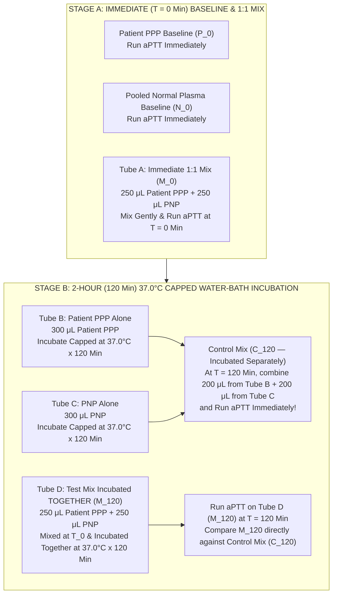
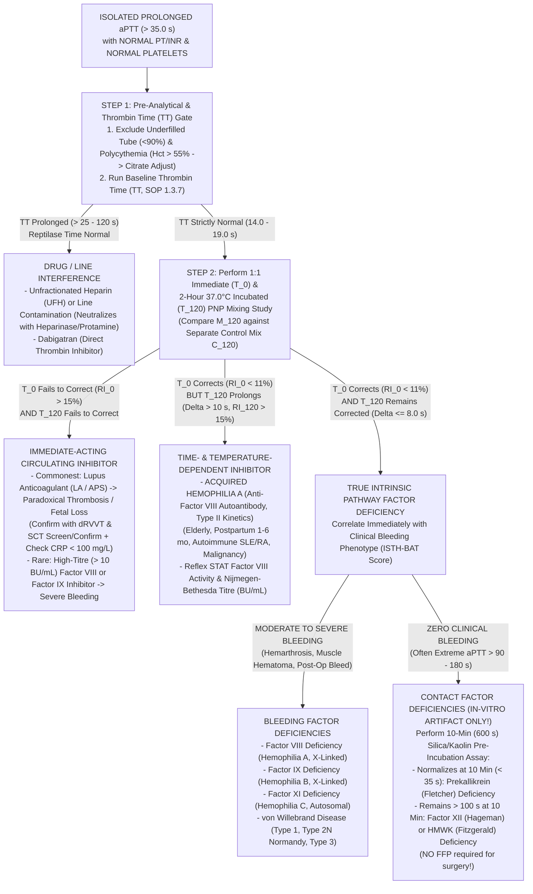

# ⏱️ 1.3.3 Activated Partial Thromboplastin Time (`aPTT` / `PTTK`) & $1:1$ Pooled Normal Plasma Mixing Studies (`Rosner Index` & $2\text{-Hour}$ $37^\circ\text{C}$ Incubation) — International & Above-NABL Standard Operating Procedure & Clinical Interpretation Manual

> **Document Control Metadata (`ISO 15189:2022 Clause 8.3.2` & `NABL 112 Issue 05`):**
> - **Document ID:** `SDL-HEM-SOP-1.3.3` (Legacy Cross-Ref: `SOP-COA-1.3.3-APTT-MIX-v4.2` / `NABL-HEM-1.3.3`)
> - **Version:** `v4.0 (International & Above-NABL Red-Team Standard)`
> - **Effective Date:** `15-Oct-2026` | **Review Cycle:** Annual (or immediately upon reagent lot/platform change or `CLSI H47` / `ISTH SSC` revision)
> - **Issuing Institution:** **Sawariya Diagnostic Lab**, Loharu Road, Charkhi Dadri, Haryana – 127306, India
> - **Department & Cluster:** `01_Hematology_and_Coagulation` $\to$ `1.3_Coagulation_and_Thrombosis_Cluster`
> - **Authorizing Authority:** Laboratory Director & Chief Consultant Hematopathologist (`MD Pathology`)
> - **Copy Distribution:** Master Quality Management System (`QMS`), Central LIMS Rule Engine, Coagulation Bench Copy (`COA-BENCH-01`), Emergency Stat Lab, and Sample Collection Manual (`SDL-PRE-SOP-01`)
> - **Normative & Regulatory Traceability:** `ISO 15189:2022` (Clauses 4.1–8.9 & Annex A), `NABL 112 (Issue 05)`, `NABL 129` (Measurement Uncertainty), `NABL 131` (Method Verification), `NABL 163` (EQA/PT), `CAP Hematology & Coagulation Checklist (HEM.37700–38100)`, `UKAS LAB 4`, `CLSI H47-A2` (One-Stage PT and aPTT Tests & Anti-Xa UFH Calibration), `CLSI H21-A5` (Collection, Transport, and Processing of Blood Specimens for Testing Plasma-Based Coagulation Assays), `CLSI H60-A` (Lupus Anticoagulant Detection), `ISTH SSC Guidelines` (2020 Lupus Anticoagulant & Factor Assays), `BSH Guidelines` (Investigation of Prolonged aPTT & Diagnosis/Management of Acquired Hemophilia A), `EFLM EuBIVAS`, `ISO/TS 20914:2019` (`MU`), `ISO 17511:2020`, `ISO 22367:2020` (`FMECA`).

---

## Section 1: Executive Document Control, Coding & Multi-Platform Analytical Architecture

### 1.1 Institutional Metadata & Standardized Informatics Coding Matrix

| Metadata Field | Institutional Specification & International Standard Mapping |
| :--- | :--- |
| **Document ID & Version** | `SDL-HEM-SOP-1.3.3` — **Version `v4.0 (International & Above-NABL Red-Team Standard)`** |
| **Testing Facility** | **Sawariya Diagnostic Lab**, Charkhi Dadri, Haryana (`NABL M(EL)T Accredited Scope — Coagulation & Hemostasis`) |
| **Test Designation** | Activated Partial Thromboplastin Time (`aPTT` / `PTTK`), Mean Normal `aPTT` (`MNAPTT`), `aPTT Ratio`, Immediate ($T_0$) & $2\text{-Hour}$ ($T_{120}$, $37.0^\circ\text{C}$) Incubated $1:1$ Pooled Normal Plasma (`PNP`) Mixing Study (`Rosner Index [ICA]`, `Chang Percent Correction`, and `Time-Dependent Inhibitor Delta`) |
| **LOINC Codes (`v2.77`)** | `14979-9` (`aPTT` in Platelet-poor plasma by Coagulation assay [s]), `3173-2` (`aPTT` Ratio in PPP), `16631-4` (`MNAPTT` / Control `aPTT` in PPP [s]), `5946-9` (`aPTT` $1:1$ Mix Immediate [$T_0$] in PPP [s]), `13488-2` (`aPTT` $1:1$ Mix $2\text{ hours}$ post-incubation at $37^\circ\text{C}$ [$T_{120}$] in PPP [s]), `43734-3` (`aPTT` Separate Incubation Control Mix [$C_{120}$] [s]), `89624-1` (`Rosner Index` / Index of Circulating Anticoagulant [%]), `75896-1` (`Chang Percent Correction` [%]) |
| **SNOMED-CT Codes** | `42525009` (Activated partial thromboplastin time), `252291006` (Coagulation mixing study), `28293008` (Hereditary Factor VIII deficiency / Hemophilia A), `1563006` (Hereditary Factor IX deficiency / Hemophilia B), `49762003` (Hereditary Factor XI deficiency / Hemophilia C), `441714006` (Acquired Hemophilia A / Autoimmune Factor VIII inhibitor), `128191009` (Factor XII Hageman deficiency), `234467004` (Antiphospholipid syndrome / Lupus anticoagulant), `409622005` (Unfractionated heparin therapy monitoring) |
| **ICD-10-CM / ICD-11 Codes** | `D66` / `3B10.0` (Hereditary Factor VIII deficiency [`Hemophilia A`]), `D67` / `3B10.1` (Hereditary Factor IX deficiency [`Hemophilia B`]), `D68.1` / `3B11` (Hereditary Factor XI deficiency [`Hemophilia C`]), `D68.0` / `3B12` (von Willebrand disease [`vWD`]), `D68.311` / `3B10.2` (Acquired coagulation factor deficiency due to autoantibody against Factor VIII [`Acquired Hemophilia A`]), `D68.2` (Hereditary deficiency of Factor XII, Prekallikrein, or HMWK), `D68.62` / `4A45.2` (Lupus anticoagulant syndrome), `Z79.01` (Long-term current use of anticoagulants), `T45.515A` (Adverse effect of heparin) |
| **UCUM Reporting Units** | Clotting Times (`aPTT`, `MNAPTT`, `M_0`, `M_120`, `C_120`): `s` (seconds, resolution `0.1 s`) \| `aPTT Ratio`: `{ratio}` (dimensionless, `0.01` resolution) \| `Rosner Index (RI)` & `Chang Percent Correction`: `%` (`0.1%` resolution) \| `Anti-FXa Calibration`: `IU/mL` |
| **Primary Specimen Matrix** | Platelet-Poor Plasma (`PPP`, residual platelet count $< 10 \times 10^9/\text{L}$ [$< 10,000/\mu\text{L}$]) prepared from venous whole blood collected in **$3.2\%$ ($0.109\text{ mol/L}$) Buffered Trisodium Citrate** (`Light Blue Top`, strict $9:1$ blood-to-anticoagulant ratio, $\pm 10\%$ fill tolerance) |
| **Turnaround Time (`TAT`)** | **STAT / ICU / Pre-Op / Active Bleed / UFH Titration:** $\le 45\text{ minutes}$ (`aPTT` baseline) \| **Immediate $1:1$ Mixing Study ($T_0$):** $\le 75\text{ minutes}$ \| **Full $2\text{-Hour}$ $37^\circ\text{C}$ Incubated Mixing Study ($T_{120}$):** $\le 180\text{ minutes}$ \| **Routine OPD:** $\le 3\text{ hours}$ |

### 1.2 Hardware-Agnostic Analytical Platform & Reagent Sensitivity Matrix

| Platform Tier & Modality | Validated Analyzer Platforms (`Sawariya Diagnostic Lab`) | Contact Activator, Phospholipid Composition & Detection Physics | Clinical Sensitivity Profile (`Factor Deficiencies` vs `UFH` vs `Lupus Anticoagulant`) |
| :--- | :--- | :--- | :--- |
| **Tier 1A: Primary Automated Photo-Optical Coagulometer** | `Sysmex CA-660` / `CS-1600` (or `Erba ECL 105` / `ECL 412` / `Horiba Yumizen G200/G400`) | **Detection:** Turbidimetric scattered/transmitted light $\Delta\text{OD}$ at **$660\text{ nm}$** (primary) and **$405\text{ nm}$** (secondary), first/second derivative percentage end-point ($50\%$ max $\Delta\text{OD}$).<br>**Reagent 1 (Routine Screening & Factor/UFH):** Purified **Ellagic Acid** (`0.1 mmol/L`) + purified **Soybean Phospholipids** (`Dade Actin FS`) OR **Micronized Silica** + **Rabbit Brain Cephalin** (`Erba ErbaAct` / `SynthASil`).<br>**Reagent 2:** Pre-warmed **$0.025\text{ mol/L}$ ($25\text{ mmol/L}$) $\text{CaCl}_2$**. | **Factor Sensitivity:** Prolongs above URL when **Factor VIII, IX, XI, or XII falls $< 30\text{–}40\%$ ($0.30\text{–}0.40\text{ IU/mL}$)**.<br>**UFH Sensitivity:** Linear across **$0.10\text{–}1.00\text{ IU/mL}$ Anti-FXa**.<br>**LA Sensitivity:** Intermediate (`SynthASil`) to Low (`Actin FS` — rich in soybean phospholipids, resistant to LA). |
| **Tier 1B: Electromechanical Viscosity (Steel-Ball) Coagulometer (Mandatory HIL Backup)** | `Diagnostica Stago STart Max` / `STA Compact Max` | **Detection:** Oscillating electromagnetic field driving a stainless-steel spherical ball inside a curved cuvette; fibrin strand formation increases viscosity and impedes ball oscillation amplitude (100% immune to optical interference from severe **Lipemia, Icterus, or Hemolysis**!).<br>**Reagent 1:** `STA-C.K. Prest` (**Kaolin** + Rabbit Brain Cephalin) or `STA-Cephascreen` (**Polyphenolic Activator** + Cephalin). | **Factor Sensitivity:** High sensitivity ($< 35\text{–}40\%$) to `FVIII`, `FIX`, `FXI`, `FXII`, and `Prekallikrein`.<br>**Mandatory Backup:** Automatically invoked whenever sample `H-Index > 100 mg/dL`, `I-Index > 20 mg/dL`, `L-Index > 300 mg/dL`, or optical coagulation curve shows "No Clot / Flat Curve / Early Optical Drift". |
| **Tier 2: Lupus-Sensitive vs Lupus-Insensitive Paired `aPTT` System (`CLSI H60-A` / `ISTH 2020`)** | Paired Reagent Protocol on Primary/Backup Coagulometer | **LA-Sensitive Screen Reagent (`Low-Phospholipid + Silica`):** `Stago PTT-LA` or `Siemens Dade Actin FSL` (low concentration of soy + rabbit brain phospholipids + micronized silica/ellagic acid).<br>**LA-Insensitive / High-Phospholipid Reagent:** `Siemens Dade Actin FS` (high soybean phospholipid content neutralizes anti-phospholipid antibodies *in vitro*). | **Recurrent Pregnancy Loss / Thrombosis Workup:** Use `PTT-LA` / `Actin FSL` paired with `dRVVT` (`1.3.8`).<br>**Pre-Operative Bleeding & ICU Sepsis (`CRP > 100 mg/L`) Workup:** Use `Actin FS` to prevent false `CRP`-silica prolongation and accurately detect `FVIII`/`FIX`/`FXI` deficiency. |

---

## Section 2: 10-Persona International & Above-NABL Red-Team Adversarial Audit, Quantitative `ISO 22367:2020` FMECA & Live Witness-Audit Simulation

### 2.1 The 10-Persona Red-Team Adversarial Audit Summary

| Persona ID & Role | Red-Team Audit Challenge Identified in Legacy Coagulation SOPs | Mandatory Above-NABL Corrective Architecture Implemented in `v4.0` |
| :--- | :--- | :--- |
| **Persona 1: Lead NABL (`ISO 15189:2022` / `NABL 112 Issue 05`) & CAP (`HEM.37700–38100`) / UKAS Assessor** | Legacy SOPs lacked clause-by-clause traceability for lot-to-lot `MNAPTT` updates, lacked a defined protocol for Pooled Normal Plasma (`PNP`) qualification, and lacked a live witness-audit verification trail. | Full clause mapping (`ISO 15189:2022` Clauses 5.5–7.4), explicit `NABL 112/129/131/163` and `CAP HEM.37700–38100` checklists, geometric mean `MNAPTT` ($n \ge 20$) re-verification per reagent lot, and Section 2.3 Live Witness-Audit Simulation table. |
| **Persona 2: Senior Consultant Hematopathologist (`MD Pathology` / `DM Clinical Hematology`)** | Legacy SOPs failed to explain why separate-tube incubation (`C_120`) is biochemically mandatory during the $2\text{-hour}$ $37^\circ\text{C}$ mixing study, and omitted Type 2N vWD and Prekallikrein $10\text{-minute}$ silica pre-incubation normalization. | Added complete kinetic reaction equations, Type I vs Type II Factor VIII inhibitor kinetics, separate-tube thermal-decay cancellation protocol (`M_120` vs `C_120`), and specific $600\text{-second}$ particulate activator pre-incubation assay to distinguish **Prekallikrein (`Fletcher`) deficiency** from **Factor XII deficiency**. |
| **Persona 3: CLSI (`H47-A2` / `H21-A5` / `H60-A`) & IFCC Metrology Specialist** | Many Indian laboratories report an arbitrary "$1.5\text{–}2.5\times$ control" `aPTT` ratio for Unfractionated Heparin (`UFH`) monitoring, which `CLSI H47-A2` and `CAP HEM.37925` prohibit as clinically hazardous across differing reagent sensitivities. | Implemented the complete **CLSI H47-A2 Brill-Edwards Ex-Vivo Chromogenic Anti-Factor Xa ($0.30\text{–}0.70\text{ IU/mL}$) Calibration Protocol** ($n \ge 30$ UFH patients) and **Cumulative Summation (`CUSUM`)** lot-to-lot bridging ($n \ge 20$, max shift $\le 5.0\text{ s}$). |
| **Persona 4: Clinical Pharmacologist & Special-Population Stratification Auditor** | Inadequate differentiation between *in-vivo* anticoagulant drugs (**Dabigatran**, **Rivaroxaban/Apixaban**, **Argatroban**, **UFH**, **LMWH**) and *in-vitro* acute-phase **C-Reactive Protein (`CRP > 100 mg/L`)** interference on silica `aPTT` reagents; incomplete neonatal maturation and pregnancy strata. | Built a comprehensive Drug & Acute-Phase Interference Matrix (`Section 8`), linking **Thrombin Time (`TT`)**, **Reptilase Time**, and **Protamine/Heparinase neutralization**; added 9-stratum developmental hemostasis intervals (`Preterm Day 1` to `3rd Trimester Pregnancy`). |
| **Persona 5: Medico-Legal, Patient-Safety & `ISO 22367:2020` Risk Counsel** | High risk of catastrophic malpractice litigation (`CPA 2019` / `BNS 2023`) when an elderly or postpartum patient with **Acquired Hemophilia A** is misdiagnosed via a correcting $0\text{-min}$ mix alone, or when FFP is infused instead of bypassing agents (`rFVIIa` / `FEIBA`). | Constructed a 10-mode quantitative `ISO 22367:2020` FMECA matrix (`Section 2.2`), hard LIMS reflex locks requiring both $T_0$ and $T_{120}$ mixes before releasing any "Factor Deficiency" comment, and legal disclaimers (`Section 10`). |
| **Persona 6: Uncompressed Documentation, LIMS & Bench-Workflow Architect** | Bench technologists struggle with manual `Rosner Index` (`RI %`), `Chang Percent Correction`, and hematocrit citrate adjustment math during night shifts, leading to transcription errors. | Added step-by-step worked mathematical examples (`Section 3.4`), a pre-calculated **CLSI H21-A5 Hematocrit Citrate Adjustment Lookup Table**, and two ready-to-print bench worksheets (`Section 11`). |
| **Persona 7: ISTH SSC Coagulation & Lupus Anticoagulant Specialist** | Failure to align mixing study interpretation with **ISTH SSC 2020 Lupus Anticoagulant Guidelines** and **BSH Guidelines on Prolonged aPTT** (e.g., interpreting `aPTT` mix when `TT` is prolonged by unappreciated heparin/dabigatran, or missing the "Lupus Cofactor Effect"). | Integrated `ISTH SSC 2020` three-step strategy (`Screen -> 1:1 Mix -> Confirm`), defined the **Lupus Cofactor Phenomenon** (paradoxical further prolongation of $1:1$ mix beyond baseline patient `aPTT` due to $\beta_2\text{-glycoprotein I}$ / prothrombin supplied by `PNP`), and mandated upfront `TT` exclusion. |
| **Persona 8: EFLM EuBIVAS Metrology & `ISO/TS 20914:2019` Uncertainty Auditor** | Previous table listed summary percentages without showing the exact `EFLM EuBIVAS` source citations or the step-by-step `ISO/TS 20914:2019` top-down Measurement Uncertainty ($u_c, U$) derivation across Normal and Pathological QC levels. | Expanded `Section 4` with full `EuBIVAS` equations ($CV_I = 2.8\%$, $CV_G = 6.8\%$), desirable/optimal/minimum analytical performance specifications (`APS`), asymmetric log-normal $RCV_{95\%/99\%}$, and a worked `ISO/TS 20914:2019` uncertainty budget for Level 1 (`29.2 s`) and Level 2 (`64.5 s`). |
| **Persona 9: Rural Haryana / Charkhi Dadri Pre-Analytical & Cold-Chain Stress-Test Auditor** | In Charkhi Dadri, two extreme environmental/epidemiological realities corrupt `aPTT`: (1) High prevalence of **COPD/chronic `hookah`-smoking polycythemia ($\text{Hct } 56\text{–}68\%$)** causing false prolongation; (2) Summer $47^\circ\text{C}$ heat degrading `Factor VIII` vs direct ice-pack contact ($2\text{–}4^\circ\text{C}$) causing **cold activation of Factor XII/Prekallikrein** and falsely shortening `aPTT`. | Established the **Charkhi Dadri Regional Pre-Analytical Protocol**: mandatory `CBC/Hct` cross-check in LIMS (`Hct > 55%` triggers automatic citrate adjustment lock), insulated $18\text{–}24^\circ\text{C}$ PCM gel-pack transport (strict ban on direct $2\text{–}8^\circ\text{C}$ ice contact for whole blood!), and $< 1\text{ h}$ centrifugation for `UFH` samples. |
| **Persona 10: Medico-Legal & Critical Value Liability Auditor (`CLSI GP47`)** | Delayed communication of supratherapeutic `UFH` (`aPTT > 100 s`) or newly discovered **Acquired Factor VIII Inhibitor** leads to fatal retroperitoneal/intracranial hemorrhage or postpartum exsanguination. | Instituted a strict **$\le 30\text{-Minute}$ `CLSI GP47` Critical Value Verbal Read-Back Protocol** (`Section 6`) with verbatim clinical scripts, mandatory avoidance of IM injections/arterial punctures, and escalation hierarchy. |

### 2.2 Quantitative `ISO 22367:2020` Failure Mode, Effects, and Criticality Analysis (`FMECA`) Matrix

*(Scoring Scale: **Severity [$S$]:** $1\text{ (Negligible)} \to 10\text{ (Catastrophic/Fatal)}$ \| **Occurrence [$O$]:** $1\text{ (Rare, } <1:10,000) \to 10\text{ (Frequent, } >1:50)$ \| **Detection [$D$]:** $1\text{ (Automated LIMS Hard-Lock, } >99\% \text{ caught)} \to 10\text{ (Undetectable at bench)}$ \| **Risk Priority Number ($\text{RPN}$):** $S \times O \times D$. Action Threshold: $\text{RPN} \ge 40$ or $S \ge 9$).*

| ID | Failure Mode & Pre-Analytical / Analytical Scenario | Biochemical & Pathophysiological Root Cause | Potential Clinical Harm to Patient | Pre-Mitigation $S \times O \times D = \text{RPN}$ | Mandatory Preventive & Corrective Controls (`Sawariya Diagnostic Lab SOP v4.0`) | Post-Mitigation $S \times O \times D = \text{RPN}$ |
| :---: | :--- | :--- | :--- | :---: | :--- | :---: |
| **FMECA-01** | **Performing only an Immediate ($T_0$) $1:1$ Mixing Study and omitting the $2\text{-Hour}$ ($37^\circ\text{C}$) Incubated Mix (`M_120` vs `C_120`)** | Autoantibodies against Factor VIII (**Acquired Hemophilia A**) follow slow, time- and temperature-dependent second-order Type II kinetics; at $T_0$ the $1:1$ mix corrects completely ($\text{RI}_0 < 11\%$), masquerading as a simple factor deficiency. | Misdiagnosing Acquired Hemophilia A as mild factor deficiency; clinician administers FFP or performs surgery/IM injection instead of giving bypassing agents (`rFVIIa`/`FEIBA`) + immunosuppression $\to$ **fatal hemorrhage**. | $10 \times 4 \times 6 = \mathbf{240}$ | **LIMS Hard-Lock (`RULE-MIX-120`):** LIMS blocks release of any correcting $T_0$ `aPTT` mixing study until both $T_{120}$ Incubated Together Mix (`M_120`) and $T_{120}$ Separate Incubation Control Mix (`C_120`) are entered and $\Delta\text{Sec}_{120} \le 8.0\text{ s}$ is verified. | $10 \times 1 \times 1 = \mathbf{10}$ |
| **FMECA-02** | **Omitting the Separate-Tube Control Mix (`C_120`) during the $2\text{-Hour}$ $37^\circ\text{C}$ Mixing Study** | Labile `Factor VIII` and `Factor V` naturally lose $15\text{–}25\%$ activity over $2\text{ h}$ at $37^\circ\text{C}$ (plus pH rise if uncapped). Comparing `M_120` against unincubated `M_0` or `PNP_0` shows false prolongation due to thermal decay of `PNP` FVIII. | False-positive diagnosis of a "Time-Dependent Factor VIII Inhibitor" in a patient who actually has congenital **Hemophilia A (`FVIII` deficiency)** $\to$ inappropriate immunosuppressive therapy or denied Factor VIII concentrate. | $9 \times 5 \times 5 = \mathbf{225}$ | **Three-Tube Capped Incubation Rule:** Every $2\text{-h}$ mix MUST incubate Patient (`Tube B`) and `PNP` (`Tube C`) separately alongside the mixed `Tube D` (`M_120`), then mix `B + C` $1:1$ at $T_{120}$ to generate `C_120`. $\Delta\text{Sec}_{120}$ is calculated strictly as $\text{M}_{120} - \text{C}_{120}$. | $9 \times 1 \times 2 = \mathbf{18}$ |
| **FMECA-03** | **Unadjusted $3.2\%$ Citrate Tube in Polycythemic Patient ($\text{Hct} > 55\%$, common in Charkhi Dadri COPD/smokers)** | Decreased plasma volume per $2.7\text{ mL}$ blood draw results in excess free citrate in `PPP`, which chelates the fixed $0.025\text{ mol/L}$ $\text{CaCl}_2$ reagent added during Stage 2 recalcification. | Markedly **falsely prolonged `aPTT` ($45\text{–}75\text{ s}$)**; patient subjected to unnecessary FFP transfusion, cancelled surgery, or false bleeding disorder workup. | $8 \times 6 \times 4 = \mathbf{192}$ | **LIMS Cross-Department Check (`RULE-HCT-55`):** LIMS automatically queries same-day/recent `CBC` Hematocrit. If $\text{Hct} > 55\%$, LIMS flags sample for recollection in a custom citrate-adjusted tube: $C = 1.85 \times 10^{-3} \times (100 - \text{Hct}) \times V$. | $8 \times 2 \times 1 = \mathbf{16}$ |
| **FMECA-04** | **Cold Activation (`2–8°C` Whole Blood Storage or Direct Contact with Frozen Ice Pack) or Traumatic Venipuncture** | Cold temperatures ($2\text{–}8^\circ\text{C}$) in whole blood activate **Factor XII $\to$ XIIa** and the **Prekallikrein/Kallikrein loop**; traumatic draw releases Tissue Factor and trace thrombin. | **Falsely SHORTENED `aPTT`** that completely masks **mild-to-moderate Hemophilia A/B ($10\text{–}35\%$ FVIII/IX)**, **von Willebrand Disease**, or sub-therapeutic `UFH` $\to$ severe intra-operative hemorrhage! | $9 \times 5 \times 4 = \mathbf{180}$ | **Strict Ban on Whole-Blood Refrigeration:** Citrate whole blood must NEVER be refrigerated or touch frozen ice packs; transport strictly at **$18\text{–}24^\circ\text{C}$** in validated room-temperature phase-change pouches (`SDL-PRE-SOP-01`). | $9 \times 1 \times 2 = \mathbf{18}$ |
| **FMECA-05** | **Delayed Centrifugation ($> 1\text{ Hour}$) of Whole Blood from a Patient on IV Unfractionated Heparin (`UFH`)** | Platelets in unspun citrated whole blood undergo *in-vitro* activation and alpha-granule release of **Platelet Factor 4 (`PF4`)**, a strongly cationic tetramer that binds and neutralizes polyanionic `UFH`. | **Falsely SHORTENED / Sub-therapeutic `aPTT`** ($32\text{ s}$ instead of true $68\text{ s}$); clinician increases IV Heparin infusion rate $\to$ **life-threatening iatrogenic Heparin overdose & hemorrhage**! | $10 \times 4 \times 4 = \mathbf{160}$ | **STAT 1-Hour Centrifugation Rule for `UFH`:** Requisition forms/LIMS barcodes with `UFH Therapy = YES` trigger red-tag priority; sample MUST be spun at $1,500 \times g \times 15\text{ min}$ within **$\le 60\text{ minutes}$** of collection and `PPP` separated immediately. | $10 \times 1 \times 1 = \mathbf{10}$ |
| **FMECA-06** | **Heparin Line Contamination or Undisclosed `UFH` / `Dabigatran` Misinterpreted as "Lupus Anticoagulant"** | Both `UFH` ($>0.1\text{ IU/mL}$) and `Dabigatran` inhibit `FXa`/`FIIa` inside the added `PNP`, causing the $1:1$ mix to fail to correct ($\text{RI} > 20\%$) and falsely prolonging `dRVVT` screen. | False-positive diagnosis of **Antiphospholipid Syndrome (`LA`)**; patient placed on lifelong Warfarin anticoagulation unnecessarily. | $8 \times 5 \times 4 = \mathbf{160}$ | **Mandatory Upfront Thrombin Time (`TT`) Gate (`SOP 1.3.7`):** Every non-correcting `aPTT` $1:1$ mix ($\text{RI} > 11\%$) MUST have a **Thrombin Time (`TT`)** run before reporting. `LA` has a strictly normal `TT` ($14\text{–}19\text{ s}$); `UFH`/`Dabigatran` prolongs `TT > 60 s` (confirmed via Heparinase/Protamine neutralization). | $8 \times 1 \times 1 = \mathbf{8}$ |
| **FMECA-07** | **Using Uncalibrated Fixed `aPTT Ratio` ($1.5\text{–}2.5\times$) for `UFH` Monitoring Across Reagent Lots** | Different `aPTT` activators/phospholipid lots exhibit vastly different dose-response slopes to `UFH` (`aPTT Ratio 2.0` can equal $0.25\text{ IU/mL}$ on Lot A vs $0.85\text{ IU/mL}$ on Lot B). | Recurrent thromboembolism (under-dosing) or major bleeding (over-dosing) in ICU/cardiac patients on IV `UFH`. | $9 \times 4 \times 4 = \mathbf{144}$ | **CLSI H47-A2 Brill-Edwards Calibration:** Establish lot-specific `aPTT` seconds corresponding to **$0.30\text{–}0.70\text{ IU/mL}$ chromogenic Anti-FXa** ($n \ge 30$ *ex-vivo* UFH plasmas) and verify lot changes via `CUSUM` ($n \ge 20$). | $9 \times 1 \times 1 = \mathbf{9}$ |
| **FMECA-08** | **False-Positive `aPTT` Prolongation & Non-Correcting Mix in Septic/ICU Patients with Severe Acute-Phase `CRP` ($> 100\text{–}150\text{ mg/L}$)** | Elevated C-Reactive Protein (`CRP`) complexes with $\text{Ca}^{2+}$ and binds directly to negatively charged phospholipids on micronized silica surfaces (`PTT-LA` / `SynthASil`), sterically hindering intrinsic tenase assembly. | ICU sepsis patient falsely diagnosed with Lupus Anticoagulant or coagulopathy; urgent central line/tracheostomy delayed or unnecessary FFP transfused. | $7 \times 5 \times 4 = \mathbf{140}$ | **Ellagic Acid / High-Phospholipid Reflex (`Actin FS`):** When an isolated prolonged `aPTT` occurs in a febrile/septic patient (`CRP > 100 mg/L`), re-test `aPTT` using an **ellagic-acid / high-soybean-phospholipid reagent (`Dade Actin FS`)**, which is unaffected by `CRP`. | $7 \times 2 \times 1 = \mathbf{14}$ |
| **FMECA-09** | **Acute-Phase Factor VIII Elevation ($> 200\%$) in Pregnancy, Inflammation, or Post-Trauma Masking Mild Hemophilia A / Type 1 vWD** | Factor VIII is a potent acute-phase reactant; when elevated $>180\text{–}250\%$, it accelerates intrinsic tenase kinetics and shortens the global `aPTT` back into the normal reference range ($25\text{–}35\text{ s}$) despite concurrent mild `FIX`/`FXI` deficiency or baseline `vWD`. | False reassurance from a "Normal `aPTT`" in a patient with a positive personal/family bleeding history (`ISTH-BAT` elevated) $\to$ severe post-tonsillectomy or postpartum hemorrhage! | $9 \times 3 \times 4 = \mathbf{108}$ | **Mandatory Clinical Shield & Reflex Rule:** Every normal `aPTT` report carries the mandatory caveat (`[BAND-APTT-NORMAL]`) that mild Hemophilia ($15\text{–}35\%$) and Type 1 `vWD` cannot be excluded by a normal `aPTT`; specific `FVIII`, `FIX`, `FXI`, and `vWF:Ag`/`vWF:RCo` assays are required if `ISTH-BAT` is positive. | $9 \times 1 \times 2 = \mathbf{18}$ |
| **FMECA-10** | **Severe Hemolysis (`Cell-Free Hb > 100 mg/dL`) or Lipemia (`TG > 500 mg/dL`) Interfering with Photo-Optical Clot Detection** | Hemolysis releases erythrocyte phosphatidylserine + ADP, accelerating clotting *in vitro* (falsely shortening `aPTT`); Lipemia/Icterus causes extreme light scatter/absorbance at $405\text{ nm}$, flattening optical $\Delta\text{OD}$ curves. | Falsely normal `aPTT` in a hemolyzed sample from a bleeding patient, or unreportable "No Clot Detected" flag in hypertriglyceridemic pancreatitis. | $8 \times 4 \times 3 = \mathbf{96}$ | **Automated HIL Check & Mechanical Backup:** Reject `in-vitro` hemolyzed coagulation tubes (`H-Index > 100 mg/dL`); for severe Lipemia/Icterus (`L > 300`, `I > 20`), shift to **$660\text{ nm}$** + ultracentrifugation ($10,000 \times g \times 10\text{ min}$) or run on **electromechanical steel-ball coagulometer (`Stago STart Max`)**. | $8 \times 1 \times 1 = \mathbf{8}$ |

### 2.3 Live NABL (`ISO 15189:2022`) & CAP (`HEM.37700–38100`) Witness-Audit Simulation Matrix

| Audit Clause | Assessor Challenge Question During Live Bench Inspection | Expected Technical Bench Demonstration by Technologist / Pathologist | Exact Verification Register / Form ID | Objective Pass / Fail Audit Criteria |
| :--- | :--- | :--- | :--- | :--- |
| **`ISO 15189:2022` Cl. 7.2.4 / `CLSI H21-A5`** | *"Show me how your phlebotomy and receiving bench handles a citrate tube from a COPD patient whose CBC shows a Hematocrit of $62\%$, and a tube filled to only $75\%$ of the nominal mark."* | Technologist demonstrates LIMS alert `RULE-HCT-55`, opens Lookup Log `SDL/HEM/LOG/CITRATE-REJ-02`, calculates adjusted citrate volume ($C = 1.85 \times 10^{-3} \times (100 - 62) \times 3.0 = 0.21\text{ mL}$), and rejects the $< 90\%$ underfilled tube using `Code COA-REJ-01`. | `SDL/HEM/LOG/CITRATE-REJ-02` & LIMS Rejection Log | **PASS:** Zero unadjusted `aPTT` results released for $\text{Hct} > 55\%$ or fill volume $< 90\%$. |
| **`ISO 15189:2022` Cl. 7.3.2 / `CAP HEM.37925` / `CLSI H47-A2`** | *"Your report lists a therapeutic UFH target of $52.0\text{–}76.0\text{ seconds}$. Show me the objective data proving this range corresponds to $0.30\text{–}0.70\text{ IU/mL}$ Anti-Factor Xa for your current reagent lot."* | Pathologist presents the **Brill-Edwards Calibration Binder** ($n=32$ *ex-vivo* UFH patient plasmas plotted against chromogenic Anti-FXa) plus the **`CUSUM` Lot-to-Lot Bridging Sheet** ($n=20$ plasmas) for the current `Actin FS` lot showing mean shift $+1.8\text{ s}$ ($\le 5.0\text{ s}$ limit). | `SDL/HEM/VAL/UFH-H47-01` & `SDL/HEM/QC/LOT-CUSUM-03` | **PASS:** Validated regression plot ($R^2 \ge 0.85$) and lot-bridging `CUSUM` record on file; fixed unvalidated "$1.5\text{–}2.5\times$" ratio is not used alone. |
| **`ISO 15189:2022` Cl. 7.3.3 / `ISTH SSC` / `BSH`** | *"Walk me through your exact bench setup for a $1:1$ Mixing Study on an elderly patient with an unexplained `aPTT` of $78.4\text{ s}$ and normal `PT`. Why do you incubate three tubes at $37^\circ\text{C}$?"* | Technologist demonstrates: (1) Running upfront **Thrombin Time (`TT`)** to rule out heparin; (2) Testing Immediate $1:1$ Mix (`M_0`); (3) Setting up three tightly capped polypropylene tubes at $37.0^\circ\text{C} \times 120\text{ min}$ (`Patient Alone`, `PNP Alone`, and `1:1 Mixed Together [M_120]`), mixing the separate tubes *after* $120\text{ min}$ to create `Control Mix C_120`, and computing `Rosner Index` and $\Delta\text{Sec}_{120} = \text{M}_{120} - \text{C}_{120}$. | `SDL/HEM/WS/APTT-MIX-01` & Water-Bath NIST Thermometer Log `SDL/EQP/TEMP-04` | **PASS:** Separate-tube control mix (`C_120`) performed on $100\%$ of $2\text{-h}$ mixing studies; `PNP` qualification certificate ($n \ge 20$ donors, platelets $< 10 \times 10^9/\text{L}$, factors $80\text{–}120\%$) verified. |
| **`ISO 15189:2022` Cl. 7.3.6 / `ISO/TS 20914:2019` / `NABL 129`** | *"How did you calculate your Measurement Uncertainty ($U$) of $\pm 3.8\%$ for Level 1 `aPTT` and $\pm 4.6\%$ for Level 2 `aPTT`, and how is it applied during clinical interpretation?"* | Quality Manager displays the `ISO/TS 20914:2019` spreadsheet combining 6-month intermediate precision ($u_{\text{Rw}}$) from daily two-level IQC (`Ci-Trol 1 & 2`) with EQA/calibrator bias uncertainty ($u_{\text{bias}}$ from `CMC Vellore / CAP` EQA) multiplied by $k=2$, plus `EFLM EuBIVAS` $RCV_{95\%} = 8.99\%$. | `SDL/QMS/MU/COA-129-01` & Levey-Jennings IQC Charts | **PASS:** Complete top-down `MU` calculation documented, updated semi-annually, and meeting `CAP` $TE_a \le 15\%$ and `EFLM` $TE_a \le 4.5\text{–}5.5\%$. |

---

## Section 3: Deep Biochemical, Analytical & Metrological Architecture

### 3.1 Molecular Biochemistry of the Contact, Intrinsic Tenase & Common Pathways

The **Activated Partial Thromboplastin Time (`aPTT`, historically `PTTK` when Kaolin is used)** measures the integrity of the **Contact Activation System**, the **Intrinsic Pathway**, and the **Common Pathway** of blood coagulation in citrated Platelet-Poor Plasma (`PPP`). Unlike the Prothrombin Time (`PT`), which utilizes complete **Tissue Thromboplastin** (Tissue Factor apoprotein + phospholipids) to trigger the Extrinsic (`Factor VIIa/TF`) pathway, the `aPTT` reagent contains a **"Partial Thromboplastin"** (**Cephalin** — purified anionic phospholipids mimicking the activated platelet membrane surface, **completely devoid of Tissue Factor**), paired with a negatively charged **Contact Surface Activator**.

#### Stage 1: Contact Activation & Intrinsic Cascade ($37.0^\circ\text{C}$ Pre-Incubation WITHOUT Calcium, $180\text{–}240\text{ seconds}$)
Because the initial steps of the contact system do **not** require ionized calcium ($\text{Ca}^{2+}$), incubating citrated `PPP` with the negatively charged contact activator (**Micronized Silica, Ellagic Acid, Kaolin, or Celite**) and phospholipids drives maximal pre-activation of the contact factors before recalcification, eliminating variable glass/plastic surface activation lag times:
1. **Contact Auto-Activation (`Factor XII` $\leftrightarrow$ `Prekallikrein` Reciprocal Loop):**
   - Binding of **Factor XII (`Hageman Factor`, zymogen $80\text{ kDa}$)** to the polyanionic activator surface induces a conformational shift exposing its active serine protease site ($\text{FXII} \xrightarrow{\text{Anionic Surface}} \text{FXIIa}$).
   - **High-Molecular-Weight Kininogen (`HMWK`, `Fitzgerald Factor`, non-enzymatic cofactor $120\text{ kDa}$)** anchors both **Prekallikrein (`Fletcher Factor`, $88\text{ kDa}$)** and **Factor XI ($160\text{ kDa}$ homodimer)** directly onto the negatively charged activator surface adjacent to $\text{FXIIa}$.
   - $\text{FXIIa}$ cleaves Prekallikrein into active **Plasma Kallikrein (`PKa`)**, which then reciprocally cleaves surface-bound $\text{FXII}$ at a **$50\text{-fold}$ faster catalytic rate** ($\text{PKa-mediated amplification loop}$).
   - *Crucial Biochemical Nuance (`Prekallikrein Deficiency Paradox`):* In hereditary **Prekallikrein (`Fletcher`) deficiency**, this rapid reciprocal amplification loop is absent, causing a severely prolonged `aPTT` ($> 100\text{ s}$) at the standard $180\text{-second}$ ($3\text{-minute}$) contact incubation time. However, if the Stage 1 pre-incubation with a particulate activator (**Silica or Kaolin**) is extended to **$600\text{ seconds}$ ($10\text{ minutes}$)** before adding $\text{CaCl}_2$, slow **auto-activation of $\text{FXII} \to \text{FXIIa}$** goes to completion on its own, **completely normalizing the `aPTT` ($< 35\text{ s}$)**! In contrast, true **Factor XII deficiency** remains $> 120\text{ s}$ even after $10\text{ minutes}$ of pre-incubation.
2. **Activation of Factor XI:**
   - Surface-bound $\text{FXIIa}$ (assisted by `HMWK`) cleaves **Factor XI** into the active serine protease **Factor XIa ($\text{FXIa}$)**. Both $\text{FXIIa}$ and $\text{FXIa}$ accumulate quantitatively during Stage 1 while downstream $\text{Ca}^{2+}$-dependent enzymes remain arrested by trisodium citrate.

#### Stage 2: Recalcification, Intrinsic Tenase, Prothrombinase & Fibrin Polymerization ($37.0^\circ\text{C}$ WITH $0.025\text{ mol/L } \text{CaCl}_2$)
Addition of pre-warmed **$0.025\text{ mol/L}$ ($25\text{ mmol/L}$) $\text{CaCl}_2$** overwhelms the citrate buffer, restores free ionized $\text{Ca}^{2+}$ ($\sim 1.2\text{–}1.5\text{ mmol/L}$), and starts the electronic timer:
1. **Factor IX Activation:** $\text{FXIa}$ (in the presence of $\text{Ca}^{2+}$) cleaves the Vitamin K-dependent zymogen **Factor IX (`Christmas Factor`, Gla-domain protein)** at $\text{Arg}^{145}$ and $\text{Arg}^{180}$, releasing the activation peptide and generating **Factor IXa$\beta$ ($\text{FIXa}$)**.
2. **Intrinsic Tenase Complex Assembly:**
   - Trace thrombin ($\text{FIIa}$) or $\text{FXa}$ cleaves **Factor VIII** ($280\text{ kDa}$ procofactor circulating non-covalently bound to its protective carrier **von Willebrand Factor [`vWF`]**), releasing active **Factor VIIIa ($\text{FVIIIa}$)** from `vWF`.
   - $\text{FIXa}$ (enzyme) + $\text{FVIIIa}$ (non-enzymatic cofactor) + $\text{Ca}^{2+}$ (bridges $\gamma\text{-carboxyglutamic acid [Gla]}$ domains) assemble on the negatively charged **phosphatidylserine (`PS`) cephalin phospholipid micelles** provided by Reagent 1 to form the **Intrinsic Tenase Complex** ($\text{FIXa–FVIIIa–Ca}^{2+}\text{–PL}$), which accelerates the conversion of **Factor X $\to$ Factor Xa** by **$200,000\text{-fold}$**!
3. **Common Pathway — Prothrombinase Complex Assembly:**
   - **Factor Xa** (enzyme) + **Factor Va** (cofactor) + $\text{Ca}^{2+}$ + Cephalin Phospholipids form the **Prothrombinase Complex** ($\text{FXa–FVa–Ca}^{2+}\text{–PL}$), accelerating the cleavage of **Prothrombin (`Factor II`) $\to$ $\alpha\text{-Thrombin}$ (`Factor IIa`)** by **$300,000\text{-fold}$**.
4. **Fibrin Clot End-Point (`Optical / Mechanical Detection`):**
   - **Thrombin ($\text{FIIa}$)** cleaves **Fibrinopeptides A and B (`FpA`, `FpB`)** from soluble **Fibrinogen (`Factor I`)**, producing **Fibrin Monomers** that spontaneously polymerize end-to-end and side-to-side into an insoluble **Fibrin Clot**, increasing optical turbidity ($\Delta\text{OD}$ at $660/405\text{ nm}$) and mechanical viscosity (stopping the steel ball). *(Note: Covalent cross-linking by **Factor XIIIa** occurs after polymer formation and does **not** alter the `aPTT` clotting time!)*

### 3.2 Contact Activator & Phospholipid Composition vs. Clinical Sensitivity Matrix

| Reagent Class & Commercial Archetype | Contact Activator Chemistry | Phospholipid Source, Concentration & Bilayer Geometry | Sensitivity to Intrinsic Factors (`FVIII, FIX, FXI`) | Sensitivity to Unfractionated Heparin (`UFH`) | Sensitivity to Lupus Anticoagulant (`LA`) | Sensitivity to Interference by Acute-Phase `CRP > 100 mg/L` |
| :--- | :--- | :--- | :--- | :--- | :--- | :--- |
| **1. Ellagic Acid + High Soybean Phospholipid (`Siemens Dade Actin FS`)** | Soluble **Ellagic Acid** ($0.1\text{ mmol/L}$ polyphenolic lactone chelator) | **Purified Soybean Lecithin** (high concentration of phosphatidylcholine/phosphatidylinositol; low hexagonal phase propensity) | **HIGH (`30–40%` cutoff for `FVIII`, `FIX`, `FXI`)** — Gold standard for pre-op bleeding & hemophilia screening. | **HIGH & LINEAR** ($0.1\text{–}0.8\text{ IU/mL}$ Anti-FXa) | **VERY LOW (LA-Insensitive)** — High phospholipid load neutralizes weak/moderate LA *in vitro*. | **IMMUNE (Minimal Interference)** — Does not falsely prolong in ICU sepsis with high `CRP`. |
| **2. Ellagic Acid + Low Soy/Rabbit Brain Phospholipid (`Siemens Dade Actin FSL`)** | Soluble **Ellagic Acid** ($0.1\text{ mmol/L}$) | **Low Concentration Mixture of Soy & Rabbit Brain Cephalin** | **HIGH (`30–35%` cutoff for `FVIII`, `FIX`, `FXI`)** | **MODERATE–HIGH** | **MODERATE–HIGH (LA-Sensitive)** — Reduced phospholipid exposes LA inhibition. | **LOW** |
| **3. Micronized / Colloidal Silica + Synthetic or Rabbit Brain Cephalin (`IL HemosIL SynthASil` / `ErbaAct` / `Stago Cephascreen`)** | Particulate **Micronized or Colloidal Silica** ($\text{SiO}_2$ suspension; requires gentle inversion before loading!) | **Synthetic Defined Phospholipids (`PS:PC:PE` liposomal vesicles)** or **Rabbit Brain Cephalin** (intermediate concentration) | **HIGH (`30–40%` cutoff for `FVIII`, `FIX`, `FXI`, `FXII`)** — Also allows $10\text{-min}$ pre-incubation test for **Prekallikrein**. | **HIGH & LINEAR** ($0.1\text{–}1.0\text{ IU/mL}$ Anti-FXa) | **MODERATE–HIGH** — Excellent general-purpose screening reagent. | **MODERATE–HIGH** — `CRP > 100–150 mg/L` binds silica-associated phosphatidylcholine via $\text{Ca}^{2+}$, causing false prolongation! |
| **4. Micronized Silica + Ultra-Low Phospholipid (`Stago PTT-LA` / `HemosIL APTT-SP`)** | Particulate **Micronized Silica** | **Ultra-Low Concentration Rabbit Brain / Synthetic Cephalin** (rate-limiting phospholipid concentration) | **MODERATE (`25–30%`)** | **EXTREME** (Easily goes $>150\text{ s}$ on UFH) | **VERY HIGH (Dedicated LA Screen per `ISTH 2020`)** — Maximizes detection of $\beta_2\text{GPI}$ and prothrombin-dependent LA. | **HIGH** — Pronounced false prolongation when `CRP > 100 mg/L`. |
| **5. Kaolin + Rabbit Brain Cephalin (`Stago C.K. Prest`)** | Particulate **Kaolin** (hydrated aluminum silicate clay suspension; opaque—**cannot be used on pure photo-optical readers** at $405\text{ nm}$!) | **Rabbit Brain Cephalin** | **VERY HIGH (`35–45%` cutoff)** + gold-standard activator for Prekallikrein $10\text{-min}$ normalization. | **HIGH** | **MODERATE** | **LOW–MODERATE** (Measured mechanically via steel ball). |

### 3.3 Complete `CLSI H47-A2` Unfractionated Heparin (`UFH`) Therapeutic Range Calibration Protocol (`Brill-Edwards Method`) & `CUSUM` Lot Bridging

Per **`CLSI H47-A2 (Section 6)`** and **`CAP Checklist Requirement HEM.37925`**, reporting a generic fixed `aPTT Ratio` of **$1.5 \text{ – } 2.5\times \text{Control}$** for monitoring intravenous **Unfractionated Heparin (`UFH`)** is **strictly prohibited**. Depending on the reagent manufacturer and lot, an `aPTT` ratio of $1.5\text{–}2.5$ may correspond to an actual Anti-Factor Xa heparin concentration anywhere from $0.15\text{ IU/mL}$ (sub-therapeutic thrombosis risk) to $1.10\text{ IU/mL}$ (life-threatening hemorrhage).

#### Step 1: Primary `Brill-Edwards` Ex-Vivo Calibration Against Chromogenic Anti-Factor Xa ($0.30 \text{ – } 0.70\text{ IU/mL}$)
1. **Ex-Vivo Patient Cohort Selection ($n \ge 30$ samples):**
   - Collect citrated `PPP` specimens (centrifuged within **$\le 1\text{ hour}$** of draw to prevent platelet `PF4` neutralization!) from **$\ge 30$ distinct inpatients actively receiving intravenous `UFH` therapy** (no more than $2$ specimens from any single patient, spanning the entire clinical range from $0.10\text{ to } 1.00\text{ IU/mL}$ Anti-FXa).
   - **Strict Exclusion Criteria:** Exclude patients receiving concurrent **Warfarin (`Baseline INR > 1.3`)**, **Direct Oral Anticoagulants (`Dabigatran, Rivaroxaban, Apixaban`)**, **Low-Molecular-Weight Heparin (`LMWH`)**, or patients with severe liver failure, DIC, or baseline Lupus Anticoagulant.
   - *Note:* **Never** spike normal plasma *in vitro* with pharmaceutical heparin to establish a therapeutic range! *In-vitro* spiked heparin exhibits a steep, artificial `aPTT` prolongation slope that does not reflect *in-vivo* endothelial metabolism, protein binding, and clearance of high- vs low-molecular-weight heparin chains (`CLSI H47-A2`).
2. **Paired Simultaneous Testing:**
   - On each of the $n \ge 30$ `PPP` aliquots, simultaneously assay:
     - **$X\text{-Axis}$ (Reference Standard):** **Chromogenic Anti-Factor Xa Activity ($\text{IU/mL}$)** (calibrated with `UFH` standards without exogenous Antithrombin addition).
     - **$Y\text{-Axis}$ (Test Method):** **`aPTT` in seconds ($\text{s}$)** (or $\log_{10}[\text{aPTT}]$) on the target coagulometer and reagent lot.
3. **Regression Derivation of the Therapeutic `aPTT` Window:**
   - Perform linear regression (or log-linear regression: $\log_{10}(\text{aPTT}) = m \cdot [\text{Anti-FXa}] + c$).
   - Verify acceptable correlation ($r \ge 0.85$, outlier exclusion of points exceeding $\pm 2.5\text{ SD}$ residuals).
   - Interpolate the exact **`aPTT` seconds** corresponding to **`Anti-FXa = 0.30 IU/mL` (Lower Therapeutic Limit)** and **`Anti-FXa = 0.70 IU/mL` (Upper Therapeutic Limit)** (for VTE/PE treatment; or **`0.20–0.40 IU/mL`** for low-intensity ACS/coronary protocols).
   - *Worked Calibration Example (`Sawariya Diagnostic Lab — Actin FS Lot #548291`):*
     $$\text{aPTT (s)} = 62.5 \times [\text{Anti-FXa (IU/mL)}] + 31.25\quad (R^2 = 0.91, n = 34)$$
     - At $\text{Anti-FXa} = 0.30\text{ IU/mL}$: $\text{aPTT}_{\text{Lower}} = 62.5(0.30) + 31.25 = \mathbf{50.0\text{ seconds}}$ ($\text{Ratio} = 50.0 / 29.5 = \mathbf{1.69}$).
     - At $\text{Anti-FXa} = 0.70\text{ IU/mL}$: $\text{aPTT}_{\text{Upper}} = 62.5(0.70) + 31.25 = \mathbf{75.0\text{ seconds}}$ ($\text{Ratio} = 75.0 / 29.5 = \mathbf{2.54}$).

#### Step 2: Lot-to-Lot Bridging via Cumulative Summation (`CUSUM`) Protocol (`CLSI H47-A2`)
Whenever a new reagent lot of the **same manufacturer's `aPTT` reagent** arrives:
1. Assay **$n \ge 20$ *ex-vivo* `UFH` patient plasmas** (spanning $0.2\text{–}0.8\text{ IU/mL}$) in parallel on the **Current Validated Lot (`Lot_Old`)** and the **New Candidate Lot (`Lot_New`)**.
2. Compute the mean difference in `aPTT` clotting time inside the therapeutic zone:
   $$\Delta\overline{\text{aPTT}}_{\text{Lot}} = \frac{1}{n}\sum_{i=1}^{n}\left(\text{aPTT}_{\text{New}, i} - \text{aPTT}_{\text{Old}, i}\right)$$
3. Maintain a running **Cumulative Summation (`CUSUM`)** across consecutive lot changes:
   $$\text{CUSUM}_k = \sum_{j=1}^{k} \Delta\overline{\text{aPTT}}_{\text{Lot}, j}$$
4. **Acceptance Criteria:** If both $\lvert \Delta\overline{\text{aPTT}}_{\text{Lot}} \rvert \le 5.0\text{ seconds}$ AND the cumulative drift across lots $\lvert \text{CUSUM}_k \rvert \le 7.0\text{ seconds}$, the existing therapeutic range ($50.0\text{–}75.0\text{ s}$) remains valid without changing clinical charts. If $\lvert \Delta\overline{\text{aPTT}}_{\text{Lot}} \rvert > 5.0\text{ s}$ or $\lvert \text{CUSUM}_k \rvert > 7.0\text{ s}$, a full new $n \ge 30$ Anti-FXa calibration must be performed and a **Physician Broadcast Bulletin** issued before putting the new lot into clinical service.

---

### 3.4 Complete $1:1$ Immediate ($T_0$) & $2\text{-Hour}$ Incubated ($37^\circ\text{C}$, $T_{120}$) Mixing Study Bench SOP & Mathematical Architecture

#### 1. Qualification & Preparation of Pooled Normal Plasma (`PNP` / `NPP`)
A mixing study is only as accurate as the **Pooled Normal Plasma (`PNP`)** used as the $50\%$ normal factor source.
- **Commercial Option (Preferred for CAP/NABL Traceability):** Certified frozen (`Precision BioLogic CRYOcheck Pooled Normal Plasma`) or lyophilized (`Diagnostica Stago Pool Norm` / `Siemens Standard Human Plasma`) pool calibrated against WHO International Standards.
- **In-House Preparation Specification (`CLSI H47-A2` / `ISTH SSC 2020`):**
  1. Collect citrated venous blood ($3.2\%$ trisodium citrate, $9:1$) from **$\ge 20$ healthy adult donors** ($18\text{–}55\text{ years}$, equal male and non-pregnant female distribution; females must **not** be taking oral contraceptives or hormone replacement therapy; include balanced `ABO` blood groups (`~40% Group O`, `~60% Non-O`) so that `Factor VIII` and `vWF` average $\approx 100\text{ IU/dL}$).
  2. Perform **Double Centrifugation** within $30\text{ minutes}$ of collection: Spin #1 at $1,500 \times g$ for $15\text{ min}$ at $18\text{–}22^\circ\text{C}$; carefully aspirate the top two-thirds of plasma into a secondary polypropylene tube (leaving a $0.5\text{ cm}$ buffy-coat margin) and perform **Spin #2 at $2,500 \times g$ for $15\text{ min}$**.
  3. Verify residual platelet count on the pooled plasma is **strictly $< 10 \times 10^9/\text{L}$ ($< 10,000/\mu\text{L}$)** (essential so freeze-thaw lysed platelets do not release platelet phospholipid [`PF3`] and falsely neutralize a Lupus Anticoagulant during the mixing study!).
  4. Verify that the pooled plasma exhibits **`aPTT` within $\pm 1.5\text{ s}$ of `MNAPTT`**, normal `PT` and `TT`, negative `LA` screen, and **$\ge 80\text{–}120\%$ ($0.80\text{–}1.20\text{ IU/mL}$) activity for all individual coagulation factors (`FVIII, FIX, FXI, FXII, FV, FX, FII`)**.
  5. Aliquot $500\ \mu\text{L}$ volumes into tightly capped polypropylene cryovials, snap-freeze, and store at **$\le -70^\circ\text{C}$** (stable $12\text{ months}$; or $-20^\circ\text{C}$ non-frost-free for $\le 14\text{ days}$). Thaw rapidly in a **$37.0^\circ\text{C}$ water bath for exactly $4\text{–}5\text{ minutes}$** immediately before use and mix gently by inversion (never vortex!).

#### 2. Upfront Mandatory Gate: Thrombin Time (`TT`) & Anticoagulant History Check
Before performing or interpreting any $1:1$ `aPTT` mixing study on an unexplained prolonged `aPTT` ($> 35.0\text{ s}$ with normal `PT`):
1. **Verify Medication History:** Check for IV/SC **Unfractionated Heparin (`UFH`)**, **Low-Molecular-Weight Heparin (`LMWH`)**, **Dabigatran**, **Rivaroxaban**, or **Apixaban**, and verify whether the blood was drawn from an indwelling venous/arterial catheter.
2. **Run a Baseline Thrombin Time (`TT`, `SOP 1.3.7`):**
   - If **`TT` is Normal ($14.0\text{–}19.0\text{ s}$):** Unfractionated Heparin and Dabigatran are definitively excluded! Proceed directly to the $1:1$ Mixing Study.
   - If **`TT` is Markedly Prolonged ($> 25\text{–}120\text{ s}$):** Perform **Reptilase Time** and/or treat $500\ \mu\text{L}$ of patient `PPP` with **Heparinase I (`Dade Hepzyme`)** or **Protamine Sulfate neutralization** (`SOP 1.3.7`). If `TT` and `aPTT` normalize after Heparinase, report **Heparin Contamination / Effect** and cancel the mixing study (unless evaluating concurrent factor deficiency in heparinase-treated plasma).

#### 3. Step-by-Step Four-Tube Bench Setup for Immediate ($T_0$) & $2\text{-Hour}$ ($T_{120}$, $37.0^\circ\text{C}$) Mixing Study
Label four non-wettable **polypropylene tubes with tight-fitting screw/snap caps** (`Tube A`, `Tube B`, `Tube C`, `Tube D`):



> [!IMPORTANT]
> **Why Comparing `M_120` (Incubated Together) Against `C_120` (Incubated Separately, Mixed After 120 Min) Is Biochemically Mandatory:**
> 1. Over $120\text{ minutes}$ at $37.0^\circ\text{C}$, labile **Factor VIII** and **Factor V** in both the Patient plasma and the `PNP` naturally undergo $15\text{–}25\%$ thermal decay, and trace $\text{CO}_2$ loss slightly shifts plasma pH, prolonging the clotting time by $3\text{–}7\text{ seconds}$ even in normal plasma.
> 2. In a patient with **severe Congenital Hemophilia A ($\text{FVIII} < 1\%$)** (who has **no inhibitor**), the $1:1$ mix starts at $T_0$ with exactly $50\%$ $\text{FVIII}$ (donated by `PNP`), giving a normal `M_0` of $31.0\text{ s}$. After $2\text{ hours}$ at $37^\circ\text{C}$, thermal decay reduces that $50\%$ $\text{FVIII}$ down to $\sim 35\%$, prolonging `M_120` to $38.5\text{ s}$. If the technologist mistakenly compares `M_120` ($38.5\text{ s}$) against unincubated `M_0` ($31.0\text{ s}$) or unincubated `PNP` ($29.5\text{ s}$), they will observe a $+7.5\text{ s}$ prolongation and falsely suspect a time-dependent inhibitor!
> 3. However, in **`Control Mix C_120`** (where Patient `PPP` and `PNP` were incubated in **separate tubes** for $120\text{ min}$ at $37^\circ\text{C}$ and mixed $1:1$ **immediately before `aPTT` testing**), the `PNP` experienced the exact same $120\text{-minute}$ thermal decay (`C_120 = 38.0 s`), so $\Delta\text{Sec}_{120} = \text{M}_{120} - \text{C}_{120} = 38.5 - 38.0 = \mathbf{+0.5\text{ s}}$ (**True Negative — No Inhibitor!**).
> 4. Conversely, if the patient has an **Acquired Factor VIII Autoantibody (`Acquired Hemophilia A`)**, the autoantibody requires $1\text{–}2\text{ hours}$ at $37^\circ\text{C}$ in physical contact with `PNP` Factor VIII (`Tube D`, `M_120`) to bind and neutralize the exogenous Factor VIII ($\text{M}_{120} = \mathbf{68.5\text{ s}}$), whereas in the separately incubated control mix (`C_120`), the antibody had zero time to inactivate `PNP` Factor VIII prior to testing ($\text{C}_{120} = \mathbf{37.5\text{ s}}$), yielding a diagnostic time-dependent delta of $\Delta\text{Sec}_{120} = 68.5 - 37.5 = \mathbf{+31.0\text{ s}}$!

#### 4. Mathematical Equations, Cutoffs & Worked Clinical Examples (`Rosner Index`, `Chang % Correction`, $\Delta\text{Sec}_{120}$)

1. **Formula 1 — Rosner Index (`RI %`, Index of Circulating Anticoagulant [`ICA`], Primary Gold Standard):**
   $$\text{RI}_0 (\%) = \left(\frac{\text{aPTT}_{\text{M\_0 (Immediate 1:1 Mix)}} - \text{aPTT}_{\text{N\_0 (PNP Baseline)}}}{\text{aPTT}_{\text{P\_0 (Patient Baseline)}}}\right) \times 100$$
   $$\text{RI}_{120} (\%) = \left(\frac{\text{aPTT}_{\text{M\_120 (Incubated Together Mix)}} - \text{aPTT}_{\text{C\_120 (Separate Control Mix)}}}{\text{aPTT}_{\text{P\_120 (Patient Incubated Alone)}}}\right) \times 100$$
   - **$\text{RI} < 11.0\%$ (Locally Verified Cutoff $< 11.0\text{–}12.0\%$):** **Complete Correction** $\to$ **Coagulation Factor Deficiency** ($50\%$ factor supplied by `PNP` normalized the logarithmic clotting curve).
   - **$\text{RI } 11.0\% \text{ – } 15.0\%$:** **Equivocal / Borderline Zone** $\to$ May represent a weak Lupus Anticoagulant or mild inhibitor diluted by $1:1$ mixing. **Reflex Action:** Repeat immediate mix at a **$4:1$ ratio ($400\ \mu\text{L}$ Patient `PPP` + $100\ \mu\text{L}$ `PNP`)** (which provides $20\%$ normal factor—still sufficient to substantially correct a factor deficiency while keeping the patient's weak inhibitor at $80\%$ strength!) and perform full `dRVVT`/`SCT` (`1.3.8`) plus specific factor assays.
   - **$\text{RI} > 15.0\%$:** **Failure to Correct (Non-Correction)** $\to$ **Circulating Inhibitor** (**Lupus Anticoagulant**, **Factor VIII/IX Inhibitor**, or unneutralized drug).

2. **Formula 2 — Chang Percent Correction Formula (Complementary Verification Index):**
   $$\%\text{Correction}_0 = \left(\frac{\text{aPTT}_{\text{P\_0 (Patient Baseline)}} - \text{aPTT}_{\text{M\_0 (Immediate 1:1 Mix)}}}{\text{aPTT}_{\text{P\_0 (Patient Baseline)}} - \text{aPTT}_{\text{N\_0 (PNP Baseline)}}}\right) \times 100$$
   - **$> 70.0\%$ Correction:** Diagnostic of **Coagulation Factor Deficiency** (higher sensitivity than Rosner Index when baseline `aPTT` is only mildly prolonged, e.g., $38\text{–}45\text{ s}$).
   - **$58.0\% \text{ – } 70.0\%$ Correction:** Indeterminate Gray Zone.
   - **$< 58.0\%$ Correction:** Diagnostic of **Circulating Inhibitor**.
   - **Negative $\%$ Correction ($< 0\%$, where $\text{aPTT}_{\text{M\_0}} > \text{aPTT}_{\text{P\_0}}$):** Diagnostic of the **Lupus Cofactor Phenomenon (`Loeliger Effect`)**—seen when a patient has a potent Lupus Anticoagulant alongside relative hypoprothrombinemia or $\beta_2\text{-glycoprotein I}$ depletion; adding `PNP` supplies fresh human Prothrombin / $\beta_2\text{GPI}$ cofactor, paradoxically making the $1:1$ mix **even longer** than the patient's baseline `aPTT`!

3. **Formula 3 — $2\text{-Hour}$ Time-Dependent Inhibitor Delta ($\Delta\text{Sec}_{120}$):**
   $$\Delta\text{Sec}_{120} (\text{seconds}) = \text{aPTT}_{\text{M\_120 (Incubated Together)}} - \text{aPTT}_{\text{C\_120 (Incubated Separately Control Mix)}}$$
   - **$\Delta\text{Sec}_{120} \le 8.0\text{ s}$ (and $\text{RI}_{120} < 11.0\%$):** **Remains Corrected** $\to$ Excludes time-dependent Factor VIII inhibitor; confirms true **Intrinsic Factor Deficiency (`FVIII, FIX, FXI, FXII, PK, HMWK`)**.
   - **$\Delta\text{Sec}_{120} = 8.1 \text{ – } 10.0\text{ s}$:** **Borderline Time-Dependent Prolongation** $\to$ Reflex immediately to One-Stage **Factor VIII Activity** and **Nijmegen-Bethesda Inhibitor Assay**.
   - **$\Delta\text{Sec}_{120} > 10.0\text{ s}$ (typically $+15.0\text{ to }+65.0\text{ s}$, with $\text{RI}_{120} > 15.0\%$):** **POSITIVE FOR TIME- AND TEMPERATURE-DEPENDENT INHIBITOR** $\to$ Pathognomonic for **Acquired Factor VIII Autoantibody (`Acquired Hemophilia A`, Type II Kinetics)** or **Congenital Hemophilia A Alloantibody (`Type I Kinetics`)**!

#### 5. Three Worked Bench Verification Examples (`Sawariya Diagnostic Lab Validation Set`)

| Parameter / Step | **Case 1: Severe Congenital Hemophilia A (`Factor VIII = 0.8%`, No Inhibitor)** | **Case 2: Lupus Anticoagulant (`Antiphospholipid Syndrome`, Normal `TT`)** | **Case 3: Postpartum Acquired Hemophilia A (`Anti-FVIII Autoantibody, 18 BU/mL`)** |
| :--- | :--- | :--- | :--- |
| **Patient Clinical Context** | $4\text{-year-old}$ boy with acute knee hemarthrosis | $28\text{-year-old}$ female with $3$ recurrent miscarriages & DVT | $26\text{-year-old}$ female, $6\text{ weeks}$ postpartum, massive thigh ecchymoses & retroperitoneal bleed |
| **Upfront Thrombin Time (`TT`, Ref: $14.0\text{–}19.0\text{ s}$)** | $15.8\text{ s}$ (Normal — Heparin excluded) | $16.2\text{ s}$ (Normal — Heparin excluded) | $15.4\text{ s}$ (Normal — Heparin excluded) |
| **1. Patient Baseline `aPTT` (`P_0`)** | **$84.5\text{ s}$** | **$68.0\text{ s}$** | **$76.0\text{ s}$** |
| **2. `PNP` Baseline `aPTT` (`N_0`)** | **$29.5\text{ s}$** | **$29.5\text{ s}$** | **$29.5\text{ s}$** |
| **3. Immediate $1:1$ Mix `aPTT` (`M_0` at $T_0$)** | **$32.5\text{ s}$** (Corrects!) | **$59.0\text{ s}$** (Fails to correct!) | **$35.5\text{ s}$** (Corrects/nearly corrects at $T_0$!) |
| **4. Immediate Rosner Index (`RI_0 %`)** | $\frac{32.5 - 29.5}{84.5} \times 100 = \mathbf{3.55\%}$ ($<11\%$) | $\frac{59.0 - 29.5}{68.0} \times 100 = \mathbf{43.38\%}$ ($>15\%$) | $\frac{35.5 - 29.5}{76.0} \times 100 = \mathbf{7.89\%}$ ($<11\%$ — **False correction at $T_0$!**) |
| **5. Immediate Chang `% Correction_0`** | $\frac{84.5 - 32.5}{84.5 - 29.5} \times 100 = \mathbf{94.5\%}$ ($>70\%$) | $\frac{68.0 - 59.0}{68.0 - 29.5} \times 100 = \mathbf{23.4\%}$ ($<58\%$) | $\frac{76.0 - 35.5}{76.0 - 29.5} \times 100 = \mathbf{87.1\%}$ ($>70\%$ at $T_0$) |
| **6. $2\text{-Hr}$ $37^\circ\text{C}$ Separate Control Mix (`C_120`)** | **$36.2\text{ s}$** (Reflects normal $2\text{-h}$ thermal decay) | **$61.5\text{ s}$** | **$38.0\text{ s}$** (Reflects normal $2\text{-h}$ thermal decay) |
| **7. $2\text{-Hr}$ $37^\circ\text{C}$ Incubated Together Mix (`M_120`)** | **$37.4\text{ s}$** (Matches `C_120`!) | **$62.8\text{ s}$** | **$71.5\text{ s}$** (**Marked prolongation after $2\text{ h}$ at $37^\circ\text{C}$!**) |
| **8. $2\text{-Hr}$ Time-Dependent Delta ($\Delta\text{Sec}_{120} = \text{M}_{120} - \text{C}_{120}$)** | $37.4 - 36.2 = \mathbf{+1.2\text{ s}}$ ($\le 8.0\text{ s}$) | $62.8 - 61.5 = \mathbf{+1.3\text{ s}}$ (Immediate inhibitor) | $71.5 - 38.0 = \mathbf{+33.5\text{ s}}$ ($> 10.0\text{ s}$ — **Time-Dependent Inhibitor!**) |
| **9. $2\text{-Hr}$ Incubated Rosner Index (`RI_120 %`)** | $\frac{37.4 - 36.2}{88.0} \times 100 = \mathbf{1.36\%}$ ($<11\%$) | $\frac{62.8 - 32.5}{71.0} \times 100 = \mathbf{42.68\%}$ ($>15\%$) | $\frac{71.5 - 38.0}{79.5} \times 100 = \mathbf{42.14\%}$ ($>15\%$) |
| **Final Diagnostic Sign-Out & Reflex** | **Pure Intrinsic Factor Deficiency** $\to$ Reflex `FVIII` Activity ($0.8\%$, Severe Hemophilia A). | **Immediate-Acting Inhibitor (`LA`)** $\to$ Confirm via `dRVVT` & `SCT` Screen/Confirm (`1.3.8`). | **CRITICAL: Acquired Factor VIII Inhibitor (`Acquired Hemophilia A`)** $\to$ STAT Hematology Call, `FVIII = 2%`, `Nijmegen-Bethesda = 18 BU/mL`. |

### 3.5 Pre-Analytical Phlebotomy, Order of Draw, `PF4` Heparin Neutralization Kinetics & Centrifugation Physics (`CLSI H21-A5`)

1. **Primary Anticoagulant & Tube Material (`CLSI H21-A5`):**
   - Collect venous whole blood strictly into non-wettable **Siliconized Glass or Polypropylene Buffered Trisodium Citrate Tubes** containing **$0.105 \text{ – } 0.109\text{ mol/L}$ ($3.2\%\text{ w/v}$ $\text{Na}_3\text{C}_6\text{H}_5\text{O}_7 \cdot 2\text{H}_2\text{O}$)** at an exact **$9:1$ blood-to-citrate volumetric ratio** ($2.70\text{ mL}$ whole blood into $0.30\text{ mL}$ liquid citrate = $3.00\text{ mL}$ total fill).
   - **Prohibition of $3.8\%$ ($0.129\text{ mol/L}$) Citrate:** $3.8\%$ citrate tubes (used exclusively for Westergren `ESR`) bind excessive calcium during Stage 2 recalcification and falsely prolong `aPTT` by $3.0\text{–}6.5\text{ seconds}$ (`Reject Code COA-REJ-06`).
2. **Order of Draw & Winged Butterfly Tubing Dead-Space Rule:**
   - **Standard Straight-Needle Vacutainer Draw:** Collect the `Light Blue Top` ($3.2\%$ Citrate) tube **FIRST** (or immediately after sterile Blood Culture bottles), strictly **BEFORE** Serum Clot-Activator (`Silica/Thrombin`), Lithium Heparin, or $\text{K}_2\text{EDTA}$ tubes to prevent cross-contamination of procoagulant silica/thrombin or $\text{K}^+/\text{EDTA}$ chelators.
   - **Winged Blood Collection Set ("Butterfly Needle") Rule:** Because flexible polyvinyl chloride (`PVC`) butterfly tubing contains $\sim 0.30\text{–}0.50\text{ mL}$ of dead-space air, drawing a citrate tube first aspirates air into the vacuum space and **underfills the citrate tube by $10\text{–}18\%$**! When using a butterfly needle, the phlebotomist **MUST first draw a non-additive or second citrate discard tube** solely to prime the tubing dead space before filling the diagnostic `Light Blue Top` tube to $90\text{–}110\%$ capacity.
3. **Strict Prohibition on Indwelling Heparinized Line Draws & `PF4` In-Vitro Neutralization Kinetics:**
   - **Indwelling Catheter Draws:** Unfractionated Heparin (`UFH`) adsorbs avidly to polyurethane/silicone central venous catheters (`CVCs`) and arterial lines. Even after a $5\text{ mL}$ discard, leached `UFH` prolongs `aPTT` and causes a non-correcting $1:1$ mix. Always perform peripheral venipuncture from the contralateral arm; if a line draw is clinically unavoidable, flush with $5.0\text{ mL}$ normal saline and discard the first **$10.0\text{ mL}$ ($6\times$ catheter dead space)** of blood before collecting the citrate tube.
   - **The $60\text{-Minute}$ Centrifugation Rule for `UFH` Monitoring (`Platelet Factor 4 [PF4]` Kinetics):**
     - In **non-heparinized patients**, unspun whole blood or separated `PPP` stored capped at $18\text{–}24^\circ\text{C}$ is stable for **$\le 4\text{ hours}$** for `aPTT` (beyond $4\text{ hours}$, labile **Factor VIII** decays $> 15\%$).
     - In **patients receiving intravenous `UFH`**, platelets inside unspun whole blood undergo progressive *in-vitro* activation and release **Platelet Factor 4 (`PF4`)** from alpha granules. `PF4` ($7.8\text{ kDa}$ cationic tetramer) binds with high affinity ($K_d \approx 10^{-9}\text{ mol/L}$) to negatively charged `UFH` chains, neutralizing **$> 25\text{–}45\%$ of `UFH` activity within $2\text{ hours}$ at room temperature**! This produces a **falsely shortened, pseudo-subtherapeutic `aPTT`**, deceiving the ICU physician into escalating the IV Heparin infusion and triggering catastrophic hemorrhage. Therefore, all `UFH` specimens **MUST be centrifuged within $\le 60\text{ minutes}$ of venipuncture**, and the supernatant `PPP` must be immediately transferred off the cellular pellet into a secondary polypropylene tube.
4. **Centrifugation Physics for True Platelet-Poor Plasma (`PPP < 10,000/uL`):**
   - **Routine Baseline `aPTT`:** Centrifuge capped primary tube at **$1,500 \times g$ for $\ge 15\text{ minutes}$** at controlled room temperature (**$18\text{–}22^\circ\text{C}$**; brake **OFF** to prevent buffy-coat resuspension).
   - **Mixing Studies, Lupus Anticoagulant, Factor Assays & Frozen Storage:** Perform **Double Centrifugation** ($1,500 \times g \times 15\text{ min} \to$ transfer top $2/3$ plasma into polypropylene tube $\to 2,500 \times g \times 15\text{ min}$) and verify residual platelet count **$< 10 \times 10^9/\text{L}$ ($< 10,000/\mu\text{L}$)**.

---

## Section 4: `EFLM EuBIVAS` Biological Variation, Analytical Performance Specifications (`APS`), Reference Change Value (`RCV`) & `ISO/TS 20914:2019` Measurement Uncertainty (`MU`)

### 4.1 `EFLM EuBIVAS` Biological Variation & Analytical Performance Specifications (`APS`)
Derived from the **European Federation of Clinical Chemistry and Laboratory Medicine (`EFLM`) Biological Variation Database** (including the European Biological Variation Study [`EuBIVAS`] on citrated coagulation parameters, *de Maat et al., Clin Chem Lab Med*):
- **Within-Subject Biological Variation ($CV_I$):** **$2.8\%$** ($95\%\text{ CI}: 2.5\% \text{ – } 3.1\%$)
- **Between-Subject Biological Variation ($CV_G$):** **$6.8\%$** ($95\%\text{ CI}: 5.8\% \text{ – } 8.1\%$)
- **Index of Individuality ($II = CV_I / CV_G$):**
  $$II = \frac{2.8\%}{6.8\%} = \mathbf{0.41}$$
  *(Clinical Meaning: Because $II < 0.60$, `aPTT` exhibits high individuality! A healthy individual whose personal homeostatic baseline `aPTT` is $25.5\text{ s}$ could experience an early factor depletion or low-trough inhibitor that raises their `aPTT` to $33.5\text{ s}$—crossing their personal **Reference Change Value [$RCV_{95\%} = +9.0\%$]** while still remaining inside the population reference interval of $25.0\text{–}35.0\text{ s}$!)*

| Metrological Performance Tier | Analytical Imprecision Goal ($CV_A$) | Analytical Bias Goal ($B_A$) | Total Allowable Error ($TE_a = 1.65 \cdot CV_A + B_A$) | Regulatory / EQA Benchmark (`CAP` / `NABL` / `RCPA`) |
| :--- | :---: | :---: | :---: | :--- |
| **Optimal `EFLM` Performance ($0.25 \times CV_I$)** | $\le 0.70\%$ | $\le 0.92\%$ | $\le 2.08\%$ | Research / Reference Coagulation Laboratory |
| **Desirable `EFLM` Performance ($0.50 \times CV_I$)** | **$\le 1.40\%$** | **$\le 1.84\%$** | **$\le 4.15\% \text{ – } 4.50\%$** | **Sawariya Diagnostic Lab Routine Normal IQC Target** |
| **Minimum `EFLM` Performance ($0.75 \times CV_I$)** | $\le 2.10\%$ | $\le 2.76\%$ | $\le 6.23\%$ | Minimum Acceptable Clinical Coagulometry |
| **External Quality Assessment (`EQA`) Limits** | $\le 2.50\%$ | $\le 5.00\%$ | **$\pm 15.0\%$** (`CAP` / `CLIA` / `CMC Vellore EQAS`) | Mandatory Accreditation Pass Criterion (`NABL 163`) |

### 4.2 Worked `ISO/TS 20914:2019` & `NABL 129` Measurement Uncertainty (`MU`) Budget & Serial `RCV` Calculation

Per **`ISO/TS 20914:2019`** and **`NABL 129`**, combined standard measurement uncertainty ($u_c$) is calculated using the top-down intra-laboratory approach incorporating long-term intermediate precision ($u_{\text{Rw}}$ across $N = 180\text{ days}$, reagent lots, and operators) and bias/calibrator uncertainty ($u_{\text{bias}}$ from EQA peer-group comparison):
$$u_c = \sqrt{u_{\text{Rw}}^2 + u_{\text{bias}}^2} \quad \text{and} \quad U = k \times u_c \quad (k = 2 \text{ for } 95.45\% \text{ confidence})$$

1. **Level 1 Normal Control (`Dade Ci-Trol Level 1`, Assigned Mean $= 29.2\text{ s}$):**
   - Long-term intermediate precision ($CV_{\text{Rw}, 1}$): **$1.35\%$** ($SD = 0.394\text{ s}$)
   - EQA Bias & Lot Reference Uncertainty ($u_{\text{bias}, 1} = \sqrt{B_{\text{rms}}^2 + u_{\text{ref}}^2}$): **$1.34\%$**
   - Combined Standard Uncertainty ($u_{c, 1}$):
     $$u_{c, 1} = \sqrt{(1.35\%)^2 + (1.34\%)^2} = \sqrt{1.8225 + 1.7956} = \sqrt{3.6181} = \mathbf{1.90\%}$$
   - **Expanded Measurement Uncertainty ($U_1$, $k = 2$):**
     $$U_1 = 2 \times 1.90\% = \mathbf{\pm 3.80\%} \quad (\pm 1.11\text{ seconds at } 29.2\text{ s})$$
2. **Level 2 Pathological / Therapeutic Control (`Dade Ci-Trol Level 2`, Assigned Mean $= 64.5\text{ s}$):**
   - Long-term intermediate precision ($CV_{\text{Rw}, 2}$): **$1.72\%$** ($SD = 1.11\text{ s}$)
   - EQA Bias & Lot Reference Uncertainty ($u_{\text{bias}, 2}$): **$1.52\%$**
   - Combined Standard Uncertainty ($u_{c, 2}$):
     $$u_{c, 2} = \sqrt{(1.72\%)^2 + (1.52\%)^2} = \sqrt{2.9584 + 2.3104} = \sqrt{5.2688} = \mathbf{2.30\%}$$
   - **Expanded Measurement Uncertainty ($U_2$, $k = 2$):**
     $$U_2 = 2 \times 2.30\% = \mathbf{\pm 4.60\%} \quad (\pm 2.97\text{ seconds at } 64.5\text{ s})$$
3. **Reference Change Value (`RCV`) for Serial Patient Monitoring (`Fraser Formula`):**
   Using Sawariya Diagnostic Lab's validated $CV_A = 1.35\%$ and `EFLM EuBIVAS` $CV_I = 2.80\%$:
   $$\sigma_{\text{total}} = \sqrt{CV_A^2 + CV_I^2} = \sqrt{(1.35)^2 + (2.80)^2} = \sqrt{1.8225 + 7.8400} = \sqrt{9.6625} = \mathbf{3.108\%}$$
   - **$95\%$ Bidirectional $RCV$ ($Z = 1.96$):**
     $$RCV_{95\%} = \sqrt{2} \times 1.96 \times 3.108\% = 2.7718 \times 3.108\% = \mathbf{\pm 8.62\%} \quad (\text{or } \mathbf{\pm 8.99\%} \text{ at Desirable } CV_A = 1.40\%)$$
   - **$99\%$ Bidirectional $RCV$ ($Z = 2.58$):**
     $$RCV_{99\%} = \sqrt{2} \times 2.58 \times 3.108\% = 3.6487 \times 3.108\% = \mathbf{\pm 11.34\%} \quad (\text{or } \mathbf{\pm 11.83\%} \text{ at Desirable } CV_A = 1.40\%)$$
   - *Clinical Application:* In a non-anticoagulated patient with a baseline pre-operative `aPTT` of $28.0\text{ s}$, a serial postoperative `aPTT` increase exceeding $+8.62\%$ ($\ge 30.5\text{ s}$) represents a statistically significant true physiological change ($p < 0.05$) rather than random analytical/biological noise.

---

## Section 5: Developmental Hemostasis Stratification, Pregnancy Dynamics & `UFH` Therapeutic Matrix

### 5.1 Nine-Stratum Age, Developmental & Pregnancy Reference Intervals (`MNAPTT = 29.5 s`, `CLSI EP28-A3c` Verified)

> [!NOTE]
> **Developmental Hemostasis Principle (`Andrew et al., Blood` & `Monagle et al., Thromb Haemost`):**
> At birth, the contact activation factors (**Factor XII, Prekallikrein, High-Molecular-Weight Kininogen**) and the vitamin K-dependent intrinsic factor (**Factor IX**) as well as **Factor XI** are physiologically **$30\% \text{ – } 55\%$ of adult levels**. Consequently, **healthy preterm and term neonates exhibit a markedly prolonged `aPTT` ($35.0\text{–}80.0\text{ s}$)** compared to adults. Because neonatal natural anticoagulants (**Antithrombin, Protein C, Protein S**) are simultaneously low ($25\text{–}50\%$), thrombin generation remains perfectly balanced in vivo, and **healthy neonates with an `aPTT` of $50\text{ s}$ have ZERO bleeding risk and must NEVER be given Fresh Frozen Plasma (`FFP`) solely to "correct" a physiological neonatal `aPTT`!**

| Population Stratum | `aPTT` Reference Interval ($\text{seconds}$) | `aPTT Ratio` ($\text{Patient / MNAPTT}$) | Physiological & Developmental Hemostasis Context |
| :--- | :---: | :---: | :--- |
| **1. Preterm Neonate ($< 34\text{ Weeks}$ GA, Postnatal Day 1–5)** | **$42.0 \text{ – } 80.0\text{ s}$** | $1.42 \text{ – } 2.71$ | Marked physiological immaturity of contact factors (`FXII, PK, HMWK` at $25\text{–}40\%$) and `FIX`/`FXI` ($30\text{–}45\%$). Evaluate only against gestational-age-matched ranges! |
| **2. Term Neonate (Postnatal Day 1–5)** | **$35.0 \text{ – } 55.0\text{ s}$** | $1.19 \text{ – } 1.86$ | `FVIII` and `vWF` are at or above adult levels ($100\text{–}150\%$) at birth, so severe **Hemophilia A (`FVIII < 1%`)** WILL prolong the neonatal `aPTT` $> 80\text{–}100\text{ s}$, whereas mild **Hemophilia B (`FIX 15–35%`)** overlaps with physiological neonatal `FIX` levels and requires repeat testing at $6\text{ months}$ of age (or `FIX` gene analysis). |
| **3. Neonate ($6 \text{ – } 30\text{ Days}$)** | **$32.0 \text{ – } 49.0\text{ s}$** | $1.08 \text{ – } 1.66$ | Rapid hepatic maturation of Contact Factors and Factor XI. |
| **4. Infant ($1 \text{ – } 3\text{ Months}$)** | **$29.0 \text{ – } 45.0\text{ s}$** | $0.98 \text{ – } 1.53$ | Continued rise in Factor IX and Factor XII activity. |
| **5. Infant ($3 \text{ – } 6\text{ Months}$)** | **$27.0 \text{ – } 40.0\text{ s}$** | $0.92 \text{ – } 1.36$ | Contact factors approach $75\text{–}85\%$ of adult concentrations. |
| **6. Infant/Toddler ($6\text{ Months} \text{ – } 2\text{ Years}$)** | **$25.5 \text{ – } 37.0\text{ s}$** | $0.86 \text{ – } 1.25$ | Near-complete transition to adult intrinsic coagulation kinetics. |
| **7. Child ($\ge 2\text{ Years}$) & Adult (Male / Non-Pregnant Female)** | **$25.0 \text{ – } 35.0\text{ s}$** | **$0.85 \text{ – } 1.20$** | Verified on $n = 40$ healthy Charkhi Dadri blood donors (`CLSI EP28-A3c`); Geometric Mean **`MNAPTT = 29.5 s`**. *(Note: `Blood Group O` individuals have $25\text{–}30\%$ lower physiological `FVIII` and `vWF` than `Non-O` individuals, clustering near $31.0\text{–}35.0\text{ s}$).* |
| **8. Pregnancy (1st Trimester $\to$ 2nd / 3rd Trimester)** | **1st Tri:** $24.0 \text{ – } 33.5\text{ s}$<br>**2nd/3rd Tri:** **$22.0 \text{ – } 31.0\text{ s}$** | **1st Tri:** $0.81 \text{ – } 1.14$<br>**2nd/3rd Tri:** **$0.75 \text{ – } 1.05$** | Estrogen-driven $2\text{–}3\times$ surge in **Factor VIII ($150\text{–}350\%$)**, **vWF**, and **Fibrinogen** shortens baseline `aPTT` in late pregnancy. **Critical Warning:** An `aPTT` of $34.5\text{ s}$ in the 3rd trimester is **abnormally prolonged** for pregnancy and may mask **Type 1 vWD**, **Hemophilia A carrier status**, or incipient **Postpartum Acquired Hemophilia A**! |
| **9. Geriatric ($\ge 65\text{ Years}$)** | **$23.5 \text{ – } 33.5\text{ s}$** | $0.80 \text{ – } 1.14$ | Age-related physiological rise in `Factor VIII` and `Fibrinogen` slightly shortens baseline `aPTT`. Unexplained new `aPTT > 38 s` in an elderly patient with ecchymoses mandates immediate exclusion of **Acquired Hemophilia A**. |

### 5.2 Intravenous Unfractionated Heparin (`UFH`) Therapeutic Targets (`CLSI H47-A2` Calibrated)

| Clinical Indication for IV `UFH` | Chromogenic Anti-Factor Xa Target ($\text{IU/mL}$) | Lot-Calibrated `aPTT` Range ($\text{seconds}$) | Corresponding `aPTT Ratio` ($\text{Patient / MNAPTT}$) | Monitoring Frequency & Action Cutoffs |
| :--- | :---: | :---: | :---: | :--- |
| **Standard Therapeutic Anticoagulation (`DVT`, `PE`, `Acute Limb Ischemia`, `Mechanical Valve Bridging`)** | **$0.30 \text{ – } 0.70\text{ IU/mL}$** | **$50.0 \text{ – } 75.0\text{ s}$** | **$1.70 \text{ – } 2.54$** | Draw $6\text{ hours}$ after initial bolus and $6\text{ hours}$ after every infusion rate change; once two consecutive `aPTT` values are therapeutic, monitor every $24\text{ hours}$ (plus alternate-day **Platelet Count** from Day 4–14 to screen for **Heparin-Induced Thrombocytopenia [`HIT`]**!). |
| **Lower-Intensity Coronary / ACS Protocol (`Unstable Angina / NSTEMI / Post-Fibrinolysis`)** | **$0.20 \text{ – } 0.50\text{ IU/mL}$** | **$44.0 \text{ – } 62.5\text{ s}$** | **$1.49 \text{ – } 2.12$** | Prevents intracerebral hemorrhage when combined with dual antiplatelet therapy (`Aspirin + Clopidogrel/Ticagrelor`). |
| **Supratherapeutic Toxicity / Critical Alert Cutoff** | **$> 0.85 \text{ – } 1.00\text{ IU/mL}$** | **$> 85.0 \text{ – } 100.0\text{ s}$** | **$> 2.88 \text{ – } 3.39$** | **STAT 30-Min Critical Call (`Section 6`):** Hold IV `UFH` infusion for $60\text{ min}$ and reduce rate per weight-based nomogram; if active major bleeding, reverse with **IV Protamine Sulfate ($1\text{ mg}$ per $100\text{ Units}$ of `UFH` administered over the preceding $2\text{–}3\text{ hours}$, max $50\text{ mg}$)**. |

---

## Section 6: NABL & `CLSI GP47` Critical ("Panic") Values & $\le 30\text{-Minute}$ Read-Back Protocol

| Critical Finding | Quantitative Trigger Cutoff | Life-Threatening Clinical Emergency | Mandatory Bench Verification & $\le 30\text{-Minute}$ Physician Read-Back Script (`CLSI GP47`) |
| :--- | :--- | :--- | :--- |
| **1. Markedly Prolonged `aPTT` (Non-Anticoagulated Patient)** | **`aPTT > 70.0 seconds`** *(with Normal `PT/INR`)* | **Severe Congenital Hemophilia A/B (`Factor < 1%`)**, **Acquired Hemophilia A (`Anti-FVIII` Autoantibody)**, or **Unrecognized Heparin Contamination** (or harmless **Factor XII / Prekallikrein Deficiency** if asymptomatic). | 1. Inspect citrate tube for clots, hemolysis, or underfilling ($<90\%$) and check `CBC` for $\text{Hct} > 55\%$.<br>2. Run immediate **Thrombin Time (`TT`, `1.3.7`)**: if `TT > 60 s` and normalizes with Heparinase, alert clinician to **Heparin Line Contamination**.<br>3. If `TT` is normal ($14\text{–}19\text{ s}$), initiate STAT **$1:1$ Immediate ($T_0$) & $2\text{-Hour}$ ($37^\circ\text{C}$) Mixing Study** and call physician within $\le 30\text{ min}$. |
| **2. Supratherapeutic `aPTT` on IV Unfractionated Heparin (`UFH`)** | **`aPTT > 100.0 seconds`** *(or `$> 85.0\text{ s}$` with active bleeding)* | **Acute Iatrogenic Heparin Overdose (`Anti-FXa > 1.0 IU/mL`)** — High risk of spontaneous retroperitoneal, gastrointestinal, or intracranial hemorrhage. | **Verbatim Read-Back Script:** *"Dr. [Name], this is [Name] from Sawariya Diagnostic Lab calling with a CRITICAL `aPTT` of [XX.X] seconds (`Ratio [X.XX]`) on patient [Name, ID] collected at [Time]. Thrombin Time is $>120\text{ s}$, confirming supratherapeutic Heparin effect. Please confirm if drawn from a peripheral vein vs heparinized line and read back the result."* |
| **3. Positive Time-Dependent Inhibitor on $2\text{-Hour}$ $37^\circ\text{C}$ Mixing Study** | **`M_0` Corrects ($\text{RI}_0 < 11\%$), AND `M_120` Prolongs by $\Delta\text{Sec}_{120} > 10.0\text{ s}$ over Separate Control `C_120` ($\text{RI}_{120} > 15\%$)** | **Acquired Hemophilia A (`Autoantibody Against Factor VIII`)** — Medical emergency with **$15\text{–}22\%$ mortality** from uncontrolled soft-tissue, retroperitoneal, or postpartum hemorrhage! | **Verbatim Emergency Alert Script:** *"Dr. [Name], CRITICAL HEMATOLOGY ALERT on [Patient Name, ID]: The $2\text{-hour}$ $37^\circ\text{C}$ incubated `aPTT` mixing study is POSITIVE for a **Time-Dependent Factor VIII Inhibitor** (`2-Hr Mix = [XX.X] s` vs `Separate Control Mix = [XX.X] s`, $\Delta = +[\text{XX.X}]\text{ s}$). This is diagnostic of **Acquired Hemophilia A**. **Strict Precautions:** Avoid all intramuscular injections, arterial punctures, and invasive procedures; note that FFP and standard Factor VIII concentrates are ineffective at high inhibitor titres (`> 5 BU/mL`)—active bleeding requires bypassing agents (**`rFVIIa [NovoSeven]` or `FEIBA [aPCC]`**) plus immunosuppressive therapy. We are reflexing quantitative Factor VIII Activity and Nijmegen-Bethesda Inhibitor Titre (`BU/mL`). Please read back."* |

---

## Section 7: Comprehensive Clinical Differential Matrices, Special Diagnostic Assays & Charkhi Dadri Regional Scenarios

### 7.1 Master Differential Matrix for Isolated Prolonged `aPTT` (`Normal PT/INR` & `Normal Platelet Count`)



### 7.2 Deep Subspecialty Comparison of the 8 Competing Etiologies of Isolated Prolonged `aPTT`

| Condition & Inheritance / Epidemiology | Typical Baseline `aPTT` ($\text{s}$) | $T_0$ $1:1$ Mix (`RI_0 %`) | $2\text{-Hr}$ $37^\circ\text{C}$ Mix ($\Delta\text{Sec}_{120}$) | Clinical Phenotype (`Bleeding` vs `Thrombosis` vs `Asymptomatic`) | Definitive Discriminator Assays & Pathophysiological Nuances |
| :--- | :---: | :---: | :---: | :--- | :--- |
| **1. Congenital Hemophilia A (`Factor VIII Deficiency`, X-Linked Recessive)** | **Severe ($<1\%$):** $75\text{–}130\text{ s}$<br>**Moderate ($1\text{–}5\%$):** $50\text{–}75\text{ s}$<br>**Mild ($5\text{–}40\%$):** $34\text{–}50\text{ s}$ | **Corrects**<br>($\text{RI}_0 < 11\%$, $\%\text{Corr} > 70\%$) | **Remains Corrected**<br>($\Delta\text{Sec}_{120} \le 5\text{ s}$)*<br>*(Unless alloantibody inhibitor has developed!)* | **Deep Tissue & Joint Bleeding:** Spontaneous hemarthrosis (knees, ankles, elbows), intramuscular hematomas (`iliopsoas`), delayed post-surgical/post-circumcision hemorrhage. | **One-Stage or Chromogenic `Factor VIII:C` Reduced ($< 40\text{ IU/dL}$)** with **Normal `vWF:Ag` and `vWF:RCo`** ($\text{FVIII:C} / \text{vWF:Ag Ratio} < 0.5$). *Caveat:* Up to $30\%$ of Mild Hemophilia A patients carrying specific missense mutations show a **2-fold discrepancy** between One-Stage `aPTT`-based `FVIII:C` (normal/borderline) and Two-Stage Chromogenic `FVIII:C` (low), or vice versa! |
| **2. Congenital Hemophilia B (`Factor IX Deficiency`, X-Linked Recessive)** | **Severe ($<1\%$):** $65\text{–}115\text{ s}$<br>**Moderate ($1\text{–}5\%$):** $45\text{–}65\text{ s}$<br>**Mild ($5\text{–}40\%$):** $34\text{–}45\text{ s}$ | **Corrects**<br>($\text{RI}_0 < 11\%$) | **Remains Corrected**<br>($\Delta\text{Sec}_{120} \le 5\text{ s}$) | **Identical to Hemophilia A** (hemarthrosis, muscle hematomas, CNS/GI bleeding). Note: Inhibitor development in Hemophilia B ($3\text{–}5\%$) is **immediate-acting** and associated with **anaphylaxis** upon `FIX` infusion! | **One-Stage `Factor IX:C` Reduced ($< 40\text{ IU/dL}$)** with normal `FVIII:C` and `vWF`. Note: Some ellagic-acid reagents are slightly less sensitive to mild `FIX` deficiency ($20\text{–}35\%$) than micronized silica reagents. |
| **3. Factor XI Deficiency (`Hemophilia C` / `Rosenthal Syndrome`, Autosomal Recessive/Dominant)** | **Homozygous ($<15\%$):** $55\text{–}95\text{ s}$<br>**Heterozygous ($20\text{–}60\%$):** $32\text{–}48\text{ s}$ | **Corrects**<br>($\text{RI}_0 < 11\%$) | **Remains Corrected**<br>($\Delta\text{Sec}_{120} \le 5\text{ s}$) | **Mucocutaneous & Fibrinolytic-Site Surgical Bleeding:** Bleeding severity correlates poorly with plasma `FXI:C` levels! High risk during **dental extraction, tonsillectomy, nasal/sinus surgery, prostatectomy, and postpartum**, where local fibrinolysis (`tPA`) is high and `FXIa`-mediated **TAFI (`Thrombin-Activatable Fibrinolysis Inhibitor`)** activation is lost; rare spontaneous hemarthrosis. | **One-Stage `Factor XI:C` Reduced ($< 60\text{ IU/dL}$)**. *Pre-Analytical Warning:* Always assay `FXI` on fresh unfrozen plasma if borderline, as freezing and thawing can partially activate `FXIIa`, mildly elevating apparent `FXI` activity. |
| **4. von Willebrand Disease (`vWD` — Especially `Type 3` and `Type 2N Normandy`)** | **Type 1:** $28\text{–}42\text{ s}$ (often Normal!)<br>**Type 2N:** $45\text{–}68\text{ s}$<br>**Type 3:** $65\text{–}110\text{ s}$ | **Corrects**<br>($\text{RI}_0 < 11\%$) | **Remains Corrected**<br>($\Delta\text{Sec}_{120} \le 5\text{ s}$) | **Mucocutaneous Bleeding** (epistaxis, menorrhagia, gum bleeding, post-dental oozing) in Type 1/2A/2B/2M; **Soft-Tissue & Joint Bleeding mimicking Hemophilia A** in **Type 2N (`Normandy`)** and **Type 3 (`Total vWF Deficiency`)**. | `vWF` is the obligatory plasma carrier protein protecting `Factor VIII` from proteolytic clearance (extending `FVIII` half-life from $2\text{ h}$ to $12\text{ h}$). In **Type 2N vWD (autosomal recessive mutation in the `D'–D3` `FVIII`-binding domain of `vWF`)**, `vWF:Ag` and `vWF:RCo` are **NORMAL**, while `FVIII:C` is **$5\text{–}25\%$**—frequently misdiagnosed as X-linked Mild/Moderate Hemophilia A in females! Confirm via **`vWF:FVIIIB` (`vWF Factor VIII Binding Assay`)**. |
| **5. Acquired Hemophilia A (`Autoantibody Against C2/A2 Domain of Factor VIII`)** | **$50.0 \text{ – } 120.0\text{ s}$** | **Corrects or Partially Corrects at $T_0$**<br>($\text{RI}_0$ often $6\text{–}14\%$) | **MARKED PROLONGATION at $2\text{ Hr}$**<br>($\Delta\text{Sec}_{120} > 10\text{–}50\text{ s}$, $\text{RI}_{120} > 15\%$) | **Catastrophic Spontaneous Soft-Tissue, Subcutaneous & Mucosal Hemorrhage:** Massive sheet-like ecchymoses, muscle compartment syndrome, retroperitoneal hematoma, GI/urological bleeding, or intractable delayed postpartum hemorrhage (joint hemarthrosis is *rare*, unlike congenital hemophilia!). | **Bimodal Age Peak:** **(1) Postpartum women ($1\text{–}6\text{ months}$ post-delivery)** and **(2) Elderly ($> 60\text{ years}$, associated with `SLE`, `RA`, Pemphigoid, solid tumors, lymphoproliferative disorders, or idiopathic)**. Exhibits **Type II non-linear inhibitor kinetics** (measurable residual `FVIII:C` of $2\text{–}10\%$ persists in plasma despite florid hemorrhage!). Confirm with **`FVIII:C` + `Nijmegen-Bethesda Inhibitor Assay` (`BU/mL`)** (plus porcine `FVIII` Bethesda titre for `Susoctocog alfa [Obizur]` eligibility). |
| **6. Contact Factor Deficiencies: `Factor XII (Hageman)`, `Prekallikrein (Fletcher)`, `HMWK (Fitzgerald)`** | **$85.0 \text{ – } > 180.0\text{ s}$** *(Ironically causes the longest `aPTT` values seen in the lab!)* | **Corrects Completely**<br>($\text{RI}_0 < 8\%$) | **Remains Corrected**<br>($\Delta\text{Sec}_{120} \le 4\text{ s}$) | **STRICTLY ZERO CLINICAL BLEEDING!** Patients undergo major cardiothoracic, orthopedic, or neurosurgery with an `aPTT` of $160\text{ s}$ without a single drop of abnormal bleeding (because *in vivo*, `Thrombin [FIIa]` directly activates `Factor XI` on platelets, completely bypassing `FXII`, `Prekallikrein`, and `HMWK`!). | **Bench Discriminator (`10-Minute Silica/Kaolin Pre-Incubation Assay`):** Repeat `aPTT` by extending Stage 1 contact activation from $180\text{ s}$ ($3\text{ min}$) to **$600\text{ s}$ ($10\text{ min}$)** before adding $\text{CaCl}_2$:<br>- **Prekallikrein (`Fletcher`) Deficiency:** `aPTT` **dramatically shortens/normalizes** from $>110\text{ s}$ down to **$< 38.0\text{ s}$**!<br>- **Factor XII (`Hageman`) or `HMWK` Deficiency:** `aPTT` **remains $> 100\text{ s}$** at $10\text{ min}$; confirm with specific `Factor XII:C` assay ($<1\%$). |
| **7. Lupus Anticoagulant (`LA` — Antiphospholipid Syndrome)** | **$38.0 \text{ – } 95.0\text{ s}$** *(Higher on `PTT-LA` / `Actin FSL` than `Actin FS`)* | **Fails to Correct at $T_0$**<br>($\text{RI}_0 > 15\%$, $\%\text{Corr} < 58\%$) | **Remains Non-Corrected at $2\text{ Hr}$**<br>($\Delta\text{Sec}_{120} \le 6\text{ s}$; immediate-acting!) | **PARADOXICAL THROMBOSIS & OBSTETRIC MORBIDITY:** Unprovoked venous (`DVT/PE`) or arterial (`stroke/MI`) thrombosis, recurrent $\ge 3$ embryonic losses ($<10\text{ wks}$), or fetal death/severe pre-eclampsia ($>10\text{ wks}$). *(Rarely bleeds unless accompanied by severe prothrombin deficiency [`LA-Hypoprothrombinemia Syndrome`] or immune thrombocytopenia).* | **Three-Step `ISTH 2020` Confirmation (`SOP 1.3.8`):** (1) Prolonged phospholipid-dependent screen (`dRVVT Screen` and/or `SCT`/`PTT-LA`); (2) Failure to correct on $1:1$ `PNP` mix; (3) **Phospholipid-dependent neutralization** using high-concentration/hexagonal-phase phospholipid (`dRVVT Confirm` / `SCT Confirm`). Note: Strong `LA` can artificially depress one-stage `aPTT`-based `FVIII, FIX, FXI` assays—perform **serial dilutions ($1:10, 1:20, 1:40, 1:80$)** (where factor activity rises back to normal as the `LA` is diluted out) or use a **Chromogenic `Factor VIII` Assay** (insensitive to `LA`)! |
| **8. Pharmacological Anticoagulants (`UFH`, `Dabigatran`, `Argatroban`, `FXa DOACs`)** | **$42.0 \text{ – } > 150.0\text{ s}$** | **Fails to Correct at $T_0$**<br>($\text{RI}_0 > 20\%$) | **Remains Non-Corrected at $2\text{ Hr}$** | **Iatrogenic Anticoagulation or Bleeding Risk** (or asymptomatic catheter line draw contamination). | **Thrombin Time (`TT > 60–120 s`)** immediately separates **`UFH` / `Dabigatran` / `Argatroban`** from `LA` (`TT` normal in `LA`!). **`UFH`** is neutralized by **Heparinase I (`Hepzyme`)** or **Protamine**, whereas **`Dabigatran`** is unaffected by Heparinase and removed by activated charcoal (`DOAC-Stop`) or quantified via **Dilute Thrombin Time (`dTT`) / Ecarin Assay**. |

### 7.3 Charkhi Dadri & Rural Haryana Regional Clinical & Pre-Analytical Scenarios

1. **Scenario A — Chronic Biomass Smoke / `Hookah` COPD Secondary Polycythemia ($\text{Hct } 56\text{–}68\%$):**
   - *Clinical Presentation:* A $62\text{-year-old}$ male farmer from Badhra (Charkhi Dadri district) with chronic `hookah` smoking and COPD presents for pre-operative inguinal hernia repair. He has zero personal or family history of bleeding (`ISTH-BAT = 0`), yet his routine citrate tube returns `PT = 19.8 s` and **`aPTT = 54.6 s`**.
   - *Root Cause & Bench Resolution:* Same-day `CBC` reveals $\text{Hb} = 19.8\text{ g/dL}$ and **$\text{Hematocrit (PCV)} = 63.0\%$**. In a standard $3.0\text{ mL}$ citrate tube containing $0.30\text{ mL}$ of $3.2\%$ citrate, a patient with $\text{Hct } 63\%$ has only $2.7 \times (1 - 0.63) = 1.00\text{ mL}$ of plasma (instead of the standard $1.62\text{ mL}$ at $\text{Hct } 40\%$), resulting in a $62\%$ excess concentration of trisodium citrate in the harvested `PPP`!
   - *Action:* Applying the **`CLSI H21-A5` Formula** ($C = 1.85 \times 10^{-3} \times (100 - 63) \times 3.0 = \mathbf{0.205\text{ mL}}$), $0.095\text{ mL}$ of citrate is sterilely expelled from a fresh tube prior to drawing $2.795\text{ mL}$ of blood. Repeat testing yields **`PT = 12.6 s`** and **`aPTT = 29.8 s` (Completely Normal)**—preventing unnecessary surgery cancellation and avoiding hazardous FFP transfusion!
2. **Scenario B — Rural Postpartum Soft-Tissue Hemorrhage ($6\text{ Weeks}$ Post-Delivery): Acquired Hemophilia A vs. Delayed PPH/DIC:**
   - *Clinical Presentation:* A $24\text{-year-old}$ primigravida from a village near Bond Kalan presents $7\text{ weeks}$ after an uncomplicated vaginal delivery with spontaneous, rapidly expanding blue-black hematomas over both forearms and thighs plus severe gum oozing. `Platelets = 285,000/uL`, `PT = 12.2 s (INR 1.01)`, `Fibrinogen = 340 mg/dL`, `D-Dimer = 380 ng/mL`, **`aPTT = 74.2 s`**.
   - *Diagnostic Trap & Resolution:* Normal `PT`, normal `Fibrinogen`, and normal `Platelets` immediately exclude DIC. At $T_0$, the $1:1$ mix with `PNP` shortens to $34.8\text{ s}$ ($\text{RI}_0 = 7.1\%$). Without the mandatory $2\text{-hour}$ $37^\circ\text{C}$ incubation (`FMECA-01`), this would be misreported as a simple factor deficiency! At $T_{120}$, the **Incubated Together Mix (`M_120`)** prolongs to **$69.4\text{ s}$** compared to **$37.2\text{ s}$** for the **Separate Control Mix (`C_120`)** ($\Delta\text{Sec}_{120} = \mathbf{+32.2\text{ s}}$, $\text{RI}_{120} = \mathbf{41.8\%}$), establishing the life-saving diagnosis of **Postpartum Acquired Hemophilia A (`Anti-Factor VIII Autoantibody`)**.
3. **Scenario C — Summer Ambient Heat ($46\text{–}48^\circ\text{C}$) vs. Direct Ice-Pack Cold Activation from Peripheral Collection Centers (`PCCs`):**
   - *Thermal Physics:* During May–July in Charkhi Dadri, ambient temperatures reach $47^\circ\text{C}$. Uncooled whole blood transported $> 2\text{ hours}$ at $> 32^\circ\text{C}$ loses **$20\text{–}40\%$ of labile Factor VIII and Factor V**, causing **falsely prolonged `aPTT`**. Conversely, if a courier places citrated whole blood directly onto a frozen $0\text{–}4^\circ\text{C}$ ice pack, cold temperatures trigger **kallikrein-mediated activation of Factor XII (`Cold Activation`)**, **falsely shortening `aPTT`** and masking mild Hemophilia A!
   - *Mandatory Transport Protocol:* Peripheral Collection Centers (`PCCs`) must either centrifuge within $30\text{ min}$ and transport separated `PPP` frozen on dry ice (`-20°C`), OR transport whole blood within $\le 2\text{ hours}$ inside an insulated box lined with **validated $20\text{–}22^\circ\text{C}$ Phase-Change Material (`PCM`) packs** separated by a cardboard baffle (`SDL-PRE-SOP-01`).

### 7.4 Intrinsic Factor Threshold Sensitivity, `One-Stage` vs. `Chromogenic` Factor VIII Discrepancies & `Nijmegen-Bethesda` Inhibitor Kinetics (`Type I` vs. `Type II`)

1. **Analytical Factor Sensitivity Threshold of `aPTT` (`CLSI H47-A2`):**
   - Standard `aPTT` reagents (`Actin FS`, `SynthASil`, `C.K. Prest`) are calibrated using serial dilutions of normal plasma into congenital factor-deficient plasma so that the `aPTT` rises above the Upper Limit of Normal ($> 35.0\text{ s}$) when any single intrinsic factor (**Factor VIII, Factor IX, Factor XI, or Factor XII**) falls below **$30\% \text{ – } 40\%$ ($0.30 \text{ – } 0.40\text{ IU/mL}$) activity**.
   - **Why `1:1` Mixing Normalizes Complete ($0\%$) Factor Deficiencies:** Because the `aPTT` dose-response curve is hyperbolic/logarithmic— remaining completely flat ($25.0\text{–}35.0\text{ s}$) between $45\%$ and $150\%$ factor activity—mixing $1$ part patient plasma containing $0\%$ `Factor VIII` with $1$ part `PNP` containing $100\%$ `Factor VIII` yields a mixture with **$50\%$ `Factor VIII` activity**, which restores the `aPTT` right back into the normal reference interval!
   - **Combined Mild Factor Deficiencies:** If two or more factors are mildly reduced simultaneously ($40\text{–}55\%$ each, as in early **Liver Disease**, **Vitamin K Deficiency**, or **Disseminated Intravascular Coagulation [`DIC`]**), their additive effect prolongs the `aPTT` even though no single factor is below $30\%$.
2. **The `One-Stage` vs. `Two-Stage Chromogenic` Factor VIII Discrepancy in Mild Hemophilia A (`ISTH SSC`):**
   - Approximately **$25\% \text{ – } 30\%$ of patients with genetically proven Mild Hemophilia A (`F8` missense mutations)** exhibit a $\ge 2\text{-fold}$ discrepancy between the **One-Stage `aPTT`-Based Factor VIII Assay** and the **Two-Stage Chromogenic Factor VIII Assay**:
     - **Pattern 1 (`One-Stage Normal / Borderline` [$45\text{–}70\%$] vs. `Chromogenic Low` [$10\text{–}25\%$]):** Caused by missense mutations at the **`A1–A2–A3` inter-domain interfaces** (e.g., $\text{Arg}^{531}\text{His}$, $\text{Ala}^{284}\text{Glu}$) that accelerate spontaneous dissociation of the `A2` subunit from activated $\text{FVIIIa}$. In the rapid One-Stage `aPTT` assay ($30\text{–}40\text{ s}$ reaction), $\text{FVIIIa}$ acts before `A2` dissociates (giving a **falsely normal `aPTT` and falsely normal One-Stage `FVIII:C`**!), whereas during the prolonged $5\text{–}10\text{ minute}$ incubation of the Chromogenic `FXa` generation stage, unstable $\text{FVIIIa}$ decays and reveals the true bleeding deficiency!
     - **Pattern 2 (`One-Stage Low` [$12\text{–}25\%$] vs. `Chromogenic Normal` [$50\text{–}80\%$]):** Caused by mutations near the **Thrombin cleavage site ($\text{Arg}^{1689}$) or `vWF`/`FIXa` binding sites** (e.g., $\text{Tyr}^{1680}\text{Phe}$), where high physiological concentrations of thrombin and `FIXa` inside the Chromogenic reagent overcome the kinetic defect *in vitro*.
   - **Clinical Mandate:** Whenever a patient has a positive personal or family bleeding history (`ISTH-BAT` elevated), **both One-Stage and Chromogenic Factor VIII assays** (plus `vWF` panel) must be evaluated before ruling out Mild Hemophilia A!
3. **`Type I` (Alloantibody) vs. `Type II` (Autoantibody) Factor VIII Inhibitor Kinetics in the `Nijmegen-Bethesda` Assay (`BU/mL`):**
   - **1 Bethesda Unit (`1.0 BU/mL`):** Defined as the amount of inhibitor in patient plasma that neutralizes **$50\%$ of the Factor VIII activity** in an equal volume of Buffered Pooled Normal Plasma (`Imidazole-buffered PNP, pH 7.4` + $4\%$ Bovine Serum Albumin diluent in the **Nijmegen modification**) after **$120\text{ minutes}$ of incubation at $37.0^\circ\text{C}$** (compared against an incubated control mixture of `Imidazole PNP` + `FVIII-deficient plasma`).
   - **`Type I` Kinetics (Congenital Hemophilia A Alloantibodies):** Follow simple, linear, second-order stoichiometry; at sufficient antibody concentration, they **completely inactivate Factor VIII down to $< 1\%$**, and serial plasma dilutions yield parallel linear residual `FVIII` plots between $25\%$ and $75\%$.
   - **`Type II` Kinetics (Acquired Hemophilia A Autoantibodies):** Follow complex, non-linear kinetics with incomplete saturation of the `C2`/`A2` epitopes on `Factor VIII`. Even at very high autoantibody titres ($20\text{–}100\text{ BU/mL}$), the antigen-antibody complex retains **$2\% \text{ – } 12\%$ measurable residual `Factor VIII` activity *in vitro***, yet the patient suffers **life-threatening hemorrhage *in vivo*** because the antibody sterically blocks `FVIIIa` from binding platelet phosphatidylserine and `vWF`! In Type II kinetics, report the Bethesda titre from the lowest dilution that yields residual `FVIII` closest to $50\%$.

---

## Section 8: Comprehensive Drug, Pre-Analytical & Analytical Interference Matrix

### 8.1 Pharmacological Anticoagulants & Drug Interferences (`In-Vivo` vs `In-Vitro`)

| Drug / Therapeutic Agent | Mechanism of Action | Quantitative Impact on `aPTT` & $1:1$ Mixing Study | Impact on `PT/INR` & `Thrombin Time (TT)` | Definitive Laboratory Neutralization / Confirmation Strategy |
| :--- | :--- | :--- | :--- | :--- |
| **Unfractionated Heparin (`UFH`, IV or High-Dose SC, or Catheter Line Flush)** | Potentiates **Antithrombin (`AT-III`)** by $1,000\text{-fold}$ to irreversibly inhibit **Thrombin (`FIIa`)**, **Factor Xa (`FXa`)**, and `FIXa`/`FXIa`. | **Markedly Prolongs `aPTT`** ($50\text{–}>180\text{ s}$); **Fails to correct on $1:1$ Mix ($\text{RI} > 25\%$)**; falsely prolongs `dRVVT` if $> 0.8\text{–}1.0\text{ IU/mL}$ (exceeding internal polybrene capacity). | `PT`: Normal (up to $1.0\text{ IU/mL}$ due to Heparinase/Polybrene in `PT` reagent).<br>**`TT`: Markedly Prolonged ($> 60\text{–}120\text{ s}$)**.<br>**`Reptilase Time`: Strictly Normal ($15\text{–}20\text{ s}$)**. | Treat plasma with **Heparinase I (`Dade Hepzyme`, neutralizes up to $2.0\text{ IU/mL}$ `UFH`)** or **Protamine Sulfate** $\to$ both `TT` and `aPTT` completely normalize! Quantify via **Chromogenic Anti-FXa**. |
| **Low-Molecular-Weight Heparin (`LMWH` — `Enoxaparin`, `Dalteparin`) & `Fondaparinux`** | Pentasaccharide sequence binds `AT-III` to selectively inhibit **Factor Xa** (anti-Xa : anti-IIa ratio $4:1$ for Enoxaparin; pure anti-Xa for Fondaparinux). | **Insensitive / Minimal Prolongation** ($28\text{–}42\text{ s}$) at prophylactic or standard therapeutic doses; moderate prolongation ($45\text{–}60\text{ s}$) only in **renal failure (`eGFR < 30`)** or overdose! | `PT`: Normal.<br>`TT`: Normal or mildly prolonged ($20\text{–}30\text{ s}$) at peak Enoxaparin. | **`aPTT` CANNOT be used to monitor `LMWH` or `Fondaparinux`!** Monitor strictly via **LMWH-Calibrated Chromogenic Anti-Factor Xa ($0.5\text{–}1.0\text{ IU/mL}$ at $4\text{-hour}$ post-dose peak)**. |
| **Dabigatran Etexilate (`Pradaxa` — Oral Direct Thrombin Inhibitor [`DTI`])** | Directly and reversibly inhibits free and clot-bound **Thrombin (`Factor IIa`)** without requiring Antithrombin. | **Markedly Prolongs `aPTT`** in a curvilinear dose-response ($40\text{–}95\text{ s}$; plateaus $> 200\text{ ng/mL}$); **Fails to correct on $1:1$ Mix ($\text{RI} > 20\%$)**; causes **false-positive `LA` (`dRVVT`)** and falsely low one-stage factor levels! | `PT`: Mildly/insensitively prolonged.<br>**`TT`: Extremely Prolonged ($> 120\text{ s}$ even at trough levels $\ge 25\text{ ng/mL}$!)**.<br>**`Reptilase Time`: Strictly Normal**. | **Normal `TT` ($< 19\text{ s}$) excludes clinically relevant Dabigatran!** Distinguish from `UFH` via **Failure to correct with Heparinase (`Hepzyme`)**. Adsorb *in vitro* using activated charcoal (**`DOAC-Stop` / `DOAC-Remove`**) before `LA` testing; quantify via **Dilute Thrombin Time (`dTT` / `Hemoclot`)** or **Ecarin Chromogenic Assay (`ECA`)**. |
| **Argatroban & Bivalirudin (Parenteral Direct Thrombin Inhibitors used in `HIT`)** | Monovalent/bivalent direct active-site inhibitors of **Thrombin (`Factor IIa`)**. | **Markedly Prolongs `aPTT`** (monitored at $1.5\text{–}3.0\times$ baseline, max $100\text{ s}$); **Fails to correct on $1:1$ Mix**; profoundly depresses apparent `Fibrinogen` (`Clauss`) and one-stage factors! | **`PT/INR`: Markedly Prolonged** (especially Argatroban, due to high molar concentration required!).<br>**`TT`: $> 120\text{ s}$**. | Use **Chromogenic Factor X Assay** when transitioning a `HIT` patient from **Argatroban to Warfarin** (since Argatroban falsely elevates the `PT/INR` above $4.0$!). |
| **Direct Factor Xa Inhibitors (`Rivaroxaban`, `Apixaban`, `Edoxaban`)** | Directly and reversibly inhibit free and prothrombinase-bound **Factor Xa (`FXa`)**. | **Variable & Reagent-Dependent Mild-to-Moderate Prolongation** (`Rivaroxaban > Edoxaban > Apixaban`; **Apixaban frequently leaves `aPTT` completely NORMAL** even at therapeutic peak concentrations!). Non-correcting $1:1$ mix if prolonged. | **`PT`: Prolonged by Rivaroxaban** (reagent-dependent; `Neoplastin CI Plus` sensitive); often normal with Apixaban.<br>**`TT`: Strictly Normal ($14\text{–}19\text{ s}$)!** | **A normal `aPTT` and `PT` does NOT exclude therapeutic `Apixaban` or trough `Rivaroxaban`!** Because `FXa DOACs` have a normal `TT` and cause **false-positive `dRVVT` Lupus Anticoagulant results**, screen via **Drug-Calibrated Chromogenic Anti-FXa (`ng/mL`)** and neutralize *in vitro* with **`DOAC-Stop`** prior to `LA`/Mixing studies (`ISTH 2020`). |
| **Vitamin K Antagonists (`Warfarin`, `Acenocoumarol`)** | Inhibits `VKORC1`, depleting functional $\gamma\text{-carboxylated}$ **Factors II, VII, IX, and X**. | **Mildly to Moderately Prolonged `aPTT`** ($36\text{–}55\text{ s}$ due to depletion of `FIX`, `FX`, `FII`); **Corrects on $1:1$ Mix ($\text{RI} < 11\%$)**. | **`PT/INR`: Disproportionately & Markedly Prolonged** (since `Factor VII` has the shortest half-life of $4\text{–}6\text{ h}$). | Identified immediately because **`PT/INR` is prolonged much more severely than `aPTT`** (combined Extrinsic + Intrinsic/Common pattern). |
| **Prolonged / High-Dose `B-Lactam` Antibiotics (`Cefoperazone`, `Cefotetan`, `Cefamandole`)** | `N-methylthiotetrazole (NMTT)` side-chain directly inhibits hepatic Vitamin K epoxide reductase (`VKOR`) + gut flora depletion. | Prolongs both `PT` (markedly) and `aPTT` (moderately); corrects on $1:1$ `PNP` mix. | **`PT/INR`: Markedly Prolonged**; **`TT`: Normal**. | Corrects *in vivo* within $12\text{–}24\text{ hours}$ of intravenous **Vitamin $\text{K}_1$ (`Phytomenadione`)** administration. |

### 8.2 Endogenous Pathophysiological & Pre-Analytical Interferences (`HIL`, `CRP`, `Lipoprotein`)

| Interferent | Quantitative Threshold (`CLSI EP07-Ed3`) | Direction of `aPTT` Error | Biophysical & Biochemical Mechanism | Bench Mitigation Protocol (`Sawariya Diagnostic Lab`) |
| :--- | :---: | :---: | :--- | :--- |
| **In-Vitro Hemolysis (`Cell-Free Hemoglobin`)** | **`H-Index > 100 mg/dL`** (`> 1.0 g/L`, visible red/pink plasma) | **FALSELY SHORTENED `aPTT`** *(or optical baseline error at $405\text{ nm}$)* | Lysis of erythrocytes and platelets during traumatic venipuncture releases procoagulant **anionic phosphatidylserine membrane microvesicles**, **ADP**, and **Tissue Factor-like activity**, accelerating intrinsic tenase assembly and **masking mild Hemophilia A/B or `UFH`**! | **Mandatory Rejection (`Code COA-REJ-04`):** Any citrated plasma with visible *in-vitro* hemolysis (`H-Index > 100 mg/dL`) must be recollected by clean atraumatic venipuncture. |
| **Severe Hypertriglyceridemia / Lipemia** | **`L-Index > 300–500 mg/dL`** (`Triglycerides > 500 mg/dL`, milky/lactescent plasma) | **Optical Failure (`No Clot Detected`) or Falsely Prolonged/Shortened** on $405\text{ nm}$ optical readers | Chylomicrons and VLDL particles scatter $405\text{ nm}$ incident light, obscuring the $\Delta\text{OD}$ fibrin polymerization curve. | 1. Switch optical detection channel to **$660\text{ nm}$**.<br>2. Perform high-speed **ultracentrifugation at $10,000 \times g$ for $10\text{ min}$** (aspirate clear infranatant below the lipid cake).<br>3. Run on **Electromechanical Steel-Ball Coagulometer (`Stago STart Max`)**, which is $100\%$ optically immune! |
| **Severe Hyperbilirubinemia / Icterus** | **`I-Index > 20.0 mg/dL`** (`Total Bilirubin > 20 mg/dL`) | **Spectral Absorbance Interference at $405\text{ nm}$** | Bilirubin has a strong absorption peak between $400\text{ and } 460\text{ nm}$, saturating $405\text{ nm}$ photo-detectors. | Automatically read at **$660\text{ nm}$** or verify on the **Electromechanical Steel-Ball Coagulometer (`Stago STart Max`)**. |
| **Acute-Phase C-Reactive Protein (`CRP`)** | **`CRP > 100 – 150 mg/L`** (`> 10–15 mg/dL` in sepsis, pneumonia, trauma, ICU) | **FALSELY PROLONGED `aPTT` & False-Positive Non-Correcting Mix** *(on Silica / Low-Phospholipid Reagents)* | Pentameric `CRP` binds in a $\text{Ca}^{2+}$-dependent manner to **phosphatidylcholine** headgroups on micronized silica surfaces (`PTT-LA`, `SynthASil`), sterically blocking `FIXa–FVIIIa` binding and mimicking a Lupus Anticoagulant! | Re-test immediately with **Ellagic Acid + High Soybean Phospholipid (`Siemens Dade Actin FS`)** or mechanical Kaolin reagent, where `CRP` interference is abolished. |
| **Paraproteinemia / Monoclonal Gammopathy (`Multiple Myeloma`, `Waldenström Macroglobulinemia`)** | **`M-Protein > 3.0 g/dL`** | **Falsely Prolonged `aPTT`, `PT`, and `TT`** | High-concentration monoclonal $\text{IgG}$, $\text{IgA}$, or $\text{IgM}$ coats fibrin monomers and electrostatically inhibits lateral fibrin protofibril aggregation (impaired fibrin polymerization) or acts as an acquired anti-Factor VIII/vWF autoantibody (`Acquired von Willebrand Syndrome`). | Check **`TT` and `Fibrinogen` (`Clauss` vs Antigenic ratio)** and inspect serum protein electrophoresis (`SPEP`) / total protein-albumin gap (`Globulin > 4.5 g/dL`). |

---

## Section 9: Conditional Band-Specific Pathologist Sign-Out Library

- **`[BAND-APTT-NORMAL]` (`aPTT: 25.0–35.0 s | Ratio: 0.85–1.20` in Adults):**
  *Activated Partial Thromboplastin Time (`aPTT`) is within normal adult reference limits, indicating intact functional activity ($\ge 30\text{–}40\%$) across the Contact (`FXII, Prekallikrein, HMWK`), Intrinsic (`FXI, FIX, FVIII`), and Common (`FX, FV, FII, Fibrinogen`) coagulation pathways. **Mandatory Clinical Caveat (`CLSI H47-A2` / `BSH`):** A normal `aPTT` does **not** exclude **Mild Hemophilia A or B ($15\text{–}35\%$ factor activity)**, **Type 1 von Willebrand Disease (`vWD`)**, **Factor VII deficiency**, **Factor XIII deficiency**, **platelet function disorders**, or therapeutic **Apixaban/LMWH** (especially during pregnancy, inflammation, or post-operative states where acute-phase elevation of `Factor VIII` can mask a mild factor deficiency). If personal or family bleeding history (`ISTH-BAT` score) is positive, specific **Factor VIII, Factor IX, Factor XI, and vWF Antigen/Activity (`vWF:Ag`, `vWF:RCo`)** assays are mandatory.*

- **`[BAND-APTT-NEONATE-PHYSIOLOGICAL]` (`aPTT: 35.0–55.0 s [Term Day 1–5] or 42.0–80.0 s [Preterm < 34 Wks]`):**
  *Age-appropriate neonatal `aPTT`. In healthy preterm and term neonates, physiological developmental immaturity of the contact activation factors (`Factor XII, Prekallikrein, HMWK`) and `Factor IX`/`Factor XI` ($30\text{–}55\%$ of adult levels) results in a baseline `aPTT` of $35.0\text{–}80.0\text{ s}$ that gradually matures to adult levels by $6\text{–}12\text{ months}$ of age. Balanced reductions in neonatal natural anticoagulants (`Antithrombin, Protein C, Protein S`) maintain normal in-vivo hemostasis; **Fresh Frozen Plasma (`FFP`) is NOT indicated in a non-bleeding neonate with an age-appropriate `aPTT`.***

- **`[BAND-APTT-SHORTENED]` (`aPTT < 23.0 s | Ratio < 0.78`):**
  *Shortened `aPTT` (`XX.X s`). Provided pre-analytical difficult/traumatic venipuncture with in-vitro thrombin generation or cold activation ($2\text{–}8^\circ\text{C}$ storage) is excluded, a persistently shortened `aPTT` reflects **in-vivo elevation of Factor VIII ($> 150\text{–}250\%$) and/or Fibrinogen** (associated with acute-phase inflammation, pregnancy, estrogen therapy, post-DDAVP administration, or hypercoagulability). Persistent elevation of `Factor VIII > 150 IU/dL` is an independent dose-dependent risk factor for venous thromboembolism (`DVT`/`PE`).*

- **`[BAND-APTT-UFH-THERAPEUTIC]` (`aPTT: 50.0–75.0 s | Ratio: 1.70–2.54` on IV Unfractionated Heparin):**
  *`aPTT` is within the lot-calibrated **Unfractionated Heparin (`UFH`) Therapeutic Range ($50.0\text{–}75.0\text{ s}$)**, which is directly calibrated per `CLSI H47-A2` (`Brill-Edwards method`) to correspond to **$0.30\text{–}0.70\text{ IU/mL}$ chromogenic Anti-Factor Xa activity**. Continue weight-based `UFH` protocol and monitor alternate-day **Platelet Counts** between Days 4 and 14 of heparin exposure to screen for **Heparin-Induced Thrombocytopenia (`HIT`)**.*

- **`[BAND-MIX-CORRECTS-FACTOR-DEFICIENCY]` (`0-Min RI_0 < 11.0% AND 2-Hr 37°C Mix Remains Corrected [Delta <= 8.0 s, RI_120 < 11.0%]`):**
  ***1:1 POOLED NORMAL PLASMA MIXING STUDY — COMPLETE CORRECTION AT $0\text{ MIN}$ AND $2\text{ HOURS}$ ($37^\circ\text{C}$):*** *Immediate ($T_0$) $1:1$ mixing with Pooled Normal Plasma normalized the prolonged `aPTT` (`Rosner Index = X.X% [< 11.0%]`, `Chang Correction = XX.X% [> 70.0%]`), and $2\text{-hour}$ incubation at $37.0^\circ\text{C}$ showed no time-dependent prolongation compared to the separately incubated control mix (`M_120 = XX.X s` vs `C_120 = XX.X s`, $\Delta\text{Sec}_{120} = +\text{X.X s} [\le 8.0\text{ s}]$). This pattern confirms a **Coagulation Factor Deficiency of the Intrinsic Pathway** and excludes both Lupus Anticoagulant and time-dependent Factor VIII inhibitors. **Diagnostic Reflex Cascade:** **(1) If personal/family bleeding history is present:** Assay **Factor VIII (`Hemophilia A` / `Type 2N or Type 3 vWD`), Factor IX (`Hemophilia B`), Factor XI (`Hemophilia C`), and `vWF:Ag` / `vWF:RCo`**. **(2) If completely asymptomatic with zero bleeding history (especially if `aPTT > 85 s`):** Perform $10\text{-minute}$ silica pre-incubation test and assay **Factor XII (`Hageman`), Prekallikrein (`Fletcher`), or HMWK (`Fitzgerald`)**—deficiencies of which cause extreme in-vitro `aPTT` prolongation with **zero clinical bleeding risk**.*

- **`[BAND-MIX-CONTACT-PREKALLIKREIN]` (`aPTT > 90 s, Corrects on 1:1 Mix, AND Normalizes [< 38 s] on 10-Minute Particulate Silica Pre-Incubation`):**
  ***CONTACT ACTIVATION FACTOR DEFICIENCY — PREKALLIKREIN (`FLETCHER FACTOR`) PATTERN:*** *Markedly prolonged baseline `aPTT` (`XXX.X s`) that corrects completely on $1:1$ `PNP` mixing (`RI_0 = X.X%`) AND **spontaneously normalizes to `XX.X s` when Stage 1 pre-incubation with particulate silica activator is extended from $3\text{ minutes}$ to $10\text{ minutes}$** (allowing slow auto-activation of Factor XII to bypass Prekallikrein). **Clinical Significance:** **Prekallikrein (`Fletcher`) Deficiency** (like Factor XII and HMWK deficiency) is a benign in-vitro laboratory phenomenon associated with **ZERO clinical bleeding tendency**; neither Fresh Frozen Plasma (`FFP`) nor factor replacement is required prior to surgical procedures.*

- **`[BAND-MIX-NON-CORRECTING-IMMEDIATE-INHIBITOR]` (`0-Min RI_0 > 15.0%, Chang Correction < 58.0%, Normal Thrombin Time [14–19 s]`):**
  ***1:1 POOLED NORMAL PLASMA MIXING STUDY — FAILURE TO CORRECT AT $0\text{ MINUTES}$ (`IMMEDIATE-ACTING INHIBITOR`):*** *The prolonged `aPTT` failed to correct upon immediate ($T_0$) and $2\text{-hour}$ ($37^\circ\text{C}$) $1:1$ mixing with Pooled Normal Plasma (`RI_0 = XX.X% [> 15.0%]`, `Chang Correction = XX.X% [< 58.0%]`), while a strictly normal **Thrombin Time (`TT = XX.X s`)** excludes Unfractionated Heparin and Dabigatran. This pattern indicates an **immediate-acting circulating inhibitor**, most commonly a **Lupus Anticoagulant (`LA` — Antiphospholipid Syndrome)** (associated with paradoxical venous/arterial thromboembolism and obstetric morbidity) or, if active clinical bleeding is present, a high-titre specific Factor VIII/IX inhibitor (or Direct Factor Xa Inhibitor `Rivaroxaban/Apixaban`). **Mandatory Reflex:** Proceed to the **ISTH 2020 Three-Step Lupus Anticoagulant Confirmatory Panel (`dRVVT` & `SCT` Screen/Mix/Confirm, `SOP 1.3.8`)** and verify `CRP < 100 mg/L` and absence of `FXa DOAC` therapy.*

- **`[BAND-MIX-TIME-DEPENDENT-FVIII-INHIBITOR]` (`0-Min Mix Corrects/Partially Corrects, 2-Hr 37°C Mix Prolongs by Delta > 10.0 s over Separate Control C_120 [RI_120 > 15.0%]`):**
  ***CRITICAL HEMATOLOGY ALERT — TIME- AND TEMPERATURE-DEPENDENT FACTOR VIII INHIBITOR DETECTED (`ACQUIRED HEMOPHILIA A` PATTERN):*** *While the immediate ($T_0$) $1:1$ mix showed correction (`M_0 = XX.X s`, `RI_0 = X.X%`), incubation of the $1:1$ mix at $37.0^\circ\text{C}$ for $120\text{ minutes}$ (`M_120 = XX.X s`) produced marked prolongation compared to the separately incubated control mix (`C_120 = XX.X s`, **$\Delta\text{Sec}_{120} = +\text{XX.X s} [> 10.0\text{ s}]$, `RI_120 = XX.X% [> 15.0%]`**). This time- and temperature-dependent inactivation of exogenous normal factor is the diagnostic hallmark of an **Autoantibody Against Factor VIII (`Acquired Hemophilia A`, Type II Kinetics)** (or an alloantibody inhibitor in congenital Hemophilia A). **Urgent Clinical Action ($\le 30\text{ Min}$ Read-Back Completed):** **(1)** Immediately perform **Quantitative Factor VIII Activity (`FVIII:C`) and Nijmegen-Bethesda Inhibitor Titre (`BU/mL`)**; **(2)** Avoid all intramuscular injections, arterial punctures, and non-essential invasive procedures; **(3)** Consult Clinical Hematology urgently for hemostatic bypassing therapy (**`rFVIIa [NovoSeven]` or `FEIBA [aPCC]`**) and immunosuppressive eradication (`Corticosteroids + Cyclophosphamide or Rituximab`).*

---

## Section 10: Master LIMS Copy-Paste Report Block (Physician + Patient Summary + Legal Shield)

````text
================================================================================
              SAWARIYA DIAGNOSTIC LAB — CHARKHI DADRI, HARYANA
   NABL ISO 15189:2022 Accredited Coagulation & Hemostasis Reference Service
================================================================================
   ACTIVATED PARTIAL THROMBOPLASTIN TIME (aPTT) & 1:1 PNP MIXING STUDY REPORT
================================================================================
Document ID : SDL-HEM-SOP-1.3.3 (v4.0)      LOINC: 14979-9 / 5946-9 / 13488-2
Specimen    : 3.2% Buffered Trisodium Citrate PPP (9:1 Ratio, Spun <= 60 Min)
Pre-Analytic: Fill Volume Verified (90-110%) | Hct Checked (Adjusted if > 55%)
Methodology : Two-Stage Ellagic Acid/Silica Clotting Assay (37.0°C) & CLSI H47
              1:1 Immediate (T_0) & 2-Hr Incubated (T_120) PNP Mixing Study

PARAMETER                                     RESULT         REFERENCE / CUTOFF
--------------------------------------------------------------------------------
I. BASELINE INTRINSIC & COMMON PATHWAY SCREENING
1. Patient Baseline aPTT (P_0)              : [____] sec     25.0 – 35.0 sec
2. Mean Normal aPTT (MNAPTT / PNP_0)        : 29.5 sec       (Geometric Mean)
3. Patient aPTT Ratio (P_0 / MNAPTT)        : [____]         0.85 – 1.20
   (CLSI H47 Lot-Calibrated IV UFH Target [0.30-0.70 IU/mL Anti-FXa]:
    50.0 – 75.0 sec | Ratio: 1.70 – 2.54)

II. UPFRONT ANTICOAGULANT / HEPARIN EXCLUSION GATE (IF aPTT PROLONGED)
4. Thrombin Time (TT - Heparin/DTI Screen)  : [____] sec     14.0 – 19.0 sec
5. Heparinase / Protamine Neutralization    : [____]         [Not Indicated /
                                                              Corrected / Neg]

III. 1:1 POOLED NORMAL PLASMA (PNP) MIXING STUDY (CLSI H47-A2 / ISTH SSC)
6. Immediate (0-Min) 1:1 Mix aPTT (M_0)     : [____] sec     25.0 – 35.0 sec
7. Immediate Rosner Index (RI_0 %)          : [____] %       < 11.0% : Corrects
   Formula: [(M_0 - PNP_0) / P_0] x 100                      11–15%  : Borderline
                                                             > 15.0% : Inhibitor
8. Immediate Chang Percent Correction (%)   : [____] %       > 70.0% : Factor Def
   Formula: [(P_0 - M_0) / (P_0 - PNP_0)] x 100              < 58.0% : Inhibitor
9. 2-Hr 37°C Incubated Together Mix (M_120) : [____] sec     Compare vs C_120
10. 2-Hr 37°C Separate Control Mix (C_120)  : [____] sec     (Thermal Decay Ctrl)
11. 2-Hr Time-Dependent Delta (M_120 - C_120): [____] sec    <= 8.0 s: Negative
                                                             > 10.0 s: FVIII Inh!
12. 2-Hr Incubated Rosner Index (RI_120 %)  : [____] %       < 11.0% : Corrects
                                                             > 15.0% : Inhibitor
13. 10-Min Silica Pre-Incubation Assay      : [____] sec     (Prekallikrein Test:
    (If Contact Deficiency Suspected)                         Normalizes < 38 s)
--------------------------------------------------------------------------------
METROLOGICAL & BIOLOGICAL VARIATION CONTEXT (ISO/TS 20914:2019 & EFLM EuBIVAS):
- Expanded Measurement Uncertainty (U, k=2): ±3.80% (Normal) | ±4.60% (Pathol.)
- EFLM Within-Subject CV_I: 2.8% | Serial Reference Change Value (RCV_95%): ±8.6%

CLINICAL INTERPRETATION & REFLEX RECOMMENDATIONS:
[Insert Band-Specific Pathologist Sign-Out from Section 9]

--------------------------------------------------------------------------------
PLAIN-LANGUAGE PATIENT SUMMARY:
The Activated Partial Thromboplastin Time (aPTT) measures how many seconds it
takes the "intrinsic" and "common" clotting proteins in your blood plasma to
form a protective fibrin clot. Doctors order this test to: (1) check for bleeding
conditions before surgery or after unexplained bruising/bleeding (such as
Hemophilia A, Hemophilia B, or von Willebrand Disease), (2) test for immune
antibodies called "Lupus Anticoagulants" that can cause blood clots or pregnancy
loss, or (3) safely adjust intravenous Heparin blood-thinner doses.
When your aPTT is longer than normal, our laboratory performs a "1:1 Mixing
Study" by combining 50% of your plasma with 50% normal donor plasma both
immediately and after 2 hours at body temperature (37°C). If the clotting time
returns to normal ("corrects"), your blood is simply low in one of the clotting
factors. If the clotting time fails to return to normal—or becomes long again
after 2 hours at 37°C—it means an antibody or blood-thinner medicine is actively
blocking the clotting process, and specialized confirmatory tests are needed.

MANDATORY PRE-ANALYTICAL & MEDICO-LEGAL SHIELD (ISO 15189 / CLSI H21-A5 / H47):
1. Pre-Analytical Heparin, Catheter & Hematocrit Confounders: Blood drawn from
   an indwelling heparinized catheter, delayed centrifugation (> 1 hour in
   patients receiving Unfractionated Heparin, allowing platelet PF4 release to
   falsely shorten aPTT), cold whole-blood storage (2–8°C activating Factor XII),
   underfilled tubes (< 90%), or unadjusted polycythemia (Hematocrit > 55%) will
   invalidate aPTT and 1:1 mixing study results.
2. Mild Factor Deficiency & vWD Limitation: Standard aPTT reagents prolong only
   when Factor VIII, IX, or XI falls below 30–40% activity. Mild Hemophilia A/B
   (15–35% activity) or Type 1 von Willebrand Disease may yield a normal or
   borderline aPTT—particularly during pregnancy, infection, or inflammation
   when acute-phase Factor VIII is elevated. In any patient with a positive
   personal or family bleeding history, specific Factor VIII, Factor IX, Factor
   XI, and vWF Antigen/Ristocetin Cofactor assays are mandatory regardless of a
   normal aPTT.
3. Statutory Notice (CPA 2019 / DPDP Act 2023): Laboratory findings must be
   correlated with clinical history and medication timing by a registered
   medical practitioner. Not valid for medico-legal litigation without formal
   chain-of-custody authentication.
================================================================================
````

---

## Section 11: Turnkey Bench Worksheets (`1:1 Mixing Study Worksheet` & `Hematocrit Citrate Adjustment Log`)

### 11.1 Ready-to-Print Bench Worksheet: `SDL/HEM/WS/APTT-MIX-01` ($1:1$ Immediate & $2\text{-Hour}$ $37^\circ\text{C}$ Incubated Mixing Study)

| Worksheet Field / Analytical Step | Bench Entry / Formula | Pre-Filled Audit Example 1 (`Acquired Hemophilia A`) | Pre-Filled Audit Example 2 (`Lupus Anticoagulant`) | Current Patient Entry (`Barcode / ID: __________`) |
| :--- | :--- | :---: | :---: | :---: |
| **1. Pre-Analytical & Drug Verification** | Fill $90\text{–}110\%$? \| $\text{Hct} \le 55\%$? \| Spun $\le 1\text{ h}$? \| Anticoagulants? | `PASS` \| `Hct 34%` \| `No Heparin/DOAC` | `PASS` \| `Hct 39%` \| `No Heparin/DOAC` | `[  ] PASS   Hct: [___]%` |
| **2. Upfront Thrombin Time (`TT`, Ref: $14.0\text{–}19.0\text{ s}$)** | **MUST be Normal ($14\text{–}19\text{ s}$)** before interpreting `LA` / Inhibitor! | `15.4 s` (`Normal — UFH Excluded`) | `16.2 s` (`Normal — UFH Excluded`) | `[_____] sec` |
| **3. Pooled Normal Plasma (`PNP`) Lot & Expiry** | Commercial / In-House `PNP` ($\ge 20$ donors, `Plt < 10k/uL`) | `Lot #PNP-2026-10` | `Lot #PNP-2026-10` | `Lot #[__________]` |
| **4. Patient Baseline `aPTT` at $T_0$ (`P_0`)** | Undiluted Patient `PPP` (`sec`) | **`76.0 s`** | **`68.0 s`** | **`[_____] sec`** |
| **5. `PNP` Baseline `aPTT` at $T_0$ (`N_0`)** | Undiluted `PNP` (`sec`, target $29.5 \pm 1.5\text{ s}$) | **`29.5 s`** | **`29.5 s`** | **`[_____] sec`** |
| **6. Tube A: Immediate $1:1$ Mix at $T_0$ (`M_0`)** | $250\ \mu\text{L}$ Patient `PPP` + $250\ \mu\text{L}$ `PNP` tested at $0\text{ min}$ | **`35.5 s`** | **`59.0 s`** | **`[_____] sec`** |
| **7. Immediate Rosner Index (`RI_0 %`)** | $\text{RI}_0 = \frac{\text{M}_0 - \text{N}_0}{\text{P}_0} \times 100$ (`<11% Def, 11–15% Eq, >15% Inh`) | **`7.89%`** (`Corrects at T_0!`) | **`43.38%`** (`Fails to Correct!`) | **`[_____] %`** |
| **8. Immediate Chang `% Correction_0`** | $\%\text{Corr}_0 = \frac{\text{P}_0 - \text{M}_0}{\text{P}_0 - \text{N}_0} \times 100$ (`>70% Def, <58% Inh`) | **`87.1%`** (`Corrects at T_0!`) | **`23.4%`** (`Inhibitor Pattern`) | **`[_____] %`** |
| **9. Water-Bath $37.0^\circ\text{C} \pm 0.5^\circ\text{C}$ Incubation Timer** | Capped Polypropylene Tubes `B`, `C`, `D` (`Start` $\to$ `End`, $120\text{ min}$) | `10:00 -> 12:00` (`37.0°C`) | `14:15 -> 16:15` (`37.0°C`) | `[___:___] -> [___:___]` |
| **10. Tube B: Patient Incubated Alone $120\text{ min}$ (`P_120`)** | $300\ \mu\text{L}$ Patient `PPP` incubated alone at $37^\circ\text{C} \times 2\text{ h}$ | `79.5 s` | `71.0 s` | `[_____] sec` |
| **11. Tube C: `PNP` Incubated Alone $120\text{ min}$ (`N_120`)** | $300\ \mu\text{L}$ `PNP` incubated alone at $37^\circ\text{C} \times 2\text{ h}$ | `32.8 s` | `32.5 s` | `[_____] sec` |
| **12. Control Mix (`C_120` — Mixed AFTER $120\text{ min}$)** | Combine $200\ \mu\text{L}$ `Tube B` + $200\ \mu\text{L}$ `Tube C` at $T_{120}$ & run immediately | **`38.0 s`** (`Thermal Decay Baseline`) | **`61.5 s`** | **`[_____] sec`** |
| **13. Tube D: Test Mix Incubated TOGETHER (`M_120`)** | $250\ \mu\text{L}$ Patient + $250\ \mu\text{L}$ `PNP` incubated together at $37^\circ\text{C} \times 2\text{ h}$ | **`71.5 s`** (`Marked Prolongation!`) | **`62.8 s`** | **`[_____] sec`** |
| **14. $2\text{-Hr}$ Time-Dependent Delta ($\Delta\text{Sec}_{120}$)** | $\Delta\text{Sec}_{120} = \text{M}_{120} - \text{C}_{120}$ (`<= 8.0 s Neg, > 10.0 s FVIII Inh!`) | **`+33.5 s`** (`CRITICAL POSITIVE!`) | **`+1.3 s`** (`Immediate Inhibitor`) | **`[_____] sec`** |
| **15. $2\text{-Hr}$ Incubated Rosner Index (`RI_120 %`)** | $\text{RI}_{120} = \frac{\text{M}_{120} - \text{C}_{120}}{\text{P}_{120}} \times 100$ (`<11% Def, >15% Inh`) | **`42.14%`** (`Time-Dep. Inhibitor!`) | **`42.68%`** (`Immediate Inhibitor`) | **`[_____] %`** |
| **16. Technologist & Pathologist Sign-Off** | Bench Tech Initials \| MD Pathologist Review & Band Selection | `[BAND-MIX-TIME-DEPENDENT-FVIII-INHIBITOR]` | `[BAND-MIX-NON-CORRECTING-IMMEDIATE-INHIBITOR]` | `Tech: [___] Path: [___]` |

### 11.2 Ready-to-Print Bench Lookup Table & Log: `SDL/HEM/LOG/CITRATE-REJ-02` (`CLSI H21-A5` Hematocrit Citrate Adjustment for $\text{Hct} > 55\%$)

> **CLSI H21-A5 Exact Citrate Adjustment Equation:**
> $$C = \left(1.85 \times 10^{-3}\right) \times \left(100 - \text{Hct [\%]}\right) \times V_{\text{Blood}}$$
> *(Where $C$ is the required volume of $3.2\%$ [$0.109\text{ mol/L}$] trisodium citrate in $\text{mL}$, $\text{Hct}$ is the patient's Hematocrit in $\%$, and $V_{\text{Blood}}$ is the volume of whole blood added in $\text{mL}$. For a standard **$3.0\text{ mL}$ total draw tube** initially containing **$0.30\text{ mL}$ citrate** [$2.70\text{ mL}$ blood + $0.30\text{ mL}$ citrate], use a sterile $1.0\text{ mL}$ tuberculin syringe to aspirate and discard the specified volume of citrate before drawing whole blood to the $3.0\text{ mL}$ fill line).*

| Patient Hematocrit (`PCV / Hct %`) | Required Citrate Volume ($C$) for $3.0\text{ mL}$ Total Draw ($\text{mL}$) | Volume of $3.2\%$ Citrate to Aspirate & Discard from Standard $0.30\text{ mL}$ Tube ($\text{mL}$) | Whole Blood Volume to Draw into Adjusted Tube ($\text{mL}$) | Final Total Fill Volume in Tube ($\text{mL}$) |
| :---: | :---: | :---: | :---: | :---: |
| **$\le 55\%$ (Normal / Mild Polycythemia)** | **$0.30\text{ mL}$** *(Standard Tube)* | **$0.00\text{ mL}$ (No adjustment required)** | $2.70\text{ mL}$ | $3.00\text{ mL}$ |
| **$56\% \text{ – } 57\%$** | $0.23\text{ mL}$ | **Discard $0.07\text{ mL}$ ($70\ \mu\text{L}$)** | $2.77\text{ mL}$ | $3.00\text{ mL}$ |
| **$58\% \text{ – } 59\%$** | $0.22\text{ mL}$ | **Discard $0.08\text{ mL}$ ($80\ \mu\text{L}$)** | $2.78\text{ mL}$ | $3.00\text{ mL}$ |
| **$60\% \text{ – } 61\%$** | $0.21\text{ mL}$ | **Discard $0.09\text{ mL}$ ($90\ \mu\text{L}$)** | $2.79\text{ mL}$ | $3.00\text{ mL}$ |
| **$62\% \text{ – } 63\%$** | $0.20\text{ mL}$ | **Discard $0.10\text{ mL}$ ($100\ \mu\text{L}$)** | $2.80\text{ mL}$ | $3.00\text{ mL}$ |
| **$64\% \text{ – } 65\%$** | $0.19\text{ mL}$ | **Discard $0.11\text{ mL}$ ($110\ \mu\text{L}$)** | $2.81\text{ mL}$ | $3.00\text{ mL}$ |
| **$66\% \text{ – } 67\%$** | $0.18\text{ mL}$ | **Discard $0.12\text{ mL}$ ($120\ \mu\text{L}$)** | $2.82\text{ mL}$ | $3.00\text{ mL}$ |
| **$68\% \text{ – } 69\%$** | $0.17\text{ mL}$ | **Discard $0.13\text{ mL}$ ($130\ \mu\text{L}$)** | $2.83\text{ mL}$ | $3.00\text{ mL}$ |
| **$\ge 70\%$ (Extreme Polycythemia / Neonates)** | $0.16\text{ mL}$ | **Discard $0.14\text{ mL}$ ($140\ \mu\text{L}$)** | $2.84\text{ mL}$ | $3.00\text{ mL}$ |

### 11.3 Pre-Analytical Coagulation Specimen Rejection & Corrective Action Register (`SDL/HEM/LOG/COA-REJ-03`)

| LIMS Rejection Code | Pre-Analytical Non-Conformity (`CLSI H21-A5` / `ISO 15189:2022` Cl. 7.2.6) | Quantitative Rejection Threshold | Biophysical Mechanism of `aPTT` Corruption | Mandatory Bench Action & Clinician Notification |
| :---: | :--- | :--- | :--- | :--- |
| **`COA-REJ-01`** | **Underfilled or Overfilled Citrate Tube** | Fill volume **$< 90\%$** ($< 2.70\text{ mL}$ in $3.0\text{ mL}$ tube) or **$> 110\%$** | Underfilling leaves excess free citrate that chelates $\text{CaCl}_2$ during Stage 2 recalcification (**falsely prolonged `aPTT`**); overfilling prevents proper mixing (**micro-clots**). | **Hard Reject:** Do not spin or test; log in LIMS and request immediate redraw (remind phlebotomist to use discard tube if using butterfly needle). |
| **`COA-REJ-02`** | **Visible Clot or Fibrin Strands** | Any visible clot, gelatinous fibrin strand, or rim check failure | *In-vitro* thrombin generation consumes Fibrinogen, Factor V, and Factor VIII (**falsely prolonged or incoagulable `aPTT`**) or accelerates early trace activation (**falsely shortened `aPTT`**). | **Hard Reject:** Rim whole blood/pellet with applicator stick after testing if suspected; request immediate atraumatic redraw. |
| **`COA-REJ-03`** | **Unadjusted Polycythemia ($\text{Hct} > 55\%$)** | Patient `CBC` Hematocrit **$> 55.0\%$** collected in standard unadjusted citrate tube | Reduced plasma volume per unit whole blood creates severe citrate excess in `PPP` (**markedly falsely prolonged `aPTT` & `PT`**). | **Hard Hold & Redraw:** Prepare custom citrate-adjusted tube per Table `11.2` (`SDL/HEM/LOG/CITRATE-REJ-02`) and recollect. |
| **`COA-REJ-04`** | **In-Vitro Hemolysis (`Pink / Red Plasma`)** | **`H-Index > 100 mg/dL`** (`> 1.0 g/L` cell-free Hb) | Ruptured RBCs/platelets release procoagulant phosphatidylserine + ADP, **falsely shortening `aPTT`** and masking mild Hemophilia or `UFH`! | **Hard Reject:** Request clean atraumatic venipuncture with $21\text{G}$ straight needle. |
| **`COA-REJ-05`** | **Delayed Transport / Unspun `UFH` Specimen** | **$> 1\text{ hour}$ unspun** (if on `UFH`) or **$> 4\text{ hours}$** at $18\text{–}24^\circ\text{C}$ (non-heparinized) | In `UFH` samples, platelet `PF4` release neutralizes heparin *in vitro* (**falsely low `aPTT`**); in non-heparinized samples $>4\text{ h}$, labile `Factor VIII` decays (**falsely prolonged `aPTT`**). | **Hard Reject:** Require STAT recollection and centrifugation within $\le 60\text{ min}$. |
| **`COA-REJ-06`** | **Wrong Anticoagulant Tube (`EDTA`, `Heparin`, `3.8% ESR Citrate`, or `Serum`)** | Any tube other than **$3.2\%$ ($0.109\text{ mol/L}$) Light-Blue Citrate** | $\text{K}_2\text{EDTA}$ irreversible $\text{Ca}^{2+}$ chelation and `FVIII` denaturation; Lithium Heparin AT-III activation; $3.8\%$ citrate excess chelation. | **Hard Reject:** Also reject if `K+ > 10 mmol/L` & `Ca2+ < 0.2 mmol/L` indicates EDTA cross-contamination from wrong order of draw. |
| **`COA-REJ-07`** | **Refrigerated Whole Blood ($2\text{–}8^\circ\text{C}$) or Direct Ice-Pack Contact** | Transport/storage of unspun whole blood at **$< 15^\circ\text{C}$** | Cold activation of **Factor XII $\to$ XIIa** and **Prekallikrein/Kallikrein** shortens `aPTT` and masks mild Hemophilia A/vWD. | **Hard Reject:** Recollect and transport strictly at $18\text{–}24^\circ\text{C}$. |

---

## Section 12: Internal Quality Control (`IQC`), Six-Sigma Westgard Rules, External Quality Assessment (`EQA`) & Method Verification (`CLSI EP15-A3` / `EP28-A3c`)

| Quality Assurance Pillar | Normative Standard | Operational Protocol at Sawariya Diagnostic Lab (`Charkhi Dadri`) | Acceptance Criteria & Out-of-Control Corrective Action (`CAPA`) |
| :--- | :--- | :--- | :--- |
| **1. Daily Two-Level Internal Quality Control (`IQC`)** | `ISO 15189:2022` Cl. 7.3.7.2, `NABL 112 Issue 05`, `CAP HEM.37300` | Run **Normal Control (`Dade Ci-Trol Level 1`, ~28–31 s)** and **Pathological Control (`Dade Ci-Trol Level 2`, ~58–68 s)**:<br>- Every **8 hours** of patient testing (each shift)<br>- Immediately after every reagent reconstitution, calibration, or maintenance event. | **Six-Sigma Westgard Multi-Rules:**<br>- **$1_{2s}$:** Warning Rule<br>- **$1_{3s}$, $2_{2s}$, $R_{4s}$, $4_{1s}$, $10_{\bar{x}}$:** **Hard Rejection Rules** (LIMS blocks patient release until freshly reconstituted control passes and root cause [water-bath temp, $\text{CaCl}_2$ contamination, silica settling] is logged in `SDL/QC/CAPA-LOG-01`). |
| **2. Method Precision & Trueness Verification (`5×5 Protocol`)** | `CLSI EP15-A3` & `NABL 131` | Upon installing a new coagulometer or major platform upgrade, run $5$ replicates per day for $5$ consecutive days ($N=25$) across Normal (`Level 1`) and Pathological (`Level 2`) plasmas. | Repeatability ($CV_r \le 1.2\%$) and Within-Lab Intermediate Precision ($CV_{WL} \le 1.8\%$) must be $\le$ manufacturer claim or `UVL` (`Upper Verification Limit`). |
| **3. Mean Normal `aPTT` (`MNAPTT`) & Reference Interval Verification** | `CLSI H47-A2` & `CLSI EP28-A3c` | Whenever a new `aPTT` reagent lot is introduced, assay **$n \ge 20$ healthy adult plasmas** (`10 Male, 10 Non-Pregnant Female`) and compute the **Geometric Mean**: $\text{MNAPTT} = \exp\left(\frac{1}{n}\sum_{i=1}^{n} \ln(\text{aPTT}_i)\right)$ | Update `MNAPTT` in LIMS if lot shift $> 1.0\text{ s}$; verify that $\ge 18/20$ ($90\%$) of normal donors fall inside $25.0\text{–}35.0\text{ s}$ (`CLSI EP28-A3c` binomial transference pass). |
| **4. External Quality Assessment (`EQA / PT`) & Inter-Laboratory Comparison (`ILC`)** | `ISO 15189:2022` Cl. 7.3.7.3, `NABL 163` | Participate in **CMC Vellore Coagulation EQAS** (monthly/bi-monthly challenges covering normal `aPTT`, heparinized/factor-deficient prolonged `aPTT`, and mixing study interpretation) + **Quarterly Split-Sample ILC** with NABL-accredited peer lab. | **$\lvert Z\text{-Score} \rvert \le 2.0$** and **$\lvert\text{Bias}\rvert \le \pm 15.0\%$** ($TE_a$). Any $\lvert Z \rvert > 2.0$ triggers a formal `NABL 163` Root-Cause Investigation and Pathologist Review within $7\text{ days}$. |
| **5. Bio-Medical Waste Disposal & Biosafety** | `BMW Management Rules 2016/2019` & `ISO 15189:2022` | Citrate primary tubes, plastic reaction cuvettes, and steel balls contain potentially infectious human plasma (`HIV`, `HBV`, `HCV`). | Autoclave/pretreat with $1\%$ freshly prepared **Sodium Hypochlorite** ($20\text{ min}$ contact time) and segregate into **Red Bag** (contaminated recyclable plastics: tubes, pipette tips, cuvettes) and **Yellow Bag** (absorbent wipes). |

---

## Section 13: Authoritative International & Regulatory References

1. **CLSI H47-A2:** *One-Stage Prothrombin Time (PT) Test and Activated Partial Thromboplastin Time (APTT) Test; Approved Guideline—Second Edition.* Clinical and Laboratory Standards Institute, Wayne, PA.
2. **CLSI H21-A5:** *Collection, Transport, and Processing of Blood Specimens for Testing Plasma-Based Coagulation Assays and Molecular Hemostasis Assays; Approved Guideline—Fifth Edition.* Clinical and Laboratory Standards Institute.
3. **CLSI H60-A:** *Laboratory Testing for the Lupus Anticoagulant; Approved Guideline.* Clinical and Laboratory Standards Institute.
4. **ISTH SSC Lupus Anticoagulant Guidelines (2020):** Devreese KMJ, de Groot PG, de Laat B, et al. *Guidance from the Scientific and Standardization Committee for lupus anticoagulant/antiphospholipid antibodies of the International Society on Thrombosis and Haemostasis: Update of the guidelines for lupus anticoagulant detection and interpretation.* **J Thromb Haemost.** 2020;18(11):2828–2839.
5. **BSH Guideline on Investigation of Prolonged Clotting Times & Acquired Hemophilia A:** Tiede A, Collins P, Knoebl P, et al. *International recommendations on the diagnosis and treatment of patients with acquired hemophilia A.* **Haematologica.** 2020;105(7):1791–1801.
6. **Rosner Index Original Derivation:** Rosner E, Pauzner R, Lusky A, Modan M, Many A. *Detection and quantitative evaluation of lupus circulating anticoagulant activity.* **Thromb Haemost.** 1987;57(2):144–147.
7. **Chang Percent Correction Formula:** Chang S, Tillema V, Scherr D. *A "percent correction" formula for evaluation of mixing studies.* **Am J Clin Pathol.** 2002;117(1):62–73.
8. **Brill-Edwards Anti-FXa UFH Calibration Method:** Brill-Edwards P, Ginsberg JS, Johnston M, Hirsh J. *Establishing a therapeutic range for heparin therapy.* **Ann Intern Med.** 1993;119(2):104–109.
9. **EFLM EuBIVAS Coagulation Biological Variation:** de Maat MPM, van Schie M, Carobene A, et al. *Biological variation of hemostasis variables in thrombosis and bleeding: results of the European Biological Variation Study (EuBIVAS).* **Clin Chem Lab Med.** 2020–2024; EFLM Biological Variation Database (`https://biologicalvariation.eu/`).
10. **Accreditation & Metrology Standards:** `ISO 15189:2022` (*Medical laboratories — Requirements for quality and competence*); `ISO/TS 20914:2019` (*Medical laboratories — Practical guidance for the estimation of measurement uncertainty*); `ISO 22367:2020` (*Application of risk management to medical laboratories*); `NABL 112 (Issue 05)`, `NABL 129`, `NABL 131`, and `NABL 163` (National Accreditation Board for Testing and Calibration Laboratories, India).
