# 🍬 Cluster 2.1: Diabetes & Glycemic Metabolism Cluster (Master Reference Manual & Sub-Specialty Governance SOP)

---

## 📋 Document Control & Regulatory Traceability Metadata (`ISO 15189:2022` / `NABL 112`)

| Document Attribute | Details & Authorization |
| :--- | :--- |
| **Document ID** | `SDL-BIO-CLUSTER-2.1` |
| **Document Title** | Master Sub-Specialty Cluster Overview: Diabetes & Glycemic Metabolism (`2.1.1` – `2.1.12`) |
| **Department / Section** | `02_Clinical_Biochemistry` — Automated Clinical Chemistry, Immunoturbidimetry & $\text{HbA1c}$ Metrology |
| **Laboratory Organization** | **Sawariya Diagnostic Lab**, Main Hospital Road, Charkhi Dadri, Haryana – 127306, India |
| **Version & Status** | **v4.0 — International & Above-NABL Red-Team Standard** *(Controlled Active Master)* |
| **Effective Date / Next Review** | `2026-10-12` / `2027-10-11` *(Annual Review Cycle or upon ADA/KDIGO/AACC Guideline Update)* |
| **Primary Analytical Platforms** | **Bonavera Chem 400** (Random-Access Clinical Chemistry & Immunoturbidimetry, $400\text{ tests/hr}$) + Cation-Exchange HPLC / Boronate Affinity $\text{HbA1c}$ |
| **Backup / Redundancy Platforms** | **Bonavera Chem 200** ($200\text{ tests/hr}$) + **Snibe MAGLUMI X3** (Flash-CLIA Insulin / C-Peptide Correlation) |
| **Accreditation & Metrology Standards** | `ISO 15189:2022` (Clauses 5.5, 7.2, 7.3, 7.4, 8.5, Annex A), `NABL 112` (Issue 05), `NABL 129` (MU), `NABL 131` (Terms), `NABL 163` (EQAS), `CAP CHM` Checklist, `UKAS`, `ISO/TS 20914:2019`, `ISO 17511:2020`, `ISO 22367:2020` |
| **Clinical & Laboratory Guidelines** | NACB/AACC & ADA *Guidelines and Recommendations for Laboratory Analysis in the Diagnosis and Management of Diabetes Mellitus* (Sacks et al., *Clin Chem* / *Diabetes Care* 2023), ADA *Standards of Care in Diabetes (2024/2025)*, WHO/IDF Diagnostic Criteria, RSSDI / ICMR-INDIAB Guidelines, DIPSI (MoHFW Govt. of India) & IADPSG GDM Guidelines, IFCC/NGSP $\text{HbA1c}$ Standardization, KDIGO 2024 CKD Guidelines, EFLM EuBIVAS Database, `CLSI EP05-A3`, `EP06-Ed2`, `EP07-Ed3`, `EP15-A3`, `EP17-A2`, `EP28-A3c`, `EP31-A`, `C56-A`, `GP47` |
| **Prepared By** | Lead Clinical Biochemist & Six-Sigma Metrology Specialist, Sawariya Diagnostic Lab |
| **Reviewed & Approved By** | Chief Consultant Pathologist (`MD Pathology`) & Quality Manager (`ISO 15189:2022` Lead Assessor) |

### Document Revision History

| Version | Date | Author / Reviewer | Summary of Major Substantive Upgrades |
| :--- | :--- | :--- | :--- |
| `v1.0` | `2023-04-01` | Lab Director | Initial baseline reference ranges and LIMS report notes for Glucose and $\text{HbA1c}$. |
| `v2.0` | `2024-06-15` | Quality Manager | Added Bonavera Chem 400 / Chem 200 correlation and DIPSI vs. IADPSG GDM criteria. |
| `v3.0` | `2025-08-20` | Clinical Biochemist | Added EFLM biological variation, `RCV %`, and basic critical value cascades. |
| **`v4.0`** | **`2026-10-12`** | **10-Persona Red-Team Panel** | **Full International & Above-NABL Upgrade:** Integrated AACC/ADA 2023 (Sacks et al.) Citrate-Fluoride-EDTA (`FC-Mixture`) pre-analytical glycolysis inhibition vs. the $\text{NaF}$ early-phase glycolysis myth; complete 12-SOP architecture (`2.1.1`–`2.1.12`); `ISO 17511:2020` metrological traceability (`NIST SRM 965b`, `IFCC Primary Reference Measurement Procedure`, `ERM-DA470k/IFCC`); IFCC $\leftrightarrow$ NGSP $\leftrightarrow$ Nathan `eAG` master equation lookup; 10-scenario Glycation Gap & North Indian hemoglobinopathy (`HbD-Punjab`, $\beta$-Thal trait) discordance matrix; DKA vs. Euglycemic DKA (`SGLT2i`) vs. HHS vs. AKA vs. Lactic Acidosis emergency matrix (including the Nitroprusside Ketone Paradox); KDIGO 2024 `eGFR x UACR` staging; in-vivo vs. in-vitro pharmacological interference tables; age/trimester stratification; quantitative `ISO 22367:2020` FMECA ($RPN$ before/after); and live NABL/CAP Witness-Audit simulation. |

---

## 🗂️ Section 1: Complete Sub-Cluster Architecture & 12-SOP Directory Map (`2.1.1` through `2.1.12`)

Sub-Cluster `2.1` governs the complete diagnostic, prognostic, and emergency metabolic testing workflow for **Diabetes Mellitus, Gestational Diabetes Mellitus (`GDM`), Hypoglycemic Syndromes, Diabetic Ketoacidosis (`DKA`), Hyperosmolar Hyperglycemic State (`HHS`), Lactic Acidosis, and Diabetic Kidney Disease (`DKD`)** at Sawariya Diagnostic Lab, Charkhi Dadri.

### 1.1 Master Architectural Directory of Sub-Cluster `2.1` SOPs

| SOP Code | Official SOP Title & File Name in `02_Clinical_Biochemistry/2.1_Diabetes_and_Glycemic_Metabolism_Cluster/` | Primary LOINC | Preferred Specimen Matrix & Container (`AACC/ADA 2023` Standard) | Primary Analytical Method (`Bonavera Chem 400` / `HPLC`) | Backup Method (`Bonavera Chem 200` / Manual) | Routine / `STAT` TAT | Core Clinical & Diagnostic Role |
| :--- | :--- | :--- | :--- | :--- | :--- | :--- | :--- |
| **`2.1.1`** | **Comprehensive Diabetic Profile Master Panel** (`2.1.1_Comprehensive_Diabetic_Profile_Master_Panel.md`) | `24321-2` | Fasted + 2h Post-Prandial Grey-Top (`FC-Mixture` / `NaF-EDTA`) + Lavender-Top (`K2-EDTA`) + First-Morning Urine | Multi-Channel Integrated (`Hexokinase` + `HPLC/Immuno HbA1c` + `Immunoturbidimetric UACR`) | `Bonavera Chem 200` (`Hexokinase`/`GOD-POD`) + Boronate Affinity $\text{HbA1c}$ | Routine: $4\text{ hrs}$ ; `STAT`: $60\text{ min}$ | Integrated acute ($\text{FPG/PPPG}$), chronic 8–12 wk ($\text{HbA1c/eAG}$), and renal microvascular ($\text{UACR}$) staging. |
| **`2.1.2`** | **Fasting Plasma Glucose (`FPG / FBS`)** (`2.1.2_Fasting_Plasma_Glucose_FPG_FBS.md`) | `1558-6` | Venous Plasma in **Acidified Citrate-Fluoride-EDTA (`FC-Mixture`, pH $5.3\text{–}5.9$)** or `NaF-K2EDTA` spun within $\le 30\text{ min}$ ($8\text{–}12\text{h}$ fast) | **Hexokinase / G6PDH** UV Enzymatic Reference ($340\text{ nm}$ / $405\text{ nm}$ bichromatic) | `Bonavera Chem 200` Hexokinase (or `GOD-POD` $505\text{ nm}$ with Trinder shield) | Routine: $90\text{ min}$ ; `STAT`: $30\text{ min}$ | Basal hepatic glucose output (gluconeogenesis + glycogenolysis) and primary diagnosis of `IFG` ($100\text{–}125\text{ mg/dL}$) & Diabetes ($\ge 126\text{ mg/dL}$). |
| **`2.1.3`** | **2-Hour Post-Prandial Plasma Glucose (`PPPG / PPBS`)** (`2.1.3_Post_Prandial_Plasma_Glucose_PPPG_PPBS.md`) | `1521-4` | Venous Plasma (`FC-Mixture` or `NaF-EDTA` spun $\le 30\text{ min}$) drawn **exactly $120 \pm 5\text{ min}$ from first bite** of meal | **Hexokinase / G6PDH** UV Enzymatic Reference ($340/405\text{ nm}$) | `Bonavera Chem 200` Hexokinase / `GOD-POD` | Routine: $90\text{ min}$ ; `STAT`: $30\text{ min}$ | Evaluates 1st/2nd-phase $\beta$-cell insulin surge, peripheral GLUT4 skeletal muscle uptake, and post-meal glycemic excursions ($< 180\text{ mg/dL}$ target). |
| **`2.1.4`** | **Random Plasma Glucose (`RPG / RBS`)** (`2.1.4_Random_Plasma_Glucose_RPG_RBS.md`) | `2345-7` | Venous Plasma (`FC-Mixture` / `NaF-EDTA` or `Lithium Heparin` `STAT` spun $\le 15\text{ min}$) at any time irrespective of meal | **Hexokinase / G6PDH** UV Enzymatic Reference ($340/405\text{ nm}$) | `Bonavera Chem 200` Hexokinase / Emergency Point-of-Care Verification | Routine: $60\text{ min}$ ; `STAT`: $20\text{ min}$ | Emergency triage of Whipple's triad hypoglycemia ($< 54\text{ mg/dL}$), DKA/HHS crisis, and symptomatic diabetes ($\ge 200\text{ mg/dL}$ + symptoms). |
| **`2.1.5`** | **Adult Oral Glucose Tolerance Test (`75g OGTT`)** (`2.1.5_Oral_Glucose_Tolerance_Test_75g_OGTT_Adult.md`) | `14995-5` | Timed Serial Venous Plasma ($0\text{ hr}$ Fasting & $2\text{ hr}$ Post-$75\text{g}$ Anhydrous Glucose Load / $82.5\text{g}$ Monohydrate in $300\text{ mL}$ water) | **Hexokinase / G6PDH** UV Enzymatic Reference ($340/405\text{ nm}$) | `Bonavera Chem 200` Hexokinase | Routine: $3\text{ hrs}$ (post-load completion) | Gold standard for Impaired Glucose Tolerance (`IGT`: $140\text{–}199\text{ mg/dL}$), early Asian-Indian post-challenge diabetes ($\ge 200\text{ mg/dL}$), and acromegaly suppression. |
| **`2.1.6`** | **Gestational Diabetes Mellitus (`GDM` — `IADPSG` & `DIPSI`)** (`2.1.6_Gestational_Diabetes_GDM_IADPSG_and_DIPSI_OGTT.md`) | `72172-0` | **IADPSG:** Fasted $0\text{h}, 1\text{h}, 2\text{h}$ post-$75\text{g}$ (`FC-Mixture` mandatory!). **DIPSI:** Single $2\text{h}$ post-$75\text{g}$ irrespective of last meal | **Hexokinase / G6PDH** UV Enzymatic Reference ($340/405\text{ nm}$) | `Bonavera Chem 200` Hexokinase | Routine: $2.5\text{ hrs}$ ; `STAT` OB-GYN: $45\text{ min}$ post-draw | Antenatal screening ($24\text{–}28\text{ wks}$ & 1st visit) under dual Haryana OB-GYN protocols (`IADPSG`: $\ge 92 / 180 / 153\text{ mg/dL}$ vs. `DIPSI`: $2\text{h} \ge 140\text{ mg/dL}$). |
| **`2.1.7`** | **Glycated Hemoglobin (`HbA1c` & Nathan `eAG`)** (`2.1.7_Glycated_Hemoglobin_HbA1c_and_eAG.md`) | `4548-4` | Whole Blood in **Lavender-Top (`K2-EDTA` / `K3-EDTA`)** ($2\text{ mL}$, stable $7\text{ days}$ at $2\text{–}8^\circ\text{C}$) | **IFCC/NGSP Certified Ion-Exchange HPLC** (with Variant Window Detection) / Latex Immunoturbidimetry ($660\text{ nm}$) | **Boronate Affinity Chromatography** (for $\text{HbD-Punjab / HbS / HbE}$ interference resolution) | Routine: $3\text{ hrs}$ ; `STAT`: $45\text{ min}$ | Chronic $8\text{–}12\text{ week}$ glycemic index ($\ge 6.5\%$ [$48\text{ mmol/mol}$] diagnostic cutoff) + Nathan ADAG Estimated Average Glucose (`eAG`). |
| **`2.1.8`** | **Serum Fructosamine & Glycated Albumin (`GA%`)** (`2.1.8_Serum_Fructosamine_and_Glycated_Albumin.md`) | `15069-8` | Serum (`SST` Gold-Top) or `K2-EDTA` Plasma (Fasting preferred to avoid lipemia; **Hemolysis strictly rejected**) | **Nitroblue Tetrazolium (`NBT`) Kinetic Colorimetric** ($546\text{ nm}$, pH $10.3$) & **Enzymatic Ketoamine Oxidase `GA%`** | `Bonavera Chem 200` `NBT` Kinetic Assay + Total Serum Albumin (`BCG`/`BCP`) Correction | Routine: $4\text{ hrs}$ | Short-term **$14\text{–}21\text{ day}$** glycemic control when `HbA1c` is invalidated by hemolytic anemia, `IDA`, hemoglobinopathy, CKD, or pregnancy. |
| **`2.1.9`** | **Plasma L-Lactate & Blood $\beta\text{-Hydroxybutyrate}$ (`BHB`)** (`2.1.9_Plasma_Lactate_and_Beta_Hydroxybutyrate_Ketones.md`) | `2524-7` / `53061-8` | **Lactate:** Chilled `FC-Mixture` / `NaF-Oxalate` drawn **without tourniquet** on ice slurry, spun $\le 15\text{ min}$. **BHB:** `SST` / `Heparin` / `EDTA` | **L-Lactate Oxidase (`LOX-PAP`)** ($546\text{ nm}$) & **$\beta\text{-Hydroxybutyrate Dehydrogenase}$ (`D-3-HBDH`)** UV ($340\text{ nm}$) | `Bonavera Chem 200` Enzymatic + Point-of-Care Amperometric $\beta\text{-OHB}$ Biosensor | `STAT` Emergency Only: **$\le 30\text{ min}$** | Triage of Sepsis/Shock (`Surviving Sepsis Campaign` Lactate $\ge 2.0 / 4.0\text{ mmol/L}$), `MALA` (Metformin), `DKA`, and **Euglycemic DKA (`SGLT2i`)** ($\text{BHB} \ge 3.0\text{ mmol/L}$). |
| **`2.1.10`** | **Spot Urine Albumin-to-Creatinine Ratio (`UACR`)** (`2.1.10_Spot_Urine_Albumin_to_Creatinine_Ratio_UACR.md`) | `9318-7` | **First-Morning Midstream Void Urine** in sterile additive-free polypropylene container ($10\text{ mL}$, centrifuged at $1,500 \times g$) | **PEG-Enhanced Immunoturbidimetry** ($340\text{ nm}$ Urine Albumin) $\div$ **Enzymatic Creatininase/Creatinase/Sarcosine Oxidase** ($546\text{ nm}$ Urine Creatinine) | `Bonavera Chem 200` Immunoturbidimetric Albumin + Kinetic Jaffé Compensated Creatinine | Routine: $3\text{ hrs}$ | Early detection & `KDIGO 2024` staging (`A1 < 30`, `A2 30–299`, `A3 >= 300 mg/g`) of Diabetic Kidney Disease (`DKD`) & endothelial dysfunction. |
| **`2.1.11`** | **24-Hour Urinary Microalbumin Excretion (`mg/24h`)** (`2.1.11_24_Hour_Urinary_Microalbumin_Excretion.md`) | `1755-8` | **Timed 24-Hour Total Urine Collection** in dark borosilicate/HDPE jug kept at $2\text{–}8^\circ\text{C}$ (no preservative required; record exact total volume in $\text{mL}$) | **PEG-Enhanced Immunoturbidimetry** ($340\text{ nm}$) $\times \text{24h Volume (L)}$ + **24h Urine Creatinine Completeness Check** | `Bonavera Chem 200` Immunoturbidimetry | Routine: $4\text{ hrs}$ post-receipt | Reference confirmation of Albumin Excretion Rate (`AER`: $30\text{–}299\text{ mg/24h}$ `A2`; $\ge 300\text{ mg/24h}$ `A3`) with mandatory Walser/Cockcroft adequacy index. |
| **`2.1.12`** | **Bonavera `Chem 400` & `Chem 200` Operation, Carryover & PM SOP** (`2.1.12_Bonavera_Chem400_Chem200_Operation_and_Maintenance_SOP.md`) | `N/A` (Equipment SOP) | Calibrators (`NIST SRM 965b` / `ERM-DA470k`), Bio-Rad Liquichek Level 1/2/3 Controls, Deionized Water ($\le 1.0\text{ }\mu\text{S/cm}$) | Bichromatic Photometry ($340\text{–}800\text{ nm}$), Direct/Indirect `ISE`, & Latex Immunoturbidimetry | `Bonavera Chem 200` Mirror Backup + `CLSI EP31-A` Semi-Annual Split-Sample Comparability | Daily / Weekly / Monthly PM Schedule | Governs optical calibration, `ISO 17511` traceability, probe carryover (`CLSI EP10` $< 0.05\%$), `HIL` indexing, and Westgard Six-Sigma QC rules. |

---

## 📊 Section 2: Master Analytical Method, Metrological Traceability (`ISO 17511:2020`), EFLM Biological Variation (`EuBIVAS`), Six-Sigma (`TEa`), Measurement Uncertainty (`ISO/TS 20914:2019`), `HIL` & Harmonization Matrix

All quantitative assays in Cluster `2.1` are anchored to higher-order international reference materials (`ISO 17511:2020`) and monitored continuously via internal quality control (`IQC`) and external proficiency testing (`CMC Vellore EQAS / Randox RIQAS` per `NABL 163`).

### 2.1 Master Metrological, Biological Variation & Analytical Performance Matrix

| Test ID & Parameter | Higher-Order Reference Material & Reference Procedure (`ISO 17511:2020`) | Conventional $\leftrightarrow$ SI Conversion Factor | EFLM EuBIVAS $CV_I\%$ ; $CV_G\%$ ; $II$ | Desirable $CV_A\%$ ; Bias $B\%$ | Target $\text{TE}_a\%$ (CLIA 2024 / EFLM) & Expanded $\text{MU}\%$ ($k=2$) | Asymmetric Log-Normal `RCV %` ($95\%$ / $99\%$ Serial Delta) | Quantitative `HIL` Interference Thresholds (`H` ; `I` ; `L` in $\text{mg/dL}$) | Bonavera `400` $\leftrightarrow$ `200` Passing-Bablok Slope & Bias (`CLSI EP31-A`) |
| :--- | :--- | :--- | :--- | :--- | :--- | :--- | :--- | :--- |
| **`2.1.1` Diabetic Master Panel** | Multi-Analyte Traceability (`NIST SRM 965b` + `IFCC HbA1c` + `ERM-DA470k`) | Analyte-Specific (See `2.1.2`–`2.1.10`) | Analyte-Specific | Analyte-Specific | All Components $\ge 4.5\sigma$ (`Six Sigma`) | Analyte-Specific Serial Delta Check | Per-Analyte `HIL` Gating on `Chem 400` | $r \ge 0.996$ ; Bias $\le 0.33 \times \text{TE}_a$ across all medical decision levels |
| **`2.1.2` Fasting Glucose (`FPG/FBS`)** | **`NIST SRM 965b`** (Frozen Human Serum) via **ID-GC/MS** (`JCTLM` Listed) | $\text{mg/dL} \times 0.0555 = \text{mmol/L}$ ; $\text{mmol/L} \times 18.018 = \text{mg/dL}$ | $CV_I = 4.7\%$ ; $CV_G = 8.1\%$ ; $II = 0.58$ | $CV_A \le 2.35\%$ ; $B \le 2.34\%$ | $\text{TE}_a \le 8.0\%$ (CLIA 2024) or $\pm 6\text{ mg/dL}$ ; $\text{MU} \le 4.6\%$ | **$-12.8\%\text{ / }+14.7\%$** ($95\%$) ; **$-16.5\%\text{ / }+19.8\%$** ($99\%$) | $\text{H} > 500$ ($\uparrow$ false-high via G6PDH/Catalase release) ; $\text{I} > 25$ ; $\text{L} > 1000$ | Slope $0.98\text{–}1.02$ ; Intercept $\le \pm 1.5\text{ mg/dL}$ ; Bias $\le \pm 2.2\%$ at $92, 100, 126\text{ mg/dL}$ |
| **`2.1.3` Post-Prandial Glucose (`PPPG`)** | **`NIST SRM 965b`** via **ID-GC/MS** (Hexokinase/G6PDH $340\text{ nm}$) | $\text{mg/dL} \times 0.0555 = \text{mmol/L}$ | $CV_I = 4.7\%$ ; $CV_G = 8.1\%$ ; $II = 0.58$ | $CV_A \le 2.35\%$ ; $B \le 2.34\%$ | $\text{TE}_a \le 8.0\%$ ; $\text{MU} \le 4.6\%$ | **$-12.8\%\text{ / }+14.7\%$** ($95\%$) | $\text{H} > 500$ ($\uparrow$) ; $\text{I} > 25$ ; $\text{L} > 1000$ (Ultracentrifuge if $\text{TG} > 1000$) | Slope $0.98\text{–}1.02$ ; Bias $\le \pm 2.2\%$ at $140, 180, 200\text{ mg/dL}$ |
| **`2.1.4` Random Glucose (`RPG/RBS`)** | **`NIST SRM 965b`** via **ID-GC/MS** (Hexokinase/G6PDH $340\text{ nm}$) | $\text{mg/dL} \times 0.0555 = \text{mmol/L}$ | $CV_I = 4.7\%$ ; $CV_G = 8.1\%$ ; $II = 0.58$ | $CV_A \le 2.35\%$ ; $B \le 2.34\%$ | $\text{TE}_a \le 8.0\%$ ; $\text{MU} \le 4.6\%$ | **$-12.8\%\text{ / }+14.7\%$** ($95\%$) | $\text{H} > 500$ ($\uparrow$) ; $\text{I} > 25$ ; $\text{L} > 1000$ | Slope $0.98\text{–}1.02$ ; Bias $\le \pm 2.2\%$ at $50, 200, 400\text{ mg/dL}$ |
| **`2.1.5` Adult $75\text{g}$ `OGTT`** | **`NIST SRM 965b`** via **ID-GC/MS** (Hexokinase/G6PDH $340\text{ nm}$) | $\text{mg/dL} \times 0.0555 = \text{mmol/L}$ | $CV_I = 4.7\%$ ; $CV_G = 8.1\%$ ; $II = 0.58$ | $CV_A \le 2.20\%$ ; $B \le 2.00\%$ | $\text{TE}_a \le 8.0\%$ ; $\text{MU} \le 4.4\%$ | **$-12.6\%\text{ / }+14.5\%$** ($95\%$) | $\text{H} > 500$ ; $\text{I} > 25$ ; $\text{L} > 1000$ | Slope $0.98\text{–}1.02$ ; Bias $\le \pm 2.0\%$ across $0\text{h}$ & $2\text{h}$ specimens |
| **`2.1.6` GDM `IADPSG` & `DIPSI` OGTT** | **`NIST SRM 965b`** via **ID-GC/MS** (Hexokinase/G6PDH $340\text{ nm}$) | $\text{mg/dL} \times 0.0555 = \text{mmol/L}$ | $CV_I = 4.5\%$ ; $CV_G = 7.8\%$ ; $II = 0.58$ | $CV_A \le 2.00\%$ ; $B \le 1.80\%$ | $\text{TE}_a \le 6.9\%$ (AACC/ADA Optimal) ; $\text{MU} \le 4.0\%$ | **$-12.1\%\text{ / }+13.8\%$** ($95\%$) | $\text{H} > 400$ ; $\text{I} > 20$ ; $\text{L} > 800$ | Slope $0.99\text{–}1.01$ ; Bias $\le \pm 1.8\text{ mg/dL}$ at $92, 140, 153, 180\text{ mg/dL}$ |
| **`2.1.7` `HbA1c` & Nathan `eAG`** | **IFCC Primary Reference Measurement Procedure** (`Glu-C` Hexapeptide `HPLC-ESI/MS` or `HPLC-CE`, **`IRMM/IFCC-466` & `467`**) + **`NGSP` Network** | $\text{IFCC (mmol/mol)} = 10.93 \times \text{NGSP (\%)} - 23.50$ | $CV_I = 1.2\%$ ; $CV_G = 5.4\%$ ; $II = 0.22$ *(High Individuality!)* | $CV_A \le 1.50\%$ (IFCC) / $\le 1.0\%$ (NGSP) ; $B \le 1.2\%$ | $\text{TE}_a \le 5.0\%$ (CAP/NGSP 2024) ; $\text{MU} \le 2.8\%$ ($\pm 0.18\%$ NGSP at $6.5\%$) | **$\pm 4.5\%$ relative** ($\mathbf{\pm 0.35\%\text{ to }0.45\%}$ absolute NGSP units at $95\%$) | $\text{H}$: Whole Blood Lysate ; $\text{I} > 20\text{ mg/dL}$ ; $\text{L} > 1500\text{ mg/dL}$ ; $\text{Hb} < 7.0$ or $> 20\text{ g/dL}$: Verify | HPLC $\leftrightarrow$ Immunoturbidimetric / Boronate Affinity: Slope $0.97\text{–}1.03$ ; Bias $\le \pm 0.15\%$ NGSP at $5.7\%$ & $6.5\%$ |
| **`2.1.8` Fructosamine & `GA%`** | **Poly-L-Lysine / `[14C]-Glucose` Glycated Albumin Primary Calibrator** (`Roche / Asahi Kasei JDS Reference`) | Fructosamine: $\mu\text{mol/L}$ ($1:1$ SI) ; `GA`: $\%$ of Total Albumin | $CV_I = 3.4\%$ (`Fruct`) / $2.1\%$ (`GA%`) ; $CV_G = 5.9\%$ ; $II = 0.58$ | $CV_A \le 1.70\%$ ; $B \le 1.70\%$ | $\text{TE}_a \le 10.0\%$ ; $\text{MU} \le 4.2\%$ | **$-9.9\%\text{ / }+11.0\%$** ($95\%$ Fructosamine) ; **$\pm 6.8\%$** ($95\%$ `GA%`) | **$\text{H} > 100$: STRICT REJECT** ($\text{Hb}$ reduces `NBT` dye $\rightarrow$ false $\uparrow$) ; $\text{I} > 8$ ($\uparrow$) ; $\text{L} > 500$ | Slope $0.97\text{–}1.03$ ; Bias $\le \pm 3.0\%$ at $285\text{ }\mu\text{mol/L}$ |
| **`2.1.9` Plasma Lactate & Blood $\beta\text{-OHB}$** | **`NIST SRM 917c` / Gravimetric Lithium L-Lactate & Sodium D-3-Hydroxybutyrate** | Lactate: $\text{mg/dL} \times 0.111 = \text{mmol/L}$ ; $\beta\text{-OHB: mg/dL} \times 0.096 = \text{mmol/L}$ | Lactate: $CV_I = 27.2\%$, $CV_G = 16.7\%$ ; $\beta\text{-OHB}$: $CV_I = 30.5\%$ | $CV_A \le 4.5\%$ ; $B \le 4.0\%$ | $\text{TE}_a \le 15.0\%$ ; $\text{MU} \le 7.5\%$ | Lactate: **$-53.1\%\text{ / }+113.3\%$** ; $\beta\text{-OHB}$: **$-57.0\%\text{ / }+132.0\%$** | $\text{H} > 150$ ($\uparrow\uparrow$ RBC LDH & Lactate release) ; $\text{I} > 15$ ; $\text{L} > 800$ | Slope $0.96\text{–}1.04$ ; Bias $\le \pm 0.2\text{ mmol/L}$ at $2.0$ & $4.0\text{ mmol/L}$ |
| **`2.1.10` Spot Urine `UACR`** | **Urine Albumin: `NIST SRM 2925` & `ERM-DA470k/IFCC`** (`ID-LC/MS`) ; **Creatinine: `NIST SRM 967a`** (`ID-GC/MS`) | $\text{mg/g} \times 0.113 = \text{mg/mmol}$ ; $\text{mg/mmol} \times 8.84 = \text{mg/g}$ | $CV_I = 24.5\%$ ; $CV_G = 65.0\%$ ; $II = 0.38$ | Albumin $CV_A \le 5.5\%$ ; Creatinine $CV_A \le 3.0\%$ | $\text{TE}_a \le 24.0\%$ (NKDEP/IFCC) ; $\text{MU} \le 11.5\%$ (Combined Ratio $U$) | **$-49.8\%\text{ / }+99.2\%$** ($95\%$) *(Explains why 2 of 3 voids over 3–6 mo are mandatory!)* | **Visible Hematuria ($\text{RBC} > 5/\text{HPF}$ or $\text{Hb} > 20\text{ mg/dL}$) or Pyuria: REJECT** | Slope $0.96\text{–}1.04$ ; Bias $\le \pm 4.5\%$ at $30\text{ mg/g}$ (`A2`) & $300\text{ mg/g}$ (`A3`) |
| **`2.1.11` 24h Urine Microalbumin** | **`NIST SRM 2925` & `ERM-DA470k/IFCC`** + Volumetric Gravimetric Calibration | $\text{mg/24h}$ ($1:1$ Conventional & SI) | $CV_I = 25.0\%$ ; $CV_G = 68.0\%$ ; $II = 0.37$ | $CV_A \le 5.5\%$ ; $B \le 4.5\%$ | $\text{TE}_a \le 24.0\%$ ; $\text{MU} \le 11.0\%$ | **$-50.4\%\text{ / }+101.6\%$** ($95\%$) | Gross Hematuria / Menstrual Contamination / Unrefrigerated $> 24\text{h}$ bacterial overgrowth: Reject | Slope $0.96\text{–}1.04$ ; Bias $\le \pm 4.5\%$ |
| **`2.1.12` `Chem 400` / `200` Metrology SOP** | **`NIST SRM 930e`** (Glass Filters for Photometric Absorbance Linearity $340\text{–}800\text{ nm}$) | Absorbance ($A = \varepsilon \cdot b \cdot c$), $\text{CV}\%$, Carryover $k\%$ | Optical Drift $\le \pm 0.002\text{ Abs/hr}$ | Pipetting Precision $\le 1.0\%$ at $2\text{ }\mu\text{L}$ | Probe Carryover **$< 0.05\%$** (`CLSI EP10`) ; Photometric Linearity $0.0\text{–}3.5\text{ Abs}$ | Calibration Verification (`CLSI EP15-A3` & `EP06-Ed2`) every $6\text{ months}$ | Automated Bichromatic Serum Indices (`H` at $570/600\text{ nm}$, `I` at $480/505\text{ nm}$, `L` at $660/700\text{ nm}$) | Passing-Bablok Slope $0.98\text{–}1.02$, $\lvert Z_{\text{diff}} \rvert \le 1.96$ across all Cluster `2.1` channels |

### 2.2 Mathematical Foundations of Measurement Uncertainty (`ISO/TS 20914:2019`) & Asymmetric `RCV %` (`EFLM`)

1. **Top-Down Combined & Expanded Measurement Uncertainty ($u_c$ and $U$ per `ISO/TS 20914:2019` & `NABL 129`):**
   $$u_c = \sqrt{u_{\text{rw}}^2 + u_{\text{cal}}^2 + u_{\text{bias}}^2}, \qquad U = k \times u_c \quad (k = 2 \text{ for } 95.45\% \text{ confidence})$$
   - For **Ratio Parameters (`Spot UACR`, `2.1.10`)**, the relative combined uncertainty propagates the independent analytical uncertainties of Urine Albumin ($CV_{\text{Alb}} = 4.2\%$) and Urine Creatinine ($CV_{\text{Cr}} = 2.8\%$):
     $$u_{c,\text{rel}}(\text{UACR}) = \sqrt{CV_{\text{Alb}}^2 + CV_{\text{Cr}}^2} = \sqrt{4.2^2 + 2.8^2} = \sqrt{17.64 + 7.84} = 5.05\% \implies U_{95\%}(\text{UACR}) = 2 \times 5.05\% = \mathbf{10.1\%}$$
2. **Bidirectional Log-Normal Reference Change Value (`RCV %` per Fokkema / EFLM Standards):**
   - Because analytes with large within-subject biological variation ($CV_I > 15\%$, such as **UACR** [$CV_I = 24.5\%$] and **Lactate** [$CV_I = 27.2\%$]) follow a skewed log-normal distribution, symmetric Gaussian formulas ($\pm 1.96 \sqrt{2} \sqrt{CV_A^2 + CV_I^2}$) produce impossible negative lower limits. Sawariya Diagnostic Lab implements the exact **EFLM Log-Normal Asymmetric Formula**:
     $$\sigma_{\ln} = \sqrt{\ln\left(1 + \frac{CV_A^2 + CV_I^2}{100^2}\right)}, \qquad \text{RCV}_{\text{up}} = \left(\exp\left(+Z \cdot \sqrt{2} \cdot \sigma_{\ln}\right) - 1\right) \times 100\%, \qquad \text{RCV}_{\text{down}} = \left(\exp\left(-Z \cdot \sqrt{2} \cdot \sigma_{\ln}\right) - 1\right) \times 100\%$$
     *(where $Z = 1.96$ for $95\%$ probability of a true physiological change and $Z = 2.58$ for $99\%$ probability).*

### 2.3 Reaction Stoichiometry, Detection Physics, `LoB/LoD/LoQ` (`CLSI EP17-A2`), `AMR` vs. `CRR` (`CLSI EP06-Ed2`) & Six-Sigma Westgard Rules

#### 1. Plasma Glucose (`2.1.2`–`2.1.6`) — Coupled UV Hexokinase / G6PDH Reference Method vs. Backup `GOD-POD`
- **Primary Reference Stoichiometry (`Hexokinase / G6PDH`, Bichromatic $340\text{ nm}$ Primary / $405\text{ nm}$ Secondary):**
  $$\text{D-Glucose} + \text{ATP} \xrightarrow{\text{Hexokinase, }\text{Mg}^{2+}\text{ (pH 7.8)}} \text{Glucose-6-Phosphate} + \text{ADP}$$
  $$\text{Glucose-6-Phosphate} + \text{NADP}^+ \xrightarrow{\text{G6PDH}} \text{6-Phosphogluconate} + \text{NADPH} + \text{H}^+$$
  - *Detection Physics:* Stoichiometric $1:1$ formation of $\text{NADPH}$ measured by increase in absorbance at $\lambda_1 = 340\text{ nm}$ ($\varepsilon_{340} = 6.22 \times 10^3\text{ L}\cdot\text{mol}^{-1}\cdot\text{cm}^{-1}$), blanked at $\lambda_2 = 405\text{ nm}$. Completely immune to Trinder redox drugs (Vitamin C, `NAC`, Metamizole, Dopamine).
- **Backup Stoichiometry (`Glucose Oxidase – Peroxidase [GOD-POD]`, Bichromatic $505\text{ nm}$ / $700\text{ nm}$):**
  $$\beta\text{-D-Glucose} + \text{O}_2 + \text{H}_2\text{O} \xrightarrow{\text{Glucose Oxidase (Mutarotase-Accelerated)}} \text{D-Glucono-1,5-Lactone} + \text{H}_2\text{O}_2$$
  $$2\text{ H}_2\text{O}_2 + \text{4-Aminoantipyrine} + \text{Phenol} \xrightarrow{\text{Peroxidase (POD)}} \text{Red-Violet Quinoneimine Dye } (\lambda_{\max} = 505\text{ nm}) + 4\text{ H}_2\text{O}$$

#### 2. Glycated Hemoglobin (`HbA1c`, `2.1.7`) — Non-Enzymatic Amadori Rearrangement & Multi-Platform Separation Physics
- **In-Vivo Biochemical Stoichiometry:**
  $$\text{D-Glucose (Open-Chain Aldehyde)} + \text{HbA}_0\text{ (}\beta\text{-N-Terminal Valine }\text{-NH}_2\text{)} \underset{k_{-1}\text{ (Fast)}}{\overset{k_1\text{ (Reversible)}}{\rightleftharpoons}} \text{Labile Aldimine (Schiff Base, Pre-HbA1c)} \xrightarrow{k_2\text{ (Irreversible Amadori Rearrangement)}} \text{Stable Ketoamine (}\beta\text{-N-[1-Deoxyfructosyl]-HbA1c)}$$
  - *Crucial Analytical Requirement:* Before measuring stable $\text{HbA1c}$ on Cation-Exchange HPLC, **labile Schiff base (`Pre-HbA1c`)** (which rises acutely by $+0.5\text{–}1.5\%$ during hyperglycemic spikes) is enzymatically/chemically cleaved using a **tetrapolyphosphate / borate hemolysis buffer at $\text{pH } 5.0\text{–}6.2$ at $37^\circ\text{C}$**!
- **Backup Boronate Affinity Principle:** *m*-Aminophenylboronic acid immobilized on agarose/magnetic beads forms a reversible covalent tetrahedral complex with the ***cis*-1,2-diol groups** of the glucose moiety on all glycated hemoglobins, making it virtually free of interference from $\text{HbD-Punjab}$, $\text{HbS}$, $\text{HbE}$, and uremic carbamylated $\text{Hb}$.

#### 3. Serum Fructosamine (`2.1.8`) & Enzymatic Glycated Albumin (`GA%`)
- **Nitroblue Tetrazolium (`NBT`) Kinetic Principle ($546\text{ nm}$):** In alkaline carbonate buffer ($\text{pH } 10.35$), serum ketoamines (fructosamine, predominantly glycated albumin) rearrange to the **enediolate intermediate**, which reduces $\text{NBT}^{2+}$ to purple **Monoformazan** ($\Delta A / \Delta t$ measured between $10\text{ and }15\text{ minutes}$ after a $10\text{-minute}$ pre-incubation that consumes fast-reacting endogenous uric acid and ascorbate).
- **Enzymatic `GA%` Principle:** Proteinase digests serum albumin into glycated amino acids $\xrightarrow{\text{Ketoamine Oxidase}} \text{Glucosone} + \text{Amino Acid} + \text{H}_2\text{O}_2 \xrightarrow{\text{POD}} \text{Chromogen } (546\text{ nm})$, divided directly by **Bromocresol Purple (`BCP`) Serum Albumin** in a dual-channel run.

#### 4. Plasma L-Lactate & Quantitative Blood $\beta\text{-Hydroxybutyrate}$ (`BHB`, `2.1.9`)
- **L-Lactate (`LOX-PAP`, $546/700\text{ nm}$):**
  $$\text{L-Lactate} + \text{O}_2 \xrightarrow{\text{L-Lactate Oxidase (LOX)}} \text{Pyruvate} + \text{H}_2\text{O}_2 \xrightarrow{\text{POD + 4-AAP + TOOS}} \text{Purple Quinoneimine } (\lambda = 546\text{ nm})$$
- **Blood $\beta\text{-Hydroxybutyrate}$ (`D-3-HBDH` Cyclic Enzymatic UV/Colorimetric, $340\text{ nm}$ or $450\text{ nm}$):**
  $$\text{D-3-Hydroxybutyrate} + \text{NAD}^+ \xrightarrow{\text{D-3-Hydroxybutyrate Dehydrogenase (pH 8.5)}} \text{Acetoacetate} + \text{NADH} + \text{H}^+$$

#### 5. Spot & 24h Urine Microalbumin (`PEG-Immunoturbidimetry`, $340\text{ nm}$) & Enzymatic Urine Creatinine (`2.1.10` & `2.1.11`)
- **Urine Albumin:** Goat/Rabbit polyclonal anti-human albumin antibodies in $4\%$ Polyethylene Glycol (`PEG-6000`) buffer agglutinate with urinary albumin; light scattering attenuation is measured bichromatically at $\lambda_1 = 340\text{ nm} / \lambda_2 = 700\text{ nm}$ with **early-window kinetic prozone checking**.
- **Enzymatic Urine Creatinine ($546\text{ nm}$):**
  $$\text{Creatinine} + \text{H}_2\text{O} \xrightarrow{\text{Creatininase}} \text{Creatine} \xrightarrow{\text{Creatinase}} \text{Sarcosine} + \text{Urea}$$
  $$\text{Sarcosine} + \text{O}_2 + \text{H}_2\text{O} \xrightarrow{\text{Sarcosine Oxidase}} \text{Glycine} + \text{Formaldehyde} + \text{H}_2\text{O}_2 \xrightarrow{\text{POD + HTIB + 4-AAP}} \text{Quinoneimine Dye } (546\text{ nm})$$

#### 6. Master Detection Limits (`CLSI EP17-A2`), Linearity (`CLSI EP06-Ed2` `AMR` vs. `CRR`) & Westgard Six-Sigma QC Rules

| Parameter & SOP Code | `LoB` (Limit of Blank) | `LoD` (Limit of Detection) | `LoQ` (Functional Sensitivity at $CV \le 10\%$) | Analytical Measuring Range (`AMR` — Undiluted) | Auto-Dilution Factor & Clinical Reportable Range (`CRR`) | Process Sigma ($\sigma$) at Medical Decision Level | Active Westgard Six-Sigma IQC Rule (`Bio-Rad Liquichek` 2–3 Levels/Day) |
| :--- | :--- | :--- | :--- | :--- | :--- | :--- | :--- |
| **`2.1.2`–`2.1.6` Plasma Glucose (`Hexokinase`)** | $0.8\text{ mg/dL}$ | $1.8\text{ mg/dL}$ | $3.5\text{ mg/dL}$ ($0.19\text{ mmol/L}$) | **$3.5 \text{ – } 750.0\text{ mg/dL}$** ($0.19\text{–}41.6\text{ mmol/L}$) | $1:2\text{ & }1:5$ Automated Saline Dilution $\rightarrow$ **`CRR`: $3.5 \text{ – } 3,750\text{ mg/dL}$** | **$5.4\sigma$** (at $126\text{ mg/dL}$) | **`1-3s / 2-2s / R-4s`** ($N=2$ levels per shift; $3\text{rd}$ level run every $24\text{h}$) |
| **`2.1.7` `HbA1c` (`HPLC` / `Boronate`)** | $1.8\%$ ($0\text{ mmol/mol}$) | $2.5\%$ ($4\text{ mmol/mol}$) | $3.5\%$ ($15\text{ mmol/mol}$, $CV \le 2.0\%$) | **$3.5\% \text{ – } 18.5\%$** ($15\text{–}179\text{ mmol/mol}$) | Do NOT dilute for $\%$ ratio; if $\text{Total Hb} < 6.0\text{ g/dL}$, concentrate packed RBCs $2\times$ | **$4.8\sigma$** (at $6.5\%$ NGSP) | **`1-3s / 2-2s / R-4s / 4-1s`** ($N=2$ whole-blood hemolysate levels per run) |
| **`2.1.8` Serum Fructosamine (`NBT`)** | $8.0\text{ }\mu\text{mol/L}$ | $14.0\text{ }\mu\text{mol/L}$ | $20.0\text{ }\mu\text{mol/L}$ | **$20.0 \text{ – } 1,000.0\text{ }\mu\text{mol/L}$** | $1:3$ Auto-Dilution $\rightarrow$ **`CRR`: $20.0 \text{ – } 3,000.0\text{ }\mu\text{mol/L}$** | **$5.1\sigma$** (at $285\text{ }\mu\text{mol/L}$) | **`1-3s / 2-2s / R-4s`** ($N=2$ levels per analytical batch) |
| **`2.1.9a` Plasma L-Lactate (`LOX-PAP`)** | $0.08\text{ mmol/L}$ | $0.15\text{ mmol/L}$ | $0.25\text{ mmol/L}$ ($2.25\text{ mg/dL}$) | **$0.25 \text{ – } 15.5\text{ mmol/L}$** ($2.25\text{–}140\text{ mg/dL}$) | $1:3$ Auto-Dilution $\rightarrow$ **`CRR`: $0.25 \text{ – } 46.5\text{ mmol/L}$** | **$5.2\sigma$** (at $4.0\text{ mmol/L}$) | **`1-3s / 2-2s / R-4s`** ($N=2$ levels prior to `STAT` emergency sign-off) |
| **`2.1.9b` Blood $\beta\text{-Hydroxybutyrate}$ (`BHB`)** | $0.03\text{ mmol/L}$ | $0.06\text{ mmol/L}$ | $0.10\text{ mmol/L}$ ($1.04\text{ mg/dL}$) | **$0.10 \text{ – } 8.50\text{ mmol/L}$** ($1.04\text{–}88.5\text{ mg/dL}$) | $1:3$ Auto-Dilution $\rightarrow$ **`CRR`: $0.10 \text{ – } 25.5\text{ mmol/L}$** | **$5.0\sigma$** (at $3.0\text{ mmol/L}$) | **`1-3s / 2-2s / R-4s`** ($N=2$ levels daily) |
| **`2.1.10/11` Urine Microalbumin (`PEG-Immuno`)** | $0.9\text{ mg/L}$ | $1.8\text{ mg/L}$ | $3.0\text{ mg/L}$ | **$3.0 \text{ – } 400.0\text{ mg/L}$** *(Prozone safe without dilution up to $15,000\text{ mg/L}$ via kinetic check)* | $1:10\text{ & }1:50$ Auto-Dilution $\rightarrow$ **`CRR`: $3.0 \text{ – } 20,000.0\text{ mg/L}$** | **$4.9\sigma$** (at $30\text{ mg/L}$) | **`1-3s / 2-2s / R-4s / 4-1s`** ($N=2$ urine levels daily + Prozone high control weekly) |

---

## 🧪 Section 3: Pre-Analytical Glycolysis Physics & The AACC/ADA 2023 (`Sacks et al.`) `Citrate-Fluoride-EDTA` vs. `NaF-Oxalate` Mandate

> [!CAUTION]
> **THE SODIUM FLUORIDE (`NaF`) EARLY-PHASE GLYCOLYSIS MYTH (`AACC/ADA 2023 Sacks et al., Clin Chem 2023;69(8):781–843`):**  
> Standard Grey-Top **Sodium Fluoride / Potassium Oxalate (`NaF-K2C2O4`)** tubes **DO NOT arrest glycolysis during the first $60\text{ to }120\text{ minutes}$ after venipuncture!** Relying on uncentrifuged `NaF-Oxalate` tubes collected at rural outreach centers or unspun for $> 30\text{ minutes}$ causes a systematic **$5\text{–}10\text{ mg/dL}$ ($5\text{–}7\%$) false drop in plasma glucose in the first hour**, falsely misclassifying up to **$30\text{–}45\%$ of patients with Impaired Fasting Glucose (`IFG`, $100\text{–}125\text{ mg/dL}$) and Gestational Diabetes (`IADPSG` Fasting cutoff $\ge 92\text{ mg/dL}$)** as "Normal"!

### 3.1 Biochemical Mechanism of Glycolysis in Venous Blood & Inhibitor Kinetics

```mermaid
flowchart LR
    G["Extracellular Plasma Glucose<br/>(Enters RBC/WBC via GLUT1)"] -->|"1. HEXOKINASE (Mg2+-ATP)<br/>(Rate-Limiting Step 1)"| G6P["Glucose-6-Phosphate"]
    G6P -->|"2. Phosphoglucose Isomerase"| F6P["Fructose-6-Phosphate"]
    F6P -->|"3. PHOSPHOFRUCTOKINASE-1 (PFK-1)<br/>(Rate-Limiting Step 3)"| F16BP["Fructose-1,6-Bisphosphate"]
    F16BP -->|"Steps 4 to 8<br/>(Aldolase -> PGK -> PGM)"| TWO_PG["2-Phosphoglycerate (2-PG)"]
    TWO_PG -->|"9. ENOLASE (Mg2+/F-PO4 Complex)<br/>(Late Distal Step 9)"| PEP["Phosphoenolpyruvate (PEP)"]
    PEP -->|"10. Pyruvate Kinase + LDH"| LAC["L-Lactate (Exported to Plasma)"]

    CIT["ACIDIFIED CITRATE-FLUORIDE-EDTA<br/>(FC-Mixture, pH 5.3 - 5.9)"] -.->|"INSTANT INHIBITION (< 1 min)<br/>Lowers pH to 5.3-5.9, halting<br/>Hexokinase & PFK-1 immediately!"| G
    CIT -.->|"INSTANT INHIBITION (< 1 min)"| F6P
    NAF["STANDARD NaF-OXALATE<br/>(Sodium Fluoride Alone)"] -.->|"DELAYED INHIBITION (60 - 120 min)<br/>Inhibits ONLY Distal Enolase!<br/>Upstream Hexokinase & PFK-1 keep<br/>consuming glucose for 1 - 2 hours!"| TWO_PG
```



### 3.2 Comparative Pre-Analytical Stability & Tube Selection Protocol (`Sawariya Diagnostic Lab Mandatory Standard`)

| Collection Tube / Pre-Analytical Protocol | Target Glycolytic Enzyme(s) Inhibited | Time to Complete Glycolysis Arrest | Glucose Loss in 1st Hour ($25^\circ\text{C}$ Room Temp) | Glucose Loss in 2 Hours at $42^\circ\text{C}$ (Charkhi Dadri Summer Transit) | Impact on `Lactate` (`2.1.9`) & `Electrolytes` | Sawariya Diagnostic Lab Operational Mandate (`AACC/ADA 2023`) |
| :--- | :--- | :--- | :--- | :--- | :--- | :--- |
| **1. Acidified Citrate-Fluoride-EDTA (`FC-Mixture` Granular Tube: Citric Acid / $\text{Na}_3\text{Citrate}$ $\text{pH } 5.3\text{–}5.9$ + $\text{NaF}$ + $\text{Na}_2\text{EDTA}$)** | **Hexokinase + PFK-1** (via instant acidification to $\text{pH } 5.3\text{–}5.9$) **+ Enolase** (via $\text{NaF}$) | **$< 1\text{ minute}$** (Immediate upon $8\text{–}10\times$ gentle inversion) | **$< 0.3\%$** ($\le 0.5\text{ mg/dL}$) | **$< 1.0\%$** ($\le 1.2\text{ mg/dL}$ up to $24\text{ hrs}$) | Preserves Glucose; minimal hemolysis; **cannot** be used for $\text{Na}^+/\text{K}^+/\text{Ca}^{2+}$ | **MANDATORY PRIMARY TUBE** for all **Antenatal GDM (`IADPSG/DIPSI`)**, **`75g OGTT`**, and **Rural Spoke / Home Collection** samples! *(Note: Use granular/lyophilized FC tubes to avoid the $1.16\times$ liquid dilution factor).* |
| **2. Immediate Ice-Water Slurry + Separation within $\le 30\text{ Minutes}$ (`Lithium Heparin` / `SST` / `NaF-EDTA`)** | Thermal kinetic suppression ($0\text{–}2^\circ\text{C}$) + physical removal of RBCs, WBCs & Platelets | **$\le 15\text{–}30\text{ minutes}$** (upon refrigerated centrifugation at $2,000 \times g$ for $10\text{ min}$) | **$< 1.0\%$** ($\le 1.0\text{ mg/dL}$) | N/A (Separated cell-free plasma is stable $8\text{ hrs}$ at $25^\circ\text{C}$ and $72\text{ hrs}$ at $2\text{–}8^\circ\text{C}$) | Preserves both **Glucose** and **Plasma Lactate (`2.1.9`)** | **MANDATORY WALK-IN MAIN LAB PROTOCOL** when standard `NaF-EDTA` or `STAT` Heparin/SST tubes are drawn on-site at Charkhi Dadri Main Lab. |
| **3. Standard Grey-Top (`Sodium Fluoride 2.5 mg/mL + Potassium Oxalate 2.0 mg/mL`) — Uncentrifuged at Room Temp** | **Enolase ONLY** (Step 9 of glycolysis via $\text{Mg}^{2+}\text{-Fluorophosphate}$ complex) | **$90\text{–}120\text{ minutes}$** (Glucose continues phosphorylating to $\text{G6P/F1,6BP}$ until $\text{ATP}$ is exhausted!) | **$-5.0\%\text{ to }-7.5\%$** ($\mathbf{-5\text{ to }-10\text{ mg/dL}}$ in 1st hour!) | **$-12\%\text{ to }-22\%$** ($\mathbf{-15\text{ to }-25\text{ mg/dL}}$; up to $-40\text{ mg/dL}$ if $\text{WBC} > 20,000/\mu\text{L}$) | Oxalate shrinks RBCs by $10\%$ (water shift) + causes $5\text{–}10\times$ higher hemolysis (`H-Index`) | **PROHIBITED to remain uncentrifuged $> 30\text{ min}$!** LIMS `Timestamps` enforce $\Delta t = (\text{Centrifuge Spin Time} - \text{Draw Time}) \le 30\text{ min}$ if `NaF-Oxalate` is used. |
| **4. Plain Red-Top / Gold-Top `SST` — Uncentrifuged $> 60\text{ Minutes}$ without Glycolytic Inhibitor** | **None** (Unchecked RBC, WBC, Platelet, and Bacterial glycolysis) | **Never** until centrifuged (or until glucose reaches $0\text{ mg/dL}$) | **$-7.0\%\text{ to }-10.0\%$** ($-7\text{ to }-12\text{ mg/dL/hr}$) | **$-25\%\text{ to }-60\%$** ($-30\text{ to }-70\text{ mg/dL}$ in $2\text{–}3\text{ hrs}$ at $42^\circ\text{C}$) | Lactate rises falsely by $+0.5\text{ to }+2.5\text{ mmol/L/hr}$ | **STRICT REJECTION (`SDL-REJ-GLY-01`)** for any Glucose testing if unspun $> 30\text{ minutes}$ post-venipuncture. |

### 3.3 Pathological Accelerators of In-Vitro Pseudohypoglycemia (`Artefactual Hypoglycemia`)

Even with standard `NaF`, severe **in-vitro pseudohypoglycemia** ($\text{reported plasma glucose} < 40\text{ mg/dL}$ in an completely asymptomatic, alert patient with normal capillary fingerstick glucometer readings!) occurs in:
1. **Extreme Leukocytosis (`CML`, `AML`, `CLL`, or Leukemoid Reaction with $\text{WBC} > 50 \times 10^3/\mu\text{L}$):** Leukocytes have a glycolytic rate **$30\text{–}100\times$ higher per cell than erythrocytes** because WBCs possess mitochondria and high hexokinase activity.
2. **Severe Thrombocytosis ($\text{Platelets} > 900 \times 10^3/\mu\text{L}$) or Polycythemia Vera / Neonatal Polycythemia ($\text{Hematocrit} > 55\text{–}65\%$):** Massive cellular mass rapidly depletes plasma glucose in the collection tube.
3. **Cold Agglutinin Disease (`IgM` Autoantibodies) or Severe Sepsis/Bacteremia:** Rapid in-vitro consumption.
- **Bench Verification Protocol:** Whenever venous plasma glucose is $< 50\text{ mg/dL}$ in an asymptomatic outpatient, check the patient's **CBC (`WBC`, `Hct`, `Platelets`)**, verify immediate bedside capillary glucose or re-collect in an **Acidified `FC-Mixture` tube** or **chilled Lithium Heparin tube immersed in an ice-water slurry and centrifuged within $5\text{ minutes}$**.

---

## 🏛️ Section 4: Master Clinical Diagnostic & Discordance-Resolution Matrices (`ADA 2024/2025`, `AACC/ADA 2023`, `WHO`, `ICMR-INDIAB`, `IADPSG`, `DIPSI`, `KDIGO 2024`)

### 4.1 Unified Non-Pregnant Adult Glycemic Diagnostic & Therapeutic Target Matrix

| Glycemic Category / Clinical Scenario | Fasting Plasma Glucose (`FPG / FBS`, $8\text{–}12\text{h}$ Fast) | 2-Hr Post-$75\text{g}$ `OGTT` / Post-Prandial (`PPPG`) | `HbA1c` (`NGSP %` & `IFCC mmol/mol`) | Random Plasma Glucose (`RPG / RBS`) | Guideline Specifics & Confirmatory Mandate (`ADA 2025` / `WHO` / `ICMR`) |
| :--- | :--- | :--- | :--- | :--- | :--- |
| **1. Normal / Normoglycemia** | **$70 \text{ – } 99\text{ mg/dL}$** ($3.9\text{–}5.5\text{ mmol/L}$) *(ADA / ICMR)* ; **$70 \text{ – } 109\text{ mg/dL}$** *(WHO)* | **$< 140\text{ mg/dL}$** ($< 7.8\text{ mmol/L}$) | **$< 5.7\%$** ($< 39\text{ mmol/mol}$) *(ADA / ICMR)* ; **$< 6.0\%$** ($< 42\text{ mmol/mol}$) *(IEC / NICE)* | **$< 140\text{ mg/dL}$** ($< 7.8\text{ mmol/L}$) | Normal basal hepatic output and peripheral insulin sensitivity. In Asian Indians ($\text{BMI} \ge 23\text{ kg/m}^2$ or waist $> 90\text{ cm}$ [M] / $> 80\text{ cm}$ [F]), re-screen every $1\text{–}3\text{ years}$ from age $\ge 25\text{–}30\text{ yrs}$ (`ICMR-INDIAB`). |
| **2. Prediabetes — Impaired Fasting Glucose (`IFG`) / Impaired Glucose Tolerance (`IGT`)** | **$100 \text{ – } 125\text{ mg/dL}$** ($5.6\text{–}6.9\text{ mmol/L}$) *(ADA / ICMR)* ; **$110 \text{ – } 125\text{ mg/dL}$** ($6.1\text{–}6.9\text{ mmol/L}$) *(WHO)* | **$140 \text{ – } 199\text{ mg/dL}$** ($7.8\text{–}11.0\text{ mmol/L}$) *(IGT — ADA / WHO / ICMR Unified)* | **$5.7\% \text{ – } 6.4\%$** ($39\text{–}47\text{ mmol/mol}$) *(ADA / ICMR)* ; **$6.0\% \text{ – } 6.4\%$** ($42\text{–}47\text{ mmol/mol}$) *(IEC / WHO)* | $140 \text{ – } 199\text{ mg/dL}$ *(Opportunistic screen: reflex to `FPG`, `HbA1c`, or `75g OGTT`)* | High risk ($5\text{–}10\%/\text{yr}$ conversion) for Type 2 Diabetes & atherosclerotic CVD. Intensive lifestyle intervention ($7\%$ weight loss, $150\text{ min/wk}$ exercise) $\pm$ Metformin if $\text{BMI} \ge 35$ (or $\ge 27.5$ Asian), age $< 60\text{ yrs}$, or prior `GDM`. |
| **3. Diabetes Mellitus (Primary Diagnosis)** | **$\ge 126\text{ mg/dL}$** ($\ge 7.0\text{ mmol/L}$) | **$\ge 200\text{ mg/dL}$** ($\ge 11.1\text{ mmol/L}$) *(Post-$75\text{g}$ `OGTT`)* | **$\ge 6.5\%$** ($\ge 48\text{ mmol/mol}$) *(NGSP-certified, IFCC-traceable method)* | **$\ge 200\text{ mg/dL}$** ($\ge 11.1\text{ mmol/L}$) **PLUS classic hyperglycemic symptoms** or crisis | **ADA Confirmatory Rule:** If asymptomatic, requires **two abnormal test results** from the **same sample** (e.g., $\text{FPG} \ge 126\text{ mg/dL}$ AND $\text{HbA1c} \ge 6.5\%$) OR in **two separate test samples** on different days. |
| **4. Standard Adult Glycemic Treatment Target (Non-Pregnant)** | **$80 \text{ – } 130\text{ mg/dL}$** ($4.4\text{–}7.2\text{ mmol/L}$) *(Pre-prandial capillary/venous)* | **$< 180\text{ mg/dL}$** ($< 10.0\text{ mmol/L}$) *(Peak $1\text{–}2\text{h}$ post-prandial)* | **$< 7.0\%$** ($< 53\text{ mmol/mol}$) ; `eAG` $< 154\text{ mg/dL}$ | `CGM` Time-in-Range (`TIR` $70\text{–}180\text{ mg/dL}$): **$> 70\%$** ; Time Below $< 70$: **$< 4\%$** | Reduces microvascular complications (retinopathy, nephropathy, neuropathy) by $35\text{–}76\%$ (`DCCT/EDIC` & `UKPDS` legacy effect). |
| **5. Stringent Target (Early T2DM, Short Duration, No Hypoglycemia Risk)** | **$70 \text{ – } 110\text{ mg/dL}$** ($3.9\text{–}6.1\text{ mmol/L}$) | **$< 140\text{ mg/dL}$** ($< 7.8\text{ mmol/L}$) | **$< 6.5\%$** ($< 48\text{ mmol/mol}$) ; `eAG` $< 140\text{ mg/dL}$ | `CGM` `TIR` ($70\text{–}140\text{ mg/dL}$ Tight Range): **$> 50\%$** | Appropriate for newly diagnosed patients treated with lifestyle, Metformin, `SGLT2i`, or `GLP-1 RA` without sulfonylureas or insulin. |
| **6. Less Stringent Target (Frail Elderly, Advanced CKD G4–G5, Severe Hypoglycemia Unawareness)** | **$90 \text{ – } 150\text{ mg/dL}$** ($5.0\text{–}8.3\text{ mmol/L}$) | **$< 200\text{ mg/dL}$** ($< 11.1\text{ mmol/L}$) | **$< 7.5\% \text{ – } 8.0\%$** ($< 58\text{–}64\text{ mmol/mol}$) | `CGM` `TIR`: **$> 50\%$** ; Time Below $< 70\text{ mg/dL}$: **$< 1\%$** | Prevents lethal neuroglycopenic falls, cardiac arrhythmias, and cognitive decline (`ACCORD` / `VADT` safety lessons). |
| **7. Pre-Existing T1DM / T2DM or GDM Glycemic Targets in Pregnancy** | **$< 95\text{ mg/dL}$** ($< 5.3\text{ mmol/L}$) *(Fasting / Pre-meal)* | **$1\text{-Hr Post-Meal} < 140\text{ mg/dL}$** ($< 7.8\text{ mmol/L}$) ; **$2\text{-Hr Post-Meal} < 120\text{ mg/dL}$** ($< 6.7\text{ mmol/L}$) | **$< 6.0\%$** ($< 42\text{ mmol/mol}$) in 2nd/3rd Trimester *(or $< 6.5\%$ in 1st Trimester if no hypoglycemia)* | `CGM` Pregnancy `TIR` ($63\text{–}140\text{ mg/dL}$): **$> 70\%$** | Prevents fetal hyperinsulinemia, macrosomia, shoulder dystocia, neonatal hypoglycemia, and congenital embryopathy. |
| **8. Whipple's Triad & ADA/Endocrine Society Hypoglycemia Classification** | **Level 1 (Alert):** $54 \text{ – } 69\text{ mg/dL}$ ($3.0\text{–}3.8\text{ mmol/L}$) | **Level 2 (Clinically Significant Neuroglycopenia):** **$< 54\text{ mg/dL}$** ($< 3.0\text{ mmol/L}$) | **Level 3 (Severe):** Any low glucose with altered mental/physical status requiring external assistance | **Critical Panic Threshold:** Adult **$< 50\text{ mg/dL}$** ; Neonate $< 24\text{h}$: **$< 40\text{ mg/dL}$** | Level 1 requires $15\text{g}$ fast-acting oral carbohydrate ("Rule of 15"); Level 2/3 requires immediate IV Dextrose ($25\text{g}$ `D25W`/`D50W`) or IM/Intranasal Glucagon + Critical Value Phone Call (`CLSI GP47`). |

### 4.2 IFCC (`mmol/mol`) $\leftrightarrow$ NGSP (`%`) Master Equation & Nathan `ADAG` Estimated Average Glucose (`eAG`) Conversion Table

In accordance with the **Consensus Statement on the Worldwide Standardization of the $\text{HbA1c}$ Measurement** (`ADA, EASD, IFCC, IDF`) and `AACC/ADA 2023`, Sawariya Diagnostic Lab reports $\text{HbA1c}$ simultaneously in three harmonized units:
1. **IFCC SI Units ($\text{mmol/mol}$):** Stoichiometric ratio of glycated $\beta$-N-(1-deoxyfructosyl)hemoglobin per mole of total hemoglobin ($\text{HbA1c} / [\text{HbA1c} + \text{HbA0}]$), calibrated via the **IFCC Primary Reference Measurement Procedure** (`Endoproteinase Glu-C` cleavage of the N-terminal hexapeptide $\beta\text{-Val-His-Leu-Thr-Pro-Glu}$ followed by `HPLC-ESI/MS` or `HPLC-Capillary Electrophoresis`), which is $1.5\text{–}2.0\%$ lower and more specific than historic `NGSP` `Bio-Rex 70` chromatography.
2. **NGSP / DCCT Units ($\%$):** Linked to the `IFCC` reference system via the locked **Hoelzel Master Equation**:
   $$\text{NGSP (\%)} = 0.09148 \times \text{IFCC (mmol/mol)} + 2.152 \qquad \Longleftrightarrow \qquad \text{IFCC (mmol/mol)} = 10.93 \times \text{NGSP (\%)} - 23.50$$
3. **Estimated Average Glucose (`eAG` in $\text{mg/dL}$ and $\text{mmol/L}$):** Derived from the **Nathan et al. (`ADAG` Study, *Diabetes Care* 2008;31:1473–1478)** linear regression ($r^2 = 0.84$):
   $$\text{eAG (mg/dL)} = 28.7 \times \text{NGSP (\%)} - 46.7 \qquad \Longleftrightarrow \qquad \text{eAG (mmol/L)} = 1.59 \times \text{NGSP (\%)} - 2.59$$

| `NGSP HbA1c (%)` | `IFCC HbA1c (mmol/mol)` | Nathan `eAG (mg/dL)` | Nathan `eAG 95% Prediction Interval (mg/dL)` | Nathan `eAG (mmol/L)` | Clinical Stratum & Action Guidance (`ADA 2025` / `ICMR`) |
| :--- | :--- | :--- | :--- | :--- | :--- |
| **$4.0\%$** | $20\text{ mmol/mol}$ | $68\text{ mg/dL}$ | $50 \text{ – } 88\text{ mg/dL}$ | $3.8\text{ mmol/L}$ | **Critical Low (`< 4.0%`):** Rule out hemolytic anemia, G6PD deficiency, blood loss, pregnancy, or homozygous $\text{Hb}$ variant; reflex to **Serum Fructosamine (`2.1.8`)**. |
| **$5.0\%$** | $31\text{ mmol/mol}$ | $97\text{ mg/dL}$ | $76 \text{ – } 120\text{ mg/dL}$ | $5.4\text{ mmol/L}$ | **Optimal Normoglycemia:** Normal $8\text{–}12\text{ week}$ glycemic homeostasis. |
| **$5.6\%$** | $38\text{ mmol/mol}$ | $114\text{ mg/dL}$ | $91 \text{ – } 137\text{ mg/dL}$ | $6.3\text{ mmol/L}$ | **Upper Limit of Normal (`ADA/ICMR`):** Borderline normoglycemia; evaluate BMI/waist circumference. |
| **$5.7\%$** | $39\text{ mmol/mol}$ | $117\text{ mg/dL}$ | $94 \text{ – } 140\text{ mg/dL}$ | $6.5\text{ mmol/L}$ | **Prediabetes Threshold (`ADA/ICMR`):** Initiate intensive diet/exercise counseling; recheck annually. |
| **$6.0\%$** | $42\text{ mmol/mol}$ | $126\text{ mg/dL}$ | $100 \text{ – } 152\text{ mg/dL}$ | $7.0\text{ mmol/L}$ | **High-Risk Prediabetes (`IEC/WHO` Threshold) & Pregnancy Target (`< 6.0%`):** Consider Metformin in high-risk prediabetes. |
| **$6.4\%$** | $46\text{–}47\text{ mmol/mol}$ | $137\text{ mg/dL}$ | $110 \text{ – } 163\text{ mg/dL}$ | $7.6\text{ mmol/L}$ | **Upper Limit of Prediabetes:** Very high imminent risk of conversion to overt Diabetes; correlate with $\text{FPG}$ and $2\text{-hr PPBS}$. |
| **$6.5\%$** | **$48\text{ mmol/mol}$** | **$140\text{ mg/dL}$** | $113 \text{ – } 166\text{ mg/dL}$ | **$7.8\text{ mmol/L}$** | **Diagnostic Cutoff for Diabetes Mellitus (`ADA/WHO/ICMR`):** Confirm with repeat testing or simultaneous $\text{FPG} \ge 126\text{ mg/dL}$ if asymptomatic. |
| **$7.0\%$** | **$53\text{ mmol/mol}$** | **$154\text{ mg/dL}$** | $123 \text{ – } 185\text{ mg/dL}$ | **$8.6\text{ mmol/L}$** | **Standard Adult Diabetic Treatment Goal (`< 7.0%`):** Predominantly post-prandial hyperglycemia contributes $\sim 70\%$ of excess glycation when $\text{HbA1c} < 7.3\%$ (`Monnier Rule`). |
| **$7.5\%$** | $58\text{ mmol/mol}$ | $169\text{ mg/dL}$ | $136 \text{ – } 201\text{ mg/dL}$ | $9.4\text{ mmol/L}$ | **Suboptimal Control (or Frail Geriatric Target):** Equal contribution ($50\% / 50\%$) of fasting and post-prandial hyperglycemia. |
| **$8.0\%$** | $64\text{ mmol/mol}$ | $183\text{ mg/dL}$ | $147 \text{ – } 217\text{ mg/dL}$ | $10.2\text{ mmol/L}$ | **Poor Glycemic Control:** Treatment intensification required (dual/triple oral therapy or GLP-1 RA / basal insulin). |
| **$9.0\%$** | $75\text{ mmol/mol}$ | $212\text{ mg/dL}$ | $170 \text{ – } 249\text{ mg/dL}$ | $11.8\text{ mmol/L}$ | **Marked Chronic Hyperglycemia:** Basal fasting hyperglycemia contributes $> 70\%$ of excess glycation; evaluate for `UACR` (`2.1.10`) and retinopathy. |
| **$10.0\%$** | $86\text{ mmol/mol}$ | $240\text{ mg/dL}$ | $193 \text{ – } 282\text{ mg/dL}$ | $13.4\text{ mmol/L}$ | **Severe Catabolic Hyperglycemia:** ADA 2025 recommends immediate **Insulin initiation** (especially if weight loss, polyuria, or ketonuria is present). |
| **$11.0\%$** | $97\text{ mmol/mol}$ | $269\text{ mg/dL}$ | $217 \text{ – } 314\text{ mg/dL}$ | $14.9\text{ mmol/L}$ | **Critical Chronic Decompensation:** High risk of osmotic dehydration, infection, and ketoacidosis. |
| **$\ge 12.0\%$** | $\ge 108\text{ mmol/mol}$ | $\ge 298\text{ mg/dL}$ | $240 \text{ – } 347+\text{ mg/dL}$ | $\ge 16.5\text{ mmol/L}$ | **Urgent Clinical Alert (`> 12.0%`):** Screen immediately for **Blood $\beta\text{-Hydroxybutyrate}$ (`2.1.9`)**, Electrolytes, and `DKA/HHS`. |

### 4.3 `HbA1c` vs. Plasma Glucose Discordance Diagnostic Matrix (`Glycation Gap` & North Indian Hemoglobinopathy Resolution)

When a patient's measured $\text{HbA1c}$ deviates from the value predicted by their Fasting/Post-Prandial Glucose or `Serum Fructosamine / GA%` (`2.1.8`) by $> 1.0\%$, the **Glycation Gap ($\text{G-Gap}$)** is calculated via the **Cohen et al. Equation**:
$$\text{Predicted }\text{FHbA1c (\%)} = \left(\frac{\text{Fructosamine } (\mu\text{mol/L}) - \text{Mean}_{\text{Fruct}}}{\text{SD}_{\text{Fruct}}} \times \text{SD}_{\text{HbA1c}}\right) + \text{Mean}_{\text{HbA1c}} \approx 0.017 \times \text{Fructosamine } (\mu\text{mol/L}) + 1.61$$
$$\text{Glycation Gap (G-Gap)} = \text{Measured HbA1c (\%)} - \text{Predicted FHbA1c (\%)}$$
*(Normal $\text{G-Gap}: -0.5\% \text{ to } +0.5\%$; Positive $\text{G-Gap} > +0.8\%$ indicates prolonged RBC survival or analytical false-elevation; Negative $\text{G-Gap} < -0.8\%$ indicates shortened RBC survival/hemolysis or acute recent-onset hyperglycemia).*

| Discordance Pattern | Specific Clinical / Analytical Etiology | Pathophysiological / Analytical Mechanism | Magnitude of `HbA1c` Distortion | Definitive Diagnostic Confirmatory & Reflex Action (`Cluster 2.1`) |
| :--- | :--- | :--- | :--- | :--- |
| **1. Normal `FPG/PPPG` + Falsely HIGH `HbA1c` ($\text{G-Gap} > +0.8\%$)** | **Untreated Iron Deficiency Anemia (`IDA`)** *(Extremely prevalent in rural Haryana women: $> 50\%$)*, **Vitamin $\text{B}_{12}$ / Folate Deficiency**, or **Splenectomy / Asplenia** | Decreased bone marrow erythropoiesis reduces young erythrocyte input; circulating senescent RBCs survive **$135\text{–}160\text{ days}$** (vs. normal $120\text{ days}$) + malondialdehyde lipid peroxidation enhances $\beta$-valine glycation. | **Falsely Elevated by $+0.5\% \text{ to } +1.5\%$ NGSP** *(e.g., true $5.6\%$ reads as $6.7\%$ — false Diabetes diagnosis!)* | Check **CBC (`MCV`, `RDW`), Serum Ferritin (`3.7.2`), & Vitamin $\text{B}_{12}$ (`3.7.4`)**. Reflex to **Serum Fructosamine (`2.1.8`)** or $75\text{g}$ `OGTT` (`2.1.5`). Re-measure $\text{HbA1c}$ only $3\text{ months}$ after iron/$\text{B}_{12}$ repletion. |
| **2. High `FPG/PPPG` + Falsely LOW `HbA1c` ($\text{G-Gap} < -0.8\%$)** | **Hemolytic Anemia (`G6PD` Deficiency, Autoimmune, Hereditary Spherocytosis), Chronic Blood Loss, Recent Blood Transfusion ($< 90\text{d}$), `EPO`/Iron Recovery, or Dapsone/Ribavirin** | Mean erythrocyte lifespan drops from $120\text{ days}$ to **$30\text{–}70\text{ days}$**; young reticulocytes have insufficient circulatory exposure time to accumulate ketoamine $\text{HbA1c}$. | **Falsely Lowered by $-1.0\% \text{ to } -3.5\%$ NGSP** *(e.g., poorly controlled diabetic with `eAG` $240\text{ mg/dL}$ reads $\text{HbA1c } 5.2\%$!)* | Check **Reticulocyte Count, Indirect Bilirubin, LDH, & Haptoglobin**. **NEVER use $\text{HbA1c}$ for glycemic monitoring!** Report **Serum Fructosamine / Glycated Albumin (`2.1.8`)** ($14\text{–}21\text{d}$ window) + `SMBG/CGM`. |
| **3. Pregnancy (2nd & 3rd Trimester Discordance)** | **Physiological Gestational Erythropoiesis + Hemodilution + Iron Transfer to Fetus** | Maternal RBC turnover accelerates in 2nd trimester ($\text{HbA1c}$ drops physiologically by $0.4\text{–}0.7\%$), while late 3rd trimester iron depletion may push $\text{HbA1c}$ upward. | **Falsely Low in 2nd Trimester** ($-0.5\%$); misses post-load `GDM` peaks | **NEVER use $\text{HbA1c}$ to diagnose `GDM` at $24\text{–}28\text{ weeks}$!** Mandate **`IADPSG` or `DIPSI` $75\text{g}$ `OGTT` (`2.1.6`)** + **Serum Fructosamine / `GA%` (`2.1.8`)**. |
| **4. North Indian Hemoglobinopathies (`HbD-Punjab`, `HbS`, `HbE`, $\beta\text{-Thalassemia Trait}$, `HbF > 10%`)** | **Structural $\beta$-Globin Variants** (*$\text{HbD-Punjab}$ [$\beta 121\text{ Glu}\rightarrow\text{Gln}$], $\text{HbE}$ [$\beta 26\text{ Glu}\rightarrow\text{Lys}$], $\text{HbS}$ [$\beta 6\text{ Glu}\rightarrow\text{Val}$]*) or **Hereditary Persistence of Fetal Hemoglobin (`HPFH`)** | Charge-based Cation-Exchange HPLC may experience co-elution of $\text{HbD}$ or $\text{HbE}$ with $\text{HbA0/HbA1c}$, while $\text{HbF}$ lacks $\beta$-chains ($\alpha_2\gamma_2$) and glycates at $1/3$ the rate of $\text{HbA}$, falsely lowering total $\%$ on methods that include $\text{HbF}$ in the denominator. | Variable (**$-2.0\%$ to $+4.0\%$** analytical artifact OR **$< 3.5\%$ / $> 18\%$** unreportable chromatogram flag) | Inspect HPLC chromatogram for **Variant Windows (`D-Window`, `S-Window`, `E-Window`, `HbF > 10%`)**. Reflex heterozygous variants (`HbAD`, `HbAS`, `HbAE`) to **Boronate Affinity Chromatography** or **Immunoassay**; if homozygous (`HbSS`, `HbDD`, `HbEE`, $\beta\text{-Thal Major}$), **suppress $\text{HbA1c}$ and report `Fructosamine` (`2.1.8`)**. |
| **5. Chronic Kidney Disease (`CKD Stages G4–G5` & Hemodialysis)** | **Dual Opposing Interference:** (a) **Uremic Carbamylated $\text{Hb}$ (`HbCarb`)** vs. (b) **Erythropoietin (`EPO`) Therapy + Dialysis Circuit Blood Loss** | Urea spontaneously dissociates to **Isocyanic Acid**, which binds the N-terminal $\beta$-valine to form `HbCarb` (co-eluting on older charge assays $\rightarrow$ false $\uparrow$). Conversely, `EPO` + dialyzer blood loss shortens RBC lifespan by $30\text{–}40\%$ ($\rightarrow$ true biological $\downarrow$ of $-0.8\text{ to }-1.5\%$). | Net **False-Low in `EPO`-treated Dialysis patients** ($-0.8\text{ to }-1.5\%$) on modern `NGSP` assays | In `CKD G4–G5` (`eGFR < 30`), interpret $\text{HbA1c}$ alongside **Enzymatic Glycated Albumin (`GA%`, `2.1.8`)** (which is unaffected by RBC lifespan and `EPO`, provided nephrotic proteinuria $< 3.5\text{ g/day}$) and `CGM`. |
| **6. Normal `FPG` ($< 100\text{ mg/dL}$) + High `2-Hr PPBS` ($> 180\text{ mg/dL}$) + Elevated `HbA1c` ($6.5\text{–}7.5\%$)** | **Asian-Indian "Thin-Fat" Visceral Insulin Resistance Phenotype** (`ICMR-INDIAB` Signature) or **Glucocorticoid-Induced Hyperglycemia** | Preserved overnight hepatic insulin sensitivity keeps $\text{FPG}$ normal, while blunted 1st-phase $\beta$-cell insulin release and skeletal muscle resistance cause massive post-meal spikes. | True Concordance between `PPBS` and `HbA1c` *(Fasting alone misses $> 40\%$ of Indian diabetics!)* | Validates why Sawariya Diagnostic Lab's **`2.1.1` Master Panel** always pairs **`FBS` + `2-Hr PPBS` + `HbA1c`** rather than relying on isolated `FBS`. |
| **7. Markedly High `FPG/RPG` ($> 250\text{ mg/dL}$) + Completely Normal `HbA1c` ($< 5.6\%$) + Normal `RBC` Lifespan** | **Hyperacute Onset Hyperglycemia ($< 7\text{–}14\text{ Days}$ Duration):** Fulminant Type 1 Diabetes, Acute Necrotizing Pancreatitis, ICU Sepsis/Trauma Stress Hyperglycemia, or High-Dose IV Dexamethasone Pulse | Non-enzymatic Schiff base ($\text{aldimine}$) formation is rapid and reversible, whereas the irreversible **Amadori rearrangement** to stable ketoamine ($\text{HbA1c}$) requires weeks of sustained exposure. | $\text{HbA1c}$ lags behind acute glucose surges by $3\text{–}8\text{ weeks}$ | Check **Serum Fructosamine (`2.1.8`)** (rises within $10\text{–}14\text{ days}$) and **Blood $\beta\text{-Hydroxybutyrate}$ (`2.1.9`)** (critical to catch Fulminant T1DM `DKA` despite normal $\text{HbA1c}$!). |

### 4.4 Gestational Diabetes Mellitus (`GDM`) Dual-Protocol Matrix (`IADPSG / WHO / ADA` vs. `DIPSI / MoHFW Govt. of India` vs. `Carpenter-Coustan`)

In Haryana's obstetric practice, tertiary endocrinologists and private obstetricians follow the **IADPSG / WHO 2013 / ADA One-Step Fasting $75\text{g}$ `OGTT`**, whereas Government of India (`MoHFW` / `NHM` / `CHC` / `PHC`) antenatal clinics follow the **DIPSI (Diabetes in Pregnancy Study Group India) Single-Step Non-Fasting $75\text{g}$ `OGTT`** because pregnant women traveling from rural villages often arrive non-fasting and may not return for a second fasting visit.

| Diagnostic Protocol & Issuing Body | Target Gestational Window | Patient Pre-Test Fasting Requirement | Oral Glucose Load Specification | Timed Venous Plasma Draw Schedule & Diagnostic Cutoffs (`Hexokinase` in `FC-Mixture` Tube) | Minimum Criteria to Diagnose `GDM` | Clinical Sensitivity, Specificity & Postpartum Mandate |
| :--- | :--- | :--- | :--- | :--- | :--- | :--- |
| **1. `IADPSG` / `WHO 2013` / `ADA 2025` / `FIGO` One-Step Protocol** | **1st Antenatal Visit** (to rule out overt pre-gestational diabetes) AND **$24\text{–}28\text{ Weeks}$** Gestation | **Strict $8\text{–}12\text{ Hour}$ Overnight Water-Only Fast Mandatory** | **$75\text{g}$ Anhydrous Glucose** (or **$82.5\text{g}$ Glucose Monohydrate** USP/IP) dissolved in $250\text{–}300\text{ mL}$ water consumed over $5\text{ min}$ | - **$0\text{-Hour (Fasting)}:$ $\ge 92\text{ mg/dL}$** ($5.1\text{ mmol/L}$)<br>- **$1\text{-Hour Post-Load}:$ $\ge 180\text{ mg/dL}$** ($10.0\text{ mmol/L}$)<br>- **$2\text{-Hour Post-Load}:$ $\ge 153\text{ mg/dL}$** ($8.5\text{ mmol/L}$)<br>*(Note: If $\text{Fasting} \ge 126$ or $2\text{h} \ge 200\text{ mg/dL}$ $\rightarrow$ classify as **Overt Diabetes in Pregnancy**)* | **Any SINGLE abnormal value** ($\ge 1$ of 3 thresholds met) is diagnostic of `GDM`. | Derived directly from the **HAPO Study ($n = 23,316$)** at $1.75\times$ odds ratio for neonatal birthweight $> 90\text{th}$ percentile, cord C-peptide $> 90\text{th}$ percentile, and neonatal adiposity. **Gold standard for diagnostic sensitivity ($> 95\%$).** |
| **2. `DIPSI` / `MoHFW Govt. of India` / `FOGSI` Single-Step Protocol** | **1st Antenatal Visit** AND repeated at **$24\text{–}28\text{ Weeks}$** (if 1st visit negative) | **Irrespective of Last Meal** *(Can be performed in **Fasting OR Non-Fasting** state at point of contact)* | **$75\text{g}$ Anhydrous Glucose** ($82.5\text{g}$ Glucose Monohydrate) in $300\text{ mL}$ water consumed over $5\text{–}10\text{ min}$ | - **Single Venous Plasma Draw at Exactly $2\text{ Hours}$ Post-Load:**<br>- **Normal:** $< 120\text{ mg/dL}$ ($< 6.7\text{ mmol/L}$)<br>- **Gestational Glucose Intolerance (`GGI`):** $120 \text{ – } 139\text{ mg/dL}$ ($6.7\text{–}7.7\text{ mmol/L}$)<br>- **`GDM` Diagnostic Cutoff:** **$\ge 140\text{ mg/dL}$** ($\ge 7.8\text{ mmol/L}$)<br>- **Overt Diabetes in Pregnancy:** **$\ge 200\text{ mg/dL}$** ($\ge 11.1\text{ mmol/L}$) | **Single $2\text{-Hour}$ value $\ge 140\text{ mg/dL}$** diagnoses `GDM` (`GGI` $120\text{–}139\text{ mg/dL}$ requires Medical Nutrition Therapy `MNT` + repeat in $4\text{ wks}$). | High operational feasibility in rural India ($100\%$ completion in a single visit), but note: **non-fasting `DIPSI` has lower sensitivity ($\sim 65\text{–}74\%$) for isolated fasting maternal hyperglycemia** ($\text{FPG } 92\text{–}105\text{ mg/dL}$). If `DIPSI` is borderline ($125\text{–}139\text{ mg/dL}$) with macrosomia/polyhydramnios, reflex to fasting `IADPSG` $75\text{g}$ `OGTT`. |
| **3. `ACOG` Two-Step Protocol (`50g GLT` $\rightarrow$ `100g Carpenter-Coustan 3-Hr OGTT`)** | $24\text{–}28\text{ Weeks}$ (Requested occasionally by US/UK-protocol clinicians) | Step 1 (`50g`): Non-fasting ($1\text{h} \ge 135\text{ or }140\text{ mg/dL}$). Step 2 (`100g`): $8\text{–}12\text{h}$ Fast | Step 1: $50\text{g}$ load. Step 2: **$100\text{g}$ Anhydrous Glucose** ($110\text{g}$ Monohydrate) in $300\text{–}400\text{ mL}$ water | **Carpenter-Coustan $100\text{g}$ Cutoffs:**<br>- **$0\text{h (Fasting)}:$ $\ge 95\text{ mg/dL}$** ($5.3\text{ mmol/L}$)<br>- **$1\text{h}:$ $\ge 180\text{ mg/dL}$** ($10.0\text{ mmol/L}$)<br>- **$2\text{h}:$ $\ge 155\text{ mg/dL}$** ($8.6\text{ mmol/L}$)<br>- **$3\text{h}:$ $\ge 140\text{ mg/dL}$** ($7.8\text{ mmol/L}$) | Requires **$\ge 2$ of 4 abnormal values** (ACOG 2018 notes $1$ elevated value may also be treated in high-risk pregnancies). | **Mandatory Postpartum Follow-Up (All Protocols):** Every woman with `GDM` MUST undergo a **Fasting $75\text{g}$ 2-Hour `OGTT` (`2.1.5`) at $4\text{ to }12\text{ Weeks}$ Postpartum** using non-pregnant adult ADA criteria ($\text{HbA1c}$ is **contraindicated** at $4\text{–}12\text{ wks}$ postpartum due to delivery blood loss!), followed by lifelong screening every $1\text{–}3\text{ years}$ ($50\text{–}70\%$ lifetime T2DM risk). |

### 4.5 Hyperglycemic & Metabolic Acidosis Emergency Differential Matrix (`DKA` vs. `Euglycemic DKA [euDKA]` vs. `HHS` vs. `Alcoholic Ketoacidosis [AKA]` vs. `Lactic Acidosis`)

> [!WARNING]
> **THE URINE NITROPRUSSIDE KETONE PARADOX & EUGLYCEMIC DKA (`euDKA`) HAZARD:**
> 1. **Why Urine Dipstick Ketones (`Legal's Nitroprusside Reaction`) Fail in Acute DKA & Resuscitation:** Sodium Nitroprusside reacts **ONLY with Acetoacetate** (and weakly with Acetone), and has **ZERO reactivity ($0\%$) with $\beta\text{-Hydroxybutyrate}$ (`BHB`)**! In severe `DKA` or `Alcoholic Ketoacidosis`, high mitochondrial $\text{NADH/NAD}^+$ shifts the ketone equilibrium ($\text{Acetoacetate} + \text{NADH} + \text{H}^+ \rightleftharpoons \beta\text{-Hydroxybutyrate} + \text{NAD}^+$) from a normal $1:1$ ratio up to **$6:1\text{ to }10:1$ in favor of $\beta\text{-Hydroxybutyrate}$**. Consequently, initial urine nitroprusside strips can be **falsely negative or trace** during life-threatening `DKA`! Conversely, during successful IV insulin resuscitation, $\beta\text{-OHB}$ is oxidized back into Acetoacetate, causing urine dipstick ketones to turn **falsely darker ($3+/4+$) even as the patient is recovering**! Quantitative **Blood $\beta\text{-Hydroxybutyrate}$ (`2.1.9`)** is the **only ADA/AACC 2023 recommended gold standard** for diagnosing and monitoring `DKA` resolution (target $\text{BHB} < 0.6\text{ mmol/L}$).
> 2. **Euglycemic DKA (`euDKA`):** Patients taking **SGLT2 Inhibitors (`Empagliflozin, Dapagliflozin, Canagliflozin`)** or pregnant women can develop life-threatening ketoacidosis ($\text{pH} < 7.30$, $\text{HCO}_3^- < 18\text{ mmol/L}$, $\text{Blood }\beta\text{-OHB} \ge 3.0\text{ mmol/L}$) while **Plasma Glucose is $< 200\text{ mg/dL}$** (often $110\text{–}180\text{ mg/dL}$) because SGLT2 blockade dumps glucose into the urine!

| Diagnostic Parameter | Classic Diabetic Ketoacidosis (`DKA` — Mild / Mod / Severe) | Euglycemic DKA (`euDKA` — `SGLT2i` Therapy, Pregnancy, Fasting) | Hyperosmolar Hyperglycemic State (`HHS` — Elderly T2DM) | Alcoholic Ketoacidosis (`AKA` — Binge + Starvation) | Metformin-Associated / Sepsis Lactic Acidosis (`MALA` / Type A & B) |
| :--- | :--- | :--- | :--- | :--- | :--- |
| **Plasma Glucose (`2.1.4`)** | **$> 250\text{ mg/dL}$** *(ADA 2024 Joint Consensus: $\ge 200\text{ mg/dL}$ or prior history of diabetes)* | **$< 200\text{ mg/dL}$** *(Often **$110 \text{ – } 180\text{ mg/dL}$** with $4+$ Urine Glucose if on `SGLT2i`!)* | **$> 600\text{ mg/dL}$** ($\ge 33.3\text{ mmol/L}$; frequently $800\text{–}1,400\text{ mg/dL}$) | **Low, Normal, or Mildly Elevated** (**$40 \text{ – } 180\text{ mg/dL}$**; often hypoglycemic!) | Variable (**$60 \text{ – } 250\text{ mg/dL}$**; hypoglycemic in hepatic failure or normoglycemic in `MALA`) |
| **Arterial / Venous $\text{pH}$ (`2.7.1`)** | **Mild:** $7.25\text{–}7.30$ ; **Mod:** $7.00\text{–}7.24$ ; **Severe:** **$< 7.00$** | **$< 7.30$** (Frequently $< 7.15$ due to delayed clinical recognition) | **$> 7.30$** (Unless mixed `DKA-HHS` or secondary shock lactic acidosis) | **$7.05 \text{ – } 7.35$** *(Or mixed metabolic acidosis + vomiting metabolic alkalosis $\rightarrow$ normal $\text{pH}$ with high AG!)* | **$< 7.35$** (Often **$< 7.10$** in severe `MALA` or septic shock) |
| **Serum Bicarbonate ($\text{HCO}_3^-$)** | **Mild:** $15\text{–}18$ ; **Mod:** $10\text{–}14$ ; **Severe:** **$< 10\text{ mmol/L}$** | **$< 18\text{ mmol/L}$** (Typically $6\text{–}14\text{ mmol/L}$) | **$\ge 18\text{ mmol/L}$** (Usually $> 20\text{ mmol/L}$) | **$8 \text{ – } 18\text{ mmol/L}$** | **$< 18\text{ mmol/L}$** (Frequently $< 10\text{ mmol/L}$) |
| **Anion Gap ($\text{Na}^+ - [\text{Cl}^- + \text{HCO}_3^-]$)** | **$> 12\text{ mmol/L}$** (Mod/Severe: **$16\text{–}30+\text{ mmol/L}$**) | **$> 12\text{ mmol/L}$** (Typically **$16\text{–}28\text{ mmol/L}$**) | **Normal ($< 12\text{ mmol/L}$)** or mildly elevated ($12\text{–}15$) from prerenal uremia/lactate | **Markedly Elevated ($> 16\text{–}28\text{ mmol/L}$)** | **Markedly Elevated ($> 16\text{–}35\text{ mmol/L}$)** |
| **Blood $\beta\text{-Hydroxybutyrate}$ (`BHB`, `2.1.9`)** | **$\ge 3.0\text{ mmol/L}$** ($\ge 31.2\text{ mg/dL}$; often $5.0\text{–}12.0\text{ mmol/L}$) *(Normal $< 0.6$, Ketonemia $0.6\text{–}1.5$, Impending DKA $1.6\text{–}2.9$)* | **$\ge 3.0\text{ mmol/L}$** ($\ge 31.2\text{ mg/dL}$) *(The single decisive test that catches `euDKA`!)* | **$< 1.0\text{ mmol/L}$** (Minimal ketogenesis because residual portal vein insulin inhibits hormone-sensitive lipase) | **$\ge 3.0 \text{ – } 10.0\text{ mmol/L}$** (Extreme $\text{NADH/NAD}^+$ ratio from ethanol metabolism via ADH/ALDH) | **$< 0.6 \text{ – } 1.2\text{ mmol/L}$** (Unless combined `DKA` + septic shock) |
| **$\beta\text{-OHB} : \text{Acetoacetate}$ Ratio & Urine Nitroprusside Strip** | Ratio **$3:1 \text{ to } 8:1$** ; Urine Ketones **$2+\text{ to }4+$** (may be $1+$ initially and rise during recovery) | Ratio **$4:1 \text{ to } 8:1$** ; Urine Ketones $2+\text{ to }4+$ accompanied by **$4+$ Urine Glucose** | Ratio $\sim 1:1$ ; Urine Ketones **Negative or Trace** ($\le 1+$) | Ratio **$7:1 \text{ to } 12:1$** ; Urine Nitroprusside often **Falsely Negative or Trace ($1+$)** despite $\text{BHB} > 6\text{ mmol/L}$! | Urine Ketones **Negative** |
| **Plasma L-Lactate (`2.1.9`)** | Normal or mildly elevated ($1.5\text{–}3.5\text{ mmol/L}$ from hypovolemia) | Normal ($< 2.0\text{ mmol/L}$) | Mildly elevated ($2.0\text{–}4.0\text{ mmol/L}$) from severe dehydration ($8\text{–}12\text{L}$ water deficit) | Moderately elevated ($2.0\text{–}4.5\text{ mmol/L}$) | **$\ge 4.0 \text{ – } 20.0+\text{ mmol/L}$** ($> 36\text{ mg/dL}$) *(Primary driver of the high Anion Gap!)* |
| **Effective Serum Osmolality ($2 \times \text{Na}^+ + \text{Glucose}/18$)** | Variable ($290\text{–}315\text{ mOsm/kg}$; $> 320$ indicates mixed `DKA-HHS`) | Normal ($280\text{–}295\text{ mOsm/kg}$) | **$\ge 320\text{ mOsm/kg}$** *(Diagnostic hallmark; Total Osmolality including BUN/2.8 often $> 340\text{ mOsm/kg}$)* | Normal or mildly elevated (plus Osmolal Gap if acute ethanol still present) | Normal ($285\text{–}300\text{ mOsm/kg}$) |

### 4.6 KDIGO 2024 Diabetic Kidney Disease (`DKD`) `eGFR` $\times$ `UACR` Prognostic Heat-Map & Confirmation Protocol (`2.1.10` & `2.1.11`)

Per **KDIGO 2024 Clinical Practice Guideline for the Evaluation and Management of Chronic Kidney Disease** and **ADA 2025**, every patient with Type 2 Diabetes (from the day of diagnosis) and Type 1 Diabetes ($\ge 5\text{ years}$ duration) must undergo simultaneous annual testing of **Spot First-Morning Urine `UACR` (`2.1.10`)** and **Serum Creatinine / `CKD-EPI 2021` Race-Free `eGFR` (`2.3.2`)**:

| `CKD-EPI 2021` `eGFR` Category ($\text{mL/min/1.73m}^2$) | **`A1`: Normal to Mildly Increased**<br>`UACR < 30 mg/g` ($< 3.4\text{ mg/mmol}$)<br>`24h AER < 30 mg/24h` | **`A2`: Moderately Increased (Microalbuminuria)**<br>`UACR 30 – 299 mg/g` ($3.4\text{–}33.9\text{ mg/mmol}$)<br>`24h AER 30 – 299 mg/24h` | **`A3`: Severely Increased (Macroalbuminuria)**<br>`UACR >= 300 mg/g` ($\ge 34.0\text{ mg/mmol}$)<br>`24h AER >= 300 mg/24h` *(Nephrotic if $\ge 2,200\text{ mg/g}$)* |
| :--- | :--- | :--- | :--- |
| **`G1`: Normal or High ($\ge 90$)** *(Note: $> 125$ in early T1DM/T2DM indicates **Glomerular Hyperfiltration**!)* | **Low Risk** *(Screen $1\times/\text{yr}$; optimize BP $< 130/80$ & $\text{HbA1c} < 7.0\%$)* | **Moderately Increased Risk** *(Confirm **2 of 3 First-Morning Voids over 3–6 mo**; initiate `ACEi/ARB` + `SGLT2i`; monitor $1\text{–}2\times/\text{yr}$)* | **High Risk** *(Initiate `ACEi/ARB` + `SGLT2i` + non-steroidal `MRA` [Finerenone] + `GLP-1 RA`; monitor $2\times/\text{yr}$)* |
| **`G2`: Mildly Decreased ($60 \text{ – } 89$)** | **Low Risk** *(Screen $1\times/\text{yr}$)* | **Moderately Increased Risk** *(Confirm 2 of 3 voids; `ACEi/ARB` + `SGLT2i`; monitor $1\text{–}2\times/\text{yr}$)* | **High Risk** *(Maximal renoprotective therapy; monitor $2\times/\text{yr}$)* |
| **`G3a`: Mildly to Moderately Decreased ($45 \text{ – } 59$)** | **Moderately Increased Risk** *(Monitor $1\text{–}2\times/\text{yr}$)* | **High Risk** *(Monitor $2\times/\text{yr}$; aim for $\ge 30\%$ reduction in `UACR` within $6\text{ mo}$)* | **Very High Risk** *(Monitor $3\times/\text{yr}$; evaluate for `CKD-MBD` [`PTH, Ca, PO4`] & Anemia)* |
| **`G3b`: Moderately to Severely Decreased ($30 \text{ – } 44$)** | **High Risk** *(Monitor $2\times/\text{yr}$; reduce Metformin dose by $50\%$ to $\le 1,000\text{ mg/d}$)* | **Very High Risk** *(Monitor $3\times/\text{yr}$; Nephrology co-management)* | **Very High Risk** *(Monitor $3\text{–}4\times/\text{yr}$; Nephrology referral)* |
| **`G4`: Severely Decreased ($15 \text{ – } 29$)** | **Very High Risk** *(**STOP Metformin** [`MALA` risk!]; continue `SGLT2i` if already started; monitor $3\times/\text{yr}$)* | **Very High Risk** *(Monitor $3\text{–}4\times/\text{yr}$; Nephrology care; interpret `HbA1c` with `GA%`)* | **Very High Risk** *(Monitor $4\times/\text{yr}$; prepare vascular access / renal replacement counseling)* |
| **`G5`: Kidney Failure ($< 15$ or Dialysis)** | **Very High Risk** *(Monitor $4+\times/\text{yr}$; Nephrology / Dialysis care)* | **Very High Risk** *(Monitor $4+\times/\text{yr}$)* | **Very High Risk** *(Extreme CV mortality & ESRD; monitor $4+\times/\text{yr}$)* |

### 4.7 Etiological Sub-Classification of Diabetes Mellitus (`ADA 2025` / `ICMR`) & Subspecialty Differential Matrix

Accurate sub-phenotyping of diabetes in North India requires integrating **Cluster `2.1` Glycemic/Ketone Markers** with **Cluster `3.8` Pancreatic $\beta$-Cell Autoantibodies (`GAD65`, `IA-2`, `ZnT8`, `IAA`) & C-Peptide Kinetics**:

| Diabetes Sub-Phenotype | Typical Age at Onset & BMI / Habitus | Pathophysiological & Molecular Mechanism | Fasting / Stimulated `C-Peptide` (`3.8.2`) | Islet Autoantibodies (`GAD65`, `IA-2`, `ZnT8`) | Characteristic `Cluster 2.1` Glycemic & Ketone Signature | Precision Therapeutic & Clinical Management Impact |
| :--- | :--- | :--- | :--- | :--- | :--- | :--- |
| **1. Type 1A Autoimmune Diabetes (`T1DM` — Stage 1, 2, & 3)** | Childhood, Adolescence, or Young Adult ($< 30\text{ yrs}$; lean $\text{BMI} < 21\text{ kg/m}^2$, though $25\%$ present in adulthood) | T-cell mediated autoimmune destruction of pancreatic islet $\beta$-cells (`HLA-DR3-DQ2` / `DR4-DQ8` linkage). | **Severely Deficient:** Fasting **$< 0.20\text{ nmol/L}$** ($< 0.6\text{ ng/mL}$) ; Post-Glucagon/Meal **$< 0.60\text{ nmol/L}$** | **Positive ($\ge 1\text{–}3$ Autoantibodies)** in $85\text{–}95\%$ at diagnosis (`GAD65` most persistent) | Acute severe hyperglycemia ($\text{RPG} > 300\text{ mg/dL}$), marked glycemic variability, and high propensity for **Overt `DKA` (`Blood BHB >= 3.0 mmol/L`)**. | **Lifelong Basal-Bolus Insulin / CSII Pump Mandatory.** (`SGLT2i` & Sulfonylureas are contraindicated due to `euDKA` and $\beta$-cell exhaustion). Screen for Celiac (`tTG-IgA`) & Autoimmune Thyroiditis (`Anti-TPO`). |
| **2. Latent Autoimmune Diabetes in Adults (`LADA` / Slowly Evolving Immune-Mediated Diabetes)** | Adults **$> 30\text{ Years}$** initially misdiagnosed as "lean Type 2 Diabetes" | Slow autoimmune insulitis with progressive $\beta$-cell loss over $6\text{ months to }5\text{ years}$. | **Low-Normal / Borderline at onset** ($0.20\text{–}0.60\text{ nmol/L}$), falling to **$< 0.20\text{ nmol/L}$** within $3\text{–}5\text{ yrs}$ | **`Anti-GAD65` Strongly Positive** ($> 90\%$ of `LADA` cases) | Initially responds to oral agents for $\ge 6\text{ months}$, followed by rapid secondary oral drug failure, rising $\text{HbA1c} > 9.0\%$, and ketonemia. | **Avoid Sulfonylureas** (which accelerate autoimmune $\beta$-cell burnout!). Initiate early basal/prandial **Insulin** when `C-Peptide` falls $< 0.3\text{ nmol/L}$. |
| **3. Asian-Indian "Thin-Fat" Visceral Type 2 Diabetes (`T2DM` — `ICMR-INDIAB` Phenotype)** | Young onset (**$\ge 25\text{–}45\text{ Years}$**, $10\text{ yrs}$ earlier than Caucasians); $\text{BMI}$ often **$22\text{–}25\text{ kg/m}^2$** with high waist-to-hip ratio | Severe visceral/hepatic adiposity + sarcopenia + early $\beta$-cell secretory defect (`HOMA-IR` $> 3.0$, Acanthosis Nigricans, high `TG/HDL` ratio $> 3.5$). | **Normal or Elevated:** Fasting **$> 0.60\text{–}1.50\text{ nmol/L}$** ($> 1.8\text{ ng/mL}$) | **Negative** ($100\%$ Negative) | **Disproportionate 2-Hr Post-Prandial Hyperglycemia** ($\text{PPBS} > 200\text{ mg/dL}$ with borderline $\text{FBS } 105\text{–}124\text{ mg/dL}$), `Ketosis-Resistant` except under severe sepsis (`HHS`). | **Lifestyle + Metformin + `SGLT2i` / `GLP-1 RA`** (`ADA/KDIGO` cardiorenal protection). Screen annually for `Spot UACR` (`2.1.10`) & `FIB-4` liver fibrosis. |
| **4. `MODY 2` — Glucokinase (`GCK-MODY`)** | Present from **Birth / Childhood** (Autosomal Dominant, 3-generation family history; non-obese) | Heterozygous inactivating mutation in **Glucokinase (`GCK`)** raises the pancreatic $\beta$-cell "glucose thermostat" threshold for insulin release from $90\text{ mg/dL}$ to **$115\text{–}135\text{ mg/dL}$**. | **Normal** (Regulated normally around the higher set-point) | **Negative** | **Lifelong Stable, Mild Fasting Hyperglycemia ($\text{FPG } 100\text{–}145\text{ mg/dL}$)**, **$\text{HbA1c } 5.6\text{–}7.3\%$**, and a **small $2\text{-Hr OGTT Increment } (\text{2h} - \text{0h} < 50\text{ mg/dL})$**! | **NO Pharmacotherapy Required Outside Pregnancy!** Microvascular complications (`UACR`, retinopathy) are virtually zero; oral hypoglycemics/insulin do not lower $\text{HbA1c}$ because the counter-regulatory threshold is also shifted. |
| **5. `MODY 3` (`HNF1A`) & `MODY 1` (`HNF4A`) — Transcription Factor `MODY`** | Adolescence / Young Adult ($< 25\text{ yrs}$, non-obese, strong autosomal dominant family history; `HNF4A` has history of neonatal macrosomia $> 4.0\text{ kg}$) | Progressive defect in $\beta$-cell glucose-stimulated ATP generation; **`HNF1A` also impairs renal proximal tubular `SGLT2` expression**. | **Preserved** ($> 0.20\text{ nmol/L}$ even after years of diabetes) | **Negative** | Normal fasting glucose early on, **massive $2\text{-Hr OGTT Increment } (\text{2h} - \text{0h} > 90\text{ mg/dL})$**, and **marked Renal Glycosuria (`Urine Sugar 2+/3+` at blood glucose $< 140\text{ mg/dL}$)** in `HNF1A-MODY`! | **Exquisitely Sensitive to Low-Dose Sulfonylureas (*Gliclazide / Glimepiride*)!** Patients wrongly placed on lifelong insulin can be safely transitioned to oral low-dose sulfonylureas (`Exeter MODY Probability Calculator`). |
| **6. Pancreatogenic (`Type 3c`) & Fibrocalculous Pancreatic Diabetes (`FCPD` — Tropical Chronic Pancreatitis)** | Young Adults ($15\text{–}35\text{ yrs}$ in `FCPD`; any age after acute necrotizing/alcoholic pancreatitis or pancreatectomy) | Combined destruction of **exocrine acinar tissue** (steatorrhea, low **Fecal Elastase-1 $< 200\text{ }\mu\text{g/g}$**, pancreatic duct calculi on X-ray/CT) + **islet $\beta$-cells (Insulin) AND $\alpha$-cells (Glucagon)**! | **Low** (Progressive loss of both Insulin and **Glucagon**) | **Negative** | **"Brittle Diabetes"** with extreme swings between severe post-meal hyperglycemia (due to maldigestion/insulin loss) and **profound prolonged hypoglycemia** (due to complete absence of counter-regulatory **Glucagon**!), yet **Ketosis-Resistant** (low adipose mass & carnitine deficiency). | **Pancreatic Enzyme Replacement Therapy (`PERT` with meals) + Cautious Basal-Bolus Insulin** (avoid tight targets due to lethal unopposed hypoglycemia from glucagon deficiency). |

---

## 💊 Section 5: Clinical Pharmacology & In-Vivo vs. In-Vitro Drug Interference Matrix (`CLSI EP07-Ed3` & `EP37`)

A critical accreditation failure in clinical biochemistry is conflating **in-vitro chemical/spectral assay interference** with **in-vivo physiological/pharmacological drug action**. Sawariya Diagnostic Lab enforces the following two-tier differentiation:

### 5.1 In-Vitro Analytical / Chemical / Immunochemical Interferences (`Specimen-Reagent Level`)

| Interfering Substance / Clinical Context | Affected Assay(s) & Reaction Chemistry | Exact Molecular Mechanism of In-Vitro Interference | Direction & Magnitude of Error (Threshold per `CLSI EP37`) | Sawariya Diagnostic Lab Analytical Mitigation Protocol |
| :--- | :--- | :--- | :--- | :--- |
| **1. High-Dose IV Ascorbic Acid (Vitamin C $> 3\text{ mg/dL}$), `N-Acetylcysteine (NAC)`, or `Metamizole (Dipyrone / Novalgin)`** | **Trinder Peroxidase (`POD`) Assays:** `GOD-POD` Glucose, `LOX-PAP` Lactate (`2.1.9`), Enzymatic Creatinine (`2.1.10`), Uricase, Cholesterol | Strong reducing agents chemically scavenge the intermediate **$\text{H}_2\text{O}_2$** and reduce the colored **Quinoneimine chromogen** ($505\text{–}546\text{ nm}$) back to a colorless state before photometric readout. | **Severe False-Low (`-15%` to `-60%`)** at therapeutic IV doses (`NAC` for paracetamol overdose, IV Vit C in ICU sepsis, or recent IV Metamizole). | **1. Primary Glucose (`2.1.2`–`2.1.6`):** Analyzed exclusively via **Hexokinase / G6PDH UV ($340\text{ nm}$)**, which measures $\text{NADPH}$ and is **100% immune** to Trinder redox interference!<br>**2. Lactate / Creatinine:** Hold non-urgent draws for $\ge 4\text{ hrs}$ post-`Metamizole/NAC` infusion; include ascorbate oxidase in R1 reagent. |
| **2. Catecholamines (`Dobutamine, Dopamine, Epinephrine, Norepinephrine, Methyldopa`)** | **Trinder `POD` Assays** (`GOD-POD` Glucose, `LOX-PAP` Lactate, Enzymatic Creatinine) | Catecholamines undergo rapid oxidation by $\text{H}_2\text{O}_2$/Peroxidase to form ortho-quinones that deplete $\text{H}_2\text{O}_2$ without forming the 4-aminoantipyrine dye complex (especially if blood is drawn from the same central line!). | **Severe False-Low (`-20%` to `-80%`)** when drawn proximal to an active catecholamine infusion line. | **Never draw blood from an IV port infusing catecholamines or dextrose!** Always use the **Hexokinase UV ($340\text{ nm}$)** channel for ICU patients on vasopressors. |
| **3. Maltose (in `IVIG` Immunoglobulin Infusions), `Icodextrin` (Peritoneal Dialysis Fluid), or Galactose/Xylose** | **Point-of-Care (`POCT`) `GDH-PQQ` Glucometer Strips** vs. **Lab Hexokinase / `GOD-POD`** | Non-mutarotated **Pyrroloquinoline Quinone Glucose Dehydrogenase (`GDH-PQQ`)** strips cross-react with maltose (produced in vivo from peritoneal `Icodextrin`), galactose, and xylose. | **Lethal False-High Glucose on `GDH-PQQ` Strips** (e.g., strip reads $350\text{ mg/dL}$ when true venous glucose is $45\text{ mg/dL}$ $\rightarrow$ fatal insulin coma!). | Laboratory **Bonavera `Chem 400` Hexokinase/G6PDH** and **`GOD-POD`** have **$< 0.01\%$ cross-reactivity** with maltose/icodextrin. Always verify `POCT` highs in peritoneal dialysis or `IVIG` patients on venous plasma Hexokinase! |
| **4. High-Dose Salicylates (Aspirin $> 2\text{ g/day}$), Chronic Alcoholism (`Acetaldehyde`), & Uremia (`Isocyanic Acid`)** | **`HbA1c` (`2.1.7`)** on older low-resolution Ion-Exchange / Electrophoretic methods | Aspirin acetylates hemoglobin (`HbAcetyl`), acetaldehyde forms `Hb-Acetaldehyde` adducts, and uremic isocyanic acid forms `HbCarb`; all carry an altered negative charge similar to `HbA1c`. | **False-High `HbA1c` (`+0.4%` to `+1.2%`)** on older charge-separation systems. | Sawariya Diagnostic Lab utilizes **NGSP-certified high-resolution HPLC / Latex Immunoturbidimetry / Boronate Affinity** (Boronate binds specifically to *cis-diol* groups of glucose and has **zero cross-reactivity** with acetylated or carbamylated $\text{Hb}$). |
| **5. `Eltrombopag` (Thrombopoietin Agonist), `Hydroxocobalamin`, or `Rifampicin`** | Spectrophotometric Assays at $340\text{–}546\text{ nm}$ (`Glucose`, `Fructosamine`, `Lactate`, `Creatinine`) | Intense intrinsic reddish-brown/orange plasma chromophore absorbs strongly across $340\text{–}550\text{ nm}$ and shifts pH-dependent dye equilibria. | Spectral blanking overflow or false bias ($\pm 10\text{–}25\%$). | `Bonavera Chem 400` employs **sample-blanked bichromatic kinetic rate reading** ($340/405\text{ nm}$) and flags abnormal `I-Index / H-Index` spectral profiles. |
| **6. Extreme Macroalbuminuria (`> 3,000 – 10,000 mg/L` in Nephrotic Syndrome)** | **Spot / 24h Urine Microalbumin (`2.1.10` & `2.1.11`)** via PEG-Immunoturbidimetry | **High-Dose Hook Effect (`Antigen Excess Prozone`):** Massive urinary albumin saturates all anti-human albumin antibody binding sites, preventing lattice cross-linking and light scattering. | **Catastrophic False-Low** (e.g., urine albumin of $6,500\text{ mg/L}$ falsely reads within the normal/microalbuminuric range $< 100\text{ mg/L}$!). | `Bonavera Chem 400` checks **Kinetic Reaction Rate Prozone Windows** during the first $30\text{ seconds}$ and automatically triggers a **$1:10$ and $1:50$ isotropic saline auto-dilution** whenever initial rate exceeds threshold (or if Routine Urine Dipstick Protein is $\ge 2+$). |

### 5.2 In-Vivo Pharmacological & Metabolic Effects on Glycemic Biomarkers (`Patient-Physiology Level`)

| Drug Class & Representative Agents | In-Vivo Effect on `Plasma Glucose` (`2.1.2`–`2.1.5`) | In-Vivo Effect on `HbA1c` (`2.1.7`) & `Fructosamine` (`2.1.8`) | In-Vivo Effect on `Lactate / BHB` (`2.1.9`) & `Urine Glucose / UACR` (`2.1.10`) | Mandatory Clinical Interpretation Note |
| :--- | :--- | :--- | :--- | :--- |
| **1. `SGLT2` Inhibitors** (*Empagliflozin, Dapagliflozin, Canagliflozin*) | Lowers $\text{FPG}$ by $20\text{–}35\text{ mg/dL}$ and $\text{PPPG}$ by $40\text{–}60\text{ mg/dL}$ via insulin-independent renal glucose excretion. | Lowers $\text{HbA1c}$ by $0.6\%\text{–}1.0\%$ *(Mildly raises Hematocrit by $2\text{–}4\%$ via erythropoietin stimulation)*. | **1. Induces marked $3+/4+$ Renal Glycosuria ($50\text{–}80\text{ g/day}$) at normal blood glucose!**<br>**2. Risk of Euglycemic DKA (`euDKA`: $\text{BHB} \ge 3.0\text{ mmol/L}$ with Glucose $< 200\text{ mg/dL}$).**<br>**3. Reduces `UACR` by $30\text{–}40\%$** via tubuloglomerular feedback afferent vasoconstriction. | **Never interpret $4+$ Urine Sugar as poor glycemic control in a patient on an `SGLT2` inhibitor**—it confirms medication adherence! Hold `SGLT2i` $3\text{–}4\text{ days}$ prior to major surgery or during acute febrile/GI illness (`STOP DKA` rule). |
| **2. Systemic Glucocorticoids** (*Prednisolone, Dexamethasone, Methylprednisolone, Betamethasone*) | **Fasting Glucose may remain Normal ($< 110\text{ mg/dL}$)** while **2-Hr Lunch / Afternoon / Evening Post-Prandial Glucose spikes to $220\text{–}400\text{ mg/dL}$!** | Normal in acute short courses ($< 10\text{ days}$); rises progressively in chronic steroid therapy. | Induces hypercatabolic proteolysis; may precipitate `HHS` or `DKA` in undiagnosed T2DM. | **Fasting glucose alone is blind to steroid-induced diabetes!** Screen patients on morning Prednisolone with a **2-Hour Post-Lunch Plasma Glucose (`2.1.3`)** or $4\text{ PM}$ Random Glucose. |
| **3. Biguanides** (*Metformin*) | Lowers $\text{FPG}$ by $30\text{–}60\text{ mg/dL}$ by suppressing hepatic gluconeogenesis (AMPK activation & mitochondrial GPD2 inhibition). | Lowers $\text{HbA1c}$ by $1.0\%\text{–}1.5\%$. *(Note: Chronic Metformin causes **Vitamin $\text{B}_{12}$ deficiency** in $10\text{–}30\%$ of patients $\rightarrow$ secondary false-high $\text{HbA1c}$ if untreated!)* | Mild physiological rise in basal **Lactate** ($1.2\text{–}2.0\text{ mmol/L}$). In **`eGFR < 30`**, sepsis, hypoxia, or **iodinated IV contrast**, causes lethal **Metformin-Associated Lactic Acidosis (`MALA`, Lactate $> 5.0\text{ mmol/L}$, $\text{pH} < 7.35$)**. | Check **Serum Creatinine / `eGFR`** and **Vitamin $\text{B}_{12}$** annually in all Metformin-treated patients. Hold Metformin at the time of iodinated CT contrast if `eGFR` $< 60\text{ mL/min/1.73m}^2$ and recheck `eGFR` at $48\text{ hrs}$. |
| **4. `GLP-1` / `GIP` Receptor Agonists** (*Semaglutide, Liraglutide, Dulaglutide, Tirzepatide*) | Glucose-dependent insulin secretion + glucagon suppression + **delayed gastric emptying** (blunts post-meal spikes). | Lowers $\text{HbA1c}$ by $1.2\%\text{–}2.4\%$. | Reduces **`UACR` (`2.1.10`)** by $20\text{–}35\%$ (`FLOW` Trial renoprotection); slows gastric absorption during `OGTT` (causing flat `OGTT` curves or $\text{PPBS} < \text{FBS}$). | Because `GLP-1 RAs` delay gastric emptying, **2-Hr `PPBS` is frequently lower than `FBS` ($\text{PPBS} < \text{FBS}$)**—this is an expected pharmacological effect, not a lab sample swap! |
| **5. Antiretrovirals (`Dapsone, Ribavirin, Zidovudine`), `Erythropoietin (EPO)`, & Hematinics** | No direct effect on plasma glucose (except Protease Inhibitors which cause insulin resistance). | **Dapsone & Ribavirin** cause subclinical hemolysis + methemoglobinemia $\rightarrow$ **severe False-Low `HbA1c` (`-1.5%` to `-3.0%`)**. **Zidovudine (`AZT`)** causes macrocytosis ($\text{MCV} > 105\text{ fL}$). | Elevated LDH/Bilirubin in Dapsone/Ribavirin hemolysis. | In patients on Dapsone (leprosy, dermatitis herpetiformis, PCP prophylaxis) or Ribavirin, **`HbA1c` is strictly invalid**; monitor via **Serum Fructosamine (`2.1.8`)**. |
| **6. Thiazide Diuretics (*Chlorthalidone, HCTZ*), Non-Selective $\beta$-Blockers (*Propranolol*), Statins, & Atypical Antipsychotics (*Olanzapine, Clozapine*)** | **Thiazides:** Hypokalemia ($\text{K}^+ < 3.5\text{ mmol/L}$) hyperpolarizes pancreatic $\beta$-cell $\text{K}_{\text{ATP}}$ channels, blunting insulin release ($\uparrow \text{FPG/PPPG}$ by $5\text{–}15\text{ mg/dL}$). **$\beta$-Blockers:** Mask adrenergic tremor/palpitations of hypoglycemia and impair glycogenolysis! **Olanzapine/Clozapine:** Severe weight gain, insulin resistance & acute `DKA`. | Mild elevation ($+0.1\text{–}0.3\%$ with high-intensity Statins/Thiazides; $+0.5\text{–}2.5\%$ with Olanzapine/Clozapine). | **$\beta$-Blockers** leave **diaphoresis (sweating)** as the only intact autonomic warning symptom of hypoglycemia! | Correct Thiazide-induced hypokalemia ($\text{K}^+ > 4.0\text{ mmol/L}$) to restore $\beta$-cell insulin secretion; screen patients starting Olanzapine/Clozapine with `FPG` + `HbA1c` at baseline, $12\text{ weeks}$, and annually. |

---

## 👶👵 Section 6: Comprehensive Age, Sex, Pregnancy & Demographic Reference Interval Stratification (`CLSI EP28-A3c`)

Reference intervals are verified on the local Charkhi Dadri / Haryana reference population ($n \ge 20$ per partition via `CLSI EP28-A3c` binomial transference check against `ADA 2025`, `WHO`, `ICMR-INDIAB`, `IADPSG/DIPSI`, and `CALIPER` pediatric cohorts).

| Population Partition & Physiological Stage | Fasting Plasma Glucose (`FPG`, $\text{mg/dL}$ / $\text{mmol/L}$) | 2-Hr Post-Prandial / `OGTT` ($\text{mg/dL}$ / $\text{mmol/L}$) | `HbA1c` (`NGSP %` / `IFCC mmol/mol`) | Serum Fructosamine ($\mu\text{mol/L}$) & `GA%` | Plasma Lactate & Blood $\beta\text{-OHB}$ ($\text{mmol/L}$) | Spot Urine `UACR` ($\text{mg/g}$) & Urine Creatinine ($\text{mg/dL}$) | Key Age / Sex / Trimester Physiological & Clinical Nuances |
| :--- | :--- | :--- | :--- | :--- | :--- | :--- | :--- |
| **1. Umbilical Cord Blood (At Delivery)** | **$45 \text{ – } 96\text{ mg/dL}$** ($2.5\text{–}5.3\text{ mmol/L}$) *($\sim 70\text{–}80\%$ of maternal venous glucose)* | N/A | **Not Applicable** *(Predominantly Fetal Hemoglobin $\text{HbF } [\alpha_2\gamma_2] = 70\text{–}90\%$!)* | $150 \text{ – } 240\text{ }\mu\text{mol/L}$ | **Cord Arterial Lactate:** $< 4.8\text{ mmol/L}$ ($> 6.0$ with $\text{pH} < 7.00$ = Perinatal Asphyxia) ; **BHB:** $< 0.4$ | N/A | Maternal intrapartum IV Dextrose infusion causes acute fetal hyperglycemia $\rightarrow$ fetal pancreatic $\beta$-cell hyperinsulinemia $\rightarrow$ **severe rebound neonatal hypoglycemia at $1\text{–}4\text{ hrs}$ of life**! |
| **2. Preterm Neonate ($< 34\text{ Wks}$) & Term Neonate ($0 \text{ – } 24\text{ Hours}$ of Life)** | **$0\text{–}4\text{h}$ Nadir:** $\ge 35\text{–}40\text{ mg/dL}$<br>**$4\text{–}24\text{h}$:** **$40 \text{ – } 90\text{ mg/dL}$** ($2.2\text{–}5.0\text{ mmol/L}$)<br>*(Critical Panic: **$< 40\text{ mg/dL}$**)* | Pre-feed target in Infant of Diabetic Mother (`IDM`): **$\ge 45\text{ mg/dL}$** | **Invalid in Neonates** ($\text{HbF} > 60\%$). If Neonatal Diabetes ($< 6\text{ mo}$ onset, e.g., `KCNJ11`/`ABCC8`) suspected, use **Glucose & `Fructosamine / GA%`**. | $160 \text{ – } 250\text{ }\mu\text{mol/L}$ ; `GA%`: $8.5\% \text{ – } 13.5\%$ | **Lactate:** $0.8 \text{ – } 2.8\text{ mmol/L}$ ($> 4.0$ = Sepsis / Inborn Error of Metabolism `IEM`) ; **BHB:** $< 0.5\text{ mmol/L}$ | N/A (Physiological tubular immaturity) | Physiological glucose nadir occurs at **$1\text{–}3\text{ hours}$ after clamping the umbilical cord** until glucagon/epinephrine surge activates hepatic glycogenolysis. Neonatal polycythemia ($\text{Hct} > 60\%$) causes rapid in-vitro glycolysis—spin within $\le 15\text{ min}$! |
| **3. Neonate ($> 24\text{ Hours – } 28\text{ Days}$) & Infant ($1 \text{ – } 12\text{ Months}$)** | **$50 \text{ – } 95\text{ mg/dL}$** ($2.8\text{–}5.3\text{ mmol/L}$)<br>*(Critical Panic: **$< 45\text{ mg/dL}$**; PES Persistent Hypoglycemia target $\ge 60\text{ mg/dL}$)* | $< 140\text{ mg/dL}$ | **Invalid $< 6\text{ Months}$** (High $\text{HbF}$ transition to $\text{HbA}$). **$6\text{–}12\text{ Mo}$:** $4.4\% \text{ – } 5.6\%$ ($25\text{–}38\text{ mmol/mol}$) | $175 \text{ – } 265\text{ }\mu\text{mol/L}$ ; `GA%`: $9.5\% \text{ – } 14.5\%$ | **Lactate:** $0.6 \text{ – } 2.3\text{ mmol/L}$ ; **BHB:** $< 0.6\text{ mmol/L}$ *(Hypoketotic hypoglycemia [$\text{Glucose} < 45$ + $\text{BHB} < 0.3$] = Congenital Hyperinsulinism or Fatty Acid Oxidation Defect `MCAD`!)* | `UACR`: $< 30\text{ mg/g}$ ; Urine Creatinine: $15 \text{ – } 90\text{ mg/dL}$ | **Critical Diagnostic Pearl:** In any infant/child presenting with hypoglycemia ($< 50\text{ mg/dL}$), ALWAYS draw a **"Critical Sample" BEFORE giving IV Dextrose** for **Plasma Glucose (`2.1.4`), Blood $\beta\text{-OHB}$ & Lactate (`2.1.9`), Insulin, C-Peptide, Cortisol, & GH**! |
| **4. Pediatric ($1 \text{ – } 12\text{ Years}$) & Adolescent (`Tanner II–V`, $13 \text{ – } 18\text{ Years}$)** | **$70 \text{ – } 99\text{ mg/dL}$** ($3.9\text{–}5.5\text{ mmol/L}$) ; `IFG`: $100\text{–}125$ ; `DM`: $\ge 126\text{ mg/dL}$ *(OGTT dose: $1.75\text{ g/kg}$ up to max $75\text{g}$)* | **$< 140\text{ mg/dL}$** ; `IGT`: $140\text{–}199$ ; `DM`: $\ge 200\text{ mg/dL}$ | **Normal:** $4.5\% \text{ – } 5.6\%$ ($26\text{–}38\text{ mmol/mol}$)<br>**Pediatric T1DM Target (`ISPAD 2024 / ADA 2025`):** **$< 7.0\%$** ($< 53\text{ mmol/mol}$) | $190 \text{ – } 275\text{ }\mu\text{mol/L}$ ; `GA%`: $10.5\% \text{ – } 15.0\%$ | **Lactate:** $0.5 \text{ – } 2.2\text{ mmol/L}$ ; **BHB:** $< 0.6\text{ mmol/L}$ | `UACR`: **$< 30\text{ mg/g}$** *(First-Morning Void mandatory to exclude benign **Adolescent Orthostatic Proteinuria**!)* | During puberty (`Tanner Stages III–IV`), nocturnal **Growth Hormone (`GH`) / `IGF-1` surges** reduce peripheral insulin sensitivity by **$25\text{–}30\%$** (the **"Dawn Phenomenon"**), causing early-morning fasting hyperglycemia ($140\text{–}220\text{ mg/dL}$) in adolescent T1DM. |
| **5. Adult Male ($18 \text{ – } 60\text{ Years}$)** | **$70 \text{ – } 99\text{ mg/dL}$** ($3.9\text{–}5.5\text{ mmol/L}$) ; `IFG`: $100\text{–}125$ ; `DM`: $\ge 126\text{ mg/dL}$ | **$< 140\text{ mg/dL}$** ($< 7.8\text{ mmol/L}$) ; `IGT`: $140\text{–}199$ ; `DM`: $\ge 200\text{ mg/dL}$ | **Normal:** $< 5.7\%$ ($< 39\text{ mmol/mol}$) ; **Prediabetes:** $5.7\text{–}6.4\%$ ; **DM:** $\ge 6.5\%$ | **$205 \text{ – } 285\text{ }\mu\text{mol/L}$** ; `GA%`: **$11.0\% \text{ – } 16.0\%$** | **Lactate:** $0.5 \text{ – } 2.0\text{ mmol/L}$ ($4.5\text{–}18.0\text{ mg/dL}$) ; **BHB:** $< 0.6\text{ mmol/L}$ ($< 6.2\text{ mg/dL}$) | **`UACR` (`KDIGO`):** **$< 30\text{ mg/g}$** *(Sex-specific high sensitivity cutoff: $< 17\text{ mg/g}$)* ; Urine Creatinine: $40 \text{ – } 278\text{ mg/dL}$ | Men have higher skeletal muscle mass and higher urinary creatinine excretion ($18\text{–}24\text{ mg/kg/24h}$), which slightly lowers the mathematical `Albumin/Creatinine` ratio compared to females at identical albumin excretion rates. |
| **6. Adult Non-Pregnant Female ($18 \text{ – } 60\text{ Years}$)** | **$70 \text{ – } 99\text{ mg/dL}$** ($3.9\text{–}5.5\text{ mmol/L}$) *(Note: Luteal phase progesterone may increase post-prandial glucose by $+5\text{–}12\text{ mg/dL}$)* | **$< 140\text{ mg/dL}$** ($< 7.8\text{ mmol/L}$) | **Normal:** $< 5.7\%$ ($< 39\text{ mmol/mol}$) *(Always check `Hb` / `MCV` to exclude rural Haryana `IDA` false elevation!)* | **$205 \text{ – } 285\text{ }\mu\text{mol/L}$** ; `GA%`: **$11.0\% \text{ – } 16.0\%$** | **Lactate:** $0.5 \text{ – } 2.0\text{ mmol/L}$ ; **BHB:** $< 0.6\text{ mmol/L}$ | **`UACR` (`KDIGO`):** **$< 30\text{ mg/g}$** *(Sex-specific cutoff: $< 25\text{ mg/g}$)* ; Urine Creatinine: $29 \text{ – } 226\text{ mg/dL}$ *(Defer during menses!)* | In **Polycystic Ovary Syndrome (`PCOS`)**, fasting glucose is often normal ($82\text{–}96\text{ mg/dL}$) while **2-Hr $75\text{g}$ `OGTT` (`2.1.5`)** reveals occult `IGT` ($140\text{–}199\text{ mg/dL}$) + Fasting Hyperinsulinemia (`HOMA-IR` $> 2.5$). |
| **7. Pregnancy (1st, 2nd & 3rd Trimesters)** | **Normal Fasting in Pregnancy:** **$65 \text{ – } 91\text{ mg/dL}$** ($3.6\text{–}5.0\text{ mmol/L}$) ; **`IADPSG` GDM Cutoff:** **$\ge 92\text{ mg/dL}$** | **`IADPSG` $75\text{g}$:** $1\text{h} < 180$ ; $2\text{h} < 153\text{ mg/dL}$<br>**`DIPSI` $75\text{g}$:** $2\text{h} < 140\text{ mg/dL}$<br>**Diabetic Post-Meal Targets:** $1\text{h} < 140$ ; $2\text{h} < 120\text{ mg/dL}$ | **1st Trim:** $4.3\% \text{ – } 5.6\%$<br>**2nd Trim:** $4.0\% \text{ – } 5.3\%$<br>**3rd Trim:** $4.2\% \text{ – } 5.6\%$<br>*(Diabetic Pregnancy Target: **$< 6.0\%$**)* | **1st Trim:** $170\text{–}260$<br>**2nd/3rd Trim:** **$150 \text{ – } 240\text{ }\mu\text{mol/L}$** *(Correct for physiological hypoalbuminemia or use `GA%` $10.5\text{–}15.0\%$!)* | **Lactate:** $0.5 \text{ – } 2.0\text{ mmol/L}$ (rises to $2.0\text{–}4.5$ during active 2nd-stage labor pushing) ; **BHB:** $< 0.5\text{ mmol/L}$ *(Accelerated starvation ketosis in pregnancy!)* | **`UACR`:** **$< 30\text{ mg/g}$** *(If $\text{UACR} \ge 300\text{ mg/g}$ or `UPCR` $\ge 0.3\text{ g/g}$ after $20\text{ wks}$ gestation with $\text{BP} \ge 140/90$ $\rightarrow$ **Pre-Eclampsia Alert**!)* | Placental **Human Placental Lactogen (`hPL`), Progesterone, Placental GH, & Cortisol** peak at $24\text{–}28\text{ weeks}$, reducing maternal insulin sensitivity by **$50\text{–}60\%$**. Simultaneously, increased GFR ($+50\%$) lowers the renal glucose threshold to $120\text{–}150\text{ mg/dL}$ (benign gestational glycosuria). |
| **8. Geriatric ($60 \text{ – } 75\text{ Years}$ & Frail $> 75\text{ Years}$)** | **$70 \text{ – } 99\text{ mg/dL}$** *(Diagnostic cutoffs unchanged, though physiological $\text{FPG}$ drifts $+1\text{ to }+2\text{ mg/dL}$ per decade)* | **$< 140\text{ mg/dL}$** *(Physiological $2\text{-hr OGTT}$ rises $+6\text{ to }+10\text{ mg/dL}$ per decade due to sarcopenia & reduced GLUT4)* | **Diagnostic Cutoff Unchanged ($\ge 6.5\%$)** *(Note: Non-glycemic age drift adds $+0.03\text{–}0.04\%$ per decade; **Frail Geriatric Target: $< 7.5\text{–}8.0\%$**)* | $205 \text{ – } 295\text{ }\mu\text{mol/L}$ *(Correct if serum albumin $< 3.5\text{ g/dL}$ in malnutrition)* | **Lactate:** $0.5 \text{ – } 2.2\text{ mmol/L}$ ; **BHB:** $< 0.6\text{ mmol/L}$ | **`UACR`:** **$< 30\text{ mg/g}$** *(Note: Severe sarcopenia in frail elderly lowers Urine Creatinine $< 25\text{ mg/dL}$, which can **falsely inflate** the `UACR` ratio!)* | Renal tubular glucose threshold rises to **$> 220\text{–}250\text{ mg/dL}$** in elderly/CKD patients (meaning urine sugar can be **negative** despite blood glucose of $240\text{ mg/dL}$!). High risk of `HHS` and silent neuroglycopenia. |

---

## 🖥️ Section 7: Turnkey LIMS Report Copy-Paste Interpretation Blocks (`2.1a` to `2.1e` — Clean Plain-Text / Unicode Format)

The following turnkey blocks are formatted in strict plain-text / Unicode (`≤`, `≥`, `±`, `×`, `→`, `μmol/L`) for direct zero-error insertion into the Sawariya Diagnostic Lab LIMS report templates (`ISO 15189:2022 Clause 7.4.1`).

### 7.1 `2.1a` — Master Panel: Complete Diabetic Profile (`FBS`, `PPBS`, `HbA1c`, `eAG`, `Urine Glucose`, `Spot UACR`)

````text
================================================================================
SAWARIYA DIAGNOSTIC LAB — CLINICAL INTERPRETATION: COMPLETE DIABETIC PROFILE
================================================================================
1. CLINICAL OVERVIEW:
The Complete Diabetic Profile integrates acute glycemic homeostasis (Fasting and
2-Hour Post-Prandial Venous Plasma Glucose via NIST SRM 965b-traceable Hexokinase
UV reference enzymatic method) with chronic 8 to 12 week glycemic exposure (IFCC/
NGSP-certified HbA1c and Nathan ADAG Estimated Average Glucose [eAG]) and early
microvascular diabetic kidney disease screening (KDIGO Spot Urine Albumin-to-
Creatinine Ratio [UACR]).

2. UNIFIED ADULT DIAGNOSTIC & THERAPEUTIC THRESHOLDS (ADA 2025 / ICMR / WHO):
--------------------------------------------------------------------------------
Category               Fasting (FBS)     2-Hr PPBS / OGTT   HbA1c (% / mmol/mol)
--------------------------------------------------------------------------------
Normal                 70 - 99 mg/dL     < 140 mg/dL        < 5.7% (< 39)
Prediabetes (IFG/IGT)  100 - 125 mg/dL   140 - 199 mg/dL    5.7% - 6.4% (39-47)
Diabetes Mellitus      >= 126 mg/dL      >= 200 mg/dL       >= 6.5% (>= 48)
Adult Treatment Goal   80 - 130 mg/dL    < 180 mg/dL (Peak) < 7.0% (< 53)
Frail Elderly Goal     90 - 150 mg/dL    < 200 mg/dL        < 7.5% - 8.0%
--------------------------------------------------------------------------------
* Spot Urine UACR (KDIGO 2024): Stage A1 (Normal): < 30 mg/g | Stage A2 (Moderately
  Increased / Microalbuminuria): 30 - 299 mg/g | Stage A3 (Severely Increased /
  Macroalbuminuria): >= 300 mg/g.

3. DISCORDANCE ANALYSIS (GLYCATION GAP & PRE-ANALYTICAL CORRELATION):
* High FBS/PPBS with Normal HbA1c: Indicates recent-onset acute hyperglycemia
  (< 2-3 weeks duration: stress hyperglycemia, corticosteroid therapy, acute
  illness) OR shortened RBC lifespan (hemolytic anemia, G6PD deficiency, blood
  loss/transfusion, pregnancy, or Hb variant). Recommend Serum Fructosamine
  (2-3 week index).
* Normal FBS with High HbA1c: Indicates predominant post-prandial hyperglycemic
  excursions (common in Asian-Indian visceral insulin resistance) OR falsely
  elevated HbA1c due to untreated Iron Deficiency Anemia, Vitamin B12/Folate
  deficiency (prolonged RBC survival), splenectomy, or uremia.

4. MANDATORY NABL & MEDICO-LEGAL NOTE:
Per ADA 2025 and ICMR guidelines, in the absence of unequivocal hyperglycemic
crisis or classic symptoms (polyuria, polydipsia, unexplained weight loss), a
diagnosis of Diabetes Mellitus requires TWO abnormal test results from either
the same sample (e.g., both FBS >= 126 mg/dL and HbA1c >= 6.5%) or two separate
test samples on different days. Correlate clinically; not valid for medico-legal
purposes.
================================================================================
````

### 7.2 `2.1b` — Standalone: Glycated Hemoglobin (`HbA1c`) & Estimated Average Glucose (`eAG`)

````text
================================================================================
SAWARIYA DIAGNOSTIC LAB — CLINICAL INTERPRETATION: HbA1c & ESTIMATED AVG GLUCOSE
================================================================================
1. CLINICAL & BIOCHEMICAL PRINCIPLE:
HbA1c quantifies non-enzymatic ketoamine glycation of the N-terminal valine of
the hemoglobin beta-chain over the preceding 8 to 12 weeks (weighted ~50% toward
the most recent 30 days, 25% from days 30-60, and 25% from days 60-120).
* IFCC <-> NGSP Equation : NGSP (%) = (0.09148 x IFCC mmol/mol) + 2.152
* Nathan ADAG eAG Formula: eAG (mg/dL) = (28.7 x HbA1c %) - 46.7

2. CLINICAL DECISION STRATA (ADA 2025 / ICMR / IFCC-NGSP):
--------------------------------------------------------------------------------
Clinical Category               HbA1c (%)     IFCC (mmol/mol)   eAG (mg/dL)
--------------------------------------------------------------------------------
Normal / Non-Diabetic           < 5.7%        < 39 mmol/mol     < 117 mg/dL
Prediabetes (Increased Risk)    5.7% - 6.4%   39 - 47 mmol/mol  117 - 137 mg/dL
Diabetes Mellitus (Diagnostic)  >= 6.5%       >= 48 mmol/mol    >= 140 mg/dL
Tight / Standard Adult Goal     < 6.5 - 7.0%  < 48 - 53         < 140 - 154
Less Stringent / Frail Goal     < 7.5 - 8.0%  < 58 - 64         < 169 - 183
--------------------------------------------------------------------------------
* Reference Change Value (RCV 95%): A serial change of >= 0.4% to 0.5% NGSP
  units (>= 5 mmol/mol) between consecutive tests represents a statistically
  significant change in glycemic control. Minimum Retesting Interval: 90 Days.

3. MANDATORY ANALYTICAL & BIOLOGICAL LIMITATION SHIELD:
* Falsely Lowered HbA1c (Shortened Erythrocyte Survival): Hemolytic anemia, G6PD
  deficiency, acute/chronic blood loss, recent blood transfusion (< 90 days),
  pregnancy (2nd/3rd trimester erythropoiesis), EPO/iron recovery phase, or
  Dapsone / Ribavirin therapy.
* Falsely Elevated HbA1c (Prolonged Erythrocyte Survival): Untreated Iron
  Deficiency Anemia (+0.5% to +1.5% false elevation), Vitamin B12 or Folate
  deficiency, splenectomy/asplenia, or advanced uremia (CKD G4-G5).
* Hemoglobinopathies (HbD-Punjab, HbS, HbE, Beta-Thalassemia Trait, HbF > 10%):
  Where red-cell turnover is abnormal or homozygous variants exist, Serum
  Fructosamine / Glycated Albumin (2-3 week index) or OGTT/SMBG must be used.
  Correlate clinically; not valid for medico-legal purposes.
================================================================================
````

### 7.3 `2.1c` — Standalone: Fasting (`FBS`), Post-Prandial (`PPBS`) & Random Plasma Glucose (`RBS`)

````text
================================================================================
SAWARIYA DIAGNOSTIC LAB — CLINICAL INTERPRETATION: PLASMA GLUCOSE (FBS/PPBS/RBS)
================================================================================
1. PHYSIOLOGICAL SIGNIFICANCE:
* Fasting Plasma Glucose (FBS): Measured after an 8 to 12 hour overnight water-
  only fast; reflects basal hepatic glucose production (gluconeogenesis and
  glycogenolysis) and hepatic insulin sensitivity.
* 2-Hour Post-Prandial Plasma Glucose (PPBS): Measured exactly 2 hours (120 ± 5
  min) from the FIRST BITE of a meal; reflects 1st/2nd-phase pancreatic beta-
  cell insulin secretion and peripheral skeletal muscle GLUT4 glucose uptake.

2. KEY CLINICAL & PHARMACOLOGICAL SCENARIOS:
* Post-Prandial Lower Than Fasting (PPBS < FBS): Frequently observed in early
  insulin resistance / reactive hyperinsulinemia (exaggerated late 2nd-phase
  insulin surge), GLP-1 receptor agonist therapy or diabetic gastroparesis
  (delayed gastric emptying), low-carbohydrate meals, vigorous post-meal walking,
  or rapid-acting prandial insulin/secretagogues.
* Renal Glycosuria & SGLT2 Inhibitor Note: Urine glucose normally appears only
  when plasma glucose exceeds the proximal tubular SGLT2 threshold (~180 mg/dL).
  However, in patients taking SGLT2 inhibitors (Dapagliflozin, Empagliflozin,
  Canagliflozin) or in pregnancy, marked glycosuria (3+/4+) occurs at normal
  blood glucose as an expected therapeutic/physiological effect. Conversely,
  elderly/CKD patients have elevated thresholds (> 220 mg/dL) with negative
  urine sugar despite significant hyperglycemia.
* Glucocorticoid Therapy Alert: Morning Prednisolone/Dexamethasone predominantly
  elevates afternoon/post-lunch glucose while morning FBS may remain normal.

3. PRE-ANALYTICAL GLYCOLYSIS SHIELD (AACC/ADA 2023):
Assayed on venous plasma via Hexokinase/G6PDH UV reference method using Citrate-
Fluoride-EDTA (FC-Mixture) or rapidly separated plasma (<= 30 min). Whole-blood
capillary glucometers differ by 10%-15% from venous plasma and should not be
used for primary diagnosis. Not valid for medico-legal purposes.
================================================================================
````

### 7.4 `2.1d` — Standalone: Oral Glucose Tolerance Test (`OGTT`) & Gestational Diabetes (`IADPSG` & `DIPSI`)

````text
================================================================================
SAWARIYA DIAGNOSTIC LAB — CLINICAL INTERPRETATION: 75g OGTT & ANTENATAL GDM
================================================================================
1. NON-PREGNANT ADULT 75g ANHYDROUS GLUCOSE OGTT (ADA 2025 / WHO / ICMR):
* Fasting (0-Hour) : Normal < 100 mg/dL | IFG: 100 - 125 mg/dL | Diabetes: >= 126
* 2-Hour Post-75g  : Normal < 140 mg/dL | IGT: 140 - 199 mg/dL | Diabetes: >= 200

2. GESTATIONAL DIABETES MELLITUS (GDM) DUAL-GUIDELINE MATRIX (HARYANA OB-GYN):
Both IADPSG (Fasting 3-sample 75g OGTT) and DIPSI / MoHFW Govt. of India (Single
2-hour 75g OGTT irrespective of last meal) are provided for clinical clarity:
--------------------------------------------------------------------------------
Protocol & Fasting State   0-Hr Fasting   1-Hr Post-75g   2-Hr Post-75g   Rule
--------------------------------------------------------------------------------
IADPSG / WHO / ADA         >= 92 mg/dL    >= 180 mg/dL    >= 153 mg/dL    Any 1
(8-12h Overnight Fast)     (5.1 mmol/L)   (10.0 mmol/L)   (8.5 mmol/L)    value
--------------------------------------------------------------------------------
DIPSI / MoHFW India        Not Required   Not Required    >= 140 mg/dL    2-Hr
(Fasting or Non-Fasting)   —              —               (7.8 mmol/L)    value
--------------------------------------------------------------------------------
* DIPSI Sub-Strata: < 120 mg/dL = Normal | 120 - 139 mg/dL = Gestational Glucose
  Intolerance (GGI: advise Medical Nutrition Therapy + repeat in 4 weeks) |
  >= 140 mg/dL = GDM | >= 200 mg/dL (or Fasting >= 126 mg/dL) = Overt Diabetes
  in Pregnancy.
* Mandatory Postpartum Reclassification: All women diagnosed with GDM must
  undergo a Fasting 75g 2-Hour OGTT at 4 to 12 weeks postpartum (using non-
  pregnant adult criteria; HbA1c is not recommended at 6 weeks postpartum due to
  peripartum RBC turnover).

3. PRE-ANALYTICAL & MEDICO-LEGAL SHIELD:
Performed using 75g anhydrous glucose (or 82.5g glucose monohydrate) in 300 mL
water consumed over 5-10 minutes. Patient must remain seated without smoking,
food, or walking during the 2-hour window. Vomiting of the glucose load or acute
illness invalidates the test. Not valid for medico-legal purposes.
================================================================================
````

### 7.5 `2.1e` — Standalone: Serum Fructosamine (`2.1.8`), Plasma Lactate / Blood $\beta\text{-OHB}$ (`2.1.9`) & Spot Urine `UACR` (`2.1.10`)

````text
================================================================================
SAWARIYA DIAGNOSTIC LAB — INTERPRETATION: FRUCTOSAMINE, LACTATE/BHB & URINE UACR
================================================================================
1. SERUM FRUCTOSAMINE & GLYCATED ALBUMIN (2.1.8 — 14 TO 21 DAY GLYCEMIC INDEX):
* Reference Range: Fructosamine: 205 - 285 umol/L (Non-Diabetic) | Good Diabetic
  Control: 286 - 320 umol/L | Moderate: 321 - 370 umol/L | Poor Control: > 370
  umol/L. Glycated Albumin (GA%): 11.0% - 16.0%.
* Clinical Utility: Preferred over HbA1c in hemolytic anemia, G6PD deficiency,
  Iron/B12 deficiency anemia, hemoglobinopathies (HbD-Punjab, HbS, HbE, Beta-
  Thalassemia), CKD G4-G5, and pregnancy (reflects rapid 2-3 week changes).
* Albumin Correction Formula (when Serum Albumin < 3.5 or > 5.0 g/dL):
  Corrected Fructosamine = Measured Fructosamine x (4.0 / Measured Albumin g/dL).

2. PLASMA L-LACTATE & BLOOD BETA-HYDROXYBUTYRATE KETONES (2.1.9 — EMERGENCY):
* Plasma L-Lactate: Normal: 0.5 - 2.0 mmol/L (4.5 - 18.0 mg/dL) | Intermediate
  Hyperlactatemia (Surviving Sepsis Alert): 2.0 - 3.9 mmol/L (Repeat in 2-4 hrs)
  | Critical Severe Lactic Acidosis / Septic Shock / MALA: >= 4.0 mmol/L (> 36
  mg/dL).
* Quantitative Blood Beta-Hydroxybutyrate (BHB): Normal: < 0.6 mmol/L (< 6.2
  mg/dL) | Mild Ketonemia: 0.6 - 1.5 mmol/L | Impending DKA: 1.6 - 2.9 mmol/L |
  Overt Diabetic Ketoacidosis (DKA) / Euglycemic DKA (SGLT2i): >= 3.0 mmol/L
  (>= 31.2 mg/dL). Note: Blood BHB is superior to urine nitroprusside strips,
  which detect only Acetoacetate and miss early DKA / Alcoholic Ketoacidosis.

3. SPOT URINE ALBUMIN-TO-CREATININE RATIO (UACR, 2.1.10 — KDIGO 2024 STAGING):
* Stage A1 (Normal to Mildly Increased) : < 30 mg/g (< 3.4 mg/mmol)
* Stage A2 (Moderately Increased / Microalbuminuria): 30 - 299 mg/g (3.4 - 33.9)
* Stage A3 (Severely Increased / Macroalbuminuria)  : >= 300 mg/g (>= 34.0)
* KDIGO Confirmation Rule: Due to biological variation (CVi ~25%), an elevated
  A2 UACR (30-299 mg/g) requires confirmation in at least 2 of 3 First-Morning
  Midstream Void samples over a 3 to 6 month period, after excluding transient
  confounders (UTI, hematuria, fever, heavy exercise within 24h, menstruation,
  or uncontrolled severe hypertension/hyperglycemia). Not valid for medico-legal
  purposes.
================================================================================
````

---

## 🚨 Section 8: Master Critical ("Panic") Values, Hyperglycemic Sodium Correction, `CLSI GP47` 30-Minute Read-Back Script & Smart LIMS Reflex Cascade

### 8.1 Master Critical Value & Smart LIMS Auto-Reflex Directory (`Cluster 2.1`)

| Parameter & Test Code | Critical Low ("Panic") Threshold | Critical High ("Panic") Threshold | Smart LIMS Auto-Reflex Cascade, Calculations & Minimum Retesting Interval (`MRI`) |
| :--- | :--- | :--- | :--- |
| **Venous Plasma Glucose (`2.1.2`–`2.1.6`)** | - **Adult & Pediatric ($> 1\text{ mo}$):** **$< 50\text{ mg/dL}$** ($< 2.8\text{ mmol/L}$) *(ADA Level 2 Alert at $< 54\text{ mg/dL}$)*<br>- **Neonate ($< 24\text{ hrs}$):** **$< 40\text{ mg/dL}$** ($< 2.2\text{ mmol/L}$)<br>- **Neonate ($> 24\text{ hrs}$):** **$< 45\text{ mg/dL}$** ($< 2.5\text{ mmol/L}$) | - **Adult Non-Pregnant:** **$> 400\text{ mg/dL}$** ($> 22.2\text{ mmol/L}$)<br>- **Pediatric ($< 18\text{ yrs}$):** **$> 300\text{ mg/dL}$** ($> 16.7\text{ mmol/L}$)<br>- **Pregnancy (`GDM / T1DM / T2DM`):** **$> 250\text{ mg/dL}$** ($> 13.9\text{ mmol/L}$) | 1. **If Glucose $> 250\text{ mg/dL}$ (or $> 180\text{ mg/dL}$ in pregnancy / `SGLT2i` patient with acidosis):** LIMS auto-prompts **Blood $\beta\text{-Hydroxybutyrate}$ (`2.1.9`)**, **Serum Electrolytes & Anion Gap (`2.3.7`)**, **Calculated Effective Osmolality**, and **`HbA1c` (`2.1.7`)**.<br>2. **If Glucose $> 100\text{ mg/dL}$ with Simultaneous Serum $\text{Na}^+$:** LIMS auto-calculates **Katz (`100–400 mg/dL`) & Hillier (`> 400 mg/dL`) Corrected Sodium**.<br>3. **If Glucose $< 50\text{ mg/dL}$ in Asymptomatic Outpatient:** LIMS flags **Pre-Analytical Glycolysis / Leukocytosis Check** (`Delta Check` + CBC `WBC/Hct` review). |
| **Glycated Hemoglobin (`HbA1c`, `2.1.7`)** | **$< 4.0\%$** ($< 20\text{ mmol/mol}$) *(Mandatory Analytical & Hemolysis Alert)* | **$> 12.0\%$** ($> 108\text{ mmol/mol}$, `eAG` $> 298\text{ mg/dL}$) *(Urgent Catabolic / DKA Risk Alert)* | 1. **If $\text{HbA1c} < 4.0\%$ OR Discordant from $\text{FPG/PPPG}$ by $> 2.0\%$ `eAG` equivalent OR $\text{Hb} < 9.0\text{ g/dL}$:** LIMS auto-reflexes **Serum Fructosamine (`2.1.8`)**, **CBC + Reticulocyte Count**, and **HPLC Variant Window Review (`HbD-Punjab/HbS/HbE/HbF`)**.<br>2. **`MRI` Hard-Lock:** **90 Days** (LIMS blocks repeat $\text{HbA1c}$ orders within $< 75\text{ days}$ unless clinician overrides for pregnancy or acute transfusion assessment). |
| **Serum Fructosamine (`2.1.8`)** | **$< 140\text{ }\mu\text{mol/L}$** *(Rule out severe nephrotic hypoalbuminemia / protein-losing enteropathy)* | **$> 500\text{ }\mu\text{mol/L}$** *(Severe uncontrolled hyperglycemia over past $14\text{–}21\text{ days}$)* | 1. **If Fructosamine $< 170$ or $> 350\text{ }\mu\text{mol/L}$:** LIMS auto-checks **Serum Albumin (`2.2.4`)** and computes **Albumin-Corrected Fructosamine**.<br>2. **`MRI`:** **14 to 21 Days**. |
| **Plasma L-Lactate (`2.1.9`)** | None | - **Surviving Sepsis Alert:** **$\ge 2.0\text{ mmol/L}$** ($> 18.0\text{ mg/dL}$)<br>- **Critical Panic Threshold:** **$\ge 4.0\text{ mmol/L}$** ($> 36.0\text{ mg/dL}$) | 1. **If Lactate $\ge 2.0\text{ mmol/L}$:** LIMS schedules **Mandatory Repeat Lactate Clearance Check in $2\text{–}4\text{ Hours}$** ($\text{Target Clearance} \ge 10\text{–}20\%$ per $2\text{h}$).<br>2. **If Lactate $\ge 4.0\text{ mmol/L}$:** Immediate phone read-back + auto-prompt **Arterial Blood Gas (`2.7.1`)**, **Serum Creatinine/`eGFR` (`MALA` check if on Metformin)**, and **Procalcitonin (`Sepsis`)**. |
| **Blood $\beta\text{-Hydroxybutyrate}$ (`BHB`, `2.1.9`)** | None | - **Urgent Impending DKA Alert:** **$1.6 \text{ – } 2.9\text{ mmol/L}$**<br>- **Critical Panic (`DKA / euDKA`):** **$\ge 3.0\text{ mmol/L}$** ($\ge 31.2\text{ mg/dL}$) | 1. **If $\beta\text{-OHB} \ge 3.0\text{ mmol/L}$:** Immediate phone read-back (`DKA` or **Euglycemic DKA** if Glucose $< 200\text{ mg/dL}$!) + auto-prompt **ABG (`pH, HCO3-`)**, **Serum Potassium ($\text{K}^+$ before starting IV Insulin!)**, and **Anion Gap**.<br>2. **`MRI` in ICU DKA:** Every **$2\text{–}4\text{ Hours}$** until $\beta\text{-OHB} < 0.6\text{ mmol/L}$ and $\text{Anion Gap} \le 12\text{ mmol/L}$. |
| **Spot Urine `UACR` (`2.1.10`) & 24h Microalbumin (`2.1.11`)** | None | - **Stage A3 Macroalbuminuria Alert:** **$\ge 300\text{ mg/g}$**<br>- **Nephrotic-Range Alert:** **$\ge 2,200\text{ mg/g}$** ($\ge 220\text{ mg/mmol}$) | 1. **If `UACR` $\ge 30\text{ mg/g}$:** Auto-check **Routine Urine Microscopy (`5.1.1`)** to rule out false elevation from **UTI (`Leukocyte Esterase / Nitrite / Pus Cells`)** or **Hematuria (`RBCs`)**.<br>2. **If `UACR` $\ge 2,200\text{ mg/g}$ in Pregnancy ($> 20\text{ wks}$):** Urgent **Severe Pre-Eclampsia / HELLP** notification to Obstetrician.<br>3. **`MRI`:** **90 to 180 Days** (2-of-3 confirmation over $3\text{–}6\text{ months}$). |

### 8.2 Hyperglycemic Pseudohyponatremia & Effective Osmolality Equations (`LIMS Auto-Calculation`)

In severe hyperglycemia (`DKA` or `HHS`), extracellular glucose acts as an impermeant osmole that draws intracellular water out of tissues into the vascular space, diluting serum sodium (**Translocational Pseudohyponatremia**). Administering hypertonic saline for an uncorrected low $\text{Na}^+$ in `HHS` is a fatal medical error. Sawariya Diagnostic Lab's LIMS automatically computes and prints:
1. **Katz (1973) Correction (Validated for Plasma Glucose $100 \text{ – } 400\text{ mg/dL}$, $+1.6\text{ mmol/L}$ per $100\text{ mg/dL}$ rise):**
   $$\text{Corrected }\text{Na}^+\text{ (Katz, mmol/L)} = \text{Measured }\text{Na}^+ + 0.016 \times (\text{Plasma Glucose [mg/dL]} - 100)$$
2. **Hillier et al. (1999) Non-Linear Correction (Mandatory when Plasma Glucose $> 400\text{ mg/dL}$, $+2.4\text{ mmol/L}$ per $100\text{ mg/dL}$ rise):**
   $$\text{Corrected }\text{Na}^+\text{ (Hillier, mmol/L)} = \text{Measured }\text{Na}^+ + 0.024 \times (\text{Plasma Glucose [mg/dL]} - 100)$$
3. **Effective Serum Osmolality (Tonicity, $\text{mOsm/kg H}_2\text{O}$):**
   $$\text{Effective Osmolality} = \left(2 \times \text{Measured }\text{Na}^+\text{ [mmol/L]}\right) + \frac{\text{Plasma Glucose [mg/dL]}}{18}$$

### 8.3 `CLSI GP47` / `ISO 15189:2022 Clause 7.4.1.6` 30-Minute Critical Value Read-Back Script & Medico-Legal Shield

1. **Mandatory 30-Minute Notification Escalation Tier (`Turnaround from Analytical Verification to Confirmed Read-Back <= 30 Minutes`):**
   - **Attempt 1 ($0\text{–}10\text{ min}$):** Call Ordering Physician / Duty Medical Officer directly.
   - **Attempt 2 ($10\text{–}20\text{ min}$):** Call ICU/Ward Nursing Station In-Charge or Clinic Reception + send encrypted LIMS SMS/WhatsApp Alert with Read-Receipt.
   - **Attempt 3 ($20\text{–}30\text{ min}$, Outpatient Walk-In Emergency):** Pathologist calls the patient/attendant directly in **Hindi / Haryanvi** with life-saving first-aid instructions while advising immediate hospital emergency transfer.
2. **Verbatim Clinical & Bilingual Patient Communication Script (`SDL-LOG-CRIT-2.1`):**
   - **To Clinician:** *"Dr. [Name], this is [Technologist/Pathologist Name] calling from Sawariya Diagnostic Lab, Charkhi Dadri, with a CRITICAL VALUE for patient [Full Name, Age/Sex, UHID]. Specimen drawn at [Time] shows Venous Plasma Glucose of [e.g., 38 mg/dL / 680 mg/dL] (or Blood Beta-Hydroxybutyrate of [4.2 mmol/L] / Plasma Lactate of [5.8 mmol/L]), verified by repeat testing on Bonavera Chem 400 with H-Index [Value]. Please read back the patient name, UHID, parameter, and critical value to confirm receipt."*
   - **To Walk-In Outpatient with Severe Hypoglycemia ($< 50\text{ mg/dL}$, Hindi/Haryanvi Emergency Shield):** *"नमस्ते [Patient/Attendant Name], मैं सांवरिया डायग्नोस्टिक लैब, चरखी दादरी से डॉ. [Name] बोल रहा हूँ। मरीज [Name] का शुगर लेवल बहुत कम ([Value] mg/dL) आया है, जो जानलेवा हो सकता है। यदि मरीज होश में है और निगल सकता है, तो तुरंत 3-4 चम्मच चीनी या ग्लूकोज पानी में घोलकर पिलाएं (Rule of 15) और तुरंत नजदीकी अस्पताल के इमरजेंसी वार्ड में ले जाएं। यदि मरीज बेहोश है, तो मुंह से कुछ न दें और तुरंत इमरजेंसी में IV ग्लूकोज लगवाएं।"*
3. **Indian Medico-Legal & Statutory Compliance (`CPA 2019`, `DPDP Act 2023`, `BMW Rules 2016/2019`):**
   - **Consumer Protection Act (`CPA 2019`):** All diagnostic reports carry the explicit dual-test confirmation requirement for asymptomatic diabetes (`ADA 2025 / ICMR`), pre-analytical specimen collection timestamps (`Draw Time`, `Spin Time`, `Analysis Time`), and method traceability (`Hexokinase UV` / `IFCC-NGSP HPLC`), protecting the laboratory against allegations of false diagnosis due to glucometer comparison or single-test biological variation.
   - **Digital Personal Data Protection Act (`DPDP Act 2023`):** Antenatal `GDM` and chronic metabolic records are encrypted at rest and transmitted only to the registered patient/authorized clinician mobile number.
   - **Bio-Medical Waste Management Rules (`2016/2019`):** All `NaF-Oxalate`, `FC-Mixture`, and `EDTA` whole blood/plasma tubes are autoclaved/pre-treated and disposed of via Yellow/Red/White/Blue barcoded categories through the Haryana State Pollution Control Board (`HSPCB`) authorized `CBWTF`.

### 8.4 Five Pre-Filled Clinical Diagnostic & Metrological Verification Case Studies (`Charkhi Dadri Bench Audit Records`)

#### Case Study 1 — Antenatal `IADPSG` vs. `DIPSI` `GDM` & Pre-Analytical Glycolysis Prevention (`SOP 2.1.6`)
- **Patient Profile:** 26-year-old primigravida at $26\text{ weeks}$ gestation from Badhra village (Charkhi Dadri district), referred for `75g OGTT`.
- **Pre-Analytical Split-Tube Demonstration:**
  - **Tube A (Acidified Citrate-Fluoride-EDTA `FC-Mixture`, pH $5.5$):** $0\text{h (Fasting)} = \mathbf{96\text{ mg/dL}}$ ($5.33\text{ mmol/L}$) ; $1\text{h} = 172\text{ mg/dL}$ ; $2\text{h} = 136\text{ mg/dL}$.
  - **Tube B (Legacy Uncentrifuged `NaF-Oxalate` held $65\text{ min}$ at $36^\circ\text{C}$):** $0\text{h} = \mathbf{87\text{ mg/dL}}$ ($-9.4\%$ early-phase Hexokinase/PFK-1 glycolysis loss!).
- **Clinical & Guideline Resolution:**
  1. Using the AACC/ADA 2023 gold-standard `FC-Mixture` tube (`Tube A`), the patient's true fasting glucose is **$96\text{ mg/dL}$ ($\ge 92\text{ mg/dL}$ `IADPSG` cutoff)**, establishing a definitive diagnosis of **Gestational Diabetes Mellitus (`GDM`)**! Had the lab used an unspun `NaF-Oxalate` tube (`87 mg/dL`), `GDM` would have been completely missed.
  2. Furthermore, note that her $2\text{-hour}$ post-$75\text{g}$ glucose is **$136\text{ mg/dL}$**, which falls in the **`DIPSI` Gestational Glucose Intolerance (`GGI`: $120\text{–}139\text{ mg/dL}$)** zone ($< 140\text{ mg/dL}$ `DIPSI` cutoff)—illustrating why Sawariya Diagnostic Lab's dual `IADPSG + DIPSI` reporting matrix (`Section 4.4`) is essential to catch isolated maternal fasting hyperglycemia.

#### Case Study 2 — False-High `HbA1c` in Rural Haryana Iron Deficiency Anemia (`IDA`) Resolved via `Glycation Gap` & `Fructosamine` (`SOP 2.1.7` & `2.1.8`)
- **Patient Profile:** 32-year-old non-pregnant female presenting with fatigue; outside lab `HbA1c` reported as **$6.8\%$ ($51\text{ mmol/mol}$)**, labeled as "Type 2 Diabetes".
- **Sawariya Diagnostic Lab Workup:**
  - `Fasting Plasma Glucose (2.1.2)`: **$86\text{ mg/dL}$** ; `2-Hr Post-Prandial Glucose (2.1.3)`: **$114\text{ mg/dL}$**.
  - `CBC & Iron Profile (3.7.2)`: $\text{Hemoglobin} = \mathbf{8.2\text{ g/dL}}$, $\text{MCV} = \mathbf{64.5\text{ fL}}$, $\text{RDW-CV} = 19.8\%$, $\text{Serum Ferritin} = \mathbf{4.8\text{ ng/mL}}$ (Severe Microcytic Hypochromic Iron Deficiency Anemia).
  - `Serum Fructosamine (2.1.8)`: **$228\text{ }\mu\text{mol/L}$** (Reference: $205\text{–}285\text{ }\mu\text{mol/L}$) ; `Serum Albumin`: $4.1\text{ g/dL}$ ; `Enzymatic Glycated Albumin (GA%)`: **$12.8\%$** (Normal: $11.0\text{–}16.0\%$).
- **Mathematical Glycation Gap (`G-Gap`) Calculation:**
  $$\text{Predicted FHbA1c} = 0.017 \times 228 + 1.61 = 3.876 + 1.61 = \mathbf{5.49\%}$$
  $$\text{Glycation Gap (G-Gap)} = \text{Measured HbA1c } (6.80\%) - \text{Predicted FHbA1c } (5.49\%) = \mathbf{+1.31\%}\quad (\text{Critical Positive G-Gap } > +0.8\%)$$
- **Clinical Disposition:** The patient is **100% Normoglycemic**! Severe untreated `IDA` prolonged erythrocyte survival to $\sim 155\text{ days}$, falsely inflating $\text{HbA1c}$ by $+1.31\%$. Anti-diabetic drugs were withheld, oral/IV iron therapy was initiated, and repeat $\text{HbA1c}$ after $12\text{ weeks}$ of iron repletion normalized to **$5.4\%$ ($36\text{ mmol/mol}$)**.

#### Case Study 3 — Post-Operative Euglycemic Diabetic Ketoacidosis (`euDKA`) on `Dapagliflozin` (`SOP 2.1.4` & `2.1.9`)
- **Patient Profile:** 54-year-old male with Type 2 Diabetes on `Dapagliflozin 10 mg/day` + `Metformin`, presenting $24\text{ hours}$ after laparoscopic cholecystectomy with nausea, Kussmaul tachypnea ($\text{RR } 32/\text{min}$), and `Random Plasma Glucose` of only **$164\text{ mg/dL}$**.
- **Sawariya Diagnostic Lab `STAT` Metabolic Panel ($\text{TAT} = 18\text{ min}$):**
  - `Random Plasma Glucose (2.1.4)`: **$164\text{ mg/dL}$** ($9.1\text{ mmol/L}$) ; `Urine Dipstick (5.1.1)`: **Urine Glucose $4+$ ($> 1,000\text{ mg/dL}$)**, **Urine Nitroprusside Ketones $1+$ (Trace/Small)**.
  - `Arterial Blood Gas & Electrolytes (2.7.1 / 2.3.7)`: $\text{pH} = \mathbf{7.12}$, $\text{HCO}_3^- = \mathbf{8.4\text{ mmol/L}}$, $\text{Na}^+ = 136\text{ mmol/L}$, $\text{Cl}^- = 101\text{ mmol/L}$ $\implies \text{Anion Gap} = 136 - (101 + 8.4) = \mathbf{26.6\text{ mmol/L}}$ (Severe High-Anion-Gap Metabolic Acidosis).
  - `Quantitative Blood Beta-Hydroxybutyrate (BHB, 2.1.9)`: **$\mathbf{6.4\text{ mmol/L}}$** ($66.6\text{ mg/dL}$; Critical Panic $\ge 3.0\text{ mmol/L}$) ; `Plasma Lactate`: $1.6\text{ mmol/L}$.
- **Clinical Disposition:** Immediate `CLSI GP47` Critical Value Phone Read-Back to ICU (`SDL-LOG-CRIT-2.1`) diagnosing **Severe `SGLT2i`-Induced Euglycemic DKA (`euDKA`)** (masked both by near-normal blood glucose of $164\text{ mg/dL}$ and a $9:1$ $\beta\text{-OHB} : \text{Acetoacetate}$ ratio that caused urine nitroprusside strips to read only $1+$!). Patient was rescued with simultaneous IV Dextrose $10\%$ (`D10W`) + IV Regular Insulin infusion until Blood `BHB` fell to $< 0.5\text{ mmol/L}$.

#### Case Study 4 — Hyperosmolar Hyperglycemic State (`HHS`) & Hillier Corrected Sodium Calculation (`SOP 2.1.4` & `2.3.5`)
- **Patient Profile:** 74-year-old obtunded male admitted with severe dehydration and `Random Plasma Glucose` $= \mathbf{950\text{ mg/dL}}$ ($52.7\text{ mmol/L}$, via automatic $1:2$ dilution on `Bonavera Chem 400`), Measured Serum $\text{Na}^+ = \mathbf{122.0\text{ mmol/L}}$, $\text{K}^+ = 4.8\text{ mmol/L}$, $\text{BUN} = 68\text{ mg/dL}$, Arterial $\text{pH} = 7.34$, $\text{HCO}_3^- = 21\text{ mmol/L}$, Blood $\beta\text{-OHB} = 0.5\text{ mmol/L}$.
- **LIMS Automated Calculations (`Section 8.2`):**
  1. **Katz Formula ($+1.6\text{ mmol/L}$ per $100\text{ mg/dL}$):** $122.0 + 0.016 \times (950 - 100) = 122.0 + 13.6 = 135.6\text{ mmol/L}$.
  2. **Hillier Non-Linear Formula (Mandatory for Glucose $> 400\text{ mg/dL}$, $+2.4\text{ mmol/L}$ per $100\text{ mg/dL}$):**
     $$\text{Corrected }\text{Na}^+\text{ (Hillier)} = 122.0 + 0.024 \times (950 - 100) = 122.0 + 20.4 = \mathbf{142.4\text{ mmol/L}}\quad (\text{True Hypernatremic Free-Water Deficit!})$$
  3. **Effective Serum Osmolality:**
     $$\text{Effective Osmolality} = (2 \times 122.0) + \frac{950}{18} = 244.0 + 52.8 = \mathbf{296.8\text{ mOsm/kg}}\quad (\text{Total Osmolality with BUN} = 296.8 + \frac{68}{2.8} = \mathbf{321.1\text{ mOsm/kg}})$$
     *(Note: Using Corrected $\text{Na}^+$, true intracellular tonicity stress is $2 \times 142.4 + 52.8 = \mathbf{337.6\text{ mOsm/kg}}$!).*

#### Case Study 5 — KDIGO 2024 Serial `Spot UACR` Monitoring & Asymmetric Log-Normal `RCV %` Verification (`SOP 2.1.10`)
- **Patient Profile:** 58-year-old male with Type 2 Diabetes (`eGFR` $= 52\text{ mL/min/1.73m}^2$, Stage `G3a`) started on `Empagliflozin` + `Telmisartan`.
  - **Baseline `UACR` (2 of 3 First-Morning Voids):** **$180\text{ mg/g}$** (Stage `A2`, Expanded $\text{MU}_{95\%} = \pm 10.1\% \implies 162\text{–}198\text{ mg/g}$).
  - **6-Month Follow-Up `UACR`:** **$78\text{ mg/g}$** ($\text{Observed Change} = \frac{78 - 180}{180} \times 100\% = \mathbf{-56.7\%}$ reduction).
- **EFLM Log-Normal `RCV %` Evaluation (`Section 2.1/2.2`):**
  - Because the observed reduction (**$-56.7\%$**) exceeds the $95\%$ unidirectional/bidirectional downward log-normal `RCV` threshold (**$-49.8\%$**), LIMS confirms a **statistically significant true biological & therapeutic reduction in glomerular albuminuria** (exceeding the KDIGO 2024 $\ge 30\text{–}50\%$ therapeutic response goal).

---

## 🛡️ Section 9: Quantitative `ISO 22367:2020` Failure Mode, Effects, and Criticality Analysis (`FMECA`) Matrix (`Cluster 2.1`)

Each failure mode across the 12 SOPs in Sub-Cluster `2.1` is scored quantitatively on a $1\text{–}10$ scale for **Severity ($S$)**, **Occurrence ($O$)**, and **Detection ($D$)**, where $\text{RPN} = S \times O \times D$ (`Critical Action Threshold: RPN >= 100` or any $S \ge 9$).

| FMECA ID & Affected SOP(s) | Process Phase & Specific Failure Mode | Biochemical / Clinical Root Cause | Potential Patient Harm & Medico-Legal Impact | Pre-Control $S \times O \times D = \text{RPN}_{\text{pre}}$ | Concrete Technical, Bench & LIMS Hard-Lock Mitigation (`CAPA`) | Post-Control $S \times O \times D = \text{RPN}_{\text{post}}$ | Verification Record & Audit Metric |
| :--- | :--- | :--- | :--- | :--- | :--- | :--- | :--- |
| **`FMECA-2.1-01`**<br>(`2.1.1` to `2.1.6`) | **Pre-Analytical:** Early-Phase Glycolysis in uncentrifuged `NaF-Oxalate` tubes ($> 30\text{ min}$ delay or $45^\circ\text{C}$ Charkhi Dadri summer transit) | `NaF` inhibits **Enolase** (late step 9) but **fails to inhibit Hexokinase & PFK-1** during the first $60\text{–}120\text{ min}$, causing a **$5\text{–}10\text{ mg/dL}$ ($5\text{–}7\%$) glucose drop in hour 1** (up to $20\text{ mg/dL}$ in summer heat). | **Missed Diagnosis of `GDM`** (`IADPSG` Fasting cutoff $92\text{ mg/dL}$ reads as $84\text{ mg/dL}$!) and **`IFG`** ($106\text{ mg/dL}$ reads as $96\text{ mg/dL}$) $\rightarrow$ untreated fetal macrosomia / shoulder dystocia. | $9 \times 8 \times 7 = \mathbf{504}$ *(CRITICAL)* | 1. Replace standard `NaF-Oxalate` with **Acidified Citrate-Fluoride-EDTA (`FC-Mixture`, pH $5.3\text{–}5.9$)** tubes for all `GDM`, `OGTT`, and spoke/home collections (instant `< 1 min` Hexokinase inhibition).<br>2. For walk-in main-lab draws, LIMS enforces **$\Delta t (\text{Spin} - \text{Draw}) \le 30\text{ min}$** (or ice-slurry immersion). | $9 \times 1 \times 2 = \mathbf{18}$ *(ACCEPTABLE)* | `SDL-LOG-TAT-SPIN-01` (`> 99.2%` of walk-in tubes spun $\le 30\text{ min}$; `100%` of GDM/spoke draws in `FC-Mixture`) |
| **`FMECA-2.1-02`**<br>(`2.1.1`, `2.1.7`, `2.1.8`) | **Biological / Analytical:** False-High `HbA1c` ($+0.5\text{ to }+1.5\%$) in Untreated Iron Deficiency Anemia (`IDA`) or Vitamin $\text{B}_{12}$ Deficiency | Reduced bone marrow RBC production prolongs circulating erythrocyte lifespan ($140\text{–}160\text{ days}$) + malondialdehyde enhances $\beta$-valine glycation. | **False-Positive Diagnosis of Type 2 Diabetes** in an anemic non-diabetic woman ($\text{HbA1c } 6.8\%$ with true `FPG` $88\text{ mg/dL}$) $\rightarrow$ dangerous hypoglycemic drug therapy! | $8 \times 7 \times 6 = \mathbf{336}$ *(CRITICAL)* | 1. LIMS cross-checks patient's **CBC (`Hb < 10.5 g/dL`, `MCV < 76 fL` or `> 102 fL`)** and **Glycation Gap** ($\lvert \text{eAG} - \text{Mean FPG/PPPG} \rvert > 35\text{ mg/dL}$).<br>2. Auto-appends **Anemia Limitation Warning** and triggers reflex to **Serum Fructosamine (`2.1.8`)** & **Ferritin / $\text{B}_{12}$**. | $8 \times 2 \times 2 = \mathbf{32}$ *(ACCEPTABLE)* | `SDL-LIMS-RULE-HBA1C-02` (Quarterly Glycation Gap & Anemia Discordance Audit) |
| **`FMECA-2.1-03`**<br>(`2.1.1`, `2.1.7`, `2.1.8`) | **Biological / Analytical:** False-Low `HbA1c` ($-1.0\text{ to }-3.5\%$) in Hemolytic Anemia (`G6PD`), Pregnancy, Blood Loss, Dapsone, or North Indian Hemoglobinopathies (`HbD-Punjab`, `HbS`, `HbE`, $\beta\text{-Thal}$) | Shortened RBC lifespan ($30\text{–}70\text{ days}$) reduces glycation window; structural $\beta$-chain variants or $\text{HbF} > 10\%$ cause co-elution or denominator distortion on charge-based HPLC. | **False Reassurance in Uncontrolled Diabetes** ($\text{HbA1c } 5.4\%$ while true `PPBS` is $290\text{ mg/dL}$) $\rightarrow$ progression to retinopathy, nephropathy, or `DKA`. | $9 \times 6 \times 6 = \mathbf{324}$ *(CRITICAL)* | 1. Mandatory visual/software inspection of every HPLC chromatogram for **Variant Windows (`D/S/E/C`)** and **$\text{HbF} > 10\%$**.<br>2. Reflex heterozygous variants to **Boronate Affinity Chromatography**; suppress `HbA1c` in hemolysis/homozygous variants and report **Serum Fructosamine / `GA%` (`2.1.8`)**. | $9 \times 2 \times 1 = \mathbf{18}$ *(ACCEPTABLE)* | `SDL-HPLC-VAR-REG-03` (`100%` chromatogram review before sign-off) |
| **`FMECA-2.1-04`**<br>(`2.1.2`–`2.1.6`, `2.1.9`, `2.1.10`) | **Analytical Interference:** False-Low Glucose, Lactate, or Creatinine on Trinder Peroxidase (`POD`) assays due to IV Vitamin C, `NAC`, `Metamizole`, or Catecholamines (`Dobutamine/Dopamine`) | Strong reducing drugs and catecholamines scavenge $\text{H}_2\text{O}_2$ and bleach the Quinoneimine dye at $505\text{–}546\text{ nm}$. | **Masked Severe Hyperglycemia or Missed Septic Lactic Acidosis** in ICU patients receiving IV Ascorbic Acid, `NAC`, `Novalgin`, or vasopressors. | $9 \times 5 \times 6 = \mathbf{270}$ *(CRITICAL)* | 1. All plasma glucose assays (`2.1.2`–`2.1.6`) are run on the **Hexokinase / G6PDH UV ($340\text{ nm}$) Reference Channel** (`NADPH` readout, $0\%$ Trinder interference!).<br>2. Strictly prohibit drawing blood proximal to an active IV infusion line; use Ascorbate Oxidase-buffered reagents for `LOX-PAP` Lactate & Enzymatic Creatinine. | $9 \times 1 \times 2 = \mathbf{18}$ *(ACCEPTABLE)* | `SDL-CAL-HK-04` (Method Verification per `CLSI EP07-Ed3`) |
| **`FMECA-2.1-05`**<br>(`2.1.4`, `2.1.9`) | **Clinical / Analytical:** Missed **Euglycemic DKA (`euDKA`)** in patients on `SGLT2` Inhibitors or in Pregnancy, OR relying on Urine Nitroprusside Ketone strips | `SGLT2i` keeps plasma glucose $< 200\text{ mg/dL}$ via glycosuria while ketogenesis rages; Urine Nitroprusside detects **ONLY Acetoacetate** and misses **$\beta\text{-Hydroxybutyrate}$ (`BHB`)** ($8:1$ ratio in DKA/AKA). | **Fatal Delayed ICU Resuscitation** of `euDKA` or `AKA`, or premature cessation of insulin drip due to the **Nitroprusside Paradox** during recovery. | $10 \times 5 \times 6 = \mathbf{300}$ *(CRITICAL)* | 1. Quantitative enzymatic **Blood $\beta\text{-Hydroxybutyrate}$ (`2.1.9`, $340\text{ nm}$)** is designated as the mandatory `STAT` ketone test.<br>2. LIMS flags any patient on `SGLT2i` (or $4+$ Urine Glucose with Plasma Glucose $< 200\text{ mg/dL}$) to screen for **`euDKA` (`BHB >= 3.0 mmol/L`)**. | $10 \times 1 \times 2 = \mathbf{20}$ *(ACCEPTABLE)* | `SDL-CRIT-BHB-05` (`STAT` BHB TAT $\le 30\text{ min}$) |
| **`FMECA-2.1-06`**<br>(`2.1.5`, `2.1.6`) | **Pre-Analytical:** Invalid `75g OGTT` / `DIPSI` due to weighing **$75\text{g}$ of Glucose Monohydrate** instead of **$82.5\text{g}$** (which equals $75\text{g}$ Anhydrous Glucose!), patient vomiting, or walking/smoking during the 2h window | Commercial glucose pouches in India are often **Dextrose Monohydrate ($\text{C}_6\text{H}_{12}\text{O}_6 \cdot \text{H}_2\text{O}$, MW $198.17$, containing $9.1\%$ water by weight)**—giving $75\text{g}$ of monohydrate only delivers **$68.2\text{g}$** of glucose ($-9.1\%$ under-dosing)! | **Systematic False-Negative `OGTT` and Missed `GDM`** in pregnant women. | $8 \times 6 \times 6 = \mathbf{288}$ *(CRITICAL)* | 1. Exclusively stock pre-verified **`75g Anhydrous Glucose` (`USP/IP`)** sachets OR weighed **`82.5g Dextrose Monohydrate`** packets verified per lot.<br>2. Phlebotomy `OGTT Observation Log` records exact start/finish ingestion time ($5\text{–}10\text{ min}$), seated observation, and immediate test cancellation/rescheduling if emesis occurs. | $8 \times 1 \times 2 = \mathbf{16}$ *(ACCEPTABLE)* | `SDL-PRE-OGTT-LOG-06` (Lot-wise Glucose Packet Verification Register) |
| **`FMECA-2.1-07`**<br>(`2.1.9`) | **Pre-Analytical:** False-Positive Hyperlactatemia ($> 4.0\text{ mmol/L}$) from prolonged tourniquet application + fist-clenching, uniced transport, or hemolysis (`H > 150 mg/dL`) | Forearm ischemia + muscle contraction generates local venous lactate within $60\text{ seconds}$; uniced RBCs produce $+0.5\text{–}1.5\text{ mmol/L/hr}$ of lactate via glycolysis; hemolyzed RBCs release intracellular lactate & LDH. | **Unnecessary ICU Sepsis Fluid Boluses ($30\text{ mL/kg}$)** causing pulmonary edema in heart/renal failure patients, or false `MALA` alarm. | $8 \times 7 \times 5 = \mathbf{280}$ *(CRITICAL)* | 1. **Zero-Tourniquet / Free-Flowing Venipuncture** (without fist-pumping) into pre-chilled `FC-Mixture` or `NaF-Oxalate` tube.<br>2. Immediate immersion in **Ice-Water Slurry ($0\text{–}2^\circ\text{C}$)** and refrigerated centrifugation within **$\le 15\text{ minutes}$**; reject if `H-Index > 150 mg/dL`. | $8 \times 2 \times 2 = \mathbf{32}$ *(ACCEPTABLE)* | `SDL-PRE-LAC-07` (`STAT` Lactate Pre-Analytical Checklist) |
| **`FMECA-2.1-08`**<br>(`2.1.10`, `2.1.11`) | **Analytical:** High-Dose Hook Effect (`Prozone`) in Immunoturbidimetric Urine Microalbumin when severe Nephrotic Proteinuria ($> 3,000\text{–}10,000\text{ mg/L}$) is present | Extreme urinary albumin excess saturates anti-albumin antibodies, preventing immune complex lattice turbidity at $340\text{ nm}$. | **Stage A3 Nephrotic Diabetic Nephropathy falsely reported as Normal/Stage A2 (`< 100 mg/g`)** $\rightarrow$ withheld renoprotective therapy and nephrology referral! | $9 \times 4 \times 6 = \mathbf{216}$ *(CRITICAL)* | 1. Enable **Early-Read Kinetic Prozone Check** on `Bonavera Chem 400` (`2.1.12`) with automatic $1:10$ and $1:50$ dilution.<br>2. Mandatory **Dipstick Urine Protein (`5.1.1`) Cross-Check** prior to `UACR` sign-off (if Dipstick Protein is $\ge 2+$ [$> 100\text{ mg/dL}$] while `UACR` reads $< 300\text{ mg/g}$, auto-trigger $1:20$ dilution!). | $9 \times 1 \times 1 = \mathbf{9}$ *(ACCEPTABLE)* | `SDL-VAL-PROZONE-08` (Prozone Verification up to $20,000\text{ mg/L}$) |
| **`FMECA-2.1-09`**<br>(`2.1.10`) | **Pre-Analytical / Biological:** False-Positive Stage A2/A3 `UACR` due to Urinary Tract Infection (`UTI`), Microscopic Hematuria, Menstrual Blood, or Vigorous Exercise within $24\text{h}$ | Bacterial cystitis, blood plasma albumin leakage, or exercise-induced glomerular permeability transiently elevates urinary albumin $3\text{–}10\times$; severe sarcopenia ($< 20\text{ mg/dL}$ Urine Cr) inflates ratio. | **Inappropriate lifelong `ACEi/ARB` / `SGLT2i` prescription** for a transient benign confounder. | $6 \times 7 \times 5 = \mathbf{210}$ *(HIGH)* | 1. Collect **First-Morning Midstream Void** (eliminates orthostatic & exercise proteinuria).<br>2. Screen sediment/strip for **Leukocyte Esterase, Nitrites, & Hematuria**; enforce the **KDIGO 2-of-3 Confirmation Rule over 3–6 Months** in LIMS interpretation. | $6 \times 2 \times 2 = \mathbf{24}$ *(ACCEPTABLE)* | `SDL-SOP-2.1.10` (UACR Pre-Analytical Screening Protocol) |
| **`FMECA-2.1-10`**<br>(`2.1.12`) | **Analytical Equipment:** Sample/Reagent Probe Carryover on `Bonavera Chem 400 / 200` from a High-Glucose Urine or HHS Serum ($> 1,200\text{ mg/dL}$) into a subsequent Neonatal Hypoglycemia sample | Residual micro-droplet on sample probe exterior/interior contaminates the next reaction cuvette if alkaline detergent wash is inadequate. | **Masked Neonatal Hypoglycemia** (true $28\text{ mg/dL}$ reads as $52\text{ mg/dL}$ due to $2\%$ carryover from a $1,200\text{ mg/dL}$ sample) $\rightarrow$ permanent hypoglycemic brain injury! | $10 \times 3 \times 5 = \mathbf{150}$ *(CRITICAL)* | 1. Program **Special Alkaline Wash Cycle (`Wash Solution A + Deionized Water`)** on `Bonavera Chem 400` after any sample $> 500\text{ mg/dL}$ or before any neonatal sample.<br>2. Perform quarterly **`CLSI EP10` High-Low-Low-Low Carryover Verification** ($k < 0.05\%$). | $10 \times 1 \times 1 = \mathbf{10}$ *(ACCEPTABLE)* | `SDL-PM-CHEM400-10` (Quarterly Carryover Verification Log) |
| **`FMECA-2.1-11`**<br>(`2.1.4`, `2.3.5`) | **Post-Analytical / Clinical:** Failure to report **Corrected Sodium (`Katz/Hillier`)** in severe hyperglycemia (`DKA/HHS` with Glucose $= 900\text{ mg/dL}$ and Measured $\text{Na}^+ = 123\text{ mmol/L}$) | Translocational water shift lowers measured $\text{Na}^+$ by $2.4\text{ mmol/L}$ per $100\text{ mg/dL}$ glucose above $100\text{ mg/dL}$ (true Corrected $\text{Na}^+ = 123 + 19.2 = \mathbf{142.2\text{ mmol/L}}$!). | Clinician treats "hyponatremia" ($123\text{ mmol/L}$) with $3\%$ Hypertonic Saline $\rightarrow$ **lethal hyperosmolar cerebral demyelination**! | $10 \times 4 \times 5 = \mathbf{200}$ *(CRITICAL)* | LIMS middleware **automatically calculates and prints both Katz (`100–400 mg/dL`) and Hillier (`> 400 mg/dL`) Corrected Sodium + Effective Osmolality** whenever Glucose $> 200\text{ mg/dL}$ and $\text{Na}^+$ are ordered together. | $10 \times 1 \times 1 = \mathbf{10}$ *(ACCEPTABLE)* | `SDL-LIMS-CALC-NA-11` (Annual LIMS Calculation Validation Record) |
| **`FMECA-2.1-12`**<br>(`2.1.8`) | **Pre-Analytical / Analytical:** Hemolyzed Serum (`H-Index > 100 mg/dL`) or Severe Hypoalbuminemia ($< 3.0\text{ g/dL}$) in **Serum Fructosamine (`2.1.8`)** | Intracellular Hemoglobin reduces **Nitroblue Tetrazolium (`NBT`)** to formazan dye at $546\text{ nm}$ (**false-high**); conversely, nephrotic/cirrhotic hypoalbuminemia causes **false-low** Fructosamine. | Misleading 2–3 week glycemic assessment in patients where `HbA1c` was already invalid. | $7 \times 5 \times 5 = \mathbf{175}$ *(HIGH)* | 1. **Strict Automated Rejection of Fructosamine if `H-Index > 100 mg/dL`**. <br>2. Always co-measure **Serum Albumin (`BCG/BCP`)** or report **Enzymatic Glycated Albumin (`GA%`)** (which automatically normalizes to total albumin). | $7 \times 1 \times 2 = \mathbf{14}$ *(ACCEPTABLE)* | `SDL-SOP-2.1.8` (`HIL` Gating & Albumin Normalization Log) |

---

## 🕵️‍♂️ Section 10: 10-Persona International & Above-NABL Red-Team Adversarial Audit + Live Witness-Audit Simulation

### 10.1 The 10-Persona Red-Team Adversarial Audit Matrix (`v4.0 Upgrade Verification`)

| Persona ID & Specialist Role | Adversarial Vulnerability Identified in Previous Cluster `2.1` Documentation | Concrete Remediation Engineered in `v4.0` Master Reference Manual | International / NABL Clause Verified |
| :--- | :--- | :--- | :--- |
| **Persona 1: Lead NABL (`ISO 15189:2022` / `NABL 112`) & CAP (`CHM`) Assessor** | Lacked a controlled document header, revision history, complete 12-SOP directory mapping (`2.1.1`–`2.1.12`), and unescaped `\|` pipes corrupted Markdown tables. | Added full Document Control Metadata (`SDL-BIO-CLUSTER-2.1`, `v4.0`), complete 12-SOP architectural directory (Section 1), and eliminated 100% of unescaped table pipes. | `ISO 15189:2022` Clauses 8.2, 8.3, 7.3 & `NABL 112` Issue 05 |
| **Persona 2: Consultant Endocrinologist & Diabetologist (`MD / DM Endocrinology`)** | Lacked explicit differentiation of `DKA` vs. **Euglycemic DKA (`euDKA`)** vs. `HHS` vs. `Alcoholic Ketoacidosis`, the **Nitroprusside Ketone Paradox**, and `MODY / LADA / FCPD` sub-phenotyping. | Added Section 4.5 (10-parameter Hyperglycemic & Metabolic Acidosis Emergency Matrix) and Section 4.7 (`T1A`, `LADA`, `Asian-Indian Thin-Fat T2DM`, `GCK-MODY 2`, `HNF1A-MODY 3`, `Type 3c / FCPD`). | `ADA 2024/2025` Standards of Care & Hyperglycemic Crises Consensus |
| **Persona 3: CLSI & IFCC Metrology, Method Verification & Six-Sigma Specialist** | Missing `ISO 17511:2020` higher-order reference materials (`NIST SRM 965b`, `ERM-DA470k/IFCC`, `NIST SRM 967a`), `LoB/LoD/LoQ`, and used symmetric Gaussian `RCV %` for skewed log-normal analytes (`UACR`, `Lactate`). | Added Section 2.1, 2.2, & 2.3 with complete `ISO 17511:2020` reference procedures, `CLSI EP17-A2` `LoB/LoD/LoQ`, `ISO/TS 20914:2019` ratio `MU` propagation ($U = 10.1\%$ for `UACR`), and exact **EFLM Log-Normal Asymmetric `RCV %`** formulas. | `ISO 17511:2020`, `ISO/TS 20914:2019`, `NABL 129`, `EFLM EuBIVAS` |
| **Persona 4: Clinical Pharmacologist & Interference Auditor (`CLSI EP07/EP37`)** | Conflated in-vivo drug actions with in-vitro assay interferences; omitted Trinder `POD` negative bias from Vitamin C/`NAC`/`Metamizole`/Catecholamines and `Icodextrin/Maltose` hazards on `GDH-PQQ` strips. | Added Section 5.1 (In-Vitro Analytical Interferences) & Section 5.2 (In-Vivo Pharmacological Effects: `SGLT2i` glycosuria/euDKA, Glucocorticoid afternoon spikes, `Metformin` `MALA` & $\text{B}_{12}$ depletion, `Dapsone` hemolysis). | `CLSI EP07-Ed3`, `CLSI EP37`, `ISO 15189:2022` Clause 7.3.2 |
| **Persona 5: Medico-Legal, Patient-Safety & `ISO 22367:2020` Risk Counsel** | Lacked quantitative `ISO 22367:2020` FMECA scoring, `Katz/Hillier` hyperglycemic sodium correction formulas, and bilingual Charkhi Dadri emergency read-back scripts. | Added Section 8.2 (`Katz` & `Hillier` Corrected $\text{Na}^+$), Section 8.3 (Verbatim English & Hindi/Haryanvi `CLSI GP47` 30-min Critical Value Script + `CPA 2019`/`DPDP 2023` shields), Section 8.4 (5 Case Studies), and Section 9 (12-row `FMECA`). | `ISO 22367:2020`, `CLSI GP47`, `CPA 2019`, `DPDP Act 2023` |
| **Persona 6: Uncompressed Documentation & LIMS Readability Architect** | LIMS copy-paste blocks mixed Markdown/LaTeX syntax and omitted standalone Fructosamine, Lactate/BHB, and Spot UACR report blocks. | Engineered Section 7 (`2.1a` to `2.1e`) as 5 self-contained, zero-LaTeX plain-text / Unicode ````text```` blocks ready for instant LIMS template pasting. | `ISO 15189:2022` Clause 7.4.1 (Reporting of Results) |
| **Persona 7: AACC/ADA 2023 Pre-Analytical Glycolysis Inhibition Specialist (`Sacks et al.`)** | Treated standard `NaF-Oxalate` tubes as sufficient to stop glycolysis immediately, ignoring the **$5\text{–}10\text{ mg/dL}$ 1st-hour glucose drop** due to uninhibited **Hexokinase & PFK-1**. | Added Section 3 (`Mermaid` pathway + Table 3.2) proving why `NaF` inhibits only distal **Enolase** after $60\text{–}120\text{ min}$, and mandating **Acidified Citrate-Fluoride-EDTA (`FC-Mixture`, pH $5.3\text{–}5.9$)** or **$\le 30\text{ min}$ plasma separation**. | `AACC/ADA 2023` (Sacks et al., *Clin Chem* 2023;69:781–843) |
| **Persona 8: IFCC/NGSP `HbA1c` Metrology & Hemoglobinopathy Interference Auditor** | Lacked the exact Hoelzel `IFCC <-> NGSP` master equation, Nathan `ADAG` `eAG` lookup table with $95\%$ prediction intervals, and Cohen **Glycation Gap (`G-Gap`)** equation for North Indian `IDA` & `HbD-Punjab` / $\beta$-Thal trait. | Added Section 4.2 (Master Equation + 14-stratum `NGSP/IFCC/eAG` conversion table) and Section 4.3 (7-row `Glycation Gap` & North Indian Hemoglobinopathy Discordance Matrix). | `IFCC/NGSP` Consensus Statement & `CAP GH` Survey Standards |
| **Persona 9: Rural Haryana Antenatal `GDM` (`DIPSI` vs. `IADPSG`) & Emergency Triage Specialist** | Did not explain the sensitivity trade-offs between non-fasting `DIPSI` ($\sim 70\%$ sensitivity for fasting hyperglycemia) and fasting `IADPSG`, nor the **$75\text{g}$ Anhydrous vs. $82.5\text{g}$ Monohydrate** weighing error. | Added Section 4.4 (Comparative `IADPSG` vs. `DIPSI` vs. `ACOG` matrix), `FMECA-2.1-06` ($82.5\text{g}$ Dextrose Monohydrate $= 75\text{g}$ Anhydrous Glucose rule), and mandatory $4\text{–}12\text{ wk}$ postpartum `75g OGTT` reclassification. | `MoHFW India DIPSI Guidelines`, `IADPSG`, `FOGSI`, `ADA 2025` |
| **Persona 10: KDIGO 2024 Diabetic Kidney Disease & Six-Sigma Clinical Biochemistry Auditor** | Missing the `KDIGO 2024` `eGFR x UACR` 2D prognostic heat-map (`G1–G5` $\times$ `A1–A3`), `SGLT2i / Finerenone / GLP-1 RA` clinical action strata, and immunoturbidimetric `Prozone` hook-effect safeguards. | Added Section 4.6 (`KDIGO 2024` `eGFR x UACR` Heat-Map) and `FMECA-2.1-08` (Kinetic Prozone detection + Dipstick Protein cross-check up to $20,000\text{ mg/L}$). | `KDIGO 2024 CKD Guideline` & `CLSI EP31-A` |

### 10.2 Live NABL (`ISO 15189:2022`) & CAP (`CHM`) Witness-Audit Simulation Table (`Cluster 2.1`)

| Audit Challenge # | Lead Assessor / Technical Expert Witness-Audit Question at the Bench | Expected Bench Demonstration by Technologist / Biochemist | Exact Quality System Register / LIMS Record Shown | Objective Pass / Fail Assessment Criteria |
| :--- | :--- | :--- | :--- | :--- |
| **Challenge 01 (`AACC/ADA 2023` Glycolysis)** | *"Show me how your laboratory prevents a pregnant woman with a true fasting glucose of $95\text{ mg/dL}$ (`IADPSG GDM`) whose blood is drawn at a rural collection center $45\text{ minutes}$ away from reading $86\text{ mg/dL}$ upon arrival."* | Technologist displays the **Acidified Citrate-Fluoride-EDTA (`FC-Mixture`, pH $5.3\text{–}5.9$) tubes** used for all `GDM/OGTT` and spoke draws (instant Hexokinase inhibition), and demonstrates the LIMS hard-lock requiring **$\Delta t (\text{Spin} - \text{Draw}) \le 30\text{ min}$** for any standard walk-in `NaF` tube. | `SDL-LOG-TAT-SPIN-01` & `SDL-PRE-TUBE-SPEC-2.1` | **PASS:** Zero uncentrifuged standard `NaF` tubes $> 30\text{ min}$ old accepted for `GDM` or `IFG` diagnosis. |
| **Challenge 02 (`OGTT` Glucose Load Mass)** | *"Show me the glucose packets used for your $75\text{g}$ `OGTT` and `DIPSI` tests. Are they Anhydrous Glucose or Dextrose Monohydrate?"* | Phlebotomy Lead shows the lot-verified sachets: if **Anhydrous Dextrose (`MW 180.16`)**, exact net weight is **$75.0\text{g}$**; if **Dextrose Monohydrate (`MW 198.17`, $9.1\%$ water of crystallization)**, exact pre-weighed mass is **$82.5\text{g}$** dissolved in $300\text{ mL}$ water. | `SDL-PRE-OGTT-LOG-06` (Glucose Sachet Lot Verification Register) | **PASS:** Verified stoichiometric delivery of exactly $75.0\text{g}$ anhydrous glucose equivalent ($416\text{ mmol}$). |
| **Challenge 03 (`HbA1c` Traceability & Variant Interference)** | *"A patient from Haryana has an $\text{HbA1c}$ of $5.1\%$ on HPLC, but their `FBS` is $195\text{ mg/dL}$ and `PPBS` is $280\text{ mg/dL}$. Walk me through your bench workflow before releasing this report."* | Biochemist opens the patient's HPLC chromatogram to check for **$\text{HbD-Punjab} / \text{HbS} / \text{HbE}$ variant windows** or **$\text{HbF} > 10\%$**, checks the **CBC (`Hb`, `MCV`, `Reticulocytes`)** for hemolytic anemia, calculates the **Glycation Gap**, and reflexes the sample to **Boronate Affinity $\text{HbA1c}$** and **Serum Fructosamine (`2.1.8`)**. | `SDL-HPLC-VAR-REG-03` & `SDL-LIMS-RULE-HBA1C-02` | **PASS:** Discordant $\text{HbA1c}$ is never auto-released without chromatogram review, CBC correlation, and Fructosamine reflex. |
| **Challenge 04 (`Bonavera 400 <-> 200` Harmonization)** | *"If your primary `Bonavera Chem 400` goes down for maintenance and you run `FPG` and `UACR` on your backup `Bonavera Chem 200`, prove to me per `ISO 15189:2022 Clause 7.3.6` that patient results remain clinically interchangeable."* | Quality Manager presents the semi-annual **`CLSI EP31-A` Split-Sample Comparability Study** ($n = 40$ patient samples spanning $40\text{–}600\text{ mg/dL}$ glucose and $5\text{–}1,000\text{ mg/g}$ `UACR`) showing Passing-Bablok slope $0.98\text{–}1.02$ and bias $\le 0.33 \times \text{TE}_a$ at $92, 100, 126, \text{ and } 200\text{ mg/dL}$. | `SDL-COMP-EP31-BIO-01` (Semi-Annual Instrument Harmonization Dossier) | **PASS:** Documented bias between primary and backup analyzers is $< \pm 2.2\%$ for Glucose and $< \pm 4.5\%$ for `UACR`. |
| **Challenge 05 (`UACR` Prozone Hook Effect)** | *"A diabetic patient has $4+$ protein on routine urine dipstick (`> 500 mg/dL`), yet the immunoturbidimetric Urine Microalbumin on the analyzer reads $42\text{ mg/L}$. How does your system prevent releasing this false-low result?"* | Technologist demonstrates the **Early-Read Kinetic Prozone Flag** on `Bonavera Chem 400` (`2.1.12`) which automatically triggers a **$1:20$ saline dilution**, plus the LIMS cross-check rule blocking release whenever Dipstick Protein $\ge 2+$ conflicts with a low `UACR`. | `SDL-VAL-PROZONE-08` & `SDL-LIMS-RULE-UACR-05` | **PASS:** Automatic dilution recovers true nephrotic albumin concentration ($> 4,500\text{ mg/L}$) with zero false-low releases. |
| **Challenge 06 (`STAT` Lactate & `euDKA` Triage)** | *"Demonstrate how you collect and process a `STAT` Plasma Lactate and Blood $\beta\text{-Hydroxybutyrate}$ for an ICU patient on `Empagliflozin` presenting with tachypnea and a blood glucose of $155\text{ mg/dL}$."* | Technologist demonstrates **tourniquet-free venipuncture** into a chilled `FC-Mixture` tube placed immediately in an **ice-water slurry**, spun within $\le 15\text{ min}$ at $4^\circ\text{C}$, analyzed on `Chem 400` (`LOX-PAP` Lactate & `D-3-HBDH` $\beta\text{-OHB}$), and executes a $< 30\text{ min}$ **`CLSI GP47` Critical Value Read-Back** for `euDKA` ($\text{BHB} = 4.6\text{ mmol/L}$). | `SDL-PRE-LAC-07` & `SDL-LOG-CRIT-2.1` | **PASS:** Total `STAT` TAT $\le 30\text{ min}$ and documented read-back within $\le 15\text{ min}$ of analytical verification. |
| **Challenge 07 (`Trinder` vs. `Hexokinase` Interference)** | *"An ICU patient receiving high-dose IV Vitamin C and Dobutamine has a bedside capillary glucose of $230\text{ mg/dL}$, an outside lab `GOD-POD` glucose of $95\text{ mg/dL}$, and your lab reports $226\text{ mg/dL}$. Explain why."* | Biochemist explains that IV Ascorbic Acid and Catecholamines (`Dobutamine`) bleach the $\text{H}_2\text{O}_2$-peroxidase quinoneimine chromogen in `GOD-POD` assays ($505\text{ nm}$), causing severe false-lows, whereas Sawariya Diagnostic Lab's **Hexokinase / G6PDH UV ($340\text{ nm}$)** method measures $\text{NADPH}$ directly and is 100% immune. | `SDL-CAL-HK-04` (`CLSI EP07-Ed3` Interference Verification File) | **PASS:** Primary glucose channel verified as coupled UV Hexokinase/G6PDH with zero Trinder redox bias. |
| **Challenge 08 (`ISO/TS 20914:2019` Ratio `MU` & `RCV %`)** | *"How do you calculate Measurement Uncertainty and Reference Change Value for a calculated ratio like `Spot UACR` (`2.1.10`) where biological variation exceeds $24\%$?"* | Quality Manager demonstrates the root-sum-of-squares propagation of Albumin $CV_A$ ($4.2\%$) and Creatinine $CV_A$ ($2.8\%$) yielding $U_{95\%} = 10.1\%$, and shows the **EFLM Log-Normal Asymmetric `RCV %`** calculation ($-49.8\% / +99.2\%$). | `SDL-MU-NABL129-BIO-2.1` (Annual Measurement Uncertainty Spreadsheet) | **PASS:** Ratio `MU` and asymmetric log-normal `RCV` equations verified mathematically with zero Gaussian truncation errors. |
| **Challenge 09 (`Probe Carryover` into Neonatal Samples)** | *"How do you guarantee that running a diabetic urine or `HHS` serum sample with glucose $> 1,500\text{ mg/dL}$ on `Bonavera Chem 400` does not contaminate the very next cuvette containing a neonate's sample?"* | Technologist demonstrates the programmed **Alkaline Detergent Wash (`Wash Solution A`)** triggered after any sample $> 500\text{ mg/dL}$ and shows the quarterly **`CLSI EP10` High-Low-Low-Low Carryover Protocol** ($k = 0.018\% < 0.05\%$ limit). | `SDL-PM-CHEM400-10` (Quarterly Carryover Verification Log) | **PASS:** Measured probe carryover is $< 0.05\%$ ($\le 0.3\text{ mg/dL}$ impact after a $1,500\text{ mg/dL}$ specimen). |
| **Challenge 10 (`Postpartum GDM` Reclassification)** | *"An obstetrician orders an $\text{HbA1c}$ at $6\text{ weeks}$ postpartum to check if a `GDM` patient has persistent diabetes. How does your LIMS handle this order?"* | Biochemist shows the LIMS clinical decision support prompt advising that **$\text{HbA1c}$ at $4\text{–}12\text{ weeks}$ postpartum is falsely lowered by peripartum blood loss and puerperal RBC turnover**, and recommending the **ADA/DIPSI-mandated Fasting $75\text{g}$ 2-Hour `OGTT` (`2.1.5`)**. | `SDL-LIMS-RULE-GDM-PP-10` | **PASS:** Automated clinical guidance prevents false-negative postpartum diabetes reclassification. |

---

## 🔗 Cross-References to Related Sub-Specialty Clusters in `Sawariya Diagnostic Lab`
- **Cluster `2.2` (`Liver_Function_and_Bilirubin_Metabolism`):** MASLD / NAFLD `FIB-4` score integration in Type 2 Diabetes (`2.2.1`) and Serum Albumin (`2.2.4`) normalization for Fructosamine (`2.1.8`).
- **Cluster `2.3` (`Renal_Function_and_Electrolytes`):** `CKD-EPI 2021` `eGFR` (`2.3.2`) pairing with `Spot UACR` (`2.1.10`), Serum Potassium ($\text{K}^+$, `2.3.6`) monitoring during IV Insulin `DKA` resuscitation, and Anion Gap (`2.3.7`).
- **Cluster `2.4` (`Lipid_Profile_and_Cardiovascular_Risk`):** Diabetic dyslipidemia (`Non-HDL-C`, `ApoB`, `Triglyceride/HDL Ratio` insulin resistance index, `2.4.1`).
- **Cluster `2.7` (`Arterial_Blood_Gas_and_Acid_Base`):** Arterial/Venous $\text{pH}$, $\text{pCO}_2$, $\text{HCO}_3^-$, Base Excess, and Point-of-Care Ionized Calcium/Lactate in `DKA / HHS / MALA` (`2.7.1`).
- **Cluster `3.7` (`Anemia_and_Hematinics`):** Serum Ferritin (`3.7.2`) and Vitamin $\text{B}_{12}$ / Folate (`3.7.4` / `3.7.5`) workup for discordant `HbA1c` (`2.1.7`).
- **Cluster `3.8` (`Pancreatic_Endocrine_and_Beta_Cell_Function`):** Fasting Insulin, C-Peptide, `HOMA-IR`, `HOMA-%B`, and Anti-`GAD65` / `IA-2` / `ZnT8` Autoantibodies for Type 1 vs. Type 2 vs. `LADA` / `MODY` differentiation.
- **Cluster `5.1` (`Clinical_Pathology_and_Urinalysis`):** Complete Urine Examination (`5.1.1`) for Glycosuria, Ketonuria, Pyuria, and Hematuria exclusion prior to `UACR` interpretation.
