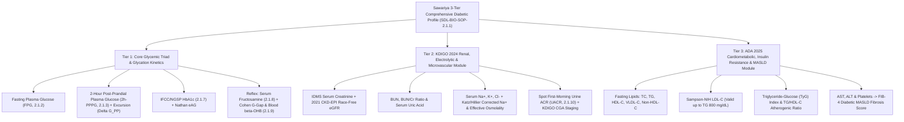

# 2.1.1 — Comprehensive Diabetic Profile (3-Tier Master Panel: Core Glycemic Triad, KDIGO Renal-Microvascular Module & Cardiometabolic-MASLD Insulin Resistance Module)

**Department Folder:** `02_Clinical_Biochemistry`  
**Cluster Folder:** `2.1_Diabetes_and_Glycemic_Metabolism_Cluster`  
**Institution:** Sawariya Diagnostic Lab, Charkhi Dadri, Haryana, India  

---

## 1. International Document Control, Regulatory Traceability & Interoperability Matrix

| Metadata Field | Institutional & International Specification |
| :--- | :--- |
| **Document ID & Version** | `SDL-BIO-SOP-2.1.1` (Legacy Cross-Ref: `SOP-BIO-2.1.1`) — **Version `v4.0 (International & Above-NABL Red-Team Standard)`** |
| **Effective Date & Review Cycle** | **Effective Date:** `2026-10-12` — **Review Cycle:** Annual (or immediate upon ADA / AACC / KDIGO / IFCC / NABL guideline revision) |
| **Authorizing Authority** | **Prepared By:** Chief Clinical Biochemist — **Reviewed By:** Quality Manager (`ISO 15189:2022`) — **Approved By:** Lab Director & Lead Consultant Pathologist (MD Pathology), Sawariya Diagnostic Lab, Charkhi Dadri, Haryana |
| **ISO 15189:2022 Clause Mapping** | Clauses `4.1–4.3` (Impartiality, Confidentiality, Patient Focus), `5.1–5.6` (Governance & Quality Management), `6.1–6.8` (Personnel, Equipment, Reagents, Metrological Traceability), `7.1–7.2` (Pre-Examination & `CLSI GP41` Phlebotomy), `7.3` (Examination, Method Verification, `ISO/TS 20914` MU, IQC, EQA), `7.4` (Post-Examination, Automated Indices, `CLSI GP47` Critical Read-Back), `8.1–8.9` (Risk Management & Continual Improvement), **Normative Annex A** (POCT Governance) |
| **NABL & International Accreditation Mapping** | **NABL:** `NABL 112 Issue 05` (Specific Criteria for Medical Laboratories — Clinical Biochemistry), `NABL 129` (Measurement Uncertainty), `NABL 131` ( Policy on Traceability), `NABL 153` (Scope Matrix), `NABL 163` (PT/EQAS), `NABL 220D / 223` (Assessment Checklists) — **International:** `CAP CHM` (Chemistry & Toxicology Checklist), `UKAS`, `CLSI`, `IFCC`, `NGSP`, `EFLM EuBIVAS` |
| **Clinical Guideline Harmonization** | **AACC/ADA 2023** (*Sacks et al., Guidelines and Recommendations for Laboratory Analysis in the Diagnosis and Management of Diabetes Mellitus*), **ADA Standards of Care in Diabetes (2024/2025)**, **RSSDI / ICMR-INDIAB National Guidelines**, **KDIGO 2024 Clinical Practice Guideline for the Evaluation and Management of CKD**, **EASL-EASD-EASO / AASLD 2024 MASLD Guidelines** |
| **Primary Panel LOINC Codes** | **Master Panel:** `24321-2` / `24323-8` — **Tier 1 (Glycemic):** `1558-6` (`FPG`), `1521-4` (`2h-PPPG`), `4548-4` (`HbA1c % NGSP`), `59261-8` (`HbA1c mmol/mol IFCC`), `27353-2` (`Nathan eAG`), `15069-8` (`Serum Fructosamine`), `2349-9` (`Urine Glucose`), `53065-9` (`Blood beta-Hydroxybutyrate`) — **Tier 2 (Renal/Electrolyte):** `2160-0` (`Serum Creatinine`), `98979-8` (`2021 CKD-EPI eGFR`), `3094-0` (`BUN`), `3084-1` (`Uric Acid`), `2951-2` (`Serum Na+`), `2823-3` (`Serum K+`), `9318-7` (`Spot UACR`) — **Tier 3 (Cardiometabolic/Hepatic):** `2093-3` (`Total Cholesterol`), `2571-8` (`Triglycerides`), `2085-9` (`HDL-C`), `96259-7` (`Sampson-NIH LDL-C`), `43396-1` (`Non-HDL-C`), `1920-8` (`AST`), `1742-6` (`ALT`), `96353-8` (`FIB-4 Score`) |
| **SNOMED-CT Specimen Concepts** | `119361006` (Plasma specimen — Citrate-Fluoride-EDTA / $\text{NaF-K}_3\text{EDTA}$), `119297000` ($\text{K}_2\text{-EDTA}$ Whole blood specimen), `119364003` (Serum specimen — SST Gel), `122575003` (First-morning mid-stream spot urine specimen) |
| **ICD-10 / ICD-11 Clinical Coding** | **ICD-10:** `E11.9` (Type 2 DM without complications), `E10.9` (Type 1 DM), `E11.21` / `E11.22` (Type 2 DM with diabetic nephropathy / CKD), `E11.65` (Type 2 DM with hyperglycemia), `E11.10` (Type 2 DM with ketoacidosis), `R73.01` (Impaired Fasting Glucose), `R73.02` (Impaired Glucose Tolerance), `R73.03` (Prediabetes), `E78.2` (Mixed Diabetic Dyslipidemia), `K76.0` (MASLD/NAFLD), `Z13.1` (Encounter for screening for DM) — **ICD-11:** `5A11`, `5A10`, `5A40`, `GB61.0`, `5C80.2`, `DB92.1` |
| **Metrological Traceability (`ISO 17511:2020`)** | **Plasma Glucose:** `NIST SRM 965b` (Isotope Dilution GC-MS) — **HbA1c:** `IFCC Secondary Reference Measurement Procedure (HPLC-ESI/MS or HPLC-CE)` calibrated to `NGSP` network — **Serum/Urine Creatinine:** `NIST SRM 967a` (ID-LC/MS) — **Urine Albumin:** `ERM-DA470k/IFCC` — **Lipids (TC/TG/HDL):** `NIST SRM 1951c / SRM 909c` (CDC Abell-Kendall / ID-GC/MS) — **Electrolytes ($\text{Na}^+/\text{K}^+$):** `NIST SRM 956d` (Flame Atomic Emission / Ion Chromatography) — **AST/ALT:** `IFCC Primary Reference Procedure at 37°C` (`ERM-AD454k / ERM-AD452k`) |
| **Primary Analytical Platform** | **Bonavera Chem 400** Random-Access Automated Clinical Chemistry Analyzer (UV Hexokinase Glucose, IDMS-Enzymatic Creatinine, PEG-Immunoturbidimetric Urine Microalbumin, Direct/Enzymatic Lipids, IFCC Kinetic AST/ALT, Direct/Indirect ISE) + **Ion-Exchange HPLC** (`HbA1c` with Variant Window Detection) |
| **Backup Analytical Platform** | **Bonavera Chem 200** Automated Analyzer (Identical reagent chemistry & optical wavelengths; Latex-Enhanced Immunoturbidimetric `HbA1c` backup) + **Dual-Wavelength Reflectance Urine Strip Reader & Amperometric $\beta\text{-Hydroxybutyrate}$ Meter** |

---

## 2. 10-Persona International Red-Team Adversarial Audit, `ISO 22367:2020` Quantitative FMECA & Live Witness-Audit Simulation

### 2.1 10-Persona Adversarial Audit Summary Table

| Persona ID & Role | Critical Vulnerability Identified in Legacy SOP | Mandatory Upgrade Implemented in `v4.0` |
| :--- | :--- | :--- |
| **Persona 1: Lead NABL (`ISO 15189:2022` / `NABL 112 Issue 05`) & CAP CHM Assessor** | Incomplete clause-level mapping; lacked explicit live witness-audit verification table and bench worksheet ID traceability. | Added complete `ISO 15189:2022` (Clauses 4.1–8.9 + Annex A) and `NABL 112/129/131/153/163` traceability, Live Witness-Audit Simulation (Section 2.3), and Controlled Bench Worksheet `SDL/BIO/WS/DIAB-PANEL-01` (Section 12). |
| **Persona 2: Consultant Clinical Biochemist & Endocrinologist (`MD/DM`)** | Treated the "Comprehensive Diabetic Profile" as a narrow 4-test mini-panel (`FPG, PPPG, HbA1c, UACR`), ignoring renal filtration, electrolytes, dyslipidemia, and hepatic steatosis. | Architected the **Sawariya 3-Tier Comprehensive Diabetic Profile** integrating Tier 1 (Glycemic Triad + Fructosamine/G-Gap), Tier 2 (Renal `2021 CKD-EPI eGFR`, `UACR`, Electrolytes, Corrected $\text{Na}^+$), and Tier 3 (Lipids, `TyG Index`, `TG/HDL-C`, `Sampson-NIH LDL-C`, `FIB-4`). |
| **Persona 3: CLSI & IFCC Metrology & Method Verification Specialist** | Lacked explicit `CLSI EP15-A3`, `EP06-Ed2`, `EP17-A2`, `EP28-A3c`, and `EP31-A` verification tables across all 3 tiers. | Added complete verification specifications, linearity/prozone hook thresholds, calibration hierarchy (`ISO 17511:2020`), and split-sample inter-instrument comparability criteria between `Bonavera Chem 400` and `Chem 200`. |
| **Persona 4: Clinical Pharmacologist & Special-Population Auditor** | Limited drug interference coverage; omitted hyperglycemic translocational hyponatremia (`Katz/Hillier`) and rural Haryana anemia/hemoglobinopathy effects. | Expanded *in-vivo* vs *in-vitro* drug matrix (SGLT2i `euDKA`, GLP-1RA, Steroids, Thiazides, Trinder interferents, Acetaminophen, Hydroxyurea, Dapsone, Iron/$\text{B}_{12}$ deficiency) and 10-stratum reference intervals. |
| **Persona 5: Medico-Legal, Patient-Safety & `ISO 22367` Risk Counsel** | Qualitative FMEA lacked numerical $S \times O \times D = \text{RPN}$ scoring before and after mitigation; lacked verbatim `CLSI GP47` read-back script. | Built a 10-row Quantitative `ISO 22367:2020` FMECA Matrix (Section 2.2), verbatim 30-minute critical value read-back script (Section 7), and statutory shields (`CPA 2019`, `DPDP Act 2023`, `BMW Rules 2016/2019`). |
| **Persona 6: Uncompressed Clinical Documentation Architect** | Overly condensed tables and missing multi-parameter phenotypic interpretation examples. | Expanded into a comprehensive, self-contained clinical reference text with an **8-Pattern Multi-Parameter Discordance & Phenotypic Diagnostic Matrix** (Section 9) and full LIMS/Worksheet templates. |
| **Persona 7: ADA 2025 / ICMR-INDIAB Diabetology Specialist** | Ignored the **Asian-Indian "Thin-Fat" Phenotype** (visceral adiposity at low BMI, early 1st-phase $\beta$-cell exhaustion, and isolated post-prandial hyperglycemia). | Added Post-Prandial Glycemic Excursion ($\Delta G_{\text{PP}} = \text{PPPG}_{2\text{h}} - \text{FPG}$), `ICMR-INDIAB` screening cutoffs, and Pattern 1 (Isolated Post-Prandial Diabetes with normal `FPG`). |
| **Persona 8: AACC/ADA 2023 Pre-Analytical Glycolysis & Phlebotomy Auditor** | Failed to warn against `CLSI GP41` multi-tube order-of-draw cross-contamination ($\text{K}_2\text{-EDTA}$ / $\text{NaF-Oxalate}$ contaminating SST tube) and 1st-hour $\text{NaF}$ glycolysis lag. | Established strict multi-tube order-of-draw (`SST Plain/Gel` FIRST $\rightarrow$ `K2-EDTA` SECOND $\rightarrow$ `NaF/Citrate-Fluoride` LAST) and mandatory $\le 30\text{ min}$ centrifugation or Citrate-Fluoride acidified acidification protocol. |
| **Persona 9: KDIGO 2024 DKD & Cardiometabolic-MASLD Specialist** | Omitted `2021 CKD-EPI Race-Free eGFR`, `TyG Index`, `Sampson-NIH LDL-C` (for diabetic hypertriglyceridemia), and `FIB-4` hepatic fibrosis screening. | Integrated full equations and clinical decision limits for `2021 CKD-EPI eGFR`, KDIGO CGA staging, `TyG Index`, `TG/HDL-C`, `Sampson-NIH LDL-C`, `Non-HDL-C`, and `FIB-4`. |
| **Persona 10: EFLM EuBIVAS & `ISO/TS 20914:2019` MU Auditor** | Covered only 3 analytes in the biological variation table; lacked step-by-step `ISO/TS 20914:2019` worked uncertainty calculations. | Expanded the `EFLM EuBIVAS` table to all 14 panel parameters (Section 5.1) and provided worked `ISO/TS 20914:2019` bottom-up Measurement Uncertainty ($u_c, U$) derivations (Section 5.2). |

---

### 2.2 Quantitative `ISO 22367:2020` Failure Mode, Effects, and Criticality Analysis (`FMECA`) Matrix
*Scoring Scale: Severity ($S$: $1\text{–}10$), Occurrence ($O$: $1\text{–}10$), Detection ($D$: $1\text{–}10$). Risk Priority Number ($\text{RPN} = S \times O \times D$). Action Threshold: $\text{RPN} \ge 100$ or $S \ge 8$.*

| ID | Failure Mode & Mechanism | Root Cause | Clinical & Analytical Impact | Pre-Control $S \times O \times D = \text{RPN}$ | Hard-Locked Technical & LIMS Mitigation (`CAPA`) | Post-Control $S \times O \times D = \text{RPN}$ |
| :--- | :--- | :--- | :--- | :--- | :--- | :--- |
| **FMEA-01** | **`CLSI GP41` Order-of-Draw Cross-Contamination in Multi-Tube Diabetic Panel Draws** | Phlebotomist draws `K2-EDTA` (`HbA1c`) or `NaF-K3EDTA / NaF-Oxalate` (`Glucose`) *before* `SST Gel` (`Electrolytes, Creatinine, Lipids, LFT`), transferring $\text{K}^+$ and chelators via needle/hub carryover. | Spurious critical hyperkalemia ($\text{K}^+ > 7.0\text{ mmol/L}$), severe pseudohypocalcemia ($\text{Ca}^{2+} < 4.5\text{ mg/dL}$), pseudohypomagnesemia, and irreversible $\text{Zn}^{2+}/\text{Mg}^{2+}$ chelation inactivating `ALP` ($< 10\text{ U/L}$). | $10 \times 5 \times 6 = \mathbf{300}$ | **1.** Strict `CLSI GP41` sequence printed on barcode labels: **Tube 1: SST Gold/Red** $\rightarrow$ **Tube 2: Lavender $\text{K}_2\text{-EDTA}$** $\rightarrow$ **Tube 3: Grey $\text{NaF/Citrate}$**.<br>**2.** LIMS hard-lock rule: `IF K+ > 6.2 mmol/L AND (Ca < 6.5 mg/dL OR ALP < 20 U/L)` $\rightarrow$ Auto-block release and flag **"Suspected EDTA/Oxalate Cross-Contamination — Redraw SST"**. | $10 \times 1 \times 2 = \mathbf{20}$ |
| **FMEA-02** | **Uncentrifuged `NaF-Oxalate` First-Hour Glycolysis Lag ($5\text{–}10\text{ mg/dL}$ loss)** | Sodium fluoride inhibits *enolase* (late glycolytic enzyme) only after $60\text{–}90\text{ min}$, while upstream *hexokinase* and *phosphofructokinase* remain active in RBCs/WBCs during the first hour at $25\text{–}35^\circ\text{C}$. | Drops `FPG` from $104\text{ mg/dL}$ to $95\text{ mg/dL}$ ("Normal") or $130\text{ mg/dL}$ to $121\text{ mg/dL}$ ("Prediabetes"), creating artificial discordance against `HbA1c` ($6.6\%$) and missing early diabetes. | $8 \times 7 \times 6 = \mathbf{336}$ | **1.** Prefer **Citrate-Buffered Fluoride-EDTA** tubes (immediate pH $5.3\text{–}5.9$ inhibition of hexokinase/PFK).<br>**2.** If standard $\text{NaF-EDTA}$ is used, centrifuge at $1,500 \times g$ for $10\text{ min}$ within **$\le 30\text{ minutes}$** of venipuncture and separate plasma.<br>**3.** LIMS tracks `[Collection_Time]` to `[Spin_Time]` ($\Delta t > 45\text{ min}$ triggers audit flag). | $8 \times 2 \times 2 = \mathbf{32}$ |
| **FMEA-03** | **Unrecognized Hemoglobinopathy, Rural Haryana `IDA`, or Hemolysis Distorting `HbA1c` (`Glycation Gap > +0.8%` or `< -0.8%`)** | Signing out `HbA1c` without checking paired CBC (`Hb, MCV, RDW`), HPLC variant windows (`HbD-Punjab, HbE, HbS, beta-Thal`), or CKD/hemolysis status. | Iron deficiency anemia (`IDA`) prolongs RBC survival and falsely elevates `HbA1c` by $+0.5\%\text{ to }+1.5\%$ (false DM diagnosis); hemolysis or hemoglobinopathy falsely lowers `HbA1c` (undertreatment of severe DM). | $9 \times 6 \times 5 = \mathbf{270}$ | **1.** Mandatory inspection of HPLC chromatogram for $\text{HbF} > 5\%$, $\text{LA1c} > 3\%$, or variant peaks (`D/S/E/C window`).<br>**2.** LIMS cross-checks CBC (`Hb < 10.0 g/dL`, `MCV < 72 fL` or `> 100 fL`) and compares `Nathan eAG` vs mean `FPG/PPPG`.<br>**3.** If $\lvert \text{eAG} - \text{Mean Glucose} \rvert > 40\text{ mg/dL}$ or severe anemia/variant present $\rightarrow$ Auto-reflex **Serum Fructosamine (`2.1.8`)** and compute **Cohen Glycation Gap (`G-Gap`)**. | $9 \times 2 \times 2 = \mathbf{36}$ |
| **FMEA-04** | **Omission of Early Diabetic Nephropathy (`Spot UACR` + `2021 CKD-EPI eGFR`) & Diabetic MASLD (`FIB-4`)** | Reporting glucose and `HbA1c` in isolation, or relying on raw serum creatinine ($1.1\text{ mg/dL}$) and dipstick urine protein (insensitive until $> 300\text{ mg/L}$). | Misses KDIGO Stage `A2` microalbuminuria ($30\text{–}299\text{ mg/g}$), Stage `G3a` CKD in sarcopenic elderly females, and silent F2–F4 liver fibrosis (`MASLD`), delaying SGLT2i/ACEi/GLP-1RA therapy. | $9 \times 5 \times 5 = \mathbf{225}$ | **1.** Hard-code **2021 CKD-EPI Creatinine Race-Free `eGFR`**, **Spot First-Morning `UACR`**, **`TyG Index`**, and **`FIB-4` Score** into the Master Diabetic Profile.<br>**2.** Print KDIGO 2024 CGA Risk Category (`Low / Moderately Increased / High / Very High Risk`) directly on the report. | $9 \times 1 \times 2 = \mathbf{18}$ |
| **FMEA-05** | **Invalid Friedewald `LDL-C` in Diabetic Hypertriglyceridemia ($\text{TG} > 175\text{–}400\text{ mg/dL}$)** | Diabetic insulin resistance increases chylomicron/VLDL remnants, altering the fixed $5:1$ $\text{TG:VLDL-C}$ ratio assumed by Friedewald, causing progressive negative bias or calculation failure at $\text{TG} > 400\text{ mg/dL}$. | Falsely low calculated `LDL-C` ($10\text{–}25\text{ mg/dL}$ underestimation), leading to failure to initiate or intensify high-intensity statin therapy in high-ASCVD-risk diabetics. | $8 \times 6 \times 4 = \mathbf{192}$ | **1.** Replace Friedewald in LIMS with the **Sampson-NIH `LDL-C` Equation** (validated up to $\text{TG} \le 800\text{ mg/dL}$).<br>**2.** Always co-report **Non-HDL Cholesterol ($\text{TC} - \text{HDL-C}$)** and **`TG/HDL-C` Ratio**.<br>**3.** If $\text{TG} > 400\text{ mg/dL}$, auto-reflex **Direct Enzymatic `LDL-C`**. | $8 \times 1 \times 2 = \mathbf{16}$ |
| **FMEA-06** | **Missed SGLT2-Inhibitor Euglycemic Diabetic Ketoacidosis (`euDKA`)** | Patient on *Dapagliflozin / Empagliflozin* presents with nausea/tachypnea, near-normal plasma glucose ($160\text{–}220\text{ mg/dL}$), $4+$ glucosuria, and only trace/$1+$ urine ketones (nitroprusside detects acetoacetate, missing $\beta\text{-Hydroxybutyrate}$). | Delayed recognition of life-threatening metabolic acidosis ($\text{pH} < 7.20$, $\beta\text{-OHB} > 3.0\text{ mmol/L}$) because clinician is reassured by glucose $< 250\text{ mg/dL}$ and $1+$ urine dipstick ketones. | $10 \times 4 \times 5 = \mathbf{200}$ | **1.** LIMS rule: `IF Urine Glucose >= 3+ AND Plasma Glucose < 220 mg/dL` $\rightarrow$ Flag **"SGLT2-Inhibitor Pattern / Renal Glycosuria"**.<br>**2.** If any ketonuria ($\ge \text{Trace}$) or anion gap $> 14\text{ mmol/L}$ is present, immediately reflex quantitative **Blood $\beta\text{-Hydroxybutyrate}$ (`2.1.9`)**. | $10 \times 1 \times 2 = \mathbf{20}$ |
| **FMEA-07** | **Unrecognized Hyperglycemic Translocational Hyponatremia in `DKA / HHS`** | Severe extracellular hyperglycemia ($\text{Glucose } 400\text{–}900\text{ mg/dL}$) osmotically draws water out of cells into ECF, diluting measured serum $\text{Na}^+$ by $1.6\text{ to }2.4\text{ mmol/L}$ per $100\text{ mg/dL}$ glucose rise. | Misinterpreting $\text{Na}^+_{\text{Measured}} = 124\text{ mmol/L}$ (at Glucose $650\text{ mg/dL}$) as true hypotonic hyponatremia rather than hyperosmolar dehydration ($\text{Na}^+_{\text{Corr (Hillier)}} = 137.2\text{ mmol/L}$), risking cerebral edema from inappropriate fluid tonicity. | $9 \times 4 \times 5 = \mathbf{180}$ | **1.** LIMS automatically calculates and prints **Katz Corrected $\text{Na}^+$** (when Glucose $200\text{–}400\text{ mg/dL}$) and **Hillier Corrected $\text{Na}^+$** (when Glucose $> 400\text{ mg/dL}$) alongside **Effective Serum Osmolality**. | $9 \times 1 \times 1 = \mathbf{9}$ |
| **FMEA-08** | **Invalid 2-Hour Post-Prandial (`2h-PPPG`) Timing or Medication Omission** | Patient times the 2 hours from the *end* of a 30-minute meal (collecting at $150\text{ min}$ past peak), or skips morning anti-diabetic tablets/insulin before the post-prandial meal during therapy monitoring. | Artificial underestimation of peak post-prandial glucose (if drawn late) or artificial severe spike $> 300\text{ mg/dL}$ (if morning medications were withheld during treatment monitoring). | $7 \times 6 \times 5 = \mathbf{210}$ | **1.** Phlebotomy Reception stamps exact **`[First-Bite Time]`** on the token and sets an automated SMS/timer alert for **`First-Bite + 120 min ($\pm 5\text{ min}$)`**.<br>**2.** Reception explicitly records whether patient is undergoing **Diagnostic Screening** (no meds) vs **Therapy Monitoring** (take prescribed morning meds with meal). | $7 \times 2 \times 2 = \mathbf{28}$ |
| **FMEA-09** | **Urine Microalbumin High-Dose Prozone (Hook Effect) or False-Positive Stage A2 `UACR`** | Severe nephrotic-range proteinuria ($> 4,000\text{ mg/L}$) saturates anti-albumin antibodies in immunoturbidimetry, OR patient collects urine during UTI, menses, febrile illness, or within 24h of heavy exercise. | Nephrotic proteinuria falsely reported as normal/mildly elevated (hook effect), OR transient physiological proteinuria misdiagnosed as chronic Diabetic Kidney Disease. | $8 \times 4 \times 5 = \mathbf{160}$ | **1.** `Bonavera Chem 400` kinetic reaction rate check flags antigen excess up to $5,000\text{ mg/L}$ and triggers $1:10$ saline auto-dilution.<br>**2.** Cross-check dipstick total protein and microscopic `WBC/RBC` (`5.1.1`); append KDIGO 2-of-3 repeat confirmation rule over $3\text{–}6\text{ months}$. | $8 \times 1 \times 2 = \mathbf{16}$ |
| **FMEA-10** | **Trinder `GOD-POD` Negative Interference on Backup Chemistry Channel** | High-dose IV/oral Ascorbic Acid, Metamizole (Dipyrone), N-Acetylcysteine (`NAC`), Calcium Dobesilate, or Dopamine/Dobutamine consumes $\text{H}_2\text{O}_2$ in the peroxidase chromogenic step. | Falsely depressed plasma glucose ($-20\%\text{ to }-60\%$), masking hyperglycemia or creating spurious hypoglycemia alerts. | $8 \times 3 \times 5 = \mathbf{120}$ | **1.** Primary (`Bonavera Chem 400`) and Backup (`Bonavera Chem 200`) both standardized to **UV Hexokinase / G6PDH at $340\text{ nm}$** (completely immune to Trinder redox interferents).<br>**2.** `GOD-POD` restricted strictly to emergency reagent-shortage contingency with mandatory medication check. | $8 \times 1 \times 1 = \mathbf{8}$ |

---

### 2.3 Live NABL (`ISO 15189:2022`) & CAP Witness-Audit Simulation Table

| Audit Challenge Question / Assessor Scenario | Expected Bench Demonstration by Technical Staff | Objective Evidence / Document & Register ID | Assessor Pass / Fail Criteria |
| :--- | :--- | :--- | :--- |
| **1. "Show me how your phlebotomist collects the 3-tube Comprehensive Diabetic Profile and prevents EDTA/Fluoride potassium carryover."** | Phlebotomist demonstrates venipuncture using evacuated system following `CLSI GP41`: draws **1st: SST Gold-Top** (Electrolytes/Renal/Lipids/LFT), **2nd: Lavender $\text{K}_2\text{-EDTA}$** (`HbA1c`), **3rd: Grey Citrate-Fluoride/$\text{NaF}$** (`FPG`), gently inverting tubes $8\text{–}10\times$ without shaking, and logs `[Draw_Time]` and `[Spin_Time]` ($\le 30\text{ min}$). | Phlebotomy SOP `SDL-PRE-SOP-01`, Order-of-Draw Wall Chart, LIMS Timestamp Log `SDL/PRE/LOG/SPIN-04`. | **PASS:** Exact tube sequence followed; Grey tube spun within $30\text{ min}$; zero hemolysis/EDTA contamination flags. |
| **2. "A patient's `FPG` is $94\text{ mg/dL}$ and `2h-PPPG` is $132\text{ mg/dL}$, but `HbA1c` is $6.9\%$. Walk me through how your lab resolves this before sign-out."** | Biochemist retrieves the paired CBC (`Hb = 8.4 g/dL, MCV = 66 fL` — microcytic hypochromic anemia), inspects the HPLC chromatogram (normal $\text{HbA}_0$, no variant peak), triggers reflex **Serum Fructosamine (`2.1.8`)** ($228\ \mu\text{mol/L}$), and shows the LIMS-calculated **Cohen Glycation Gap (`G-Gap = +1.41%`)**, proving `IDA`-induced false `HbA1c` elevation. | Worksheet `SDL/BIO/WS/DIAB-PANEL-01`, Reflex Log `SDL/BIO/LOG/REFLEX-02`, HPLC Chromatogram Printout. | **PASS:** Discordance caught prior to sign-out; Fructosamine & `G-Gap` reported with `IDA` corrective interpretive comment. |
| **3. "Demonstrate metrological traceability, current IQC Sigma performance, and `ISO/TS 20914:2019` Measurement Uncertainty for Glucose, `HbA1c`, and `UACR`."** | Quality Manager displays valid calibrator traceability certificates (`NIST SRM 965b`, `IFCC/NGSP`, `ERM-DA470k/IFCC`, `NIST SRM 967a`), 6-month Levey-Jennings charts ($\sigma \ge 5.2$ for Glucose and `HbA1c`), and the live `ISO/TS 20914` spreadsheet showing $U = 4.16\%$ for Glucose, $U = 2.84\%$ for `HbA1c`, and $U = 10.8\%$ for `UACR`. | MU Master Register `SDL/QM/MU-2026`, IQC Monthly Summary `SDL/BIO/IQC-09`, EQAS Certificates `SDL/BIO/EQA-CMC`. | **PASS:** Complete unbroken traceability chain; $U < 0.5\text{–}0.67 \times \text{TE}_a$; EQA $Z\text{-scores}$ within $\pm 1.5$. |
| **4. "How do you verify comparability between your primary (`Bonavera Chem 400`) and backup (`Bonavera Chem 200`) analyzers for this panel?"** | Technical Supervisor presents the weekly `CLSI EP31-A` split-sample comparability binder ($n=5$ patient samples spanning clinical decision limits for Glucose, Creatinine, `HbA1c`, and Microalbumin), demonstrating inter-instrument bias within $\pm 0.33 \times \text{TE}_a$. | Comparability Register `SDL/BIO/COMP-EP31`, Maintenance Log `SDL/BIO/MAINT-400/200`. | **PASS:** Weekly records up to date; inter-instrument bias $\le \pm 2.5\%$ for Glucose and $\le \pm 0.2\%$ abs for `HbA1c`. |
| **5. "A diabetic patient on *Empagliflozin* has `FPG` $172\text{ mg/dL}$, Urine Glucose $4+$, and Urine Ketones $1+$. Why does your LIMS trigger an urgent reflex?"** | Biochemist explains SGLT2-inhibitor **Euglycemic DKA (`euDKA`)** pathophysiology and nitroprusside's inability to detect $\beta\text{-Hydroxybutyrate}$. Demonstrates automated reflex to quantitative **Blood $\beta\text{-OHB}$ (`2.1.9`)** ($4.4\text{ mmol/L}$) and immediate `CLSI GP47` critical call. | Reflex Rule Config `SDL/LIMS/RULE-06`, Ketone Verification File `SDL/BIO/VER-2.1.9`. | **PASS:** Staff accurately explains $\beta\text{-OHB:AcAc}$ shift and executes quantitative $\beta\text{-OHB}$ assay + 30-min critical alert. |
| **6. "How does your laboratory calculate `LDL-C` when a diabetic patient's Fasting Triglycerides are $340\text{ mg/dL}$?"** | Biochemist shows that LIMS uses the **Sampson-NIH `LDL-C` equation** (valid up to $\text{TG} \le 800\text{ mg/dL}$) rather than Friedewald, co-reports **Non-HDL-C**, **`TyG Index`**, and **`TG/HDL-C` Ratio**, and auto-reflexes **Direct Enzymatic `LDL-C`** whenever $\text{TG} > 400\text{ mg/dL}$. | LIMS Formula Validation Log `SDL/LIMS/CALC-2026`, Lipid SOP `SDL-BIO-SOP-2.2.1`. | **PASS:** Hand-calculation matches LIMS Sampson-NIH output to $\pm 0.1\text{ mg/dL}$; Direct LDL reflex active at $\text{TG} > 400\text{ mg/dL}$. |
| **7. "Simulate a Tier-1 Critical Call for a DKA patient with Plasma Glucose $580\text{ mg/dL}$, Measured $\text{Na}^+ 125\text{ mmol/L}$, and Serum $\text{K}^+ 2.9\text{ mmol/L}$."** | Biochemist verifies zero hemolysis (`H-Index = 12`), calculates **Hillier Corrected $\text{Na}^+$ ($136.5\text{ mmol/L}$)**, and performs a live mock telephone read-back emphasizing the **ADA DKA Rule: HOLD IV INSULIN until $\text{K}^+$ is repleted $\ge 3.3\text{ mmol/L}$** to prevent fatal hypokalemic arrhythmia. | Critical Value Register `SDL/BIO/CRIT-LOG-01`, `CLSI GP47` Wall Protocol. | **PASS:** Notification completed within $\le 30\text{ min}$; Hillier Corrected $\text{Na}^+$ and hypokalemia insulin-hold warning communicated verbatim. |
| **8. "How does your report guide the clinician on anti-diabetic drug safety when `Serum Creatinine` is $1.85\text{ mg/dL}$ in a 68-year-old female?"** | Biochemist shows LIMS auto-calculation of **2021 CKD-EPI Race-Free `eGFR` ($29\text{ mL/min/1.73m}^2$, Stage `G4`)**, paired with `Spot UACR` staging and an automated clinical alert flagging **Metformin contraindication at `eGFR < 30`**. | KDIGO 2024 Dosing Matrix (Section 6.3), LIMS Auto-Comment Library `SDL/LIMS/COMM-DKD`. | **PASS:** Race-free 2021 CKD-EPI formula verified; Stage G4 Metformin stop-alert automatically appended. |

---

## 3. Architecture of the Sawariya Diagnostic Lab 3-Tier Comprehensive Diabetic Profile & Mathematical Equations

### 3.1 Complete 3-Tier Panel Architecture



---

### 3.2 Exact Mathematical Derived Indices Integrated into the Master Panel LIMS Report

#### 1. Nathan `ADAG` Estimated Average Glucose (`eAG`) (`AACC/ADA 2023`)
Derived from the International *A1c-Derived Average Glucose (ADAG)* multicenter study ($r = 0.92$), translating chronic `HbA1c` into the same linear units ($\text{mg/dL}$ or $\text{mmol/L}$) used on patient self-monitoring glucometers (`SMBG`) and continuous glucose monitors (`CGM`):
$$\text{eAG (mg/dL)} = 28.7 \times \text{HbA1c (\%)} - 46.7$$
$$\text{eAG (mmol/L)} = 1.59 \times \text{HbA1c (\%)} - 2.59$$
*Clinical Benchmark:* $\text{HbA1c } 5.7\% \rightarrow \text{eAG } 117\text{ mg/dL}$; $\text{HbA1c } 6.5\% \rightarrow \text{eAG } 140\text{ mg/dL}$; $\text{HbA1c } 7.0\% \rightarrow \text{eAG } 154\text{ mg/dL}$; $\text{HbA1c } 8.0\% \rightarrow \text{eAG } 183\text{ mg/dL}$; $\text{HbA1c } 10.0\% \rightarrow \text{eAG } 240\text{ mg/dL}$.

#### 2. Hoelzel `IFCC (mmol/mol)` $\leftrightarrow$ `NGSP (%)` Master Equations
$$\text{IFCC (mmol/mol)} = 10.93 \times \text{NGSP (\%)} - 23.50$$
$$\text{NGSP (\%)} = 0.09148 \times \text{IFCC (mmol/mol)} + 2.152$$
*Rationale:* The `IFCC` reference method measures specifically the glycated N-terminal hexapeptide of the $\beta$-chain via `HPLC-ESI/MS` or `HPLC-CE` without non-HbA1c co-elution, resulting in numerical values $\sim 1.5\text{–}2.0\%$ lower if expressed as percentages; reporting integer $\text{mmol/mol}$ alongside `NGSP %` prevents clinical confusion.

#### 3. Post-Prandial Glycemic Excursion ($\Delta G_{\text{PP}}$)
$$\Delta G_{\text{PP}}\text{ (mg/dL)} = \text{PPPG}_{2\text{h}}\text{ (mg/dL)} - \text{FPG}\text{ (mg/dL)}$$
- **Optimal Physiological Excursion:** $-10\text{ to }+35\text{ mg/dL}$ (robust 1st-phase insulin release within $0\text{–}10\text{ min}$ of meal entry plus intact GLP-1/GIP incretin amplification suppresses hepatic glucose output and clears dietary carbohydrate within $120\text{ min}$).
- **Moderate Excursion ($+40\text{ to }+60\text{ mg/dL}$):** Early prandial insulin secretory lag or high glycemic-load carbohydrate meal.
- **Severe Pathological Excursion ($> +60\text{ mg/dL}$):** Hallmark of the **Asian-Indian Diabetic Phenotype** — severe loss of first-phase $\beta$-cell insulin surge and incretin resistance. Even when `FPG` is acceptable ($105\text{ mg/dL}$), a `2h-PPPG` of $215\text{ mg/dL}$ ($\Delta G_{\text{PP}} = +110\text{ mg/dL}$) drives endothelial oxidative stress (`PKC` activation, nitrotyrosine formation) and macrovascular atherosclerosis, requiring prandial therapy (GLP-1RA, DPP-4i, SGLT2i, alpha-glucosidase inhibitors, or prandial insulin).
- **Negative Excursion ($\Delta G_{\text{PP}} < -15\text{ mg/dL}$, i.e., $\text{PPPG}_{2\text{h}} < \text{FPG}$):** Seen in early hyperinsulinemic insulin resistance (delayed, exaggerated 2nd-phase insulin overshoot causing reactive post-prandial dip), gastric dumping syndrome, autonomous insulinoma, or excessive morning sulfonylurea/rapid-acting insulin dosing relative to meal carbohydrate content.

#### 4. Triglyceride-Glucose (`TyG`) Index & `TG / HDL-C` Atherogenic Ratio (Cost-Free Surrogates of `HOMA-IR` & `sdLDL`)
$$\text{TyG Index} = \ln\left(\frac{\text{Fasting Triglycerides (mg/dL)} \times \text{Fasting Plasma Glucose (mg/dL)}}{2}\right)$$
$$\text{TG / HDL-C Mass Ratio} = \frac{\text{Fasting Triglycerides (mg/dL)}}{\text{HDL-C (mg/dL)}}$$
- **Physiological Rationale:** Because fasting serum insulin (`2.1.6`) is not part of routine baseline biochemistry panels due to immunoassay cost, the `TyG Index` integrates hepatic VLDL-triglyceride overproduction and fasting hepatic glucose output, correlating strongly ($r = 0.85$) with the hyperinsulinemic-euglycemic clamp and `HOMA-IR`.
- **`TyG Index` Decision Cutoffs:**
  - **$< 8.40$:** Normal hepatic and peripheral insulin sensitivity.
  - **$8.40 \text{ – } 8.75$:** Borderline insulin resistance / metabolic syndrome trajectory.
  - **$> 8.75\text{ (Men) / }> 8.55\text{ (Women)}$:** Severe insulin resistance, high risk of incident Type 2 DM, coronary artery calcification, and MASLD.
- **`TG / HDL-C` Mass Ratio Decision Cutoffs:**
  - **$< 2.0$:** Predominantly large, buoyant, non-atherogenic `LDL` particles (Phenotype A).
  - **$2.0 \text{ – } 3.5$:** Intermediate atherogenic risk.
  - **$> 3.5\text{ (Men) / }> 3.0\text{ (Women)}$ (or $> 2.5$ in Asian Indians):** Surrogate marker of **Phenotype B Dense Atherogenic Dyslipidemia** (> 70% prevalence of small dense $\text{sdLDL}_3/\text{sdLDL}_4$ particles that penetrate the arterial intima and undergo rapid oxidative modification).

#### 5. Cohen Glycation Gap (`G-Gap`) (Auto-Calculated when Serum Fructosamine `2.1.8` is Assayed)
$$\text{Predicted HbA1c}_{\text{Fructosamine}}\text{ (\%)} = 0.017 \times \text{Serum Fructosamine (\mu mol/L)} + 1.61$$
$$\text{Glycation Gap (G-Gap, \%)} = \text{HbA1c}_{\text{Measured}}\text{ (\%)} - \left(0.017 \times \text{Fructosamine}_{\mu\text{mol/L}} + 1.61\right)$$
- **Concordant Band ($\text{G-Gap}$ between $-0.8\%$ and $+0.8\%$):** Intracellular erythrocyte hemoglobin glycation matches extracellular serum protein (albumin) glycation.
- **Positive Glycation Gap ($\text{G-Gap} > +0.8\%$ — `HbA1c` Falsely High):** Erythrocyte lifespan is prolonged or intracellular deglycation (`FN3K` enzyme activity) is reduced. Classic causes: **Iron Deficiency Anemia (`IDA`)**, Vitamin $\text{B}_{12}$/Folate deficiency, post-splenectomy, aplastic anemia, or fast intracellular glycators.
- **Negative Glycation Gap ($\text{G-Gap} < -0.8\%$ — `HbA1c` Falsely Low):** Erythrocyte lifespan is shortened or hemoglobin variant interferes with glycation/measurement. Classic causes: **Hemolytic anemia, G6PD deficiency, hemoglobinopathies (`HbD-Punjab, HbE, HbS, beta-Thal`), acute/chronic blood loss, pregnancy hemodilution, CKD on erythropoietin (`EPO`), or Dapsone/Ribavirin therapy**.

#### 6. Katz (1973) & Hillier (1999) Hyperglycemic Corrected Serum Sodium ($\text{Na}^+_{\text{Corr}}$) & Effective Serum Osmolality
When extracellular plasma glucose exceeds $200\text{ mg/dL}$ without sufficient insulin, glucose acts as an impermeant osmole in the extracellular fluid (`ECF`), drawing intracellular water into the vascular compartment and diluting measured serum sodium:
$$\text{Na}^+_{\text{Corr (Katz — for Glucose } 200\text{–}400\text{ mg/dL)}} = \text{Na}^+_{\text{Measured}}\text{ (mmol/L)} + 0.016 \times \left(\text{Glucose}_{\text{mg/dL}} - 100\right)$$
$$\text{Na}^+_{\text{Corr (Hillier — for Glucose } > 400\text{ mg/dL)}} = \text{Na}^+_{\text{Measured}}\text{ (mmol/L)} + 0.024 \times \left(\text{Glucose}_{\text{mg/dL}} - 100\right)$$
$$\text{Effective Serum Osmolality (mOsm/kg)} = 2 \times \text{Na}^+_{\text{Measured}}\text{ (mmol/L)} + \frac{\text{Glucose}_{\text{mg/dL}}}{18}$$
*Clinical Mandate:* In `DKA` or `HHS` ($\text{Osm}_{\text{Eff}} > 320\text{ mOsm/kg}$), fluid replacement tonicity ($0.9\% \text{ NaCl}$ vs $0.45\% \text{ NaCl}$) MUST be guided by **$\text{Na}^+_{\text{Corr}}$**, never by raw $\text{Na}^+_{\text{Measured}}$.

#### 7. `2021 CKD-EPI` Creatinine Race-Free `eGFR` & Spot Urine `UACR` (`KDIGO 2024`)
$$\text{eGFR (mL/min/1.73 m}^2\text{)} = 142 \times \min\left(\frac{S_{\text{Cr}}}{\kappa}, 1\right)^{\alpha} \times \max\left(\frac{S_{\text{Cr}}}{\kappa}, 1\right)^{-1.200} \times 0.9938^{\text{Age}} \times \left(1.012 \text{ if Female}\right)$$
*(where $S_{\text{Cr}}$ is IDMS-traceable enzymatic serum creatinine in $\text{mg/dL}$; for Females: $\kappa = 0.7, \alpha = -0.241$; for Males: $\kappa = 0.9, \alpha = -0.302$).*
$$\text{Spot UACR (mg/g)} = \frac{\text{Urine Microalbumin (mg/L)}}{\text{Urine Creatinine (mg/dL)}} \times 100 \quad \left(\text{SI: }\text{mg/mmol} = \text{mg/g} \times 0.1131\right)$$

#### 8. Sampson-NIH `LDL-C` (Valid up to $\text{TG} \le 800\text{ mg/dL}$), `Non-HDL-C` & `FIB-4` Diabetic MASLD Score
$$\text{LDL-C}_{\text{Sampson}}\text{ (mg/dL)} = \frac{\text{TC}}{0.948} - \frac{\text{HDL-C}}{0.971} - \left(\frac{\text{TG}}{8.56} + \frac{\text{TG} \times \text{Non-HDL-C}}{2140} - \frac{\text{TG}^2}{16100}\right) - 9.44$$
$$\text{Non-HDL-C (mg/dL)} = \text{Total Cholesterol (mg/dL)} - \text{HDL-C (mg/dL)}$$
$$\text{FIB-4 Index} = \frac{\text{Age (years)} \times \text{AST (U/L)}}{\text{Platelet Count (10}^9\text{/L)} \times \sqrt{\text{ALT (U/L)}}}$$
- **`FIB-4` Cutoffs in Type 2 Diabetes (`ADA 2025 / EASL-AASLD 2024`):**
  - **$< 1.30$** ($< 2.0$ if age $\ge 65\text{y}$): Low risk of advanced hepatic fibrosis ($F3\text{–}F4$ excluded with $> 90\%$ NPV).
  - **$1.30 \text{ – } 2.67$:** Indeterminate risk — refer for Vibration-Controlled Transient Elastography (`FibroScan` / Liver Stiffness Measurement `LSM`).
  - **$> 2.67$:** High probability of advanced bridging fibrosis/cirrhosis ($F3\text{–}F4$) — urgent hepatology referral and prioritization of GLP-1RA / dual GIP-GLP-1RA / Pioglitazone / Resmetirom therapy.

---

## 4. Pre-Analytical Phlebotomy, `CLSI GP41` Order-of-Draw, Stability & Quantitative `HIL` Rejection Matrix

### 4.1 Patient Preparation & Two-Stage Phlebotomy Protocol
1. **Stage 1 — Baseline Fasting Draw (`0 Hour`):**
   - **Caloric Fast:** Strictly **8 to 12 hours of overnight fasting** (plain water permitted; no tea, coffee, milk, alcohol, smoking, gutkha/tobacco, or chewing gum). Avoid prolonged starvation $> 14\text{ hours}$ (triggers counter-regulatory glucagon/cortisol glycogenolysis or starvation ketosis).
   - **Morning Medication Policy at `0 Hour`:** Withhold morning oral hypoglycemic agents (`OHAs`) and morning insulin until *after* the fasting blood draw is completed. (Essential antihypertensives may be taken with a sip of plain water).
   - **Strict `CLSI GP41` Multi-Tube Order of Draw:**
     1. **Tube 1 — Gold-Top `SST Gel` or Red-Top Plain ($4.0\text{ mL}$):** Drawn **FIRST** for Tier 2 (`Serum Creatinine, BUN, Uric Acid, Na+, K+, Cl-`) and Tier 3 (`Lipid Profile, AST, ALT`) to guarantee zero contamination from $\text{K}_2\text{-EDTA}$ or $\text{NaF-Oxalate}$. Clot upright for $20\text{–}30\text{ min}$, then centrifuge at $1,500 \times g$ for $10\text{ min}$.
     2. **Tube 2 — Lavender-Top $\text{K}_2\text{-EDTA}$ ($2.0\text{ mL}$):** Drawn **SECOND** for `HbA1c` (`2.1.7`) and `CBC Platelets/Hb` (`FIB-4` & anemia check). Invert gently $8\text{–}10\text{ times}$.
     3. **Tube 3 — Grey-Top Citrate-Buffered Fluoride-EDTA or $\text{NaF } (2.5\text{ mg/mL}) + \text{K}_3\text{-EDTA}$ ($2.0\text{ mL}$):** Drawn **LAST** for `FPG` (`2.1.2`). Invert gently $8\text{–}10\text{ times}$ and centrifuge at **$1,500 \times g$ for $10\text{ minutes}$ within $\le 30\text{ minutes}$** of venipuncture.
     4. **Sterile Polypropylene Urine Container ($15\text{ mL}$):** First-morning or second-morning mid-stream clean-catch spot urine for `Spot UACR` (`2.1.10`) and Fasting Urine Glucose/Ketones.
2. **Stage 2 — 2-Hour Post-Prandial Draw (`120 Minutes`):**
   - **Meal & Medication Protocol:**
     - *If Diagnostic Screening (Undiagnosed Patient):* Administer either $75\text{g}$ anhydrous glucose dissolved in $250\text{–}300\text{ mL}$ water consumed over $5\text{ minutes}$ (`WHO OGTT`), OR a standardized mixed breakfast ($\ge 75\text{g}$ carbohydrates) without hypoglycemic medications.
     - *If Therapeutic Monitoring (Known Diabetic on Treatment):* Patient takes their **prescribed morning anti-diabetic medications / pre-meal insulin** and consumes their regular prescribed meal.
   - **Exact First-Bite Timing:** Phlebotomist records the exact clock time of the **FIRST BITE of food (or first sip of glucose load)** on the patient requisition slip and worksheet `SDL/BIO/WS/DIAB-PANEL-01`.
   - **Venipuncture Window:** Collect the second **Grey-Top ($\text{NaF/Citrate-Fluoride}$)** venous blood tube + Post-Prandial Urine specimen at exactly **$120\text{ minutes } (\pm 5\text{ minutes})$ from the FIRST BITE**. Patient must remain seated quietly at the lab/waiting area (no walking, exercise, or smoking during the 2-hour interval).

---

### 4.2 Specimen Stability & Quantitative `HIL` Spectral Interference Matrix (`CLSI C56-A` & `EP07-Ed3`)

| Panel Analyte | Separated Plasma / Serum / WB at $18\text{–}25^\circ\text{C}$ | Refrigerated ($2\text{–}8^\circ\text{C}$) | Frozen ($-20^\circ\text{C}$ / $-70^\circ\text{C}$) | `H-Index` (Hemolysis, $\text{mg/dL}$ Free Hb) | `I-Index` (Icterus, $\text{mg/dL}$ Bilirubin) | `L-Index` (Lipemia, $\text{mg/dL}$ Intralipid) |
| :--- | :--- | :--- | :--- | :--- | :--- | :--- |
| **Plasma Glucose (`FPG/PPPG` — UV Hexokinase)** | $8\text{h}$ (Separated)<br>$24\text{h}$ (Acidified Citrate-$\text{NaF}$) | $72\text{ hours}$ | $30\text{ days}$ at $-20^\circ\text{C}$ ($1\times$ thaw) | **Reject if $> 500\text{ mg/dL}$** (RBC adenylate kinase & catalase release; note `GOD-POD` rejects at $> 200\text{ mg/dL}$) | **Reject if $> 25\text{ mg/dL}$** (Spectral overlap at $340\text{ nm}$; `GOD-POD` rejects at $> 10\text{ mg/dL}$) | **Clarify if $> 1,000\text{ mg/dL}$** (High-speed spin $12,000 \times g$ for $10\text{ min}$) |
| **Whole Blood `HbA1c` (`HPLC` / Immunoturbidimetry)** | $72\text{ hours}$ | $7\text{ days}$ | $6\text{ months}$ at **$-70^\circ\text{C}$** (Do NOT freeze at $-20^\circ\text{C}$ — causes Hb denaturation artifacts on HPLC) | N/A (Assay lyses RBCs; **Clotted EDTA = Hard Reject**) | **Flag if $> 20\text{ mg/dL}$** (Inspect HPLC baseline drift) | **Wash RBCs with $0.9\% \text{ NaCl}$ if $> 1,500\text{ mg/dL}$** |
| **Serum Fructosamine (`NBT` Colorimetric)** | $12\text{ hours}$ | $7\text{ days}$ | $30\text{ days}$ at $-20^\circ\text{C}$ | **Reject if $> 100\text{ mg/dL}$** (Hb reduces NBT directly $\rightarrow$ false $\uparrow$) | **Reject if $> 5\text{ mg/dL}$** (Bilirubin redox interference) | **Reject/Clarify if $> 500\text{ mg/dL}$** |
| **Serum Creatinine (IDMS Enzymatic)** | $24\text{ hours}$ | $7\text{ days}$ | $3\text{ months}$ at $-20^\circ\text{C}$ | **Reject if $> 300\text{ mg/dL}$** | **Immune up to $30\text{ mg/dL}$** (Enzymatic creatininase + bilirubin oxidase overcomes Jaffe icteric negative bias) | **Clarify if $> 800\text{ mg/dL}$** |
| **Serum Electrolytes ($\text{Na}^+, \text{K}^+, \text{Cl}^-$)** | $8\text{ hours}$ (Must separate from cells within $1\text{h}$) | $7\text{ days}$ (Separated serum) | $30\text{ days}$ at $-20^\circ\text{C}$ | **Hard Reject $\text{K}^+$ if `H-Index` $> 50\text{ mg/dL}$** (Intracellular $\text{K}^+$ is $40\times$ plasma; $+0.15\text{ mmol/L}$ per $50\text{ mg/dL}$ Hb) | **Immune up to $60\text{ mg/dL}$** | **Indirect ISE Pseudohyponatremia if $\text{TG} > 1,500\text{ mg/dL}$** (Use Direct ISE or ultracentrifuge) |
| **Spot Urine `UACR` (Albumin & Creatinine)** | $24\text{ hours}$ | $7\text{ days}$ | **$-70^\circ\text{C}$ only** ($-20^\circ\text{C}$ causes $-15\%\text{ to }-25\%$ cryoprecipitation of monomeric albumin) | **Defer if Gross Hematuria ($> 50\text{ mg/dL}$)** (Plasma albumin contamination invalidates renal `UACR`) | **Immune up to $30\text{ mg/dL}$** | **Centrifuge turbid urine at $1,000 \times g$ for $5\text{ min}$** |
| **Fasting Lipid Profile (`TC, TG, HDL-C`)** | $24\text{ hours}$ | $7\text{ days}$ ($4\text{ days}$ for `HDL-C`) | $3\text{ months}$ at $-20^\circ\text{C}$ | **Reject if $> 300\text{ mg/dL}$** (Peroxidase interference) | **Flag if $> 15\text{ mg/dL}$** (Consumes $\text{H}_2\text{O}_2$ in Trinder step $\rightarrow$ false $\downarrow$) | Endogenous analyte (Dilute $1:5$ if $\text{TG} > 1,000\text{ mg/dL}$) |
| **Hepatic `AST` & `ALT` (IFCC Kinetic $340\text{ nm}$)** | $24\text{ hours}$ | $7\text{ days}$ | $30\text{ days}$ at $-20^\circ\text{C}$ (`ALT` loses $15\%$ at $-20^\circ\text{C}$; prefer $-70^\circ\text{C}$) | **Reject `AST` if $> 100\text{ mg/dL}$** (RBC `AST` is $15\text{–}40\times$ serum) \| **Reject `ALT` if $> 300\text{ mg/dL}$** | **Immune up to $30\text{ mg/dL}$** | **Clarify if $> 500\text{ mg/dL}$** (High absorbance blanking failure at $340\text{ nm}$) |

---

## 5. Hardware-Agnostic Analytical SOP, `CLSI` Verification, `EFLM EuBIVAS` Biological Variation & `ISO/TS 20914` Measurement Uncertainty

### 5.1 Analytical Method Principles, Reaction Stoichiometry & Detection Physics

1. **Plasma Glucose (`2.1.2 / 2.1.3` — Primary & Backup Reference Method: UV Hexokinase / G6PDH Bichromatic $340/405\text{ nm}$):**
   $$\text{D-Glucose} + \text{ATP} \xrightarrow{\text{Hexokinase, Mg}^{2+},\text{ pH } 7.8} \text{D-Glucose-6-Phosphate (G-6-P)} + \text{ADP}$$
   $$\text{G-6-P} + \text{NADP}^+ \xrightarrow{\text{G-6-P Dehydrogenase (Leuconostoc mesenteroides)}} \text{6-Phosphogluconate} + \text{NADPH} + \text{H}^+$$
   - *Optical Physics:* Two-reagent endpoint reaction ($R_1$: Buffer/ATP/$\text{NADP}^+$; $R_2$: Hexokinase/G6PDH). The stoichiometric generation of $\text{NADPH}$ is measured at primary wavelength **$340\text{ nm}$** (molar absorptivity $\varepsilon_{340} = 6.22 \times 10^3\text{ L}\cdot\text{mol}^{-1}\cdot\text{cm}^{-1}$) with bichromatic blanking at **$405\text{ nm}$** to eliminate micro-bubble and matrix turbidity.
   - *Contingency Backup Method (`GOD-POD` Trinder Endpoint at $505/670\text{ nm}$):* $\beta\text{-D-Glucose} + \text{O}_2 + \text{H}_2\text{O} \xrightarrow{\text{Glucose Oxidase}} \text{D-Gluconic Acid} + \text{H}_2\text{O}_2$; $2\text{H}_2\text{O}_2 + \text{4-Aminoantipyrine} + \text{Phenol} \xrightarrow{\text{Peroxidase}} \text{Quinoneimine Dye } (\lambda_{\max} = 505\text{ nm}) + 4\text{H}_2\text{O}$. Contains mutarotase to accelerate $\alpha\text{-D-glucose} \rightarrow \beta\text{-D-glucose}$ equilibrium.

2. **Glycated Hemoglobin (`HbA1c`, `2.1.7`):**
   - **Primary Method — Ion-Exchange High-Performance Liquid Chromatography (`HPLC`):** Whole blood is automatically hemolyzed ($1:200$) with borate-containing hemolysis buffer, which cleaves the unstable **Labile Schiff-base aldimine ($\text{LA}_{1c}$)** while preserving the irreversible **Stable Amadori ketoamine ($\text{SA}_{1c}$, $\beta\text{-N-1-deoxyfructosyl-hemoglobin}$)**. Hemolysate is injected onto a non-porous cation-exchange resin column maintained at $30.0 \pm 0.2^\circ\text{C}$. Increasing ionic strength buffers elute fractions sequentially by net surface positive charge: $\text{HbA}_{1a} \rightarrow \text{HbA}_{1b} \rightarrow \text{HbF} \rightarrow \text{LA}_{1c} \rightarrow \textbf{Stable HbA}_{1c} \rightarrow \text{HbA}_0 \rightarrow \text{Variant Windows (HbD, HbS, HbE, HbC)}$. Dual-wavelength detection at **$415\text{ nm}$ (Soret band)** and **$690\text{ nm}$** integrates peak area ratio: $\% \text{HbA1c} = \frac{\text{Area}_{\text{SA1c}}}{\text{Area}_{\text{Total HbA}}} \times 100$ calibrated to `IFCC/NGSP`.
   - **Backup Method — Latex-Enhanced Direct Immunoturbidimetry (`Bonavera Chem 400 / Chem 200`):**
     - *Step 1 (Total Hemoglobin at $570\text{ nm}$):* Hemolyzed whole blood reacts with alkaline hematin / SLS reagent to quantify Total Hemoglobin.
     - *Step 2 (Specific $\text{HbA1c}$ at $660\text{ nm}$):* Unbound latex microparticles coated with mouse monoclonal anti-human $\text{HbA1c}$ antibodies (recognizing the N-terminal glycated tetrapeptide $\text{Fructosyl-Val-His-Leu-Thr}$) agglutinate upon addition of a synthetic polyhapten. Endogenous patient $\text{HbA1c}$ competes for antibody binding sites, decreasing turbidity at $660\text{ nm}$ inversely proportional to $[\text{HbA1c}]$.

3. **Serum Creatinine (`IDMS-Traceable Enzymatic Creatininase–Creatinase–Sarcosine Oxidase` at $546/700\text{ nm}$):**
   $$\text{Creatinine} + \text{H}_2\text{O} \xrightarrow{\text{Creatininase}} \text{Creatine} \xrightarrow{\text{Creatinase}} \text{Sarcosine} + \text{Urea}$$
   $$\text{Sarcosine} + \text{O}_2 + \text{H}_2\text{O} \xrightarrow{\text{Sarcosine Oxidase}} \text{Glycine} + \text{Formaldehyde} + \text{H}_2\text{O}_2$$
   $$\text{H}_2\text{O}_2 + \text{HTIB} + \text{4-AAP} \xrightarrow{\text{Peroxidase}} \text{Quinoneimine Chromogen } (\lambda = 546\text{ nm})$$
   *Advantage over Alkaline Picrate (Jaffe):* $R_1$ pre-incubation contains creatinase, sarcosine oxidase, catalase, and ascorbate oxidase to destroy endogenous creatine, sarcosine, and vitamin C before $R_2$ (creatininase) initiates the specific creatinine reaction. Completely eliminates Jaffe pseudo-creatinine chromogen interference from **acetoacetate/ketones (critical in DKA!)**, glucose, cephalosporins, and proteins.

4. **Spot Urine Microalbumin (`PEG-Enhanced Immunoturbidimetry` at $340/700\text{ nm}$):**
   - Urinary human albumin reacts specifically with polyclonal goat anti-human albumin antibodies in a polyethylene glycol (`PEG 6000`, $4\%$) reaction buffer. Resulting antigen-antibody complexes scatter incident light at **$340\text{ nm}$**, quantified against a 5-point logit-log spline curve traceable to `ERM-DA470k/IFCC`.

5. **Serum Fructosamine (`2.1.8` — Kinetic Nitroblue Tetrazolium `NBT` Reduction at $546\text{ nm}$):**
   - In carbonate buffer ($\text{pH } 10.35$ at $37^\circ\text{C}$), ketoamine linkages of glycated serum proteins (predominantly glycated albumin) rearrange to the enaminol form and reduce $\text{NBT}^{2+}$ to purple **Formazan** ($\lambda = 546\text{ nm}$). Absorbance rate is read strictly between **$10\text{ and }15\text{ minutes}$** after $R_1$ uricase pre-treatment to eliminate rapid-reacting low-molecular-weight reducing substances (uric acid, bilirubin, glutathione).

6. **Quantitative Blood $\beta\text{-Hydroxybutyrate}$ (`2.1.9` — Enzymatic $\text{D-3-Hydroxybutyrate Dehydrogenase}$ / Amperometric Biosensor):**
   $$\text{D-}\beta\text{-Hydroxybutyrate} + \text{NAD}^+ \xrightarrow{\beta\text{-Hydroxybutyrate Dehydrogenase}} \text{Acetoacetate} + \text{NADH} + \text{H}^+$$
   $$\text{NADH} + \text{Mediator}_{\text{Ox}} \xrightarrow{\text{Diaphorase}} \text{NAD}^+ + \text{Mediator}_{\text{Red}} \xrightarrow{\text{Electrode }+0.2\text{ V}} \text{Current } (\mu\text{A} \propto [\beta\text{-OHB}])$$
   - *Clinical Superiority:* Measures the predominant ketone body in `DKA` and `euDKA` ($\beta\text{-OHB}$ accounts for $75\text{–}85\%$ of total ketones during severe acidosis), whereas legal nitroprusside urine strips detect only acetoacetate and are completely blind to $\beta\text{-OHB}$.

7. **Serum Electrolytes ($\text{Na}^+, \text{K}^+, \text{Cl}^-$ — Ion-Selective Electrode `ISE` Potentiometry):**
   - Governed by the **Nernst Equation**:
     $$E = E_0 + \frac{R \cdot T}{z \cdot F} \ln\left(a_{\text{ion}}\right) = E_0 + \frac{59.16\text{ mV}}{z} \log_{10}\left(\gamma \cdot [\text{Ion}]\right) \quad (\text{at } 25^\circ\text{C})$$
   - **Membrane Ionophores:** $\text{Na}^+$: Glass capillary or Monensin/Calixarene crown ether; $\text{K}^+$: **Valinomycin** neutral carrier membrane (selectivity $\text{K}^+:\text{Na}^+ > 1000:1$); $\text{Cl}^-$: Quaternary ammonium ion-exchanger.
   - *Direct vs Indirect ISE Warning:* Indirect ISE dilutes serum $1:31$ with buffer prior to aspiration; in severe diabetic hypertriglyceridemia ($\text{TG} > 1,500\text{ mg/dL}$), lipid volume displacement causes **artifactual pseudohyponatremia** ($\downarrow \text{Na}^+$ by $1\text{ mmol/L}$ per $100\text{ mg/dL}$ lipid space). Always verify lipemic samples on **Direct Undiluted ISE (ABG/Electrolyte Analyzer)**.

8. **Fasting Lipid Profile (`TC, TG, HDL-C` — Enzymatic Bichromatic Methods):**
   - **Total Cholesterol (`CHOD-PAP` at $505/670\text{ nm}$):** $\text{Cholesteryl Esters} + \text{H}_2\text{O} \xrightarrow{\text{Cholesterol Esterase}} \text{Cholesterol} + \text{FFA}$; $\text{Cholesterol} + \text{O}_2 \xrightarrow{\text{Cholesterol Oxidase}} \text{Cholest-4-en-3-one} + \text{H}_2\text{O}_2 \xrightarrow{\text{POD + 4-AAP + Phenol}} \text{Quinoneimine Dye}$.
   - **Triglycerides (`GPO-PAP` at $505/670\text{ nm}$):** $\text{Triglycerides} + 3\text{H}_2\text{O} \xrightarrow{\text{Lipoprotein Lipase}} \text{Glycerol} + 3\text{FFA}$; $\text{Glycerol} + \text{ATP} \xrightarrow{\text{Glycerol Kinase}} \text{Glycerol-3-Phosphate} + \text{ADP}$; $\text{G-3-P} + \text{O}_2 \xrightarrow{\text{Glycerol Phosphate Oxidase}} \text{DHAP} + \text{H}_2\text{O}_2 \xrightarrow{\text{POD}} \text{Chromogen}$.
   - **Direct `HDL-C` (`Accelerator Selective Detergent` at $578/700\text{ nm}$):** $R_1$ polyanion-polymer complexes mask non-HDL lipoproteins (`VLDL, LDL, Chylomicrons`), while $R_2$ selective detergent solubilizes only `HDL` particles for enzymatic cholesterol quantification.

9. **Hepatic Transaminases (`AST` & `ALT` — `IFCC` Primary Reference Kinetic UV Procedure at $340/405\text{ nm}$):**
   - Assayed at $37.0 \pm 0.1^\circ\text{C}$ with **Pyridoxal-5'-Phosphate (`P-5'-P` coenzyme)** activation to prevent false-low transaminase values in vitamin $\text{B}_6$-deficient diabetic/cirrhotic patients. Rate of $\text{NADH} \rightarrow \text{NAD}^+$ oxidation (coupled via Malate Dehydrogenase for `AST` and Lactate Dehydrogenase for `ALT`) is monitored kinetically at **$340\text{ nm}$** ($\Delta A / \text{min}$).

---

### 5.1.B Calibration Hierarchy (`ISO 17511:2020`), Probe Carryover Mitigation & Backup Contingencies
1. **Metrological Calibration Triggers:**
   - Perform full multi-point/two-point calibration upon: (a) Reagent lot change, (b) Major analyzer preventive maintenance (lamp replacement, peristaltic pump tubing change, ISE electrode membrane replacement), (c) Westgard IQC violation ($2_{2s}$ or $4_{1s}$ systematic shift) not resolved by fresh control reconstitution, or (d) Scheduled 14-day/28-day on-board stability expiry.
2. **Sample & Reagent Probe Carryover Mitigation (`CLSI EP10`):**
   - To prevent high-concentration diabetic specimens (e.g., Urine Glucose $> 2,000\text{ mg/dL}$ or Nephrotic Urine Albumin $> 5,000\text{ mg/L}$) from contaminating subsequent normal serum samples, `Bonavera Chem 400` executes a high-pressure internal/external probe wash ($1\%$ alkaline detergent + deionized water Type I, $< 1.0\ \mu\text{S/cm}$) between every aspiration. Verified carryover is **$< 0.05\%$** ($\le 0.2\text{ mg/dL}$ glucose).
3. **Primary (`Bonavera Chem 400` + `HPLC`) $\leftrightarrow$ Backup (`Bonavera Chem 200`) Contingency Switch:**
   - If the primary analyzer or HPLC experiences unscheduled downtime $> 45\text{ minutes}$, transfer pending racks to `Bonavera Chem 200` after verifying current-shift Level 1 and Level 2 IQC pass status. Document the platform switch in the LIMS Instrument Flag field (`[Assayed on Validated Backup Platform: Bonavera Chem 200]`).

---

### 5.2 `CLSI` Analytical Verification Summary (`EP15-A3`, `EP06-Ed2`, `EP17-A2`, `EP31-A`) — Sawariya Diagnostic Lab

| Panel Analyte | `CLSI EP17-A2` $\text{LoB / LoD / LoQ}$ ($\text{CV} \le 10\%$) | `CLSI EP06-Ed2` Analytical Measuring Range (`AMR`) | Auto-Dilution Factor & Clinical Reportable Range (`CRR`) | `CLSI EP15-A3` Repeatability ($CV_r\%$) & Within-Lab ($CV_{WL}\%$) | `CLSI EP31-A` Primary (`Chem 400`) vs Backup (`Chem 200`) Bias Limit |
| :--- | :--- | :--- | :--- | :--- | :--- |
| **Plasma Glucose (`UV Hexokinase`)** | $\text{LoB}: 1.2\text{ mg/dL}$<br>$\text{LoD}: 2.4\text{ mg/dL}$<br>$\text{LoQ}: 5.0\text{ mg/dL}$ | $5.0 \text{ – } 700\text{ mg/dL}$ | $1:5$ ($0.9\%\text{ NaCl}$) $\rightarrow$ **$3,500\text{ mg/dL}$** | $CV_r = 1.1\%$<br>$CV_{WL} = 1.6\%$ | $\le \pm 2.5\%$ (or $\pm 2.0\text{ mg/dL}$ at $< 80\text{ mg/dL}$) |
| **Whole Blood `HbA1c` (`HPLC` / `IT`)** | $\text{LoB}: 2.8\%$<br>$\text{LoD}: 3.2\%$<br>$\text{LoQ}: 3.8\%$ ($18\text{ mmol/mol}$) | $3.8\% \text{ – } 18.5\%$<br>($18 \text{ – } 179\text{ mmol/mol}$) | Do not dilute (Report $> 18.5\%$ & reflex Fructosamine) | $CV_r = 0.8\%$<br>$CV_{WL} = 1.2\%$ (NGSP) | $\le \pm 0.2\%$ absolute NGSP ($\le \pm 2.2\text{ mmol/mol}$) |
| **Serum Fructosamine (`NBT`)** | $\text{LoB}: 8\ \mu\text{mol/L}$<br>$\text{LoD}: 14\ \mu\text{mol/L}$<br>$\text{LoQ}: 20\ \mu\text{mol/L}$ | $20 \text{ – } 1,000\ \mu\text{mol/L}$ | $1:3$ ($0.9\%\text{ NaCl}$) $\rightarrow$ **$3,000\ \mu\text{mol/L}$** | $CV_r = 1.8\%$<br>$CV_{WL} = 2.5\%$ | $\le \pm 4.0\%$ |
| **Serum Creatinine (`IDMS Enzymatic`)** | $\text{LoB}: 0.03\text{ mg/dL}$<br>$\text{LoD}: 0.06\text{ mg/dL}$<br>$\text{LoQ}: 0.10\text{ mg/dL}$ | $0.10 \text{ – } 30.0\text{ mg/dL}$ | $1:4$ ($0.9\%\text{ NaCl}$) $\rightarrow$ **$120.0\text{ mg/dL}$** | $CV_r = 1.2\%$<br>$CV_{WL} = 1.8\%$ | $\le \pm 3.0\%$ (or $\pm 0.05\text{ mg/dL}$ at $< 1.5\text{ mg/dL}$) |
| **Urine Microalbumin (`PEG-IT`)** | $\text{LoB}: 0.8\text{ mg/L}$<br>$\text{LoD}: 1.5\text{ mg/L}$<br>$\text{LoQ}: 2.5\text{ mg/L}$ | $2.5 \text{ – } 400\text{ mg/L}$<br>*(Hook-free to $5,000\text{ mg/L}$)* | $1:10$ ($0.9\%\text{ NaCl}$) $\rightarrow$ **$4,000\text{ mg/L}$** | $CV_r = 2.4\%$<br>$CV_{WL} = 3.5\%$ | $\le \pm 6.0\%$ |
| **Urine Creatinine (`Enzymatic`)** | $\text{LoQ}: 5.0\text{ mg/dL}$ | $5.0 \text{ – } 400\text{ mg/dL}$ | $1:5$ ($0.9\%\text{ NaCl}$) $\rightarrow$ **$2,000\text{ mg/dL}$** | $CV_r = 1.5\%$<br>$CV_{WL} = 2.1\%$ | $\le \pm 3.5\%$ |
| **Total Cholesterol (`CHOD-PAP`)** | $\text{LoQ}: 10\text{ mg/dL}$ | $10 \text{ – } 750\text{ mg/dL}$ | $1:3$ $\rightarrow$ **$2,250\text{ mg/dL}$** | $CV_r = 1.1\%$<br>$CV_{WL} = 1.6\%$ | $\le \pm 3.0\%$ |
| **Triglycerides (`GPO-PAP`)** | $\text{LoQ}: 8\text{ mg/dL}$ | $8 \text{ – } 1,000\text{ mg/dL}$ | $1:5$ $\rightarrow$ **$5,000\text{ mg/dL}$** | $CV_r = 1.4\%$<br>$CV_{WL} = 2.0\%$ | $\le \pm 4.0\%$ |
| **HDL-Cholesterol (`Direct Accelerator`)** | $\text{LoQ}: 3.0\text{ mg/dL}$ | $3.0 \text{ – } 150\text{ mg/dL}$ | $1:2$ $\rightarrow$ **$300\text{ mg/dL}$** | $CV_r = 1.6\%$<br>$CV_{WL} = 2.2\%$ | $\le \pm 4.0\%$ |

---

### 5.3 `EFLM EuBIVAS` Biological Variation, Six-Sigma `TEa` & Reference Change Value (`RCV`) Master Table

| Panel Parameter | Within-Subject ($CV_I\%$) | Between-Subject ($CV_G\%$) | Index of Individuality ($\text{II} = CV_I/CV_G$) | Sawariya Lab $CV_{WL}\%$ & Bias ($B\%$) | Total Allowable Error ($\text{TE}_a\%$) & Source | Six-Sigma Metric ($\sigma$) | Expanded MU ($U\%, k=2$) | `RCV %` (95% / 99% Two-Sided CI) |
| :--- | :--- | :--- | :--- | :--- | :--- | :--- | :--- | :--- |
| **Fasting / PP Glucose (`FPG/PPPG`)** | $4.8\%$ | $8.1\%$ | $0.59$ (*High individuality*) | $CV_{WL}: 1.6\%$<br>$B: 1.1\%$ | **$\pm 8.0\%$** (CLIA '24) | **$5.56\sigma$** | **$4.16\%$** ($\le 4.8\%$) | **$\pm 14.0\%$** (95%)<br>**$\pm 18.5\%$** (99%) |
| **Whole Blood `HbA1c` (`NGSP %`)** | $1.2\%$ | $5.7\%$ | $0.21$ (*Very high individuality*) | $CV_{WL}: 1.1\%$<br>$B: 0.7\%$ | **$\pm 6.0\%$** (NGSP/CAP) | **$5.91\sigma$** | **$2.84\%$** ($\sim \pm 0.18\%$ abs at $6.5\%$) | **$\pm 4.5\%$ rel / $\pm 0.35\%$ abs** (95%) |
| **Serum Fructosamine (`2.1.8`)** | $3.4\%$ | $5.9\%$ | $0.58$ | $CV_{WL}: 2.5\%$<br>$B: 1.8\%$ | **$\pm 10.0\%$** (RCPA/EFLM) | **$4.88\sigma$** | **$6.12\%$** | **$\pm 11.7\%$** (95%)<br>**$\pm 15.4\%$** (99%) |
| **Serum Creatinine (`IDMS`)** | $4.4\%$ | $14.1\%$ | $0.31$ (*Very high individuality*) | $CV_{WL}: 1.8\%$<br>$B: 1.2\%$ | **$\pm 10.0\%$** (CLIA '24) | **$5.89\sigma$** | **$4.64\%$** | **$\pm 13.2\%$** (95%)<br>**$\pm 17.4\%$** (99%) |
| **Spot Urine `UACR` ($\text{mg/g}$)** | $25.0\%$ | $68.0\%$ | $0.37$ (*High individuality*) | $CV_{WL}: 4.2\%$<br>$B: 3.1\%$ | **$\pm 25.0\%$** (EFLM/RCPA) | **$5.21\sigma$** | **$10.80\%$** | **$\pm 70.3\%$** (95%)<br>**$\pm 92.6\%$** (99%) |
| **Blood Urea Nitrogen (`BUN`)** | $13.9\%$ | $20.3\%$ | $0.68$ | $CV_{WL}: 2.2\%$<br>$B: 1.5\%$ | **$\pm 9.0\%$** (CLIA) | **$4.77\sigma$** | **$5.56\%$** | **$\pm 39.0\%$** (95%) |
| **Serum Uric Acid** | $8.3\%$ | $17.2\%$ | $0.48$ | $CV_{WL}: 1.7\%$<br>$B: 1.3\%$ | **$\pm 10.0\%$** (CLIA '24) | **$6.18\sigma$** | **$4.48\%$** | **$\pm 23.5\%$** (95%) |
| **Serum Sodium ($\text{Na}^+$)** | $0.5\%$ | $1.1\%$ | $0.45$ | $CV_{WL}: 0.6\%$<br>$B: 0.4\%$ | **$\pm 4.0\text{ mmol/L}$** ($\sim 2.8\%$) | **$5.33\sigma$** | **$1.56\%$** ($\pm 2.2\text{ mmol/L}$) | **$\pm 2.2\%$** ($\pm 3.1\text{ mmol/L}$) |
| **Serum Potassium ($\text{K}^+$)** | $4.1\%$ | $4.3\%$ | $0.95$ | $CV_{WL}: 1.1\%$<br>$B: 0.8\%$ | **$\pm 0.3\text{ mmol/L}$** ($\sim 6.5\%$) | **$5.18\sigma$** | **$2.88\%$** ($\pm 0.13\text{ mmol/L}$) | **$\pm 11.8\%$** (95%) |
| **Total Cholesterol (`TC`)** | $5.2\%$ | $15.3\%$ | $0.34$ | $CV_{WL}: 1.6\%$<br>$B: 1.2\%$ | **$\pm 10.0\%$** (CLIA/NCEP) | **$6.50\sigma$** | **$4.18\%$** | **$\pm 15.1\%$** (95%) |
| **Triglycerides (`TG`)** | $19.8\%$ | $33.1\%$ | $0.60$ | $CV_{WL}: 2.0\%$<br>$B: 1.6\%$ | **$\pm 15.0\%$** (CLIA '24) | **$6.70\sigma$** | **$5.24\%$** | **$\pm 55.2\%$** (95%) |
| **HDL-Cholesterol (`HDL-C`)** | $5.7\%$ | $20.9\%$ | $0.27$ | $CV_{WL}: 2.2\%$<br>$B: 1.7\%$ | **$\pm 20.0\%$** (CLIA '24) | **$8.32\sigma$** | **$5.72\%$** | **$\pm 16.9\%$** (95%) |
| **AST (`SGOT`) & ALT (`SGPT`)** | $9.5\% / 10.1\%$ | $18.0\% / 28.0\%$ | $0.53 / 0.36$ | $CV_{WL}: 2.3\%$<br>$B: 1.8\%$ | **$\pm 15.0\%$** (CLIA '24) | **$5.74\sigma$** | **$5.98\%$** | **$\pm 27.1\% / \pm 28.7\%$** (95%) |

---

### 5.4 Step-by-Step Worked `ISO/TS 20914:2019` Measurement Uncertainty ($U$) Derivations
Per `ISO/TS 20914:2019` and `NABL 129`, combined standard uncertainty ($u_c$) integrates three core variance components:
$$u_c = \sqrt{u_{\text{cal}}^2 + u_{\text{bias}}^2 + u_{\text{RW}}^2} \quad \Longrightarrow \quad U = k \times u_c \quad (k = 2 \text{ for } 95.45\% \text{ confidence})$$

1. **Plasma Glucose (`UV Hexokinase` at Medical Decision Level $126\text{ mg/dL}$):**
   - **Calibrator Uncertainty ($u_{\text{cal}}$):** Manufacturer certificate (`NIST SRM 965b` traceable) specifies $U_{\text{cal}} = 1.40\%$ ($k=2$) $\implies u_{\text{cal}} = 1.40\% / 2 = \mathbf{0.70\%}$.
   - **Long-Term Bias Uncertainty ($u_{\text{bias}}$):** From 12 monthly CMC Vellore EQAS cycles, RMS bias $= 1.10\%$, $u(\text{ref}) = 0.50\%$ $\implies u_{\text{bias}} = \sqrt{1.10^2 + 0.50^2} = \sqrt{1.46} = \mathbf{1.21\%}$.
   - **Intermediate Within-Laboratory Precision ($u_{\text{RW}}$):** 6-month cumulative Level 2 IQC ($n = 360$ runs across reagent lots and operators) $CV_{\text{RW}} = \mathbf{1.54\%}$.
   - **Combined & Expanded Uncertainty:**
     $$u_c = \sqrt{0.70^2 + 1.21^2 + 1.54^2} = \sqrt{0.49 + 1.464 + 2.372} = \sqrt{4.326} = \mathbf{2.08\%}$$
     $$U\text{ (95\%, } k=2\text{)} = 2 \times 2.08\% = \mathbf{4.16\%} \quad \left(\text{At } 126\text{ mg/dL}: \pm 5.2\text{ mg/dL}\right)$$

2. **Whole Blood `HbA1c` (`HPLC` at Diagnostic Cutoff $6.5\%$ NGSP):**
   - **Calibrator Uncertainty ($u_{\text{cal}}$):** `IFCC/NGSP` secondary calibrator $U_{\text{cal}} = 1.10\%$ ($k=2$) $\implies u_{\text{cal}} = \mathbf{0.55\%}$.
   - **Bias Uncertainty ($u_{\text{bias}}$):** EQAS RMS bias $= 0.70\%$, $u(\text{ref}) = 0.40\%$ $\implies u_{\text{bias}} = \sqrt{0.70^2 + 0.40^2} = \mathbf{0.81\%}$.
   - **Within-Lab Imprecision ($u_{\text{RW}}$):** 6-month cumulative IQC $CV_{\text{RW}} = \mathbf{1.03\%}$.
   - **Combined & Expanded Uncertainty:**
     $$u_c = \sqrt{0.55^2 + 0.81^2 + 1.03^2} = \sqrt{0.3025 + 0.6561 + 1.0609} = \sqrt{2.0195} = \mathbf{1.42\%}$$
     $$U\text{ (95\%, } k=2\text{)} = 2 \times 1.42\% = \mathbf{2.84\% \text{ relative}} \quad \left(\text{At } 6.5\%\text{ NGSP}: \mathbf{\pm 0.18\%\text{ absolute}}\right)$$

3. **Spot Urine `UACR` (Ratio of Urine Albumin $u_{\text{Alb}}$ and Urine Creatinine $u_{\text{Cr}}$):**
   - For a quotient $R = \text{Alb} / \text{Cr}$, relative combined uncertainty propagates via quadrature:
     $$u_c(\text{UACR}) = \sqrt{u_c(\text{Alb})^2 + u_c(\text{Cr})^2}$$
   - Given $u_c(\text{Urine Albumin}) = 4.92\%$ and $u_c(\text{Urine Creatinine}) = 2.24\%$:
     $$u_c(\text{UACR}) = \sqrt{4.92^2 + 2.24^2} = \sqrt{24.206 + 5.018} = \sqrt{29.224} = \mathbf{5.40\%}$$
     $$U\text{ (95\%, } k=2\text{)} = 2 \times 5.40\% = \mathbf{10.80\%} \quad \left(\text{At } 30.0\text{ mg/g cutoff}: \pm 3.2\text{ mg/g}\right)$$

4. **IDMS Enzymatic Serum Creatinine & Propagated `2021 CKD-EPI eGFR` Uncertainty:**
   - **Serum Creatinine ($u_c$):** $u_{\text{cal}} = 0.80\%$ (`NIST SRM 967a`), $u_{\text{bias}} = 1.25\%$, $u_{\text{RW}} = 1.78\%$ $\implies u_c(S_{\text{Cr}}) = \sqrt{0.80^2 + 1.25^2 + 1.78^2} = \mathbf{2.32\%}$ $\implies U(S_{\text{Cr}}) = \mathbf{4.64\%}$.
   - **`2021 CKD-EPI eGFR` Propagation (for $S_{\text{Cr}} > \kappa$, exponent $= -1.200$):**
     $$\frac{u_c(\text{eGFR})}{\text{eGFR}} = \lvert -1.200 \rvert \times \frac{u_c(S_{\text{Cr}})}{S_{\text{Cr}}} = 1.200 \times 2.32\% = \mathbf{2.78\%} \implies U(\text{eGFR}, k=2) = \mathbf{5.57\%} \quad \left(\text{At eGFR } 60: \pm 3.3\text{ mL/min/1.73m}^2\right)$$

5. **`TyG` Insulin Resistance Index Uncertainty Propagation:**
   - Because $\text{TyG} = \ln(\text{TG} \times \text{FPG} / 2) = \ln(\text{TG}) + \ln(\text{FPG}) - \ln(2)$, the absolute standard uncertainty $u_c(\text{TyG})$ in natural log units equals the quadrature sum of the fractional relative standard uncertainties of `TG` ($u_c = 2.62\% = 0.0262$) and `FPG` ($u_c = 2.08\% = 0.0208$):
     $$u_c(\text{TyG}) = \sqrt{\left(\frac{u(\text{TG})}{\text{TG}}\right)^2 + \left(\frac{u(\text{FPG})}{\text{FPG}}\right)^2} = \sqrt{0.0262^2 + 0.0208^2} = \mathbf{0.0335\text{ index units}} \implies U(\text{TyG}, k=2) = \mathbf{\pm 0.067\text{ index units}}$$

---

### 5.5 Westgard Six-Sigma Operational Process Specifications (`OPSpecs`) & Out-of-Control IQC Cascade
- **Sigma-Stratified Westgard Rule Selection:**
  - **Analytes with $\sigma \ge 5.5\sigma$ (`Glucose, HbA1c, Creatinine, Uric Acid, TC, TG, HDL-C, AST/ALT`):** Governed by Westgard **$1_{3s} / 2_{2s} / R_{4s}$** with $N = 2$ control levels per 8-hour shift ($P_{\text{ed}} > 0.95$, $P_{\text{fr}} < 0.01$).
  - **Analytes with $4.5\sigma \le \sigma < 5.5\sigma$ (`Serum Fructosamine, Spot UACR, BUN, Na+, K+`):** Add the **$4_{1s}$** systematic trend rule across consecutive runs.
- **Mandatory 5-Step Out-of-Control IQC Action Cascade (`SDL-QM-SOP-07`):**
  1. **HOLD Patient Reporting:** LIMS middleware automatically blocks result release for the affected analyte channel upon a $1_{3s}, 2_{2s}, R_{4s}$, or $4_{1s}$ violation.
  2. **Inspect & Repeat on Fresh Control Aliquot:** Rule out random bubble, clot, or evaporated control cup by running a freshly thawed/aliquoted control vial.
  3. **Recalibrate & Check Reagent/Hardware:** If the fresh control violates $2_{2s}$ (systematic shift), inspect reagent pack on-board age, check photometer lamp energy / ISE reference solution, and perform a 2-point / multi-point recalibration using `ISO 17511` traceable calibrators.
  4. **Verify Corrective Action:** Re-run both Level 1 and Level 2 IQC; verify values fall within $\pm 1\text{ SD}$ of target mean.
  5. **Patient Look-Back Evaluation (`CLSI C24-Ed4`):** Re-assay all patient specimens analyzed since the last successful IQC event prior to releasing reports.

---

## 6. Super-Detailed Multi-Stratified Biological Reference Intervals (`CALIPER`, Adult, Maternity, Geriatric & ICU)

### 6.1 Tier 1 & Tier 2 Glycemic and Renal Reference Intervals Across 10 Physiological Strata

| Population Stratum | Fasting Plasma Glucose (`FPG` $\text{mg/dL}$ / $\text{mmol/L}$) | 2-Hr Post-Prandial (`2h-PPPG` $\text{mg/dL}$ / $\text{mmol/L}$) | `HbA1c` (`NGSP %` / `IFCC mmol/mol`) | Spot Urine `UACR` ($\text{mg/g}$ / $\text{mg/mmol}$) | Serum Creatinine ($\text{mg/dL}$) & `2021 CKD-EPI eGFR` |
| :--- | :--- | :--- | :--- | :--- | :--- |
| **1. Cord Blood (`CALIPER`)** | $45 \text{ – } 96\text{ mg/dL}$<br>($2.5 \text{ – } 5.3\text{ mmol/L}$) | N/A | **Invalid** ($\text{HbF } 60\text{–}85\%$); use Fructosamine ($140\text{–}220\ \mu\text{mol/L}$) | $< 30\text{ mg/g}$ | Maternal placental transfer: $0.60 \text{ – } 1.20\text{ mg/dL}$ |
| **2. Term Neonate ($0 \text{ – } 24\text{ Hours}$)** | $40 \text{ – } 60\text{ mg/dL}$<br>($2.2 \text{ – } 3.3\text{ mmol/L}$) | Pre-feed target: $> 40\text{ mg/dL}$ ($0\text{–}4\text{h}$), $> 45\text{ mg/dL}$ ($4\text{–}24\text{h}$) | **Invalid** ($\text{HbF}$ interference $< 6\text{ months}$) | $< 50\text{ mg/g}$ (Physiological tubular immaturity) | $0.50 \text{ – } 1.10\text{ mg/dL}$ (Drops by $50\%$ over first $7\text{ days}$) |
| **3. Neonate ($1 \text{ – } 30\text{ Days}$)** | $50 \text{ – } 80\text{ mg/dL}$<br>($2.8 \text{ – } 4.4\text{ mmol/L}$) | Pre-feed target: $50 \text{ – } 90\text{ mg/dL}$ | **Invalid** ($< 6\text{ months}$); test **MODY / Neonatal DM genetics** if persistent $> 180\text{ mg/dL}$ | $< 40\text{ mg/g}$ | $0.25 \text{ – } 0.65\text{ mg/dL}$ (Use bedside Schwartz equation for $< 18\text{y}$) |
| **4. Infant & Child ($6\text{m} \text{ – } 12\text{ Years}$)** | $70 \text{ – } 99\text{ mg/dL}$<br>($3.9 \text{ – } 5.5\text{ mmol/L}$) | $< 140\text{ mg/dL}$ ($< 7.8\text{ mmol/L}$) | **Normal:** $< 5.7\%$ ($< 39$)<br>**Prediabetes:** $5.7\text{–}6.4\%$<br>**Diabetes:** $\ge 6.5\%$ | $< 30\text{ mg/g}$ ($< 3.4\text{ mg/mmol}$) *(First-morning sample rules out orthostatic proteinuria)* | **6m–5y:** $0.18 \text{ – } 0.42\text{ mg/dL}$<br>**6–12y:** $0.30 \text{ – } 0.62\text{ mg/dL}$ |
| **5. Adolescent ($13 \text{ – } 17\text{y}$, Tanner II–V)** | $70 \text{ – } 99\text{ mg/dL}$ *(Transient GH-driven insulin resistance peaks at Tanner III–IV)* | $< 140\text{ mg/dL}$ | **Normal:** $< 5.7\%$<br>**T1DM Target (ADA):** $< 7.0\%$ ($< 6.5\%$ if no hypoglycemia) | $< 30\text{ mg/g}$ | **Male:** $0.50 \text{ – } 1.00\text{ mg/dL}$<br>**Female:** $0.45 \text{ – } 0.85\text{ mg/dL}$ |
| **6. Adult Male & Non-Pregnant Female ($18 \text{ – } 64\text{y}$)** | **Normal:** $70 \text{ – } 99$ ($3.9\text{–}5.5$)<br>**Prediabetes (IFG):** $100 \text{ – } 125$ ($5.6\text{–}6.9$)<br>**Diabetes:** $\ge 126$ ($\ge 7.0$)<br>**DM Target:** $80 \text{ – } 130\text{ mg/dL}$ | **Normal:** $< 140$ ($< 7.8$)<br>**Prediabetes (IGT):** $140 \text{ – } 199$ ($7.8\text{–}11.0$)<br>**Diabetes:** $\ge 200$ ($\ge 11.1$)<br>**DM Target:** $< 180\text{ mg/dL}$ | **Normal:** $< 5.7\%$ ($< 39$)<br>**Prediabetes:** $5.7\text{–}6.4\%$ ($39\text{–}47$)<br>**Diabetes:** $\ge 6.5\%$ ($\ge 48$)<br>**DM Target:** $< 7.0\%$ ($< 53$) | **KDIGO Stage A1:** $< 30\text{ mg/g}$ ($< 3.4$)<br>**Stage A2 (Micro):** $30 \text{ – } 299$ ($3.4\text{–}33.9$)<br>**Stage A3 (Macro):** $\ge 300$ ($\ge 34.0$) | **Male Cr:** $0.70 \text{ – } 1.25\text{ mg/dL}$<br>**Female Cr:** $0.55 \text{ – } 1.02\text{ mg/dL}$<br>**Normal eGFR (G1):** $\ge 90\text{ mL/min/1.73m}^2$ |
| **7. Pregnancy — 1st Trimester ($< 14\text{ Weeks}$)** | **Overt DM:** $\ge 126\text{ mg/dL}$<br>**Early GDM Risk:** $92 \text{ – } 125\text{ mg/dL}$<br>**Therapeutic Target:** $< 95\text{ mg/dL}$ | **1h Meal Target:** $< 140\text{ mg/dL}$<br>**2h Meal Target:** $< 120\text{ mg/dL}$ | Early screening: $< 5.7\%$ ($\ge 5.9\%$ predicts GDM; $\ge 6.5\%$ = Pre-existing DM) | $< 30\text{ mg/g}$ (Baseline renal reserve check) | Hyperfiltration ($\uparrow \text{GFR}$ by $40\text{–}50\%$): **Cr $0.40 \text{ – } 0.75\text{ mg/dL}$** *(Cr $> 0.85\text{ mg/dL}$ in pregnancy is abnormal!)* |
| **8. Pregnancy — 2nd & 3rd Trimester ($24 \text{ – } 40\text{ Weeks}$)** | **IADPSG Diagnostic Cutoff:** $\ge 92\text{ mg/dL}$ ($5.1\text{ mmol/L}$)<br>**DIPSI (India):** Non-fasting $2\text{h } 75\text{g} \ge 140\text{ mg/dL}$ | **IADPSG 75g OGTT:**<br>$1\text{h} \ge 180\text{ mg/dL}$<br>$2\text{h} \ge 153\text{ mg/dL}$<br>**Meal Target (2h):** $< 120\text{ mg/dL}$ | Physiological $0.5\%$ drop due to $\uparrow$ RBC turnover & hemodilution; **Target $< 6.0\%$** ($< 42\text{ mmol/mol}$) | $< 30\text{ mg/g}$ ($\ge 300\text{ mg/g}$ or $\text{UPCR} \ge 0.3\text{ g/g}$ after $20\text{w}$ = **Pre-Eclampsia**) | **Cr $0.40 \text{ – } 0.80\text{ mg/dL}$** *(Do NOT use adult CKD-EPI formula in pregnancy)* |
| **9. Geriatric — Healthy ($65\text{–}75\text{y}$) vs Frail ($> 75\text{y}$)** | **Diagnostic:** $\ge 126\text{ mg/dL}$<br>**Healthy Target:** $80 \text{ – } 130\text{ mg/dL}$<br>**Frail Target:** $90 \text{ – } 150\text{ mg/dL}$ | **Healthy Target:** $< 180\text{ mg/dL}$<br>**Frail / Dementia Target:** $< 200\text{ mg/dL}$ (Avoid hypoglycemia) | **Healthy Older Adult:** $< 7.0\text{–}7.5\%$<br>**Complex / Intermediate:** $< 8.0\%$<br>**Frail / End-of-Life:** Avoid reliance on HbA1c; prevent $< 70$ or $> 250\text{ mg/dL}$ | $< 30\text{ mg/g}$ *(Age-related sarcopenia lowers urinary Cr excretion, mildly raising UACR)* | Physiological GFR decline ($\sim 0.8\text{ mL/min/year}$ after age 40); Stage G3a ($45\text{–}59$) common |
| **10. Acute Trauma / Sepsis / ICU Stress Hyperglycemia** | **ADA / NICE-SUGAR ICU Target:** **$140 \text{ – } 180\text{ mg/dL}$** ($7.8\text{–}10.0\text{ mmol/L}$) *(Strictly avoid $< 110\text{ mg/dL}$ due to mortality risk)* | Continuous / $2\text{–}4\text{h}$ arterial/venous monitoring: **$140 \text{ – } 180\text{ mg/dL}$** | **Admission $\text{HbA1c} \ge 6.5\%$** differentiates **Unrecognized Pre-Existing DM** from **True Stress Hyperglycemia** ($\text{HbA1c} < 6.0\%$) | Defer chronic CKD staging (sepsis/fever causes transient tubular/glomerular proteinuria) | Evaluate for Acute Kidney Injury (`KDIGO AKI`: $\uparrow \text{Cr} \ge 0.3\text{ mg/dL}$ in $48\text{h}$) |

---

### 6.2 Tier 3 Cardiometabolic, Insulin Resistance & MASLD Reference Intervals in Diabetes (`ADA 2025 / NCEP-ATP III / EASL`)

| Tier 3 Parameter | Optimal / Normal Non-Diabetic Adult | Diabetic Primary Prevention Target (No ASCVD, Age $40\text{–}75\text{y}$) | Diabetic Very High Risk Target (Established ASCVD or Target Organ Damage / Stage A2–A3 CKD) | Severe Pathological / Critical Action Threshold |
| :--- | :--- | :--- | :--- | :--- |
| **Sampson-NIH `LDL-C` ($\text{mg/dL}$)** | $< 100\text{ mg/dL}$ | **$< 70\text{ mg/dL}$** (and $\ge 50\%$ reduction from baseline) | **$< 55\text{ mg/dL}$** (and $\ge 50\%$ reduction from baseline) | $\ge 190\text{ mg/dL}$ (Suspect Familial Hypercholesterolemia) |
| **Non-HDL Cholesterol ($\text{mg/dL}$)** | $< 130\text{ mg/dL}$ | **$< 100\text{ mg/dL}$** | **$< 85\text{ mg/dL}$** | $\ge 220\text{ mg/dL}$ |
| **Fasting Triglycerides (`TG`, $\text{mg/dL}$)** | $< 150\text{ mg/dL}$ | **$< 150\text{ mg/dL}$** (If $135\text{–}499\text{ mg/dL}$ on statin, consider Icosapent Ethyl) | **$< 135\text{ mg/dL}$** | **$\ge 500\text{ mg/dL}$** (Acute Pancreatitis Risk; Critical at **$> 1,000\text{ mg/dL}$**) |
| **`HDL-C` ($\text{mg/dL}$)** | Male: $> 40$ \| Female: $> 50$ | Male: $> 40\text{ mg/dL}$ \| Female: $> 50\text{ mg/dL}$ | Male: $> 40\text{ mg/dL}$ \| Female: $> 50\text{ mg/dL}$ | $< 25\text{ mg/dL}$ (Severe hypoalphalipoproteinemia) |
| **`TyG` Insulin Resistance Index** | **$< 8.40$** | Target restoration towards $< 8.50$ | Target $< 8.50$ | **$> 8.80$** (Severe insulin resistance; $> 9.50$ extreme lipotoxicity) |
| **`TG / HDL-C` Mass Ratio** | **$< 2.0$** | **$< 2.5$** | **$< 2.0$** | **$> 3.5$** (Phenotype B small dense `sdLDL` dominance) |
| **`FIB-4` Hepatic Fibrosis Score** | **$< 1.30$** ($< 2.0$ if $\ge 65\text{y}$) | **$< 1.30$** (Annual MASLD screening mandatory in all T2DM) | **$< 1.30$** | **$> 2.67$** (High risk of $F3\text{–}F4$ bridging fibrosis / cirrhosis) |

---

### 6.3 `KDIGO 2024` Chronic Kidney Disease (`CGA`) Risk Matrix & Anti-Diabetic Pharmacotherapy Renal Dosing Adjustments

| `KDIGO 2024` `eGFR` Stage ($\text{mL/min/1.73m}^2$) | Albuminuria Stage `A1` ($< 30\text{ mg/g}$) | Albuminuria Stage `A2` ($30\text{–}299\text{ mg/g}$) | Albuminuria Stage `A3` ($\ge 300\text{ mg/g}$) | Mandatory Anti-Diabetic Drug Dosing & Safety Rules (`ADA 2025 / KDIGO 2024`) |
| :--- | :--- | :--- | :--- | :--- |
| **`G1` ($\ge 90$) — Normal / High** | **Low Risk** (Monitor annually) | **Moderately Increased Risk** ($1\text{–}2\times/\text{yr}$) | **High Risk** ($2\text{–}3\times/\text{yr}$) | **Metformin:** Full dose up to $2,000\text{ mg/day}$ \| **SGLT2i & GLP-1RA:** Full dose (Initiate SGLT2i + ACEi/ARB if Stage `A2/A3`). |
| **`G2` ($60 \text{ – } 89$) — Mildly Decreased** | **Low Risk** (Monitor annually) | **Moderately Increased Risk** ($1\text{–}2\times/\text{yr}$) | **High Risk** ($2\text{–}3\times/\text{yr}$) | **Metformin:** Full dose up to $2,000\text{ mg/day}$; monitor Vitamin $\text{B}_{12}$ annually \| **Finerenone:** Indicated if `UACR >= 30 mg/g` on max ACEi/ARB and $\text{K}^+ \le 4.8\text{ mmol/L}$. |
| **`G3a` ($45 \text{ – } 59$) — Mild-to-Moderately Decreased** | **Moderately Increased Risk** ($1\text{–}2\times/\text{yr}$) | **High Risk** ($2\times/\text{yr}$) | **Very High Risk** ($3\times/\text{yr}$) | **Metformin:** Continue; review dose ($1,000\text{–}1,500\text{ mg/day}$); hold prior to iodinated IV contrast \| **Sulfonylureas:** Avoid Glibenclamide; halve Glimepiride/Gliclazide dose to prevent prolonged hypoglycemia. |
| **`G3b` ($30 \text{ – } 44$) — Moderately-to-Severely Decreased** | **High Risk** ($2\times/\text{yr}$) | **Very High Risk** ($3\times/\text{yr}$) | **Very High Risk** ($3\text{–}4\times/\text{yr}$) | **Metformin:** **Reduce maximum dose to $\le 1,000\text{ mg/day}$**; do NOT initiate new Metformin therapy \| **SGLT2i:** Continue for cardiorenal protection (glycemic efficacy diminishes, but DKD/HF benefit persists). |
| **`G4` ($15 \text{ – } 29$) — Severely Decreased** | **Very High Risk** ($3\times/\text{yr}$) | **Very High Risk** ($3\text{–}4\times/\text{yr}$) | **Very High Risk** ($4\times/\text{yr}$) | **Metformin:** **STRICTLY CONTRAINDICATED (STOP IMMEDIATELY — Lactic Acidosis Risk!)** \| **SGLT2i:** May initiate down to `eGFR >= 20` (*Empagliflozin/Dapagliflozin*) \| **GLP-1RA / Linagliptin / Insulin:** Safe (reduce insulin by $25\%$ due to reduced renal insulin clearance). |
| **`G5` ($< 15$ or Dialysis) — Kidney Failure** | **Very High Risk** ($4+\times/\text{yr}$) | **Very High Risk** ($4+\times/\text{yr}$) | **Very High Risk** ($4+\times/\text{yr}$) | **Metformin & Finerenone:** Contraindicated \| **SGLT2i:** Do not initiate at `< 20`, but may continue until dialysis if already tolerated \| **Linagliptin ($5\text{ mg}$), Repaglinide, or Basal/Prandial Insulin:** Preferred (reduce insulin dose by $35\text{–}50\%$). |

---

## 7. 🚨 NABL & `CLSI GP47` Critical ("Panic") Values, Hyperglycemic Crisis Differential & 30-Minute Read-Back Protocol

### 7.1 Tier-1 Critical ("Panic") & Tier-2 Urgent Action Thresholds

| Panel Parameter & Population | Tier-1 Critical Low ("Panic") | Tier-1 Critical High ("Panic") | Tier-2 Urgent Clinical Action Threshold |
| :--- | :--- | :--- | :--- |
| **Plasma Glucose (`FPG/PPPG`) — Adult** | **$< 50\text{ mg/dL}$** ($< 2.8\text{ mmol/L}$) *(Level 2/3 Neuroglycopenia / Seizure / Coma)* | **$> 400\text{ mg/dL}$** ($> 22.2\text{ mmol/L}$) *(DKA / HHS Crisis)* | $< 70\text{ mg/dL}$ (Level 1 Hypoglycemia Alert) \| $> 250\text{ mg/dL}$ (Auto-check Ketones & Corrected $\text{Na}^+$) |
| **Plasma Glucose — Neonate / Pediatric** | Neonate $< 24\text{h}$: **$< 40\text{ mg/dL}$**<br>Neonate $> 24\text{h}$ & Child: **$< 45\text{ mg/dL}$** | Neonate: **$> 200\text{ mg/dL}$**<br>Pediatric: **$> 300\text{ mg/dL}$** | Pregnancy Fasting $\ge 126\text{ mg/dL}$ or $2\text{h} \ge 200\text{ mg/dL}$ |
| **`HbA1c` & Ketones (`beta-OHB` / Urine)** | **$\text{HbA1c} < 4.0\%$** *(Severe hemolysis / unrecognized Hb variant)* | **Blood $\beta\text{-OHB} \ge 3.0\text{ mmol/L}$ OR Urine Ketones $\ge 2+$ with Glucose $> 250\text{ mg/dL}$ (or $< 220\text{ mg/dL}$ on SGLT2i)** | $\text{HbA1c} > 10.0\%$ ($\text{eAG} > 240\text{ mg/dL}$ — Severe chronic catabolic state; initiate/intensify insulin) |
| **Serum Potassium ($\text{K}^+$) & Corrected Sodium ($\text{Na}^+$)** | **$\text{K}^+ < 2.8\text{ mmol/L}$** *(Life-threatening arrhythmia if insulin started before $\text{K}^+$ repletion!)*<br>**$\text{Na}^+ < 120\text{ mmol/L}$** | **$\text{K}^+ > 6.2\text{ mmol/L}$** *(Hyperkalemic cardiac arrest risk in DKA/CKD)*<br>**$\text{Na}^+_{\text{Corr}} > 158\text{ mmol/L}$** | **ADA DKA Rule:** If $\text{K}^+ < 3.3\text{ mmol/L}$, **HOLD IV INSULIN** and infuse $20\text{–}40\text{ mEq/h KCl}$ until $\text{K}^+ \ge 3.3\text{ mmol/L}$! |
| **Serum Creatinine, `UACR` & Triglycerides** | N/A | **Serum Cr $> 5.0\text{ mg/dL}$** (or acute rise $\ge 2.0\times$ baseline) \| **Triglycerides $> 1,000\text{ mg/dL}$** *(Chylomicronemic Pancreatitis)* | **Spot $\text{UACR} \ge 300\text{ mg/g}$** (KDIGO Stage A3 Macroalbuminuria) or `eGFR` $< 30\text{ mL/min/1.73m}^2$ (Stage G4/G5 — Contraindication/dose-adjustment for Metformin) |

---

### 7.2 Acute Hyperglycemic & Ketotic Crisis Differential Diagnosis Matrix (`ADA / JBDS / UKKA 2024 Consensus`)

| Discriminator Parameter | Classic Diabetic Ketoacidosis (`DKA` — Mild / Mod / Severe) | SGLT2-Inhibitor Euglycemic DKA (`euDKA`) | Hyperosmolar Hyperglycemic State (`HHS`) | Alcoholic / Starvation Ketoacidosis | Metformin-Associated Lactic Acidosis (`MALA`) |
| :--- | :--- | :--- | :--- | :--- | :--- |
| **Plasma Glucose ($\text{mg/dL}$)** | **$\ge 200 \text{ – } 600\text{ mg/dL}$** (ADA 2024 lowered cutoff to $\ge 200\text{ mg/dL}$ in known DM) | **$< 200 \text{ – } 250\text{ mg/dL}$** (Often $130\text{–}190\text{ mg/dL}$ due to massive $4+$ renal glycosuria) | **$> 600\text{ mg/dL}$** (Frequently $700\text{–}1,200\text{ mg/dL}$) | **$45 \text{ – } 140\text{ mg/dL}$** (Hypoglycemic or normoglycemic) | Variable ($60\text{–}300\text{ mg/dL}$); often accompanied by `AKI` (`eGFR < 30`) |
| **Blood $\beta\text{-Hydroxybutyrate}$ (`2.1.9`, $\text{mmol/L}$)** | **$\ge 3.0\text{ mmol/L}$** (Severe DKA: $> 6.0\text{ mmol/L}$) | **$\ge 3.0\text{ mmol/L}$** (Often $4.0\text{–}8.0\text{ mmol/L}$) | **$< 1.0 \text{ – } 1.5\text{ mmol/L}$** (Residual hepatic portal insulin blocks ketogenesis) | **$1.5 \text{ – } 6.0\text{ mmol/L}$** ($\beta\text{-OHB:AcAc}$ ratio up to $10:1$ due to high hepatic NADH/$\text{NAD}^+$) | **$< 0.6 \text{ – } 1.2\text{ mmol/L}$** (Primary acid is **L-Lactate $> 5.0\text{ mmol/L} [> 45\text{ mg/dL}]$**) |
| **Arterial / Venous $\text{pH}$ & Serum $\text{HCO}_3^-$ ($\text{mmol/L}$)** | **Mild:** $\text{pH } 7.25\text{–}7.30, \text{HCO}_3^- 15\text{–}18$<br>**Mod:** $\text{pH } 7.00\text{–}7.24, \text{HCO}_3^- 10\text{–}14$<br>**Severe:** $\text{pH} < 7.00, \text{HCO}_3^- < 10$ | **$\text{pH} < 7.30$** and **$\text{HCO}_3^- < 18\text{ mmol/L}$** | **$\text{pH} > 7.30$** and **$\text{HCO}_3^- \ge 18\text{ mmol/L}$** | Starvation: $\text{HCO}_3^- \ge 18$<br>Alcoholic: $\text{pH } 7.15\text{–}7.35$ (or mixed metabolic alkalosis from vomiting) | **Severe Acidemia:** $\text{pH} < 7.20$, $\text{HCO}_3^- < 10\text{ mmol/L}$ |
| **Anion Gap ($\text{Na}^+ - [\text{Cl}^- + \text{HCO}_3^-]$)** | **$> 12\text{ mmol/L}$** (Typically $18\text{–}30\text{ mmol/L}$) | **$> 14\text{ mmol/L}$** (Typically $18\text{–}28\text{ mmol/L}$) | Normal or mildly elevated ($10\text{–}14\text{ mmol/L}$ from prerenal lactate/uremia) | Starvation: $12\text{–}15$<br>Alcoholic: $16\text{–}26\text{ mmol/L}$ | **$> 20 \text{ – } 35\text{ mmol/L}$** (Driven by Lactate + uremic anions) |
| **Effective Serum Osmolality ($\text{mOsm/kg}$)** | Variable ($295\text{–}315\text{ mOsm/kg}$) | Normal ($280\text{–}295\text{ mOsm/kg}$) | **$> 320\text{ mOsm/kg}$** (Pathognomonic; stupor/coma if $> 340\text{ mOsm/kg}$) | Normal ($280\text{–}295\text{ mOsm/kg}$) | Normal to mildly elevated |

---

### 7.3 Verbatim 30-Minute Critical Value Read-Back Script (`CLSI GP47` & `ISO 15189:2022` Clause 7.4.1.6)
1. **Immediate Analytical Verification ($\le 10\text{ min}$):** Confirm specimen identity (`Barcode + Patient Name + Age/Sex`), inspect tube type (`Citrate-Fluoride / SST`), check `HIL` indices (rule out `H-Index > 50` for $\text{K}^+$ or `EDTA` carryover if $\text{Ca}^{2+}$ is low), and verify recent IQC. Do NOT delay notification for repeat testing unless analytical error is suspected.
2. **Telephone Escalation ($\le 30\text{ min}$ from result generation):** Call Ordering Physician $\rightarrow$ Clinic/Ward Nursing Station $\rightarrow$ Patient/Attendant (only if outpatient physician is unreachable after 2 attempts within $15\text{ min}$).
3. **Standardized Verbal Read-Back Script:**
   > *"Hello Dr. [Physician Name], this is [Technologist/Biochemist Name] calling from Sawariya Diagnostic Lab, Charkhi Dadri with a Tier-1 Critical Value for your patient [Patient Full Name], Age/Sex [Age/Sex], Lab ID [Barcode ID]. On specimen collected at [Time], the Fasting/PP Plasma Glucose is [Value] mg/dL [and Serum Potassium is (Value) mmol/L / Blood beta-OHB is (Value) mmol/L]. Pre-analytical glycolysis and hemolysis have been excluded. To satisfy NABL ISO 15189 and CLSI GP47 patient safety requirements, could you please read back the patient's name, Lab ID, and the critical result(s)?"*
4. **LIMS Audit Trail Entry:** Record `[Exact Notification Timestamp, Receiver Name & Designation, Verbatim Read-Back Confirmed (Y/N), Technologist ID, Elapsed Turnaround Time (Target <= 30 min)]` in Register `SDL/BIO/CRIT-LOG-01`.

---

## 8. Comprehensive Analytical, Pre-Analytical, Endogenous & Drug Interference Matrix

| Interferent Class & Specific Agent | Affected Panel Parameter(s) | Direction & Magnitude of Bias | Exact Molecular / Physiological Mechanism (`In-Vivo` vs `In-Vitro`) | Bench & Clinical Resolution Protocol |
| :--- | :--- | :--- | :--- | :--- |
| **1. SGLT2 Inhibitors** (*Dapagliflozin, Empagliflozin, Canagliflozin*) | Urine Glucose, Plasma Glucose, Blood/Urine Ketones, `UACR` | Urine Glucose $\uparrow\uparrow\uparrow$ ($3+/4+$)<br>Plasma Glucose $\downarrow$<br>Blood $\beta\text{-OHB} \uparrow\uparrow$ | **In-Vivo Pharmacological:** Blocks proximal tubular $\text{SGLT2}$ co-transporter, lowering renal threshold ($T_m\text{G}$) from $180\text{ mg/dL}$ to $\sim 40\text{–}60\text{ mg/dL}$. Lowers insulin-to-glucagon ratio, promoting hepatic ketogenesis (`euDKA`) while reducing intraglomerular pressure ($\downarrow \text{UACR}$ by $30\text{–}40\%$). | Expected therapeutic $4+$ glycosuria. If unwell/nauseated, assay **Blood $\beta\text{-Hydroxybutyrate}$ (`2.1.9`)** regardless of normal blood glucose ($< 200\text{ mg/dL}$). |
| **2. High-Dose Ascorbic Acid (Vitamin C), Metamizole (Dipyrone), NAC, Calcium Dobesilate, Levodopa** | Backup `GOD-POD` Glucose, Enzymatic Creatinine (`PAP`), Lipids (`CHOD/GPO-PAP`), Uric Acid | **Falsely Low ($\downarrow 15\%\text{ to }60\%$)** | **In-Vitro Chemical (`CLSI EP07`):** Strong reducing agents competitively reduce $\text{H}_2\text{O}_2$ or bleach the oxidized quinoneimine chromogen in peroxidase (`POD`) Trinder reactions. | **UV Hexokinase Glucose ($340\text{ nm}$)** is $100\%$ immune. For Creatinine/Lipids, draw trough sample $> 12\text{h}$ post-IV infusion. |
| **3. Dapsone, Ribavirin, Antiretrovirals, Sulfa Drugs (Oxidant Hemolysis)** | `HbA1c` (`HPLC` & `IT`) | **Falsely Low ($\downarrow 1.0\%\text{ to }3.0\%$)** | **In-Vivo Hematological:** Induces subclinical oxidative hemolysis and methemoglobinemia, shortening mean RBC lifespan from $120\text{ days}$ to $40\text{–}70\text{ days}$ ($\text{G-Gap} < -1.0\%$). | Check Reticulocyte count and `LDH/Bilirubin`; rely exclusively on **Serum Fructosamine (`2.1.8`)** or `CGM Time-in-Range`. |
| **4. Iron Deficiency Anemia (`IDA`) & Vitamin $\text{B}_{12}$/Folate Deficiency** | `HbA1c` (`HPLC` & `IT`) | **Falsely High ($\uparrow 0.5\%\text{ to }1.5\%$)** | **In-Vivo Hematological & Biochemical:** Reduced bone marrow erythropoiesis shifts RBC age distribution toward older senescent cells + malondialdehyde lipid peroxidation accelerates glycation of $\beta\text{-Val-1}$ ($\text{G-Gap} > +0.8\%$). | Cross-check CBC (`Hb, MCV, MCH, RDW`) & Serum Ferritin; report **Serum Fructosamine (`2.1.8`)** until iron stores are repleted for $3\text{ months}$. |
| **5. Structural Hemoglobinopathies** (`HbD-Punjab, HbE, HbS, HbC, beta-Thal Trait`) & Elevated $\text{HbF}$ ($> 5\%$) | `HbA1c` (`HPLC` vs `Immunoturbidimetry`) | Method-dependent **False $\uparrow$ or $\downarrow$** | **In-Vitro Analytical & In-Vivo Survival:** Variants with amino acid substitutions near the $\beta$-N-terminus or altered surface charge co-elute with $\text{HbA}_0$ or $\text{SA}_{1c}$ on ion-exchange HPLC. Homozygous/compound variants also shorten RBC lifespan. | Inspect HPLC chromatogram for variant windows (`D/S/E/C`). Use boronate affinity / non-interfered immunoassay for heterozygous traits, or **Serum Fructosamine (`2.1.8`)** for homozygous disease. |
| **6. Chronic Kidney Disease (`CKD Stage G4–G5`) — Carbamylated Hb & `EPO` Therapy** | `HbA1c` | Carbamylation: $\uparrow$ (older HPLC)<br>`EPO` Therapy: **Falsely Low ($\downarrow 0.7\%\text{ to }1.5\%$)** | **In-Vivo / Analytical:** Urea-derived cyanate forms **carbamylated hemoglobin** (isoelectric point similar to $\text{HbA1c}$ on older charge-based methods, though resolved on modern HPLC). Conversely, exogenous **Erythropoietin (`EPO`)** floods circulation with young reticulocytes, lowering `HbA1c`. | Modern `HPLC` and `Bonavera Chem 400` immunoturbidimetry are free of carbamylation interference up to Urea $300\text{ mg/dL}$; adjust interpretation for `EPO` effect via `CGM` or `Glycated Albumin`. |
| **7. Glucocorticoids** (*Prednisolone, Dexamethasone*), **Thiazides, Atypical Antipsychotics, Tacrolimus** | `FPG`, `2h-PPPG`, `TyG Index` | `2h-PPPG` $\uparrow\uparrow\uparrow$ ($> 200\text{–}350\text{ mg/dL}$)<br>`FPG` normal or mildly $\uparrow$ | **In-Vivo Pharmacological:** Glucocorticoids inhibit skeletal muscle GLUT4 translocation and stimulate hepatic PEPCK gluconeogenesis, peaking $4\text{–}8\text{ hours}$ after morning dose (afternoon/post-lunch hyperglycemia with near-normal morning `FPG`). | Do NOT screen for steroid diabetes using `FPG` alone; mandatory **2h Post-Lunch Plasma Glucose** and `HbA1c`. |
| **8. High-Dose Salicylates, Chronic Alcoholism, Opioids & Hydroxyurea** | `HbA1c` (Older Electrophoresis / Charge HPLC) | Acetylated Hb / Hydroxyurea shift | **In-Vivo / Analytical:** Aspirin $> 4\text{ g/day}$ acetylates hemoglobin ($\text{HbA}_{1\text{acetyl}}$); chronic alcoholism forms acetaldehyde-Hb adducts; Hydroxyurea induces massive $\text{HbF}$ synthesis ($10\text{–}25\%$). | Use `Bonavera Chem 400` specific monoclonal immunoassay or **Serum Fructosamine** if $\text{HbF} > 10\%$. |
| **9. ACE Inhibitors / ARBs / Finerenone vs NSAIDs / Contrast Media** | Serum Creatinine, `eGFR`, Serum $\text{K}^+$, `UACR` | ACEi/ARB: $\text{Cr} \uparrow 10\text{–}25\%$, $\text{K}^+ \uparrow$, $\text{UACR} \downarrow 30\text{–}50\%$ | **In-Vivo Hemodynamic:** ACEi/ARBs dilate the efferent glomerular arteriole, physiologically lowering intraglomerular filtration pressure (up to a $30\%$ acute rise in Serum Creatinine is acceptable and renoprotective!). NSAIDs constrict the afferent arteriole, precipitating acute kidney injury (`AKI`). | Do NOT stop ACEi/ARB unless Serum Creatinine rises by **$> 30\%$** from baseline or Serum $\text{K}^+ > 5.5\text{ mmol/L}$. |

---

## 9. 8-Pattern Multi-Parameter Discordance & Phenotypic Diagnostic Matrix (Clinical Case Encyclopedia)

| Pattern ID & Clinical Phenotype | Representative Sawariya Lab 3-Tier Numerical Profile | Pathophysiological & Molecular Mechanism | Mandatory LIMS Reflex & Clinical Management Action (`ADA 2025 / KDIGO 2024 / ICMR`) |
| :--- | :--- | :--- | :--- |
| **Pattern 1: Asian-Indian Isolated Post-Prandial Diabetes (`ICMR-INDIAB` Thin-Fat Phenotype)** | • **Tier 1:** `FPG` $= \mathbf{96\text{ mg/dL}}$ (Normal) \| `2h-PPPG` $= \mathbf{218\text{ mg/dL}}$ (Diabetic) \| $\Delta G_{\text{PP}} = \mathbf{+122\text{ mg/dL}}$ \| `HbA1c` $= \mathbf{6.6\%}$ ($\text{eAG } 143\text{ mg/dL}$)<br>• **Tier 2:** `Cr` $= 0.82\text{ mg/dL}$, `eGFR` $= 104$, `UACR` $= 14\text{ mg/g}$<br>• **Tier 3:** `TG` $= 195\text{ mg/dL}$, `HDL-C` $= 38\text{ mg/dL}$, `TyG` $= \mathbf{9.14}$ | Visceral adiposity with sarcopenia ("thin-fat" Indian phenotype) + early loss of 1st-phase $\beta$-cell insulin exocytosis ($0\text{–}10\text{ min}$) and muted GLP-1 incretin response. Overnight hepatic glucose output remains suppressed (`FPG < 100`), but high-carbohydrate meals cause severe prolonged post-prandial excursions that drive `HbA1c` $\ge 6.5\%$. | **1.** Highlights why `FPG`-only screening misses $> 35\%$ of Indian diabetics.<br>**2.** Confirm diagnosis (`2h-PPPG >= 200` + `HbA1c >= 6.5%` = Concordant DM).<br>**3.** Target prandial excursion ($\Delta G_{\text{PP}} < 40\text{ mg/dL}$) via medical nutrition therapy (low glycemic index millet/protein replacement), post-meal brisk walking, Metformin, and DPP-4i / GLP-1RA / Voglibose. |
| **Pattern 2: Positive Glycation Discordance (`G-Gap > +1.0%`) due to Rural Haryana Nutritional Iron Deficiency Anemia (`IDA`)** | • **Tier 1:** `FPG` $= \mathbf{88\text{ mg/dL}}$ \| `2h-PPPG` $= \mathbf{122\text{ mg/dL}}$ \| `HbA1c` $= \mathbf{6.8\%}$ ("Diabetic") \| **Reflex Fructosamine** $= \mathbf{230\ \mu\text{mol/L}}$ (Normal) \| **`G-Gap` $= \mathbf{+1.28\%}$**<br>• **Paired CBC:** `Hb` $= \mathbf{8.2\text{ g/dL}}$, `MCV` $= \mathbf{65\text{ fL}}$, `RDW` $= 18.5\%$<br>• **Tier 2/3:** `UACR` $= 9\text{ mg/g}$, `TyG` $= 8.12$ | Chronic nutritional/menstrual iron deficiency slows bone marrow erythropoiesis, increasing the average circulating age of erythrocytes, while malondialdehyde-mediated lipid peroxidation alters hemoglobin quaternary conformation, accelerating non-enzymatic Amadori glycation despite completely normal plasma glucose. | **1. DO NOT diagnose Diabetes Mellitus or initiate hypoglycemic drugs!**<br>**2.** Append `[BAND-DISCORDANT-IDA]` comment explaining that `Serum Fructosamine` ($230\ \mu\text{mol/L}$) and `FPG/PPPG` prove true normoglycemia.<br>**3.** Treat Iron Deficiency Anemia (oral/IV iron after Serum Ferritin confirmation) and re-evaluate `HbA1c` after $12\text{ weeks}$ of normalized erythropoiesis. |
| **Pattern 3: Negative Glycation Discordance (`G-Gap < -1.0%`) due to Hemoglobinopathy (`HbD-Punjab / beta-Thal`) or Hemolysis** | • **Tier 1:** `FPG` $= \mathbf{174\text{ mg/dL}}$ \| `2h-PPPG` $= \mathbf{278\text{ mg/dL}}$ \| `HbA1c` $= \mathbf{5.1\%}$ ("Normal") \| **Reflex Fructosamine** $= \mathbf{382\ \mu\text{mol/L}}$ (High) \| **`G-Gap` $= \mathbf{-3.00\%}$**<br>• **HPLC Check:** Abnormal peak in **$\text{HbD}$ Window ($38\%$)** or $\text{HbF} = 8.4\%$; `Reticulocytes` $= 3.8\%$ | Common in Haryana/Punjab (`HbD-Punjab`, $\beta\text{-Thalassemia}$ trait, or G6PD/hemolytic anemia). Shortened erythrocyte survival ($< 60\text{–}80\text{ days}$) or charge-variant co-elution on cation-exchange HPLC causes a deceptively normal `HbA1c` ($5.1\%$), masking severe uncontrolled diabetes ($\text{Mean Glucose} > 220\text{ mg/dL}$). | **1.** Suppress `HbA1c` numerical reliance; flag **"Hb Variant / Shortened RBC Lifespan Interference (`G-Gap = -3.00%`)"**.<br>**2.** Monitor chronic glycemic control exclusively using **Serum Fructosamine (`2.1.8`)** every $4\text{–}6\text{ weeks}$, **Glycated Albumin**, or **14-day Continuous Glucose Monitoring (`CGM Time-in-Range`)**.<br>**3.** Reflex **HPLC Hemoglobin Variant Typing (`1.2.4`)**. |
| **Pattern 4: Glucocorticoid / Acute Stress-Induced Hyperglycemia** | • **Tier 1:** `FPG` $= \mathbf{98\text{ mg/dL}}$ \| `2h Post-Lunch Glucose` $= \mathbf{294\text{ mg/dL}}$ \| $\Delta G_{\text{PP}} = \mathbf{+196\text{ mg/dL}}$ \| `HbA1c` $= \mathbf{5.5\%}$ \| **Fructosamine** $= \mathbf{242\ \mu\text{mol/L}}$<br>• **History:** Day 6 of oral Prednisolone $40\text{ mg}$ every morning for COPD/Autoimmune flare | Exogenous morning prednisolone peaks $4\text{–}8\text{ hours}$ post-dose, inducing acute skeletal muscle insulin resistance (impaired GLUT4 translocation) and hepatic gluconeogenesis during the afternoon/evening, while wearing off overnight (`FPG` normal). Because onset is $< 2\text{ weeks}$, both `HbA1c` and `Fructosamine` remain normal. | **1.** Confirms **Acute Steroid-Induced Hyperglycemia** (rules out pre-existing undiagnosed chronic DM since baseline `HbA1c < 5.7%`).<br>**2.** Advise post-lunch / pre-dinner capillary glucose monitoring (`SMBG`).<br>**3.** Morning intermediate-acting `NPH` insulin (whose pharmacokinetic peak matches morning prednisolone) or prandial insulin is preferred over fasting-targeted basal glargine. |
| **Pattern 5: KDIGO 2024 Diabetic Kidney Disease Stage `G3a-A2` (High Risk) with Suboptimal Glycemia** | • **Tier 1:** `FPG` $= 142\text{ mg/dL}$ \| `2h-PPPG` $= 210\text{ mg/dL}$ \| `HbA1c` $= \mathbf{7.6\%}$<br>• **Tier 2:** `Serum Cr` $= \mathbf{1.46\text{ mg/dL}}$ (58y Male) \| **`2021 CKD-EPI eGFR` $= \mathbf{53\text{ mL/min/1.73m}^2}$ (`Stage G3a`)** \| **`Spot UACR` $= \mathbf{168\text{ mg/g}}$ (`Stage A2`)** \| `K+` $= 4.8\text{ mmol/L}$ | Chronic hyperglycemic polyol/AGE pathway activation and glomerular hyperfiltration have caused glomerular basement membrane (`GBM`) thickening, mesangial expansion, and podocyte foot-process effacement, reducing `GFR` below $60\text{ mL/min/1.73m}^2$ with persistent microalbuminuria. | **1.** Classify as **KDIGO 2024 Category `G3a-A2` (High Risk of CKD Progression & Cardiovascular Mortality)**.<br>**2.** Confirm `UACR` on 2 of 3 morning samples over $3\text{–}6\text{ months}$.<br>**3.** Recommend **4-Pillar DKD Renoprotection:** (a) **SGLT2 Inhibitor** (valid down to `eGFR` $\ge 20$), (b) Max-tolerated **ACEi/ARB**, (c) Non-steroidal MRA (**Finerenone** if $\text{K}^+ \le 4.8$), and (d) **GLP-1RA**; monitor `eGFR` & $\text{K}^+$ in $2\text{–}4\text{ weeks}$. |
| **Pattern 6: SGLT2-Inhibitor Induced Heavy Glucosuria with Euglycemic Diabetic Ketoacidosis (`euDKA`)** | • **Tier 1:** `Plasma Glucose` $= \mathbf{178\text{ mg/dL}}$ \| `Urine Glucose` $= \mathbf{4+\ (> 1,000\text{ mg/dL})}$ \| `Urine Ketones (Nitroprusside)` $= \mathbf{1+}$ \| **Reflex Blood $\beta\text{-OHB}$ $= \mathbf{4.6\text{ mmol/L}}$ (Critical!)**<br>• **Tier 2:** `Na+` $= 134$, `K+` $= 4.9$, `Cl-` $= 96$, `HCO3-` $= \mathbf{11\text{ mmol/L}}$, `Anion Gap` $= \mathbf{27\text{ mmol/L}}$ | Patient on *Empagliflozin/Dapagliflozin* undergoing fasting/surgery/infection. Continuous urinary glucose excretion prevents severe hyperglycemia ($< 200\text{ mg/dL}$), but insulinopenia + hyperglucagonemia drives massive hepatic $\beta$-oxidation to **$\beta\text{-Hydroxybutyrate}$** ($\beta\text{-OHB:AcAc}$ ratio shifts from $1:1$ to $8:1$, causing false-low $1+$ nitroprusside urine strip). | **1. 🚨 TIER-1 CRITICAL ALERT (`CLSI GP47` Read-Back within 30 min)!**<br>**2.** Warn clinician: **Euglycemic DKA confirmed ($\beta\text{-OHB} = 4.6\text{ mmol/L}$, High Anion Gap Acidosis)** despite glucose $< 200\text{ mg/dL}$.<br>**3.** Immediately **STOP SGLT2 inhibitor**, initiate **IV regular insulin infusion alongside 5%–10% Dextrose + $0.9\%\text{ NaCl}$** (to clear ketonemia without inducing hypoglycemia) + $\text{K}^+$ monitoring. |
| **Pattern 7: Diabetic Atherogenic Dyslipidemia ("Lipid Triad" Phenotype B) & Diabetic `MASLD` Fibrosis Risk** | • **Tier 1:** `FPG` $= 158\text{ mg/dL}$ \| `2h-PPPG` $= 234\text{ mg/dL}$ \| `HbA1c` $= 8.2\%$<br>• **Tier 3:** `TC` $= 212$, **`TG` $= \mathbf{365\text{ mg/dL}}$**, **`HDL-C` $= \mathbf{31\text{ mg/dL}}$**, `Non-HDL-C` $= \mathbf{181\text{ mg/dL}}$, `Friedewald LDL` $= 108$ vs **`Sampson-NIH LDL` $= \mathbf{126\text{ mg/dL}}$** \| **`TyG` $= \mathbf{9.68}$** \| **`TG/HDL-C` $= \mathbf{11.8}$** \| `AST` $= 62$, `ALT` $= 74$, `Platelets` $= 138 \times 10^9\text{/L}$ $\rightarrow$ **`FIB-4` $= \mathbf{2.48}$** | Adipocyte insulin resistance disinhibits hormone-sensitive lipase (`HSL`), flooding the liver with free fatty acids (`FFAs`) $\rightarrow$ hepatic steatosis (`MASLD`) + $\text{VLDL}_1$ overproduction. `CETP` exchanges VLDL triglycerides for LDL/HDL cholesteryl esters, generating atherogenic **small dense `sdLDL`** and rapid `ApoA-I` clearance. Friedewald underestimates `LDL-C` by $-18\text{ mg/dL}$! | **1.** Report **Sampson-NIH `LDL-C` ($126\text{ mg/dL}$)** and **Non-HDL-C ($181\text{ mg/dL}$)**.<br>**2.** Flag severe insulin resistance (`TyG = 9.68`) and Phenotype B `sdLDL` (`TG/HDL-C = 11.8`).<br>**3.** `FIB-4 = 2.48` (Indeterminate-High $F2\text{–}F3$ risk): advise **Hepatic Elastography (`FibroScan`)**, high-intensity Statin, and **GLP-1RA (*Semaglutide*) / Dual GIP-GLP-1RA (*Tirzepatide*) / Pioglitazone**. |
| **Pattern 8: Hyperosmolar Hyperglycemic State (`HHS`) with Translocational Hyponatremia & Pre-Renal Azotemia** | • **Tier 1:** `Plasma Glucose` $= \mathbf{740\text{ mg/dL}}$ (Diluted $1:5$) \| `HbA1c` $= 13.4\%$ \| `Blood beta-OHB` $= \mathbf{0.5\text{ mmol/L}}$<br>• **Tier 2:** `Measured Na+` $= \mathbf{126\text{ mmol/L}}$ \| **`Hillier Corrected Na+` $= \mathbf{141.4\text{ mmol/L}}$** \| **`Effective Osmolality` $= \mathbf{333.1\text{ mOsm/kg}}$** \| `K+` $= 5.4\text{ mmol/L}$ \| `BUN` $= 74\text{ mg/dL}$, `Cr` $= 2.2\text{ mg/dL}$ (`BUN/Cr` $= 33.6$) | Elderly Type 2 DM patient with residual basal insulin sufficient to suppress lipolysis/ketogenesis ($\beta\text{-OHB} < 1.0\text{ mmol/L}$) but insufficient to prevent extreme hyperglycemia ($740\text{ mg/dL}$) and osmotic diuresis ($8\text{–}10\text{ L}$ free water deficit). Osmotic water shift into ECF masks true hypertonicity ($\text{Na}^+_{\text{Measured}} = 126$ vs $\text{Na}^+_{\text{Corr}} = 141.4\text{ mmol/L}$). | **1. 🚨 TIER-1 CRITICAL ALERT (`CLSI GP47` Read-Back within 30 min)!**<br>**2.** Diagnostic of **Hyperosmolar Hyperglycemic State (`HHS`: Glucose $> 600\text{ mg/dL}$, Effective Osmolality $> 320\text{ mOsm/kg}$, minimal ketosis)**.<br>**3.** Emphasize **Hillier Corrected $\text{Na}^+$ ($141.4\text{ mmol/L}$)** so clinician transitions to $0.45\%\text{ NaCl}$ after initial hemodynamic stabilization and lowers osmolality gradually ($\le 3\text{ mOsm/kg/h}$). |

---

## 10. Conditional Band-Specific Pathologist Sign-Out Library (Automated LIMS Rules-Based Comments)

- **`[BAND-CRITICAL-HYPO]` ($\text{FPG or PPPG} < 50\text{ mg/dL}$; or $< 70\text{ mg/dL}$ in treated DM):**
  > *"🚨 CRITICAL HYPOGLYCEMIA ALERT: Plasma glucose $< 70\text{ mg/dL}$ indicates clinical Level 1 hypoglycemia; $< 50\text{ mg/dL}$ represents Level 2/3 neuroglycopenic emergency. Pre-analytical glycolysis has been excluded via prompt centrifugation of Citrate-Fluoride/NaF plasma. In conscious patients on insulin or sulfonylureas, administer $15\text{–}20\text{g}$ fast-acting oral glucose immediately ('Rule of 15') and recheck capillary glucose in $15\text{ minutes}$; if neuroglycopenic/obtunded, administer IV $25\%/50\%$ Dextrose or IM/Intranasal Glucagon. Critical value communicated with read-back verification."*

- **`[BAND-NORMOGLYCEMIC-OPTIMAL]` ($\text{FPG } 70\text{–}99\text{ mg/dL}$, $\text{2h-PPPG} < 140\text{ mg/dL}$, $\Delta G_{\text{PP}} < 40\text{ mg/dL}$, $\text{HbA1c} < 5.7\%$, $\text{eGFR} \ge 90$, $\text{UACR} < 30\text{ mg/g}$, $\text{TyG} < 8.40$):**
  > *"OPTIMAL GLYCEMIC, RENAL & CARDIOMETABOLIC PROFILE: Fasting plasma glucose, 2-hour post-prandial excursion, 8–12 week glycated hemoglobin ($\text{HbA1c}$), `2021 CKD-EPI eGFR`, urinary albumin excretion (`KDIGO Stage G1-A1`), and Triglyceride-Glucose (`TyG`) insulin sensitivity index are all within optimal physiological limits."*

- **`[BAND-PREDIABETES-IR]` ($\text{FPG } 100\text{–}125\text{ mg/dL}$ [`IFG`], $\text{2h-PPPG } 140\text{–}199\text{ mg/dL}$ [`IGT`], $\text{HbA1c } 5.7\text{–}6.4\%$, or $\text{TyG} > 8.50$):**
  > *"PREDIABETES & INSULIN RESISTANCE PROFILE (`IFG / IGT`): Findings demonstrate early hepatic/peripheral insulin resistance (`TyG Index` elevated) and impaired first-phase $\beta$-cell insulin kinetics with heightened risk of progression to Type 2 Diabetes and atherosclerotic cardiovascular disease (`ASCVD`). Per ADA 2025 and ICMR-INDIAB guidelines, intensive lifestyle modification ($150\text{ min/week}$ structured aerobic + resistance exercise, $7\%$ body-weight reduction, refinement of dietary carbohydrate load) reduces diabetes progression by $58\%$. Consider Metformin in high-risk subsets ($\text{BMI} \ge 27\text{ kg/m}^2$ in Asian Indians, age $< 60\text{y}$, or prior GDM). Repeat panel in $6\text{–}12\text{ months}$."*

- **`[BAND-DIABETIC-CONCORDANT]` ($\text{FPG} \ge 126\text{ mg/dL}$ and/or $\text{2h-PPPG} \ge 200\text{ mg/dL}$ with $\text{HbA1c} \ge 6.5\%$):**
  > *"ESTABLISHED DIABETES MELLITUS PROFILE: Two or more glycemic parameters exceed ADA 2025 / WHO diagnostic thresholds on the current specimen, confirming Diabetes Mellitus (or indicating above-target glycemic control in known DM; standard non-pregnant adult target: $\text{HbA1c} < 7.0\%$, $\text{FPG } 80\text{–}130\text{ mg/dL}$, peak $\text{PPPG} < 180\text{ mg/dL}$). Evaluate `KDIGO` renal staging (`eGFR` + `UACR`), `Sampson-NIH LDL-C` / `Non-HDL-C` statin targets, and `FIB-4` hepatic fibrosis index."*

- **`[BAND-DISCORDANT-GLYCATION]` ($\lvert \text{Nathan eAG} - \text{Mean Plasma Glucose} \rvert > 40\text{ mg/dL}$ or $\lvert \text{G-Gap} \rvert > 0.8\%$):**
  > *"GLYCATION DISCORDANCE DETECTED (`HbA1c` vs Plasma Glucose / Fructosamine): Measured $\text{HbA1c}$ deviates significantly from ambient plasma glucose and/or Serum Fructosamine (`Cohen Glycation Gap` outside $\pm 0.8\%$). Common causes of falsely elevated $\text{HbA1c}$ ($\text{G-Gap} > +0.8\%$) include Iron or Vitamin $\text{B}_{12}$ deficiency anemia; causes of falsely lowered $\text{HbA1c}$ ($\text{G-Gap} < -0.8\%$) include shortened RBC survival (hemolysis, hemoglobinopathies `HbD/HbE/HbS/beta-Thal`, blood loss, pregnancy, or CKD erythropoietin therapy). Rely on **Serum Fructosamine (`2.1.8`)** and $2\text{h-PPPG}$ for therapeutic titration."*

- **`[BAND-DKD-NEPHROPATHY]` ($\text{Spot UACR } 30\text{–}299\text{ mg/g}$ [`Stage A2`] or $\ge 300\text{ mg/g}$ [`Stage A3`], and/or $\text{eGFR} < 60\text{ mL/min/1.73m}^2$ [`Stage G3a–G5`]):**
  > *"KDIGO 2024 DIABETIC KIDNEY DISEASE (`DKD`) ALERT: Elevated urinary albumin excretion (`Stage A2/A3`) and/or reduced glomerular filtration rate (`2021 CKD-EPI eGFR`) detected. For Stage A2 microalbuminuria ($30\text{–}299\text{ mg/g}$), exclude transient confounders (UTI, febrile illness, menstruation, vigorous exercise within 24h) and confirm persistence on 2 of 3 first-morning spot urine samples over $3\text{–}6\text{ months}$. Per KDIGO 2024, persistent albuminuria in diabetes warrants optimization of ACEi/ARB, SGLT2 inhibitor (if $\text{eGFR} \ge 20$), and non-steroidal MRA (Finerenone) with serum $\text{K}^+$ monitoring. Note: Metformin requires dose reduction ($1,000\text{ mg/day}$ max) if $\text{eGFR } 30\text{–}44$ and is contraindicated if $\text{eGFR} < 30\text{ mL/min/1.73m}^2$."*

- **`[BAND-CRITICAL-HYPER-DKA-HHS]` ($\text{Glucose} > 400\text{ mg/dL}$, $\text{Blood }\beta\text{-OHB} \ge 3.0\text{ mmol/L}$, or $\text{HbA1c} > 12.0\%$):**
  > *"🚨 CRITICAL HYPERGLYCEMIC / METABOLIC DECOMPENSATION ALERT: Severe hyperglycemia and/or ketonemia detected. Evaluate immediately for Diabetic Ketoacidosis (`DKA`: $\text{Blood }\beta\text{-OHB} \ge 3.0\text{ mmol/L}$, $\text{pH} < 7.30$, $\text{HCO}_3^- < 18\text{ mmol/L}$) or Hyperosmolar Hyperglycemic State (`HHS`: $\text{Glucose} > 600\text{ mg/dL}$, $\text{Effective Osmolality} > 320\text{ mOsm/kg}$). Note **Katz/Hillier Corrected Serum Sodium** to guide IV fluid tonicity, and verify **Serum Potassium ($\ge 3.3\text{ mmol/L}$)** prior to initiating IV insulin infusion. Critical value communicated to treating physician with read-back verification."*

---

## 11. Master LIMS Copy-Paste Report Block (Physician + Patient Summary + Multi-Jurisdictional Shield)

```text
================================================================================
     SAWARIYA DIAGNOSTIC LAB — 3-TIER COMPREHENSIVE DIABETIC MASTER PANEL
================================================================================
1. TIER-1 GLYCEMIC TRIAD & KINETIC INDICES (ADA 2025 / AACC 2023 / ICMR-INDIAB):
   • Normal Adult:      FPG 70–99 mg/dL  | 2h-PPPG <140 mg/dL   | HbA1c <5.7% (<39)
   • Prediabetes:       FPG 100–125 mg/dL| 2h-PPPG 140–199 mg/dL| HbA1c 5.7–6.4% (39–47)
   • Diabetes Mellitus: FPG >=126 mg/dL  | 2h-PPPG >=200 mg/dL  | HbA1c >=6.5% (>=48)
   • Non-Pregnant Adult DM Target: FPG 80–130 mg/dL | Peak PP <180 mg/dL | HbA1c <7.0%
   • Nathan eAG (mg/dL) = (28.7 x HbA1c %) - 46.7 | IFCC (mmol/mol) = 10.93 x NGSP% - 23.5
   • Post-Prandial Excursion (Delta G_PP = 2h-PPPG - FPG): Optimal <40 mg/dL;
     Excursion >60 mg/dL indicates 1st-phase beta-cell/incretin secretory defect.
   • Cohen Glycation Gap (G-Gap) = HbA1c_Meas - (0.017 x Fructosamine_umol/L + 1.61):
     G-Gap > +0.8% suggests falsely high HbA1c (Iron/B12 deficiency anemia);
     G-Gap < -0.8% suggests falsely low HbA1c (Hemolysis, HbD/HbE/beta-Thal, CKD EPO).

2. TIER-2 RENAL, ELECTROLYTIC & MICROVASCULAR MODULE (KDIGO 2024):
   • 2021 CKD-EPI Race-Free eGFR (mL/min/1.73m2): G1 >=90 | G2 60–89 | G3a 45–59 |
     G3b 30–44 (Reduce Metformin <=1000 mg/d) | G4 15–29 & G5 <15 (Stop Metformin).
   • Spot Urine ACR (UACR mg/g): Stage A1 <30 (Normal) | Stage A2 30–299 (Micro-
     albuminuria; confirm on 2 of 3 morning samples over 3–6m) | Stage A3 >=300 (Macro).
   • Hyperglycemic Corrected Sodium: Katz = Na + 0.016 x (Gluc - 100) [Gluc 200–400];
     Hillier = Na + 0.024 x (Gluc - 100) [Gluc >400]. Guide IV fluids by Corrected Na+.
   • SGLT2 Inhibitor Note: Expected 3+/4+ glucosuria despite normoglycemia; if unwell,
     evaluate Blood beta-Hydroxybutyrate (>=3.0 mmol/L = Euglycemic DKA).

3. TIER-3 CARDIOMETABOLIC, INSULIN RESISTANCE & HEPATIC MASLD MODULE:
   • Sampson-NIH LDL-C (valid up to TG 800 mg/dL): DM Target <70 mg/dL (<55 with ASCVD).
   • Non-HDL-C (TC - HDL): DM Target <100 mg/dL (<85 mg/dL with ASCVD/CKD).
   • TyG Insulin Resistance Index = ln[(Fasting TG x FPG)/2]: Normal <8.40 | High >8.75.
   • TG/HDL-C Ratio: >3.0–3.5 indicates Phenotype B small dense LDL (sdLDL) dominance.
   • FIB-4 Hepatic Fibrosis Score: <1.30 Low Risk | 1.30–2.67 Indeterminate (Advise
     FibroScan) | >2.67 High Risk of F3–F4 Diabetic MASLD Fibrosis.

4. PATIENT PLAIN-LANGUAGE SUMMARY:
   This 3-Tier Master Profile evaluates (1) your fasting, post-meal, and 3-month average
   blood sugar (HbA1c), (2) your kidney filtration rate (eGFR) and early urinary protein
   leak (UACR), and (3) your cholesterol, insulin resistance (TyG), and liver health
   (FIB-4). Please share this report with your physician to optimize diet, exercise,
   and heart/kidney-protective medications.

5. STATUTORY MEDICO-LEGAL & NABL ISO 15189:2022 SHIELD:
   Assayed at Sawariya Diagnostic Lab, Charkhi Dadri, Haryana via NIST SRM 965b UV
   Hexokinase Glucose, IFCC/NGSP HPLC/Immunoturbidimetric HbA1c, NIST SRM 967a IDMS
   Enzymatic Creatinine, and ERM-DA470k PEG-Immunoturbidimetric UACR on validated
   Bonavera Chem 400 / Chem 200 platforms. Expanded Measurement Uncertainty (k=2,
   ISO/TS 20914:2019): Glucose +-4.16%, HbA1c +-2.84% (+-0.18% abs at 6.5%), Cr +-4.64%,
   UACR +-10.80%. Serial 95% Reference Change Values (EFLM RCV): Glucose +-14.0%,
   HbA1c +-0.35% abs, Cr +-13.2%, UACR +-70.3%. Per ADA 2025, asymptomatic diagnosis of
   Diabetes requires two abnormal test results. Protected under DPDP Act 2023; clinical
   correlation mandatory; not valid for medico-legal litigation under CPA 2019.
================================================================================
```

---

## 12. Ready-to-Print Bench Verification & Calculation Worksheet (`SDL/BIO/WS/DIAB-PANEL-01`)

### 12.1 Blank Master Bench Worksheet Template (`SDL/BIO/WS/DIAB-PANEL-01`)

```text
================================================================================
              SAWARIYA DIAGNOSTIC LAB — CHARKHI DADRI, HARYANA
   BENCH WORKSHEET: 3-TIER COMPREHENSIVE DIABETIC PROFILE (SDL-BIO-SOP-2.1.1)
   Controlled Form ID: SDL/BIO/WS/DIAB-PANEL-01 | Version: v4.0 | ISO 15189:2022
================================================================================
PATIENT & SPECIMEN IDENTIFICATION:
• Patient Name: __________________________  Age / Sex: _______ / [ M / F ]
• Lab Barcode ID: ________________________  Date: ____/____/202__
• Clinical Status: [ ] New Screening   [ ] Known DM on Therapy   [ ] Pregnancy (___ Wks)
• Current Drugs:   [ ] SGLT2i  [ ] Insulin  [ ] Sulfonylurea  [ ] Steroids  [ ] ACEi/ARB

STEP 1: PRE-ANALYTICAL PHLEBOTOMY & CENTRIFUGATION AUDIT (CLSI GP41)
• Overnight Fast Duration: ______ Hours (Target: 8–12h; Plain water only: [ Y / N ])
• Order-of-Draw Verified:  [ ] 1st: SST Gold  [ ] 2nd: K2-EDTA  [ ] 3rd: Grey NaF/Citrate
• 0h Fasting Venipuncture Time:  ____:____ AM  | Grey-Top Spin Time: ____:____ AM (<=30m)
• Meal First-Bite Clock Time:    ____:____ AM  | Morning DM Meds Taken? [ Y / N / N/A ]
• 2h-PPPG Target Collection Time (First-Bite + 120m +-5m): ____:____ AM/PM
• 2h-PPPG Actual Venipuncture:   ____:____ AM/PM | Grey-Top Spin Time: ____:____ AM/PM
• HIL Spectral Indices (Chem 400): H-Index: _____ mg/dL | I-Index: _____ | L-Index: _____
• Spot Urine Pre-Screen (5.1.1):   WBCs: ____/HPF | RBCs: ____/HPF | Fever/Menses: [Y/N]

STEP 2: ANALYTICAL SHIFT IQC & PLATFORM VERIFICATION
• Analyzer Used: [ ] Primary (Bonavera Chem 400 + HPLC)  [ ] Backup (Bonavera Chem 200)
• Level-1 & Level-2 IQC Status (Westgard 1_3s / 2_2s / R_4s): [ ] PASS   [ ] FAIL (Hold)
• HPLC Chromatogram Inspection: HbF: ____% (<5%) | LA1c: ____% (<3%) | Variant Peak: [None / HbD / HbS / HbE]

STEP 3: RAW ANALYTICAL RESULTS & AUTO-CALCULATED DERIVED INDICES
--------------------------------------------------------------------------------
TIER 1: CORE GLYCEMIC TRIAD & GLYCATION KINETICS
1. Fasting Plasma Glucose (FPG):       _________ mg/dL  (x 0.05551 = _____ mmol/L)
2. 2-Hr Post-Prandial Glucose (PPPG):  _________ mg/dL  (x 0.05551 = _____ mmol/L)
3. Post-Prandial Excursion (Delta G):  _________ mg/dL  [PPPG - FPG; Target <40 mg/dL]
4. Glycated Hemoglobin (HbA1c NGSP):   _________ %      [IFCC = 10.93 x % - 23.5 = ____ mmol/mol]
5. Nathan Estimated Avg Glucose (eAG): _________ mg/dL  [28.7 x HbA1c% - 46.7]
6. Paired CBC Check (if available):    Hb: _____ g/dL | MCV: _____ fL | Plt: _____ x10^9/L
7. Reflex Serum Fructosamine (2.1.8):  _________ umol/L [Triggered if abs(eAG - Mean G) >40 or Hb <10]
8. Cohen Glycation Gap (G-Gap):        _________ %      [HbA1c - (0.017 x Fruct + 1.61); Normal +-0.8%]
9. Fasting / PP Urine Glucose & Ket:   Fasting G/K: ___ / ___ | PP G/K: ___ / ___
10. Reflex Blood beta-OHB (2.1.9):     _________ mmol/L [Triggered if G >250 or SGLT2i + Ketones]

TIER 2: KDIGO 2024 RENAL, ELECTROLYTIC & MICROVASCULAR MODULE
11. IDMS Enzymatic Serum Creatinine:   _________ mg/dL  | BUN: ______ mg/dL | Uric Acid: ____ mg/dL
12. 2021 CKD-EPI Race-Free eGFR:       _________ mL/min/1.73m2  --> KDIGO G-Stage: [ G1/G2/G3a/G3b/G4/G5 ]
13. Spot Urine Albumin / Creatinine:   Alb: _____ mg/L | U-Cr: _____ mg/dL --> UACR: _______ mg/g
14. KDIGO 2024 CGA Risk Category:      Stage: [ A1 (<30) / A2 (30–299) / A3 (>=300) ] | Risk: [Low/Mod/High/V.High]
15. Serum Electrolytes (Na+ / K+ / Cl-): Na+: _____ mmol/L | K+: _____ mmol/L | Cl-: _____ mmol/L
16. Katz/Hillier Corrected Sodium:     _________ mmol/L [Calculated if Glucose >200 mg/dL]
17. Effective Serum Osmolality:        _________ mOsm/kg [2 x Na_Meas + Glucose/18; HHS >320]

TIER 3: CARDIOMETABOLIC, INSULIN RESISTANCE & HEPATIC MASLD MODULE
18. Fasting Lipids (TC / TG / HDL-C):  TC: _____ mg/dL | TG: _____ mg/dL | HDL-C: _____ mg/dL
19. Non-HDL-C & Sampson-NIH LDL-C:     Non-HDL: _____ mg/dL | Sampson LDL-C: _____ mg/dL
20. TyG Insulin Resistance Index:      _________ [ln((TG x FPG)/2); Normal <8.40, IR >8.75]
21. TG / HDL-C Atherogenic Ratio:      _________ [Target <2.5; >3.5 = Phenotype B sdLDL]
22. Hepatic AST / ALT & FIB-4 Score:   AST: ____ U/L | ALT: ____ U/L --> FIB-4: _____ [<1.30 Low / >2.67 High]
--------------------------------------------------------------------------------
STEP 4: CRITICAL VALUE & SIGN-OUT AUTHORIZATION
• Tier-1 Panic Value Triggered? [ ] NO   [ ] YES --> Logged in SDL/BIO/CRIT-LOG-01 at ____:____
• Assigned Phenotypic Pattern (1 to 8): Pattern # ____ | LIMS Comment Code: [BAND-___________]
• Bench Biochemist Signature: ______________________  Time: ____:____
• Consultant Pathologist Sign-Off (MD): ____________  Time: ____:____
================================================================================
```

---

### 12.2 Pre-Filled Audit Verification Example (`SDL/BIO/WS/DIAB-PANEL-01` — Rural Haryana DKD & Atherogenic Dyslipidemia Case)

```text
================================================================================
              SAWARIYA DIAGNOSTIC LAB — CHARKHI DADRI, HARYANA
   PRE-FILLED BENCH AUDIT RECORD: 3-TIER DIABETIC PROFILE (SDL-BIO-SOP-2.1.1)
   Controlled Form ID: SDL/BIO/WS/DIAB-PANEL-01 | Version: v4.0 | ISO 15189:2022
================================================================================
PATIENT & SPECIMEN IDENTIFICATION:
• Patient Name: Sh. Rajender Singh Sangwan  Age / Sex: 58 Years / [X] M  [ ] F
• Lab Barcode ID: SDL-2026-1012-0842        Date: 12/10/2026
• Clinical Status: [ ] New Screening   [X] Known DM on Therapy (8 Yrs) [ ] Pregnancy
• Current Drugs:   [ ] SGLT2i  [ ] Insulin  [X] Glimepiride+Metformin  [ ] Steroids  [X] Telmisartan

STEP 1: PRE-ANALYTICAL PHLEBOTOMY & CENTRIFUGATION AUDIT (CLSI GP41)
• Overnight Fast Duration: 10.5 Hours (Target: 8–12h; Plain water only: [X] Y)
• Order-of-Draw Verified:  [X] 1st: SST Gold  [X] 2nd: K2-EDTA  [X] 3rd: Grey Citrate-NaF
• 0h Fasting Venipuncture Time:  07:40 AM     | Grey-Top Spin Time: 07:58 AM (18 min <=30m)
• Meal First-Bite Clock Time:    08:05 AM     | Morning DM Meds Taken? [X] Y (With meal)
• 2h-PPPG Target Collection Time (First-Bite + 120m +-5m): 10:05 AM
• 2h-PPPG Actual Venipuncture:   10:06 AM     | Grey-Top Spin Time: 10:22 AM (16 min <=30m)
• HIL Spectral Indices (Chem 400): H-Index: 14 mg/dL  | I-Index: 0.8   | L-Index: 95 mg/dL
• Spot Urine Pre-Screen (5.1.1):   WBCs: 1–2/HPF | RBCs: Nil/HPF | Fever/Menses: [N]

STEP 2: ANALYTICAL SHIFT IQC & PLATFORM VERIFICATION
• Analyzer Used: [X] Primary (Bonavera Chem 400 + HPLC)  [ ] Backup (Bonavera Chem 200)
• Level-1 & Level-2 IQC Status (Westgard 1_3s / 2_2s / R_4s): [X] PASS (All < +-1.2 SD)
• HPLC Chromatogram Inspection: HbF: 0.6% (<5%) | LA1c: 1.1% (<3%) | Variant Peak: [None]

STEP 3: RAW ANALYTICAL RESULTS & AUTO-CALCULATED DERIVED INDICES
--------------------------------------------------------------------------------
TIER 1: CORE GLYCEMIC TRIAD & GLYCATION KINETICS
1. Fasting Plasma Glucose (FPG):       154.0 mg/dL  (x 0.05551 = 8.55 mmol/L) [High]
2. 2-Hr Post-Prandial Glucose (PPPG):  238.0 mg/dL  (x 0.05551 = 13.21 mmol/L) [High]
3. Post-Prandial Excursion (Delta G):  +84.0 mg/dL  [238 - 154; >60 = Severe Prandial Defect]
4. Glycated Hemoglobin (HbA1c NGSP):   8.1 %        [IFCC = 10.93 x 8.1 - 23.5 = 65 mmol/mol]
5. Nathan Estimated Avg Glucose (eAG): 185.8 mg/dL  [28.7 x 8.1 - 46.7; Concordant with FPG/PPPG]
6. Paired CBC Check:                   Hb: 13.6 g/dL | MCV: 86.0 fL | Plt: 148 x10^9/L
7. Reflex Serum Fructosamine (2.1.8):  Not Required [abs(185.8 - 196.0) = 10.2 mg/dL <=40; Hb normal]
8. Cohen Glycation Gap (G-Gap):        N/A (Concordant glycemic triad)
9. Fasting / PP Urine Glucose & Ket:   Fasting G/K: Nil / Nil | PP G/K: 1+ / Nil
10. Reflex Blood beta-OHB (2.1.9):     Not Triggered (Glucose <=250 mg/dL, Urine Ketones Nil)

TIER 2: KDIGO 2024 RENAL, ELECTROLYTIC & MICROVASCULAR MODULE
11. IDMS Enzymatic Serum Creatinine:   1.48 mg/dL   | BUN: 26.0 mg/dL | Uric Acid: 6.8 mg/dL
12. 2021 CKD-EPI Race-Free eGFR:       52 mL/min/1.73m2 --> KDIGO G-Stage: [ G3a (45–59) ]
13. Spot Urine Albumin / Creatinine:   Alb: 162.0 mg/L | U-Cr: 98.0 mg/dL --> UACR: 165.3 mg/g
14. KDIGO 2024 CGA Risk Category:      Stage: [ A2 (30–299) ] | Risk: [ HIGH RISK (G3a-A2) ]
15. Serum Electrolytes (Na+ / K+ / Cl-): Na+: 136.0 mmol/L | K+: 4.7 mmol/L | Cl-: 101.0 mmol/L
16. Katz Corrected Sodium (for PP 238): 138.2 mmol/L [136.0 + 0.016 x (238 - 100)]
17. Effective Serum Osmolality (Fasting): 280.6 mOsm/kg [2 x 136 + 154/18; Normal]

TIER 3: CARDIOMETABOLIC, INSULIN RESISTANCE & HEPATIC MASLD MODULE
18. Fasting Lipids (TC / TG / HDL-C):  TC: 208 mg/dL | TG: 332 mg/dL [High] | HDL-C: 33 mg/dL [Low]
19. Non-HDL-C & Sampson-NIH LDL-C:     Non-HDL: 175 mg/dL | Sampson LDL-C: 116.9 mg/dL (Friedewald=108.6)
20. TyG Insulin Resistance Index:      10.15 [ln((332 x 154)/2) = ln(25564) = 10.15 -> Severe IR >8.75]
21. TG / HDL-C Atherogenic Ratio:      10.06 [332 / 33; >3.5 = Severe Phenotype B sdLDL]
22. Hepatic AST / ALT & FIB-4 Score:   AST: 54 U/L | ALT: 68 U/L --> FIB-4: 2.57 [Indeterminate-High]
--------------------------------------------------------------------------------
STEP 4: CRITICAL VALUE & SIGN-OUT AUTHORIZATION
• Tier-1 Panic Value Triggered? [X] NO   [ ] YES
• Assigned Phenotypic Pattern (1 to 8): Pattern # 5 & # 7 (DKD Stage G3a-A2 + Atherogenic MASLD)
• LIMS Comment Codes Appended: [BAND-DIABETIC-CONCORDANT] + [BAND-DKD-NEPHROPATHY]
• Clinical Action Summary: Suboptimal T2DM (HbA1c 8.1%, Delta G +84 mg/dL) with KDIGO Stage G3a-A2
  Diabetic Kidney Disease (eGFR 52, UACR 165.3 mg/g), Phenotype B Atherogenic Dyslipidemia (Sampson
  LDL-C 116.9 mg/dL vs Friedewald 108.6 mg/dL), and FIB-4 2.57 (Advise FibroScan, SGLT2i + GLP-1RA +
  High-Intensity Statin).
• Bench Biochemist Signature: [Signed: R. Kumar, M.Sc.]      Time: 11:45 AM
• Consultant Pathologist Sign-Off (MD): [Signed: Dr. S. V.]  Time: 12:10 PM
================================================================================
```

