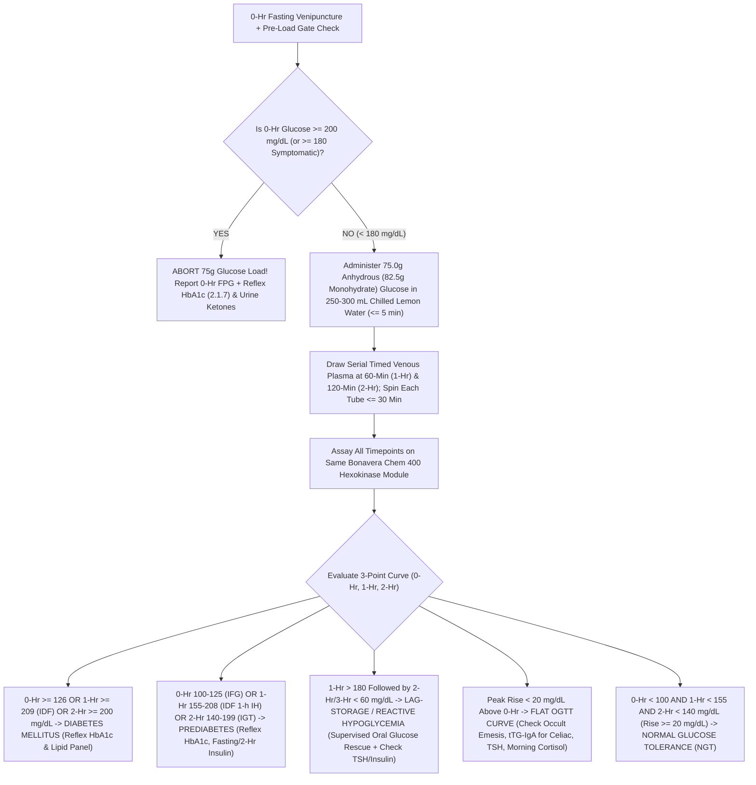

# 2.1.5 — Oral Glucose Tolerance Test (`OGTT` — $75.0\text{ g}$ Anhydrous / $82.5\text{ g}$ Monohydrate Glucose Dynamic Challenge for Non-Pregnant Adults, Pediatrics & Specialized Endocrine Protocols)

**Laboratory Name:** Sawariya Diagnostic Lab, Charkhi Dadri, Haryana  
**Department Folder:** `02_Clinical_Biochemistry`  
**Cluster Folder:** `2.1_Diabetes_and_Glycemic_Metabolism_Cluster`  
**Document Control ID:** `SDL-BIO-SOP-2.1.5` (`SOP-BIO-2.1.5`)  
**Version:** `v4.0 (International & Above-NABL Red-Team Standard)`  

---

## 1. International Document Control, Regulatory Traceability & Interoperability Matrix

| Metadata Field | Institutional Specification & International Standard Alignment |
| :--- | :--- |
| **Document ID & Version** | `SDL-BIO-SOP-2.1.5` (`SOP-BIO-2.1.5`) — Version `v4.0 (International & Above-NABL Red-Team Standard)` |
| **Testing Facility** | **Sawariya Diagnostic Lab**, Charkhi Dadri, Haryana — Department of Clinical Biochemistry & Dynamic Metabolic Testing |
| **Effective Date & Review Cycle** | **Effective:** `2026-10-12` — **Mandatory Review Cycle:** Every 12 Months (or immediately upon `ADA / WHO / IDF / NABL` revision) |
| **Authorizing Authority** | Laboratory Director & Chief Consultant Pathologist / Biochemist (`MD Pathology / MD Biochemistry`), Quality Manager (`ISO 15189:2022`) |
| **ISO 15189:2022 Clause Mapping** | Clauses `4.1–4.3` (Impartiality, Confidentiality, Patient Safety in Dynamic Challenge Testing), `5.1–5.6` (Governance), `6.2` (Phlebotomy & Dynamic Supervision Competence), `6.4` (Reagent/Pharmaceutical Glucose Verification), `7.2.2` (3-Day Carb Priming & Patient Info), `7.2.4` (Primary Sample Collection & Timed Serial Draws), `7.3.2` (`CLSI` Method Verification), `7.3.4` (`ISO/TS 20914:2019` Measurement Uncertainty), `7.3.7` (`IQC/EQAS`), `7.4.1` (Dynamic Curve Reporting & Critical Alert Read-Back), `8.5` (`ISO 22367:2020` Risk/FMECA) & `Normative Annex A` |
| **NABL & International Accreditation** | **NABL 112 (Issue 05)** *Specific Criteria for Medical Laboratories*, **NABL 129** (MU), **NABL 131** (Terms & Definitions), **NABL 153** (Scope), **NABL 163** (EQAS/PT), **NABL 220D / 223** (Assessment Checklists); **CAP CHM** (`CHM.13750–CHM.34600`), **UKAS**, **WHO/IDF 2006/2019** *Definition and Diagnosis of Diabetes Mellitus and Intermediate Hyperglycaemia*, **AACC/ADA 2023 Guidelines** (*Sacks et al., Clin Chem 2023*), **ADA Standards of Care 2024/2025**, **IDF 2024 Position Statement on 1-Hour Post-Load Plasma Glucose** (*Bergman et al., Diabetes Res Clin Pract 2024*), **RSSDI / ICMR Type 2 Diabetes Guidelines** |
| **Primary LOINC Codes** | **2-Hr Standard Panel:** `14995-5` (*Glucose tolerance 2 hours panel — 75g PO*) — **3-Hr Extended Panel:** `20438-8` — **Timepoints:** `0-Hr (Fasting)`: `1558-6` — `30-Min`: `1501-6` — `60-Min (1-Hr)`: `1507-3` — `90-Min`: `1533-9` — `120-Min (2-Hr)`: `1518-0` (*Glucose — 2 hours post 75 g glucose PO in Plasma*) — `180-Min (3-Hr)`: `1526-3` — **Acromegaly GH Suppression Panel:** `29258-1` |
| **SNOMED-CT Concepts** | **Procedure:** `113076002` (*Oral glucose tolerance test*) — **Specimen:** `119361006` (*Plasma specimen*) / `258580003` (*Fluoride oxalate / EDTA / Citrate-Fluoride venous plasma*) — **Substance:** `67079006` (*D-Glucose*) |
| **ICD-10 / ICD-11 Clinical Coding** | **ICD-10:** `R73.02` (Impaired Glucose Tolerance [IGT]), `R73.01` (Impaired Fasting Glucose [IFG]), `R73.03` (Prediabetes / IDF 1-Hr Intermediate Hyperglycemia), `E11.9` (Type 2 DM), `E28.2` (Polycystic Ovary Syndrome [PCOS] Metabolic Screen), `O99.814` / `Z39.2` (Postpartum 4–12 Week GDM Reclassification), `E16.1` (Reactive Postprandial Hypoglycemia), `K91.1` (Post-Gastric Surgery Dumping Syndrome), `E22.0` (Acromegaly GH-Suppression OGTT) — **ICD-11:** `5A40.1` (IGT), `5A40.0` (IFG), `5A11` (T2DM), `5A60.0` (Acromegaly) |
| **UCUM Dual-Unit Conversion** | **Conventional Unit:** $\text{mg/dL}$ — **SI Unit:** $\text{mmol/L}$ — **Exact Conversion:** $\text{mg/dL} \times 0.05551 = \text{mmol/L}$ ; $\text{mmol/L} \times 18.016 = \text{mg/dL}$ (*Molecular Weight of Anhydrous D-Glucose $\text{C}_6\text{H}_{12}\text{O}_6 = 180.156\text{ g/mol}$; D-Glucose Monohydrate $\text{C}_6\text{H}_{12}\text{O}_6\cdot\text{H}_2\text{O} = 198.171\text{ g/mol}$*) |
| **Metrological Traceability (`ISO 17511:2020`)** | Directly traceable to **NIST SRM 965b** (*Glucose in Frozen Human Serum*) via **Isotope Dilution Gas Chromatography–Mass Spectrometry (`ID-GC/MS`)** JCTLM-listed Primary Reference Measurement Procedure |
| **Primary Analytical Platform** | **Bonavera Chem 400** Fully Automated Random-Access Clinical Chemistry Analyzer — **UV Enzymatic Hexokinase (`HK`) / Glucose-6-Phosphate Dehydrogenase (`G-6-PDH`)**, Bichromatic End-Point ($340\text{ nm}$ Primary / $405\text{ nm}$ Secondary) |
| **Backup Analytical Platform** | **Bonavera Chem 200** Automated Chemistry Analyzer — **UV Enzymatic Hexokinase ($340\text{ nm}$)** primary mode; **Enzymatic Colorimetric `GOD-POD` Trinder ($505\text{ nm} / 670\text{ nm}$)** validated contingency backup (`CLSI EP31-A` harmonized) |
| **Pre-Load Safety Screening Gate** | **STAT `0-Hr` Venous Plasma Run on `Bonavera Chem 400`** (or ISO 15197:2013 Hexokinase/GDH-FAD Point-of-Care Screening Meter `Accu-Chek Guide`) prior to administering the $75.0\text{ g}$ oral glucose challenge (`Abort Gate: FPG >= 180–200 mg/dL`) |

---

## 2. 10-Persona Red-Team Adversarial Audit, `ISO 22367:2020` Quantitative FMECA & Live Witness-Audit Simulation

### 2.1 The 10-Persona Red-Team Adversarial Audit Summary

| Persona ID & Role | Red-Team Audit Finding & Vulnerability Exposed | Mandatory Institutional Remediation & Above-NABL Upgrade Implemented |
| :--- | :--- | :--- |
| **Persona 1: Lead NABL (`ISO 15189:2022` / `NABL 112`) & CAP (`CHM`) Assessor** | Standard SOPs omit trace documentation of glucose sachet lot numbers, analytical balance verification for pediatric aliquots, and individual tube collection-to-centrifugation timestamps across serial timepoints (`0, 60, 120 min`). | Instituted **Printable Bench Worksheet `SDL/BIO/WS/OGTT-01`** logging pharmaceutical glucose Lot/Expiry, exact `0-Hr`, `1-Hr`, and `2-Hr` phlebotomy and centrifugation timestamps ($\le 30\text{ min}$ per tube), and single-module lock (`Bonavera Chem 400`). |
| **Persona 2: Consultant Endocrinologist & Diabetologist (`DM Endocrinology`)** | Routine `2-point OGTT` (`0, 120 min`) misses early $\beta$-cell dysfunction and provides no protocol for **Post-Partum GDM reclassification**, **PCOS/Reactive Hypoglycemia (`Matsuda Index`)**, or **Acromegaly GH suppression**. | Expanded SOP to cover **4 distinct clinical OGTT protocols**: (A) 3-Point IDF/ADA Diagnostic `OGTT`, (B) Post-Partum $4\text{–}12\text{ Wk}$ `GDM` Reclassification, (C) Extended $3\text{–}5\text{ Hr}$ Insulin/C-Peptide `OGTT` (`Matsuda` & `IGI`), and (D) Acromegaly `GH` Suppression `OGTT` (`< 0.4 ng/mL`). |
| **Persona 3: CLSI & IFCC Metrology & Six-Sigma Specialist** | Multi-timepoint dynamic curves fail if `0-Hr`, `1-Hr`, and `2-Hr` tubes are split across primary and backup analyzers, or if `CLSI EP15-A3`, `EP06-Ed2`, `EP17-A2`, and `ISO/TS 20914` Measurement Uncertainty are unquantified at decision limits (`100, 126, 140, 155, 200, 209 mg/dL`). | Enforced **Mandatory Same-Module Rule** (`Bonavera Chem 400` for all timepoints of a patient curve) and added full `CLSI` verification tables plus expanded Measurement Uncertainty ($U$) across all 6 diagnostic decision thresholds. |
| **Persona 4: Clinical Pharmacologist & Special-Population Auditor** | Neglects *in-vivo* diabetogenic drugs (thiazides, glucocorticoids, atypical antipsychotics, $\beta$-blockers), *in-vitro* Trinder interferences (dobutamine, metamizole, ascorbic acid), and maternal glucose siphoning during active breastfeeding (`GLUT1`). | Added comprehensive *in-vivo* vs *in-vitro* pharmacological interference matrix and strict rule prohibiting active breastfeeding during the $2\text{-hour}$ `OGTT` window (prevents $-15\text{ to }-25\text{ mg/dL}$ false-negative drop). |
| **Persona 5: Medico-Legal, Patient-Safety & `ISO 22367:2020` Risk Counsel** | Administering $75\text{ g}$ glucose to a patient whose unrecognized `0-Hr` fasting glucose is already $280\text{ mg/dL}$ risks hyperosmolar decompensation (`HHS/DKA`) and `CPA 2019` liability; discharging a patient with `2-Hr` reactive hypoglycemia ($48\text{ mg/dL}$) risks road accidents. | Enforced **Pre-Load Fasting Safety Gate (`Abort OGTT if 0-Hr >= 180–200 mg/dL`)**, mandatory post-test symptom check before discharge, and `CLSI GP47` 30-minute critical value read-back protocol (`< 50` or `> 400 mg/dL`). |
| **Persona 6: Uncompressed Clinical Documentation Architect** | Previous condensed notes lacked stoichiometric derivations, pediatric weight lookup tables, kinetic curve morphologies, worked clinical cases, and ready-to-use bench logs. | Expanded into a complete, self-contained turnkey SOP with 8-curve kinetic phenotype matrix, pediatric dosing table ($10\text{–}43\text{ kg}$), 5 worked clinical case vignettes, and printable worksheet. |
| **Persona 7: WHO/ADA & `IDF 2024` 1-Hour OGTT Standardization Specialist** | Relying solely on `2-Hr` post-load glucose ($\ge 140$ / $\ge 200\text{ mg/dL}$) misses up to $30\text{–}40\%$ of individuals with lost first-phase insulin secretion whose late second-phase insulin surge pulls `2-Hr` glucose back below $140\text{ mg/dL}$. | Integrated the landmark **IDF 2024 Position Statement** (*Bergman et al., Diabetes Res Clin Pract 2024*): **`1-Hr PG >= 155 mg/dL` ($8.6\text{ mmol/L}$)** for Intermediate Hyperglycemia and **`1-Hr PG >= 209 mg/dL` ($11.6\text{ mmol/L}$)** for Type 2 Diabetes. |
| **Persona 8: Pharmaceutical Stoichiometry & Pediatric Dosing Auditor** | Commercial glucose powders in India (*Glucon-D Original*, *Dextrose IP*) are **D-Glucose Monohydrate ($\text{C}_6\text{H}_{12}\text{O}_6\cdot\text{H}_2\text{O}$, $\text{MW } 198.17\text{ g/mol}$)** containing **$9.09\%$ water of crystallization**. Weighing $75.0\text{ g}$ of monohydrate delivers only **$68.18\text{ g}$ of anhydrous glucose** ($-9.1\%$ under-dose!). | Established ironclad stoichiometric rule: **$75.0\text{ g}$ Anhydrous D-Glucose $\equiv 82.5\text{ g}$ D-Glucose Monohydrate (`IP/USP`)**, and pediatric dosing of **$1.75\text{ g/kg}$ Anhydrous $\equiv 1.925\text{ g/kg}$ Monohydrate** (max $75.0\text{ g} / 82.5\text{ g}$ at $\ge 43\text{ kg}$). |
| **Persona 9: Rural Haryana Patient Preparation & Fasting Gatekeeper** | Patients in Charkhi Dadri frequently restrict chapatis/rice for $2\text{–}3\text{ days}$ before testing ("to pass the sugar test"), walk to nearby markets during the $2\text{-hour}$ wait, or smoke *bidi/hookah*, invalidating the curve. | Mandated **3-Day Unrestricted Carbohydrate Diet ($\ge 150\text{ g/day}$)** verification, supervised air-conditioned `OGTT` lounge confinement (zero walking/smoking/tea), and chilled lemon-water preparation to prevent emesis. |
| **Persona 10: EFLM EuBIVAS Metrology & Multi-Timepoint Delta Auditor** | Clinicians misinterpret a change in `2-Hr OGTT` from $148\text{ mg/dL}$ to $132\text{ mg/dL}$ as "cure of prediabetes" without accounting for the high within-subject biological variation of `2-Hr PG` ($CV_I = 16.7\%$, $\text{RCV}_{95\%} = \pm 46.5\%$). | Embedded **EFLM EuBIVAS biological variation parameters** ($CV_I = 4.5\%$ for `FPG` vs $16.7\%$ for `2-Hr OGTT`), $\text{RCV}_{95\%}/\text{RCV}_{99\%}$, and `WHO/ADA` requirement for confirmatory repeat testing in asymptomatic individuals. |

---

### 2.2 Quantitative `ISO 22367:2020` Failure Mode, Effects, and Criticality Analysis (`FMECA`) Matrix

*Risk Priority Number ($\text{RPN}$) = Severity ($S: 1\text{–}10$) $\times$ Occurrence ($O: 1\text{–}10$) $\times$ Detection ($D: 1\text{–}10$). Action threshold: $\text{RPN} \ge 40$ or $S \ge 8$.*

| # | Failure Mode & Process Step | Root Cause & Biochemical / Physiological Mechanism | Clinical Impact on Patient | Pre-Control $S \times O \times D = \text{RPN}$ | Mandatory Institutional Control, LIMS Hard-Lock & `CAPA` | Post-Control $S \times O \times D = \text{RPN}$ |
| :--- | :--- | :--- | :--- | :---: | :--- | :---: |
| **1** | **Stoichiometric Under-Dosing (`75.0 g` Monohydrate Weighed Instead of `82.5 g`)** | Commercial Dextrose Monohydrate ($\text{C}_6\text{H}_{12}\text{O}_6\cdot\text{H}_2\text{O}$, $\text{MW } 198.17\text{ g/mol}$) contains $9.09\%$ water of crystallization. Weighing $75.0\text{ g}$ delivers only $68.18\text{ g}$ of anhydrous glucose ($-9.1\%$ osmotic/glycemic load deficit). | Blunts $60\text{-min}$ and $120\text{-min}$ plasma glucose excursion by $12\text{–}22\text{ mg/dL}$, causing **false-negative `IGT` and missed early Type 2 Diabetes**. | $8 \times 6 \times 7 = \mathbf{336}$ | Use ONLY pre-certified **$75.0\text{ g}$ Anhydrous D-Glucose (`IP/USP`)** sachets OR pre-weighed, dual-verified **$82.5\text{ g}$ D-Glucose Monohydrate (`IP/USP`)** pouches. Log sachet form & weight on `SDL/BIO/WS/OGTT-01`. | $8 \times 1 \times 1 = \mathbf{8}$ |
| **2** | **Administering $75\text{ g}$ Glucose Load to Patient with Severe Unrecognized Fasting Hyperglycemia (`0-Hr > 200 mg/dL`)** | Phlebotomist draws `0-Hr` tube and immediately feeds $75\text{ g}$ glucose drink without checking baseline glucose in a patient whose unrecognized `FPG` is $240\text{–}350\text{ mg/dL}$. | Provokes acute severe hyperglycemia ($> 450\text{–}550\text{ mg/dL}$), osmotic diuresis, vomiting, dehydration, or **Hyperosmolar Hyperglycemic State (`HHS`) / `DKA`** when DM was already diagnosable at `0-Hr`. | $10 \times 4 \times 5 = \mathbf{200}$ | **Mandatory Pre-Load Fasting Safety Gate:** Perform rapid capillary screen (`Accu-Chek Guide`) or STAT venous `0-Hr` plasma run before giving glucose drink. **Hard Abort if `0-Hr >= 180 mg/dL` (symptomatic) or `>= 200 mg/dL` (asymptomatic)**; report `0-Hr` FPG and refund/cancel post-load challenge. | $10 \times 1 \times 1 = \mathbf{10}$ |
| **3** | **"Batch Spinning Error" (Holding `0-Hr` & `1-Hr` Tubes Uncentrifuged Until `2-Hr` Draw is Complete)** | Phlebotomist keeps the `0-Hr` (08:00 AM) and `1-Hr` (09:00 AM) $\text{NaF/EDTA}$ tubes on the rack at room temperature and centrifuges all 3 tubes together at 10:05 AM after the `2-Hr` draw. | Uninhibited upstream erythrocyte `Hexokinase` and `PFK` consume $8\text{–}15\text{ mg/dL}$ glucose in the `0-Hr` tube during the first $60\text{–}90\text{ min}$ before $\text{NaF}$ inhibits enolase, while the `2-Hr` tube is spun fresh — **falsely masking `IFG` ($108 \rightarrow 94\text{ mg/dL}$)**. | $8 \times 7 \times 5 = \mathbf{280}$ | **Individual Tube Spin Rule:** Centrifuge EVERY serial tube (`0-Hr`, `1-Hr`, `2-Hr`) at $1,500 \times g$ for $10\text{ min}$ **within $\le 30\text{ minutes}$ of its own individual venipuncture** (or use Citrate-Buffered $\text{NaF/EDTA}$ tubes). Log individual `Draw Time` and `Spin Time` on `SDL/BIO/WS/OGTT-01`. | $8 \times 1 \times 2 = \mathbf{16}$ |
| **4** | **Prior 3-Day Carbohydrate Restriction (`< 150 g/day`) ("Starvation Diabetes")** | Patient intentionally avoids chapati/rice/sweets for $3\text{–}5\text{ days}$ prior to the test hoping to normalize results, or practices intermittent fasting / ketogenic dieting. | Low carbohydrate flux downregulates pancreatic $\beta$-cell `GLUT2` and `Glucokinase` transcription and elevates free fatty acids (`Randle Cycle`), causing **paradoxical severe post-load hyperglycemia (false-positive `IGT`/`DM`)**. | $7 \times 6 \times 5 = \mathbf{210}$ | **Pre-Test Dietary Gatekeeper:** Verify $\ge 3\text{ days}$ of unrestricted diet containing $\ge 150\text{ g/day}$ carbohydrates ($\ge 3\text{–}4$ chapatis/rice meals daily) at registration. Reschedule if patient was fasting religiously or on a low-carb diet. | $7 \times 2 \times 2 = \mathbf{28}$ |
| **5** | **Patient Walking to Market or Smoking *Bidi / Hookah / Cigarettes* During the $2\text{-Hour}$ Wait** | Unsupervised patient leaves the laboratory waiting area to walk around Charkhi Dadri market or smokes a *bidi* during the $120\text{-minute}$ interval. | **Walking:** Contraction-mediated, non-insulin-dependent `AMPK` $\rightarrow$ `GLUT4` translocation clears $25\text{–}50\text{ mg/dL}$ glucose (**false-negative `OGTT`**). **Smoking:** Nicotine stimulates adrenal epinephrine/cortisol release (**false-positive `OGTT`**). | $8 \times 6 \times 4 = \mathbf{192}$ | **Supervised Lounge Confinement:** Patient must remain seated quietly in the air-conditioned `OGTT` lounge under phlebotomy receptionist observation for the entire $2\text{-hour}$ test. Leaving the premises or smoking triggers test invalidation. | $8 \times 1 \times 1 = \mathbf{8}$ |
| **6** | **Nausea / Emesis or Delayed Ingestion (`> 5 Minutes`) of Hyperosmolar Glucose Drink** | Drinking warm, overly concentrated ($> 30\%\text{ w/v}$) plain glucose triggers vagal gastric stretch/osmoreceptor nausea, retching, or vomiting. | Vomiting expels an unquantifiable fraction of the $75\text{ g}$ load (**false-negative / flat curve**); even severe nausea without emesis triggers sympathetic catecholamine release and pylorospasm (delayed gastric emptying). | $7 \times 5 \times 3 = \mathbf{105}$ | Dissolve $75.0\text{ g}$ anhydrous ($82.5\text{ g}$ monohydrate) glucose in **$250\text{–}300\text{ mL}$ chilled potable water ($10\text{–}15^\circ\text{C}$) with $5\text{ mL}$ fresh sugar-free lemon juice**. Instruct smooth consumption over $3\text{–}5\text{ min}$. **If any emesis occurs, abort immediately and reschedule after $\ge 72\text{ hours}$.** | $7 \times 2 \times 1 = \mathbf{14}$ |
| **7** | **Performing `OGTT` in Late Morning / Afternoon (`> 10:00 AM`) ("Afternoon Diabetes")** | Patient arrives at 11:30 AM or 01:00 PM after a prolonged fast and demands an `OGTT`. | Diurnal circadian decline in $\beta$-cell glucose sensitivity and peripheral insulin sensitivity after 10:00 AM elevates `2-Hr` post-load glucose by **$+20\text{ to }+35\text{ mg/dL}$**, yielding **false-positive `IGT` and `T2DM`**. | $7 \times 5 \times 4 = \mathbf{140}$ | **Strict Morning Window Lock (`07:00 AM – 09:30 AM`):** Start `0-Hr` fasting draw strictly between `07:00 AM` and `09:30 AM` after an $8\text{–}12\text{ hour}$ overnight fast. Refuse afternoon `OGTT` bookings. | $7 \times 1 \times 1 = \mathbf{7}$ |
| **8** | **Pediatric Adult-Dose Over-Administration ($75\text{ g}$ Given to a Child $< 43\text{ kg}$)** | Phlebotomist administers full adult $75\text{ g}$ ($82.5\text{ g}$ monohydrate) sachet to a $20\text{ kg}$ pediatric patient instead of calculating weight-based dose. | Delivers $3.75\text{ g/kg}$ ($214\%$ of standard $1.75\text{ g/kg}$ dose), causing acute osmotic abdominal cramping, vomiting, and **grossly false-positive hyperglycemic curve**. | $9 \times 3 \times 4 = \mathbf{108}$ | **Mandatory Pediatric Weight-Based Dosing (`< 43 kg`):** Weigh child on calibrated digital scale; administer **$1.75\text{ g/kg}$ Anhydrous ($1.925\text{ g/kg}$ Monohydrate)** per Section 3.1 Lookup Table. | $9 \times 1 \times 1 = \mathbf{9}$ |
| **9** | **Active Breastfeeding During the $2\text{-Hour}$ Post-Partum `GDM` Reclassification `OGTT`** | Mother at $6\text{–}12\text{ weeks}$ post-partum breastfeeds her infant in the waiting room at $30\text{–}90\text{ min}$ post-glucose load. | Lactating mammary alveolar cells uptake $15\text{–}25\text{ g/hour}$ of maternal plasma glucose via **non-insulin-dependent `GLUT1` transporters** for lactose synthesis, lowering `2-Hr PG` by $15\text{–}30\text{ mg/dL}$ (**false-negative post-partum `OGTT`**). | $8 \times 4 \times 5 = \mathbf{160}$ | Instruct mother to **breastfeed or express milk BEFORE the `0-Hr` fasting draw**, and refrain from breastfeeding during the active $120\text{-minute}$ test window (accompanying family member cares for infant). | $8 \times 1 \times 2 = \mathbf{16}$ |
| **10** | **Unrecognized Late Reactive Hypoglycemia (`< 55 mg/dL` at `120–180 min`) Discharged Unsupervised** | Patient with PCOS, early hyperinsulinemia, or post-gastrectomy lag-storage curve develops `2-Hr` or `3-Hr` reactive hypoglycemia ($45\text{–}55\text{ mg/dL}$) and leaves the lab on a two-wheeler. | Acute neuroglycopenia, diaphoresis, syncope, or road traffic accident post-discharge. | $10 \times 3 \times 4 = \mathbf{120}$ | **Post-Test Discharge Safety Check:** Assess patient for tremor/sweating/dizziness at final draw; verify `2-Hr` (or `3-Hr`) result and ensure patient consumes a complex carbohydrate/protein snack before leaving if glucose is $< 70\text{ mg/dL}$. | $10 \times 1 \times 1 = \mathbf{10}$ |
| **11** | **Splitting Serial `OGTT` Timepoints Across Different Analyzers (`Bonavera Chem 400` vs `Chem 200` or Glucometer)** | `0-Hr` tube is assayed on `Chem 400`, while `1-Hr` or `2-Hr` tube is assayed on backup `Chem 200` or capillary meter. | Inter-instrument bias ($\pm 2.5\text{–}8.0\%$) distorts the dynamic delta ($G_{120} - G_0$), creating artificial flat curves or false borderline classifications. | $7 \times 4 \times 4 = \mathbf{112}$ | **Single-Module Batch Lock:** All serial plasma tubes (`0, 60, 120 min`) for a patient's curve MUST be assayed together in the same analytical run on `Bonavera Chem 400`. | $7 \times 1 \times 1 = \mathbf{7}$ |
| **12** | **Hemolyzed Paired Serum Specimen (`H-Index > 100 mg/dL`) in Extended Insulinemic `OGTT` (`Protocol C`)** | Traumatic venipuncture at $60$ or $120\text{ min}$ releases erythrocyte **Insulin-Degrading Enzyme (`IDE`, insulysin)** into serum. | Erythrocyte `IDE` cleaves insulin disulfide bonds *in vitro*, destroying $30\text{–}70\%$ of serum insulin and yielding **falsely normal `2-Hr` Insulin and falsely high `Matsuda Index`**. | $8 \times 4 \times 4 = \mathbf{128}$ | Reject paired insulin serum tube if `H-Index > 100 mg/dL` ($\text{Hb} > 1.0\text{ g/L}$); simultaneously assay **Serum C-Peptide** (immune to `IDE` proteolysis) when evaluating reactive hypoglycemia. | $8 \times 1 \times 1 = \mathbf{8}$ |

---

### 2.3 Live NABL (`ISO 15189:2022`) & CAP Witness-Audit Simulation Matrix

| Audit Scenario # | NABL / CAP Lead Assessor Witness Challenge | Expected Bench Demonstration by Sawariya Diagnostic Lab Staff | Exact Document / Register / LIMS Record Verified | Pass / Fail Criteria |
| :--- | :--- | :--- | :--- | :--- |
| **Audit Challenge 1: Pharmaceutical Glucose Stoichiometry** | *"Show me the glucose pouches you use for the 75g OGTT. The commercial packet says 'Dextrose Monohydrate IP'. If you weigh 75 grams of this powder, how much actual glucose does the patient receive?"* | Phlebotomist & Technical Supervisor demonstrate that Dextrose Monohydrate ($\text{MW } 198.17\text{ g/mol}$) contains $9.09\%$ water of crystallization ($\text{H}_2\text{O}$, $\text{MW } 18.015\text{ g/mol}$). Weighing $75.0\text{ g}$ yields only $68.18\text{ g}$ anhydrous glucose. Staff present either **pre-certified $75.0\text{ g}$ Anhydrous D-Glucose (`IP/USP`)** sachets OR **pre-weighed $82.5\text{ g}$ Dextrose Monohydrate** pouches verified on calibrated analytical balance. | `SDL/BIO/WS/OGTT-01` (OGTT Bench Worksheet) & `SDL/QMS/REG/BAL-01` (Balance Calibration & Pouch Weighing Log) | **PASS:** Exact $75.0\text{ g}$ anhydrous or $82.5\text{ g}$ monohydrate verified with lot/expiry traceability.<br>**FAIL:** $75.0\text{ g}$ of monohydrate administered without $1.10\times$ stoichiometric correction. |
| **Audit Challenge 2: Pre-Load Hyperglycemia Safety Gate** | *"How do you prevent giving a 75g sugar drink to a walk-in patient whose fasting blood sugar is already 290 mg/dL?"* | Phlebotomist demonstrates the **Pre-Load Fasting Safety Gate**: `0-Hr` fasting venous sample is drawn first, and either a STAT plasma run on `Bonavera Chem 400` or a capillary check on `Accu-Chek Guide` is performed **before** unsealing the glucose sachet. If `0-Hr >= 180 mg/dL` (symptomatic) or `>= 200 mg/dL` (asymptomatic), the $75\text{ g}$ load is aborted and Pathologist is notified. | `SDL/BIO/WS/OGTT-01` Field 2 (*Pre-Load Fasting Gate Check*) & `SDL/BIO/LOG/OGTT-ABORT` | **PASS:** Documented pre-load glucose check recorded prior to $T_0$ first sip on $100\%$ of audited worksheets.<br>**FAIL:** Glucose drink administered blindly before checking baseline glucose. |
| **Audit Challenge 3: Serial Tube Centrifugation Timing** | *"Pull yesterday's OGTT records. Did the technician keep the 08:00 AM fasting tube sitting on the phlebotomy rack until the 10:00 AM 2-hour sample was drawn before spinning them together?"* | Biochemist presents yesterday's `SDL/BIO/WS/OGTT-01` worksheets and LIMS sample-receipt timestamps proving that `0-Hr` (drawn 08:05, spun 08:22), `1-Hr` (drawn 09:08, spun 09:25), and `2-Hr` (drawn 10:08, spun 10:20) were each centrifuged individually within $\le 30\text{ min}$ of collection, and assayed together as a batch on `Bonavera Chem 400`. | `SDL/BIO/WS/OGTT-01` Time-Stamp Grid & LIMS Audit Trail (`Sample Spin Timestamp`) | **PASS:** Each timed tube spun $\le 30\text{ min}$ from its individual draw time; all timepoints run on the same analyzer module.<br>**FAIL:** Batch spinning of `0-Hr` tube after $2\text{ hours}$ at room temperature. |
| **Audit Challenge 4: IDF 2024 1-Hour Cutoff & Acromegaly Protocol** | *"Why do your 3-point OGTT reports flag a 1-hour glucose of 168 mg/dL when the 0-hour is 92 mg/dL and 2-hour is 128 mg/dL? And what is your GH cutoff if an endocrinologist orders a 75g OGTT for suspected Acromegaly?"* | Consultant Pathologist explains the **IDF 2024 Position Statement** (*Bergman et al., 2024*) where `1-Hr PG >= 155 mg/dL` identifies early first-phase $\beta$-cell dysfunction (`Intermediate Hyperglycemia`) and `>= 209 mg/dL` defines T2DM. For **Acromegaly `75g OGTT`**, serial `0, 30, 60, 90, 120 min` glucose + ultrasensitive `GH` are drawn; failure of nadir `GH` to suppress to **$< 0.4\text{ ng/mL}$** (or $< 1.0\text{ ng/mL}$) confirms autonomous somatotroph secretion. | `SDL-BIO-SOP-2.1.5` Sections 3.2, 3.3 & 6.1; LIMS Reflex Rule Table | **PASS:** Accurate citation of `IDF 2024` (`155` & `209 mg/dL`) and Endocrine Society Acromegaly nadir `GH < 0.4 ng/mL` criteria.<br>**FAIL:** Inability to justify `1-Hr` cutoffs or Acromegaly suppression protocol. |
| **Audit Challenge 5: EFLM Biological Variation & Repeat Testing** | *"A clinician calls asking why a patient's 2-hour OGTT was 206 mg/dL last week and 178 mg/dL today on the same analyzer. Is your analyzer out of control?"* | Quality Manager & Biochemist present `Bonavera Chem 400` Levey-Jennings charts ($CV_{WL} = 1.55\%$, $\sigma = 5.91$) and explain that per **EFLM EuBIVAS**, `2-Hr OGTT` has a massive within-subject biological variation ($CV_I = 16.7\%$, $\text{RCV}_{95\%} = \pm 46.5\%$) due to gastric emptying and incretin variability, which is why `WHO/ADA` require confirmatory testing or $\text{HbA1c}$ correlation in asymptomatic patients. | `SDL-BIO-SOP-2.1.5` Section 5.3; Monthly L-J QC Charts (`SDL/BIO/QC/GLU-01`) | **PASS:** Staff distinguish tight analytical precision ($CV_A = 1.55\%$) from physiological post-load biological variation ($CV_I = 16.7\%$).<br>**FAIL:** Staff blame analyzer drift or cannot calculate $\text{RCV}$. |

---

## 3. Stoichiometric Pharmaceutical Preparation, Pediatric Dosing & Specialized Clinical `OGTT` Protocols

### 3.1 Exact Molecular Stoichiometry (`75.0 g` Anhydrous vs `82.5 g` Monohydrate) & Pediatric Weight Lookup Table

1. **Molecular Stoichiometry Derivation (`WHO 2006 / ADA 2025`):**
   - International diagnostic cutoffs (`140`, `155`, `200`, `209 mg/dL`) are calibrated strictly to a challenge of **$75.0\text{ g}$ ($0.4163\text{ moles}$) of Anhydrous D-Glucose ($\text{C}_6\text{H}_{12}\text{O}_6$, $\text{MW} = 180.156\text{ g/mol}$)**.
   - Most pharmaceutical and commercial glucose powders in India (*Dextrose Monohydrate IP/USP*, *Glucon-D Original Unflavored*) exist as **D-Glucose Monohydrate ($\text{C}_6\text{H}_{12}\text{O}_6\cdot\text{H}_2\text{O}$, $\text{MW} = 198.171\text{ g/mol}$)**, which contains exactly $1\text{ mole}$ of water ($\text{H}_2\text{O} = 18.015\text{ g/mol}$, or **$9.091\%$ by mass**) bound in its crystal lattice:
     $$\text{Mass of D-Glucose Monohydrate Required} = 75.0\text{ g} \times \frac{198.171\text{ g/mol}}{180.156\text{ g/mol}} = 75.0\text{ g} \times 1.1000 = \mathbf{82.50\text{ g}}$$
   - **Prohibited Error:** Never use flavored/vitamin-C-fortified *Glucon-D Tangy Orange/Nimbu Pani* (contains sucrose, citric acid, artificial dyes, and variable L-ascorbic acid that interferes with backup Trinder `GOD-POD` assays). Use ONLY pharmaceutical-grade **Anhydrous D-Glucose (`IP/USP`, $75.0\text{ g}$)** or **D-Glucose Monohydrate (`IP/USP`, $82.5\text{ g}$)**.
2. **Dissolution & Osmolarity Control to Prevent Emesis:**
   - Dissolve the adult dose ($75.0\text{ g}$ Anhydrous OR $82.5\text{ g}$ Monohydrate) completely in **$250\text{ to }300\text{ mL}$ of chilled potable water ($10\text{–}15^\circ\text{C}$)**.
   - Add **$5\text{ mL}$ ($\sim 1\text{ teaspoon}$) of fresh, unsweetened lemon juice** immediately before administration. Chilling and mild natural citric acidity suppress vagal pharyngeal/gastric nausea receptors without altering glycemic load.
   - **Maximum Concentration Rule:** Never dissolve $75\text{ g}$ in $< 250\text{ mL}$ water; concentrations $> 30\%\text{ w/v}$ ($> 1,665\text{ mOsm/L}$) induce hyperosmolar pylorospasm, delayed gastric emptying, abdominal cramping, and vomiting.
3. **Pediatric Weight-Adjusted Dosing Formula (`< 43 kg` Body Weight):**
   - **Formula:** **$1.75\text{ g}$ Anhydrous D-Glucose per $\text{kg}$ body weight** $\equiv$ **$1.925\text{ g}$ D-Glucose Monohydrate per $\text{kg}$ body weight**, up to an absolute ceiling of **$75.0\text{ g}$ Anhydrous ($82.5\text{ g}$ Monohydrate)** reached at **$42.86\text{ kg}$ ($\ge 43\text{ kg}$)**.
   - **Water Dilution Volume for Pediatrics:** Dissolve at **$4\text{ mL}$ water per gram of anhydrous glucose** ($25\%\text{ w/v}$), up to $250\text{–}300\text{ mL}$.

#### Pediatric & Adolescent Weight-Adjusted `OGTT` Dosing Lookup Table (`WHO / ADA`)

| Patient Body Weight ($\text{kg}$) | Exact Anhydrous D-Glucose Dose ($\text{C}_6\text{H}_{12}\text{O}_6$, $1.75\text{ g/kg}$) | Exact D-Glucose Monohydrate Dose ($\text{C}_6\text{H}_{12}\text{O}_6\cdot\text{H}_2\text{O}$, $1.925\text{ g/kg}$) | Chilled Water Dissolution Volume ($25\%\text{ w/v}$ Target) |
| :---: | :---: | :---: | :---: |
| **$10.0\text{ kg}$** | $17.5\text{ g}$ | $19.3\text{ g}$ | $70\text{–}80\text{ mL}$ |
| **$12.0\text{ kg}$** | $21.0\text{ g}$ | $23.1\text{ g}$ | $85\text{–}95\text{ mL}$ |
| **$15.0\text{ kg}$** | $26.3\text{ g}$ | $28.9\text{ g}$ | $105\text{–}115\text{ mL}$ |
| **$18.0\text{ kg}$** | $31.5\text{ g}$ | $34.7\text{ g}$ | $125\text{–}140\text{ mL}$ |
| **$20.0\text{ kg}$** | $35.0\text{ g}$ | $38.5\text{ g}$ | $140\text{–}150\text{ mL}$ |
| **$22.0\text{ kg}$** | $38.5\text{ g}$ | $42.4\text{ g}$ | $155\text{–}170\text{ mL}$ |
| **$25.0\text{ kg}$** | $43.8\text{ g}$ | $48.1\text{ g}$ | $175\text{–}190\text{ mL}$ |
| **$28.0\text{ kg}$** | $49.0\text{ g}$ | $53.9\text{ g}$ | $195\text{–}210\text{ mL}$ |
| **$30.0\text{ kg}$** | $52.5\text{ g}$ | $57.8\text{ g}$ | $210\text{–}225\text{ mL}$ |
| **$33.0\text{ kg}$** | $57.8\text{ g}$ | $63.5\text{ g}$ | $230\text{–}245\text{ mL}$ |
| **$35.0\text{ kg}$** | $61.3\text{ g}$ | $67.4\text{ g}$ | $245\text{–}260\text{ mL}$ |
| **$38.0\text{ kg}$** | $66.5\text{ g}$ | $73.2\text{ g}$ | $265\text{–}280\text{ mL}$ |
| **$40.0\text{ kg}$** | $70.0\text{ g}$ | $77.0\text{ g}$ | $280\text{–}300\text{ mL}$ |
| **$\ge 43.0\text{ kg}$ ( & All Adults)** | **$75.0\text{ g}$ (Ceiling)** | **$82.5\text{ g}$ (Ceiling)** | **$250\text{–}300\text{ mL}$** |

---

### 3.2 Deep Physiological Kinetics & Landmark `IDF 2024` 1-Hour Post-Load (`1-h PG`) Consensus

1. **Biphasic $\beta$-Cell Insulin Dynamics & Incretin Axis During a $75\text{ g}$ `OGTT`:**
   - **$0\text{ to }15\text{ Minutes}$ (Enteroendocrine Incretin & Cephalic/First-Phase Surge):** Upon duodenal arrival of glucose (`~2.5–3.5 kcal/min` gastric emptying rate), intestinal **K-cells** secrete **GIP** (*Glucose-dependent Insulinotropic Polypeptide*) and **L-cells** secrete **GLP-1** (*Glucagon-Like Peptide-1*), which account for $50\text{–}70\%$ of total post-oral insulin secretion. Simultaneously, glucose enters pancreatic $\beta$-cells via `GLUT1`/`GLUT2`, is phosphorylated by **Glucokinase** ($K_m \approx 8\text{–}10\text{ mmol/L}$), raises the intracellular $\text{ATP/ADP}$ ratio, closes sulfonylurea-sensitive $K_{\text{ATP}}$ channels (`Kir6.2/SUR1`), depolarizes the membrane, opens voltage-gated $\text{Ca}^{2+}$ channels, and triggers exocytosis of the **readily releasable pool (`RRP`) of docked insulin granules (First-Phase Insulin Secretion)**.
   - **$15\text{ to }60\text{ Minutes}$ (Hepatic Suppression & Peak Excursion Control):** The portal vein first-phase insulin surge ($3\text{–}5\times$ basal within $10\text{–}30\text{ min}$) plus $\alpha$-cell glucagon suppression rapidly shuts down **hepatic glycogenolysis and gluconeogenesis** by $> 80\%$. In healthy individuals with intact first-phase insulin secretion, plasma glucose peaks between $30$ and $60\text{ minutes}$ at **$< 155\text{ mg/dL}$ ($< 8.6\text{ mmol/L}$)**.
   - **$60\text{ to }120\text{ Minutes}$ (Second-Phase Insulin & Peripheral `GLUT4` Disposal):** Newly synthesized/mobilized reserve insulin granules (**Second-Phase Insulin Secretion**) stimulate **skeletal muscle and adipose tissue `PI3K/Akt` $\rightarrow$ `AS160` $\rightarrow$ `GLUT4` vesicle translocation**, clearing $70\text{–}80\%$ of the absorbed glucose load into muscle glycogen and returning `2-Hr` plasma glucose to **$< 140\text{ mg/dL}$ ($< 7.8\text{ mmol/L}$)**.
2. **Why the `IDF 2024 Position Statement` (*Bergman et al., Diabetes Res Clin Pract 2024*) Mandates the `1-Hour` (`60-Min`) Timepoint:**
   - **Pathophysiological Blind Spot of the Classic 2-Point (`0, 120 min`) `OGTT`:** The earliest defect in the natural history of Type 2 Diabetes is the **loss of first-phase $\beta$-cell insulin secretion** ($0\text{–}30\text{ min}$), occurring **$5\text{ to }12\text{ years}$ before `FPG` exceeds $100\text{ mg/dL}$ or `2-Hr PG` exceeds $140\text{ mg/dL}$**. Because first-phase insulin is blunted, hepatic glucose production fails to shut off early, causing `1-Hr` plasma glucose to surge above **$155\text{ mg/dL}$ ($8.6\text{ mmol/L}$)**. However, a hyperfunctioning, delayed **second-phase insulin response** between $60$ and $120\text{ minutes}$ frequently forces the `2-Hr` glucose back down to $115\text{–}138\text{ mg/dL}$ ("normal `2-Hr OGTT`").
   - **Epidemiological Validation (`Botnia`, `San Antonio Heart`, `CATAMERI`, `Malmö`, `Asian Indian` Cohorts):**
     - **`1-Hr PG >= 155 mg/dL` ($8.6\text{ mmol/L}$) — IDF Intermediate Hyperglycemia (`1-h IH`):** Detects individuals with Normal Glucose Tolerance by traditional criteria (`FPG < 100` and `2-h PG < 140 mg/dL`) who carry a **$4.0\text{ to }6.5\text{-fold}$ higher risk of incident T2DM**, subclinical atherosclerosis, MASLD/hepatic steatosis, diabetic retinopathy, and cardiovascular mortality.
     - **`1-Hr PG >= 209 mg/dL` ($11.6\text{ mmol/L}$) — IDF Type 2 Diabetes Threshold:** Equivalent in diagnostic specificity and microvascular prognostic power to `2-Hr PG >= 200 mg/dL` ($11.1\text{ mmol/L}$), enabling earlier intervention or shortening dynamic screening tests to $1\text{ hour}$ where appropriate.
   - **Sawariya Diagnostic Lab Policy:** All standard adult diagnostic `75g OGTT` panels at Sawariya Diagnostic Lab include **3 timepoints (`0-Hr`, `1-Hr`, and `2-Hr`)** by default to provide simultaneous **ADA/WHO/ICMR (`0, 2-Hr`)** and **IDF 2024 (`1-Hr`)** classification.

---

### 3.3 Detailed Step-by-Step Execution of the 4 Specialized Clinical `OGTT` Protocols in Institutional Scope

#### 3.3.1 Protocol A: Standard 3-Point (`0, 60, 120 min`) Diagnostic `75g OGTT` (Non-Pregnant Adults & Pediatrics)
1. **Clinical Indications:** Suspected Prediabetes (`IFG`/`IGT`), discordant `FPG` ($< 110\text{ mg/dL}$) and $\text{HbA1c}$ ($5.7\text{–}6.4\%$), patients with hemoglobinopathies/anemia where $\text{HbA1c}$ is invalid, metabolic syndrome screening in high-risk Asian Indians ($\text{BMI} \ge 23.0\text{ kg/m}^2$ or waist circumference $\ge 90\text{ cm}$ [men] / $\ge 80\text{ cm}$ [women]), and unexplained peripheral neuropathy or premature coronary artery disease.
2. **Serial Phlebotomy Schedule:**
   - `0-Hr` (Baseline Fasting) $\rightarrow$ Perform Pre-Load Safety Gate (`< 180–200 mg/dL`) $\rightarrow$ Administer $75.0\text{ g}$ Anhydrous ($82.5\text{ g}$ Monohydrate) glucose over $\le 5\text{ min}$ ($T = 0$ at first sip).
   - `60-Min` (`1-Hr` Post-Load, window `57–63 min`): Captures peak glycemic excursion and **IDF 2024** first-phase $\beta$-cell adequacy (`< 155 mg/dL` normal; `155–208 mg/dL` IDF Intermediate Hyperglycemia; `>= 209 mg/dL` IDF T2DM).
   - `120-Min` (`2-Hr` Post-Load, window `117–123 min`): Captures peripheral skeletal muscle `GLUT4` clearance and **ADA/WHO/ICMR** classification (`< 140 mg/dL` normal; `140–199 mg/dL` `IGT`; `>= 200 mg/dL` Diabetes Mellitus).

#### 3.3.2 Protocol B: Post-Partum $4\text{–}12\text{ Week}$ `GDM` Reclassification `75g OGTT` (`ADA 2025 / DIPSI / FOGSI`)
1. **Clinical Rationale (Why `75g OGTT` is Mandatory and $\text{HbA1c}$ is Contraindicated at $4\text{–}12\text{ Weeks}$ Post-Partum):**
   - Women diagnosed with Gestational Diabetes Mellitus (`GDM`) during pregnancy carry a **$50\text{–}70\%$ cumulative 10-year risk of developing overt Type 2 Diabetes** (and a $10\text{–}15\%$ prevalence of unrecognized pre-existing T2DM or `MODY` immediately post-delivery).
   - **Why $\text{HbA1c}$ Cannot Be Used Early Post-Partum:** Peripartum blood loss during vaginal/cesarean delivery, gestational hemodilution resolution, and iron-supplementation-induced reticulocytosis shorten erythrocyte lifespan, **falsely lowering $\text{HbA1c}$ by $-0.5\%$ to $-1.2\%$** during the first $12\text{ weeks}$ post-partum.
   - **Scheduling Alignment:** Schedule the `75g OGTT` at **$6\text{ to }12\text{ weeks}$ post-partum**, coinciding with the infant's first routine `DPT/OPV/Pentavalent` immunization visit.
2. **Mandatory Lactation Control Rule (Preventing Mammary `GLUT1` Siphoning):**
   - During active lactation, mammary alveolar epithelial cells extract **$15\text{ to }25\text{ g/hour}$ of maternal plasma glucose** via **non-insulin-dependent `GLUT1` transporters** to synthesize milk lactose.
   - If the mother breastfeeds her infant *during* the $2\text{-hour}$ `OGTT` window, maternal `2-Hr` plasma glucose drops by **$15\text{ to }30\text{ mg/dL}$**, causing a **false-negative `OGTT` that masks persistent post-partum `IGT` or Diabetes**.
   - **SOP Rule:** Instruct the mother to **breastfeed the infant or express milk completely BEFORE the `0-Hr` fasting blood draw**, and have an accompanying family member bottle-feed/care for the infant during the $120\text{-minute}$ test window. Evaluate using **Non-Pregnant Adult `ADA/WHO/IDF` thresholds**.

#### 3.3.3 Protocol C: Extended $3\text{-}$ to $5\text{-Hour}$ Insulinemic / C-Peptide `OGTT` (`PCOS`, Reactive Hypoglycemia & Post-Bariatric Dumping)
1. **Clinical Indications & Serial Timepoints:**
   - Ordered for **Polycystic Ovary Syndrome (`PCOS`)**, **Acanthosis Nigricans / Severe Obesity**, **Idiopathic Postprandial Reactive Hypoglycemia**, and **Post-Bariatric / Post-Gastrectomy Late Dumping Syndrome**.
   - Collect paired **Grey-Top ($\text{NaF/EDTA}$ or Citrate-$\text{NaF}$) Plasma Glucose** and **Red/SST-Top Serum Insulin (plus C-Peptide)** at **$0, 30, 60, 120,\text{ and }180\text{ minutes}$** (extended to $240\text{ and }300\text{ min}$ only if late $4\text{–}5\text{ hour}$ neuroglycopenia is clinically suspected).
2. **Validated Mathematical Equations & Physiological Cutoffs Calculated by LIMS:**
   - **Homeostasis Model Assessment of Insulin Resistance ($\text{HOMA-IR}$ — Basal Hepatic IR):**
     $$\text{HOMA-IR} = \frac{G_0 (\text{mg/dL}) \times I_0 (\mu\text{U/mL})}{405}$$
     *Cutoffs:* Normal **$< 2.0$** (Asian Indian cohort; $< 2.5$ Western cohort); Hepatic Insulin Resistance **$\ge 2.5$**.
   - **Matsuda Whole-Body Insulin Sensitivity Index ($\text{ISI}_{\text{Matsuda}}$ — Composite Hepatic + Skeletal Muscle Sensitivity):**
     $$\text{ISI}_{\text{Matsuda}} = \frac{10,000}{\sqrt{\left(G_0 \times I_0\right) \times \left(\bar{G}_{\text{OGTT}} \times \bar{I}_{\text{OGTT}}\right)}}$$
     where $G_0$ ($\text{mg/dL}$) and $I_0$ ($\mu\text{U/mL}$) are fasting values, and $\bar{G}_{\text{OGTT}}$ and $\bar{I}_{\text{OGTT}}$ are the arithmetic mean plasma glucose and mean serum insulin across the `OGTT` ($0, 30, 60, 120\text{ min}$).
     *Cutoffs:* Normal Whole-Body Insulin Sensitivity **$\ge 4.3$**; Borderline Resistance **$2.5 \text{ – } 4.2$**; Severe Whole-Body Insulin Resistance **$< 2.5$** (correlates $r = 0.73$ with gold-standard Euglycemic Hyperinsulinemic Clamp!).
   - **Insulinogenic Index at 30 Minutes ($\text{IGI}_{30}$ — First-Phase $\beta$-Cell Secretory Response):**
     $$\text{IGI}_{30} = \frac{\Delta I_{0\text{–}30} (\mu\text{U/mL})}{\Delta G_{0\text{–}30} (\text{mg/dL})} = \frac{I_{30} - I_0}{G_{30} - G_0}$$
     *Cutoffs:* Normal First-Phase Surge **$\ge 0.40\text{ }\mu\text{U/mL per mg/dL}$** (typically $0.8\text{–}1.5$); Impaired First-Phase $\beta$-Cell Secretion **$< 0.40$**.
   - **Oral Disposition Index ($\text{DI}_O$ — $\beta$-Cell Compensation Adjusted for Prevailing Insulin Resistance):**
     $$\text{DI}_O = \text{IGI}_{30} \times \text{ISI}_{\text{Matsuda}}$$
     *Cutoffs:* Normal Hyperbolic Compensation **$\ge 1.80$**; $\beta$-Cell Decompensation / High Imminent T2DM Risk **$< 1.20$**.

#### 3.3.4 Protocol D: Endocrine `75g OGTT` for Growth Hormone (`GH`) Suppression in Suspected Acromegaly (`Endocrine Society Consensus`)
1. **Pathophysiological Mechanism:**
   - In healthy individuals, acute oral glucose elevation ($> 120\text{–}140\text{ mg/dL}$) stimulates **hypothalamic somatostatin (`SST`) release** and inhibits **GHRH**, rapidly suppressing pituitary somatotroph Growth Hormone (`GH`) secretion to a nadir of **$< 0.4\text{ ng/mL}$ ($\mu\text{g/L}$)** within $60\text{ to }120\text{ minutes}$.
   - In **Acromegaly** (autonomous somatotroph pituitary adenoma), `GH` secretion is uncoupled from hypothalamic somatostatin inhibition and fails to suppress below $0.4\text{ ng/mL}$ (furthermore, in $\sim 25\text{–}30\%$ of somatotroph adenomas, aberrant expression of **GIP receptors** on tumor cells causes a **paradoxical rise in `GH`** during the `OGTT`!).
2. **Sampling Schedule & Assay Standardization:**
   - Administer $75.0\text{ g}$ Anhydrous ($82.5\text{ g}$ Monohydrate) glucose at $T = 0$.
   - Draw paired **Grey-Top Venous Plasma Glucose** and **Red/SST-Top Serum Ultrasensitive `GH`** at **$0, 30, 60, 90,\text{ and }120\text{ minutes}$**.
   - Serum `GH` must be assayed by a two-site chemiluminescent immunometric assay (`CLIA`) calibrated to **WHO International Standard `98/574` (recombinant $22\text{-kDa}$ human Growth Hormone)** with functional `LoQ` $\le 0.05\text{ ng/mL}$.
3. **Diagnostic Decision Cutoffs (`Endocrine Society / Pituitary Society 2021–2024 Consensus`):**
   - **Excludes Acromegaly (Normal Suppression):** Nadir serum `GH` drops to **$< 0.4\text{ ng/mL}$** (or **$< 0.2\text{ ng/mL}$ in overweight/obese patients with $\text{BMI} \ge 25\text{ kg/m}^2$**; conventional threshold **$< 1.0\text{ ng/mL}$**) at **ANY** of the 5 timepoints (`0, 30, 60, 90, or 120 min`), accompanied by verified hyperglycemic absorption (`peak glucose > 120 mg/dL`).
   - **Confirms Autonomous `GH` Secretion (Acromegaly):** Nadir serum `GH` remains **$\ge 0.4\text{ ng/mL}$** (or $\ge 1.0\text{ ng/mL}$ conventional) across **ALL 5 timepoints** alongside an elevated age- and sex-adjusted **Serum `IGF-1`**.

---

## 4. Pre-Analytical Phlebotomy, `CLSI GP41` Order-of-Draw, Tube Glycolysis Kinetics & `HIL` Rejection Matrix

### 4.1 Step-by-Step Pre-Analytical & Patient Supervision Protocol (`WHO / ADA / CLSI GP41`)

1. **Pre-Test Patient Preparation Verification (72-Hour & 12-Hour Check):**
   - **3-Day Unrestricted Carbohydrate Priming:** Confirm the patient consumed **$\ge 150\text{ g}$ of carbohydrates per day for at least 3 days** prior to the test. Do NOT perform `OGTT` during acute febrile illness, within $6\text{ weeks}$ of myocardial infarction/major surgery/trauma, or within $48\text{ hours}$ of strenuous marathon-level exercise.
   - **8- to 12-Hour Overnight Fast:** Strictly $8\text{ to }12\text{ hours}$ of overnight fasting (plain water permitted in moderation; **zero tea, coffee, milk, *gutkha*, chewing gum, or smoking**).
   - **Medication Hold Verification:** Unless testing therapeutic efficacy, coordinate with the ordering physician to hold morning doses of oral hypoglycemic agents, short-acting insulin, glucocorticoids, or $\beta$-blockers until after the final `2-Hr` blood draw.
   - **Morning Diurnal Window (`07:00 AM – 09:30 AM`):** Seat the patient quietly in the `OGTT` lounge for **$15\text{ minutes}$** prior to the `0-Hr` fasting venipuncture to stabilize orthostatic fluid shifts and sympathetic tone.
2. **Baseline (`0-Hr`) Venipuncture & Mandatory Pre-Load Safety Gate:**
   - Draw the `0-Hr` specimen into a **Grey-Top ($\text{NaF } 2.5\text{ mg/mL} + \text{K}_3\text{-EDTA } 2.0\text{ mg/mL}$)** or **Citrate-Buffered $\text{NaF/EDTA}$** tube (or insert an indwelling peripheral venous cannula flushed with $0.9\%$ normal saline, discarding $2\text{ mL}$ dead-space blood before each timed draw — **never flush with dextrose!**).
   - **Pre-Load Safety Gate:** Immediately check `0-Hr` glucose via STAT plasma run on `Bonavera Chem 400` or verified capillary meter (`Accu-Chek Guide`).
     - If `0-Hr` glucose is **$< 180\text{ mg/dL}$**: Proceed immediately to oral glucose load administration.
     - If `0-Hr` glucose is **$\ge 200\text{ mg/dL}$** (or **$\ge 180\text{ mg/dL}$ with osmotic symptoms**): **ABORT THE $75\text{ g}$ GLUCOSE LOAD**, process only the `0-Hr` Fasting Plasma Glucose (plus reflex $\text{HbA1c}$), and notify the physician.
3. **Glucose Ingestion & Serial Timed Phlebotomy (`T = 0` at First Sip):**
   - Hand the freshly prepared, chilled ($10\text{–}15^\circ\text{C}$) $250\text{–}300\text{ mL}$ glucose-lemon solution ($75.0\text{ g}$ Anhydrous / $82.5\text{ g}$ Monohydrate) to the patient.
   - Start the digital countdown timer (`T = 00:00`) at the **exact moment of the first sip**. Ensure the entire solution is swallowed smoothly within **$\le 5\text{ minutes}$**, followed by a $20\text{ mL}$ plain water rinse of the cup to ensure $100\%$ dose ingestion.
   - Collect serial venous plasma samples at **`60 Minutes` (`1-Hr`, allowable window `57–63 min`)** and **`120 Minutes` (`2-Hr`, allowable window `117–123 min`)** (plus `30, 90, 180 min` for Protocol C/D).
   - **Individual Tube Centrifugation Rule:** Gently invert each Grey-Top tube $8\text{–}10\text{ times}$ immediately upon collection and centrifuge at **$1,500 \times g$ for $10\text{ minutes}$ within $\le 30\text{ minutes}$ of its individual draw time**. Never batch-hold `0-Hr` and `1-Hr` whole blood tubes until `2-Hr` completion!

### 4.2 Specimen Stability, Glycolytic Inhibition & Quantitative `HIL` Spectral Interference Matrix (`CLSI C56-A / EP07`)

| Specimen Matrix / Condition | Pre-Centrifugation Glycolytic Loss & Storage Stability | Quantitative `HIL` Index Cutoff (`Bonavera Chem 400`) | Mechanism of Interference & Automated LIMS Action |
| :--- | :--- | :--- | :--- |
| **Citrate-Buffered $\text{NaF/EDTA}$ Plasma (`AACC/ADA 2023 Gold Standard`)** | Acidification to $\text{pH } 5.3\text{–}5.9$ instantaneously inhibits **Hexokinase & Phosphofructokinase (`PFK`)** ($< 0.3\%$ loss at $2\text{h}$ RT).<br>**Separated Plasma:** $8\text{h}$ at $20\text{–}25^\circ\text{C}$; $72\text{h}$ at $2\text{–}8^\circ\text{C}$; $30\text{ days}$ at $-20^\circ\text{C}$ | **`H-Index` $> 500\text{ mg/dL}$** ($\text{Hb} > 5.0\text{ g/L}$) | Gross hemolysis releases intracellular erythrocyte **Glucose-6-Phosphate (`G-6-P`)**, Adenylate Kinase, and Catalase $\rightarrow$ **Positive bias ($+\uparrow$) on `HK/G-6-PDH`**; negative bias ($-\downarrow$) on backup `GOD-POD`. **Reject & redraw timepoint within window or flag.** |
| **Standard Grey-Top ($\text{NaF / K}_3\text{-EDTA}$) Plasma** | $\text{NaF}$ inhibits **Enolase** (late glycolysis), leaving upstream `HK/PFK` active for $60\text{–}90\text{ min}$ unless spun within **$\le 30\text{ min}$**.<br>**Mandatory Rule:** Spin each timepoint tube within $\le 30\text{ min}$ of its own draw! | **`I-Index` $> 25\text{ mg/dL}$** (Conjugated/Unconjugated Bilirubin) | Primary **UV Hexokinase ($340/405\text{ nm}$)** is free of bilirubin interference up to $30\text{ mg/dL}$. Backup **Trinder `GOD-POD` ($505\text{ nm}$)** suffers negative bias ($-\downarrow$) at Bilirubin $> 10\text{ mg/dL}$ (consumes $\text{H}_2\text{O}_2$ intermediate) — **always use `HK` for icteric samples**. |
| **SST / Red-Top Serum (Paired for Insulin / C-Peptide / `GH` in Protocols C & D)** | Clot for $20\text{–}30\text{ min}$ at RT, centrifuge immediately, and aliquot serum.<br>**Note:** For Insulin (`3.6.1`), **REJECT at `H-Index > 100 mg/dL`** due to erythrocyte **Insulin-Degrading Enzyme (`IDE`)** destroying serum insulin! | **`L-Index` $> 1,000\text{ mg/dL}$** (Triglycerides $> 1,000\text{ mg/dL}$) | Bichromatic $340 / 405\text{ nm}$ blanking corrects mild/moderate turbidity. If `L-Index > 1,000 mg/dL`, ultracentrifuge at $10,000 \times g$ for $10\text{ min}$ and assay clear infranatant. |

---

## 5. Analytical SOP, Reaction Stoichiometry, `CLSI` Verification, `EFLM` Biological Variation & Measurement Uncertainty (`ISO/TS 20914`)

### 5.1 Primary Analytical Principle: UV Enzymatic Hexokinase (`HK`) / `G-6-PDH` Reference Method (`Bonavera Chem 400`)

1. **Coupled Enzymatic Reaction Stoichiometry:**
   $$\text{D-Glucose} + \text{ATP} \xrightarrow[\text{pH } 7.80,\; 37.0^\circ\text{C}]{\text{Hexokinase (EC 2.7.1.1)},\; \text{Mg}^{2+}} \text{D-Glucose-6-Phosphate (G-6-P)} + \text{ADP}$$
   $$\text{D-Glucose-6-Phosphate} + \text{NADP}^+ \xrightarrow[\text{pH } 7.80,\; 37.0^\circ\text{C}]{\text{G-6-PDH (EC 1.1.1.49)}} \text{D-Glucono-}\delta\text{-lactone-6-Phosphate} + \text{NADPH} + \text{H}^+$$
2. **Optical Physics, Reagent Composition & Pipetting Architecture (`Bonavera Chem 400`):**
   - **Primary Wavelength:** $340\text{ nm}$ (measures stoichiometric formation of $\text{NADPH}$, molar absorptivity $\varepsilon_{340} = 6.22 \times 10^3\text{ L}\cdot\text{mol}^{-1}\cdot\text{cm}^{-1}$).
   - **Secondary (Bichromatic Blank) Wavelength:** $405\text{ nm}$ (eliminates cuvette scratches, lipemic scatter, and matrix baseline shifts).
   - **Reagent 1 (`R1` Buffer/Coenzyme):** TRIS-HCl buffer $100\text{ mmol/L}$ ($\text{pH } 7.80$ at $37^\circ\text{C}$), $\text{Mg}^{2+}\text{ }4.0\text{ mmol/L}$, $\text{ATP } \ge 1.7\text{ mmol/L}$, $\text{NADP}^+ \ge 1.0\text{ mmol/L}$, Sodium Azide $0.09\%$.
   - **Reagent 2 (`R2` Enzyme Start):** HEPES buffer $30\text{ mmol/L}$ ($\text{pH } 7.0$), Yeast Hexokinase $\ge 4.0\text{ kU/L}$ ($66.7\text{ }\mu\text{kat/L}$), *Leuconostoc mesenteroides* G-6-PDH $\ge 4.0\text{ kU/L}$.
   - **Pipetting & Incubation Sequence:** Aspirate **$2.0\text{ }\mu\text{L}$** patient plasma + **$180\text{ }\mu\text{L}$ `R1`**, mix and incubate at $37.0 \pm 0.1^\circ\text{C}$ for $150\text{ seconds}$ (reads sample-blank absorbance $A_1$), add **$45\text{ }\mu\text{L}$ `R2`**, mix and incubate for $150\text{ seconds}$ to end-point completion (reads final absorbance $A_2$). Concentration is computed against a 2-point linear calibration curve traceable to **NIST SRM 965b**:
     $$\text{Glucose (mg/dL)} = \frac{\Delta A_{\text{Sample (340/405 nm)}} - \Delta A_{\text{Reagent Blank}}}{\Delta A_{\text{Calibrator (340/405 nm)}} - \Delta A_{\text{Reagent Blank}}} \times C_{\text{Calibrator (mg/dL)}}$$
   - **Mandatory Single-Analyzer Module Rule for Dynamic Curves:** All serial timepoints (`0-Hr`, `1-Hr`, `2-Hr`, `3-Hr`) belonging to a patient's `OGTT` MUST be analyzed on the **exact same analyzer (`Bonavera Chem 400`) within the same calibrated analytical run** so that inter-analyzer bias ($B_{\text{inter}}$) between timepoints is strictly $0.0\%$.

### 5.2 Calibration Hierarchy (`ISO 17511:2020`), Six-Sigma Westgard IQC & Contingency Backup (`Bonavera Chem 200`)

1. **Calibration Triggers & Hierarchy (`ISO 17511:2020`):**
   - Two-point calibration (`0.0 mg/dL` Deionized Water Blank + Multi-Analyte Master Calibrator traceable to **NIST SRM 965b** via `ID-GC/MS`, assigned value e.g., $194.0 \pm 1.5\text{ mg/dL}$).
   - **Mandatory Recalibration Triggers:** Every **14 days**, upon every new reagent lot or new reagent bottle carryover, after major lamp/cuvette/probe maintenance, or whenever Internal Quality Control (`IQC`) violates a Westgard warning/rejection rule.
2. **Internal Quality Control (`IQC`) & Six-Sigma Westgard Rules (`CLSI C24-Ed4`):**
   - Run **2 Levels of Third-Party Human Serum Matrix Control** (**Level 1 Normal:** target $\sim 88.0\text{ mg/dL}$; **Level 2 Pathological/IGT-DM:** target $\sim 235.0\text{ mg/dL}$) before the morning `OGTT` batch (07:30 AM) and every $8\text{ hours}$ thereafter.
   - Because `Bonavera Chem 400` Hexokinase achieves a verified **Six-Sigma performance of $\sigma = 5.91$** ($\text{TE}_a = 8.0\%$, $B = +0.85\%$, $CV_{WL} = 1.21\text{–}1.55\%$), apply simplified Six-Sigma Westgard rules:
     - **`1_3s` (Hard Rejection):** Any single control exceeding $\pm 3.0\text{ SD}$ $\rightarrow$ Hold patient `OGTT` batch, inspect reagent/calibrator, recalibrate, and rerun controls.
     - **`2_2s` (Systematic Shift Rejection):** Both Level 1 and Level 2 controls exceeding $\pm 2.0\text{ SD}$ in the same direction $\rightarrow$ Recalibrate before releasing dynamic curves.
     - **`R_4s` (Random Error Rejection):** Difference between Level 1 and Level 2 within the same run exceeding $4.0\text{ SD}$ $\rightarrow$ Check sample probe for micro-clot/bubble and repeat run.
3. **Contingency Backup Protocol (`Bonavera Chem 200`):**
   - If `Bonavera Chem 400` is down, run all timepoints (`0, 60, 120 min`) of the patient's `OGTT` together on **`Bonavera Chem 200`** (UV Hexokinase primary mode; or Trinder `GOD-POD` $505\text{ nm}$ if UV lamp is under service, ensuring zero ascorbic acid/dobutamine/metamizole interference).

### 5.3 Complete `CLSI` Analytical Verification Summary (`Bonavera Chem 400` & `Chem 200`)

| Verification Protocol & `CLSI` Guideline | Experimental Design at Sawariya Diagnostic Lab | Verified Performance Metric | International Acceptance Criteria | Status |
| :--- | :--- | :--- | :--- | :---: |
| **Precision & Trueness (`CLSI EP15-A3`, $5 \times 5$ Design)** | 5 days $\times$ 5 replicates/day across 3 levels: Level 1 ($86\text{ mg/dL}$), Level 2 ($142\text{ mg/dL}$ — `IGT` threshold), Level 3 ($212\text{ mg/dL}$ — `DM/IDF` threshold). | **Repeatability ($CV_r$):** L1 $0.92\%$, L2 $1.04\%$, L3 $1.10\%$<br>**Within-Lab ($CV_{WL}$):** L1 $1.35\%$, L2 $1.48\%$, L3 $1.55\%$<br>**Bias vs NIST SRM 965b:** $+0.85\%$ | $CV_{WL} \le 2.2\%$ (`EFLM` Desirable)<br>Bias $\le \pm 1.8\%$ | **PASS ($\sigma = 5.91$)** |
| **Polynomial Linearity, `AMR` & `CRR` (`CLSI EP06-Ed2`)** | 9-level equispaced matrix spanning $1.5\text{ to }780.0\text{ mg/dL}$ in triplicate; $1:2$, $1:5$, and $1:10$ auto-dilution recovery checks. | **Verified `AMR`:** **$2.0 \text{ – } 750.0\text{ mg/dL}$** ($R^2 = 0.9998$, Slope $= 1.002$, Intercept $= -0.3\text{ mg/dL}$)<br>**Verified `CRR` ($1:5$ Auto-Dilution):** Up to **$3,750.0\text{ mg/dL}$** ($99.4\%$ recovery) | Deviation from linearity $\le \pm 3.0\%$ or $\pm 2.0\text{ mg/dL}$ | **PASS** |
| **Detection Capability (`CLSI EP17-A2`: `LoB`, `LoD`, `LoQ`)** | 60 blank replicates (`LoB`), 60 low-level replicates (`LoD`), functional sensitivity profile at $CV \le 10\%$ (`LoQ`). | **`LoB`:** $0.4\text{ mg/dL}$ — **`LoD`:** $1.1\text{ mg/dL}$ — **Functional `LoQ` ($CV \le 5\%$):** **$2.0\text{ mg/dL}$** | $\text{LoQ} \le 5.0\text{ mg/dL}$ ($\text{TE}_a$ fit-for-purpose) | **PASS** |
| **Sample-to-Sample Carryover (`CLSI EP10-A3`)** | 3 High samples ($H_1, H_2, H_3 \approx 620\text{ mg/dL}$) followed immediately by 3 Low samples ($L_1, L_2, L_3 \approx 52\text{ mg/dL}$): $k = \frac{L_1 - L_3}{H_3 - L_3} \times 100$. | **Verified Carryover ($k$):** **$0.04\%$** ($+0.2\text{ mg/dL}$ on $L_1$) — ensures `1-Hr` high tube ($280\text{ mg/dL}$) never contaminates a subsequent `2-Hr` reactive low tube ($54\text{ mg/dL}$). | Carryover $k \le 0.25\%$ ($< 1.0\text{ mg/dL}$) | **PASS** |
| **Inter-Analyzer Comparability (`CLSI EP31-A`: `Chem 400` vs `Chem 200`)** | 40 split patient plasma samples spanning $42\text{ to }520\text{ mg/dL}$ including `0-Hr`, `1-Hr`, and `2-Hr` `OGTT` timepoints. | **Passing-Bablok Regression:** $Y = 1.008 X - 0.6\text{ mg/dL}$ ($r = 0.9994$)<br>**Mean Bias at $140$ & $200\text{ mg/dL}$:** $+0.52\%$ and $+0.68\%$ | $\lvert\text{Bias}\rvert \le \pm 2.0\%$ at medical decision limits ($100, 126, 140, 155, 200\text{ mg/dL}$) | **PASS** |
| **Reference Interval Verification (`CLSI EP28-A3c`, $n = 20$)** | 20 healthy, non-pregnant, non-obese adults ($\text{BMI } 18.5\text{–}22.9\text{ kg/m}^2$, normal $\text{HbA1c} < 5.6\%$) undergoing 3-point `75g OGTT` in Charkhi Dadri. | **19/20 ($95\%$)** had `0-Hr` $74\text{–}96\text{ mg/dL}$, `1-Hr` $102\text{–}148\text{ mg/dL}$, and `2-Hr` $82\text{–}134\text{ mg/dL}$. | $\ge 18 / 20$ ($\ge 90\%$) within `ADA / WHO / IDF 2024` reference limits | **PASS** |

---

### 5.4 `EFLM EuBIVAS` Biological Variation, Reference Change Value (`RCV`) & `ISO/TS 20914:2019` Measurement Uncertainty Across All 6 `OGTT` Decision Thresholds

1. **Why `2-Hour OGTT` Has $3.7\times$ Higher Within-Subject Biological Variation ($CV_I$) Than Fasting Glucose:**
   - According to the **EFLM Biological Variation Database (`EuBIVAS`)** and **AACC/ADA 2023 Guidelines (*Sacks et al.*)**, Fasting Plasma Glucose (`0-Hr FPG`) is tightly regulated by basal hepatic glycogenolysis ($CV_I = 4.5\%$). In contrast, **`2-Hour Post-75g OGTT` glucose exhibits a within-subject biological variation of $CV_I = 16.7\%$** (range $12.5\text{–}16.7\%$) due to day-to-day physiological variations in gastric emptying rate (`2–4 kcal/min`), splanchnic blood flow, and GLP-1/GIP incretin responsiveness.
   - **Clinical Consequence (`WHO / ADA` Confirmatory Rule):** Because the $95\%$ Reference Change Value ($\text{RCV}_{95\%}$) of a `2-Hr OGTT` is **$\pm 46.5\%$**, an asymptomatic patient whose `2-Hr` glucose is $208\text{ mg/dL}$ on Day 1 may naturally measure $175\text{ mg/dL}$ on Day 7. Therefore, in the absence of unequivocal hyperglycemic crisis or classic osmotic symptoms, an isolated diabetic `2-Hr OGTT` ($\ge 200\text{ mg/dL}$) should be correlated with **$\text{HbA1c}$ (`>= 6.5%`)** or confirmed by repeat testing.

| Metrological & Biological Parameter | `0-Hr` Fasting Plasma Glucose (`FPG`) | `1-Hr` Post-$75\text{g}$ Glucose (`IDF 2024`) | `2-Hr` Post-$75\text{g}$ Glucose (`ADA / WHO`) | Clinical & Analytical Interpretation |
| :--- | :--- | :--- | :--- | :--- |
| **Within-Subject Biological Variation ($CV_I\%$ — `EFLM EuBIVAS`)** | **$4.5\%$** | **$13.8\%$** | **$16.7\%$** | High biological variability of post-load timepoints driven by gastric emptying & incretin kinetics |
| **Between-Subject Biological Variation ($CV_G\%$ — `EFLM EuBIVAS`)** | **$5.8\%$** | **$19.4\%$** | **$21.5\%$** | Reflects inter-individual differences in $\beta$-cell reserve and muscle `GLUT4` density |
| **Index of Individuality ($\text{II} = CV_I / CV_G$)** | **$0.78$** | **$0.71$** | **$0.78$** | Intermediate individuality; population cutoffs (`100, 126, 140, 155, 200, 209 mg/dL`) are epidemiological outcome thresholds |
| **Verified Analytical Imprecision ($CV_{WL}\%$) & Bias ($B\%$)** | $CV_{WL} = 1.35\%$ ; $B = +0.85\%$ | $CV_{WL} = 1.48\%$ ; $B = +0.85\%$ | $CV_{WL} = 1.55\%$ ; $B = +0.85\%$ | `Bonavera Chem 400` Hexokinase (`Six Sigma = 5.91\sigma` at $\text{TE}_a = 8.0\%$) |
| **Combined Standard Uncertainty ($u_c\% = \sqrt{CV_{WL}^2 + u_{\text{cal}}^2 + u_{\text{bias}}^2}$)** | **$1.72\%$** | **$1.82\%$** | **$1.88\%$** | Calculated per `ISO/TS 20914:2019` including NIST SRM 965b calibrator uncertainty ($u_{\text{cal}} = 0.80\%$) |
| **Expanded Measurement Uncertainty ($U\% = k \cdot u_c$, $k = 2$, $95.45\%$ CI)** | **$\pm 3.44\%$** *(Target $\le 4.8\%$)* | **$\pm 3.64\%$** *(Target $\le 4.8\%$)* | **$\pm 3.76\%$** *(Target $\le 4.8\%$)* | Meets optimal `EFLM` analytical uncertainty specification across the entire dynamic curve |
| **Expanded Uncertainty ($U$ in $\text{mg/dL}$) at Medical Decision Cutoffs** | • At **$100\text{ mg/dL}$ (`IFG`):** $\pm 3.4\text{ mg/dL}$<br>• At **$126\text{ mg/dL}$ (`DM`):** $\pm 4.3\text{ mg/dL}$ | • At **$155\text{ mg/dL}$ (`IDF IH`):** $\pm 5.6\text{ mg/dL}$<br>• At **$209\text{ mg/dL}$ (`IDF DM`):** $\pm 7.6\text{ mg/dL}$ | • At **$140\text{ mg/dL}$ (`IGT`):** $\pm 5.3\text{ mg/dL}$<br>• At **$200\text{ mg/dL}$ (`DM`):** $\pm 7.5\text{ mg/dL}$ | Used by Pathologists to interpret borderline "Gray-Zone" curves ($135\text{–}145\text{ mg/dL}$ or $193\text{–}207\text{ mg/dL}$) |
| **Reference Change Value ($\text{RCV}_{95\%} = 1.96 \times \sqrt{2} \times \sqrt{CV_A^2 + CV_I^2}$)** | **$\pm 13.0\%$** ($\text{RCV}_{99\%} = \pm 17.1\%$) | **$\pm 38.5\%$** ($\text{RCV}_{99\%} = \pm 50.6\%$) | **$\pm 46.5\%$** ($\text{RCV}_{99\%} = \pm 61.2\%$) | A change in `2-Hr OGTT` between serial annual tests must exceed $\pm 46.5\%$ to exceed biological + analytical noise |
| **Multi-Timepoint Within-Run Analytical Delta Uncertainty ($u_{\Delta} = \sqrt{u_{T_1}^2 + u_{T_2}^2}$)** | **$\pm 3.1\text{ mg/dL}$ ($95\%$ CI)** between `0-Hr` ($90\text{ mg/dL}$) and `2-Hr` ($110\text{ mg/dL}$) when run on the same analyzer | Confirms that a flat curve (`< 20 mg/dL` increment) is a true physiological/malabsorptive finding and not analytical drift | — | Because all timepoints run in the same batch on `Bonavera Chem 400`, systematic bias cancels out in delta calculations ($G_{120} - G_0$) |

---

## 6. Super-Detailed Multi-Stratified Reference Intervals & Diagnostic Decision Tables (`ADA 2025`, `WHO`, `IDF 2024`, `ICMR`, `Endocrine Society`)

### 6.1 Primary Diagnostic Classification Matrix for $75\text{ g}$ `OGTT` (Non-Pregnant Adults, Pediatrics & Post-Partum Reclassification)

| Diagnostic Category | `0-Hr` Fasting Plasma Glucose (`FPG`) | `1-Hr` (`60-Min`) Post-$75\text{g}$ Glucose (*IDF 2024 Consensus*) | `2-Hr` (`120-Min`) Post-$75\text{g}$ Glucose (*ADA 2025 / WHO / ICMR*) | Underlying Pathophysiological Phenotype & Clinical Action |
| :--- | :--- | :--- | :--- | :--- |
| **Normal Glucose Tolerance (`NGT`)** | **$70 \text{ – } 99\text{ mg/dL}$**<br>($3.89 \text{ – } 5.50\text{ mmol/L}$)<br>*(WHO lower cutoff: $< 110\text{ mg/dL}$)* | **$< 155\text{ mg/dL}$**<br>($< 8.60\text{ mmol/L}$) | **$< 140\text{ mg/dL}$**<br>($< 7.77\text{ mmol/L}$) | Intact hepatic insulin sensitivity, robust first-phase $\beta$-cell insulin surge ($0\text{–}30\text{ min}$), and normal peripheral skeletal muscle `GLUT4` disposal. Retest in $3\text{ years}$ (or $1\text{ year}$ if prior GDM/PCOS). |
| **Isolated Impaired Fasting Glucose (`i-IFG`)** | **$100 \text{ – } 125\text{ mg/dL}$** (`ADA/ICMR`)<br>($5.55 \text{ – } 6.94\text{ mmol/L}$)<br>*(WHO: $110 \text{ – } 125\text{ mg/dL}$)* | **$< 155\text{ mg/dL}$**<br>($< 8.60\text{ mmol/L}$) | **$< 140\text{ mg/dL}$**<br>($< 7.77\text{ mmol/L}$) | **Predominant Hepatic Insulin Resistance** + elevated basal overnight hepatic gluconeogenesis and impaired stationary $\beta$-cell glucose set-point, but preserved peripheral muscle `GLUT4` uptake and second-phase insulin secretion. |
| **Isolated `IDF 2024` 1-Hour Intermediate Hyperglycemia (`i-1h-IH`)** | **$< 100\text{ mg/dL}$**<br>($< 5.55\text{ mmol/L}$) | **$155 \text{ – } 208\text{ mg/dL}$**<br>($8.60 \text{ – } 11.54\text{ mmol/L}$) | **$< 140\text{ mg/dL}$**<br>($< 7.77\text{ mmol/L}$) | **Earliest Detectable $\beta$-Cell Defect (*Bergman et al., IDF 2024*):** Blunted first-phase insulin surge ($0\text{–}30\text{ min}$) fails to suppress early hepatic glucose output, causing a `1-Hr` spike $\ge 155\text{ mg/dL}$, while a compensatory late second-phase insulin surge pulls `2-Hr` back below $140\text{ mg/dL}$. High ($4\text{–}6\times$) progression risk to T2DM. |
| **Isolated Impaired Glucose Tolerance (`i-IGT`)** | **$< 100\text{ mg/dL}$**<br>($< 5.55\text{ mmol/L}$) | Typically **$\ge 155\text{ mg/dL}$** | **$140 \text{ – } 199\text{ mg/dL}$**<br>($7.77 \text{ – } 11.05\text{ mmol/L}$) | **Predominant Peripheral Skeletal Muscle Insulin Resistance** + impaired both early and late-phase $\beta$-cell secretion. Strongly associated with macrovascular cardiovascular disease (`CVD`) risk even more than isolated `IFG`. |
| **Combined `IFG + IGT` (+ `1-h IH`) (Dual-Defect Prediabetes)** | **$100 \text{ – } 125\text{ mg/dL}$**<br>($5.55 \text{ – } 6.94\text{ mmol/L}$) | **$\ge 155\text{ mg/dL}$** | **$140 \text{ – } 199\text{ mg/dL}$**<br>($7.77 \text{ – } 11.05\text{ mmol/L}$) | **Dual Hepatic + Peripheral Skeletal Muscle Insulin Resistance** with progressive $\beta$-cell exhaustion. Carries the highest annual conversion rate to overt T2DM ($10\text{–}15\%/\text{year}$); indication for intensive lifestyle + Metformin therapy. |
| **Diabetes Mellitus (`ADA 2025 / WHO / ICMR / IDF 2024`)** | **$\ge 126\text{ mg/dL}$**<br>($\ge 6.99\text{ mmol/L}$) | **$\ge 209\text{ mg/dL}$** *(IDF 2024)*<br>($\ge 11.60\text{ mmol/L}$) | **$\ge 200\text{ mg/dL}$** *(ADA/WHO)*<br>($\ge 11.10\text{ mmol/L}$) | **Overt Diabetes Mellitus:** Diagnostic if `0-Hr >= 126 mg/dL`, `1-Hr >= 209 mg/dL` (*IDF 2024*), OR `2-Hr >= 200 mg/dL` (*ADA/WHO/ICMR*). Note: If `0-Hr < 126` and `2-Hr >= 200 mg/dL` in an asymptomatic patient, correlate with $\text{HbA1c} \ge 6.5\%$ or repeat test. |
| **Reactive Postprandial / Late Dumping Hypoglycemia** | **$70 \text{ – } 99\text{ mg/dL}$** | Often **$> 160 \text{ – } 220\text{ mg/dL}$** *(Lag-storage spike)* | **$< 60 \text{ – } 70\text{ mg/dL}$** at $120\text{–}180\text{ min}$<br>*(Critical if $< 50\text{ mg/dL}$)* | Exaggerated, delayed second-phase hyperinsulinemic overshoot triggered by rapid gastric emptying (post-gastrectomy/bariatric surgery) or early hyperinsulinemic insulin resistance (`PCOS`). |

---

### 6.2 Special-Population & Physiological Stratification Matrix for `75g OGTT`

| Population Stratum | Specific Physiological Adjustment & Dosing Rule | Reference / Decision Thresholds | Key Clinical & Pre-Analytical Caveats |
| :--- | :--- | :--- | :--- |
| **Children & Adolescents ($< 18\text{ Years}$, Body Weight $< 43\text{ kg}$)** | **Weight-Adjusted Dose:** $1.75\text{ g/kg}$ Anhydrous ($1.925\text{ g/kg}$ Monohydrate), max $75.0\text{ g}$ ($82.5\text{ g}$) at $\ge 43\text{ kg}$ (see Section 3.1 Table). | Same `ADA / WHO / IDF` plasma glucose cutoffs (`FPG < 100`, `1-Hr < 155`, `2-Hr < 140 mg/dL`). | **Tanner Stage III–IV Puberty:** Surge in pulsatile Growth Hormone (`GH`) and IGF-1 reduces peripheral insulin sensitivity by $\sim 30\%$; fasting insulin rises physiologically to $15\text{–}25\text{ }\mu\text{U/mL}$, so evaluate `Matsuda Index` and clinical acanthosis nigricans rather than isolated fasting insulin. |
| **Reproductive-Age Females with PCOS (`Rotterdam / AE-PCOS Society`)** | Standard Adult $75.0\text{ g}$ Anhydrous ($82.5\text{ g}$ Monohydrate); perform **Protocol C** ($0, 60, 120\text{ min}$ Glucose + Paired Insulin). | • **Glucose:** Standard `ADA/IDF`<br>• **$\text{ISI}_{\text{Matsuda}}$:** Normal $\ge 4.3$<br>• **2-Hr Insulin:** Normal $< 50\text{–}60\text{ }\mu\text{U/mL}$ | Up to **$35\text{–}50\%$ of South Asian women with PCOS have `IGT` (`2-Hr >= 140 mg/dL`) or `IDF 1-Hr >= 155 mg/dL` despite a completely normal `FPG` ($< 95\text{ mg/dL}$) and normal $\text{HbA1c}$ ($< 5.7\%$)!** `75g OGTT` is mandatory over `FPG` alone in PCOS. |
| **Menstrual Cycle Phase (Follicular vs Luteal Phase in Premenopausal Women)** | Standard Adult $75.0\text{ g}$ dose; ideally schedule during **Early Follicular Phase (Days 2–7 of cycle)** for borderline re-evaluations. | Standard `ADA / WHO / IDF` cutoffs. | During the **Mid-Luteal Phase (Days 19–25)**, high endogenous progesterone antagonizes insulin receptor substrate (`IRS-1`) phosphorylation, increasing `1-Hr` and `2-Hr` `OGTT` glucose by $+6\text{ to }+12\text{ mg/dL}$. |
| **Post-Partum Lactating Mothers ($4\text{–}12\text{ Weeks}$ Post-`GDM` Delivery)** | Standard Adult $75.0\text{ g}$ dose (**Protocol B**). **Strictly NO breastfeeding during the active $2\text{-hour}$ test window.** | Evaluated against **Non-Pregnant `ADA / WHO / IDF` cutoffs** (`0-Hr < 100`, `1-Hr < 155`, `2-Hr < 140 mg/dL`). | Breastfeeding during the `OGTT` siphons $15\text{–}25\text{ g/hr}$ of glucose into breast milk via non-insulin-dependent mammary `GLUT1`, dropping `2-Hr` glucose by $15\text{–}30\text{ mg/dL}$ and masking persistent post-partum `IGT`/`DM`. (*Note: For active pregnancy `GDM` diagnosis at $24\text{–}28\text{ weeks}$, use `SOP-BIO-2.1.6` [`DIPSI` / `IADPSG`], NOT this SOP.*) |
| **Geriatric Population ($\ge 65\text{–}80\text{ Years}$)** | Standard Adult $75.0\text{ g}$ dose. | Official `ADA/WHO` diagnostic cutoffs remain unchanged (`2-Hr >= 200 mg/dL`), but interpret borderline `IGT` ($140\text{–}165\text{ mg/dL}$) alongside $\text{HbA1c}$ (`2.1.7`). | **Age-Related Sarcopenia Effect:** While `FPG` rises by only $+1\text{ to }+2\text{ mg/dL}$ per decade after age 50, **`2-Hr` post-load glucose rises physiologically by $+6\text{ to }+10\text{ mg/dL}$ per decade** due to loss of skeletal muscle mass (primary `GLUT4` sink). Over $50\%$ of geriatric diabetes presents with isolated `2-Hr >= 200 mg/dL` and normal `FPG < 110 mg/dL`. |
| **Suspected Acromegaly (`Protocol D` — `GH` Suppression `OGTT`)** | Standard Adult $75.0\text{ g}$ dose; serial $0, 30, 60, 90, 120\text{ min}$ Plasma Glucose + Serum Ultrasensitive `GH`. | **Normal `GH` Nadir:** **$< 0.4\text{ ng/mL}$** ($\mu\text{g/L}$) on ultrasensitive CLIA ($< 0.2\text{ ng/mL}$ if $\text{BMI} \ge 25\text{ kg/m}^2$; $< 1.0\text{ ng/mL}$ conventional).<br>**Acromegaly:** Nadir `GH >= 0.4 ng/mL`. | **False-Positive Non-Suppression Caveat:** `GH` may fail to suppress below $0.4\text{ ng/mL}$ in patients WITHOUT Acromegaly if they have **uncontrolled diabetes ($G_0 > 180\text{ mg/dL}$), severe liver cirrhosis, chronic kidney disease (CKD Stage 4–5), severe malnutrition/anorexia nervosa, hyperthyroidism, tall adolescence, or oral estrogen therapy**. Always correlate with age/sex-adjusted **Serum `IGF-1`**. |

---

## 7. 🚨 NABL & `CLSI GP47` Critical ("Panic") Values, Urgent Action Gates & 30-Minute Read-Back Protocol

| Alert Tier & Timepoint | Quantitative Threshold | Immediate Clinical / Pre-Analytical Risk | Mandatory Bench & Clinical Action (`CLSI GP47` / `ISO 15189:2022 Clause 7.4.1.3`) |
| :--- | :--- | :--- | :--- |
| **Pre-Load Abort Gate (`0-Hr` Fasting Screen Before Dose)** | **`0-Hr` $\ge 200\text{ mg/dL}$** ($\ge 11.10\text{ mmol/L}$) asymptomatic<br>OR **`0-Hr` $\ge 180\text{ mg/dL}$** with polyuria / polydipsia / ketonuria | Administering $75\text{ g}$ glucose on top of severe fasting hyperglycemia precipitates **Hyperosmolar Hyperglycemic State (`HHS`), `DKA`, or severe osmotic emesis**. | **1. DO NOT ADMINISTER THE $75\text{ g}$ GLUCOSE DRINK.**<br>**2.** Process the `0-Hr` venous plasma sample as a diagnostic Fasting Plasma Glucose (`FPG >= 126 mg/dL` already satisfies DM criteria) and reflex to $\text{HbA1c}$ (`2.1.7`) + Urine Ketones.<br>**3.** Inform ordering clinician and log in `SDL/BIO/LOG/OGTT-ABORT`. |
| **Tier-1 Critical Low ("Panic" Hypoglycemia — Any Timepoint `0, 1, 2, 3 Hr`)** | **$< 50\text{ mg/dL}$** ($< 2.78\text{ mmol/L}$)<br>*(or $< 54\text{ mg/dL}$ Level-2 Hypoglycemia with neuroglycopenic symptoms)* | **Acute Neuroglycopenia**, adrenergic tremor/diaphoresis, confusion, syncope, or seizure (classic at `120–180 min` in post-bariatric late dumping or severe insulinoma/reactive hyperinsulinemia). | **1. Immediate Patient Rescue in Lounge:** Do NOT allow patient to leave! Administer **$15\text{–}20\text{ g}$ fast-acting oral glucose** (`Rule of 15`) immediately after drawing the final tube, followed by a complex carbohydrate/protein snack; recheck capillary glucose at $15\text{ min}$ until $\ge 80\text{ mg/dL}$.<br>**2. 30-Minute Critical Read-Back:** Telephone ordering physician within **$\le 30\text{ minutes}$** and log verbatim read-back in `SDL/QMS/LOG/CRIT-01`. |
| **Tier-1 Critical High ("Panic" Hyperglycemia — Any Timepoint `0, 1, 2 Hr`)** | **$> 400\text{ mg/dL}$** ($> 22.20\text{ mmol/L}$) | **Acute Hyperosmolar Dehydration / Impending `DKA` or `HHS`** (serum osmolality surge, electrolyte shift, osmotic diuresis). | **1.** Verify no specimen contamination; provide oral plain water hydration in lounge and assess patient vital signs/sensorium.<br>**2.** Perform immediate urine/blood ketone check.<br>**3.** Execute **30-Minute Critical Telephone Read-Back** to ordering physician (`SDL/QMS/LOG/CRIT-01`). |
| **Tier-2 Urgent Post-Load Discharge Gate (`2-Hr` or `3-Hr` Draw)** | **`50 \text{ – } 69\text{ mg/dL}$** ($2.78 \text{ – } 3.83\text{ mmol/L}$) at completion of test | Mild-to-moderate **Reactive Post-Load Hypoglycemia** (patient may develop delayed syncope while driving home). | **Mandatory Supervised Snack Before Discharge:** Instruct patient to eat a balanced meal/snack and confirm complete absence of dizziness/tremor before leaving Sawariya Diagnostic Lab. |

### Verbatim 30-Minute Critical Value Telephone Read-Back Script (`CLSI GP47`)
> *"Hello Doctor [Name], this is [Staff Name] calling from Sawariya Diagnostic Lab, Charkhi Dadri. I am calling with a Critical Value on the 75g Oral Glucose Tolerance Test for patient [Full Name, Age/Sex, UHID]. At the [0-Hr / 1-Hr / 2-Hr / 3-Hr] timepoint collected at [Time], the venous plasma glucose by UV Hexokinase is **[Value] mg/dL** (Critical Cutoff: < 50 or > 400 mg/dL). The patient is currently [in our supervised lounge receiving oral glucose rescue / stable and hydrated]. Please repeat back the patient's name, timepoint, and critical glucose value to confirm receipt."*

---

## 8. The 8-Curve `OGTT` Kinetic Shape Interpretation Matrix, Worked Clinical Case Vignettes & Smart LIMS Reflex Cascades

### 8.1 Comprehensive 8-Curve `OGTT` Kinetic Morphology & Subspecialty Differential Diagnosis Matrix

| Curve # & Kinetic Phenotype Name | Typical Serial Glucose Profile (`0-Hr` $\rightarrow$ `30-Min` $\rightarrow$ `60-Min` $\rightarrow$ `120-Min` $\rightarrow$ `180-Min`) | Curve Shape & Temporal Dynamics | Primary Cellular & Molecular Pathophysiology | Competing Clinical Differential Diagnoses & Discriminator Parameters |
| :--- | :--- | :--- | :--- | :--- |
| **Curve 1: Normal Biphasic Curve (`NGT`)** | `0-Hr`: $82\text{ mg/dL}$<br>`30-Min`: $128\text{ mg/dL}$<br>`60-Min`: $134\text{ mg/dL}$ ($< 155$)<br>`120-Min`: $104\text{ mg/dL}$ ($< 140$)<br>`180-Min`: $84\text{ mg/dL}$ | Early peak at $30\text{–}45\text{ min}$ ($< 155\text{ mg/dL}$), rapid downward inflection before $60\text{ min}$, and smooth return to baseline by $120\text{ min}$ (often with a mild secondary dip + rebound — **biphasic curve**). | Intact GLP-1/GIP incretin amplification, brisk first-phase $\beta$-cell insulin release ($0\text{–}10\text{ min}$, $\text{IGI}_{30} > 0.8$), immediate $> 80\%$ suppression of hepatic gluconeogenesis, and rapid muscle `GLUT4` uptake ($\text{ISI}_{\text{Matsuda}} > 5.0$). | **Healthy Euglycemia.** Note: A **biphasic curve shape** (where glucose dips at $60\text{–}90\text{ min}$ and rises slightly at $120\text{ min}$ while staying $< 140\text{ mg/dL}$) indicates superior $\beta$-cell sensitivity compared to a monophasic curve. |
| **Curve 2: Isolated Impaired Fasting Glucose (`i-IFG`) Curve** | `0-Hr`: **$114\text{ mg/dL}$** ($100\text{–}125$)<br>`30-Min`: $148\text{ mg/dL}$<br>`60-Min`: $146\text{ mg/dL}$ ($< 155$)<br>`120-Min`: **$122\text{ mg/dL}$** ($< 140$) | Elevated starting baseline ($100\text{–}125\text{ mg/dL}$), modest post-load rise ($\Delta G < 40\text{ mg/dL}$), and prompt return to $< 140\text{ mg/dL}$ by $120\text{ min}$. | **Selective Hepatic Insulin Resistance** + elevated overnight glucagon/cortisol-driven hepatic gluconeogenesis (`PEPCK / G6Pase`) and reduced stationary $\beta$-cell glucokinase sensitivity, while **skeletal muscle insulin sensitivity (`GLUT4`) and second-phase insulin secretion remain preserved**. | **1. Isolated Hepatic Steatosis / MASLD** ($\uparrow\text{ALT/GGT}$, $\uparrow\text{HOMA-IR} > 2.5$, normal $\text{ISI}_{\text{Matsuda}}$)<br>**2. Dawn Phenomenon / Nocturnal Cortisol Surge** (Obstructive Sleep Apnea)<br>**3. Short Overnight Fast ($< 8\text{ hours}$)** (Pre-analytical artifact — verify fast duration) |
| **Curve 3: Isolated `IDF 2024` 1-Hour Surge Curve (`i-1h-IH`)** | `0-Hr`: **$91\text{ mg/dL}$** ($< 100$)<br>`30-Min`: $158\text{ mg/dL}$<br>`60-Min`: **$176\text{ mg/dL}$** ($\mathbf{\ge 155}$)<br>`120-Min`: **$126\text{ mg/dL}$** ($< 140$) | Normal fasting baseline, steep monophasic surge peaking at $60\text{ min}$ between **$155\text{ and }208\text{ mg/dL}$** (or $\ge 209\text{ mg/dL}$), followed by a steep late fall to $< 140\text{ mg/dL}$ at $120\text{ min}$. | **Selective Loss of First-Phase $\beta$-Cell Insulin Secretion ($\text{IGI}_{30} < 0.4$):** Docked insulin granules fail to exocytose in the first $15\text{ min}$, leaving hepatic glucose output uninhibited at $60\text{ min}$; a robust, delayed **second-phase insulin surge** ($60\text{–}120\text{ min}$) subsequently clears glucose before the $2\text{-hour}$ mark. | **1. Early Stage-1 Pre-Type 2 Diabetes (*IDF 2024 Consensus*)** (Missed completely if `1-Hr` tube is omitted!)<br>**2. Early Lean Asian Indian $\beta$-Cell Dysfunction**<br>**3. Mild Rapid Gastric Emptying** (Distinguished from Lag-Storage by absence of $< 60\text{ mg/dL}$ crash at $2\text{–}3\text{h}$) |
| **Curve 4: Isolated Impaired Glucose Tolerance (`i-IGT`) Curve** | `0-Hr`: **$94\text{ mg/dL}$** ($< 100$)<br>`30-Min`: $152\text{ mg/dL}$<br>`60-Min`: **$184\text{ mg/dL}$** ($\ge 155$)<br>`120-Min`: **$168\text{ mg/dL}$** ($\mathbf{140\text{–}199}$) | Normal fasting baseline ($< 100\text{ mg/dL}$), monophasic climb to a broad peak at $60\text{–}90\text{ min}$, and incomplete clearance leaving `2-Hr` glucose trapped at **$140\text{–}199\text{ mg/dL}$**. | **Severe Peripheral Skeletal Muscle Insulin Resistance ($\text{ISI}_{\text{Matsuda}} < 3.0$)** combined with blunted early and late-phase $\beta$-cell insulin secretion. Muscle `GLUT4` fails to clear the absorbed $75\text{ g}$ load within $120\text{ min}$. | **1. Classic Peripheral Prediabetes (`i-IGT`)**<br>**2. Polycystic Ovary Syndrome (`PCOS`)** ($2\text{-Hr}$ Insulin $> 80\text{–}150\text{ }\mu\text{U/mL}$, $\uparrow\text{Free Testosterone/LH:FSH}$)<br>**3. Age-Related Geriatric Sarcopenia**<br>**4. Drug-Induced (`Thiazides`, `Glucocorticoids`, `Atypical Antipsychotics`)** |
| **Curve 5: Combined `IFG + IGT` Dual-Defect Curve** | `0-Hr`: **$118\text{ mg/dL}$** ($100\text{–}125$)<br>`30-Min`: $174\text{ mg/dL}$<br>`60-Min`: **$202\text{ mg/dL}$** ($\ge 155$)<br>`120-Min`: **$186\text{ mg/dL}$** ($140\text{–}199$) | Elevated fasting baseline + high monophasic dome peaking near $200\text{ mg/dL}$ and remaining elevated ($140\text{–}199\text{ mg/dL}$) at $120\text{ min}$. | **Combined Hepatic + Skeletal Muscle Insulin Resistance** ($\text{HOMA-IR} > 3.5$ and $\text{ISI}_{\text{Matsuda}} < 2.5$) with $> 50\%$ loss of functional pancreatic $\beta$-cell mass ($\text{DI}_O < 1.0$). | **1. Advanced High-Risk Prediabetes** ($10\text{–}15\%/\text{yr}$ conversion to T2DM)<br>**2. Cushing's Syndrome / Subclinical Hypercortisolism** (Check `1mg Overnight Dexamethasone Suppression Test`)<br>**3. Prior 3-Day Low-Carb Diet ("Starvation Diabetes")** (Verify dietary history!) |
| **Curve 6: Overt Diabetic Unrestrained Plateau / Rising Curve (`DM`)** | `0-Hr`: **$138\text{ mg/dL}$** ($\mathbf{\ge 126}$)<br>`30-Min`: $210\text{ mg/dL}$<br>`60-Min`: **$254\text{ mg/dL}$** ($\mathbf{\ge 209}$)<br>`120-Min`: **$238\text{ mg/dL}$** ($\mathbf{\ge 200}$) | High baseline (or normal baseline in isolated post-challenge DM), steep ascent above $209\text{ mg/dL}$ at $60\text{ min}$, and failure to descend, plateauing or continuing to rise **$\ge 200\text{ mg/dL}$ at $120\text{ min}$**. | Profound loss of first- and second-phase insulin secretion ($> 70\text{–}80\%$ $\beta$-cell dysfunction), paradoxical post-meal **hyperglucagonemia** (unrestrained hepatic glucose output), and severe peripheral `GLUT4` resistance. | **1. Type 2 Diabetes Mellitus (`T2DM`)**<br>**2. Early Stage-2/3 Autoimmune Diabetes (`LADA` / Presymptomatic `T1DM`)** (In lean patients $< 35\text{ yrs}$, check `GAD-65 / IA-2 / ZnT8` autoantibodies & C-Peptide)<br>**3. Secondary Endocrine DM** (**Acromegaly** [`GH >= 0.4 ng/mL`], **Cushing's**, **Pheochromocytoma**, **Pancreatogenic `Type 3c DM`**) |
| **Curve 7: Lag-Storage / Oxyhyperglycemic Curve (With Late Reactive Crash)** | `0-Hr`: **$84\text{ mg/dL}$** ($< 100$)<br>`30-Min`: **$218\text{ mg/dL}$**<br>`60-Min`: **$192\text{ mg/dL}$**<br>`120-Min`: **$62\text{ mg/dL}$**<br>`180-Min`: **$48\text{ mg/dL}$** ($\mathbf{< 55}$) | Normal fasting baseline $\rightarrow$ explosive early spike ($> 180\text{–}220\text{ mg/dL}$) at $30\text{–}60\text{ min}$ $\rightarrow$ **precipitous hyperinsulinemic crash to $< 50\text{–}65\text{ mg/dL}$ at $120\text{–}180\text{ min}$** with tremor/sweating. | **Rapid Gastric Emptying ("Gastric Dumping"):** Hyperosmolar glucose floods the jejunum instantaneously before hepatic uptake ("lag in storage") can buffer it, triggering a massive **GLP-1 surge ($> 5\text{–}10\times$ normal)** and excessive late second-phase insulin release ($> 150\text{–}300\text{ }\mu\text{U/mL}$) that overshoots after intestinal absorption finishes. | **1. Post-Bariatric Surgery (`Roux-en-Y` / Sleeve Gastrectomy) or Peptic Ulcer Vagotomy/Gastrectomy** (*Late Dumping Syndrome*)<br>**2. Thyrotoxicosis / Graves' Disease** (Accelerated intestinal transit + $\uparrow\text{SGLT1}$ absorption; check `TSH / FT4`)<br>**3. Early Hyperinsulinemic `PCOS` / Idiopathic Reactive Hypoglycemia** |
| **Curve 8: Flat / Hypoglycemic `OGTT` Curve (`< 20 mg/dL` Rise)** | `0-Hr`: **$78\text{ mg/dL}$**<br>`30-Min`: **$88\text{ mg/dL}$**<br>`60-Min`: **$92\text{ mg/dL}$** ($\Delta < 20$)<br>`120-Min`: **$81\text{ mg/dL}$** | Peak glucose across all post-load timepoints (`30, 60, 120 min`) rises by **$< 15\text{–}20\text{ mg/dL}$ above the `0-Hr` fasting baseline**. | Either (a) glucose never crosses the intestinal brush border (`SGLT1 / GLUT2` villous atrophy or delayed pyloric emptying), (b) deficient counter-regulatory hormones (`Cortisol / GH / Thyroid`) leave basal insulin unopposed, or (c) extreme athletic `GLUT4` sensitivity clears glucose instantaneously. | **1. Intestinal Malabsorption:** **Celiac Disease** (villous atrophy; check **`tTG-IgA`**), Tropical Sprue, Whipple's Disease<br>**2. Endocrine Deficiency:** **Addison's Disease / Adrenal Insufficiency** ($\downarrow\text{Cortisol}$), **Hypopituitarism**, **Severe Hypothyroidism** (delayed gastric emptying + $\downarrow\text{SGLT1}$)<br>**3. Gastroparesis / Pyloric Stenosis / Anticholinergic Drugs**<br>**4. Occult Emesis / Unswallowed Glucose Drink** or **Elite Endurance Athlete** |

---

### 8.2 Smart LIMS Auto-Reflex & Interpretive Decision Tree



---

### 8.3 Five Worked Clinical & Metrological Case Vignettes (Sawariya Diagnostic Lab Bench Scenarios)

#### Case Vignette 1: Detection of Early $\beta$-Cell Failure by `IDF 2024` 1-Hour Cutoff Masked on a Traditional 2-Point `OGTT`
- **Patient:** 36-year-old male schoolteacher from Charkhi Dadri ($\text{BMI } 24.8\text{ kg/m}^2$, positive family history of T2DM; routine `FPG` $= 92\text{ mg/dL}$ and $\text{HbA1c} = 5.6\%$).
- **3-Point `75g OGTT` Results (`Bonavera Chem 400`):**
  - `0-Hr` (Fasting): **$92\text{ mg/dL}$** ($< 100\text{ mg/dL}$ — Normal)
  - `60-Min` (`1-Hr`): **$178\text{ mg/dL}$** ($\ge 155\text{ mg/dL}$ — **Abnormal per `IDF 2024 Consensus`**)
  - `120-Min` (`2-Hr`): **$124\text{ mg/dL}$** ($< 140\text{ mg/dL}$ — Normal)
- **Red-Team Clinical Interpretation:** Had only `0-Hr` and `2-Hr` samples been drawn, this patient would have been falsely reassured as completely normal (`NGT`). The `1-Hr` value of $178\text{ mg/dL}$ ($\ge 155\text{ mg/dL}$) uncovers **IDF 2024 Intermediate Hyperglycemia (`Curve 3`)** caused by loss of first-phase $\beta$-cell insulin release, enabling lifestyle intervention years before `2-Hr` decompensation.

#### Case Vignette 2: Worked Calculation of `HOMA-IR`, `Matsuda Index`, `Insulinogenic Index` & `Disposition Index` in PCOS (`Protocol C`)
- **Patient:** 22-year-old female with oligomenorrhea, hirsutism, and acanthosis nigricans referred for **Protocol C Extended Insulinemic `75g OGTT`**.
- **Serial Paired Venous Plasma Glucose & Serum Insulin (`CLIA`) Results:**
  - `0-Hr` (Fasting): Glucose $G_0 = \mathbf{90\text{ mg/dL}}$, Insulin $I_0 = \mathbf{18.0\text{ }\mu\text{U/mL}}$
  - `30-Min`: Glucose $G_{30} = \mathbf{150\text{ mg/dL}}$, Insulin $I_{30} = \mathbf{96.0\text{ }\mu\text{U/mL}}$
  - `60-Min` (`1-Hr`): Glucose $G_{60} = \mathbf{172\text{ mg/dL}}$, Insulin $I_{60} = \mathbf{164.0\text{ }\mu\text{U/mL}}$
  - `120-Min` (`2-Hr`): Glucose $G_{120} = \mathbf{156\text{ mg/dL}}$, Insulin $I_{120} = \mathbf{142.0\text{ }\mu\text{U/mL}}$
- **Step-by-Step Mathematical Calculations:**
  1. **$\text{HOMA-IR}$:**
     $$\text{HOMA-IR} = \frac{90 \times 18.0}{405} = \mathbf{4.00} \quad (\text{Cutoff } < 2.0\text{ Asian Indian} \rightarrow \text{Hepatic Insulin Resistance})$$
  2. **Mean `OGTT` Glucose ($\bar{G}$) and Mean `OGTT` Insulin ($\bar{I}$):**
     $$\bar{G} = \frac{90 + 150 + 172 + 156}{4} = \mathbf{142.0\text{ mg/dL}} \quad ; \quad \bar{I} = \frac{18.0 + 96.0 + 164.0 + 142.0}{4} = \mathbf{105.0\text{ }\mu\text{U/mL}}$$
  3. **Matsuda Whole-Body Insulin Sensitivity Index ($\text{ISI}_{\text{Matsuda}}$):**
     $$\text{ISI}_{\text{Matsuda}} = \frac{10,000}{\sqrt{(90 \times 18.0) \times (142.0 \times 105.0)}} = \frac{10,000}{\sqrt{1,620 \times 14,910}} = \frac{10,000}{4,914.7} = \mathbf{2.03} \quad (\text{Normal } \ge 4.3 \rightarrow \text{Severe Whole-Body IR})$$
  4. **Insulinogenic Index ($\text{IGI}_{30}$):**
     $$\text{IGI}_{30} = \frac{96.0 - 18.0}{150 - 90} = \frac{78.0}{60} = \mathbf{1.30\text{ }\mu\text{U/mg}\cdot\text{dL}} \quad (\text{Normal } \ge 0.40 \rightarrow \text{Compensatory Hyperinsulinemic Surge})$$
  5. **Oral Disposition Index ($\text{DI}_O$):**
     $$\text{DI}_O = 1.30 \times 2.03 = \mathbf{2.64} \quad (\text{Hyperbolic compensation still holding, but patient already has IGT at 2-Hr [156 mg/dL]})$$

#### Case Vignette 3: Post-Gastrectomy Lag-Storage Curve with $150\text{-Min}$ Critical Reactive Hypoglycemia (`46 mg/dL`)
- **Patient:** 44-year-old male, 14 months status-post sleeve gastrectomy, complaining of postprandial palpitations and diaphoresis $2\text{ hours}$ after meals.
- **Extended `75g OGTT` Results:** `0-Hr` $= 82\text{ mg/dL}$ $\rightarrow$ `30-Min` $= 226\text{ mg/dL}$ $\rightarrow$ `60-Min` $= 194\text{ mg/dL}$ $\rightarrow$ `120-Min` $= 64\text{ mg/dL}$ $\rightarrow$ `150-Min` (patient developed tremor/sweating in lounge) STAT venous draw $= \mathbf{46\text{ mg/dL}}$ (`Critical Low < 50 mg/dL`).
- **Action Taken:** Immediate oral administration of $20\text{ g}$ glucose (`Rule of 15`) in the lounge followed by a protein-rich paneer sandwich; `165-Min` recheck $= 94\text{ mg/dL}$. 30-minute critical value read-back completed to gastroenterologist; diagnosed with **Post-Bariatric Late Dumping Syndrome (`Curve 7`)** and started on Acarbose + low-GI fractionated diet.

#### Case Vignette 4: Endocrine `75g OGTT` Growth Hormone (`GH`) Suppression Test in Acromegaly (`Protocol D`)
- **Patient:** 49-year-old farmer presenting with enlarging shoe/ring size, prognathism, and newly diagnosed hypertension; screening serum `IGF-1` $= 640\text{ ng/mL}$ (age-adjusted reference $75\text{–}212\text{ ng/mL}$).
- **Serial `75g OGTT` Glucose & Ultrasensitive `GH` Results:**
  - `0-Hr`: Glucose $= 108\text{ mg/dL}$, Serum `GH` $= \mathbf{4.2\text{ ng/mL}}$
  - `30-Min`: Glucose $= 162\text{ mg/dL}$, Serum `GH` $= \mathbf{6.8\text{ ng/mL}}$ (*Paradoxical GIP-receptor-mediated `GH` surge!*)
  - `60-Min`: Glucose $= 188\text{ mg/dL}$, Serum `GH` $= \mathbf{5.9\text{ ng/mL}}$
  - `90-Min`: Glucose $= 174\text{ mg/dL}$, Serum `GH` $= \mathbf{4.6\text{ ng/mL}}$
  - `120-Min`: Glucose $= 154\text{ mg/dL}$ (`IGT`), Serum `GH` $= \mathbf{3.8\text{ ng/mL}}$
- **Diagnosis:** Nadir `GH` ($3.8\text{ ng/mL}$) failed to suppress below **$< 0.4\text{ ng/mL}$** (and $< 1.0\text{ ng/mL}$) despite documented hyperglycemia ($188\text{ mg/dL}$), definitively confirming **Acromegaly with secondary Impaired Glucose Tolerance**.

#### Case Vignette 5: Pre-Load Fasting Safety Gate Abort Preventing Hyperosmolar Crisis
- **Patient:** 58-year-old walk-in male requesting a "complete 2-hour glucose tolerance test" because of recent fatigue and nocturia.
- **Bench Execution:** Phlebotomist drew `0-Hr` venous Grey-Top tube at 08:15 AM and performed the mandatory **Pre-Load Safety Gate Check** before opening the $82.5\text{ g}$ Dextrose Monohydrate pouch. STAT `0-Hr` venous plasma glucose on `Bonavera Chem 400` measured **$276\text{ mg/dL}$**.
- **Action Taken:** The $75\text{ g}$ oral glucose challenge was **immediately aborted** (preventing a surge to $> 450\text{ mg/dL}$), the `0-Hr` Fasting Plasma Glucose of $276\text{ mg/dL}$ ($\ge 126\text{ mg/dL}$) was reported with reflex $\text{HbA1c}$ ($10.4\%$) and negative urine ketones, and the patient was referred directly to the physician on the same morning.

---

## 9. Comprehensive Drug-Laboratory Interference Matrix (*In-Vivo* Pharmacological vs *In-Vitro* Analytical)

| Drug / Chemical Class | Specific Agents | Mechanism Type (*In-Vivo* vs *In-Vitro*) | Direction of Bias on `OGTT` Curve | Clinical & Analytical Management Protocol |
| :--- | :--- | :--- | :--- | :--- |
| **Glucocorticoids & ACTH** | Prednisolone, Dexamethasone, Methylprednisolone, Hydrocortisone, Deflazacort | ***In-Vivo* Pharmacological** (Induces hepatic `PEPCK`/`G6Pase` gluconeogenesis and blocks skeletal muscle `GLUT4` translocation) | **$\uparrow\uparrow$ Marked Positive Bias** (`1-Hr` & `2-Hr` surge by $+40\text{ to }+120\text{ mg/dL}$ $\rightarrow$ **Steroid-Induced `IGT`/`DM`**) | Note steroid dose/timing on requisition; glucocorticoid effect peaks $4\text{–}8\text{ hours}$ post-dose (afternoon glucose rises even more than morning `FPG`). |
| **Thiazide & Loop Diuretics** | Hydrochlorothiazide, Chlorthalidone, Indapamide, Furosemide | ***In-Vivo* Pharmacological** (Thiazide-induced **hypokalemia** [$\text{K}^+ < 3.5\text{ mmol/L}$] hyperpolarizes pancreatic $\beta$-cell membranes via $K_{\text{ATP}}$ channels, blunting insulin exocytosis) | **$\uparrow$ Positive Bias** (`1-Hr` & `2-Hr` glucose elevated by $+15\text{ to }+35\text{ mg/dL}$ $\rightarrow$ **False-Positive `IGT`**) | Check **Serum Potassium (`2.5.1`)**; normalizing serum $\text{K}^+$ $> 4.0\text{ mmol/L}$ often reverses thiazide-induced glucose intolerance! |
| **Non-Selective $\beta$-Adrenergic Blockers** | Propranolol, Atenolol, Metoprolol (*less with Carvedilol / Nebivolol*) | ***In-Vivo* Pharmacological** (Blocks $\beta_2$-receptor-mediated pancreatic insulin release and decreases skeletal muscle microvascular perfusion) | **$\uparrow$ Positive Bias** on `1-Hr`/`2-Hr` glucose (also masks adrenergic tremor/palpitation warning signs during reactive hypoglycemia!) | Hold morning $\beta$-blocker dose until completion of `2-Hr` draw if clinically safe and approved by physician. |
| **Second-Generation (Atypical) Antipsychotics & Protease Inhibitors** | Olanzapine, Clozapine, Risperidone, Quetiapine; Lopinavir/Ritonavir | ***In-Vivo* Pharmacological** (Direct antagonism of muscle `GLUT4` vesicles + hypothalamic AMPK-mediated visceral adiposity and hepatic insulin resistance) | **$\uparrow\uparrow$ Positive Bias** (High incidence of new-onset `IGT` and `T2DM` on `75g OGTT`) | Mandatory baseline and $12\text{-week}$ `75g OGTT` / $\text{HbA1c}$ monitoring per psychiatric/HIV guidelines. |
| **$\beta_2$-Adrenergic Agonists, Sympathomimetics & Nicotine** | Salbutamol (Oral/Nebulized), Terbutaline, Ephedrine, Caffeine, **Smoking (*Bidi/Hookah/Cigarettes*)** | ***In-Vivo* Pharmacological** ($\beta_2$ / cAMP-PKA activation of hepatic glycogenolysis and adipose lipolysis) | **$\uparrow$ Positive Bias** (`1-Hr` & `2-Hr` elevated by $+20\text{ to }+45\text{ mg/dL}$) | Strictly prohibit smoking, *gutkha*, coffee/tea, and routine bronchodilator nebulization during the fast and $2\text{-hour}$ test window. |
| **Oral Contraceptive Pills (`OCPs`) & Somatostatin Analogues** | Ethinyl Estradiol / Levonorgestrel; Octreotide, Lanreotide, Pasireotide | ***In-Vivo* Pharmacological** (Progestins induce peripheral insulin resistance; Octreotide/Pasireotide directly inhibit $\beta$-cell insulin secretion via `SSTR2/SSTR5`) | **$\uparrow$ Positive Bias** (Pasireotide causes `IGT`/`DM` in up to $50\text{–}70\%$ of Cushing's/Acromegaly patients) | Document hormone/somatostatin therapy; in Acromegaly on Octreotide, `75g OGTT` for `GH` suppression is less reliable than `IGF-1`. |
| **Salicylates (High-Dose), Non-Selective MAOIs, Quinine & Alcohol** | Aspirin ($> 4\text{ g/day}$), Phenelzine, Quinine, Acute Ethanol Binge | ***In-Vivo* Pharmacological** (Stimulates basal pancreatic insulin release or inhibits hepatic gluconeogenesis via high $\text{NADH/NAD}^+$ ratio) | **$\downarrow$ Negative Bias** (Blunted curve or severe `2-Hr` / `3-Hr` reactive hypoglycemia $< 50\text{ mg/dL}$) | Abstain from alcohol for $\ge 72\text{ hours}$ before `OGTT`. |
| **Catecholamine Infusions, Metamizole (*Novalgin*), NAC & Ascorbic Acid** | Dobutamine, Dopamine, $\alpha$-Methyldopa, Metamizole (Dipyrone), N-Acetylcysteine, IV Vitamin C | ***In-Vitro* Chemical Interference on Backup Trinder `GOD-POD` ($505\text{ nm}$)** (Redox consumption of $\text{H}_2\text{O}_2$ / 4-AAP quinoneimine dye) | **$\downarrow\downarrow$ Severe Falsely Low Glucose on `GOD-POD`** (**$0.0\%$ interference on Primary `Bonavera Chem 400` UV Hexokinase $340\text{ nm}$!**) | **Always analyze `OGTT` samples on Primary UV Hexokinase (`Bonavera Chem 400`)**, which is $100\%$ immune to Trinder redox interferents. |

---

## 10. Conditional Band-Specific Pathologist Sign-Out Library (Automated LIMS Rules-Based Comments)

- **`[BAND-ABORT-FPG]` (`0-Hr` Fasting $\ge 200\text{ mg/dL}$ [or $\ge 180\text{ mg/dL}$ Symptomatic] — Load Aborted):**
  > *"PRE-LOAD SAFETY GATE TRIGGERED (75g CHALLENGE ABORTED): Baseline fasting venous plasma glucose (`0-Hr`) is markedly elevated at $\ge 200\text{ mg/dL}$ (or $\ge 180\text{ mg/dL}$ with osmotic symptoms), which already exceeds the ADA/WHO diagnostic threshold for Diabetes Mellitus ($\ge 126\text{ mg/dL}$). In strict compliance with WHO/ADA patient-safety guidelines, the $75.0\text{ g}$ oral glucose load was withheld to prevent acute hyperosmolar decompensation. Reflex $\text{HbA1c}$ (`2.1.7`) and urine ketone evaluation recommended."*

- **`[BAND-LOW-REACTIVE]` (`2-Hr` or `3-Hr` Post-Load $< 70\text{ mg/dL}$ [or $< 54\text{ mg/dL}$ Level-2 Hypoglycemia]):**
  > *"REACTIVE POST-LOAD HYPOGLYCEMIA / LAG-STORAGE PHENOTYPE: Following the $75.0\text{ g}$ glucose challenge, plasma glucose declined below $70\text{ mg/dL}$ at $120\text{–}180\text{ minutes}$ (often preceded by a steep $30\text{–}60\text{ min}$ oxyhyperglycemic peak). This dynamic pattern reflects exaggerated, delayed second-phase hyperinsulinemic overshoot secondary to rapid gastric emptying (post-gastric surgery dumping, thyrotoxicosis) or early hyperinsulinemic insulin resistance (e.g., PCOS / prediabetes). Supervised oral carbohydrate rescue was completed prior to discharge. Advise small, frequent, low-glycemic-index meals rich in protein/soluble fiber and correlate with paired Fasting/Post-Load Serum Insulin (`3.6.1`) and `TSH`."*

- **`[BAND-FLAT]` (Peak Post-Load Glucose Rise $< 20\text{ mg/dL}$ Above `0-Hr` Baseline Across All Timepoints):**
  > *"FLAT ORAL GLUCOSE TOLERANCE CURVE (< 20 mg/dL INCREMENT): Serial post-load plasma glucose values rose by $< 20\text{ mg/dL}$ above the fasting baseline. Provided occult emesis or incomplete ingestion is excluded, a flat `75g OGTT` curve warrants clinical evaluation for (1) intestinal malabsorption / villous atrophy (Celiac disease — recommend Tissue Transglutaminase `tTG-IgA`), (2) delayed gastric emptying (hypothyroidism, gastroparesis, anticholinergic therapy), (3) counter-regulatory endocrine deficiency (adrenal insufficiency / hypopituitarism), or (4) high skeletal muscle insulin sensitivity in endurance-trained individuals."*

- **`[BAND-NORMAL]` (`0-Hr` $70\text{–}99\text{ mg/dL}$, `1-Hr` $< 155\text{ mg/dL}$, AND `2-Hr` $< 140\text{ mg/dL}$ with Rise $\ge 20\text{ mg/dL}$):**
  > *"NORMAL ORAL GLUCOSE TOLERANCE (`NGT` — ADA 2025 / WHO / IDF 2024): Baseline fasting plasma glucose ($< 100\text{ mg/dL}$), 1-hour post-load glucose ($< 155\text{ mg/dL}$, IDF 2024 criteria), and 2-hour post-$75\text{ g}$ load glucose ($< 140\text{ mg/dL}$, ADA/WHO/ICMR criteria) are all within healthy physiological limits, demonstrating intact hepatic insulin sensitivity, preserved first-phase $\beta$-cell insulin surge, and normal peripheral skeletal muscle glucose disposal."*

- **`[BAND-IDF-1HR-IH]` (`0-Hr` $< 100\text{ mg/dL}$ AND `2-Hr` $< 140\text{ mg/dL}$, BUT `1-Hr` $155\text{–}208\text{ mg/dL}$):**
  > *"ISOLATED 1-HOUR INTERMEDIATE HYPERGLYCEMIA (`IDF 2024 CONSENSUS`): Although fasting ($< 100\text{ mg/dL}$) and 2-hour ($< 140\text{ mg/dL}$) plasma glucose values meet conventional ADA/WHO criteria for normal glucose tolerance, the 1-hour post-$75\text{ g}$ plasma glucose is elevated at $155\text{–}208\text{ mg/dL}$ ($8.6\text{–}11.5\text{ mmol/L}$). Per the 2024 International Diabetes Federation (IDF) Position Statement, a 1-hour OGTT glucose $\ge 155\text{ mg/dL}$ is an early biomarker of blunted first-phase pancreatic $\beta$-cell insulin secretion and predicts a $4\text{–}6\text{-fold}$ increased risk of progression to Type 2 Diabetes and cardiometabolic disease. Recommend $\text{HbA1c}$ (`2.1.7`), Fasting Lipid Profile (`2.4.1`), and structured lifestyle intervention."*

- **`[BAND-PREDIABETES-IFG-IGT]` (`0-Hr` $100\text{–}125\text{ mg/dL}$ [`IFG`] AND/OR `2-Hr` $140\text{–}199\text{ mg/dL}$ [`IGT`]):**
  > *"IMPAIRED GLUCOSE REGULATION (PREDIABETES — `IFG` / `IGT`): Dynamic $75\text{ g}$ OGTT demonstrates Impaired Fasting Glucose ($100\text{–}125\text{ mg/dL}$, reflecting hepatic insulin resistance) and/or Impaired Glucose Tolerance ($140\text{–}199\text{ mg/dL}$ at $2\text{ hours}$, reflecting peripheral skeletal muscle insulin resistance and impaired $\beta$-cell compensation). Combined `IFG + IGT` carries a $10\text{–}15\%$ annual progression risk to overt Type 2 Diabetes. Recommend $\text{HbA1c}$ (`2.1.7`), Fasting/2-Hr Insulin (`HOMA-IR` / `Matsuda Index`), intensive diet/exercise modification ($7\%$ weight reduction target), and annual glycemic monitoring."*

- **`[BAND-HIGH-DIABETES]` (`0-Hr` $\ge 126\text{ mg/dL}$, `1-Hr` $\ge 209\text{ mg/dL}$ [`IDF`], OR `2-Hr` $\ge 200\text{ mg/dL}$ [`ADA/WHO/ICMR`]):**
  > *"DIABETIC ORAL GLUCOSE TOLERANCE CURVE: Fasting plasma glucose $\ge 126\text{ mg/dL}$ ($7.0\text{ mmol/L}$), 1-hour post-load glucose $\ge 209\text{ mg/dL}$ ($11.6\text{ mmol/L}$, IDF 2024 criteria), and/or 2-hour post-$75\text{ g}$ plasma glucose $\ge 200\text{ mg/dL}$ ($11.1\text{ mmol/L}$, ADA 2025 / WHO / ICMR criteria) is within the diagnostic range for Diabetes Mellitus. Because `2-Hr OGTT` exhibits biological variation ($CV_I = 16.7\%$), in asymptomatic individuals without unequivocal hyperglycemia, correlate with simultaneous $\text{HbA1c}$ (`>= 6.5%`, `2.1.7`) or repeat confirmatory testing per ADA/WHO guidelines."*

- **`[BAND-ACROMEGALY-GH]` (Protocol D — `75g OGTT` with Serial `0, 30, 60, 90, 120 min` Ultrasensitive `GH`):**
  > *"ENDOCRINE 75g OGTT FOR GROWTH HORMONE (`GH`) SUPPRESSION: Following $75.0\text{ g}$ anhydrous glucose administration with verified hyperglycemic absorption, nadir serum `GH` across $0, 30, 60, 90,\text{ and }120\text{ minutes}$ suppressed to **$< 0.4\text{ ng/mL}$** [Normal somatotroph suppression; excludes active Acromegaly] / **failed to suppress below $0.4\text{ ng/mL}$ (or $< 1.0\text{ ng/mL}$)** [Consistent with autonomous somatotroph GH hypersecretion / Acromegaly; correlate with age- and sex-adjusted serum `IGF-1` and pituitary MRI, and exclude non-neoplastic non-suppression states such as uncontrolled diabetes, liver cirrhosis, CKD, or oral estrogen therapy]."*

- **`[BAND-CRITICAL]` (Any Timepoint $< 50\text{ mg/dL}$ or $> 400\text{ mg/dL}$):**
  > *"🚨 CRITICAL DYNAMIC OGTT ALERT: Severe post-load neuroglycopenia ($< 50\text{ mg/dL}$) or severe hyperglycemic excursion ($> 400\text{ mg/dL}$) identified. Immediate lounge medical intervention initiated and mandatory 30-minute critical value telephone read-back completed (`CLSI GP47` / `ISO 15189:2022 Clause 7.4.1.3`)."*

---

## 11. Printable Bench Execution & Patient Supervision Worksheet (`SDL/BIO/WS/OGTT-01`) + Pre-Filled Audit Exemplar

### 11.1 Blank Printable Bench Worksheet (`SDL/BIO/WS/OGTT-01`)

```text
================================================================================
  SAWARIYA DIAGNOSTIC LAB, CHARKHI DADRI, HARYANA — BENCH WORKSHEET
  FORM ID: SDL/BIO/WS/OGTT-01 | SOP: SDL-BIO-SOP-2.1.5 (v4.0) | ISO 15189:2022
================================================================================
PATIENT NAME: ___________________________ AGE/SEX: ______ UHID: ________________
DATE: ______________ BODY WEIGHT (Mandatory if <18 yrs): _______ kg
PROTOCOL ORDERED: [ ] A: Standard 3-Pt (0,60,120m)  [ ] B: Postpartum GDM (4-12w)
                  [ ] C: Extended Insulin (0,30,60,120,180m)  [ ] D: Acromegaly GH

1. PRE-ANALYTICAL GATEKEEPER CHECKLIST (MUST BE 100% VERIFIED BEFORE 0-HR DRAW):
   [ ] >= 3 Days Unrestricted Diet (>= 150 g/day carbs; NO keto/fasting)? YES / NO
   [ ] 8 to 12 Hours Strict Overnight Water-Only Fast? (Fast started: ____ PM)
   [ ] Morning Window Lock (07:00 AM – 09:30 AM)? Arrival Time: ______ AM
   [ ] No Fever, Acute Illness, Smoking (Bidi/Hookah), or Morning OHA/Insulin?
   [ ] (If Postpartum Protocol B): Did mother breastfeed BEFORE 0-Hr draw & agree
       NOT to breastfeed during the 2-hour window? YES / NA

2. BASELINE (0-HR) DRAW & MANDATORY PRE-LOAD HYPERGLYCEMIA SAFETY GATE:
   • 0-Hr Venipuncture Time: ______ AM | Tube Spun Time (<=30 min): ______ AM
   • Pre-Load Safety Check Result: _______ mg/dL ([ ] STAT Plasma [ ] Capillary)
   • SAFETY DECISION: [ ] < 180 mg/dL -> PROCEED TO GLUCOSE LOAD
                      [ ] >= 200 mg/dL (or >= 180 Symptomatic) -> ABORT OGTT!

3. PHARMACEUTICAL GLUCOSE STOICHIOMETRY & INGESTION LOG:
   • Preparation Used: [ ] 75.0 g Anhydrous D-Glucose (IP/USP)
                       [ ] 82.5 g D-Glucose Monohydrate (IP/USP, 1.10x factor)
                       [ ] Pediatric Dose (1.75 g/kg Anhydrous = 1.925 g/kg Mono):
                           Weight _____ kg -> _______ g weighed on Balance #____
   • Batch/Lot No.: ___________________ Expiry Date: _____________
   • Dissolved in 250–300 mL Chilled Water (10–15°C) + 5 mL Unsweetened Lemon.
   • T = 0 (First Sip Time): ______ AM | Finished Drinking (<= 5 min): ______ AM

4. SERIAL TIMED VENIPUNCTURE & INDIVIDUAL TUBE CENTRIFUGATION LOG (<= 30 MIN!):
   -----------------------------------------------------------------------------
   Timepoint   Target Time   Actual Draw   Spun Time (<=30m)   Phlebotomist Sign
   -----------------------------------------------------------------------------
   0-Hr (FPG)  Baseline      ______ AM     ______ AM           _________________
   30-Min*     +30 min       ______ AM     ______ AM           _________________
   1-Hr (60m)  +60 min       ______ AM     ______ AM           _________________
   90-Min*     +90 min       ______ AM     ______ AM           _________________
   2-Hr (120m) +120 min      ______ AM     ______ AM           _________________
   3-Hr (180m)*+180 min      ______ AM     ______ AM           _________________
   -----------------------------------------------------------------------------
   (*30, 90, 180 min applicable only to Protocol C [Insulin] or Protocol D [GH])

5. LOUNGE SUPERVISION & POST-TEST DISCHARGE SAFETY CHECK:
   • Did patient remain seated quietly in lounge (0 walking / 0 smoking)? YES / NO
   • Any Nausea or Vomiting? [ ] None  [ ] Vomited at ____ AM -> TEST ABORTED!
   • Single Analyzer Module Used: [ ] Bonavera Chem 400  [ ] Bonavera Chem 200
   • Discharge Check: Patient asymptomatic & given snack if 2-Hr < 70 mg/dL: [ ]

Tech Signature: _______________________  Pathologist Sign: _____________________
================================================================================
```

### 11.2 Pre-Filled NABL Witness-Audit Exemplar (`SDL/BIO/WS/OGTT-01`)

```text
================================================================================
  SAWARIYA DIAGNOSTIC LAB, CHARKHI DADRI — PRE-FILLED AUDIT EXEMPLAR
  FORM ID: SDL/BIO/WS/OGTT-01 | RECORD NO.: OGTT-2026-1042 | STATUS: VERIFIED
================================================================================
PATIENT NAME: Smt. Sunita Devi            AGE/SEX: 29/F   UHID: SDL-CD-2026-8841
DATE: 2026-10-12    BODY WEIGHT: 61.5 kg (Adult Dose)
PROTOCOL ORDERED: [X] B: Postpartum GDM Reclassification (8 Weeks Post-Delivery)

1. PRE-ANALYTICAL GATEKEEPER CHECKLIST:
   [X] >= 3 Days Unrestricted Diet (>= 150 g/day carbs; 4 chapatis/day)? YES
   [X] 8 to 12 Hours Strict Overnight Water-Only Fast? (Fast started: 09:30 PM)
   [X] Morning Window Lock (07:00 AM – 09:30 AM)? Arrival Time: 07:50 AM
   [X] No Fever, Acute Illness, Smoking, or Morning OHA/Insulin? VERIFIED
   [X] Postpartum Lactation Rule: Mother breastfed infant at 07:45 AM BEFORE
       0-Hr draw; husband caring for infant during 2-hour window (0 nursing).

2. BASELINE (0-HR) DRAW & MANDATORY PRE-LOAD HYPERGLYCEMIA SAFETY GATE:
   • 0-Hr Venipuncture Time: 08:05 AM | Tube Spun Time (<=30 min): 08:21 AM
   • Pre-Load Safety Check Result: 96 mg/dL ([X] STAT Plasma on Chem 400)
   • SAFETY DECISION: [X] < 180 mg/dL -> PROCEED TO GLUCOSE LOAD

3. PHARMACEUTICAL GLUCOSE STOICHIOMETRY & INGESTION LOG:
   • Preparation Used: [X] 82.5 g D-Glucose Monohydrate IP (= 75.0 g Anhydrous)
   • Batch/Lot No.: DXM-IP-2026-09B      Expiry Date: 2028-03
   • Dissolved in 280 mL Chilled Water (12°C) + 5 mL Fresh Unsweetened Lemon.
   • T = 0 (First Sip Time): 08:25 AM | Finished Drinking (<= 5 min): 08:29 AM

4. SERIAL TIMED VENIPUNCTURE & INDIVIDUAL TUBE CENTRIFUGATION LOG (<= 30 MIN!):
   -----------------------------------------------------------------------------
   Timepoint   Target Time   Actual Draw   Spun Time (<=30m)   Result (Chem 400)
   -----------------------------------------------------------------------------
   0-Hr (FPG)  Baseline      08:05 AM      08:21 AM (16 min)   96 mg/dL (Normal)
   1-Hr (60m)  09:25 AM      09:25 AM      09:42 AM (17 min)   182 mg/dL (HIGH)
   2-Hr (120m) 10:25 AM      10:26 AM      10:41 AM (15 min)   164 mg/dL (IGT)
   -----------------------------------------------------------------------------

5. LOUNGE SUPERVISION & POST-TEST DISCHARGE SAFETY CHECK:
   • Patient remained seated quietly in lounge (0 walking / 0 breastfeeding): YES
   • Nausea/Vomiting: [X] None | Analyzer: [X] Bonavera Chem 400 (Same Run)
   • Interpretation: Persistent Post-Partum IGT (164 mg/dL) + IDF 1-Hr IH (182).
================================================================================
```

---

## 12. Master LIMS Copy-Paste Report Block (Physician + Patient Summary + Multi-Jurisdictional Shield)

```text
================================================================================
  ORAL GLUCOSE TOLERANCE TEST (75g OGTT — ADULT & PEDIATRIC) — INTERPRETATION
  Sawariya Diagnostic Lab, Charkhi Dadri, Haryana | ISO 15189:2022 Accredited
================================================================================
1. ADA 2025 / WHO / ICMR / IDF 2024 DIAGNOSTIC CRITERIA (75.0g ANHYDROUS LOAD):
   -----------------------------------------------------------------------------
   Diagnostic Category           0-Hr (Fasting)   1-Hr (IDF 2024)   2-Hr Post-75g
   -----------------------------------------------------------------------------
   Normal Glucose Tolerance:     70 – 99 mg/dL    < 155 mg/dL       < 140 mg/dL
   Isolated IFG (Hepatic IR):    100 – 125 mg/dL  < 155 mg/dL       < 140 mg/dL
   IDF 2024 1-Hr Hyperglycemia:  < 100 mg/dL      155 – 208 mg/dL   < 140 mg/dL
   Impaired Glucose Tol. (IGT):  < 126 mg/dL      >= 155 mg/dL      140 – 199 mg/dL
   Diabetes Mellitus (DM):       >= 126 mg/dL     >= 209 mg/dL      >= 200 mg/dL
   Reactive Hypoglycemia:        70 – 99 mg/dL    Variable Peak     < 60–70 mg/dL
   -----------------------------------------------------------------------------
   • Conversion: mg/dL × 0.05551 = mmol/L | Pediatric Dose (<43 kg): 1.75 g/kg
     anhydrous glucose (1.925 g/kg monohydrate) up to 75.0g anhydrous (82.5g mono).

2. DYNAMIC CURVE PHENOTYPE, IDF 2024 CONSENSUS & SPECIALIZED PROTOCOLS:
   • Standardized 75.0g anhydrous D-glucose (or 82.5g D-glucose monohydrate IP)
     in 250–300 mL chilled water administered over <=5 min between 07:00–09:30 AM
     after an 8–12h overnight fast and >=3 days of unrestricted diet (>=150g/day).
   • IDF 2024 1-Hour Post-Load Consensus (Bergman et al., 2024): A 1-hour plasma
     glucose >= 155 mg/dL (8.6 mmol/L) detects early loss of first-phase beta-cell
     insulin secretion years before the 2-hour value exceeds 140 mg/dL; a 1-hour
     value >= 209 mg/dL (11.6 mmol/L) meets IDF criteria for Type 2 Diabetes.
   • Kinetic Curve Morphologies:
     - Isolated IFG (0-Hr 100–125, 2-Hr <140): Hepatic insulin resistance.
     - Isolated IGT (0-Hr <100, 2-Hr 140–199): Peripheral muscle GLUT4 resistance.
     - Lag-Storage Curve (30–60m spike >180–200 crashing to <60–70 mg/dL at 2–3h):
       Rapid gastric emptying (post-gastric surgery, thyrotoxicosis) or PCOS.
     - Flat Curve (<20 mg/dL rise across timepoints): Evaluate for intestinal
       malabsorption (Celiac disease), hypothyroidism, Addison's, or occult emesis.
   • Acromegaly 75g OGTT GH-Suppression Protocol (if ordered): Normal nadir serum
     ultrasensitive GH suppresses to < 0.4 ng/mL (< 1.0 ng/mL conventional) within
     120 min; failure to suppress confirms autonomous somatotroph GH secretion.

3. PATIENT PLAIN-LANGUAGE SUMMARY:
   The 75g Oral Glucose Tolerance Test (OGTT) measures how effectively your body's
   insulin clears a standardized 75-gram sugar drink over 2 hours. A 2-hour blood
   sugar below 140 mg/dL (with 1-hour below 155 mg/dL) is Normal; a 2-hour value
   of 140 to 199 mg/dL (or 1-hour 155 to 208 mg/dL) indicates Prediabetes; and a
   2-hour value of 200 mg/dL or above (or fasting 126 mg/dL or above) indicates
   Diabetes Mellitus. Please review these results with your physician.

4. STATUTORY MEDICO-LEGAL, METROLOGICAL & NABL ISO 15189:2022 SHIELD:
   Assayed by NIST SRM 965b-traceable UV Enzymatic Hexokinase (340/405 nm) on a
   single analytical module (Bonavera Chem 400; Six Sigma = 5.91; TEa <= 8.0%;
   Expanded MU = ±3.44% at 0-Hr and ±3.76% at 2-Hr [k=2, 95.45% CI]). Each serial
   tube was centrifuged within <=30 min of collection. Per EFLM EuBIVAS, 2-Hr
   OGTT carries a biological variation (CVi) of 16.7% (RCV95% = ±46.5%); in
   asymptomatic patients, correlate diabetic curves with HbA1c or repeat testing.
   Prior carbohydrate restriction (<150g/day), vomiting, smoking, breastfeeding,
   or walking during the 2-hour window invalidates dynamic interpretation.
   Clinical laboratory report only; not valid for medico-legal litigation under
   Consumer Protection Act (CPA) 2019, DPDP Act 2023, or BMW Rules 2016/2019.
================================================================================
```

---

## 13. Statutory Medico-Legal, Patient-Safety & Bio-Medical Waste Compliance (`CPA 2019`, `DPDP Act 2023`, `BMW Rules 2016/2019`)

1. **Consumer Protection Act (`CPA`) 2019 & Informed Dynamic Challenge Consent:**
   - Because the $75.0\text{ g}$ `OGTT` involves active oral administration of a hyperosmolar carbohydrate load and multiple serial venipunctures over $2\text{ to }3\text{ hours}$, verbal and registration consent must be documented on `SDL/BIO/WS/OGTT-01`.
   - The **Pre-Load Fasting Safety Gate (`Abort if 0-Hr >= 180–200 mg/dL`)** and **Post-Test Discharge Hypoglycemia Gate** serve as ironclad patient-safety defenses against allegations of medical negligence under `CPA 2019`.
2. **Digital Personal Data Protection (`DPDP`) Act 2023 & Confidentiality (`ISO 15189:2022 Clause 4.2`):**
   - Dynamic metabolic curves, PCOS fertility workups, post-partum `GDM` classifications, and pituitary Acromegaly `GH` suppression reports are encrypted in the Sawariya Diagnostic Lab LIMS and released strictly to the authenticated patient or ordering clinician.
3. **Bio-Medical Waste (`BMW`) Management Rules 2016 (Amended 2018/2019 — Haryana SPCB):**
   - **Red Bag (Autoclave/Recycling):** Used plastic Grey-Top ($\text{NaF/EDTA}$) and SST blood collection vacutainers.
   - **Yellow Bag (Incineration):** Blood-stained cotton swabs and gauze from serial $0, 60, 120\text{ min}$ venipunctures.
   - **White Translucent Puncture-Proof Container (`1%` Sodium Hypochlorite):** Phlebotomy needles and IV butterfly cannulas.
   - **Liquid Effluent Treatment (`ETP`):** Analyzer reaction cuvette waste neutralized with $1\%$ sodium hypochlorite before discharge.

---

## 14. Authoritative International Guidelines & Primary Literature References

1. **World Health Organization (`WHO`) & International Diabetes Federation (`IDF`):** *Definition and Diagnosis of Diabetes Mellitus and Intermediate Hyperglycaemia: Report of a WHO/IDF Consultation*. Geneva: WHO; 2006 (reaffirmed 2019).
2. **International Diabetes Federation (`IDF`) 2024 Position Statement:** Bergman M, Manco M, Satman I, Chan J, Inês Schmidt M, Sesti G, et al. *International Diabetes Federation Position Statement on the 1-hour post-load plasma glucose for the diagnosis of intermediate hyperglycaemia and type 2 diabetes*. **Diabetes Res Clin Pract.** 2024;209:111589.
3. **AACC / ADA 2023 Laboratory Medicine Practice Guidelines:** Sacks DB, Arnold M, Bakris GL, Bruns DE, Horvath AR, Lernmark Å, et al. *Guidelines and Recommendations for Laboratory Analysis in the Diagnosis and Management of Diabetes Mellitus*. **Clin Chem.** 2023;69(8):808–868 & **Diabetes Care.** 2023;46(10):e151–e199.
4. **American Diabetes Association (`ADA`):** *Standards of Care in Diabetes — 2025: Classification and Diagnosis of Diabetes*. **Diabetes Care.** 2025;48(Suppl. 1):S27–S49.
5. **Research Society for the Study of Diabetes in India (`RSSDI`) & Indian Council of Medical Research (`ICMR`):** *RSSDI-ESI Clinical Practice Recommendations for the Management of Type 2 Diabetes Mellitus* & *ICMR Guidelines for Management of Type 2 Diabetes*. New Delhi; 2022–2024.
6. **Endocrine Society & Pituitary Society Acromegaly Consensus:** Katznelson L, Laws ER Jr, Melmed S, et al. *Acromegaly: An Endocrine Society Clinical Practice Guideline*. **J Clin Endocrinol Metab.** 2014;99(11):3933–3951; and Giustina A, Barkhoudarian G, Beckers A, et al. *Multidisciplinary management of acromegaly: A consensus*. **Rev Endocr Metab Disord.** 2020;21(4):667–678.
7. **Matsuda & DeFronzo Insulin Sensitivity Index:** Matsuda M, DeFronzo RA. *Insulin sensitivity indices obtained from oral glucose tolerance testing: comparison with the euglycemic insulin clamp*. **Diabetes Care.** 1999;22(9):1462–1470.
8. **EFLM Biological Variation (`EuBIVAS`) & Measurement Uncertainty:** Aarsand AK, et al. *The EFLM Biological Variation Database* (`https://biologicalvariation.eu/`); **ISO/TS 20914:2019** *Medical laboratories — Practical guidance for the estimation of measurement uncertainty*; **NABL 112 (Issue 05)** & **ISO 15189:2022**.
