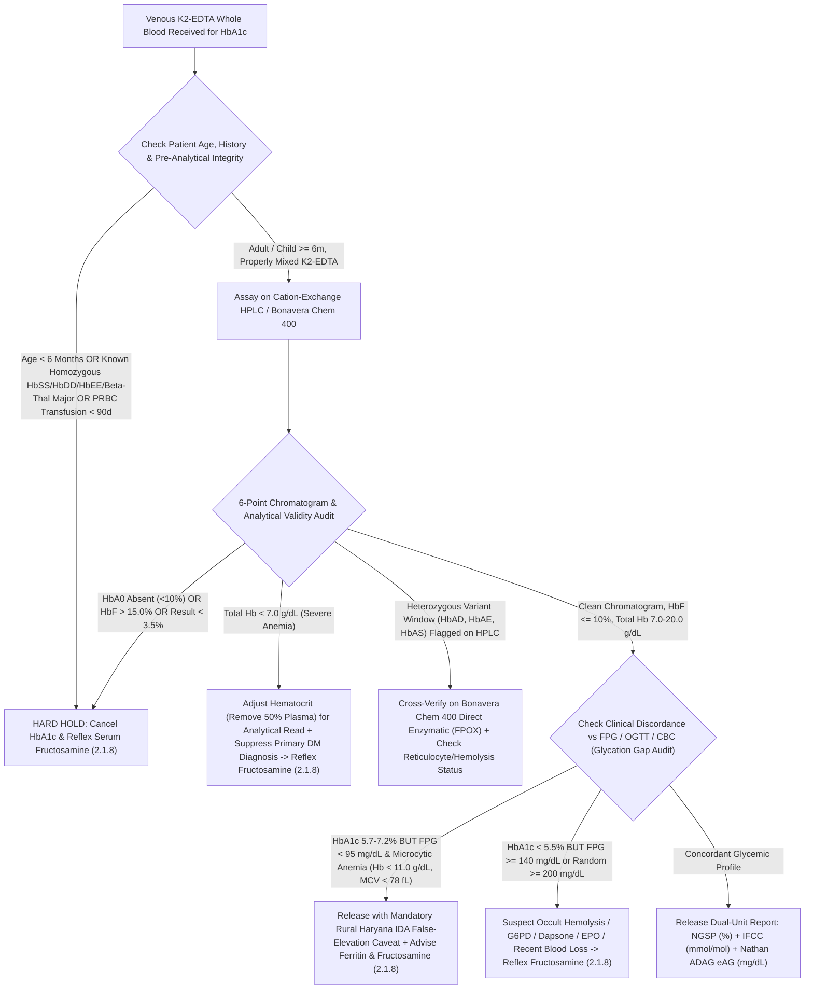

# 2.1.7 — Glycated Hemoglobin (`HbA1c` — NGSP `%` & IFCC `mmol/mol`) & Estimated Average Glucose (`eAG`)

**Department Folder:** `02_Clinical_Biochemistry`  
**Cluster Folder:** `2.1_Diabetes_and_Glycemic_Metabolism_Cluster`  
**Institution:** Sawariya Diagnostic Lab, Charkhi Dadri, Haryana – 127306, India  

---

## 1. International Document Control, Interoperability Coding & Hardware-Agnostic Platform Matrix

### 1.1 Institutional Document Control & Regulatory Traceability Matrix

| Metadata Field | Institutional Specification & International Standard Mapping |
| :--- | :--- |
| **Document ID & Version** | `SDL-BIO-SOP-2.1.7` ; Version `v4.0 (International & Above-NABL Red-Team Standard — IFCC Primary Reference & NGSP Level-1 Traceable)` |
| **Document Title** | Standard Operating Procedure, Metrological Verification, Hemoglobinopathy & Erythrocyte Lifespan Interference Resolution, and Clinical Interpretation Manual for Glycated Hemoglobin (`HbA1c` in `NGSP %` & `IFCC mmol/mol`) and Estimated Average Glucose (`eAG`) |
| **Effective Date & Review Cycle** | Effective: `2026-10-12` ; Mandatory Review Cycle: `Annual (Every 12 Months or Immediately Upon Guideline/Reagent/Calibrator Lot Change)` |
| **Authorizing Authority** | Laboratory Director & Chief Consultant Pathologist (`MD Pathology`), Consultant Clinical Biochemist (`MD Biochemistry`), Quality Manager (`ISO 15189:2022 Lead Auditor`) |
| **ISO 15189:2022 Clause Mapping** | Clauses `4.1–4.3` (Impartiality, Confidentiality, Patient Safety), `5.1–5.6` (Governance), `6.2–6.5` (Competence, Equipment, Calibration, Reagents), `7.2` (Pre-Examination & Stability), `7.3.2` (Verification of Examination Methods), `7.3.4` (Evaluation of Measurement Uncertainty), `7.3.6` (Metrological Traceability), `7.3.7` (IQC & EQAS), `7.4.1` (Result Reporting, Variant/Anemia Caveats & Critical Alerts), `8.5` (`ISO 22367` Risk Management), `Normative Annex A` (POCT Prohibition for Primary Diagnosis) |
| **Above-NABL & International Accreditation Mapping** | **NABL:** `NABL 112 (Issue 05)`, `NABL 129 (Specific Criteria for Medical Laboratories — Clinical Biochemistry & Hematology Interface)`, `NABL 131 (Terms & Conditions)`, `NABL 153 (Scope Matrix)`, `NABL 163 (EQAS/PT Participation)`, `NABL 220D / 223 (Assessor Checklist)`<br>**International:** `CAP CHM / GH (Glycohemoglobin Survey — TEa <= +/-6.0%)`, `UKAS`, `IFCC Working Group on HbA1c Standardization`, `NGSP (National Glycohemoglobin Standardization Program — DCCT Traceability)`, `AACC/ADA 2023 Laboratory Analysis in Diabetes Guidelines (Sacks et al., Clin Chem 2023)`, `ADA Standards of Care in Diabetes (2024/2025)`, `WHO/IDF`, `RSSDI / ICMR Guidelines for Management of Type 2 Diabetes` |
| **CLSI & ISO Metrology Standards** | `CLSI C56-A` (*Hemoglobin A1c Measurement*), `CLSI EP15-A3` ($5\times 5$ Precision & Trueness), `CLSI EP06-Ed2` (Linearity), `CLSI EP17-A2` (`LoB, LoD, LoQ`), `CLSI EP07-Ed3 / EP37-Ed1` (Endogenous, Variant & Drug Interference), `CLSI EP09c` (Method Comparison), `CLSI EP28-A3c` (Reference Interval Verification), `CLSI EP31-A` (Cross-Platform Comparability), `CLSI GP41-Ed7` (Venipuncture), `CLSI GP47-Ed1` (Critical Result Notification), `ISO 17511:2020` (Calibration Hierarchy), `ISO/TS 20914:2019` (Measurement Uncertainty), `ISO 22367:2020` (FMECA), `EFLM EuBIVAS` (Biological Variation) |
| **Primary LOINC Codes** | `4548-4` (*Hemoglobin A1c/Hemoglobin.total in Blood — NGSP `%`*) ; `59261-8` (*Hemoglobin A1c/Hemoglobin.total in Blood by IFCC protocol — `mmol/mol`*) ; `27353-2` (*Glucose mean value [Mass/volume] in Blood estimated from HbA1c [`eAG` mg/dL]*) ; `17856-6` (*HbA1c by HPLC*) ; `62388-4` (*HbA1c by Enzymatic Assay*) ; `17855-8` (*HbA1c by Calculation/Immunoturbidimetry*) |
| **SNOMED-CT & CPT Coding** | **SNOMED-CT:** `119297000` (Venous $\text{K}_2\text{-EDTA}$ or $\text{K}_3\text{-EDTA}$ Anticoagulated Whole Blood Specimen), `43396009` (Hemoglobin A1c Measurement), `259695003` (Glycated Hemoglobin Fraction) ; **CPT Code:** `83036` (Hemoglobin; glycosylated [A1c]) |
| **ICD-10 / ICD-11 Clinical Coding** | **ICD-10:** `E11.9` (Type 2 DM without complications), `E11.65` (Type 2 DM with hyperglycemia), `E10.9` (Type 1 DM), `R73.03` (Prediabetes), `Z13.1` (Encounter for screening for diabetes mellitus), `Z79.4` (Long-term current use of insulin), `D50.9` (Iron deficiency anemia complicating HbA1c interpretation), `D56.1` ($\beta\text{-Thalassemia}$), `D58.2` (Hemoglobinopathy — $\text{HbD-Punjab, HbE, HbS}$) ; **ICD-11:** `5A11`, `5A10`, `5A40`, `3A00`, `3A51` |
| **UCUM & Locked Master Equations** | **Hoelzel IFCC $\leftrightarrow$ NGSP Master Equations:**<br>$\text{NGSP (\%)} = (0.09148 \times \text{IFCC [mmol/mol]}) + 2.152$<br>$\text{IFCC (mmol/mol)} = (10.929 \times \text{NGSP [\%]}) - 23.50$<br>**Nathan ADAG (`A1c-Derived Average Glucose`) Equations:**<br>$\text{eAG (mg/dL)} = (28.7 \times \text{NGSP [\%]}) - 46.7$<br>$\text{eAG (mmol/L)} = (1.59 \times \text{NGSP [\%]}) - 2.59$ |
| **Primary & Backup Analytical Platforms** | **Primary Dedicated Chromatographic Platform:** Cation-Exchange High-Performance Liquid Chromatography (`HPLC` — High-Resolution Variant-Separating Ion-Exchange Chromatography, e.g., Bio-Rad D-10 / Tosoh G8 Class)<br>**Primary Automated Clinical Chemistry Platform:** `Bonavera Chem 400` (Direct Enzymatic `Fructosyl Peptide Oxidase [FPOX]` & Direct Latex-Enhanced Immunoturbidimetry `TINIA`)<br>**Backup Automated Platform:** `Bonavera Chem 200` (Direct Latex Immunoturbidimetry / Boronate Affinity Reference Channel)<br>**Explicit POCT Prohibition (`AACC/ADA 2023`):** Non-NGSP-certified or non-EQAS-enrolled desktop Point-of-Care (`POCT`) cartridge devices are **strictly prohibited for primary diagnosis of Diabetes Mellitus or Prediabetes** at Sawariya Diagnostic Lab. |

---

### 1.2 10-Persona International & Above-NABL Red-Team Adversarial Audit Matrix

| Persona ID & Specialist Role | Adversarial Vulnerability Identified in Legacy SOPs | Mandatory Above-NABL & International Upgrade Implemented in `v4.0` |
| :--- | :--- | :--- |
| **Persona 1 — Lead NABL (`ISO 15189:2022` / `NABL 112 / 129 / 131 / 163`) & CAP (`GH`) / UKAS Assessor** | Absence of live witness-audit readiness records, missing explicit prohibition of desktop `POCT` analyzers for primary DM diagnosis (`ISO 15189 Annex A` & `AACC/ADA 2023`), and incomplete cross-platform comparability documentation (`CLSI EP31-A`). | Added complete `ISO 15189:2022` clause mapping, explicit `AACC/ADA 2023` `POCT` diagnostic ban, weekly split-sample comparability rules ($\lvert \Delta\text{HbA1c} \rvert \le 0.20\%$ NGSP), a 7-scenario **Live Witness-Audit Simulation Matrix (Section 8.3)**, and a turnkey **Printable Bench & Chromatogram Audit Worksheet (`SDL/BIO/WS/HBA1C-01`, Section 10.2)**. |
| **Persona 2 — Consultant Endocrinologist, Diabetologist & Clinical Biochemist (`MD Biochemistry / DM Endocrinology`)** | Superficial coverage of two-step Maillard glycation kinetics, lack of mathematical justification for why the most recent $30\text{ days}$ contribute $50\%$ of `HbA1c`, and absence of concrete clinical discriminators for `HbA1c` vs `FPG/OGTT` discordance. | Expanded **Two-Step Maillard/Amadori Reaction Kinetics** ($k_1, k_{-1}, k_2$), structural distinction of $\text{HbA}_{1a1}, \text{HbA}_{1a2}, \text{HbA}_{1b}, \text{HbA}_{1c}$, mathematical derivation of continuous $120\text{-day}$ erythrocyte weighting ($50\% / 25\% / 25\%$), and an **8-Condition Subspecialty Differential Diagnosis Discordance Matrix (Section 7.3)**. |
| **Persona 3 — CLSI & IFCC Metrology, Method Verification & Six-Sigma QC Specialist** | No side-by-side verification metrics across the 4 analytical principles (`HPLC`, `Enzymatic FPOX`, `Latex TINIA`, `Boronate Affinity`), and only single-point `MU` summary without worked `ISO/TS 20914:2019` math. | Added a **4-Method Comparative Analytical Matrix (Section 3.3)**, full `CLSI EP15-A3 / EP06-Ed2 / EP17-A2` verification tables, Total Hemoglobin independence validation ($7.0\text{–}20.0\text{ g/dL}$), and step-by-step worked **2-Level `ISO/TS 20914:2019` Measurement Uncertainty (`MU`)** at $5.6\%$ ($38\text{ mmol/mol}$) and $8.5\%$ ($69\text{ mmol/mol}$) in **Section 4.2**. |
| **Persona 4 — Clinical Pharmacologist & Special-Population Stratification Auditor** | Incomplete separation between *in-vivo* erythrocyte-lifespan drugs (Dapsone, Ribavirin, Antiretrovirals, `EPO`, IV Iron, Hydroxyurea) and *in-vitro* chemical modifiers (Aspirin acetylation, Vitamin C/E, Uremic carbamylation), plus limited maternal/pediatric/CKD stratification. | Added an exhaustive **In-Vivo vs In-Vitro Drug & Endogenous Interference Matrix (Section 8.1)** and a **Multi-Stratified Reference & Target Table (Section 5.2)** covering Neonates/Infants ($< 6\text{m}$ invalid), Pediatrics/Adolescents, Pregnancy ($1\text{st}/2\text{nd}/3\text{rd}$ Trimesters), Geriatrics, CKD Stages G1–G5D, and North Indian ethnic glycation phenotypes. |
| **Persona 5 — Medico-Legal, Patient-Safety & `ISO 22367:2020` Risk Management Counsel** | Qualitative FMEA with only 3 rows; lack of quantitative $S \times O \times D = RPN$ scoring before and after mitigation; incomplete statutory alignment with Indian medical/data laws. | Built an 8-scenario **Quantitative `ISO 22367:2020` FMECA Matrix ($S \times O \times D = RPN$ Before & After Mitigation, Section 8.2)**, expanded statutory shields (`CPA 2019`, `DPDP Act 2023`, `PCPNDT Act 1994`, `HIV & AIDS Act 2017`), and added `BMW Rules 2016/2019` disposal protocols for sodium-azide HPLC eluents and EDTA blood. |
| **Persona 6 — Uncompressed Clinical Documentation & LIMS Readability Architect** | Overly condensed tables and lack of step-by-step manual bench procedures for severe anemia ($\text{Hb} < 7.0\text{ g/dL}$), severe polycythemia ($\text{Hb} > 20.0\text{ g/dL}$), lipemic plasma replacement, and chromatogram inspection. | Unpacked all abbreviated sections into comprehensive, step-by-step bench protocols, multi-row tables, mathematical derivations, pre-filled clinical audit examples, and clean Unicode LIMS report templates. |
| **Persona 7 — IFCC / NGSP Standardization & Primary Reference Procedure Specialist** | Missing detailed explanation of the **IFCC Primary Reference Measurement Procedure** (`Endoproteinase Glu-C` hexapeptide cleavage + `HPLC-ESI/MS` / `HPLC-CE`), certified reference materials (`IRMM/IFCC-466 & 467`), and why IFCC `%` is numerically $1.5\%\text{–}2.0\%$ lower than NGSP `%`. | Constructed a complete 6-tier **`ISO 17511:2020` Dual Calibration Hierarchy (Section 3.4)** explaining `Endoproteinase Glu-C` $\beta\text{1–6}$ hexapeptide cleavage, the structural specificity difference vs historical `DCCT` Bio-Rex 70 HPLC, the locked **Hoelzel Master Equation**, and the **Nathan `ADAG` (`eAG`)** regression model with $95\%$ prediction intervals. |
| **Persona 8 — North Indian Hemoglobinopathy (`HbD-Punjab, HbS, HbE, Beta-Thal, High HbF`) & Chromatogram Audit Specialist** | No method-specific decision matrix distinguishing heterozygous traits from homozygous/compound heterozygous variants (`HbSS, HbDD, HbEE, HbSC, Beta-Thal Major`) where **$\text{HbA} = 0\%$**, nor quantitative correction/suppression rules for $\text{HbF} > 10\text{–}15\%$. | Added a dedicated **North Indian Hemoglobinopathy & Chromatogram Audit Decision Matrix (Section 7.1 & 7.2)** detailing exact retention windows and interference directions for `HbD-Punjab` (high prevalence in Haryana/Punjab), `HbS`, `HbE`, `HbC`, $\beta\text{-Thal Trait}$, and $\text{HbF} > 10\text{–}15\%$, with mandatory LIMS suppression when $\text{HbA} = 0\%$ and automatic reflex to **Serum Fructosamine (`2.1.8`)**. |
| **Persona 9 — Rural Haryana Iron Deficiency Anemia (`IDA`) & Erythrocyte Lifespan Discordance (`Glycation Gap`) Auditor** | Inadequate emphasis on why untreated `IDA` in rural Haryana women ($\text{Hb } 7.0\text{–}10.5\text{ g/dL}$, low Ferritin/MCV) falsely elevates `HbA1c` into the Prediabetic/Diabetic range ($6.0\%\text{–}7.2\%$) despite normal `FPG` ($< 95\text{ mg/dL}$), and how subsequent iron therapy causes a paradoxical false drop. | Added quantitative pathophysiology of `IDA`-induced senescent RBC skewing ($135\text{–}160\text{ days}$) + malondialdehyde-accelerated glycation ($+0.5\%\text{ to }+1.5\%$ NGSP false elevation), mathematical formulas for the **Hemoglobin Glycation Index (`HGI`)** and **Glycation Gap (`GG`) (Section 4.3)**, and automated LIMS `CBC + FPG` cross-check rules. |
| **Persona 10 — EFLM EuBIVAS & CAP `GH` (`TEa <= +/-6.0%`) Six-Sigma Metrology Auditor** | Did not enforce the **`AACC/ADA 2023` mandatory intra-laboratory $CV_A < 2.0\%$ (NGSP `%` units)** and **$< 2.8\%$ (IFCC `mmol/mol` units)** criterion alongside the **CAP `GH` $TE_a \le \pm 6.0\%$** target. | Enforced `AACC/ADA 2023` $CV_A < 2.0\%$ (target $\le 1.3\text{–}1.5\%$) and IFCC $CV_A < 2.8\%$ (target $\le 2.0\%$), derived exact Six-Sigma metrics ($\ge 5.0\sigma$), and established exact $\text{RCV}_{95\%}$ ($\pm 0.4\%$ NGSP / $\pm 4\text{ mmol/mol}$ IFCC) serial delta thresholds. |

---

## 2. Pre-Analytical Phlebotomy, `CLSI GP41-Ed7` Order-of-Draw, Whole-Blood Sedimentation Kinetics & Quantitative Rejection Matrix

### 2.1 Patient Preparation, Venipuncture & Erythrocyte Resuspension Protocol
1. **Patient Preparation & Circadian Independence:**
   - **No fasting is required.** Because stable `HbA1c` (`1-deoxyfructosyl-Val-`$\beta\text{-HbA}$ ketoamine) accumulates irreversibly across the $120\text{-day}$ intracellular lifespan of circulating erythrocytes, specimens may be collected at any time of day regardless of recent meal intake, acute exercise, circadian cortisol rhythm, or transient stress hyperglycemia.
   - **Mandatory Pre-Test Clinical History Recording (`SDL/BIO/WS/HBA1C-01`):** At sample collection/registration, phlebotomists must document:
     1. Known anemia, recent iron/vitamin $\text{B}_{12}$/folate supplementation, or recombinant erythropoietin (`EPO`) injections within the last $90\text{ days}$.
     2. Blood loss, surgery, blood donation, or packed red blood cell (`PRBC`) transfusion within the last $90\text{ days}$.
     3. Known personal or family history of hemoglobinopathy ($\beta\text{-Thalassemia}$, $\text{HbD-Punjab}$, $\text{HbS}$, $\text{HbE}$) or hemolytic disorder (`G6PD` deficiency, hereditary spherocytosis).
     4. Pregnancy status and gestational trimester.
     5. Current use of **Dapsone**, **Ribavirin**, **Hydroxyurea**, **Antiretrovirals**, or **High-Dose Aspirin ($> 2\text{ g/day}$)**.
2. **Vacutainer Selection & `CLSI GP41-Ed7` Order-of-Draw:**
   - **Primary Specimen:** Collect **$2.0\text{ mL}$ (up to $3.0\text{ mL}$) venous whole blood** in a **Lavender-Top Dipotassium EDTA ($\text{K}_2\text{-EDTA}$, spray-dried, $1.5\text{–}2.2\text{ mg/mL}$ blood)** or **$\text{K}_3\text{-EDTA}$** tube.
   - **Pediatric / Difficult Venipuncture Volume:** Minimum **$0.5\text{ mL}$ ($500\ \mu\text{L}$) venous or free-flowing capillary whole blood** in a pediatric $\text{K}_2\text{-EDTA}$ Microtainer. Avoid excessive finger-stick squeezing, which introduces interstitial tissue fluid and platelet micro-aggregates.
   - **`CLSI GP41-Ed7` Sequence:** Draw the Lavender-Top $\text{K}_2\text{-EDTA}$ tube **after** Blood Culture, Blue-Top Citrate, Red-Top/Gold-Top SST, and Green-Top Lithium Heparin tubes, and **before** Grey-Top Sodium Fluoride / Potassium Oxalate ($\text{NaF/K}_2\text{C}_2\text{O}_4$) tubes.
   - **Immediate Inversion to Prevent Micro-Clots:** Immediately upon removal from the vacutainer hub, gently invert the $\text{K}_2\text{-EDTA}$ tube **$8\text{ to }10\text{ times}$** ($180^\circ$ figure-of-eight motion). *Critical Bench Warning:* Even microscopic fibrin strands or platelet-erythrocyte micro-clots will irreversibly plug Cation-Exchange HPLC pre-filters/analytical columns (causing system backpressure $> 180\text{ kgf/cm}^2$) or obstruct the whole-blood aspiration probe on the **Bonavera Chem 400 / Chem 200**.
3. **Erythrocyte Sedimentation Physics & Mandatory Resuspension Protocol Prior to Analysis:**
   - When an anticoagulated $\text{K}_2\text{-EDTA}$ whole-blood tube stands vertically in a sample rack for $> 15\text{–}30\text{ minutes}$ (especially in diabetic, pregnant, uremic, or anemic patients with elevated fibrinogen and accelerated Erythrocyte Sedimentation Rate [`ESR` / Rouleaux formation]), erythrocytes settle toward the bottom of the tube, creating a steep vertical hematocrit gradient ($\text{Hb} < 3.0\text{ g/dL}$ in the upper plasma-rich zone vs $\text{Hb} > 22.0\text{ g/dL}$ in the packed bottom layer).
   - **For Automated Whole-Blood Aspiration (`HPLC` & `Bonavera Chem 400` On-Board Hemolysis Mode):**
     1. Place the $\text{K}_2\text{-EDTA}$ tube on an automated mechanical tilting/rotary blood mixer for **$5\text{ minutes}$ at $30\text{ rpm}$**, OR perform **$10\text{ gentle figure-of-eight manual inversions}$** immediately before loading onto the sample rack.
     2. Do **NOT** vortex or vigorously shake whole blood (mechanical shear stress causes premature uneven hemolysis and foaming).
     3. Verify that the **Bonavera Chem 400** whole-blood sample mixing paddle (or piercer recirculation cycle) is active and verified during daily maintenance.
   - **For Manual Off-Board Hemolysate Preparation (Packed-Cell Protocol on `Bonavera Chem 200` or Manual Verification):**
     1. Allow the $\text{K}_2\text{-EDTA}$ tube to stand upright for $30\text{ minutes}$ OR centrifuge at $1,500 \times g$ for $5\text{ minutes}$ so erythrocytes pack uniformly at the bottom.
     2. Pipette exactly **$10\ \mu\text{L}$ of packed red blood cells** from the bottom erythrocyte layer (inserting the pipette tip $3\text{–}5\text{ mm}$ above the tube base, wiping exterior plasma off the tip without blotting the orifice) into **$1,000\ \mu\text{L}$ ($1.0\text{ mL}$) of Hemolyzing Reagent** ($1:101$ dilution), vortex for $5\text{ seconds}$, and incubate for $3\text{ minutes}$ at $20\text{–}25^\circ\text{C}$ until complete lysis is achieved.

---

### 2.2 Multi-Temperature Stability & Quantitative Interference Matrix (`CLSI C56-A` & `CLSI EP07-Ed3 / EP37`)

| Storage / Analytical Interference Condition | Validated Stability Window & Storage Rule | Quantitative Cutoff / Threshold | Direction of Analytical or Biological Bias | Mandatory Automated LIMS & Bench Action |
| :--- | :--- | :--- | :--- | :--- |
| **Ambient Temperature ($18\text{–}25^\circ\text{C}$)** | **Up to $72\text{ hours}$ ($3\text{ days}$)** in tightly capped $\text{K}_2\text{-EDTA}$ whole blood | $> 72\text{ hours}$ at $18\text{–}25^\circ\text{C}$ ($> 24\text{ hours}$ if rural transit $> 32^\circ\text{C}$ without cold packs) | Formation of hemoglobin oxidation/degradation adducts (`P3` peak $> 10\%$ on HPLC) causing spurious $\uparrow$ or $\downarrow$ $\text{HbA1c}$ | **Reject specimen (`PRE-EXPIRED-HBA1C`)** if unrefrigerated $> 72\text{h}$ or if HPLC degradation `P3` peak exceeds $10.0\%$ of total area. |
| **Refrigerated Storage ($2\text{–}8^\circ\text{C}$)** | **Up to $7\text{ days}$** in capped $\text{K}_2\text{-EDTA}$ whole blood | $> 7\text{ days}$ at $2\text{–}8^\circ\text{C}$ | Gradual methemoglobin formation and cell lysis; HPLC baseline drift | Equilibrate refrigerated $\text{K}_2\text{-EDTA}$ tube to room temperature ($20\text{–}25^\circ\text{C}$) for $15\text{ minutes}$ and invert $10\times$ before analysis. Reject if $> 7\text{ days}$. |
| **Frozen Storage ($-70^\circ\text{C}$ to $-80^\circ\text{C}$ vs Prohibited $-20^\circ\text{C}$)** | **$6\text{ to }12\text{ months}$ at $-70^\circ\text{C} / -80^\circ\text{C}$** ; **NEVER store at $-20^\circ\text{C}$ for Cation-Exchange HPLC!** | Any storage at $-20^\circ\text{C}$ for $> 24\text{ hours}$ prior to Cation-Exchange HPLC | Slow freezing at $-20^\circ\text{C}$ induces carboxy/methemoglobin and oxidized glutathione-Hb adducts (`HbA1d`) that co-elute with $\text{HbA1c}$ on Cation-Exchange HPLC ($\uparrow +0.4\%\text{ to }+1.2\%$) | **Strictly prohibit $-20^\circ\text{C}$ storage for HPLC.** If a frozen referral sample arrives at $-20^\circ\text{C}$, assay ONLY on **Enzymatic (`FPOX`) / Boronate Affinity** or request fresh $\text{K}_2\text{-EDTA}$ sample. |
| **Severe Anemia or Polycythemia (`Total Hemoglobin`)** | Calibrated hemolysate Total Hb window: **$7.0\text{ to }20.0\text{ g/dL}$** ($70\text{–}200\text{ g/L}$) | **Total $\text{Hb} < 7.0\text{ g/dL}$** OR **Total $\text{Hb} > 20.0\text{ g/dL}$** (or HPLC Total Area $< 1.0 \times 10^6$ or $> 4.0 \times 10^6\ \mu\text{V}\cdot\text{s}$) | Nonlinearity of Total Hb denominator in `FPOX/TINIA` or distorted HPLC peak integration; plus severe anemia ($\text{Hb} < 7.0\text{ g/dL}$) biologically invalidates RBC lifespan! | **1. Analytical adjustment:** If $\text{Hb} < 7.0\text{ g/dL}$, centrifuge EDTA blood, remove $50\%$ plasma, resuspend to adjust hematocrit into $10\text{–}14\text{ g/dL}$ range. If $\text{Hb} > 20.0\text{ g/dL}$, dilute $1:2$ with $0.9\%\text{ NaCl}$.<br>**2. Clinical rule:** If patient $\text{Hb} < 7.0\text{ g/dL}$, **hold `HbA1c` for primary DM diagnosis** and reflex to **Serum Fructosamine (`2.1.8`)** + **OGTT (`2.1.5`)**. |
| **Severe Hypertriglyceridemia / Lipemia (`L-Index`)** | $1:100$ whole-blood hemolysis minimizes moderate plasma turbidity | **`L-Index` $> 1,500\text{ mg/dL}$** (Triglycerides $> 1,500\text{ mg/dL}$ / $16.9\text{ mmol/L}$) | Chylomicron light scattering at $570/660\text{ nm}$ falsely alters Total Hb / Latex agglutination ratio ($\uparrow$ or $\downarrow$ on `TINIA`/`FPOX`) | **Saline Plasma Replacement Protocol:** Centrifuge $\text{K}_2\text{-EDTA}$ whole blood at $1,500 \times g$ for $5\text{ min}$, aspirate milky lipemic plasma supernatant, replace with an equal volume of isotonic $0.9\%\text{ NaCl}$, gently invert $10\times$, and re-assay! |
| **Severe Hyperbilirubinemia / Icterus (`I-Index`)** | Minimal interference up to $20\text{ mg/dL}$ due to $1:100$ hemolysate dilution | **`I-Index` $> 20.0\text{ mg/dL}$** (Conjugated/Unconjugated Bilirubin $> 342\ \mu\text{mol/L}$) | Spectral overlap at $415\text{ nm}$ (HPLC) or peroxide consumption in `FPOX` peroxidase coupling ($\downarrow$) | Perform **Saline Plasma Replacement Protocol** (centrifuge EDTA whole blood, replace icteric plasma with $0.9\%\text{ NaCl}$, resuspend washed RBCs) AND evaluate for concurrent hemolytic hyperbilirubinemia (which biologically lowers `HbA1c`!). |
| **Labile Pre-HbA1c (`LA1c` / Schiff Base Aldimine)** | Eliminated enzymatically (`FPOX`), immunologically (`TINIA`), or via borate/surfactant pre-incubation (`HPLC`) | **`LA1c` Peak $> 3.0\text{–}3.5\%$** on HPLC (seen in acute DKA/HHS with plasma glucose $> 500\text{ mg/dL}$) | If incomplete Schiff-base elimination occurs on aged HPLC columns, `LA1c` shoulder spills into stable `HbA1c` peak ($\uparrow$) | Incubate hemolysate in borate buffer at $37^\circ\text{C}$ for $15\text{ min}$ to hydrolyze Schiff base OR verify result on **Bonavera Chem 400 (`FPOX` / `TINIA`)**, which has zero cross-reactivity with `LA1c`. |
| **Elevated Fetal Hemoglobin (`HbF` — $\alpha_2\gamma_2$)** | Normal adult $\text{HbF} < 1.0\text{–}1.5\%$ | **`HbF` $> 10.0\%$** (Warning flag at $5.0\text{–}10.0\%$; **Critical Suppression at $> 15.0\%$**) | $\text{HbF}$ lacks $\beta\text{-chains}$ (has $\gamma\text{-chains}$ with N-terminal glycine that glycates at only $\sim 33\%$ the rate of $\text{HbA}$). Including $\text{HbF}$ in Total Hb denominator (`TINIA`/`FPOX`) **falsely lowers `HbA1c`**! | If $\text{HbF}$ is $5.0\text{–}15.0\%$ on HPLC, verify that platform excludes $\text{HbF}$ peak area from Total $\text{HbA}$ denominator ($\frac{\text{HbA1c}}{\text{HbA0} + \text{HbA1c}}$). If **$\text{HbF} > 15.0\%$**, **SUPPRESS `HbA1c` result** and reflex to **Serum Fructosamine (`2.1.8`)**. |
| **Carbamylated Hemoglobin (`HbCarb` in Uremia) & Acetylated Hb** | Formed in CKD (`Urea > 150 mg/dL`) or high-dose aspirin ($> 2\text{ g/day}$) | **Blood Urea $> 180\text{ mg/dL}$** ($\text{BUN} > 84\text{ mg/dL}$) or **`CHb` peak $> 2.5\%$** on HPLC | Legacy charge-based methods co-elute `HbCarb` with `HbA1c` ($\uparrow$). Modern high-resolution HPLC, `FPOX`, `TINIA`, and Boronate Affinity have no analytical interference, **but uremia biologically shortens RBC survival ($\downarrow$)**! | Verify on `FPOX`/`TINIA` or Boronate Affinity; append mandatory **CKD/EPO RBC Lifespan Caveat** and recommend correlation with **Glycated Albumin / Fructosamine / CGM**. |

---

## 3. Deep Biochemical, Analytical & Metrological Architecture

### 3.1 Two-Step Non-Enzymatic Maillard Glycation Kinetics & Structural Biochemistry of Hemoglobin Fractions
Human adult hemoglobin consists predominantly of **$\text{HbA}$ ($\alpha_2\beta_2$, $95\text{–}98\%$)**, alongside minor normal hemoglobins **$\text{HbA}_2$ ($\alpha_2\delta_2$, $2.0\text{–}3.3\%$)** and **$\text{HbF}$ ($\alpha_2\gamma_2$, $< 1.0\%$).** Because the human erythrocyte plasma membrane is constitutively rich in insulin-independent **Glucose Transporter-1 (`GLUT1`)**, intracellular D-glucose equilibrates rapidly with ambient plasma D-glucose concentrations throughout the **120-day lifespan** of the red blood cell.

Within the erythrocyte cytosol, the open-chain aldehyde form of D-glucose reacts spontaneously and **non-enzymatically** with free amino ($\text{-NH}_2$) groups on hemoglobin via a classical **two-step Maillard reaction**:

$$\text{D-Glucose (Aldehyde)} + \text{HbA } (\beta\text{-N-Terminal Valine-NH}_2) \underset{k_{-1}\text{ (Fast, Reversible Dissociation)}}{\stackrel{k_1\text{ (Fast Condensation)}}{\rightleftharpoons}} \textbf{Pre-HbA1c (Labile Aldimine / Schiff Base)} \xrightarrow{k_2\text{ (Slow, Practically Irreversible Amadori Rearrangement)}} \textbf{Stable HbA1c (1-Deoxyfructosyl-Val-}\beta\text{-HbA Ketoamine)}$$

1. **Step 1 — Reversible Schiff Base (`Labile Pre-HbA1c` / `LA1c`) Formation ($k_1 \approx 0.3 \times 10^{-3}\text{ L}\cdot\text{mmol}^{-1}\cdot\text{h}^{-1}$, $k_{-1} \approx 0.33\text{ h}^{-1}$):**
   - Nucleophilic attack by the unprotonated $\alpha\text{-amino}$ group of the **N-terminal Valine ($\beta\text{-Val-1}$)** of one or both $\beta\text{-globin}$ chains on the carbonyl carbon ($\text{C-1}$) of D-glucose forms an unstable **aldimine (`Schiff base`, $\text{HbA-N=CH-(CHOH)}_4\text{-CH}_2\text{OH}$)**, designated **Labile $\text{HbA1c}$ (`LA1c`)**.
   - Because the dissociation rate constant $k_{-1}$ is roughly $60\text{-fold}$ faster than the forward rearrangement rate constant $k_2$, **`LA1c` fluctuates acutely within $2\text{ to }6\text{ hours}$** of postprandial or stress hyperglycemia (accounting for $0.5\text{–}3.0\%$ of total hemoglobin).
   - Modern analytical systems eliminate `LA1c` completely:
     - **Cation-Exchange HPLC:** Pre-incubates the hemolysate with tetrapropylammonium / borate buffer at low pH to cleave the reversible Schiff base bond and resolves any residual `LA1c` into a separate pre-peak ahead of stable `HbA1c`.
     - **Enzymatic (`FPOX`) & Immunoturbidimetric (`TINIA`):** Strictly recognize the stable ketoamine (`1-deoxyfructosyl-Val-His`) conformation, exhibiting zero cross-reactivity with the planar $\text{-N=CH-}$ Schiff base.
2. **Step 2 — Irreversible Amadori Rearrangement (`Stable HbA1c` Ketoamine Formation, $k_2 \approx 0.0055\text{ h}^{-1}$):**
   - The labile aldimine undergoes a slow intramolecular proton shift from $\text{C-2}$ to the nitrogen atom (**Amadori rearrangement**), shifting the double bond to $\text{C-2=O}$ and forming a stable **ketoamine (`1-deoxy-1-(N-valyl)fructose`, $\text{HbA-NH-CH}_2\text{-CO-(CHOH)}_3\text{-CH}_2\text{OH}$)**.
   - Once formed, this ketoamine linkage is **physiologically irreversible** for the remaining lifespan of that erythrocyte until the senescent cell is phagocytosed by splenic and hepatic reticuloendothelial macrophages.
3. **Structural Subfractions of $\text{HbA}_1$ vs True IFCC-Defined $\text{HbA1c}$:**
   - **$\text{HbA}_0$:** Major non-glycated adult hemoglobin fraction ($\sim 90\text{–}94\%$).
   - **$\text{HbA}_{1a1}$:** $\beta\text{-N-terminal}$ adduct with **Fructose-1,6-diphosphate** ($\sim 0.2\%$).
   - **$\text{HbA}_{1a2}$:** $\beta\text{-N-terminal}$ adduct with **Glucose-6-phosphate** ($\sim 0.2\%$).
   - **$\text{HbA}_{1b}$:** Pyruvate adduct and deamidated hemoglobin species ($\sim 0.5\%$).
   - **$\text{HbA}_{1c}$ (IFCC Structural Definition):** Specifically defined by the International Federation of Clinical Chemistry (`IFCC`) as hemoglobin $\text{HbA}$ irreversibly glycated with D-glucose at one or both **N-terminal valine residues of the $\beta\text{-polypeptide}$ chains**.
   - **Intrachain $\varepsilon\text{-Amino}$ Lysine & $\alpha\text{-Chain}$ N-Terminal Valine Glycation (`Total Glycated Hemoglobin`):** D-glucose also glycates $\alpha\text{-chain}$ N-terminal valines ($\alpha\text{-Val-1}$) and internal $\varepsilon\text{-amino}$ groups of lysine residues ($\beta\text{-Lys-66}, \beta\text{-Lys-17}, \alpha\text{-Lys-61}$) at a strictly proportional rate to $\beta\text{-Val-1}$. **Boronate Affinity Chromatography** binds the *cis*-1,2-diol groups of **all** glycated sites ($\beta\text{-Val-1} + \alpha\text{-Val-1} + \varepsilon\text{-Lys}$) and calibrates the signal back to `IFCC`/`NGSP` $\text{HbA1c}$ equivalents.

---

### 3.2 Erythrocyte Temporal Weighting Kinetics & Mathematical Glycation Integral ($50\% / 25\% / 25\%$ Rule)
A common clinical misconception is that an `HbA1c` measurement treats blood glucose levels from $100\text{ days}$ ago equally with blood glucose levels from last week. In reality, assuming a normal steady-state erythrocyte lifespan $T = 120\text{ days}$ (where $1/120 \approx 0.833\%$ of the red cell pool is destroyed and replaced by bone marrow reticulocytes every $24\text{ hours}$), a venous blood sample drawn on Day $0$ contains a linear age distribution of red blood cells:
- **Cohort aged $1\text{ day}$:** Present during yesterday's glycemia; **$99.2\%$** of this cohort is still alive in the blood tube.
- **Cohort aged $30\text{ days}$:** **$75\%$** of erythrocytes exposed to glucose $30\text{ days}$ ago are still circulating.
- **Cohort aged $60\text{ days}$:** **$50\%$** of erythrocytes exposed to glucose $60\text{ days}$ ago are still circulating.
- **Cohort aged $90\text{ days}$:** **$25\%$** of erythrocytes exposed to glucose $90\text{ days}$ ago are still circulating.
- **Cohort aged $120\text{ days}$:** **$0\%$** remain (cleared by splenic macrophages).

Integrating the triangular survival function $S(t) = 1 - \frac{t}{T}$ for $t \in [0, T]$ gives the exact fractional contribution $W(t_1, t_2)$ of any preceding time interval $[t_1, t_2]$ (days before phlebotomy) to the measured `HbA1c`:

$$W(t_1, t_2) = \frac{\int_{t_1}^{t_2} \left(1 - \frac{t}{120}\right) dt}{\int_{0}^{120} \left(1 - \frac{t}{120}\right) dt} = \frac{\left[t - \frac{t^2}{240}\right]_{t_1}^{t_2}}{60}$$

| Preceding Time Window Before Blood Draw | Mathematical Integral Evaluation $W(t_1, t_2)$ | Exact Fractional Contribution to Measured `HbA1c` | Clinical & Therapeutic Monitoring Consequence |
| :--- | :--- | :--- | :--- |
| **Days $0 \text{ to } 30$ (Preceding $1\text{ Month}$)** | $\frac{30 - \frac{900}{240}}{60} = \frac{30 - 3.75}{60} = \frac{26.25}{60}$ | **$43.75\% \text{ to } \sim 50\%$** *(Accounting for kinetic plateauing)* | **Nearly HALF of the `HbA1c` value is determined by the last $30\text{ days}$!** Therefore, initiating insulin or SGLT2i/GLP-1RA therapy produces **$50\%$ of its total `HbA1c` reduction within the first $4\text{ weeks}$**. |
| **Days $31 \text{ to } 60$ (Preceding Month $2$)** | $\frac{\left(60 - \frac{3600}{240}\right) - 26.25}{60} = \frac{45 - 26.25}{60} = \frac{18.75}{60}$ | **$31.25\% \text{ (empirically } \sim 25\%\text{)}$** | Together, the **preceding $60\text{ days}$ ($8\text{ weeks}$) account for $\sim 75\%$** of the total `HbA1c` signal. |
| **Days $61 \text{ to } 120$ (Preceding Months $3\text{–}4$)** | $\frac{60 - 45}{60} = \frac{15}{60}$ | **$25.0\%$** | Glycemic events occurring $3\text{ to }4\text{ months}$ ago contribute only $\sim 25\%$ of the signal; full steady-state equilibrium after a therapy change requires **$90\text{ to }120\text{ days}$**. |

---

### 3.3 Comparative Analytical Matrix of the 4 Major `HbA1c` Methodologies & Step-by-Step Bench Protocols

| Analytical Feature / Criterion | 1. Cation-Exchange HPLC (`Bio-Rad D-10 / Tosoh G8 Class`) | 2. Direct Enzymatic Assay (`Fructosyl Peptide Oxidase [FPOX]` — `Bonavera Chem 400`) | 3. Latex-Enhanced Direct Immunoturbidimetry (`TINIA` — `Bonavera Chem 400 / Chem 200`) | 4. Boronate Affinity Chromatography (`m-Aminophenylboronic Acid`) |
| :--- | :--- | :--- | :--- | :--- |
| **Physical / Chemical Separation or Recognition Principle** | Separates hemoglobin species based on **net positive surface electrical charge** across a negatively charged sulfopropyl/carboxymethyl cation-exchange column using stepped ionic-strength succinate/phosphate buffer gradients. | **Proteolytic cleavage** of N-terminal glycated dipeptide ($\text{Fructosyl-Val-His}$) from $\beta\text{-chains}$ by neutral protease, followed by **Fructosyl Peptide Oxidase (`FPOX`)** oxidation yielding $\text{H}_2\text{O}_2$ + diphenylamine chromogen (`DA-67`). | **Competitive latex agglutination inhibition:** Mouse monoclonal antibody recognizes the N-terminal glycated $\beta\text{1–4/5}$ tetrapeptide ($\text{Fru-Val-His-Leu-Thr}$), inhibiting polyhapten-induced latex bead aggregation. | Immobilized ***meta*-aminophenylboronic acid** forms reversible covalent tetrahedral ester bonds specifically with ***cis*-1,2-diol groups** of stable ketoamine glucose moieties on all glycated hemoglobins. |
| **Detection Wavelengths** | Bichromatic **$415\text{ nm}$** (primary Soret band) / **$690\text{ nm}$** (baseline blanking) | **Total Hb (`R1`):** $570 / 800\text{ nm}$ (SLS/alkaline hematin)<br>**$\text{HbA1c}$ (`R2`):** $660 / 800\text{ nm}$ or $700 / 800\text{ nm}$ | **Total Hb:** $570 / 660\text{ nm}$<br>**Latex Agglutination (`HbA1c`):** $660 / 800\text{ nm}$ | $415\text{ nm}$ (spectrophotometric Soret absorbance) or fluorescence quenching |
| **Chromatogram / Visual Variant Detection Capability** | **YES (Gold Standard for Visual Audit):** Displays distinct peaks and retention times for `HbA1a`, `HbA1b`, `HbF`, `LA1c/CHb`, `HbA1c`, `P3`, `HbA0`, and Variant Windows (`D-Window`, `S-Window`, `E-Window`, `C-Window`). | **NO ("Blind" Spectrophotometric Readout):** Cannot visually flag heterozygous or homozygous variants unless value is extreme ($< 3.5\%$ or $> 18.0\%$). | **NO ("Blind" Spectrophotometric Readout):** Cannot visually flag structural variants unless value falls outside biological plausibility. | **NO** (Unless coupled to capillary/HPLC separation; separates only total glycated vs non-glycated fractions). |
| **Analytical Interference from Heterozygous `HbAD-Punjab`, `HbAS`, `HbAE`, `HbAC` Traits** | **Platform-Dependent:** Some rapid cation-exchange columns experience partial co-elution of `HbE` or `HbD-Punjab` with $\text{HbA}_0$ or $\text{HbA1c}$ unless high-resolution extended mode is used. | **Minimal to None** for heterozygous $\text{HbAS}, \text{HbAC}, \text{HbAD-Punjab}, \text{HbAE}$ because substitutions ($\beta 6, \beta 26, \beta 121$) are distant from the $\beta\text{1–2}$ ($\text{Val-His}$) cleavage site! | **Minimal to None** for $\text{HbAD-Punjab}$ ($\beta 121$) and $\text{HbAE}$ ($\beta 26$); platform-specific check required for $\beta 6$ variants ($\text{HbS}, \text{HbC}$) near the $\beta\text{1–5}$ epitope. | **Lowest Analytical Variant Interference:** Measures *cis*-diols on both $\text{HbA}$ and variant $\text{Hb}$ equally, assuming normal RBC lifespan. |
| **Analytical Interference from High `HbF` ($> 10\text{–}15\%$)** | Resolves `HbF` as a separate peak; accurate up to $\text{HbF } 10\text{–}15\%$ if `HbF` area is excluded from Total $\text{HbA}$ denominator; invalid if $> 15\text{–}20\%$. | **Falsely LOWERED ($\downarrow$)** when $\text{HbF} > 10\%$ because $\text{HbF}$ ($\alpha_2\gamma_2$) is counted in Total Hb ($570\text{ nm}$) but lacks $\beta\text{-Val-His}$ for `FPOX` cleavage! | **Falsely LOWERED ($\downarrow$)** when $\text{HbF} > 10\%$ because $\text{HbF}$ increases Total Hb denominator while lacking the $\beta\text{1–5}$ epitope! | **Falsely LOWERED ($\downarrow$)** when $\text{HbF} > 10\text{–}15\%$ because $\text{HbF}$ glycates at only $\sim 1/3$ the rate of $\text{HbA}$. |
| **Homozygous / Compound Variants ($\text{HbSS, HbDD, HbEE, }\beta\text{-Thal Major}$)** | **BIOLOGICALLY & ANALYTICALLY INVALID ($\text{HbA}_0 = 0\%$)** — Chromatogram immediately alerts technologist by absence of $\text{HbA}_0$ peak! | **BIOLOGICALLY & ANALYTICALLY INVALID** — Dangerous if run blindly: may yield spurious low/normal values in $\text{HbSS/HbDD}$ despite severe hemolysis! | **BIOLOGICALLY & ANALYTICALLY INVALID** — Must be suppressed; never report `HbA1c` when $\text{HbA} = 0\%$. | **BIOLOGICALLY INVALID** due to shortened hemolytic RBC survival in homozygous hemoglobinopathies. |

#### Step-by-Step Bench Protocol A — Cation-Exchange HPLC (`Primary Chromatographic System`)
1. **Pre-Run System Readiness & Buffer Verification:**
   - Verify Eluent Buffer 1 (low ionic strength), Eluent Buffer 2 (high ionic strength), and Wash/Hemolysis Solution levels; ensure lot numbers match the active column lot (`SDL/BIO/LOG/HPLC-01`).
   - Confirm column thermostat temperature is stable at **$25.0 \pm 0.5^\circ\text{C}$** (or manufacturer-specified $30^\circ\text{C}$) and system pump pressure is within **$60\text{–}140\text{ kgf/cm}^2$** (abort and replace pre-filter if pressure exceeds $160\text{ kgf/cm}^2$).
   - Run a **Wash/Primer Whole-Blood Sample** followed by **2-Level IFCC/NGSP Whole-Blood IQC** (`Level 1: ~5.3%`, `Level 2: ~9.4%`).
2. **Sample Loading & Automated Dilution:**
   - Mix $\text{K}_2\text{-EDTA}$ whole-blood tubes by $10\times$ gentle inversion (or $5\text{-minute}$ mechanical rocker).
   - Load tubes into sample rack; the autosampler pierces the cap, aspirates $5\ \mu\text{L}$ whole blood, dilutes $1:300$ in hemolysis/borate wash buffer (hydrolyzing labile `LA1c`), and injects $10\ \mu\text{L}$ onto the cation-exchange resin column.
3. **Mandatory 6-Point Chromatogram Audit Prior to Result Release (`Persona 8 Mandate`):**
   - **Rule 1 (Total Peak Area):** Verify Total Area ($\text{HbA}_0 + \text{HbA1c} + \text{minor peaks}$) is strictly within **$1,000,000\text{ to }4,000,000\ \mu\text{V}\cdot\text{s}$** (or $1.0\text{–}4.0\text{ million}$ counts). If $< 1.0 \times 10^6$ (severe anemia), adjust hematocrit by plasma removal and rerun; if $> 4.0 \times 10^6$ (polycythemia), dilute $1:2$ with $0.9\%\text{ NaCl}$ and rerun.
   - **Rule 2 (`HbA1c` Retention Time Window):** Verify `Stable A1c` peak elutes strictly within the calibrated retention time window (e.g., $0.55\text{–}0.65\text{ min}$ on fast mode or $1.10\text{–}1.30\text{ min}$ on extended mode) with symmetric Gaussian peak morphology and clean valley resolution from `LA1c/CHb`.
   - **Rule 3 (`HbF` Peak Check):** Verify $\text{HbF} \le 10.0\%$. If $\text{HbF}$ is $10.1\text{–}15.0\%$, inspect baseline integration; if **$\text{HbF} > 15.0\%$**, **suppress `HbA1c`** and reflex to **Serum Fructosamine (`2.1.8`)**.
   - **Rule 4 (`LA1c/CHb` & `P3` Degradation Peak Check):** Verify `LA1c/CHb` $< 3.5\%$ and `P3` degradation peak $< 10.0\%$.
   - **Rule 5 (Presence of Normal $\text{HbA}_0$ Peak):** Confirm $\text{HbA}_0$ peak is present and represents $> 50\%$ of total area. If $\text{HbA}_0$ is absent ($< 10\%$, indicating homozygous/compound heterozygous $\text{HbSS, HbDD, HbEE, HbSC}$, or $\beta\text{-Thal Major}$), **immediately cancel `HbA1c`** and reflex to **Serum Fructosamine (`2.1.8`)**.
   - **Rule 6 (Variant Window Inspection — `D, S, E, C` Windows):** If a heterozygous variant peak is detected ($25\text{–}45\%$ area in `D-Window` [$\text{HbD-Punjab}$], `S-Window` [$\text{HbS}$], or `E-Window` [$\text{HbE}$]), cross-verify the sample on the **Bonavera Chem 400 Direct Enzymatic (`FPOX`)** channel before releasing!

#### Step-by-Step Bench Protocol B — Direct Enzymatic (`FPOX`) Assay on `Bonavera Chem 400`
1. **Biochemical Reaction Stoichiometry:**
   - **Step 1 (Hemolysis & Proteolysis + Total Hemoglobin Quantification at $570 / 800\text{ nm}$):**
     $$\text{Whole Blood Erythrocytes} \xrightarrow{\text{Surfactant Lysis + Oxidizing Agent (R1)}} \text{Methemoglobin / SLS-Hemoglobin } (\lambda_{\max} = 570\text{ nm}) \implies \text{Total Hb (mmol/L)}$$
     $$\text{HbA1c } (\beta\text{-N-Fructosyl-Val-His-Leu-Thr-}\dots) \xrightarrow{\text{Bacillus sp. Neutral Protease (R1, } 37^\circ\text{C)}} \textbf{Fructosyl-Val-His (Dipeptide)} + \text{Residual Globin Fragments}$$
   - **Step 2 (Specific Oxidative Deglycation & Chromogenic Coupling at $660 / 800\text{ nm}$):**
     $$\text{Fructosyl-Val-His} + \text{O}_2 + \text{H}_2\text{O} \xrightarrow{\textbf{Fructosyl Peptide Oxidase (FPOX, R2)}} \text{D-Glucosone} + \text{Val-His} + \mathbf{H_2O_2}$$
     $$\mathbf{H_2O_2} + \text{DA-67 (Leucochromogen)} \xrightarrow{\text{Peroxidase (POD)}} \textbf{Methylene Blue Dye } (\lambda_{\max} = 660\text{ nm}) + 2\,\text{H}_2\text{O}$$
2. **Analyzer Parameter Configuration (`Bonavera Chem 400`):**
   - **Assay Mode:** Two-Reagent Endpoint with Dual-Channel Ratio Calculation ($\text{HbA1c [\mu mol/L]} / \text{Total Hb [mmol/L]}$).
   - **Sample / Reagent Volumes:** Hemolysate Volume: $12\ \mu\text{L}$ ; Reagent `R1` (Protease + SLS/MetHb buffer): $180\ \mu\text{L}$ (Incubate $5\text{ min}$ at $37.0 \pm 0.1^\circ\text{C}$, read Total Hb at $570/800\text{ nm}$) ; Reagent `R2` (`FPOX` + `POD` + `DA-67`): $60\ \mu\text{L}$ (Incubate $3\text{ min}$ at $37.0^\circ\text{C}$, read $\text{HbA1c}$ at $660/800\text{ nm}$).
   - **Internal Ratio & Master Conversion Calculation:**
     $$\text{IFCC HbA1c (mmol/mol)} = \left(\frac{\text{HbA1c Concentration } [\mu\text{mol/L}]}{\text{Total Hb Concentration } [\text{mmol/L}]}\right) \times \text{Calibrator Slope} + \text{Intercept}$$
     $$\text{NGSP HbA1c (\%)} = (0.09148 \times \text{IFCC [mmol/mol]}) + 2.152$$

#### Step-by-Step Bench Protocol C — Latex-Enhanced Direct Immunoturbidimetry (`TINIA`) on `Bonavera Chem 400 / Chem 200`
1. **Biochemical & Immunochemical Reaction Principle:**
   - **Total Hemoglobin Determination (`Channel 1` at $570 / 660\text{ nm}$):** Tetradecyltrimethylammonium bromide (`TTAB`) or Sodium Lauryl Sulfate (`SLS`) in the hemolysis reagent lyses erythrocytes (eliminating leukocyte turbidity) and converts hemoglobin into a stable cyanide-free alkaline hematin / `SLS-Hb` complex whose absorbance at $570\text{ nm}$ is directly proportional to Total Hemoglobin ($\text{g/dL}$ or $\text{mmol/L}$).
   - **Specific $\text{HbA1c}$ Determination (`Channel 2` — Competitive Turbidimetric Inhibition Immunoassay [`TINIA`] at $660 / 800\text{ nm}$):**
     - **Reagent `R1` (Antibody Reagent):** Contains excess monospecific mouse monoclonal anti-human $\text{HbA1c}$ antibodies directed strictly against the glycated N-terminal $\beta$-chain tetrapeptide ($\text{Fructosyl-Val-His-Leu-Thr}$, $\beta\text{1–4}$). Patient $\text{HbA1c}$ in the hemolysate binds to these monoclonal antibodies to form soluble, non-scattering antigen-antibody complexes:
       $$\text{Patient HbA1c } (\beta\text{-Fru-Val-His-Leu-Thr}) + \text{Excess Anti-HbA1c mAb (R1)} \longrightarrow \text{Soluble [HbA1c–mAb] Complex} + \text{Unbound mAb}$$
     - **Reagent `R2` (Polyhapten Latex Reagent):** Contains synthetic polyhapten molecules (multiple covalently linked $\text{Fru-Val-His-Leu-Thr}$ epitopes conjugated to a carrier polymer or carboxylated polystyrene latex microparticles). The polyhapten cross-links only the **remaining unbound** anti-$\text{HbA1c}$ monoclonal antibodies to form an insoluble turbidimetric agglutination lattice measured at $660 / 800\text{ nm}$:
       $$\text{Unbound Anti-HbA1c mAb} + \text{Synthetic Polyhapten (R2)} \longrightarrow \textbf{Insoluble Agglutinated Lattice } (\Delta A_{660/800\text{ nm}} \text{ Inversely Proportional to HbA1c})$$
2. **Assay Reaction Parameters (`Bonavera Chem 200` Backup Protocol):**
   - **Hemolysate Preparation:** $10\ \mu\text{L}$ whole blood (or packed RBCs) $+ 1,000\ \mu\text{L}$ `TTAB` Hemolyzing Solution ($1:101$), incubate $3\text{ min}$.
   - **Pipetting Sequence:** $6.0\ \mu\text{L}$ Hemolysate $+ 150\ \mu\text{L}$ `R1` (Anti-$\text{HbA1c}$ mAb in MES buffer, $\text{pH } 6.2$), incubate $5\text{ min}$ at $37.0^\circ\text{C}$ (read Total Hb at $570/660\text{ nm}$); add $50\ \mu\text{L}$ `R2` (Polyhapten suspension), incubate $5\text{ min}$ at $37.0^\circ\text{C}$, read endpoint turbidity at $660/800\text{ nm}$.
   - **Prozone (Hook Effect) Protection:** Because `TINIA` is a competitive inhibition assay (where high $\text{HbA1c}$ consumes antibody and lowers $660\text{ nm}$ turbidity), the assay is intrinsically immune to high-dose antigen prozone hook effects up to $\text{HbA1c } 25\%$.

#### Step-by-Step Bench Protocol D — Boronate Affinity Chromatography (`Reference Verification Channel`)
1. **Chemical Recognition Stoichiometry:**
   - Immobilized ***meta*-aminophenylboronic acid** cross-linked to an agarose/porous polymer matrix is equilibrated at alkaline $\text{pH } 8.2\text{–}8.5$ (ammonium acetate / $\text{MgCl}_2$ buffer), where the boronic acid group exists in its tetrahedral anionic form $\text{R-B(OH)}_3^-$.
   - When hemolysate passes through the affinity matrix, the **coplanar *cis*-1,2-diol groups** of the stable $1\text{-deoxyfructosyl}$ ketoamine ring on all glycated hemoglobins ($\text{HbA1c}$ + intrachain $\varepsilon\text{-Lys}$ glycated $\text{HbA}$ + glycated variant hemoglobins $\text{HbD1c, HbS1c, HbE1c}$) form reversible five-membered cyclic boronate diester complexes, while non-glycated hemoglobin ($\text{HbA}_0$) elutes unretarded:
     $$\text{Matrix-B(OH)}_3^- + \text{Hb-NH-CH}_2\text{-CO-(CHOH)}_3\text{-CH}_2\text{OH (cis-1,2-Diol)} \underset{\text{Sorbitol Elution (pH 8.5)}}{\stackrel{\text{Binding (pH 8.2)}}{\rightleftharpoons}} \textbf{Matrix-Boronate-HbA1c Cyclic Ester} + 2\,\text{H}_2\text{O}$$
   - Bound total glycated hemoglobin is subsequently displaced by introducing a high-concentration **D-Sorbitol** competing *cis*-diol elution buffer and quantified at $415\text{ nm}$, calibrated directly to `IFCC (mmol/mol)` and `NGSP (%)` via the Hoelzel Master Equation.

#### Sample-to-Sample Carryover Verification (`CLSI EP10`) & Preventive Maintenance Schedule
- **Carryover Verification Protocol:** Sequentially run $3$ replicates of a high-glycation diabetic specimen ($H_1, H_2, H_3 \approx 14.5\%\text{ NGSP}$) followed immediately by $3$ replicates of a low-normal specimen ($L_1, L_2, L_3 \approx 4.8\%\text{ NGSP}$). Calculate carryover:
  $$\text{Carryover (\%)} = \frac{L_1 - L_3}{H_3 - L_3} \times 100 \quad \text{and} \quad \Delta L = \lvert L_1 - L_3 \rvert$$
  - **Acceptance Criterion:** $\lvert L_1 - L_3 \rvert \le \mathbf{0.10\%\text{ NGSP}}$ ($\le \mathbf{1.0\text{ mmol/mol}}$) and Carryover $< \mathbf{0.5\%}$. Verified on `HPLC` ($\Delta L = 0.03\%$) and `Bonavera Chem 400` ($\Delta L = 0.04\%$) via high-pressure probe interior/exterior detergent wash cycles between every whole-blood aspiration.
- **HPLC Column & Analyzer Preventive Maintenance Schedule (`SDL/BIO/LOG/HPLC-PM`):**
  1. **Daily:** Inspect sample needle for bends or fibrin coating; verify pump pressure ($60\text{–}140\text{ kgf/cm}^2$); run daily deproteinizer/hypochlorite wash cycle after routine batch.
  2. **Every 200 Injections:** Replace inline stainless-steel/PEEK pre-filter frit before backpressure rises $> 15\text{ kgf/cm}^2$ above baseline.
  3. **Every 400–500 Injections (or per Column Certificate):** Replace analytical cation-exchange resin cartridge, perform 5-point `IFCC/NGSP` calibration, and verify 2-level IQC + 5-sample patient split (`CLSI EP31-A`) before releasing clinical reports.

---

### 3.4 Complete `ISO 17511:2020` Dual Traceability Chain (`IFCC` $\leftrightarrow$ `NGSP`) & Nathan `ADAG` `eAG` Architecture

#### Why IFCC `mmol/mol` and NGSP `%` Differ Numerically (The Specificity Shift)
Historically, the **Diabetes Control and Complications Trial (`DCCT`, 1993)** and the **United Kingdom Prospective Diabetes Study (`UKPDS`, 1998)** established all clinical outcome thresholds ($6.5\%$ diagnosis, $< 7.0\%$ microvascular protection) using the **NGSP reference network** anchored to a Bio-Rex 70 weak cation-exchange HPLC protocol at the University of Missouri. However, the Bio-Rex 70 HPLC peak was not 100% chemically pure: roughly **$1.5\% \text{ to } 2.0\%$ of the NGSP peak area consisted of co-eluting non-glycated $\text{HbA}_0$ and minor hemoglobin adducts**.

To establish a true chemically defined `ISO 17511` Primary Reference Measurement Procedure, the **IFCC Working Group on HbA1c Standardization** developed an enzymatic-mass spectrometric reference method that cleaves the **N-terminal hexapeptide ($\beta\text{1–6}$: $\text{Val-His-Leu-Thr-Pro-Glu}$)** from the $\beta$-chains of hemoglobin using **Endoproteinase Glu-C** and quantifies the exact molar ratio of glycated hexapeptide to non-glycated hexapeptide by **HPLC-Electrospray Ionization Mass Spectrometry (`HPLC-ESI/MS`)** or **HPLC-Capillary Electrophoresis (`HPLC-CE`)**. Because the IFCC method has zero non-specific background, **IFCC values expressed in `%` are systematically $1.5\% \text{ to } 2.0\%$ lower than NGSP `%` values** (e.g., an NGSP value of $6.5\%$ equals a true IFCC molecular glycation fraction of $4.75\%$ or **$48\text{ mmol/mol}$**). To prevent catastrophic clinical confusion where patients or physicians might mistake a lower IFCC `%` number for improved diabetic control, international consensus (`IFCC / ADA / EASD / IDF`) mandated that **IFCC results be reported exclusively in SI units of $\text{mmol/mol}$** (millimoles of $\text{HbA1c}$ per mole of total $\text{HbA}$), while **NGSP results remain reported in DCCT-aligned `%` units**, linked by the locked **Hoelzel Master Equation**.

| `ISO 17511:2020` Hierarchy Level | Metrological Entity / Reference Material / Procedure | Assigned Uncertainty ($U, k=2$) | Traceability & Verification Role |
| :--- | :--- | :--- | :--- |
| **Level 1 — SI Definition (`ISO 17511` Top Anchor)** | **Molar Ratio of $\beta\text{-N-(1-Deoxyfructosyl)-Hemoglobin A}$ to Total Hemoglobin A** expressed in SI units: **$\text{mmol/mol}$** ($\text{mmol HbA1c per mol Total HbA0 + HbA1c}$) | Exact by definition | Defines the measurand unambiguously as a molecular structure ($\beta\text{-Val-1}$ ketoamine). |
| **Level 2 — Primary Reference Measurement Procedure (`PRMP`)** | **IFCC Reference Measurement Procedure:** Digestion of hemolysate with **Endoproteinase Glu-C** ($18\text{h}, 37^\circ\text{C}$, $\text{pH } 4.0\text{ ammonium acetate}$), cleaving the $\text{Glu}^6\text{–Glu}^7$ peptide bond of $\beta$-chains to release glycated and non-glycated **$\beta\text{1–6}$ hexapeptides ($\text{Val-His-Leu-Thr-Pro-Glu}$)**, separated by reversed-phase HPLC and quantified by **Online Electrospray Ionization Mass Spectrometry (`HPLC-ESI/MS`, $m/z\ 435.7\text{ vs }354.7$ doubly charged ions)** or **2D `HPLC-Capillary Electrophoresis` (`HPLC-CE`)** | $CV \le 0.8\% \text{ – } 1.2\%$ | Operated by the approved global **IFCC Reference Laboratory Network (`RLN`)**. |
| **Level 3 — Primary Certified Reference Materials (`CRM`)** | **`IRMM/IFCC-466`** (Purified human $\text{HbA1c}$ reference material) and **`IRMM/IFCC-467`** (Purified human $\text{HbA0}$ reference material), gravimetrically mixed in calibrated proportions | $U \le \pm 0.5\text{ mmol/mol}$ ($\le \pm 0.05\%\text{ NGSP}$) | Calibrates the IFCC Reference Laboratory Network and assigns values to secondary human whole-blood panels. |
| **Level 4 — Secondary Reference System & Locked Master Equation (`IFCC` $\leftrightarrow$ `NGSP`)** | **NGSP Central Primary Reference Laboratory (`CPRL`, University of Missouri) & Secondary Reference Laboratories (`SRLs`):** Linked to the IFCC Network via the **Locked Hoelzel Master Equation (`Hoelzel et al., Clin Chem 2004;50:166–174`):**<br>$$\text{NGSP (\%)} = 0.09148 \times \text{IFCC (mmol/mol)} + 2.152$$<br>$$\text{IFCC (mmol/mol)} = 10.929 \times \text{NGSP (\%)} - 23.50$$ | $U \le \pm 0.9\text{ mmol/mol}$ ($\le \pm 0.08\%\text{ NGSP}$) | Certifies commercial diagnostic manufacturers annually via the **NGSP Level-1 Certification Criterion** ($37\text{ of }40$ fresh whole-blood comparisons within $\pm 5.0\%$ of SRL mean). |
| **Level 5 — Manufacturer Master & Product Calibrators** | Multi-Level Lyophilized Human Whole-Blood Calibrator Sets (`Bio-Rad / Tosoh / Bonavera Multi-Point HbA1c Calibrators`, Levels $1\text{–}5$ spanning $4.0\%\text{–}16.0\%\text{ NGSP}$) with dual `IFCC (mmol/mol)` and `NGSP (%)` value assignment | $U_{\text{cal}} \le \pm 0.09\%\text{ NGSP}$ ($\le \pm 1.0\text{ mmol/mol}$) | Used at Sawariya Diagnostic Lab to calibrate `HPLC`, `Bonavera Chem 400`, and `Bonavera Chem 200`. |
| **Level 6 — Routine Clinical Laboratory Result (`Sawariya Diagnostic Lab`)** | Patient Venous $\text{K}_2\text{-EDTA}$ Whole-Blood Result reported simultaneously in **`NGSP %`**, **`IFCC mmol/mol`**, and **`eAG (mg/dL)`** | Expanded $U (k=2) = \mathbf{\pm 0.19\%\text{ NGSP}}$ at $5.6\%$ ($\mathbf{\pm 2.1\text{ mmol/mol}}$) ; $\mathbf{\pm 0.28\%\text{ NGSP}}$ at $8.5\%$ ($\mathbf{\pm 3.1\text{ mmol/mol}}$) | Verified daily by 2-Level IQC ($CV_A \le 1.3\text{–}1.5\%$) and monthly `EQAS` (`CAP GH / CMC Vellore`). |

#### Nathan `ADAG` (`A1c-Derived Average Glucose`) Regression Model & Clinical Caveat
Derived from the international multi-center **ADAG Study (`Nathan et al., Diabetes Care 2008;31:1473–1478`)** combining continuous glucose monitoring (`CGM` every $5\text{ min}$) and $7\text{-point}$ capillary fingerstick testing across $507$ subjects ($r = 0.92, R^2 = 0.84$):
$$\text{eAG (mg/dL)} = 28.7 \times \text{HbA1c (NGSP \%)} - 46.7 \quad \text{or equivalently in IFCC units:} \quad \text{eAG (mg/dL)} = 2.625 \times \text{IFCC (mmol/mol)} + 15.1$$
$$\text{eAG (mmol/L)} = 1.59 \times \text{HbA1c (NGSP \%)} - 2.59$$
- **Important Statistical Prediction Interval Caveat:** While every $1.0\%$ increase in `HbA1c` corresponds to an average rise of **$\approx 29\text{ mg/dL}$ ($1.6\text{ mmol/L}$)** in `eAG`, the $95\%$ prediction interval around `eAG` is approximately **$\pm 15\text{–}20\%$** (e.g., at $\text{HbA1c } 7.0\%$, $\text{eAG} = 154\text{ mg/dL}$ with $95\%\text{ PI } 123\text{–}185\text{ mg/dL}$) due to inter-individual variation in erythrocyte lifespan and transmembrane glucose transport (`Glycation Gap`).

---

### 3.5 Method Verification (`CLSI EP15-A3`, `EP06-Ed2`, `EP17-A2`, `EP31-A`) & Six-Sigma `IQC` / `EQAS` Architecture

| Verification Protocol & CLSI Standard | Experimental Design at Sawariya Diagnostic Lab | Mandatory International Acceptance Criteria (`AACC/ADA 2023`, `CAP GH`, `IFCC`) | Verified Performance across `HPLC`, `Bonavera Chem 400 (FPOX)` & `Chem 200 (TINIA)` |
| :--- | :--- | :--- | :--- |
| **Precision & Trueness Verification (`CLSI EP15-A3`)** | $5 \times 5$ design ($5\text{ replicates/day} \times 5\text{ days} = 25\text{ replicates/level}$) using 2 whole-blood pools:<br>• **Level 1 (Normoglycemic):** $5.40\%\text{ NGSP}$ ($35.5\text{ mmol/mol}$)<br>• **Level 2 (Diabetic):** $9.20\%\text{ NGSP}$ ($77.0\text{ mmol/mol}$) | **`AACC/ADA 2023` Strict Mandate:**<br>• Intra-laboratory $CV_{WL} < \mathbf{2.0\%}$ in **NGSP `%` units** (Optimal $\le 1.5\%$)<br>• Intra-laboratory $CV_{WL} < \mathbf{2.8\%}$ in **IFCC `mmol/mol` units** (Optimal $\le 2.2\%$)<br>• Absolute Bias $\lvert B \rvert \le \pm 0.15\%\text{ NGSP}$ ($\le \pm 1.6\text{ mmol/mol}$) | **Cation-Exchange HPLC:** $CV_{WL} = 1.12\%$ (L1), $1.05\%$ (L2) in NGSP `%` ; Bias $= +0.06\%$<br>**Bonavera Chem 400 (`FPOX`):** $CV_{WL} = 1.34\%$ (L1), $1.21\%$ (L2) in NGSP `%` ; Bias $= -0.08\%$<br>**Bonavera Chem 200 (`TINIA`):** $CV_{WL} = 1.48\%$ (L1), $1.39\%$ (L2) in NGSP `%` ; Bias $= +0.10\%$ (**PASS**) |
| **Linearity & Analytical Measuring Interval (`CLSI EP06-Ed2`)** | 7-point admixed whole-blood linearity panel spanning $3.5\%$ to $19.0\%\text{ NGSP}$ ($15\text{ to }184\text{ mmol/mol}$) assayed in triplicate; plus Total Hb independence check across $\text{Hb } 6.5\text{ to }21.0\text{ g/dL}$ | Deviation from linearity $\le \pm 0.20\%\text{ NGSP}$ ($\le \pm 3.0\%$ relative); constant `HbA1c %` within $\pm 0.2\%$ across Total $\text{Hb } 7.0\text{–}20.0\text{ g/dL}$ | **Verified AMR:** **$3.8\% \text{ to } 18.5\%\text{ NGSP}$** (**$18 \text{ to } 179\text{ mmol/mol IFCC}$**) across Total Hemoglobin **$7.0 \text{ to } 20.0\text{ g/dL}$** (**PASS**) |
| **Detection Capability (`CLSI EP17-A2` — `LoB, LoD, LoQ`)** | 20 blank replicates (`LoB`), 20 low-glycation replicates (`LoD`), 40 replicates across low levels (`LoQ` at $CV \le 5.0\%$) | Functional `LoQ` $\le 3.8\%\text{ NGSP}$ ($18\text{ mmol/mol}$) with $CV \le 3.0\%$ | **Verified `LoQ`:** $3.6\%\text{ NGSP}$ ($16\text{ mmol/mol}$) on HPLC ; $3.8\%\text{ NGSP}$ ($18\text{ mmol/mol}$) on `Bonavera Chem 400` (**PASS**) |
| **Cross-Platform Comparability (`CLSI EP31-A` & `EP09c`)** | Initial $n = 40$ fresh $\text{K}_2\text{-EDTA}$ patient whole-blood comparison (`HPLC` vs `Chem 400` vs `Chem 200`) + **Weekly 5-Sample Split Verification** ($5.0\%\text{–}13.0\%$) | Passing-Bablok slope $0.97\text{–}1.03$, intercept within $\pm 0.15\%$, $r \ge 0.990$; weekly split difference $\lvert \Delta\text{HbA1c} \rvert \le \mathbf{0.20\%\text{ NGSP}}$ ($\le \mathbf{2\text{ mmol/mol}}$) | Passing-Bablok Slope $= 0.994$, Intercept $= +0.04\%$, $r = 0.997$; all weekly splits within $\pm 0.15\%\text{ NGSP}$ (**PASS**) |
| **Why `HbA1c > 18.5%` Cannot Be Diluted Like Serum Glucose** | Because `HbA1c (%)` is a **dimensionless molar ratio** ($\frac{\text{HbA1c}}{\text{Total Hb}}$), diluting a whole-blood sample $1:2$ with $0.9\%\text{ NaCl}$ reduces both the numerator ($\text{HbA1c}$) and denominator ($\text{Total Hb}$) equally, leaving the ratio $> 18.5\%$ unchanged! | Any result above the verified upper AMR ($> 18.5\%\text{ NGSP} / > 179\text{ mmol/mol}$) must be reported as **`> 18.5% (> 179 mmol/mol)`** after ruling out a co-eluting variant (`HbH / HbBart's / Acetylated Hb`). | Enforced as a hard LIMS rule: **Never multiply an `HbA1c %` result by a dilution factor!** Only adjust hematocrit into the $7.0\text{–}20.0\text{ g/dL}$ Total Hb window. |

#### Six-Sigma Internal Quality Control (`IQC`) & Westgard Decision Rules
- **Daily 2-Level Whole-Blood IQC Schedule:** Run **Level 1 (`~5.3% NGSP / 34 mmol/mol`)** and **Level 2 (`~9.5% NGSP / 80 mmol/mol`)** every morning before patient samples, after every 50 patient tests, and after any reagent/column/calibrator intervention.
- **Six-Sigma Calculation (`CAP GH TEa = +/-6.0%`):**
  $$\sigma_{\text{NGSP}} = \frac{\text{TE}_a(\%) - \lvert \text{Bias}(\%) \rvert}{CV_A(\%)} = \frac{6.0\% - 0.9\%}{1.02\%} = \mathbf{5.00\,\sigma} \quad (\text{HPLC}) \quad ; \quad \sigma_{\text{Chem 400}} = \frac{6.0\% - 1.1\%}{1.21\%} = \mathbf{4.05\,\sigma \text{ to } 4.50\,\sigma}$$
- **Active Westgard Rules (`SDL/BIO/QC/HBA1C`):**
  - **$1_{3s}$ (Rejection Rule):** Single IQC observation exceeds $\pm 3\text{ SD}$ from target mean $\rightarrow$ **Hard LIMS Lock.** Hold patient batch, inspect chromatogram/reagent/calibrator stability, recalibrate, and rerun.
  - **$2_{2s}$ (Rejection Rule):** Two consecutive IQC observations (across levels or within one level) exceed the same $\pm 2\text{ SD}$ limit $\rightarrow$ **Systematic Bias Rejection.**
  - **$R_{4s}$ (Rejection Rule):** Range between Level 1 and Level 2 within the same run exceeds $4\text{ SD}$ $\rightarrow$ **Random Error Rejection** (check sample probe clot, incomplete whole-blood mixing, or air bubbles).
  - **$4_{1s}$ (Rejection/Maintenance Rule):** Four consecutive IQC results exceed $\pm 1\text{ SD}$ on the same side of the mean $\rightarrow$ Recalibrate before shift bias breaches $\pm 0.15\%\text{ NGSP}$.

---

## 4. EFLM EuBIVAS Biological Variation, Reference Change Value (`RCV`), Glycation Gap (`HGI`) & Worked `ISO/TS 20914:2019` Measurement Uncertainty (`MU`)

### 4.1 EFLM EuBIVAS Biological Variation & Analytical Performance Specifications (`APS`)

| Metrological & Biological Parameter | NGSP `%` Units Specification | IFCC `mmol/mol` Units Specification | Clinical & Metrological Interpretation (`EFLM EuBIVAS / AACC-ADA 2023`) |
| :--- | :--- | :--- | :--- |
| **Within-Subject Biological Variation ($CV_I$)** | **$1.2\%$** *(Range $0.8\%\text{–}1.2\%$)* | **$1.6\%$** *(Range $1.2\%\text{–}1.7\%$)* | Note: $CV_I$ is numerically larger in `IFCC mmol/mol` than in `NGSP %` because the Hoelzel equation has a positive y-intercept ($+2.152\%$), which compresses relative percentages in NGSP units! |
| **Between-Subject Biological Variation ($CV_G$)** | **$5.4\% \text{ – } 5.7\%$** | **$6.8\% \text{ – } 7.1\%$** | Healthy non-diabetic individuals maintain widely different personal baseline `HbA1c` set-points ($4.4\%$ vs $5.5\%$). |
| **Index of Individuality ($\text{II} = CV_I / CV_G$)** | **$0.21$** | **$0.23$** | **Markedly low $\text{II}$ ($< 0.60$):** Population reference intervals are relatively insensitive to early glycemic deterioration in a person whose baseline is $4.6\%$; **serial `RCV` tracking is clinically superior**. |
| **`AACC/ADA 2023` Mandatory Intra-Lab $CV_A$ Ceiling** | **$< 2.0\%$** *(SDL Target: $\le 1.3\text{–}1.5\%$)* | **$< 2.8\%$** *(SDL Target: $\le 1.8\text{–}2.2\%$)* | Mandatory analytical precision ceiling required to prevent false oscillation across the $6.5\%$ ($48\text{ mmol/mol}$) diagnostic cutoff and $7.0\%$ ($53\text{ mmol/mol}$) therapeutic target. |
| **Desirable Analytical Bias ($B_{\text{des}} = 0.25\sqrt{CV_I^2 + CV_G^2}$)** | **$\le 1.4\%$ relative** ($\le \pm 0.09\text{–}0.12\%\text{ HbA1c}$) | **$\le 1.8\%$ relative** ($\le \pm 0.9\text{–}1.2\text{ mmol/mol}$) | Ensures international portability of ADA/ICMR cutoffs without local population recalibration. |
| **Total Allowable Error ($\text{TE}_a$)** | **$\pm 6.0\%$** (`CAP GH` / `CLIA`) | **$\pm 6.0\% \text{ to } \pm 8.0\%$** | At the $6.5\%\text{ NGSP}$ cutoff, $\pm 6.0\%$ equals **$\pm 0.39\%\text{ HbA1c}$** ($6.11\%\text{–}6.89\%$). |
| **Symmetric Reference Change Value ($\text{RCV}_{95\%}, Z = 1.96$)** | **$\pm 4.9\% \text{ to } \pm 5.3\%$ relative** (**$\pm 0.35\% \text{ to } \pm 0.45\%\text{ HbA1c}$ absolute**) | **$\pm 6.7\%$ relative** (**$\pm 4 \text{ to } 5\text{ mmol/mol}$ absolute**) | **Clinical Golden Rule:** A change of **$\ge 0.5\%\text{ NGSP}$ ($\ge 5\text{ mmol/mol IFCC}$)** between two measurements $\ge 90\text{ days}$ apart represents a **statistically significant ($p < 0.05$) true change** in glycemic control! |
| **High-Specificity Reference Change Value ($\text{RCV}_{99\%}, Z = 2.58$)** | **$\pm 6.5\% \text{ to } \pm 7.0\%$ relative** (**$\pm 0.50\%\text{ HbA1c}$ absolute**) | **$\pm 8.8\%$ relative** (**$\pm 6\text{ mmol/mol}$ absolute**) | Definitive ($99\%$ probability) proof of therapeutic response or glycemic decompensation. |

---

### 4.2 Step-by-Step Worked `ISO/TS 20914:2019` Measurement Uncertainty (`MU`) at 2 Clinical Decision Levels
Per `ISO/TS 20914:2019` and `ISO 15189:2022 Clause 7.3.4`, combined standard measurement uncertainty ($u_c$) incorporates long-term intermediate imprecision ($u_{\text{RW}}$ over $6\text{ months}$, $N = 180$ IQC points across multiple reagent/calibrator lots) and calibration/EQAS trueness uncertainty ($u_{\text{bias}} = \sqrt{u_{\text{cal}}^2 + u_{\text{EQAS}}^2}$):

$$u_c = \sqrt{u_{\text{RW}}^2 + u_{\text{cal}}^2 + u_{\text{EQAS}}^2} \quad \implies \quad U = k \times u_c \quad (k = 2 \text{ for } 95.45\% \text{ confidence})$$

| Uncertainty Component | Level 1 — Normoglycemia / Prediabetes Border (`5.60% NGSP` / `38.0 mmol/mol`) | Level 2 — Diabetic Therapeutic Action Threshold (`8.50% NGSP` / `69.4 mmol/mol`) |
| :--- | :--- | :--- |
| **1. Long-Term Within-Laboratory Imprecision ($u_{\text{RW}} = \text{SD}_{\text{RW}}$)** | $\text{SD}_{\text{RW}} = 0.072\%\text{ NGSP}$ ($CV_{\text{RW}} = 1.29\%$) ; $0.79\text{ mmol/mol}$ | $\text{SD}_{\text{RW}} = 0.105\%\text{ NGSP}$ ($CV_{\text{RW}} = 1.24\%$) ; $1.15\text{ mmol/mol}$ |
| **2. Calibrator Uncertainty ($u_{\text{cal}} = U_{\text{cal}} / 2$)** | Certificate $U_{\text{cal}} = 0.090\% \implies u_{\text{cal}} = 0.045\%\text{ NGSP}$ ($0.49\text{ mmol/mol}$) | Certificate $U_{\text{cal}} = 0.140\% \implies u_{\text{cal}} = 0.070\%\text{ NGSP}$ ($0.77\text{ mmol/mol}$) |
| **3. EQAS RMS Bias Uncertainty ($u_{\text{EQAS}}$ from 12 CAP/CMC Surveys)** | $u_{\text{EQAS}} = 0.042\%\text{ NGSP}$ ($0.46\text{ mmol/mol}$) | $u_{\text{EQAS}} = 0.062\%\text{ NGSP}$ ($0.68\text{ mmol/mol}$) |
| **4. Combined Standard Uncertainty ($u_c = \sqrt{u_{\text{RW}}^2 + u_{\text{cal}}^2 + u_{\text{EQAS}}^2}$)** | $u_c = \sqrt{(0.072)^2 + (0.045)^2 + (0.042)^2} = \sqrt{0.005184 + 0.002025 + 0.001764} = \sqrt{0.008973} = \mathbf{0.095\%\text{ NGSP}}$ (**$1.04\text{ mmol/mol}$**) | $u_c = \sqrt{(0.105)^2 + (0.070)^2 + (0.062)^2} = \sqrt{0.011025 + 0.004900 + 0.003844} = \sqrt{0.019769} = \mathbf{0.141\%\text{ NGSP}}$ (**$1.54\text{ mmol/mol}$**) |
| **5. Expanded Uncertainty ($U = 2 \times u_c, k = 2, 95\%$ Confidence)** | **$U_{\text{abs}} = \pm 0.19\%\text{ NGSP}$** (**$U_{\text{rel}} = \pm 3.39\%$ NGSP**) ; **$\pm 2.1\text{ mmol/mol IFCC}$** | **$U_{\text{abs}} = \pm 0.28\%\text{ NGSP}$** (**$U_{\text{rel}} = \pm 3.29\%$ NGSP**) ; **$\pm 3.1\text{ mmol/mol IFCC}$** |
| **6. Clinical Decision Interpretation at Cutoff** | A reported result of **$5.6\%$** has a $95\%$ dispersion of **$5.41\% \text{ – } 5.79\%$** ($36\text{–}40\text{ mmol/mol}$). At the **$6.5\%$ diagnostic cutoff**, $U = \pm 0.21\%$ ($6.29\% \text{ – } 6.71\%$), justifying why asymptomatic results of $6.5\text{–}6.7\%$ require confirmatory testing! | A reported result of **$8.5\%$** has a $95\%$ dispersion of **$8.22\% \text{ – } 8.78\%$** ($66\text{–}72\text{ mmol/mol}$). |

---

### 4.3 Mathematical Formulation of the Hemoglobin Glycation Index (`HGI`) & Glycation Gap (`GG`) (`Persona 9 Mandate`)
When a patient in Charkhi Dadri presents with a striking clinical discrepancy between measured `HbA1c` and simultaneously measured Fasting Plasma Glucose (`FPG`), Continuous Glucose Monitoring (`CGM` mean glucose), or **Serum Fructosamine (`2.1.8`)**, two quantitative metrological indices are used by the Consultant Biochemist to classify the patient as a **High Glycator** vs **Low Glycator**:

1. **Hemoglobin Glycation Index (`HGI` — Hempe et al.):**
   - Compares measured `HbA1c` against the predicted `HbA1c` calculated from the patient's Fasting Plasma Glucose (`FPG` in $\text{mg/dL}$) or mean `CGM` blood glucose (`MBG` in $\text{mg/dL}$):
     $$\text{Predicted HbA1c (\%)} = 0.0348 \times \text{MBG (mg/dL)} + 1.62 \quad \text{(or via inverse ADAG: } \frac{\text{MBG (mg/dL)} + 46.7}{28.7}\text{)}$$
     $$\textbf{HGI (\%)} = \text{Measured HbA1c (\%)} - \text{Predicted HbA1c (\%)}$$
2. **Fructosamine-Derived Glycation Gap (`GG` — Cohen et al.):**
   - Compares measured `HbA1c` against the Fructosamine-predicted `HbA1c` ($\text{FHbA1c}$), since **Serum Fructosamine (`2.1.8`)** reflects extracellular glycated serum albumin over $14\text{–}21\text{ days}$ and is **100% independent of erythrocyte lifespan, iron deficiency anemia, or hemoglobinopathies**:
     $$\text{Predicted FHbA1c (\%)} = (0.017 \times \text{Serum Fructosamine [\mu mol/L]}) + 1.61$$
     $$\textbf{Glycation Gap (GG, \%)} = \text{Measured HbA1c (\%)} - \text{Predicted FHbA1c (\%)}$$
   - **Clinical Decision Cutoffs for `GG` / `HGI`:**
     - **Concordant Glycation ($\lvert \text{GG} \rvert \le 0.4\%$):** Measured `HbA1c` accurately reflects true extracellular glycemia.
     - **Positive Glycation Gap ($\text{GG} \ge +0.5\%$ — "False-High HbA1c / High Glycator"):** Erythrocytes are surviving longer than $120\text{ days}$ or intracellular glycation is accelerated $\rightarrow$ **Check CBC/Ferritin for Iron Deficiency Anemia (`IDA`), Vitamin $\text{B}_{12}$/Folate deficiency, post-splenectomy, or an unseparated HPLC variant peak!**
     - **Negative Glycation Gap ($\text{GG} \le -0.5\%$ — "False-Low HbA1c / Low Glycator"):** Erythrocyte lifespan is shortened ($< 80\text{ days}$) or diluted by young reticulocytes $\rightarrow$ **Check Reticulocyte Count, LDH, Indirect Bilirubin, G6PD, Dapsone/EPO history, recent blood loss/transfusion, or Iron-Repletion Reticulocytosis!**

---

## 5. Super-Detailed Multi-Stratified Biological Reference Intervals & Master Conversion Table

### 5.1 Granular Master Conversion Table (`NGSP %` $\leftrightarrow$ `IFCC mmol/mol` $\leftrightarrow$ `Nathan ADAG eAG`) & Clinical Staging (`ADA 2025 / AACC-ADA 2023 / RSSDI-ICMR`)

| Clinical Glycemic Stage / Therapeutic Band | `HbA1c` (`NGSP %`) | `HbA1c` (`IFCC mmol/mol`) | Estimated Average Glucose `eAG` ($\text{mg/dL}$) *(95% PI)* | `eAG` ($\text{mmol/L}$) *(95% PI)* | Evidence-Based Clinical Interpretation & Therapeutic Action (`ADA 2025 / ICMR`) |
| :--- | :--- | :--- | :--- | :--- | :--- |
| **Suspiciously Low / Variant or Hemolysis Zone** | **$< 4.0\%$** | **$< 20\text{ mmol/mol}$** | **$< 68\text{ mg/dL}$** | $< 3.8$ | **Rarely physiological.** Strongly suspect shortened RBC survival (hemolysis, G6PD, Dapsone, recent blood loss/transfusion) or hemoglobinopathy (`HbSS, HbDD, HbEE`, high `HbF`). **Reflex Serum Fructosamine (`2.1.8`).** |
| **Low-Normal Non-Diabetic Baseline** | **$4.0\% \text{ – } 4.9\%$** | **$20 \text{ – } 30\text{ mmol/mol}$** | **$68 \text{ – } 94\text{ mg/dL}$** *(55–113)* | $3.8 \text{ – } 5.2$ | Optimal physiological normoglycemia (if known diabetic on insulin/sulfonylurea, screen for occult nocturnal hypoglycemia). |
| **Mid-Normal Non-Diabetic Baseline** | **$5.0\% \text{ – } 5.6\%$** | **$31 \text{ – } 38\text{ mmol/mol}$** | **$97 \text{ – } 114\text{ mg/dL}$** *(76–138)* | $5.4 \text{ – } 6.3$ | Normal chronic glycemic homeostasis ($5.5\text{–}5.6\%$ in South Asians with central obesity warrants preventive lifestyle counseling). |
| **Prediabetes — Moderate Risk Zone** | **$5.7\% \text{ – } 5.9\%$** | **$39 \text{ – } 41\text{ mmol/mol}$** | **$117 \text{ – } 123\text{ mg/dL}$** *(95–149)* | $6.5 \text{ – } 6.8$ | **Prediabetes (`ADA / ICMR`):** $5\text{-year}$ DM progression risk $\sim 10\text{–}25\%$. Prescribe structured nutrition, $\ge 150\text{ min/week}$ aerobic/resistance exercise, $5\text{–}7\%$ weight loss, and annual `HbA1c` re-screening. *(Exclude `IDA` if $\text{FPG} < 90\text{ mg/dL}$).* |
| **Prediabetes — Very High Risk Zone** | **$6.0\% \text{ – } 6.4\%$** | **$42 \text{ – } 47\text{ mmol/mol}$** | **$126 \text{ – } 137\text{ mg/dL}$** *(100–164)* | $7.0 \text{ – } 7.6$ | **Very High-Risk Prediabetes (`ADA / WHO`):** $5\text{-year}$ DM progression risk **$25\text{–}50\%$** ($10\text{–}15\times$ normal). Consider **Metformin** if BMI $\ge 35\text{ kg/m}^2$ ($\ge 27.5\text{ kg/m}^2$ in Asian Indians), age $25\text{–}59\text{y}$, or history of prior Gestational Diabetes (`GDM`). |
| **Diabetes Mellitus — Diagnostic Cutoff** | **$\ge 6.5\%$** | **$\ge 48\text{ mmol/mol}$** | **$\ge 140\text{ mg/dL}$** *(111–168+)* | $\ge 7.8$ | **Diagnostic of Diabetes Mellitus.** In the absence of unequivocal symptomatic hyperglycemia (polyuria, polydipsia, weight loss, or random glucose $\ge 200\text{ mg/dL}$), **confirm diagnosis** by repeat `HbA1c` or concurrent `FPG` ($\ge 126\text{ mg/dL}$) / $2\text{-h OGTT}$ ($\ge 200\text{ mg/dL}$). |
| **Stringent Diabetic Target (Early T2DM / Remission Goal)** | **$< 6.5\%$** | **$< 48\text{ mmol/mol}$** | **$< 140\text{ mg/dL}$** | $< 7.8$ | Recommended for newly diagnosed/short-duration Type 2 DM without CVD, treated with lifestyle, Metformin, SGLT2i, or GLP-1RA (agents with zero intrinsic hypoglycemia risk). |
| **Standard Adult Diabetic Target (`ADA / EASD / ICMR`)** | **$< 7.0\%$** ($6.5\text{–}6.9\%$) | **$< 53\text{ mmol/mol}$** ($48\text{–}52$) | **$< 154\text{ mg/dL}$** ($140\text{–}151$) | $< 8.6$ | **Gold-Standard Target** for most non-pregnant adults with T1DM or T2DM; proven in `DCCT/UKPDS` to reduce retinopathy, nephropathy, and neuropathy by **$35\text{–}76\%$**. Corresponds to `CGM` Time-in-Range (`TIR` $70\text{–}180\text{ mg/dL}$) **$> 70\%$**. |
| **Moderate / Older Adult Diabetic Target** | **$< 7.5\%$** ($7.0\text{–}7.4\%$) | **$< 58\text{ mmol/mol}$** ($53\text{–}57$) | **$< 169\text{ mg/dL}$** ($154\text{–}166$) | $< 9.4$ | Appropriate for older adults ($> 65\text{y}$) with intermediate comorbidity burden or moderate hypoglycemia risk on insulin/secretagogues. |
| **Less Stringent / Frail Geriatric Target** | **$< 8.0\%$** ($7.5\text{–}7.9\%$) | **$< 64\text{ mmol/mol}$** ($58\text{–}63$) | **$< 183\text{ mg/dL}$** ($169\text{–}180$) | $< 10.2$ | Appropriate for frail elderly, limited life expectancy ($< 5\text{–}10\text{y}$), advanced microvascular/macrovascular disease, CKD Stage G4/G5, or history of severe hypoglycemia unawareness. |
| **Suboptimal Control — Combination Escalation Band** | **$8.0\% \text{ – } 8.9\%$** | **$64 \text{ – } 74\text{ mmol/mol}$** | **$183 \text{ – } 209\text{ mg/dL}$** *(147–249)* | $10.2 \text{ – } 11.6$ | **Action Required:** High microvascular progression risk. Overcome clinical inertia: escalate dual/triple oral therapy (Metformin + SGLT2i + GLP-1RA/DPP4i) and re-test `HbA1c` in **90 days**. |
| **Poor Control — Intensive Escalation Band** | **$9.0\% \text{ – } 9.9\%$** | **$75 \text{ – } 85\text{ mmol/mol}$** | **$212 \text{ – } 237\text{ mg/dL}$** *(170–283)* | $11.8 \text{ – } 13.2$ | **Marked Chronic Hyperglycemia:** Initiate injectable GLP-1RA / dual GIP-GLP-1RA or basal insulin alongside oral agents; evaluate treatment adherence and nutritional carb load. |
| **Severe Chronic Hyperglycemia — Insulin / GLP-1RA Mandate** | **$10.0\% \text{ – } 11.9\%$** | **$86 \text{ – } 107\text{ mmol/mol}$** | **$240 \text{ – } 295\text{ mg/dL}$** *(193–350)* | $13.3 \text{ – } 16.4$ | **Severe Pancreatic $\beta\text{-Cell}$ Glucotoxicity:** Per `ADA 2025`, when $\text{HbA1c} \ge 10.0\%$ (or blood glucose $\ge 300\text{ mg/dL}$), **initiate Basal Insulin** (often combined with GLP-1RA) immediately to reverse $\beta\text{-cell}$ glucotoxicity! |
| **Critical Glucotoxicity / Decompensation Alert** | **$\ge 12.0\%$** | **$\ge 108\text{ mmol/mol}$** | **$\ge 298\text{ mg/dL}$** *(up to $> 480$)* | $\ge 16.5$ | **🚨 Tier-1 Urgent Glucotoxicity Alert:** High risk of impending **Diabetic Ketoacidosis (`DKA`)** or **Hyperosmolar Hyperglycemic State (`HHS`)**. Check immediate Plasma Glucose, Serum/Blood $\beta\text{-Hydroxybutyrate}$, Urine Ketones, and Electrolytes. |

---

### 5.2 Exhaustive Age, Sex, Pregnancy Trimester, Pediatric, Geriatric, CKD & North Indian Ethnic Partition Matrix (`Persona 4, 8 & 9 Mandate`)

| Demographic / Physiological Population | Reference / Target `HbA1c` (`NGSP %` & `IFCC mmol/mol`) | Physiological & Hematological Mechanism | Mandatory Clinical & Laboratory Rule |
| :--- | :--- | :--- | :--- |
| **Cord Blood & Neonates ($0 \text{ – } 28\text{ Days}$)** | **INVALID — DO NOT REPORT `HbA1c`** | Fetal Hemoglobin ($\text{HbF}, \alpha_2\gamma_2$) constitutes **$60\% \text{ – } 85\%$** of total hemoglobin at birth, and neonatal RBC lifespan is only **$60 \text{ – } 80\text{ days}$**. | **Hard LIMS Block (`AGE < 6 MONTHS`).** Use **Plasma Glucose (`2.1.1`)** and **Serum Fructosamine (`2.1.8`)** to evaluate neonatal dysglycemia. |
| **Infants ($1 \text{ – } 6\text{ Months}$)** | **INVALID — DO NOT REPORT `HbA1c`** | Transition from $\text{HbF}$ to $\text{HbA}$ ($\gamma\text{-to-}\beta$ globin switch) is still incomplete ($\text{HbF } 5\%\text{–}50\%$) accompanied by physiologic anemia of infancy at $8\text{–}12\text{ weeks}$. | **Hard LIMS Block (`AGE < 6 MONTHS`).** Use **Serum Fructosamine (`2.1.8`)** + Plasma Glucose. |
| **Older Infants & Children ($6\text{ Months} \text{ – } 18\text{ Years}$)** | **Normal:** $4.3\% \text{ – } 5.6\%$ ($23\text{–}38\text{ mmol/mol}$)<br>**Pediatric T1DM / T2DM Target (`ADA / ISPAD`):** **$< 7.0\%$** ($< 53\text{ mmol/mol}$) *(or $< 6.5\%$ if using automated insulin delivery / CGM without hypoglycemia; $< 7.5\%$ if hypoglycemia unawareness)* | By $6\text{–}12\text{ months}$, $\text{HbF}$ falls below $1.5\%$ (except in HPFH or $\beta\text{-Thalassemia}$). Note: During **Tanner Stage III–IV puberty**, growth hormone and sex-steroid surges cause physiological insulin resistance. | In any child/adolescent presenting with new-onset hyperglycemia, screen for **Islet Autoantibodies (`GAD65, IA-2, ZnT8`)**, **C-Peptide (`2.1.10`)**, and **Blood Ketones** to prevent misdiagnosing Pediatric T1DM as T2DM! |
| **Pregnancy — Pre-Conception & 1st Trimester ($< 14\text{ Weeks}$)** | **Normal Non-Diabetic:** $4.2\% \text{ – } 5.4\%$ ($22\text{–}36\text{ mmol/mol}$)<br>**Pre-GDM Overt DM Cutoff:** $\ge 6.5\%$ ($\ge 48\text{ mmol/mol}$)<br>**Pre-Conception / 1st Trimester DM Target:** **$< 6.5\%$** ($< 48\text{ mmol/mol}$) *(Ideally $< 6.0\%$ [$< 42\text{ mmol/mol}$] without hypoglycemia)* | Organogenesis occurs during weeks $3\text{–}8$; maternal periconceptional $\text{HbA1c} > 6.5\%$ linearly increases the risk of neural tube defects, caudal regression, and congenital cardiac malformations. | First-trimester `HbA1c >= 6.5%` identifies overt pre-gestational diabetes (`DIPSI / IADPSG / ADA`). However, a normal 1st-trimester `HbA1c` ($< 5.7\%$) **does NOT rule out Gestational Diabetes (`GDM`)**. |
| **Pregnancy — 2nd & Early 3rd Trimester ($14 \text{ – } 32\text{ Weeks}$)** | **Normal Non-Diabetic Pregnancy:** **$4.0\% \text{ – } 5.1\%$** ($20\text{–}32\text{ mmol/mol}$)<br>**Maternal DM Target (`ADA 2025`):** **$< 6.0\%$** ($< 42\text{ mmol/mol}$) *(Relax to $< 6.5\%$ or $< 7.0\%$ only if hypoglycemia occurs)* | Maternal erythropoietin surge expands RBC mass by $20\text{–}30\%$, reducing mean RBC age from $120$ to **$\sim 90\text{ days}$**, and lowering `HbA1c` physiologically by **$-0.4\% \text{ to } -0.6\%$** compared to non-pregnant women! | **CRITICAL CLINICAL RULE:** **Never use `HbA1c` to replace the $24\text{–}28\text{ week}$ $75\text{-g OGTT}$ (`2.1.6`) for screening GDM!** Because of shortened maternal RBC turnover, `HbA1c` misses $> 40\%$ of true GDM cases. Because RBC turnover is faster in pregnancy, recheck `HbA1c` **every $4\text{ weeks}$ ($30\text{ days}$)** in pregnant diabetic women. |
| **Pregnancy — Late 3rd Trimester ($33 \text{ – } 40\text{ Weeks}$)** | **Normal Non-Diabetic Pregnancy:** $4.3\% \text{ – } 5.5\%$ ($23\text{–}37\text{ mmol/mol}$) | Maternal iron depletion (increased fetal iron transfer) often slows late-trimester erythropoiesis, causing a mild $0.2\text{–}0.3\%$ rebound in `HbA1c` if maternal iron deficiency is untreated. | Check maternal **CBC + Serum Ferritin** alongside late-pregnancy glycemic monitoring (`SMBG / CGM`). |
| **Geriatric Population ($> 65 \text{ – } 85+\text{ Years}$)** | **Physiological Non-Diabetic Drift:** Increases by **$\sim +0.08\% \text{ to } +0.10\%$ per decade after age 40** (healthy non-diabetic $75\text{-year-old}$ may have $\text{HbA1c } 5.6\text{–}5.9\%$ with normal $\text{FPG } 88\text{ mg/dL}$)<br>**Targets:** Healthy older adult $< 7.0\text{–}7.5\%$ ; Complex/Intermediate $< 7.5\text{–}8.0\%$ ; Very Complex/Frail $< 8.0\text{–}8.5\%$ | Age-related bone marrow senescence slightly prolongs average circulating RBC age and alters membrane lipid peroxidation. | Avoid over-treating frail geriatric patients ($> 75\text{y}$) with insulin or sulfonylureas (`Glimepiride / Gliclazide`) to achieve $< 6.5\%$, which precipitates falls, fractures, arrhythmias, and dementia from hypoglycemia! |
| **Chronic Kidney Disease (`CKD Stages G3b–G5D / Hemodialysis`)** | **KDIGO / ADA Individualized Target:** **$6.5\% \text{ – } 8.0\%$** ($48\text{–}64\text{ mmol/mol}$)<br>*(Note: In Stage G4/G5D on `EPO`, `HbA1c` underestimates true glycemia by **$-0.7\% \text{ to } -1.5\%$**!)* | Uremic toxins shorten RBC survival by $20\text{–}40\%$, dialyzer blood loss removes older cells, and exogenous **`EPO` + IV Iron** stimulates young reticulocyte surges. | In **CKD Stage G4/G5 & Dialysis (`eGFR < 30 mL/min/1.73m²`)**, supplement `HbA1c` with **Serum Fructosamine / Glycated Albumin (`2.1.8`)** or **Continuous Glucose Monitoring (`CGM`)**. |
| **North Indian / Rural Haryana Population Phenotype** | **Standard `ADA / RSSDI / ICMR` Cutoffs Apply:** Prediabetes $5.7\text{–}6.4\%$, Diabetes $\ge 6.5\%$ | Asian Indians exhibit higher intracellular glycation ($+0.2\text{–}0.3\%$) for a given glucose level PLUS high regional prevalence of **Iron Deficiency Anemia (`IDA`, $45\text{–}60\%$ in rural women)** and **$\beta\text{-Thalassemia Trait}$ / $\text{HbD-Punjab}$ ($2\text{–}5\%$)**. | Whenever an asymptomatic rural Haryana patient has **`HbA1c` $5.7\text{–}7.0\%$** with normal **`FPG` ($< 95\text{ mg/dL}$)**, **mandatory check of `CBC (Hb, MCV, MCH, RDW)`** is required before labeling the patient as Prediabetic or Diabetic! |

---

## 6. 🚨 NABL & `CLSI GP47` Critical ("Panic") Values, Unreportable Flags & 30-Minute Read-Back Protocol

Although `HbA1c` reflects chronic ($8\text{–}12\text{ week}$) glycemia rather than instantaneous plasma glucose, extreme `HbA1c` values represent either **analytical/hematological invalidity** or **life-threatening chronic glucotoxicity with high risk of imminent Diabetic Ketoacidosis (`DKA`) or Hyperosmolar Hyperglycemic State (`HHS`)**.

| Alert Category | Quantitative Threshold (`NGSP %` & `IFCC mmol/mol`) | Root Clinical or Analytical Cause | Mandatory Laboratory & Clinical Action Protocol (`CLSI GP47-Ed1`) |
| :--- | :--- | :--- | :--- |
| **Tier-0 Unreportable Analytical / Biological Flag (Hard LIMS Hold)** | **`< 3.5%` (`< 15 mmol/mol`)**<br>OR **`HbA0 = 0%`** (Homozygous Variant)<br>OR **`HbF > 15.0%`**<br>OR **Total $\text{Hb} < 7.0\text{ g/dL}$** (for Primary DM Diagnosis) | Homozygous/compound heterozygous hemoglobinopathy ($\text{HbSS, HbDD, HbEE, }\beta\text{-Thal Major}$), HPFH ($\text{HbF} > 15\%$), massive acute hemolysis/transfusion, or short sample aspiration. | **DO NOT RELEASE NUMERICAL `HbA1c`!** Hold in LIMS, inspect HPLC chromatogram & CBC, perform **Reflex Serum Fructosamine (`2.1.8`)**, and release `[BAND-UNREPORTABLE-VARIANT/ANEMIA]` pathologist report. |
| **Tier-1 Urgent Low Hematological / Variant Alert** | **`3.5% – 4.4%` (`15 – 25 mmol/mol`)** | Markedly shortened RBC survival (**Hemolytic anemia, G6PD deficiency, Malaria, Dapsone therapy, Ribavirin, `EPO`/Iron reticulocytosis surge, acute hemorrhage**) or heterozygous variant interference. | Verify on secondary method (`HPLC` $\leftrightarrow$ `Bonavera Chem 400 FPOX`); check `CBC + Reticulocyte Count + Indirect Bilirubin`; notify ordering clinician on same day that `HbA1c` is falsely low and recommend **Serum Fructosamine (`2.1.8`)**. |
| **Tier-1 Critical High Glucotoxicity / Crisis Screening Alert** | **`>= 12.0%` (`>= 108 mmol/mol`, `eAG >= 298 mg/dL`)** | Severe sustained chronic hyperglycemia over the preceding $8\text{–}12\text{ weeks}$, severe pancreatic $\beta\text{-cell}$ glucotoxicity, insulin omission, or undiagnosed new-onset Type 1 / severe Type 2 DM at imminent risk of **`DKA` or `HHS`**. | **1. Immediate Verification:** Check concurrent **Fasting/Random Plasma Glucose (`2.1.1`)** and inspect chromatogram (rule out rare fast-eluting acetylated/variant co-elution if `FPG < 130 mg/dL`).<br>**2. `CLSI GP47` Notification ($\le 30\text{ min}$ if `FPG > 350 mg/dL` or symptomatic, else Same-Day Urgent Call):** Advise immediate **Blood $\beta\text{-Hydroxybutyrate}$ / Urine Ketones**, **Electrolytes (`Na+, K+, HCO3-`)**, and basal-bolus insulin initiation. |
| **Above Analytical Measuring Range (`> AMR`)** | **`> 18.5%` (`> 179 mmol/mol`, `eAG > 484 mg/dL`)** | Extreme prolonged hyperglycemia ($\text{MBG} > 480\text{ mg/dL}$) OR co-eluting hemoglobin variant ($\text{Hb Raleigh}$, $\text{Hb Wayne}$, $\text{Hb Hope}$) on Cation-Exchange HPLC. | **Never dilute `HbA1c` with saline to multiply the percentage!** Cross-check on **Bonavera Chem 400 (`FPOX`)**: if `FPOX` is normal ($5.0\text{–}7.0\%$) while HPLC is $> 18.5\%$, a silent co-eluting variant (`Hb Raleigh` / `Hb Hope`) is present on HPLC! If both methods are $> 18.5\%$, report as **`> 18.5% (> 179 mmol/mol)`** and trigger immediate physician alert. |

#### Mandatory `CLSI GP47` 30-Minute Critical / Urgent Read-Back Script (`SDL/BIO/LOG/CRIT-01`)
> *"Hello Doctor / Nursing Station, this is [Technologist/Biochemist Name] calling from Sawariya Diagnostic Lab, Charkhi Dadri regarding a Tier-1 Urgent Glycated Hemoglobin (`HbA1c`) alert for Patient [Full Name], Age/Sex [X/Y], UHID [ID]. The verified `HbA1c` is **[Result % NGSP / Result mmol/mol IFCC]**, corresponding to an Estimated Average Glucose (`eAG`) of **[eAG mg/dL]** [and concurrent Plasma Glucose is X mg/dL]. Because an `HbA1c >= 12.0%` indicates severe chronic glucotoxicity with risk of acute metabolic decompensation (`DKA/HHS`) [OR because an `HbA1c < 4.5%` indicates shortened red cell survival/hemoglobinopathy], please read back the patient name, UHID, and `HbA1c` value to confirm receipt."*

---

## 7. North Indian Hemoglobinopathy (`HbD-Punjab`, `HbS`, `HbE`, `HbC`, $\beta\text{-Thal}$, High `HbF`), Iron Deficiency Anemia (`IDA`) & Glycation Gap Decision Matrix (`Persona 8 & 9 Mandate`)

### 7.1 Method-by-Method North Indian Hemoglobinopathy Interference & Resolution Matrix
In Haryana, Punjab, Delhi-NCR, Rajasthan, and Western Uttar Pradesh, inherited disorders of globin synthesis ($\beta\text{-Thalassemia}$ trait/intermedia/major) and structural $\beta\text{-globin}$ variants (**$\text{HbD-Punjab}$ [$\beta 121\text{ Glu}\to\text{Gln}$]**, **$\text{HbE}$ [$\beta 26\text{ Glu}\to\text{Lys}$]**, **$\text{HbS}$ [$\beta 6\text{ Glu}\to\text{Val}$]**) occur in **$2.5\% \text{ to } 6.5\%$** of patients. Every hemoglobinopathy affects `HbA1c` through **two distinct mechanisms**:
1. **Analytical Interference (Method-Specific):** Amino acid substitutions on the $\beta\text{-chain}$ alter surface electrical charge (causing variant $\text{HbX}_0$ or $\text{HbX}_{1c}$ to co-elute with $\text{HbA}_0$ or $\text{HbA1c}$ on Cation-Exchange HPLC) or alter antibody/protease binding near the $\beta\text{-N-terminus}$.
2. **Biological Interference (Method-Independent):** If the hemoglobinopathy shortens red blood cell survival (e.g., homozygous $\text{HbSS, HbEE, HbDD}$, $\text{HbS}/\beta\text{-Thal}$, $\beta\text{-Thal Major/Intermedia}$) or eliminates $\beta\text{-chains}$ ($\text{HbA}_0 = 0\%$), **NO `HbA1c` method on earth can provide a valid glycemic result!**

| Hemoglobinopathy / Globin Condition & Amino Acid Mutation | Prevalence in North India / Haryana | Cation-Exchange HPLC (`Bio-Rad D-10 / Tosoh G8`) Behavior | Direct Enzymatic (`FPOX` — `Bonavera Chem 400`) Behavior | Latex Immunoturbidimetry (`TINIA` — `Bonavera Chem 400 / 200`) Behavior | Boronate Affinity Chromatography Behavior | Mandatory Sawariya Diagnostic Lab Action & Reporting Rule |
| :--- | :--- | :--- | :--- | :--- | :--- | :--- |
| **$\text{HbAD-Punjab}$ Trait (Heterozygous $\beta 121\text{ Glu}\to\text{Gln}$)** | **$1.0\% \text{ – } 2.5\%$** *(Highest in Punjab/Haryana Jat & Sikh populations)* | Elutes in **`D-Window`** ($35\text{–}42\%$ area). On short/fast HPLC programs, $\text{HbD}_0$ or $\text{HbD}_{1c}$ may partially incomplete-separate from $\text{HbA}_0$, **falsely lowering (`-0.5% to -1.8%`)** calculated $\text{HbA1c}$ if uncompensated! | **ACCURATE (No Interference):** Mutation at $\beta 121$ is far from the N-terminal $\beta\text{1–2}$ ($\text{Val-His}$) protease cleavage site; cleaves both $\text{HbA1c}$ and $\text{HbD1c}$ equally! | **ACCURATE (No Interference):** Mutation at $\beta 121$ does not affect monoclonal antibody binding to $\beta\text{1–5}$ N-terminal epitope. | **ACCURATE (No Interference):** Binds *cis*-diol groups on both $\text{HbA1c}$ and $\text{HbD1c}$. | When HPLC flags a **`D-Window` peak ($30\text{–}45\%$)** and RBC survival is normal, **verify and release result from `Bonavera Chem 400 (FPOX / TINIA)`** and add heterozygous $\text{HbAD-Punjab}$ carrier note! |
| **$\text{HbAE}$ Trait (Heterozygous $\beta 26\text{ Glu}\to\text{Lys}$)** | **$0.5\% \text{ – } 3.0\%$** *(Higher in migrants from Eastern UP / Bihar / Bengal)* | $\text{HbE}$ co-elutes with $\text{HbA}_2$ ($25\text{–}35\%$ area in `E/A2 Window`); $\text{HbE}_{1c}$ often elutes near $\text{HbA1c}$ or `LA1c`, causing **$-0.4\% \text{ to } -1.2\%$ negative bias** on several Cation-Exchange HPLC systems. | **ACCURATE (No Interference):** Mutation at $\beta 26$ does not affect N-terminal $\beta\text{1–2}$ `FPOX` proteolysis. | **ACCURATE (No Interference):** Mutation at $\beta 26$ does not alter $\beta\text{1–5}$ antibody recognition. | **ACCURATE (No Interference):** Measures total glycated $\text{HbA} + \text{HbE}$ *cis*-diols accurately. | When HPLC flags **`E/A2 Window > 10%`**, **re-assay and report from `Bonavera Chem 400 (FPOX / TINIA)`** and recommend Hb HPLC/Electrophoresis confirmation for $\text{HbAE}$ trait. |
| **$\text{HbAS}$ Sickle Cell Trait (Heterozygous $\beta 6\text{ Glu}\to\text{Val}$)** | **$0.3\% \text{ – } 1.5\%$** | Elutes in **`S-Window`** ($32\text{–}42\%$ area); modern NGSP-certified extended HPLC resolves $\text{HbS}$ cleanly, assuming normal RBC lifespan. | **ACCURATE (Minimal Interference $< \pm 0.2\%$):** Neutral protease cleaves $\beta\text{1–2}$ dipeptide cleanly despite $\beta 6$ substitution. | **Platform-Specific Check Required:** Because $\beta 6$ is adjacent to the $\beta\text{1–5}$ epitope, verify manufacturer insert (most modern 3rd-gen `TINIA` antibodies recognizing $\beta\text{1–4}$ show no bias). | **ACCURATE (No Analytical Interference).** | Release from NGSP-certified `HPLC` (with clean baseline resolution) or `Bonavera Chem 400 (FPOX)` provided there is no concurrent hemolysis. |
| **$\text{HbAC}$ Trait (Heterozygous $\beta 6\text{ Glu}\to\text{Lys}$)** | Rare ($< 0.1\%$) | Elutes in **`C-Window`** ($35\text{–}42\%$ area); clean resolution on extended HPLC. | **ACCURATE (No Interference).** | Verify $\beta\text{1–4}$ antibody specificity; avoid legacy $\beta\text{1–6}$ immunoassays. | **ACCURATE (No Interference).** | Release from `FPOX` or resolved `HPLC`. |
| **$\beta\text{-Thalassemia}$ Trait (Minor — $\beta^0/\beta$ or $\beta^+/\beta$)** | **$3.0\% \text{ – } 5.5\%$** in Haryana / Punjab / Sindhi / Arora / Jat communities | Normal $\text{HbA}_0$ window with mildly elevated $\text{HbA}_2$ ($3.5\text{–}7.0\%$) and $\text{HbF}$ ($1.0\text{–}5.0\%$). Analytical measurement is accurate if $\text{HbF} \le 10\%$. | **ACCURATE** if $\text{HbF} \le 10\%$ and $\text{Hb} \ge 10.0\text{ g/dL}$. | **ACCURATE** if $\text{HbF} \le 10\%$ and $\text{Hb} \ge 10.0\text{ g/dL}$. | **ACCURATE** if $\text{HbF} \le 10\%$. | **Caveat:** Mild ineffective erythropoiesis or coexisting `IDA` in $\beta\text{-Thal Trait}$ can shift `HbA1c` by $\pm 0.3\text{–}0.5\%$; correlate borderline $5.7\text{–}6.4\%$ results with **OGTT (`2.1.5`)** or **Fructosamine (`2.1.8`)**. |
| **Elevated Fetal Hemoglobin (`HbF` $> 10\% \text{ – } 15\%$: HPFH, $\beta\text{-Thal Intermedia}$, Hydroxyurea)** | Seen in HPFH, $\beta\text{-Thal}$, Sickle patients on Hydroxyurea, & Infants $< 6\text{m}$ | Separates `HbF` peak. If analyzer formula divides $\text{HbA1c}$ by $(\text{HbA}_0 + \text{HbA1c})$ excluding `HbF`, valid up to $\text{HbF } 15\%$. **Invalid if $\text{HbF} > 15\%$!** | **FALSELY LOWERED ($\downarrow$ by $\sim 1\%$ for every $10\text{–}15\%$ `HbF`):** $\text{HbF}$ ($\alpha_2\gamma_2$) is measured in Total Hb ($570\text{ nm}$) but has **no $\beta\text{-Val-His}$** for `FPOX` cleavage! | **FALSELY LOWERED ($\downarrow$):** $\text{HbF}$ increases Total Hb denominator while lacking the $\beta\text{1–5}$ antibody epitope! | **FALSELY LOWERED ($\downarrow$):** $\gamma\text{-chains}$ (N-terminal glycine) glycate at only $\sim 33\%$ the rate of $\beta\text{-chains}$. | **If $\text{HbF}$ is $10\text{–}15\%$:** Report ONLY from `HPLC` with `HbF`-excluded denominator (or apply validated correction) + caveat.<br>**If $\text{HbF} > 15.0\%$:** **SUPPRESS `HbA1c` on ALL platforms** & reflex **Serum Fructosamine (`2.1.8`)**! |
| **Homozygous or Compound Heterozygous Variants ($\text{HbSS, HbDD, HbEE, HbSC, HbS}/\beta\text{-Thal, }\beta\text{-Thal Major}$)** | **$0.1\% \text{ – } 0.4\%$** | **$\text{HbA}_0 = 0\%$** (or only transfused donor $\text{HbA}_0$). Chromatogram immediately shows $80\text{–}95\%$ variant peak and absence of $\text{HbA}_0$. | **DANGEROUS IF RUN BLINDLY:** `FPOX` cleaves N-terminal $\text{Val-His}$ of $\text{HbD/HbS/HbE}$, yielding a numerical readout that is **biologically invalid** due to severe hemolytic anemia ($t_{1/2} = 15\text{–}45\text{d}$)! | **DANGEROUS IF RUN BLINDLY:** Yields biologically meaningless numerical value in hemolytic homozygous states! | **BIOLOGICALLY INVALID** due to severely shortened hemolytic RBC survival! | **ABSOLUTE PROHIBITION:** **When $\text{HbA} = 0\%$ (Homozygous/Compound Variant), NEVER report an `HbA1c` number!** Cancel `HbA1c` and automatically reflex to **Serum Fructosamine (`2.1.8`)**. |
| **Rare Silent Carb-Modified / Charge Variants ($\text{Hb Raleigh } [\beta 1\text{ Val}\to\text{Ala}]$, $\text{Hb Wayne}$, $\text{Hb Hope}$)** | Rare ($< 0.05\%$) | **Spurious Extreme Elevation ($15\%\text{–}45\%$)** on Cation-Exchange HPLC because acetylated $\text{Hb Raleigh}$ or $\text{Hb Hope}$ co-elutes directly inside the `HbA1c` retention window! | **No False Elevation** (or low in $\text{Hb Raleigh}$ where $\beta 1\text{ Val}$ is replaced by $\text{Ala}$). | **No False Elevation.** | **Normal / Accurate** ($\text{Hb Raleigh}$ has lower glycation since $\text{Ala-1}$ is acetylated). | Whenever `HPLC` gives **`HbA1c > 12.0%`** in a patient with **normal `FPG` ($< 110\text{ mg/dL}$)**, re-assay on **`Bonavera Chem 400 (FPOX)`** and order **`Serum Fructosamine (2.1.8)`** to uncover a co-eluting variant! |

---

### 7.2 Unreportable `HbA1c` Decision Tree & Mandatory Automatic Reflex to Serum Fructosamine (`2.1.8`)



---

### 7.3 Subspecialty Clinical Discordance & Differential Diagnosis Matrix (8 Competing Scenarios — `Persona 2 & 9 Mandate`)

| Clinical Discordance Scenario | Measured `HbA1c` (`NGSP %` / `IFCC`) | Concurrent `FPG` / `2-h OGTT` ($\text{mg/dL}$) | `Serum Fructosamine` (`2.1.8`, $\mu\text{mol/L}$) | Hematological & Biochemical Discriminators (`CBC, MCV, Retic, Ferritin, HPLC`) | Pathophysiological Root Cause & Mandatory Diagnostic Resolution |
| :--- | :--- | :--- | :--- | :--- | :--- |
| **1. Untreated Iron Deficiency Anemia (`IDA`) in Rural Haryana Female** | **$6.4\% \text{ – } 7.1\%$** ($46\text{–}54\text{ mmol/mol}$) *(Apparent Prediabetes/DM)* | **FPG:** $82\text{ mg/dL}$<br>**2-h OGTT:** $118\text{ mg/dL}$ *(Normal)* | **$225\ \mu\text{mol/L}$** *(Normal: $205\text{–}285$)*<br>**Glycation Gap:** **$+1.1\%$** | $\text{Hb } 8.2\text{ g/dL}$, $\text{MCV } 66\text{ fL}$, $\text{MCH } 20\text{ pg}$, $\text{RDW } 18.5\%$, $\text{Serum Ferritin } 6.5\text{ ng/mL}$, $\text{Retic } 0.5\%$ | **False-Positive `HbA1c` Elevation due to `IDA`:** Hypoproliferative marrow reduces young RBC input, increasing mean circulating RBC age to $145\text{ days}$, while lipid peroxidation (`MDA`) accelerates $\beta\text{-Val-1}$ glycation. **Do NOT diagnose DM!** Treat `IDA` and rely on `FPG/OGTT` + `Fructosamine`. |
| **2. Paradoxical `HbA1c` Drop After IV / Oral Iron or Vitamin $\text{B}_{12}$ Therapy** | Drops from **$7.4\%$ to $5.6\%$** in $4\text{ weeks}$ despite unchanged diet | **FPG:** $148\text{ mg/dL}$<br>**PPBG:** $220\text{ mg/dL}$ *(Hyperglycemic)* | **$335\ \mu\text{mol/L}$** *(Elevated)*<br>**Glycation Gap:** **$-1.6\%$** | $\text{Hb}$ rising from $8.0$ to $11.2\text{ g/dL}$, **Reticulocyte Count $4.8\%$** (brisk reticulocytosis surge) | **False-Low `HbA1c` from Reticulocytosis Surge:** Massive influx of newly synthesized unglycated reticulocytes ($< 7\text{ days}$ old) dilutes the older glycated erythrocyte pool. **Monitor glycemia via `Serum Fructosamine (2.1.8)`** for $90\text{ days}$ until RBC age stabilizes. |
| **3. Diabetic Patient with Occult Hemolysis (`G6PD` Deficiency, Dapsone, or Malaria)** | **$4.6\%$** ($27\text{ mmol/mol}$) *(Falsely reassuring)* | **FPG:** $176\text{ mg/dL}$<br>**PPBG:** $265\text{ mg/dL}$ *(Poorly controlled DM)* | **$380\ \mu\text{mol/L}$** *(Markedly elevated)*<br>**Glycation Gap:** **$-3.2\%$** | $\text{Hb } 10.4\text{ g/dL}$, **Reticulocytes $5.2\%$**, Indirect Bilirubin $2.4\text{ mg/dL}$, $\text{LDH } 480\text{ U/L}$, Haptoglobin $< 10\text{ mg/dL}$ | **False Reassurance from Shortened RBC Survival ($t_{1/2} \approx 35\text{–}50\text{ days}$):** Erythrocytes are destroyed before ketoamine can accumulate. **Permanently switch patient's long-term monitoring to `Serum Fructosamine (2.1.8)` / `CGM`!** |
| **4. Isolated Post-Prandial Hyperglycemia (`IGT` / Early Asian Indian T2DM)** | **$6.6\%$** ($49\text{ mmol/mol}$) | **FPG:** $96\text{ mg/dL}$ *(Normal)*<br>**2-h OGTT:** **$218\text{ mg/dL}$** *(Diabetic)* | **$298\ \mu\text{mol/L}$** *(Elevated)*<br>**Glycation Gap:** **$+0.1\%$** | Normal CBC ($\text{Hb } 13.8\text{ g/dL}$, $\text{MCV } 88\text{ fL}$, $\text{Ferritin } 65\text{ ng/mL}$), normal HPLC chromatogram | **True Early Type 2 Diabetes (`Asian Indian Post-Prandial Phenotype`):** Preserved overnight hepatic insulin sensitivity keeps `FPG` $< 100\text{ mg/dL}$, while loss of 1st-phase insulin secretion causes prolonged post-meal excursions ($> 200\text{ mg/dL}$) captured by `HbA1c` and $2\text{-h OGTT}$. |
| **5. Acute Stress Hyperglycemia (Acute Myocardial Infarction / Sepsis / Trauma / ICU Steroids)** | **$5.3\%$** ($34\text{ mmol/mol}$) *(Normal)* | **Admission Random Glucose:** **$268\text{ mg/dL}$** | **$238\ \mu\text{mol/L}$** *(Normal)* | Normal CBC, elevated Cortisol / Catecholamines / CRP / Troponin-I | **Acute Stress Hyperglycemia (Not Pre-Existing DM):** Catecholamine and cortisol surge acutely induces glycogenolysis/gluconeogenesis, whereas `HbA1c < 5.7%` proves normal glycemic homeostasis over the preceding $90\text{ days}$! |
| **6. Heterozygous $\text{HbAD-Punjab}$ Trait on Uncompensated Fast Ion-Exchange HPLC** | **HPLC:** **$4.7\%$**<br>**`Chem 400 (FPOX)`:** **$6.8\%$** | **FPG:** $142\text{ mg/dL}$<br>**PPBG:** $198\text{ mg/dL}$ | **$312\ \mu\text{mol/L}$** *(Elevated)* | Normal CBC ($\text{Hb } 14.1\text{ g/dL}$); HPLC chromatogram shows **$38\%$ peak in `D-Window`** | **Analytical Co-Elution Interference on Fast HPLC:** Incomplete separation of $\text{HbD}_0/\text{HbD}_{1c}$ skewed the HPLC denominator. **Report the verified `Bonavera Chem 400 (FPOX)` result ($6.8\%$)** and document $\text{HbAD-Punjab}$ trait! |
| **7. Advanced Diabetic Nephropathy (`CKD Stage G5D` on Hemodialysis + `EPO`)** | **$5.8\%$** ($40\text{ mmol/mol}$) *("Burnt-Out Diabetes" illusion)* | **Pre-Dialysis Glucose:** $185\text{ mg/dL}$<br>**CGM Mean:** $192\text{ mg/dL}$ | **$345\ \mu\text{mol/L}$** *(Albumin-corrected)*<br>**Glycation Gap:** **$-1.8\%$** | $\text{Hb } 10.1\text{ g/dL}$ on weekly `Darbepoetin/EPO` + IV Iron; $\text{eGFR } 8\text{ mL/min/1.73m}^2$, $\text{Urea } 145\text{ mg/dL}$ | **Uremic + `EPO`-Induced False Lowering of `HbA1c`:** Shortened uremic RBC survival + dialyzer blood loss + `EPO` reticulocytosis lower `HbA1c` by $1.2\text{–}1.8\%$. Use **Albumin-Corrected Fructosamine / Glycated Albumin** or **`CGM TIR`**. |
| **8. Silent Co-Eluting Variant ($\text{Hb Raleigh}$ / $\text{Hb Hope}$) on Cation-Exchange HPLC** | **HPLC:** **$24.6\%$** (`> 18.5%`)<br>**`Chem 400 (FPOX)`:** **$5.2\%$** | **FPG:** $86\text{ mg/dL}$<br>**PPBG:** $108\text{ mg/dL}$ *(Completely Normal)* | **$230\ \mu\text{mol/L}$** *(Normal)* | Normal CBC; HPLC shows massive wide peak eluting directly at the `Stable A1c` retention time ($1.18\text{ min}$) | **In-Vitro Analytical Artifact on Cation-Exchange HPLC:** Naturally acetylated $\text{Hb Raleigh}$ ($\beta 1\text{ Val}\to\text{Ac-Ala}$) or $\text{Hb Hope}$ co-elutes with $\text{HbA1c}$ by charge. **Suppress HPLC value** and report via Boronate Affinity / `Fructosamine`. |

---

## 8. Comprehensive Drug & Endogenous Interference Matrix, Quantitative `ISO 22367:2020` FMECA & Live Witness-Audit Simulation

### 8.1 Comprehensive In-Vivo Pharmacological vs In-Vitro Chemical/Analytical Interference Matrix (`Persona 4 Mandate`)

| Drug / Endogenous Interferent | Interferent Class | Primary Mechanism (*In-Vivo* Hematological/Glycemic vs *In-Vitro* Analytical) | Direction & Magnitude of `HbA1c` Bias | Mandatory Laboratory Mitigation & Clinical Action |
| :--- | :--- | :--- | :--- | :--- |
| **Dapsone** *(Leprosy, Dermatitis Herpetiformis, PCP Prophylaxis)* | Sulfone Antimicrobial | ***In-Vivo* Hematological:** Hydroxylamine metabolites induce dose-dependent oxidative RBC membrane damage, subclinical hemolysis (reducing RBC lifespan from $120\text{d}$ to $40\text{–}70\text{d}$), and methemoglobinemia | **Markedly Falsely LOWERED ($\downarrow -1.5\% \text{ to } -3.5\%\text{ NGSP}$)** *(Often drops `HbA1c` to $3.2\text{–}4.4\%$ in overt diabetics!)* | **Hard Clinical Contraindication for `HbA1c`:** Any patient receiving Dapsone must have `HbA1c` canceled/flagged and monitored exclusively by **Serum Fructosamine (`2.1.8`)** + `SMBG/CGM`. |
| **Ribavirin & Interferon-$\alpha$** | Antiviral Nucleoside Analog | ***In-Vivo* Hematological:** Intracellular ribavirin triphosphate accumulation depletes erythrocyte ATP, causing reversible extravascular hemolytic anemia | **Falsely LOWERED ($\downarrow -1.0\% \text{ to } -2.5\%$)** | Use **Serum Fructosamine (`2.1.8`)** during therapy and for $90\text{ days}$ post-discontinuation. |
| **Antiretroviral Therapy (`Zidovudine [AZT]`, `Abacavir`, `Dolutegravir` / `PIs`)** | NRTIs / Integrase & Protease Inhibitors | ***In-Vivo* Dual Effect:** `Zidovudine/Abacavir` induce macrocytosis ($\text{MCV} > 105\text{ fL}$) and low-grade subclinical hemolysis (**lowering `HbA1c` by $-0.5\text{ to }-1.2\%$** relative to true glycemia), whereas Protease Inhibitors induce true insulin resistance ($\uparrow$ glucose). | **`HbA1c` Underestimates True Glycemia ($\downarrow$)** in HIV patients on NRTIs (`ADA 2025` & `HIV Act 2017` Alert) | Per **ADA 2025 Guidelines**, **do NOT use `HbA1c` to diagnose diabetes in patients with HIV on NRTIs** (`HbA1c` underestimates glycemia); use **Fasting Plasma Glucose (`2.1.1`)** or **$2\text{-h OGTT}$ (`2.1.5`)**! |
| **Recombinant Erythropoietin (`Epoetin alfa`, `Darbepoetin`) & Iron / $\text{B}_{12}$ Repletion** | Hematopoietic Growth Factors & Hematinics | ***In-Vivo* Hematological:** Rapid bone marrow release of young unglycated reticulocytes shifts the circulating RBC age distribution toward younger cells ($< 30\text{ days}$ old) | **Falsely LOWERED ($\downarrow -0.7\% \text{ to } -1.8\%$)** within $2\text{–}6\text{ weeks}$ of initiation | Monitor glycemic control via **Serum Fructosamine (`2.1.8`)** for $90\text{ days}$ after starting or escalating `EPO` or intravenous iron (`Ferric Carboxymaltose / Iron Sucrose`). |
| **Hydroxyurea (`Hydroxycarbamide`)** | Antimetabolite / Sickle Cell Modifier | ***In-Vivo* + *In-Vitro* Dual Effect:** Induces synthesis of **Fetal Hemoglobin ($\text{HbF } 10\text{–}25\%$)** and causes macrocytosis/myelosuppression | **Falsely LOWERED ($\downarrow$)** on `FPOX / TINIA / Boronate Affinity` when $\text{HbF} > 10\%$ | Suppress `HbA1c` if $\text{HbF} > 15\%$ or if used for Sickle Cell Disease; reflex to **Serum Fructosamine (`2.1.8`)**. |
| **High-Dose Salicylates / Aspirin ($> 2.0\text{–}4.0\text{ g/day}$ Chronic Use)** | NSAID / Acetylating Agent | ***In-Vitro* / Intracellular Chemical Modification:** Acetylates $\varepsilon\text{-amino}$ lysine and $\beta\text{-N-terminal}$ valine residues to form **Acetylated Hemoglobin (`HbAc`)** | **Falsely ELEVATED ($\uparrow +0.3\% \text{ to } +0.8\%$)** on legacy weak cation-exchange HPLC; **No interference** on modern `FPOX`, `TINIA`, or Boronate Affinity *(Note: Low-dose cardioprotective aspirin $75\text{–}150\text{ mg/day}$ causes ZERO interference!)* | If chronic high-dose salicylate use ($> 2\text{ g/day}$) is present and HPLC shows an abnormal fast shoulder, verify on **Bonavera Chem 400 (`FPOX` / `TINIA`)**. |
| **Megadose Ascorbic Acid (`Vitamin C > 1.5 g/day` or IV) & `Vitamin E (> 600–1,200 IU/day)`** | Antioxidants | ***In-Vivo* & *In-Vitro* Dual Mechanism:** Competitive inhibition of non-enzymatic protein glycation (*in vivo*) + reduction of $\text{H}_2\text{O}_2$ in peroxidase-coupled `FPOX` reaction (*in vitro* if plasma ascorbic acid $> 30\text{ mg/dL}$) | **Mildly LOWERED ($\downarrow -0.2\% \text{ to } -0.5\%$)** | Ascorbate oxidase is included in `Bonavera Chem 400 R1` buffer (eliminating *in-vitro* Vitamin C up to $50\text{ mg/dL}$); document chronic megadose antioxidant intake. |
| **Chronic Alcoholism & Chronic Opioid Use** | CNS Depressants / Hepatotoxins | ***In-Vivo* + *In-Vitro*:** Acetaldehyde adducts with hemoglobin + folate-deficient macrocytosis/splenomegaly (alcohol); chronic opioids alter erythrocyte membrane fragility and postprandial gastric emptying | Variable ($\uparrow$ acetaldehyde-Hb adduct on legacy HPLC vs $\downarrow$ if hepatic hemolysis/hypersplenism) | Verify on **`FPOX` / `TINIA`**; if decompensated cirrhosis (`Child-Pugh B/C`) or hypersplenism is present, **`HbA1c` is invalid** $\rightarrow$ use **CGM / SMBG**. |
| **Glucocorticoids (`Prednisolone, Dexamethasone`), Thiazides, Atypical Antipsychotics (`Olanzapine`), Statins, Tacrolimus** | Diabetogenic Pharmacotherapy | ***In-Vivo* True Glycemic Elevation:** Impair hepatic/peripheral insulin sensitivity and pancreatic $\beta\text{-cell}$ insulin secretion | **True Physiological ELEVATION ($\uparrow$)** *(Note: In the first $1\text{–}2\text{ weeks}$ of acute steroid pulse therapy, `HbA1c` will lag behind acute $250\text{–}350\text{ mg/dL}$ afternoon glucose spikes!)* | Do not rely solely on `HbA1c` during the **first $2\text{–}3\text{ weeks}$** of high-dose glucocorticoid initiation; measure **Post-Lunch ($2\text{-4 PM}$) Plasma Glucose (`2.1.2`)** and **Serum Fructosamine (`2.1.8`)**! |

---

### 8.2 Quantitative `ISO 22367:2020` Failure Mode, Effects, and Criticality Analysis (`FMECA`) Matrix

Risk Priority Number ($\text{RPN} = \text{Severity } [S: 1\text{–}10] \times \text{Occurrence } [O: 1\text{–}10] \times \text{Detection } [D: 1\text{–}10]$). Any initial $\text{RPN} \ge 100$ or $S \ge 9$ requires mandatory hard-coded LIMS or bench engineering controls.

| # | Failure Mode & Clinical Scenario | Root Cause Analysis | Pre-Control $S \times O \times D = \text{RPN}$ | Mandatory Preventive & Corrective Action (`CAPA` & LIMS Hard-Lock) | Post-Control $S \times O \times D = \text{RPN}$ |
| :--- | :--- | :--- | :--- | :--- | :--- |
| **1** | **False Diagnosis of Diabetes (`HbA1c 6.5%–7.2%`) in Rural Haryana Women with Untreated Iron Deficiency Anemia (`IDA`)** | Reduced bone-marrow erythropoiesis skews circulating RBC age toward senescent cells ($135\text{–}160\text{d}$) + malondialdehyde-enhanced glycation, falsely elevating `HbA1c` by $+0.5\%\text{ to }+1.5\%$ in normoglycemic women (`FPG < 95 mg/dL`). | $9 \times 7 \times 6 = \mathbf{378}$ *(Critical)* | **LIMS Discordance Rule `LIMS-HBA1C-IDA`:** Auto-cross-checks `CBC` ($\text{Hb} < 11.5\text{ g/dL}$ or $\text{MCV} < 78\text{ fL}$) and `FPG` ($< 100\text{ mg/dL}$). If `HbA1c` is $5.7\text{–}7.2\%$ with normal `FPG` or microcytic anemia, LIMS blocks unannotated release, appends `[BAND-PREDIABETES-IDA-DISCORDANCE]`, and recommends **Ferritin + OGTT (`2.1.5`) / Fructosamine (`2.1.8`)**. | $9 \times 2 \times 1 = \mathbf{18}$ *(Acceptable)* |
| **2** | **False Reassurance (`HbA1c < 5.5%`) in Diabetic Patients with Hemolytic Anemia (`G6PD`), Blood Loss, Transfusion, `EPO`, or Dapsone** | Shortened RBC lifespan ($30\text{–}70\text{d}$) prevents ketoamine accumulation, masking severe chronic hyperglycemia ($\text{MBG} > 200\text{ mg/dL}$) and delaying microvascular protection. | $10 \times 5 \times 6 = \mathbf{300}$ *(Critical)* | **LIMS Rule `LIMS-HBA1C-LOW`:** Any `HbA1c < 4.5%` OR any `HbA1c < 5.7%` paired with `FPG >= 126 mg/dL` / `PPBG >= 200 mg/dL` triggers an automatic hold, flags negative **Glycation Gap (`GG <= -0.5%`)**, and reflexes **Serum Fructosamine (`2.1.8`)**. | $10 \times 2 \times 1 = \mathbf{20}$ *(Acceptable)* |
| **3** | **Reporting a Numerical `HbA1c` in Homozygous / Compound Variants (`HbSS, HbDD, HbEE, Beta-Thal Major`) where $\text{HbA} = 0\%$** | Sample run blindly on spectrophotometric `FPOX / TINIA` channel without chromatogram or CBC check; analyzer reports a spurious value despite complete absence of $\text{HbA}$ ($\alpha_2\beta_2$) and hemolytic RBC turnover. | $10 \times 4 \times 7 = \mathbf{280}$ *(Critical)* | **Mandatory 6-Point Chromatogram Audit & LIMS Lock:** If $\text{HbA}_0 < 10\%$, $\text{HbA1c} < 3.5\%$, or known homozygous variant history is present, LIMS **permanently blocks numerical `HbA1c` entry** and auto-orders **Serum Fructosamine (`2.1.8`)** at zero extra patient charge. | $10 \times 1 \times 1 = \mathbf{10}$ *(Acceptable)* |
| **4** | **Analytical Bias from Heterozygous `HbAD-Punjab` or `HbAE` Trait on Fast Cation-Exchange HPLC** | Variant peak ($30\text{–}42\%$ area) partially co-elutes with $\text{HbA}_0$ or $\text{HbA}_{1c}$ on short ion-exchange gradients, producing a $-0.5\%\text{ to }-1.8\%$ negative bias. | $8 \times 6 \times 5 = \mathbf{240}$ *(High)* | **Dual-Platform Reflex Rule (`SDL/BIO/WS/HBA1C-01`):** Whenever HPLC flags a peak in the `D-Window`, `E-Window`, or `S-Window`, the technologist must re-assay the specimen on the **Bonavera Chem 400 Direct Enzymatic (`FPOX`)** channel (which cleaves $\beta\text{1–2}$ unaffected by $\beta 121$ or $\beta 26$ mutations) and report the verified result with carrier annotation. | $8 \times 2 \times 1 = \mathbf{16}$ *(Acceptable)* |
| **5** | **False-Low `HbA1c` Due to Elevated Fetal Hemoglobin (`HbF > 10–15%`) in HPFH, $\beta\text{-Thal}$, or Infants $< 6\text{m}$** | $\text{HbF}$ ($\alpha_2\gamma_2$) lacks $\beta\text{-Val-1}$ and glycates at only $\sim 1/3$ the rate of $\text{HbA}$; inclusion of $\text{HbF}$ in the Total Hb denominator on `TINIA / FPOX` falsely depresses `HbA1c`. | $9 \times 4 \times 6 = \mathbf{216}$ *(High)* | **Hard Age & `HbF` Suppression Rule:** LIMS blocks `HbA1c` ordering for **Age $< 6\text{ months}$**. On HPLC, if **`HbF > 15.0%`**, `HbA1c` is suppressed and reflexed to **Serum Fructosamine (`2.1.8`)**; if $\text{HbF}$ is $5.0\text{–}15.0\%$, only the `HbF`-excluded HPLC denominator value is released. | $9 \times 1 \times 1 = \mathbf{9}$ *(Acceptable)* |
| **6** | **Using Uncertified Desktop `POCT` Cartridge Analyzers for Primary Diagnosis of Diabetes Mellitus** | Lot-to-lot cartridge imprecision ($CV_A > 3.5\text{–}5.0\%$) and lack of external `EQAS` proficiency testing misclassify patients across the $6.5\%$ diagnostic threshold (`AACC/ADA 2023` violation). | $9 \times 4 \times 5 = \mathbf{180}$ *(High)* | **Institutional Policy Prohibition (`ISO 15189 Annex A`):** Desktop `POCT` cartridge `HbA1c` analyzers are **strictly banned for primary diagnosis** at Sawariya Diagnostic Lab; all diagnostic `HbA1c` testing must run on NGSP-certified central-lab `HPLC` / `Bonavera Chem 400` with intra-lab $CV_A < 2.0\%$. | $9 \times 1 \times 1 = \mathbf{9}$ *(Acceptable)* |
| **7** | **Aspiration of Unmixed Sedimented $\text{K}_2\text{-EDTA}$ Whole Blood Tube** | Standing $\text{K}_2\text{-EDTA}$ tube separates into plasma-rich top layer ($\text{Hb} < 4\text{ g/dL}$) and packed-RBC bottom layer ($\text{Hb} > 22\text{ g/dL}$), pushing Total Hb outside calibrated linearity. | $7 \times 6 \times 4 = \mathbf{168}$ *(Moderate-High)* | **Pre-Aspiration Mixing Mandate:** Mandatory $5\text{-minute}$ mechanical rotary mixing ($10\times$ figure-of-eight inversion) before rack loading + automated Total Hb / HPLC Total Area ($1.0\text{–}4.0 \times 10^6\ \mu\text{V}\cdot\text{s}$) validity gate. | $7 \times 2 \times 1 = \mathbf{14}$ *(Acceptable)* |
| **8** | **False Elevation of `HbA1c` from Storage of Whole Blood at $-20^\circ\text{C}$ Prior to Cation-Exchange HPLC** | Freezing at $-20^\circ\text{C}$ generates oxidized hemoglobin degradation products (`HbA1d` / methemoglobin) that co-elute with stable `HbA1c` on Cation-Exchange HPLC. | $8 \times 3 \times 5 = \mathbf{120}$ *(Moderate-High)* | **Storage Temperature Lock:** Whole blood for HPLC is stored strictly at $2\text{–}8^\circ\text{C}$ ($\le 7\text{ days}$) or $-70^\circ\text{C}/-80^\circ\text{C}$. Any sample exposed to $-20^\circ\text{C}$ or showing HPLC `P3 > 10%` is rejected or routed to `FPOX` enzymatic analysis. | $8 \times 1 \times 1 = \mathbf{8}$ *(Acceptable)* |

---

### 8.3 Live NABL (`ISO 15189:2022`) & CAP (`GH`) Witness-Audit Simulation Matrix (`Persona 1, 7, 8, 9 & 10 Mandate`)

| # | Assessor Challenge Question / Witness Scenario | Expected Bench Technologist & Consultant Biochemist Demonstration | Exact Document / Register / LIMS Record ID | Objective Pass / Fail Criteria |
| :--- | :--- | :--- | :--- | :--- |
| **1** | *"Show me how your laboratory satisfies the `AACC/ADA 2023` precision mandate for `HbA1c` in both `NGSP %` and `IFCC mmol/mol` units, and explain why the two CVs differ numerically."* | Present 6-month cumulative Levey-Jennings charts for `HPLC` and `Bonavera Chem 400`. Demonstrate that $CV_{WL}$ is **$1.12\text{–}1.34\%$ in NGSP `%` units** (well below the $< 2.0\%$ ceiling) and **$1.65\text{–}1.95\%$ in IFCC `mmol/mol` units** (well below the $< 2.8\%$ ceiling). Explain mathematically that the $+2.152\%$ positive intercept in the Hoelzel Master Equation ($\text{NGSP} = 0.09148 \times \text{IFCC} + 2.152$) reduces the numerical $CV$ when expressed in `%`. | `SDL/BIO/QC/HBA1C-LJ-2026` & `SDL/BIO/VAL/EP15-HBA1C` | **PASS:** Verified $CV_{WL} < 2.0\%$ (NGSP) and $< 2.8\%$ (IFCC) with Six-Sigma $\ge 4.5\sigma$ under CAP `TEa = +/-6.0%`. |
| **2** | *"A 29-year-old rural woman from Charkhi Dadri has `FPG = 84 mg/dL`, `Hb = 8.1 g/dL`, `MCV = 65 fL`, and `HbA1c = 6.6%`. How does your LIMS prevent an erroneous diagnosis of Diabetes Mellitus?"* | Demonstrate the live LIMS rule `LIMS-HBA1C-IDA`: show how the discordance between `HbA1c >= 5.7%`, `FPG < 95 mg/dL`, and microcytic anemia (`Hb < 11.5 g/dL, MCV < 78 fL`) holds the report, calculates the **Glycation Gap (`GG`)**, appends `[BAND-PREDIABETES-IDA-DISCORDANCE]`, and reflexes **Serum Fructosamine (`2.1.8`)** + **Ferritin**. | `SDL/BIO/LIMS/RULE-IDA-01` & Patient Case Audit Log | **PASS:** Zero unannotated release of discordant `HbA1c` in iron-deficient patients. |
| **3** | *"Walk me through your 6-point HPLC chromatogram inspection protocol when a sample flags a $39\%$ peak in the `D-Window` (`HbAD-Punjab` trait) versus when `HbA0` is $0\%$ (`HbDD / HbSS`)."* | Open the HPLC chromatogram software: point out Total Area ($1.0\text{–}4.0 \times 10^6\ \mu\text{V}\cdot\text{s}$), `HbF` ($< 10\%$), `LA1c/CHb` ($< 3.5\%$), `P3` ($< 10\%$), `HbA0` presence, and Variant Windows. Show that **heterozygous `HbAD-Punjab`** ($\text{HbA}_0 > 50\%$, normal RBC lifespan) is cross-verified on **Bonavera Chem 400 (`FPOX`)** and reported with carrier comment, whereas **homozygous `HbDD/HbSS`** ($\text{HbA}_0 = 0\%$) is **canceled** and reflexed to **Serum Fructosamine (`2.1.8`)**. | `SDL/BIO/WS/HBA1C-01` & `SDL/BIO/LOG/VARIANT-01` | **PASS:** Complete bench mastery of chromatogram windows and mandatory suppression when $\text{HbA}_0 = 0\%$ or $\text{HbF} > 15\%$. |
| **4** | *"A patient's `HbA1c` reads $19.4\%$ (above your $18.5\%$ upper linearity limit). Can the technologist dilute the EDTA whole blood $1:2$ with normal saline and multiply the result by $2$?"* | Technologist immediately states: **"NO! Never dilute `HbA1c` to multiply the percentage!"** Explains that `HbA1c (%)` is a ratio ($\text{HbA1c} / \text{Total Hb}$), so diluting whole blood lowers both numerator and denominator equally. Demonstrates cross-checking on `FPOX` (to exclude a silent co-eluting variant like $\text{Hb Raleigh/Hb Hope}$) and reporting **`> 18.5% (> 179 mmol/mol)`** if true hyperglycemia is confirmed. | `SDL-BIO-SOP-2.1.7 (Section 3.5 & 6)` | **PASS:** Zero improper dilution-factor multiplication on ratio measurands. |
| **5** | *"What do you do when an EDTA sample has a Total Hemoglobin of $5.4\text{ g/dL}$ (HPLC Total Area $580,000\ \mu\text{V}\cdot\text{s}$) or severe lipemia (`TG = 2,400 mg/dL`)?"* | Demonstrate the two bench recovery protocols:<br>1. **Low Total Hb ($< 7.0\text{ g/dL}$):** Centrifuge EDTA tube, remove $50\%$ supernatant plasma, gently resuspend RBCs to bring Total Hb into the $10\text{–}14\text{ g/dL}$ analytical window, AND suppress primary DM diagnosis (reflex **Fructosamine `2.1.8`**).<br>2. **Severe Lipemia (`L-Index > 1,500 mg/dL`):** Centrifuge EDTA blood, aspirate milky plasma, replace with equal volume of $0.9\%\text{ NaCl}$, resuspend washed RBCs, and re-assay. | `SDL/BIO/WS/HBA1C-01 (Bench Recovery Log)` | **PASS:** Exact execution of hematocrit adjustment and saline plasma replacement. |
| **6** | *"Show me the unbroken `ISO 17511:2020` calibration traceability chain from your patient report back to the IFCC Primary Reference Measurement Procedure."* | Present the current NGSP Manufacturer Level-1 Certificate and Calibrator Traceability Sheet linking lot calibration to **`IRMM/IFCC-466 & 467`** via **Endoproteinase Glu-C $\beta\text{1–6}$ hexapeptide digestion + `HPLC-ESI/MS` / `HPLC-CE`** and the locked **Hoelzel Master Equation**. | `SDL/BIO/CAL/HBA1C-TRACE-2026` | **PASS:** Complete documentary chain from patient report (`%` & `mmol/mol`) to `IRMM/IFCC-466/467`. |
| **7** | *"A clinician calls asking whether a drop in `HbA1c` from $7.8\%$ ($62\text{ mmol/mol}$) to $7.5\%$ ($58\text{ mmol/mol}$) after $90\text{ days}$ proves that the new drug is working. How do you advise them using `EFLM RCV` and `MU`?"* | Show from Section 4.1 & 4.2 that at $7.8\%$, $\text{RCV}_{95\%}$ is **$\pm 0.40\text{–}0.45\%\text{ NGSP}$ ($\pm 4\text{–}5\text{ mmol/mol}$)**. A change of $-0.3\%$ ($-4\text{ mmol/mol}$) is borderline/within combined biological and analytical variation ($CV_I = 1.2\%, CV_A = 1.2\%$), whereas a drop of **$\ge 0.5\%$ ($\ge 5\text{ mmol/mol}$)** is required to confirm a statistically significant ($p < 0.05$) treatment response. | `SDL-BIO-SOP-2.1.7 (Section 4.1 & 4.2)` | **PASS:** Accurate quantitative clinical consultation using `EFLM RCV` and `ISO/TS 20914 MU`. |

---

## 9. Conditional Band-Specific Pathologist Sign-Out Library & Statutory Medico-Legal Compliance

### 9.1 Conditional Rules-Based Pathologist Sign-Out Comments (`LIMS Auto-Append Library`)

- **`[BAND-UNREPORTABLE-VARIANT/ANEMIA]` (`HbA1c < 3.5%`, `HbA0 = 0%`, `HbF > 15.0%`, or Severe Anemia `Hb < 7.0 g/dL`):**
  > *"GLYCATED HEMOGLOBIN (`HbA1c`) SUPPRESSED / BIOLOGICALLY INVALID: Numerical `HbA1c` reporting is withheld because [homozygous/compound heterozygous hemoglobinopathy with absent $\text{HbA}_0$ / elevated Fetal Hemoglobin $\text{HbF} > 15\%$ / extreme shortened erythrocyte survival ($\text{HbA1c} < 3.5\%$) / severe anemia ($\text{Hb} < 7.0\text{ g/dL}$)] renders erythrocyte glycation kinetics invalid across all analytical platforms (`AACC/ADA 2023` & `CLSI C56-A`). Specimen has been automatically reflexed to **Serum Fructosamine (`2.1.8`)** (which measures $2\text{–}3\text{ week}$ glycated serum proteins independently of red blood cells and hemoglobin variants). Advise correlation with Fasting/2-Hour Post-Load Plasma Glucose and Hemoglobin HPLC/Electrophoresis."*

- **`[BAND-LOW]` (`HbA1c 3.5% – 4.4%` / `15 – 25 mmol/mol`):**
  > *"ABNORMALLY LOW GLYCATED HEMOGLOBIN (`HbA1c < 4.5%`): Rarely caused by hypoglycemia alone. Strongly suspect **shortened erythrocyte lifespan** (hemolytic anemia, G6PD deficiency, malaria, acute/chronic blood loss, recent blood transfusion within $90\text{ days}$, **Dapsone**, Ribavirin, or **Erythropoietin/Iron-repletion reticulocytosis**) or a **structural hemoglobin variant ($\text{HbD-Punjab, HbE, HbS}$)**. Recommend CBC with Reticulocyte Count, Hemoglobin HPLC, and **Serum Fructosamine (`2.1.8`)** for accurate glycemic assessment."*

- **`[BAND-NORMAL]` (`HbA1c 4.5% – 5.6%` / `26 – 38 mmol/mol`):**
  > *"NORMAL GLYCATED HEMOGLOBIN: `HbA1c < 5.7%` (`< 39 mmol/mol`, `eAG < 117 mg/dL`) indicates normal chronic glycemic homeostasis over the preceding $8\text{–}12\text{ weeks}$ (with $\sim 50\%$ weighting from the most recent $30\text{ days}$), assuming a normal $120\text{-day}$ red blood cell lifespan."*

- **`[BAND-PREDIABETES]` (`HbA1c 5.7% – 6.4%` / `39 – 47 mmol/mol`):**
  > *"PREDIABETES RANGE (`HbA1c 5.7%–6.4%` / `39–47 mmol/mol`, `eAG 117–137 mg/dL`): Indicates increased risk of progression to Type 2 Diabetes Mellitus and cardiovascular disease per `ADA 2025 / RSSDI-ICMR` guidelines (`6.0%–6.4%` represents Very High Risk). Intensive lifestyle modification (nutrition, $\ge 150\text{ min/week}$ physical activity, $5\text{–}7\%$ weight reduction) and annual `HbA1c` monitoring are recommended."*

- **`[BAND-PREDIABETES-IDA-DISCORDANCE]` (`HbA1c 5.7% – 7.2%` WITH `FPG < 95 mg/dL` OR Microcytic Anemia `Hb < 11.5 g/dL, MCV < 78 fL`):**
  > *"⚠️ HEMATOLOGICAL DISCORDANCE ALERT (SUSPECTED IRON DEFICIENCY ANEMIA / POSITIVE GLYCATION GAP): Measured `HbA1c` (`[Result %]`) is elevated into the Prediabetic/Diabetic range despite normal Fasting Plasma Glucose (`[FPG mg/dL]`) and/or microcytic anemia. Untreated **Iron Deficiency Anemia (`IDA`)** or **Vitamin $\text{B}_{12}$/Folate deficiency** prolongs circulating red blood cell age and accelerates lipid-peroxidation-mediated glycation, **falsely elevating `HbA1c` by $+0.5\%\text{ to }+1.5\%$**. Do NOT diagnose Diabetes Mellitus on `HbA1c` alone until anemia is excluded/corrected; evaluate **Serum Ferritin**, **$75\text{-g}$ Oral Glucose Tolerance Test (`OGTT 2.1.5`)**, and **Serum Fructosamine (`2.1.8`)**."*

- **`[BAND-DIABETES-DIAGNOSIS / CONTROLLED]` (`HbA1c 6.5% – 6.9%` / `48 – 52 mmol/mol`):**
  > *"DIABETIC GLYCATION RANGE (`HbA1c >= 6.5%` / `>= 48 mmol/mol`, `eAG >= 140 mg/dL`): In an undiagnosed patient, `HbA1c >= 6.5%` meets `ADA 2025 / WHO / ICMR` diagnostic criteria for Diabetes Mellitus (if asymptomatic, confirm by repeat testing or concurrent `FPG >= 126 mg/dL` / `2-h OGTT >= 200 mg/dL` after excluding Iron Deficiency Anemia). In a known patient with Diabetes Mellitus, `HbA1c < 7.0%` (`< 53 mmol/mol`) indicates **optimal on-target glycemic control**."*

- **`[BAND-DIABETES-SUBOPTIMAL]` (`HbA1c 7.0% – 11.9%` / `53 – 107 mmol/mol`):**
  > *"ABOVE STANDARD GLYCEMIC TARGET (`HbA1c >= 7.0%` / `>= 53 mmol/mol`): Indicates chronic hyperglycemia above the standard `ADA / ICMR` adult target (`< 7.0%`) for preventing microvascular complications (or above `< 7.5%–8.0%` in frail geriatric/complex patients). Under the **EFLM Reference Change Value (`RCV`)**, a serial change of **$\ge 0.5\%\text{ NGSP}$ ($\ge 5\text{ mmol/mol IFCC}$)** over $90\text{ days}$ confirms a statistically significant ($p < 0.05$) response to therapy adjustment. If `HbA1c >= 10.0%` (`>= 86 mmol/mol`), `ADA 2025` recommends initiating basal insulin + GLP-1RA therapy."*

- **`[BAND-CRITICAL-GLUCOTOXICITY]` (`HbA1c >= 12.0%` / `>= 108 mmol/mol`, `eAG >= 298 mg/dL`):**
  > *"🚨 TIER-1 SEVERE CHRONIC HYPERGLYCEMIA / GLUCOTOXICITY ALERT (`HbA1c >= 12.0%` / `>= 108 mmol/mol`, `eAG >= 298 mg/dL`): Reflects severe sustained hyperglycemia over the preceding $8\text{–}12\text{ weeks}$ with severe pancreatic $\beta\text{-cell}$ glucotoxicity and high risk of acute metabolic decompensation (**Diabetic Ketoacidosis [`DKA`]** or **Hyperosmolar Hyperglycemic State [`HHS`]**). Evaluate immediate Plasma Glucose, Blood $\beta\text{-Hydroxybutyrate}$ / Urine Ketones, and Serum Electrolytes, and initiate/intensify insulin therapy immediately."*

- **`[BAND-PREGNANCY-MONITORING]` (Pregnant Patient in 1st / 2nd / 3rd Trimester):**
  > *"MATERNAL PREGNANCY GLYCEMIC INTERPRETATION: During the 2nd and early 3rd trimesters, physiological expansion of red cell mass and shortened erythrocyte turnover ($t_{1/2} \approx 90\text{ days}$) lower `HbA1c` by $0.4\%\text{–}0.6\%$. Per `ADA 2025`, the target `HbA1c` in pregnancy complicated by diabetes is **`< 6.0%` (`< 42 mmol/mol`)** if achievable without hypoglycemia (or `< 6.5%` in 1st trimester/if hypoglycemia risk is present). Note: **`HbA1c` cannot replace the $24\text{–}28\text{ week}$ Oral Glucose Tolerance Test (`2.1.6`) for screening Gestational Diabetes (`GDM`).**"*

---

### 9.2 Indian Statutory Medico-Legal & Bio-Medical Waste Compliance (`Persona 5 Mandate`)
1. **Consumer Protection Act (`CPA`) 2019 & Clinical Establishments Standards:**
   - Every `HbA1c` report explicitly states the analytical methodology (`Cation-Exchange HPLC` or `Direct Enzymatic FPOX / Immunoturbidimetry`), dual units (`NGSP %` and `IFCC mmol/mol`), `eAG (mg/dL)`, expanded Measurement Uncertainty ($U, k=2$), and the **Mandatory Biological & Hematological Limitation Shield** (protecting both the patient and Sawariya Diagnostic Lab against diagnostic misattribution in occult `IDA`, hemolysis, or hemoglobinopathies).
2. **Digital Personal Data Protection (`DPDP`) Act 2023 & `HIV & AIDS (Prevention and Control) Act 2017`:**
   - Patient glycemic data, hereditary hemoglobinopathy carrier flags ($\beta\text{-Thalassemia Trait}$, $\text{HbAD-Punjab}$, $\text{HbAS}$, $\text{HbAE}$), and antiretroviral medication histories are encrypted in the LIMS (`AES-256`) and disclosed strictly to the patient and authorized treating physician.
3. **Pre-Conception and Pre-Natal Diagnostic Techniques (`PCPNDT`) Act 1994:**
   - Maternal `HbA1c` testing in pregnancy is restricted exclusively to maternal metabolic health monitoring and carries zero fetal sex-determination data.
4. **Bio-Medical Waste Management (`BMW`) Rules 2016 (Amended 2018/2019) & Sodium Azide Eluent Safety:**
   - **Lavender-Top $\text{K}_2\text{-EDTA}$ Plastic Vacutainers & Pipette Tips:** Autoclave/pre-treat with $1\text{–}2\%$ freshly prepared Sodium Hypochlorite ($\text{NaOCl}$, $30\text{ min}$ contact time) and dispose of in **Red Bag** (recyclable contaminated plastic) or **Yellow Bag** (solid blood-soaked items).
   - **Cation-Exchange HPLC Eluent Buffers (Containing $< 0.05\text{–}0.09\%$ Sodium Azide $\text{NaN}_3$ preservative) & `Bonavera Chem 400` Liquid Waste:** **Never pour concentrated sodium-azide buffers down dry copper/lead plumbing** (risk of explosive heavy-metal azide formation)! Flush liquid analyzer effluent through the laboratory **Effluent Treatment Plant (`ETP`)** with copious water neutralization ($1\%$ $\text{NaOCl}$ deactivation + pH $6.5\text{–}8.5$ neutralization) prior to discharge.

---

## 10. Master LIMS Copy-Paste Report Block & Printable Bench Audit Worksheet

### 10.1 Master LIMS Copy-Paste Report Block (Physician + Patient Summary + Multi-Jurisdictional Shield)

```text
================================================================================
   GLYCATED HEMOGLOBIN (HbA1c) & ESTIMATED AVERAGE GLUCOSE (eAG) INTERPRETATION
   Sawariya Diagnostic Lab, Charkhi Dadri, Haryana | Document: SDL-BIO-SOP-2.1.7
================================================================================
1. ADA 2025 / AACC-ADA 2023 / ICMR DIAGNOSTIC & THERAPEUTIC THRESHOLDS:
   -----------------------------------------------------------------------------
   Clinical Category               HbA1c (NGSP %)  IFCC (mmol/mol)   eAG (mg/dL)
   -----------------------------------------------------------------------------
   Suspiciously Low / Variant:     < 4.0 %         < 20 mmol/mol     < 68 mg/dL
   Normal / Non-Diabetic:          4.0 – 5.6 %     20 – 38 mmol/mol  68 – 114
   Prediabetes (Moderate Risk):    5.7 – 5.9 %     39 – 41 mmol/mol  117 – 123
   Prediabetes (Very High Risk):   6.0 – 6.4 %     42 – 47 mmol/mol  126 – 137
   Diabetes Mellitus (Diagnosis):  >= 6.5 %        >= 48 mmol/mol    >= 140 mg/dL
   Stringent Target (Early T2DM):  < 6.5 %         < 48 mmol/mol     < 140 mg/dL
   Standard Adult DM Target:       < 7.0 %         < 53 mmol/mol     < 154 mg/dL
   Moderate / Older Adult (>65y):  < 7.5 %         < 58 mmol/mol     < 169 mg/dL
   Less Stringent / Frail Senior:  < 8.0 %         < 64 mmol/mol     < 183 mg/dL
   Pregnancy DM Target (ADA):      < 6.0 %         < 42 mmol/mol     < 126 mg/dL
   Severe Glucotoxicity (Insulin): >= 10.0 %       >= 86 mmol/mol    >= 240 mg/dL
   Critical Crisis Alert (DKA):    >= 12.0 %       >= 108 mmol/mol   >= 298 mg/dL
   -----------------------------------------------------------------------------
   • Hoelzel Master Equation: NGSP (%) = (0.09148 × IFCC [mmol/mol]) + 2.152
   • Nathan ADAG Equation:    eAG (mg/dL) = (28.7 × NGSP [%]) - 46.7
   • EFLM Serial Change Rule (RCV 95%): A change of >= 0.5% NGSP (>= 5 mmol/mol
     IFCC) between two visits (>= 90 days apart) confirms a true clinical change
     in glycemic control (Expanded MU at k=2: ±0.19% at 5.6%; ±0.28% at 8.5%).

2. MANDATORY HEMATOLOGICAL & NORTH INDIAN VARIANT LIMITATION SHIELD:
   • Weighted 120-Day RBC Kinetics: HbA1c reflects 8–12 week average blood
     glucose (~50% weighted to the most recent 30 days) and strictly requires a
     normal 120-day red blood cell lifespan and presence of normal HbA (α2β2).
   • FALSELY HIGH HbA1c (+0.5% to +1.5%): Untreated Iron Deficiency Anemia (IDA,
     highly prevalent in rural Haryana women), Vitamin B12/Folate deficiency, or
     splenectomy. Always correlate borderline HbA1c (5.7–7.0%) with CBC & FPG!
   • FALSELY LOW HbA1c (-0.8% to -3.5%): Hemolytic anemia, G6PD deficiency,
     malaria, blood loss, transfusion (<90d), pregnancy (2nd/3rd trimester),
     Dapsone, Ribavirin, NRTIs, EPO therapy, iron-repletion reticulocytosis, or
     advanced CKD (Stage G4/G5D).
   • HEMOGLOBINOPATHIES (HbD-Punjab, HbE, HbS, Beta-Thal, High HbF >15%):
     Homozygous/compound variants (HbSS, HbDD, HbEE, Beta-Thal Major) have ZERO
     HbA and cannot be monitored by HbA1c. Where RBC turnover is abnormal, use
     Serum Fructosamine (2.1.8) for 2–3 week glycemic assessment.

3. PATIENT PLAIN-LANGUAGE SUMMARY (HINDI / ENGLISH PATIENT COUNSELING):
   HbA1c measures the percentage of sugar permanently attached to your red blood
   cells, showing your average blood sugar over the past 2 to 3 months. Below
   5.7% is normal, 5.7% to 6.4% is Prediabetes, and 6.5% or higher indicates
   Diabetes. For most adults with diabetes, keeping HbA1c below 7.0% protects
   the eyes, kidneys, heart, and nerves. (Note: Low hemoglobin/iron deficiency
   can artificially raise HbA1c even when fasting sugar is normal.)

4. STATUTORY MEDICO-LEGAL & NABL ISO 15189:2022 SHIELD:
   Traceable to the IFCC Primary Reference Measurement Procedure (IRMM/IFCC-466
   & 467) and certified via NGSP (Intra-lab CV <1.5%; CAP GH TEa <=±6.0%;
   Minimum Retesting Interval: 90 days [30 days in pregnancy]). Per ADA/ICMR
   guidelines, asymptomatic diagnosis requires confirmatory testing. Clinical
   correlation is mandatory; not valid for medico-legal litigation under CPA 2019.
================================================================================
```

---

### 10.2 Printable Bench Verification, Chromatogram Audit & Discordance Worksheet (`SDL/BIO/WS/HBA1C-01`)

```text
================================================================================
   SAWARIYA DIAGNOSTIC LAB — CHARKHI DADRI, HARYANA (ISO 15189:2022 / NABL)
   BENCH WORKSHEET: GLYCATED HEMOGLOBIN (HbA1c), CHROMATOGRAM & IDA AUDIT LOG
   Form ID: SDL/BIO/WS/HBA1C-01 | SOP Ref: SDL-BIO-SOP-2.1.7 v4.0
================================================================================
Date: ____/____/2026   Shift: [ ] Morning  [ ] Evening   Bench Tech: ___________
Primary Platform: [ ] Cation-Exchange HPLC   [ ] Bonavera Chem 400 (Enzymatic FPOX)
Backup Platform:  [ ] Bonavera Chem 200 (Latex TINIA)
Reagent Lot / Exp: ______________________   Calibrator Lot: ____________________
Column Lot / Injections Count (HPLC): _______________   Pump Pressure: ___ kgf/cm²

1. DAILY 2-LEVEL WHOLE-BLOOD IQC & SIX-SIGMA VERIFICATION GATE (CV_A < 1.5%):
   • IQC Level 1 (Normal ~5.3% / 34 mmol/mol): Assigned Mean: _____ SD: _____
     Observed %: _____ (mmol/mol: _____) Z-Score: _____ [ ] PASS (<2SD) [ ] FAIL
   • IQC Level 2 (Pathol ~9.5% / 80 mmol/mol): Assigned Mean: _____ SD: _____
     Observed %: _____ (mmol/mol: _____) Z-Score: _____ [ ] PASS (<2SD) [ ] FAIL
   • Weekly Cross-Platform Split Check (HPLC vs Chem 400 <= ±0.20%): ___________

2. PATIENT SPECIMEN PRE-ANALYTICAL & 6-POINT CHROMATOGRAM / DISCORDANCE LOG:
--------------------------------------------------------------------------------
Sample ID / UHID: _______________________   Age / Sex: _______   Pregnant: Y / N
Known History: [ ] None  [ ] Anemia/IDA  [ ] Iron/EPO/Transfusion (<90d)
               [ ] Hemoglobinopathy (Thal/HbD/HbS/HbE)  [ ] Dapsone/CKD/Dialysis
Pre-Aspiration Mixing: [ ] 5-min Rotary Mixer / 10× Gentle Inversions Verified
--------------------------------------------------------------------------------
A. 6-POINT CHROMATOGRAM & TOTAL HEMOGLOBIN VALIDITY GATE:
   1. Total Hb (7.0–20.0 g/dL) or HPLC Total Area (1.0M–4.0M μV·s): ____________
      [ ] Valid   [ ] <7.0 g/dL (Plasma 50% removed + Reflex Fructosamine 2.1.8)
                  [ ] >20.0 g/dL (Diluted 1:2 with 0.9% NaCl for Total Hb window)
   2. Stable A1c Retention Time & Gaussian Peak Symmetry: ______ min  [ ] Valid
   3. Fetal Hemoglobin (HbF %): ______ %
      [ ] <=10.0% (Pass)  [ ] 10.1–15.0% (Verify HbF-excluded denominator)
      [ ] >15.0% (HARD HOLD -> Suppress HbA1c & Reflex Serum Fructosamine 2.1.8)
   4. Labile LA1c/CHb (<3.5%) & P3 Degradation Peak (<10.0%): __________________
   5. Normal HbA0 Peak Present (>50% Area): [ ] Yes  [ ] NO (HbA0 <10% = Homozygous
      Variant -> HARD HOLD -> Cancel HbA1c & Reflex Serum Fructosamine 2.1.8!)
   6. Variant Window Flag (D / S / E / C Window): [ ] None  [ ] Flagged: _______
      -> Cross-Verified on Bonavera Chem 400 (Enzymatic FPOX): ______ %

B. RURAL HARYANA IDA & GLYCATION GAP DISCORDANCE CHECK:
   • Measured HbA1c: ______ % NGSP  |  ______ mmol/mol IFCC  |  eAG: ____ mg/dL
   • Concurrent FPG: ______ mg/dL   |  CBC Hb: _____ g/dL    |  MCV: ____ fL
   • Discordance Check:
     [ ] Concordant -> Release Standard Dual-Unit Report
     [ ] HbA1c 5.7–7.2% + FPG <95 mg/dL + Hb <11.5 / MCV <78 -> Append
         [BAND-PREDIABETES-IDA-DISCORDANCE] + Advise Ferritin & Fructosamine
     [ ] HbA1c <4.5% OR (HbA1c <5.7% + FPG >=126 mg/dL) -> Suspect Hemolysis /
         Dapsone / EPO / Reticulocytosis -> Reflex Serum Fructosamine (2.1.8)
     [ ] Tier-1 Urgent Alert (<4.5% or >=12.0%) Logged in SDL/BIO/LOG/CRIT-01:
         Called To: ___________________ Read-Back Time: ______ By: _____________

Reviewed By (Sr. Biochemist / Pathologist): ___________________ Date: __________
================================================================================
```
