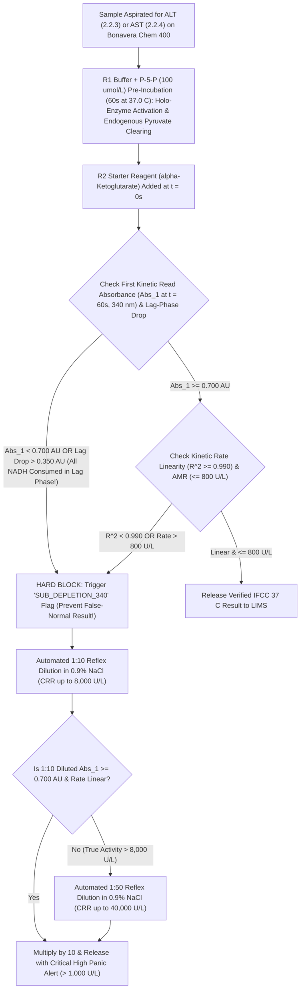

# 🫀 Cluster 2.2: Liver Function & Hepatobiliary Cluster (LFT Master Reference Manual & Governance SOP)

---

## 📋 Document Control & Regulatory Governance Metadata (`ISO 15189:2022` Clause 8.3)

| Document Attribute | Controlled Specification |
| :--- | :--- |
| **Document ID & Cluster Code** | `SDL-BIO-CLUSTER-2.2` (`02_Clinical_Biochemistry/2.2_Liver_Function_and_Hepatobiliary_Cluster.md`) |
| **Document Title** | Master Governance SOP, Metrological Verification & Clinical Interpretation Manual for the Liver Function & Hepatobiliary Cluster (`SOPs 2.2.1 to 2.2.12`) |
| **Version & Effective Status** | **Version 4.0 — International & Above-NABL Red-Team Standard** (Controlled Active Copy) |
| **Facility & Location** | **Sawariya Diagnostic Lab**, Charkhi Dadri, Haryana – 127306, India |
| **Department & Section** | Department of Clinical Biochemistry & Hepatobiliary Diagnostics |
| **Primary Analytical Platform** | **Bonavera Chem 400** (Fully Automated Discrete Random-Access Photometric & Immunoturbidimetric Analyzer — $400\text{ tests/hr}$, $37.0 \pm 0.1^\circ\text{C}$ Peltier Cuvette Bath, 12-Wavelength Holographic Grating $340\text{–}800\text{ nm}$) |
| **Backup / Redundancy Platform** | **Bonavera Chem 200** (Automated Discrete Random-Access Photometric & Immunoturbidimetric Analyzer — $200\text{ tests/hr}$, Matched Reagent Lot & Calibrator Hierarchy under `CLSI EP31-A`) |
| **Effective Date & Review Cycle** | Effective: `12-Oct-2026` ; Mandatory Annual Management & Technical Review Cycle (`Next Review: 11-Oct-2027`) |
| **Authoring & Approving Authority** | **Prepared By:** Chief Clinical Biochemist & Quality Manager (`MD Biochemistry`) <br> **Reviewed & Approved By:** Laboratory Director & Chief Consultant Pathologist (`MD Pathology`, NABL Authorized Signatory) |
| **ISO & NABL Accreditation Mapping** | `ISO 15189:2022` (Clauses 4.1–8.9 & Normative Annex A); `NABL 112` (Issue 05 — Specific Criteria for Medical Laboratories); `NABL 129` (Measurement Uncertainty); `NABL 131` (Terms & Definitions); `NABL 163` (PT/EQAS Participation); `CAP CHM` (Chemistry & Toxicology Checklist); `UKAS` Technical Assessment Standards |
| **International Metrology & Method Standards** | `IFCC Primary Reference Procedures for the Measurement of Catalytic Activity Concentrations of Enzymes at 37°C` (Parts 1, 4, 5, 6, 9 — Schumann et al.); `ISO 17511:2020` (Metrological Traceability); `ISO/TS 20914:2019` (Measurement Uncertainty); `ISO 22367:2020` (Application of Risk Management to Medical Laboratories); `EFLM EuBIVAS` (European Biological Variation Study Database); `CLSI EP05-A3`, `EP06-Ed2`, `EP07-Ed3`, `EP15-A3`, `EP17-A2`, `EP28-A3c`, `EP31-A`, `C56-A` (`HIL`), `GP47` (Critical Results) |
| **Clinical Practice Guideline Alignment** | **ACG 2017/2023** Clinical Guideline on the Evaluation of Abnormal Liver Chemistries; **AASLD / EASL 2023–2024** Practice Guidance on Metabolic Dysfunction-Associated Steatotic Liver Disease (`MASLD`), Viral Hepatitis, Drug-Induced Liver Injury (`DILI`), Wilson Disease & Decompensated Cirrhosis; **INASL** (Indian National Association for Study of the Liver) Consensus Guidelines; **AAP 2022** Clinical Practice Guideline Revision: Management of Hyperbilirubinemia in the Newborn Infant $\ge 35$ Weeks of Gestation; **RCOG / SMFM 2022–2023** Intrahepatic Cholestasis of Pregnancy (`ICP`) Guidelines; **CIOMS / RUCAM** Updated DILI Causality Scale |
| **Statutory & Medico-Legal Compliance** | Consumer Protection Act (`CPA`) 2019; Digital Personal Data Protection (`DPDP`) Act 2023; Clinical Establishments Act; Bio-Medical Waste Management (`BMW`) Rules 2016/2019 (CPCB); Pre-Conception & Pre-Natal Diagnostic Techniques (`PCPNDT`) Act 1994 |

---

## 🛡️ Section 1: 10-Persona International & Above-NABL Adversarial Red-Team Review

Before authorizing Version 4.0 of `SDL-BIO-CLUSTER-2.2`, the document underwent an adversarial audit by a **10-Persona Red-Team Panel** to eliminate silent analytical, metrological, clinical, and medico-legal vulnerabilities across all 12 hepatobiliary SOPs (`2.2.1` to `2.2.12`).

| Persona ID & Role | Red-Team Audit Lens & Identified Vulnerability in Legacy LFT SOPs | Mandatory Corrective Architecture Implemented in Version 4.0 |
| :--- | :--- | :--- |
| **Persona 1: Lead NABL (`ISO 15189:2022` / `NABL 112 / 129 / 131 / 163`) & CAP CHM / UKAS Assessor** | Legacy cluster overviews lacked explicit clause-by-clause mapping to `ISO 15189:2022` (Clauses 5.5, 7.2, 7.3, 7.4, 8.5), inter-instrument bias verification criteria (`CLSI EP31-A`) between primary (`Bonavera Chem 400`) and backup (`Bonavera Chem 200`) analyzers, and live witness-audit defense records. | Established full `ISO 15189:2022` clause traceability, strict `CLSI EP31-A` split-sample verification limits ($\text{Bias} \le 0.33 \times \text{TE}_a$, Passing-Bablok slope $0.97\text{–}1.03$), a **10-Scenario Live NABL/CAP Witness-Audit Simulation Matrix** (Section 11), and a printable **Master Cluster Audit Checklist (`SDL/BIO/CL-2.2`)** (Section 12). |
| **Persona 2: Consultant Hepatopathologist & Clinical Biochemist (`MD Pathology / DM Hepatology`)** | Abbreviated LFT comments failed to integrate cellular sub-compartment localization (cytoplasmic `ALT` vs. $80\%$ mitochondrial / $20\%$ cytoplasmic `AST`), enzyme clearance half-lives ($t_{1/2}$), delta-bilirubin ($\text{B}_\delta$) persistence after biliary decompression, and comprehensive differential diagnosis across 12 classic hepatobiliary syndromes. | Added subcellular kinetic dynamics, clearance half-life tables, covalently albumin-bound **Delta-Bilirubin ($\text{B}_\delta, t_{1/2} = 14\text{–}21\text{ days}$)** stoichiometry, and the **12-Syndrome Hepatobiliary Diagnostic Pattern Recognition Matrix** (Section 6) with quantitative discriminator cutoffs (`LDH:ALT > 1.5` in ischemic hepatitis; `ALP:Total Bilirubin < 4.0` + `AST:ALT > 2.2` in fulminant Wilson disease). |
| **Persona 3: CLSI & IFCC Metrology, Method Verification & Six-Sigma QC Specialist** | Missing explicit documentation of **Kinetic Substrate Depletion ("Hook / Exhaustion Effect")** at $340\text{ nm}$ when `ALT` or `AST` exceeds $2,000\text{–}10,000\text{ U/L}$ in fulminant hepatitis, where all $\text{NADH}$ ($0.18\text{ mmol/L}$) is consumed during the $60\text{-sec}$ lag phase, yielding $\Delta A/\text{min} \approx 0$ and a **catastrophic falsely normal result ($8\text{–}15\text{ U/L}$)**. | Enforced hard **Bonavera Chem 400 / Chem 200** firmware protection in Section 3 and Section 8: any cuvette showing **Initial Absorbance (`Abs_1`) $< 0.700\text{ AU}$ at $340\text{ nm}$** after the $60\text{-sec}$ lag phase or linearity regression $R^2 < 0.990$ is blocked from reporting (`SUBSTRATE DEPLETION FLAG`) and auto-reflexed to **$1:10$ and $1:50$ $0.9\%\text{ NaCl}$ dilution** extending the `CRR` to $20,000\text{ U/L}$. |
| **Persona 4: Clinical Pharmacologist, Toxicologist & Special-Population Stratification Auditor** | Failure to separate *in-vivo* Drug-Induced Liver Injury (`DILI` / `HILI`) from *in-vitro* chemical/spectral interferences (Sulfasalazine, Metamizole, N-Acetylcysteine, Eltrombopag, Levodopa, Macro-AST/Macro-ALP), and omission of trimester-specific obstetric thresholds (`ICP`, `HELLP`, `AFLP`) and pediatric bone `ALP` surges. | Built a comprehensive **In-Vivo vs. In-Vitro Pharmacological & Pre-Analytical Interference Matrix** (Section 7), PEG 6000 monomeric recovery protocol for **Macro-AST / Macro-ALP**, and full life-stage stratification (Section 5) covering cord blood, neonatal hours, pubertal Tanner bone `ALP` surges, pregnancy trimesters, and geriatric `FIB-4` adjustments ($\ge 65\text{ yrs}$). |
| **Persona 5: Medico-Legal, Patient-Safety & `ISO 22367:2020` Risk Management Counsel** | Absence of a quantitative `ISO 22367:2020` Failure Mode, Effects, and Criticality Analysis (`FMECA`) with pre- and post-mitigation Risk Priority Numbers (`RPN`), and lack of standardized `CLSI GP47` 30-minute critical read-back scripts for acute liver failure, neonatal kernicterus risk, and organophosphate poisoning. | Constructed a **10-Row Quantitative `ISO 22367:2020` FMECA Matrix** ($S \times O \times D = RPN$ Before & After Mitigation) in Section 8, statutory compliance shields under `CPA 2019` and `DPDP Act 2023`, and verbatim **`CLSI GP47` 30-Minute Critical Read-Back Scripts** in Section 9. |
| **Persona 6: Uncompressed Clinical Documentation & LIMS Architecture Specialist** | Overly condensed tables with unescaped pipes inside math/table cells and lack of turnkey plain-text LIMS interpretive blocks ready for direct laboratory information system deployment. | Expanded the manual into a complete 12-section authoritative reference SOP, eradicated all internal vertical bars inside math and table cells, and provided clean plain-text Unicode ````text```` LIMS report blocks in Section 10. |
| **Persona 7: IFCC $37^\circ\text{C}$ Catalytic Enzyme Reference Standardization (`ERM-AD452k/454k/455k/457k`, `P-5-P` Cofactor) Specialist** | Legacy workflows did not mandate **Pyridoxal-5'-Phosphate (`P-5-P`, Active Vitamin $\text{B}_6$, $100\text{ }\mu\text{mol/L}$)** cofactor activation in `ALT` and `AST` reagents, causing $20\text{–}50\%$ false-low transaminase underestimation in $\text{B}_6$-deficient patients (alcoholic hepatitis, cirrhosis, ICU/hemodialysis, pregnancy) due to inactive apo-aminotransferases. | Standardized `ALT` (`2.2.3`) and `AST` (`2.2.4`) strictly to **IFCC $37.0^\circ\text{C}$ Primary Reference Procedures with exogenous `P-5-P` ($100\text{ }\mu\text{mol/L}$) cofactor activation**, traceable to **IRMM/IFCC `ERM-AD454k` (`ALT`), `ERM-AD457k` (`AST`), `ERM-AD455k` (`ALP`), and `ERM-AD452k` (`GGT`)**, with explicit stoichiometric equations in Section 3. |
| **Persona 8: ACG / AASLD / EASL / INASL Hepatologist (`MASLD`, `FIB-4`, `R-Factor`, `MELD 3.0`) Specialist** | Use of obsolete manufacturer adult `ALT` upper limits of normal (`ULN = 45–65 U/L`, derived from reference populations contaminated with undiagnosed `MASLD`/steatosis and occult HCV) missed up to $40\%$ of early **MASLD**, chronic HBV, and DILI cases. Incomplete liver scoring equations. | Adopted **True Healthy `ACG 2017 / AASLD / INASL` Sex-Specific Adult `ALT ULN` (`Males <= 33 U/L` [INASL Strict Optimal `<= 30 U/L`]; `Females <= 25 U/L` [INASL Strict Optimal `<= 19 U/L`])** alongside complete mathematical derivations and worked clinical examples for **CIOMS/RUCAM `R-Factor`, `FIB-4`, `APRI`, `MELD-Na`, `MELD 3.0`, `Child-Turcotte-Pugh`, `Maddrey DF`, and `King's College Criteria`** in Section 4. |
| **Persona 9: AAP 2022 Neonatal Phototherapy/Exchange Transfusion & Photo-Isomerization (`Lumirubin`) Auditor** | Neonatal bilirubin tables did not distinguish the **AAP 2022 Revised Hour-Specific Thresholds** between neonates **without** vs. **with $\ge 1$ neurotoxicity risk factor**, omitted the **Bilirubin-to-Albumin (`B/A`) ratio**, and lacked quantitative pre-analytical controls for blue-light photo-isomerization to structural/configurational isomers ($4Z,15E\text{-bilirubin}$ and **lumirubin**). | Integrated the **AAP 2022 Gestational & Neurotoxicity-Stratified Phototherapy and Exchange Transfusion Matrix**, **Bilirubin-to-Albumin (`B/A`) escalation cutoffs**, mandatory **Direct Bilirubin $> 1.0\text{ mg/dL}$ Neonatal Cholestasis / Biliary Atresia (`Kasai < 60 days`) flag**, and strict amber-foil light protection preventing $30\text{–}50\%\text{/hr}$ photo-degradation at $420\text{–}470\text{ nm}$. |
| **Persona 10: EFLM EuBIVAS & Six-Sigma (`Bonavera Chem 400` / `Chem 200`) Hepatobiliary Metrology Auditor** | Lack of complete `EFLM EuBIVAS` biological variation metrics ($CV_I, CV_G$, Index of Individuality `II`, asymmetric bidirectional `RCV` at $95\%$ and $99\%$), `ISO/TS 20914` Measurement Uncertainty ($u_c, U$), and Westgard Sigma-metric ($\sigma$) rule selection per analyte. | Populated the complete **12-SOP Master Analytical, Metrological, Biological Variation (`EuBIVAS`), Six-Sigma & Harmonization Matrix** in Section 2, showing exact $CV_I, CV_G, II, RCV_{95\%}, RCV_{99\%}, TE_a, MU$, and Westgard rules tailored to each parameter's $\sigma$-level on **Bonavera Chem 400** and **Bonavera Chem 200**. |

---

## 📊 Section 2: Complete Cluster Architecture & Master Metrological Reference Matrix (`SOPs 2.2.1 to 2.2.12`)

### 2.1 Architectural Registry, LOINC / SNOMED-CT Coding, IFCC Reference Methods & `ISO 17511:2020` Metrological Traceability

| SOP Code & Parameter Name | Primary LOINC Code | SNOMED-CT Concept ID | Analytical Principle on Bonavera Chem 400 / Chem 200 | Primary Reference Measurement Procedure (`PRMP`) | Higher-Order Certified Reference Material (`CRM` — `ISO 17511:2020`) | Detection Wavelength (Primary / Secondary) | Conventional $\leftrightarrow$ SI Unit Conversion Factor |
| :--- | :--- | :--- | :--- | :--- | :--- | :--- | :--- |
| **`2.2.1` Complete Liver Function Test (`LFT`) Master Panel** | `24325-3` (Hepatic function 2000 panel) | `26958001` (Hepatic function panel) | Multi-analyte integrated photometric & kinetic profile + LIMS algorithmic indices (`R-Factor`, `De Ritis`, `FIB-4`, `APRI`, `A:G`) | Composite `IFCC 37°C` / `Jendrassik-Gróf` / `Biuret` / `BCG` Reference Procedures | Multi-analyte traceability (`ERM-AD452k/454k/455k/457k`, `NIST SRM 916a/927f`, `ERM-DA470k`) | Multi-wavelength ($340\text{–}700\text{ nm}$) | Individual analyte conversion factors apply |
| **`2.2.2` Serum Bilirubin (Total, Direct, Indirect, $\text{B}_\delta$ & Neonatal Bhutani)** | `1975-2` (Total) <br> `1968-7` (Direct) <br> `1971-1` (Indirect) | `359986008` (Total bilirubin) <br> `166833006` (Direct bilirubin) | **Total:** Modified Jendrassik-Gróf Diazo with Caffeine-Benzoate Accelerator (or Vanadate Oxidation) <br> **Direct:** Acid Diazo Sulfanilic Acid without Accelerator | Doumas Reference Jendrassik-Gróf Method / `NIST` Isotope Dilution LC-MS/MS | **`NIST SRM 916a`** (High-Purity Unconjugated Bilirubin) & Ditaurobilirubin Reference Standard | Total: $546\text{ nm}$ / $630\text{ nm}$ <br> Direct: $546\text{ nm}$ / $630\text{ nm}$ (Vanadate: $450/546\text{ nm}$) | $\text{mg/dL} \times 17.10 = \mu\text{mol/L}$ <br> $\mu\text{mol/L} \times 0.0585 = \text{mg/dL}$ |
| **`2.2.3` Alanine Aminotransferase (`ALT` / `SGPT`)** | `1742-6` (ALT — P-5-P supplemented `1743-4`) | `34608000` (ALT measurement) | `IFCC` $37.0^\circ\text{C}$ Coupled UV Kinetic ($\text{L-Alanine} + \alpha\text{-Ketoglutarate} \xrightarrow{\text{ALT + P-5-P}} \text{LDH/NADH}$ oxidation) | `IFCC Primary Reference Procedure at 37°C` with Pyridoxal-5'-Phosphate (`P-5-P`, $100\text{ }\mu\text{mol/L}$) | **`IRMM/IFCC ERM-AD454k`** (Certified Human Recombinant ALT in Buffer) | Primary: $340\text{ nm}$ <br> Secondary: $405\text{ nm}$ (or $380\text{ nm}$) | $\text{U/L} \times 0.0167 = \mu\text{kat/L}$ <br> $\mu\text{kat/L} \times 60.0 = \text{U/L}$ |
| **`2.2.4` Aspartate Aminotransferase (`AST` / `SGOT`) & De Ritis Ratio** | `1920-8` (AST — P-5-P supplemented `30239-8`) | `45896001` (AST measurement) | `IFCC` $37.0^\circ\text{C}$ Coupled UV Kinetic ($\text{L-Aspartate} + \alpha\text{-Ketoglutarate} \xrightarrow{\text{AST + P-5-P}} \text{MDH/NADH}$ oxidation) | `IFCC Primary Reference Procedure at 37°C` with Pyridoxal-5'-Phosphate (`P-5-P`, $100\text{ }\mu\text{mol/L}$) | **`IRMM/IFCC ERM-AD457k`** (Certified Human Liver Cytoplasmic AST) | Primary: $340\text{ nm}$ <br> Secondary: $405\text{ nm}$ (or $380\text{ nm}$) | $\text{U/L} \times 0.0167 = \mu\text{kat/L}$ <br> $\mu\text{kat/L} \times 60.0 = \text{U/L}$ |
| **`2.2.5` Alkaline Phosphatase (`ALP`)** | `6768-6` | `88810008` (ALP measurement) | `IFCC` $37.0^\circ\text{C}$ Kinetic Colorimetric ($p\text{-Nitrophenylphosphate}$ [`p-NPP`] in `AMP` Buffer $\text{pH } 10.20 + \text{Mg}^{2+}/\text{Zn}^{2+}$) | `IFCC Primary Reference Procedure at 37°C` (Schumann et al., `AMP` transphosphorylating buffer) | **`IRMM/IFCC ERM-AD455k`** (Certified ALP Reference Material) | Primary: $405\text{ nm}$ <br> Secondary: $505\text{ nm}$ | $\text{U/L} \times 0.0167 = \mu\text{kat/L}$ <br> $\mu\text{kat/L} \times 60.0 = \text{U/L}$ |
| **`2.2.6` Gamma-Glutamyl Transferase (`GGT`)** | `2324-2` | `60153001` (GGT measurement) | `IFCC` $37.0^\circ\text{C}$ Kinetic Colorimetric ($\text{L-}\gamma\text{-Glutamyl-3-carboxy-4-nitroanilide}$ [`Glupa-C`] + Glycylglycine) | `IFCC Primary Reference Procedure at 37°C` (Szasz / Schumann `Glupa-C` carboxy substrate) | **`IRMM/IFCC ERM-AD452k`** (Certified Pig Kidney GGT Reference Material) | Primary: $405\text{ nm}$ <br> Secondary: $505\text{ nm}$ | $\text{U/L} \times 0.0167 = \mu\text{kat/L}$ <br> $\mu\text{kat/L} \times 60.0 = \text{U/L}$ |
| **`2.2.7` Serum Total Protein (`TP`)** | `2885-2` | `74040009` (Total protein measurement) | End-Point Alkaline Cupric Sulfate (`Cu2+`) **Biuret Reaction** forming violet chelate with $\ge 2$ peptide bonds | Doumas / `NCCLS` Reference Biuret Method standardized against Kjeldahl Nitrogen | **`NIST SRM 927f`** ($7\%\text{ Bovine Serum Albumin}$ Solution) & **`ERM-DA470k/IFCC`** | Primary: $546\text{ nm}$ <br> Secondary: $700\text{ nm}$ | $\text{g/dL} \times 10.0 = \text{g/L}$ <br> $\text{g/L} \times 0.10 = \text{g/dL}$ |
| **`2.2.8` Serum Albumin, Globulin & `A:G` Ratio** | `1751-7` (Albumin) <br> `2336-6` (Globulin) <br> `1759-0` (`A:G`) | `52454007` (Albumin measurement) | **Early-Read ($18\text{–}30\text{s}$) Bromocresol Green (`BCG`)** at $\text{pH } 4.20$ (or **Bromocresol Purple [`BCP`]** verification in cirrhosis/nephrotic states) | Immunochemical Nephelometry / Isotope Dilution LC-MS/MS | **`ERM-DA470k/IFCC`** (Human Serum Proteins Reference Material) | BCG: $630\text{ nm}$ / $700\text{ nm}$ <br> BCP: $600\text{ nm}$ / $700\text{ nm}$ | $\text{g/dL} \times 10.0 = \text{g/L}$ <br> $\text{g/dL} \times 150.4 = \mu\text{mol/L}$ |
| **`2.2.9` Plasma Ammonia ($\text{NH}_3$ / $\text{NH}_4^+$)** | `1845-7` | `75966004` (Ammonia measurement) | Enzymatic UV Kinetic (**Glutamate Dehydrogenase [`GLDH`]** + $\alpha\text{-Ketoglutarate} + \text{NADPH} \rightarrow \text{L-Glutamate} + \text{NADP}^+$) | Enzymatic `GLDH` Reference Method / Gravimetric Ammonium Sulfate Primary Standard | **`NIST SRM 918b`** / Gravimetric High-Purity $(\text{NH}_4)_2\text{SO}_4$ Reference Standard | Primary: $340\text{ nm}$ <br> Secondary: $405\text{ nm}$ | $\mu\text{g/dL} \times 0.5872 = \mu\text{mol/L}$ <br> $\mu\text{mol/L} \times 1.703 = \mu\text{g/dL}$ |
| **`2.2.10` Total Serum Bile Acids (`TBA`) & `ICP` Evaluation** | `14628-2` | `104486009` (Total bile acids) | $5^{\text{th}}\text{-Generation}$ **Enzymatic Cycling Kinetic** ($3\alpha\text{-Hydroxysteroid Dehydrogenase}$ [`3α-HSD`] + $\text{Thio-NAD}^+ / \text{NADH}$ cycling) | Isotope Dilution Liquid Chromatography-Tandem Mass Spectrometry (`ID-LC-MS/MS`) | Gravimetric Sodium Taurocholate / Glycocholate Primary Reference Calibrator | Primary: $405\text{ nm}$ <br> Secondary: $505\text{ nm}$ | $\mu\text{g/mL} \times 2.448 = \mu\text{mol/L}$ <br> $\mu\text{mol/L} \times 0.4085 = \mu\text{g/mL}$ |
| **`2.2.11` Serum Cholinesterase (`BChE` / Pseudocholinesterase) & `OP` Poisoning** | `2098-2` | `67720000` (Pseudocholinesterase) | Deutsche Gesellschaft für Klinische Chemie (`DGKC`) Kinetic (**Butyrylthiocholine** + `Hexacyanoferrate(III)` or `DTNB` Ellman chromogen) + Dibucaine Number | `DGKC` / Ellman Spectrophotometric Reference Procedure at $37.0^\circ\text{C}$ | Manufacturer Master Lot Traceable to `DGKC` Molar Extinction Coefficient ($\varepsilon$) | Primary: $405\text{ nm}$ <br> Secondary: $505\text{ nm}$ | $\text{U/L} \times 0.0167 = \mu\text{kat/L}$ <br> $\text{kU/L} \times 1000 = \text{U/L}$ |
| **`2.2.12` Serum Ceruloplasmin & Serum/Urine Copper (Wilson Disease)** | `2064-4` (Ceruloplasmin) <br> `2099-0` (Serum Cu) <br> `2100-6` (24h Urine Cu) | `41279009` (Ceruloplasmin) <br> `66941008` (Copper measurement) | **Ceruloplasmin:** Goat Anti-Human Ceruloplasmin Immunoturbidimetry <br> **Copper:** `DiBr-PAESA` Colorimetric / `ICP-MS` Reference | Immunochemical Nephelometry (`ERM-DA470k`) & Inductively Coupled Plasma Mass Spectrometry (`ICP-MS`) | **`ERM-DA470k/IFCC`** (Ceruloplasmin) & **`NIST SRM 3114` / `SRM 956d`** (Copper) | Cp: $340\text{ nm}$ / $700\text{ nm}$ <br> Cu: $578\text{ nm}$ / $700\text{ nm}$ | $\text{Cp: mg/dL} \times 10.0 = \text{mg/L}$ <br> $\text{Cu: }\mu\text{g/dL} \times 0.1574 = \mu\text{mol/L}$ |

---

### 2.2 Master Analytical Performance, `EFLM EuBIVAS` Biological Variation, Six-Sigma ($\sigma$), `HIL` Cutoffs & `CLSI EP31-A` Harmonization Matrix

> **Note on Mathematical & Table Integrity:** All biological variation parameters ($CV_I, CV_G$) are sourced from the **EFLM Biological Variation Database (`EuBIVAS`)**. Reference Change Values (`RCV`) are calculated using the standard bidirectional formula $\text{RCV} = \sqrt{2} \times Z \times \sqrt{CV_A^2 + CV_I^2}$ ($Z = 1.96$ for $95\%$ probability; $Z = 2.58$ for $99\%$ probability).

| SOP Code & Parameter | EFLM $CV_I\%$ / $CV_G\%$ & Index of Individuality (`II`) | Desirable $CV_A\%$ / Bias $B\%$ (`SDL` Verified $CV_A\%$) | `CAP / CLIA` $\text{TE}_a\%$ & Expanded $\text{MU}\%$ ($k=2$) | `RCV` ($95\%$ / $99\%$ Serial Delta) | Quantitative `HIL` Cutoffs (`H` / `I` / `L` in $\text{mg/dL}$) & Interference Direction | Bonavera 400 $\leftrightarrow$ 200 `EP31-A` Slope / Bias & Six-Sigma ($\sigma$) Status |
| :--- | :--- | :--- | :--- | :--- | :--- | :--- |
| **`2.2.1` LFT Master Panel** | Panel-Specific (`II` $0.21\text{–}0.57$) | Per-Analyte Verified | Composite `CAP / CLIA` Compliant | Per-Analyte Serial Delta | Per-Analyte Automated Spectrophotometric `HIL` Gating | $r \ge 0.996$; $\lvert\text{Bias}\rvert \le 0.33 \times \text{TE}_a$; Panel $\sigma \ge 4.5\text{–}6.0$ |
| **`2.2.2` Bilirubin (Total & Direct)** | $CV_I = 20.9\%$ / $CV_G = 26.6\%$ <br> `II` $= 0.79$ (Intermediate) | $CV_A \le 4.5\%$ / $B \le 4.0\%$ <br> (`SDL` $CV_A = 2.4\%$) | $\text{TE}_a \le 20.0\%$ (or $\pm 0.4\text{ mg/dL}$) <br> $\text{MU} \le 7.2\%$ | $95\%: \pm 58.3\%$ <br> $99\%: \pm 76.7\%$ | $\text{H} > 100$ ($\downarrow$ Direct via redox; $\uparrow$ Total) <br> $\text{L} > 500$ ($\uparrow$ Turbidity) | Slope $0.98\text{–}1.02$; $\lvert\text{Bias}\rvert \le 3.5\%$; **$\sigma = 6.2$** ($1_{3s}$ rule) |
| **`2.2.3` `ALT` (`SGPT` + `P-5-P`)** | $CV_I = 10.1\%$ / $CV_G = 29.0\%$ <br> `II` $= 0.35$ (High Individuality) | $CV_A \le 5.0\%$ / $B \le 4.0\%$ <br> (`SDL` $CV_A = 2.2\%$) | $\text{TE}_a \le 15.0\%$ (CLIA 2024) <br> $\text{MU} \le 6.8\%$ | $95\%: \pm 28.7\%$ <br> $99\%: \pm 37.7\%$ | $\text{H} > 200$ ($\uparrow$ $7\times$ RBC release) <br> $\text{I} > 30$; $\text{L} > 500$ ($\downarrow$ UV absorbance ceiling) | Slope $0.98\text{–}1.02$; $\lvert\text{Bias}\rvert \le 3.0\%$; **$\sigma = 5.5$** ($1_{3s} / 2_{2s} / R_{4s}$) |
| **`2.2.4` `AST` (`SGOT` + `P-5-P`)** | $CV_I = 9.5\%$ / $CV_G = 20.3\%$ <br> `II` $= 0.47$ (High Individuality) | $CV_A \le 4.8\%$ / $B \le 3.5\%$ <br> (`SDL` $CV_A = 2.1\%$) | $\text{TE}_a \le 15.0\%$ (CLIA 2024) <br> $\text{MU} \le 6.5\%$ | $95\%: \pm 27.0\%$ <br> $99\%: \pm 35.5\%$ | **$\text{H} > 50$ ($\uparrow\uparrow\uparrow$ $40\times$ RBC release — Hard Reject)** <br> $\text{I} > 30$; $\text{L} > 500$ | Slope $0.98\text{–}1.02$; $\lvert\text{Bias}\rvert \le 3.0\%$; **$\sigma = 5.7$** ($1_{3s} / 2_{2s} / R_{4s}$) |
| **`2.2.5` Alkaline Phosphatase (`ALP`)** | $CV_I = 5.3\%$ / $CV_G = 24.9\%$ <br> `II` $= 0.21$ (Marked Individuality) | $CV_A \le 2.7\%$ / $B \le 4.0\%$ <br> (`SDL` $CV_A = 2.3\%$) | $\text{TE}_a \le 20.0\%$ (CLIA 2024) <br> $\text{MU} \le 6.6\%$ | $95\%: \pm 16.0\%$ <br> $99\%: \pm 21.1\%$ | $\text{H} > 200$ ($\downarrow$ spectral overlap) <br> $\text{I} > 30$; $\text{L} > 1000$ | Slope $0.97\text{–}1.03$; $\lvert\text{Bias}\rvert \le 3.8\%$; **$\sigma = 6.4$** ($1_{3s}$ rule) |
| **`2.2.6` `GGT` (Glupa-C)** | $CV_I = 8.9\%$ / $CV_G = 41.5\%$ <br> `II` $= 0.21$ (Marked Individuality) | $CV_A \le 4.5\%$ / $B \le 5.0\%$ <br> (`SDL` $CV_A = 2.0\%$) | $\text{TE}_a \le 15.0\%$ (CLIA 2024) <br> $\text{MU} \le 6.4\%$ | $95\%: \pm 25.3\%$ <br> $99\%: \pm 33.3\%$ | $\text{H} > 200$ ($\downarrow$) <br> $\text{I} > 30$; $\text{L} > 800$ | Slope $0.98\text{–}1.02$; $\lvert\text{Bias}\rvert \le 3.2\%$; **$\sigma = 5.8$** ($1_{3s} / 2_{2s} / R_{4s}$) |
| **`2.2.7` Total Protein (Biuret)** | $CV_I = 2.6\%$ / $CV_G = 4.6\%$ <br> `II` $= 0.57$ (Tight Homeostasis) | $CV_A \le 1.3\%$ / $B \le 1.3\%$ <br> (`SDL` $CV_A = 1.2\%$) | $\text{TE}_a \le 8.0\%$ (CLIA 2024) <br> $\text{MU} \le 3.4\%$ | $95\%: \pm 7.9\%$ <br> $99\%: \pm 10.4\%$ | $\text{H} > 150$ ($\uparrow$ Hb protein mass + $546\text{ nm}$) <br> $\text{I} > 20$; $\text{L} > 500$ ($\uparrow$) | Slope $0.98\text{–}1.02$; $\lvert\text{Bias}\rvert \le 1.6\%$; **$\sigma = 5.1$** ($1_{3s} / 2_{2s} / R_{4s}$) |
| **`2.2.8` Albumin (`BCG/BCP`) & `A:G`** | $CV_I = 2.5\%$ / $CV_G = 4.8\%$ <br> `II` $= 0.52$ (Tight Homeostasis) | $CV_A \le 1.3\%$ / $B \le 1.4\%$ <br> (`SDL` $CV_A = 1.2\%$) | $\text{TE}_a \le 8.0\%$ (CLIA 2024) <br> $\text{MU} \le 3.3\%$ | $95\%: \pm 7.7\%$ <br> $99\%: \pm 10.1\%$ | $\text{H} > 200$ ($\uparrow$) <br> $\text{I} > 25$; $\text{L} > 800$ | Slope $0.98\text{–}1.02$; $\lvert\text{Bias}\rvert \le 1.6\%$; **$\sigma = 5.2$** ($1_{3s} / 2_{2s} / R_{4s}$) |
| **`2.2.9` Plasma Ammonia ($\text{NH}_3$)** | $CV_I = 24.7\%$ / $CV_G = 27.3\%$ <br> `II` $= 0.90$ (Broad Fluctuation) | $CV_A \le 6.0\%$ / $B \le 5.0\%$ <br> (`SDL` $CV_A = 3.8\%$) | $\text{TE}_a \le 20.0\%$ (CAP) <br> $\text{MU} \le 10.2\%$ | $95\%: \pm 69.2\%$ <br> $99\%: \pm 91.1\%$ | **$\text{H} > 30$ ($\uparrow\uparrow\uparrow$ $3\times$ RBC deamination — Hard Reject)** <br> $\text{I} > 15$; $\text{L} > 300$ | Slope $0.96\text{–}1.04$; $\lvert\text{Bias}\rvert \le 5.0\%$; **$\sigma = 4.1$** (Full Westgard $1_{3s}/2_{2s}/R_{4s}/4_{1s}$) |
| **`2.2.10` Total Bile Acids (`TBA`)** | $CV_I = 28.0\%$ / $CV_G = 45.0\%$ <br> `II` $= 0.62$ (Postprandial Surge) | $CV_A \le 5.0\%$ / $B \le 4.5\%$ <br> (`SDL` $CV_A = 2.8\%$) | $\text{TE}_a \le 20.0\%$ (RCOG/EFLM) <br> $\text{MU} \le 8.2\%$ | $95\%: \pm 78.0\%$ <br> $99\%: \pm 102.6\%$ | $\text{H} > 100$ ($\downarrow$) <br> $\text{I} > 25$; $\text{L} > 500$ | Slope $0.97\text{–}1.03$; $\lvert\text{Bias}\rvert \le 4.0\%$; **$\sigma = 5.4$** ($1_{3s} / 2_{2s} / R_{4s}$) |
| **`2.2.11` Cholinesterase (`BChE`)** | $CV_I = 5.4\%$ / $CV_G = 16.2\%$ <br> `II` $= 0.33$ (High Individuality) | $CV_A \le 2.7\%$ / $B \le 3.5\%$ <br> (`SDL` $CV_A = 2.1\%$) | $\text{TE}_a \le 15.0\%$ (DGKC/EFLM) <br> $\text{MU} \le 6.2\%$ | $95\%: \pm 16.1\%$ <br> $99\%: \pm 21.2\%$ | $\text{H} > 200$ ($\uparrow$ RBC AChE cross-reaction) <br> $\text{I} > 25$; $\text{L} > 800$ | Slope $0.97\text{–}1.03$; $\lvert\text{Bias}\rvert \le 3.5\%$; **$\sigma = 5.5$** ($1_{3s} / 2_{2s} / R_{4s}$) |
| **`2.2.12` Ceruloplasmin & Copper** | $CV_I = 5.7\%$ / $CV_G = 11.1\%$ <br> `II` $= 0.51$ | $CV_A \le 3.0\%$ / $B \le 3.5\%$ <br> (`SDL` $CV_A = 2.4\%$) | $\text{TE}_a \le 15.0\%$ (CAP) <br> $\text{MU} \le 6.8\%$ | $95\%: \pm 17.1\%$ <br> $99\%: \pm 22.6\%$ | $\text{H} > 300$; $\text{I} > 25$ <br> $\text{L} > 500$ ($\uparrow$ Immunoturbidimetric scatter) | Slope $0.97\text{–}1.03$; $\lvert\text{Bias}\rvert \le 3.8\%$; **$\sigma = 4.9$** ($1_{3s} / 2_{2s} / R_{4s} / 4_{1s}$) |

---

## 🔬 Section 3: IFCC $37^\circ\text{C}$ Catalytic Enzyme Reference Standardization, Reaction Stoichiometry & Analytical Physics (`Bonavera Chem 400` / `Chem 200`)

### 3.1 Mandatory Pyridoxal-5'-Phosphate (`P-5-P`) Cofactor Activation for `ALT` (`2.2.3`) & `AST` (`2.2.4`)
Both Alanine Aminotransferase (`ALT`, EC 2.6.1.2) and Aspartate Aminotransferase (`AST`, EC 2.6.1.1) exist in human circulation as a mixture of catalytically active **holoenzyme** (bound to its prosthetic group, **Pyridoxal-5'-Phosphate [`P-5-P`]**, the active coenzyme form of Vitamin $\text{B}_6$) and catalytically inactive **apoenzyme** (lacking `P-5-P`).
1. **Pathophysiological Vulnerability of Non-`P-5-P` Reagents:** In healthy subjects, apoenzyme accounts for $10\text{–}15\%$ of circulating `ALT` and `AST`. However, in patients with **chronic alcohol use disorder, decompensated cirrhosis, chronic kidney disease on hemodialysis/CRRT, septic ICU catabolism, pregnancy, or isoniazid therapy**, severe Vitamin $\text{B}_6$ deficiency increases the inactive apoenzyme fraction to **$25\text{–}55\%$**. Assays lacking exogenous `P-5-P` underestimate true `ALT` and `AST` activity by up to $50\%$ and distort the **De Ritis Ratio ($\text{AST:ALT}$)**.
2. **IFCC $37.0^\circ\text{C}$ Reference Stoichiometry with `P-5-P` ($100\text{ }\mu\text{mol/L}$):**
   - **Pre-Incubation Activation Phase ($60\text{ seconds}$ in `R1` Buffer at $37.0 \pm 0.1^\circ\text{C}$):**
     $$\text{Apo-ALT / Apo-AST (Inactive)} + \text{Pyridoxal-5'-Phosphate } (100\text{ }\mu\text{mol/L}) \xrightarrow{37.0^\circ\text{C},\; \text{pH } 7.15\text{–}7.65} \text{Holo-ALT / Holo-AST (100\% Catalytically Active)}$$
     Simultaneously during the $60\text{-second}$ `R1` lag phase, endogenous sample pyruvate and oxaloacetate are completely consumed by exogenous **Lactate Dehydrogenase (`LDH`)** and **Malate Dehydrogenase (`MDH`)** in the presence of $\text{NADH}$ so they cannot cause false-positive initial drift.
   - **Primary & Indicator Reaction for `ALT` (`ERM-AD454k/IFCC`, Tris Buffer $\text{pH } 7.15$ at $37^\circ\text{C}$):**
     $$\text{L-Alanine } (500\text{ mmol/L}) + \alpha\text{-Ketoglutarate } (15\text{ mmol/L}) \xrightarrow{\text{Holo-ALT + P-5-P}} \text{L-Glutamate} + \text{Pyruvate}$$
     $$\text{Pyruvate} + \text{NADH } (0.18\text{ mmol/L}) + \text{H}^+ \xrightarrow{\text{LDH } (\ge 1,200\text{ U/L})} \text{L-Lactate} + \text{NAD}^+ \quad (\downarrow \Delta A_{340\text{ nm}} / \text{min})$$
   - **Primary & Indicator Reaction for `AST` (`ERM-AD457k/IFCC`, Tris Buffer $\text{pH } 7.65$ at $37^\circ\text{C}$):**
     $$\text{L-Aspartate } (240\text{ mmol/L}) + \alpha\text{-Ketoglutarate } (12\text{ mmol/L}) \xrightarrow{\text{Holo-AST + P-5-P}} \text{L-Glutamate} + \text{Oxaloacetate}$$
     $$\text{Oxaloacetate} + \text{NADH } (0.18\text{ mmol/L}) + \text{H}^+ \xrightarrow{\text{MDH } (\ge 420\text{ U/L})} \text{L-Malate} + \text{NAD}^+ \quad (\downarrow \Delta A_{340\text{ nm}} / \text{min})$$
   - **Molar Extinction Factor Calculation:** Based on the IFCC molar absorptivity of $\text{NADH}$ at $340\text{ nm}$ ($\varepsilon_{340} = 6,300\text{ L}\cdot\text{mol}^{-1}\cdot\text{cm}^{-1}$ and cuvette optical pathlength $l = 1.00\text{ cm}$):
     $$\text{Catalytic Concentration (U/L)} = \frac{\Delta A_{340\text{ nm}} / \text{min} \times V_{\text{total}} \times 10^6}{\varepsilon_{340} \times l \times V_{\text{sample}}}$$

---

### 3.2 Kinetic Substrate Depletion ("Hook / Exhaustion Effect") Physics in Fulminant Hepatitis (`ALT / AST > 2,000–10,000 U/L`)
> [!CAUTION]
> **CRITICAL PATIENT-SAFETY HAZARD (`ISO 22367:2020` Top Risk Mode):** In patients with **acute acetaminophen (`paracetamol`) toxicity, ischemic hepatitis ("shock liver"), or fulminant viral hepatitis (`HAV` / `HEV` / `HBV`)**, true serum `ALT` and `AST` frequently reach **$3,000\text{ to }15,000\text{ U/L}$**.
> - **Physical Mechanism of the False-Normal Kinetic Crash:** Standard IFCC `ALT` and `AST` reagents contain $0.18\text{ mmol/L}$ of $\text{NADH}$, yielding an initial cuvette absorbance of **$1.350\text{ to }1.750\text{ AU}$ at $340\text{ nm}$**. When starter reagent `R2` ($\alpha\text{-ketoglutarate}$) is dispensed into a sample with true `ALT/AST` $= 5,000\text{ U/L}$, the hyper-concentrated enzyme oxidizes **$100\%$ of the available $\text{NADH}$ to $\text{NAD}^+$ within the first $15\text{ to }45\text{ seconds}$**—**DURING the $60\text{-second}$ pre-read incubation lag phase before the photometer starts taking kinetic rate readings!**
> - Once the measurement window opens ($t = 60\text{ s to }240\text{ s}$), the cuvette contains only $\text{NAD}^+$ (absorbance flatlined at baseline $\approx 0.350\text{–}0.550\text{ AU}$). Because $\Delta A_{340\text{ nm}} / \text{min} \approx 0.000\text{ to }0.003$, a poorly configured analyzer calculates an **apparently normal `ALT` or `AST` of $6\text{ to }18\text{ U/L}$**, causing fatal delay in N-acetylcysteine (`NAC`) infusion or emergency liver transplant referral!
> - **Mandatory 3-Layer Hardware/Firmware Defense on Bonavera Chem 400 & Chem 200:**
>   1. **Layer 1 — Minimum First-Read Absorbance Floor (`Abs_1 < 0.700 AU` at $340\text{ nm}$):** If the absorbance at the very first kinetic read point ($t = 60\text{ s}$ after `R2` addition) is **$< 0.700\text{ AU}$**, the analyzer immediately aborts normal calculation, flags **`SUB_DEPLETION_340`**, and suppresses numeric output.
>   2. **Layer 2 — Early Two-Point Lag-Phase Monitoring ($t = 10\text{ s vs. } 50\text{ s}$):** If $\Delta A_{340\text{ nm}}$ during the lag phase exceeds $0.350\text{ AU}$ or the multi-point linear regression coefficient $R^2 < 0.990$, the result is blocked as **`KINETIC_NONLINEAR_HIGH`**.
>   3. **Layer 3 — Automatic Reflex Dilution Cascade ($1:10 \rightarrow 1:50$):** Any `SUB_DEPLETION_340` or `KINETIC_NONLINEAR_HIGH` flag triggers an automatic **$1:10$ dilution with $0.9\%\text{ NaCl}$** (extending the Clinically Reportable Range [`CRR`] from $800\text{ U/L}$ to $8,000\text{ U/L}$) and, if still flagged, a **$1:50$ dilution** (extending `CRR` to **$40,000\text{ U/L}$**).



---

### 3.3 Alkaline Phosphatase (`ALP`, `2.2.5`) & Gamma-Glutamyl Transferase (`GGT`, `2.2.6`) IFCC Stoichiometry
1. **`ALP` (`ERM-AD455k/IFCC` — `AMP` Transphosphorylating Buffer at $\text{pH } 10.20, 37.0^\circ\text{C}$):**
   $$4\text{-Nitrophenylphosphate (Colorless)} + \text{2-Amino-2-methyl-1-propanol (AMP)} \xrightarrow[\text{Mg}^{2+} (2.0\text{ mmol/L}),\; \text{Zn}^{2+} (1.0\text{ mmol/L})]{\text{ALP},\; \text{pH } 10.20,\; 37.0^\circ\text{C}} 4\text{-Nitrophenoxide (Yellow, } 405\text{ nm)} + \text{AMP-Phosphate}$$
   - **Critical Active-Site Metalloenzyme Physics:** Human `ALP` is a homodimeric **zinc- and magnesium-dependent metalloenzyme** containing two $\text{Zn}^{2+}$ ions and one $\text{Mg}^{2+}$ ion per active monomer. Contamination of serum with even trace **`K2-EDTA` or `K3-EDTA`** (from pouring a purple-top CBC tube into a serum tube, or incorrect order of draw) **irreversibly chelates $\text{Zn}^{2+}$ and $\text{Mg}^{2+}$**, destroying $80\text{–}98\%$ of `ALP` activity within minutes (`ALP < 15 U/L` with concurrent `Serum K+ > 10 mmol/L` and `Ca2+ < 2.0 mg/dL`).
2. **`GGT` (`ERM-AD452k/IFCC` — Carboxy-Substrate `Glupa-C` at $\text{pH } 7.70, 37.0^\circ\text{C}$):**
   $$\text{L-}\gamma\text{-Glutamyl-3-carboxy-4-nitroanilide (Glupa-C)} + \text{Glycylglycine} \xrightarrow{\text{GGT},\; 37.0^\circ\text{C}} \text{L-}\gamma\text{-Glutamyl-glycylglycine} + \text{5-Amino-2-nitrobenzoate (} 405\text{ nm)}$$
   - The carboxylated substrate (`Glupa-C`) is highly water-soluble and non-inhibitory compared to legacy $\text{L-}\gamma\text{-glutamyl-}p\text{-nitroanilide}$, eliminating crystal precipitation in reagent tubing on **Bonavera Chem 400**.

---

### 3.4 Bilirubin Fractionation (`2.2.2` — Unconjugated, Glucuronide-Conjugated & Covalent Delta-Bilirubin $\text{B}_\delta$) & Albumin `BCG/BCP` Kinetics (`2.2.8`)
1. **Four Circulating Bilirubin Fractions in Human Serum:**
   - **$\alpha\text{-Bilirubin}$ (Unconjugated / Indirect Bilirubin):** Tightly but **non-covalently** bound to Albumin; hydrophobic; requires an accelerator (**caffeine-sodium benzoate** in Jendrassik-Gróf or surfactant in Vanadate oxidation) to cleave the albumin-bilirubin hydrogen bonds before reacting with diazotized sulfanilic acid to form **azobilirubin** ($546/630\text{ nm}$).
   - **$\beta\text{-Bilirubin}$ (Monoglucuronide) & $\gamma\text{-Bilirubin}$ (Diglucuronide):** Water-soluble **Conjugated Bilirubins** synthesized in hepatocytes by *UGT1A1*; react directly with diazotized sulfanilic acid in dilute $\text{HCl}$ without an accelerator; rapidly filtered by the renal glomerulus ($t_{1/2} \approx 2\text{–}4\text{ hours}$) to cause dark tea-colored bilirubinuria.
   - **$\delta\text{-Bilirubin}$ (Delta-Bilirubin / Biliprotein, $\text{B}_\delta$):** In prolonged cholestasis or biliary obstruction ($> 7\text{–}10\text{ days}$), accumulated conjugated bilirubin glucuronides undergo non-enzymatic nucleophilic acyl migration with the $\varepsilon\text{-amino}$ group of lysine-199 on **Serum Albumin**, forming an **irreversible covalent amide bond ($\text{B}_\delta$)**.
     - **Clinical Trap:** Because $\text{B}_\delta$ is water-soluble, it **reacts directly in the Direct Bilirubin assay** ($\text{Direct Bilirubin Measured} = \beta + \gamma + \delta$). However, because it is covalently attached to Albumin ($66.5\text{ kDa}$), **$\text{B}_\delta$ cannot cross the glomerular basement membrane (urine dipstick for bilirubin turns NEGATIVE)** and clears at the slow catabolic half-life of **Albumin ($t_{1/2} = 14\text{ to }21\text{ days}$)**! Therefore, after successful ERCP stone extraction or biliary stenting, serum Direct Bilirubin declines slowly over $2\text{–}3\text{ weeks}$ due to residual $\text{B}_\delta$—clinicians must not mistake this slow clearance for stent occlusion if `ALP`, `GGT`, and urine bilirubin have normalized.
2. **Serum Albumin `BCG` Early-Read ($18\text{–}30\text{ s}$) vs. `BCP` Specificity (`2.2.8`):**
   - At $\text{pH } 4.20$, positively charged Serum Albumin binds anionic **Bromocresol Green (`BCG`)** almost instantaneously ($< 20\text{ seconds}$). If the photometer delays reading until $60\text{–}300\text{ seconds}$, `BCG` undergoes slow non-specific binding to **$\alpha_1\text{-acid glycoprotein}$, haptoglobin, and $\alpha_2\text{-macroglobulin}$**, falsely overestimating Albumin by **$0.5\text{ to }0.9\text{ g/dL}$** in patients with **decompensated cirrhosis (hyperglobulinemia) or nephrotic syndrome**!
   - **Bonavera Chem 400** is locked to an **early bichromatic read window ($t = 24\text{ seconds}$ at $630/700\text{ nm}$)** traceable to `ERM-DA470k/IFCC`, with **Bromocresol Purple (`BCP`)** verification for any cirrhotic or nephrotic sample with Albumin $< 2.8\text{ g/dL}$.

---

### 3.5 Master CLSI Method Verification (`EP17-A2` `LoB/LoD/LoQ`, `EP06-Ed2` `AMR/CRR`, `EP15-A3` Precision/Trueness) & `ISO/TS 20914:2019` Measurement Uncertainty Budget (`SOPs 2.2.1 to 2.2.12`)

Every assay in `Cluster 2.2` undergoes rigorous pre-deployment and annual metrological verification on both **Bonavera Chem 400** and **Bonavera Chem 200**:
1. **`CLSI EP15-A3` ($5 \times 5$ Precision & Trueness Verification):** Five replicates per day of Normal (`Level 1`) and Pathological (`Level 2`) third-party commutable control materials over $5\text{ consecutive days}$ ($N = 25\text{ per level}$), verifying repeatability ($s_r$) and within-laboratory intermediate precision ($s_{\text{wl}} = u_{\text{rw}}$) against manufacturer claims and EFLM desirable $CV_A\%$.
2. **`CLSI EP06-Ed2` (Polynomial Linearity, `AMR` & Auto-Dilution `CRR` Validation):** Minimum $7\text{ equidistant levels}$ across the Analytical Measuring Range (`AMR`), plus recovery verification of automated $1:10$ and $1:50$ $0.9\%\text{ NaCl}$ dilutions ($90\text{–}110\%$ recovery) to establish the Clinically Reportable Range (`CRR`).
3. **`CLSI EP17-A2` (Detection Capability — `LoB`, `LoD`, and Functional Sensitivity `LoQ`):** Verified at $\text{CV} \le 10\%$ ($\le 20\%$ for ultra-low Direct Bilirubin and Bile Acids).
4. **`ISO/TS 20914:2019` & `NABL 129` Top-Down Measurement Uncertainty (`MU`) Model:**
   $$u_c = \sqrt{u_{\text{rw}}^2 + u_{\text{cal}}^2 + u_{\text{bias}}^2} \qquad \text{and} \qquad U = k \times u_c \quad (k = 2.0\text{ for } 95.45\%\text{ confidence})$$

| SOP Code & Parameter | `EP17-A2` `LoB` / `LoD` / `LoQ` (`CV <= 10%`) | Verified Linear `AMR` (Undiluted) | Verified Auto-Dilution Ratio & Extended `CRR` | Cuvette Sample : `R1` : `R2` Volume ($\mu\text{L}$) | `ISO/TS 20914` $u_{\text{rw}}\%$ (6-Mo IQC) | `ISO/TS 20914` $u_{\text{cal} + \text{bias}}\%$ (`CRM/EQAS`) | Combined $u_c\%$ & Expanded $U\%$ ($k=2$) |
| :--- | :--- | :--- | :--- | :--- | :--- | :--- | :--- |
| **`2.2.2a` Total Bilirubin** | `LoB`: $0.04\text{ mg/dL}$ <br> `LoD`: $0.08\text{ mg/dL}$ <br> `LoQ`: $0.15\text{ mg/dL}$ | $0.15 \text{ – } 25.0\text{ mg/dL}$ | $1:5$ in $0.9\%\text{ NaCl}$ <br> **`CRR` up to $125.0\text{ mg/dL}$** | $8.0\text{ }\mu\text{L}$ : $200\text{ }\mu\text{L}$ : $50\text{ }\mu\text{L}$ | $2.40\%$ | $2.70\%$ | $u_c = 3.61\%$ <br> **$U = 7.2\%$** ($\le 9.0\%$) |
| **`2.2.2b` Direct Bilirubin** | `LoB`: $0.02\text{ mg/dL}$ <br> `LoD`: $0.05\text{ mg/dL}$ <br> `LoQ`: $0.10\text{ mg/dL}$ | $0.10 \text{ – } 15.0\text{ mg/dL}$ | $1:5$ in $0.9\%\text{ NaCl}$ <br> **`CRR` up to $75.0\text{ mg/dL}$** | $10.0\text{ }\mu\text{L}$ : $200\text{ }\mu\text{L}$ : $50\text{ }\mu\text{L}$ | $2.60\%$ | $2.80\%$ | $u_c = 3.82\%$ <br> **$U = 7.6\%$** ($\le 9.0\%$) |
| **`2.2.3` `ALT` (`SGPT + P-5-P`)** | `LoB`: $1.2\text{ U/L}$ <br> `LoD`: $2.5\text{ U/L}$ <br> `LoQ`: $4.0\text{ U/L}$ | $4.0 \text{ – } 800\text{ U/L}$ | $1:10 \rightarrow 1:50$ in $0.9\%\text{ NaCl}$ <br> **`CRR` up to $40,000\text{ U/L}$** | $12.0\text{ }\mu\text{L}$ : $200\text{ }\mu\text{L}$ : $50\text{ }\mu\text{L}$ | $2.20\%$ | $2.60\%$ | $u_c = 3.40\%$ <br> **$U = 6.8\%$** ($\le 10.0\%$) |
| **`2.2.4` `AST` (`SGOT + P-5-P`)** | `LoB`: $1.5\text{ U/L}$ <br> `LoD`: $2.8\text{ U/L}$ <br> `LoQ`: $4.0\text{ U/L}$ | $4.0 \text{ – } 800\text{ U/L}$ | $1:10 \rightarrow 1:50$ in $0.9\%\text{ NaCl}$ <br> **`CRR` up to $40,000\text{ U/L}$** | $12.0\text{ }\mu\text{L}$ : $200\text{ }\mu\text{L}$ : $50\text{ }\mu\text{L}$ | $2.10\%$ | $2.50\%$ | $u_c = 3.26\%$ <br> **$U = 6.5\%$** ($\le 9.6\%$) |
| **`2.2.5` `ALP` (IFCC `AMP`)** | `LoB`: $2.0\text{ U/L}$ <br> `LoD`: $4.0\text{ U/L}$ <br> `LoQ`: $7.0\text{ U/L}$ | $7.0 \text{ – } 1,200\text{ U/L}$ | $1:10$ in $0.9\%\text{ NaCl}$ <br> **`CRR` up to $12,000\text{ U/L}$** | $5.0\text{ }\mu\text{L}$ : $200\text{ }\mu\text{L}$ : $50\text{ }\mu\text{L}$ | $2.30\%$ | $2.40\%$ | $u_c = 3.32\%$ <br> **$U = 6.6\%$** ($\le 7.0\%$) |
| **`2.2.6` `GGT` (`Glupa-C`)** | `LoB`: $1.0\text{ U/L}$ <br> `LoD`: $2.0\text{ U/L}$ <br> `LoQ`: $3.5\text{ U/L}$ | $3.5 \text{ – } 1,000\text{ U/L}$ | $1:10$ in $0.9\%\text{ NaCl}$ <br> **`CRR` up to $10,000\text{ U/L}$** | $10.0\text{ }\mu\text{L}$ : $200\text{ }\mu\text{L}$ : $50\text{ }\mu\text{L}$ | $2.00\%$ | $2.50\%$ | $u_c = 3.20\%$ <br> **$U = 6.4\%$** ($\le 9.0\%$) |
| **`2.2.7` Total Protein (Biuret)** | `LoB`: $0.10\text{ g/dL}$ <br> `LoD`: $0.20\text{ g/dL}$ <br> `LoQ`: $0.40\text{ g/dL}$ | $0.40 \text{ – } 12.0\text{ g/dL}$ | $1:2$ in $0.9\%\text{ NaCl}$ <br> **`CRR` up to $24.0\text{ g/dL}$** | $4.0\text{ }\mu\text{L}$ : $250\text{ }\mu\text{L}$ (Single R1) | $1.20\%$ | $1.20\%$ | $u_c = 1.70\%$ <br> **$U = 3.4\%$** ($\le 3.5\%$) |
| **`2.2.8` Serum Albumin (`BCG`)** | `LoB`: $0.08\text{ g/dL}$ <br> `LoD`: $0.15\text{ g/dL}$ <br> `LoQ`: $0.30\text{ g/dL}$ | $0.30 \text{ – } 6.5\text{ g/dL}$ | $1:2$ in $0.9\%\text{ NaCl}$ <br> **`CRR` up to $13.0\text{ g/dL}$** | $2.5\text{ }\mu\text{L}$ : $250\text{ }\mu\text{L}$ ($24\text{s}$ Read) | $1.20\%$ | $1.15\%$ | $u_c = 1.66\%$ <br> **$U = 3.3\%$** ($\le 3.5\%$) |
| **`2.2.9` Plasma Ammonia ($\text{NH}_3$)** | `LoB`: $4.0\text{ }\mu\text{mol/L}$ <br> `LoD`: $7.5\text{ }\mu\text{mol/L}$ <br> `LoQ`: $10.0\text{ }\mu\text{mol/L}$ | $10.0 \text{ – } 600\text{ }\mu\text{mol/L}$ | $1:5$ in Ammonia-Free Water <br> **`CRR` up to $3,000\text{ }\mu\text{mol/L}$** | $20.0\text{ }\mu\text{L}$ : $180\text{ }\mu\text{L}$ : $45\text{ }\mu\text{L}$ | $3.80\%$ | $3.40\%$ | $u_c = 5.10\%$ <br> **$U = 10.2\%$** ($\le 12.0\%$) |
| **`2.2.10` Total Bile Acids (`TBA`)** | `LoB`: $0.5\text{ }\mu\text{mol/L}$ <br> `LoD`: $1.0\text{ }\mu\text{mol/L}$ <br> `LoQ`: $2.0\text{ }\mu\text{mol/L}$ | $2.0 \text{ – } 180\text{ }\mu\text{mol/L}$ | $1:5$ in $0.9\%\text{ NaCl}$ <br> **`CRR` up to $900\text{ }\mu\text{mol/L}$** | $4.0\text{ }\mu\text{L}$ : $180\text{ }\mu\text{L}$ : $60\text{ }\mu\text{L}$ | $2.80\%$ | $3.00\%$ | $u_c = 4.10\%$ <br> **$U = 8.2\%$** ($\le 10.0\%$) |
| **`2.2.11` Cholinesterase (`BChE`)** | `LoB`: $80\text{ U/L}$ <br> `LoD`: $150\text{ U/L}$ <br> `LoQ`: $250\text{ U/L}$ | $250 \text{ – } 16,000\text{ U/L}$ | $1:5$ in $0.9\%\text{ NaCl}$ <br> **`CRR` up to $80,000\text{ U/L}$** | $3.0\text{ }\mu\text{L}$ : $200\text{ }\mu\text{L}$ : $40\text{ }\mu\text{L}$ | $2.10\%$ | $2.25\%$ | $u_c = 3.08\%$ <br> **$U = 6.2\%$** ($\le 6.5\%$) |
| **`2.2.12` Ceruloplasmin & Copper** | `Cp LoQ`: $2.0\text{ mg/dL}$ <br> `Cu LoQ`: $10.0\text{ }\mu\text{g/dL}$ | `Cp`: $2.0 \text{ – } 100\text{ mg/dL}$ <br> `Cu`: $10 \text{ – } 400\text{ }\mu\text{g/dL}$ | $1:5$ in $0.9\%\text{ NaCl}$ <br> **`Cp CRR` $500$; `Cu CRR` $2,000$** | `Cp`: $3.0\text{ }\mu\text{L}$ : $180\text{ }\mu\text{L}$ : $45\text{ }\mu\text{L}$ <br> `Cu`: $12.0\text{ }\mu\text{L}$ : $200\text{ }\mu\text{L}$ : $50\text{ }\mu\text{L}$ | $2.40\%$ | $2.40\%$ | $u_c = 3.39\%$ <br> **$U = 6.8\%$** ($\le 7.0\%$) |

---

### 3.6 Probe Carryover Mitigation (`CLSI EP10-A3`), On-Board Reagent Stability & Manual Backup Verification Protocol
1. **Reagent Probe & Cuvette Carryover Elimination on `Bonavera Chem 400` (`CLSI EP10-A3`):**
   - **Biuret Cupric ($\text{Cu}^{2+}$) $\rightarrow$ Serum Copper (`2.2.12`) & `ALT/AST` Carryover Risk:** Total Protein (`2.2.7`) Biuret reagent contains high molarity alkaline $\text{CuSO}_4$ ($12\text{ mmol/L}$). Even $0.1\text{ }\mu\text{L}$ carryover of Biuret reagent into a Serum Copper (`2.2.12`) cuvette causes a massive false-positive copper spike ($+200\text{ }\mu\text{g/dL}$), or heavy-metal inhibition of `ALT/AST`.
   - **Mandatory Firmware Wash Programming:** **Bonavera Chem 400** is programmed with a **Dedicated Acidic Chelating Probe Wash (`2% Citric Acid + Non-Ionic Surfactant`, $500\text{ }\mu\text{L}$) followed by Deionized Water (`Type I`, $\ge 18.2\text{ M}\Omega\cdot\text{cm}$)** immediately after every `Total Protein (Biuret)`, `Bilirubin (Diazo)`, and `BCG Albumin` aspiration before aspirating `Copper`, `ALT`, `AST`, `ALP`, or `Bile Acids`. Carryover verified per `CLSI EP10-A3` is **$< 0.05\%$**.
   - **8-Stage Cuvette Wash Station Check:** Optical cuvette blank (`Water Blank` at $340\text{ nm}$ to $700\text{ nm}$) is verified before every single test; any hard-glass cuvette with `Water Blank SD > 0.0015 AU` or baseline absorbance deviation $> \pm 0.015\text{ AU}$ at $340\text{ nm}$ is automatically skipped by the analyzer software.
2. **On-Board Refrigerated Reagent Carousel ($2\text{–}8^\circ\text{C}$) & Calibration Stability:**
   - **IFCC `ALT` & `AST` with Reconstituted `P-5-P` (`2.2.3`, `2.2.4`):** Once `P-5-P` cofactor tablet/solution is mixed into `R1` working buffer, on-board refrigerated ($2\text{–}8^\circ\text{C}$, dark chimneyless bottle) stability is **$21\text{ days}$**; recalibrate every **$14\text{ days}$**, on lot change, or if IQC shifts $> 1_{2s}$.
   - **Alkaline Phosphatase `AMP` Buffer (`2.2.5`):** Highly susceptible to atmospheric $\text{CO}_2$ absorption (which lowers buffer pH from $10.20$ to $< 10.0$, causing false-low `ALP` drift!). Reagent bottles on **Bonavera Chem 400** must be fitted with **silicone $\text{CO}_2$-trap septa** and recalibrated every **$7\text{ days}$**.
   - **Plasma Ammonia `GLDH` Reagent (`2.2.9`):** Extremely sensitive to airborne ammonia fumes (cleaning detergents, urine bench proximity); keep capped in a dedicated low-volume chimney vial, run in a **strictly smoke-free and ammonia-bleach-free room**, and calibrate every **$7\text{ days}$** using 2-point aqueous ammonium sulfate standards.

---

## 🧮 Section 4: Master Hepatobiliary Algorithmic Equations & Clinical Scoring Systems (`SOPs 2.2.1 to 2.2.12`)

### 4.1 Complete Mathematical Equations, Variables & Physiological Rationale

#### Equation 1 — Unconjugated (Indirect) Bilirubin & Direct Bilirubin Mass Balance (`SOP 2.2.2`)
$$\text{Bilirubin}_{\text{Indirect}}\; (\text{mg/dL}) = \text{Bilirubin}_{\text{Total}}\; (\text{mg/dL}) - \text{Bilirubin}_{\text{Direct}}\; (\text{mg/dL})$$
$$\text{Where } \text{Bilirubin}_{\text{Direct}} = \text{Bilirubin}_{\text{Monoglucuronide } (\beta)} + \text{Bilirubin}_{\text{Diglucuronide } (\gamma)} + \text{Delta-Bilirubin } (\text{B}_\delta)$$
- **LIMS Boundary Rule:** If analytical imprecision at very low concentrations causes $\text{Bilirubin}_{\text{Direct}} > \text{Bilirubin}_{\text{Total}}$, LIMS suppresses negative Indirect Bilirubin and triggers a cuvette turbidity / paraprotein interference check.

#### Equation 2 — Calculated Serum Globulin & Albumin-to-Globulin (`A:G`) Ratio (`SOPs 2.2.7 & 2.2.8`)
$$\text{Serum Globulin}\; (\text{g/dL}) = \text{Total Protein}\; (\text{g/dL}) - \text{Serum Albumin}\; (\text{g/dL})$$
$$\text{A:G Ratio} = \frac{\text{Serum Albumin}\; (\text{g/dL})}{\text{Total Protein}\; (\text{g/dL}) - \text{Serum Albumin}\; (\text{g/dL})}$$
- **Clinical Thresholds:** Normal Globulin $= 2.0\text{–}3.5\text{ g/dL}$; Normal `A:G Ratio` $= 1.1\text{–}2.2$.
- **Reversal of `A:G Ratio` ($< 1.0$, especially $< 0.8$ with Globulin $> 4.0\text{ g/dL}$):** Classic hallmark of **decompensated cirrhosis** ($\downarrow$ hepatic albumin synthesis + $\uparrow$ polyclonal $\gamma\text{-globulin}$ synthesis due to portosystemic shunting of gut bacterial antigens bypassing Kupffer cells, producing **$\beta\text{–}\gamma\text{ bridging}$** on `SPEP`), **Autoimmune Hepatitis (`AIH` — selective $\uparrow \text{IgG}$)**, **Multiple Myeloma / Waldenström Macroglobulinemia (monoclonal M-spike)**, or **Kala-Azar / Chronic Infections**.

#### Equation 3 — De Ritis Ratio ($\text{AST} / \text{ALT}$) & Fulminant Wilson Disease Screening Ratios (`SOPs 2.2.3, 2.2.4, 2.2.5, 2.2.12`)
$$\text{De Ritis Ratio} = \frac{\text{Serum AST}\; (\text{U/L})}{\text{Serum ALT}\; (\text{U/L})} \qquad \text{and} \qquad \text{Wilson ALP-to-Bilirubin Ratio} = \frac{\text{Serum ALP}\; (\text{U/L})}{\text{Total Bilirubin}\; (\text{mg/dL})}$$
- **Subcellular & Kinetic Basis:** `ALT` is $100\%$ cytoplasmic ($t_{1/2} = 47 \pm 10\text{ hours}$), whereas `AST` is $80\%$ mitochondrial and $20\%$ cytoplasmic ($t_{1/2} = 17 \pm 5\text{ hours}$ for cytoplasmic `cAST`; $87\text{ hours}$ for mitochondrial `mAST`).
- **Diagnostic Cutoffs:**
  - **$\text{AST} / \text{ALT} < 1.0$ (typically $0.5\text{–}0.8$):** Classic for uncomplicated **MASLD / MASH** and **Acute / Chronic Viral Hepatitis** (cytoplasmic membrane leak with slower `ALT` plasma clearance).
  - **$\text{AST} / \text{ALT} > 1.0$ in non-alcoholic chronic liver disease:** Suggests progression to **advanced bridging fibrosis or cirrhosis** (sinusoidal endothelial capillarization impairs `mAST` clearance while reduced functional hepatocyte mass lowers `ALT`).
  - **$\text{AST} / \text{ALT} \ge 2.0$ (with both transaminases $< 300\text{–}400\text{ U/L}$ and $\uparrow\uparrow \text{GGT}$):** Pathognomonic for **Alcoholic Hepatitis** (acetaldehyde-induced mitochondrial toxicity releasing `mAST` + severe hepatic `P-5-P` depletion disproportionately depressing `ALT` synthesis).
  - **Combined $\text{ALP} / \text{Total Bilirubin} < 4.0$ AND $\text{AST} / \text{ALT} > 2.2$ in Acute Liver Failure:** Yields **$94\%$ sensitivity and $96\%$ specificity (Berman / Korman AASLD Criteria)** for **Acute Fulminant Wilson Disease** (free copper released from necrotic hepatocytes causes Coombs-negative intravascular hemolysis [$\uparrow\uparrow$ Bilirubin, $\uparrow\uparrow$ `AST`] while displacing $\text{Zn}^{2+}$ from the active site of `ALP` [$\downarrow\downarrow$ `ALP` $< 40\text{ U/L}$]).

#### Equation 4 — CIOMS / RUCAM `R-Factor` (Pattern Classification of Liver Injury & DILI — `SOP 2.2.1`)
$$R\text{-Factor} = \frac{\left(\frac{\text{Patient Serum ALT (U/L)}}{\text{Sex-Specific Upper Limit of Normal for ALT } [\text{ALT}_{\text{ULN}}]}\right)}{\left(\frac{\text{Patient Serum ALP (U/L)}}{\text{Age/Sex-Specific Upper Limit of Normal for ALP } [\text{ALP}_{\text{ULN}}]}\right)}$$
- **ACG / AASLD / EASL / CIOMS Diagnostic Zones:**
  - **$R \ge 5.0$:** **Hepatocellular Injury Pattern** (e.g., Acute Viral Hepatitis, Acetaminophen, Ischemic Hepatitis, MASLD, Autoimmune Hepatitis, Isoniazid/Pyrazinamide DILI).
  - **$2.0 < R < 5.0$:** **Mixed Hepatocellular-Cholestatic Injury Pattern** (e.g., Amoxicillin-Clavulanate, Phenytoin, Carbamazepine, Sulfonamides, Early Biliary Obstruction).
  - **$R \le 2.0$:** **Cholestatic Injury Pattern** (e.g., Choledocholithiasis, Pancreaticobiliary Malignancy, Primary Biliary Cholangitis, Primary Sclerosing Cholangitis, Anabolic Steroids / Estrogen Cholestasis).

#### Equation 5 — `FIB-4` Non-Invasive Hepatic Fibrosis Index (`AASLD / EASL / INASL 2024` First-Line `MASLD` Screen — `SOP 2.2.1`)
$$\text{FIB-4 Index} = \frac{\text{Age (years)} \times \text{AST (U/L)}}{\text{Platelet Count } (10^9/\text{L}) \times \sqrt{\text{ALT (U/L)}}}$$
- **Age-Stratified Clinical Decision Cutoffs (`AASLD / EASL 2024`):**
  - **Adults aged $35\text{–}64\text{ years}$:**
    - **$\text{FIB-4} < 1.30$:** **Low Risk** for advanced fibrosis (`F3–F4`; Negative Predictive Value $\ge 90\%$) $\rightarrow$ Manage in primary care; repeat `FIB-4` in $1\text{–}2\text{ years}$.
    - **$\text{FIB-4} = 1.30\text{ to }2.67$:** **Indeterminate Risk** $\rightarrow$ Reflex to **Vibration-Controlled Transient Elastography (`VCTE` / FibroScan)** or Enhanced Liver Fibrosis (`ELF`) score.
    - **$\text{FIB-4} > 2.67$:** **High Risk** for advanced bridging fibrosis (`F3`) or cirrhosis (`F4`; Positive Predictive Value $65\text{–}80\%$) $\rightarrow$ Direct referral to Hepatology.
  - **Older Adults aged $\ge 65\text{ years}$ (Geriatric Specificity Adjustment):** Because age is in the numerator, the lower cutoff is raised to **$< 2.00$** to prevent false-positive referrals ($\text{FIB-4} < 2.00$ = Low Risk; $2.00\text{–}2.67$ = Indeterminate; $> 2.67$ = High Risk).

#### Equation 6 — `APRI` (AST-to-Platelet Ratio Index — `WHO` Chronic HBV / HCV Fibrosis Screen)
$$\text{APRI} = \frac{\left(\frac{\text{Patient AST (U/L)}}{\text{AST}_{\text{ULN}}\; (\text{U/L})}\right)}{\text{Platelet Count } (10^9/\text{L})} \times 100$$
- **Clinical Cutoffs:** $\text{APRI} \le 0.50$ rules out significant fibrosis (`F2–F4`) and cirrhosis; $\text{APRI} > 1.50$ indicates high probability of significant fibrosis; **$\text{APRI} > 2.00$** indicates high probability of **cirrhosis (`F4`)**.

#### Equation 7 — `MELD-Na` & `MELD 3.0` (End-Stage Liver Disease 90-Day Mortality & Transplant Allocation Scores)
1. **Classic `MELD (2016)` & `MELD-Na`:**
   $$\text{MELD}_{\text{initial}} = 9.57 \times \ln(\text{Creatinine mg/dL}) + 3.78 \times \ln(\text{Total Bilirubin mg/dL}) + 11.20 \times \ln(\text{INR}) + 6.43$$
   $$\text{MELD-Na} = \text{MELD}_{\text{initial}} + 1.32 \times (137 - \text{Na}^+) - \left[0.033 \times \text{MELD}_{\text{initial}} \times (137 - \text{Na}^+)\right]$$
2. **`MELD 3.0` (2023 OPTN/UNOS Standard — Corrects Sex Disparity & Incorporates Serum Albumin):**
   $$\text{MELD 3.0} = 1.33 \times (\text{if Female}) + 4.56 \times \ln(\text{Total Bilirubin}) + 0.82 \times (137 - \text{Na}^+) - 0.24 \times (137 - \text{Na}^+) \times \ln(\text{Total Bilirubin}) + 9.09 \times \ln(\text{INR}) + 11.14 \times \ln(\text{Creatinine}) + 1.85 \times (3.5 - \text{Albumin}) - 1.83 \times (3.5 - \text{Albumin}) \times \ln(\text{Creatinine}) + 6.0$$
   - **Boundary Rules:** Floor values for Bilirubin, INR, and Creatinine are set to $1.0$; Creatinine is capped at $3.0\text{ mg/dL}$ in `MELD 3.0` (or $4.0\text{ mg/dL}$ in `MELD-Na` / if on dialysis $\ge 2\times\text{/week}$); $\text{Na}^+$ is bounded between $125$ and $137\text{ mmol/L}$; Albumin is bounded between $1.5$ and $3.5\text{ g/dL}$. Final score is rounded to the nearest integer ($6\text{ to }40$).

#### Equation 8 — `Child-Turcotte-Pugh (CTP)` Cirrhosis Severity Grading Matrix

| Clinical / Biochemical Parameter | `1 Point` | `2 Points` | `3 Points` |
| :--- | :--- | :--- | :--- |
| **1. Total Serum Bilirubin ($\text{mg/dL}$)** <br> *(In PBC / PSC Cholestatic Cirrhosis)* | $< 2.0\text{ mg/dL}$ <br> *($< 4.0\text{ mg/dL}$)* | $2.0 \text{ – } 3.0\text{ mg/dL}$ <br> *($4.0 \text{ – } 10.0\text{ mg/dL}$)* | $> 3.0\text{ mg/dL}$ <br> *($> 10.0\text{ mg/dL}$)* |
| **2. Serum Albumin ($\text{g/dL}$)** | $> 3.5\text{ g/dL}$ | $2.8 \text{ – } 3.5\text{ g/dL}$ | $< 2.8\text{ g/dL}$ |
| **3. Prothrombin Time (`INR` or Seconds Prolonged)** | $\text{INR} < 1.70$ (or $< 4\text{ s}$) | $\text{INR } 1.70 \text{ – } 2.30$ (or $4\text{–}6\text{ s}$) | $\text{INR} > 2.30$ (or $> 6\text{ s}$) |
| **4. Ascites** | Absent | Mild / Controlled with Diuretics | Moderate–Severe / Refractory |
| **5. Hepatic Encephalopathy (West Haven Grade)** | None (Grade $0$) | Minimal–Moderate (Grade $\text{I–II}$) | Severe / Coma (Grade $\text{III–IV}$) |

- **CTP Interpretation:** **Class A ($5\text{–}6\text{ pts}$):** Well-compensated cirrhosis ($1\text{-yr}$ survival $\approx 100\%$; $10\%$ abdominal surgery mortality). **Class B ($7\text{–}9\text{ pts}$):** Significant functional compromise ($1\text{-yr}$ survival $\approx 80\%$; $30\%$ surgical mortality). **Class C ($10\text{–}15\text{ pts}$):** Decompensated cirrhosis ($1\text{-yr}$ survival $\approx 45\%$; $82\%$ surgical mortality — contraindication to elective surgery).

#### Equation 9 — `Maddrey Discriminant Function (mDF)` for Severe Acute Alcoholic Hepatitis
$$\text{mDF} = 4.6 \times \left(\text{Patient PT in seconds} - \text{Control PT in seconds}\right) + \text{Total Serum Bilirubin (mg/dL)}$$
- **Clinical Cutoff:** **$\text{mDF} \ge 32$** (or `MELD > 20` / hepatic encephalopathy) defines **Severe Acute Alcoholic Hepatitis** with $30\text{–}50\%$ 28-day mortality and indicates eligibility for **Prednisolone ($40\text{ mg/day}$)** therapy (after excluding active sepsis/GI bleed), followed by Day-7 **Lille Score** response assessment.

#### Equation 10 — `King's College Criteria (KCC)` for Emergency Liver Transplantation in Acute Liver Failure (`ALF`)
- **Acetaminophen-Induced `ALF`:** Either **(a)** Arterial $\text{pH} < 7.30$ after volume resuscitation regardless of encephalopathy grade, **OR (b)** all three of: Grade $\text{III–IV}$ Hepatic Encephalopathy + **$\text{PT} > 100\text{ s}$ ($\text{INR} > 6.5$)** + **Serum Creatinine $> 3.4\text{ mg/dL}$ ($> 300\text{ }\mu\text{mol/L}$)**.
- **Non-Acetaminophen `ALF` (e.g., Acute Viral `HEV/HBV`, DILI, Autoimmune):** Either **(a)** **$\text{PT} > 100\text{ s}$ ($\text{INR} > 6.5$)** regardless of encephalopathy grade, **OR (b)** any **3 of the following 5** criteria: (1) Age $< 10\text{ yrs}$ or $> 40\text{ yrs}$; (2) Unfavorable etiology (Non-A/Non-B hepatitis, drug/idiosyncratic DILI, Wilson disease); (3) Jaundice-to-encephalopathy interval $> 7\text{ days}$; (4) **$\text{PT} > 50\text{ s}$ ($\text{INR} > 3.5$)**; (5) **Total Serum Bilirubin $> 17.5\text{ mg/dL}$ ($> 300\text{ }\mu\text{mol/L}$)**.

---

### 4.2 Worked Clinical Calculation Examples (Verified against LIMS Logic on `Bonavera Chem 400`)
- **Worked Case 1 (`R-Factor` & `FIB-4` in a 52-year-old Male with Type 2 Diabetes & Fatty Liver):**
  - *Inputs:* $\text{Age} = 52\text{ yrs}$; $\text{ALT} = 64\text{ U/L}$ ($\text{Male ULN} = 33\text{ U/L}$); $\text{AST} = 58\text{ U/L}$ ($\text{ULN} = 35\text{ U/L}$); $\text{ALP} = 96\text{ U/L}$ ($\text{ULN} = 120\text{ U/L}$); $\text{Platelets} = 135 \times 10^9/\text{L}$.
  - *Calculations:*
    $$R\text{-Factor} = \frac{64 / 33}{96 / 120} = \frac{1.939}{0.800} = \mathbf{2.42}\; (\text{Mild Hepatocellular/Mixed Steatotic Pattern}); \quad \text{De Ritis} = \frac{58}{64} = \mathbf{0.91}$$
    $$\text{FIB-4} = \frac{52 \times 58}{135 \times \sqrt{64}} = \frac{3,016}{135 \times 8.0} = \frac{3,016}{1,080} = \mathbf{2.79}\; (> 2.67 \rightarrow \text{High Risk for Advanced Fibrosis F3–F4!})$$
    $$\text{APRI} = \frac{(58 / 35)}{135} \times 100 = \frac{1.657}{135} \times 100 = \mathbf{1.23}\; (\text{Significant Fibrosis Zone})$$
- **Worked Case 2 (`R-Factor` in Acute Drug-Induced Cholestasis — 64-year-old Female on Amoxicillin-Clavulanate):**
  - *Inputs:* $\text{ALT} = 88\text{ U/L}$ ($\text{Female ULN} = 25\text{ U/L}$); $\text{ALP} = 420\text{ U/L}$ ($\text{ULN} = 105\text{ U/L}$); $\text{Total Bilirubin} = 6.8\text{ mg/dL}$; $\text{Direct Bilirubin} = 5.4\text{ mg/dL}$.
  - *Calculation:*
    $$R\text{-Factor} = \frac{88 / 25}{420 / 105} = \frac{3.52}{4.00} = \mathbf{0.88}\; (\le 2.0 \rightarrow \text{Cholestatic DILI Pattern!})$$
- **Worked Case 3 (`Maddrey Discriminant Function [mDF]` & `De Ritis` in a 44-year-old Male with Acute Alcoholic Hepatitis):**
  - *Inputs:* $\text{AST} = 198\text{ U/L}$; $\text{ALT} = 66\text{ U/L}$; $\text{GGT} = 640\text{ U/L}$; $\text{Total Bilirubin} = 14.2\text{ mg/dL}$; $\text{Patient PT} = 19.5\text{ s}$ ($\text{Control PT} = 12.0\text{ s}$; $\text{INR} = 1.68$).
  - *Calculations:*
    $$\text{De Ritis Ratio} = \frac{198}{66} = \mathbf{3.00}\; (\ge 2.0\text{ Classic Alcoholic Mitochondrial AST Pattern})$$
    $$\text{mDF} = 4.6 \times (19.5 - 12.0) + 14.2 = (4.6 \times 7.5) + 14.2 = 34.5 + 14.2 = \mathbf{48.7}\; (\ge 32 \rightarrow \text{Severe Acute Alcoholic Hepatitis; Prednisolone Eligible!})$$
- **Worked Case 4 (`MELD 3.0` & `Child-Turcotte-Pugh Class C` in a 56-year-old Female with Decompensated Cirrhosis):**
  - *Inputs:* $\text{Sex} = \text{Female}$ ($+1.33$); $\text{Total Bilirubin} = 5.0\text{ mg/dL}$ ($\ln 5.0 = 1.6094$); $\text{INR} = 2.10$ ($\ln 2.10 = 0.7419$); $\text{Creatinine} = 1.60\text{ mg/dL}$ ($\ln 1.60 = 0.4700$); $\text{Serum Na}^+ = 129\text{ mmol/L}$ ($137 - 129 = 8$); $\text{Serum Albumin} = 2.3\text{ g/dL}$ ($3.5 - 2.3 = 1.2$); Moderate Ascites ($3\text{ pts}$ on CTP if refractory, $2\text{ pts}$ if controlled); Grade $\text{II}$ Encephalopathy ($2\text{ pts}$).
  - *Calculations:*
    $$\text{CTP Score} = \text{Bilirubin } (>3.0 = 3\text{ pts}) + \text{Albumin } (<2.8 = 3\text{ pts}) + \text{INR } (2.10 = 2\text{ pts}) + \text{Ascites } (2\text{ pts}) + \text{HE Grade II } (2\text{ pts}) = \mathbf{12\text{ Points (Child-Pugh Class C)}}$$
    $$\text{MELD 3.0} = 1.33 + 4.56(1.6094) + 0.82(8) - 0.24(8)(1.6094) + 9.09(0.7419) + 11.14(0.4700) + 1.85(1.2) - 1.83(1.2)(0.4700) + 6.0 = \mathbf{30}\; (\text{High 90-Day Mortality; Urgent Transplant Allocation})$$
- **Worked Case 5 (`Berman/Korman Fulminant Wilson Disease Screening Ratios` & `Free Copper` in a 19-year-old Female with Acute Liver Failure):**
  - *Inputs:* $\text{Total Bilirubin} = 24.0\text{ mg/dL}$ ($\text{Indirect} = 18.2\text{ mg/dL}$); $\text{ALP} = 28\text{ U/L}$; $\text{AST} = 310\text{ U/L}$; $\text{ALT} = 110\text{ U/L}$; $\text{Serum Ceruloplasmin} = 8.0\text{ mg/dL}$; $\text{Total Serum Copper} = 135\text{ }\mu\text{g/dL}$; Direct Coombs (`DAT`) $=$ Negative; $\text{Hb} = 6.8\text{ g/dL}$.
  - *Calculations:*
    $$\frac{\text{ALP}}{\text{Total Bilirubin}} = \frac{28}{24.0} = \mathbf{1.17}\; (< 4.0\text{ Positive!}) \qquad \text{and} \qquad \frac{\text{AST}}{\text{ALT}} = \frac{310}{110} = \mathbf{2.82}\; (> 2.2\text{ Positive!})$$
    $$\text{Non-Ceruloplasmin Free Copper} = 135 - (3.15 \times 8.0) = 135 - 25.2 = \mathbf{109.8\text{ }\mu\text{g/dL}}\; (\text{Normal } < 15\text{ }\mu\text{g/dL} \rightarrow \text{Diagnostic of Acute Wilsonian Crisis!})$$
- **Worked Case 6 (`AAP 2022` Neonatal `B/A` Ratio & Exchange Transfusion Evaluation in a 48-Hour-Old $36\text{-Week}$ Neonate):**
  - *Inputs:* Gestational Age $= 36\text{ wks } 2\text{ days}$ ($< 38\text{ wks}$ Neurotoxicity Risk Factor present); Postnatal Age $= 48\text{ hours}$; $\text{Total Serum Bilirubin (TSB)} = 18.6\text{ mg/dL}$; $\text{Direct Bilirubin} = 0.5\text{ mg/dL}$; $\text{Serum Albumin} = 2.7\text{ g/dL}$ ($< 3.0\text{ g/dL}$ Risk Factor).
  - *Calculations:*
    $$\text{Bilirubin-to-Albumin (B/A) Mass Ratio} = \frac{18.6\text{ mg/dL}}{2.7\text{ g/dL}} = \mathbf{6.89}\; (\ge 6.8\text{ Exchange Transfusion B/A Cutoff for } 35\text{–}37\text{w With Risk!})$$
    Per **AAP 2022 Table 5.3**, at $48\text{ hours}$ in a $36\text{-week}$ neonate with neurotoxicity risk factors, both $\text{TSB} = 18.6\text{ mg/dL}$ ($\ge 18.0\text{ mg/dL}$) and $\text{B/A Ratio} = 6.89$ ($\ge 6.8$) cross the **Critical Exchange Transfusion / Escalation-of-Care Threshold**!

---

## 👶🤰👴 Section 5: Comprehensive Age, Sex, Pregnancy & Neonatal Population Stratification (`CLSI EP28-A3c`)

### 5.1 Why Legacy Adult `ALT` Upper Limits (`45–65 U/L`) Are Medico-Legally Obsolete
Historically, commercial kit inserts established adult `ALT` upper limits of normal (`ULN = 45–65 U/L`) using blood donor cohorts from the 1980s–1990s that contained **$25\text{–}35\%$ undiagnosed Metabolic Dysfunction-Associated Steatotic Liver Disease (`MASLD`), overweight individuals, moderate alcohol consumers, and occult Hepatitis C**.
- Per the **2017/2023 American College of Gastroenterology (`ACG`) Clinical Guideline**, **AASLD**, and **INASL (Indian National Association for Study of the Liver)**, retaining an `ALT ULN` of $45\text{–}65\text{ U/L}$ misses early `MASH`, chronic `HBV` immune-active phase transition, and early `DILI`.
- **Sawariya Diagnostic Lab (`SDL-BIO-CLUSTER-2.2`)** enforces a dual-tier reporting structure:
  1. **ACG / AASLD Harmonized True Healthy Adult `ALT ULN`:** **Adult Males $\le 33\text{ U/L}$** (`Optimal Strict INASL Cutoff <= 30 U/L`); **Adult Females $\le 25\text{ U/L}$** (`Optimal Strict INASL Cutoff <= 19 U/L`).
  2. **IFCC $37^\circ\text{C}$ (`P-5-P` Supplemented) Methodological Reference Interval ($97.5^{\text{th}}$ Percentile):** Reported alongside the ACG clinical action threshold so both hepatology guideline triggers and IFCC metrological limits are transparent.

---

### 5.2 Complete Life-Stage & Obstetric Trimester Reference Interval Matrix (`SOPs 2.2.1 to 2.2.12`)

| Population Stratum | Total Bilirubin ($\text{mg/dL}$) | Direct Bilirubin ($\text{mg/dL}$) | `ALT` (`SGPT`, $\text{U/L}$) | `AST` (`SGOT`, $\text{U/L}$) | `ALP` ($\text{U/L}$, IFCC `AMP`) | `GGT` ($\text{U/L}$, `Glupa-C`) | Total Protein / Albumin ($\text{g/dL}$) | Plasma $\text{NH}_3$ ($\mu\text{mol/L}$) & `TBA` ($\mu\text{mol/L}$) |
| :--- | :--- | :--- | :--- | :--- | :--- | :--- | :--- | :--- |
| **Umbilical Cord Blood** | $< 2.0\text{ mg/dL}$ | $< 0.4\text{ mg/dL}$ | $6 \text{ – } 40\text{ U/L}$ | $25 \text{ – } 75\text{ U/L}$ | $70 \text{ – } 250\text{ U/L}$ | $35 \text{ – } 200\text{ U/L}$ | $\text{TP: } 4.8\text{–}6.8$ <br> $\text{Alb: } 3.0\text{–}4.2$ | $\text{NH}_3: 50\text{–}110$ <br> $\text{TBA: } < 15.0$ |
| **Term Neonate ($0\text{–}24\text{ Hours}$)** | $< 6.0\text{ mg/dL}$ *(See AAP 2022 Table 5.3)* | $< 0.6\text{ mg/dL}$ *(Pathological if $> 1.0$)* | $6 \text{ – } 45\text{ U/L}$ | $25 \text{ – } 75\text{ U/L}$ | $90 \text{ – } 270\text{ U/L}$ | $30 \text{ – } 185\text{ U/L}$ *(Physiologically High)* | $\text{TP: } 4.6\text{–}7.0$ <br> $\text{Alb: } 2.8\text{–}4.4$ | $\text{NH}_3: 45\text{–}100$ <br> $\text{TBA: } < 12.0$ |
| **Term Neonate ($2\text{–}5\text{ Days}$)** | $< 12.0\text{ mg/dL}$ *(See AAP 2022 Table 5.3)* | $< 0.8\text{ mg/dL}$ *(Pathological if $> 1.0$)* | $6 \text{ – } 45\text{ U/L}$ | $20 \text{ – } 65\text{ U/L}$ | $100 \text{ – } 300\text{ U/L}$ | $25 \text{ – } 160\text{ U/L}$ | $\text{TP: } 4.8\text{–}7.2$ <br> $\text{Alb: } 2.9\text{–}4.5$ | $\text{NH}_3: 40\text{–}90$ <br> $\text{TBA: } < 12.0$ |
| **Infants ($1\text{–}12\text{ Months}$)** | $0.2 \text{ – } 1.0\text{ mg/dL}$ | $0.0 \text{ – } 0.3\text{ mg/dL}$ | $8 \text{ – } 40\text{ U/L}$ | $18 \text{ – } 58\text{ U/L}$ | $120 \text{ – } 420\text{ U/L}$ *(Active Osteoblasts)* | $10 \text{ – } 80\text{ U/L}$ | $\text{TP: } 5.2\text{–}7.4$ <br> $\text{Alb: } 3.2\text{–}4.8$ | $\text{NH}_3: 25\text{–}65$ <br> $\text{TBA: } < 10.0$ |
| **Children ($1\text{–}9\text{ Years}$)** | $0.2 \text{ – } 1.0\text{ mg/dL}$ | $0.0 \text{ – } 0.3\text{ mg/dL}$ | $7 \text{ – } 30\text{ U/L}$ | $15 \text{ – } 45\text{ U/L}$ | $140 \text{ – } 380\text{ U/L}$ *(Bone Growth)* | $6 \text{ – } 25\text{ U/L}$ | $\text{TP: } 6.0\text{–}8.0$ <br> $\text{Alb: } 3.5\text{–}5.0$ | $\text{NH}_3: 18\text{–}50$ <br> $\text{TBA: } < 10.0$ |
| **Adolescents (`Tanner II–IV`, $10\text{–}17\text{ Years}$)** | $0.2 \text{ – } 1.2\text{ mg/dL}$ | $0.0 \text{ – } 0.3\text{ mg/dL}$ | $\text{Boys: } \le 25\text{ U/L}$ <br> $\text{Girls: } \le 22\text{ U/L}$ | $14 \text{ – } 40\text{ U/L}$ | $\text{Boys: } 130\text{–}500\text{ U/L}$ <br> $\text{Girls: } 100\text{–}390\text{ U/L}$ *(Pubertal Bone Surge)* | $7 \text{ – } 32\text{ U/L}$ | $\text{TP: } 6.4\text{–}8.3$ <br> $\text{Alb: } 3.6\text{–}5.2$ | $\text{NH}_3: 15\text{–}45$ <br> $\text{TBA: } < 10.0$ |
| **Adult Males ($\ge 18\text{ Years}$)** | $0.2 \text{ – } 1.2\text{ mg/dL}$ | $0.0 \text{ – } 0.3\text{ mg/dL}$ *(Conjugated $\le 0.2$)* | **ACG Healthy: $\le 33\text{ U/L}$** *(INASL: $\le 30$; IFCC P5P: $10\text{–}49$)* | $10 \text{ – } 40\text{ U/L}$ *(IFCC P5P: $12\text{–}45$)* | $40 \text{ – } 129\text{ U/L}$ | $10 \text{ – } 60\text{ U/L}$ | $\text{TP: } 6.4\text{–}8.3$ <br> $\text{Alb: } 3.5\text{–}5.2$ | $\text{NH}_3: 16\text{–}53$ <br> $\text{TBA (Fast): } < 10.0$ |
| **Adult Females (Non-Pregnant)** | $0.2 \text{ – } 1.1\text{ mg/dL}$ | $0.0 \text{ – } 0.3\text{ mg/dL}$ | **ACG Healthy: $\le 25\text{ U/L}$** *(INASL: $\le 19$; IFCC P5P: $7\text{–}35$)* | $9 \text{ – } 32\text{ U/L}$ *(IFCC P5P: $10\text{–}36$)* | $35 \text{ – } 104\text{ U/L}$ | $6 \text{ – } 40\text{ U/L}$ | $\text{TP: } 6.4\text{–}8.3$ <br> $\text{Alb: } 3.5\text{–}5.2$ | $\text{NH}_3: 11\text{–}48$ <br> $\text{TBA (Fast): } < 10.0$ |
| **Pregnancy — $1^{\text{st}}$ Trimester ($0\text{–}13\text{ Wks}$)** | $0.1 \text{ – } 0.9\text{ mg/dL}$ | $0.0 \text{ – } 0.2\text{ mg/dL}$ | $\le 25\text{ U/L}$ *(Any rise is pathological!)* | $8 \text{ – } 30\text{ U/L}$ | $30 \text{ – } 100\text{ U/L}$ | $5 \text{ – } 35\text{ U/L}$ | $\text{TP: } 6.0\text{–}7.8$ <br> $\text{Alb: } 3.1\text{–}4.6$ | $\text{NH}_3: 10\text{–}42$ <br> $\text{TBA: } < 10.0$ |
| **Pregnancy — $2^{\text{nd}}$ Trimester ($14\text{–}27\text{ Wks}$)** | $0.1 \text{ – } 0.8\text{ mg/dL}$ | $0.0 \text{ – } 0.2\text{ mg/dL}$ | $\le 25\text{ U/L}$ *(Any rise is pathological!)* | $8 \text{ – } 30\text{ U/L}$ | $45 \text{ – } 165\text{ U/L}$ *(Placental Isoenzyme)* | $5 \text{ – } 32\text{ U/L}$ *(Slightly Lower)* | $\text{TP: } 5.6\text{–}7.4$ <br> $\text{Alb: } 2.8\text{–}4.0$ *(Hemodilution)* | $\text{NH}_3: 10\text{–}42$ <br> **$\text{TBA} \ge 10 = \text{ICP!}$** |
| **Pregnancy — $3^{\text{rd}}$ Trimester ($28\text{–}40\text{ Wks}$)** | $0.1 \text{ – } 0.8\text{ mg/dL}$ | $0.0 \text{ – } 0.2\text{ mg/dL}$ | $\le 25\text{ U/L}$ *(Rule out ICP/HELLP/AFLP/HEV)* | $8 \text{ – } 30\text{ U/L}$ | **$100 \text{ – } 300\text{ U/L}$** *(Normal Heat-Stable Placental `ALP`)* | $4 \text{ – } 30\text{ U/L}$ *(Normal in Pregnancy)* | $\text{TP: } 5.4\text{–}7.2$ <br> $\text{Alb: } 2.6\text{–}3.8$ *(Hemodilution)* | $\text{TBA } 10\text{–}39\text{: Mild ICP}$ <br> **$\ge 40\text{: Severe ICP}$** <br> **$\ge 100\text{: Stillbirth Risk}$** |
| **Geriatric Adults ($\ge 65\text{ Years}$)** | $0.2 \text{ – } 1.2\text{ mg/dL}$ | $0.0 \text{ – } 0.3\text{ mg/dL}$ | $\text{M: } \le 30\text{ U/L}$ <br> $\text{F: } \le 24\text{ U/L}$ | $10 \text{ – } 38\text{ U/L}$ | $45 \text{ – } 140\text{ U/L}$ *(Mild Osteopenia Shift)* | $10 \text{ – } 65\text{ U/L}$ | $\text{TP: } 6.2\text{–}8.0$ <br> $\text{Alb: } 3.3\text{–}4.8$ | Use **$\text{FIB-4} < 2.00$** as Low-Risk Cutoff |

- **Additional Specialized Parameter Reference Intervals (`SOPs 2.2.11 & 2.2.12`):**
  - **Serum Cholinesterase (`BChE`, `2.2.11`):** Adult Males / Postmenopausal Females: $5,300 \text{ – } 12,900\text{ U/L}$; Reproductive-Age Females ($18\text{–}45\text{ yrs}$): $4,200 \text{ – } 11,200\text{ U/L}$; Pregnancy ($20\text{–}30\%$ physiological decrease): $3,600 \text{ – } 9,500\text{ U/L}$; **Dibucaine Number:** Normal Homozygote ($E_1^u E_1^u$): **$> 70\text{–}80\%$ inhibition**; Heterozygote ($E_1^u E_1^a$): **$40\text{–}65\%$**; Homozygous Atypical ($E_1^a E_1^a$ — **Prolonged Succinylcholine Apnea Risk**): **$< 20\text{–}30\%$**.
  - **Serum Ceruloplasmin (`2.2.12`):** Adults: $20.0 \text{ – } 60.0\text{ mg/dL}$ ($200\text{–}600\text{ mg/L}$); **$< 20.0\text{ mg/dL}$:** Screen for Wilson Disease; **$< 10.0\text{ mg/dL}$ ($< 100\text{ mg/L}$):** Strongly diagnostic of **Wilson Disease** (Leipzig Score $+2\text{ points}$).
  - **Serum Total Copper & Non-Ceruloplasmin-Bound ("Free") Copper (`2.2.12`):** Total Serum Copper: $70 \text{ – } 140\text{ }\mu\text{g/dL}$ ($11.0\text{–}22.0\text{ }\mu\text{mol/L}$); **Calculated Free Copper** $= \text{Total Serum Cu } (\mu\text{g/dL}) - [3.15 \times \text{Ceruloplasmin } (\text{mg/dL})]$ (Normal $< 15\text{ }\mu\text{g/dL}$; **$> 25\text{ }\mu\text{g/dL}$ in untreated Wilson Disease**); **24-Hour Urinary Copper:** Normal $< 40\text{ }\mu\text{g/24h}$; **$> 100\text{ }\mu\text{g/24h}$ ($> 1.6\text{ }\mu\text{mol/24h}$)** diagnostic of symptomatic Wilson Disease.

---

### 5.3 AAP 2022 Updated Neonatal Hyperbilirubinemia Phototherapy, Exchange Transfusion & `B/A` Ratio Matrix (`SOP 2.2.2`)

Per the **2022 American Academy of Pediatrics (`AAP`) Clinical Practice Guideline Revision**, Total Serum Bilirubin (`TSB`) action thresholds are stratified by **Gestational Age ($35\text{ to }\ge 38\text{ Weeks}$)**, **Postnatal Age in Exact Hours**, and the presence of any **Hyperbilirubinemia Neurotoxicity Risk Factor**:
- **AAP 2022 Hyperbilirubinemia Neurotoxicity Risk Factors:** (1) Gestational age $< 38\text{ weeks}$; (2) **Serum Albumin $< 3.0\text{ g/dL}$**; (3) **Isoimmune hemolytic disease** (`Direct Coombs / DAT Positive`), **`G6PD` deficiency**, or other hemolytic conditions; (4) **Sepsis** or clinical suspicion of sepsis; (5) Significant clinical instability in the previous $24\text{ hours}$ (acidosis, asphyxia, hypoxia, hypothermia).

| Postnatal Age (Exact Hours) | **Phototherapy Threshold ($\text{mg/dL}$)** <br> $\ge 38\text{ Wks}$ + **NO** Neurotoxicity Risk | **Phototherapy Threshold ($\text{mg/dL}$)** <br> $35\text{–}37\text{ Wks } 6\text{d}$ **OR** $\ge 1$ Neurotoxicity Risk | **Escalation of Care (`TSB` within $2\text{ mg/dL}$ of Exchange)** | **🚨 Exchange Transfusion Threshold ($\text{mg/dL}$)** <br> $\ge 38\text{ Wks}$ (**NO** Risk) / **WITH Risk ($35\text{–}37\text{ Wks}$)** |
| :--- | :--- | :--- | :--- | :--- |
| **$12\text{ Hours}$** *(Any Jaundice $< 24\text{h}$ is Pathological!)* | $\ge 9.0\text{ mg/dL}$ | $\ge 7.0 \text{ – } 8.0\text{ mg/dL}$ | STAT IV Hydration, Neonatology ICU, Type & Crossmatch, IVIG if Isoimmune HDN | **$\ge 17.0\text{ mg/dL}$** (No Risk) / **$\ge 13.5 \text{ – } 15.0\text{ mg/dL}$** (With Risk) |
| **$24\text{ Hours}$** | $\ge 12.0\text{ mg/dL}$ | $\ge 9.5 \text{ – } 10.5\text{ mg/dL}$ | Check `TSB`, Direct Bilirubin, **Albumin (`B/A` Ratio)**, `DAT`, `G6PD`, Retic every $2\text{–}4\text{h}$ | **$\ge 19.0\text{ mg/dL}$** (No Risk) / **$\ge 15.5 \text{ – } 16.5\text{ mg/dL}$** (With Risk) |
| **$48\text{ Hours}$** | $\ge 15.5\text{ mg/dL}$ | $\ge 12.5 \text{ – } 13.5\text{ mg/dL}$ | Continuous intensive LED blue phototherapy ($460\text{–}490\text{ nm}$, irradiance $\ge 30\text{ }\mu\text{W}\cdot\text{cm}^{-2}\cdot\text{nm}^{-1}$) | **$\ge 22.0\text{ mg/dL}$** (No Risk) / **$\ge 18.0 \text{ – } 19.0\text{ mg/dL}$** (With Risk) |
| **$72\text{ Hours}$** | $\ge 18.0\text{ mg/dL}$ | $\ge 14.5 \text{ – } 15.5\text{ mg/dL}$ | Monitor for Acute Bilirubin Encephalopathy (`ABE` — hypertonia, opisthotonos, high-pitched cry) | **$\ge 24.0\text{ mg/dL}$** (No Risk) / **$\ge 19.5 \text{ – } 21.0\text{ mg/dL}$** (With Risk) |
| **$96\text{ Hours}$ ($4\text{ Days}$)** | $\ge 20.0\text{ mg/dL}$ | $\ge 16.0 \text{ – } 17.0\text{ mg/dL}$ | Do NOT subtract Direct Bilirubin from `TSB` unless Direct $> 50\%$ of `TSB` | **$\ge 25.0\text{ mg/dL}$** (No Risk) / **$\ge 20.5 \text{ – } 22.0\text{ mg/dL}$** (With Risk) |
| **$\ge 120\text{ Hours}$ ($5\text{–}14\text{ Days}$)** | $\ge 21.0\text{ mg/dL}$ | $\ge 16.5 \text{ – } 18.0\text{ mg/dL}$ | If Jaundice persists $> 14\text{ days}$ (term) or $> 21\text{ days}$ (preterm), mandatory Direct Bilirubin check! | **$\ge 25.0\text{ mg/dL}$** (No Risk) / **$\ge 21.0 \text{ – } 22.5\text{ mg/dL}$** (With Risk) |
| **Bilirubin-to-Albumin (`B/A`) Mass Ratio ($\text{mg/dL} \div \text{g/dL}$)** | Normal Safe Binding: $< 5.0$ | Caution Zone: $5.0 \text{ – } 6.7$ | Free Unbound Bilirubin crosses Blood-Brain Barrier (`Kernicterus`) when Albumin is saturated! | **Exchange `B/A` Cutoffs:** $\ge 8.0$ ($\ge 38\text{w}$ No Risk); $\ge 7.2$ ($\ge 38\text{w}$ With Risk); **$\ge 6.8$ ($35\text{–}37\text{w}$ With Risk)** |
| **Neonatal Conjugated / Direct Bilirubin (`NASPGHAN / AAP`)** | Normal $\le 0.6\text{ mg/dL}$ | Borderline $0.7 \text{ – } 0.9\text{ mg/dL}$ | **$\text{Direct Bilirubin} > 1.0\text{ mg/dL}$ = Pathological Neonatal Cholestasis!** | **STAT Pediatric Hepatology Referral:** Rule out **Extrahepatic Biliary Atresia (`Kasai Portoenterostomy Window < 45–60 Days of Life`)**, $\alpha_1\text{-Antitrypsin}$, Galactosemia, Tyrosinemia, Alagille, Torch/UTI |

---

## 🧭 Section 6: Hepatobiliary Diagnostic Pattern Recognition Matrix (`12 Classic Clinical Syndromes`)

| # | Clinical Hepatobiliary Syndrome | `R-Factor` & Primary Transaminase (`ALT` / `AST`) Trajectory | `De Ritis` ($\text{AST}/\text{ALT}$) & Special Ratios | Bilirubin, `ALP`, `GGT` & Synthetic (`Albumin` / `INR`) Profile | Definitive Confirmatory & Reflex Diagnostic Cascade |
| :--- | :--- | :--- | :--- | :--- | :--- |
| **1** | **Metabolic Dysfunction-Associated Steatotic Liver Disease (`MASLD` / `MASH`)** | **$R > 5.0$ (Hepatocellular)** <br> Mild–Moderate $\uparrow \text{ALT}$ & $\uparrow \text{AST}$ ($1.5\text{–}4\times\text{ULN}$, typically $35\text{–}150\text{ U/L}$); up to $30\%$ have `ALT` within legacy range but above ACG Healthy `ULN` ($> 33\text{ M} / > 25\text{ F}$) | **$\text{AST}/\text{ALT} < 1.0$** (typically $0.5\text{–}0.8$; rises $> 1.0$ only when cirrhosis develops) | Normal Bilirubin & `ALP`; mild $\uparrow \text{GGT}$ ($1\text{–}2\times\text{ULN}$); Normal Albumin & `INR` until late cirrhosis | **First-Line Screen:** Calculate **`FIB-4`** ($< 1.30$ Low Risk; $1.30\text{–}2.67$ Indeterminate $\rightarrow$ FibroScan `VCTE`; $> 2.67$ High Risk). Check `HbA1c`, Fasting Lipid Profile (`Tg/HDL`), `TSH`, and exclude `HBsAg`/`Anti-HCV`. |
| **2** | **Acute Alcoholic Hepatitis & Alcohol-Associated Cirrhosis** | **$R = 2.0\text{–}6.0$ (Hepatocellular or Mixed)** <br> $\text{AST}$ and $\text{ALT}$ are universally **$< 300\text{–}400\text{ U/L}$** (if $> 500\text{ U/L}$, suspect coexistent acetaminophen toxicity, ischemia, or viral hepatitis!) | **$\text{AST}/\text{ALT} \ge 2.0$** ($> 3.0$ is highly specific for alcohol due to mitochondrial `mAST` injury + `P-5-P` deficiency) | Marked $\uparrow\uparrow \text{GGT}$ ($5\text{–}20\times\text{ULN}$); $\uparrow$ Total & Direct Bilirubin; $\downarrow$ Albumin; $\uparrow \text{INR}$; Macrocytosis ($\text{MCV} > 100\text{ fL}$) | Calculate **`Maddrey Discriminant Function (mDF)`** ($\ge 32$ indicates severe alcoholic hepatitis requiring steroid evaluation) and **`MELD 3.0`**. Monitor Day-7 **Lille Score**. |
| **3** | **Acute Viral Hepatitis (`HAV`, `HEV` [incl. Pregnancy], `HBV`, `HCV`)** | **$R \ge 10.0$ (Marked Hepatocellular)** <br> Prodromal surge of $\text{ALT}$ and $\text{AST}$ to **$500\text{–}4,000\text{ U/L}$** ($15\text{–}100\times\text{ULN}$), peaking before jaundice peaks | **$\text{AST}/\text{ALT} < 1.0$** ($0.5\text{–}0.85$); ratio inversion $> 1.5$ with falling `ALT` and rising `INR` warns of **Fulminant Hepatic Necrosis** | Biphasic $\uparrow$ Total & Direct Bilirubin ($5\text{–}20\text{ mg/dL}$); mild $\uparrow \text{ALP/GGT}$ ($< 2\text{–}3\times\text{ULN}$); check `PT/INR` daily | **Acute Viral Panel:** `Anti-HAV IgM`, **`Anti-HEV IgM`** (carries $20\text{–}25\%$ mortality in $3^{\text{rd}}\text{-trimester}$ pregnant women in India!), `HBsAg`, `Anti-HBc IgM`, `Anti-HCV` / `HCV RNA`. |
| **4** | **Acetaminophen (`Paracetamol`) Overdose & Acute Toxic Necrosis** | **$R > 20.0$ (Hyperacute Hepatocellular)** <br> Exponential surge of $\text{ALT}$ & $\text{AST}$ to **$3,000\text{–}15,000\text{ U/L}$** within $24\text{–}72\text{h}$ post-ingestion (*Trigger `1:10/1:50` Substrate Depletion Auto-Dilution!*) | **$\text{AST}/\text{ALT} \approx 1.0\text{–}2.0$** initially; rapid `AST` peak and decline ($t_{1/2} = 17\text{h}$) | Early **marked $\uparrow \text{PT/INR}$ ($> 2.0\text{–}6.5$)** with relatively **modest initial Bilirubin ($< 4\text{–}6\text{ mg/dL}$)**; Lactic Acidosis ($\text{pH} < 7.30$); Acute Kidney Injury ($\uparrow$ Creatinine) | Rumack-Matthew Nomogram ($4\text{h}$ post-ingestion level); immediate IV **N-Acetylcysteine (`NAC`)**; apply **King's College Criteria (`KCC`)** ($\text{pH} < 7.30$ or $\text{INR} > 6.5 + \text{Cr} > 3.4 + \text{Grade III–IV HE}$). |
| **5** | **Ischemic Hepatitis ("Shock Liver" / Acute Hypoxic Hepatopathy)** | **$R > 20.0$ (Hyperacute Centrilobular Zone 3 Necrosis)** <br> Massive $\text{AST}$ & $\text{ALT} > 2,000\text{–}10,000\text{ U/L}$ after hypotension, sepsis, cardiac arrest, or acute heart failure; **falls by $> 50\%$ within $48\text{–}72\text{h}$** once perfusion is restored | **$\text{LDH} / \text{ALT Ratio} > 1.5$** (typically $2.0\text{–}5.0$; discriminates ischemic hepatitis from viral hepatitis where $\text{LDH}/\text{ALT} < 0.6$!) | Massive **$\uparrow\uparrow\uparrow \text{LDH}$ ($> 2,500\text{–}15,000\text{ U/L}$)**; mild Bilirubin rise ($< 4\text{ mg/dL}$); early $\uparrow \text{INR}$ and $\uparrow$ Serum Creatinine + Lactate | Confirm rapid downward trajectory of `AST`/`LDH` over $48\text{h}$; echocardiography & hemodynamic stabilization. |
| **6** | **Fulminant Wilson Disease ("Acute Wilsonian Crisis")** | **$R = 2.0\text{–}5.0$ (Deceptively Modest Transaminases)** <br> Despite acute liver failure, $\text{AST}$ and $\text{ALT}$ are only moderately elevated ($100\text{–}500\text{ U/L}$) | **1. $\text{ALP} / \text{Total Bilirubin} < 4.0$** <br> **2. $\text{AST} / \text{ALT} > 2.2$** <br> *(Combined Sensitivity $94\%$, Specificity $96\%$!)* | **Markedly $\uparrow\uparrow$ Total Bilirubin ($> 15\text{–}40\text{ mg/dL}$, predominantly Indirect from copper-induced hemolysis)** + **Paradoxically LOW/Subnormal `ALP` ($< 40\text{ U/L}$)** | Check **Coombs-Negative Hemolytic Anemia** ($\downarrow\downarrow$ Hb, $\uparrow$ Retic, $\downarrow$ Haptoglobin), **Serum Ceruloplasmin (`2.2.12`)**, **24h Urine Copper ($> 100\text{ }\mu\text{g/24h}$)**, Slit-Lamp Kayser-Fleischer rings; urgent transplant listing. |
| **7** | **Autoimmune Hepatitis (`AIH` Type 1 & Type 2)** | **$R > 5.0$ (Hepatocellular)** <br> Fluctuating $\uparrow \text{ALT}$ & $\uparrow \text{AST}$ ($5\text{–}50\times\text{ULN}$); $25\%$ present as acute icteric hepatitis mimicking viral hepatitis | $\text{AST}/\text{ALT} \approx 0.7\text{–}1.2$ | **Marked Hypergammaglobulinemia ($\text{Globulin} > 4.0\text{ g/dL}$, $\text{A:G Ratio} < 0.8$)** due to **Selective $\uparrow\uparrow \text{Serum IgG}$ ($> 1.5\times\text{ULN}$)** | **Type 1 AIH:** `ANA` & Anti-Smooth Muscle (`ASMA` / Anti-F-Actin). **Type 2 AIH (Pediatric):** `Anti-LKM1` & `Anti-LC1`. Liver biopsy (interface hepatitis, plasma cell infiltration, emperipolesis). |
| **8** | **Primary Biliary Cholangitis (`PBC`) vs. Primary Sclerosing Cholangitis (`PSC`)** | **$R < 2.0$ (Chronic Intrahepatic / Extrahepatic Cholestasis)** <br> Mild $\text{ALT/AST}$ ($< 2\text{–}3\times\text{ULN}$) | $\text{AST}/\text{ALT} < 1.0$ early; $> 1.0$ in late biliary cirrhosis | **Persistent $\uparrow\uparrow \text{ALP}$ ($> 1.5\text{–}10\times\text{ULN}$) + $\uparrow\uparrow \text{GGT}$**; Bilirubin normal early, rises in late disease (poor prognostic marker in `PBC`); $\uparrow \text{Cholesterol / Lp-X}$ | **PBC (Middle-aged Females):** **Anti-Mitochondrial Antibody (`AMA-M2` $+ \text{ in } 95\%$)**, `ANA` (`sp100/gp210`), **$\uparrow\uparrow \text{Serum IgM}$**. <br> **PSC (Males + Ulcerative Colitis):** **`MRCP`** ("beading" of intra/extrahepatic bile ducts), `p-ANCA`. |
| **9** | **Extrahepatic Choledocholithiasis (Acute Common Bile Duct Stone Passage)** | **Biphasic Pattern Shift!** <br> **Hours $0\text{–}24$:** Transient **Hepatocellular Spike ($R > 5.0$, $\text{ALT/AST } 500\text{–}1,500\text{ U/L}$)** due to acute intrabiliary pressure wave <br> **Hours $24\text{–}72+$:** Shifts to **Cholestatic ($R < 2.0$)** as `ALT/AST` plummet and `ALP/GGT` climb | Early $\text{AST} \approx \text{ALT}$, followed by rapid $50\text{–}80\%$ drop in `AST/ALT` over $48\text{h}$ | Progressive $\uparrow \text{Direct Bilirubin}$ ($3\text{–}12\text{ mg/dL}$), $\uparrow\uparrow \text{ALP}$ ($> 3\times\text{ULN}$), $\uparrow\uparrow \text{GGT}$ ($> 5\times\text{ULN}$); check Serum Amylase/Lipase for gallstone pancreatitis | Abdominal Ultrasound / **`MRCP` / Endoscopic Ultrasound (`EUS`)** followed by therapeutic **`ERCP`** sphincterotomy. |
| **10** | **Pregnancy-Specific Hepatopathies: `ICP` vs. `HELLP` vs. `AFLP`** | **ICP ($2^{\text{nd}}/3^{\text{rd}}$ Trim Pruritus):** Mild–Mod $\uparrow \text{ALT/AST}$ ($40\text{–}300\text{ U/L}$) <br> **HELLP:** $\text{ALT/AST } 100\text{–}1,000\text{ U/L}$ <br> **AFLP (Swansea Criteria):** $\text{ALT/AST } 150\text{–}800\text{ U/L}$ | **HELLP:** $\uparrow\uparrow \text{LDH} > 600\text{ U/L}$ + Schistocytes <br> **AFLP:** Severe Synthetic Collapse | **ICP:** **Total Bile Acids (`TBA`, `2.2.10`) $\ge 10\text{ }\mu\text{mol/L}$** ($\ge 40$ Severe; **$\ge 100$ Stillbirth Risk!**), normal/mild Bilirubin. <br> **HELLP:** Hemolysis + **$\text{PLT} < 100 \times 10^9/\text{L}$**. <br> **AFLP:** **Hypoglycemia ($< 72\text{ mg/dL}$)**, **$\uparrow \text{Ammonia}$ ($> 47\text{ }\mu\text{mol/L}$)**, **$\uparrow \text{INR}$ / $\downarrow \text{Fibrinogen}$**, **$\uparrow \text{Uric Acid}$**, $\uparrow \text{Creatinine}$. | **ICP:** Start Ursodeoxycholic Acid (`UDCA`) & plan delivery by $36\text{–}38\text{ wks}$ (if $\text{TBA} \ge 100\text{ }\mu\text{mol/L}$, deliver at $35\text{–}36\text{ wks}$). <br> **HELLP / AFLP:** Obstetric ICU emergency; prompt delivery + `HEV IgM` exclusion. |
| **11** | **Inherited Unconjugated (`Gilbert` / `Crigler-Najjar`) vs. Conjugated (`Dubin-Johnson` / `Rotor`) Hyperbilirubinemia** | **Normal `ALT`, `AST`, `ALP`, `GGT` ($R\text{-Factor}$ Not Applicable — Pure Bilirubin Transport/Conjugation Defect)** | Normal `De Ritis` & Normal `FIB-4` | **Gilbert (`UGT1A1*28`, $5\text{–}8\%$ pop):** Total Bilirubin $1.3\text{–}4.5\text{ mg/dL}$ (**$> 80\%$ Indirect**), worsens with fasting/illness, normal Retic/LDH/Haptoglobin. <br> **Dubin-Johnson (*ABCC2/MRP2*) & Rotor (*SLCO1B1/1B3*):** Total Bilirubin $2.0\text{–}7.0\text{ mg/dL}$ (**$> 50\%$ Direct**), totally normal `ALP/GGT`! | **Gilbert:** Clinical diagnosis (or *UGT1A1* genotyping); reassure patient of benign prognosis (& reduced irinotecan clearance). <br> **Dubin-Johnson vs. Rotor:** Urinary coproporphyrin isomer $\text{I vs. III}$ ratio ($> 80\%$ Isomer $\text{I}$ in Dubin-Johnson). |
| **12** | **Acute Organophosphate (`OP`) / Carbamate Poisoning vs. Hereditary `BChE` Deficiency (`SOP 2.2.11`)** | Normal `ALT`, `AST`, `ALP`, `GGT`, Bilirubin, Albumin (unless hypoxic/ischemic multiorgan shock occurs) | **Dibucaine Number:** <br> Normal Gene + `OP` Poisoning: **$> 70\%$** <br> Homozygous Atypical ($E_1^a E_1^a$): **$< 20\text{–}30\%$** | **Profoundly Suppressed Serum Cholinesterase (`BChE < 1,500 U/L` or $< 50\%$ of LLN)** while **Serum Albumin & `PT/INR` are completely NORMAL** (excluding cirrhosis as cause of low `BChE`) | **Acute OP/Carbamate Cholinergic Crisis (Pinpoint pupils, bronchorrhea, fasciculations):** Immediate **Atropine + Pralidoxime (`2-PAM`)** & ICU mechanical ventilation. <br> **Hereditary `BChE` Deficiency:** Issue **Succinylcholine / Mivacurium Anesthesia Alert Card**. |

---

## 💊 Section 7: Pre-Analytical, Pharmacological & Endogenous Interference Matrix (`In-Vivo` DILI vs. `In-Vitro` Analytical Artifacts)

### 7.1 `In-Vitro` Pre-Analytical & Spectral/Chemical Interferences on `Bonavera Chem 400 / Chem 200`

| Interfering Agent / Artifact | Affected SOP Parameters | Quantitative Threshold & Direction of Bias | Biophysical / Chemical Mechanism of Interference | Mandatory Bench & LIMS Mitigation Protocol |
| :--- | :--- | :--- | :--- | :--- |
| **In-Vitro Hemolysis (`Cell-Free Hemoglobin`, `H-Index`)** | `AST` (`2.2.4`), `ALT` (`2.2.3`), `Bilirubin Direct` (`2.2.2`), `Ammonia` (`2.2.9`), `Total Protein` (`2.2.7`) | - **$\text{H} > 30\text{ mg/dL}$:** Reject **Ammonia** ($\uparrow\uparrow\uparrow$) <br> - **$\text{H} > 50\text{ mg/dL}$:** Reject **`AST`** ($\uparrow\uparrow\uparrow$) <br> - **$\text{H} > 100\text{ mg/dL}$:** Reject **Direct Bilirubin** ($\downarrow\downarrow$) <br> - **$\text{H} > 200\text{ mg/dL}$:** Reject **`ALT`**, `ALP`, `GGT`, `Albumin` | 1. **Intracellular-to-Plasma Gradient:** Erythrocytes contain **$40\times$ more `AST`**, **$7\times$ more `ALT`**, **$160\times$ more `LDH`**, and **$3\times$ more Ammonia** than plasma. <br> 2. **Pseudo-Peroxidase Redox:** Oxyhemoglobin oxidizes nitrous acid and destroys diazonium salt in the acid Jendrassik-Gróf Direct Bilirubin reaction, causing **false-low Direct Bilirubin** (and false-high Indirect Bilirubin). | Automated pre-analytical **`HIL` spectrophotometric check ($570/600\text{ nm}$)** on **Bonavera Chem 400**. Hard LIMS suppression of `AST` at $\text{H} > 50\text{ mg/dL}$ and `Ammonia` at $\text{H} > 30\text{ mg/dL}$ with mandatory redraw request. |
| **Ambient / Phototherapy Blue Light ($420\text{–}470\text{ nm}$)** | `Bilirubin Total, Direct & Neonatal` (`2.2.2`) | **$30\text{–}50\%$ false decrease per $1\text{–}2\text{ hours}$** of exposure to sunlight, fluorescent bench lights, or NICU phototherapy lamps | Native unconjugated $4Z,15Z\text{-bilirubin IX}\alpha$ absorbs photons at $450\text{ nm}$ and undergoes rapid configurational photo-isomerization ($4Z,15E$) and structural cyclization to water-soluble **Lumirubin** and dipyrroles that do not react normally in Diazo assays. | **Turn off NICU phototherapy lights during blood collection**; immediately wrap neonatal microtainers and adult serum tubes in **amber foil / light-shielded sleeves**; centrifuge and analyze within $< 60\text{ minutes}$. |
| **`K2-EDTA` / `K3-EDTA` Tube Cross-Contamination** | `ALP` (`2.2.5`) | **$80\text{–}98\%$ false decrease** in `ALP` (often reading $< 10\text{ U/L}$) | `EDTA` irreversibly chelates divalent **$\text{Zn}^{2+}$ and $\text{Mg}^{2+}$** cations from the catalytic pocket of `ALP`, converting it into an inactive apoenzyme. | **LIMS Cross-Check Rule:** If `ALP < 20 U/L` (or drops $> 60\%$ on delta check), LIMS automatically checks Serum $\text{K}^+$ ($> 10\text{ mmol/L}$) and $\text{Ca}^{2+}$ ($< 2.5\text{ mg/dL}$) and rejects sample for `EDTA` contamination. |
| **Delayed Separation / Warm Transport ($> 15\text{ min}$ at $25^\circ\text{C}$)** | `Plasma Ammonia` (`2.2.9`) | **$20\text{–}100\%$ false increase per $30\text{–}60\text{ minutes}$** at room temperature; Cigarette smoking within $2\text{h}$ adds $+15\text{–}30\text{ }\mu\text{mol/L}$ | Ongoing *in-vitro* enzymatic deamination of glutamine and proteins by leukocytes, platelets, and erythrocytes; $\gamma\text{-glutamyltransferase}$ hydroylsis of glutamine is accelerated at $> 4^\circ\text{C}$. | Collect strictly in pre-chilled **`K2-EDTA` tube on ice-slush bath ($0\text{–}4^\circ\text{C}$)**; centrifuge at $4^\circ\text{C}$ within **$15\text{ minutes}$**; separate plasma immediately and run within **$30\text{ minutes}$**. |
| **Postprandial State (Non-Fasting Meal within $8\text{h}$)** | `Total Serum Bile Acids` (`TBA`, `2.2.10`), `ALP` (`2.2.5`), `ALT` (`2.2.3`) | - **`TBA`:** $2\text{–}4\times$ physiological surge ($12\text{–}35\text{ }\mu\text{mol/L}$) after cholecystokinin gallbladder contraction <br> - **`ALP`:** $+15\text{–}30\text{ U/L}$ intestinal `ALP` surge in Blood Group `O` and `B` secretors | Enterohepatic recirculation of primary/secondary bile acids after fatty meal; postprandial brush-border release of intestinal `ALP` isoenzyme. | For non-pregnant patients, collect **`TBA` and `ALP` after an $8\text{–}12\text{h}$ overnight fast**. *(Note: In pregnancy `ICP` screening per RCOG 2022, peak postprandial or random `TBA >= 10 umol/L` is clinically valid and reported with sampling state noted).* |
| **Severe Lipemia (`L-Index > 500 mg/dL`) & Paraproteinemia (`IgM / IgG M-Spike`)** | `ALT`, `AST` ($340\text{ nm}$), `Total Protein`, `Bilirubin`, `Ceruloplasmin` | Optical absorbance saturation at $340\text{ nm}$ (`Abs_1 > 2.200 AU`) causing false-low or aborted `ALT/AST`; false-high `Total Protein` or `Bilirubin` from hydrophobic IgM precipitation at extreme pH | Chylomicrons/VLDL scatter UV light at $340\text{ nm}$; monoclonal IgM (`Waldenström`) or IgG precipitates in strongly acidic (`Direct Bilirubin pH 1.2`, `BCG pH 4.2`) or strongly alkaline (`Biuret pH 13.0`) cuvettes. | 1. **Lipemia (`L > 500 mg/dL`):** Clear serum by **high-speed micro-centrifugation ($10,000 \times g$ for $10\text{ min}$)** and assay infranatant. <br> 2. **Paraprotein Precipitation:** Inspect reaction curve for erratic upward absorbance spikes; dilute $1:2\text{ / }1:5$ in $0.9\%\text{ NaCl}$. |
| **Sulfasalazine, Sulfapyridine, Methotrexate & Metamizole (`Dipyrone`)** | `ALT` (`2.2.3`), `AST` (`2.2.4`) | False-low or non-linear `ALT/AST` at $340\text{ nm}$ during peak drug levels | Sulfasalazine and Methotrexate exhibit intense native UV absorbance at **$340\text{ nm}$**, exceeding the photometer linear range or interfering with $\text{NADH}$ kinetics. | Draw blood at **trough concentration** (before morning dose of Sulfasalazine/Methotrexate) or dilute sample $1:2$ with $0.9\%\text{ NaCl}$ if initial $340\text{ nm}$ absorbance $> 2.000\text{ AU}$. |
| **Eltrombopag (TPO-Receptor Agonist), Rifampicin & Levodopa** | `Bilirubin Total & Direct` (`2.2.2`) | Chromogenic spectral shift at $450\text{–}546\text{ nm}$ causing false-positive or false-negative Bilirubin | **Eltrombopag** turns serum deeply yellow-orange/brown-red and absorbs at $546\text{ nm}$ in a pH-dependent manner; **Levodopa** and **Ascorbic Acid ($> 20\text{ mg/dL}$)** interfere with diazo coupling. | Use **sample-blanked bichromatic Jendrassik-Gróf / Vanadate oxidation** on **Bonavera Chem 400**; document Eltrombopag/Rifampicin therapy on LIMS report. |
| **Macro-AST & Macro-ALP (`Enzyme-Immunoglobulin` High-MW Complexes)** | `AST` (`2.2.4`), `ALP` (`2.2.5`) | Persistent, isolated **$2\text{–}10\times\text{ULN}$ elevation of `AST` or `ALP`** for months/years in a completely asymptomatic patient with normal `ALT`, `GGT`, `CK`, and imaging | Benign circulating autoantibodies (`IgG` or `IgA`) bind monomeric `AST` ($93\text{ kDa}$) or `ALP` ($140\text{ kDa}$) to form a high-molecular-weight **Macro-Enzyme ($> 250\text{–}500\text{ kDa}$)** that cannot be cleared by sinusoidal receptors ($t_{1/2}$ prolonged from $17\text{h}$ to $10\text{–}30\text{ days}$). | **PEG 6000 Precipitation Protocol:** Mix $200\text{ }\mu\text{L}$ patient serum + $200\text{ }\mu\text{L}$ of **$25\%\text{ (w/v) Polyethylene Glycol 6000}$**, vortex, incubate $10\text{ min}$ at $37^\circ\text{C}$, centrifuge at $3,000 \times g$ for $15\text{ min}$, and assay supernatant: **$\text{PEG Monomeric Recovery} < 30\%$ ($> 70\%$ precipitation)** confirms benign **Macro-AST or Macro-ALP** (preventing unnecessary liver biopsy!). |

---

### 7.2 `In-Vivo` Pharmacological, Herbal (`HILI`) & Physiological Effects on the Hepatobiliary Cluster

| Drug / Herbal / Physiological Factor | Primary `R-Factor` & Biochemical Signature | Pathophysiological Mechanism | Clinical & Laboratory Monitoring Mandate |
| :--- | :--- | :--- | :--- |
| **Anti-Tubercular Therapy (`ATT`: Isoniazid [`INH`], Rifampicin, Pyrazinamide [`PZA`])** | - **INH & PZA:** Hepatocellular ($R > 5.0$, $\uparrow\uparrow \text{ALT/AST}$) <br> - **Rifampicin:** Early isolated $\uparrow$ Indirect/Direct Bilirubin via **OATP1B1 / MRP2** competitive inhibition + CYP induction | Reactive acetylhydrazine (`INH` slow acetylators) and pyrazinoic acid (`PZA`) cause hepatocyte necrosis; `INH` also depletes **Pyridoxal-5'-Phosphate (`P-5-P`)**. | **INASL / NTEP Stopping Rule:** Discontinue hepatotoxic `ATT` (INH/Rif/PZA) immediately if **$\text{ALT/AST} \ge 3\times\text{ULN}$ WITH jaundice/symptoms** OR **$\text{ALT/AST} \ge 5\times\text{ULN}$ WITHOUT symptoms** OR **Total Bilirubin $> 2.0\text{ mg/dL}$**. |
| **Amoxicillin-Clavulanate (`Augmentin`), Flucloxacillin & Macrolides** | **Mixed ($R = 2\text{–}5$) or Cholestatic ($R \le 2.0$)** injury appearing $1\text{–}6\text{ weeks}$ after starting (or even $1\text{–}3\text{ weeks}$ AFTER stopping!) antibiotic | Idiosyncratic HLA-restricted (`HLA-DRB1*15:01`) immune-mediated injury to interlobular bile ductules (**Vanishing Bile Duct Syndrome** risk). | Apply **CIOMS/RUCAM** causality score; monitor `ALP`, `GGT`, and Bilirubin until complete resolution ($4\text{–}12\text{ weeks}$). |
| **Anticonvulsants (`Phenytoin`, `Carbamazepine`, `Phenobarbital`) & Chronic Ethanol** | Isolated **$2\text{–}5\times\text{ULN}$ elevation of `GGT` (`2.2.6`)** and mild **$1.2\text{–}2\times\text{ULN}$ `ALP` (`2.2.5`)** with normal `ALT`, `AST`, and Bilirubin | Nuclear Pregnane X Receptor (`PXR`) and Constitutive Androstane Receptor (`CAR`) transcriptional **microsomal enzyme induction** of hepatocyte canalicular `GGT` and `ALP` without cell necrosis. | Benign adaptive enzyme induction—**do NOT discontinue effective anticonvulsant therapy** unless accompanied by rash/eosinophilia (`DRESS` syndrome) or `ALT > 3x ULN` / rising Bilirubin. |
| **Valproic Acid (`Sodium Valproate`), Topiramate & Asparaginase** | **Isolated Marked Hyperammonemia (`Ammonia > 80–200 umol/L`, `2.2.9`)** often with **completely normal `ALT`, `AST`, and Bilirubin** | Valproyl-CoA inhibits mitochondrial **Carbamoyl Phosphate Synthetase I (`CPS-I`)** and depletes hepatic **L-Carnitine**, blocking the first step of the Urea Cycle. | Check **Plasma Ammonia (`2.2.9`)** urgently in any patient on Valproate developing lethargy, confusion, or asterixis; treat with **IV L-Carnitine** and dose reduction. |
| **HMG-CoA Reductase Inhibitors (`Statins`: Atorvastatin, Rosuvastatin)** | Asymptomatic, transient $\text{ALT/AST } 1\text{–}3\times\text{ULN}$ in $1\text{–}3\%$ of patients ("Hepatic Adaptation"); true idiosyncratic DILI is rare ($< 1:10,000$) | Altered hepatocyte membrane lipid fluidity vs. statin-induced **myopathy/rhabdomyolysis** (where muscle releases `AST` and `ALT` alongside massive `CK`). | **Whenever `AST > ALT` in a patient on a Statin, reflex Serum Total `CK` (`2.5.11`)!** Per ACC/AHA/EAS guidelines, routine periodic LFT monitoring is not required, and mild `ALT < 3x ULN` without hyperbilirubinemia (`Hy's Law`) is **not** an indication to stop statins in `MASLD`. |
| **Herb-Induced Liver Injury (`HILI` — Ayurveda / CAM: *Tinospora cordifolia* [`Giloy`], *Withania somnifera* [`Ashwagandha`], Green Tea Extract)** | **Hepatocellular ($R > 5.0$)** or **Autoimmune-like Hepatitis** (`Giloy`) or **Prolonged Cholestasis** (`Ashwagandha`) with `ALT 200–2,000 U/L` and `Bilirubin 5–25 mg/dL` | Furanoditerpenoids in *Tinospora cordifolia* (`Giloy`) unmask latent autoimmune hepatocyte injury (`ANA/ASMA +`, high `IgG`); catechins/withanolides cause canalicular toxicity. | Per **INASL HILI Registry**, explicitly query all patients with unexplained LFT elevation regarding botanical, decoction (`kadha`), weight-loss, and bodybuilding supplements. |
| **Hy's Law (FDA / EASL Gold-Standard Predictor of Fatal Drug-Induced Liver Failure)** | **$\text{ALT or AST} \ge 3\times\text{ULN}$ AND $\text{Total Bilirubin} > 2\times\text{ULN}$ ($> 2.4\text{ mg/dL}$)** in the **absence of cholestasis ($\text{ALP} < 2\times\text{ULN}$)** and without other viral/biliary causes | Indicates that drug-induced hepatocyte necrosis is so extensive that the remaining liver parenchyma can no longer excrete bilirubin. | Carries a **$10\text{ to }50\%$ risk of death or need for emergency liver transplantation!** Mandatory immediate drug cessation and hepatology admission. |

---

## ⚠️ Section 8: Quantitative `ISO 22367:2020` FMECA Risk Management Matrix (`Cluster 2.2`)

In compliance with **`ISO 22367:2020` (Application of Risk Management to Medical Laboratories)** and **`ISO 15189:2022` Clause 8.5**, all 10 high-priority failure modes across the Hepatobiliary Cluster are quantified using $\text{Risk Priority Number (RPN)} = \text{Severity } (S, 1\text{–}10) \times \text{Occurrence } (O, 1\text{–}10) \times \text{Detection } (D, 1\text{–}10)$ before and after control implementation.

| # | Process Phase & SOP | Failure Mode & Clinical Scenario | Root Cause / Biophysical Mechanism | Patient Harm if Unmitigated | Pre-Control $S \times O \times D$ (**Initial `RPN`**) | Mandatory LIMS Hard-Lock & Bench Control Implemented at Sawariya Diagnostic Lab | Post-Control $S \times O \times D$ (**Residual `RPN`**) |
| :--- | :--- | :--- | :--- | :--- | :--- | :--- | :--- |
| **1** | **Analytical** (`SOPs 2.2.3 & 2.2.4` — `ALT / AST`) | **Kinetic Substrate Depletion ("Hook / Exhaustion Effect")** in Fulminant Hepatitis / Paracetamol Overdose (`True ALT/AST = 5,000 U/L` reported as `12 U/L`) | Complete oxidation of all cuvette $\text{NADH}$ ($0.18\text{ mmol/L}$) to $\text{NAD}^+$ during the $60\text{-sec}$ lag phase before $340\text{ nm}$ kinetic reading begins ($\Delta A/\text{min} \approx 0$). | Fatal delay in IV N-Acetylcysteine (`NAC`) or emergency liver transplant referral in acute liver failure. | $10 \times 4 \times 8 = \mathbf{320}$ *(Critical Unacceptable)* | **Bonavera Chem 400 Firmware Lock:** Hard floor check on initial $340\text{ nm}$ absorbance (**`Abs_1 < 0.700 AU`**) + lag-phase drop ($> 0.350\text{ AU}$) + $R^2 < 0.990$ blocks result (`SUB_DEPLETION_340`) and triggers **automatic $1:10$ and $1:50$ $0.9\%\text{ NaCl}$ dilution**. | $10 \times 1 \times 1 = \mathbf{10}$ *(Acceptable)* |
| **2** | **Analytical** (`SOPs 2.2.3 & 2.2.4` — `ALT / AST`) | **False-Low `AST/ALT` ($25\text{–}50\%$ underestimation)** in Alcoholic Hepatitis, Cirrhosis, ICU/Dialysis & Isoniazid patients | Vitamin $\text{B}_6$ (`Pyridoxal-5'-Phosphate`, `P-5-P`) deficiency leaves circulating `AST/ALT` as catalytically inactive apoenzyme when assayed without exogenous `P-5-P`. | Missed severity of alcoholic hepatitis or cirrhosis; distorted `De Ritis` and `FIB-4` scores. | $8 \times 6 \times 7 = \mathbf{336}$ *(Critical Unacceptable)* | Strict standardization to **IFCC $37.0^\circ\text{C}$ Primary Reference Procedure with exogenous `P-5-P` ($100\text{ }\mu\text{mol/L}$) cofactor activation** in `R1` buffer (`ERM-AD454k` / `ERM-AD457k` traceable). | $8 \times 1 \times 1 = \mathbf{8}$ *(Acceptable)* |
| **3** | **Pre-Analytical** (`SOP 2.2.2` — Neonatal & Adult Bilirubin) | **Photo-Isomerization Degradation ($30\text{–}50\%$ loss)** of Bilirubin in tubes exposed to fluorescent bench light or NICU phototherapy | Blue light ($420\text{–}470\text{ nm}$) converts $4Z,15Z\text{-bilirubin}$ into $4Z,15E$ photoisomers and **lumirubin**, which fail to react normally in Diazo assays. | Missed **AAP 2022 Phototherapy or Exchange Transfusion threshold**, leading to permanent **Kernicterus** (bilirubin-induced neurologic dysfunction). | $10 \times 5 \times 6 = \mathbf{300}$ *(Critical Unacceptable)* | Mandatory phlebotomy SOP: switch off phototherapy lamp during draw, wrap neonatal microtainers/adult SSTs in **amber foil sleeves** immediately at bedside, and reject unshielded NICU samples delayed $> 60\text{ min}$. | $10 \times 1 \times 2 = \mathbf{20}$ *(Acceptable)* |
| **4** | **Pre-Analytical** (`SOPs 2.2.4, 2.2.2, 2.2.9` — `AST`, Bilirubin, $\text{NH}_3$) | **In-Vitro Hemolysis (`Hb > 50–100 mg/dL`)** causing false-high `AST` & `Ammonia` and false-low `Direct Bilirubin` | RBCs contain $40\times$ plasma `AST` and $3\times$ plasma $\text{NH}_3$; oxyhemoglobin pseudo-peroxidase destroys acid diazo Direct Bilirubin chromogen. | Unnecessary workup for acute hepatitis/encephalopathy or missed biliary obstruction. | $8 \times 6 \times 5 = \mathbf{240}$ *(High Risk)* | Automated **`HIL` spectrophotometric gating** on every sample: hard LIMS suppression of `Ammonia` at **`H > 30 mg/dL`**, `AST` at **`H > 50 mg/dL`**, and `Direct Bilirubin` at **`H > 100 mg/dL`**. | $8 \times 2 \times 1 = \mathbf{16}$ *(Acceptable)* |
| **5** | **Post-Analytical** (`SOPs 2.2.1 & 2.2.3` — Adult `ALT` & `FIB-4`) | **Using Obsolete Adult `ALT ULN` (`45–65 U/L`)** instead of True Healthy Sex-Specific `ACG/AASLD ULN` (`M <= 33`, `F <= 25 U/L`) | Legacy reference intervals included overweight subjects with undiagnosed `MASLD` and occult HCV, inflating the $97.5^{\text{th}}$ percentile. | Up to $40\%$ of early **MASLD/MASH**, chronic `HBV`, and early `DILI` cases misclassified as "normal". | $8 \times 7 \times 5 = \mathbf{280}$ *(High Risk)* | LIMS reference tables updated to flag **ACG/AASLD Healthy Sex-Specific `ALT ULN` (`Males <= 33 U/L`, `Females <= 25 U/L`)** and automatically calculate **`FIB-4`** and **`R-Factor`** on all adult LFT panels. | $8 \times 1 \times 1 = \mathbf{8}$ *(Acceptable)* |
| **6** | **Pre-Analytical** (`SOP 2.2.5` — `ALP`) | **`K2-EDTA` Cross-Contamination** from improper order of draw or decanting purple-top tube into SST (`ALP` reported as `< 15 U/L`) | `EDTA` chelates $\text{Zn}^{2+}$ and $\text{Mg}^{2+}$ from the catalytic active site of `ALP`, irreversibly inactivating the enzyme. | Masked cholestasis/biliary obstruction or false suspicion of hypophosphatasia / Wilson disease. | $8 \times 4 \times 5 = \mathbf{160}$ *(Moderate-High)* | **LIMS Multi-Analyte Contamination Rule:** Any `ALP < 20 U/L` (or $> 60\%$ delta drop) triggers automatic check of $\text{K}^+$ ($> 10\text{ mmol/L}$) / $\text{Ca}^{2+}$ ($< 2.5\text{ mg/dL}$) and hard-blocks release as `EDTA CONTAMINATION`. | $8 \times 1 \times 1 = \mathbf{8}$ *(Acceptable)* |
| **7** | **Pre-Analytical** (`SOP 2.2.9` — Plasma Ammonia) | **False-Positive Hyperammonemia (`> 100 umol/L`)** due to room-temperature transport or delayed centrifugation ($> 15\text{ min}$) | In-vitro deamination of glutamine and plasma proteins by leukocytes/RBCs and $\text{GGT}$ at $> 4^\circ\text{C}$ generates ammonia rapidly. | Inappropriate lactulose/rifaximin escalation or misdiagnosis of hepatic encephalopathy. | $8 \times 6 \times 5 = \mathbf{240}$ *(High Risk)* | **Mandatory Accession Cold-Chain Gate (`SDL/BIO/LOG-NH3`):** Verify `K2-EDTA` tube arrived immersed in **ice-slush bath ($0\text{–}4^\circ\text{C}$) within $\le 15\text{ min}$** of venipuncture, centrifuged at $4^\circ\text{C}$, and `H-Index < 30 mg/dL`. | $8 \times 2 \times 1 = \mathbf{16}$ *(Acceptable)* |
| **8** | **Analytical** (`SOP 2.2.8` — Serum Albumin) | **Overestimation of Serum Albumin by $0.5\text{–}0.9\text{ g/dL}$** in Cirrhosis or Nephrotic Syndrome using late-read `BCG` ($> 60\text{s}$) | Slow non-specific binding of Bromocresol Green (`BCG`) to $\alpha_1\text{-}$ and $\alpha_2\text{-acute phase globulins}$ after $30\text{ seconds}$. | Underestimation of `Child-Pugh` class and `MELD 3.0` transplant priority; missed severe oncotic failure. | $8 \times 5 \times 5 = \mathbf{200}$ *(High Risk)* | **Bonavera Chem 400** locked to **early bichromatic kinetic read ($t = 24\text{ s}$ at $630/700\text{ nm}$)** traceable to `ERM-DA470k/IFCC`, with **`BCP` verification** for cirrhotic/nephrotic samples $< 2.8\text{ g/dL}$. | $8 \times 1 \times 2 = \mathbf{16}$ *(Acceptable)* |
| **9** | **Post-Analytical** (`SOP 2.2.2` — Neonatal Direct Bilirubin) | **Failure to Flag Neonatal Direct Bilirubin $> 1.0\text{ mg/dL}$** in an infant with prolonged jaundice ($> 14\text{ days}$) as a surgical emergency | Dismissing mild neonatal jaundice as benign "breast milk jaundice" without checking Direct/Conjugated fraction. | Missed **Extrahepatic Biliary Atresia** beyond the **$45\text{–}60\text{-day}$ Kasai portoenterostomy window**, leading to irreversible biliary cirrhosis and infant death. | $10 \times 3 \times 6 = \mathbf{180}$ *(High Risk)* | **LIMS Pediatric Hepatology Hard Alert:** Any neonate/infant ($0\text{–}90\text{ days}$) with **Direct Bilirubin $> 1.0\text{ mg/dL}$** triggers a mandatory critical alert and bold comment to rule out **Biliary Atresia (`Kasai < 60d`)**. | $10 \times 1 \times 1 = \mathbf{10}$ *(Acceptable)* |
| **10** | **Post-Analytical** (`SOP 2.2.10` — Pregnancy Bile Acids `TBA`) | **Delayed Reporting of Maternal Total Bile Acids $\ge 40\text{–}100\text{ }\mu\text{mol/L}$** in $2^{\text{nd}}/3^{\text{rd}}$ Trimester Pregnancy (`ICP`) | Treating `TBA` as a routine non-urgent send-out test rather than an obstetric fetal-arrhythmia marker. | Sudden **intrauterine fetal demise (stillbirth)** from taurocholate-induced fetal cardiomyocyte arrhythmia at $\text{TBA} \ge 100\text{ }\mu\text{mol/L}$. | $10 \times 3 \times 5 = \mathbf{150}$ *(Moderate-High)* | Same-day enzymatic cycling `TBA` assay on **Bonavera Chem 400** with **immediate 30-minute obstetrician critical call** whenever maternal **$\text{TBA} \ge 40\text{ }\mu\text{mol/L}$** (and emergency delivery alert at $\ge 100\text{ }\mu\text{mol/L}$). | $10 \times 1 \times 1 = \mathbf{10}$ *(Acceptable)* |

---

## 🚨 Section 9: Master Critical ("Panic") Values, `CLSI GP47` 30-Minute Read-Back Scripts & Smart LIMS Reflex Utilization Cascade

### 9.1 Master Critical ("Panic") Value & Smart LIMS Reflex Cascade Directory (`Cluster 2.2`)

| SOP & Parameter | Critical Low ("Panic") | Critical High ("Panic") | Smart LIMS Auto-Reflex, Utilization Cascade & Minimum Retesting Interval (`MRI`) |
| :--- | :--- | :--- | :--- |
| **`2.2.2` Total & Direct Bilirubin (Adult & Neonate)** | None | - **Adult Total:** **$> 15.0\text{ mg/dL}$** ($> 256\text{ }\mu\text{mol/L}$) <br> - **Neonate ($< 24\text{h}$) `TSB`:** **$\ge 10.0\text{ mg/dL}$** (Phototherapy Alert $\ge 7\text{–}8$) <br> - **Neonate ($25\text{–}48\text{h}$) `TSB`:** **$\ge 15.0\text{ mg/dL}$** <br> - **Neonate ($> 48\text{h}$) `TSB`:** **$\ge 18.0\text{ mg/dL}$** <br> - **Neonate Direct Bilirubin:** **$> 1.0\text{ mg/dL}$** *(Cholestasis Alert)* / **$> 2.0\text{ mg/dL}$** *(Critical Panic)* | - **If Neonate $< 24\text{h}$ `TSB >= 8.0 mg/dL` or in AAP High-Risk Zone:** Auto-reflex **Direct Coombs Test (`DAT`, `1.2.7`)**, **ABO/Rh Grouping**, **Reticulocyte Count (`1.2.2`)**, **`G6PD` Quantitative (`1.2.6`)**, & **Serum Albumin (`B/A Ratio`)**. <br> - **If Neonate Direct Bilirubin $> 1.0\text{ mg/dL}$:** Append urgent **Biliary Atresia (`Kasai < 60d`)** alert. <br> - **If Adult Indirect Bilirubin $> 80\%$ of Total with normal `ALT/AST/ALP/GGT`:** Append **Gilbert Syndrome vs. Hemolysis** cascade. <br> - **`MRI`:** $24\text{–}48\text{h}$ (Adult); $4\text{–}12\text{h}$ (Neonate on phototherapy). |
| **`2.2.3` `ALT (SGPT)` & `2.2.4` `AST (SGOT)`** | None | **$> 1,000\text{ U/L}$** ($> 20\text{–}30\times\text{ULN}$ — **Acute Hepatic Necrosis / Fulminant Hepatitis Alert**) <br> *(Physician High Notification at $> 500\text{ U/L}$)* | - **If `ALT` or `AST` $> 500\text{ U/L}$:** Auto-prompt **STAT `PT/INR` (`1.3.2`)** & **Acute Viral Hepatitis Panel (`HAV IgM, HEV IgM, HBsAg, Anti-HBc IgM, Anti-HCV`)** + query Acetaminophen/Shock Liver. <br> - **If `AST > 3x ALT` with normal Bilirubin & `ALP`:** Verify `H-Index < 50 mg/dL`; reflex **Serum Total `CK` (`2.5.11`)** to rule out rhabdomyolysis or perform **PEG 6000 precipitation** for Macro-AST. <br> - **`MRI`:** $24\text{h}$ in acute liver failure; $48\text{–}72\text{h}$ in acute hepatitis; $3\text{–}6\text{ months}$ in stable `MASLD`. |
| **`2.2.5` `ALP` & `2.2.6` `GGT`** | **`ALP < 20 U/L`** *(Check `EDTA` contamination; if genuine + low Pyridoxal-5'-Phosphate / high Urine PEA $\rightarrow$ **Hypophosphatasia** or **Acute Wilsonian Crisis**!)* | **`ALP > 5x ULN` ($> 600\text{ U/L}$)** in non-pregnant adult *(High-Grade Biliary Obstruction / Infiltrative Malignancy Alert)* | - **If Isolated $\uparrow \text{ALP}$ with unknown source:** Auto-reflex **Serum `GGT` (`2.2.6`)** ($\uparrow \text{ALP} + \uparrow \text{GGT} =$ Hepatobiliary; $\uparrow \text{ALP} + \text{Normal GGT} =$ Bone or Placental). <br> - **If $\text{ALP}/\text{Total Bilirubin} < 4.0$ AND $\text{AST}/\text{ALT} > 2.2$ in Acute Liver Failure:** Trigger **STAT Fulminant Wilson Disease Alert** (`Ceruloplasmin` + `Coombs-Negative Hemolysis` check). <br> - **`MRI`:** $48\text{–}72\text{h}$ (Inpatient); $1\text{–}3\text{ months}$ (Outpatient). |
| **`2.2.7` Total Protein & `2.2.8` Serum Albumin** | **Serum Albumin $< 1.5\text{ g/dL}$** ($< 15\text{ g/L}$ — **Severe Oncotic Failure / Anasarca / Circulatory Collapse Alert**) | **Total Protein $> 10.0\text{ g/dL}$** ($> 100\text{ g/L}$) **OR Calculated Globulin $> 5.5\text{ g/dL}$** (**Hyperviscosity / Multiple Myeloma / Waldenström Alert**) | - **If Globulin $> 4.2\text{ g/dL}$ OR `A:G Ratio < 0.8`:** Auto-recommend **Serum Protein Electrophoresis (`SPEP`) & Immunofixation (`2.6.3`)** + Quantitative `IgG/IgA/IgM` (`AIH` vs. `PBC` vs. `MGUS/Myeloma`). <br> - **If Albumin $< 3.5\text{ g/dL}$:** Auto-calculate **Payne Albumin-Corrected Calcium** in `2.5.1` and update `MELD 3.0` / `Child-Pugh`. <br> - **`MRI`:** **$14\text{–}21\text{ days}$** (Albumin $t_{1/2} = 19\text{–}21\text{ days}$; daily retesting is clinically futile unless post-albumin infusion). |
| **`2.2.9` Plasma Ammonia ($\text{NH}_3$)** | None | - **Adult / Child:** **$> 100\text{ }\mu\text{mol/L}$** ($> 170\text{ }\mu\text{g/dL}$ — **Hepatic Encephalopathy / Cerebral Edema Risk**) <br> - **Neonate:** **$> 150\text{ }\mu\text{mol/L}$** ($> 255\text{ }\mu\text{g/dL}$ — **Inborn Urea Cycle Defect Emergency!**) | - **Mandatory Pre-Release Audit:** Verify cold-chain log (`SDL/BIO/LOG-NH3` — ice-slush receipt $\le 15\text{ min}$, $4^\circ\text{C}$ spin) and `H-Index < 30 mg/dL` before releasing critical panic call. <br> - **If Neonate $\text{NH}_3 > 150\text{ }\mu\text{mol/L}$ with normal anion gap & respiratory alkalosis:** Alert NICU for **Urea Cycle Defect (`OTC` deficiency)** $\rightarrow$ Plasma Amino Acids + Urine Orotic Acid. <br> - **`MRI`:** $12\text{–}24\text{h}$ in acute encephalopathy. |
| **`2.2.10` Total Serum Bile Acids (`TBA`)** | None | - **Pregnancy:** **$\ge 40.0\text{ }\mu\text{mol/L}$** (**Severe Intrahepatic Cholestasis of Pregnancy [`ICP`]**) <br> - **Pregnancy Critical Panic:** **$\ge 100.0\text{ }\mu\text{mol/L}$** (**High Risk of Sudden Fetal Stillbirth!**) | - **If Pregnant Patient has `TBA >= 10.0 umol/L`:** Flag **Diagnostic of `ICP`**; if **$\ge 40.0\text{ }\mu\text{mol/L}$**, execute immediate 30-minute critical read-back to Obstetrician for `UDCA` titration, fetal cardiotocography (`CTG`), and delivery planning ($35\text{–}36\text{ wks}$ if $\ge 100\text{ }\mu\text{mol/L}$). <br> - **`MRI`:** **$7\text{ days}$** during $2^{\text{nd}}/3^{\text{rd}}$ trimester `ICP` surveillance. |
| **`2.2.11` Serum Cholinesterase (`BChE`)** | **$< 1,500\text{ U/L}$** (or **$< 50\%$ of LLN / Baseline** — **Acute Organophosphate / Carbamate Cholinergic Crisis OR Prolonged Succinylcholine Apnea Risk**) | None | - **If Emergency / Toxicology Patient:** Immediate $< 15\text{-minute}$ critical read-back to Emergency/ICU physician for **Atropine + Pralidoxime (`2-PAM`)** titration and mechanical ventilation readiness. <br> - **If Pre-Operative Patient with Normal `ALT/AST/Albumin`:** Perform **Dibucaine Inhibition Number** and issue **Anesthesia Succinylcholine Alert**. |
| **`2.2.12` Serum Ceruloplasmin & 24h Urine Copper** | **Ceruloplasmin $< 10.0\text{ mg/dL}$** ($< 100\text{ mg/L}$ — **High-Probability Wilson Disease Alert**) | **24h Urine Copper $> 100\text{ }\mu\text{g/24h}$** ($> 1.6\text{ }\mu\text{mol/24h}$) **OR Free Copper $> 25\text{ }\mu\text{g/dL}$** | - Auto-calculate **Non-Ceruloplasmin-Bound ("Free") Copper** and **Leipzig Wilson Disease Diagnostic Score** ($\ge 4\text{ points}$ confirms Wilson Disease); prompt slit-lamp examination for **Kayser-Fleischer rings** and family sibling screening. |

---

### 9.2 Verbatim `CLSI GP47` & `ISO 15189:2022` (Clause 7.4.1.6) 30-Minute Critical Value Read-Back Scripts

#### Script A — Adult Acute Hepatic Necrosis (`ALT / AST > 1,000 U/L`), Acute OP Poisoning (`BChE < 1,500 U/L`) or Critical Hyperammonemia (`NH3 > 100 umol/L`)
> **Lab Technologist / Biochemist:** *"Hello Dr. [Clinician Name], I am calling from the Clinical Biochemistry Department at Sawariya Diagnostic Lab, Charkhi Dadri, with an urgent critical value notification for patient **[Full Name]**, Age/Sex **[Age/Sex]**, UHID/Lab ID **[ID Number]**."*
> - **For `ALT/AST > 1,000 U/L`:** *"The IFCC 37°C Pyridoxal-5'-Phosphate activated **ALT (SGPT) is [e.g., 3,420] U/L** and **AST (SGOT) is [e.g., 2,890] U/L**, verified by automated 1:10 substrate-depletion dilution with H-Index < 50 mg/dL. Total Bilirubin is **[Value] mg/dL**. This indicates **Acute Severe Hepatocellular Necrosis** (rule out acute viral hepatitis A/E/B, paracetamol toxicity, or ischemic hepatitis). We recommend an urgent **PT/INR** to assess for Acute Liver Failure. Please read back the patient identifiers and critical values to confirm receipt."*
> - **For `BChE < 1,500 U/L`:** *"The **Serum Cholinesterase (BChE) is critically depressed at [e.g., 640] U/L** (Reference: 5,300–12,900 U/L), consistent with **Severe Organophosphate/Carbamate Anticholinesterase Toxicity** (or homozygous atypical pseudocholinesterase if pre-op). Please read back the patient name, ID, and result."*

#### Script B — Neonatal Exchange Transfusion Alert (`TSB >= AAP 2022 Threshold`), Neonatal Cholestasis (`Direct Bilirubin > 1.0 mg/dL`) or Obstetric Severe `ICP` (`TBA >= 40 umol/L`)
> **Lab Technologist / Biochemist:** *"Hello Dr. [Pediatrician / Obstetrician Name], this is an urgent maternal-fetal / neonatal critical alert from Sawariya Diagnostic Lab for **[Neonate / Mother Full Name]**, Postnatal Age / Gestational Age **[Exact Hours / Weeks]**, Lab ID **[ID Number]**."*
> - **For Neonatal `TSB` / Direct Bilirubin:** *"In this **[e.g., 36-hour-old]** neonate, the light-shielded **Total Serum Bilirubin is [e.g., 18.4] mg/dL** with **Direct Bilirubin [e.g., 0.6] mg/dL** and **Bilirubin-to-Albumin (B/A) ratio [e.g., 6.3]**, which exceeds the **AAP 2022 High-Risk Phototherapy / Escalation-of-Care Threshold** (or if **Direct Bilirubin is > 1.0 mg/dL**: indicates **Pathological Neonatal Cholestasis requiring urgent evaluation for Biliary Atresia before the 60-day Kasai window**). Direct Coombs, Reticulocyte Count, and G6PD have been reflexed. Please read back the exact values."*
> - **For Obstetric `TBA >= 40 umol/L`:** *"In this **[e.g., 34-week]** pregnant patient, the **Total Serum Bile Acids (TBA) level is critically elevated at [e.g., 108.0] μmol/L** (Reference < 10.0 μmol/L), indicating **Severe Intrahepatic Cholestasis of Pregnancy (ICP) with high risk of sudden fetal arrhythmia/stillbirth at ≥ 100 μmol/L**. Please read back the patient name, ID, and TBA value."*

---

## 🖥️ Section 10: Ready-to-Use LIMS Interpretive Report Templates (Clean Plain-Text Blocks)

> **LIMS Integration Note:** The following blocks use strictly clean plain-text Unicode (`≤`, `≥`, `±`, `×`, `→`, `μL`, `°C`) with zero raw LaTeX or Markdown syntax so they can be pasted directly into the Sawariya Diagnostic Lab LIMS report footer.

### 10.1 Master Panel LIMS Block — Complete Liver Function Test (`LFT`, `R-Factor`, `De Ritis` & `FIB-4`) (`SOPs 2.2.1, 2.2.3–2.2.8`)
````text
================================================================================
CLINICAL INTERPRETATION — COMPLETE LIVER FUNCTION TEST (LFT) MASTER PANEL
Analyzer: Bonavera Chem 400 / Chem 200 (IFCC 37.0°C P-5-P Standardized)
================================================================================
1. PHYSIOLOGICAL DOMAINS EVALUATED:
   • Excretory Function: Total, Direct (Conjugated + Delta-Bilirubin) & Indirect Bilirubin.
   • Hepatocellular Integrity: ALT/SGPT (100% Cytoplasmic, t1/2 ≈ 47h) & AST/SGOT
     (80% Mitochondrial / 20% Cytoplasmic, t1/2 ≈ 17h), assayed with Pyridoxal-5'-Phosphate (P-5-P).
   • Biliary / Canalicular Integrity: Alkaline Phosphatase (ALP) & Gamma-GT (GGT).
   • Hepatic Synthetic Reserve: Serum Albumin (t1/2 ≈ 20 days), Total Protein, Globulin & A:G Ratio.

2. ACG / AASLD / INASL TRUE HEALTHY ADULT ALT THRESHOLDS:
   • True Healthy Adult ALT Upper Limit of Normal (ULN):
     - Adult Males: ≤ 33 U/L (Strict INASL South Asian Cutoff: ≤ 30 U/L)
     - Adult Females: ≤ 25 U/L (Strict INASL South Asian Cutoff: ≤ 19 U/L)
   • Note: Legacy ALT cutoffs (45–65 U/L) derived from cohorts with undiagnosed fatty liver
     miss early Metabolic Dysfunction-Associated Steatotic Liver Disease (MASLD).

3. ALGORITHMIC PATTERN CLASSIFICATION (R-FACTOR & DE RITIS RATIO):
   • R-Factor = (Patient ALT ÷ ALT ULN) ÷ (Patient ALP ÷ ALP ULN):
     - R ≥ 5.0 → HEPATOCELLULAR INJURY PATTERN:
       • Mild–Moderate (< 5× ULN): MASLD/NAFLD, Alcoholic Liver Disease, Chronic HBV/HCV,
         Drug/Herbal DILI (Statins, ATT, NSAIDs, Giloy/Ashwagandha), Celiac or Thyroid disease.
       • Severe (> 15× ULN or > 1,000 U/L): Acute Viral Hepatitis (HAV, HEV, HBV),
         Paracetamol toxicity, Ischemic Hepatitis ("Shock Liver" — LDH:ALT > 1.5),
         Autoimmune Hepatitis, or Acute Common Bile Duct Stone passage.
     - R = 2.0 to 4.9 → MIXED HEPATITIC-CHOLESTATIC PATTERN:
       • Drug-Induced Liver Injury (Amoxicillin-Clavulanate, Phenytoin, Anti-TB therapy),
         Early/Resolving Biliary Obstruction, or Granulomatous Hepatitis.
     - R ≤ 2.0 → CHOLESTATIC INJURY PATTERN (Predominant ↑ ALP + ↑ GGT):
       • Extrahepatic Biliary Obstruction (Choledocholithiasis, Biliary/Pancreatic Stricture)
         or Intrahepatic Cholestasis (Primary Biliary Cholangitis, PSC, Sepsis, ICP in pregnancy).
   • De Ritis Ratio (AST ÷ ALT):
     - < 1.0: Typical of MASLD/NAFLD and Acute/Chronic Viral Hepatitis.
     - > 1.0 in non-alcoholic chronic liver disease: Suggests progression to cirrhosis.
     - ≥ 2.0 (with AST/ALT < 300 U/L and ↑↑ GGT): Classic for Alcoholic Hepatitis.
     - > 2.2 with ALP ÷ Total Bilirubin < 4.0 in acute liver failure: Rule out Wilson Disease.
   • Combined ALP + GGT Rule:
     - ↑ ALP + ↑ GGT confirms Hepatobiliary/Cholestatic origin.
     - ↑ ALP + Normal GGT indicates Bone origin (pediatric growth spurt, Vitamin D deficiency,
       fracture, Paget's disease) or Placental origin (2nd/3rd trimester pregnancy).

4. NON-INVASIVE HEPATIC FIBROSIS SCREENING (FIB-4 INDEX — AASLD / EASL 2024):
   • Formula: FIB-4 = (Age [yrs] × AST [U/L]) ÷ (Platelet Count [10^9/L] × √ALT [U/L])
   • Interpretation (Adults 35–64 yrs; use < 2.00 as Low-Risk cutoff if Age ≥ 65 yrs):
     - FIB-4 < 1.30: Low risk for advanced fibrosis (F3–F4; NPV ≥ 90%). Repeat in 1–2 years.
     - FIB-4 1.30–2.67: Indeterminate risk → Correlate with FibroScan (VCTE) elastography.
     - FIB-4 > 2.67: High risk for advanced fibrosis/cirrhosis (F3–F4) → Hepatology referral.

5. PRE-ANALYTICAL & MEDICO-LEGAL SHIELD:
   Normal LFT values do not exclude compensated cirrhosis or advanced hepatic fibrosis.
   In-vitro hemolysis (H-Index > 50 mg/dL) falsely elevates AST and suppresses Direct Bilirubin.
   Correlate clinically with ultrasound elastography and history. Not valid for medico-legal use.
================================================================================
````

### 10.2 Standalone LIMS Block — Adult & `AAP 2022` Neonatal Bilirubin (`SOP 2.2.2`)
````text
================================================================================
CLINICAL INTERPRETATION — SERUM BILIRUBIN (ADULT & AAP 2022 NEONATAL GUIDELINE)
Method: Modified Jendrassik-Gróf Diazo (Traceable to NIST SRM 916a)
================================================================================
1. ADULT HYPERBILIRUBINEMIA DIFFERENTIAL:
   • Predominantly Unconjugated / Indirect (> 80% Indirect; Normal ALT, AST, ALP, GGT):
     - Gilbert Syndrome: Benign UGT1A1 promoter polymorphism (5–8% of population); mild
       fluctuating jaundice (1.3–4.5 mg/dL) triggered by fasting, fever, or stress.
     - Hemolytic Jaundice: Correlate with Reticulocyte Count, LDH, Haptoglobin & Peripheral Smear.
   • Predominantly Conjugated / Direct (> 50% Direct):
     - Hepatocellular injury, Intrahepatic Cholestasis, or Extrahepatic Biliary Obstruction
       (Choledocholithiasis, Stricture) or rare Dubin-Johnson / Rotor syndrome (normal ALP/GGT).
   • Delta-Bilirubin (Bδ) Persistence Note: In prolonged cholestasis (> 7–10 days), conjugated
     bilirubin binds covalently to Albumin (Delta-Bilirubin, t1/2 = 14–21 days), causing serum
     Direct Bilirubin to remain elevated for 2–3 weeks after successful biliary stenting/ERCP
     even after urine bilirubin turns negative.

2. NEONATAL HOUR-SPECIFIC TOTAL SERUM BILIRUBIN (TSB) THRESHOLDS (AAP 2022 GUIDELINE):
   [Infants ≥ 35 Weeks Gestation — Phototherapy & Exchange Transfusion Cutoffs]
   • Neurotoxicity Risk Factors: Gestational Age < 38 wks, Albumin < 3.0 g/dL, Isoimmune
     Hemolytic Disease (Direct Coombs +), G6PD Deficiency, Sepsis, or Clinical Instability.
   -----------------------------------------------------------------------------
   Postnatal Age   Phototherapy (≥38w   Phototherapy (35–37w   Exchange Transfusion
   (Exact Hours)   NO Risk Factor)      OR ≥1 Risk Factor)     (No Risk / With Risk)
   -----------------------------------------------------------------------------
   12 Hours*       ≥  9.0 mg/dL         ≥  7.0 –  8.0 mg/dL    ≥ 17.0 / ≥ 13.5 mg/dL
   24 Hours*       ≥ 12.0 mg/dL         ≥  9.5 – 10.5 mg/dL    ≥ 19.0 / ≥ 15.5 mg/dL
   48 Hours        ≥ 15.5 mg/dL         ≥ 12.5 – 13.5 mg/dL    ≥ 22.0 / ≥ 18.0 mg/dL
   72 Hours        ≥ 18.0 mg/dL         ≥ 14.5 – 15.5 mg/dL    ≥ 24.0 / ≥ 19.5 mg/dL
   96 Hours        ≥ 20.0 mg/dL         ≥ 16.0 – 17.0 mg/dL    ≥ 25.0 / ≥ 20.5 mg/dL
   ≥ 120 Hours     ≥ 21.0 mg/dL         ≥ 16.5 – 18.0 mg/dL    ≥ 25.0 / ≥ 21.0 mg/dL
   -----------------------------------------------------------------------------
   *CRITICAL RULE 1: Any clinical jaundice appearing within < 24 hours of life is
    PATHOLOGICAL — immediately rule out ABO/Rh Hemolytic Disease (Direct Coombs) & G6PD.
   *CRITICAL RULE 2 (NEONATAL CHOLESTASIS): Any neonatal Direct/Conjugated Bilirubin
    > 1.0 mg/dL (or jaundice persisting > 14 days in term / > 21 days in preterm) is
    ALWAYS PATHOLOGICAL and requires urgent evaluation for EXTRAHEPATIC BILIARY ATRESIA
    (Kasai Portoenterostomy surgical window is < 45–60 days of life!).

3. PRE-ANALYTICAL SHIELD:
   Direct sunlight or phototherapy blue light (420–470 nm) degrades bilirubin to lumirubin
   by 30–50% per hour; samples must be transported in amber light-shielded tubes.
   Not valid for medico-legal purposes.
================================================================================
````

### 10.3 Standalone LIMS Block — Specialized Hepatobiliary Assays (`Ammonia 2.2.9`, `Bile Acids 2.2.10`, `Cholinesterase 2.2.11`, `Ceruloplasmin/Copper 2.2.12`)
````text
================================================================================
CLINICAL INTERPRETATION — SPECIALIZED HEPATOBILIARY & TOXICOLOGY ASSAYS
================================================================================
1. PLASMA AMMONIA (NH3 — Enzymatic GLDH UV Kinetic, SOP 2.2.9):
   • Reference Interval: Adults 11–53 μmol/L (19–90 μg/dL); Neonates 40–100 μmol/L.
   • Critical Panic Threshold: > 100 μmol/L (Adults); > 150 μmol/L (Neonates).
   • Clinical Significance: Elevated in Hepatic Encephalopathy (cirrhosis/portosystemic
     shunting), Acute Liver Failure (levels > 150–200 μmol/L predict cerebral edema and
     brainstem herniation), Reye Syndrome, Valproic Acid / Asparaginase toxicity, and
     Neonatal Inborn Urea Cycle Defects (e.g., OTC deficiency).
   • Pre-Analytical Mandate: Specimen must arrive in a pre-chilled K2-EDTA tube on ice-slush
     (0–4°C) within ≤ 15 minutes of venipuncture with H-Index < 30 mg/dL.

2. TOTAL SERUM BILE ACIDS (TBA — 5th-Gen Enzymatic Cycling, SOP 2.2.10):
   • Reference Interval (Fasting Adult / Normal Pregnancy): < 10.0 μmol/L (< 4.1 μg/mL).
   • Intrahepatic Cholestasis of Pregnancy (ICP — RCOG / SMFM 2022–2023 Guidelines):
     - TBA 10.0 – 39.9 μmol/L: Mild–Moderate ICP → Start Ursodeoxycholic Acid (UDCA),
       weekly LFT/TBA monitoring, plan delivery at 38–39 weeks.
     - TBA 40.0 – 99.9 μmol/L: Severe ICP → Intensive fetal surveillance, plan delivery
       at 36–37 weeks.
     - TBA ≥ 100.0 μmol/L: CRITICAL FETAL RISK ZONE (High risk of sudden taurocholate-induced
       fetal arrhythmia and stillbirth) → Immediate Obstetrician notification; consider
       delivery at 35–36 weeks.

3. SERUM CHOLINESTERASE (BChE / Pseudocholinesterase — DGKC Kinetic, SOP 2.2.11):
   • Reference Interval: Adult Males 5,300–12,900 U/L; Reproductive Females 4,200–11,200 U/L.
   • Critical Low Panic Threshold: < 1,500 U/L (or < 50% of baseline/LLN).
   • Clinical Applications:
     - Organophosphate (OP) & Carbamate Pesticide Poisoning: Inhibition > 50% from baseline
       confirms acute anticholinesterase toxicity; < 20% (< 1,500 U/L) indicates severe
       life-threatening cholinergic crisis requiring ICU Atropine/Pralidoxime titration.
     - Succinylcholine / Mivacurium Post-Anesthetic Apnea: Low BChE with normal Albumin/ALT
       and Dibucaine Inhibition Number < 30% indicates homozygous atypical BChE.
     - Hepatic Synthetic Reserve: Declines parallel to Albumin in decompensated cirrhosis.

4. SERUM CERULOPLASMIN & COPPER (Wilson Disease Panel, SOP 2.2.12):
   • Ceruloplasmin Reference: 20.0–60.0 mg/dL (200–600 mg/L).
     - < 20.0 mg/dL: Suspicious for Wilson Disease (ATP7B mutation), Aceruloplasminemia,
       Menkes Disease, or severe nephrotic/malabsorptive protein loss.
     - < 10.0 mg/dL: Strongly diagnostic of Wilson Disease (+2 points on Leipzig Score).
     - Note: Ceruloplasmin is an acute-phase reactant and estrogen-inducible protein;
       normal levels in pregnancy or acute hepatitis do NOT exclude Wilson Disease!
   • Calculated Free (Non-Ceruloplasmin-Bound) Serum Copper:
     - Formula: Free Cu (μg/dL) = Total Serum Cu (μg/dL) − [3.15 × Ceruloplasmin (mg/dL)]
     - Normal Free Cu: < 15 μg/dL; Untreated Wilson Disease: > 25 μg/dL (24h Urine Cu > 100 μg/24h).
================================================================================
````

### 10.4 Standalone LIMS Block — Decompensated Cirrhosis (`MELD 3.0`, `Child-Pugh`), Severe Alcoholic Hepatitis (`Maddrey DF`) & Acute Liver Failure (`King's College Criteria`)
````text
================================================================================
CLINICAL PROGNOSTIC SCORING — CIRRHOSIS, ALCOHOLIC HEPATITIS & ACUTE LIVER FAILURE
================================================================================
1. CHILD-TURCOTTE-PUGH (CTP) CIRRHOSIS SEVERITY GRADING:
   • Parameters (1, 2, or 3 points each):
     - Total Bilirubin: < 2.0 mg/dL (1 pt) ; 2.0–3.0 mg/dL (2 pts) ; > 3.0 mg/dL (3 pts)
     - Serum Albumin:   > 3.5 g/dL (1 pt)  ; 2.8–3.5 g/dL (2 pts)  ; < 2.8 g/dL (3 pts)
     - PT / INR:        < 1.70 (1 pt)      ; 1.70–2.30 (2 pts)     ; > 2.30 (3 pts)
     - Ascites:         Absent (1 pt)      ; Mild/Controlled (2)   ; Moderate–Severe (3 pts)
     - Encephalopathy:  None (1 pt)        ; Grade I–II (2 pts)    ; Grade III–IV (3 pts)
   • Prognostic Classes:
     - CTP Class A (5–6 pts): Compensated cirrhosis (1-yr survival ≈ 100%).
     - CTP Class B (7–9 pts): Functional compromise (1-yr survival ≈ 80%; transplant evaluation).
     - CTP Class C (10–15 pts): Decompensated cirrhosis (1-yr survival ≈ 45%; high perioperative
       mortality > 80% — elective abdominal surgery contraindicated).

2. MELD-Na & MELD 3.0 (90-DAY MORTALITY & TRANSPLANT ALLOCATION):
   • Incorporates Sex (Female +1.33), Total Bilirubin, INR, Serum Creatinine, Serum Sodium
     (125–137 mmol/L), and Serum Albumin (1.5–3.5 g/dL).
   • MELD 3.0 ≥ 15: Indicates survival benefit from liver transplantation referral.
   • MELD 3.0 ≥ 20 in Acute Alcoholic Hepatitis: Indicates high short-term mortality.

3. MADDREY DISCRIMINANT FUNCTION (mDF) IN ACUTE ALCOHOLIC HEPATITIS:
   • Formula: mDF = 4.6 × (Patient PT [sec] − Control PT [sec]) + Total Bilirubin (mg/dL)
   • mDF ≥ 32: Defines Severe Acute Alcoholic Hepatitis (28-day mortality 30–50%); evaluate
     for corticosteroid therapy (Prednisolone 40 mg/day) after excluding active sepsis/GI bleed,
     and calculate Day-7 Lille Model score.

4. KING'S COLLEGE CRITERIA (KCC) FOR EMERGENCY TRANSPLANT IN ACUTE LIVER FAILURE (ALF):
   • Paracetamol-Induced ALF: Arterial pH < 7.30 after fluid resuscitation, OR all three of
     PT > 100 sec (INR > 6.5) + Serum Creatinine > 3.4 mg/dL + Grade III–IV Encephalopathy.
   • Non-Paracetamol ALF (Viral HEV/HBV, DILI, Autoimmune, Wilson): PT > 100 sec (INR > 6.5)
     alone, OR any 3 of 5: (1) Age < 10 or > 40 yrs; (2) Non-A/Non-B viral, DILI, or Wilson
     etiology; (3) Jaundice-to-encephalopathy > 7 days; (4) PT > 50 sec (INR > 3.5);
     (5) Serum Bilirubin > 17.5 mg/dL (> 300 μmol/L).
   • Correlate clinically. Not valid for medico-legal purposes.
================================================================================
````

---

## 🕵️‍♂️ Section 11: Live NABL (`ISO 15189:2022`) & CAP Witness-Audit Simulation + Statutory Medico-Legal Governance (`Cluster 2.2`)

### 11.1 Live NABL (`NABL 112`) & CAP Witness-Audit Simulation Matrix (`10 Bench Scenarios`)

During a live on-site **NABL (`NABL 112` / `ISO 15189:2022`)** or **CAP CHM** assessment at **Sawariya Diagnostic Lab, Charkhi Dadri**, the Technical Assessor will challenge the bench staff with the following 10 live witness scenarios:

| # | Assessor Challenge Question / Witness Scenario | Expected Live Bench Demonstration by Technologist / Biochemist | Controlled Register / Record ID Presented to Assessor | Objective Audit Pass / Fail Criteria |
| :--- | :--- | :--- | :--- | :--- |
| **1** | *"Show me how your **Bonavera Chem 400** prevents a falsely normal `ALT` or `AST` (`12 U/L`) in a patient with fulminant paracetamol toxicity whose true `ALT` is `6,500 U/L`."* | Open the `ALT` (`2.2.3`) and `AST` (`2.2.4`) application parameters on **Bonavera Chem 400** and demonstrate: (1) **Minimum First-Read Absorbance Floor (`Abs_1 = 0.700 AU` at $340\text{ nm}$)**; (2) Lag-phase depletion check; (3) Automatic reflex **$1:10$ and $1:50$ $0.9\%\text{ NaCl}$ dilution** configuration; and display a live/archived reaction curve showing `SUB_DEPLETION_340` flagging. | `SDL/BIO/SOP-2.2.3` (Sec 3.2); Instrument Assay Parameter Printout `BON400-ALT-P5P`; `CLSI EP06-Ed2` `CRR` Dilution Validation File (`SDL/BIO/VAL-2.2`). | **PASS:** Firmware hard-lock `Abs_1 < 0.700 AU` active and $1:10/1:50$ dilution verified up to $20,000\text{–}40,000\text{ U/L}$. <br> **FAIL:** No absorbance floor check or manual-only dilution. |
| **2** | *"Are your `ALT` and `AST` reagents supplemented with **Pyridoxal-5'-Phosphate (`P-5-P`)** per IFCC $37^\circ\text{C}$ Reference Procedures? Prove your metrological traceability."* | Present the reagent kit insert and `R1` cofactor reconstitution log showing **$100\text{ }\mu\text{mol/L}$ `P-5-P`** pre-incubation at $37.0 \pm 0.1^\circ\text{C}$, along with the Master Calibrator Certificate of Analysis showing unbroken traceability (`ISO 17511:2020`) to **`IRMM/IFCC ERM-AD454k` (`ALT`)** and **`ERM-AD457k` (`AST`)**. | Reagent Insert & Lot Verification Log (`SDL/BIO/LOT-2.2`); Calibrator Traceability Dossier (`SDL/BIO/CRM-2.2`); `EP15-A3` Verification Summary. | **PASS:** Active `P-5-P` reagent in use with documented uncertainty chain to `ERM-AD454k/457k`. <br> **FAIL:** Non-`P-5-P` reagent used without bias correction or missing `CRM` certificate. |
| **3** | *"A neonate's sample for Total & Direct Bilirubin arrives from a nursing home wrapped in plain transparent plastic after 2 hours in sunlight. What do you do?"* | Immediately demonstrate sample rejection in LIMS under code **`PRE-PHOTO-BIL`** (unshielded bilirubin sample exposed to ambient light $> 60\text{ min}$, causing $30\text{–}50\%$ photo-isomerization to lumirubin), initiate a STAT redraw in an **amber light-shielded microtainer**, and log the pre-analytical non-conformance. | Sample Rejection Register (`SDL/BIO/REJ-01`); Pre-Analytical NICU Phlebotomy SOP (`SDL/BIO/SOP-2.2.2`). | **PASS:** Immediate rejection + redraw in amber sleeve + `CAPA` entry. <br> **FAIL:** Running unshielded delayed neonatal bilirubin sample. |
| **4** | *"A serum tube shows `ALP = 11 U/L` (yesterday it was `145 U/L`). How does your laboratory detect whether this is `K2-EDTA` contamination versus acute Wilson disease or hypophosphatasia?"* | Show the LIMS **Multi-Analyte Contamination & Delta-Check Rule**: `ALP < 20 U/L` (or $> 60\%$ drop) automatically queries Serum $\text{K}^+$ and $\text{Ca}^{2+}$ on the same tube. If $\text{K}^+ > 10\text{ mmol/L}$ and $\text{Ca}^{2+} < 2.5\text{ mg/dL}$, LIMS blocks reporting as **`EDTA CHELATION CONTAMINATION`**. If $\text{K}^+$ and $\text{Ca}^{2+}$ are normal, LIMS checks $\text{ALP}/\text{Total Bilirubin} < 4.0$ for **Acute Wilsonian Crisis**. | LIMS Autoverification & Delta-Check Rulebook (`SDL/BIO/LIMS-RULES-2.2`); Non-Conformance Log (`SDL/BIO/NC-04`). | **PASS:** Automated LIMS cross-check of `ALP + K + Ca` demonstrated. <br> **FAIL:** Releasing `ALP = 11 U/L` without electrolyte contamination check. |
| **5** | *"Walk me through the exact reception, centrifugation, and `HIL` verification of a **STAT Plasma Ammonia (`2.2.9`)** specimen."* | Demonstrate the **Ammonia Cold-Chain Accession Log (`SDL/BIO/LOG-NH3`)**: (1) Verify `K2-EDTA` tube arrived immersed in **ice-slush ($0\text{–}4^\circ\text{C}$) within $\le 15\text{ min}$** of draw; (2) Spin immediately in refrigerated centrifuge ($4^\circ\text{C}$); (3) Verify **`H-Index < 30 mg/dL`** on **Bonavera Chem 400**; (4) Complete analysis within $30\text{ min}$ of receipt alongside 2-level liquid Ammonia IQC. | `SDL/BIO/LOG-NH3` (Ammonia Cold-Chain & TAT Register); Refrigerated Centrifuge Temperature Log (`SDL/EQP/CENT-02`). | **PASS:** Every Ammonia result has a timestamped ice-slush receipt ($\le 15\text{ min}$) and `H-Index < 30 mg/dL`. <br> **FAIL:** Missing collection/receipt timestamp or running hemolyzed/warm plasma. |
| **6** | *"Why did you set your adult `ALT` clinical action flags at `<= 33 U/L` (Males) and `<= 25 U/L` (Females) instead of the kit insert's `55 U/L`, and how did you verify transference?"* | Present the **`CLSI EP28-A3c` Reference Interval Transference & Clinical Decision Limit Dossier** citing **ACG 2017/2023, AASLD, and INASL Guidelines**, supported by $n = 20$ metabolically healthy non-steatotic local adults ($\text{BMI} < 23\text{ kg/m}^2$, normal ultrasound, negative `HBsAg/HCV`, zero alcohol) where $\ge 18/20$ ($90\%$) fell within the healthy interval. | `CLSI EP28-A3c` Verification File (`SDL/BIO/RI-2.2`); Clinical Advisory Minutes (`SDL/QM/CLIN-2026-02`). | **PASS:** Complete $n=20$ metabolically screened `EP28-A3c` verification + ACG/INASL citation on report. <br> **FAIL:** Unverified kit-insert cutoff without sex stratification. |
| **7** | *"Your primary **Bonavera Chem 400** goes down for lamp replacement and you switch LFT samples to the backup **Bonavera Chem 200**. Prove that patient results are interchangeable."* | Present the Semi-Annual **`CLSI EP31-A` Inter-Instrument Comparability Study** ($n = 40$ patient samples spanning the `AMR` for all 12 hepatobiliary analytes run in duplicate on both analyzers), showing Passing-Bablok slopes within **$0.97\text{–}1.03$**, $r \ge 0.996$, and $\lvert\text{Bias}\rvert \le 0.33 \times \text{TE}_a$ at medical decision levels. | `SDL/BIO/HARMON-400-200` (`CLSI EP31-A` Split-Sample Comparability Register). | **PASS:** Current semi-annual split-sample study passing $\le 0.33 \times \text{TE}_a$ for all 12 parameters. <br> **FAIL:** Overdue comparability study or bias exceeding $0.33 \times \text{TE}_a$. |
| **8** | *"How do you calculate and update **Measurement Uncertainty (`MU`)** per `ISO/TS 20914:2019` and `NABL 129` across `Cluster 2.2`, and how can a clinician access it?"* | Show the live `ISO/TS 20914` spreadsheet combining 6-month intermediate precision ($u_{\text{rw}}$ from Level 1 & Level 2 IQC) and calibrator/EQAS bias uncertainty ($u_{\text{bias}} = \sqrt{\text{Bias}^2 + u_{\text{cal}}^2 + (s_{\text{EQAS}}/\sqrt{n})^2}$) to yield expanded uncertainty $U = 2 \times \sqrt{u_{\text{rw}}^2 + u_{\text{bias}}^2}$, all meeting target $\text{MU}\%$ in Table 2.2. | Measurement Uncertainty Master Dossier (`SDL/BIO/MU-2026-2.2`). | **PASS:** Top-down `ISO/TS 20914` calculation verified at both normal and pathological levels. <br> **FAIL:** Using only `2 × SD` of 20-day IQC without calibrator/bias uncertainty. |
| **9** | *"An asymptomatic 34-year-old athlete has an isolated `AST` of `210 U/L` for 6 months with `ALT = 18 U/L`, `CK = 95 U/L`, and `H-Index = 8 mg/dL`. How do you resolve this?"* | Demonstrate the bench protocol for **Macro-AST Exclusion (`Section 7.1`)**: perform **Polyethylene Glycol (`PEG 6000`, $25\%\text{ w/v}$ $1:1$) precipitation** ($37^\circ\text{C}$ for $10\text{ min}$, spin $3,000 \times g$ for $15\text{ min}$). Show that supernatant `AST` recovery $< 30\%$ ($> 70\%$ PEG precipitation) confirms benign IgG-bound **Macro-AST**. | Macro-Enzyme Investigation Worksheet (`SDL/BIO/MACRO-01`). | **PASS:** Documented `PEG 6000` monomeric recovery protocol and parallel control serum run. <br> **FAIL:** No protocol to distinguish Macro-AST/Macro-ALP from true disease. |
| **10** | *"Show me your last 3 critical value notifications for **Neonatal Bilirubin**, **Pregnancy Bile Acids (`TBA >= 40 umol/L`)**, and **Acute Hepatitis (`ALT > 1,000 U/L`)**."* | Open the **Electronic & Bound Critical Alert Register (`SDL/BIO/CRIT-2.2`)** showing: (1) Exact timestamp of result validation; (2) Exact timestamp of clinician notification ($\le 15\text{–}30\text{ min}$); (3) Name & designation of doctor notified; (4) Verbatim read-back confirmation (`CLSI GP47`). | Critical Value Notification Register (`SDL/BIO/CRIT-2.2`, `> 98%` within $< 30\text{ min}$ KPI). | **PASS:** $100\%$ complete read-back logs with turnaround time $< 30\text{ minutes}$. <br> **FAIL:** Missing read-back signature or notification delay $> 30\text{ minutes}$. |

---

### 11.2 Statutory Medico-Legal, Patient-Safety & Bio-Medical Waste Governance Matrix (`India & International Law`)

| Statutory Act / Regulation | Specific Applicability to `Cluster 2.2` (Hepatobiliary & Toxicology) | Mandatory Laboratory Compliance Shield at Sawariya Diagnostic Lab |
| :--- | :--- | :--- |
| **Consumer Protection Act (`CPA`) 2019 & Bharatiya Nyaya Sanhita (`BNS`) Medical Negligence Standard** | Allegations of delayed acute liver failure recognition, false-normal `ALT/AST` from kinetic substrate depletion, or missed neonatal hyperbilirubinemia (`Kernicterus`) / biliary atresia (`Kasai` window). | 1. Raw kinetic absorbance curves ($340\text{ nm}$ `Abs_1` and multi-point rates) and `HIL` indices are archived electronically in the **Bonavera Chem 400** database for **$\ge 5\text{ years}$** (`NABL 112`). <br> 2. Every critical value call is logged with timestamped `CLSI GP47` read-back. |
| **Digital Personal Data Protection (`DPDP`) Act 2023 & `HIV and AIDS (Prevention & Control) Act 2017`** | Confidentiality of alcohol-associated liver disease (`AST:ALT > 2.0`, `GGT`), organophosphate self-harm toxicology (`BChE`, `2.2.11`), and reflex viral hepatitis / HIV co-infection workups. | Role-based LIMS encryption; zero unauthorized third-party disclosure of hepatobiliary, alcohol, toxicology, or viral serology records without explicit patient/legal-guardian consent. |
| **Pre-Conception & Pre-Natal Diagnostic Techniques (`PCPNDT`) Act 1994** | Antenatal $2^{\text{nd}}/3^{\text{rd}}$ trimester testing for **Intrahepatic Cholestasis of Pregnancy (`TBA`, `2.2.10`)**, `HELLP`, and `AFLP`. | Strict prohibition of any fetal sex-linked commentary; obstetric `LFT` and `TBA` reports address solely maternal-fetal hepatobiliary safety (`RCOG 2022`). |
| **Bio-Medical Waste Management (`BMW`) Rules 2016 / 2019 (CPCB & HSPCB Haryana)** | Disposal of icteric/infectious hepatitis (`HAV/HEV/HBV/HCV`) serum tubes, sodium azide ($\text{NaN}_3 < 0.1\%$) preservative in enzyme buffers, alkaline cupric Biuret waste, and diazo sulfanilic acid effluent. | 1. **Blood/Serum Vacutainers:** Autoclave/pretreat and dispose in **Red Bag** (recyclable contaminated plastic). <br> 2. **Analyzer Liquid Effluent (`Bonavera Chem 400 / 200`):** Neutralize through the laboratory **Effluent Treatment Plant (`ETP`)** with $1\text{–}2\%\text{ Sodium Hypochlorite}$ (inactivating `HBV/HEV` virions) and heavy-metal chelation/pH neutralization ($\text{pH } 6.5\text{–}8.5$) prior to discharge; flush azide reagents with copious water to prevent copper/lead azide formation. |

---

## ✅ Section 12: Printable Master Cluster Audit Checklist (`Form No: SDL/BIO/CL-2.2`)

**Laboratory:** Sawariya Diagnostic Lab, Charkhi Dadri, Haryana | **Cluster:** `2.2 Liver Function & Hepatobiliary Cluster` | **Audit Frequency:** Monthly Internal Audit / Pre-NABL Assessment

| Audit Domain & `ISO 15189:2022` Clause | Verification Checkpoint (`SOPs 2.2.1 to 2.2.12`) | Verification Frequency | Reference Record / Target | Status (`[✓]` / `[✗]`) |
| :--- | :--- | :--- | :--- | :--- |
| **1. Pre-Analytical Photoprotection & Sample Integrity** (`Clause 7.2.4 / 7.2.6`) | `[ ]` Are all neonatal and adult specimens for **Bilirubin (`2.2.2`)** transported and stored in **amber foil / light-protected sleeves** and analyzed within $< 60\text{ minutes}$ of collection? <br> `[ ]` Are NICU staff instructed to switch off blue phototherapy lights ($420\text{–}470\text{ nm}$) during heel-stick/venipuncture collection? | Daily Bench Audit | `SDL/BIO/REJ-01` (`0%` unshielded NICU samples accepted) | `[  ]` |
| **2. Plasma Ammonia Cold-Chain & TAT Gate** (`Clause 7.2.5 / 7.2.6`) | `[ ]` Does every **Plasma Ammonia (`2.2.9`)** specimen have a documented venipuncture timestamp, **ice-slush bath ($0\text{–}4^\circ\text{C}$) receipt within $\le 15\text{ minutes}$**, refrigerated centrifugation ($4^\circ\text{C}$), and **`H-Index < 30 mg/dL`** before result release? | Every Specimen (`100%` Audit) | `SDL/BIO/LOG-NH3` (`100%` Cold-Chain Compliance) | `[  ]` |
| **3. Automated `HIL` & `EDTA` Contamination Gating** (`Clause 7.3.1 / CLSI C56-A`) | `[ ]` Are automated spectrophotometric `HIL` cutoffs active on **Bonavera Chem 400 / Chem 200** (blocking `Ammonia` at $\text{H} > 30$, `AST` at $\text{H} > 50$, and `Direct Bilirubin` at $\text{H} > 100\text{ mg/dL}$)? <br> `[ ]` Is the LIMS `ALP < 20 U/L` + $\text{K}^+ / \text{Ca}^{2+}$ cross-check active to block `K2-EDTA` chelation artifacts? | Monthly LIMS Rule Test | `SDL/BIO/LIMS-RULES-2.2` | `[  ]` |
| **4. IFCC $37^\circ\text{C}$ `P-5-P` Standardization & `CRM` Traceability** (`Clause 7.3.3 / ISO 17511`) | `[ ]` Are `ALT` (`2.2.3`) and `AST` (`2.2.4`) assays running with active **Pyridoxal-5'-Phosphate (`P-5-P`, $100\text{ }\mu\text{mol/L}$)** cofactor pre-incubation at $37.0 \pm 0.1^\circ\text{C}$? <br> `[ ]` Are current lot calibrator certificates on file traceable to **`ERM-AD452k/454k/455k/457k`**, **`NIST SRM 916a/927f`**, and **`ERM-DA470k`**? | Every New Reagent/Calibrator Lot | `SDL/BIO/CRM-2.2` & `SDL/BIO/LOT-2.2` | `[  ]` |
| **5. Kinetic Substrate Depletion ("Hook Effect") Protection** (`Clause 7.3.5 / ISO 22367`) | `[ ]` Is the **Minimum Initial Absorbance Floor (`Abs_1 < 0.700 AU` at $340\text{ nm}$)** and lag-phase drop check active on **Bonavera Chem 400** and **Chem 200** for `ALT` and `AST`, with automatic **$1:10$ and $1:50$ $0.9\%\text{ NaCl}$ reflex dilution** verified up to $20,000\text{–}40,000\text{ U/L}$? | Quarterly Challenge Test | `BON400-ALT-P5P` / `SDL/BIO/VAL-2.2` | `[  ]` |
| **6. Internal Quality Control (`IQC`) & Six-Sigma Westgard Rules** (`Clause 7.3.7.2 / NABL 112`) | `[ ]` Are at least **2 levels (Normal & Pathological)** of third-party commutable IQC run every $24\text{ hours}$ (and every $8\text{ hours}$ for `Bilirubin`, `ALT`, `AST`, `Ammonia`), maintaining $CV_A \le \text{Desirable } CV_A$ and $\sigma \ge 4.1\text{–}6.4$? | Daily Shift Review | Levey-Jennings Chart & Monthly `CV%` Summary (`SDL/BIO/IQC-2.2`) | `[  ]` |
| **7. External Quality Assessment (`EQAS / PT`) & Harmonization** (`Clause 7.3.7.3 / NABL 163 / EP31-A`) | `[ ]` Are monthly **CMC Vellore / Bio-Rad / Randox RIQAS** `EQAS` cycles achieving $\lvert\text{Z-Score}\rvert < 2.0$ (`SDI < 2.0`) for all 12 parameters? <br> `[ ]` Is the semi-annual **`CLSI EP31-A` split-sample comparability check** between **Bonavera Chem 400** and **Bonavera Chem 200** within $\lvert\text{Bias}\rvert \le 0.33 \times \text{TE}_a$? | Monthly (`EQAS`) & Semi-Annual (`EP31-A`) | `SDL/BIO/EQAS-2.2` & `SDL/BIO/HARMON-400-200` | `[  ]` |
| **8. Clinical Guidelines (`ACG / AASLD / AAP 2022 / RCOG`) & LIMS Indices** (`Clause 7.3.4 / 7.4.1`) | `[ ]` Do adult LFT reports display **ACG/AASLD Healthy Sex-Specific `ALT ULN` (`M <= 33`, `F <= 25 U/L`)**, automated **`R-Factor`**, **`De Ritis Ratio`**, and age-stratified **`FIB-4` ($< 1.30$ vs. $< 2.00$ if $\ge 65\text{ yrs}$)**? <br> `[ ]` Do neonatal bilirubin reports display the **AAP 2022 Neurotoxicity-Stratified Thresholds** and **`Direct Bilirubin > 1.0 mg/dL` Biliary Atresia (`Kasai < 60d`)** alert? | Monthly Report Audit ($10\text{ charts}$) | `SDL/BIO/AUD-LIMS-2.2` | `[  ]` |
| **9. Critical Value 30-Minute Read-Back Compliance (`CLSI GP47`)** (`Clause 7.4.1.6`) | `[ ]` Were $100\%$ of critical values (`Adult Bilirubin > 15`, `Neonate TSB >= AAP High-Risk`, `Neonate Direct > 1.0`, `ALT/AST > 1,000`, `Albumin < 1.5`, `Ammonia > 100`, `Pregnancy TBA >= 40`, `BChE < 1,500`) verbally communicated with read-back within **$\le 30\text{ minutes}$**? | Monthly KPI Review | `SDL/BIO/CRIT-2.2` (Target KPI: $\ge 98\% < 30\text{ min}$) | `[  ]` |

---
**Auditor Signature & Date:** `___________________________` | **Quality Manager Signature:** `___________________________` | **Laboratory Director Approval:** `___________________________`
