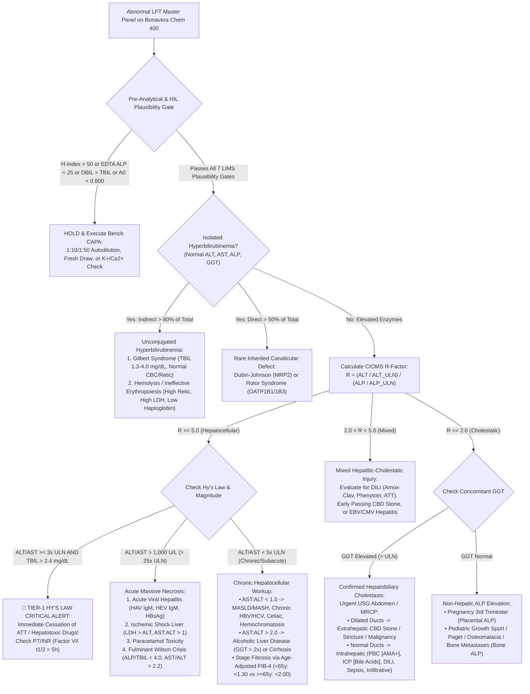

# 2.2.1 — Complete Liver Function Test (`LFT`) Master Panel (`CIOMS R-Factor`, `De Ritis Ratio`, `Hy's Law`, `APRI`, `FIB-4`, `NFS`, `MELD 3.0` & `Maddrey DF`)

**Department Folder:** `02_Clinical_Biochemistry`  
**Cluster Folder:** `2.2_Liver_Function_and_Hepatobiliary_Cluster`  
**Institution:** Sawariya Diagnostic Lab, Charkhi Dadri, Haryana, India  

---

## 1. International Document Control, Regulatory Traceability & Interoperability Matrix

| Metadata Field | Institutional & International Specification |
| :--- | :--- |
| **Document ID & Version** | `SDL-BIO-SOP-2.2.1` (`SOP-BIO-2.2.1`) — Version `v4.0 (International & Above-NABL Red-Team Standard)` |
| **Effective Date & Review Cycle** | Effective: `2026-10-12` — Mandatory Biennial Review Cycle (`24 Months`) or upon International Guideline Revision |
| **Authorizing Authority** | Laboratory Director & Chief Consultant Pathologist (`MD Pathology`), Sawariya Diagnostic Lab, Charkhi Dadri, Haryana |
| **Accreditation & Normative Mapping** | **ISO 15189:2022** Clauses `4.1–8.9` & `Normative Annex A`; **NABL 112 (Issue 05)**; **NABL 129** (*Specific Criteria for Clinical Biochemistry*); **NABL 131** (*Policy on Calibration & Metrological Traceability*); **NABL 163** (*PT/EQAS Participation*); **CAP CHM Checklist** (`CHM.13750–CHM.34600`); **UKAS LAB 48** |
| **International Clinical Practice Guidelines** | **ACG Clinical Guideline** (*Evaluation of Abnormal Liver Chemistries*, Kwo et al., *Am J Gastroenterol*); **AASLD 2023/2024 Practice Guidance** (*MASLD & Blood-Based Non-Invasive Liver Disease Assessment [NILDA]*); **EASL-EASD-EASO 2024 Clinical Practice Guidelines** on MASLD; **INASL Consensus Guidelines**; **CIOMS / RUCAM Consensus** on Drug-Induced Liver Injury (`DILI`); **FDA Guidance for Industry** (*Premarketing Clinical Evaluation of DILI — Hy's Law & eDISH*) |
| **CLSI & ISO Metrology Standards** | **CLSI EP05-A3** (Precision), **CLSI EP06-Ed2** (Linearity), **CLSI EP07-Ed3 / EP37** (`HIL` & Drug Interference), **CLSI EP15-A3** ($5 \times 5$ Precision & Trueness), **CLSI EP17-A2** (`LoB, LoD, LoQ`), **CLSI EP28-A3c** ($n=20$ Reference Interval Transference), **CLSI EP31-A** (Primary–Backup Comparability), **CLSI C56-A** (`HIL` Indices), **CLSI GP41-Ed7** (Venipuncture), **CLSI GP47** (Critical Alert Management), **ISO 17511:2020** (Calibration Hierarchy), **ISO/TS 20914:2019** (Measurement Uncertainty), **ISO 22367:2020** (Risk Management & FMECA) |
| **Primary LOINC Codes (Master Panel & Analytes)** | Master Panel: `24325-3` (*Hepatic function 2000 panel - Serum or Plasma*) — Measured Analytes: `1975-2` (`Total Bilirubin`), `1968-7` (`Direct/Conjugated Bilirubin`), `1742-6` (`ALT / SGPT`), `1920-8` (`AST / SGOT`), `6768-6` (`ALP`), `2324-2` (`GGT`), `2885-2` (`Total Protein`), `1751-7` (`Serum Albumin`) — Calculated Indices: `1971-1` (`Indirect Bilirubin`), `2336-6` (`Serum Globulin`), `1759-0` (`Albumin/Globulin Ratio`), `1916-6` (`AST/ALT De Ritis Ratio`), `96354-6` (`FIB-4 Index`), `96353-8` (`APRI Score`) |
| **SNOMED-CT Specimen & Clinical Concepts** | `119364003` (*Serum specimen — Gold-Top SST / Red-Top*) — `119361006` (*Lithium Heparin Plasma specimen*) — `166603001` (*Abnormal liver function test*) — `708248004` (*Drug-induced liver injury*) — `197321007` (*Steatotic liver disease*) |
| **ICD-10 / ICD-11 Diagnostic Mapping** | **ICD-10:** `R94.5` (Abnormal results of liver function studies), `K76.0` (MASLD / Non-alcoholic fatty liver), `K75.81` (MASH / Non-alcoholic steatohepatitis), `K70.10` (Alcoholic hepatitis), `K70.30` (Alcoholic cirrhosis), `B15.9–B19.9` (Viral Hepatitis A–E), `K80.50` (Calculus of bile duct), `K71.1–K71.9` (Toxic/Drug-Induced Liver Disease [`DILI`]), `E80.4` (Gilbert Syndrome), `E83.01` (Wilson Disease) — **ICD-11:** `DB90–DB99`, `ME10` |
| **Metrological Traceability (`ISO 17511:2020`)** | **Total & Direct Bilirubin:** Traceable to **NIST SRM 916a** (Doumas Molar Absorptivity Reference Method) — **Enzymes (`ALT, AST, ALP, GGT`):** Traceable to **IFCC $37^\circ\text{C}$ Primary Reference Measurement Procedures** & Certified Reference Materials **ERM-AD454k/IFCC** (`ALT`), **ERM-AD452k/IFCC** (`AST`), **ERM-AD453k/IFCC** (`GGT`), **IFCC AMP Reference Procedure** (`ALP`) — **Total Protein & Albumin:** Traceable to **ERM-DA470k/IFCC** & **NIST SRM 927e** |
| **Primary Analytical Platform** | **Bonavera Chem 400** (Fully Automated Random-Access Discrete Clinical Chemistry Analyzer, $400\text{ tests/hr}$, Holographic Concave Flat-Field Grating Rear Spectrophotometry $340\text{–}800\text{ nm}$, Peltier $37.0 \pm 0.1^\circ\text{C}$ Incubation, Automated `HIL` Serum Index & Substrate-Depletion Monitor) |
| **Backup Analytical Platform** | **Bonavera Chem 200** (Automated Benchtop Random-Access Analyzer, $200\text{ tests/hr}$, Identical Reagent Chemistry Cassettes, Calibrator Lots & Optical Wavelength Filters) |

---

## 2. 10-Persona International & Above-NABL Red-Team Adversarial Audit Matrix

| Persona ID & Specialist Role | Adversarial Vulnerability Identified in Conventional LFT SOPs | Mandatory Above-NABL & International Mitigation Implemented in `v4.0` |
| :--- | :--- | :--- |
| **Persona 1: Lead NABL (`ISO 15189:2022` / `NABL 112 / 129 / 131 / 163`) & CAP CHM Assessor** | Conventional LFT SOPs treat the 8 measured parameters as isolated chemistries without cross-analyte delta/plausibility locks, lack explicit traceability for calculated parameters (`Indirect Bilirubin`, `Globulin`, `A:G Ratio`, `R-Factor`, `FIB-4`), and omit witness-audit bench protocols. | Integrated full clause-by-clause `ISO 15189:2022` mapping, `ISO 17511:2020` calibration hierarchy across all 8 measured analytes, mandatory cross-parameter LIMS mathematical plausibility gates, and a 10-point **Live NABL/CAP Witness-Audit Simulation Matrix** (Section 3.3). |
| **Persona 2: Consultant Hepatologist & Clinical Biochemist (`MD / DM Hepatology — ACG / AASLD / EASL / INASL`)** | Lab reports list raw numbers without distinguishing **Hepatocellular ($R \ge 5.0$)**, **Mixed ($2.0 < R < 5.0$)**, and **Cholestatic ($R \le 2.0$)** injury, fail to contrast enzyme half-lives ($t_{1/2}$ of $\text{AST } 17\text{h}$ vs $\text{ALT } 47\text{h}$ vs $\text{Factor VII } 5\text{h}$ vs $\text{Albumin } 20\text{d}$), and ignore the **ACG True Healthy ALT ULN** ($\le 33\text{ U/L}$ Male, $\le 25\text{ U/L}$ Female). | Embedded the complete 14-parameter LFT architecture, dual-tier `ALT` cutoffs (Manufacturer IFCC Interval vs **ACG True Healthy ULNs** for early `MASLD`/`HBV` detection), subcellular compartmentalization & clearance kinetics, and a **10-Pattern Hepatobiliary Diagnostic Matrix** (Section 8). |
| **Persona 3: CLSI & IFCC Metrology, Method Verification & Six-Sigma QC Specialist** | Absence of quantitative substrate-depletion (`A0` initial absorbance) thresholds for `ALT`/`AST` at $340\text{ nm}$, unverified `AMR` vs `CRR` dilution factors up to $1:50$, and missing `CLSI EP31-A` split-sample comparability tolerances between `Bonavera Chem 400` and `Chem 200`. | Specified exact reaction stoichiometry, wavelength pairs, `A0` NADH depletion hard-locks ($A_{340} < 0.800\text{ Abs}$), `CLSI EP15-A3 / EP06-Ed2 / EP17-A2` verification matrices, Westgard Sigma rules, and `CLSI EP31-A` comparability criteria across all 8 LFT channels (Section 5 & Section 6). |
| **Persona 4: Clinical Pharmacologist & Special-Population Stratification Auditor** | Standard adult reference intervals are dangerously applied to neonates, children (`CALIPER`), and 3rd-trimester pregnant women (misdiagnosing physiological placental $\text{ALP}$ or bone growth $\text{ALP}$ as cholestasis, while missing pathological pregnancy $\text{ALT}$ elevation in `ICP`/`HELLP`/`AFLP`). | Built an exhaustive **Age / Sex / Pregnancy / Neonatal Stratification Matrix** (Section 7) and separated *in-vivo* hepatotoxic drug mechanisms (`ATT`, Paracetamol, Statins, Valproate, Amoxicillin-Clavulanate) from *in-vitro* chemical interferences (Eltrombopag, Sulfasalazine, Metamizole, Dobutamine, Nabumetone, IV Immunoglobulin). |
| **Persona 5: Medico-Legal, Patient-Safety & `ISO 22367:2020` Risk Management Counsel** | Generic 3-row FMEA tables lack quantitative `RPN` scoring ($S \times O \times D$) and omit statutory Indian compliance under `CPA 2019`, `DPDP Act 2023`, `BMW Rules 2016/2019`, and **NTEP (National TB Elimination Programme)** acute hepatotoxicity notifications. | Constructed a 10-scenario **Quantitative ISO 22367:2020 FMECA Matrix** (Section 3.1) with pre- and post-mitigation `RPN` calculations, mandatory 30-minute `CLSI GP47` read-back scripts, NTEP DILI escalation workflows, and statutory legal shields. |
| **Persona 6: Uncompressed Documentation, LIMS Rules-Engine & Readability Architect** | Overly compressed bullet points, missing worked clinical examples, and lack of a ready-to-print bench worksheet for manual dilution, `R-Factor`, and `FIB-4` verification during LIMS downtime. | Expanded the SOP to full international reference-textbook depth with step-by-step mathematical derivations, pre-filled clinical case calculations, automated LIMS reflex rules, and a **Printable LFT Master Bench Worksheet (`SDL/BIO/WS/LFT-01`)** (Section 11). |
| **Persona 7: ACG / AASLD / EASL 2024 Non-Invasive Fibrosis (`FIB-4`, `APRI`, `NFS`) & `MASLD` Specialist** | Applying the standard `FIB-4` cutoff ($\ge 1.30$) to patients aged $\ge 65\text{ years}$ causes a **$>35\text{–}45\%$ false-positive rate** for advanced fibrosis because `Age` sits in the numerator; conversely, calculating `FIB-4` in patients $< 35\text{ years}$ or during acute hepatitis/Dengue thrombocytopenia yields meaningless false alarms. | Programmed **AASLD / EASL 2024 Age-Stratified `FIB-4` Cutoffs** ($< 1.30$ Low Risk for Age $35\text{–}64\text{y}$ vs **$< 2.00$ Low Risk for Age $\ge 65\text{y}$**; $> 2.67$ High Risk), automated suppression when Age $< 35\text{y}$, $\text{ALT/AST} > 5\times \text{ULN}$, or non-hepatic thrombocytopenia is flagged, plus complete equations for `APRI`, `NFS`, `MELD 3.0`, and `Maddrey DF`. |
| **Persona 8: FDA / CIOMS Drug-Induced Liver Injury (`DILI`, `R-Factor`, & `Hy's Law` `10–50%` Mortality Rule) Specialist** | Laboratories report $\text{ALT } 280\text{ U/L}$ and $\text{Total Bilirubin } 3.4\text{ mg/dL}$ in a patient on Anti-Tubercular Therapy (`ATT`) as routine "High" flags without recognizing **Temple's Hy's Law**, where combined hepatocellular injury and jaundice carries a **$10\text{–}50\%$ mortality or liver transplant risk**. | Engineered an automated **LIMS Hy's Law & `eDISH` Quadrant Gate**: whenever $(\text{ALT or AST} \ge 3\times \text{ULN}) \land (\text{TBIL} > 2\times \text{ULN } [>2.4\text{ mg/dL}]) \land (\text{ALP} < 2\times \text{ULN or } R \ge 5.0)$, LIMS triggers a **Tier-1 Critical DILI Alert** requiring immediate physician notification within 30 minutes to halt `ATT`/hepatotoxins. |
| **Persona 9: Multi-Analyte LFT Cross-Verification & Substrate-Depletion / `HIL` Index Auditor** | Releasing mathematically or physiologically impossible LFT combinations (`Direct Bilirubin > Total Bilirubin`, `Albumin > Total Protein`, or `Total Bilirubin = 18.5 mg/dL` with `ALT = 14 U/L` due to NADH substrate depletion) destroys clinical credibility and causes lethal misdiagnosis. | Instituted **7 Hard-Coded Multi-Analyte LIMS Plausibility Locks** (Section 5.4) that automatically block autoverification whenever mathematical inversions, negative calculated fractions, `HIL` thresholds, or bilirubin–transaminase discordances occur. |
| **Persona 10: EFLM EuBIVAS Multi-Parameter Error Propagation (`FIB-4` & `R-Factor` Uncertainty) Auditor** | Calculated LFT indices (`Indirect Bilirubin`, `Globulin`, `A:G Ratio`, `R-Factor`, `FIB-4`) are reported without evaluating how analytical imprecision ($CV_A$) of individual analytes propagates into combined measurement uncertainty ($u_c$), causing borderline patients to flip across clinical cutoffs. | Derived and solved the exact **ISO/TS 20914:2019 Partial-Derivative Error Propagation Equations** (Section 6.2) for difference equations (`IBIL`, `GLOB`), correlated quotient equations (`A:G Ratio`), dual-enzyme ratios (`R-Factor`), and power-root equations (`FIB-4` with $\sqrt{\text{ALT}}$ and Platelet $CV_A$). |

---

## 3. ISO 22367:2020 Quantitative FMECA & Live NABL/CAP Witness-Audit Simulation

### 3.1 Quantitative Failure Modes, Effects, and Criticality Analysis (`FMECA`) Matrix
*Scoring Scale (`ISO 22367:2020`): Severity ($S$: $1\text{–}10$, where $10 =$ catastrophic patient death/wrongful transplant/missed fulminant hepatic failure), Occurrence ($O$: $1\text{–}10$), Detection ($D$: $1\text{–}10$, where $10 =$ undetectable without automated LIMS/analyzer lock). Risk Priority Number ($\text{RPN}$) $= S \times O \times D$. Mandatory intervention threshold: $\text{RPN} \ge 100$ or $S \ge 8$.*

| FMECA ID | Process Step & Failure Mode | Root Cause & Biochemical / Clinical Mechanism | Clinical Impact on Patient Safety | Pre-Control $S \times O \times D = \text{RPN}$ | Hard-Engineered Analyzer / LIMS Control & Bench `CAPA` | Post-Control $S \times O \times D = \text{RPN}$ |
| :--- | :--- | :--- | :--- | :---: | :--- | :---: |
| **FMECA-01** | **Applying Non-Age-Adjusted `FIB-4` Cutoff ($\ge 1.30$) in Elderly Patients ($\text{Age} \ge 65\text{ years}$)** | `Age` is a linear multiplier in the numerator of $\text{FIB-4} = \frac{\text{Age} \times \text{AST}}{\text{PLT} \times \sqrt{\text{ALT}}}$. Physiological aging + mild age-related decline in `ALT` elevates baseline `FIB-4` above $1.30$ in $>35\text{–}45\%$ of healthy seniors without fibrosis. | Massive false-positive rate for advanced hepatic fibrosis ($F2\text{–}F4$), triggering unnecessary hepatology referrals, anxiety, and invasive liver biopsies; conversely, reporting `FIB-4` in patients $< 35\text{y}$ gives false-negative reassurance. | $7 \times 7 \times 6 = \mathbf{294}$ | **LIMS Age-Partitioned `FIB-4` Rule (`SDL-LIMS-RULE-LFT01`):** Automatically applies **AASLD/EASL 2024 age-specific lower cutoffs**: **$< 1.30$** for Age $35\text{–}64\text{y}$, **$< 2.00$** for Age $\ge 65\text{y}$, and **suppresses `FIB-4` risk staging in patients $< 35\text{y}$** with an explanatory comment. | $7 \times 1 \times 1 = \mathbf{7}$ |
| **FMECA-02** | **Calculating `FIB-4` / `APRI` During Acute Hepatitis ($\text{ALT/AST} > 5\times \text{ULN}$) or Non-Hepatic Thrombocytopenia (`Dengue / Malaria / ITP / EDTA Clumping`)** | `FIB-4` and `APRI` assume chronic steady-state transaminases and portal-hypertension-mediated splenic platelet sequestration. Acute viral/drug transaminitis ($\text{AST } 600\text{ U/L}$) or seasonal Charkhi Dadri Dengue thrombocytopenia ($\text{PLT } 45 \times 10^9/\text{L}$) inflates $\text{FIB-4} > 6.0\text{–}15.0$. | Catastrophic misdiagnosis of decompensated cirrhosis ($F4$) in a young patient with acute self-limiting Dengue fever, Malaria, or acute Hepatitis A/E who has **zero hepatic fibrosis**. | $8 \times 6 \times 6 = \mathbf{288}$ | **LIMS Acute Injury & Thrombocytopenia Suppression Gate (`SDL-LIMS-RULE-LFT02`):** Hard-lock suppresses numerical `FIB-4`/`APRI` calculation whenever $\text{ALT or AST} > 150\text{ U/L}$ ($> 4\text{–}5\times \text{ULN}$), $\text{Total Bilirubin} > 3.0\text{ mg/dL}$ (acute icterus), or CBC flags platelet clumps / acute febrile thrombocytopenia, replacing it with: *"[FIB-4/APRI suppressed: Invalid during acute cytolysis or non-hepatic thrombocytopenia]"*. | $8 \times 1 \times 1 = \mathbf{8}$ |
| **FMECA-03** | **Missing Temple's `Hy's Law` in Patients on Anti-Tubercular Therapy (`ATT: H+R+Z`) or Herbal/Ayurvedic Remedies (`CAM`)** | Clinicians or technicians review `ALT` ($180\text{ U/L}$, $\sim 4\times \text{ULN}$) and `Total Bilirubin` ($3.2\text{ mg/dL}$, $> 2\times \text{ULN}$) separately as moderate abnormalities without recognizing that concurrent hepatocellular injury + jaundice indicates loss of $> 70\%$ functional hepatocyte mass. | **$\mathbf{10\text{–}50\%}$ risk of Fulminant Hepatic Failure (`ALF`), liver transplantation, or death** if `Isoniazid`, `Rifampicin`, `Pyrazinamide`, or offending herbal toxin is continued for even 48–72 hours longer. | $10 \times 5 \times 6 = \mathbf{300}$ | **LIMS Automated `Hy's Law` Critical Alert Gate (`SDL-LIMS-RULE-LFT03`):** Whenever $(\text{ALT or AST} \ge 3\times \text{ULN}) \land (\text{TBIL} > 2.4\text{ mg/dL}) \land (\text{ALP} < 2\times \text{ULN or } R \ge 5.0)$, LIMS fires a **Tier-1 Red-Banner Panic Alert**, forces a 30-minute telephone read-back to the prescribing physician (`NTEP`/OPD), and appends the mandatory **ATT/DILI Cessation Directive**. | $10 \times 2 \times 1 = \mathbf{20}$ |
| **FMECA-04** | **Releasing Mathematically Impossible LFT Panels (`Direct Bilirubin > Total Bilirubin` or `Albumin > Total Protein`)** | Monoclonal $\text{IgM}$ paraproteinemia (Waldenström/Myeloma) precipitates at acid $\text{pH}$ in the Direct Bilirubin cuvette causing turbidimetric false elevation ($\text{DBIL} > \text{TBIL}$); severe acute-phase $\alpha/\beta$-globulins bind BCG after $30\text{s}$ or calibration drift causes $\text{ALB} > \text{TP}$ (negative Globulin). | Reporting negative `Indirect Bilirubin` (e.g., $-0.8\text{ mg/dL}$) or negative `Globulin` (e.g., $-0.4\text{ g/dL}$) triggers severe clinical confusion, NABL audit non-conformity, and missed underlying multiple myeloma / paraproteinemia. | $8 \times 4 \times 5 = \mathbf{160}$ | **LIMS Mathematical Plausibility Hard-Lock (`SDL-LIMS-RULE-LFT04`):** Autoverification is blocked if $\text{DBIL} > \text{TBIL}$ (beyond analytical imprecision $+0.1\text{ mg/dL}$) or $\text{ALB} \ge \text{TP} - 1.2\text{ g/dL}$. Bench SOP mandates saline dilution ($1:2$), early $20\text{s}$ BCG read verification, and serum protein electrophoresis (`SPEP`) reflex check for paraprotein turbidity. | $8 \times 1 \times 1 = \mathbf{8}$ |
| **FMECA-05** | **NADH Substrate Depletion ("Kinetic Hook Effect") in Fulminant Hepatitis ($\text{ALT/AST} > 3,000\text{–}10,000\text{ U/L}$)** | Massive transaminase release in Ischemic "Shock" Liver, Paracetamol overdose, or Fulminant `HEV` consumes $100\%$ of reagent $\text{NADH} \to \text{NAD}^+$ during the $60\text{s}$ pre-read incubation lag phase. Photometer reads a flat $\Delta A_{340}/\text{min} \approx 0$. | Analyzer falsely reports a **normal or low $\text{ALT/AST}$ ($10\text{–}22\text{ U/L}$)** in a deeply jaundiced ($\text{TBIL } 18\text{ mg/dL}$) or shocked ICU patient, delaying N-Acetylcysteine (`NAC`) or ICU hepatology rescue! | $10 \times 4 \times 6 = \mathbf{240}$ | **Dual Hardware + Cross-Analyte Lock (`SDL-LIMS-RULE-LFT05`):** (1) `Bonavera Chem 400` Initial Absorbance Monitor flags `SUBSTRATE_DEPLETED` if $A_{340\text{ (t=60s)}} < 0.800\text{ Abs}$ or $\ge 2$ kinetic points deviate from linearity, triggering automatic **$1:10$ and $1:50$ saline autodilution**. (2) LIMS blocks release if $\text{TBIL} > 5.0\text{ mg/dL}$ with normal $\text{ALT/AST}$ and normal $\text{ALP}$ until kinetic reaction curves are visually inspected. | $10 \times 1 \times 1 = \mathbf{10}$ |
| **FMECA-06** | **$\text{K}_2\text{-EDTA}$ Cross-Contamination During Phlebotomy Causing Spurious Near-Zero $\text{ALP}$ ($< 15\text{ U/L}$)** | Drawing the purple-top $\text{K}_2\text{-EDTA}$ CBC tube before the Gold-Top SST (`CLSI GP41` violation) or decanting EDTA plasma into an SST tube transfers $\text{EDTA}$, which irreversibly chelates active-site $\text{Zn}^{2+}$ and $\text{Mg}^{2+}$ from `ALP`. | Falsely low $\text{ALP}$ ($< 15\text{ U/L}$) artificially inflates the `CIOMS R-Factor` into a false Hepatocellular pattern, masks cholestatic biliary obstruction, or mimics **Fulminant Wilson Disease** ($\text{ALP/TBIL} < 4.0$) or Hypophosphatasia. | $8 \times 5 \times 5 = \mathbf{200}$ | **LIMS Low-ALP & EDTA Chelation Reflex (`SDL-LIMS-RULE-LFT06`):** Any $\text{ALP} < 25\text{ U/L}$ triggers an automatic LIMS check of serum $\text{K}^+$ and $\text{Ca}^{2+}$ (or reflex spot check on `Bonavera Chem 400`). If $\text{K}^+ > 7.5\text{ mmol/L}$ and $\text{Ca}^{2+} < 5.0\text{ mg/dL}$, specimen is rejected as `EDTA_CONTAMINATED`; if electrolytes are normal in an icteric patient, pathologist evaluates for **Fulminant Wilsonian Crisis**! | $8 \times 2 \times 1 = \mathbf{16}$ |
| **FMECA-07** | **In-Vitro Hemolysis (`H-Index` $> 50\text{ mg/dL}$) Falsifying `AST`, `De Ritis Ratio`, and `Direct Bilirubin`** | Intra-erythrocytic $\text{AST}$ concentration is **$40\times$ higher** than plasma (whereas $\text{ALT}$ is only $7\times$ higher); simultaneously, free oxyhemoglobin oxidizes/inhibits the diazonium coupling of Direct Bilirubin at $546\text{ nm}$. | Hemolyzed specimen produces a spurious $\text{AST} = 110\text{ U/L}$ with $\text{ALT} = 38\text{ U/L}$ ($\text{AST/ALT} = 2.89$), falsely stigmatizing a non-drinker with **Alcoholic Liver Disease** while under-reporting `Direct Bilirubin`. | $7 \times 6 \times 4 = \mathbf{168}$ | **Automated `HIL` Spectral Gate (`SDL-LIMS-RULE-LFT07`):** `Bonavera Chem 400` measures `H-Index` at $570/600\text{ nm}$ on every LFT specimen. If `H-Index` $> 50\text{ mg/dL}$ ($\ge 0.5\text{ g/L}$ free Hb), `AST`, `De Ritis Ratio`, `FIB-4`, and `Direct Bilirubin` are hard-blocked (`REJECT_HEMOLYSIS`) and a fresh venipuncture is requested. | $7 \times 2 \times 1 = \mathbf{14}$ |
| **FMECA-08** | **Photo-Isomerization of Bilirubin in Unshielded SST Tubes Exposed to Ambient Fluorescent / Sunlight** | Blue-green light ($420\text{–}470\text{ nm}$) converts native hydrophobic $4Z,15Z\text{-bilirubin IX}\alpha$ into water-soluble $4Z,15E$ and $4E,15Z$ configurational photoisomers and structural **lumirubin**, which react poorly or unpredictably in diazo/vanadate assays ($30\text{–}50\%\text{/hr}$ decay). | False-negative bilirubin in neonatal jaundice (missing the AAP phototherapy / exchange transfusion threshold and causing **Kernicterus**) or masking `Hy's Law` in an outpatient sample transported without an amber sleeve. | $9 \times 5 \times 5 = \mathbf{225}$ | **Mandatory Amber Photo-Shielding SOP (`SDL-PRE-SOP-04`):** All neonatal capillary micro-tubes and icteric adult SST tubes are placed immediately into opaque amber sleeves (` foil-wrapped racks`). Specimens left unshielded on open benches $> 60\text{ minutes}$ are rejected. | $9 \times 2 \times 1 = \mathbf{18}$ |
| **FMECA-09** | **Overestimation of Serum Albumin by Late-Reading Bromocresol Green (`BCG`) Assay in Cirrhosis** | In cirrhosis and nephrotic syndrome, hypoalbuminemia is accompanied by compensatory hyperglobulinemia ($\uparrow \alpha_1, \alpha_2, \beta, \gamma\text{-globulins}$). If BCG absorbance at $630\text{ nm}$ is read at $> 60\text{s}$, BCG binds acute-phase $\alpha$-globulins, overestimating Albumin by $+0.5\text{ to }+1.2\text{ g/dL}$. | True Serum Albumin of $2.3\text{ g/dL}$ (Child-Pugh Class C, severe synthetic failure) is falsely reported as $3.3\text{ g/dL}$ (Child-Pugh Class A/B), distorting `MELD 3.0`, `NFS`, and ascites management. | $8 \times 4 \times 5 = \mathbf{160}$ | **Fast-Kinetic $18\text{–}24\text{ Second}$ BCG Read Protocol (`SDL-ANL-BCG`):** `Bonavera Chem 400` is locked to an early bichromatic reading window (**Cycle 3, $t = 18\text{s}$** after sample addition at $630/700\text{ nm}$) where BCG reacts exclusively with Albumin prior to slow $\alpha$-globulin binding; verified against `ERM-DA470k/IFCC`. | $8 \times 1 \times 1 = \mathbf{8}$ |
| **FMECA-10** | **Pyridoxal-5'-Phosphate (`P-5'-P` / Vitamin $\text{B}_6$) Depletion in Alcoholic Hepatitis or Dialysis Patients** | Cytosolic $\text{ALT}$ and $\text{AST}$ require `P-5'-P` as an obligate prosthetic group for amino-group transfer. Severe alcoholics and chronic hemodialysis patients have profound Vitamin $\text{B}_6$ deficiency, leaving a high fraction of circulating enzyme in the inactive **apoenzyme** state (affecting $\text{ALT} > \text{AST}$). | Unsupplemented IFCC reagents underestimate true total $\text{ALT}$ by $25\text{–}50\%$ in alcoholic/dialysis patients; conversely, switching between `P-5'-P` supplemented and unsupplemented lots shifts reference intervals by $+15\text{–}25\%$. | $7 \times 5 \times 4 = \mathbf{140}$ | **Standardized IFCC Reagent Configuration & Reference Interval Harmonization:** Reagent formulation (`P-5'-P` status) is locked across both `Bonavera Chem 400` and `Chem 200` with lot-matched `CLSI EP28-A3c` reference intervals and explicit reporting of the **De Ritis Ratio ($\text{AST/ALT} > 2.0$)** mechanism in alcoholic hepatitis. | $7 \times 1 \times 1 = \mathbf{7}$ |

---

### 3.2 Live NABL (`ISO 15189:2022`) & CAP Witness-Audit Simulation Matrix

| Audit Challenge # | NABL / CAP Lead Assessor Witness-Audit Question | Expected Live Bench Demonstration by Technical Officer / Pathologist | Objective Evidence & Record ID Presented | Audit Grading Criteria (Pass / Non-Conformity) |
| :--- | :--- | :--- | :--- | :--- |
| **CHALLENGE-01** | *"Show me how your `Bonavera Chem 400` prevents reporting a falsely normal `ALT` of $18\text{ U/L}$ in a patient with fulminant hepatic necrosis whose true `ALT` is $6,500\text{ U/L}$."* | Technical Officer opens the `Bonavera Chem 400` Test Parameter Setup screen for `ALT` and `AST`, demonstrating the **Substrate Depletion Limit (`A0 Min = 0.800 Abs` at $340\text{ nm}$)** and Linearity Limit flags that automatically trigger a $1:10$ (and reflex $1:50$) onboard saline rerun, and pulls up a saved reaction graph showing rapid NADH exhaustion during the lag phase. | `SDL/BIO/REC/SUB-DEP-01` (Reaction Curve Audit Log) & `Bonavera Chem 400` Parameter Configuration Printout. | **PASS:** Live `A0` limit $\ge 0.800\text{ Abs}$ verified + autodilution active. **NC:** `A0` check disabled or manual dilution unvalidated. |
| **CHALLENGE-02** | *"How does your LIMS handle `FIB-4` calculation in a 71-year-old diabetic man with `AST = 28 U/L`, `ALT = 24 U/L`, and `Platelets = 195 x 10^9/L`?"* | Pathologist calculates $\text{FIB-4} = \frac{71 \times 28}{195 \times \sqrt{24}} = \frac{1988}{955.3} = \mathbf{2.08}$ and demonstrates on the LIMS terminal that because $\text{Age} \ge 65\text{y}$, the LIMS applies the **AASLD/EASL 2024 geriatric lower cutoff ($< 2.00$ Low Risk; $2.00\text{–}2.67$ Indeterminate)** rather than the $< 1.30$ cutoff, preventing false-positive staging in patients with $\text{FIB-4}$ between $1.30$ and $1.99$. | `SDL/LIMS/VAL/FIB4-2026` (LIMS Algorithm Validation Log across $<35\text{y}$, $35\text{–}64\text{y}$, and $\ge 65\text{y}$ test cases). | **PASS:** Age-stratified cutoffs ($<35\text{y}$ suppressed, $35\text{–}64\text{y}$ $<1.30$, $\ge 65\text{y}$ $<2.00$) verified in LIMS. |
| **CHALLENGE-03** | *"What happens if a patient with acute Dengue fever (`Platelets = 32 x 10^9/L`, `AST = 240 U/L`, `ALT = 165 U/L`) has an LFT + CBC ordered? Does LIMS report `FIB-4 = 20.5 (Cirrhosis)`?"* | Pathologist shows LIMS Rule `SDL-LIMS-RULE-LFT02` in the test environment: because $\text{AST} > 150\text{ U/L}$ ($> 5\times \text{ULN}$) and acute febrile thrombocytopenia is present, the numerical `FIB-4` is automatically suppressed and replaced with the clinical warning that `FIB-4` is invalid in acute cytolysis or non-hepatic thrombocytopenia. | `SDL/LIMS/VAL/FIB4-2026` Test Case #04 (Acute Transaminitis / Dengue Suppression Record). | **PASS:** Automated suppression active when $\text{ALT/AST} > 150\text{ U/L}$. **NC:** Unfiltered `FIB-4` printed on acute hepatitis/Dengue reports. |
| **CHALLENGE-04** | *"Demonstrate your protocol when a patient on Anti-TB drugs (`ATT`) has `ALT = 195 U/L`, `ALP = 110 U/L`, and `Total Bilirubin = 3.6 mg/dL`."* | Technical Officer shows that $\text{ALT} = 195\text{ U/L}$ ($> 3\times \text{ULN}$), $\text{TBIL} = 3.6\text{ mg/dL}$ ($> 2\times \text{ULN}$), and $R\text{-Factor} = \frac{195/45}{110/129} = \frac{4.33}{0.85} = \mathbf{5.08} \ge 5.0$, which satisfies **Temple's Hy's Law**. LIMS fires a Tier-1 Critical DILI Alert; staff demonstrates the Critical Call Log with $< 30\text{ min}$ read-back to the physician to stop `ATT`. | `SDL/BIO/LOG/CRIT-01` (Critical Value & Hy's Law Communication Register). | **PASS:** Hy's Law logic active + documented $< 30\text{ min}$ read-back compliance $\ge 98\%$. |
| **CHALLENGE-05** | *"Show me your Metrological Traceability chain (`ISO 17511:2020`) and Measurement Uncertainty (`ISO/TS 20914:2019`) for all 8 measured LFT parameters and how uncertainty propagates into `Indirect Bilirubin` and `FIB-4`."* | Quality Manager presents the Master Calibration Hierarchy folder (`NIST SRM 916a` for Bilirubin; `IFCC 37°C / ERM-AD454k, AD452k, AD453k` for Enzymes; `ERM-DA470k/IFCC` for Proteins) and the live `ISO/TS 20914:2019` spreadsheet showing both direct analyte $U\%$ and partial-derivative propagated $u_c$ for `IBIL`, `GLOB`, `A:G`, `R-Factor`, and `FIB-4`. | `SDL/QMS/MU/2026-LFT` (6-Month IQC + Calibrator MU Calculation & Error Propagation Dossier). | **PASS:** Complete unbroken traceability chain + propagated MU documented. |
| **CHALLENGE-06** | *"How do you verify that `Bonavera Chem 400` (Primary) and `Bonavera Chem 200` (Backup) produce clinically interchangeable LFT results during analyzer downtime (`ISO 15189:2022 Clause 7.3.6`)?"* | Technical Officer presents the weekly `CLSI EP31-A` Split-Sample Comparability Register where 5 patient sera spanning normal, hepatocellular, and cholestatic levels are assayed on both analyzers every Monday, confirming bias $\le \frac{1}{3}\text{TE}_a$ and Passing-Bablok slope $0.97\text{–}1.03$. | `SDL/BIO/COMP/CHEM400-200` (Weekly Inter-Instrument Comparability Log). | **PASS:** Signed weekly comparability logs with zero uninvestigated bias flags. |

---

## 4. Deep Pathophysiological, Subcellular, Kinetic & Algorithmic Architecture

### 4.1 Complete 14-Parameter LFT Panel Architecture (`8 Measured + 6 Calculated Indices`)

| Parameter Code | Full Clinical Parameter Name | LOINC | Analytical Role | Hepatobiliary Functional Domain Assessed |
| :--- | :--- | :---: | :--- | :--- |
| **`TBIL`** | **Total Bilirubin** | `1975-2` | Measured ($546/630\text{ nm}$) | Heme catabolism load + hepatic sinusoidal uptake (`OATP1B1/1B3`) + glucuronidation + canalicular excretion |
| **`DBIL`** | **Direct (Conjugated + $\delta$) Bilirubin** | `1968-7` | Measured ($546/630\text{ nm}$) | Intra-hepatocytic `UGT1A1` conjugation & ATP-dependent `MRP2` (`ABCC2`) canalicular transport into bile |
| **`IBIL`** | **Indirect (Unconjugated) Bilirubin** | `1971-1` | Calculated ($\text{TBIL} - \text{DBIL}$) | Pre-hepatic heme turnover (hemolysis/ineffective erythropoiesis) & `UGT1A1` conjugation capacity (Gilbert/Crigler-Najjar) |
| **`ALT`** | **Alanine Aminotransferase (`SGPT`)** | `1742-6` | Measured ($340/405\text{ nm}$) | **Hepatocyte-specific cytosolic membrane integrity** ($100\%$ cytoplasmic; $3,000\times$ higher in liver than serum) |
| **`AST`** | **Aspartate Aminotransferase (`SGOT`)** | `1920-8` | Measured ($340/405\text{ nm}$) | **Bilobed mitochondrial ($80\%$) + cytoplasmic ($20\%$) integrity** (Liver, cardiac/skeletal muscle, RBCs, kidney) |
| **`ALP`** | **Alkaline Phosphatase** | `6768-6` | Measured ($405/505\text{ nm}$) | **Biliary canalicular membrane ectoenzyme induction** (bile salt accumulation triggers *de novo* synthesis) + osteoblast/placental activity |
| **`GGT`** | **Gamma-Glutamyl Transferase** | `2324-2` | Measured ($405/505\text{ nm}$) | **Biliary epithelial / canalicular cholestasis confirmation** + microsomal cytochrome `P450` induction (alcohol, anticonvulsants) + oxidative glutathione (`GSH`) stress |
| **`TP`** | **Total Serum Protein** | `2885-2` | Measured ($546/700\text{ nm}$) | Combined hepatic parenchymal protein synthesis (Albumin + $\alpha/\beta$-globulins) and B-lymphocyte/plasma-cell $\gamma$-globulin (`IgG, IgA, IgM`) status |
| **`ALB`** | **Serum Albumin** | `1751-7` | Measured ($630/700\text{ nm}$) | **Long-term hepatic rough endoplasmic reticulum synthetic reserve** ($10\text{–}15\text{ g/day}$ synthesis; $t_{1/2} \approx 20\text{ days}$) & oncotic pressure |
| **`GLOB`** | **Serum Globulin** | `2336-6` | Calculated ($\text{TP} - \text{ALB}$) | Humoral immune & reticuloendothelial activation (polyclonal $\uparrow \text{IgG}$ in Autoimmune Hepatitis, $\uparrow \text{IgA}$ in Alcoholic Cirrhosis, $\uparrow \text{IgM}$ in PBC) |
| **`A:G`** | **Albumin-to-Globulin Ratio** | `1759-0` | Calculated ($\text{ALB} / \text{GLOB}$) | Chronic liver disease / cirrhosis synthetic inversion ($\text{A:G} < 1.0$ due to $\downarrow \text{Albumin}$ + $\uparrow \gamma\text{-Globulins}$ via portosystemic shunting of gut antigens) |
| **`AST/ALT`** | **De Ritis Ratio** | `1916-6` | Calculated ($\text{AST} / \text{ALT}$) | Subcellular injury depth & etiology discriminator ($< 0.8$ in `MASLD`/Acute Viral; $> 2.0$ in Alcoholic Hepatitis, Cirrhosis, or Wilsonian crisis) |
| **`R-Factor`** | **CIOMS / ACG `R-Ratio`** | `LP-R` | Calculated (Normalized Ratio) | Primary algorithmic classifier into **Hepatocellular ($R \ge 5.0$)**, **Mixed ($2.0 < R < 5.0$)**, or **Cholestatic ($R \le 2.0$)** injury |
| **`FIB-4` / `APRI`** | **Non-Invasive Fibrosis Indices** | `96354-6` | Calculated (Cross-CBC + LFT) | First-line quantitative staging of hepatic fibrosis ($F0\text{–}F1$ vs $F3\text{–}F4$ bridging fibrosis/cirrhosis) in `MASLD`, `T2DM`, `HBV`, and `HCV` |

---

### 4.2 Subcellular Compartmentalization, Zonal Architecture & Biomarker Clearance Kinetics ($t_{1/2}$)

1. **Hepatic Acinar Zonation (Rappaport Zones 1, 2, and 3):**
   - **Zone 1 (Periportal Hepatocytes):** Receives oxygen- and nutrient-rich blood first from the portal triad; contains the highest concentration of **`ALT`** and gluconeogenic/urea-cycle enzymes. Preferentially injured in **Acute Viral Hepatitis (`HAV, HBV, HEV`)**, **Autoimmune Hepatitis**, and phosphorus poisoning.
   - **Zone 3 (Centrilobular / Perivenular Hepatocytes around the Central Vein):** Has the lowest oxygen tension ($p\text{O}_2$) and highest concentration of **`AST` (mitochondrial)** and **Cytochrome P450 (`CYP2E1`, `CYP3A4`)**. Preferentially destroyed in **Ischemic Hepatitis ("Shock Liver")**, **Congestive Hepatopathy**, **Paracetamol (`NAPQI`) Toxicity**, **Carbon Tetrachloride**, and **Alcoholic Steatohepatitis**, explaining why **`AST` exceeds `ALT` early in Zone 3 necrosis**.
2. **Comparative In-Vivo Biomarker Kinetics (Onset, Peak & Half-Life $t_{1/2}$):**

| Hepatic Biomarker | Subcellular / Tissue Localization | Hepatic : Serum Concentration Gradient | Onset of Rise After Acute Insult | In-Vivo Plasma Half-Life ($t_{1/2}$) | Clinical & Temporal Diagnostic Significance |
| :--- | :--- | :---: | :---: | :---: | :--- |
| **Cytoplasmic `AST` (`cAST`)** | $20\%$ of total hepatocyte `AST` (Cytosol) | $\sim 7,000 : 1$ | $4\text{–}6\text{ Hours}$ | **$17 \pm 5\text{ Hours}$** | Rises **first** and normalizes **first** after acute transient biliary stone passage or ischemic shock liver. |
| **Mitochondrial `AST` (`mAST`)** | $80\%$ of total hepatocyte `AST` (Mitochondrial matrix) | $\sim 7,000 : 1$ | $6\text{–}12\text{ Hours}$ | **$87\text{ Hours}$** *(tissue release phase; rapid sinusoidal clearance)* | Released only upon severe mitochondrial membrane disruption (Alcoholic acetaldehyde toxicity, Zone 3 ischemic necrosis, cirrhosis). |
| **Cytosolic `ALT` (`SGPT`)** | $100\%$ Hepatocyte Cytosol (Predominantly Zone 1) | $\sim 3,000 : 1$ | $6\text{–}12\text{ Hours}$ | **$47 \pm 10\text{ Hours}$** ($\sim 2\text{ Days}$) | Because $t_{1/2}(\text{ALT}) = 47\text{h} > t_{1/2}(\text{cAST}) = 17\text{h}$, an initially high $\text{AST} > \text{ALT}$ in acute CBD stone passage or shock liver **crosses over to $\text{ALT} > \text{AST}$ within 48–72 hours** during recovery! |
| **Alkaline Phosphatase (`ALP`)** | GPI-anchored to Biliary Canalicular Membrane, Osteoblasts, Intestinal Villous Brush Border, Placenta | Inducible ($3\text{–}10\times$) | $24\text{–}48\text{ Hours}$ *(requires transcriptional translation)* | **$7\text{ Days}$** *(Hepatic/Bone)*; **$5\text{ Hours}$** *(Intestinal)* | Does **not** leak passively; retained bile acids act as detergents that stimulate *de novo* synthesis and phospholipase-D cleavage from the canalicular membrane. |
| **Gamma-Glutamyl Transferase (`GGT`)** | Biliary Epithelial Cells, Canalicular Membrane & Smooth ER Microsomes | Inducible ($2\text{–}20\times$) | $12\text{–}24\text{ Hours}$ | **$14\text{–}26\text{ Days}$** *(Alcoholic induction)*; **$7\text{–}10\text{ Days}$** *(Non-alcoholic)* | Proves hepatobiliary origin of an elevated `ALP`; prolonged $t_{1/2}$ monitors 3–4 week alcohol abstinence compliance. |
| **Coagulation Factor VII (`PT/INR`)** | Hepatocyte Rough ER (Vitamin K-dependent $\gamma$-carboxylation) | Synthetic marker | $6\text{–}12\text{ Hours}$ | **$4\text{–}6\text{ Hours}$** | **Gold-standard earliest marker of Acute Liver Failure (`ALF`)**: $\text{INR} \ge 1.5$ within $12\text{–}24\text{h}$ reflects acute collapse of hepatocyte synthesis long before Albumin falls. |
| **Prealbumin (Transthyretin)** | Hepatocyte Synthesis | Synthetic marker | $24\text{–}48\text{ Hours}$ | **$1.9\text{–}2.0\text{ Days}$** | Sensitive short-term indicator of acute synthetic recovery or nutritional refeeding. |
| **Serum Albumin (`ALB`)** | Hepatocyte Rough ER ($10\text{–}15\text{ g/day}$) | Synthetic marker | $> 14\text{–}21\text{ Days}$ | **$19\text{–}21\text{ Days}$** | **Completely normal in uncomplicated Acute Viral Hepatitis!** Hypoalbuminemia ($< 3.5\text{ g/dL}$) indicates **chronic liver disease ($> 3\text{ weeks}$)**, cirrhosis, nephrotic loss, or systemic capillary leak/negative acute-phase response. |
| **Delta-Bilirubin ($\delta\text{-Bil}$ / Biliprotein)** | Conjugated Bilirubin covalently bound via non-enzymatic acyl-shift to Lysine-190 of Albumin | Accumulates when cholestasis $> 7\text{d}$ | $> 5\text{–}7\text{ Days}$ of cholestasis | **$19\text{–}21\text{ Days}$** *(matches Albumin $t_{1/2}$)* | Cannot be filtered by the glomerulus (absent in urine) and clears at the slow rate of Albumin ($t_{1/2} \approx 20\text{d}$), explaining why **Direct Bilirubin remains elevated for 2–3 weeks after ERCP stenting relieves biliary obstruction** even after `Bilirubinuria` disappears! |

---

### 4.3 Complete Mathematical Formulations & Decision Cutoffs (`R-Factor`, `Hy's Law`, `FIB-4`, `APRI`, `NFS`, `MELD 3.0`, `Maddrey DF`)

#### 1. CIOMS / RUCAM & ACG `R-Factor` (Ratio of Normalized ALT to Normalized ALP)
$$R = \frac{\text{ALT}_{\text{patient}} \big/ \text{ALT}_{\text{ULN}}}{\text{ALP}_{\text{patient}} \big/ \text{ALP}_{\text{ULN}}}$$
- **Modified New $R\text{-Factor}$ (`nR`) for Acute Mitochondrial/Zone-3 Necrosis:** When $\left(\text{AST}/\text{AST}_{\text{ULN}}\right) > \left(\text{ALT}/\text{ALT}_{\text{ULN}}\right)$ in early acute DILI, ischemic shock, or alcoholic injury, FDA/CIOMS permits substituting the higher normalized transaminase in the numerator.
- **Institutional Upper Limits of Normal ($\text{ULN}$) Used in LIMS Calculation:**
  - Adult Male: $\text{ALT}_{\text{ULN}} = 45\text{ U/L}$, $\text{ALP}_{\text{ULN}} = 129\text{ U/L}$ *(Note: ACG True Healthy $\text{ALT}_{\text{ULN}} = 33\text{ U/L}$ flagged in clinical comments)*.
  - Adult Female: $\text{ALT}_{\text{ULN}} = 35\text{ U/L}$, $\text{ALP}_{\text{ULN}} = 104\text{ U/L}$ *(Note: ACG True Healthy $\text{ALT}_{\text{ULN}} = 25\text{ U/L}$ flagged in clinical comments)*.
- **Decision Thresholds (`CIOMS / ACG`):**
  - **$R \ge 5.0$ — Hepatocellular Injury Pattern:** Predominant hepatocyte cytolysis (Viral Hepatitis A/B/C/E, `MASLD/MASH`, Alcoholic Hepatitis, Hepatocellular `DILI` [Isoniazid, Pyrazinamide, Paracetamol], Autoimmune Hepatitis, Ischemic Hepatitis, Wilson Disease).
  - **$2.0 < R < 5.0$ — Mixed Hepatocellular-Cholestatic Injury Pattern:** Concurrent hepatocyte and bile ductule injury (Mixed `DILI` [Amoxicillin-Clavulanate, Phenytoin, Carbamazepine, Sulfonamides], early passing common bile duct calculus, Epstein-Barr Virus / CMV hepatitis).
  - **$R \le 2.0$ — Cholestatic Injury Pattern:** Predominant canalicular or ductular impairment (Choledocholithiasis, Malignant Pancreaticobiliary Obstruction, Primary Biliary Cholangitis [`PBC`], Primary Sclerosing Cholangitis [`PSC`], Cholestatic `DILI` [Anabolic Steroids, Oral Contraceptives, Erythromycin, Chlorpromazine], Intrahepatic Cholestasis of Pregnancy [`ICP`], Sepsis-Induced Cholestasis).

#### 2. Temple's `Hy's Law` Mathematical Gate & FDA `eDISH` Quadrant Architecture
$$\text{Hy's Law Positive} \iff \left(\frac{\text{ALT}}{\text{ALT}_{\text{ULN}}} \ge 3.0 \;\lor\; \frac{\text{AST}}{\text{AST}_{\text{ULN}}} \ge 3.0\right) \;\land\; \left(\frac{\text{TBIL}}{\text{TBIL}_{\text{ULN}}} > 2.0 \;\;[\text{TBIL} > 2.4\text{ mg/dL}]\right) \;\land\; \left(\frac{\text{ALP}}{\text{ALP}_{\text{ULN}}} < 2.0 \;\lor\; R \ge 5.0\right)$$
- **Pathophysiological Law (Hyman Zimmerman):** The normal liver possesses a $3\times$ functional reserve for bilirubin clearance; therefore, pure hepatocellular necrosis (`ALT/AST >= 3x ULN` without biliary obstruction [`ALP < 2x ULN`]) only causes overt jaundice (`TBIL > 2x ULN`) when **$> 70\%$ of total functional hepatocyte mass has been destroyed or incapacitated**.
- **Prognostic Mortality Mandate:** Any drug-induced liver injury (`ATT: Isoniazid + Rifampicin + Pyrazinamide`, Herbal/Ayurvedic preparations, Antiepileptics, NSAIDs, Statins) crossing into the **Right-Upper `Hy's Law` Quadrant on an `eDISH` plot** ($\log_{10}[\text{Peak ALT}/\text{ULN}]$ on X-axis vs $\log_{10}[\text{Peak TBIL}/\text{ULN}]$ on Y-axis) carries an immediate **$10\text{–}50\%$ mortality or emergency liver transplantation rate** unless the offending agent is stopped immediately!

#### 3. `FIB-4` Index & Age-Stratified Cutoffs (`AASLD 2023 / EASL-EASD-EASO 2024`)
$$\text{FIB-4} = \frac{\text{Age (years)} \times \text{AST (U/L)}}{\text{Platelet Count } (10^9/\text{L}) \times \sqrt{\text{ALT (U/L)}}}$$

| Patient Age Stratum | Low Risk (`F0–F1`: Exclude Advanced Fibrosis) | Indeterminate Zone (Reflex to `FibroScan VCTE` or `ELF`) | High Risk (`F3–F4`: Advanced Fibrosis / Cirrhosis) | Clinical Action & Diagnostic Performance (`AASLD / EASL 2024`) |
| :--- | :---: | :---: | :---: | :--- |
| **Age $< 35\text{ Years}$** | *Do Not Stage via `FIB-4`* | *Do Not Stage via `FIB-4`* | *Do Not Stage via `FIB-4`* | `FIB-4` has unacceptably low sensitivity ($< 50\%$) in adults $< 35\text{y}$; LIMS suppresses risk category and advises clinical/USG/elastography evaluation if risk factors exist. |
| **Age $35\text{–}64\text{ Years}$** | **$< 1.30$** | **$1.30 \text{ – } 2.67$** | **$> 2.67$** *(MASLD)*<br>**$> 3.25$** *(Viral HCV/HBV)* | At $< 1.30$, **Negative Predictive Value (`NPV`) $> 90\text{–}95\%$** to rule out $F3\text{–}F4$ fibrosis (manage in primary care; repeat `FIB-4` every $1\text{–}2\text{ years}$ in T2DM/MASLD). At $> 2.67$, **Positive Predictive Value (`PPV`) $60\text{–}80\%$** (refer to Hepatology). |
| **Age $\ge 65\text{ Years}$** | **$< 2.00$** | **$2.00 \text{ – } 2.67$** | **$> 2.67$** | Raising the lower rule-out threshold from $1.30$ to **$2.00$** in seniors $\ge 65\text{y}$ reduces false-positive referrals from $42\%$ down to $< 12\%$ while preserving **$\text{NPV} > 90\%$**. |

#### 4. `APRI`, `NAFLD Fibrosis Score (NFS)`, `MELD-Na` / `MELD 3.0`, & `Maddrey Discriminant Function (mDF)`
1. **`APRI` (AST-to-Platelet Ratio Index — WHO Preferred Score in Resource-Limited Viral Hepatitis):**
   $$\text{APRI} = \frac{\left(\text{AST}_{\text{patient}} \big/ \text{AST}_{\text{ULN}}\right) \times 100}{\text{Platelet Count } (10^9/\text{L})}$$
   - **Cutoffs:** $\text{APRI} < 0.50$: Rules out significant fibrosis ($F0\text{–}F1$); $\text{APRI } 0.50\text{–}1.50$: Indeterminate; $\text{APRI} > 1.50$: High probability of significant/advanced fibrosis ($F2\text{–}F3$); **$\text{APRI} > 2.00$**: High probability of **Cirrhosis ($F4$)**.
2. **`NFS` (NAFLD / MASLD Fibrosis Score):**
   $$\text{NFS} = -1.675 + 0.037 \times \text{Age (y)} + 0.094 \times \text{BMI (kg/m}^2) + 1.13 \times \text{IFG/Diabetes } (1\text{ or }0) + 0.99 \times \left(\frac{\text{AST}}{\text{ALT}}\right) - 0.013 \times \text{PLT } (10^9/\text{L}) - 0.66 \times \text{Albumin (g/dL)}$$
   - **Cutoffs:** **$< -1.455$** (Age $35\text{–}64\text{y}$) or **$< +0.12$** (Age $\ge 65\text{y}$): Low Fibrosis Risk ($F0\text{–}F2$); **$> +0.675$**: High Risk of Advanced Fibrosis ($F3\text{–}F4$).
3. **`MELD 3.0` (Model for End-Stage Liver Disease 3.0 — OPTN/UNOS 90-Day Cirrhosis Mortality & Transplant Allocation Score):**
   $$\begin{aligned}
   \text{MELD 3.0} &= 1.33 \times \text{Female } (1\text{ if F}, 0\text{ if M}) + 4.56 \times \ln(\text{TBIL}) + 0.82 \times (137 - \text{Na}) \\
   &\quad - 0.24 \times (137 - \text{Na}) \times \ln(\text{TBIL}) + 9.09 \times \ln(\text{INR}) + 11.14 \times \ln(\text{Creatinine}) \\
   &\quad + 1.85 \times (3.5 - \text{ALB}) - 1.83 \times (3.5 - \text{ALB}) \times \ln(\text{Creatinine}) + 6
   \end{aligned}$$
   *(Bounding rules: $\text{TBIL, INR, Creatinine} \ge 1.0\text{ mg/dL}$; $\text{Creatinine}$ capped at $3.0\text{ mg/dL}$; $125 \le \text{Na} \le 137\text{ mmol/L}$; $1.5 \le \text{ALB} \le 3.5\text{ g/dL}$; rounded to nearest integer $6\text{–}40$).*
4. **`Maddrey Discriminant Function (mDF)` for Acute Alcoholic Hepatitis:**
   $$\text{mDF} = 4.6 \times \left(\text{PT}_{\text{patient (sec)}} - \text{PT}_{\text{control (sec)}}\right) + \text{Total Bilirubin (mg/dL)}$$
   - **Cutoff:** **$\text{mDF} \ge 32$** defines **Severe Alcoholic Hepatitis** ($30\text{–}50\%$ 28-day mortality), indicating corticosteroid therapy (`Prednisolone 40 mg/day` for 28 days after excluding sepsis/GI bleed, with response assessed at Day 7 via the **Lille Score** [$< 0.45$ responder vs $\ge 0.45$ non-responder]).

---

### 4.4 Clinical Diagnostic Decision Flowchart (`Mermaid`)



---

## 5. Pre-Analytical Protocol, `CLSI C56-A` `HIL` Matrix & Analytical Bench SOP (`Bonavera Chem 400` & `Chem 200`)

### 5.1 Pre-Analytical Phlebotomy, Order-of-Draw & Photo-Protection Protocol
1. **Patient Preparation & Fasting Standardization:**
   - **8 to 10 hours overnight fasting is preferred** for a baseline LFT panel:
     - **Post-Prandial Lipemia & Intestinal `ALP`:** A fatty meal elevates chylomicron turbidity (`L-Index`), causing $340\text{ nm}$ absorbance overflow in `ALT`/`AST` kinetic assays, and causes a **transient $+20\text{ to }+30\%$ surge in serum `ALP` for up to 4–6 hours** in **ABO Blood Group O and B Lewis-positive secretors** due to thoracic duct influx of intestinal `ALP` isoenzyme.
     - **Fasting Hyperbilirubinemia (Gilbert Provocation):** Conversely, prolonged caloric deprivation ($> 24\text{–}36\text{ hours}$ fasting or $< 400\text{ kcal/day}$) suppresses hepatic `UGT1A1` activity and increases heme oxygenase turnover, triggering a **$2\text{ to }3\text{-fold}$ rise in Indirect Bilirubin ($1.5\text{–}4.0\text{ mg/dL}$)** in individuals with **Gilbert Syndrome** (*UGT1A1* `*28/*28`).
     - **Exercise & Alcohol:** Patients must abstain from alcohol for $48\text{ hours}$ and vigorous muscular exercise/weightlifting for $48\text{–}72\text{ hours}$ (skeletal muscle micro-rhabdomyolysis releases muscle `AST` and `ALT`, with $\text{AST:ALT} \approx 3:1$ initially, mimicking liver disease).
2. **Venipuncture & `CLSI GP41-Ed7` Order-of-Draw:**
   - Collect **$3.5\text{–}4.0\text{ mL}$ venous blood** into a **Gold-Top Serum Separator Tube (`SST`, clot activator + thixotropic gel)** or **Red-Top Plain Tube** (Green-Top **Lithium Heparin plasma** is acceptable for urgent ICU STAT requests).
   - **Strict Order-of-Draw:** Blood Culture $\to$ Blue-Top Citrate $\to$ **Red/Gold-Top SST** $\to$ Green-Top Lithium Heparin $\to$ **Purple-Top $\text{K}_2\text{-EDTA}$** $\to$ Grey-Top Fluoride/Oxalate.
   - **Tourniquet Time Limit:** Release the tourniquet within **$\le 60\text{ seconds}$** of vein entry! Prolonged venous stasis ($> 3\text{ minutes}$) causes hemoconcentration of non-filterable macromolecules and protein-bound analytes, **falsely elevating `Total Protein`, `Albumin`, `ALP`, `GGT`, `AST`, `ALT`, and albumin-bound `Bilirubin` by $+5\text{ to }+12\%$**.
   - **Absolute Anticoagulant Prohibition:** **NEVER collect or decant $\text{K}_2\text{-EDTA}$, Sodium Citrate, or Potassium Oxalate plasma** for an LFT panel ($\text{EDTA}$ chelates $\text{Zn}^{2+}$ and $\text{Mg}^{2+}$ cofactors from the active site of `ALP`, reducing `ALP` activity by $> 85\text{–}98\%$).
3. **Photo-Protection, Clotting & Centrifugation:**
   - **Immediate Photo-Shielding:** Wrap all neonatal micro-collection tubes and visibly icteric adult tubes in **amber light-blocking sleeves or aluminum foil** immediately after draw. Direct sunlight oxidizes/photoisomerizes bilirubin by **$30\text{–}50\%\text{ per hour}$**; fluorescent room light degrades bilirubin by **$5\text{–}10\%\text{ per hour}$**.
   - Allow SST tubes to clot vertically in a dark/covered rack for **$20\text{–}30\text{ minutes}$**, then centrifuge at **$1,500 \times g$ ($3,000\text{ RPM}$) for $10\text{ minutes}$** within $45\text{ minutes}$ of collection.

---

### 5.2 Multi-Temperature Specimen Stability & Quantitative `CLSI C56-A` `HIL` Interference Matrix

| LFT Analyte | Separated Serum at Room Temp ($18\text{–}25^\circ\text{C}$) | Refrigerated ($2\text{–}8^\circ\text{C}$) | Frozen ($-20^\circ\text{C}$ vs $-70^\circ\text{C}$) | `H-Index` (Hemolysis Free Hb Cutoff) | `I-Index` (Icterus Bilirubin Cutoff) | `L-Index` (Lipemia Intralipid Cutoff) | Mechanistic Direction & Cause of `HIL` Interference |
| :--- | :--- | :--- | :--- | :---: | :---: | :---: | :--- |
| **Total Bilirubin (`TBIL`)** | **$4\text{ Hours}$** *(Amber/Dark only; $<1\text{h}$ if unshielded)* | **$48\text{ Hours}$** *(Amber/Dark)* | **$30\text{ Days}$** at $-20^\circ\text{C}$; **$6\text{ Months}$** at $-70^\circ\text{C}$ *(Dark)* | **$> 200\text{ mg/dL}$** ($> 2.0\text{ g/L}$) | *Target Analyte* | **$> 500\text{ mg/dL}$** | High `H-Index` causes oxyhemoglobin spectral overlap at $546\text{ nm}$ vs nitrous acid destruction of diazonium salt; `L-Index` causes light scattering. |
| **Direct Bilirubin (`DBIL`)** | **$4\text{ Hours}$** *(Amber/Dark)* | **$48\text{ Hours}$** *(Amber/Dark)* | **$30\text{ Days}$** at $-20^\circ\text{C}$ *(Dark)* | **$> 50\text{ mg/dL}$** ($> 0.5\text{ g/L}$) | *Target Analyte* | **$> 500\text{ mg/dL}$** | **Severe Negative Bias ($\downarrow \text{DBIL}$):** Oxyhemoglobin released by even mild hemolysis ($> 50\text{ mg/dL}$) oxidizes conjugated bilirubin / consumes diazonium ion, causing **falsely low `DBIL` and falsely high `IBIL`**. |
| **`ALT (SGPT)`** | **$24\text{ Hours}$** *(loses $10\text{–}15\%$ at $> 24\text{h}$ RT)* | **$7\text{ Days}$** *(optimal storage)* | **DO NOT FREEZE AT $-20^\circ\text{C}$!** *(loses $20\text{–}45\%$ activity via cryoinactivation; stable at **$-70^\circ\text{C}$**)* | **$> 200\text{ mg/dL}$** ($> 2.0\text{ g/L}$) | **$> 30\text{ mg/dL}$** | **$> 500\text{ mg/dL}$** | Erythrocytes contain **$7\times$** plasma `ALT` ($\uparrow \text{ALT}$ at $> 200\text{ mg/dL}$ Hb); severe lipemia ($> 500\text{ mg/dL}$) causes $340\text{ nm}$ baseline absorbance overflow ($A_0 > 2.2\text{ Abs}$). |
| **`AST (SGOT)`** | **$24\text{ Hours}$** | **$7\text{ Days}$** | **$30\text{ Days}$** at $-20^\circ\text{C}$; **$1\text{ Year}$** at $-70^\circ\text{C}$ | **$> 50\text{ mg/dL}$** ($> 0.5\text{ g/L}$) | **$> 30\text{ mg/dL}$** | **$> 500\text{ mg/dL}$** | **Critical Positive Bias ($\uparrow \uparrow \text{AST}$):** Erythrocytes contain **$40\times$** plasma `AST`! Even slight visible hemolysis (`H-Index` $> 50\text{ mg/dL}$) falsely elevates `AST` and `AST/ALT` ratio. |
| **`ALP`** | **$48\text{ Hours}$** *(activity rises $+3\text{ to }+5\%$ on standing/thawing due to lipoprotein release)* | **$7\text{ Days}$** | **$30\text{ Days}$** at $-20^\circ\text{C}$ | **$> 200\text{ mg/dL}$** ($> 2.0\text{ g/L}$) | **$> 30\text{ mg/dL}$** | **$> 800\text{ mg/dL}$** | Hemoglobin absorbs strongly at $405\text{ nm}$ and releases erythrocytic acid/phosphatase inhibitors, causing negative bias above $200\text{ mg/dL}$. |
| **`GGT`** | **$48\text{ Hours}$** | **$7\text{ Days}$** | **$30\text{ Days}$** at $-20^\circ\text{C}$; **$1\text{ Year}$** at $-70^\circ\text{C}$ | **$> 200\text{ mg/dL}$** ($> 2.0\text{ g/L}$) | **$> 30\text{ mg/dL}$** | **$> 800\text{ mg/dL}$** | Spectral overlap of Soret band of hemoglobin at $405\text{ nm}$ above $200\text{ mg/dL}$. |
| **Total Protein (`TP`)** | **$72\text{ Hours}$** | **$14\text{ Days}$** | **$60\text{ Days}$** at $-20^\circ\text{C}$ | **$> 150\text{ mg/dL}$** ($> 1.5\text{ g/L}$) | **$> 20\text{ mg/dL}$** | **$> 500\text{ mg/dL}$** | Free hemoglobin is a globin protein that reacts stoichiometrically with alkaline $\text{Cu}^{2+}$ in the Biuret reaction ($+0.15\text{ g/dL}$ per $150\text{ mg/dL}$ Hb) + $546\text{ nm}$ spectral absorption. |
| **Serum Albumin (`ALB`)** | **$72\text{ Hours}$** | **$14\text{ Days}$** | **$60\text{ Days}$** at $-20^\circ\text{C}$ | **$> 200\text{ mg/dL}$** ($> 2.0\text{ g/L}$) | **$> 25\text{ mg/dL}$** | **$> 500\text{ mg/dL}$** | High unconjugated bilirubin ($> 25\text{ mg/dL}$) competes with Bromocresol Green (`BCG`) dye for Site I on Albumin, causing slight negative bias. |

---

### 5.3 Analytical Chemistry Principles, Reaction Stoichiometry & `Bonavera Chem 400 / 200` Programming Matrix

#### 1. Biochemical Reaction Equations Across All 8 Channels
1. **Total Bilirubin (`TBIL` — Dichromatic 2,4-Dichlorophenyl Diazonium [`DPD`] Method with Surfactant Accelerator):**
   $$\text{Unconjugated Bilirubin (Albumin-bound)} \xrightarrow{\text{Caffeine / Surfactant / HCl (pH 1.0)}} \text{Free Unconjugated Bilirubin}$$
   $$\text{Total Bilirubin (Unconjugated + Conjugated + }\delta\text{)} + \text{2,4-DPD}^+ \xrightarrow{\text{pH } 1.0, \; 37^\circ\text{C}} \text{Azobilirubin (Red-Violet Chromophore, }\lambda_1 = 546\text{ nm}, \lambda_2 = 630\text{ nm)}$$
2. **Direct Bilirubin (`DBIL` — Dichromatic 2,4-DPD Acid Coupling Without Surfactant Accelerator):**
   $$\text{Conjugated Bilirubin (Mono-/Diglucuronide + }\delta\text{-Bil)} + \text{2,4-DPD}^+ \xrightarrow{\text{Dilute HCl + Sulfamic Acid (pH 1.0, No Surfactant)}} \text{Azobilirubin (}\lambda_1 = 546\text{ nm}, \lambda_2 = 630\text{ nm)}$$
3. **Alanine Aminotransferase (`ALT / SGPT` — IFCC $37^\circ\text{C}$ Continuous-Monitoring UV Kinetic Decreasing Reaction):**
   $$\text{L-Alanine} + \text{2-Oxoglutarate (}\alpha\text{-Ketoglutarate)} \stackrel{\text{ALT (EC 2.6.1.2)}}{\rightleftharpoons} \text{Pyruvate} + \text{L-Glutamate}$$
   $$\text{Pyruvate} + \text{NADH} + \text{H}^+ \xrightarrow{\text{Lactate Dehydrogenase (LDH)}} \text{L-Lactate} + \text{NAD}^+ \quad \left(\downarrow \Delta A_{340/405\text{ nm}}/\text{min}; \; \varepsilon_{\text{NADH, 340 nm}} = 6,300\text{ L}\cdot\text{mol}^{-1}\cdot\text{cm}^{-1}\right)$$
   *(Note: Excess $\text{LDH}$ in `R1` consumes endogenous sample pyruvate during the $60\text{s}$ pre-incubation lag phase prior to `R2` [2-Oxoglutarate] addition).*
4. **Aspartate Aminotransferase (`AST / SGOT` — IFCC $37^\circ\text{C}$ Continuous-Monitoring UV Kinetic Decreasing Reaction):**
   $$\text{L-Aspartate} + \text{2-Oxoglutarate} \stackrel{\text{AST (EC 2.6.1.1)}}{\rightleftharpoons} \text{Oxaloacetate} + \text{L-Glutamate}$$
   $$\text{Oxaloacetate} + \text{NADH} + \text{H}^+ \xrightarrow{\text{Malate Dehydrogenase (MDH)}} \text{L-Malate} + \text{NAD}^+ \quad \left(\downarrow \Delta A_{340/405\text{ nm}}/\text{min}\right)$$
5. **Alkaline Phosphatase (`ALP` — IFCC $37^\circ\text{C}$ 2-Amino-2-Methyl-1-Propanol [`AMP`] Transphosphorylating Buffer Kinetic Assay):**
   $$\text{4-Nitrophenyl Phosphate (p-NPP, Colorless)} + \text{AMP (pH 10.4)} \xrightarrow{\text{ALP (EC 3.1.3.1)}, \; \text{Mg}^{2+}, \; \text{Zn}^{2+}, \; \text{HEDTA}} \text{4-Nitrophenoxide (Yellow, }\lambda_1 = 405\text{ nm}, \lambda_2 = 505\text{ nm)} + \text{AMP-Phosphate}$$
6. **Gamma-Glutamyl Transferase (`GGT` — IFCC / Szasz Carboxylated Substrate Kinetic Assay):**
   $$\text{L-}\gamma\text{-Glutamyl-3-carboxy-4-nitroanilide} + \text{Glycylglycine} \xrightarrow{\text{GGT (EC 2.3.2.2)}, \; 37^\circ\text{C}} \text{L-}\gamma\text{-Glutamyl-glycylglycine} + \text{5-Amino-2-nitrobenzoate (Yellow, }\lambda_1 = 405\text{ nm}, \lambda_2 = 505\text{ nm)}$$
7. **Total Protein (`TP` — Weichselbaum Alkaline Cupric Ion Biuret Endpoint Assay):**
   $$\text{Polypeptide Bonds (}\ge 2\text{ —CO—NH— groups)} + \text{Cu}^{2+} \xrightarrow{\text{NaOH (pH 12.5)}, \; \text{K-Na Tartrate}, \; \text{KI}} \text{Violet Cu}^{2+}\text{-Peptide Chelate Complex (}\lambda_1 = 546\text{ nm}, \lambda_2 = 700\text{ nm)}$$
8. **Serum Albumin (`ALB` — Fast-Read Doumas Bromocresol Green [`BCG`] Dye-Binding Assay):**
   $$\text{Albumin (Cationic at pH 4.20)} + \text{Bromocresol Green (BCG Anionic Dye)} \xrightarrow{\text{Succinate Buffer (pH 4.20)}, \; \text{Brij-35}, \; t = 18\text{s}} \text{Albumin-BCG Blue-Green Complex (}\lambda_1 = 630\text{ nm}, \lambda_2 = 700\text{ nm)}$$

#### 2. `Bonavera Chem 400` & `Chem 200` Instrument Channel Parameter Table

| Channel Parameter | Assay Mode | $\lambda_1 / \lambda_2$ ($\text{nm}$) | Sample Vol ($\mu\text{L}$) | `R1` / `R2` Vol ($\mu\text{L}$) | Incubation / Read Window ($\text{sec}$) | Analytical Measuring Range (`AMR`) | Onboard Autodilution (`1:10` / `1:50`) & `CRR` | Substrate Depletion / Linearity Flag |
| :--- | :--- | :---: | :---: | :---: | :--- | :---: | :---: | :--- |
| **`TBIL`** | 2-Point End (Sample Blank) | $546 / 630$ | $8.0\text{ }\mu\text{L}$ | $200 / 50\text{ }\mu\text{L}$ | $300\text{s}$ (`R1`) + $180\text{s}$ (`R2`) | **$0.10 \text{ – } 30.0\text{ mg/dL}$** | $1:5$ Saline $\to$ **`CRR` $150.0\text{ mg/dL}$** | `ABS_HIGH > 2.500 Abs` |
| **`DBIL`** | 2-Point End (Sample Blank) | $546 / 630$ | $10.0\text{ }\mu\text{L}$ | $200 / 50\text{ }\mu\text{L}$ | $300\text{s}$ (`R1`) + $180\text{s}$ (`R2`) | **$0.05 \text{ – } 15.0\text{ mg/dL}$** | $1:5$ Saline $\to$ **`CRR` $75.0\text{ mg/dL}$** | `DBIL > TBIL + 0.1` Lock |
| **`ALT`** | Kinetic Decreasing ($\downarrow$) | $340 / 405$ | $15.0\text{ }\mu\text{L}$ | $200 / 50\text{ }\mu\text{L}$ | $60\text{s}$ Lag + $180\text{s}$ Read | **$4.0 \text{ – } 600\text{ U/L}$** | $1:10$ & $1:50$ Saline $\to$ **`CRR` $30,000\text{ U/L}$** | **`A0 < 0.800 Abs`** or $\Delta A/\text{min} > 0.280$ |
| **`AST`** | Kinetic Decreasing ($\downarrow$) | $340 / 405$ | $15.0\text{ }\mu\text{L}$ | $200 / 50\text{ }\mu\text{L}$ | $60\text{s}$ Lag + $180\text{s}$ Read | **$4.0 \text{ – } 600\text{ U/L}$** | $1:10$ & $1:50$ Saline $\to$ **`CRR` $30,000\text{ U/L}$** | **`A0 < 0.800 Abs`** or $\Delta A/\text{min} > 0.280$ |
| **`ALP`** | Kinetic Increasing ($\uparrow$) | $405 / 505$ | $5.0\text{ }\mu\text{L}$ | $200 / 50\text{ }\mu\text{L}$ | $60\text{s}$ Lag + $180\text{s}$ Read | **$10.0 \text{ – } 1,200\text{ U/L}$** | $1:10$ Saline $\to$ **`CRR` $12,000\text{ U/L}$** | `ALP < 25 U/L` EDTA Check; $\Delta A/\text{min} > 0.250$ |
| **`GGT`** | Kinetic Increasing ($\uparrow$) | $405 / 505$ | $10.0\text{ }\mu\text{L}$ | $200 / 50\text{ }\mu\text{L}$ | $60\text{s}$ Lag + $180\text{s}$ Read | **$3.0 \text{ – } 1,000\text{ U/L}$** | $1:10$ Saline $\to$ **`CRR` $10,000\text{ U/L}$** | $\Delta A/\text{min} > 0.250$ |
| **`TP`** | 1-Point End (Reagent Blank) | $546 / 700$ | $5.0\text{ }\mu\text{L}$ | $250 / 0\text{ }\mu\text{L}$ | $300\text{s}$ Endpoint | **$1.0 \text{ – } 12.0\text{ g/dL}$** | $1:2$ Saline $\to$ **`CRR` $24.0\text{ g/dL}$** | `TP < 4.0` or `> 10.0 g/dL` |
| **`ALB`** | 1-Point Fast End ($t=18\text{s}$) | $630 / 700$ | $3.0\text{ }\mu\text{L}$ | $250 / 0\text{ }\mu\text{L}$ | **$18\text{s}$ Fast Read** (Cycle 3) | **$0.5 \text{ – } 6.5\text{ g/dL}$** | $1:2$ Saline $\to$ **`CRR` $13.0\text{ g/dL}$** | `ALB >= TP - 1.2 g/dL` Lock |

---

### 5.4 The 7 Hard-Coded Multi-Analyte LIMS Plausibility & Autoverification Locks

| Lock ID | Cross-Analyte Mathematical / Physiological Condition | Underlying Analytical or Pre-Analytical Pathology | Mandatory Automated LIMS Action & Bench Resolution Protocol |
| :--- | :--- | :--- | :--- |
| **`LOCK-LFT-01`** | $\text{Direct Bilirubin} > \text{Total Bilirubin} + 0.10\text{ mg/dL}$ *(Negative `Indirect Bilirubin`)* | (a) Monoclonal $\text{IgM}/\text{IgG}$ paraprotein precipitation at $\text{pH } 1.0$ in the non-surfactant `DBIL` reagent; (b) `H-Index` interference; or (c) Reagent blank drift. | **HARD-BLOCK RELEASE.** Inspect reaction curve for turbidity spike; rerun at $1:2$ saline dilution; if $\text{Globulin} > 4.5\text{ g/dL}$, flag for **Paraproteinemia (`SPEP`)**. Never report negative `IBIL` (cap $\text{IBIL} \ge 0.0\text{ mg/dL}$ only if within $\le 0.10\text{ mg/dL}$ imprecision at normal low levels). |
| **`LOCK-LFT-02`** | $\text{Albumin} \ge \text{Total Protein} - 1.2\text{ g/dL}$ *($\text{Globulin} < 1.2\text{ g/dL}$ or Negative `Globulin`)* | (a) Calibration drift between Biuret `TP` and BCG `ALB`; (b) Severe agammaglobulinemia (`CVID`); or (c) Late BCG reading binding $\alpha$-globulins. | **HARD-BLOCK RELEASE.** Verify Level 1 & Level 2 IQC on `TP` and `ALB`; rerun sample on `Bonavera Chem 200`; if confirmed $\text{Globulin} < 1.5\text{ g/dL}$ with normal IQC, alert pathologist to evaluate for **Hypogammaglobulinemia (`IgG/IgA/IgM`)**. |
| **`LOCK-LFT-03`** | $\text{Total Bilirubin} > 5.0\text{ mg/dL}$ AND $\text{ALT} < 45\text{ U/L}$ AND $\text{AST} < 40\text{ U/L}$ AND $\text{ALP} < 129\text{ U/L}$ | (a) **NADH Substrate Depletion (`A0 < 0.800 Abs`)** masking fulminant hepatic necrosis ($\text{ALT/AST} > 5,000\text{ U/L}$); (b) Pure severe hemolysis; or (c) End-stage "burnt-out" cirrhosis / Sepsis / Rotor-Dubin-Johnson syndrome. | **HARD-BLOCK RELEASE.** Mandatory visual inspection of `ALT` and `AST` $340\text{ nm}$ kinetic curves on `Bonavera Chem 400` + mandatory $1:10$ saline dilution check before signing out normal transaminases in a deeply jaundiced patient! |
| **`LOCK-LFT-04`** | $\text{ALP} < 25\text{ U/L}$ (in any patient) | (a) **$\text{K}_2\text{-EDTA}$ Cross-Contamination** chelating $\text{Zn}^{2+}/\text{Mg}^{2+}$; (b) **Fulminant Wilson Disease Crisis** ($\text{ALP/TBIL} < 4.0$); or (c) Hypophosphatasia / severe Zinc or Magnesium deficiency / Pernicious anemia. | **HARD-BLOCK RELEASE.** Reflex check serum $\text{K}^+$ and $\text{Ca}^{2+}$. If $\text{K}^+ > 7.5\text{ mmol/L}$ and $\text{Ca}^{2+} < 5.0\text{ mg/dL}$, reject as `EDTA_CONTAMINATED`. If electrolytes are normal and patient is icteric/hemolyzing, trigger **Emergency Wilsonian Crisis Alert**! |
| **`LOCK-LFT-05`** | `H-Index` $> 50\text{ mg/dL}$ ($\ge 0.5\text{ g/L}$ Free Hb) | In-vitro hemolysis releasing $40\times$ erythrocytic `AST` and inhibiting `Direct Bilirubin` diazo coupling. | **SUPPRESS `AST`, `De Ritis Ratio`, `FIB-4`, `APRI`, and `DBIL`.** Release unaffected parameters (`ALT, ALP, GGT, TP, ALB` if `H-Index` $\le 150\text{ mg/dL}$) only on urgent clinician request with explicit hemolysis caveat; request fresh draw. |
| **`LOCK-LFT-06`** | $\text{ALT or AST} > 150\text{ U/L}$ OR $\text{Total Bilirubin} > 3.0\text{ mg/dL}$ OR $\text{Age} < 35\text{ Years}$ | Acute hepatocellular necrosis, acute biliary obstruction, non-hepatic thrombocytopenia, or young age invalidating `FIB-4` / `APRI` regression equations. | **SUPPRESS NUMERICAL `FIB-4` & `APRI` STAGING.** Append automated rule comment explaining why non-invasive chronic fibrosis scores cannot be calculated during acute injury or in patients $< 35\text{y}$. |
| **`LOCK-LFT-07`** | $\left(\text{ALT or AST} \ge 3\times \text{ULN}\right) \land \left(\text{TBIL} > 2.4\text{ mg/dL}\right) \land \left(\text{ALP} < 2\times \text{ULN or } R \ge 5.0\right)$ | **Temple's `Hy's Law` Fulfilled** — Severe hepatocellular injury with loss of $> 70\%$ bilirubin clearance reserve ($10\text{–}50\%$ mortality in `DILI`/`ATT`). | **TRIGGER TIER-1 RED-BANNER CRITICAL ALERT.** Require pathologist verification and $< 30\text{ minute}$ telephone read-back to clinician (`CLSI GP47`). |

---

## 6. CLSI Verification, EFLM Biological Variation & `ISO/TS 20914:2019` Multi-Parameter Error Propagation

### 6.1 EFLM EuBIVAS Biological Variation, Six Sigma (`TEa`), `MU` & Reference Change Value (`RCV %`) Matrix

| LFT Analyte | EFLM EuBIVAS $CV_I\%$ (Within-Subject) | EFLM EuBIVAS $CV_G\%$ (Between-Subject) | Index of Individuality ($\text{II} = CV_I / CV_G$) | Desirable $CV_A\%$ ($\le 0.5 \cdot CV_I$) | Desirable Bias $B\%$ ($\le 0.25\sqrt{CV_I^2+CV_G^2}$) | CLIA 2024 / EFLM $\text{TE}_a\%$ | SDL Verified $CV_A\%$ / Bias $B\%$ (`Chem 400`) | SDL Sigma Metric ($\sigma$) | Expanded $\text{MU}\%$ ($k=2$, $95.45\%$) | Asymmetric `RCV %` ($95\%$ Rise / Fall) | Minimum Retesting Interval (`MRI`) |
| :--- | :---: | :---: | :---: | :---: | :---: | :---: | :---: | :---: | :---: | :---: | :--- |
| **Total Bilirubin (`TBIL`)** | $20.9\%$ | $26.6\%$ | $0.79$ | $\le 10.5\%$ | $\le 8.5\%$ | **$\pm 20.0\%$** *(or $\pm 0.4\text{ mg/dL}$)* | $2.4\% \text{ / } 1.8\%$ | **$> 6.0\sigma$** | **$\pm 5.6\%$** | **$+78.1\% \text{ / } -43.9\%$** *(Sym: $\pm 58.2\%$)* | NICU: $6\text{–}12\text{h}$; Acute Adult: $24\text{–}48\text{h}$; Outpatient: $7\text{–}14\text{d}$ |
| **Direct Bilirubin (`DBIL`)** | $29.1\%$ | $38.4\%$ | $0.76$ | $\le 14.6\%$ | $\le 12.0\%$ | **$\pm 20.0\%$** *(or $\pm 0.2\text{ mg/dL}$)* | $2.8\% \text{ / } 2.1\%$ | **$> 6.0\sigma$** | **$\pm 6.5\%$** | **$+123.6\% \text{ / } -55.3\%$** *(Sym: $\pm 81.0\%$)* | Cholestasis / Neonatal: $24\text{–}48\text{h}$ |
| **`ALT (SGPT)`** | $10.1\%$ | $29.0\%$ | $0.35$ *(Strong Individuality!)* | $\le 5.1\%$ | $\le 7.7\%$ | **$\pm 15.0\%$** *(or $\pm 6\text{ U/L}$)* | $2.1\% \text{ / } 1.6\%$ | **$> 6.0\sigma$** | **$\pm 4.9\%$** | **$+33.0\% \text{ / } -24.8\%$** *(Sym: $\pm 28.6\%$)* | Acute Necrosis/DILI: $24\text{–}72\text{h}$; Chronic MASLD/HBV: $3\text{–}6\text{m}$ |
| **`AST (SGOT)`** | $9.5\%$ | $20.3\%$ | $0.47$ *(Strong Individuality!)* | $\le 4.8\%$ | $\le 5.6\%$ | **$\pm 15.0\%$** *(or $\pm 6\text{ U/L}$)* | $2.0\% \text{ / } 1.5\%$ | **$> 6.0\sigma$** | **$\pm 4.7\%$** | **$+30.8\% \text{ / } -23.5\%$** *(Sym: $\pm 26.9\%$)* | Acute Necrosis: $24\text{–}72\text{h}$; Chronic: $3\text{–}6\text{m}$ |
| **`ALP`** | $5.3\%$ | $24.9\%$ | **$0.21$** *(Extreme Individuality!)* | $\le 2.7\%$ | $\le 6.4\%$ | **$\pm 20.0\%$** | $1.9\% \text{ / } 1.7\%$ | **$> 6.0\sigma$** | **$\pm 4.5\%$** | **$+16.9\% \text{ / } -14.5\%$** *(Sym: $\pm 15.6\%$)* | Acute Cholestasis: $7\text{d}$; PBC/Bone: $3\text{m}$ |
| **`GGT`** | $8.9\%$ | $41.5\%$ | **$0.21$** *(Extreme Individuality!)* | $\le 4.5\%$ | $\le 10.6\%$ | **$\pm 15.0\%$** | $2.0\% \text{ / } 1.5\%$ | **$> 6.0\sigma$** | **$\pm 4.7\%$** | **$+28.7\% \text{ / } -22.3\%$** *(Sym: $\pm 25.3\%$)* | Abstinence / DILI Check: $14\text{–}30\text{d}$ |
| **Total Protein (`TP`)** | $2.5\%$ | $4.0\%$ | $0.63$ | $\le 1.3\%$ | $\le 1.2\%$ | **$\pm 8.0\%$** | $1.1\% \text{ / } 0.9\%$ | **$6.4\sigma$** | **$\pm 2.6\%$** | **$+7.9\% \text{ / } -7.3\%$** *(Sym: $\pm 7.6\%$)* | Outpatient: $14\text{–}30\text{d}$ |
| **Serum Albumin (`ALB`)** | $2.5\%$ | $4.8\%$ | $0.52$ | $\le 1.3\%$ | $\le 1.4\%$ | **$\pm 8.0\%$** | $1.1\% \text{ / } 0.8\%$ | **$6.5\sigma$** | **$\pm 2.5\%$** | **$+7.9\% \text{ / } -7.3\%$** *(Sym: $\pm 7.6\%$)* | **14–21 Days** *(matches $t_{1/2} = 20\text{d}$; unless post-IV Albumin)* |

> **Clinical Significance of Low Index of Individuality ($\text{II} < 0.60$) in `ALT` ($0.35$), `AST` ($0.47$), `ALP` ($0.21$), and `GGT` ($0.21$):** Because within-subject biological variation ($CV_I$) is far smaller than population-wide dispersion ($CV_G$), a patient whose baseline `ALP` is $48\text{ U/L}$ and rises to $95\text{ U/L}$ has experienced a **Nearly $+100\%$ Pathological Surge** (exceeding the $\text{RCV}_{95\%}$ of $+16.9\%$ by $6\text{-fold}$!) even though $95\text{ U/L}$ remains "inside" the population reference interval ($40\text{–}129\text{ U/L}$). Serial `RCV %` delta monitoring is therefore superior to population cutoffs!

---

### 6.2 `ISO/TS 20914:2019` Multi-Parameter Combined Uncertainty Propagation (`IBIL`, `GLOB`, `A:G`, `R-Factor`, `FIB-4`)

When clinical decisions depend on **calculated multi-parameter LFT indices**, the combined standard measurement uncertainty $u_c(y)$ of a derived function $y = f(x_1, x_2, \dots, x_n)$ is governed by the first-order Taylor series law of propagation of uncertainty (`GUM` / `ISO/TS 20914:2019`):
$$u_c^2(y) = \sum_{i=1}^{n} \left(\frac{\partial f}{\partial x_i}\right)^2 u^2(x_i) + 2\sum_{i=1}^{n-1}\sum_{j=i+1}^{n} \left(\frac{\partial f}{\partial x_i}\right)\left(\frac{\partial f}{\partial x_j}\right) u(x_i, x_j)$$

#### 1. Difference Equations: `Indirect Bilirubin (IBIL)` & `Serum Globulin (GLOB)`
- **Formula:** $\text{IBIL} = \text{TBIL} - \text{DBIL}$ and $\text{GLOB} = \text{TP} - \text{ALB}$.
- **Propagated Standard Uncertainty ($u_c$) & Expanded Uncertainty ($U = 2 \cdot u_c$):**
  $$u_c(\text{IBIL}) = \sqrt{u^2(\text{TBIL}) + u^2(\text{DBIL})} \qquad \text{and} \qquad u_c(\text{GLOB}) = \sqrt{u^2(\text{TP}) + u^2(\text{ALB})}$$
- **Worked Clinical Example (`Gilbert Syndrome Borderline`):**
  - Suppose $\text{TBIL} = 1.40\text{ mg/dL}$ ($u_{\text{rel}} = 2.8\% \implies u(\text{TBIL}) = 0.0392\text{ mg/dL}$) and $\text{DBIL} = 0.25\text{ mg/dL}$ ($u_{\text{rel}} = 3.25\% \implies u(\text{DBIL}) = 0.0081\text{ mg/dL}$).
  - $\text{IBIL} = 1.40 - 0.25 = \mathbf{1.15\text{ mg/dL}}$.
  - $u_c(\text{IBIL}) = \sqrt{(0.0392)^2 + (0.0081)^2} = \sqrt{0.001537 + 0.000066} = \mathbf{0.0400\text{ mg/dL}}$; Expanded Uncertainty $U_{95\%} = 2 \times 0.0400 = \mathbf{\pm 0.08\text{ mg/dL}}$ ($\pm 7.0\%$).

#### 2. Correlated Quotient Equation: `Albumin-to-Globulin Ratio (A:G Ratio)`
- **Formula:** Because $\text{GLOB} = \text{TP} - \text{ALB}$, writing $\text{A:G} = \frac{\text{ALB}}{\text{GLOB}}$ hides the fact that **`ALB` appears in both the numerator and the denominator**! Expressing $\text{A:G}$ in terms of independent measured quantities ($\text{ALB}$ and $\text{TP}$):
  $$\text{AG} = \frac{\text{ALB}}{\text{TP} - \text{ALB}}$$
- **Exact Partial Derivatives:**
  $$\frac{\partial (\text{AG})}{\partial (\text{ALB})} = \frac{(\text{TP} - \text{ALB})(1) - \text{ALB}(-1)}{(\text{TP} - \text{ALB})^2} = \frac{\text{TP}}{\text{GLOB}^2} \qquad \text{and} \qquad \frac{\partial (\text{AG})}{\partial (\text{TP})} = \frac{-\text{ALB}}{(\text{TP} - \text{ALB})^2} = -\frac{\text{ALB}}{\text{GLOB}^2}$$
- **Exact Propagated Uncertainty Formula:**
  $$u_c(\text{AG}) = \frac{1}{\text{GLOB}^2} \sqrt{\text{TP}^2 \cdot u^2(\text{ALB}) + \text{ALB}^2 \cdot u^2(\text{TP})}$$
- **Worked Clinical Example (`Borderline Cirrhotic A:G Inversion`):**
  - Suppose $\text{TP} = 7.20\text{ g/dL}$ ($u(\text{TP}) = 0.094\text{ g/dL}$ at $u_{\text{rel}} = 1.3\%$) and $\text{ALB} = 3.50\text{ g/dL}$ ($u(\text{ALB}) = 0.044\text{ g/dL}$ at $u_{\text{rel}} = 1.25\%$).
  - $\text{GLOB} = 7.20 - 3.50 = 3.70\text{ g/dL} \implies \text{A:G Ratio} = \frac{3.50}{3.70} = \mathbf{0.95}$.
  - $u_c(\text{AG}) = \frac{1}{(3.70)^2}\sqrt{(7.20)^2(0.044)^2 + (3.50)^2(0.094)^2} = \frac{1}{13.69}\sqrt{0.10036 + 0.10824} = \frac{0.4567}{13.69} = \mathbf{0.0334}$.
  - Expanded Uncertainty $U_{95\%}(\text{AG}) = 2 \times 0.0334 = \mathbf{\pm 0.07}$ ($\text{A:G} = 0.95 \pm 0.07$, or $\pm 7.0\%$).

#### 3. Normalized Dual-Enzyme Quotient: `CIOMS R-Factor`
- **Formula:** $R = \frac{\text{ALT} / \text{ALT}_{\text{ULN}}}{\text{ALP} / \text{ALP}_{\text{ULN}}} = \left(\frac{\text{ALP}_{\text{ULN}}}{\text{ALT}_{\text{ULN}}}\right) \cdot \frac{\text{ALT}}{\text{ALP}}$. Since $\text{ALT}_{\text{ULN}}$ and $\text{ALP}_{\text{ULN}}$ are fixed exact constants:
  $$\frac{u_c(R)}{R} = \sqrt{\left[\frac{u(\text{ALT})}{\text{ALT}}\right]^2 + \left[\frac{u(\text{ALP})}{\text{ALP}}\right]^2}$$
- **Worked Calculation:** With $u_{\text{rel}}(\text{ALT}) = 2.45\%$ and $u_{\text{rel}}(\text{ALP}) = 2.25\%$:
  $$\frac{u_c(R)}{R} = \sqrt{(2.45\%)^2 + (2.25\%)^2} = \sqrt{6.00 + 5.06}\% = \mathbf{3.33\%} \implies U_{95\%}(R) = 2 \times 3.33\% = \mathbf{\pm 6.7\%}$$
  - At the $R = 5.0$ Hepatocellular cutoff, the $95\%$ analytical uncertainty band is **$5.0 \pm 0.33$ ($4.67\text{–}5.33$)**; at the $R = 2.0$ Cholestatic cutoff, it is **$2.0 \pm 0.13$ ($1.87\text{–}2.13$)**.

#### 4. Non-Linear Power-Root Equation: `FIB-4 Index`
- **Formula:** $\text{FIB-4} = \text{Age} \cdot \text{AST}^1 \cdot \text{PLT}^{-1} \cdot \text{ALT}^{-1/2}$. Taking logarithmic partial derivatives with respect to $\text{AST}$, $\text{PLT}$, and $\text{ALT}$ (where exponent of $\text{ALT}$ is $-1/2$, so its squared weight is $(-1/2)^2 = 1/4 = 0.25$):
  $$\frac{u_c(\text{FIB-4})}{\text{FIB-4}} = \sqrt{\left[\frac{u(\text{AST})}{\text{AST}}\right]^2 + \left[\frac{u(\text{PLT})}{\text{PLT}}\right]^2 + \frac{1}{4}\left[\frac{u(\text{ALT})}{\text{ALT}}\right]^2}$$
- **Worked Calculation (`Bonavera Chem 400` + Hematology Analyzer Platelet $u_{\text{rel}}(\text{PLT}) = 3.2\%$):**
  - Given $u_{\text{rel}}(\text{AST}) = 2.35\%$, $u_{\text{rel}}(\text{ALT}) = 2.45\%$, and $u_{\text{rel}}(\text{PLT}) = 3.20\%$:
  $$\frac{u_c(\text{FIB-4})}{\text{FIB-4}} = \sqrt{(2.35\%)^2 + (3.20\%)^2 + 0.25 \times (2.45\%)^2} = \sqrt{5.52 + 10.24 + 1.50}\% = \sqrt{17.26}\% = \mathbf{4.15\%}$$
  - **Expanded Uncertainty ($k=2$):** $U_{95\%}(\text{FIB-4}) = 2 \times 4.15\% = \mathbf{\pm 8.3\%}$.
  - Therefore, at the $\text{FIB-4} = 1.30$ cutoff, the $95\%$ analytical uncertainty interval is **$1.30 \pm 0.11$ ($1.19\text{–}1.41$)**; at the $\text{FIB-4} = 2.67$ high-risk cutoff, it is **$2.67 \pm 0.22$ ($2.45\text{–}2.89$)**.

---

### 6.3 `CLSI` Method Verification (`EP15-A3`, `EP06-Ed2`, `EP17-A2`, `EP28-A3c`, `EP31-A`), `ISO 17511:2020` Calibration & Westgard Sigma QC

| Verification Domain & Standard | Experimental Design on `Bonavera Chem 400` & `Chem 200` | Quantitative Acceptance Criteria Across All 8 Measured LFT Channels | Bench Record & Schedule |
| :--- | :--- | :--- | :--- |
| **1. Precision & Trueness (`CLSI EP15-A3` $5 \times 5$ Design)** | Assay 2 levels of third-party human serum controls (Level 1 Normal, Level 2 Pathological High) in **5 replicates per run $\times$ 5 operating days** ($N = 25$ per level). Calculate Repeatability ($s_r$) and Within-Laboratory Precision ($s_{WL}$) via one-way ANOVA. | $s_r$ and $s_{WL} \le$ Manufacturer Claim or Upper Verification Limit ($\text{UVL}$); Bias $\le \frac{1}{2}$ Desirable Bias ($B\%$). Verified $CV_{WL}$: `TBIL` $2.4\%$, `DBIL` $2.8\%$, `ALT` $2.1\%$, `AST` $2.0\%$, `ALP` $1.9\%$, `GGT` $2.0\%$, `TP` $1.1\%$, `ALB` $1.1\%$. | `SDL/BIO/VER/EP15-LFT` (Initial installation & after major optical/fluidics overhaul). |
| **2. Polynomial Linearity & Dilution Recovery (`CLSI EP06-Ed2`)** | Prepare **7–11 equidistant admixtures** of ultra-high patient/spiked pool and low pool spanning $100\%$ of the claimed `AMR`. Validate onboard $1:2, 1:5, 1:10,$ and $1:50$ ($0.9\%\text{ NaCl}$) autodilutions against manual Class-A volumetric dilutions. | Deviation from 1st-order linear regression $\le \frac{1}{2}\text{TE}_a$ across the entire `AMR`; Dilution recovery **$95.0\% \text{ – } 105.0\%$** ($\lvert\text{Bias}\rvert \le 5.0\%$). | `SDL/BIO/VER/EP06-LFT` (Every 6 months & upon reagent lot change). |
| **3. Detection Capability (`CLSI EP17-A2` `LoB`, `LoD`, `LoQ`)** | Run 20 replicates of zero-analyte blank (`LoB`) and 20 replicates of 4 low-concentration pools over 5 days (`LoD` and functional `LoQ`). | Functional `LoQ` verified at **$CV \le 10\%$**: `TBIL` $= 0.10\text{ mg/dL}$, `DBIL` $= 0.05\text{ mg/dL}$, `ALT` $= 4.0\text{ U/L}$, `AST` $= 4.0\text{ U/L}$, `ALP` $= 10.0\text{ U/L}$, `GGT` $= 3.0\text{ U/L}$, `TP` $= 1.0\text{ g/dL}$, `ALB` $= 0.5\text{ g/dL}$. | `SDL/BIO/VER/EP17-LFT` (Initial validation). |
| **4. Reference Interval Transference (`CLSI EP28-A3c`)** | Collect fasting serum from **$n = 20$ strictly screened healthy local reference individuals** per partition in Charkhi Dadri, Haryana (excluding BMI $\ge 25\text{ kg/m}^2$, alcohol use, diabetes, fatty liver on USG, `HBsAg`/`Anti-HCV` positivity, or medication/herbal intake). | Pass if **$\le 2$ of $20$ subjects ($\le 10\%$)** fall outside the candidate reference interval; if $\ge 3$ fail, screen an additional $n = 20$ or establish a full $n = 120$ non-parametric ($2.5\text{th–}97.5\text{th}$ percentile) interval. | `SDL/BIO/VER/EP28-LFT` (Biennial review). |
| **5. Primary–Backup Instrument Comparability (`CLSI EP31-A` / `EP09c`)** | Assay **5 fresh patient sera every Monday** across `Bonavera Chem 400` (Primary) and `Bonavera Chem 200` (Backup) covering low-normal, borderline, and high hepatobiliary/cholestatic ranges ($N = 40$ semi-annually). | Passing-Bablok regression slope **$0.97 \text{ – } 1.03$**, Pearson $r \ge 0.995$, and inter-analyzer difference **$\le \frac{1}{3}\text{TE}_a$** at all medical decision levels (`TBIL 1.2 & 15.0 mg/dL`, `ALT 33 & 150 U/L`, `ALB 3.5 g/dL`). | `SDL/BIO/COMP/CHEM400-200` (Weekly Monday Comparability Register). |
| **6. Sample & Reagent Probe Carryover (`Broughton Protocol`)** | Run 3 consecutive aliquots of a high specimen ($H_1, H_2, H_3$: e.g., `ALT` $= 5,000\text{ U/L}$ or `TBIL` $= 28\text{ mg/dL}$) immediately followed by 3 aliquots of a low-normal specimen ($L_1, L_2, L_3$). Calculate $k = \frac{L_1 - L_3}{H_3 - L_3} \times 100\%$. | Carryover $k < 0.1\%$ (Error $L_1 - L_3 < 1\text{ SD}$ of low sample). High-pressure alkaline/acid probe wash programmed between Biuret `TP` ($\text{Cu}^{2+}$), `BCG` Albumin, and `ALP`/`ALT` cuvettes. | `SDL/BIO/QC/CARRYOVER-01` (Monthly verification). |
| **7. Westgard Six-Sigma Internal Quality Control (`IQC`) & `EQAS`** | Run **2 levels of third-party commutable human serum IQC** every 8-hour shift, before patient testing, and after any calibration/maintenance. Participate in **Monthly External Quality Assessment (`NABL 163` PT/EQAS — CMC Vellore / Bio-Rad)** across all 8 LFT analytes. | Since all 8 LFT channels achieve **$> 6.0\sigma$**, apply Westgard **`1-3s / 2-2s / R-4s`** rules ($1_{2s}$ warning only). For `EQAS`: **$\lvert\text{Z-Score}\rvert \le 2.0$** satisfactory; $\lvert\text{Z}\rvert > 3.0$ triggers root-cause `CAPA`. | `SDL/BIO/IQC/LJ-2026` & `SDL/BIO/EQAS/2026`. |

---

## 7. Exhaustive Multi-Stratified Biological Reference Intervals (`ACG`, `CALIPER`, Neonatal, Obstetric & Geriatric)

### 7.1 Adult, Geriatric, Pediatric (`CALIPER`) & Trimester-Specific Obstetric Reference Intervals

| Parameter (Conventional & SI Units) | Adult Male ($18\text{–}64\text{y}$) | Adult Female ($18\text{–}64\text{y}$) | Geriatric ($\ge 65\text{y}$ Male / Female) | Pregnancy: 1st / 2nd Trimester | Pregnancy: 3rd Trimester ($28\text{–}40\text{w}$) | Pediatric (`CALIPER` $1\text{–}12\text{y}$) | Adolescent (`Tanner II–V` $13\text{–}17\text{y}$) |
| :--- | :---: | :---: | :---: | :---: | :---: | :---: | :---: |
| **Total Bilirubin (`TBIL`)**<br>$\text{mg/dL}$ ($\times 17.1 = \mu\text{mol/L}$) | **$0.2 \text{ – } 1.2$**<br>($3.4\text{–}20.5\text{ }\mu\text{mol/L}$) | **$0.2 \text{ – } 1.2$**<br>($3.4\text{–}20.5\text{ }\mu\text{mol/L}$) | **$0.2 \text{ – } 1.2$** | **$0.1 \text{ – } 1.0$** *(Hemodilution)* | **$0.1 \text{ – } 0.9$** *(Any $> 1.0\text{ mg/dL}$ is pathological!)* | **$0.2 \text{ – } 0.9$** | **$0.2 \text{ – } 1.2$** |
| **Direct Bilirubin (`DBIL`)**<br>$\text{mg/dL}$ ($\times 17.1 = \mu\text{mol/L}$) | **$0.0 \text{ – } 0.3$**<br>($\le 5.1\text{ }\mu\text{mol/L}$) | **$0.0 \text{ – } 0.3$**<br>($\le 5.1\text{ }\mu\text{mol/L}$) | **$0.0 \text{ – } 0.3$** | **$0.0 \text{ – } 0.2$** | **$0.0 \text{ – } 0.2$** | **$0.0 \text{ – } 0.2$** | **$0.0 \text{ – } 0.3$** |
| **Indirect Bilirubin (`IBIL`)**<br>$\text{mg/dL}$ ($\times 17.1 = \mu\text{mol/L}$) | **$0.2 \text{ – } 0.9$**<br>($3.4\text{–}15.4\text{ }\mu\text{mol/L}$) | **$0.2 \text{ – } 0.9$**<br>($3.4\text{–}15.4\text{ }\mu\text{mol/L}$) | **$0.2 \text{ – } 0.9$** | **$0.1 \text{ – } 0.8$** | **$0.1 \text{ – } 0.7$** | **$0.2 \text{ – } 0.7$** | **$0.2 \text{ – } 0.9$** |
| **`ALT (SGPT)`** ($\text{U/L}$)<br>*(IFCC vs **ACG True Healthy**)* | **$10 \text{ – } 45$**<br>*(ACG True Healthy: **$\le 33\text{ U/L}$**)* | **$7 \text{ – } 35$**<br>*(ACG True Healthy: **$\le 25\text{ U/L}$**)* | M: **$8 \text{ – } 40$**<br>F: **$7 \text{ – } 32$** *(Declines with sarcopenia)* | **$6 \text{ – } 32$** | **$6 \text{ – } 32$** *(NEVER elevated in normal pregnancy!)* | **$10 \text{ – } 30$** *(ACG Pediatric ULN: $\le 25\text{ M} / \le 22\text{ F}$)* | M: **$10 \text{ – } 40$**<br>F: **$8 \text{ – } 30$** |
| **`AST (SGOT)`** ($\text{U/L}$) | **$10 \text{ – } 40$** | **$9 \text{ – } 32$** | M: **$10 \text{ – } 38$**<br>F: **$9 \text{ – } 32$** | **$8 \text{ – } 30$** | **$8 \text{ – } 30$** *(Any rise $\to$ screen `ICP / Preeclampsia / HELLP / AFLP`)* | **$15 \text{ – } 50$** *(Higher in early childhood)* | M: **$12 \text{ – } 38$**<br>F: **$10 \text{ – } 30$** |
| **`ALP`** ($\text{U/L}$) | **$40 \text{ – } 129$** | **$35 \text{ – } 104$** | M: **$45 \text{ – } 135$**<br>F: **$45 \text{ – } 130$** *(Postmenopausal bone turnover)* | 1st: **$35 \text{ – } 100$**<br>2nd: **$50 \text{ – } 180$** | **$100 \text{ – } 380$** *($2\text{–}3\times$ physiological rise from heat-stable **Placental ALP**)* | **$140 \text{ – } 420$** *($2\text{–}4\times$ osteoblastic bone growth)* | M: **$100 \text{ – } 490$**<br>F: **$60 \text{ – } 320$** *(Pubertal growth spurt)* |
| **`GGT`** ($\text{U/L}$) | **$10 \text{ – } 60$** | **$7 \text{ – } 38$** | M: **$12 \text{ – } 65$**<br>F: **$9 \text{ – } 45$** | **$5 \text{ – } 32$** | **$5 \text{ – } 30$** *(Normal/low in pregnancy AND in low-GGT `ICP`!)* | **$5 \text{ – } 24$** *(1m–1y infant: $10\text{–}80$)* | M: **$8 \text{ – } 45$**<br>F: **$6 \text{ – } 32$** |
| **Total Protein (`TP`)**<br>$\text{g/dL}$ ($\times 10 = \text{g/L}$) | **$6.4 \text{ – } 8.3$**<br>($64\text{–}83\text{ g/L}$) | **$6.4 \text{ – } 8.3$**<br>($64\text{–}83\text{ g/L}$) | **$6.2 \text{ – } 8.1$** | **$5.8 \text{ – } 7.6$** | **$5.5 \text{ – } 7.2$** *(Plasma volume expands $+45\%$)* | **$6.0 \text{ – } 8.0$** | **$6.3 \text{ – } 8.2$** |
| **Serum Albumin (`ALB`)**<br>$\text{g/dL}$ ($\times 10 = \text{g/L}$) | **$3.5 \text{ – } 5.2$**<br>($35\text{–}52\text{ g/L}$) | **$3.5 \text{ – } 5.2$**<br>($35\text{–}52\text{ g/L}$) | **$3.3 \text{ – } 4.8$** | **$3.1 \text{ – } 4.4$** | **$2.8 \text{ – } 3.8$** *(Physiological gestational hemodilution)* | **$3.8 \text{ – } 5.0$** | **$3.6 \text{ – } 5.2$** |
| **Serum Globulin (`GLOB`)**<br>$\text{g/dL}$ ($\times 10 = \text{g/L}$) | **$2.0 \text{ – } 3.5$** | **$2.0 \text{ – } 3.5$** | **$2.2 \text{ – } 3.7$** | **$2.2 \text{ – } 3.6$** | **$2.3 \text{ – } 3.7$** | **$1.8 \text{ – } 3.2$** | **$2.0 \text{ – } 3.5$** |
| **`A:G Ratio`** (`ALB / GLOB`) | **$1.1 \text{ – } 2.2$** | **$1.1 \text{ – } 2.2$** | **$1.0 \text{ – } 2.0$** | **$0.9 \text{ – } 1.9$** | **$0.8 \text{ – } 1.6$** | **$1.2 \text{ – } 2.3$** | **$1.1 \text{ – } 2.2$** |
| **`De Ritis Ratio` (`AST/ALT`)** | **$0.6 \text{ – } 1.2$** | **$0.6 \text{ – } 1.2$** | **$0.7 \text{ – } 1.4$** | **$0.7 \text{ – } 1.3$** | **$0.7 \text{ – } 1.3$** | **$1.0 \text{ – } 1.8$** | **$0.8 \text{ – } 1.4$** |

---

### 7.2 High-Resolution Neonatal Postnatal Hour-Specific Bilirubin & Enzyme Stratification (`AAP 2022 / NASPGHAN`)

| Postnatal Age Stratum | Term Neonate ($\ge 38\text{w}$) physiological `TBIL` ($\text{mg/dL}$) | Late Preterm ($35\text{–}37\text{w}$) `TBIL` ($\text{mg/dL}$) | Neonatal `Direct Bilirubin` Cutoff (`NASPGHAN`) | Neonatal `AST` / `ALT` ($\text{U/L}$) | Neonatal `ALP` / `GGT` ($\text{U/L}$) | Statutory Clinical & Surgical Action (`Biliary Atresia` & `Kernicterus`) |
| :--- | :---: | :---: | :---: | :---: | :---: | :--- |
| **Cord Blood ($0\text{ Hours}$)** | $< 2.0\text{ mg/dL}$ | $< 2.0\text{ mg/dL}$ | $\le 0.4\text{ mg/dL}$ | `AST`: $25\text{–}75$<br>`ALT`: $6\text{–}40$ | `ALP`: $100\text{–}300$<br>`GGT`: $30\text{–}200$ | Cord $\text{TBIL} > 4.0\text{ mg/dL}$ indicates severe intrauterine hemolysis (`Rh / ABO HDFN`). |
| **$0 \text{ – } 24\text{ Hours}$** | **$< 6.0\text{ mg/dL}$** | **$< 5.0\text{ mg/dL}$** | **$< 1.0\text{ mg/dL}$** | `AST`: $25\text{–}75$<br>`ALT`: $6\text{–}40$ | `ALP`: $110\text{–}320$<br>`GGT`: $30\text{–}200$ | **Jaundice visible in the first $24\text{ hours}$ ($\text{TBIL} \ge 6.0\text{ mg/dL}$) is ALWAYS PATHOLOGICAL!** Reflex Direct Coombs (`DAT`), ABO/Rh, Reticulocyte, G6PD. |
| **$24 \text{ – } 48\text{ Hours}$** | **$< 9.0\text{ mg/dL}$** | **$< 8.0\text{ mg/dL}$** | **$< 1.0\text{ mg/dL}$** | `AST`: $20\text{–}65$<br>`ALT`: $6\text{–}40$ | `ALP`: $120\text{–}350$<br>`GGT`: $25\text{–}180$ | Plot on **AAP 2022 Hour-Specific Phototherapy & Exchange Transfusion Nomogram** according to gestational age and neurotoxicity risk factors. |
| **$48 \text{ – } 72\text{ Hours}$** | **$< 12.0\text{ mg/dL}$** | **$< 11.0\text{ mg/dL}$** | **$< 1.0\text{ mg/dL}$** | `AST`: $20\text{–}60$<br>`ALT`: $6\text{–}38$ | `ALP`: $130\text{–}380$<br>`GGT`: $25\text{–}180$ | Rate of rise **$> 0.20\text{ mg/dL/hr}$** ($> 5.0\text{ mg/dL/24h}$) indicates brisk ongoing hemolysis. |
| **$3 \text{ – } 5\text{ Days}$ (Peak)** | **$< 15.0\text{ mg/dL}$** | **$< 13.5\text{ mg/dL}$** | **$< 1.0\text{ mg/dL}$** | `AST`: $15\text{–}60$<br>`ALT`: $6\text{–}35$ | `ALP`: $140\text{–}400$<br>`GGT`: $20\text{–}160$ | Physiological unconjugated hyperbilirubinemia peaks Day 3–5 (term) or Day 5–7 (preterm) due to high fetal RBC mass ($t_{1/2} = 70\text{d}$), low `UGT1A1` ($1\%$ of adult), and $\beta$-glucuronidase enterohepatic recirculation. |
| **$> 14\text{ Days}$ (Term) / $> 21\text{ Days}$ (Preterm)** | **$< 1.2\text{ mg/dL}$** | **$< 1.5\text{ mg/dL}$** | **$\ge 1.0\text{ mg/dL}$ = PATHOLOGICAL!** | `AST`: $15\text{–}55$<br>`ALT`: $8\text{–}35$ | `ALP`: $140\text{–}450$<br>`GGT`: $15\text{–}130$ | **NASPGHAN / ESPGHAN Rule:** Any infant with jaundice persisting $> 14\text{ days}$ MUST have `Direct Bilirubin` measured. **$\text{Direct Bilirubin} \ge 1.0\text{ mg/dL}$** (at any `TBIL`) defines **Neonatal Cholestasis** — urgent evaluation for **Biliary Atresia (Kasai Portoenterostomy before Day 45–60 of life)**, PFIC, Alagille, Galactosemia, or Hypothyroidism! |

---

## 8. Comprehensive 10-Pattern Hepatobiliary Diagnostic & Differential Matrix

| Pattern # & Clinical Entity | Typical `R-Factor` | `ALT` & `AST` Magnitude ($\times \text{ULN}$) | `De Ritis Ratio` (`AST / ALT`) | `Total` & `Direct Bilirubin` | `ALP` & `GGT` Pattern | `Albumin`, `Globulin` & `PT/INR` | Pathognomonic Discriminators & Reflex Confirmatory Tests |
| :--- | :---: | :---: | :---: | :--- | :---: | :---: | :--- |
| **1. Acute Viral Hepatitis (`HAV`, `HEV`, `HBV`, `HCV`)** | **$R \ge 10.0$**<br>*(Hepatocellular)* | **$10\times \text{ to } 100\times \text{ULN}$**<br>($400\text{–}4,000\text{ U/L}$) | **$< 0.80$**<br>(`ALT` $>$ `AST` due to $47\text{h}$ vs $17\text{h}$ $t_{1/2}$) | `TBIL` $3.0\text{–}20.0\text{ mg/dL}$<br>($> 60\%$ Direct) | `ALP` $< 2\times \text{ULN}$<br>`GGT` $1\text{–}3\times \text{ULN}$ | `ALB` **Normal** ($> 3.5\text{ g/dL}$)<br>`INR` Normal ($\ge 1.5 =$ **Acute Liver Failure!**) | Smoothly rising prodromal transaminases preceding jaundice; **$\text{ALT/LDH Ratio} > 1.5\text{–}4.0$**; Reflex: **`HAV IgM`, `HEV IgM` (esp. in pregnancy!), `HBsAg`, `HBcAb IgM`, `Anti-HCV`**. |
| **2. Alcoholic Liver Disease / Acute Alcoholic Hepatitis** | **$R = 3.0 \text{ – } 8.0$**<br>*(Hepatocellular)* | **$2\times \text{ to } 8\times \text{ULN}$**<br>**Rarely $> 300\text{–}400\text{ U/L}$!** *(If $> 500\text{ U/L}$, suspect co-existing Paracetamol or Ischemia!)* | **$> 2.0$** *(in $> 80\%$; often $> 3.0$)* | `TBIL` $2.0\text{–}25.0\text{ mg/dL}$<br>($> 60\%$ Direct) | `ALP` $1\text{–}2.5\times \text{ULN}$<br>**`GGT` $3\times \text{ to } 20\times \text{ULN}$** *(Microsomal induction)* | $\downarrow \text{ALB}$ ($< 3.2\text{ g/dL}$)<br>$\uparrow \text{GLOB}$ ($\uparrow \text{IgA}$ $\beta\text{-}\gamma$ bridging)<br>$\uparrow \text{INR}$ | Mitochondrial acetaldehyde toxicity releases `mAST` + **Vitamin $\text{B}_6$ (`P-5'-P`) deficiency** depletes cytosolic `ALT` more than `AST`. Macrocytosis ($\text{MCV} > 100\text{ fL}$). Calculate **Maddrey DF ($\ge 32 =$ Severe)**. |
| **3. Metabolic Dysfunction-Associated Steatotic Liver Disease (`MASLD / MASH`)** | **$R \ge 5.0$**<br>*(Hepatocellular)* | **$1\times \text{ to } 4\times \text{ULN}$**<br>($30\text{–}150\text{ U/L}$; $30\%$ have normal `ALT` by lab ULN but exceed ACG $33/25\text{ U/L}$!) | **$< 0.80$** *(Early $F0\text{–}F2$)*<br>**$\ge 1.0$** *(Reverses when Cirrhosis $F4$ develops!)* | Normal ($< 1.2\text{ mg/dL}$) until decompensation | `ALP` Normal<br>`GGT` $1\text{–}2.5\times \text{ULN}$ | Normal until advanced $F4$ cirrhosis | Most common cause of chronic mild `ALT` elevation worldwide. Associated with `T2DM / HbA1c`, Obesity, High Triglycerides. **Mandatory `FIB-4` staging** ($< 1.30$ [$<2.00$ if $\ge 65\text{y}$] vs $> 2.67$). |
| **4. Ischemic Hepatitis ("Shock Liver") & Paracetamol (`APAP`) Toxicity** | **$R \ge 20.0$**<br>*(Massive Necrosis)* | **$> 25\times \text{ to } 200\times \text{ULN}$**<br>($1,500\text{–}15,000\text{ U/L}$) | **$> 1.2\text{ initially}$** *(Zone 3 `mAST` surge)* $\to$ flips $< 1.0$ after $48\text{h}$ | `TBIL` mildly elevated initially ($1.5\text{–}4.0\text{ mg/dL}$), peaks Day 3–5 | `ALP` & `GGT` $< 2\times \text{ULN}$ | **Rapid $\uparrow \text{INR}$ within $12\text{–}24\text{h}$**; `ALB` initially normal | In Ischemic Liver: **Massive $\text{LDH} > \text{ALT}$ ($\text{ALT/LDH Ratio} < 1.0$)** + rapid $50\%$ fall in `AST` within $48\text{–}72\text{h}$ + Acute Kidney Injury ($\uparrow \text{Creatinine}$). In Paracetamol: Rumack-Matthew nomogram + urgent **IV N-Acetylcysteine (`NAC`)**. |
| **5. Fulminant Wilson Disease Crisis (`ATP7B` Copper Release)** | **$R > 5.0$** *(Simulated due to suppressed ALP)* | **$2\times \text{ to } 10\times \text{ULN}$**<br>($80\text{–}400\text{ U/L}$ — deceptively modest for fulminant failure!) | **$> 2.2$** *(Classic Cutoff; Sensitivity $94\%$)* | **`TBIL` $> 15.0\text{–}40.0\text{ mg/dL}$** *(Combined Hemolysis + Hepatic failure)* | **Paradoxically LOW or Subnormal `ALP` ($< 40\text{ U/L}$)** | $\downarrow \text{ALB}$, Coagulopathy ($\uparrow \text{INR}$) | **Berman's / AASLD Two-Step Diagnostic Ratio:**<br>(1) **$\text{ALP (U/L)} / \text{TBIL (mg/dL)} < 4.0$** AND (2) **$\text{AST} / \text{ALT} > 2.2$** yields **$\sim 100\%$ Sensitivity & Specificity** for Fulminant Wilson Disease! Confirm with **Coombs-Negative Hemolysis**, $\downarrow \text{Ceruloplasmin}$, $\uparrow 24\text{h Urine Copper}$, Kayser-Fleischer rings. |
| **6. Extrahepatic Biliary Obstruction (CBD Stone / Pancreatic Head Carcinoma)** | **$R \le 2.0$**<br>*(Cholestatic; Note: Acute stone passage can briefly show $R > 5$ in first $24\text{h}$!)* | Chronic stricture: $1\text{–}3\times \text{ULN}$<br>Acute CBD stone impact: transient spike $300\text{–}1,000\text{ U/L}$ for $24\text{–}48\text{h}$ | $\sim 1.0\text{–}1.5$ | `TBIL` $3.0\text{–}30.0\text{ mg/dL}$<br>(**$> 70\%$ Direct** + $\delta\text{-Bilirubin}$ if $> 7\text{d}$) | **`ALP` $> 3\times \text{ to } 10\times \text{ULN}$**<br>**`GGT` $> 5\times \text{ to } 20\times \text{ULN}$** | Normal `ALB`; $\uparrow \text{PT/INR}$ if chronic (corrects within $24\text{h}$ of **Parenteral Vitamin K**!) | In acute choledocholithiasis, intraductal pressure spike causes an early $24\text{h}$ `AST`/`ALT` surge ($500\text{ U/L}$) **before** `ALP` rises ($t_{1/2}$ synthesis lag), which then transitions to classic cholestasis ($R \le 2.0$). Confirm via **USG / MRCP / EUS**. |
| **7. Intrahepatic Cholestasis (`PBC`, `ICP`, Cholestatic `DILI`, Sepsis)** | **$R \le 2.0$**<br>*(Cholestatic)* | **$1\times \text{ to } 3\times \text{ULN}$**<br>*(In `ICP`, `ALT` may be $2\text{–}10\times \text{ULN}$)* | $0.8 \text{ – } 1.2$ | Normal early in `PBC`; `TBIL` $2.0\text{–}15.0\text{ mg/dL}$ in Sepsis / DILI; $< 5.0\text{ mg/dL}$ in `ICP` | **`ALP` $> 2\times \text{ to } 8\times \text{ULN}$**<br>`GGT` High *(except in low-GGT `ICP` / `PFIC1-2`!)* | $\uparrow \text{GLOB}$ ($\uparrow \text{IgM}$ in `PBC`) | Normal bile ducts on USG. **Primary Biliary Cholangitis (`PBC`):** Middle-aged female, pruritus, **Anti-Mitochondrial Antibody (`AMA-M2` $> 95\%$)**. **Intrahepatic Cholestasis of Pregnancy (`ICP`):** 3rd-trimester pruritus of palms/soles + **Fasting Total Serum Bile Acids $> 10\text{ }\mu\text{mol/L}$** ($> 40\text{ }\mu\text{mol/L} =$ high fetal stillbirth risk!). |
| **8. Infiltrative / Granulomatous Liver Disease (Sarcoidosis, Hepatic TB, Metastases, Amyloid, Lymphoma)** | **$R < 1.0$**<br>*(Anicteric Cholestasis)* | Normal to $< 2\times \text{ULN}$ | $0.8 \text{ – } 1.5$ | **Normal or Mildly Elevated (`TBIL` $< 1.5\text{–}2.0\text{ mg/dL}$)** *(Disproportionately low vs ALP!)* | **Markedly Elevated `ALP` ($3\times \text{ to } 15\times \text{ULN}$)** + **Markedly Elevated `GGT`** | $\downarrow \text{ALB}$, $\uparrow \text{GLOB}$ (Polyclonal hypergammaglobulinemia in TB/Sarcoid) | **"Dissociated / Anicteric Cholestasis"**: Massive elevation of `ALP` and `GGT` with **normal `Total Bilirubin`** caused by focal compression of small intrahepatic bile ductules by space-occupying granulomas (Hepatic TB, Sarcoidosis) or metastases while uninvolved parenchyma clears bilirubin normally. |
| **9. Gilbert Syndrome (*UGT1A1* `*28/*28` TATA-Box Promoter Polymorphism)** | *Not Applicable* *(Enzymes Normal)* | **Strictly Normal**<br>(`ALT` $\le 33/25\text{ U/L}$, `AST` $\le 40/32\text{ U/L}$) | Normal ($0.7\text{–}1.2$) | **`TBIL` $1.3 \text{ – } 4.0\text{ mg/dL}$** *(rarely up to $5.5\text{ mg/dL}$)*<br>**`Indirect` $> 80\text{–}85\%$** (`DBIL` $< 20\%$) | **Strictly Normal `ALP` & `GGT`** | **Strictly Normal `ALB`, `TP`, `CBC`, `Retic`, `LDH`** | Affects $5\text{–}10\%$ of the Indian & global population ($70\%$ reduction in `UGT1A1` transcription due to $\text{A(TA)}_7\text{TAA}$ vs wild-type $\text{A(TA)}_6\text{TAA}$). Fluctuates with fasting, dehydration, menstruation, viral illness, or surgery. **Reassure patient — no liver biopsy or treatment needed** *(warn on Irinotecan / Atazanavir toxicity)*. |
| **10. Hemolytic Anemia / Ineffective Erythropoiesis** | *Not Applicable* *(or Pseudominor AST rise)* | `ALT` Normal;<br>**`AST` Normal or Mildly $\uparrow$** *(RBC release)* | **$> 1.5\text{–}3.0$** *(if active intravascular hemolysis)* | **`TBIL` $1.5 \text{ – } 6.0\text{ mg/dL}$**<br>**`Indirect` $> 80\text{–}85\%$** *(Never $> 6\text{ mg/dL}$ if liver is normal!)* | Normal `ALP` & `GGT` *(unless chronic pigment gallstones form)* | Normal `ALB` | Normal hepatocyte conjugation can clear up to $6\times$ normal heme load, so pure hemolysis plateaus at $\text{TBIL} \le 5.0\text{–}6.0\text{ mg/dL}$ unless hepatocyte dysfunction co-exists. Confirm via **Anemia, Reticulocytosis ($> 2.5\%$), Elevated `LDH`, Low Serum Haptoglobin ($< 25\text{ mg/dL}$), Peripheral Smear (Schistocytes/Spherocytes/Sickle cells), and Direct Coombs (`DAT`)**. |

---

### 8.2 Pre-Filled Clinical & Audit Case Walkthroughs (`Step-by-Step Mathematical & LIMS Sign-Out Verification`)

| Case ID & Patient Vignette (`Charkhi Dadri OPD/IPD`) | Raw LFT & Concurrent Hematology Profile | Step-by-Step Mathematical Derivation (`R-Factor`, `Hy's Law`, `FIB-4`, `APRI`, `Maddrey DF`, `MELD 3.0`) | Automated LIMS Lock & Pathologist Sign-Out Action |
| :--- | :--- | :--- | :--- |
| **CASE-01: Geriatric Age-Adjusted `FIB-4` in T2DM / MASLD**<br>*(69-year-old Male with Type 2 Diabetes & Grade-I fatty liver on USG; asymptomatic)* | `TBIL`: $0.8\text{ mg/dL}$, `DBIL`: $0.2\text{ mg/dL}$<br>`ALT`: **$36\text{ U/L}$** *(Lab ULN $45$; ACG ULN $33$)*<br>`AST`: **$29\text{ U/L}$** *(ULN $40$)*<br>`ALP`: $84\text{ U/L}$, `GGT`: $42\text{ U/L}$<br>`TP`: $7.3\text{ g/dL}$, `ALB`: $4.3\text{ g/dL}$<br>`Platelets`: **$192 \times 10^9/\text{L}$** | • **ACG Subclinical `ALT` Check:** $\text{ALT } 36\text{ U/L} > \text{ACG Male ULN } (33\text{ U/L})$.<br>• **`De Ritis Ratio`:** $29 / 36 = \mathbf{0.81} < 1.0$ (Typical `MASLD`).<br>• **`FIB-4` Calculation:** $\text{FIB-4} = \frac{69 \times 29}{192 \times \sqrt{36}} = \frac{2,001}{192 \times 6.0} = \frac{2,001}{1,152} = \mathbf{1.74}$.<br>• **Geriatric Cutoff Interpretation:** Because $\text{Age} = 69\text{y} \ge 65\text{y}$, LIMS applies the **AASLD/EASL 2024 Geriatric Lower Cutoff ($< 2.00$)** rather than $< 1.30$! | **AVOIDS FALSE-POSITIVE REFERRAL:** At $\text{FIB-4} = 1.74$ in a 69-year-old, the patient is classified as **Low Risk for Advanced Fibrosis ($F0\text{–}F1$, $\text{NPV} > 90\%$)**. Manage metabolically in primary care (`HbA1c`, weight reduction, statin/SGLT2i); repeat `FIB-4` in $1\text{–}2\text{ years}$. |
| **CASE-02: Anti-Tubercular Therapy (`ATT`) `Hy's Law` Emergency**<br>*(34-year-old Female on Day 21 of `HRZE` for Pulmonary TB; presents with nausea & yellow sclera)* | `TBIL`: **$3.8\text{ mg/dL}$**, `DBIL`: **$2.9\text{ mg/dL}$**<br>`ALT`: **$245\text{ U/L}$** *(Female ULN $35$)*<br>`AST`: **$210\text{ U/L}$** *(Female ULN $32$)*<br>`ALP`: **$118\text{ U/L}$** *(Female ULN $104$)*<br>`GGT`: $64\text{ U/L}$, `ALB`: $3.9\text{ g/dL}$ | • **Fold `ALT`:** $245 / 35 = \mathbf{7.0\times \text{ULN}}$ ($\ge 3\times \text{ULN}$).<br>• **Fold `ALP`:** $118 / 104 = \mathbf{1.13\times \text{ULN}}$ ($< 2\times \text{ULN}$).<br>• **`CIOMS R-Factor`:** $R = \frac{7.00}{1.13} = \mathbf{6.19} \ge 5.0$ (**Hepatocellular Injury**).<br>• **`Hy's Law` Gate:** $(\text{ALT } 7.0\times \ge 3\times) \land (\text{TBIL } 3.8 > 2.4\text{ mg/dL}) \land (R = 6.19 \ge 5.0) \implies$ **HY'S LAW POSITIVE!** | **🚨 `LOCK-LFT-07` TIER-1 CRITICAL ALERT:** Carries **$10\text{–}50\%$ risk of Fulminant Hepatic Failure** if `ATT` is continued! Telephone read-back to NTEP Physician within $15\text{ min}$: **STOP Isoniazid, Rifampicin & Pyrazinamide immediately**, check **`PT/INR`** and viral markers (`HEV/HAV/HBV`), and bridge with `Streptomycin + Ethambutol + Levofloxacin`. |
| **CASE-03: Acute Dengue Thrombocytopenia `FIB-4` Suppression**<br>*(26-year-old Male with 5 days high fever, retro-orbital pain, NS1 Antigen Positive)* | `TBIL`: $1.4\text{ mg/dL}$, `DBIL`: $0.5\text{ mg/dL}$<br>`ALT`: **$168\text{ U/L}$**, `AST`: **$285\text{ U/L}$**<br>`ALP`: $92\text{ U/L}$, `ALB`: $3.6\text{ g/dL}$<br>`Platelets`: **$34 \times 10^9/\text{L}$** | • **Unfiltered Raw `FIB-4` Formula:** $\frac{26 \times 285}{34 \times \sqrt{168}} = \frac{7,410}{34 \times 12.96} = \mathbf{16.82}$ *(would falsely stage as end-stage Cirrhosis $F4$!)*.<br>• **Triple Exclusion Trigger:** Patient is (1) $\text{Age } 26 < 35\text{y}$, (2) $\text{ALT/AST} > 150\text{ U/L}$ (acute Dengue transaminitis where $\text{AST} > \text{ALT}$ due to monocyte/muscle/hepatocyte injury), and (3) acute viral thrombocytopenia. | **`LOCK-LFT-06` HARD SUPPRESSION:** LIMS suppresses `FIB-4` and `APRI` numerical outputs and prints: *"[FIB-4/APRI Not Calculated: Invalid in patients <35 years, during acute transaminitis (>150 U/L), or non-hepatic Dengue thrombocytopenia]"*. |
| **CASE-04: Fulminant Wilson Disease Crisis (`Berman Ratio`)**<br>*(19-year-old Female with acute jaundice, dark urine, Coombs-negative anemia $\text{Hb } 7.2\text{ g/dL}$, confusion)* | `TBIL`: **$24.0\text{ mg/dL}$**, `DBIL`: $11.5\text{ mg/dL}$<br>`ALT`: **$110\text{ U/L}$**, `AST`: **$295\text{ U/L}$**<br>**`ALP`: $22\text{ U/L}$** *(Markedly Low!)*<br>`K+`: $4.1\text{ mmol/L}$, `Ca2+`: $9.2\text{ mg/dL}$<br>`ALB`: $2.7\text{ g/dL}$, `INR`: **$2.8$** | • **EDTA Check (`LOCK-LFT-04`):** Normal $\text{K}^+$ ($4.1$) and $\text{Ca}^{2+}$ ($9.2$) exclude EDTA contamination.<br>• **Berman Step-1 Ratio ($\text{ALP}/\text{TBIL}$):** $\frac{22\text{ U/L}}{24.0\text{ mg/dL}} = \mathbf{0.92} < 4.0$ (Cutoff $< 4.0$).<br>• **Berman Step-2 Ratio ($\text{AST}/\text{ALT}$):** $\frac{295}{110} = \mathbf{2.68} > 2.2$ (Cutoff $> 2.2$). | **🚨 CRITICAL WILSONIAN CRISIS ALERT:** Both Berman criteria ($\text{ALP/TBIL} < 4.0$ and $\text{AST/ALT} > 2.2$) are fulfilled ($100\%$ sensitivity/specificity). Immediate phone alert to ICU/Hepatology for urgent **plasmapheresis / liver transplant evaluation**, Serum Ceruloplasmin, and $24\text{h}$ urinary copper! |
| **CASE-05: Severe Alcoholic Hepatitis (`Maddrey DF` & `MELD 3.0`)**<br>*(48-year-old Male with heavy ethanol intake $> 80\text{ g/day}$, fever, tender hepatomegaly, ascites)* | `TBIL`: **$14.2\text{ mg/dL}$**, `DBIL`: $10.8\text{ mg/dL}$<br>`AST`: **$196\text{ U/L}$**, `ALT`: **$68\text{ U/L}$**<br>`ALP`: $165\text{ U/L}$, **`GGT`: $640\text{ U/L}$**<br>`TP`: $6.8\text{ g/dL}$, `ALB`: **$2.4\text{ g/dL}$**<br>`PT`: **$21.5\text{s}$** (Control $12.0\text{s}$; `INR` $1.85$)<br>`Na`: $131\text{ mmol/L}$, `Creat`: $1.3\text{ mg/dL}$ | • **`De Ritis Ratio`:** $196 / 68 = \mathbf{2.88} > 2.0$ + `GGT` $> 10\times \text{ULN}$ + `AST` $< 300\text{ U/L}$ (Classic Alcoholic Hepatitis).<br>• **`A:G Ratio`:** $2.4 / (6.8 - 2.4) = 2.4 / 4.4 = \mathbf{0.55}$ (Inverted).<br>• **`Maddrey DF (mDF)`:** $4.6 \times (21.5 - 12.0) + 14.2 = 4.6 \times 9.5 + 14.2 = 43.7 + 14.2 = \mathbf{57.9} \ge 32$.<br>• **`MELD 3.0`:** $\approx \mathbf{28}$ (High 90-day mortality). | **SEVERE ALCOHOLIC HEPATITIS (`mDF = 57.9 >= 32`):** Carries $\sim 40\%$ 28-day mortality. Communicate `mDF = 57.9` to clinician to evaluate for **Prednisolone $40\text{ mg/day}$** (after ruling out sepsis/GI bleed) and calculate **Day-7 Lille Score**. |
| **CASE-06: `NADH` Substrate-Depletion Hook Effect in Shock Liver**<br>*(62-year-old Male post-cardiogenic shock in ICU; oliguric, `TBIL = 6.4 mg/dL`)* | **Initial Unchecked Raw Run:**<br>`ALT`: $19\text{ U/L}$ (`A0 = 0.310 Abs` Flag!)<br>`AST`: $24\text{ U/L}$ (`A0 = 0.285 Abs` Flag!)<br>**After Onboard $1:50$ Saline Rerun:**<br>`ALT`: **$4,850\text{ U/L}$**, `AST`: **$7,620\text{ U/L}$**<br>`LDH`: **$9,400\text{ U/L}$**, `INR`: **$3.4$** | • **Initial Absorbance Check (`LOCK-LFT-05`):** At $t = 60\text{s}$, $A_{340} = 0.310\text{ Abs} < 0.800\text{ Abs}$ because massive enzyme activity ($> 4,000\text{ U/L}$) oxidized $100\%$ of $\text{NADH} \to \text{NAD}^+$ during the $60\text{s}$ lag phase!<br>• **$1:50$ Rerun:** Restores linear $\Delta A/\text{min}$, revealing `AST` $= 7,620\text{ U/L}$ and `ALT` $= 4,850\text{ U/L}$ with **$\text{ALT/LDH} = 0.52 < 1.0$** (Classic Zone-3 Ischemic Shock Liver). | **PREVENTS LETHAL FALSE-NORMAL REPORT:** `Bonavera Chem 400` automatically blocks the raw $19\text{ U/L}$ result, executes $1:50$ autodilution, and triggers a **Tier-1 Critical Necrosis Alert** ($> 1,000\text{ U/L}$) within $20\text{ minutes}$. |

---

## 9. Pharmacological Interferences: *In-Vivo* Hepatotoxicity (`DILI`) vs *In-Vitro* Analytical Artifacts

| Drug / Xenobiotic Class | Specific Offending Agents | Mechanism Type (*In-Vivo* `DILI` vs *In-Vitro* Analytical Interference) | Affected LFT Parameters & Direction | Clinical & Laboratory Action Protocol |
| :--- | :--- | :--- | :--- | :--- |
| **First-Line Anti-Tubercular Therapy (`ATT` — NTEP India)** | **Isoniazid (`H`)**, **Rifampicin (`R`)**, **Pyrazinamide (`Z`)** | ***In-Vivo* Hepatotoxicity (`DILI`):** `Isoniazid` (via toxic acetylhydrazine/hydrazine metabolites, especially in slow *NAT2* acetylators) and `Pyrazinamide` cause severe **Hepatocellular Necrosis ($R \ge 5.0$)**; `Rifampicin` competitively inhibits sinusoidal **`OATP1B1/1B3`** and canalicular **`MRP2`** bilirubin transport (causing isolated early unconjugated/conjugated hyperbilirubinemia) and induces `CYP` enzymes that potentiate `Isoniazid` toxicity. | $\uparrow \uparrow \text{ALT, AST}$<br>$\uparrow \text{TBIL, DBIL}$ | **NTEP / INASL Stopping Rule:** Stop `H, R, Z` immediately if: (1) **$\text{ALT/AST} \ge 3\times \text{ULN}$ WITH symptoms (nausea, vomiting, abdominal pain) or jaundice ($\text{TBIL} > 2.0\text{ mg/dL}$ — Hy's Law)**, OR (2) **$\text{ALT/AST} \ge 5\times \text{ULN}$ even if completely asymptomatic!** Transition to non-hepatotoxic bridge (`Streptomycin + Ethambutol + Levofloxacin`) until $\text{ALT} < 2\times \text{ULN}$. |
| **Analgesics & Antipyretics** | **Paracetamol (Acetaminophen)** | ***In-Vivo* Intrinsic Zone-3 Necrosis:** Dose-dependent saturation of sulfation/glucuronidation diverts Paracetamol via `CYP2E1` to toxic **`NAPQI`**, depleting hepatic Glutathione (`GSH`) and covalently binding mitochondrial proteins ($> 7.5\text{–}10\text{ g}$ in adults, or $> 4\text{ g/day}$ in alcoholics with induced `CYP2E1` and depleted `GSH`). | $\uparrow \uparrow \uparrow \text{AST, ALT}$ ($> 2,000\text{–}10,000\text{ U/L}$)<br>$\uparrow \text{INR, TBIL}$ | Check timed serum Paracetamol level on Rumack-Matthew nomogram; initiate **IV N-Acetylcysteine (`NAC`)** immediately; monitor **King's College Criteria** ($\text{pH} < 7.30$, or $\text{INR} > 6.5$ + $\text{Creatinine} > 3.4\text{ mg/dL}$ + Grade III/IV encephalopathy). |
| **Antimicrobials & Anticonvulsants** | **Amoxicillin-Clavulanate**, **Phenytoin**, **Carbamazepine**, **Valproate**, **Macrolides**, **Fluconazole** | ***In-Vivo* Idiosyncratic `DILI`:** `Amoxicillin-Clavulanate` (HLA-linked immunoallergic cholestatic/mixed injury presenting $1\text{–}6\text{ weeks}$ after completion); `Phenytoin/Carbamazepine` (**DRESS Syndrome** + microsomal `GGT` induction); `Valproate` (mitochondrial $\beta$-oxidation inhibition & hyperammonemic microvesicular steatosis). | Mixed or Cholestatic $\uparrow \text{ALP, GGT, ALT, TBIL}$ | Calculate `CIOMS R-Factor` and **RUCAM Causality Score** ($\ge 6 =$ Probable, $> 8 =$ Highly Probable `DILI`). Note: Isolated `GGT` elevation ($2\text{–}4\times \text{ULN}$) with normal `ALT/ALP/TBIL` on Phenytoin or Phenobarbital reflects benign microsomal enzyme induction, **not** liver necrosis. |
| **Traditional / Herbal / Ayurvedic (`HDS / CAM`) & Anabolic Steroids** | *Tinospora cordifolia* (*Giloy*), Ashwagandha, *Garcinia*, Pyrrolizidine alkaloids, Gym Anabolic-Androgenic Steroids (`C-17` alkylated) | ***In-Vivo* Autoimmune-Like Hepatitis & Bland Canalicular Cholestasis:** *Giloy* unmasks severe autoimmune-like hepatocellular hepatitis ($\uparrow \text{ALT}$, $\uparrow \text{IgG}$, $\text{ANA/ASMA}+$); `C-17` alkylated anabolic steroids used by bodybuilders cause severe **bland intrahepatic cholestasis** with extreme jaundice ($\text{TBIL } 15\text{–}35\text{ mg/dL}$) but **paradoxically normal or mildly elevated `GGT` and `ALP`**! | $\uparrow \uparrow \text{ALT, TBIL}$ (*Giloy*)<br>$\uparrow \uparrow \text{TBIL, DBIL}$ with low/normal `GGT` (*Steroids*) | Explicitly inquire about over-the-counter herbal/immune boosters (*Giloy kadha*) and gym protein/steroid supplements in every Charkhi Dadri patient with unexplained jaundice! |
| **Thrombopoietin Receptor Agonists** | **Eltrombopag** (*Revolade*) | ***In-Vitro* Chromogenic Spectral Interference:** Eltrombopag is an intensely colored yellow-orange-brown compound in serum that absorbs at $546\text{ nm}$ and shifts $\text{pH}$-dependent absorbance, **falsely elevating or depressing `Total` and `Direct Bilirubin`** on spectrophotometric diazo assays. | Spurious $\uparrow / \downarrow \text{TBIL, DBIL}$ | Check serum color (`yellow-brown tint` disproportionate to icterus); correlate with urine bilirubin and alternative vanadate/HPLC method if patient is on Eltrombopag for ITP/cirrhosis. |
| **5-Aminosalicylates & Analgesics (NADH / UV $340\text{ nm}$ Interferents)** | **Sulfasalazine**, **Sulfapyridine**, **Metamizole (Dipyrone)**, **N-Acetylcysteine (`NAC`)**, **Nabumetone** | ***In-Vitro* $340\text{ nm}$ Absorbance & Chemical Interference:** Sulfasalazine and its metabolite Sulfapyridine have intense UV absorption peaks near **$340\text{ nm}$**, elevating initial baseline absorbance ($A_0 > 2.0\text{ Abs}$) and causing false `SUBSTRATE_DEPLETED` flags or spurious `ALT`/`AST` kinetics; Metamizole interferes with Trinder/peroxidase reactions. | Spurious `ALT / AST` flags or false-low readings | Draw blood **at trough concentration** immediately prior to the next scheduled dose of Sulfasalazine, or perform a $1:5$ saline dilution to bring $A_{340\text{ initial}}$ within linear photometric range ($0.900\text{–}1.800\text{ Abs}$). |
| **Parenteral Therapy & Contrast Media** | **Intravenous Immunoglobulin (`IVIG`)**, **High-Dose Penicillin G**, **Dextran** | ***In-Vitro* Protein & Turbidity Interference:** High-dose `IVIG` infusion directly elevates measured `Total Protein` and calculated `Serum Globulin` by $+1.5\text{ to }+3.0\text{ g/dL}$ (inverting `A:G Ratio` $< 0.8$); Dextran produces turbidity in alkaline Biuret reagent; massive IV Penicillin ($> 20\text{ million U/day}$) slowly binds Albumin and interferes with BCG. | $\uparrow \text{TP, GLOB}$<br>$\downarrow \text{A:G Ratio}$ | Document recent `IVIG` or plasma expander administration; centrifuge turbid Biuret reaction tubes or use blanked bichromatic channel ($546/700\text{ nm}$). |

---

## 10. 🚨 NABL & `CLSI GP47` Critical ("Panic") Values, Hy's Law Alert & 30-Minute Read-Back Protocol

### 10.1 Tier-1 Critical Alert Thresholds (`LFT Master Panel`)

| Critical Alert Parameter / Rule | Lower Critical Limit | Upper Critical ("Panic") Limit | Immediate Life-Threatening Pathophysiology | Mandatory Clinical Escalation Action (`CLSI GP47` $\le 30\text{ Min}$) |
| :--- | :---: | :---: | :--- | :--- |
| **Adult / Pediatric Total Bilirubin (`TBIL`)** | *None* | **$> 15.0\text{ mg/dL}$**<br>($> 256.5\text{ }\mu\text{mol/L}$) | Fulminant hepatic failure, ascending suppurative cholangitis (Charcot triad / Reynolds pentad), or massive intravascular hemolytic crisis. | Immediate telephone read-back to physician; check `Direct Bilirubin`, `ALT/AST`, `ALP`, **`PT/INR`**, and CBC/Reticulocyte count. |
| **Neonatal Total Bilirubin (`TBIL` — Age-Stratified)** | *None* | $< 24\text{h}$: **$\ge 6.0\text{ mg/dL}$**<br>$24\text{–}48\text{h}$: **$\ge 12.0\text{ mg/dL}$**<br>$> 48\text{h}$: **$\ge 15.0\text{ mg/dL}$** *(Preterm)* / **$\ge 18.0\text{ mg/dL}$** *(Term)* | Unconjugated bilirubin crosses the immature neonatal blood-brain barrier and deposits in the basal ganglia / globus pallidus, causing irreversible **Acute Bilirubin Encephalopathy & Kernicterus**. | Immediate telephone alert to Pediatrician / NICU for intensive blue-LED phototherapy ($460\text{ nm}$) or emergency **Double-Volume Exchange Transfusion** per AAP 2022 nomogram. |
| **Neonatal / Infant Direct Bilirubin (`DBIL`)** | *None* | **$\ge 1.0\text{ mg/dL}$** *(if $\text{TBIL} \le 5\text{ mg/dL}$)* or **$> 20\%$ of `TBIL`** *(if $\text{TBIL} > 5\text{ mg/dL}$)* | **Neonatal Cholestasis Alert (`NASPGHAN`):** Extrahepatic **Biliary Atresia**, choledochal cyst, `PFIC`, Galactosemia, Tyrosinemia, or congenital TORCH/UTI sepsis. | Urgent Pediatric Hepatology / Surgical alert: **Kasai Hepatoportoenterostomy must be performed before $45\text{–}60\text{ days}$ of life** to prevent irreversible biliary cirrhosis! |
| **Acute Hepatocellular Necrosis (`ALT` or `AST`)** | *None* | **$> 1,000\text{ U/L}$**<br>($> 20\text{–}25\times \text{ULN}$) | Massive pan-acinar or Zone-3 hepatocyte necrosis: Acute Viral Hepatitis (`HAV/HEV/HBV`), Ischemic "Shock" Liver, Paracetamol overdose, or Fulminant Wilson Crisis. | Verify absence of substrate depletion via $1:10$ autodilution; notify physician within $30\text{ min}$; reflex **`PT/INR`** to screen for **Acute Liver Failure (`INR >= 1.5`)**. |
| **Temple's `Hy's Law` (`DILI / ATT Hepatotoxicity`)** | *None* | **$\left(\text{ALT or AST} \ge 3\times \text{ULN}\right)$ AND $\left(\text{TBIL} > 2.4\text{ mg/dL}\right)$** with $\text{ALP} < 2\times \text{ULN}$ ($R \ge 5.0$) | **$\mathbf{10\text{–}50\%}$ Mortality / Transplant Risk** in Drug-Induced Liver Injury (`ATT: Isoniazid + Rifampicin + Pyrazinamide`, Herbal/CAM, Antiepileptics). | Mandatory emergency phone call to prescribing clinician / NTEP DTO: **Immediate discontinuation of all hepatotoxic medications (`ATT`)** and urgent **`PT/INR`** monitoring. |
| **Severe Hypoalbuminemia (`ALB`)** | **$< 2.0\text{ g/dL}$**<br>($< 20\text{ g/L}$) | *None* | Profound collapse of plasma oncotic pressure ($< 10\text{ mmHg}$) leading to refractory anasarca, pleural effusion, spontaneous bacterial peritonitis (`SBP`), or intravascular hypovolemic shock. | Alert clinician after verifying fast-read $18\text{s}$ BCG kinetics; correlate with decompensated cirrhosis (`Child-Pugh C`), nephrotic syndrome, or severe protein-losing enteropathy. |

---

### 10.2 Standardized `CLSI GP47` 30-Minute Critical Read-Back Script (`Sawariya Diagnostic Lab`)

> **Verbal Telephone Script for Technical Officer / Pathologist (`SDL/BIO/LOG/CRIT-01`):**  
> *"Hello Doctor [Physician Name], this is [Caller Name & Designation] calling from **Sawariya Diagnostic Lab, Charkhi Dadri** with an urgent **Tier-1 Critical Liver Function Alert** for patient **[Patient Full Name, Age/Sex, UHID/Barcode]**, collected at [Collection Time].*  
> *We have verified on our Bonavera Chem 400 analyzer (following $1:10$ autodilution / plausibility verification) the following critical values:*  
> - *[**State Critical Parameters**: e.g., `ALT (SGPT)` is **$1,420\text{ U/L}$** (Reference: $10\text{–}45\text{ U/L}$), `AST (SGOT)` is **$1,180\text{ U/L}$**, and `Total Bilirubin` is **$4.8\text{ mg/dL}$** with $R\text{-Factor} = 28.4$, fulfilling **Hy's Law / Acute Hepatic Necrosis criteria**].*  
> *If the patient is receiving Anti-Tubercular Therapy (`ATT`), Paracetamol, or potentially hepatotoxic medications, guidelines mandate immediate drug review/cessation and an urgent **`PT/INR`** check.*  
> *To satisfy our NABL ISO 15189:2022 patient-safety protocol, could you please **read back** the patient's name, the critical parameter values, and confirm your full name and time of receipt?"*

---

## 11. Conditional Band-Specific Pathologist Sign-Out Comment Library (Automated LIMS Rules Engine)

- **`[BAND-NORMAL — ALL LFT PARAMETERS WITHIN REFERENCE INTERVAL]`:**
  > *"NORMAL HEPATOBILIARY, CANALICULAR & SYNTHETIC PROFILE: Bilirubin fractions (Total, Direct, Indirect), hepatocellular transaminases (`ALT/SGPT`, `AST/SGOT`), canalicular enzymes (`ALP`, `GGT`), and hepatic synthetic proteins (Total Protein, Albumin, Globulin, `A:G Ratio`) are within age- and sex-matched reference intervals. Clinical Note: Up to $30\%$ of patients with Metabolic Dysfunction-Associated Steatotic Liver Disease (`MASLD`) or compensated cirrhosis may exhibit normal standard transaminases; note that the American College of Gastroenterology (`ACG`) defines true healthy `ALT` upper limits as $\le 33\text{ U/L}$ (Males) and $\le 25\text{ U/L}$ (Females). In patients aged $\ge 35\text{ years}$ with Type 2 Diabetes, obesity, or metabolic syndrome, non-invasive fibrosis screening via the **`FIB-4` Index** is recommended."*

- **`[BAND-ACG-SUBCLINICAL-ALT — ALT BETWEEN ACG ULN (33 M / 25 F) AND LAB ULN (45 M / 35 F)]`:**
  > *"BORDERLINE TRANSAMINASE ELEVATION ABOVE ACG TRUE HEALTHY THRESHOLD: While `ALT` lies within the conventional population interval, it exceeds the **ACG / AASLD True Healthy Upper Limit of Normal ($\le 33\text{ U/L}$ in Males; $\le 25\text{ U/L}$ in Females)**. If persistent on repeat testing in a patient with metabolic risk factors (central obesity, Type 2 Diabetes, dyslipidemia) or viral risk factors, correlate with Ultrasound Whole Abdomen, `HbA1c`, Lipid Profile, `HBsAg`/`Anti-HCV`, and age-adjusted **`FIB-4` Index** to exclude early `MASLD`."*

- **`[BAND-ISOLATED-INDIRECT-BILIRUBIN — TBIL 1.3–4.5 mg/dL, INDIRECT > 80%, NORMAL ALT/AST/ALP/GGT]`:**
  > *"ISOLATED UNCONJUGATED (INDIRECT) HYPERBILIRUBINEMIA ($> 80\%$ Indirect Fraction): Elevated Total and Indirect Bilirubin accompanied by strictly normal hepatocellular (`ALT, AST`) and canalicular (`ALP, GGT`) enzymes is classic for:(1) **Gilbert Syndrome** — a completely benign inherited *UGT1A1* promoter polymorphism present in $5\text{–}10\%$ of the population, characteristically unmasked by overnight fasting, dehydration, intercurrent febrile illness, menstruation, or physical stress (requires patient reassurance and no invasive workup); OR (2) **Hemolysis / Ineffective Erythropoiesis** — advise correlation with Complete Blood Count (`CBC`), Reticulocyte Count, Peripheral Blood Smear, and Serum `LDH`."*

- **`[BAND-HEPATOCELLULAR-MILD-MODERATE — R-FACTOR >= 5.0, ALT/AST < 5x ULN]`:**
  > *"HEPATOCELLULAR INJURY PATTERN (`CIOMS R-Factor` $\ge 5.0$; Mild-to-Moderate Elevation $< 5\times \text{ULN}$): Predominant elevation of hepatocyte cytosolic/mitochondrial transaminases over alkaline phosphatase.*
  > - *If **`De Ritis Ratio (AST/ALT)` $< 1.0$**: Most commonly associated with **Metabolic Dysfunction-Associated Steatotic Liver Disease (`MASLD / MASH`)**, chronic viral hepatitis (`HBsAg`, `Anti-HCV`), medication/herbal toxicity (`DILI`), celiac disease, or thyroid/muscle disorders.*
  > - *If **`De Ritis Ratio (AST/ALT)` $> 2.0$** (especially with elevated `GGT`): Strongly suggestive of **Alcoholic Liver Disease** (mitochondrial `AST` release + Vitamin $\text{B}_6$ depletion) or progression to **advanced fibrosis/cirrhosis**. Advise Ultrasound Abdomen and age-adjusted **`FIB-4` Index** staging."*

- **`[BAND-HEPATOCELLULAR-SEVERE-NECROSIS — R-FACTOR >= 5.0, ALT/AST > 15–25x ULN (> 500–1,000 U/L)]`:**
  > *"🚨 SEVERE ACUTE HEPATOCELLULAR NECROSIS (`CIOMS R-Factor` $\ge 5.0$; Transaminases $> 15\text{–}25\times \text{ULN}$): Marked cytolytic enzyme release verified by onboard dilution. Primary differential diagnosis includes: (1) **Acute Viral Hepatitis** (`HAV IgM`, `HEV IgM` [critical in pregnancy!], `HBsAg`, `HBcAb IgM`); (2) **Acute Drug / Toxin / Herbal-Induced Liver Injury** (Paracetamol toxicity, Anti-Tubercular Therapy [`ATT`], Ayurvedic/*Giloy* preparations); (3) **Ischemic Hepatitis ('Shock Liver')** or acute Budd-Chiari syndrome; (4) **Acute Passage of a Common Bile Duct Calculus** (transient $24\text{–}48\text{h}$ transaminase spike preceding `ALP` rise); or (5) **Autoimmune Hepatitis / Fulminant Wilson Disease**. **URGENT ACTION:** Check **`PT/INR`** immediately (Factor VII $t_{1/2} = 4\text{–}6\text{h}$) to exclude impending Acute Liver Failure (`INR >= 1.5`)."*

- **`[BAND-HYS-LAW-CRITICAL-DILI — ALT/AST >= 3x ULN + TBIL > 2.4 mg/dL + ALP < 2x ULN (R >= 5.0)]`:**
  > *"🚨 TIER-1 CRITICAL ALERT — TEMPLE'S HY'S LAW PATTERN POSITIVE: Concurrent elevation of hepatocellular transaminases ($\text{ALT or AST} \ge 3\times \text{ULN}$) and jaundice ($\text{Total Bilirubin} > 2\times \text{ULN } [> 2.4\text{ mg/dL}]$) with `CIOMS R-Factor` $\ge 5.0$ fulfills **Hy's Law**. In patients receiving potentially hepatotoxic pharmacotherapy — particularly **Anti-Tubercular Therapy (`ATT: Isoniazid, Rifampicin, Pyrazinamide`)**, anticonvulsants, antibiotics, or herbal/Ayurvedic supplements — this biochemical signature indicates loss of $> 70\%$ functional bilirubin-clearing hepatocyte mass and carries a **$10\text{–}50\%$ risk of Acute Liver Failure or mortality** if the offending drug is continued. **Immediate drug cessation per NTEP/INASL guidelines, viral hepatitis exclusion (`HAV/HEV/HBV/HCV`), and urgent `PT/INR` evaluation are mandatory.** Critical alert communicated to the treating physician within 30 minutes."*

- **`[BAND-MIXED-INJURY — 2.0 < R-FACTOR < 5.0]`:**
  > *"MIXED HEPATOCELLULAR-CHOLESTATIC INJURY PATTERN (`CIOMS R-Factor` $2.0 \text{ – } 5.0$): Parallel elevation of both transaminases (`ALT, AST`) and canalicular enzymes (`ALP, GGT`). This pattern is highly characteristic of **Idiosyncratic Drug-Induced Liver Injury (`DILI`)** (e.g., Amoxicillin-Clavulanate, Phenytoin, Carbamazepine, Sulfonamides, `ATT`, herbal preparations), **subacute/passing choledocholithiasis**, or **atypical viral hepatitis (`EBV, CMV`)**. Advise comprehensive medication/supplement review and Ultrasound Whole Abdomen."*

- **`[BAND-CHOLESTATIC-HEPATOBILIARY — R-FACTOR <= 2.0 WITH ELEVATED GGT]`:**
  > *"CHOLESTATIC HEPATOBILIARY INJURY PATTERN (`CIOMS R-Factor` $\le 2.0$ with Concomitant $\uparrow \text{GGT}$): Parallel elevation of `ALP` and `GGT` definitively confirms a hepatobiliary/canalicular origin of the alkaline phosphatase rise.*
  > - *If accompanied by **conjugated hyperbilirubinemia (`Direct Bilirubin` $> 50\%$ of Total)**: Evaluate urgently via **Ultrasound Whole Abdomen / MRCP** to differentiate **Extrahepatic Biliary Obstruction** (choledocholithiasis, biliary stricture, pancreaticobiliary malignancy) from **Intrahepatic Cholestasis** (cholestatic `DILI`, sepsis, Primary Biliary Cholangitis [`AMA`], Primary Sclerosing Cholangitis, or Intrahepatic Cholestasis of Pregnancy [`ICP` — check fasting Total Serum Bile Acids]).*
  > - *If **`Total Bilirubin` is Normal ('Dissociated / Anicteric Cholestasis')**: Consider partial/early biliary obstruction or **Infiltrative / Granulomatous Liver Disease** (hepatic tuberculosis, sarcoidosis, hepatic metastases, amyloidosis)."*

- **`[BAND-ISOLATED-ALP-NON-HEPATIC — ELEVATED ALP WITH NORMAL GGT, ALT, AST, TBIL]`:**
  > *"ISOLATED ALKALINE PHOSPHATASE (`ALP`) ELEVATION OF NON-HEPATOBILIARY ORIGIN (Normal `GGT`, `ALT`, `AST`, and `Bilirubin`): A completely normal `GGT` alongside normal transaminases indicates that the elevated `ALP` is **not** of hepatobiliary origin. Physiological causes include **Pediatric / Adolescent Osteoblastic Bone Growth Spurt** ($2\text{–}4\times$ adult levels) and **3rd-Trimester Pregnancy** ($2\text{–}3\times$ rise due to placental `ALP` isoenzyme). Pathological non-hepatic causes include **Vitamin D Deficiency / Osteomalacia**, **Fracture Healing**, **Hyperparathyroidism**, **Paget Disease of Bone**, or **Osteoblastic Bone Metastases** (correlate with Serum Calcium, Phosphorus, $25\text{-(OH) Vitamin D}$, and `PTH`)."*

- **`[BAND-WILSON-CRISIS-ALERT — ALP/TBIL < 4.0 AND AST/ALT > 2.2 IN ICTERIC PATIENT]`:**
  > *"🚨 CRITICAL DIAGNOSTIC ALERT — FULMINANT WILSON DISEASE BIOCHEMICAL SIGNATURE: The combination of marked hyperbilirubinemia with a paradoxically low/subnormal `ALP` yielding an **$\text{ALP (U/L)} / \text{Total Bilirubin (mg/dL)}\text{ Ratio} < 4.0$** AND a **`De Ritis Ratio (AST/ALT)` $> 2.2$** carries near-$100\%$ diagnostic sensitivity and specificity (Berman / AASLD criteria) for **Acute Fulminant Wilsonian Crisis** (massive copper release from necrotic hepatocytes causing acute Coombs-negative intravascular hemolysis and renal tubular injury). **Urgent correlation with Direct Coombs (`DAT`), Reticulocyte count, Serum Ceruloplasmin, 24-Hour Urinary Copper, `PT/INR`, and slit-lamp examination for Kayser-Fleischer rings is mandatory.**"*

---

## 12. Printable LFT Master Panel Bench Verification & Manual Calculation Worksheet (`SDL/BIO/WS/LFT-01`)

```text
====================================================================================================
                     SAWARIYA DIAGNOSTIC LAB — CHARKHI DADRI, HARYANA
        CLINICAL BIOCHEMISTRY BENCH WORKSHEET & MANUAL DILUTION / INDEX VERIFICATION LOG
   Document ID: SDL/BIO/WS/LFT-01 | SOP Ref: SDL-BIO-SOP-2.2.1 (v4.0) | ISO 15189:2022 Clause 7.3
====================================================================================================
Date: ____/____/2026   Shift: [ ] Morning  [ ] Evening  [ ] Night-STAT   Analyzer: [ ] Chem 400 [ ] Chem 200
Patient Name: ______________________________ Age: _____ Yrs  Sex: [ ] M [ ] F [ ] Preg (Trim: __)
UHID / Barcode: ____________________________ Fasting Hours: _____ h   Amber Sleeve Used? [ ] Yes [ ] No
Clinical History / Drugs: [ ] ATT (H/R/Z) [ ] Alcohol [ ] T2DM/Obesity [ ] Fever/Dengue [ ] Herbal/Giloy
----------------------------------------------------------------------------------------------------
1. PRE-ANALYTICAL & SERUM INDEX (HIL) GATE:
   • Specimen Type: [ ] Gold-Top SST Serum   [ ] Red-Top Serum   [ ] Li-Heparin Plasma   [ ] K2-EDTA (REJECT!)
   • Centrifuged within 45 min at 1500 x g for 10 min? [ ] Yes  [ ] No
   • Measured H-Index: ______ mg/dL (Cutoff: Reject AST/DBIL/FIB-4 if > 50 mg/dL; Reject all if > 200 mg/dL)
   • Measured I-Index: ______ mg/dL          • Measured L-Index: ______ mg/dL (Cutoff: > 500 mg/dL)
----------------------------------------------------------------------------------------------------
2. RAW ANALYZER READINGS, SUBSTRATE DEPLETION (A0) & DILUTION VERIFICATION:
+----------+---------------+----------------+-------------+--------------+----------------+--------+
| Analyte  | Initial Raw   | Initial 340 nm | Dilution    | Diluted Raw  | Final Verified | Flag   |
| Code     | Result        | A0 (>0.800?)   | Factor Used | Reading      | Result         | (L/N/H)|
+----------+---------------+----------------+-------------+--------------+----------------+--------+
| TBIL     | _______ mg/dL |      N/A       | 1 : ___     | ______ mg/dL | _______ mg/dL  |        |
| DBIL     | _______ mg/dL |      N/A       | 1 : ___     | ______ mg/dL | _______ mg/dL  |        |
| ALT      | _______ U/L   |  ______ Abs    | 1 : ___     | ______ U/L   | _______ U/L    |        |
| AST      | _______ U/L   |  ______ Abs    | 1 : ___     | ______ U/L   | _______ U/L    |        |
| ALP      | _______ U/L   |      N/A       | 1 : ___     | ______ U/L   | _______ U/L    |        |
| GGT      | _______ U/L   |      N/A       | 1 : ___     | ______ U/L   | _______ U/L    |        |
| TP       | _______ g/dL  |      N/A       | 1 : ___     | ______ g/dL  | _______ g/dL   |        |
| ALB (18s)| _______ g/dL  |      N/A       | 1 : ___     | ______ g/dL  | _______ g/dL   |        |
+----------+---------------+----------------+-------------+--------------+----------------+--------+
----------------------------------------------------------------------------------------------------
3. CROSS-ANALYTE PLAUSIBILITY & DERIVED INDEX CALCULATIONS:
   [A] Indirect Bilirubin (IBIL) = TBIL (______) - DBIL (______) = _______ mg/dL  (Must be >= 0.0!)
   [B] Serum Globulin (GLOB)     = TP   (______) - ALB  (______) = _______ g/dL   (Must be >= 1.2!)
   [C] A:G Ratio                 = ALB  (______) / GLOB (______) = _______        (Ref: 1.1 – 2.2)
   [D] De Ritis Ratio (AST/ALT)  = AST  (______) / ALT  (______) = _______        (<1.0 MASLD; >2.0 Alc)
   [E] CIOMS R-Factor (Using Sex-Matched ULN: Male ALT=45, ALP=129 | Female ALT=35, ALP=104):
       • Fold ALT = ALT (______) / ALT_ULN (______) = _______ x ULN
       • Fold ALP = ALP (______) / ALP_ULN (______) = _______ x ULN
       • R-Factor = Fold ALT (______) / Fold ALP (______) = _______
         Pattern: [ ] >= 5.0 Hepatocellular   [ ] 2.0–5.0 Mixed   [ ] <= 2.0 Cholestatic
   [F] FIB-4 & APRI Calculation (ONLY if Age >= 35y, ALT/AST <= 150 U/L, and No Acute Thrombocytopenia):
       • Concurrent CBC Platelet Count (PLT): _______ x 10^9/L   | sqrt(ALT): _______
       • FIB-4 = (Age [____] x AST [____]) / (PLT [____] x sqrt(ALT) [____]) = _______
         Staging (Age 35–64y): [ ] < 1.30 Low Risk   [ ] 1.30–2.67 Indeterminate   [ ] > 2.67 High Risk
         Staging (Age >= 65y): [ ] < 2.00 Low Risk   [ ] 2.00–2.67 Indeterminate   [ ] > 2.67 High Risk
       • APRI  = ((AST [____] / AST_ULN [____]) x 100) / PLT [____] = _______ (<0.5 Low; >1.5 High; >2.0 Cirr)
----------------------------------------------------------------------------------------------------
4. CRITICAL VALUE & HY'S LAW CHECKLIST (CLSI GP47 — 30-MINUTE ESCALATION):
   [ ] Hy's Law Gate: Is (ALT or AST >= 3x ULN) AND (TBIL > 2.4 mg/dL) AND (ALP < 2x ULN or R >= 5.0)?
   [ ] Critical Value Gate: Is TBIL > 15.0 mg/dL (Adult) / >= 10–18 mg/dL (Neonate) OR ALT/AST > 1,000 U/L?
   • If YES to either: Doctor Notified: Dr. _______________________ Time Called: ____:____ AM/PM
     Read-Back Confirmed? [ ] Yes   Logged in SDL/BIO/LOG/CRIT-01 Entry #: __________
----------------------------------------------------------------------------------------------------
Bench Technical Officer Sign: ___________________   Verifying Pathologist Sign: ___________________
====================================================================================================
```

---

## 13. Master LIMS Copy-Paste Report Block (Physician + Patient Summary + Multi-Jurisdictional Shield)

```text
================================================================================
   COMPLETE LIVER FUNCTION TEST (LFT) MASTER PANEL — CLINICAL INTERPRETATION
      Sawariya Diagnostic Lab, Charkhi Dadri, Haryana | SOP-BIO-2.2.1 (v4.0)
================================================================================
1. ACG / AASLD / EASL INTEGRATED LFT PATTERN RECOGNITION MATRIX:
   • CIOMS R-Factor Formula: R = (ALT / ALT_ULN) / (ALP / ALP_ULN)
     - R ≥ 5.0 (Hepatocellular Pattern): Predominant hepatocyte transaminase
       elevation (MASLD/Fatty Liver, Acute or Chronic Viral Hepatitis A/B/C/E,
       Alcoholic Hepatitis, Drug/ATT/Herbal DILI, Ischemic Shock Liver).
     - R 2.0–5.0 (Mixed Pattern): Parallel rise in ALT/AST and ALP/GGT
       (Idiosyncratic DILI [Amox-Clav, Phenytoin, ATT], early CBD stone passage).
     - R ≤ 2.0 (Cholestatic Pattern): Predominant ALP + GGT elevation
       (Choledocholithiasis, Biliary Stricture/Malignancy, Intrahepatic
       Cholestasis [PBC, ICP, Sepsis, Cholestatic DILI], Infiltrative Disease).
       *Note: Isolated high ALP with normal GGT indicates Bone or Placental origin.
   • De Ritis Ratio (AST/ALT):
     - < 1.0: Typical of MASLD/MASH and uncomplicated Acute/Chronic Viral Hepatitis.
     - > 2.0: Characteristic of Alcoholic Liver Disease (mitochondrial AST release
       + Vitamin B6 deficiency), advanced cirrhosis, Fulminant Wilson Crisis
       (when ALP/TBIL < 4.0), or non-hepatic skeletal/cardiac muscle injury.
   • ACG True Healthy ALT Thresholds: While population intervals extend to 45 U/L
     (Males) and 35 U/L (Females), ACG defines true healthy ALT upper limits as
     ≤ 33 U/L (Males) and ≤ 25 U/L (Females) for early MASLD/HBV detection.
   • Isolated Unconjugated Hyperbilirubinemia (TBIL 1.3–4.0 mg/dL, Indirect > 80%,
     Normal ALT/AST/ALP/GGT): Classic for benign Gilbert Syndrome (accentuated by
     fasting or febrile illness) or Hemolysis (correlate with CBC, Retic, LDH).

2. TEMPLE'S HY'S LAW ALERT FOR DRUG-INDUCED LIVER INJURY (DILI / ATT):
   • Hy's Law Criteria: (ALT or AST ≥ 3× ULN) + (Total Bilirubin > 2.4 mg/dL)
     in the absence of cholestasis (ALP < 2× ULN or R ≥ 5.0).
   • In patients on Anti-Tubercular Therapy (ATT: Isoniazid, Rifampicin,
     Pyrazinamide) or Herbal/Ayurvedic remedies, Hy's Law carries a 10–50% risk
     of Acute Liver Failure unless hepatotoxic drugs are stopped immediately!

3. BIOMARKER HALF-LIVES (t1/2) & AGE-ADJUSTED FIB-4 FIBROSIS STAGING:
   • Plasma Half-Lives: Factor VII (PT/INR) ~4–6h | Cytoplasmic AST ~17h |
     ALT ~47h | ALP ~7d | GGT ~14–26d | Serum Albumin ~20d | Delta-Bilirubin ~20d.
     (Albumin is normal in acute hepatitis; low Albumin indicates chronicity >3 wks;
     PT/INR is the earliest synthetic marker of Acute Liver Failure).
   • FIB-4 Index = (Age [yrs] × AST [U/L]) / (Platelets [10^9/L] × √ALT [U/L]):
     - Age 35–64 Years: < 1.30 = Low Fibrosis Risk (F0–F1, NPV >90%) |
       1.30–2.67 = Indeterminate (Advise FibroScan VCTE) | > 2.67 = High Risk (F3–F4).
     - Age ≥ 65 Years:  < 2.00 = Low Fibrosis Risk (F0–F1) |
       2.00–2.67 = Indeterminate | > 2.67 = High Risk (F3–F4).
     *(Note: FIB-4 & APRI are invalid and suppressed in patients < 35 years,
     during acute hepatitis [ALT/AST > 150 U/L], or non-hepatic thrombocytopenia).*

4. PATIENT PLAIN-LANGUAGE SUMMARY:
   The Liver Function Test evaluates four distinct functions: bile clearance
   (Bilirubin), liver cell integrity (SGPT/ALT and SGOT/AST), bile duct drainage
   (ALP and GGT), and protein production (Albumin and Globulin). Mild enzyme
   changes are common with fatty liver, medications, or recent viral illness.
   Please correlate these findings with an abdominal ultrasound and your
   physician's clinical examination.

5. STATUTORY MEDICO-LEGAL & NABL ISO 15189:2022 COMPLIANCE SHIELD:
   Assayed on Bonavera Chem 400 / Chem 200 platforms using IFCC 37°C-traceable
   kinetic enzymatic and NIST SRM 916a / ERM-DA470k/IFCC-traceable methods under
   verified HIL spectral interference and substrate-depletion locks. Normal LFT
   values do not exclude compensated cirrhosis. Patient data is protected under
   the Indian Digital Personal Data Protection (DPDP) Act 2023. For clinical
   correlation only; not valid for medico-legal litigation under CPA 2019.
================================================================================
```

---

## 14. Statutory Medico-Legal, Indian Regulatory & Bio-Safety Compliance Framework

1. **Consumer Protection Act (`CPA`) 2019 & Clinical Establishment Accountability:**
   - Every LFT report issued by Sawariya Diagnostic Lab carries full analytical traceability (`Bonavera Chem 400/200` reagent lot, calibrator lot, IQC pass status, and operator/pathologist electronic signature timestamp).
   - Mathematical inversions (`Direct Bilirubin > Total Bilirubin` or `Albumin > Total Protein`) and substrate-depletion false normals are prevented by hard-coded LIMS locks (`LOCK-LFT-01` through `LOCK-LFT-07`), protecting patients from diagnostic error and protecting the laboratory from medical negligence claims under `CPA 2019`.
2. **National Tuberculosis Elimination Programme (`NTEP` India) & Pharmacovigilance Programme of India (`PvPI`) Compliance:**
   - Whenever an LFT ordered for a patient on Anti-Tubercular Therapy (`ATT`) fulfills **Temple's Hy's Law** or shows $\text{ALT/AST} \ge 5\times \text{ULN}$, the laboratory executes a mandatory **30-minute critical telephone read-back** (`SDL/BIO/LOG/CRIT-01`) to the prescribing physician or District TB Center (`DTC Charkhi Dadri`) so `Isoniazid`, `Rifampicin`, and `Pyrazinamide` can be immediately withheld before fulminant hepatic failure ensues.
3. **Digital Personal Data Protection (`DPDP`) Act 2023:**
   - All patient demographic, diagnostic, alcohol/drug history, and LFT biomarker records in the LIMS are encrypted with role-based access control (`RBAC`) and transmitted exclusively to the registered patient and authorized ordering clinician.
4. **Bio-Medical Waste Management (`BMW`) Rules 2016 (Amended 2018/2019) & `CLSI M29-A4` Bio-Safety:**
   - Because specimens with elevated transaminases or icterus frequently harbor high-titer blood-borne hepatotropic viruses (**`HBV`, `HCV`, `HDV`**) as well as enterically transmitted **`HAV` and `HEV`**, all LFT specimens are handled under **Universal Standard Precautions (`BSL-2`)** wearing nitrile gloves, lab coats, and eye protection.
   - **Liquid Analyzer Effluent (`Bonavera Chem 400 / Chem 200`):** Pretreated with **$1\text{–}2\%$ Sodium Hypochlorite** ($30\text{ minutes}$ contact time) prior to discharge into the Effluent Treatment Plant (`ETP`) in accordance with Haryana State Pollution Control Board (`HSPCB`) norms; note that `2,4-DPD` diazo and `BCG` succinate reagents are non-cyanide and non-azide formulations.
   - **Solid Waste Segregation:** Vacutainer SST blood tubes and sample cups are autoclaved/disposed in **Red Bags**; biological soil/swabs in **Yellow Bags**; and sharps/needles in **White Puncture-Proof Translucent Containers**.

---

## 15. International Reference Bibliography & Normative Standards

1. **Kwo PY, Cohen SM, Lim JK.** *ACG Clinical Guideline: Evaluation of Abnormal Liver Chemistries.* **American Journal of Gastroenterology**, 2017;112(1):18–35.
2. **Rinella ME, Neuschwander-Tetri BA, Siddiqui MS, et al.** *AASLD Practice Guidance on the Clinical Assessment and Management of Nonalcoholic Fatty Liver Disease (MASLD).* **Hepatology**, 2023;77(5):1797–1835.
3. **Sterling RK, Duarte-Rojo A, Patel K, et al.** *AASLD Practice Guidance on Blood-Based Non-Invasive Liver Disease Assessment of Hepatic Fibrosis and Steatosis.* **Hepatology**, 2024;79(6).
4. **EASL-EASD-EASO.** *Clinical Practice Guidelines on the Management of Metabolic Dysfunction-Associated Steatotic Liver Disease (MASLD).* **Journal of Hepatology**, 2024;81(3):492–542.
5. **Duseja A, Singh SP, De A, et al.** *Indian National Association for Study of the Liver (INASL) Guidance Paper on Nomenclature, Diagnosis and Treatment of Nonalcoholic Fatty Liver Disease (NAFLD).* **Journal of Clinical and Experimental Hepatology**, 2023;13(2):273–302.
6. **Danan G, Benichou C.** *Causality assessment of adverse reactions to drugs—I. A novel method based on the conclusions of international consensus meetings: application to drug-induced liver injuries (CIOMS / RUCAM R-Factor).* **Journal of Clinical Epidemiology**, 1993;46(11):1323–1330.
7. **U.S. Food and Drug Administration (FDA).** *Guidance for Industry: Drug-Induced Liver Injury: Premarketing Clinical Evaluation (Temple's Hy's Law & eDISH).* Silver Spring, MD: FDA CDER/CBER; 2009.
8. **McPherson S, Hardy T, Dufour JF, et al.** *Age as a Confounding Factor for the Accurate Non-Invasive Diagnosis of Advanced NAFLD Fibrosis (Age >= 65 Years FIB-4 Cutoff < 2.00).* **American Journal of Gastroenterology**, 2017;112(5):740–751.
9. **Kim WR, Mannalithara A, Heimbach JK, et al.** *MELD 3.0: The Model for End-Stage Liver Disease Updated for the Modern Era.* **Gastroenterology**, 2021;161(6):1887–1895.
10. **Berman DH, Leventhal RI, Gavaler JS, Cadoff EM, Van Thiel DH.** *Clinical differentiation of fulminant Wilsonian hepatitis from other causes of hepatic failure (ALP/TBIL < 4.0 and AST/ALT > 2.2).* **Gastroenterology**, 1991;100(4):1129–1134.
11. **Schumann G, Bonora R, Ceriotti F, et al.** *IFCC Primary Reference Procedures for the Measurement of Catalytic Activity Concentrations of Enzymes at 37°C (ALT, AST, ALP, GGT).* **Clinical Chemistry and Laboratory Medicine (CCLM)**, 2002–2011.
12. **Aarsand AK, Fernandez-Calle P, Webster C, et al.** *The EFLM Biological Variation Database (EuBIVAS).* European Federation of Clinical Chemistry and Laboratory Medicine; `https://biologicalvariation.eu/`.
13. **ISO 15189:2022.** *Medical laboratories — Requirements for quality and competence.* Geneva: International Organization for Standardization; 2022.
14. **ISO/TS 20914:2019.** *Medical laboratories — Practical guidance for the estimation of measurement uncertainty.* Geneva: ISO; 2019.
15. **ISO 17511:2020.** *In vitro diagnostic medical devices — Requirements for establishing metrological traceability of values assigned to calibrators, trueness control materials and human samples.* Geneva: ISO; 2020.
16. **ISO 22367:2020.** *Medical laboratories — Application of risk management to medical laboratories.* Geneva: ISO; 2020.
17. **NABL 112 (Issue 05) & NABL 129.** *Specific Criteria for Accreditation of Medical Laboratories (Clinical Biochemistry).* Gurugram: National Accreditation Board for Testing and Calibration Laboratories.
