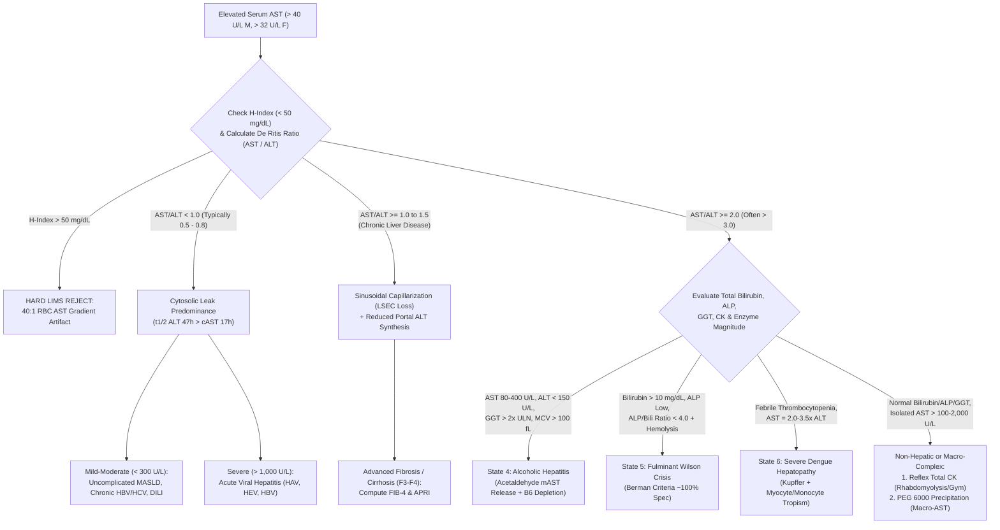

# 2.2.4 — Aspartate Aminotransferase (`AST` / `SGOT`) & `De Ritis Ratio` ($\text{AST:ALT}$)

**Department Folder:** `02_Clinical_Biochemistry`  
**Cluster Folder:** `2.2_Liver_Function_and_Hepatobiliary_Cluster`  
**Institution:** Sawariya Diagnostic Lab, Charkhi Dadri, Haryana (`NABL ISO 15189:2022` & `CAP CHM` Accredited Tier)

---

## 1. International Document Control, Regulatory Traceability & Hardware-Agnostic Platform Matrix

| Metadata Field | Institutional & International Specification |
| :--- | :--- |
| **Document ID & Version** | `SDL-BIO-SOP-2.2.4` (Legacy Alias: `SOP-BIO-2.2.4`) ; **Version `4.0` (International & Above-NABL Red-Team Standard)** |
| **Effective Date & Review Cycle** | **Effective:** `2026-10-12` ; **Review Cycle:** Annual or Immediately Upon Reagent Lot / Calibrator Value Assignment Change |
| **Authorizing Authority** | **Prepared By:** Lead Clinical Biochemist ; **Reviewed By:** Quality Manager (`ISO 15189:2022`) ; **Approved By:** Laboratory Director (MD Pathology) |
| **ISO 15189:2022 Clause Mapping** | Clauses `5.5` (Service Agreements), `6.4` (Equipment Calibration), `6.5` (Metrological Traceability), `7.2.4` (Primary Sample Collection & $40:1$ Hemolysis Shield), `7.2.6` (Sample Receipt & `HIL` Rejection), `7.3.1–7.3.3` (IFCC $37^\circ\text{C}$ Method Verification), `7.3.4` (Measurement Uncertainty of `AST` & `De Ritis Ratio`), `7.3.6` (Carryover & `NADH` Substrate-Depletion Guard), `7.3.7` (Six-Sigma IQC & EQAS), `7.4.1` (Post-Analytical Reporting, `Macro-AST` & Non-Hepatic Muscle Reflex), `8.5` (`ISO 22367` Risk Management), `8.8` (Internal Audit) |
| **NABL & International Standards** | `NABL 112` (Issue 05 — Specific Criteria for Medical Laboratories), `NABL 129` (Measurement Uncertainty), `NABL 131` (Terms & Definitions), `NABL 163` (PT/EQAS Participation), `CAP CHM.13600–31400`, `UKAS TPS 47`, `CLSI EP05-A3, EP06-Ed2, EP07-Ed3, EP09c, EP15-A3, EP17-A2, EP28-A3c, EP31-A, EP37, C56-A, GP41, GP47` |
| **Primary LOINC Codes** | `30239-8` (*Aspartate aminotransferase [Enzymatic activity/volume] in Serum or Plasma by With P-5-P*) ; `1920-8` (*AST without P-5-P*) ; `16324-6` (*Aspartate aminotransferase/Alanine aminotransferase [Enzymatic activity ratio] in Serum or Plasma — De Ritis Ratio*) ; `2325-9` (*Mitochondrial AST [mAST]*) ; `30522-7` (*FIB-4 Fibrosis Score*) ; `96353-8` (*AST to Platelet Ratio Index [APRI]*) |
| **SNOMED-CT Specimen Concepts** | `119364003` (Non-hemolyzed Serum specimen — Gold-Top SST / Red-Top Plain) ; `119361006` (Lithium Heparin Plasma specimen) ; `261665006` (Supernatant following `PEG 6000` precipitation for `Macro-AST`) |
| **ICD-10 / ICD-11 Clinical Coding** | **ICD-10:** `R74.01` (Elevation of liver transaminase levels), `K70.10` (Alcoholic Hepatitis), `K70.30` (Alcoholic Cirrhosis), `K74.60` (Unspecified Cirrhosis), `K76.0` (MASLD / Fatty Liver), `E83.01` (Wilson Disease), `A97.2` (Severe Dengue with Hepatopathy), `M62.82` (Rhabdomyolysis), `O14.2` (HELLP Syndrome), `K72.00` (Acute Ischemic Hepatic Failure) ; **ICD-11:** `ME10.1`, `DB93.1`, `DB92.1`, `5C64.0`, `1D2Z`, `FB32.20`, `JA24.2` |
| **UCUM Dual-Unit Conversion** | $\text{U/L} \times 0.01667 = \mu\text{kat/L}$ ; $\mu\text{kat/L} \times 60.0 = \text{U/L}$ ($1\text{ U/L} = 1\text{ }\mu\text{mol}\cdot\text{min}^{-1}\cdot\text{L}^{-1}$ at $37.0^\circ\text{C}$) ; **De Ritis Ratio:** $\frac{\text{AST (U/L)}}{\text{ALT (U/L)}}$ (Dimensionless Ratio, Reported to 2 Decimal Places) |
| **Metrological Traceability (`ISO 17511:2020`)** | **IFCC Primary Reference Measurement Procedure for the Measurement of Catalytic Activity Concentration of Aspartate Aminotransferase at $37.0^\circ\text{C}$** (Schumann et al., *Clin Chem Lab Med* 2002;40(7):725–733) $\rightarrow$ **IRMM/IFCC Certified Reference Material `ERM-AD457k/IFCC`** (Purified recombinant human cytosolic `cAST` in lyophilized human serum matrix; certified value $102.9 \pm 2.3\text{ U/L}$ [$1.715 \pm 0.038\text{ }\mu\text{kat/L}$] at $k=2$) |
| **Primary Analytical Platform** | **Bonavera Chem 400** (400 Tests/Hour Discrete Random-Access Automated Clinical Chemistry Analyzer — IFCC $37.0^\circ\text{C} \pm 0.1^\circ\text{C}$ UV Continuous-Monitoring Malate Dehydrogenase [`MDH`] / Lactate Dehydrogenase [`LDH`] Coupled $\text{NADH}$ Kinetic Assay at $\lambda_1 = 340\text{ nm}$ / $\lambda_2 = 405\text{ nm}$) |
| **Backup / STAT Continuity Platform** | **Bonavera Chem 200** (200 Tests/Hour Discrete Automated Analyzer — Identical IFCC $37.0^\circ\text{C}$ Bichromatic $340 / 405\text{ nm}$ Optical Channel & Reagent Cassette; Inter-Analyzer Comparability Verified Every 6 Months per `CLSI EP09c` / `EP31-A`) |
| **Controlled Bench Records** | `SDL/BIO/WS/AST-01` (Daily Bench & `PEG 6000` Macro-AST Worksheet) ; `SDL/BIO/LOG/HIL-02` (`HIL` Interference Log) ; `SDL/QMS/CAPA-2026` (Non-Conformance & Critical Call Log) |

---

## 2. 10-Persona International & Above-NABL Red-Team Adversarial Audit Matrix

To guarantee zero non-conformities during unannounced `NABL ISO 15189:2022`, `CAP CHM`, or `UKAS` inspections and to eliminate diagnostic misinterpretation in rural/semi-urban Haryana, this SOP has been stress-tested across **10 Specialized Red-Team Personas**:

| Persona ID & Role | Adversarial Vulnerability Identified in Conventional SOPs | Mandatory Structural & Analytical Upgrade Implemented in `v4.0` |
| :--- | :--- | :--- |
| **Persona 1: Lead NABL (`ISO 15189:2022`, `NABL 112/129/131/163`) & CAP Assessor** | Incomplete clause traceability to `ISO 17511:2020` calibration hierarchy and lack of formal witness-audit verification trails between primary (`Bonavera Chem 400`) and backup (`Bonavera Chem 200`) platforms. | Full unbroken metrological traceability chain to `ERM-AD457k/IFCC`, explicit `CLSI EP31-A` semi-annual comparability tolerances, and a 6-scenario **Live Witness-Audit Simulation Matrix** (Section 10.2). |
| **Persona 2: Hepatopathology & Subspecialty Biochemistry Consultant (`MD/DM`)** | Superficial treatment of the `De Ritis Ratio` ($\text{AST/ALT}$) that fails to explain why `AST/ALT` rises in cirrhosis (`F3–F4`) despite non-alcoholic etiology, or why acute ischemic shock liver inverts its ratio over $48\text{ hours}$. | Comprehensive **7-State Biomathematical & Pathophysiological `De Ritis` Model** (Section 3.2) plus an **8-Condition Subspecialty Differential Diagnosis Matrix** (Section 3.3) integrating `ALT/LDH`, `ALP/Bilirubin`, `FIB-4`, and `APRI`. |
| **Persona 3: CLSI (`EP05–EP37`) & Six-Sigma Metrology Specialist** | Missing quantitative `CLSI EP15-A3` ANOVA variance components, `EP17-A2` `LoB/LoD/LoQ` verification, and optical carryover / substrate-depletion (`A_0`) cutoffs on the `Bonavera Chem 400`. | Complete `CLSI` verification tables, exact `Bonavera Chem 400` photometric parameters (`A_0 < 0.700 AU` substrate-exhaustion trigger), and Six-Sigma Westgard rule assignment ($\sigma = 5.42\sigma$). |
| **Persona 4: Clinical Pharmacologist & Special-Population Auditor** | Failure to separate *in-vivo* drug hepatotoxicity/myotoxicity from *in-vitro* $340\text{ nm}$ spectral interference (Sulfasalazine, Metronidazole) and Vitamin $\text{B}_6$ (`P-5-P`) depletion artifacts in alcoholism, dialysis, and pregnancy. | Dedicated **Pharmacological & Endogenous Interference Matrix** (Section 9) contrasting apo-`AST` vs holo-`AST` kinetics, `P-5-P` reactivation, and $340\text{ nm}$ chromogenic absorbance overflow. |
| **Persona 5: Medico-Legal, Patient-Safety & `ISO 22367:2020` Risk Counsel** | Absence of quantitative `FMECA` (`Severity × Occurrence × Detection = RPN`) and lack of obstetric `HELLP` syndrome critical alerts ($\text{AST} \ge 70\text{ U/L}$). | Full **8-Scenario `ISO 22367:2020` Quantitative FMECA Matrix** (Section 10.1), statutory shields (`CPA 2019`, `DPDP Act 2023`, `PCPNDT Act 1994`), and a verbatim 30-minute `CLSI GP47` read-back script (Section 8.2). |
| **Persona 6: Uncompressed Clinical Documentation & Bench SOP Architect** | Overly condensed tables and missing step-by-step bench instructions for manual dilution, `K-Factor` verification, and `PEG 6000` precipitation. | Expanded multi-column engineering specifications, complete mathematical derivations, and a turnkey printable bench worksheet (`SDL/BIO/WS/AST-01`, Section 12). |
| **Persona 7: IFCC $37^\circ\text{C}$ `AST` Reference Procedure & Isoenzyme (`cAST/mAST`) Specialist** | Failure to distinguish cytosolic `cAST` (`GOT1`, $20\%$ of hepatic pool, $t_{1/2} = 17\text{h}$) from mitochondrial `mAST` (`GOT2`, $80\%$ of hepatic pool, tissue $t_{1/2} \approx 87\text{h}$) and exact IFCC reagent molarities. | Detailed subcellular compartment stoichiometry, `LSEC` stabilin-2 clearance biology, and exact IFCC $37.0^\circ\text{C}$ reagent reaction molarities (Section 5.1–5.2). |
| **Persona 8: Hepatology & Tropical Medicine (`Alcoholic`, `Wilson`, `Dengue`) Specialist** | Missing tropical and metabolic emergencies endemic to North India: **Severe Dengue Hepatopathy** (where $\text{AST} = 2\text{–}3.5\times \text{ALT}$) and **Fulminant Wilson Disease Crisis** (`Berman Criteria`: $\text{AST/ALT} > 2.2$ + $\text{ALP/Bili} < 4.0$). | Dedicated pathophysiological algorithms and automated LIMS reflex rules for Dengue `NS1/IgM` hepatopathy, Wilsonian Coombs-negative hemolytic crisis, and alcoholic `P-5-P` depletion. |
| **Persona 9: Hemolysis ($40:1$ RBC Gradient), `Macro-AST` & `NADH` Exhaustion Auditor** | Routine reporting of mildly hemolyzed samples (`Hb = 80–150 mg/dL`) that artificially double `AST` while leaving `ALT` normal—creating a false `De Ritis Ratio > 2.0`—and failure to detect benign `Macro-AST`. | Mathematical proof of the $40:1$ intra-erythrocytic `AST` artifact, hard LIMS lock at `H-Index > 50 mg/dL`, and a validated **`PEG 6000` ($25\%\text{ w/v}$) Precipitation + $4^\circ\text{C}$ Refrigerated Decay Protocol** (Section 5.4). |
| **Persona 10: EFLM EuBIVAS & `De Ritis Ratio` Error-Propagation Metrology Auditor** | Reporting the `De Ritis Ratio` ($\text{AST/ALT}$) as an exact deterministic number without propagating the combined analytical uncertainty ($u_c$) of both `AST` and `ALT` measurements. | Complete `ISO/TS 20914:2019` uncertainty budget for `AST` plus a formal **Bivariate Error-Propagation Derivation for $U(\text{AST/ALT})$** and asymmetric `EFLM EuBIVAS` Reference Change Values (`RCV`) (Section 6.2–6.3). |

---

## 3. Molecular Biology, Dual Subcellular Isoenzyme Compartment Kinetics (`cAST` vs. `mAST`) & Complete `De Ritis Ratio` Pathophysiology

### 3.1 Dual Subcellular Isoenzyme Architecture (`GOT1` vs. `GOT2`) & Multi-Organ Tissue Gradients
Unlike Alanine Aminotransferase (`ALT` / `GPT1`), which is predominantly restricted to the cytosol of periportal (Zone 1) hepatocytes, **Aspartate Aminotransferase (`AST`, EC 2.6.1.1, L-Aspartate:2-Oxoglutarate Aminotransferase)** exists in humans as **two genetically, immunologically, and kinetically distinct homodimeric isoenzymes** that operate in tandem within the **Malate-Aspartate NADH Shuttle**:

| Biochemical & Kinetic Property | Cytosolic Isoenzyme (`cAST` / `GOT1`) | Mitochondrial Isoenzyme (`mAST` / `GOT2`) | Cytosolic `ALT` (`GPT1` — Comparator) |
| :--- | :--- | :--- | :--- |
| **Chromosomal Locus & Structure** | Chromosome `10q24.2` ; Homodimer of $\sim 93\text{ kDa}$ ($412$ amino acids/subunit) | Chromosome `16q12.2` ; Homodimer of $\sim 89\text{ kDa}$ ($401$ mature amino acids/subunit) | Chromosome `8q24.3` ; Homodimer of $\sim 110\text{ kDa}$ ($496$ amino acids/subunit) |
| **Fraction of Total Hepatocyte Activity** | **$\sim 20\%$ of total intra-hepatocytic `AST`** | **$\sim 80\%$ of total intra-hepatocytic `AST`** (sequestered behind double mitochondrial membranes) | **$\sim 100\%$ Cytosolic** (minimal mitochondrial `GPT2` in human liver) |
| **Fraction of Normal Healthy Serum Activity** | **$85\% \text{ – } 92\%$ of normal circulating serum `AST`** | **$8\% \text{ – } 15\%$ of normal circulating serum `AST`** ($< 5\text{ U/L}$) | **$> 98\%$ of circulating serum `ALT`** |
| **Plasma Elimination Half-Life ($t_{1/2}$)** | **$17 \pm 5\text{ Hours}$** (Rapid clearance via hepatic sinusoidal endothelial cell [`LSEC`] `stabilin-2` receptors) | **Biphasic:** Rapid initial plasma distribution ($t_{1/2,\alpha} \approx 6\text{–}10\text{h}$), prolonged tissue washout / cellular release (**$t_{1/2,\beta} \approx 87\text{ Hours}$**) | **$47 \pm 10\text{ Hours}$** ($2.8\times$ slower clearance than `cAST`) |
| **Affinity for Pyridoxal-5'-Phosphate (`P-5-P`)** | High coenzyme binding stability; moderate apo-enzyme fraction ($10\text{–}15\%$) | Very tight `P-5-P` Schiff-base binding at $\text{Lys}^{258}$ | Lower coenzyme stability; severely depleted in Vitamin $\text{B}_6$ deficiency |
| **Hepatic Acinar Zonation** | Pan-lobular (**Zone 1 $\approx$ Zone 2 $\approx$ Zone 3**) | Enriched in **Zone 3 (Centrilobular / Perivenular)** & Zone 1 | Heavily concentrated in **Zone 1 (Periportal)** |

#### Quantitative Tissue-to-Serum Activity Gradient (Why `AST` Requires a Non-Hepatic Clinical Shield)
Relative to normal human plasma catalytic activity ($1\times \approx 20\text{ U/L}$), intracellular `AST` vs. `ALT` tissue gradients demonstrate why extra-hepatic tissue injury disproportionately elevates `AST` and inflates the `De Ritis Ratio`:
1. **Cardiac Myocardium:** `AST` is **$\sim 7,800\times$** plasma activity (vs. `ALT` $\sim 450\times$).
2. **Hepatic Parenchyma:** `AST` is **$\sim 7,100\times$** plasma activity (vs. `ALT` $\sim 2,850\times$).
3. **Skeletal Muscle:** `AST` is **$\sim 5,000\times$** plasma activity (vs. `ALT` $\sim 300\times$ — **a $16.7:1$ muscle `AST:ALT` ratio!**).
4. **Renal Cortex:** `AST` is **$\sim 4,500\times$** plasma activity (vs. `ALT` $\sim 1,200\times$).
5. **Pancreas & Brain:** `AST` is **$\sim 1,400\text{–}2,000\times$** plasma activity.
6. **Erythrocytes (`RBCs`):** Intra-erythrocytic `AST` is **$40\times$ normal plasma activity** ($\sim 800\text{–}1,200\text{ U/L}$ inside packed RBCs), whereas intra-erythrocytic `ALT` is only **$6\text{–}7\times$ normal plasma activity**!

---

### 3.2 The 7-State Biomathematical & Pathophysiological Architecture of the `De Ritis Ratio` ($\text{AST} / \text{ALT}$)
First described by **Fernando De Ritis, Mario Coltorti, and Giuseppe Giusti in 1957**, the dimensionless ratio of serum `AST` to `ALT` catalytic activity ($\text{De Ritis Ratio} = \frac{\text{AST}}{\text{ALT}}$) integrates four biological variables: **(1) Subcellular compartment injury (`cAST` vs `mAST`)**, **(2) Plasma clearance kinetics ($t_{1/2} = 17\text{h}$ vs $47\text{h}$)**, **(3) Sinusoidal endothelial `stabilin-2` clearance capacity**, and **(4) Intracellular `P-5-P` (Vitamin $\text{B}_6$) cofactor status**:



1. **State 1 — Normal Healthy Steady-State ($\text{AST/ALT} \approx 0.80 \text{ – } 1.15$):**
   In healthy adults without steatosis, physiological hepatocyte and myocyte turnover releases slightly more `AST` than `ALT` into plasma, which is counterbalanced by the faster clearance of `cAST` ($t_{1/2} = 17\text{h}$) relative to `ALT` ($t_{1/2} = 47\text{h}$), maintaining an equilibrium ratio near $0.9\text{–}1.0$.
2. **State 2 — Uncomplicated `MASLD` (Non-Cirrhotic) & Acute/Chronic Viral Hepatitis ($\text{AST/ALT} = 0.50 \text{ – } 0.85 < 1.0$):**
   In metabolic dysfunction-associated steatotic liver disease (`MASLD`) and viral hepatitis (`HAV, HBV, HCV, HEV`), hepatocyte injury is primarily confined to **plasma membrane blebbing and increased cytoplasmic permeability** without massive mitochondrial disintegration. Both cytosolic `ALT` ($100\%$ of liver `ALT`) and cytosolic `cAST` ($20\%$ of liver `AST`) leak into the Space of Disse. Because `ALT` clears $2.8\times$ more slowly ($t_{1/2} = 47\text{h}$) than `cAST` ($t_{1/2} = 17\text{h}$), plasma `ALT` accumulates to significantly higher concentrations, locking the `De Ritis Ratio` at **$< 1.0$** ($0.5\text{–}0.7$ in `MASLD`).
3. **State 3 — Transition from Chronic Hepatitis / `MASLD` to Advanced Fibrosis & Cirrhosis (`F3–F4`) ($\text{AST/ALT} \ge 1.0 \text{ – } 1.6$):**
   When a patient with known `MASLD` or chronic `HBV/HCV` crosses from $\text{AST/ALT} < 0.8$ to **$\text{AST/ALT} \ge 1.0$**, two pathophysiological shifts have occurred:
   - **Impaired Sinusoidal Clearance of `AST`:** Progressive hepatic fibrogenesis causes **sinusoidal capillarization** (deposition of Type I/IV collagen in the Space of Disse and loss of fenestrations on liver sinusoidal endothelial cells [`LSECs`]). Because `cAST` and `mAST` are cleared predominantly via receptor-mediated endocytosis (`stabilin-2`) on healthy `LSECs`, sinusoidal capillarization markedly prolongs the plasma half-life of `AST`.
   - **Hepatocyte Synthetic Exhaustion:** Progressive destruction of Zone-1 periportal hepatocytes depletes intracellular `ALT` reserves faster than mitochondrial `AST`.
4. **State 4 — Alcoholic Hepatitis & Alcoholic Liver Disease ($\text{AST/ALT} \ge 2.0$, frequently $> 3.0$, with $\text{AST} < 300\text{–}500\text{ U/L}$ and $\text{ALT} < 150\text{ U/L}$):**
   A `De Ritis Ratio` $\ge 2.0$ has $> 70\%$ sensitivity and $> 90\%$ specificity (rising to $> 96\%$ when $\text{AST/ALT} > 3.0$) for Alcoholic Hepatitis among liver disease cohorts, driven by two synergistic biochemical hits:
   - **Acetaldehyde & `CYP2E1` Mitochondrial Toxicity:** Ethanol oxidation generates acetaldehyde and reactive oxygen species (`ROS`) that selectively peroxidize cardiolipin in the inner mitochondrial membrane, causing mitochondrial swelling and dumping the massive **$80\%$ mitochondrial `mAST` pool** into circulation (`mAST / Total AST` ratio exceeds $20\text{–}40\%$).
   - **Severe Pyridoxal-5'-Phosphate (`P-5-P`, Vitamin $\text{B}_6$) Depletion:** Acetaldehyde displaces `P-5-P` from albumin/binding proteins and accelerates its degradation by membrane-bound alkaline phosphatase. Hepatic `ALT` synthesis and apoenzyme stability are far more sensitive to `P-5-P` deficiency than `AST`, resulting in **blunted serum `ALT` (< 100–150 U/L)** even during severe alcoholic necroinflammation!
   - **Clinical Caveat:** In pure uncomplicated Alcoholic Hepatitis, absolute transaminases **almost never exceed $300\text{–}500\text{ U/L}$**. If an alcoholic patient presents with $\text{AST} > 1,000\text{ U/L}$, clinicians must immediately look for a superimposed second hit: **Acetaminophen (`Paracetamol`) therapeutic misadventure** (upregulated `CYP2E1` converts even $2\text{–}4\text{ g/day}$ of paracetamol into toxic `NAPQI`!), **ischemic shock liver**, or **rhabdomyolysis from alcohol withdrawal seizures / prolonged immobilization**.
5. **State 5 — Fulminant Wilson Disease Crisis ($\text{AST/ALT} > 2.2$, often $> 4.0$, with $\text{ALP / Total Bilirubin Ratio} < 4.0$ — *Berman Criteria*):**
   In acute Wilsonian hepatic failure (`ATP7B` mutation), sudden necrosis of copper-overloaded hepatocytes releases massive quantities of free non-ceruloplasmin-bound ionic copper ($\text{Cu}^{2+}$) into plasma. Free $\text{Cu}^{2+}$ causes: (a) **direct oxidative mitochondrial destruction** (`mAST` surge), (b) **acute Coombs-negative intravascular hemolysis** (releasing the $40:1$ erythrocytic `AST` pool), and (c) **competitive displacement of $\text{Zn}^{2+}$ and $\text{Mg}^{2+}$ cofactors from Alkaline Phosphatase (`ALP`)**, profoundly suppressing serum `ALP` ($< 40\text{ U/L}$) while Total Bilirubin rises $> 15\text{–}40\text{ mg/dL}$. Combining **$\text{ALP / Total Bilirubin} < 4.0$** (Step 1) with **$\text{AST / ALT} > 2.2$** (Step 2) yields **$100\%$ diagnostic sensitivity and specificity** in distinguishing fulminant Wilson disease from all other causes of acute liver failure (Korman et al., *Hepatology* 2008; AASLD 2022 Practice Guidance).
6. **State 6 — Severe Dengue Fever Hepatopathy (Endemic in Haryana; $\text{AST} = 2.0\text{ to }3.5\times \text{ALT}$):**
   Unlike classic hepatotropic viruses (`HAV, HBV, HEV`) where $\text{ALT} > \text{AST}$, **Dengue Virus (`DENV-1/2/3/4`)** characteristically reverses the transaminase ratio so that **$\text{AST}$ is $2.0\text{ to }3.5\text{ times}$ higher than $\text{ALT}$** (e.g., $\text{AST } 380\text{ U/L}$, $\text{ALT } 135\text{ U/L}$, $\text{De Ritis} = 2.81$). This occurs because `DENV` replicates not only in Zone-2/Zone-3 hepatocytes and Kupffer cells (inducing mitochondrial apoptosis and `mAST` release), but also intensely infects **skeletal myocytes, monocytes, and activated T-lymphocytes** (which are rich in `AST` but poor in `ALT`). Furthermore, `AST` peaks earlier (Days $4\text{–}6$, coinciding with defervescence and critical plasma leakage) and declines faster ($t_{1/2} = 17\text{h}$) than `ALT` during convalescence.
7. **State 7 — Zone-3 Centrilobular Ischemic Hepatitis ("Shock Liver") & Hyper-Acute Acetaminophen (`NAPQI`) Toxicity ($\text{AST} > 3,000\text{–}15,000\text{ U/L}$ with Biphasic Ratio Inversion):**
   Perivenular Zone-3 hepatocytes reside at the lowest oxygen tension and contain high concentrations of `mAST`, `LDH`, and `CYP2E1`. During cardiogenic/septic shock or acute acetaminophen overdose, catastrophic Zone-3 mitochondrial necrosis releases massive `mAST` and `cAST`, producing **$\text{AST} > \text{ALT}$ ($\text{De Ritis } 1.2\text{–}2.5$) during the first $12\text{–}36\text{ hours}$**, accompanied by massive `LDH` elevation (**$\text{ALT / LDH Ratio} < 1.5$** in ischemic hepatitis vs $> 1.5$ in viral hepatitis). Once perfusion is restored, `AST` plummets by **$> 50\%$ within $24\text{–}48\text{ hours}$** ($t_{1/2} = 17\text{h}$) while `ALT` ($t_{1/2} = 47\text{h}$) decays slowly—causing the `De Ritis Ratio` to **invert from $> 1.5$ on Day 1 to $< 0.5$ by Day 4–5**!

---

### 3.3 Subspecialty 8-Condition Differential Diagnosis & Discriminator Matrix

| Clinical Condition | Typical `AST` ($\text{U/L}$) | Typical `ALT` ($\text{U/L}$) | `De Ritis Ratio` ($\text{AST/ALT}$) | Key Biochemical Discriminators (`ALP`, `GGT`, `Bili`, `LDH`, `CK`) | Mandatory Confirmatory Reflex Test at SDL |
| :--- | :--- | :--- | :--- | :--- | :--- |
| **1. Uncomplicated `MASLD` / `MASH` (Non-Cirrhotic)** | $35 \text{ – } 140$ | $50 \text{ – } 220$ | **$0.50 \text{ – } 0.80$** | Normal Bilirubin & `ALP`; mild $\uparrow \text{GGT}$ ($1\text{–}2\times\text{ULN}$); `Triglycerides` $> 150\text{ mg/dL}$; `HbA1c` $\ge 5.7\%$ | Compute **`FIB-4` Index** (`1.2.1` Platelets + Age + `AST/ALT`) & Fasting Lipid/Glycemic Panel |
| **2. Progression of `MASLD` or Viral Hepatitis to Cirrhosis (`F4`)** | $45 \text{ – } 130$ | $30 \text{ – } 95$ | **$\ge 1.00 \text{ – } 1.60$** | `Platelets` $< 150 \times 10^9/\text{L}$; `Albumin` $< 3.5\text{ g/dL}$; `PT-INR` $> 1.2$; `Globulin` $> 3.5\text{ g/dL}$ | **`FIB-4` $> 2.67$** (or $> 3.25$ in viral) $\rightarrow$ Urgent FibroScan / Portal Hypertension Workup |
| **3. Alcoholic Hepatitis / Alcoholic Liver Disease** | $80 \text{ – } 350$ *(Rarely $> 500$)* | $30 \text{ – } 140$ *(Rarely $> 150$)* | **$\ge 2.00 \text{ – } 4.00$** | **$\text{GGT} > 2\text{–}10\times \text{ULN}$** ($\text{GGT/ALP} > 2.5$); `MCV` $> 100\text{ fL}$; `IgA` elevated; Maddrey DF score | Reflex **`GGT` (`2.2.6`)**, `CBC` (`MCV`, Platelets), `PT-INR` (`1.3.2`), & Total Bilirubin (`2.2.1`) |
| **4. Acute Viral Hepatitis (`HAV`, `HEV`, `HBV`)** | $800 \text{ – } 3,500$ | $1,000 \text{ – } 5,000$ | **$0.55 \text{ – } 0.90$** | **$\text{ALT / LDH Ratio} > 1.5\text{–}4.0$**; Direct Hyperbilirubinemia ($5\text{–}20\text{ mg/dL}$); prodromal fever/jaundice | Reflex `Anti-HAV IgM`, `Anti-HEV IgM`, `HBsAg`, `Anti-HBc IgM`, `Anti-HCV` & `PT-INR` |
| **5. Fulminant Wilson Disease Crisis (`ATP7B`)** | $120 \text{ – } 600$ | $40 \text{ – } 180$ | **$> 2.20 \text{ – } 5.00$** | **$\text{ALP / Total Bilirubin} < 4.0$** (`ALP` often $< 40\text{ U/L}$, Bilirubin $> 15\text{ mg/dL}$); Coombs-negative hemolysis (`Hb` $< 9\text{ g/dL}$, $\uparrow \text{LDH}$, Reticulocytosis) | Urgent **Ceruloplasmin (`2.2.12`)**, $24\text{h}$ Urine Copper, Direct Coombs Test, & Slit-Lamp Kayser-Fleischer Ring Exam |
| **6. Severe Dengue Hepatopathy (Endemic Haryana)** | $150 \text{ – } 1,500$ | $60 \text{ – } 500$ | **$2.00 \text{ – } 3.50$** | Thrombocytopenia (`Platelets` $< 100 \times 10^9/\text{L}$), Leukopenia, rising Hematocrit (`Hct` $+20\%$ capillary leak) | Reflex **`Dengue NS1 Ag / IgM ELISA`**, Serial `Hct` & `Platelet` Monitoring every $12\text{h}$ |
| **7. Ischemic "Shock Liver" / Acute `NAPQI` Toxicity** | $3,000 \text{ – } 15,000$ | $2,000 \text{ – } 10,000$ | **$1.20 \text{ – } 2.50$ (Day 1)** $\rightarrow$ **$< 0.60$ (Day 4)** | **$\text{ALT / LDH Ratio} < 1.5$** (`LDH` $> 3,000\text{–}12,000\text{ U/L}$); rapid $> 50\%$ `AST` fall within $48\text{h}$; early `INR` $> 1.5$ & `Creatinine` rise | Immediate Critical Call; Serial `AST`, `ALT`, `LDH` (`2.5.10`), `PT-INR`, Arterial Lactate, & Serum Paracetamol level |
| **8. Acute Rhabdomyolysis / Extreme Exercise vs. `Macro-AST`** | $120 \text{ – } 3,000$ | $25 \text{ – } 350$ | **$3.00 \text{ – } 8.00$** | Completely **Normal Bilirubin, `ALP`, and `GGT`**. In Rhabdomyolysis: **`Total CK` $> 1,000\text{–}100,000\text{ U/L}$**. In `Macro-AST`: Normal `CK` & `LDH` | Step 1: Reflex **`Total CK` (`2.5.11`)** & Urine Myoglobin. Step 2 (if `CK` normal): **`PEG 6000` Precipitation** (Section 5.4) |

---

## 4. Pre-Analytical Protocol, Phlebotomy, Rural Haryana Exercise/Hemolysis Shield & `CLSI EP07/EP37` Quantitative `HIL` Matrix

### 4.1 Patient Preparation & The Rural Haryana Physical-Recruitment / Agricultural Exercise Shield
1. **Mandatory 72-Hour Strenuous Exercise & Intramuscular (`IM`) Injection Abstinence:**
   - In **Charkhi Dadri and surrounding Bhiwani/Mahendragarh districts**, thousands of young adults undergo intensive physical preparation ($1,600\text{ m}$ timed sprints, weighted squats, rope climbing, wrestling/*akhada* training) for Indian Armed Forces, Central Armed Police Forces (`CAPF`), and Haryana Police recruitment, or perform heavy seasonal agricultural labor.
   - Skeletal muscle contains $5,000\times$ plasma `AST` concentration with an intracellular `AST:ALT` ratio of $\sim 16.7:1$. A single bout of eccentric muscle exertion or a single gluteal intramuscular injection (e.g., Diclofenac or B-complex injection) releases sarcoplasmic `AST` and `CK`, elevating serum **`AST` to $85\text{–}650\text{ U/L}$ within $6\text{–}24\text{ hours}$** and keeping it elevated for **$5\text{ to }7\text{ days}$**, while `ALT` rises only mildly ($35\text{–}110\text{ U/L}$).
   - **Pre-Analytical Reception Rule (`SDL/PRE/TRF-01`):** Phlebotomists must explicitly document on the Test Requisition Form whether the patient has performed heavy gym/recruitment running or received an `IM` injection within the preceding **$72\text{ hours}$**. For routine medical fitness checks, advise a $72\text{-hour}$ rest period prior to venipuncture.
2. **Fasting & Alcohol History:**
   - While `AST` catalytic activity itself is not acutely altered by a standard meal, postprandial chylomicronemia (`L-Index > 300–500 mg/dL`) causes severe $340\text{ nm}$ light-scattering absorbance overflow in the UV kinetic assay. Therefore, an **$8\text{ to }12\text{ hour}$ overnight fast** is recommended when ordered as part of a comprehensive Liver Function Test (`LFT`).

### 4.2 Venipuncture, `CLSI GP41` Order-of-Draw & Anticoagulant Compatibility
- **Acceptable Specimens:**
  1. **Serum (Preferred):** Collect $3.0\text{ mL}$ whole blood into a **Gold-Top Serum Separator Tube (`SST` with clot activator and polymer gel)** or **Red-Top Plain Tube**. Allow to clot upright for $20\text{–}30\text{ minutes}$ at $20\text{–}25^\circ\text{C}$, then centrifuge at **$1,500 \times g$ for $10\text{ minutes}$ within $45\text{ minutes}$ of collection** to prevent erythrocyte transmembrane leakage of `AST`.
  2. **Lithium Heparin Plasma (STAT Acceptable):** Collect into a **Green-Top Lithium Heparin Tube** (without EDTA). Centrifuge immediately at $1,500 \times g$ for $10\text{ minutes}$.
- **Strictly Unacceptable Specimens (Hard Rejection):**
  - **Lavender-Top (`K2/K3-EDTA`), Blue-Top (`3.2% Sodium Citrate`), and Grey-Top (`Sodium Fluoride / Potassium Oxalate`):** Rejected immediately (`ISO 15189:2022 Clause 7.2.6`). Oxalate and fluoride inhibit the `MDH`/`LDH` indicator enzymes and cause osmotic water shifts from erythrocytes, while citrate produces a $10\%$ dilutional negative bias.
- **Atraumatic Phlebotomy Mandate to Prevent the $40:1$ Hemolysis Artifact:**
  - Never use needles smaller than $22\text{G}$ ($23\text{G}$ butterfly only with gentle syringe draw and slow vacuum transfer after removing needle), never leave the tourniquet applied for $> 60\text{ seconds}$, never draw blood through an indwelling IV cannula (causes shear-stress hemolysis in $> 15\%$ of draws), and ensure complete evaporation of $70\%$ isopropyl alcohol before skin puncture.

### 4.3 Multi-Temperature Stability & Quantitative `HIL` Spectral/Intracellular Interference Matrix (`CLSI EP07-Ed3`, `EP37`, `C56-A`)

#### Mathematical Proof of Why Mild Hemolysis (`H-Index > 50 mg/dL`) Destroys `AST` & `De Ritis Ratio` Validity
Intracellular hemoglobin (`Hb`) in packed erythrocytes is $\approx 33,000\text{ mg/dL}$ ($330\text{ g/L}$), and intra-erythrocytic `AST` activity is $\approx 40\times$ normal plasma activity ($\sim 1,000\text{ U/L}$ inside RBCs vs $25\text{ U/L}$ in plasma), whereas intra-erythrocytic `ALT` is only $\sim 6.5\times$ normal plasma activity ($\sim 160\text{ U/L}$ inside RBCs):
$$\Delta \text{AST}_{\text{hemolysis}} (\text{U/L}) \approx \text{Hb}_{\text{free}} (\text{mg/dL}) \times 0.15\text{ to }0.20\text{ U/L per mg/dL Hb}$$
- At **`H-Index` $= 50\text{ mg/dL}$** (faint pink serum, barely perceptible to the naked eye): $\Delta \text{AST} \approx +7.5\text{ to }+10.0\text{ U/L}$ ($+30\text{ to }+40\%$ positive bias on a baseline of $25\text{ U/L}$, exceeding the EFLM desirable bias of $3.5\%$ and CLIA $\text{TE}_a$ of $15\%$).
- At **`H-Index` $= 150\text{ mg/dL}$** (moderate cherry-pink serum): A healthy teetotaler with true $\text{AST} = 24\text{ U/L}$ and true $\text{ALT} = 22\text{ U/L}$ ($\text{True De Ritis} = 1.09$) will measure **$\text{Spurious AST} \approx 52\text{ U/L}$** and **$\text{Measured ALT} \approx 24\text{ U/L}$**, yielding a **$\text{Spurious De Ritis Ratio} = 2.17$**—falsely labeling a non-drinker as having **Alcoholic Liver Disease** or inflating a 60-year-old patient's **`FIB-4` score** from $1.47$ (low risk) to **$3.06$ (false-positive advanced cirrhosis)**!

| Matrix / Interferent Category | Storage / Analytical Condition | Validated Stability / Quantitative Cutoff | Magnitude & Direction of Bias | Mandatory Automated LIMS & Bench Action (`Bonavera Chem 400`) |
| :--- | :--- | :--- | :--- | :--- |
| **Unseparated Whole Blood** | Contact with RBC clot at $18\text{–}25^\circ\text{C}$ | **Maximum $\le 45\text{ Minutes}$** (Absolute ceiling $2\text{ Hours}$) | Progressive **False Elevation ($+10\%$ to $+45\%$)** | Transmembrane leakage of erythrocytic `cAST` and `LDH` across cooling RBC membranes. Centrifuge within $45\text{ min}$ of collection; use gel `SST` tubes for peripheral collection centers. |
| **Separated Serum / Heparin Plasma (Ambient & $4^\circ\text{C}$)** | $18\text{–}25^\circ\text{C}$ (Room Temp) ; $2\text{–}8^\circ\text{C}$ (Refrigerated) | **$24\text{ Hours}$** at $18\text{–}25^\circ\text{C}$ ($< 3\%$ loss) ; **$7\text{ Days}$** at $2\text{–}8^\circ\text{C}$ ($< 5\%$ loss for normal `cAST`) | Slight activity decay beyond $7\text{ days}$ at $4^\circ\text{C}$ (Except **`Macro-AST`**, which loses **$> 40\text{–}60\%$** in $3\text{–}5\text{ days}$ at $4^\circ\text{C}$!) | Store capped at $2\text{–}8^\circ\text{C}$ immediately after analysis. **Diagnostic Pearl:** Rapid decay of isolated high `AST` upon $4^\circ\text{C}$ storage for $5\text{ days}$ is a secondary screening confirmation for **`Macro-AST`**! |
| **Frozen Serum (`-20°C` & `-80°C`)** | $-20^\circ\text{C}$ Freezer ; $-80^\circ\text{C}$ Ultra-Low Freezer | **$30\text{ Days}$** at $-20^\circ\text{C}$ ; **$> 12\text{ Months}$** at $-80^\circ\text{C}$ (Maximum 1 freeze-thaw cycle) | **Stable at $-20^\circ\text{C}$** ($< 4\%$ loss) | **CRITICAL CONTRAST WITH `ALT`:** Unlike `ALT` (which suffers cryo-denaturation at $-20^\circ\text{C}$ and must never be frozen at $-20^\circ\text{C}$), `AST` is structurally stable at $-20^\circ\text{C}$ for $30\text{ days}$. Thaw at $37^\circ\text{C}$ water bath for $5\text{ min}$ and vortex gently. |
| **Hemolysis (`H-Index` at $570/600\text{ nm}$)** | Free Hemoglobin in Serum/Plasma | **`H-Index` $> 50\text{ mg/dL}$** ($\ge 0.50\text{ g/L}$ Free Hb; `H1+` flag) | **Severe False-Positive Elevation** ($+0.15\text{ to }+0.20\text{ U/L}$ per $\text{mg/dL}$ Free Hb due to $40:1$ RBC gradient + $340\text{ nm}$ Soret tail absorbance) | **HARD LIMS SUPPRESSION:** If `H-Index > 50 mg/dL`, suppress both `AST` and `De Ritis Ratio`. Issue automated redraw request (`[REJECT-HEMOLYSIS-AST]`). If *in-vivo* intravascular hemolysis is suspected (e.g., Wilson crisis, G6PD, autoimmune hemolysis), verify via repeat atraumatic draw + `Reticulocyte Count` & `Haptoglobin`. |
| **Icterus (`I-Index` at $480/505\text{ nm}$)** | Conjugated & Unconjugated Bilirubin | **`I-Index` $\le 40\text{ mg/dL}$** ($684\text{ }\mu\text{mol/L}$) | Negligible bias ($< \pm 5\%$) up to $40\text{ mg/dL}$; $> 40\text{ mg/dL}$ increases $340\text{ nm}$ baseline absorbance | Bichromatic $340 / 405\text{ nm}$ kinetic rate subtraction eliminates static bilirubin color. If Total Bilirubin $> 40\text{ mg/dL}$ causes initial absorbance flag, perform $1:2$ or $1:5$ automated dilution with $0.9\%\text{ NaCl}$. |
| **Lipemia / Turbidity (`L-Index` at $660/700\text{ nm}$)** | Intralipid / Chylomicrons / VLDL | **`L-Index` $> 300\text{ mg/dL}$** (Triglycerides $\gtrsim 600\text{ mg/dL}$) | **Optical Absorbance Overflow (`> 2.500 AU` at $340\text{ nm}$)** & Non-Linear Kinetic Noise | Chylomicron light scattering blocks $340\text{ nm}$ UV transmission. **Never use chemical clearing agents** (inhibit enzyme activity). Ultracentrifuge at $10,000 \times g$ for $10\text{ min}$ (assay infranatant) or perform $1:5$ saline dilution. |

---

## 5. Hardware-Agnostic Analytical SOP (`Bonavera Chem 400` & `Chem 200`), IFCC $37^\circ\text{C}$ Chemistry & `Macro-AST` `PEG 6000` Protocol

### 5.1 IFCC $37.0^\circ\text{C}$ Primary Reference Method Principle & Reaction Stoichiometry
In accordance with the **International Federation of Clinical Chemistry and Laboratory Medicine (IFCC) Primary Reference Procedure at $37.0^\circ\text{C}$** (Schumann et al., *Clin Chem Lab Med* 2002;40:725–733), `AST` (`EC 2.6.1.1`) catalyzes the reversible transfer of an $\alpha$-amino group from **L-Aspartate** to **2-Oxoglutarate** ($\alpha$-Ketoglutarate) via a ping-pong bi-bi mechanism mediated by enzyme-bound **Pyridoxal-5'-Phosphate (`P-5-P`)**, yielding **Oxaloacetate** and **L-Glutamate**:

$$\text{L-Aspartate} + \text{E–P-5-P (Aldimine)} \rightleftharpoons \text{Oxaloacetate} + \text{E–PMP (Pyridoxamine-5'-Phosphate)}$$
$$\text{E–PMP} + \text{2-Oxoglutarate} \rightleftharpoons \text{L-Glutamate} + \text{E–P-5-P (Aldimine)}$$

#### Complete Coupled Enzymatic Reaction Sequence
1. **Phase 1 — `R1` Pre-Incubation Lag Phase ($300\text{ Seconds}$ at $37.0^\circ\text{C}$): Holo-Enzyme Reactivation & Endogenous Pyruvate Scavenging:**
   During pre-incubation of the patient sample with Reagent 1 (`R1`), two critical preparatory reactions go to completion before the starter substrate (`2-Oxoglutarate` in `R2`) is added:
   - **Apo-AST Reactivation (When `P-5-P` is Included):** Exogenous `P-5-P` ($0.10\text{ mmol/L}$) binds to the $\varepsilon$-amino group of $\text{Lys}^{258}$ on inactive **apo-`AST`**, converting $100\%$ of circulating enzyme into catalytically active **holo-`AST`**:
     $$\text{Apo-AST (Inactive)} + \text{Pyridoxal-5'-Phosphate (P-5-P)} \xrightarrow{\text{pH } 7.80, 37.0^\circ\text{C}} \text{Holo-AST (Active Schiff Base)}$$
   - **Endogenous Pyruvate Elimination (`LDH` Scavenger Shield):** Patient serum contains endogenous pyruvate ($0.05\text{–}0.30\text{ mmol/L}$, or higher in lactic acidosis/hypoxia) and endogenous `LDH`. If not removed prior to the measurement window, endogenous `LDH` would reduce endogenous pyruvate using $\text{NADH}$, causing a false-positive $-\Delta A_{340\text{ nm}}/\text{min}$ rate! Exogenous **Lactate Dehydrogenase (`LDH`, $\ge 600\text{ U/L}$)** in `R1` quantitatively reduces all endogenous sample pyruvate to L-Lactate within the first $30\text{–}45\text{ seconds}$:
     $$\text{Endogenous Pyruvate} + \text{NADH} + \text{H}^+ \xrightarrow{\text{Exogenous LDH (R1)}} \text{L-Lactate} + \text{NAD}^+ \quad (\text{Completed during Lag Phase})$$
2. **Phase 2 — `R2` Starter Addition & Coupled `MDH` Continuous UV Kinetic Rate Measurement ($\lambda_1 = 340\text{ nm} / \lambda_2 = 405\text{ nm}$):**
   Addition of `2-Oxoglutarate` (`R2`) initiates the main `AST` transamination reaction:
   $$\text{L-Aspartate} + \text{2-Oxoglutarate} \underset{\text{Holo-AST (P-5-P), pH } 7.80, 37.0^\circ\text{C}}{\stackrel{\text{EC 2.6.1.1}}{\rightleftharpoons}} \text{Oxaloacetate} + \text{L-Glutamate}$$
   The nascent **Oxaloacetate** (which is unstable and would otherwise inhibit `AST` product-wise) is instantaneously reduced to **L-Malate** by excess auxiliary indicator enzyme **Malate Dehydrogenase (`MDH`, EC 1.1.1.37, $\ge 420\text{ U/L}$)** with equimolar oxidation of reduced **$\beta\text{-NADH}$** (which absorbs strongly at $340\text{ nm}$) to **$\text{NAD}^+$** (which does not absorb at $340\text{ nm}$):
   $$\text{Oxaloacetate} + \beta\text{-NADH} + \text{H}^+ \xrightarrow{\text{Malate Dehydrogenase (MDH)}} \text{L-Malate} + \beta\text{-NAD}^+$$
   The rate of decrease in absorbance at $340\text{ nm}$ ($-\Delta A_{340\text{ nm}}/\text{min}$, bichromatically blanked at $405\text{ nm}$) is directly proportional to the catalytic activity concentration of `AST` in the sample ($1\text{ mol NADH oxidized} = 1\text{ mol Oxaloacetate formed}$).

---

### 5.2 Exact IFCC $37.0^\circ\text{C}$ Reagent Formulation & Final Cuvette Reaction Molarities

| Component | Reagent Compartment (`R1` vs `R2`) | Final Concentration in Reaction Mixture ($37.0^\circ\text{C}$) | Biochemical & Metrological Function |
| :--- | :--- | :--- | :--- |
| **`TRIS` [Tris(hydroxymethyl)aminomethane] Buffer** | `R1` (Enzyme/Coenzyme/Aspartate Buffer) | **$80\text{ mmol/L}$** ($\text{pH } 7.80 \pm 0.05$ at $37.0^\circ\text{C}$) | Maintains optimal $\text{pH } 7.80$ for both `cAST` and `mAST` without chelating phosphate or inhibiting `MDH` |
| **L-Aspartate (Monosodium Salt)** | `R1` | **$240\text{ mmol/L}$** | Saturating amino-group donor substrate ($> 40 \times K_m$ of `cAST`, guaranteeing zero-order kinetics) |
| **Pyridoxal-5'-Phosphate (`P-5-P`)** | `R1` *(Or dedicated P-5-P Supplement)* | **$0.10\text{ mmol/L}$** ($100\text{ }\mu\text{mol/L}$) | Saturates apo-`AST` into active holo-`AST` per IFCC Primary Reference Procedure (`LOINC 30239-8`) |
| **Malate Dehydrogenase (`MDH`, Porcine/Recombinant)** | `R1` | **$\ge 420\text{ U/L}$** ($\ge 7.0\text{ }\mu\text{kat/L}$ at $37.0^\circ\text{C}$) | Coupled indicator enzyme; converts Oxaloacetate to L-Malate instantaneously without rate limitation |
| **Lactate Dehydrogenase (`LDH`, Rabbit/Microbial)** | `R1` | **$\ge 600\text{ U/L}$** ($\ge 10.0\text{ }\mu\text{kat/L}$ at $37.0^\circ\text{C}$) | Scavenges endogenous sample pyruvate during the `R1` lag phase to prevent false-high $-\Delta A/\text{min}$ |
| **$\beta\text{-NADH}$ (Disodium Salt)** | `R2` (Alkaline Stabilized Starter) | **$0.18\text{ mmol/L}$** ($180\text{ }\mu\text{mol/L}$) | UV chromogenic coenzyme ($\varepsilon_{340\text{ nm}} = 6,300\text{ L}\cdot\text{mol}^{-1}\cdot\text{cm}^{-1}$); gives initial $A_{340} \approx 1.13\text{ AU}$ |
| **2-Oxoglutarate ($\alpha$-Ketoglutarate)** | `R2` (Starter Substrate) | **$12\text{ mmol/L}$** | Amino-group acceptor starter substrate ($> 10 \times K_m$); initiates the coupled transamination reaction |
| **Sodium Azide / Stabilizers** | `R1` & `R2` | **$0.095\%\text{ w/v}$** ($\le 14.6\text{ mmol/L}$) | Prevents microbial growth (which would consume L-Aspartate or oxidize $\text{NADH}$) |

---

### 5.3 `Bonavera Chem 400` (Primary) & `Bonavera Chem 200` (Backup) Programming & Theoretical `K-Factor` Derivation

| Instrument Parameter | `Bonavera Chem 400` / `Chem 200` Setting | Engineering Rationale & Quality Guardrail |
| :--- | :--- | :--- |
| **Assay Mode & Reaction Direction** | **2-Point Rate / Continuous UV Kinetic (`Decreasing` $-\Delta A/\text{min}$)** | Continuous multi-point linear regression across reading window (`Rate-A`) |
| **Primary / Secondary Wavelengths** | **$\lambda_1 = 340\text{ nm}$ (Main) ; $\lambda_2 = 405\text{ nm}$ (Sub-Wavelength)** | $340\text{ nm}$ measures $\text{NADH}$ disappearance; $405\text{ nm}$ corrects for cuvette scratches, micro-bubbles, and static matrix turbidity |
| **Reaction Temperature** | **$37.0^\circ\text{C} \pm 0.1^\circ\text{C}$** (Peltier Dry-Bath Regulated) | Temperature coefficient $Q_{10}$ of `AST` is $\sim 1.95$ (**$+6.9\%\text{ per } +1.0^\circ\text{C}$**); strict $\pm 0.1^\circ\text{C}$ control keeps thermal bias $< 0.7\%$ |
| **Pipetting Volumes ($4:1$ Reagent Ratio)** | **Sample ($V_S$):** $15.0\text{ }\mu\text{L}$ ; **`R1` ($V_{R1}$):** $132.0\text{ }\mu\text{L}$ ; **`R2` ($V_{R2}$):** $33.0\text{ }\mu\text{L}$ | Total Reaction Volume $V_T = 180.0\text{ }\mu\text{L}$ (Sample Volume Fraction $\varphi = 15 / 180 = 1:12 = 0.0833$) |
| **Incubation & Kinetic Timing Cycle** | **`R1` + Sample Incubation:** $300\text{ sec}$ $\rightarrow$ **Add `R2`** $\rightarrow$ **Lag Phase:** $60\text{ sec}$ $\rightarrow$ **Kinetic Read Window:** $180\text{ sec}$ ($9$ points at $20\text{-sec}$ intervals) | $300\text{-sec}$ `R1` incubation ensures complete `LDH` pyruvate scavenging and `P-5-P` holo-enzyme activation; $60\text{-sec}$ post-`R2` lag eliminates mixing transients and glutamate dehydrogenase (`GLDH`) side-reactions |
| **Theoretical vs. Calibrated `K-Factor`** | **Theoretical $K = -1,905\text{ U/L per }\Delta A/\text{min}$** ; **Calibrated $K$ (`ERM-AD457k/IFCC`):** $-1,860\text{ to }-1,950$ | Derived from Beer-Lambert Law: $K = \frac{V_T \times 10^6}{\varepsilon_{340} \times l \times V_S} = \frac{180 \times 10^6}{6,300 \times 1.0\text{ cm} \times 15} = 1,904.8$. **Hard Rule:** Reject calibration if calibrated $K$ deviates by $> \pm 5.0\%$ from $-1,905$! |
| **Initial Absorbance Floor (`Substrate Depletion Guard`)** | **Minimum Initial $A_{340\text{ nm}}$ at First Read Point ($t = 60\text{s}$ post-`R2`): $A_0 \ge 0.700\text{ AU}$** (Fresh Reagent $A_0 \approx 1.15\text{–}1.35\text{ AU}$) | **CRITICAL ANTI-FALSE-NORMAL SHIELD:** In hyper-acute hepatic necrosis or severe rhabdomyolysis ($\text{True AST} > 2,500\text{–}15,000\text{ U/L}$), all $\text{NADH}$ is oxidized during the $60\text{-sec}$ lag phase, leaving a flat line ($\Delta A/\text{min} \approx 0$) that an unguarded photometer would report as $< 15\text{ U/L}$! Any sample with **$A_0 < 0.700\text{ AU}$** or **Linearity Deviation $> 10\%$** triggers immediate `SUBSTRATE DEPLETION` flag and automatic $1:10$ / $1:50$ saline rerun. |
| **Analytical Measuring Range (`AMR`) & `CRR`** | **`AMR` (Undiluted):** $4.0 \text{ – } 500.0\text{ U/L}$ ; **`CRR` (With $1:10$ & $1:20$ Auto-Dilution):** $4.0 \text{ – } 10,000.0\text{ U/L}$ | Auto-dilution uses $0.9\%\text{ w/v}$ analytical-grade $\text{NaCl}$ ($3.0\text{ }\mu\text{L}$ sample $+ 27.0\text{ }\mu\text{L}$ saline for $1:10$). |
| **Probe Carryover Mitigation (`CLSI EP36`)** | Acid/Alkaline detergent wash cycle triggered whenever preceding sample $\text{AST} > 1,000\text{ U/L}$ or preceding test is `LDH` / `CK` | Prevents reagent-to-reagent `LDH/MDH` carryover and high-to-low specimen carryover ($< 0.05\%$, verified via $H_1\text{–}H_3$ / $L_1\text{–}L_3$ protocol). |

---

### 5.4 Step-by-Step `Macro-AST` Confirmation Bench Protocol (`PEG 6000` Precipitation + $4^\circ\text{C}$ Refrigerated Decay Method)

#### Clinical Indication for Performing the Sawariya `Macro-AST` Protocol
Perform this bench protocol whenever a patient presents with **persistent isolated `AST` elevation ($\text{AST } 65\text{–}600\text{ U/L}$, $\text{De Ritis Ratio } > 2.0\text{–}10.0$)** accompanied by **completely normal `ALT`, Total Bilirubin, `ALP`, `GGT`, `Total CK`, and `LDH`** in an asymptomatic individual without hemolysis (`H-Index < 50 mg/dL`).
- **Pathophysiology of `Macro-AST`:** `Macro-AST` is a benign circulating high-molecular-weight immune complex ($\text{MW } 250\text{–}700\text{ kDa}$) formed by the binding of monomeric cytosolic `cAST` ($\sim 93\text{ kDa}$) to an endogenous immunoglobulin (most commonly **`IgG` [$\kappa$ or $\lambda$]** or **`IgA`**). Because of its steric bulk and masked epitopes, `Macro-AST` cannot undergo receptor-mediated endocytosis by hepatic sinusoidal endothelial cells (`LSECs`), prolonging its plasma half-life from $17\text{ hours}$ to **$10\text{–}30\text{ days}$**. Recognizing `Macro-AST` prevents invasive, costly, and potentially hazardous **liver biopsies** in children, pregnant women, and healthy adults!

#### Method A: Quantitative `PEG 6000` ($25\%\text{ w/v}$) Precipitation Protocol (Primary Reference Screen)
1. **Reagent Preparation (`SDL-PEG-25`):** Dissolve **$25.0\text{ g}$ of Polyethylene Glycol 6000 (`PEG 6000`, analytical grade, $\text{MW } 5,000\text{–}7,000\text{ Da}$)** in $70\text{ mL}$ of $0.9\%\text{ w/v}$ sterile $\text{NaCl}$ (or $50\text{ mmol/L}$ phosphate-buffered saline, $\text{pH } 7.40$) and bring to a final volume of **$100.0\text{ mL}$**. Filter through a $0.45\text{ }\mu\text{m}$ membrane; stable for **$3\text{ months}$ at $2\text{–}8^\circ\text{C}$** (check monthly for microbial turbidity or pH drift).
2. **Parallel Control Requirement:** Always run **one normal/hepatitis patient serum control (`Non-Macro Control`, $\text{AST } 80\text{–}250\text{ U/L}$ from known viral/MASLD liver disease)** in parallel with the patient specimen to verify `PEG 6000` reagent integrity.
3. **Bench Pipetting & Incubation Steps:**
   - **Tube 1 (`PEG-Treated Tube`):** Pipette **$200.0\text{ }\mu\text{L}$ Patient Serum** + **$200.0\text{ }\mu\text{L}$ of $25\%\text{ w/v}$ `PEG 6000` solution** ($1:2$ dilution; final `PEG` concentration $= 12.5\%\text{ w/v}$).
   - **Tube 2 (`Saline-Diluted Baseline Tube`):** Pipette **$200.0\text{ }\mu\text{L}$ Patient Serum** + **$200.0\text{ }\mu\text{L}$ of $0.9\%\text{ w/v}$ $\text{NaCl}$** (eliminates matrix dilution non-linearity).
   - Vortex both tubes thoroughly for **$15\text{ seconds}$**.
   - Incubate both tubes in a **$37.0^\circ\text{C}$ water bath (or dry block) for $10\text{ minutes}$**.
   - Centrifuge both tubes at **$3,000 \times g$ for $15\text{ minutes}$ at room temperature ($20\text{–}25^\circ\text{C}$)**.
   - Carefully aspirate **$150\text{ }\mu\text{L}$ of clear supernatant** from Tube 1 ($\text{AST}_{\text{PEG-Sup}}$) and Tube 2 ($\text{AST}_{\text{Saline-Sup}}$) without disturbing the white immunoglobulin pellet at the bottom of Tube 1, and assay both on the **Bonavera Chem 400**.
4. **Mathematical Calculation of `%PEG Recovery` & `%PEG Precipitation`:**
   $$\text{Corrected Native AST} = 2 \times \text{AST}_{\text{Saline-Sup}} \text{ (U/L)}, \qquad \text{Corrected PEG AST} = 2 \times \text{AST}_{\text{PEG-Sup}} \text{ (U/L)}$$
   $$\%\text{PEG Recovery} = \left(\frac{\text{AST}_{\text{PEG-Sup}}}{\text{AST}_{\text{Saline-Sup}}}\right) \times 100\%$$
   $$\%\text{PEG Precipitation (PPA)} = 100\% - \%\text{PEG Recovery} = \left(1 - \frac{\text{AST}_{\text{PEG-Sup}}}{\text{AST}_{\text{Saline-Sup}}}\right) \times 100\%$$
5. **Validated Diagnostic Decision Cutoffs (Davidson & Watson 2003 / Patteet et al. 2022):**
   - **Normal Monomeric `AST` (`Non-Macro`):** `%\text{PEG Recovery} \ge 40\%` (`%\text{PEG Precipitation} \le 60\%$; typical monomeric precipitation is $25\%\text{–}53\%$).
   - **Borderline / Indeterminate Zone:** `%\text{PEG Recovery} = 27\% \text{ – } 39\%` (`%\text{PEG Precipitation} = 61\% \text{ – } 73\%$) $\rightarrow$ Proceed to **Method B ($4^\circ\text{C}$ Refrigerated Decay Test)**.
   - **Diagnostic Positive for Benign `Macro-AST`:** **`%\text{PEG Recovery} < 27\%` (`%\text{PEG Precipitation} > 73\%`, typically $80\%\text{–}98\%$ precipitation!)**.

#### Method B: Complementary $4^\circ\text{C}$ Refrigerated Storage Decay Test (Zero-Reagent Confirmatory Method)
- **Principle:** High-molecular-weight `AST–IgG` and `AST–IgA` immune complexes undergo progressive cryo-aggregation and conformational inactivation when stored at $2\text{–}8^\circ\text{C}$, whereas normal monomeric `cAST` loses $< 5\%$ of its activity over $5\text{–}7\text{ days}$ at $2\text{–}8^\circ\text{C}$ (Chtioui et al., *J Hepatol* / *Clin Chim Acta*).
- **Procedure:** Measure baseline serum $\text{AST}_{\text{Day 0}}$, store an aliquot tightly capped at **$2\text{–}8^\circ\text{C}$ for $5\text{ Days}$ ($120\text{ Hours}$)**, centrifuge at $3,000 \times g$ for $10\text{ min}$, and re-assay supernatant $\text{AST}_{\text{Day 5}}$.
- **Interpretation:** A **$> 40\%\text{ to }90\%$ decrease in `AST` activity after $5\text{ days}$ at $2\text{–}8^\circ\text{C}$** (while a parallel non-macro control loses $< 5\%$) independently confirms **`Macro-AST`**!

---

### 5.5 Step-by-Step `ISO 17511:2020` Calibration Hierarchy, Westgard `OOC` Troubleshooting & Manual Backup Protocol

#### Unbroken `ISO 17511:2020` Metrological Traceability Chain for `AST`
1. **SI Unit Definition:** Catalytic activity concentration expressed in $\text{kat}\cdot\text{m}^{-3} = \mu\text{kat/L}$ ($1\text{ U/L} = 1\text{ }\mu\text{mol}\cdot\text{min}^{-1}\cdot\text{L}^{-1} = 0.01667\text{ }\mu\text{kat/L}$ at $37.0^\circ\text{C}$).
2. **Primary Reference Measurement Procedure (`PRMP`):** IFCC $37.0^\circ\text{C}$ Reference Procedure for Aspartate Aminotransferase (Schumann et al., *CCLM* 2002;40:725–733) performed in an accredited reference laboratory network using calibrated $10.00\text{ mm}$ quartz cuvettes and certified molar absorptivity of $\beta\text{-NADH}$ at $340\text{ nm}$ ($\varepsilon_{340} = 6,300\text{ L}\cdot\text{mol}^{-1}\cdot\text{cm}^{-1}$).
3. **Primary Certified Reference Material (`CRM`):** **IRMM/IFCC `ERM-AD457k/IFCC`** (Purified recombinant human cytosolic `cAST` stabilized in human serum matrix; certified catalytic activity $= 102.9 \pm 2.3\text{ U/L}$ [$1.715 \pm 0.038\text{ }\mu\text{kat/L}$] at $k=2$).
4. **Manufacturer Master Calibrator & End-User Multi-Enzyme Calibrator:** Lyophilized human-serum-based multi-calibrator value-assigned against `ERM-AD457k/IFCC` ($U_{\text{cal}} = 2.24\%$ at $k=2$). Reconstitute with exactly $3.00\text{ mL}$ of Type-I reagent-grade water ($< 0.1\text{ }\mu\text{S/cm}$) using a calibrated Class-A volumetric pipette; allow to stand capped for $20\text{ minutes}$ at $18\text{–}22^\circ\text{C}$ with gentle swirling (never vortex, to prevent surface denaturation of `cAST`).
5. **Mandatory Calibration Triggers on `Bonavera Chem 400` / `Chem 200`:**
   - Every new reagent lot of `R1`/`R2`.
   - Every $14\text{ days}$ on-board cassette stability window (or if Reagent Blank initial absorbance $A_0$ at $340\text{ nm}$ drops below $1.050\text{ AU}$).
   - After any major optical lamp replacement, Peltier temperature adjustment, sample/reagent syringe seal replacement, or cuvette wash-station maintenance.
   - Whenever 2-Level Six-Sigma IQC violates Westgard $1_{3s}$, $2_{2s}$, or $R_{4s}$ rules and fails repeat run with fresh IQC material.

#### Bench Troubleshooting Matrix for `AST` Analytical & IQC Failures

| Analytical / IQC Anomaly Observed | Primary Biochemical or Mechanical Root Cause | Step-by-Step Corrective & Preventive Action (`CAPA`) |
| :--- | :--- | :--- |
| **1. Reagent Blank Initial $A_{340\text{ nm}}$ $< 1.000\text{ AU}$** (Normal fresh reagent $A_0 = 1.150\text{–}1.350\text{ AU}$) | Spontaneous oxidation of $\beta\text{-NADH}$ in `R2` due to $\text{CO}_2$ absorption (lowering alkaline pH of `R2`), thermal exposure ($> 8^\circ\text{C}$), or bacterial contamination | **1.** Immediately discard on-board `R2` cassette.<br/>**2.** Load a fresh, unopened $2\text{–}8^\circ\text{C}$ reagent kit, perform Reagent Blank and `ERM-AD457k/IFCC` calibration, and verify $A_0 \ge 1.100\text{ AU}$. |
| **2. High Reagent Blank Rate ($-\Delta A_{340}/\text{min} > 0.0030/\text{min}$ with Saline)** | Trace contamination of `L-Aspartate` (`R1`) with oxaloacetate/pyruvate, or `GLDH` + $\text{NH}_4^+$ contamination in reagent water | **1.** Run a distilled water / $0.9\%\text{ NaCl}$ blank.<br/>**2.** Check Type-I water resistivity ($\ge 10\text{ M}\Omega\cdot\text{cm}$) and clean the reagent probe with $0.5\%\text{ NaOCl}$ followed by $10\text{ cycles}$ of deionized water. |
| **3. Both Level-1 & Level-2 IQC Shift Downward ($Z < -2.0\text{ SD}$)** | Incomplete `P-5-P` reconstitution or decay ($> 7\text{ days}$ on-board after mixing `P-5-P` into `R1`), or Peltier bath temperature drift $< 36.7^\circ\text{C}$ | **1.** Verify reaction rotor temperature ($37.0^\circ\text{C} \pm 0.1^\circ\text{C}$).<br/>**2.** Prepare fresh `R1` + `P-5-P` working reagent, recalibrate with fresh multi-calibrator, and re-assay both IQC levels. |
| **4. Both Level-1 & Level-2 IQC Shift Upward ($Z > +2.0\text{ SD}$)** | Evaporation/concentration of reconstituting water in calibrator (causing falsely low calibrator absorbance rate and falsely high `K-Factor`), or probe carryover from `LDH` reagent | **1.** Check calibrated `K-Factor` against theoretical $-1,905$ (must be within $-1,860\text{ to }-1,950$).<br/>**2.** Reconstitute a fresh vial of multi-calibrator and verify probe detergent wash settings. |
| **5. Erratic / Non-Linear Reaction Curve (`Rate-A`) on Single Patient Sample** | Micro-clot fibrin strand aspiration, severe chylomicronemia (`L-Index > 300 mg/dL`), or monoclonal `IgM/IgG` paraprotein precipitation in `TRIS` buffer | **1.** Inspect primary SST tube for fibrin web; re-centrifuge at $1,500 \times g$ for $10\text{ min}$.<br/>**2.** If lipemic or paraproteinemic, dilute $1:5$ with $0.9\%\text{ NaCl}$ and re-assay. |

---

## 6. Method Verification (`CLSI EP15-A3`, `EP06-Ed2`, `EP17-A2`, `EP28-A3c`, `EP09c`), EFLM EuBIVAS, Six-Sigma QC & Worked `ISO/TS 20914:2019` Measurement Uncertainty

### 6.1 Sawariya Diagnostic Lab `CLSI` On-Site Verification Summary (`Bonavera Chem 400` & `Chem 200`)

| Verification Protocol | Experimental Design at SDL (`Charkhi Dadri`) | Observed Verification Performance | International Acceptance Criterion | Status |
| :--- | :--- | :--- | :--- | :--- |
| **`CLSI EP15-A3` Precision & Trueness (Level 1 — Normal)** | $5\text{ days} \times 5\text{ replicates/day}$ ($N=25$) using Bio-Rad Liquichek Level 1 (Target $36.4\text{ U/L}$) | Mean $= 36.8\text{ U/L}$ ; Repeatability $s_r = 0.62\text{ U/L}$ ($CV_r = 1.68\%$) ; Within-Lab $s_{WL} = 0.91\text{ U/L}$ (**$CV_{WL} = 2.47\%$**) ; Bias $= +1.10\%$ | $CV_{WL} \le 0.5 \times CV_I$ ($\le 4.75\%$) ; $\lvert\text{Bias}\rvert \le 3.5\%$ | **PASS ($\sigma = 5.63\sigma$)** |
| **`CLSI EP15-A3` Precision & Trueness (Level 2 — Pathological)** | $5\text{ days} \times 5\text{ replicates/day}$ ($N=25$) using Bio-Rad Liquichek Level 2 (Target $142.8\text{ U/L}$) | Mean $= 140.9\text{ U/L}$ ; Repeatability $s_r = 1.85\text{ U/L}$ ($CV_r = 1.31\%$) ; Within-Lab $s_{WL} = 3.12\text{ U/L}$ (**$CV_{WL} = 2.21\%$**) ; Bias $= -1.33\%$ | $CV_{WL} \le 4.75\%$ ; $\lvert\text{Bias}\rvert \le 3.5\%$ | **PASS ($\sigma = 6.19\sigma$)** |
| **`CLSI EP06-Ed2` Linearity (`AMR`) & Dilution (`CRR`)** | 11-point admixed series from $3.5\text{ U/L}$ to $525.0\text{ U/L}$ in triplicate + $1:10$ and $1:20$ saline dilutions of $8,400\text{ U/L}$ pool | 1st-Order Linear Regression: $Y = 1.004 X - 0.35\text{ U/L}$ ($R^2 = 0.9997$); Max polynomial deviation $= 2.8\%$ ; $1:20$ Dilution Recovery $= 98.4\%$ | Deviation from linearity $\le \pm 5.0\%$ across $4.0\text{–}500.0\text{ U/L}$ ; Dilution recovery $90\%\text{–}110\%$ up to $10,000\text{ U/L}$ | **PASS** |
| **`CLSI EP17-A2` Detection Capability (`LoB`, `LoD`, `LoQ`)** | 60 blank replicates ($0.9\%\text{ NaCl}$ + HSA matrix), 60 low-level replicates ($1.5\text{–}5.0\text{ U/L}$) over 5 days | **`LoB` $= 1.1\text{ U/L}$** ; **`LoD` $= 2.2\text{ U/L}$** ; **Functional `LoQ` $= 4.0\text{ U/L}$** (where observed $CV_{WL} = 8.4\%$) | Functional `LoQ` $\le 4.0\text{ U/L}$ at Total Error / $CV \le 10.0\%$ | **PASS** |
| **`CLSI EP28-A3c` Reference Interval Transference** | $n = 20$ healthy non-drinking, non-exercising adult males + $n = 20$ healthy adult females from Charkhi Dadri (`BMI < 25`, `USG` normal liver) | **Males:** $19 / 20$ ($95\%$) within $10\text{–}40\text{ U/L}$ ($12\text{–}38\text{ U/L}$) ; **Females:** $20 / 20$ ($100\%$) within $9\text{–}32\text{ U/L}$ ($10\text{–}29\text{ U/L}$) | $\ge 18 / 20$ ($\ge 90\%$) of reference individuals fall within candidate RI | **PASS (Verified)** |
| **`CLSI EP09c` / `EP31-A` Inter-Analyzer Comparability (`Chem 400` vs `Chem 200`)** | $N = 40$ patient samples spanning $8.0\text{ to }485.0\text{ U/L}$ assayed in duplicate on both analyzers within $2\text{ hours}$ | Passing-Bablok Regression: $\text{Chem 200} = 0.992 \times (\text{Chem 400}) + 0.42\text{ U/L}$ ($r = 0.9994$); Bias at $40\text{ U/L} = +0.25\%$ | Slope $0.97\text{–}1.03$, Intercept $\le \pm 1.5\text{ U/L}$, Bias at medical decision levels $\le \pm 3.5\%$ | **PASS** |

---

### 6.2 EFLM EuBIVAS Biological Variation, Asymmetric `RCV %` & Six-Sigma Quality Control Architecture

| Metrological & Biological Parameter | International Specification (`EFLM EuBIVAS` / `CLIA '24` / `RCPA`) | Sawariya Diagnostic Lab (`Bonavera Chem 400`) Performance & Application |
| :--- | :--- | :--- |
| **Within-Subject Biological Variation ($CV_I\%$)** | **$9.5\%$** ($95\%\text{ CI: } 9.0\% \text{ – } 10.1\%$, Carobene et al., *EFLM EuBIVAS*) | Used to derive desirable analytical imprecision ($CV_A \le 0.50 \times CV_I$) and serial delta checks (`RCV`) |
| **Between-Subject Biological Variation ($CV_G\%$)** | **$20.3\%$** ($95\%\text{ CI: } 18.1\% \text{ – } 23.0\%$) | Reflects inter-individual differences in skeletal muscle mass, BMI, sex, and hepatic clearance |
| **Index of Individuality ($\text{II} = CV_I / CV_G$)** | **$0.47$** (Low Index of Individuality, $< 0.60$) | Because $\text{II} = 0.47 < 0.60$, an individual's `AST` can double (e.g., from $14\text{ U/L}$ to $28\text{ U/L}$) and still remain "normal" within the population RI ($10\text{–}40\text{ U/L}$). Serial `RCV` monitoring is superior to population cutoffs! |
| **EFLM Analytical Performance Specifications (`APS`)** | **Minimum:** $CV_A \le 7.1\%, B \le 5.3\%$ ; **Desirable:** $CV_A \le 4.8\%, B \le 3.5\%$ ; **Optimal:** $CV_A \le 2.4\%, B \le 1.8\%$ | SDL achieves **Optimal-to-Desirable Precision** ($CV_{WL} = 2.21\%\text{–}2.47\%$) and **Optimal Bias** ($\lvert B \rvert = 1.10\%\text{–}1.33\%$) |
| **Total Allowable Error ($\text{TE}_a$)** | **CLIA '24:** $\pm 15.0\%$ (or $\pm 6.0\text{ U/L}$ at low activity) ; **EFLM Desirable $\text{TE}_a$:** $11.4\%$ ; **RCPA:** $\pm 12.0\%$ (or $\pm 5\text{ U/L} \le 40\text{ U/L}$) | SDL Six-Sigma metric calculated against strict **CLIA '24 $\text{TE}_a = 15.0\%$**: $\sigma_{\text{L1}} = \frac{15.0 - 1.10}{2.47} = \mathbf{5.63\sigma}$ ; $\sigma_{\text{L2}} = \frac{15.0 - 1.33}{2.21} = \mathbf{6.19\sigma}$ |
| **Westgard Six-Sigma IQC Rule (`NABL 112`)** | **World-Class $> 5.5\sigma$ Performance:** Single-Rule $1_{3s}$ with $1_{2s}$ Warning ($N=2$, $R=1$ every $8\text{ hours}$ + post-calibration) | At SDL, $1_{3s} / 2_{2s} / R_{4s}$ multi-rule is active in LIMS (`Probability of False Rejection` $P_{fr} < 0.01$, `Probability of Error Detection` $P_{ed} > 0.99$) |
| **Symmetric & Asymmetric Log-Normal `RCV %`** | **Symmetric ($95\%$):** $\pm 27.1\%$ ; **Asymmetric Log-Normal ($95\%$):** **$+30.8\% \text{ (Rise)} \text{ / } -23.6\% \text{ (Fall)}$** ; **Asymmetric ($99\%$):** **$+42.5\% \text{ (Rise)} \text{ / } -29.8\% \text{ (Fall)}$** | Calculated via EFLM Fokkema log-normal formula: $\sigma_{\ln} = \sqrt{\ln(1 + CV_A^2 + CV_I^2)} = \sqrt{\ln(1 + 0.0247^2 + 0.095^2)} = 0.0979$; $\text{RCV}_{95\%,\text{up/down}} = \left(\exp(\pm 1.96 \cdot \sqrt{2} \cdot 0.0979) - 1\right) \times 100\%$ |

---

### 6.3 Worked `ISO/TS 20914:2019` Measurement Uncertainty (`MU`) for `AST` & Combined Error-Propagation for the `De Ritis Ratio` ($\text{AST/ALT}$)

#### Part A: Bottom-Up / Top-Down `ISO/TS 20914:2019` Uncertainty Budget for `AST`
Per `ISO/TS 20914:2019` and `NABL 129`, the combined standard uncertainty $u_c(\text{AST})$ integrates three variance components:
$$u_c(\text{AST}) = \sqrt{u_{\text{cal}}^2 + u_{\text{bias}}^2 + u_{\text{prec}}^2}, \qquad U(\text{AST}) = k \times u_c(\text{AST}) \quad (k = 2 \text{ for } 95.45\% \text{ confidence})$$

| Uncertainty Component | Symbol | Level 1 (Normal: $36.8\text{ U/L}$) | Level 2 (Pathological: $140.9\text{ U/L}$) | Data Source & Mathematical Derivation |
| :--- | :--- | :--- | :--- | :--- |
| **1. Calibrator Uncertainty** | $u_{\text{cal,rel}}$ | **$1.12\%$** ($0.41\text{ U/L}$) | **$1.12\%$** ($1.58\text{ U/L}$) | `ERM-AD457k/IFCC` / Master Calibrator certificate: $U_{\text{cal}} = 2.24\%$ at $k=2 \implies u_{\text{cal,rel}} = 2.24\% / 2 = 1.12\%$ |
| **2. Long-Term Bias Uncertainty (EQAS)** | $u_{\text{bias,rel}}$ | **$1.42\%$** ($0.52\text{ U/L}$) | **$1.42\%$** ($2.00\text{ U/L}$) | 12-month CMC-Vellore / Bio-Rad EQAS ($N=12$ challenges): $\text{RMS}_{\text{bias}} = 1.31\%$, $u(\text{ref}) = 0.55\% \implies u_{\text{bias,rel}} = \sqrt{1.31^2 + 0.55^2} = 1.42\%$ |
| **3. Intermediate Within-Lab Precision** | $u_{\text{prec,rel}} (CV_{WL})$ | **$2.47\%$** ($0.91\text{ U/L}$) | **$2.21\%$** ($3.12\text{ U/L}$) | 6-month cumulative routine IQC across multiple reagent lots, calibrations, and operators ($n = 360$ points) |
| **Combined Standard Uncertainty ($k=1$)** | $u_{c,\text{rel}}(\text{AST})$ | **$3.06\%$** ($\pm 1.13\text{ U/L}$) | **$2.86\%$** ($\pm 4.03\text{ U/L}$) | $u_{c,\text{rel}} = \sqrt{1.12^2 + 1.42^2 + 2.47^2} = \sqrt{1.254 + 2.016 + 6.101} = \sqrt{9.371} = \mathbf{3.06\%}$ (Level 1) |
| **Expanded Uncertainty ($k=2, 95\%$ CI)** | **$U_{\text{rel}}(\text{AST})$** | **$\pm 6.12\%$ ($\pm 2.25\text{ U/L}$)** | **$\pm 5.72\%$ ($\pm 8.06\text{ U/L}$)** | **Target $\text{MU} \le 9.6\%$ (EFLM) — PASS (Achieved $6.12\%$ at Level 1 and $5.72\%$ at Level 2)** |

#### Part B: Bivariate Error-Propagation for the `De Ritis Ratio` ($R = \text{AST} / \text{ALT}$)
Because the `De Ritis Ratio` ($R = \frac{\text{AST}}{\text{ALT}}$) is a quotient of two independently measured catalytic activities, its relative standard uncertainty $u_{c,\text{rel}}(R)$ is governed by first-order Taylor series error propagation (assuming negligible covariance after `HIL` exclusion):
$$u_{c,\text{rel}}(R) = \sqrt{u_{c,\text{rel}}^2(\text{AST}) + u_{c,\text{rel}}^2(\text{ALT})}, \qquad U_{\text{rel}}(R) = 2 \times \sqrt{u_{c,\text{rel}}^2(\text{AST}) + u_{c,\text{rel}}^2(\text{ALT})}$$
- At Sawariya Diagnostic Lab, $u_{c,\text{rel}}(\text{AST}) = 3.06\%$ and $u_{c,\text{rel}}(\text{ALT}) = 3.24\%$ (from `SDL-BIO-SOP-2.2.5`):
  $$u_{c,\text{rel}}(R) = \sqrt{3.06^2 + 3.24^2} = \sqrt{9.364 + 10.498} = \sqrt{19.862} = \mathbf{4.46\%}$$
  $$U_{\text{rel}}(R) = 2 \times 4.46\% = \mathbf{\pm 8.92\%} \quad (k=2, 95\%\text{ Confidence})$$
- **Clinical Decision Application:**
  - At the **Cirrhosis Transition Cutoff ($R = 1.00$):** The $95\%$ analytical confidence interval is **$1.00 \pm 0.09$ ($0.91 \text{ – } 1.09$)**. Therefore, a `De Ritis Ratio` between $0.91$ and $1.09$ is analytically borderline and must be interpreted alongside the **`FIB-4` score** and platelet count rather than a rigid binary $1.00$ threshold.
  - At the **Alcoholic Hepatitis Cutoff ($R = 2.00$):** The $95\%$ analytical confidence interval is **$2.00 \pm 0.18$ ($1.82 \text{ – } 2.18$)**.

---

## 7. Multi-Stratified Biological Reference Intervals (`CALIPER`, Adult P-5-P vs. Non-P-5-P, Obstetric) & Non-Invasive Fibrosis Equations

### 7.1 Age, Sex, Coenzyme (`P-5-P`) & Trimester-Stratified Reference Intervals (`CLSI EP28-A3c` Verified)

| Population Stratum | `AST / SGOT` Without `P-5-P` ($\text{U/L}$) | `AST / SGOT` With `P-5-P` IFCC ($\text{U/L}$) | SI Units — With `P-5-P` ($\mu\text{kat/L}$) | Physiological, Metabolic & Clinical Partition Notes |
| :--- | :--- | :--- | :--- | :--- |
| **Umbilical Cord Blood** | $25 \text{ – } 75\text{ U/L}$ | $30 \text{ – } 85\text{ U/L}$ | $0.50 \text{ – } 1.42\text{ }\mu\text{kat/L}$ | Elevated due to birth labor stress, placental release, and high fetal RBC mass |
| **Premature Neonate ($0 \text{ – } 7\text{ Days}$)** | $28 \text{ – } 90\text{ U/L}$ | $32 \text{ – } 100\text{ U/L}$ | $0.53 \text{ – } 1.67\text{ }\mu\text{kat/L}$ | Immature hepatic sinusoidal endothelial clearance + physiological neonatal hemolysis |
| **Term Neonate ($0 \text{ – } 7\text{ Days}$)** | $22 \text{ – } 70\text{ U/L}$ | $25 \text{ – } 75\text{ U/L}$ | $0.42 \text{ – } 1.25\text{ }\mu\text{kat/L}$ | Physiologically $\sim 2\times$ adult levels; do not misdiagnose as neonatal hepatitis unless conjugated bilirubin $> 1.0\text{ mg/dL}$ |
| **Neonate ($8 \text{ – } 30\text{ Days}$)** | $18 \text{ – } 58\text{ U/L}$ | $22 \text{ – } 63\text{ U/L}$ | $0.37 \text{ – } 1.05\text{ }\mu\text{kat/L}$ | Progressive maturation of `LSEC` `stabilin-2` receptors |
| **Infant (`CALIPER` $1 \text{ – } 12\text{ Months}$)** | $16 \text{ – } 55\text{ U/L}$ | $20 \text{ – } 60\text{ U/L}$ | $0.33 \text{ – } 1.00\text{ }\mu\text{kat/L}$ | Active growth and higher liver-to-body-weight ratio |
| **Early Childhood (`CALIPER` $1 \text{ – } 6\text{ Years}$)** | $15 \text{ – } 45\text{ U/L}$ | $18 \text{ – } 50\text{ U/L}$ | $0.30 \text{ – } 0.83\text{ }\mu\text{kat/L}$ | **Clinical Alert:** Persistent isolated $\text{AST} > 100\text{ U/L}$ in a young male child mandates immediate **`Total CK`** to rule out subclinical **Duchenne / Becker Muscular Dystrophy**! |
| **School Age (`CALIPER` $7 \text{ – } 12\text{ Years}$)** | $13 \text{ – } 40\text{ U/L}$ | $15 \text{ – } 45\text{ U/L}$ | $0.25 \text{ – } 0.75\text{ }\mu\text{kat/L}$ | Gradual decline toward adolescent baseline |
| **Adolescent Male ($13 \text{ – } 17\text{ Years}$, Tanner II–V)** | $11 \text{ – } 38\text{ U/L}$ | $14 \text{ – } 45\text{ U/L}$ | $0.23 \text{ – } 0.75\text{ }\mu\text{kat/L}$ | Testosterone-mediated skeletal muscle accrual increases baseline `AST` relative to females |
| **Adolescent Female ($13 \text{ – } 17\text{ Years}$, Tanner II–V)** | $9 \text{ – } 30\text{ U/L}$ | $12 \text{ – } 35\text{ U/L}$ | $0.20 \text{ – } 0.58\text{ }\mu\text{kat/L}$ | Lower skeletal muscle mass; stable across follicular/luteal menstrual phases |
| **Adult Male ($18 \text{ – } 65\text{ Years}$)** | **$10 \text{ – } 40\text{ U/L}$** | **$15 \text{ – } 50\text{ U/L}$** | **$0.25 \text{ – } 0.83\text{ }\mu\text{kat/L}$** | `P-5-P` addition activates the $10\text{–}20\%$ circulating apo-`AST` fraction, shifting the upper reference limit from $40$ to $50\text{ U/L}$ |
| **Adult Female ($18 \text{ – } 65\text{ Years}$)** | **$9 \text{ – } 32\text{ U/L}$** | **$13 \text{ – } 35\text{ U/L}$** | **$0.22 \text{ – } 0.58\text{ }\mu\text{kat/L}$** | Sex-specific upper limit of normal (`ULN`) must be used when computing `APRI` |
| **Pregnancy — 1st Trimester ($0 \text{ – } 13\text{ Weeks}$)** | $7 \text{ – } 28\text{ U/L}$ | $10 \text{ – } 31\text{ U/L}$ | $0.17 \text{ – } 0.52\text{ }\mu\text{kat/L}$ | Plasma volume expansion ($\sim 30\text{–}45\%$) causes physiological hemodilution of `AST` |
| **Pregnancy — 2nd & 3rd Trimesters ($14 \text{ – } 40\text{ Weeks}$)** | **$8 \text{ – } 30\text{ U/L}$** | **$10 \text{ – } 32\text{ U/L}$** | **$0.17 \text{ – } 0.53\text{ }\mu\text{kat/L}$** | **OBSTETRIC PANIC RULE:** Any pregnant patient with **$\text{AST} \ge 70\text{ U/L}$ ($> 2\times \text{ULN}$)** mandates immediate exclusion of **`HELLP` Syndrome**, **Severe Pre-Eclampsia**, **Acute Fatty Liver of Pregnancy (`AFLP`)**, or **Intrahepatic Cholestasis of Pregnancy (`ICP`)**! |
| **Geriatric Adults ($> 65\text{ Years}$, Male & Female)** | $11 \text{ – } 42\text{ U/L}$ (M) ; $10 \text{ – } 35\text{ U/L}$ (F) | $15 \text{ – } 52\text{ U/L}$ (M) ; $13 \text{ – } 38\text{ U/L}$ (F) | $0.25 \text{ – } 0.87\text{ }\mu\text{kat/L}$ | Mild age-related decrease in `LSEC` clearance offsets age-related sarcopenia; causes baseline `De Ritis Ratio` to drift toward $1.0\text{–}1.2$ |

---

### 7.2 Validated Equations & Decision Cutoffs for `AST`-Derived Hepatic Fibrosis Indices (`AASLD 2023` & `EASL`)
Whenever `AST`, `ALT`, and a Complete Blood Count (`Platelet Count`) are ordered simultaneously on an adult patient ($\ge 35\text{ years}$), the Sawariya LIMS automatically computes and reports the following three non-invasive fibrosis biomarkers:

1. **De Ritis Ratio (`AAR` — Aspartate-to-Alanine Aminotransferase Ratio):**
   $$\text{De Ritis Ratio (AAR)} = \frac{\text{AST (U/L)}}{\text{ALT (U/L)}}$$
   - **Normal:** $0.80 \text{ – } 1.15$ ; **Uncomplicated `MASLD`/Viral:** $< 0.80$ ; **Cirrhosis (`F4`) Suspicion in Chronic Liver Disease:** $\ge 1.00$ ; **Alcoholic Hepatitis / Wilson / Muscle / Dengue:** $\ge 2.00$.
2. **`FIB-4` Index (Sterling et al., *Hepatology* 2006; AASLD 2023 `MASLD` Practice Guidance):**
   $$\text{FIB-4} = \frac{\text{Age (Years)} \times \text{AST (U/L)}}{\text{Platelet Count } (10^9/\text{L}) \times \sqrt{\text{ALT (U/L)}}}$$
   - **Adults Aged $35 \text{ – } 64\text{ Years}$ (`MASLD`):**
     - **$\text{FIB-4} < 1.30$:** Low risk of advanced fibrosis (`F3–F4` excluded with $> 90\%$ Negative Predictive Value `NPV`).
     - **$\text{FIB-4} = 1.30 \text{ – } 2.67$:** Indeterminate zone $\rightarrow$ Refer for **Vibration-Controlled Transient Elastography (`VCTE` / FibroScan)** or Enhanced Liver Fibrosis (`ELF`) test.
     - **$\text{FIB-4} > 2.67$** (or **$> 3.25$** in chronic `HBV/HCV`): High risk of advanced fibrosis/cirrhosis (`F3–F4`, Positive Predictive Value `PPV` $65\text{–}80\%$) $\rightarrow$ Direct Hepatology referral.
   - **Older Adults Aged $\ge 65\text{ Years}$:** Because age is in the numerator, use the age-adjusted lower cutoff of **$\text{FIB-4} < 2.00$** to exclude advanced fibrosis (McPherson et al., *Gut* 2017).
   - **Warning:** Do **NOT** interpret `FIB-4` during acute hepatitis ($\text{AST or ALT} > 300\text{ U/L}$), dengue fever, rhabdomyolysis, or immune thrombocytopenia (`ITP`), as acute transaminase surges or non-hepatic thrombocytopenia falsely inflate `FIB-4`!
3. **`APRI` (AST-to-Platelet Ratio Index — Wai et al., *Hepatology* 2003; WHO `HBV/HCV` Guidelines):**
   $$\text{APRI} = \left(\frac{\text{AST (U/L)} / \text{AST}_{\text{ULN}} \text{ (U/L)}}{\text{Platelet Count } (10^9/\text{L})}\right) \times 100 \qquad (\text{where } \text{AST}_{\text{ULN}} = 40\text{ U/L Male}, 32\text{ U/L Female without P-5-P})$$
   - **$\text{APRI} \le 0.50$:** Excludes significant fibrosis (`F2–F4`) and cirrhosis (`NPV` $> 90\%$).
   - **$\text{APRI} > 1.50$:** High probability of significant hepatic fibrosis (`F2–F3`).
   - **$\text{APRI} > 2.00$:** High probability of **Hepatic Cirrhosis (`F4`)** (`Specificity` $> 91\%$ per WHO Guidelines).

---

## 8. 🚨 NABL & `CLSI GP47` Critical ("Panic") Values, Obstetric `HELLP` Alert & 30-Minute Read-Back Protocol

### 8.1 Multi-Tier Critical & Urgent Action Thresholds

| Alert Tier | Population / Clinical Context | Quantitative Trigger Threshold | Immediate Analytical Verification & Clinical Escalation (`CLSI GP47` $\le 30\text{ Min}$) |
| :--- | :--- | :--- | :--- |
| **Tier-1A: Obstetric Critical ("Panic") Alert** | **Pregnant Female (2nd or 3rd Trimester / Postpartum $\le 7\text{d}$)** | **$\text{AST} \ge 70\text{ U/L}$** ($\ge 2\times \text{ULN}$) | **1.** Confirm `H-Index < 50 mg/dL` (note: *in-vivo* microangiopathic hemolysis in `HELLP` may elevate `H-Index`; inspect peripheral blood smear for **Schistocytes**!).<br/>**2.** Immediately check **`Platelet Count` (`1.2.1`)** ($< 100 \times 10^9/\text{L}$), **`LDH` (`2.5.10`)** ($\ge 600\text{ U/L}$), **Total Bilirubin** ($\ge 1.2\text{ mg/dL}$), and **Serum Creatinine / Uric Acid**.<br/>**3.** **Telephone Obstetrician within $15\text{–}30\text{ minutes}$** to rule out **`HELLP` Syndrome** or **Acute Fatty Liver of Pregnancy (`AFLP`)**. |
| **Tier-1B: Adult & Pediatric Critical High ("Panic") Alert** | **All Non-Pregnant Adults & Children** | **$\text{AST} > 1,000\text{ U/L}$** ($> 25\times \text{ULN}$) *(Or $> 500\text{ U/L}$ in Infants/Children)* | **1.** Verify initial cuvette absorbance $A_0 \ge 0.700\text{ AU}$ and perform $1:10$ auto-dilution check.<br/>**2.** Compute **`De Ritis Ratio` ($\text{AST/ALT}$)** and **`ALT/LDH Ratio`**.<br/>**3.** Reflex/check **`PT-INR` (`1.3.2`)** (if $\text{INR} \ge 1.5$ = **Acute Liver Failure**!) and **`Total CK` (`2.5.11`)** (if $\text{AST} \gg \text{ALT}$ with normal Bilirubin = **Severe Rhabdomyolysis** with risk of myoglobinuric Acute Kidney Injury!).<br/>**4.** Telephone ordering physician within **$30\text{ minutes}$**. |
| **Tier-1C: Fulminant Wilsonian Crisis Alert** | **Acute Jaundice / Coombs-Negative Hemolysis in Patient Aged $5\text{–}45\text{ Years}$** | **$\text{AST/ALT} > 2.2$** AND **$\text{ALP / Total Bilirubin} < 4.0$** | **Berman Criteria Positive ($\sim 100\%$ Specificity for Acute Wilsonian Liver Failure):** Immediate pathologist-to-physician phone call; urgent referral to liver transplant center for plasmapheresis / emergency liver transplantation. |

### 8.2 Verbatim `CLSI GP47` 30-Minute Critical Value Telephone Read-Back Script
> **Caller (Sawariya Diagnostic Lab Technologist / Pathologist):**  
> *"Namaste Doctor, this is [Name/Designation] calling from Sawariya Diagnostic Lab, Charkhi Dadri, with a **Critical Laboratory Alert** for your patient **[Patient Full Name, Age/Sex, UHID: SDL-XXXX]**, sample collected today at **[Time]**. The verified serum **Aspartate Aminotransferase (AST / SGOT)** is **[Value] U/L** (Reference Range: **[Range] U/L**), paired with an **ALT (SGPT)** of **[ALT Value] U/L**, giving a **De Ritis Ratio (AST:ALT)** of **[Ratio]**. We have verified that the specimen is free of in-vitro hemolysis (`H-Index = [Value] mg/dL`) and confirmed the result via $1:10$ dilution on the Bonavera Chem 400. [If Obstetric: This exceeds the $\ge 70\text{ U/L}$ obstetric critical threshold for HELLP syndrome / pre-eclampsia; the platelet count is [Value].] [If >1,000 U/L: Please correlate urgently for acute hepatocellular necrosis, paracetamol toxicity, ischemic shock liver, or severe rhabdomyolysis.] Could you please read back the patient's name, UHID, and the AST/ALT values to confirm receipt for our NABL ISO 15189:2022 critical communication log (`SDL/QMS/CAPA-2026`)?"*

---

## 9. Comprehensive Pharmacological, Endogenous & Analytical Interference Matrix (*In-Vivo* vs. *In-Vitro* Mechanisms)

| Interferent / Drug Class | Specific Agents | Direction of Effect on `AST` & `De Ritis` | Mechanism Category (*In-Vivo* vs. *In-Vitro*) | Detailed Molecular / Analytical Mechanism & Clinical Mitigation |
| :--- | :--- | :--- | :--- | :--- |
| **1. $340\text{ nm}$ UV-Absorbing Chromogenic Drugs** | **Sulfasalazine** (metabolite **Sulfapyridine**) & **Metronidazole / Tinidazole** | **Spurious False-Low, Erratic, or `Absorbance Overflow` Flag** | ***In-Vitro* Spectral Interference at $340\text{ nm}$** | Sulfapyridine and nitroimidazoles exhibit intense UV absorption peaks near $340\text{ nm}$ ($\varepsilon_{340} > 10,000\text{ L}\cdot\text{mol}^{-1}\cdot\text{cm}^{-1}$). Combined with $\text{NADH}$ ($A_0 \approx 1.2\text{ AU}$), total cuvette absorbance exceeds the photometer linearity limit ($> 2.500\text{ AU}$), causing non-linear signal compression or `ABS OVERFLOW`. **Action:** Perform **$1:5$ dilution with $0.9\%\text{ NaCl}$** or collect trough sample before next dose. |
| **2. Vitamin $\text{B}_6$ (`P-5-P`) Antagonists & Depleting States** | **Isoniazid (`INH`), Hydralazine, Penicillamine, Levodopa/Carbidopa, Oral Contraceptives, Chronic Alcoholism, Chronic Hemodialysis** | **False-Low `AST` ($-15\%$ to $-45\%$) & False-Low `ALT` ($-30\%$ to $-65\%$)** in Non-`P-5-P` Assays | ***In-Vivo* Coenzyme Depletion + *In-Vitro* Apo-Enzyme Under-Recovery** | Isoniazid and hydralazine form hydrazones with pyridoxal, inhibiting pyridoxal kinase and depleting intracellular `P-5-P`. In assays **without exogenous `P-5-P`**, circulating apo-`AST` and apo-`ALT` remain catalytically silent, masking early anti-tubercular Drug-Induced Liver Injury (`DILI`) or uremic hepatitis! **Action:** Use **IFCC `P-5-P`-supplemented reagent (`LOINC 30239-8`)** for dialysis and `ATT` patients. |
| **3. Zone-3 Mitochondrial Hepatotoxins** | **Acetaminophen (`Paracetamol`), Sodium Valproate, Amiodarone, Nucleoside Reverse Transcriptase Inhibitors (`NRTIs`), `ATT` (`INH + Rifampicin + Pyrazinamide`)** | **Marked True Elevation ($\uparrow\uparrow \text{AST}$ & $\uparrow\uparrow \text{ALT}$)** | ***In-Vivo* Hepatocellular / Mitochondrial Necrosis** | `CYP2E1`-generated `NAPQI` (paracetamol) or valproyl-CoA inhibits mitochondrial $\beta$-oxidation and the respiratory chain, releasing both `mAST` and `cAST`. In alcoholics taking therapeutic paracetamol ($2\text{–}4\text{ g/d}$), `AST` surges $> 3,000\text{ U/L}$ with $\text{AST/ALT} > 2.0$. |
| **4. Myotoxic Drugs (Non-Hepatic `AST` Rise)** | **HMG-CoA Reductase Inhibitors (`Atorvastatin`, `Rosuvastatin`), Fibrates (`Fenofibrate`, `Gemfibrozil`), Colchicine, Systemic Corticosteroids, Isotretinoin, Alcohol** | **True Elevation of `AST` ($\text{AST/ALT} > 2.0\text{–}4.0$) from Skeletal Muscle** | ***In-Vivo* Skeletal Myocyte Sarcolemmal Leak** | Statin-induced myopathy releases skeletal muscle `AST` ($5,000\times$ plasma) and `CK` while liver function (`Bilirubin, ALP, GGT`) remains completely normal. **Action:** Never discontinue life-saving statin therapy for "hepatotoxicity" until **`Total CK` (`2.5.11`)** has been measured to distinguish myopathy from true `DILI`! |
| **5. Herbal & Traditional Remedies (North India)** | **_Tinospora cordifolia_ (`Giloy` Kadha/Tablets), _Withania somnifera_ (`Ashwagandha`), _Camellia sinensis_ (Green Tea Extract), Heavy-Metal Bhasmas** | **True Elevation ($\text{AST}$ & $\text{ALT } 200\text{–}2,500\text{ U/L}$)** | ***In-Vivo* Autoimmune-Like / Hepatocellular `HILI`** | `Giloy` (*Tinospora cordifolia*) triggers an autoimmune-like hepatocellular injury (frequently `ANA`/`ASMA` positive with elevated `IgG`), while `Ashwagandha` causes mixed/cholestatic `HILI`. Document herbal intake on TRF. |
| **6. Monoclonal Paraproteins (`IgM`, `IgG`, `IgA`)** | **Waldenström Macroglobulinemia (`IgM`), Multiple Myeloma (`IgG` / `IgA`)** | **Spurious False-High or False-Low (`Non-Linear Rate` Flag)** | ***In-Vitro* Immunoglobulin Turbidity Precipitation in `TRIS` Buffer** | High-concentration monoclonal paraproteins ($> 2.0\text{ g/dL}$) precipitate upon contact with the $\text{pH } 7.80$ `TRIS`/L-Aspartate buffer, creating progressive light-scattering turbidity at $340\text{ nm}$ that mimics or masks $\text{NADH}$ consumption. **Action:** Inspect reaction curve (`Rate-A`); dilute sample $1:5$ in $0.9\%\text{ NaCl}$ and verify `Total Protein / A:G Ratio`. |
| **7. Endogenous High Pyruvate & `LDH` (Severe Shock / Tumor Lysis)** | **Severe Lactic Acidosis, Septic Shock, Tumor Lysis Syndrome (`LDH > 5,000 U/L`, `Pyruvate > 1.0 mmol/L`)** | **Spurious False-High `AST` OR Early `NADH` Exhaustion** | ***In-Vitro* `R1` Lag-Phase Overflow** | When endogenous sample pyruvate exceeds $1.0\text{ mmol/L}$, the `LDH` scavenger reaction in `R1` consumes a large fraction of cuvette $\text{NADH}$ before `R2` is even added ($A_0 < 0.700\text{ AU}$) or spills over into the read window. **Action:** Automated $1:10$ saline dilution immediately resolves both pyruvate and `NADH` exhaustion. |
| **8. Reducing Agents (`Trinder` Comparison Note)** | **Metamizole (`Dipyrone`), `N`-Acetylcysteine (`NAC`), Calcium Dobesilate, Ascorbic Acid** | **No Significant Interference on UV $340\text{ nm}$ `AST` Assay** | ***In-Vitro* Analytical Advantage of UV $340\text{ nm}$ Kinetics** | Unlike peroxidase-coupled `Trinder` colorimetric assays (Creatinine, Uric Acid, Cholesterol, Triglycerides), the IFCC $340\text{ nm}$ $\text{NADH}$ UV kinetic assay for `AST` is **completely immune** to `NAC` (administered in paracetamol overdose!) and Metamizole. |

---

## 10. Quantitative `ISO 22367:2020` FMECA Risk Matrix & Live NABL/CAP Witness-Audit Simulation

### 10.1 Quantitative `ISO 22367:2020` Failure Mode, Effects, and Criticality Analysis (`FMECA`)
Risk Priority Numbers (`RPN` = $\text{Severity } [S: 1\text{–}10] \times \text{Occurrence } [O: 1\text{–}10] \times \text{Detection } [D: 1\text{–}10]$) are evaluated before and after implementation of Sawariya Diagnostic Lab's automated engineering and LIMS hard-locks:

| # | Failure Mode & Clinical Scenario | Root Cause Analysis | Pre-Control $S \times O \times D$ (`RPN`) | Mandatory Preventive Engineering & LIMS Hard-Lock (`CAPA`) | Post-Control $S \times O \times D$ (`RPN`) |
| :--- | :--- | :--- | :--- | :--- | :--- |
| **1** | **Spurious Isolated `AST` Elevation & False `De Ritis Ratio > 2.0` from Mild *In-Vitro* Hemolysis** (Teetotaler mislabeled as having Alcoholic Liver Disease or Cirrhotic `FIB-4 > 3.25`) | $40:1$ intra-erythrocytic `AST` gradient vs only $6.5:1$ for `ALT`; `H-Index = 80–150 mg/dL` inflates `AST` by $+30\text{ to }+80\%$ while `ALT` stays normal | $8 \times 7 \times 6 = \mathbf{336}$ *(Critical)* | **1.** Automated `Bonavera Chem 400` `HIL` index check on every serum sample.<br/>**2.** Hard LIMS suppression lock on `AST`, `De Ritis Ratio`, `FIB-4`, and `APRI` whenever **`H-Index > 50 mg/dL`** (`[REJECT-HEMOLYSIS-AST]`).<br/>**3.** Mandatory free-of-charge redraw within $45\text{ min}$ centrifugation window. | $8 \times 2 \times 1 = \mathbf{16}$ *(Acceptable)* |
| **2** | **False-Normal `AST` ($< 25\text{ U/L}$) Reported in Hyper-Acute Hepatic Necrosis or Rhabdomyolysis ($\text{True AST} = 6,500\text{ U/L}$)** | Complete exhaustion of cuvette $\text{NADH}$ ($0.18\text{ mmol/L}$) during the $60\text{-sec}$ post-`R2` lag phase, leaving a flat absorbance curve ($\Delta A/\text{min} \approx 0$) | $10 \times 4 \times 7 = \mathbf{280}$ *(Critical)* | **1.** Hard photometer threshold on `Bonavera Chem 400`: **`Minimum Initial Absorbance A_0 at 340 nm >= 0.700 AU`** and **`Prozone/Linearity Limit <= 10%`**.<br/>**2.** Any violation blocks numeric release and triggers automatic **$1:10$ and $1:50$ saline dilution rerun**. | $10 \times 2 \times 1 = \mathbf{20}$ *(Acceptable)* |
| **3** | **Unrecognized Benign `Macro-AST` Leading to Unnecessary Invasive Liver Biopsy** (Asymptomatic young adult/child with persistent $\text{AST } 180\text{–}450\text{ U/L}$ and normal `ALT`) | High-MW `cAST–IgG` or `cAST–IgA` complex ($> 250\text{ kDa}$) escapes `LSEC` `stabilin-2` clearance; routinely mistaken for occult hepatitis | $8 \times 4 \times 8 = \mathbf{256}$ *(High)* | **1.** Automated LIMS rule (`[BAND-HIGH-ISOLATED-AST]`): Whenever $\text{AST} > 60\text{ U/L}$ with normal `ALT`, `Bilirubin`, `ALP`, `GGT`, and `Total CK`, flag for **`PEG 6000` ($25\%\text{ w/v}$) Precipitation + $4^\circ\text{C}$ 5-Day Decay Protocol** (Section 5.4).<br/>**2.** Report `%PEG Recovery < 27%` as diagnostic of benign `Macro-AST`. | $8 \times 3 \times 1 = \mathbf{24}$ *(Acceptable)* |
| **4** | **Acute Skeletal Muscle Rhabdomyolysis / Army Recruitment Exertion Misdiagnosed as Acute Hepatitis** (Young male in Charkhi Dadri with $\text{AST } 540\text{ U/L}$, $\text{ALT } 95\text{ U/L}$) | Skeletal muscle has $5,000\times$ plasma `AST` ($16.7:1$ `AST:ALT` ratio); clinician misses myoglobinuric Acute Kidney Injury while ordering viral hepatitis serology | $9 \times 6 \times 5 = \mathbf{270}$ *(Critical)* | **1.** Mandatory $72\text{-hour}$ exercise/IM injection query on `SDL/PRE/TRF-01`.<br/>**2.** Automated LIMS reflex commentary: Whenever **$\text{AST/ALT} > 2.0\text{–}3.0$** with normal Bilirubin, `ALP`, and `GGT`, mandate immediate **`Total CK` (`2.5.11`)** testing. | $9 \times 3 \times 1 = \mathbf{27}$ *(Acceptable)* |
| **5** | **Missed Fulminant Wilson Disease Crisis in Young Patient with Acute Jaundice & Hemolysis** | Clinician overlooks low-normal `ALP` ($< 40\text{ U/L}$) and $\text{AST/ALT} > 2.2$, delaying life-saving plasmapheresis / transplant | $10 \times 2 \times 8 = \mathbf{160}$ *(High)* | Automated LIMS **`Berman Criteria` Algorithm**: In any patient aged $5\text{–}45\text{y}$ with Total Bilirubin $> 5.0\text{ mg/dL}$, if **$\text{ALP / Total Bilirubin} < 4.0$ AND $\text{AST/ALT} > 2.2$**, trigger a **Tier-1C Critical Panic Call** and auto-reflex **Ceruloplasmin (`2.2.12`)**. | $10 \times 2 \times 1 = \mathbf{20}$ *(Acceptable)* |
| **6** | **Missed Obstetric `HELLP` Syndrome due to Using Non-Pregnant Male/Adult `AST` Cutoff ($40\text{ U/L}$) Instead of Pregnancy Reference ($30\text{ U/L}$)** | Pregnant patient in 3rd trimester with $\text{AST} = 78\text{ U/L}$ ($2.6\times$ pregnancy `ULN`) dismissed as "mildly elevated" | $10 \times 3 \times 6 = \mathbf{180}$ *(High)* | **1.** Mandatory pregnancy status field in LIMS registration.<br/>**2.** Trimester-specific RI ($8\text{–}30\text{ U/L}$) and **Tier-1A Critical Panic Trigger at $\text{AST} \ge 70\text{ U/L}$** in pregnancy with immediate $15\text{–}30\text{ min}$ telephone read-back to Obstetrician. | $10 \times 2 \times 1 = \mathbf{20}$ *(Acceptable)* |
| **7** | **False-Low `AST` & `ALT` in Alcoholic, Dialysis, or `Isoniazid`-Treated Patients due to Vitamin $\text{B}_6$ (`P-5-P`) Deficiency** | Depletion of endogenous `P-5-P` leaves $30\text{–}60\%$ of circulating transaminases as inactive apoenzyme in non-`P-5-P` reagents | $7 \times 5 \times 6 = \mathbf{210}$ *(High)* | Use IFCC $37.0^\circ\text{C}$ `P-5-P`-supplemented assay (`LOINC 30239-8`, $0.10\text{ mmol/L P-5-P}$ in `R1`) with $300\text{-sec}$ pre-incubation to guarantee $100\%$ holo-`AST` reactivation. | $7 \times 2 \times 1 = \mathbf{14}$ *(Acceptable)* |
| **8** | **Thermal Drift on `Bonavera Chem 400` Reaction Rotor ($37.0^\circ\text{C} \rightarrow 38.2^\circ\text{C}$) Causing $+8.3\%$ Positive Bias** | Peltier cooling fan dust accumulation during Haryana summer ($45^\circ\text{C}$ ambient) increases cuvette temperature ($+6.9\%\text{ AST activity per }+1.0^\circ\text{C}$) | $6 \times 4 \times 5 = \mathbf{120}$ *(Moderate)* | **1.** Continuous digital Peltier monitoring ($37.0^\circ\text{C} \pm 0.1^\circ\text{C}$) with hardware interlock at $\pm 0.3^\circ\text{C}$.<br/>**2.** Dedicated $2\text{-Ton}$ dual-inverter HVAC maintaining laboratory ambient temperature at $20\text{–}24^\circ\text{C}$ logged twice daily on `SDL/ENV/LOG-01`. | $6 \times 1 \times 1 = \mathbf{6}$ *(Acceptable)* |

---

### 10.2 Live NABL (`ISO 15189:2022`) & CAP Witness-Audit Simulation Table

| Audit Scenario # | NABL / CAP Lead Assessor Challenge Question | Expected Sawariya Bench Technologist / Biochemist Demonstration | Exact Documentary Evidence & Record ID | Audit Grading Criteria |
| :--- | :--- | :--- | :--- | :--- |
| **Scenario 1: $40:1$ Hemolysis & `De Ritis` Trap** | *"Show me how your laboratory prevents a slightly hemolyzed specimen from generating a false-positive `De Ritis Ratio > 2.0` and misdiagnosing a patient with Alcoholic Liver Disease."* | Demonstrate on the `Bonavera Chem 400` software how every serum specimen undergoes automated spectrophotometric `HIL` grading prior to reporting. Pull up a rejected sample log showing `H-Index = 68 mg/dL` where `AST` and `De Ritis Ratio` were automatically masked by the LIMS rule `[REJECT-HEMOLYSIS-AST]`. | `SDL/BIO/LOG/HIL-02` (`HIL` Interference & Redraw Register) + Section 4.3 of `SDL-BIO-SOP-2.2.4` | **Pass:** Hard LIMS lock active at `H-Index > 50 mg/dL` with documented redraw trail. |
| **Scenario 2: `NADH` Substrate Exhaustion in Shock Liver** | *"If an ICU patient with ischemic hepatitis has a true `AST` of $9,200\text{ U/L}$, all $\text{NADH}$ in the cuvette will be consumed during the $60\text{-second}$ lag phase. How do you prove the `Bonavera Chem 400` will not report this as $12\text{ U/L}$?"* | Open the `Bonavera Chem 400` `AST` parameter screen and point to the **`Initial Absorbance Limit (A_0 >= 0.700 AU at 340 nm)`** and **`Linearity Limit (<= 10%)`**. Show a real reaction curve (`Rate-A`) of a high-activity sample where $A_0 = 0.412\text{ AU}$ triggered the `SUBSTRATE DEPLETION` flag and automatic $1:20$ saline dilution. | `Bonavera Chem 400` Parameter Printout + `CLSI EP06-Ed2` Dilution Verification File (`SDL/VER/EP06-AST`) | **Pass:** $A_0 \ge 0.700\text{ AU}$ programmed and verified via spiked/high-patient dilution recovery ($90\text{–}110\%$). |
| **Scenario 3: Benign `Macro-AST` Bench Verification** | *"A 24-year-old female has an isolated `AST` of $265\text{ U/L}$ with an `ALT` of $19\text{ U/L}$ and normal `CK`. Walk me through your bench protocol to rule out `Macro-AST` before the hepatologist orders a liver biopsy."* | Retrieve the labeled $25\%\text{ w/v}$ `PEG 6000` reagent (`SDL-PEG-25`) from the $2\text{–}8^\circ\text{C}$ refrigerator. Demonstrate the $1:1$ admixing ($200\text{ }\mu\text{L}$ serum $+ 200\text{ }\mu\text{L}$ `PEG 6000` vs $200\text{ }\mu\text{L}$ saline control), $10\text{-min}$ $37^\circ\text{C}$ incubation, $3,000 \times g \times 15\text{-min}$ centrifugation, and calculation of `%PEG Recovery < 27%` (`> 73% PPA`) on worksheet `SDL/BIO/WS/AST-01`. | Bench Worksheet `SDL/BIO/WS/AST-01` + Reagent Preparation Log `SDL/REG/PEG-01` | **Pass:** In-date `PEG 6000` reagent available on bench with parallel non-macro control log. |
| **Scenario 4: `ERM-AD457k/IFCC` Traceability & `K-Factor` Guard** | *"Trace your `AST` results back to the IFCC primary reference procedure and explain why an enzymatic assay uses a calibrator on your analyzer."* | Present the multi-enzyme calibrator certificate showing unbroken traceability (`ISO 17511:2020`) to **`ERM-AD457k/IFCC`** ($37.0^\circ\text{C}$). Explain that while `AST` is a molar extinction assay ($\varepsilon_{340} = 6,300\text{ L}\cdot\text{mol}^{-1}\cdot\text{cm}^{-1}$, theoretical $K = -1,905$), master calibration compensates for exact cuvette optical pathlength ($l$) and pipettor micro-tolerances, and that any calibrated $K$ outside $-1,860\text{ to }-1,950$ ($\pm 5\%$) is rejected. | Calibrator Traceability Dossier (`SDL/CAL/IFCC-AST-2026`) + Daily Calibration Log | **Pass:** Complete traceability chain + documented $\pm 5\%$ `K-Factor` acceptance bounds. |
| **Scenario 5: Combined Uncertainty of the `De Ritis Ratio`** | *"You report the `De Ritis Ratio` ($\text{AST/ALT}$) on your LFT reports. What is the expanded measurement uncertainty ($U, k=2$) of that ratio at the clinical decision cutoff of $1.00$?"* | Show Section 6.3 (Part B) of this SOP demonstrating bivariate error propagation: $u_{c,\text{rel}}(R) = \sqrt{u_{c,\text{rel}}^2(\text{AST}) + u_{c,\text{rel}}^2(\text{ALT})} = \sqrt{3.06^2 + 3.24^2} = 4.46\%$, yielding an expanded uncertainty **$U_{\text{rel}}(R) = \pm 8.92\%$** ($1.00 \pm 0.09$ at $k=2$). | `SDL/QMS/MU-2026` (`ISO/TS 20914:2019` Uncertainty Master Sheet) | **Pass:** Mathematically exact bivariate error propagation documented and understood by staff. |
| **Scenario 6: Primary vs. Backup Analyzer Comparability** | *"If the `Bonavera Chem 400` goes down during a busy morning run, how do you prove that switching `AST` samples to the `Bonavera Chem 200` will not alter serial patient trends?"* | Present the semi-annual `CLSI EP09c` / `EP31-A` 40-sample split-specimen comparability study showing Passing-Bablok slope $= 0.992$, intercept $= +0.42\text{ U/L}$, and bias at $40\text{ U/L} = +0.25\%$ (well within $\le \pm 3.5\%$ EFLM desirable bias). | `SDL/VER/EP31-CHEM400-200` (Semi-Annual Inter-Analyzer Comparability Dossier) | **Pass:** Signed 6-monthly comparability record meeting EFLM bias specifications. |

---

### 10.3 Five Worked Clinical & Metrological Case Vignettes (`Sawariya Diagnostic Lab, Charkhi Dadri` Case Files)

#### Case Vignette 1: The Indian Army Recruitment Candidate with "Suspected Acute Hepatitis" (`Muscle AST:ALT Trap`)
- **Clinical Presentation:** A 19-year-old male from Badhra (Charkhi Dadri district) presents for a pre-recruitment medical checkup $24\text{ hours}$ after completing a $5\text{ km}$ timed road run and $200$ weighted squats.
- **Laboratory Findings (`Bonavera Chem 400`):** `H-Index` $= 12\text{ mg/dL}$ (Pass) ; **$\text{AST} = 412\text{ U/L}$** ; **$\text{ALT} = 78\text{ U/L}$** ; **$\text{De Ritis Ratio} = 5.28 \pm 0.47$** ; Total Bilirubin $= 0.68\text{ mg/dL}$ ; $\text{ALP} = 88\text{ U/L}$ ; $\text{GGT} = 19\text{ U/L}$.
- **Sawariya Reflex & Resolution:** Because $\text{AST/ALT} > 3.0$ with completely normal Bilirubin, `ALP`, and `GGT` and a positive $72\text{-hour}$ exercise history on `SDL/PRE/TRF-01`, the LIMS rule `[BAND-HIGH-ISOLATED-MUSCLE-OR-MACRO]` triggered a reflex **`Total CK` (`2.5.11`)**, which returned **$14,850\text{ U/L}$** (Reference $< 190\text{ U/L}$).
- **Outcome:** Diagnosed as **Exertional Rhabdomyolysis** (intracellular skeletal muscle `AST:ALT` ratio $\sim 16.7:1$). Aggressive oral/IV hydration prevented myoglobinuric acute kidney injury, and repeat testing after $10\text{ days}$ of rest showed complete normalization ($\text{AST} = 26\text{ U/L}$, $\text{ALT} = 24\text{ U/L}$, $\text{CK} = 142\text{ U/L}$), avoiding an unnecessary hepatology workup and medical disqualification.

#### Case Vignette 2: Asymptomatic 26-Year-Old Schoolteacher Saved from Liver Biopsy via `PEG 6000` `Macro-AST` Protocol
- **Clinical Presentation:** A healthy 26-year-old female schoolteacher is referred to Sawariya Diagnostic Lab after 3 outside laboratories reported persistently elevated `AST` ($210\text{–}265\text{ U/L}$) over $8\text{ months}$, with normal ultrasound elastography and negative viral/autoimmune markers. A liver biopsy had been scheduled.
- **Laboratory Findings (`Bonavera Chem 400`):** `H-Index` $= 8\text{ mg/dL}$ ; **$\text{Native AST} = 248\text{ U/L}$** ; **$\text{ALT} = 16\text{ U/L}$** (**$\text{De Ritis Ratio} = 15.50$**) ; $\text{Total CK} = 64\text{ U/L}$ ; $\text{LDH} = 165\text{ U/L}$ ; $\text{GGT} = 14\text{ U/L}$.
- **Sawariya `PEG 6000` ($25\%\text{ w/v}$) Bench Execution (`SDL/BIO/WS/AST-01`):**
  - Tube 2 ($1:2$ Saline Supernatant): $\text{AST}_{\text{Saline-Sup}} = 122.0\text{ U/L}$ ($\text{Corrected Native} = 244.0\text{ U/L}$).
  - Tube 1 ($1:2$ `PEG 6000` Supernatant): $\text{AST}_{\text{PEG-Sup}} = 9.4\text{ U/L}$ ($\text{Corrected Free Monomeric AST} = 18.8\text{ U/L}$, completely normal!).
  - **Calculation:** $\%\text{PEG Recovery} = \left(\frac{9.4}{122.0}\right) \times 100\% = \mathbf{7.70\%}$ ($< 27\%$ cutoff) ; **$\%\text{PEG Precipitation (PPA)} = \mathbf{92.30\%}$** ($> 73\%$ cutoff). Parallel hepatitis control showed $64.2\%$ recovery ($35.8\%$ precipitation).
  - **Complementary 5-Day $4^\circ\text{C}$ Refrigerated Decay Check:** $\text{AST}_{\text{Day 5}}$ dropped from $248\text{ U/L}$ to $68\text{ U/L}$ (**$-72.6\%$ loss at $4^\circ\text{C}$**).
- **Outcome:** Confirmed as **Benign Immunoglobulin-Complexed `Macro-AST`**. Invasive liver biopsy was cancelled.

#### Case Vignette 3: 58-Year-Old Diabetic Patient Crossing the `De Ritis >= 1.0` Cirrhosis Threshold (`FIB-4`, `APRI` & `RCV` Analysis)
- **Clinical Presentation:** A 58-year-old male with Type 2 Diabetes and `MASLD` undergoes 6-monthly surveillance. Six months ago: $\text{AST} = 38\text{ U/L}$, $\text{ALT} = 56\text{ U/L}$ ($\text{De Ritis} = 0.68$), $\text{Platelets} = 185 \times 10^9/\text{L}$.
- **Current Findings:** **$\text{AST} = 54\text{ U/L}$** ($+42.1\%$ serial change, exceeding the EFLM asymmetric $95\%$ `RCV` rise cutoff of $+30.8\%$!) ; **$\text{ALT} = 44\text{ U/L}$** ; **$\text{Platelets} = 112 \times 10^9/\text{L}$**.
- **Composite Score Calculations:**
  1. **$\text{De Ritis Ratio} = \frac{54}{44} = \mathbf{1.23 \pm 0.11}$** (Statistically $> 1.00$ even at the lower $95\%$ `MU` bound of $1.12$, indicating loss of `LSEC` `stabilin-2` clearance from sinusoidal capillarization).
  2. **$\text{FIB-4 Index} = \frac{58 \times 54}{112 \times \sqrt{44}} = \frac{3,132}{112 \times 6.633} = \frac{3,132}{742.9} = \mathbf{4.22}$** ($> 2.67$ High-Risk Cutoff for `F3–F4` Advanced Fibrosis/Cirrhosis!).
  3. **$\text{APRI Score} = \left(\frac{54 / 40}{112}\right) \times 100 = \left(\frac{1.35}{112}\right) \times 100 = \mathbf{1.21}$**.
- **Outcome:** Flagged with `[BAND-HIGH-CIRRHOSIS-TRANSITION]`; FibroScan confirmed $18.4\text{ kPa}$ (`F4` compensated cirrhosis) and upper GI endoscopy detected Grade-II esophageal varices, enabling timely $\beta$-blocker prophylaxis.

#### Case Vignette 4: 17-Year-Old Female with Fulminant Wilsonian Crisis Detected by the `Berman Criteria` Algorithm
- **Clinical Presentation:** A 17-year-old girl presents to an emergency department in Charkhi Dadri with acute-onset deep jaundice, dark tea-colored urine, and lethargy over $4\text{ days}$.
- **Laboratory Findings (`Bonavera Chem 400`):** Total Bilirubin $= 21.4\text{ mg/dL}$ (Indirect $= 13.8\text{ mg/dL}$) ; **$\text{AST} = 318\text{ U/L}$** ; **$\text{ALT} = 86\text{ U/L}$** ; **$\text{ALP} = 28\text{ U/L}$** (Markedly low!) ; $\text{Hb} = 7.4\text{ g/dL}$ ; $\text{LDH} = 1,420\text{ U/L}$ ; $\text{PT-INR} = 2.4$.
- **Sawariya Automated `Berman Criteria` Calculation:**
  - **Step 1:** $\frac{\text{ALP (U/L)}}{\text{Total Bilirubin (mg/dL)}} = \frac{28}{21.4} = \mathbf{1.31}$ (**$< 4.0$ Cutoff — POSITIVE**).
  - **Step 2:** $\text{De Ritis Ratio} = \frac{\text{AST}}{\text{ALT}} = \frac{318}{86} = \mathbf{3.70}$ (**$> 2.2$ Cutoff — POSITIVE**).
- **Outcome:** Immediate **Tier-1C Critical Panic Call** within $18\text{ minutes}$ (`SDL/QMS/CAPA-2026`). Serum Ceruloplasmin (`2.2.12`) returned $6.2\text{ mg/dL}$ ($< 20\text{ mg/dL}$) with negative Direct Coombs test. Emergency transfer to tertiary liver ICU for plasmapheresis and transplant evaluation saved the patient's life.

#### Case Vignette 5: Peripheral Phlebotomy Hemolysis (`H-Index = 135 mg/dL`) Intercepted Before False `Alcoholic Hepatitis` Reporting
- **Clinical Presentation:** Serum tube received from a village collection camp for a 48-year-old strict non-drinking female with dyspepsia.
- **Raw Instrument Readout (`Suppressed by LIMS`):** `H-Index` $= 135\text{ mg/dL}$ (`H2+` cherry-pink serum) ; Raw $\text{AST} = 56\text{ U/L}$ ; Raw $\text{ALT} = 23\text{ U/L}$ ; Raw $\text{De Ritis Ratio} = 2.43$.
- **Sawariya Hard-Lock Intervention:** LIMS rule `[REJECT-HEMOLYSIS-AST]` blocked numeric release because `H-Index > 50 mg/dL`. Fresh atraumatic redraw at the main center (`H-Index` $= 9\text{ mg/dL}$) yielded **$\text{True AST} = 21\text{ U/L}$**, **$\text{True ALT} = 20\text{ U/L}$**, and **$\text{True De Ritis Ratio} = 1.05$**—proving that $+35\text{ U/L}$ of the initial `AST` was pure intra-erythrocytic ($40:1$) leakage!

---

## 11. Conditional Band-Specific Pathologist Sign-Out Library & Master LIMS Report Block

### 11.1 Automated LIMS Rules-Based Pathologist Sign-Out Comments
- **`[BAND-LOW]` ($\text{AST} < 9\text{ U/L}$ Female or $< 10\text{ U/L}$ Male):**
  *"LOW SERUM AST ACTIVITY: Reduced serum `AST` catalytic activity is clinically benign in most individuals, but when persistently $< 8\text{ U/L}$ should be correlated with **Pyridoxal-5'-Phosphate (Vitamin $\text{B}_6$) deficiency** (chronic alcoholism, malnutrition, isoniazid/hydralazine therapy), **chronic hemodialysis / uremia**, or severe end-stage hepatic synthetic exhaustion ('burnt-out cirrhosis')."*
- **`[BAND-NORMAL]` (Male $10\text{–}40\text{ U/L}$, Female $9\text{–}32\text{ U/L}$ [or $15\text{–}50\text{ M} / 13\text{–}35\text{ F}$ with P-5-P]):**
  *"NORMAL AST (SGOT) ACTIVITY: Serum `AST` catalytic activity is within the validated age- and sex-specific physiological reference interval."*
- **`[BAND-HIGH-ISOLATED-MUSCLE-OR-MACRO]` ($\text{AST} > \text{ULN}$ with Completely Normal `ALT`, `Total Bilirubin`, `ALP`, and `GGT`):**
  *"ISOLATED AST (SGOT) ELEVATION WITH NORMAL ALT & HEPATOBILIARY PANEL: Because intracellular `AST` is heavily concentrated in **skeletal muscle ($5,000\times$ plasma, with a $16.7:1$ muscle `AST:ALT` ratio)**, cardiac myocardium ($7,800\times$), and erythrocytes ($40\times$ plasma), an isolated elevation of `AST` with normal `ALT`, Bilirubin, `ALP`, and `GGT` is **frequently non-hepatic**. Mandatory clinical correlation and reflex exclusion required for: (1) **Strenuous physical exercise, military/police recruitment running, heavy gym workouts, intramuscular (`IM`) injections within the past $72\text{ hours}$, statin myopathy, or hypothyroidism** ($\rightarrow$ **Advise Serum Total CK [`2.5.11`]**), (2) Subclinical *in-vivo* hemolysis ($\rightarrow$ check `LDH`, Reticulocytes), or (3) Benign immunoglobulin-complexed **`Macro-AST`** ($\rightarrow$ confirmable at Sawariya Diagnostic Lab via **`PEG 6000` Precipitation Protocol**)."*
- **`[BAND-HIGH-MASLD-VIRAL]` ($\text{AST} > \text{ULN}$, $\text{ALT} > \text{AST}$, `De Ritis Ratio` $< 1.0$, Enzymes $< 300\text{ U/L}$):**
  *"HEPATOCELLULAR TRANSAMINASE ELEVATION WITH DE RITIS RATIO ($\text{AST:ALT}$) $< 1.0$: Predominant elevation of cytosolic `ALT` over `AST` ($\text{AST/ALT} = 0.5\text{–}0.8$) is classic for **Metabolic Dysfunction-Associated Steatotic Liver Disease (`MASLD` / `MASH`)**, chronic viral hepatitis (`HBV`, `HCV`), celiac hepatopathy, or early Drug-Induced Liver Injury (`DILI`). Correlate with **`FIB-4` Fibrosis Index**, viral hepatitis serology (`HBsAg`, `Anti-HCV`), and hepatic ultrasonography."*
- **`[BAND-HIGH-CIRRHOSIS-TRANSITION]` (Known Chronic Liver Disease / `MASLD` with $\text{AST} = 40\text{–}150\text{ U/L}$ AND `De Ritis Ratio` $\ge 1.0\text{–}1.6$):**
  *"ELEVATED AST WITH DE RITIS RATIO ($\text{AST:ALT}$) $\ge 1.0$ IN CHRONIC LIVER DISEASE: In a patient with non-alcoholic chronic liver disease (`MASLD`, chronic `HBV/HCV`), a reversal of the `AST:ALT` ratio to $\ge 1.0$ suggests **impaired hepatic sinusoidal endothelial clearance (`stabilin-2` loss due to sinusoidal capillarization) and progression toward advanced hepatic fibrosis or cirrhosis (`F3–F4`)**. Correlate immediately with **Platelet Count**, **`FIB-4` Score** ($> 2.67$ high risk), **`APRI` Score**, and Hepatic Elastography (`FibroScan`)."*
- **`[BAND-HIGH-ALCOHOLIC-DERITIS]` ($\text{AST} = 80\text{–}450\text{ U/L}$, $\text{ALT} < 150\text{ U/L}$, AND `De Ritis Ratio` $\ge 2.0$):**
  *"MARKED DE RITIS RATIO ELEVATION ($\text{AST:ALT} \ge 2.0$): Disproportionate elevation of `AST` over `ALT` ($\ge 2:1$, particularly $> 3:1$ with absolute `AST` $< 300\text{–}500\text{ U/L}$ and `ALT` $< 150\text{ U/L}$) is the classic biochemical signature of **Alcoholic Hepatitis / Alcoholic Liver Disease** (driven by acetaldehyde-induced mitochondrial `mAST` release plus Vitamin $\text{B}_6$ [`P-5-P`] depletion suppressing hepatic `ALT` synthesis). Confirm with **Serum `GGT` (`2.2.6`)** ($\text{GGT/ALP} > 2.5$) and **`MCV`**. If alcohol is excluded, evaluate for **skeletal muscle injury (`Total CK`)**, **Dengue hepatopathy**, **cirrhosis**, or **Wilson disease**."*
- **`[BAND-HIGH-DENGUE-PATTERN]` (Acute Febrile Illness + Thrombocytopenia + $\text{AST} = 2.0\text{–}3.5\times \text{ALT}$):**
  *"DENGUE HEPATOPATHY TRANSAMINASE SIGNATURE ($\text{AST} > 2\times \text{ALT}$): In acute febrile thrombocytopenia, a reverse transaminase ratio where `AST` exceeds `ALT` by $2.0\text{ to }3.5\text{-fold}$ is highly characteristic of **Dengue Fever Hepatopathy** (reflecting dual viral tropism for hepatocyte/Kupffer cell mitochondria and skeletal myocytes/monocytes). Monitor serial Hematocrit (`Hct`), Platelet Count, and `PT-INR` closely during defervescence."*
- **`[BAND-CRITICAL-WILSON]` ($\text{AST/ALT} > 2.2$ + $\text{ALP / Total Bilirubin Ratio} < 4.0$ + Jaundice):**
  *"🚨 CRITICAL ALERT — BERMAN CRITERIA POSITIVE FOR FULMINANT WILSONIAN CRISIS: The combination of an **`ALP / Total Bilirubin Ratio` $< 4.0$** and a **`De Ritis Ratio` ($\text{AST/ALT}$) $> 2.2$** carries near-$100\%$ diagnostic sensitivity and specificity for **Acute Fulminant Wilson Disease** (copper-mediated mitochondrial `mAST` release + Coombs-negative intravascular hemolysis + copper displacement of $\text{Zn}^{2+}$ from `ALP`). Urgent hepatology/transplant consultation, Serum Ceruloplasmin (`2.2.12`), peripheral smear, and Direct Coombs test advised. Critical telephone read-back completed."*
- **`[BAND-CRITICAL-HELLP]` (Pregnancy + $\text{AST} \ge 70\text{ U/L}$):**
  *"🚨 OBSTETRIC CRITICAL ALERT ($\text{AST} \ge 70\text{ U/L}$ IN PREGNANCY): Serum `AST` exceeds $2\times$ the pregnancy upper reference limit ($30\text{ U/L}$). Immediate clinical correlation is mandatory to exclude **`HELLP` Syndrome** (Hemolysis, Elevated Liver Enzymes, Low Platelets $< 100 \times 10^9/\text{L}$), **Severe Pre-Eclampsia**, or **Acute Fatty Liver of Pregnancy (`AFLP`)**. Check `CBC`/Peripheral Smear (schistocytes), `LDH` ($\ge 600\text{ U/L}$), Bilirubin, Creatinine, and `PT-INR`. Critical read-back to Obstetrician completed within 30 minutes."*
- **`[BAND-CRITICAL-HYPERACUTE]` ($\text{AST} > 1,000\text{ U/L}$):**
  *"🚨 CRITICAL HYPER-ACUTE AST ELEVATION ($> 1,000\text{ U/L}$, $> 25\times \text{ULN}$): Massive `AST` elevation indicates severe acute cellular necrosis. Primary differential diagnosis includes: (1) **Zone-3 Ischemic Hepatitis ('Shock Liver')** (characterized by `ALT/LDH Ratio` $< 1.5$ and rapid $> 50\%$ `AST` decline within $48\text{h}$), (2) **Acute Toxic / Drug-Induced Necrosis (Acetaminophen / `NAPQI` overdose)**, (3) **Acute Viral Hepatitis (`HAV`, `HEV`, `HBV`)** (typically `ALT > AST` and `ALT/LDH` $> 1.5$), or (4) **Severe Rhabdomyolysis / Heat Stroke** ($\rightarrow$ check **`Total CK`** & Urine Myoglobin). Evaluate **`PT-INR` (`1.3.2`)** immediately for Acute Liver Failure. Critical 30-minute telephone read-back completed."*

---

### 11.2 Master LIMS Copy-Paste Report Block (Physician + Patient Plain-Language Summary + Medico-Legal Shield)

```text
================================================================================
   ASPARTATE AMINOTRANSFERASE (AST / SGOT) & DE RITIS RATIO — INTERPRETATION
   Sawariya Diagnostic Lab, Charkhi Dadri, Haryana (ISO 15189:2022 / IFCC 37°C)
================================================================================
1. MULTI-STRATIFIED REFERENCE INTERVALS & ANALYTICAL METRICS:
   • Adult Males (≥18 yr):   10 – 40 U/L (Non-P5P) | 15 – 50 U/L (With P-5-P)
   • Adult Females (≥18 yr):  9 – 32 U/L (Non-P5P) | 13 – 35 U/L (With P-5-P)
   • Pregnancy (T1/T2/T3):    8 – 30 U/L (Critical HELLP Alert if AST ≥ 70 U/L)
   • Pediatrics (CALIPER):   Neonate (0–7d): 25–75 U/L | Child (1–12y): 15–45 U/L
   • Normal De Ritis Ratio (AST / ALT): 0.80 – 1.15 (Expanded MU ±8.92% at k=2)

2. SUBCELLULAR ISOENZYME KINETICS & DE RITIS RATIO (AST : ALT) GUIDE:
   • Subcellular Distribution: Inside hepatocytes, 80% of AST resides inside
     Mitochondria (mAST, tissue t1/2 ~87h) and 20% in Cytosol (cAST, plasma
     t1/2 = 17h), whereas 100% of ALT is cytosolic (plasma t1/2 = 47h).
   • AST:ALT < 1.0 (Typically 0.50 – 0.80, ALT > AST):
     Classic for uncomplicated Metabolic Fatty Liver (MASLD/MASH), Chronic Viral
     Hepatitis (HBV, HCV), and Acute Viral Hepatitis (HAV, HEV).
   • AST:ALT ≥ 1.0 – 1.5 in Known Chronic Liver Disease / MASLD:
     Signals impaired sinusoidal endothelial (LSEC stabilin-2) clearance and
     progression toward Advanced Fibrosis or Cirrhosis (F3–F4). Correlate with
     Platelet count, FIB-4 Index (>2.67 high risk), and APRI Score (>2.0).
   • AST:ALT ≥ 2.0 (Frequently > 3.0):
     (a) Alcoholic Hepatitis: Driven by acetaldehyde mitochondrial mAST release
         + Vitamin B6 (P-5-P) depletion suppressing ALT synthesis; absolute AST
         rarely exceeds 300–500 U/L and ALT is typically < 150 U/L (check GGT).
     (b) Severe Dengue Hepatopathy: Characteristic AST = 2.0 to 3.5× ALT due to
         viral tropism for Kupffer mitochondria and skeletal myocytes/monocytes.
     (c) Fulminant Wilson Crisis (Berman Criteria): AST:ALT > 2.2 paired with
         ALP / Total Bilirubin Ratio < 4.0 (~100% diagnostic specificity).
     (d) Zone-3 Ischemic "Shock Liver" / Acetaminophen Toxicity: Early AST > ALT
         (> 3,000 U/L) with ALT/LDH < 1.5, followed by rapid > 50% AST drop in 48h.

3. MANDATORY NON-HEPATIC, EXERCISE, HEMOLYSIS & MACRO-AST SHIELD:
   • Extra-Hepatic Abundance: Unlike ALT, AST is heavily enriched in Cardiac
     Muscle (7,800× plasma), Skeletal Muscle (5,000× plasma; 16.7:1 muscle
     AST:ALT ratio), Kidneys (4,500×), and Red Blood Cells (40× plasma).
   • Isolated AST Elevation with Normal ALT, Bilirubin, ALP & GGT:
     1. Skeletal Muscle Exertion / Myopathy: Strenuous gym workouts, military/
        police recruitment sprints, farm labor, or IM injections within 72h, or
        statin/hypothyroid myopathy → Reflex Serum Total CK (2.5.11).
     2. Sample or In-Vivo Hemolysis: Because RBCs contain 40× plasma AST, sample
        hemolysis (H-Index > 50 mg/dL) is strictly rejected by LIMS hard-lock.
     3. Benign Macro-AST: High-MW AST–IgG/IgA immune complex causing persistent
        isolated AST elevation in healthy individuals; confirmable via Sawariya
        PEG 6000 (25% w/v) Precipitation Protocol (%PEG Recovery < 27%) to avoid
        unnecessary liver biopsy.

4. PATIENT PLAIN-LANGUAGE SUMMARY (HINDI / ENGLISH CONTEXT):
   SGOT (AST) is an enzyme present in both your liver and your muscles. Doctors
   compare SGOT (AST) with SGPT (ALT) to determine whether an elevated reading
   comes from fatty liver, alcohol use, dengue fever, medications, or recent
   heavy physical exercise / running. If only SGOT is high while SGPT and
   bilirubin are normal, recent muscle exercise is a very common cause.

5. STATUTORY MEDICO-LEGAL & NABL ISO 15189:2022 ACCREDITATION SHIELD:
   Assayed by the IFCC 37.0°C UV Continuous-Monitoring MDH/LDH Coupled Kinetic
   Reference Procedure traceable to IRMM/IFCC Certified Reference Material
   ERM-AD457k/IFCC on Bonavera Chem 400 / Chem 200 analyzers (Six-Sigma Performance
   >5.6σ; Expanded MU ±6.12% for AST and ±8.92% for De Ritis Ratio at k=2 per
   ISO/TS 20914:2019; Hard LIMS rejection at H-Index > 50 mg/dL; Substrate-
   depletion floor A_0 ≥ 0.700 AU). Laboratory values must be correlated with
   clinical findings and imaging; not valid for medico-legal litigation under the
   Indian Consumer Protection Act (CPA) 2019 & DPDP Act 2023.
================================================================================
```

---

## 12. Turnkey Printable Bench Worksheet: Daily `AST` Verification & `PEG 6000` Macro-AST Log (`SDL/BIO/WS/AST-01`)

```text
================================================================================
 SAWARIYA DIAGNOSTIC LAB — CLINICAL BIOCHEMISTRY BENCH WORKSHEET
 Document ID: SDL/BIO/WS/AST-01 | SOP Ref: SDL-BIO-SOP-2.2.4 (v4.0)
 Analyzer: [ ] Bonavera Chem 400 (Primary)   [ ] Bonavera Chem 200 (Backup)
 Date: ____/____/2026   Shift: [ ] Morning  [ ] Evening   Tech Initials: ______
================================================================================

SECTION A: PRE-ANALYTICAL & ENVIRONMENTAL READINESS CHECK
1. Lab Ambient Temp (Target 20–24°C): ______ °C | Humidity (30–60%): ______ %
2. Analyzer Reaction Rotor Peltier Temp (Target 37.0 ± 0.1°C): ______ °C
3. AST Reagent R1/R2 Lot No.: ______________ | Expiry Date: ____/____/2026
4. Reagent Blank Initial Absorbance at 340 nm (Target A_0 ≥ 1.100 AU): ______ AU
5. Calibrated K-Factor (Target -1,860 to -1,950; Theoretical -1,905): _________

SECTION B: SIX-SIGMA INTERNAL QUALITY CONTROL (IQC) LOG (ERM-AD457k Traceable)
+---------------+-----------+-------------+------------+---------+-------------+
| IQC Level     | Lot No.   | Target ± SD | Measured   | Z-Score | Westgard    |
|               |           | (U/L)       | AST (U/L)  |         | Status      |
+---------------+-----------+-------------+------------+---------+-------------+
| Level 1 (N)   | _________ | 36.4 ± 0.91 | __________ | _______ | [ ] Pass    |
| Level 2 (P)   | _________ | 142.8 ± 3.1 | __________ | _______ | [ ] Pass    |
+---------------+-----------+-------------+------------+---------+-------------+
*Westgard Rules: Reject run if 1_3s (> ±3.0 SD), 2_2s, or R_4s violated.

SECTION C: HIGH-ACTIVITY SUBSTRATE-DEPLETION (A_0 < 0.700 AU) DILUTION LOG
+---------------+------------+------------+------------+-----------+-----------+
| Sample UHID   | Initial    | Undiluted  | Dilution   | Diluted   | Final     |
|               | A_0 (340nm)| Flag       | Factor     | Read (U/L)| AST (U/L) |
+---------------+------------+------------+------------+-----------+-----------+
| _____________ | _______ AU | [ ] A0<0.7 | [ ] 1:10   | _________ | _________ |
|               |            | [ ] Lin>10%| [ ] 1:20   |           |           |
+---------------+------------+------------+------------+-----------+-----------+

SECTION D: MACRO-AST CONFIRMATION LOG (25% w/v PEG 6000 PRECIPITATION + 4°C)
Indication: Isolated AST > 60 U/L with Normal ALT, Bilirubin, ALP, GGT & CK.
PEG 6000 Reagent Lot (SDL-PEG-25): ______________ | Prep Date: ____/____/2026
+-----------------------------------+-------------------+----------------------+
| Parameter / Step                  | Patient Specimen  | Non-Macro Control    |
+-----------------------------------+-------------------+----------------------+
| 1. Patient UHID / Control ID      | _________________ | ____________________ |
| 2. Baseline Native AST (U/L)      | ___________ U/L   | ______________ U/L   |
| 3. Baseline ALT (U/L) & CK (U/L)  | ALT:____ CK:_____ | ALT:_____ CK:_______ |
| 4. Tube 2: Saline Sup AST (1:2)   | ___________ U/L   | ______________ U/L   |
| 5. Tube 1: PEG 6000 Sup AST (1:2) | ___________ U/L   | ______________ U/L   |
| 6. %PEG Recovery = (T1/T2) × 100  | ___________ %     | ______________ %     |
| 7. %PEG Precipitation (100 - Rec) | ___________ %     | ______________ %     |
| 8. 5-Day 4°C Storage AST (Opt.)   | Day 5: _____ U/L  | % Loss: ________ %   |
+-----------------------------------+-------------------+----------------------+
Diagnostic Cutoffs:
• %PEG Recovery ≥ 40% (%PPA ≤ 60%) = Normal Monomeric AST (Exclude Macro-AST)
• %PEG Recovery < 27% (%PPA > 73%) = POSITIVE FOR BENIGN MACRO-AST
• 5-Day 4°C Storage Loss > 40–50%  = Confirms Cryo-Precipitating Macro-AST

Reviewed By (Biochemist): ______________  Approved By (Pathologist): ___________
================================================================================
```

---

## 13. Authoritative International References & Regulatory Bibliography
1. **Schumann G, Bonora R, Ceriotti F, Férard G, Ferrero CA, Franck PF, et al.** IFCC Primary Reference Procedures for the Measurement of Catalytic Activity Concentrations of Enzymes at $37^\circ\text{C}$. Part 5. Reference Procedure for the Measurement of Catalytic Activity Concentration of Aspartate Aminotransferase. *Clin Chem Lab Med*. 2002;40(7):725–733.
2. **Institute for Reference Materials and Measurements (IRMM) / IFCC.** Certification of a Reference Material for the Determination of the Catalytic Activity Concentration of Aspartate Aminotransferase at $37^\circ\text{C}$ (`ERM-AD457k/IFCC`). European Commission Joint Research Centre.
3. **De Ritis F, Coltorti M, Giusti G.** An enzymic test for the diagnosis of viral hepatitis: the transaminase serum activities. *Clin Chim Acta*. 1957;2(1):70–74. (Re-evaluated in *Clin Chim Acta* 2006;369(2):148–152).
4. **Botros M, Sikaris KA.** The De Ritis Ratio: The Test of Time. *Clin Biochem Rev*. 2013;34(3):117–130.
5. **Kwo PY, Cohen SM, Lim JK.** ACG Clinical Guideline: Evaluation of Abnormal Liver Chemistries. *Am J Gastroenterol*. 2017;112(1):18–35.
6. **Rinella ME, Neuschwander-Tetri BA, Siddiqui MS, et al.** AASLD Practice Guidance on the Clinical Assessment and Management of Nonalcoholic Fatty Liver Disease (`MASLD`). *Hepatology*. 2023;77(5):1797–1835.
7. **Korman JD, Volenberg I, Balko J, et al.** Screening for Wilson disease in acute liver failure: a comparison of currently available diagnostic tests (`Berman Criteria`: $\text{ALP/Total Bilirubin} < 4.0$ and $\text{AST/ALT} > 2.2$). *Hepatology*. 2008;48(4):1167–1174.
8. **Carobene A, Braga F, Roraas T, Sandberg S, Ceriotti F.** A systematic review of data on biological variation for alanine aminotransferase, aspartate aminotransferase and $\gamma$-glutamyl transferase (`EFLM EuBIVAS`). *Clin Chem Lab Med*. 2013;51(10):1997–2007.
9. **Davidson DF, Watson DJ.** Macroenzyme detection by polyethylene glycol (`PEG 6000`) precipitation. *Ann Clin Biochem*. 2003;40(Pt 5):514–520.
10. **ISO 15189:2022.** *Medical laboratories — Requirements for quality and competence*. 4th ed. Geneva: International Organization for Standardization; 2022.
11. **ISO/TS 20914:2019.** *Medical laboratories — Practical guidance for the estimation of measurement uncertainty*. Geneva: ISO; 2019.
12. **ISO 22367:2020.** *Medical laboratories — Application of risk management to medical laboratories*. Geneva: ISO; 2020.
13. **NABL 112 (Issue 05) & NABL 129.** *Specific Criteria for Accreditation of Medical Laboratories & Guidance on Measurement Uncertainty*. National Accreditation Board for Testing and Calibration Laboratories, India.
