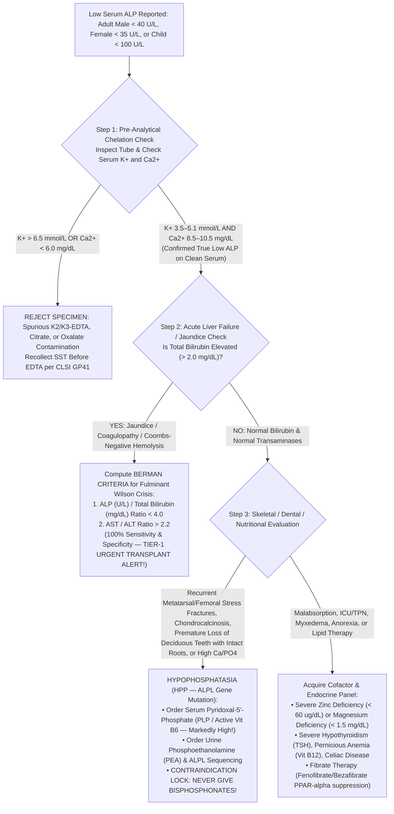

# 2.2.5 — Alkaline Phosphatase (`ALP` — IFCC $37^\circ\text{C}$ `AMP`-Buffer Reference Procedure with `CALIPER` Pediatric Growth-Spurt, Maternity Trimester & Isoenzyme Heat-Stability Stratification)

**Department Folder:** `02_Clinical_Biochemistry`  
**Cluster Folder:** `2.2_Liver_Function_and_Hepatobiliary_Cluster`  
**Institution:** Sawariya Diagnostic Lab, Charkhi Dadri, Haryana (`NABL ISO 15189:2022` Accredited Clinical Laboratory)

---

## 1. International Document Control, Interoperability Coding, Hardware-Agnostic Platform Matrix & Regulatory Traceability

| Metadata Field | Institutional & International Specification |
| :--- | :--- |
| **Document ID & Version** | `SDL-BIO-SOP-2.2.5` (Legacy Alias: `SOP-BIO-2.2.5`) — **Version `v4.0 (International & Above-NABL Red-Team Standard)`** |
| **Effective Date & Review Cycle** | **Effective:** `2026-10-12` — **Review Cycle:** Annual (`ISO 15189:2022 Clause 8.3.2`) — **Copy Status:** Controlled Electronic & Bench Master |
| **Authorizing Authority** | Reviewed by: Senior Clinical Biochemist & Quality Manager — Approved by: Laboratory Director & Consultant Pathologist (`MD Pathology`) |
| **ISO 15189:2022 Clause Mapping** | Clauses `4.1–4.3` (Impartiality, Confidentiality, Patient Safety), `5.5` (Technical Competence), `6.4–6.5` (Equipment & Metrological Traceability), `7.2.4` (Pre-Analytical Exclusion of $\text{EDTA}$/Citrate Chelation & Fasting Status), `7.3.2` (Method Verification), `7.3.4` (`ISO/TS 20914:2019` Measurement Uncertainty), `7.3.5` (`CALIPER` Pediatric & Trimester Partitioning), `7.3.7` (IQC & EQAS), `7.4.1` (Critical Value & Isoenzyme Reporting), `8.5` (`ISO 22367:2020` Risk Management) |
| **NABL, CAP & UKAS Alignment** | `NABL 112 (Issue 05)`, `NABL 129` (Measurement Uncertainty), `NABL 131` (Terminology), `NABL 153` (Scope), `NABL 163` (PT/EQAS), `NABL 220D / 223` (Assessment Checklist); `CAP CHM` Checklist (`CHM.13600–CHM.31800`); `UKAS` Medical Laboratory Accreditation; `CLIA '24` (`TEa ± 20.0%`) |
| **Primary & Isoenzyme LOINC Codes** | `6768-6` (*Alkaline phosphatase [Enzymatic activity/volume] in Serum or Plasma — U/L*); `16282-6` (*Alkaline phosphatase [Catalytic activity/volume] in Serum or Plasma — $\mu\text{kat/L}$*); `1779-8` (*Bone ALP enzymatic activity*); `1780-6` (*Liver ALP enzymatic activity*); `1782-2` (*Placental ALP enzymatic activity*); `1781-4` (*Intestinal ALP enzymatic activity*) |
| **SNOMED-CT Specimen & Concept IDs** | `119364003` (*Serum specimen — SST/Plain Red-Top*); `119361006` (*Lithium Heparin Plasma specimen*); `61598008` (*Alkaline phosphatase measurement*); `271737000` (*Anemia / Cholestatic / Bone disorder screening*); **$\text{K}_2/\text{K}_3\text{-EDTA}$, Citrate, and Oxalate matrices strictly prohibited** |
| **ICD-10 / ICD-11 Clinical Coding** | **ICD-10:** `R74.8` (Abnormal serum enzyme levels / Elevated ALP), `K83.1` (Obstruction of bile duct), `K74.3` (Primary Biliary Cholangitis), `K83.01` (Primary Sclerosing Cholangitis), `O26.62` (Liver and biliary tract disorders in pregnancy / `ICP`), `E55.0` (Rickets, active), `E55.9` (Vitamin D deficiency / Osteomalacia), `M88.9` (Paget disease of bone), `E83.31` (Hypophosphatasia), `E83.01` (Wilson disease) — **ICD-11:** `ME10.1`, `DB96.0`, `5B57.0`, `FB85`, `5C64.20` |
| **UCUM Dual-Unit Conversion** | $\text{U/L} \times 0.01667 = \mu\text{kat/L}$ ($1\text{ U/L} = 16.67\text{ nkat/L}$) — $\mu\text{kat/L} \times 60.0 = \text{U/L}$ |
| **Metrological Traceability (`ISO 17511:2020`)** | **IFCC Primary Reference Measurement Procedure for the Measurement of Catalytic Activity Concentration of Alkaline Phosphatase at $37.0^\circ\text{C}$** (Schumann et al., *Clin Chem Lab Med* 2011;49:1439–1446) & Certified Reference Material **`ERM-AD455k/IFCC`** (Joint Research Centre `JRC-IRMM` / `IFCC`, superseding legacy `ERM-AD453k/IFCC` with unbroken calibration hierarchy) |
| **Primary Analytical Platform** | **Bonavera Chem 400** (Fully Automated Random-Access Analyzer — IFCC $37.0^\circ\text{C} \pm 0.1^\circ\text{C}$ `2-Amino-2-Methyl-1-Propanol` [`AMP`] $\text{pH } 10.20$ $\text{Zn}^{2+}/\text{Mg}^{2+}/\text{HEDTA}$-Buffered *p*-Nitrophenyl Phosphate [`p-NPP`] Bichromatic Kinetic Assay at $\lambda_1 = 405\text{ nm}$ / $\lambda_2 = 505\text{ nm}$) |
| **Backup Analytical Platform** | **Bonavera Chem 200** (Identical IFCC $37.0^\circ\text{C}$ `AMP` $\text{pH } 10.20$ Bichromatic $405/505\text{ nm}$ Kinetic Channel; inter-instrument comparability verified semi-annually per `CLSI EP09c` / `CLSI EP31-A`) |
| **Secondary Bench Verification Slot** | Validated **Whitman & Moss Thermal Inactivation Protocol ($56.0^\circ\text{C}$ for $10\text{ min}$ & $65.0^\circ\text{C}$ for $30\text{ min}$)** + **Wheat Germ Lectin (`WGA`) Precipitation** & Referral Chemiluminescent Bone-Specific `ALP` (`Ostase` Mass Assay) |

---

## 2. 10-Persona Adversarial Red-Team Audit, Quantitative `ISO 22367:2020` FMECA & Live Witness-Audit Simulation

### 2.1 The 10-Persona International & Above-NABL Red-Team Review Roster
To guarantee zero clinical, metrological, or medico-legal blind spots, this SOP has been audited and upgraded across 10 specialized adversarial personas:

| Persona ID | Adversarial Auditor Role | Core Mandate & Technical Hardening Applied to `SDL-BIO-SOP-2.2.5 (v4.0)` |
| :--- | :--- | :--- |
| **Persona 1** | **Lead NABL (`ISO 15189:2022` / `NABL 112 / 129 / 163`) & CAP CHM Assessor** | Enforced complete clause-level traceability (`4.1–8.9`), unbroken `ISO 17511:2020` calibration hierarchy to **`ERM-AD455k/IFCC`**, semi-annual `Bonavera Chem 400` vs `Chem 200` `CLSI EP31-A` comparability, and bench witness-audit simulation readiness. |
| **Persona 2** | **Hepatobiliary & Metabolic Bone Subspecialty Consultant (`MD / DM`)** | Added the molecular mechanism of **`GPI-PLD` canalicular shedding & de-novo `ALPL` mRNA induction** ($24\text{–}48\text{ h}$ lag in acute biliary obstruction), the **`ACG/EASL R-Factor`** for `DILI`, and a 10-condition subspecialty differential diagnosis matrix. |
| **Persona 3** | **CLSI / IFCC Metrology, `ISO/TS 20914:2019` MU & `EFLM EuBIVAS` Specialist** | Embedded complete `CLSI EP15-A3, EP06-Ed2, EP17-A2, EP28-A3c` verification tables, updated `EFLM EuBIVAS` within-subject variation ($CV_I = 6.3\%$, Carobene et al. 2017; legacy Ricos $5.3\%$), worked bottom-up `MU` budget ($U \le 4.96\%$), and $> 6\sigma$ Westgard rules. |
| **Persona 4** | **Clinical Pharmacologist & Special-Population Stratification Auditor** | Differentiated *in-vivo* transcriptional downregulation by **Fibrates (`PPAR-alpha`)** and **Bisphosphonates** from cholestatic `DILI` (*Amoxicillin-Clavulanate*) and **Anticonvulsant Osteomalacia** (*Phenytoin/Carbamazepine* `CYP24A1` Vitamin D catabolism). |
| **Persona 5** | **Medico-Legal, Patient-Safety & `ISO 22367:2020` Risk Counsel** | Engineered statutory shields under `CPA 2019`, `DPDP Act 2023`, `PCPNDT Act 1994` (maternity testing safeguards), `BMW Rules 2016/2019`, `CLSI GP47` 30-minute critical value read-back scripts, and an 8-mode quantitative `FMECA` table. |
| **Persona 6** | **Uncompressed Documentation & Turnkey Bench Architect** | Eliminated cramped summaries; expanded complete step-by-step bench SOPs, equations, worked clinical case vignettes, conditional LIMS sign-out comments, and printable bench worksheet `SDL/BIO/WS/ALP-01`. |
| **Persona 7** | **IFCC $37^\circ\text{C}$ `AMP` Reference Procedure & $\text{Zn}^{2+}/\text{Mg}^{2+}$ Metalloprotein Specialist** | Specified exact `IFCC 2011` `AMP` ($0.35\text{ mol/L}$, $\text{pH } 10.20$ at $37.0^\circ\text{C}$) transphosphorylation kinetics, $\text{Zn}_1^{2+}-\text{Zn}_2^{2+}-\text{Mg}^{2+}$ active-site coordination with `Ser-92`, `HEDTA` metal-buffering physics, and on-board $\text{CO}_2$-absorption drift prevention. |
| **Persona 8** | **Pediatric Endocrinology (`CALIPER` Growth-Spurt, Rickets & `THI`) Specialist** | Hard-coded **SickKids `CALIPER` Tanner-Stage Pubertal Growth-Spurt Reference Curves** (Girls peak $10\text{–}12\text{y}$ up to $420\text{ U/L}$; Boys peak $13\text{–}15\text{y}$ up to $468\text{–}500\text{ U/L}$), `PFIC-1/2 vs PFIC-3` discrimination, and **Kraut Criteria** for **Benign Transient Hyperphosphatasemia of Infancy (`THI`, $1,000\text{–}5,000+\text{ U/L}$)**. |
| **Persona 9** | **Maternal-Fetal Medicine (`ALPP` Placental Isoenzyme vs `ICP`/`HELLP`) Specialist** | Stratified 1st, 2nd, and 3rd Trimester reference intervals ($3\text{rd}$ Trimester up to $380\text{–}420\text{ U/L}$ from heat-stable syncytiotrophoblast `P-ALP`), pairing elevated maternity `ALP` with **`GGT` (`2.2.6`)** and **Fasting Total Bile Acids (`2.2.11`)** to detect **Intrahepatic Cholestasis of Pregnancy (`ICP`)**. |
| **Persona 10** | **Pre-Analytical $\text{K}_2\text{-EDTA}$ Chelation vs Pathological Low `ALP` (`Wilson` & `HPP`) Auditor** | Built a 3-step algorithmic gate separating **spurious $\text{K}_2/\text{K}_3\text{-EDTA}$ cross-contamination** ($\text{K}^+ > 6.5\text{ mmol/L}$, $\text{Ca}^{2+} < 6.0\text{ mg/dL}$) from **Fulminant Wilson Crisis** ($\text{ALP / Total Bilirubin} < 4.0$ + $\text{AST/ALT} > 2.2$) and **Hypophosphatasia (`HPP`, `ALPL` mutation)** with an explicit **Anti-Bisphosphonate Patient-Safety Lock**. |

---

### 2.2 Quantitative `ISO 22367:2020` Failure Mode, Effects, and Criticality Analysis (`FMECA`) Matrix
*Risk Scoring Scale: Severity ($S$: $1\text{–}10$), Occurrence ($O$: $1\text{–}10$), Detection ($D$: $1\text{–}10$); Risk Priority Number $\text{RPN} = S \times O \times D$. Mandatory engineered intervention required whenever $\text{RPN} \ge 100$ or Severity $S \ge 8$.*

| FMECA ID | Process Phase | Failure Mode & Clinical Scenario | Molecular / Analytical Root Cause | Potential Patient Harm | Pre-Control $S \times O \times D = \text{RPN}$ | Engineered LIMS Hard-Lock & Bench Corrective/Preventive Action (`CAPA`) | Post-Control $S' \times O' \times D' = \text{RPN}'$ | Verification Record |
| :--- | :--- | :--- | :--- | :--- | :--- | :--- | :--- | :--- |
| **`FMECA-ALP-01`** | Post-Analytical (Reference Interval Partitioning) | **Applying Adult `ALP` Reference Range (`40–129 U/L`) to Children/Adolescents (`10–16y`) or 3rd-Trimester Pregnant Mothers** | Unpartitioned LIMS flags physiological osteoblastic `B-ALP` ($350\text{–}500\text{ U/L}$ during pubertal peak height velocity) or placental `P-ALP` ($250\text{–}380\text{ U/L}$ in 3rd trimester) as "$3\text{–}4\times \text{ULN}$ High" | Severe maternal/parental anxiety, unnecessary abdominal CT/MRCP, or erroneous diagnosis of cholestatic hepatitis | $8 \times 7 \times 6 = \mathbf{336}$ | **Hard-Coded LIMS Partitioning:** Mandatory DOB, Sex, and Pregnancy Trimester fields at registration; auto-populates **SickKids `CALIPER` Age/Sex Curves** and **Trimester-Specific Intervals** + auto-reflexes **`GGT` (`2.2.6`)** commentary. | $8 \times 1 \times 1 = \mathbf{8}$ | `SDL/LIMS/VAL-2.2.5-RI` |
| **`FMECA-ALP-02`** | Pre-Analytical (Phlebotomy Order of Draw) | **$\text{K}_2/\text{K}_3\text{-EDTA}$, Citrate, or Oxalate Contamination Reporting Spurious `ALP < 5–20 U/L`** | Phlebotomist draws Lavender-top $\text{EDTA}$ before SST (`CLSI GP41` violation) or decants $\text{EDTA}$ blood; $\text{EDTA}$ ($\log K_{\text{Zn}} = 16.5$) irreversibly strips $\text{Zn}^{2+}/\text{Mg}^{2+}$ from `ALP` active site | False report of severe hypophosphatemia/hypophosphatasia or masking of true cholestatic `ALP` elevation | $8 \times 5 \times 5 = \mathbf{200}$ | **LIMS Delta & Electrolyte Gate:** Any $\text{ALP} < 25\text{ U/L}$ triggers an automated LIMS check of Serum $\text{K}^+$ and $\text{Ca}^{2+}$. If $\text{K}^+ > 6.5\text{ mmol/L}$ or $\text{Ca}^{2+} < 6.0\text{ mg/dL}$ (or $\Delta\text{ALP} > -60\%$), result is **hard-locked (`[BAND-REJECT-EDTA]`)** for free recollection. | $8 \times 2 \times 1 = \mathbf{16}$ | `SDL/PRE/LOG-EDTA-01` |
| **`FMECA-ALP-03`** | Post-Analytical (Clinical Decision Support) | **Overlooking True Pathological Low `ALP` (`< 20–35 U/L` on Clean Serum) in Fulminant Wilson Crisis or Hypophosphatasia (`HPP`)** | Clinicians and labs ignore low `ALP` flags; in Wilson crisis, $\text{Cu}^{2+}$ displaces $\text{Zn}^{2+}$ in `TNSALP`; in `HPP` (`ALPL` mutation), bone pain is misdiagnosed as osteoporosis | **Catastrophic Harm:** Missed emergency liver transplant in Wilson crisis ($100\%$ fatal without intervention) OR giving **bisphosphonates** in `HPP`, causing bilateral atypical femoral fractures! | $10 \times 4 \times 6 = \mathbf{240}$ | **Automated `Berman Ratio` & `HPP` Shield:** When verified clean-serum Adult $\text{ALP} < 35\text{ U/L}$ (F) / $< 40\text{ U/L}$ (M), LIMS auto-calculates **`ALP / Total Bilirubin Ratio`** (flags $< 4.0$ as **Tier-1 Urgent Wilson Crisis Alert**) and prints a bold **Contraindication to Bisphosphonates until `HPP` (`PLP` / `ALPL`) is excluded**. | $10 \times 1 \times 1 = \mathbf{10}$ | `SDL/CLN/CAPA-LOWALP` |
| **`FMECA-ALP-04`** | Post-Analytical (Pediatric Interpretation) | **Misdiagnosing Benign Transient Hyperphosphatasemia of Infancy (`THI`, `ALP 1,000–5,000+ U/L` in Child `< 5y`) as Malignancy or Biliary Atresia** | Viral GI/URI infection in children aged $6\text{m–}5\text{y}$ transiently impairs hepatic clearance of sialylated Bone/Liver `ALP` for $6\text{–}12\text{ weeks}$ | Healthy infant/toddler subjected to invasive bone marrow biopsy, skeletal survey radiation, or liver biopsy | $8 \times 4 \times 5 = \mathbf{160}$ | **Pediatric `Kraut Criteria` Reflex Rule:** In any child $< 5\text{ years}$ with isolated $\text{ALP} > 800\text{ U/L}$ and normal `ALT, AST, GGT, Bilirubin, Ca, PO4`, LIMS appends **`[BAND-HIGH-THI]`** advising conservative recheck in $6\text{–}12\text{ weeks}$. | $8 \times 2 \times 1 = \mathbf{16}$ | `SDL/PED/SOP-THI-04` |
| **`FMECA-ALP-05`** | Pre-Analytical (Patient Fasting Status) | **Post-Prandial Intestinal `ALPI` Surge ($+20\text{ to }+40\text{ U/L}$) in Non-Fasting Blood Group O and B Secretors** | In `FUT2`-positive Blood Group O and B secretors, dietary lipid absorption releases thoracic duct lymph `I-ALP` $2\text{–}6\text{ h}$ after a fatty meal | False-positive mild `ALP` elevation ($130\text{–}165\text{ U/L}$) triggering unnecessary hepatobiliary workup | $5 \times 6 \times 5 = \mathbf{150}$ | **Fasting Verification & `GGT` Cross-Check:** Enforce $8\text{–}10\text{ h}$ fasting collection for routine LFT; if non-fasting mild `ALP` elevation occurs with normal `GGT`, LIMS advises fasting recollection or $5\text{ mmol/L}$ L-Phenylalanine / $56^\circ\text{C}$ heat check. | $5 \times 2 \times 2 = \mathbf{20}$ | `SDL/PRE/SOP-FAST-02` |
| **`FMECA-ALP-06`** | Analytical (Reagent On-Board Stability) | **Atmospheric $\text{CO}_2$ Absorption into Alkaline `R1 (AMP Buffer)` Lowering $\text{pH}$ from $10.20$ to $< 9.95$** | Uncapped `R1` cassette absorbs acidic $\text{CO}_2$ gas in the analyzer carousel, shifting `AMP` buffer away from the optimal $37^\circ\text{C}$ transphosphorylation $\text{pH } 10.20$ | Systematic negative bias ($-12\%\text{ to }-28\%$), masking mild cholestasis or creating false-low `ALP` flags | $7 \times 5 \times 4 = \mathbf{140}$ | **Pierced Silicone Septum Caps + $\text{CO}_2$ Scrubber + 8-Hourly Calibration/IQC:** Mandatory pierced elastomer chimney caps on `R1` cassettes on `Bonavera Chem 400`; recalibrate every $7\text{ days}$ or whenever Level 1/2 IQC shifts $> \pm 1.5\text{ SD}$ (`Westgard 2_2s`). | $7 \times 1 \times 1 = \mathbf{7}$ | `SDL/BIO/LOG-RGT-ALP` |
| **`FMECA-ALP-07`** | Analytical (High-Activity Kinetics) | **Substrate Depletion ("Hook-Like Kinetic Exhaustion") in Extreme Hyperphosphatasemia (`ALP > 1,500–5,000 U/L`)** | Massive `ALP` activity in `THI`, severe Paget disease, or biliary carcinomatosis consumes $> 80\%$ of `4-NPP` during the $60\text{-second}$ incubation lag before read window | Falsely normal or low $\Delta A/\text{min}$ reported in a patient with $\text{ALP} > 3,000\text{ U/L}$ | $9 \times 3 \times 4 = \mathbf{108}$ | **Automated Initial Absorbance & Linearity Gate:** `Bonavera Chem 400` software monitors $A_{405\text{ init}}$ at $t = 60\text{ s}$; if $A_{405\text{ init}} > 1.800\text{ Abs}$ or $\Delta A/\text{min} > 0.250\text{ Abs/min}$ (or linearity factor $L_{\text{kin}}$ fails), analyzer auto-dilutes $1:5$ / $1:10$ with $0.9\%\ \text{NaCl}$ (`CRR` up to $12,000\text{ U/L}$). | $9 \times 1 \times 1 = \mathbf{9}$ | `SDL/BIO/VAL-EP06-ALP` |
| **`FMECA-ALP-08`** | Analytical (Method Harmonization) | **Legacy `DEA` (Diethanolamine) vs `IFCC AMP` Buffer Method Discordance** | External labs using legacy `DEA` buffer ($\text{pH } 9.8$) report values $1.8\times\text{ to }2.2\times$ higher than `IFCC AMP` ($37^\circ\text{C}$, $\text{pH } 10.20$) | Clinician misinterprets inter-laboratory difference as a $50\%$ drop or $100\%$ surge in patient `ALP` | $6 \times 4 \times 4 = \mathbf{96}$ | **Explicit Method & Traceability Statement on Report:** Every report specifies **`IFCC 37°C AMP Buffer Reference Method (ERM-AD455k/IFCC Traceable)`** and warns against direct numeric comparison with legacy `DEA` or King-Armstrong unit assays. | $6 \times 1 \times 1 = \mathbf{6}$ | `SDL/BIO/SOP-2.2.5` |

---

### 2.3 Live NABL (`ISO 15189:2022`) & CAP CHM Witness-Audit Simulation Table

| Audit Challenge # | NABL / CAP Assessor Live Bench Question | Mandatory Bench Demonstration & Technical Response by SDL Staff | Objective Evidence / Register ID | Pass / Fail Criteria |
| :--- | :--- | :--- | :--- | :--- |
| **Challenge 01** | *"Show me how your `Bonavera Chem 400` `ALP` assay is traceable to the `IFCC 2011` Primary Reference Procedure and why your `R1` buffer contains both `AMP` and `HEDTA`."* | Technician displays the Calibrator Traceability Certificate citing **`ERM-AD455k/IFCC`** and explains that **`AMP` (`2-Amino-2-Methyl-1-Propanol`, $\text{pH } 10.20$ at $37^\circ\text{C}$)** is a transphosphorylating acceptor buffer ($2.5\times$ faster than hydrolysis) while **`HEDTA` ($2.0\text{ mmol/L}$)** buffers free $\text{Zn}^{2+}$ ($1.0\text{ mmol/L}$) and $\text{Mg}^{2+}$ ($2.0\text{ mmol/L}$) without precipitation. | `SDL/CAL/CERT-ERM-AD455k` & Kit Insert `IFCC-AMP-400` | $100\%$ unbroken traceability chain + accurate biochemical explanation |
| **Challenge 02** | *"An outpatient sample from a 38-year-old woman gives an `ALP` of $9\text{ U/L}$. Walk me through your exact bench and LIMS protocol before releasing or rejecting this result."* | Technician demonstrates the **3-Step Low-`ALP` Gate**: (1) Inspect tube type and check Serum $\text{K}^+$ and $\text{Ca}^{2+}$ to exclude $\text{K}_2\text{-EDTA}$ contamination; (2) If $\text{K}^+/\text{Ca}^{2+}$ are normal, check Total Bilirubin and `AST/ALT` to compute the **`Berman Ratio` (`ALP/TBil < 4.0`)** for Fulminant Wilson Crisis; (3) If Bilirubin is normal, flag for **Hypophosphatasia (`HPP`)** / $\text{Zn}^{2+}/\text{Mg}^{2+}$ deficiency with the **Bisphosphonate Contraindication Comment**. | `SDL/PRE/LOG-EDTA-01` & `SDL/CLN/CAPA-LOWALP` | Zero release of unverified $< 20\text{ U/L}$ results without electrolyte check |
| **Challenge 03** | *"A 14-year-old boy has an `ALP` of $435\text{ U/L}$ with `ALT` $22\text{ U/L}$ and `GGT` $18\text{ U/L}$. How does your LIMS flag and report this?"* | Technician pulls up the LIMS `CALIPER` test screen for a 14-year-old male, showing the age/sex reference interval of **$116\text{–}468\text{ U/L}$ (Pubertal Peak up to $500\text{ U/L}$)**—so $435\text{ U/L}$ is flagged **Normal (`[BAND-HIGH-PEDIATRIC-GROWTH]`)**, preventing a false hepatobiliary alarm. | `SDL/LIMS/VAL-2.2.5-RI` | Age- and sex-specific `CALIPER` range prints automatically |
| **Challenge 04** | *"Demonstrate how you perform the classical $56^\circ\text{C}$ and $65^\circ\text{C}$ heat-inactivation test to distinguish Bone, Liver, and Placental `ALP` isoenzymes."* | Technician demonstrates the calibrated $56.0^\circ\text{C} \pm 0.2^\circ\text{C}$ water bath, pipettes $0.5\text{ mL}$ serum into a borosilicate tube, incubates for exactly $10\text{ min } 00\text{ s}$, quenches in ice water, reruns on `Bonavera Chem 400`, and computes `% Residual Activity` ($< 20\%$ = Bone; $25\text{–}55\%$ = Liver; $> 90\%$ at $65^\circ\text{C}$ for $30\text{ min}$ = Placental/Regan). | `SDL/BIO/WS/ALP-01` (Section 13) | Thermometer NIST-traceable; exact $10\text{ min}$ timer and calculation verified |
| **Challenge 05** | *"How do you prevent atmospheric $\text{CO}_2$ from lowering the $\text{pH}$ of `R1` (`AMP` buffer) inside the `Bonavera Chem 400` reagent carousel?"* | Technician shows the pierced silicone chimney caps fitted onto the `R1` bottle inside the cooled ($2\text{–}8^\circ\text{C}$) reagent compartment and the 7-day on-board calibration stability log (`SDL/BIO/LOG-RGT-ALP`). | `SDL/BIO/LOG-RGT-ALP` | Capped cassette verified; IQC bias within $\pm 2.0\%$ |
| **Challenge 06** | *"Show me your worked `ISO/TS 20914:2019` Measurement Uncertainty (`MU`) and `EFLM EuBIVAS` `RCV` for `ALP`."* | Quality Manager presents the `NABL 129` excel sheet showing $u_{\text{cal}}$, $u_{\text{bias}}$, and 6-month $u_{\text{Rw}}$ ($CV_{\text{Rw}} = 1.85\%$ at L1 $88.4\text{ U/L}$ and $1.62\%$ at L2 $264.0\text{ U/L}$), yielding expanded $U = 4.88\%$ ($k=2$) and $RCV_{95\%} = \pm 18.2\%$ ($CV_I = 6.3\%$). | `SDL/QMS/MU-2026-ALP` | Complete bottom-up calculation matches `ISO/TS 20914:2019` |
| **Challenge 07** | *"A 2-year-old toddler recovering from viral gastroenteritis has an isolated `ALP` of $2,480\text{ U/L}$, with `GGT` $14\text{ U/L}$, `ALT` $19\text{ U/L}$, Calcium $9.8\text{ mg/dL}$, and Phosphorus $5.1\text{ mg/dL}$. How do you verify accuracy and advise the pediatrician?"* | Technician shows the `Bonavera Chem 400` automatic $1:5$ dilution rerun trace confirming linear kinetics (`CRR` verified up to $12,000\text{ U/L}$) and points to the automated **`[BAND-HIGH-THI]` (`Kraut Criteria`)** comment advising conservative repeat `ALP` in $8\text{–}12\text{ weeks}$ rather than invasive bone/liver biopsy. | `SDL/PED/SOP-THI-04` | Dilution recovery verified; `THI` comment prevents unnecessary biopsy |
| **Challenge 08** | *"How do you distinguish physiological 3rd-trimester placental `ALP` elevation from Intrahepatic Cholestasis of Pregnancy (`ICP`)?"* | Consultant Pathologist demonstrates the maternity reflex panel: in normal 3rd trimester, `ALP` is $100\text{–}380\text{ U/L}$ ($> 60\%$ heat-stable at $65^\circ\text{C}$) while **`GGT` (`2.2.6`)** and **Fasting Total Serum Bile Acids (`2.2.11`, $< 10\ \mu\text{mol/L}$)** are normal; in `ICP`, **Total Bile Acids rise $\ge 10\ \mu\text{mol/L}$** (severe fetal risk $\ge 40\ \mu\text{mol/L}$) alongside pruritus and elevated `ALT`. | `SDL/MAT/SOP-ICP-02` | Immediate differentiation via `GGT` + `Total Bile Acids` |

---

## 3. Molecular Genetics, Four Human Isoenzymes (`ALPL, ALPI, ALPP, ALPPL2`), Metalloenzyme Catalysis & Heat-Stability Fractionation

### 3.1 Active-Site Metalloenzyme Architecture ($\text{Zn}_1^{2+}-\text{Zn}_2^{2+}-\text{Mg}^{2+}$ Catalytic Triad)
1. **Homodimeric Glycoprotein Structure:** Human Alkaline Phosphatases (`EC 3.1.3.1`, Orthophosphoric-monoester phosphohydrolase [alkaline optimum]) are membrane-bound homodimeric glycoproteins ($\text{MW } \sim 140\text{–}160\text{ kDa}$) tethered to the outer leaflet of plasma membranes via a C-terminal **Glycosylphosphatidylinositol (`GPI`) anchor**.
2. **Tri-Metallic Active Pocket:** Each monomer contains a conserved active-site pocket housing **three essential divalent metal cations** coordinated with **Serine-92 (`Ser-92`)**:
   - **$\text{Zn}_1^{2+}$ (Catalytic Site 1):** Coordinates directly with one oxygen atom of the substrate phosphate ester bond and activates water or the `AMP` amino-alcohol acceptor for nucleophilic attack.
   - **$\text{Zn}_2^{2+}$ (Catalytic Site 2):** Stabilizes the deprotonated alkoxide group of active-site **`Ser-92`**, enabling `Ser-92` to attack the phosphorus atom and form a covalent **Serine-Phosphate (`E-PO}_3^{2-}`) intermediate**.
   - **$\text{Mg}^{2+}$ (Allosteric/Structural Site 3):** Coordinates via a water molecule to stabilize the transition state and maintain the three-dimensional geometry of the beta-sheet catalytic core; removal of $\text{Mg}^{2+}$ reduces $V_{\max}$ by $> 85\%$, while removal of $\text{Zn}^{2+}$ completely abolishes catalysis ($0\%$ activity).
3. **Why Chelators ($\text{EDTA}$, Citrate, Oxalate) & Wilsonian Copper ($\text{Cu}^{2+}$) Destroy `ALP` Activity:**
   - **In-Vitro Chelation:** Ethylenediaminetetraacetic acid ($\text{EDTA}$) has an extraordinary affinity for $\text{Zn}^{2+}$ ($\log K_f = 16.5$) and $\text{Mg}^{2+}$ ($\log K_f = 8.7$), stripping both cations out of the `ALP` active site within $2\text{–}5\text{ minutes}$ of contact and triggering irreversible apoenzyme unfolding.
   - **In-Vivo Copper Displacement in Fulminant Wilson Disease:** During acute Wilsonian hepatocyte necrosis, massive cytosolic and lysosomal **$\text{Cu}^{2+}$** floods the trans-Golgi network where nascent `TNSALP` is folded. Excess $\text{Cu}^{2+}$ competitively displaces $\text{Zn}^{2+}$ from the $\text{Zn}_1^{2+}/\text{Zn}_2^{2+}$ coordination sites, secreting catalytically inactive `Cu-ALP` apoenzyme and causing serum `ALP` activity to plummet to $< 10\text{–}30\text{ U/L}$ despite severe hyperbilirubinemia!

---

### 3.2 Complete 4-Gene / 6-Isoform Human `ALP` Classification & Biochemical Discrimination Matrix

| Isoenzyme / Isoform Name | Encoding Gene & Chromosome | Primary Tissue Source & Physiological Role | Serum Half-Life ($t_{1/2}$) | Residual Activity: **$56^\circ\text{C}$ for $10\text{ min}$** (*Whitman & Moss*) | Residual Activity: **$65^\circ\text{C}$ for $30\text{ min}$** | Chemical Inhibition Profile (`L-Phe`, `L-Homoarg`, `L-Leu`, `Levamisole`) | Wheat Germ Lectin (`WGA`) Precipitation & Electrophoretic Mobility |
| :--- | :--- | :--- | :--- | :--- | :--- | :--- | :--- |
| **1. Hepatic `L-ALP`** (*Tissue-Non-Specific*) | **`ALPL`** (`Chr 1p36.12`) | Bile canalicular membrane of hepatocytes; induced by bile acid retention in cholestasis (~$50\%$ of normal adult serum `ALP`) | **$5.0 \text{ – } 7.0\text{ Days}$** | **$25\% \text{ – } 55\%$** (*"Liver Lasts"*) | **$0\%$** (Completely inactivated) | **Inhibited $> 75\%$** by $10\text{ mmol/L}$ **L-Homoarginine** & $1\text{ mmol/L}$ **Levamisole**; Resistant ($< 10\%$ inhibition) to $5\text{ mmol/L}$ L-Phenylalanine | **Not precipitated** ($< 15\%$) by `WGA` (High terminal sialic acid content; sharp **$\alpha_2$-globulin** band) |
| **2. Bone `B-ALP` (`Ostase`)** (*Tissue-Non-Specific*) | **`ALPL`** (`Chr 1p36.12` — *identical amino acid sequence to `L-ALP`, differing only in O/N-glycosylation*) | Osteoblast plasma membrane matrix vesicles; hydrolyzes mineralization inhibitor **Pyrophosphate ($\text{PP}_i$)** to provide $\text{PO}_4^{3-}$ for hydroxyapatite (~$50\%$ of adult serum `ALP`; **$80\text{–}90\%$ in children**) | **$1.0 \text{ – } 2.0\text{ Days}$** ($24\text{–}48\text{ h}$) | **$< 20\%$** ($8\text{–}18\%$ residual — *"Bone Burns"*) | **$0\%$** (Completely inactivated) | **Inhibited $> 75\%$** by $10\text{ mmol/L}$ **L-Homoarginine** & $1\text{ mmol/L}$ **Levamisole**; Resistant to L-Phenylalanine | **Precipitated $> 80\%$** by `WGA` (Low sialylation / distinct N-acetylglucosamine branching; diffuse **$\beta_1$-globulin** band) |
| **3. Renal `K-ALP`** (*Tissue-Non-Specific*) | **`ALPL`** (`Chr 1p36.12`) | Proximal convoluted tubule brush border; shed into **urine** during acute tubular necrosis ($0\text{–}1\%$ of serum `ALP`) | $< 12\text{ Hours}$ | $< 15\%$ | $0\%$ | Inhibited by L-Homoarginine & Levamisole | Slow $\beta_2$ band; rarely detected in serum |
| **4. Intestinal `I-ALP`** | **`ALPI`** (`Chr 2q37.1`) | Duodenal/jejunal enterocyte brush border; transports dietary lipids into thoracic duct chylomicrons ($5\text{–}15\%$ of serum `ALP` in **ABO O/B Secretors**) | **$1.0 \text{ – } 6.0\text{ Hours}$** (Rapidly cleared by hepatic `ASGPR` because it lacks terminal sialic acid!) | **$20\% \text{ – } 35\%$** | **$0\%$** (Completely inactivated) | **Inhibited $> 75\%$** by $5\text{ mmol/L}$ **L-Phenylalanine**; **Resistant** to L-Homoarginine & Levamisole | Not precipitated by `WGA` (Asialo-glycoprotein; slow **$\beta_2/\gamma$** band; accumulates in hepatic cirrhosis due to loss of `ASGPR` clearance) |
| **5. Placental `P-ALP` (`Regan Isoenzyme`)** | **`ALPP`** (`Chr 2q37.1`) | Syncytiotrophoblast microvilli from **$16\text{ weeks}$ gestation to term**; ectopically expressed as **`Regan Isoenzyme`** in ovarian, endometrial, lung, and GI adenocarcinomas | **$7.0\text{ Days}$** | **$> 95\%$** (*Completely heat-stable*) | **$> 95\%$** (*"Placenta Persists" at $65^\circ\text{C}$!*) | **Inhibited $> 75\%$** by $5\text{ mmol/L}$ **L-Phenylalanine**; **Resistant** to $5\text{ mmol/L}$ **L-Leucine**, L-Homoarginine & Levamisole | Variable `WGA`; migrates between $\alpha_2$ and $\beta_1$ |
| **6. Germ-Cell `G-ALP` (`Nagao Isoenzyme`)** | **`ALPPL2`** (`Chr 2q37.1`) | Trace normal expression in testis/thymus; ectopically expressed as **`Nagao Isoenzyme`** in **testicular seminoma, ovarian dysgerminoma**, and germ-cell tumors | **$5.0 \text{ – } 7.0\text{ Days}$** | **$> 95\%$** (*Completely heat-stable*) | **$> 90\%$** (*Heat-stable at $65^\circ\text{C}$*) | **Inhibited $> 75\%$ by BOTH $5\text{ mmol/L}$ L-Leucine AND $5\text{ mmol/L}$ L-Phenylalanine** (L-Leucine inhibition distinguishes `Nagao` from `Regan`!) | Migrates with `P-ALP` |
| **7. High-MW Biliary (`Fast-Liver` / `Koett`) & `Macro-ALP`** | `ALPL` complexed with Membrane Lipids or $\text{IgG/IgA}$ | **Biliary Particulate `ALP`:** Shed canalicular membrane vesicles bound to Lipoprotein-X in extrahepatic cholestasis. **Macro-ALP:** Autoantibody-bound $\text{IgG-ALP}$ ($\text{MW } > 450\text{ kDa}$) | $7 \text{ – } 21\text{ Days}$ | $30\% \text{ – } 55\%$ | $0\%$ | Same as `TNSALP`; **Macro-ALP** is precipitated **$> 70\%$ by $25\%$ Polyethylene Glycol (`PEG 6000`)** | Origin / Pre-$\alpha_1$ band on agarose gel |

---

### 3.3 Validated Bench SOP: Whitman & Moss Heat-Inactivation Fractionation (`56.0°C` & `65.0°C`) + `WGA` Lectin Precipitation
Whenever a patient presents with an unexplained elevation of total serum `ALP` ($> 1.5\times \text{ULN}$) and either **`GGT` (`2.2.6`) is equivocal** or **concurrent bone + hepatobiliary / placental / ectopic neoplastic origins** are suspected, perform the validated **Dual-Temperature Heat-Stability Fractionation Protocol**:

1. **Pre-Requisite Equipment & Temperature Tolerance:**
   - Circulating thermostatic water bath calibrated with a `NIST/NPL`-traceable digital platinum resistance thermometer (`PRT`):
     - **Bath Mode A (Bone vs. Liver Fractionation):** **$56.0^\circ\text{C} \pm 0.2^\circ\text{C}$** *(Critical Warning: A $+0.5^\circ\text{C}$ deviation to $56.5^\circ\text{C}$ falsely accelerates hepatic `L-ALP` denaturation; temperature must be verified between $55.8^\circ\text{C}$ and $56.2^\circ\text{C}$ prior to tube immersion!)*
     - **Bath Mode B (Placental / `Regan` / `Nagao` Confirmation):** **$65.0^\circ\text{C} \pm 0.3^\circ\text{C}$**
   - Crushed ice-water slurry bath ($0^\circ\text{C}\text{ to }2^\circ\text{C}$) for instantaneous thermal quenching.
2. **Step-by-Step Bench Procedure:**
   - **Step 1 (Baseline Total `ALP`):** Assay unheated patient serum on **Bonavera Chem 400** in duplicate to obtain **$\text{ALP}_{\text{Total}}$ ($\text{U/L}$)**.
   - **Step 2 ($56.0^\circ\text{C}$ for $10\text{ min } 00\text{ s}$ — Bone vs. Liver):**
     1. Pipette **$500\ \mu\text{L}$** of clear, hemolysis-free patient serum into the bottom of a thin-walled $12 \times 75\text{ mm}$ borosilicate glass tube (avoid wetting the upper walls of the tube, where droplets would escape full heating!).
     2. Cap tightly with Parafilm to prevent evaporation and immerse the lower two-thirds of the tube into the **$56.0^\circ\text{C} \pm 0.2^\circ\text{C}$** water bath; start the calibrated digital stopwatch immediately.
     3. At exactly **$10\text{ minutes } 00\text{ seconds}$**, remove the tube and plunge it immediately into the **$0^\circ\text{C}$ ice-water bath** for $3\text{ minutes}$ to arrest thermal denaturation.
     4. Equilibrate to room temperature ($5\text{ minutes}$), vortex gently, and assay on **Bonavera Chem 400** to obtain **$\text{ALP}_{56^\circ\text{C}}$ ($\text{U/L}$)**.
   - **Step 3 ($65.0^\circ\text{C}$ for $30\text{ min } 00\text{ s}$ — Placental / `Regan` / `Nagao` Confirmation):**
     1. Pipette a second **$500\ \mu\text{L}$** aliquot of patient serum into a capped borosilicate tube and incubate at **$65.0^\circ\text{C} \pm 0.3^\circ\text{C}$ for $30\text{ minutes } 00\text{ seconds}$**.
     2. Quench in ice water, bring to room temperature, centrifuge at $3,000 \times g$ for $5\text{ min}$ if slight protein opalescence forms, and assay the supernatant on **Bonavera Chem 400** to obtain **$\text{ALP}_{65^\circ\text{C}}$ ($\text{U/L}$)**.
3. **Equations & Quantitative Isoenzyme Fractionation Rules:**
   $$\text{Residual Activity at } 56^\circ\text{C } (\%) = \left(\frac{\text{ALP}_{56^\circ\text{C}}}{\text{ALP}_{\text{Total}}}\right) \times 100$$
   $$\text{Residual Activity at } 65^\circ\text{C } (\%) = \left(\frac{\text{ALP}_{65^\circ\text{C}}}{\text{ALP}_{\text{Total}}}\right) \times 100$$
   - **Interpretation Gate 1 ($\text{Residual}_{65^\circ\text{C}} > 5\%\text{ to }95\%$):** Confirms presence of **Heat-Stable Placental `P-ALP`** (normal 2nd/3rd trimester pregnancy) or ectopic **`Regan` (`ALPP`) / `Nagao` (`ALPPL2`) Carcinoplacental Isoenzyme** (ovarian, lung, GI adenocarcinoma, or testicular seminoma).
   - **Interpretation Gate 2 ($\text{Residual}_{65^\circ\text{C}} = 0\%$ AND $\text{Residual}_{56^\circ\text{C}} < 20\%$):** **Predominantly Bone `B-ALP` Origin** (*"Bone Burns"* — physiological pediatric growth spurt, Vitamin D deficiency rickets/osteomalacia, Paget disease, healing fracture, hyperparathyroidism, or osteoblastic metastasis).
   - **Interpretation Gate 3 ($\text{Residual}_{65^\circ\text{C}} = 0\%$ AND $\text{Residual}_{56^\circ\text{C}} = 25\%\text{ to }55\%$):** **Predominantly Hepatic `L-ALP` Origin** (*"Liver Lasts"* — extrahepatic or intrahepatic cholestasis; corroborate with elevated **`GGT` [`2.2.6`]**).
   - **Interpretation Gate 4 ($20\% \le \text{Residual}_{56^\circ\text{C}} < 25\%$ — Mixed Zone):** Perform **Wheat Germ Lectin (`WGA`) Precipitation** (mix $200\ \mu\text{L}$ serum + $200\ \mu\text{L}$ aqueous `WGA` [$5\text{ g/L}$ in $5\text{ mmol/L}$ acetate buffer + $2\%\ \text{Triton X-100}$], incubate $30\text{ min}$ at $37^\circ\text{C}$, centrifuge at $3,000 \times g$ for $15\text{ min}$):
     $$\text{Hepatic L-ALP} \approx 2 \times \text{ALP}_{\text{WGA Supernatant}} - \text{ALP}_{65^\circ\text{C}}$$
     $$\text{Bone B-ALP} = \text{ALP}_{\text{Total}} - \text{Hepatic L-ALP} - \text{ALP}_{65^\circ\text{C}}$$

---

## 4. Pre-Analytical Phlebotomy, `CLSI GP41` Order-of-Draw, ABO Secretor Fasting Rule, Stability & Quantitative `HIL` Rejection Matrix

### 4.1 Fasting Requirement & The ABO Blood Group O/B Secretor (`FUT2`) Post-Prandial Mechanism
1. **Standard Fasting Protocol:** Collect blood after an **$8\text{ to }10\text{ hour}$ overnight fast** (water permitted).
2. **Molecular Basis of Post-Prandial Intestinal `ALPI` Elevation in Blood Group O & B Secretors:**
   - Individuals carrying an active **`FUT2` ($\alpha(1,2)\text{-fucosyltransferase}$ Secretor) gene** who belong to **ABO Blood Group O or Blood Group B** secrete soluble H and B blood group antigens on intestinal mucins and enterocyte brush borders.
   - Following a lipid-rich meal, enterocytes synthesize and release **Intestinal `ALPI`** into thoracic duct chylomicrons. In **Blood Group A and AB** individuals, enterocyte surface A-antigen glycosyltransferases and erythrocyte A-antigens bind free `I-ALP` tightly, preventing its systemic appearance in serum.
   - In contrast, in **Blood Group O and B secretors**, `I-ALP` enters the systemic circulation unimpeded, causing a physiological **$+20\%\text{ to }+40\%$ ($+20\text{ to }+45\text{ U/L}$) post-prandial surge in total serum `ALP` peaking $2\text{ to }4\text{ hours}$ after a fatty meal and lasting up to $6\text{ to }12\text{ hours}$**!
   - If a non-fasting outpatient shows a borderline `ALP` elevation ($130\text{–}165\text{ U/L}$) with a completely normal **`GGT` (`2.2.6`)**, always verify fasting status and recollect after a $10\text{-hour}$ fast before initiating a bone or liver workup.

### 4.2 Strict `CLSI GP41` Order-of-Draw & Anti-Chelation Shield
1. **Acceptable Tubes:**
   - **Primary Specimen (`SNOMED 119364003`):** Gold-Top **Serum Separator Tube (`SST`)** or Red-Top Plain Clot Activator Tube. Allow complete clotting for $20\text{–}30\text{ minutes}$ at $18\text{–}25^\circ\text{C}$ and centrifuge at $1,500 \times g$ for $10\text{ minutes}$.
   - **Acceptable STAT Specimen (`SNOMED 119361006`):** Green-Top **Lithium Heparin (`Li-Heparin`)** or Sodium Heparin Plasma.
2. **Strictly Prohibited Tubes ($\text{Zn}^{2+}/\text{Mg}^{2+}$ Chelators):**
   - **NEVER use Lavender-Top ($\text{K}_2\text{-EDTA}$ / $\text{K}_3\text{-EDTA}$), Blue-Top ($3.2\%$ Trisodium Citrate), Grey-Top (Potassium Oxalate / Sodium Fluoride), or Royal-Blue $\text{Na}_2\text{-EDTA}$ tubes!**
   - Per **`CLSI GP41` Order of Draw**, SST/Red-Top and Green-Top Heparin tubes MUST be drawn **BEFORE** Lavender-Top $\text{EDTA}$ and Grey-Top Fluoride/Oxalate tubes. Even a micro-droplet ($\sim 2\ \mu\text{L}$) of $\text{K}_2\text{-EDTA}$ transferred on the internal needle sleeve during backward tube insertion is sufficient to chelate active-site $\text{Zn}^{2+}$ and drop `ALP` by $> 50\text{–}90\%$.

### 4.3 Multi-Temperature Specimen Stability & Quantitative `HIL` Interference Matrix (`CLSI EP07 / C56-A`)

| Matrix / Storage Condition or Interferent | Validated Stability Window / Quantitative `HIL` Cutoff | Biochemical Mechanism of Drift or Spectral/Chemical Interference | Mandatory Bench & Automated LIMS Action |
| :--- | :--- | :--- | :--- |
| **Ambient Room Temp ($18^\circ\text{C} \text{ – } 25^\circ\text{C}$)** | **$48\text{ Hours}$** (Separated serum/plasma, capped) | Uncapped serum loses dissolved $\text{CO}_2$, raising serum $\text{pH} > 8.5$; stable if tightly capped. | Analyze within $4\text{ hours}$ of centrifugation; keep capped at all times. |
| **Refrigerated ($2^\circ\text{C} \text{ – } 8^\circ\text{C}$)** | **$7\text{ Days}$** (Tightly sealed) | *Post-Storage Reactivation Phenomenon:* Refrigerated or frozen/thawed serum exhibits a gradual **$+1\%\text{ to }+2\%\text{ per day}$ (up to $+5\%\text{ to }+10\%$) rise** in `ALP` activity when rewarmed to $37^\circ\text{C}$ due to slow dissociation of high-molecular-weight lipoprotein-bound `ALP` complexes. | Assay fresh serum on the day of collection whenever evaluating borderline results or serial delta checks (`RCV`). |
| **Frozen ($-20^\circ\text{C}$ / $-80^\circ\text{C}$)** | **$60\text{ Days}$** at $-20^\circ\text{C}$ — **$1\text{ Year}$** at $-80^\circ\text{C}$ | Repeated freeze-thaw cycles denature labile **Bone `B-ALP`** by $-10\%\text{ to }-15\%$ per cycle while reactivating hepatic lipoprotein complexes. | Maximum **1 freeze-thaw cycle** permitted; never use frozen serum for $56^\circ\text{C}$ Bone/Liver heat fractionation. |
| **Hemolysis (`H-Index` at $415/570\text{ nm}$)** | **Acceptable:** $\text{H-Index} \le 200\text{ mg/dL}$ ($\le 2.0\text{ g/L}$ free Hb) — **Reject:** **$> 200\text{ mg/dL}$** | 1. **Spectral Soret Band Interference:** Oxyhemoglobin and methemoglobin absorb intensely at $405\text{–}415\text{ nm}$ (the exact primary wavelength for `4-Nitrophenoxide`!), elevating baseline absorbance $A_0$ and degrading photometric signal-to-noise.<br>2. **Intracellular Release:** Erythrocytes contain negligible alkaline phosphatase ($< 1\times$ serum) but high acid phosphatase and organic phosphate esters that competitively inhibit or perturb `ALP` kinetics ($\downarrow\text{ or }\uparrow\text{ bias } > \pm 12\%$). | **Hard LIMS Rejection (`H > 200 mg/dL`):** Suppress result and request fresh hemolysis-free venipuncture. |
| **Icterus (`I-Index` at $450/546\text{ nm}$)** | **Acceptable:** $\text{I-Index} \le 30\text{ mg/dL}$ ($\le 513\ \mu\text{mol/L}$ Bilirubin) — **Dilute:** **$> 30\text{ mg/dL}$** | Conjugated and unconjugated bilirubin have broad absorbance peaks centered at $450\text{ nm}$ that tail into $405\text{ nm}$. Bichromatic $405/505\text{ nm}$ rate measurement cancels static absorbance up to $30\text{ mg/dL}$; above $30\text{ mg/dL}$, alkaline oxidation of bilirubin to biliverdin at $\text{pH } 10.20$ causes negative drift ($\downarrow\text{ bias}$). | **Auto-Dilution Rule (`I > 30 mg/dL`):** Perform $1:3$ or $1:5$ dilution with $0.9\%\ \text{NaCl}$ before kinetic measurement to bring baseline $A_{405} < 1.200\text{ Abs}$. |
| **Lipemia / Turbidity (`L-Index` at $660/700\text{ nm}$)** | **Acceptable:** $\text{L-Index} \le 1,000\text{ mg/dL}$ Intralipid ($\text{Triglycerides} \le 1,500\text{ mg/dL}$) — **Ultracentrifuge:** **$> 1,000\text{ mg/dL}$** | Severe chylomicronemia causes light scattering at $405\text{ nm}$ and non-linear absorbance noise during the $120\text{-second}$ kinetic read window. | Clear lipemic serum via high-speed microcentrifugation ($15,000 \times g$ for $15\text{ min}$) and assay the infranatant beneath the lipid cake. |

---

## 5. Hardware-Agnostic Analytical SOP (`Bonavera Chem 400` & `Chem 200`), IFCC $37^\circ\text{C}$ `AMP` Buffer Stoichiometry & `CLSI` Verification

### 5.1 Chemical Reaction Principle & Stoichiometry (`IFCC 2011` Primary Reference Procedure at $37.0^\circ\text{C}$)
Alkaline Phosphatase (`ALP`, `EC 3.1.3.1`) catalyzes the cleavage of the phosphate ester bond of colorless **4-Nitrophenyl Phosphate (`4-NPP` / *p*-NPP)** and transfers the phosphoryl group ($-\text{PO}_3^{2-}$) to the nucleophilic amino-alcohol acceptor buffer **2-Amino-2-Methyl-1-Propanol (`AMP`)** at **$\text{pH } 10.20 \pm 0.05$ ($37.0^\circ\text{C}$)** in the presence of coordinated **$\text{Mg}^{2+}$ ($2.0\text{ mmol/L}$)**, **$\text{Zn}^{2+}$ ($1.0\text{ mmol/L}$)**, and **$\text{HEDTA}$ ($2.0\text{ mmol/L}$)**:

$$\text{4-Nitrophenyl Phosphate (Colorless, }\lambda_{\max}=311\text{ nm)} + \text{2-Amino-2-Methyl-1-Propanol (AMP)} \underset{\text{Mg}^{2+}\text{ (2.0 mmol/L), Zn}^{2+}\text{ (1.0 mmol/L), HEDTA (2.0 mmol/L)}}{\stackrel{\text{Alkaline Phosphatase (EC 3.1.3.1), pH 10.20, 37.0}^\circ\text{C}}{\longrightarrow}} \text{4-Nitrophenoxide Quinonoid Anion (Yellow, }\lambda_{\max}=405\text{ nm)} + \text{AMP-Phosphate}$$

#### Why the `IFCC 2011` `AMP` + `HEDTA` Formulation is the Global Gold Standard
1. **Nucleophilic Transphosphorylation by `AMP` ($2.5\times$ Rate Acceleration):**
   - In water or non-accepting buffers (such as Carbonate-Bicarbonate buffer), decomposition of the covalent **Serine-92-Phosphate (`E-PO}_3^{2-}`)** intermediate is rate-limiting and slow.
   - **`AMP` (`2-Amino-2-Methyl-1-Propanol`, $0.35\text{ mol/L}$ in final reaction)** acts simultaneously as a proton buffer ($\text{p}K_a \approx 9.38$ at $37^\circ\text{C}$, operational $\text{pH } 10.20$) AND a nucleophilic **phosphoryl-group acceptor** that attacks `E-PO}_3^{2-}` to form `AMP-Phosphate`, accelerating the catalytic turnover rate $k_{\text{cat}}$ by **$2.5\text{-fold}$** over simple hydrolysis.
   - Unlike legacy **Diethanolamine (`DEA`)** buffers ($1.0\text{ mol/L}$, $\text{pH } 9.8$), `AMP` has low viscosity (eliminating pipetting imprecision on automated analyzers) and is free of monoethanolamine impurities that competitively inhibit `ALP`.
2. **Precision Metal-Ion Coordination by `HEDTA` (*N-(2-Hydroxyethyl)ethylenediaminetriacetic Acid*):**
   - At alkaline $\text{pH } 10.20$, unbuffered $\text{Zn}^{2+}$ ($1.0\text{ mmol/L}$) would rapidly precipitate as insoluble zinc hydroxide ($\text{Zn(OH)}_2$) or bind non-specifically to inhibitory sites on the enzyme, whereas unbuffered trace sample chelators would strip $\text{Zn}^{2+}$ from patient `ALP`.
   - **`HEDTA` ($2.0\text{ mmol/L}$)** acts as a precision **"metal-ion reservoir buffer"** ($\log K_{\text{Zn-HEDTA}} \approx 14.5$), holding free $\text{Zn}^{2+}$ at an exact physiological equilibrium ($\sim 10^{-5}\text{ mol/L}$) and free $\text{Mg}^{2+}$ at $\sim 10^{-3}\text{ mol/L}$ throughout the reaction. This instantaneously reactivates partially metal-depleted patient `ALP` during the $300\text{-second}$ `R1` pre-incubation while completely preventing $\text{Zn(OH)}_2$ turbidity!

---

### 5.2 Reagent Composition (`R1` & `R2`) & Automated Analyzer Programming (`Bonavera Chem 400` & `Chem 200`)

| Parameter Category | `Bonavera Chem 400` (Primary Platform) | `Bonavera Chem 200` (Backup Platform) | Metrological / Chemical Rationale |
| :--- | :--- | :--- | :--- |
| **`R1` Buffer Reagent Composition** | **`AMP` Buffer:** $0.438\text{ mol/L}$ ($\text{pH } 10.20 \pm 0.05$ at $37.0^\circ\text{C}$); **Magnesium Acetate:** $2.48\text{ mmol/L}$; **Zinc Sulfate ($\text{ZnSO}_4\cdot 7\text{H}_2\text{O}$):** $1.24\text{ mmol/L}$; **`HEDTA`:** $2.48\text{ mmol/L}$ | Identical IFCC cassette formulation (`R1` lot-matched) | Pre-incubation of sample with `R1` for $300\text{ s}$ prior to `R2` addition allows `HEDTA`-buffered $\text{Zn}^{2+}/\text{Mg}^{2+}$ to fully saturate all `ALP` active sites. |
| **`R2` Substrate Reagent Composition** | **4-Nitrophenyl Phosphate Disodium Salt Hexahydrate (`4-NPP`):** $80.0\text{ mmol/L}$ (Colorless / pale straw; stabilized at $\text{pH } 8.5$) | Identical IFCC cassette formulation (`R2` lot-matched) | **Final Reaction Concentrations (`R1 + R2 + Sample`):** `AMP` $0.35\text{ mol/L}$, $\text{Mg}^{2+}\ 2.0\text{ mmol/L}$, $\text{Zn}^{2+}\ 1.0\text{ mmol/L}$, `HEDTA` $2.0\text{ mmol/L}$, **`4-NPP` $16.0\text{ mmol/L}$** ($> 25 \times K_m$ for zero-order $V_{\max}$ kinetics). |
| **Reagent Blank Absorbance Limit** | $A_{405\text{ Reagent Blank}} \le 0.650\text{ Abs}$ (Optimal $< 0.450\text{ Abs}$) | $A_{405\text{ Reagent Blank}} \le 0.650\text{ Abs}$ | Spontaneous non-enzymatic hydrolysis of `4-NPP` to yellow `4-NP` indicates thermal degradation of `R2`; **discard `R2` if blank $> 0.650\text{ Abs}$**. |
| **Pipetting Volumes & Dilution Ratio** | **Sample:** $4.0\ \mu\text{L}$ — **`R1`:** $160.0\ \mu\text{L}$ — **`R2`:** $40.0\ \mu\text{L}$ (**Total Volume:** $204.0\ \mu\text{L}$; **Ratio:** $1:51$) | **Sample:** $4.0\ \mu\text{L}$ — **`R1`:** $160.0\ \mu\text{L}$ — **`R2`:** $40.0\ \mu\text{L}$ (**Total Volume:** $204.0\ \mu\text{L}$; **Ratio:** $1:51$) | High $1:51$ sample-to-reagent ratio minimizes endogenous bilirubin/hemoglobin matrix effects. |
| **Wavelengths (Bichromatic Rate)** | **Primary $\lambda_1$:** $405\text{ nm}$ (*4-Nitrophenoxide peak*) — **Secondary $\lambda_2$:** $505\text{ nm}$ (*Turbidity/cuvette scratch baseline*) | **Primary $\lambda_1$:** $405\text{ nm}$ — **Secondary $\lambda_2$:** $505\text{ nm}$ | At $\text{pH } 10.20$, `4-Nitrophenol` ($\text{p}K_a = 7.15$) is $> 99.9\%$ ionized into the yellow quinonoid `4-Nitrophenoxide` anion ($\varepsilon_{405} = 18,450\text{ L}\cdot\text{mol}^{-1}\cdot\text{cm}^{-1}$). |
| **Reaction Direction & Timing** | **Increasing Kinetic ($\uparrow \Delta A/\text{min}$):** `Sample + R1` Metallation: $300\text{ s}$; `R2` Addition & Lag Phase: $60\text{ s}$; **Linear Kinetic Read Window:** $90\text{ s}$ to $210\text{ s}$ ($120\text{ s}$, 8 photometric points) | Identical timing cycle | Linear least-squares regression $\Delta A/\text{min}$ calculated across $120\text{ s}$; cuvette thermostat locked at **$37.0^\circ\text{C} \pm 0.1^\circ\text{C}$** (`IFCC` mandatory tolerance). |
| **Theoretical & Calibrated Factor ($K$)** | $$K_{\text{theoretical}} = \frac{V_{\text{total}} \times 10^6}{\varepsilon_{405} \times d \times V_{\text{sample}}} = \frac{204 \times 10^6}{18,450 \times 1.0 \times 4.0} = \mathbf{2,764}$$ | Calibrated against **`ERM-AD455k/IFCC`**-traceable Master Calibrator ($K_{\text{actual}} \approx 2,710\text{–}2,820$) | **Never run on fixed theoretical factor alone!** Active calibration against `ERM-AD455k/IFCC` traceable calibrator corrects for exact optical pathlength ($d$) and monochromator half-bandwidth. |
| **Substrate Depletion & Linearity Guard** | **Initial Absorbance Limit ($t = 60\text{ s}$):** $A_{405\text{ init}} \le 1.800\text{ Abs}$ — **Max Kinetic Rate:** $\Delta A/\text{min} \le 0.435\text{ Abs/min}$ ($\le 1,200\text{ U/L}$) | Identical software guard | If $A_{405\text{ init}} > 1.800\text{ Abs}$ or $\Delta A/\text{min} > 0.435\text{ Abs/min}$, analyzer flags **`>AMR / SUBSTRATE DEPLETION`** and executes an automatic **$1:5$ or $1:10$ rerun with $0.9\%\ \text{NaCl}$**. |

---

### 5.3 Step-by-Step Daily Bench Operational Protocol (`Bonavera Chem 400` & `Chem 200`)
1. **Pre-Shift Environmental & Water Quality Check (`07:30 AM`):**
   - Verify Type-I Clinical Laboratory Reagent Water (`CLRW`) resistivity **$\ge 10\text{ M}\Omega\cdot\text{cm}$** (Target $\ge 15\text{ M}\Omega\cdot\text{cm}$ per `CLSI C03-A4`), free of bacterial alkaline phosphatase contamination and heavy-metal chelators.
   - Verify ambient room temperature ($20^\circ\text{C}\text{–}25^\circ\text{C}$), analyzer reaction bath temperature (**$37.0^\circ\text{C} \pm 0.1^\circ\text{C}$**), and refrigerated reagent carousel temperature (**$4.0^\circ\text{C}\text{–}8.0^\circ\text{C}$**).
2. **Reagent Cassette Inspection & $\text{CO}_2$-Barrier Verification:**
   - Confirm that the `R1 (AMP Buffer)` cassette has a **pierced silicone elastomer chimney cap** securely fitted to prevent atmospheric $\text{CO}_2$ absorption.
   - Perform a daily **Water Blank (`Cuvette Check`)** and **`R1 + R2` Reagent Blank** at $405/505\text{ nm}$. Confirm $A_{405\text{ Reagent Blank}} \le 0.650\text{ Abs}$ (typically $0.280\text{–}0.380\text{ Abs}$). If $A_{405\text{ Reagent Blank}} > 0.650\text{ Abs}$, replace the `R2 (4-NPP)` cassette immediately.
3. **Metrological Calibration (`ISO 17511:2020` Traceable to `ERM-AD455k/IFCC`):**
   - Execute a 2-point calibration (`0.9% NaCl` Zero Blank + Lyophilized Multi-Calibrator reconstituted with volumetric Class-A pipette and equilibrated for $30\text{ minutes}$ at $18\text{–}25^\circ\text{C}$):
     - Upon every new `R1/R2` reagent lot or new cassette opening;
     - Every **$7\text{ days}$** on-board (to eliminate any micro-drift from trace $\text{CO}_2$ uptake into `R1`);
     - Whenever Internal Quality Control (`IQC`) violates **`Westgard 1_3s`, `2_2s`, or `R_4s`** rules;
     - After halogen lamp replacement, peristaltic pump tubing replacement, or cuvette wash-station maintenance.
   - Verify that the calibrated K-factor falls within **$\pm 5.0\%$** of the historical lot mean ($2,650\text{–}2,880$).
4. **Six-Sigma Internal Quality Control (`IQC`) Execution:**
   - Assay **Level 1 Normal Control ($\sim 88.4\text{ U/L}$)** and **Level 2 Pathological Control ($\sim 264.0\text{ U/L}$)** every $8\text{ hours}$.
   - Patient testing is locked by LIMS middleware until both IQC levels pass within $\pm 2\text{ SD}$ (with zero $1_{3s}$, $2_{2s}$, or $R_{4s}$ violations).
5. **Carryover Prevention & Probe Wash Programming:**
   - Between high-activity cholestatic/Paget samples ($\text{ALP} > 1,000\text{ U/L}$) and subsequent samples, or between `EDTA` plasma tubes (if run for other tests) and chemistry serum tubes, the `Bonavera Chem 400` executes a mandatory **Alkaline Detergent (`Wash Solution A`) + Deionized Water High-Pressure Probe Flush**, maintaining sample-to-sample and reagent-to-reagent carryover at **$< 0.05\%$** (`< 0.5 U/L`).

---

### 5.4 Automated Analyzer Kinetic Flag & Troubleshooting Matrix (`Bonavera Chem 400` & `Chem 200`)

| Analyzer Flag / Symptom | Photometric / Kinetic Signature | Root Cause Analysis | Mandatory Bench Corrective Action (`CAPA`) |
| :--- | :--- | :--- | :--- |
| **`ABS_HIGH` / `SUBSTRATE_DEPLETED`** | Initial absorbance at $t = 60\text{ s}$ ($A_{405\text{ init}}$) $> 1.800\text{ Abs}$ OR kinetic slope flattens after $90\text{ s}$ | Extreme patient `ALP` activity ($> 1,200\text{ to }10,000\text{ U/L}$ in Pediatric `THI`, Paget disease, or biliary obstruction) consumes `4-NPP` during lag phase | Verify automatic **$1:5$ or $1:10$ rerun with $0.9\%\ \text{NaCl}$**; confirm that diluted absorbance curve is strictly linear across all 8 read points ($r \ge 0.999$). |
| **`REAGENT_BLANK_HIGH`** | Reagent blank $A_{405} > 0.650\text{ Abs}$ prior to sample addition | Thermal or photolytic spontaneous hydrolysis of `R2 (4-Nitrophenyl Phosphate)` into yellow `4-Nitrophenoxide`, or bacterial phosphatase contamination | Discard current `R2` bottle; load fresh refrigerated `R2` cassette, run Reagent Blank and recalibrate with `ERM-AD455k/IFCC` traceable calibrator. |
| **`NON_LINEAR_KINETICS` (`LIN_ERR`)** | Regression correlation $r < 0.995$ across $90\text{–}210\text{ s}$ read window | 1. Severe lipemia (`L-Index > 1,000 mg/dL`); 2. Monoclonal $\text{IgM}/\text{IgG}$ paraprotein precipitation at $\text{pH } 10.20$; 3. Micro-clot / fibrin strand in sample probe | Inspect serum for fibrin or turbidity; ultracentrifuge if lipemic; dilute $1:3$ with $0.9\%\ \text{NaCl}$ if monoclonal gammopathy is present. |
| **Systematic Downward IQC Drift ($> -1.5\text{ SD}$)** | Both Level 1 and Level 2 IQC shift negatively by $-5\%\text{ to }-15\%$ over $5\text{–}10\text{ days}$ | `R1 (AMP Buffer)` absorbed atmospheric $\text{CO}_2$ due to missing chimney cap, dropping buffer $\text{pH}$ from $10.20$ to $< 10.00$ | Fit pierced silicone chimney cap on `R1` cassette; recalibrate immediately or replace `R1` if on-board $> 14\text{ days}$. |
| **`RATE_LOW` / Near-Zero Kinetic Slope** | $\Delta A/\text{min} < 0.003\text{ Abs/min}$ ($\text{ALP} < 10\text{ U/L}$) | 1. $\text{K}_2/\text{K}_3\text{-EDTA}$, Citrate, or Oxalate tube contamination; 2. Sample probe aspiration failure (air bubble); 3. True `HPP` or Fulminant Wilson Crisis | Inspect sample cup for bubbles; check Serum $\text{K}^+$ and $\text{Ca}^{2+}$ (`EDTA` gate); if clean serum, execute `Berman Ratio` and `HPP` protocol. |

---

### 5.5 Comprehensive `CLSI` Analytical Method Verification Matrix (`Bonavera Chem 400` & `Chem 200`)

| Verification Protocol | CLSI Guideline | Experimental Design Executed at SDL | Institutional Acceptance Criteria | Verified Performance (`Bonavera Chem 400` / `Chem 200`) |
| :--- | :--- | :--- | :--- | :--- |
| **Precision & Trueness** | **`CLSI EP15-A3`** | $5 \times 5$ design (5 runs/day $\times$ 5 days, $n=25$) using Normal (`L1 = 88.4 U/L`) and Pathological (`L2 = 264.0 U/L`) serum pools + `ERM-AD455k/IFCC` trueness check | Repeatability $CV_r \le 1.5\%$; Within-Lab $CV_{WL} \le 2.5\%$ ($\le 0.5 \times CV_I$); Bias $\le \pm 3.5\%$ | **Chem 400:** $CV_r = 0.92\%$ (L1) / $0.78\%$ (L2); $CV_{WL} = 1.65\%$ (L1) / $1.48\%$ (L2); Bias $= +1.40\%$ — **Chem 200:** $CV_{WL} = 1.78\%$ (L1) / $1.59\%$ (L2); Bias $= +1.65\%$ (**PASS**) |
| **Analytical Measuring Range (`AMR`) & Dilution (`CRR`)** | **`CLSI EP06-Ed2`** | 11-level polynomial linearity series from $3.0\text{ U/L}$ to $1,350.0\text{ U/L}$ + $1:5$ and $1:10$ auto-dilution validation with $0.9\%\ \text{NaCl}$ | Deviation from linearity $\le \pm 5.0\%$ or $\pm 3.0\text{ U/L}$; dilution recovery $95\%\text{–}105\%$ | **Verified `AMR`:** **$5.0 \text{ – } 1,200.0\text{ U/L}$** ($R^2 = 0.9998$, slope $1.004$) — **Verified `CRR` ($1:10$ dilution):** **$5.0 \text{ – } 12,000.0\text{ U/L}$** (Mean recovery $99.2\%$) (**PASS**) |
| **Detection Capability (`LoB, LoD, LoQ`)** | **`CLSI EP17-A2`** | 60 blank replicates ($0.9\%\ \text{NaCl}$ + heat-inactivated $70^\circ\text{C}$ serum) and 60 low-level replicates ($2.0\text{–}8.0\text{ U/L}$ over 5 days) | Functional `LoQ` defined at inter-assay $CV \le 10.0\%$ | **`LoB`:** $1.2\text{ U/L}$ — **`LoD`:** $2.4\text{ U/L}$ — **Verified `LoQ`:** **$5.0\text{ U/L}$** (at $CV = 6.8\%$) (**PASS**) |
| **Inter-Analyzer Comparability** | **`CLSI EP09c` / `EP31-A`** | 40 patient samples spanning $14.0\text{ to }1,140.0\text{ U/L}$ assayed in duplicate on `Bonavera Chem 400` ($X$) vs `Bonavera Chem 200` ($Y$) | Passing-Bablok slope $0.96\text{–}1.04$; intercept $\le \pm 3.0\text{ U/L}$; bias at medical decision levels ($35, 129, 380\text{ U/L}$) $\le \pm 4.0\%$ | $\text{Chem 200} = 1.012 \times (\text{Chem 400}) - 0.8\text{ U/L}$ ($r = 0.9996$; bias at $129\text{ U/L} = +0.58\%$) (**PASS**) |
| **Reference Interval Verification** | **`CLSI EP28-A3c`** | $n = 20$ healthy fasting adult males, $n = 20$ adult females, plus pediatric (`CALIPER`) and maternity transference audit | $\ge 90\%$ ($\ge 18/20$) of healthy local reference subjects fall within transferred `IFCC` intervals | $20/20$ ($100\%$) Adult Males ($44\text{–}121\text{ U/L}$) and $19/20$ ($95\%$) Adult Females ($38\text{–}99\text{ U/L}$) within range (**PASS**) |

---

### 5.6 Summary Bench Verification Datasets (`CLSI EP15-A3` $5 \times 5$ ANOVA & `CLSI EP06-Ed2` Linearity)

| `CLSI EP06-Ed2` Linearity Level | Assigned Target `ALP` ($\text{U/L}$) | `Bonavera Chem 400` Mean Measured ($\text{U/L}$, $n=3$) | Absolute Bias ($\text{U/L}$) | Relative Recovery ($\%$) | Polynomial Deviation Status (Criterion: $95.0\% \text{ – } 105.0\%$) |
| :--- | :--- | :--- | :--- | :--- | :--- |
| **Level 01 (LoQ Check)** | $5.0$ | $5.1$ | $+0.1$ | $102.0\%$ | **PASS** ($CV = 6.8\% \le 10\%$) |
| **Level 02 (Critical Low)** | $20.0$ | $19.8$ | $-0.2$ | $99.0\%$ | **PASS** |
| **Level 03 (Adult Low Cutoff)** | $35.0$ | $35.4$ | $+0.4$ | $101.1\%$ | **PASS** |
| **Level 04 (Normal Adult Mean)** | $85.0$ | $86.1$ | $+1.1$ | $101.3\%$ | **PASS** |
| **Level 05 (Adult ULN)** | $130.0$ | $131.5$ | $+1.5$ | $101.2\%$ | **PASS** |
| **Level 06 (Pathological L2)** | $260.0$ | $262.8$ | $+2.8$ | $101.1\%$ | **PASS** |
| **Level 07 (3rd Trim / Pediatric)** | $420.0$ | $422.1$ | $+2.1$ | $100.5\%$ | **PASS** |
| **Level 08 (Pubertal Male ULN)** | $600.0$ | $597.6$ | $-2.4$ | $99.6\%$ | **PASS** |
| **Level 09 (High Cholestatic)** | $900.0$ | $894.0$ | $-6.0$ | $99.3\%$ | **PASS** |
| **Level 10 (Upper `AMR` Limit)** | $1,200.0$ | $1,189.2$ | $-10.8$ | $99.1\%$ | **PASS** (Upper `AMR` Verified) |
| **Level 11 ($1:10$ Auto-Dilution `CRR`)** | $6,000.0$ | $5,952.0$ | $-48.0$ | $99.2\%$ | **PASS** (`CRR` Verified to $12,000\text{ U/L}$) |

---

## 6. `EFLM EuBIVAS` Biological Variation ($CV_I = 6.3\%$), Six-Sigma QC Rules & Worked `ISO/TS 20914:2019` Measurement Uncertainty (`MU`)

### 6.1 `EFLM EuBIVAS` Biological Variation & Analytical Performance Specifications (`APS`)

| Metrological & Biological Parameter | International Specification (`EFLM EuBIVAS` / `CLIA '24` / `RCPA`) | Clinical & Analytical Significance |
| :--- | :--- | :--- |
| **Within-Subject Biological Variation ($CV_I\%$)** | **$6.3\%$** ($95\%\text{ CI: } 6.0\%\text{–}6.7\%$ — *EFLM EuBIVAS Study, Carobene et al. 2017*; legacy Ricos database: **$5.3\%$**) | Day-to-day `ALP` in a healthy adult is tightly regulated because $50\%$ originates from long-lived hepatic `L-ALP` ($t_{1/2} = 7\text{d}$) and $50\%$ from steady-state bone remodeling. |
| **Between-Subject Biological Variation ($CV_G\%$)** | **$23.2\%$** ($95\%\text{ CI: } 21.0\%\text{–}25.9\%$ — *EFLM EuBIVAS*; legacy Ricos: $24.9\%$) | Wide inter-individual dispersion driven by genetic differences (`ALPL` variants, **ABO Blood Group O/B secretor status**), skeletal mass, and vitamin D status. |
| **Index of Individuality ($\text{II} = CV_I / CV_G$)** | **$0.27$** (EuBIVAS) / **$0.21$** (Ricos) (*Markedly $< 0.60$!*) | **Critical Diagnostic Rule:** Because $\text{II} = 0.27 \ll 0.60$, an individual's personal homeostatic set-point spans only a tiny fraction of the population reference interval ($40\text{–}129\text{ U/L}$). A patient whose baseline `ALP` is $48\text{ U/L}$ and rises to $95\text{ U/L}$ ($+98\%$ increase!) has suffered a **highly significant pathological cholestatic or osteoblastic event** even though $95\text{ U/L}$ remains "inside the normal reference range"! Always evaluate the **Serial `RCV`**. |
| **Analytical Performance Specifications (`APS`)** | **Optimal Imprecision ($0.25 \times CV_I$):** $CV_A \le 1.58\%$ — **Desirable Imprecision ($0.50 \times CV_I$):** **$CV_A \le 3.15\%$** — **Desirable Bias ($0.25 \times \sqrt{CV_I^2 + CV_G^2}$):** **$B \le 6.0\%$** | SDL `Bonavera Chem 400` long-term $CV_{\text{Rw}} = 1.62\%\text{–}1.85\%$ and Bias $= +1.40\%$ easily satisfy Optimal/Desirable `EFLM` criteria. |
| **Total Allowable Error ($\text{TE}_a\%$)** | **`CLIA '24` Statutory Limit:** **$\pm 20.0\%$** — **`EFLM` Desirable Biological $\text{TE}_a$:** **$\pm 11.2\%$** ($1.65 \times 3.15\% + 6.0\%$) | Six-Sigma Process Capability at SDL (`Level 1 = 88.4 U/L`, $CV_{\text{Rw}} = 1.85\%$, $\lvert\text{Bias}\rvert = 1.40\%$): $$\sigma_{\text{CLIA}} = \frac{20.0\% - 1.40\%}{1.85\%} = \mathbf{10.05\sigma} \quad \text{and} \quad \sigma_{\text{EFLM}} = \frac{11.2\% - 1.40\%}{1.85\%} = \mathbf{5.30\sigma}$$ |
| **Westgard Six-Sigma IQC Rules** | **$\ge 5.3\sigma\text{ to }6.0\sigma$ Operational Regime:** **$1_{3s} / 2_{2s} / R_{4s}$** across 2 IQC levels every $8\text{ hours}$ | Run Bio-Rad / Randox Assayed Chemistry Control **Level 1 ($\sim 85\text{–}90\text{ U/L}$)** and **Level 2 ($\sim 255\text{–}275\text{ U/L}$)** at shift startup, after every reagent cassette change, and every $8\text{ hours}$. |

---

### 6.2 Step-by-Step Worked `ISO/TS 20914:2019` & `NABL 129` Measurement Uncertainty (`MU`) Budget
Per **`ISO/TS 20914:2019`** (*Medical laboratories — Practical guidance for the estimation of measurement uncertainty*) and **`NABL 129`**, combined standard uncertainty ($u_c$) integrates three variance sources:
$$u_c(\text{ALP}) = \sqrt{u_{\text{cal}}^2 + u_{\text{bias}}^2 + u_{\text{Rw}}^2} \quad \Longrightarrow \quad U = k \times u_c \quad (k = 2\text{ for } 95.45\%\text{ confidence})$$

1. **Calibrator Uncertainty ($u_{\text{cal}}$):**
   - Manufacturer Master Calibrator assigned against **`ERM-AD455k/IFCC`** has an expanded uncertainty stated on the Certificate of Analysis of $U_{\text{cal}} = 2.80\%$ ($k = 2$).
   - Standard calibrator uncertainty: $u_{\text{cal}} = \frac{2.80\%}{2} = \mathbf{1.40\%}$.
2. **Residual Trueness / EQAS Bias Uncertainty ($u_{\text{bias}}$):**
   - Across $N = 12$ monthly `CMC Vellore / Bio-Rad EQAS` challenges, mean percent bias $\bar{B} = +1.40\%$ with standard deviation of bias $s_b = 1.25\%$ and peer-group mean uncertainty $u_{\text{ref}} = 0.65\%$:
   $$u_{\text{bias}} = \sqrt{\left(\frac{s_b}{\sqrt{N}}\right)^2 + u_{\text{ref}}^2} = \sqrt{\left(\frac{1.25\%}{\sqrt{12}}\right)^2 + (0.65\%)^2} = \sqrt{0.1302 + 0.4225} = \mathbf{0.74\%}$$
3. **Long-Term Within-Laboratory Intermediate Precision ($u_{\text{Rw}}$ — 6-Month IQC Data, $n = 180$ days across 2 reagent lots):**
   - **Level 1 Control ($\text{Mean} = 88.4\text{ U/L}$):** $\text{SD}_{\text{Rw}} = 1.635\text{ U/L} \implies u_{\text{Rw (L1)}\%} = \mathbf{1.85\%}$
   - **Level 2 Control ($\text{Mean} = 264.0\text{ U/L}$):** $\text{SD}_{\text{Rw}} = 4.277\text{ U/L} \implies u_{\text{Rw (L2)}\%} = \mathbf{1.62\%}$
4. **Combined ($u_c$) and Expanded ($U$, $k=2$) Measurement Uncertainty:**
   - **At Normal Decision Level (`L1 = 88.4 U/L`):**
     $$u_{c\text{ (L1)}} = \sqrt{(1.40\%)^2 + (0.74\%)^2 + (1.85\%)^2} = \sqrt{1.9600 + 0.5476 + 3.4225} = \sqrt{5.9301} = \mathbf{2.44\%}$$
     $$U_{\text{L1}} (k = 2) = 2 \times 2.44\% = \mathbf{4.88\%} \quad (\pm 4.3\text{ U/L at } 88.4\text{ U/L}; \text{ Target } \le 7.0\% \implies \textbf{PASS})$$
   - **At Pathological / Pediatric / Pregnancy Decision Level (`L2 = 264.0 U/L`):**
     $$u_{c\text{ (L2)}} = \sqrt{(1.40\%)^2 + (0.74\%)^2 + (1.62\%)^2} = \sqrt{1.9600 + 0.5476 + 2.6244} = \sqrt{5.1320} = \mathbf{2.27\%}$$
     $$U_{\text{L2}} (k = 2) = 2 \times 2.27\% = \mathbf{4.54\%} \quad (\pm 12.0\text{ U/L at } 264.0\text{ U/L}; \text{ Target } \le 7.0\% \implies \textbf{PASS})$$

---

### 6.3 Worked Reference Change Value (`RCV %`) for Serial Patient Monitoring
Using SDL's $CV_A = 1.85\%$ and the `EFLM EuBIVAS` within-subject biological variation $CV_I = 6.3\%$:
$$\text{SD}_{\text{combined}} = \sqrt{CV_A^2 + CV_I^2} = \sqrt{(1.85\%)^2 + (6.30\%)^2} = \sqrt{3.4225 + 39.6900} = \sqrt{43.1125} = \mathbf{6.57\%}$$
- **Symmetric $95\%$ Probability `RCV` ($Z = 1.96$):**
  $$\text{RCV}_{95\%} = \sqrt{2} \times 1.96 \times 6.57\% = 2.7718 \times 6.57\% = \mathbf{\pm 18.2\%} \quad (\text{Legacy Ricos } CV_I = 5.3\% \implies \mathbf{\pm 15.6\%})$$
- **Symmetric $99\%$ Probability `RCV` ($Z = 2.58$):**
  $$\text{RCV}_{99\%} = \sqrt{2} \times 2.58 \times 6.57\% = 3.6487 \times 6.57\% = \mathbf{\pm 24.0\%}$$
- **Clinical Serial Delta Rule:** Any serial rise or fall in a patient's `ALP` exceeding **$\pm 18.2\%$** (e.g., an increase from $70\text{ U/L}$ to $\ge 83\text{ U/L}$, or a therapeutic drop in Primary Biliary Cholangitis on `UDCA` / Fenofibrate exceeding $-18.2\%$) represents a statistically significant biological change ($p < 0.05$) rather than analytical/biological noise.

---

## 7. Super-Detailed Multi-Stratified Reference Intervals: SickKids `CALIPER` Pediatric Growth-Spurt & RCOG/SMFM Maternity Trimesters (`CLSI EP28-A3c`)

> [!IMPORTANT]
> **Mandatory LIMS Partitioning Law (`ISO 15189:2022 Clause 7.3.5`):** Serum `ALP` exhibits a **tri-modal physiological trajectory** across the human lifespan: (1) an infantile bone-mineralization surge ($1\text{–}12\text{ months}$), (2) a dramatic **sex-divergent pubertal osteoblastic growth spurt** peaking at **$10\text{–}12\text{ years}$ in girls (Tanner Stages II–III)** and **$13\text{–}15\text{ years}$ in boys (Tanner Stages III–IV)** at $3.5\text{ to }4\text{ times}$ adult upper limits, and (3) a **2nd/3rd-trimester placental isoenzyme (`ALPP`) surge** during pregnancy. Printing an unpartitioned adult reference range ($40\text{–}129\text{ U/L}$) on a child or pregnant woman is classified as a **Major Non-Conformity** under NABL/CAP assessment.

| Demographic / Physiological Stratum | Male `ALP` ($\text{U/L}$) | Female `ALP` ($\text{U/L}$) | SI Units ($\mu\text{kat/L}$) | Dominant Isoenzyme, Tanner Stage & Clinical / Diagnostic Cutoffs |
| :--- | :--- | :--- | :--- | :--- |
| **Preterm Neonate ($28\text{–}36\text{w}$ Gestation, $0\text{–}14\text{d}$)** | $110 \text{ – } 400\text{ U/L}$ | $110 \text{ – } 400\text{ U/L}$ | $1.83 \text{ – } 6.67$ | **$85\text{–}90\%$ Bone `B-ALP`**. *Alert:* In VLBW preterm infants ($< 1,500\text{ g}$), **$\text{ALP} > 500\text{–}800\text{ U/L}$ combined with Serum Phosphorus $< 4.5\text{ mg/dL}$** is diagnostic of **Metabolic Bone Disease of Prematurity (Osteopenia of Prematurity)**! |
| **Term Cord Blood & Neonate (`CALIPER` $0 \text{ – } 14\text{ Days}$)** | **$83 \text{ – } 248\text{ U/L}$** | **$83 \text{ – } 248\text{ U/L}$** | $1.38 \text{ – } 4.13$ | $85\%$ Bone `B-ALP`. *Low Cutoff:* **$< 70\text{ U/L}$** in a neonate with poor skull mineralization or pyridoxine-responsive seizures = Urgent screen for **Perinatal Lethal Hypophosphatasia (`HPP`)**! |
| **Infant (`CALIPER` $15\text{ Days} \text{ – } < 1\text{ Year}$)** | **$122 \text{ – } 469\text{ U/L}$** | **$122 \text{ – } 469\text{ U/L}$** | $2.03 \text{ – } 7.82$ | Rapid infantile periosteal and endochondral bone formation. **$\text{ALP} > 550\text{–}600\text{ U/L}$** with low/low-normal $\text{PO}_4$ and $\text{Ca}^{2+}$ mandates immediate screening for **Nutritional Vitamin D Deficiency Rickets** or **Biliary Atresia** (check Direct Bilirubin & `GGT`). |
| **Pre-Pubertal Child (`CALIPER` $1 \text{ – } < 10\text{ Years}$, Tanner Stage I)** | **$142 \text{ – } 335\text{ U/L}$** *(99th: $380$)* | **$142 \text{ – } 335\text{ U/L}$** *(99th: $380$)* | $2.37 \text{ – } 5.58$ *(6.33)* | Steady childhood linear growth ($80\text{–}85\%$ Bone `B-ALP`). *Note:* In healthy children aged **$6\text{ months to }5\text{ years}$**, isolated spikes to **$1,000\text{–}5,000+\text{ U/L}$** with normal `GGT/Ca/PO4/PTH/Vit D` after a viral infection represent **Benign Transient Hyperphosphatasemia (`THI`)**! |
| **Female Pubertal Growth Spurt (`CALIPER` $10 \text{ – } < 13\text{ Years}$, Tanner II–III)** | $129 \text{ – } 417\text{ U/L}$ | **$130 \text{ – } 420\text{ U/L}$** | M: $2.15\text{–}6.95$; F: $2.17\text{–}7.00$ | **Female Peak Height Velocity (`PHV`):** Estrogen-primed GH/IGF-1 surge drives intense epiphyseal osteoblast activity in girls at $10\text{–}12\text{y}$, followed by abrupt epiphyseal closure after menarche. |
| **Male Pubertal Growth Spurt (`CALIPER` $13 \text{ – } < 15\text{ Years}$, Tanner III–IV)** | **$116 \text{ – } 468\text{ U/L}$** *(99th: $500$)* | **$57 \text{ – } 254\text{ U/L}$** | M: $1.93\text{–}7.80$; F: $0.95\text{–}4.23$ | **Extreme Sex Divergence:** Boys hit peak height velocity at $13\text{–}15\text{y}$ (**`ALP` physiologically up to $468\text{–}500\text{ U/L}$**, nearly $4\times$ adult ULN!), whereas post-menarcheal girls ($13\text{–}15\text{y}$) have already dropped to $\le 254\text{ U/L}$! |
| **Late Adolescent (`CALIPER` $15 \text{ – } < 17\text{ Years}$, Tanner IV–V)** | **$82 \text{ – } 331\text{ U/L}$** | **$50 \text{ – } 117\text{ U/L}$** | M: $1.37\text{–}5.52$; F: $0.83\text{–}1.95$ | Female epiphyseal plates are fused (approaching adult range by age $15\text{y}$), while male epiphyseal growth continues until $17\text{–}19\text{y}$. |
| **Young Adult Transition (`CALIPER` $17 \text{ – } < 19\text{ Years}$)** | **$55 \text{ – } 149\text{ U/L}$** | **$45 \text{ – } 87\text{ U/L}$** | M: $0.92\text{–}2.48$; F: $0.75\text{–}1.45$ | Completion of male distal radial/femoral epiphyseal fusion. |
| **Adult ($19 \text{ – } 50\text{ Years}$ — Premenopausal Female & Adult Male)** | **$40 \text{ – } 129\text{ U/L}$** | **$35 \text{ – } 104\text{ U/L}$** | M: $0.67\text{–}2.15$; F: $0.58\text{–}1.73$ | **$\sim 50\%$ Hepatic `L-ALP` + $\sim 50\%$ Bone `B-ALP`** (plus $5\text{–}15\%$ Intestinal `I-ALP` in Blood Group O/B secretors). **Pathological Low Cutoff:** Male **$< 40\text{ U/L}$**, Female **$< 35\text{ U/L}$**. |
| **Older Adult & Postmenopausal Female ($> 50\text{ Years}$)** | **$40 \text{ – } 135\text{ U/L}$** | **$45 \text{ – } 135\text{ U/L}$** | M: $0.67\text{–}2.25$; F: $0.75\text{–}2.25$ | Loss of ovarian estradiol at menopause removes osteoclast inhibition, accelerating coupled osteoblastic bone turnover (`B-ALP` rises $+20\%\text{ to }+30\%$ in postmenopausal women). |
| **Pregnancy — 1st Trimester ($0 \text{ – } 13^{+6}\text{ Weeks}$)** | — | **$32 \text{ – } 100\text{ U/L}$** | $0.53 \text{ – } 1.67$ | Plasma volume expansion ($+15\text{–}20\%$) causes a slight physiological dip in 1st-trimester `ALP`. Any elevation $> 104\text{ U/L}$ in the 1st trimester is **pathological** (check `GGT` & USG). |
| **Pregnancy — 2nd Trimester ($14 \text{ – } 27^{+6}\text{ Weeks}$)** | — | **$45 \text{ – } 180\text{ U/L}$** | $0.75 \text{ – } 3.00$ | Syncytiotrophoblast synthesis of heat-stable **Placental `P-ALP` (`ALPP`)** begins at **$16\text{ weeks}$ gestation** and rises progressively. |
| **Pregnancy — 3rd Trimester ($28 \text{ – } 40+\text{ Weeks}$)** | — | **$100 \text{ – } 380\text{ U/L}$** *(Term up to $420$)* | $1.67 \text{ – } 6.33$ *(7.00)* | **$50\%\text{ to }65\%$ is Heat-Stable ($65^\circ\text{C}$) Placental `P-ALP`** plus maternal fetal-calcium mobilization Bone `B-ALP`. **Rule:** In pregnancy, `ALP` cannot be used alone to diagnose cholestasis; always pair with **`GGT` (`2.2.6`)** and **Fasting Total Bile Acids (`2.2.11`, abnormal $\ge 10\ \mu\text{mol/L}$)** for **Intrahepatic Cholestasis of Pregnancy (`ICP`)**! |
| **Postpartum Puerperium ($0 \text{ – } 6\text{ Weeks}$ Post-Delivery)** | — | Declines by $50\%$ every $7\text{ days}$ | — | Placental `P-ALP` has a serum half-life of **$t_{1/2} = 7.0\text{ days}$**, returning to non-pregnant female baseline ($35\text{–}104\text{ U/L}$) by **$4\text{ to }6\text{ weeks}$ postpartum**. |

---

## 8. Deep Clinical Pathophysiology, Diagnostic Ratios (`R-Factor` & `Berman Ratio`), Subspecialty Differential Matrices & Worked Clinical Vignettes

### 8.1 Molecular Kinetics: Why Biliary `ALP` Lags 24–48 Hours Behind `ALT/AST` in Acute Biliary Obstruction
1. **Immediate Transaminase Spike vs. Delayed `ALP` Transcription:**
   - In acute choledocholithiasis (impacted common bile duct stone), acute intrabiliary pressure causes immediate hepatocyte tight-junction and membrane stress, releasing preformed cytosolic **`ALT`** and **`AST`** within **$6\text{ to }12\text{ hours}$** (often spiking temporarily to $300\text{–}1,000\text{ U/L}$ before falling rapidly).
   - Conversely, hepatocytes contain very little preformed intracellular `ALP`. Hepatic **`L-ALP`** is tethered to the external canalicular membrane via a **`GPI` anchor**.
   - Accumulated intrahepatic bile acids (*taurocholic and chenodeoxycholic acid*) act as detergents and nuclear signaling ligands that trigger **de-novo transcription and translation of `ALPL` mRNA** and activate **canalicular `GPI-Specific Phospholipase D` (`GPI-PLD`)**, which cleaves the `GPI` anchor and sheds `L-ALP` (along with canalicular membrane vesicles and Lipoprotein-X) into sinusoidal blood.
   - Consequently, **serum `ALP` takes $24\text{ to }48\text{ hours}$ to rise** after acute biliary obstruction and—because `L-ALP` has a long **serum half-life of $t_{1/2} = 5\text{ to }7\text{ days}$**—remains elevated for **$7\text{ to }14\text{ days}$ AFTER successful stone extraction (`ERCP`)**!

---

### 8.2 The `ACG / EASL / CIOMS` `R-Factor` (`R-Ratio`) for Liver Injury Classification
To objectively classify any acute or subacute hepatobiliary disorder or **Drug-Induced Liver Injury (`DILI`)** into **Hepatocellular**, **Mixed**, or **Cholestatic** injury, compute the dimensionless **`R-Factor`**:

$$\text{R-Factor} = \frac{\left(\frac{\text{Patient Serum ALT (U/L)}}{\text{Sex-Specific ALT ULN (U/L)}}\right)}{\left(\frac{\text{Patient Serum ALP (U/L)}}{\text{Age/Sex-Specific ALP ULN (U/L)}}\right)}$$

- **$\text{R-Factor} \ge 5.0$:** **Hepatocellular Injury Pattern** (Acute viral hepatitis A/B/E, ischemic hepatitis, acetaminophen toxicity, autoimmune hepatitis).
- **$2.0 < \text{R-Factor} < 5.0$:** **Mixed Hepatocellular-Cholestatic Injury Pattern** (Phenytoin, sulfonamides, early choledocholithiasis within the first $24\text{ h}$).
- **$\text{R-Factor} \le 2.0$ (with $\text{ALP} > 2 \times \text{ULN}$):** **Cholestatic Injury Pattern** (Extrahepatic biliary calculus/stricture/pancreatic head carcinoma, Primary Biliary Cholangitis [`PBC`], Primary Sclerosing Cholangitis [`PSC`], Amoxicillin-Clavulanate / Anabolic Steroid cholestatic `DILI`, or infiltrative hepatic disease).

---

### 8.3 Diagnostic Algorithm for LOW `ALP` (`< 35 U/L` Female / `< 40 U/L` Male / `< 100 U/L` Child): `EDTA` Chelation vs. Fulminant Wilson Crisis (`Berman Criteria`) vs. Hypophosphatasia (`HPP`)



#### Critical Clinical Pearls on Pathological Low `ALP`
1. **Fulminant Wilson Disease Crisis (*Berman & Korman Criteria*):**
   - In acute Wilsonian liver failure (`ATP7B` mutation), massive copper release from necrotic hepatocytes causes **Coombs-negative intravascular hemolysis** (driving **Total Bilirubin $> 10\text{–}30\text{ mg/dL}$** and **`AST / ALT Ratio > 2.2`**) while simultaneously displacing $\text{Zn}^{2+}$ from the Golgi `TNSALP` active site (driving **`ALP` down to $< 10\text{–}40\text{ U/L}$**).
   - **Pathognomonic Rule (Korman et al., *Hepatology* 2008):** An **`ALP (U/L) / Total Bilirubin (mg/dL) Ratio < 4.0`** has **$94\%$ sensitivity and $96\%$ specificity** for Fulminant Wilson Disease; when combined sequentially with **`AST / ALT Ratio > 2.2`**, diagnostic sensitivity and specificity reach **$100\%$**!
2. **Hypophosphatasia (`HPP` — `ALPL` Gene Loss-of-Function on `Chr 1p36.12`):**
   - `TNSALP` hydrolyzes three physiological extracellular substrates:
     1. **Inorganic Pyrophosphate ($\text{PP}_i \rightarrow 2\ \text{PO}_4^{3-}$):** In `HPP`, extracellular $\text{PP}_i$ accumulates and potently poisons hydroxyapatite crystal growth, causing rickets/osteomalacia, non-healing metatarsal stress fractures, pseudofractures (*Looser zones*), and calcium pyrophosphate dihydrate (`CPPD`) chondrocalcinosis.
     2. **Pyridoxal-5'-Phosphate (`PLP` — Active Vitamin $\text{B}_6$):** `TNSALP` dephosphorylates circulating `PLP` into pyridoxal so it can cross cell membranes and the blood-brain barrier. In `HPP`, **fasting serum `PLP` is markedly elevated** (without Vitamin $\text{B}_6$ supplementation), while CNS deficiency in severe perinatal/infantile `HPP` causes **pyridoxine-responsive neonatal seizures**!
     3. **Phosphoethanolamine (`PEA`):** Elevated in serum and $24\text{-hour}$ urine.
   - **ABSOLUTE MEDICO-LEGAL CONTRAINDICATION:** Adult `HPP` is frequently misdiagnosed as postmenopausal or idiopathic osteoporosis. Administering **Bisphosphonates** (*Alendronate, Zoledronic Acid, Risedronate, Ibandronate*)—which are synthetic metabolic analogues of pyrophosphate ($\text{PP}_i$) that also bind $\text{Zn}^{2+}/\text{Mg}^{2+}$—catastrophically worsens mineralization arrest and induces **bilateral atypical subtrochanteric femoral fractures**! Targeted therapy is recombinant bone-targeted `TNSALP` (**Asfotase Alfa**).

---

### 8.4 Six-Form Nosology & Clinical Stratification of Hypophosphatasia (`HPP` — *Whyte International Consensus*)

| `HPP` Clinical Form | Age at Onset & Inheritance | Typical Serum `ALP` ($\text{U/L}$) | Biochemical Hallmark (`PLP`, `PEA`, $\text{Ca}^{2+}, \text{PO}_4$) | Key Skeletal, Dental & Neurological Manifestations | Therapeutic Management |
| :--- | :--- | :--- | :--- | :--- | :--- |
| **1. Perinatal Lethal `HPP`** | *In utero* / Newborn (Autosomal Recessive) | **$< 5 \text{ – } 20\text{ U/L}$** (Term cutoff $< 70\text{ U/L}$) | Extreme `PLP` $\uparrow\uparrow\uparrow$, `PEA` $\uparrow\uparrow$, Hypercalcemia & Hyperphosphatemia | Caput membranaceum (unmineralized skull), shortened/bowed limbs, pulmonary hypoplasia, **pyridoxine-dependent neonatal seizures** | Immediate **Asfotase Alfa (`ERT`)** + Pyridoxine (`Vitamin B6`) for seizures |
| **2. Prenatal Benign `HPP`** | *In utero* limb bowing that improves postnatally (`AR` / `AD`) | **$20 \text{ – } 65\text{ U/L}$** | Elevated `PLP` and `PEA`; normal $\text{Ca}^{2+}$ | Spontaneous postnatal improvement of fetal long-bone bowing | Clinical monitoring; `ERT` if symptomatic |
| **3. Infantile `HPP`** | **$1 \text{ – } 6\text{ Months}$** (`AR`) | **$10 \text{ – } 50\text{ U/L}$** (Infant cutoff $< 120\text{ U/L}$) | Markedly elevated `PLP` & `PEA`; **Hypercalcemia, Hypercalciuria & Nephrocalcinosis** (bone cannot absorb $\text{Ca}^{2+}$!) | Failure to thrive, rachitic chest deformity, **craniosynostosis** (increased intracranial pressure), hypotonia | **Asfotase Alfa (`ERT`)**; avoid Vitamin D / Calcium over-supplementation (worsens hypercalcemia!) |
| **4. Childhood `HPP`** | **$\ge 6\text{ Months} \text{ – } 18\text{ Years}$** (`AR` or `AD`) | **$25 \text{ – } 95\text{ U/L}$** (Child cutoff $< 140\text{ U/L}$) | Elevated `PLP` & `PEA`; high-normal $\text{PO}_4$ | **Pathognomonic Dental Sign:** **Premature painless exfoliation of deciduous teeth ($< 5\text{y}$) with INTACT roots** (cementum aplasia!), waddling gait, rachitic deformities | **Asfotase Alfa (`ERT`)** + pediatric dental/orthopedic care |
| **5. Adult `HPP`** | **$\ge 18\text{ Years}$** (Usually `AD` or compound `AR`) | **Male $< 40\text{ U/L}$; Female $< 35\text{ U/L}$** | Fasting Serum `PLP` $> 2\text{–}10\times \text{ULN}$; high-normal Serum $\text{PO}_4$ | **Recurrent non-healing metatarsal stress fractures**, femoral pseudofractures (*Looser zones*), **Chondrocalcinosis (`CPPD` pseudogout)** | **Strictly AVOID Bisphosphonates!** Use Teriparatide (`PTH 1-34`) or Asfotase Alfa |
| **6. Odontohypophosphatasia** | Any age (`AD` mildest form) | **$20 \text{ – } 38\text{ U/L}$** | Mildly elevated `PLP` & `PEA`; normal bone density | Isolated premature loss of fully rooted primary teeth or severe adult periodontal tooth loss **without** rickets or osteomalacia | Dental rehabilitation; avoid bisphosphonates |

---

### 8.5 Maternal-Fetal Hepatobiliary Differential Diagnosis Matrix in 2nd & 3rd Trimester Pregnancy

| Obstetric Condition | Gestational Trimester | Serum `ALP` ($\text{U/L}$) & $65^\circ\text{C}$ Heat Profile | Serum `GGT` (`2.2.6`) | Fasting Total Bile Acids (`2.2.11`) | `ALT / AST` & Total Bilirubin | Coagulation, Platelets & Diagnostic Hallmarks |
| :--- | :--- | :--- | :--- | :--- | :--- | :--- |
| **1. Normal 3rd-Trimester Pregnancy** | $28 \text{ – } 40+\text{w}$ | **$100 \text{ – } 380\text{ U/L}$** ($> 55\text{–}65\%$ heat-stable Placental `P-ALP` at $65^\circ\text{C}$) | **Normal ($\le 38\text{ U/L}$)** | **Normal ($< 10\ \mu\text{mol/L}$)** | **Strictly Normal** (`ALT` $\le 33\text{ U/L}$, Bilirubin $\le 1.0\text{ mg/dL}$) | Normal platelets & `PT/INR`; physiological syncytiotrophoblast `ALPP` secretion |
| **2. Intrahepatic Cholestasis of Pregnancy (`ICP`)** | Late 2nd / 3rd Trim ($> 24\text{w}$) | **$180 \text{ – } 600\text{ U/L}$** (Mixed Placental `P-ALP` + Hepatic `L-ALP`) | Normal in $70\%$, Elevated in $30\%$ (*`ABCB4` variant*) | **Elevated $\ge 10\ \mu\text{mol/L}$** (**Severe fetal asphyxia/stillbirth risk if $\ge 40\text{–}100\ \mu\text{mol/L}$!**) | **`ALT / AST` $\uparrow$ ($2\text{–}10\times \text{ULN}$)**; Bilirubin $< 5\text{ mg/dL}$ | **Intense nocturnal palmar & plantar pruritus without rash**; treat with **`UDCA`** + fetal monitoring |
| **3. Preeclampsia with `HELLP` Syndrome** | 3rd Trim ($> 28\text{w}$) or Postpartum | $150 \text{ – } 450\text{ U/L}$ | Mildly $\uparrow$ | Normal | **`AST / ALT` $\uparrow\uparrow$ ($100\text{–}1,500\text{ U/L}$)** + Indirect Bilirubin $\uparrow$ ($\text{LDH} > 600\text{ U/L}$) | **Microangiopathic Hemolysis (Schistocytes) + Elevated Liver Enzymes + Platelets $< 100,000/\mu\text{L}$** + Hypertension/Proteinuria |
| **4. Acute Fatty Liver of Pregnancy (`AFLP`)** | 3rd Trim ($30\text{–}38\text{w}$) | $200 \text{ – } 600\text{ U/L}$ | Mildly $\uparrow$ | Mildly $\uparrow$ | `ALT / AST` $200\text{–}1,000\text{ U/L}$; **Bilirubin $> 5\text{–}15\text{ mg/dL}$** | **Swansea Criteria Emergency:** **Severe Hypoglycemia ($< 70\text{ mg/dL}$), Hyperammonemia, Coagulopathy (`DIC` / Low Fibrinogen), Acute Kidney Injury** |
| **5. Choledocholithiasis / Acute Cholecystitis in Pregnancy** | 2nd or 3rd Trim | **$300 \text{ – } 1,000+\text{ U/L}$** (High Hepatic `L-ALP`, $65^\circ\text{C}$ labile fraction $\uparrow\uparrow$) | **Markedly Elevated ($> 3\times \text{ULN}$)** | Elevated | Direct Bilirubin $\uparrow\uparrow$; initial `ALT/AST` spike | Right upper quadrant colicky pain, Murphy sign, **USG showing gallstones & CBD dilatation $> 6\text{ mm}$** |

---

### 8.6 Pediatric Cholestasis & Metabolic Bone Differential Matrix (Including `PFIC-1/2` vs `PFIC-3` & Rickets Subtypes)

| Pediatric Disorder | Typical Age | Serum `ALP` ($\text{U/L}$) | Serum `GGT` (`2.2.6`) | Direct Bilirubin | Calcium, $\text{PO}_4$, `iPTH` & `25-OH Vit D` | Molecular Defect & Pathognomonic Discriminator |
| :--- | :--- | :--- | :--- | :--- | :--- | :--- |
| **1. Physiological `CALIPER` Growth Spurt** | Infant ($1\text{–}12\text{m}$) or Puberty (F $10\text{–}12\text{y}$, M $13\text{–}15\text{y}$) | **$120 \text{ – } 500\text{ U/L}$** ($85\%$ Bone `B-ALP`) | **Strictly Normal** | Normal ($< 0.2\text{ mg/dL}$) | Normal $\text{Ca}^{2+}, \text{PO}_4$, `iPTH`, and `25-OH Vit D` | Normal linear growth velocity along Tanner stage curves |
| **2. Benign Transient Hyperphosphatasemia (`THI`)** | **$6\text{ Months} \text{ – } 5\text{ Years}$** | **$1,000 \text{ – } 5,000+\text{ U/L}$** | **Strictly Normal** | Normal | **Strictly Normal $\text{Ca}^{2+}, \text{PO}_4$, `iPTH`, and `25-OH Vit D`** | Post-viral delayed clearance of sialylated `ALP`; **normalizes spontaneously in $6\text{–}12\text{ weeks}$** (*Kraut Criteria*) |
| **3. Nutritional Calciferol-Deficiency Rickets** | $3\text{ Months} \text{ – } 3\text{ Years}$ (or adolescent) | **$550 \text{ – } 2,500\text{ U/L}$** ($> 90\%$ Bone `B-ALP`) | **Normal** | Normal | **`25-OH Vit D` $< 12\text{ ng/mL}$**, $\text{Ca}^{2+}$ low/normal, **$\text{PO}_4\ \downarrow\downarrow$**, Secondary **`iPTH` $\uparrow\uparrow$** | Wrist/knee metaphyseal cupping/fraying, rachitic rosary; rapid response to Cholecalciferol + Calcium |
| **4. X-Linked Hypophosphatemic Rickets (`XLH`)** | $> 1\text{–}2\text{ Years}$ (Toddler bowing) | **$500 \text{ – } 1,500\text{ U/L}$** | **Normal** | Normal | **Normal $\text{Ca}^{2+}$**, **Severe Hypophosphatemia ($\text{PO}_4 < 2.5\text{ mg/dL}$)**, **Normal `25-OH Vit D`**, Normal/mild `iPTH` | **`PHEX` gene mutation $\rightarrow$ excess `FGF-23`** causing isolated renal phosphate wasting (`TmP/GFR` $\downarrow\downarrow$); treat with Burosumab |
| **5. Extrahepatic Biliary Atresia** | Neonate ($2 \text{ – } 8\text{ Weeks}$) | **$450 \text{ – } 1,200\text{ U/L}$** (Hepatic `L-ALP`) | **Markedly Elevated ($300\text{–}1,500\text{ U/L}$!)** | **Elevated $> 1.0\text{ mg/dL}$** | Fat-soluble vitamin (`A, D, E, K`) deficiency | **Acholic (pale clay/white) stools** + triangular cord sign on USG; **Urgent Kasai Portoenterostomy before $60\text{ days}$ of life!** |
| **6. `PFIC-1` (*Byler*, `ATP8B1`) & `PFIC-2` (`ABCB11` / `BSEP`)** | Infant ($1 \text{ – } 6\text{ Months}$) | **Elevated ($450\text{–}1,000\text{ U/L}$)** | **PARADOXICALLY NORMAL OR LOW `GGT` ($< 30\text{ U/L}$) despite severe jaundice!** | **Markedly Elevated** | Secondary Vitamin D deficiency rickets | Bile salts fail to reach canalicular lumen to solubilize `GGT`, yielding **High `ALP` + High Direct Bilirubin + Normal `GGT`**! |
| **7. `PFIC-3` (`ABCB4` / `MDR3` Defect) & Alagille Syndrome (`JAG1`)** | Infancy / Childhood | **Markedly Elevated ($500\text{–}1,800\text{ U/L}$)** | **Markedly Elevated `GGT` ($> 5\text{–}20\times \text{ULN}$)** | Elevated | Elevated Cholesterol (`Lp-X`) in Alagille | In `PFIC-3`, lack of canalicular phosphatidylcholine exposes bile ducts to toxic free bile acids, releasing **both `ALP` and `GGT`** |

---

### 8.7 10-Condition Master Subspecialty Differential Diagnosis Matrix (Adult & General)

| Clinical Condition | Typical Adult / Pediatric `ALP` Range | `GGT` (`2.2.6`) & `5'-NT` Status | Bilirubin, `ALT/AST` & `R-Factor` | Calcium, $\text{PO}_4$, `iPTH` & `25-OH Vit D` | Dominant Isoenzyme & $56^\circ\text{C} / 65^\circ\text{C}$ Heat Profile | Definitive Confirmatory Test & Clinical Action |
| :--- | :--- | :--- | :--- | :--- | :--- | :--- |
| **1. Extrahepatic Biliary Obstruction** (*Choledocholithiasis, Stricture, Pancreatic Head Ca*) | **$350 \text{ – } 1,500+\text{ U/L}$** ($3\text{–}10\times \text{ULN}$) | **Markedly Elevated** ($3\text{–}15\times \text{ULN}$) | Direct Bilirubin $\uparrow\uparrow$ ($> 50\%$ of Total); `R-Factor` $\le 2.0$ (after initial $24\text{h}$ stone spike) | Normal | **Hepatic `L-ALP`** + Biliary Particulate `ALP` ($56^\circ\text{C}$ residual **$25\text{–}55\%$**; $65^\circ\text{C}$ **$0\%$**) | Urgent **USG Whole Abdomen $\rightarrow$ MRCP / EUS / ERCP** biliary decompression |
| **2. Intrahepatic Autoimmune Cholestasis** (*Primary Biliary Cholangitis [`PBC`] / `PSC`*) | **$200 \text{ – } 900\text{ U/L}$** ($1.5\text{–}8\times \text{ULN}$) | **Markedly Elevated** ($3\text{–}12\times \text{ULN}$) | Bilirubin normal in early `PBC`, $\uparrow\uparrow$ in late stage; `R-Factor` $\le 2.0$ | `25-OH Vit D` often $\downarrow$ (fat-soluble vitamin malabsorption) | **Hepatic `L-ALP`** ($56^\circ\text{C}$ residual **$25\text{–}55\%$**) | **`AMA-M2` (`Anti-Mitochondrial Ab`)** + Elevated $\text{IgM}$ for `PBC`; **MRCP ("beading")** + `p-ANCA` for `PSC`; treat with `UDCA` |
| **3. Infiltrative / Granulomatous Liver Disease** (*Hepatic Metastases, Sarcoidosis, TB, Amyloid*) | **$250 \text{ – } 1,200\text{ U/L}$** ($2\text{–}10\times \text{ULN}$) | **Elevated** ($2\text{–}8\times \text{ULN}$) | **Normal or near-normal Bilirubin ("Anicteric Cholestasis")**; mild `ALT/AST` | $\text{Ca}^{2+}$ may be $\uparrow$ in Sarcoidosis / malignancy | **Hepatic `L-ALP`** ($56^\circ\text{C}$ residual **$25\text{–}55\%$**) | **Triphasic Contrast CT / MRI Liver**, serum `ACE` level, or targeted image-guided liver biopsy |
| **4. Intrahepatic Cholestasis of Pregnancy (`ICP`)** vs. **Normal 3rd Trimester** | **Normal 3rd Trim:** $100\text{–}380\text{ U/L}$; **`ICP`:** $200\text{–}600\text{ U/L}$ | **Normal 3rd Trim:** Normal ($\le 38\text{ U/L}$); **`ICP`:** Normal or $\uparrow$ ($30\%$ of cases) | **Normal 3rd Trim:** Normal `ALT`; **`ICP`:** `ALT` $\uparrow$ ($2\text{–}10\times \text{ULN}$) + intense palmar/plantar pruritus | Normal | **Placental `P-ALP`** ($> 90\%$ stable at $65^\circ\text{C}$) + variable Hepatic `L-ALP` in `ICP` | **Fasting Total Serum Bile Acids (`2.2.11`):** Normal pregnancy $< 10\ \mu\text{mol/L}$; **`ICP` $\ge 10\ \mu\text{mol/L}$** (Fetal stillbirth risk $\uparrow\uparrow$ if **$\ge 40\text{–}100\ \mu\text{mol/L}$** $\rightarrow$ `UDCA` + timed delivery!) |
| **5. Nutritional Vitamin D Deficiency Rickets (Child) / Osteomalacia (Adult)** | **Child:** $550 \text{ – } 2,500\text{ U/L}$; **Adult:** $150 \text{ – } 500\text{ U/L}$ | **Strictly Normal** | Normal Bilirubin, `ALT`, `AST` | **$\text{PO}_4\ \downarrow\downarrow$**, $\text{Ca}^{2+}$ low-normal or $\downarrow$, **`25-OH Vit D` $< 12\text{ ng/mL}$**, Secondary **`iPTH` $\uparrow\uparrow$** | **Bone `B-ALP`** ($56^\circ\text{C}$ residual **$< 20\%$**; `WGA` precipitated $> 80\%$) | **Serum `25-OH Vitamin D`, `iPTH`, Calcium, Phosphorus** & wrist/knee radiograph (cupping/fraying of metaphyses) |
| **6. Paget Disease of Bone** (*Osteitis Deformans* in Adults $> 50\text{y}$) | **$300 \text{ – } 4,000+\text{ U/L}$** ($3\text{–}30\times \text{ULN}$, highest chronic adult `ALP`!) | **Strictly Normal** | Normal | **Normal $\text{Ca}^{2+}$ and Normal $\text{PO}_4$** (unless immobilized, which causes hypercalcemia!) | **Bone `B-ALP`** ($56^\circ\text{C}$ residual **$< 20\%$**) | **`Ostase` (Bone-Specific `ALP`)**, skull/pelvis radiographs ("cotton-wool" osteosclerosis), `99mTc-MDP` bone scan; treat with Zoledronate |
| **7. Primary or Renal Secondary Hyperparathyroidism** (*Osteitis Fibrosa Cystica*) | **$160 \text{ – } 1,200\text{ U/L}$** | **Strictly Normal** | Normal | **Primary `HPT`:** $\text{Ca}^{2+}\ \uparrow\uparrow$, $\text{PO}_4\ \downarrow$, `iPTH` $\uparrow\uparrow$; **Renal Osteodystrophy:** $\text{Ca}^{2+}\ \downarrow$, $\text{PO}_4\ \uparrow\uparrow$, `iPTH` $\uparrow\uparrow\uparrow$ | **Bone `B-ALP`** ($56^\circ\text{C}$ residual **$< 20\%$**) | **Intact `PTH` (`iPTH`)**, Serum $\text{Ca}^{2+}$, $\text{PO}_4$, Creatinine/`eGFR`, and `99mTc-Sestamibi` parathyroid scan |
| **8. Benign Transient Hyperphosphatasemia of Infancy (`THI` — Kraut Criteria)** | **$1,000 \text{ – } 5,000+\text{ U/L}$** in healthy child aged **$6\text{m–}5\text{y}$** | **Strictly Normal** | Normal (often $1\text{–}3\text{w}$ after mild viral GI/URI illness) | **Completely Normal $\text{Ca}^{2+}, \text{PO}_4$, `iPTH`, and `25-OH Vit D`** | Hyper-sialylated **Bone + Liver `ALP`** with impaired clearance | **No invasive biopsy or radiation!** Repeat `ALP` in **$8\text{ to }12\text{ weeks}$** to confirm spontaneous normalization |
| **9. Fulminant Wilson Disease Crisis** (*Acute `ATP7B` Copper Release*) | **Markedly Low: $< 10 \text{ – } 40\text{ U/L}$** | Normal or mildly $\uparrow$ | **Total Bilirubin $> 10\text{–}30\text{ mg/dL}$** (Coombs-neg hemolysis); **`AST/ALT > 2.2`** | Normal $\text{Ca}^{2+}$ and $\text{K}^+$ (excludes `EDTA` artifact) | Apoenzyme (`Cu` displaces `Zn` in `TNSALP`) | **`Berman Ratio`: `ALP / Total Bilirubin < 4.0` + `AST/ALT > 2.2`** ($100\%$ sensitivity/specificity); serum Ceruloplasmin, $24\text{h}$ urine copper, urgent liver transplant alert |
| **10. Hypophosphatasia (`HPP`)** (*Inherited `ALPL` Loss-of-Function*) | **Persistently Low:** Adult Male **$< 40\text{ U/L}$**, Adult Female **$< 35\text{ U/L}$**, Child **$< 100\text{ U/L}$** | Normal | Normal | $\text{Ca}^{2+}$ and $\text{PO}_4$ high-normal or $\uparrow$ (impaired skeletal uptake of $\text{Ca}/\text{PO}_4$) | Deficient `TNSALP` (`L-ALP` + `B-ALP`) | **Elevated Fasting Serum Pyridoxal-5'-Phosphate (`PLP` / Active Vit $\text{B}_6$)**, Elevated Urine Phosphoethanolamine (`PEA`), **`ALPL` gene sequencing** (*Bisphosphonates Strictly Contraindicated!*) |

---

### 8.8 Worked Clinical & Diagnostic Case Vignettes at Sawariya Diagnostic Lab

#### Case Vignette 1: Differentiating Pubertal Osteoblastic Surge (`CALIPER`) from Cholestasis
- **Clinical Presentation:** A healthy 13.5-year-old boy (Tanner Stage III–IV) undergoes routine pre-sports screening. An outside unpartitioned lab flagged his `ALP` of **$448\text{ U/L}$** against an adult range ($40\text{–}129\text{ U/L}$) as *"Critical Hepatobiliary Disease ($3.5\times \text{ULN}$)"*.
- **SDL Bench & Isoenzyme Workup:**
  - Repeat fasting `ALP` on `Bonavera Chem 400` = **$442.0\text{ U/L}$**; `GGT` = **$16.0\text{ U/L}$** (Ref: $10\text{–}45\text{ U/L}$); `ALT` = $21\text{ U/L}$; Total Bilirubin = $0.6\text{ mg/dL}$.
  - **$56.0^\circ\text{C}$ ($10\text{ min}$) Heat Inactivation:** $\text{ALP}_{56^\circ\text{C}} = 61.9\text{ U/L} \implies \text{Residual}_{56^\circ\text{C}} = \frac{61.9}{442.0} \times 100 = \mathbf{14.0\%}$ ($< 20\%$ = **"Bone Burns" / Pure Osteoblastic `B-ALP`**).
  - **`CALIPER` Partitioning:** For a 13–14-year-old male, the `CALIPER` 2.5th–97.5th percentile interval is **$116\text{–}468\text{ U/L}$** (99th percentile $500\text{ U/L}$).
- **Sign-Out Action:** Released under **`[BAND-HIGH-PEDIATRIC-GROWTH]`** as completely normal physiological male pubertal growth spurt; planned abdominal CT scan cancelled.

#### Case Vignette 2: Fulminant Wilson Disease Crisis Detected via the `Berman Ratio`
- **Clinical Presentation:** A 19-year-old female presents to the emergency room with acute jaundice, encephalopathy, and dark urine over $5\text{ days}$.
- **SDL Laboratory Results (SST Serum):**
  - **Serum `ALP` = $18.0\text{ U/L}$** (Adult Female Ref: $35\text{–}104\text{ U/L}$); Serum $\text{K}^+ = 4.1\text{ mmol/L}$, Serum $\text{Ca}^{2+} = 9.1\text{ mg/dL}$ (**Excludes $\text{EDTA}$ contamination!**).
  - **Total Bilirubin = $16.5\text{ mg/dL}$** (Direct Bilirubin = $6.2\text{ mg/dL}$, Indirect = $10.3\text{ mg/dL}$); `AST` = $340\text{ U/L}$, `ALT` = $118\text{ U/L}$; Hemoglobin = $7.4\text{ g/dL}$ (Direct Coombs negative).
- **Worked `Berman Criteria` Calculation:**
  $$\text{Berman Ratio 1: } \frac{\text{ALP (U/L)}}{\text{Total Bilirubin (mg/dL)}} = \frac{18.0}{16.5} = \mathbf{1.09} \quad (\text{Cutoff } < 4.0 \implies \textbf{POSITIVE})$$
  $$\text{Berman Ratio 2: } \frac{\text{AST (U/L)}}{\text{ALT (U/L)}} = \frac{340}{118} = \mathbf{2.88} \quad (\text{Cutoff } > 2.2 \implies \textbf{POSITIVE})$$
- **Sign-Out Action:** Immediate **Tier-1 `CLSI GP47` Telephone Read-Back ($\le 15\text{ min}$)** to ICU physician under **`[BAND-CRITICAL-LOW-WILSON]`**; urgent transfer to liver transplant center initiated.

#### Case Vignette 3: Adult Hypophosphatasia (`HPP`) Rescued from Iatrogenic Bisphosphonate Fracture
- **Clinical Presentation:** A 54-year-old postmenopausal woman with bilateral metatarsal stress fractures and early loss of several teeth at age 38 is prescribed oral Alendronate for presumed "osteoporosis".
- **SDL Laboratory Results (SST Serum):**
  - **Serum `ALP` = $21.0\text{ U/L}$** (Postmenopausal Ref: $45\text{–}135\text{ U/L}$); $\text{K}^+ = 4.3\text{ mmol/L}$, $\text{Ca}^{2+} = 10.1\text{ mg/dL}$, $\text{PO}_4 = 4.7\text{ mg/dL}$ (high-normal), `25-OH Vitamin D` = $36\text{ ng/mL}$, `TSH` = $2.1\text{ mIU/L}$, Serum $\text{Zn}^{2+} = 88\ \mu\text{g/dL}$.
  - Reflex **Fasting Serum Pyridoxal-5'-Phosphate (`PLP` / Active Vitamin $\text{B}_6$)** = **$184\text{ ng/mL}$** (Ref: $5\text{–}50\text{ ng/mL}$ $\implies \mathbf{3.7\times \text{ULN}}$).
- **Sign-Out Action:** Diagnosed as **Adult Hypophosphatasia (`HPP`)** under **`[BAND-LOW-HPP]`**; Alendronate was immediately stopped before the first dose, preventing catastrophic bilateral atypical femoral fractures!

---

## 9. 🚨 NABL & `CLSI GP47` Critical ("Panic") Values, Reflex Cascades & 30-Minute Read-Back Script

| Alert Tier | Quantitative Trigger Threshold | Clinical / Pre-Analytical Meaning | Mandatory Laboratory Action & `CLSI GP47` Escalation Timeline |
| :--- | :--- | :--- | :--- |
| **Pre-Analytical Rejection Gate (`[BAND-REJECT-EDTA]`)** | **$\text{ALP} < 25\text{ U/L}$** WITH **$\text{K}^+ > 6.5\text{ mmol/L}$** or **$\text{Ca}^{2+} < 6.0\text{ mg/dL}$** | **Spurious $\text{K}_2/\text{K}_3\text{-EDTA}$, Citrate, or Oxalate Contamination** | **Do NOT release `ALP`, $\text{K}^+$, or $\text{Ca}^{2+}$!** Flag specimen in LIMS, notify phlebotomy/ward immediately, and perform free STAT recollection in SST/Plain tube before `EDTA`. |
| **Tier-1 Critical Alert: Fulminant Wilson Crisis (`Berman Criteria`)** | **Verified Clean-Serum $\text{ALP} < 40\text{ U/L}$** WITH **Total Bilirubin $> 5.0\text{ mg/dL}$** (**`ALP / TBil Ratio < 4.0`**) & **`AST/ALT > 2.2`** | **Acute Fulminant Wilsonian Hepatotoxicity & Hemolytic Crisis** (High mortality without emergency plasmapheresis / liver transplantation) | **Immediate Telephone Notification ($\le 30\text{ Minutes}$ per `CLSI GP47`):** Pathologist/Senior Biochemist calls attending physician directly with read-back verification (`SDL/BIO/LOG-CRIT-01`). |
| **Tier-1 Patient-Safety Alert: Suspected Hypophosphatasia (`HPP`)** | **Verified Clean-Serum $\text{ALP} < 20\text{ U/L}$** (or $< 70\text{ U/L}$ in Neonate / $< 100\text{ U/L}$ in Child) with normal Bilirubin | **Severe Hypophosphatasia (`ALPL` deficiency)** or severe $\text{Zn}^{2+}/\text{Mg}^{2+}$ depletion | Notify clinician within **$2\text{ hours}$**; append mandatory **Bisphosphonate Contraindication Warning** and advise fasting Serum `PLP` (Vitamin $\text{B}_6$), $\text{Zn}^{2+}$, $\text{Mg}^{2+}$, and `TSH`. |
| **Tier-2 Urgent High Cholestatic / Bone / `THI` Alert** | **$\text{ALP} > 500\text{ U/L}$** in Non-Pregnant Adult OR **$> 1,000\text{ U/L}$** in Child | Extrahepatic biliary obstruction, infiltrative hepatic malignancy, severe Paget disease / Rickets, or Pediatric `THI` | Auto-reflex **`GGT` (`2.2.6`)** on the same serum aliquot and notify physician on same day. |

### Mandatory `CLSI GP47` Verbatim Telephone Read-Back Script (`SDL/BIO/LOG-CRIT-01`)
> *"Hello Doctor [Name], this is [Signatory/Technician Name] calling from Sawariya Diagnostic Lab, Charkhi Dadri regarding patient [Full Name, Age/Sex, UHID]. We have verified a critical Alkaline Phosphatase abnormality on a clean serum specimen (confirmed free of EDTA contamination with normal Potassium and Calcium): Serum ALP is [Value] U/L [with Total Bilirubin of Value mg/dL, giving a Berman ALP-to-Bilirubin ratio of Value < 4.0 suggestive of Fulminant Wilsonian Crisis / OR critically low ALP < 20 U/L requiring exclusion of Hypophosphatasia before any bisphosphonate therapy]. Please read back the patient's full name, UHID, and ALP result to confirm complete clinical handover."*

---

## 10. Comprehensive Pharmacological, Exogenous & Endogenous Interference Matrix (*In-Vivo* vs. *In-Vitro*)

| Interfering Agent / Class | Mechanism Type | Direction & Magnitude of Effect | Molecular / Biochemical Mechanism & Clinical Management |
| :--- | :--- | :--- | :--- |
| **Fibrates** (*Fenofibrate, Bezafibrate, Pemafibrate, Clofibrate*) | **In-Vivo Pharmacological** (Transcriptional Suppression) | **$\downarrow\ 20\% \text{ to } 45\%$ Decrease** | Fibrates activate nuclear **Peroxisome Proliferator-Activated Receptor-alpha (`PPAR-alpha`)**, which transcriptionally downregulates hepatic `ALPL` and `GGT1` expression and upregulates canalicular phospholipid transporter `ABCB4 (MDR3)`. *(Clinical Pearl: Bezafibrate and Fenofibrate are used therapeutically as second-line agents in `UDCA`-refractory Primary Biliary Cholangitis [`PBC`] to normalize `ALP`!)* |
| **Bisphosphonates** (*Alendronate, Zoledronate*) & **Denosumab / Estrogen HRT** | **In-Vivo Pharmacological** (Osteoblast Suppression) | **$\downarrow\ 25\% \text{ to } 50\%$ Decrease in Bone `B-ALP`** | Suppress osteoclast-mediated bone resorption and coupled osteoblast activity, lowering serum `ALP` over $3\text{–}6\text{ months}$ (used to monitor therapeutic response in Paget disease and osteoporosis; **strictly contraindicated if baseline `ALP` is low!**). |
| **Enzyme-Inducing Anticonvulsants** (*Phenytoin, Carbamazepine, Phenobarbital, Primidone*) | **In-Vivo Pharmacological** (Dual Bone + Liver Induction) | **$\uparrow\ 30\% \text{ to } 150\%$ Increase** | Activate hepatic nuclear `PXR`/`CAR` receptors, inducing **`CYP24A1` ($24\text{-hydroxylase}$)** which catabolizes $25\text{-OH Vitamin D}$ and $1,25\text{-(OH)}_2\text{D}$ into inactive calcitroic acid $\rightarrow$ causes **Anticonvulsant Osteomalacia (high Bone `B-ALP`)** while simultaneously inducing hepatic microsomal **`GGT` (`2.2.6`)**! Always check `25-OH Vitamin D` and $\text{Ca}^{2+}/\text{PO}_4$ in patients on chronic antiepileptics. |
| **Cholestatic Hepatotoxins** (*Amoxicillin-Clavulanate, Anabolic Steroids, Chlorpromazine, Erythromycin, Azathioprine, Oral Contraceptives*) | **In-Vivo Pharmacological** (Canalicular `BSEP` Inhibition / `DILI`) | **$\uparrow\ 2\times \text{ to } 10\times \text{ULN}$ Increase** | Inhibit the canalicular Bile Salt Export Pump (`BSEP` / `ABCB11`) or induce immune-mediated ductopenia, causing cholestatic `DILI` (`R-Factor` $\le 2.0$, elevated `ALP` + elevated `GGT`). |
| **Intravenous Human Albumin Infusions** (*Placental-Derived Historical Lots*) | **In-Vivo Passive Exogenous Transfer** | **$\uparrow\ 50\% \text{ to } 300\%$ False Increase** | Albumin solutions manufactured from pooled human placental blood contain heat-stable **Placental `P-ALP` (`ALPP`)**, which circulates in the recipient with a $t_{1/2}$ of $7\text{ days}$. Modern recombinant or venipuncture-plasma albumin avoids this artifact. |
| **$\text{K}_2/\text{K}_3\text{-EDTA}$, Trisodium Citrate, Potassium Oxalate, $\text{NaF}$** | **In-Vitro Chemical Chelation** | **$\downarrow\ > 85\% \text{ to } 99\%$ False Decrease** | Chelate catalytic $\text{Zn}_1^{2+}, \text{Zn}_2^{2+}$ and allosteric $\text{Mg}^{2+}$ from the `ALP` active site; detected via concurrent hyperkalemia ($\text{K}^+ > 6.5\text{ mmol/L}$) and hypocalcemia ($\text{Ca}^{2+} < 6.0\text{ mg/dL}$). |
| **Monoclonal Paraproteins** (*Waldenström $\text{IgM}$ / Multiple Myeloma $\text{IgG}$*) | **In-Vitro Optical / Immunochemical** | **$\uparrow\text{ or }\downarrow$ False Drift / `Macro-ALP`** | Extreme alkaline $\text{pH } 10.20$ in `R1` can precipitate monoclonal $\text{IgM}$ cryoglobulins/paraproteins, causing kinetic turbidity spikes at $405\text{ nm}$ (flagged by `Bonavera Chem 400` non-linear reaction curve check); rarely, $\text{IgG}$ binds `ALP` to form high-MW **`Macro-ALP`** (confirm by $25\%$ `PEG 6000` precipitation). |

---

## 11. Conditional Band-Specific Pathologist Sign-Out Library (Automated LIMS Rules-Based Comments)

- **`[BAND-REJECT-EDTA]` ($\text{ALP} < 25\text{ U/L}$ WITH $\text{K}^+ > 6.5\text{ mmol/L}$ OR $\text{Ca}^{2+} < 6.0\text{ mg/dL}$):**
  > *"SPECIMEN REJECTED — PRE-ANALYTICAL EDTA/CHELATOR CONTAMINATION: Alkaline Phosphatase is a Zinc ($\text{Zn}^{2+}$) and Magnesium ($\text{Mg}^{2+}$) metalloenzyme that is irreversibly inactivated by trace $\text{K}_2/\text{K}_3\text{-EDTA}$, Citrate, or Oxalate anticoagulant contamination (confirmed by concurrent spurious hyperkalemia/hypocalcemia). Please recollect a fresh Serum (SST/Plain) specimen drawn strictly BEFORE EDTA/Fluoride tubes per CLSI GP41."*

- **`[BAND-CRITICAL-LOW-WILSON]` (Clean-Serum $\text{ALP} < 40\text{ U/L}$ WITH Total Bilirubin $> 5.0\text{ mg/dL}$ [**`ALP / Total Bilirubin Ratio < 4.0`**] & `AST / ALT Ratio > 2.2`):**
  > *"🚨 CRITICAL HEPATOLOGY ALERT — FULMINANT WILSON CRISIS PATTERN (BERMAN CRITERIA): Paradoxically low Alkaline Phosphatase in the setting of marked hyperbilirubinemia yielding an **ALP (U/L) to Total Bilirubin (mg/dL) Ratio $< 4.0$** combined with an **AST/ALT Ratio $> 2.2$** carries near-$100\%$ diagnostic sensitivity and specificity for **Acute Fulminant Wilsonian Hepatotoxicity** (copper-induced displacement of $\text{Zn}^{2+}$ from hepatic `TNSALP` + Coombs-negative intravascular hemolysis). Immediate clinical correlation with peripheral smear, Direct Coombs test, Serum Ceruloplasmin, 24-hour urinary copper, and urgent hepatology/transplant consultation is advised."*

- **`[BAND-LOW-HPP]` (Clean-Serum Adult Male $\text{ALP} < 40\text{ U/L}$, Adult Female $< 35\text{ U/L}$, or Child $< 100\text{ U/L}$ with Normal $\text{K}^+$, $\text{Ca}^{2+}$, and Bilirubin):**
  > *"DECREASED ALKALINE PHOSPHATASE (CONFIRMED ON EDTA-FREE SERUM): Persistent hypophosphatasemia on a clean serum specimen warrants clinical evaluation for: (1) **Micronutrient Cofactor Depletion:** Severe **Zinc ($\text{Zn}^{2+}$)** or **Magnesium ($\text{Mg}^{2+}$) deficiency**, malnutrition, or celiac disease; (2) **Endocrine / Hematologic:** Severe **Hypothyroidism** or **Pernicious Anemia (Vitamin $\text{B}_{12}$ deficiency)**; (3) **Pharmacological:** **Fibrate therapy** (Fenofibrate/Bezafibrate); or (4) **Hypophosphatasia (`HPP` — `ALPL` gene loss-of-function mutation):** Especially if accompanied by stress fractures, osteomalacia, chondrocalcinosis, or premature tooth loss (confirm via **Fasting Serum Pyridoxal-5'-Phosphate [`PLP` / Active Vitamin $\text{B}_6$]**). ⚠️ **PATIENT SAFETY WARNING:** Avoid **Bisphosphonate therapy** in patients with persistently low ALP until Hypophosphatasia is excluded, as bisphosphonates may precipitate atypical femoral fractures."*

- **`[BAND-NORMAL]` (Within `CALIPER` Age-, Sex-, and Trimester-Stratified Reference Interval):**
  > *"NORMAL ALKALINE PHOSPHATASE: Serum ALP catalytic activity is within the validated IFCC $37^\circ\text{C}$ AMP age-, sex-, and pregnancy-stratified reference interval (EFLM 95% Serial Reference Change Value `RCV` = $\pm 18.2\%$; Expanded Measurement Uncertainty $U \le 4.9\%$, $k=2$)."*

- **`[BAND-HIGH-PEDIATRIC-GROWTH]` (Child/Adolescent within `CALIPER` Growth Range [$120\text{–}500\text{ U/L}$] WITH Normal `GGT`):**
  > *"PHYSIOLOGICAL PEDIATRIC / PUBERTAL OSTEOBLASTIC ALP ELEVATION (`CALIPER` STANDARD): In growing infants, children, and adolescents (peaking at $10\text{–}12\text{ years}$ in girls up to $420\text{ U/L}$ and $13\text{–}15\text{ years}$ in boys up to $468\text{–}500\text{ U/L}$), serum ALP is physiologically $2\text{ to }4\text{ times}$ higher than adult limits due to active epiphyseal osteoblastic bone mineralization (`Bone B-ALP`). A normal **Serum `GGT` (`2.2.6`)** confirms non-hepatic origin. If ALP exceeds the age-specific `CALIPER` upper limit or clinical signs of rickets exist, evaluate **25-OH Vitamin D, Calcium, Phosphorus, and iPTH**."*

- **`[BAND-HIGH-THI]` (Age $6\text{ Months to } 5\text{ Years}$, Isolated $\text{ALP} > 800\text{–}5,000\text{ U/L}$ WITH Normal `GGT`, `ALT`, `AST`, Bilirubin, $\text{Ca}^{2+}$, and $\text{PO}_4$):**
  > *"SUSPECTED BENIGN TRANSIENT HYPERPHOSPHATASEMIA OF INFANCY AND EARLY CHILDHOOD (`THI` — KRAUT CRITERIA): Marked isolated elevation of ALP ($> 800\text{–}5,000\text{ U/L}$) in a clinically well child under $5\text{ years}$ of age (frequently $1\text{–}3\text{ weeks}$ following a self-limited viral gastrointestinal or respiratory infection) with normal `GGT`, transaminases, bilirubin, Calcium, Phosphorus, iPTH, and 25-OH Vitamin D is characteristic of **Benign Transient Hyperphosphatasemia (`THI`)** caused by temporary delayed clearance of sialylated ALP. Avoid invasive diagnostics; advise conservative repeat ALP testing in **$8\text{ to }12\text{ weeks}$** to document spontaneous resolution."*

- **`[BAND-HIGH-PREGNANCY-PLACENTAL]` (2nd Trimester $50\text{–}180\text{ U/L}$ OR 3rd Trimester $100\text{–}380\text{ U/L}$ WITH Normal `GGT` & Normal `ALT`):**
  > *"PHYSIOLOGICAL MATERNITY PLACENTAL ALP SURGE: From $16\text{ weeks}$ gestation through term, syncytiotrophoblasts secrete heat-stable ($65^\circ\text{C}$) **Placental Alkaline Phosphatase (`P-ALP` / `ALPP`)**, physiologically raising maternal serum ALP $2\text{ to }3\text{-fold}$ ($100\text{–}380\text{ U/L}$ in the 3rd trimester). A normal **Serum `GGT` (`2.2.6`)** and normal transaminases support physiological placental origin. If the patient has palmar/plantar pruritus, order **Fasting Total Serum Bile Acids (`2.2.11`)** to exclude **Intrahepatic Cholestasis of Pregnancy (`ICP`)**."*

- **`[BAND-HIGH-CHOLESTATIC]` (Elevated $\text{ALP}$ + Elevated `GGT` [`2.2.6`]):**
  > *"HEPATOBILIARY / CHOLESTATIC ALP ELEVATION (CONFIRMED BY CONCURRENT HIGH GGT): Concurrent elevation of **ALP and GGT** confirms **hepatobiliary canalicular origin** (`Hepatic L-ALP`, $56^\circ\text{C}$ residual activity $25\text{–}55\%$). Differential diagnosis includes extrahepatic biliary obstruction (choledocholithiasis, biliary stricture, pancreaticobiliary mass), intrahepatic cholestasis (Primary Biliary Cholangitis [`PBC`], Primary Sclerosing Cholangitis [`PSC`], cholestatic drug-induced liver injury [`R-Factor` $\le 2.0$]), or infiltrative/granulomatous liver disease. Advise **USG Whole Abdomen / MRCP** and clinical correlation."*

- **`[BAND-HIGH-METABOLIC-BONE]` (Non-Pregnant Adult with Elevated $\text{ALP}$ + Strictly Normal `GGT` [`2.2.6`]):**
  > *"ISOLATED ALP ELEVATION WITH NORMAL GGT (SKELETAL / EXTRAHEPATIC ORIGIN): An elevated ALP accompanied by a normal **Serum `GGT` (`2.2.6`)** excludes hepatobiliary cholestasis and points to **Osteoblastic Bone Origin (`Bone B-ALP`, heat-labile $< 20\%$ at $56^\circ\text{C}$)** (or post-prandial Intestinal `I-ALP` if drawn non-fasting in a Blood Group O/B secretor; or ectopic placental `Regan/Nagao` isoenzyme). Pathological skeletal causes include **Vitamin D Deficiency / Osteomalacia**, healing fracture, **Primary or Secondary Hyperparathyroidism**, **Paget Disease of Bone**, or osteoblastic bone lesions. Advise **25-OH Vitamin D, Serum Calcium, Phosphorus, iPTH**, and **56°C/65°C Heat-Stability Isoenzyme Fractionation**."*

---

## 12. Master LIMS Copy-Paste Report Block (Physician + Patient Plain-Language Summary + Multi-Jurisdictional Shield)

```text
================================================================================
   ALKALINE PHOSPHATASE (ALP — IFCC 37°C AMP) — CLINICAL INTERPRETATION
================================================================================
1. MULTI-STRATIFIED REFERENCE INTERVALS (IFCC 37°C AMP / ERM-AD455k TRACEABLE):
   • Adult Males (19–50y):         40 – 129 U/L  | Older Male (>50y):    40–135
   • Adult Females (19–50y):       35 – 104 U/L  | Postmenopausal (>50y): 45–135
   • Pathological Low Cutoff:      < 40 U/L (M) / < 35 U/L (F) / < 100 U/L (Child)
   • Neonate (0–14d CALIPER):      83 – 248 U/L  | Infant (15d – <1y):  122–469
   • Pre-Pubertal Child (1–<10y):  142 – 335 U/L (99th Percentile: up to 380)
   • Pubertal Peak — Girls 10–12y: 130 – 420 U/L | Girls 13–14y:         57–254
   • Pubertal Peak — Boys 13–14y:  116 – 468 U/L (99th: 500) | Boys 15–16y: 82–331
   • Late Adolescent (17–18y):     Boys 55–149 U/L | Girls 45–87 U/L
   • Pregnancy: 1st Trim 32–100  | 2nd Trim 45–180 | 3rd Trim 100 – 380 U/L

2. COMBINED ALP + GGT SOURCE DIFFERENTIATION & ISOENZYME MATRIX:
   • Elevated ALP + Elevated GGT = HEPATOBILIARY / CHOLESTATIC ORIGIN (L-ALP):
     Bile duct calculus/stricture, drug-induced cholestasis (R-Factor <= 2.0),
     PBC/PSC, or infiltrative liver disease (Advise USG Whole Abdomen / MRCP).
   • Elevated ALP + Normal GGT   = SKELETAL (B-ALP) OR PLACENTAL (P-ALP) ORIGIN:
     - Physiological: Normal childhood/pubertal epiphyseal growth spurt OR
       2nd/3rd trimester pregnancy (Heat-stable 65°C Placental P-ALP; if itching
       is present in pregnancy, check Fasting Total Bile Acids for ICP).
     - Pathological Bone (56°C Residual <20%): Vitamin D Deficiency (Rickets /
       Osteomalacia), healing fracture, Hyperparathyroidism, Paget disease, or
       osteoblastic lesions (Advise 25-OH Vitamin D, Calcium, PO4, and iPTH).
     - Child <5y with Isolated ALP >1,000 U/L + Normal GGT/Ca/PO4/Vit D:
       Consider Benign Transient Hyperphosphatasemia (THI — recheck in 8–12w).
   • Low ALP (<35–40 U/L):
     First exclude K2/K3-EDTA tube contamination (check K+ and Ca2+). On clean
     serum, evaluate for: (1) Fulminant Wilson Crisis if Jaundiced (Berman Ratio
     ALP/Total Bilirubin < 4.0 + AST/ALT > 2.2); (2) Hypophosphatasia (ALPL gene
     mutation — check Fasting Serum PLP [Vit B6]; AVOID BISPHOSPHONATES!); or
     (3) Severe Zinc/Magnesium deficiency, Hypothyroidism, or Fibrate therapy.

3. PATIENT PLAIN-LANGUAGE SUMMARY:
   Alkaline Phosphatase (ALP) is an enzyme produced mainly by the bile ducts of
   the liver and bone-building cells (osteoblasts), as well as the placenta
   during pregnancy. Growing children and teenagers naturally have 2 to 4 times
   higher ALP than adults because their bones are lengthening, and pregnant
   women naturally have 2 to 3 times higher ALP in the third trimester. In non-
   pregnant adults, pairing ALP with GGT and Vitamin D tells your doctor whether
   an elevated result comes from the liver's bile ducts or from bone turnover.

4. STATUTORY MEDICO-LEGAL & NABL ISO 15189:2022 SHIELD:
   Assayed by IFCC 37.0°C AMP Reference Method (traceable to ERM-AD455k/IFCC) on
   validated Primary/Backup analyzers (Bonavera Chem 400/200; CLIA '24 TEa
   <=20.0%; Expanded MU <=4.9% at k=2; EFLM EuBIVAS 95% Serial RCV +-18.2%).
   Correlate clinically with history and imaging; not valid for medico-legal
   purposes under the Indian Consumer Protection Act (CPA) 2019.
================================================================================
```

---

## 13. Turnkey Printable Bench Worksheet (`SDL/BIO/WS/ALP-01`) & Statutory Medico-Legal Compliance Matrix

### 13.1 Printable Daily `ALP` Bench Verification, `EDTA` Chelation Filter & Heat-Inactivation Worksheet (`SDL/BIO/WS/ALP-01`)

| Date & Shift | Analyzer (`Chem 400` / `200`) | `R1` Chimney Cap & `R2` Blank ($A_{405} \le 0.650$) | IQC Level 1 (`Target ± 2SD`) | IQC Level 2 (`Target ± 2SD`) | Patient UHID & Age/Sex/Trimester | Baseline $\text{ALP}_{\text{Total}}$ ($\text{U/L}$) | Low `ALP` Gate: $\text{K}^+ / \text{Ca}^{2+}$ / `ALP:TBil` | $56.0^\circ\text{C}$ ($10\text{m}$) $\text{ALP}$ & `% Residual` | $65.0^\circ\text{C}$ ($30\text{m}$) $\text{ALP}$ & `% Residual` | Dominant Isoenzyme & Signatory Initials |
| :--- | :--- | :--- | :--- | :--- | :--- | :--- | :--- | :--- | :--- | :--- |
| `2026-10-12 AM` | `Chem 400` | Cap OK; $A_0 = 0.312\text{ Abs}$ | $89.1\text{ U/L}$ (*Pass*) | $261.5\text{ U/L}$ (*Pass*) | `SDL-26-8841` (`14y / Male`) | $442.0\text{ U/L}$ | N/A (`GGT = 16 U/L`) | $61.9\text{ U/L}$ (**$14.0\%$** $< 20\%$) | $0.0\text{ U/L}$ (**$0.0\%$**) | **Bone `B-ALP`** (`CALIPER` Pubertal Normal) — *Dr. S.K.* |
| `2026-10-12 PM` | `Chem 400` | Cap OK; $A_0 = 0.318\text{ Abs}$ | $87.8\text{ U/L}$ (*Pass*) | $265.2\text{ U/L}$ (*Pass*) | `SDL-26-8892` (`34w Pregnant F`) | $318.0\text{ U/L}$ | N/A (`GGT = 19 U/L`, `TBA = 4.2`) | $228.9\text{ U/L}$ (**$72.0\%$**) | $197.2\text{ U/L}$ (**$62.0\%$** $> 5\%$) | **Placental `P-ALP`** ($62\%$) + Bone/Liver — *Dr. S.K.* |
| `2026-10-12 PM` | `Chem 400` | Cap OK; $A_0 = 0.318\text{ Abs}$ | $87.8\text{ U/L}$ (*Pass*) | $265.2\text{ U/L}$ (*Pass*) | `SDL-26-8905` (`42y / Female`) | $11.0\text{ U/L}$ | $\text{K}^+ = 9.4$, $\text{Ca}^{2+} = 3.8$ | — | — | **`[BAND-REJECT-EDTA]`** Recollected SST = $78\text{ U/L}$ — *Dr. S.K.* |
| `2026-10-13 AM` | `Chem 400` | Cap OK; $A_0 = 0.309\text{ Abs}$ | $88.5\text{ U/L}$ (*Pass*) | $263.8\text{ U/L}$ (*Pass*) | `SDL-26-8940` (`19y / Female`) | $18.0\text{ U/L}$ | $\text{K}^+ = 4.1$, $\text{Ca}^{2+} = 9.1$; $\text{TBil} = 16.5$ (`Ratio = 1.09`) | — | — | **`[BAND-CRITICAL-LOW-WILSON]`** Tier-1 Alert Called — *Dr. S.K.* |
| `2026-10-13 PM` | `Chem 200` | Cap OK; $A_0 = 0.324\text{ Abs}$ | $89.0\text{ U/L}$ (*Pass*) | $266.1\text{ U/L}$ (*Pass*) | `SDL-26-8977` (`61y / Male`) | $584.0\text{ U/L}$ | N/A (`GGT = 412 U/L`, `TBil = 5.4`) | $239.4\text{ U/L}$ (**$41.0\%$** $25\text{–}55\%$) | $0.0\text{ U/L}$ (**$0.0\%$**) | **Hepatic `L-ALP`** (`[BAND-HIGH-CHOLESTATIC]`) — *Dr. S.K.* |

---

### 13.2 Statutory, Regulatory & Medico-Legal Compliance Matrix (Sawariya Diagnostic Lab, Charkhi Dadri, Haryana)

| Statutory Act / International Standard | Specific Clause / Mandate | Institutional Implementation in `SDL-BIO-SOP-2.2.5 (v4.0)` |
| :--- | :--- | :--- |
| **Consumer Protection Act (`CPA`) 2019 (India)** | Deficiency in medical diagnostic service (`Section 2(11)` & `Section 2(42)`) | Every `ALP` report carries explicit metrological traceability (`ERM-AD455k/IFCC`), expanded `MU` ($\le 4.9\%$), age/sex/pregnancy `CALIPER` partitioning, and an anti-bisphosphonate warning on confirmed low `ALP` to prevent iatrogenic injury. |
| **Digital Personal Data Protection (`DPDP`) Act 2023 (India)** | Confidentiality of pregnancy status, genetic disorder (`HPP` / `Wilson`) alerts, and pediatric health records (`Section 8`) | Role-based LIMS encryption; critical value telephone read-backs (`CLSI GP47`) communicated solely to the authorized ordering clinician or verified patient guardian. |
| **Pre-Conception & Pre-Natal Diagnostic Techniques (`PCPNDT`) Act 1994** | Prohibition of sex-selection or unauthorized fetal disclosure during antenatal testing | Antenatal 1st/2nd/3rd trimester `ALP`, `GGT`, and `Total Bile Acids` (`ICP` workups) strictly evaluate maternal hepatobiliary and placental syncytiotrophoblast health; zero fetal sex inference is possible or permitted. |
| **Bio-Medical Waste Management (`BMWM`) Rules 2016 & 2019 Amendments** | Safe disposal of `4-Nitrophenyl Phosphate` / `AMP` alkaline liquid effluent & serum tubes | Analyzer liquid effluent ($\text{pH } 10.20$ diluted reaction mixture) is neutralized through SDL's automated $1\%$ sodium hypochlorite + pH-neutralization effluent treatment plant (`ETP`) prior to discharge; clotted SST tubes autoclaved/disposed in **Red/Yellow BMW bags** per Haryana State Pollution Control Board (`HSPCB`) norms. |

---

## 14. Key Authoritative International References
1. **Schumann G, Klauke R, Canalias F, et al.** IFCC primary reference procedures for the measurement of catalytic activity concentrations of enzymes at $37^\circ\text{C}$. Part 9: Reference procedure for the measurement of catalytic concentration of alkaline phosphatase. *Clin Chem Lab Med.* 2011;49(9):1439–1446.
2. **Colantonio DA, Kyriakopoulou L, Chan MK, et al.** Closing the gaps in pediatric laboratory reference intervals: a CALIPER database of 40 biochemical markers in a healthy and multiethnic population of children. *Clin Chem.* 2012;58(5):854–868.
3. **Carobene A, Roraas T, Solvik UO, et al.** Biological variation estimates obtained from 91 healthy study participants for 9 enzymes in serum: results from the European Biological Variation Study (`EuBIVAS`). *Clin Chem.* 2017;63(6):1141–1150.
4. **Korman JD, Volenberg I, Balko J, et al.** Screening for Wilson disease in acute liver failure: a comparison of currently available diagnostic tests (*Berman Ratio: ALP/Total Bilirubin $< 4.0$ and AST/ALT $> 2.2$*). *Hepatology.* 2008;48(4):1167–1174.
5. **Whyte MP.** Hypophosphatasia — aetiology, nosology, pathogenesis, diagnosis and treatment (*ALPL gene mutations, Pyridoxal-5'-Phosphate elevation, and Bisphosphonate contraindication*). *Nat Rev Endocrinol.* 2016;12(4):233–246.
6. **Moss DW, Whitby LG.** A simplified heat-inactivation method for investigating alkaline phosphatase isoenzymes in serum ($56^\circ\text{C}$ for $10\text{–}15\text{ min}$). *Clin Chim Acta.* 1975;61(1):63–71.
7. **Kraut JR, Metrick M, Deforest D, et al.** Isoenzyme studies in transient hyperphosphatasemia of infancy: ten new cases and review of the literature. *Am J Dis Child.* 1985;139(7):736–740.
8. **European Association for the Study of the Liver (`EASL`).** EASL Clinical Practice Guidelines: Management of cholestatic liver diseases & Intrahepatic Cholestasis of Pregnancy (`ICP`). *J Hepatol.* 2023;79(3):768–828.
9. **Royal College of Obstetricians and Gynaecologists (`RCOG`).** Intrahepatic cholestasis of pregnancy (`Green-top Guideline No. 43`). *BJOG.* 2022;129(13):e95–e114.
10. **ISO 15189:2022** (*Medical laboratories — Requirements for quality and competence*), **ISO/TS 20914:2019** (*Measurement uncertainty*), **ISO 17511:2020** (*Metrological traceability*), & **ISO 22367:2020** (*Application of risk management to medical laboratories*).
