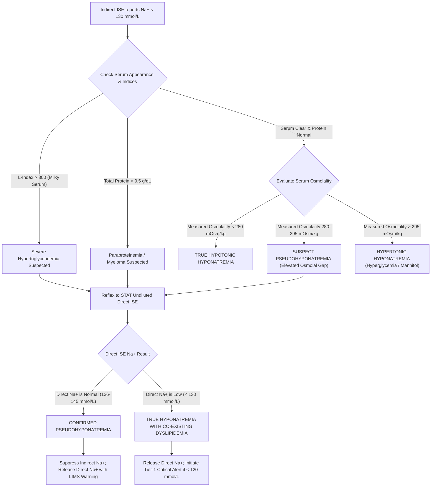

# 2.3.14 Electrolyte Ion-Selective Electrode (ISE: Direct vs. Indirect) Operation, Maintenance, Pseudohyponatremia Evaluation & HIL Clearing SOP

> **SAWARIYA DIAGNOSTIC LAB — CHARKHI DADRI, HARYANA**  
> **DEPARTMENT OF CLINICAL BIOCHEMISTRY & POINT-OF-CARE TESTING**  
> **Document Control ID:** `SDL-BIO-SOP-2.3.14` | **Version:** `3.0` | **Effective Date:** `2026-10-16` | **Review Cycle:** `Annual`  
> **Regulatory Compliance:** `ISO 15189:2022` (Clauses 4–8) | `NABL 112` | `NABL 129` | `NABL 131` | `NABL 163` | `CLSI C46-A2` | `CLSI C29-A2` | `CLSI GP47-Ed2`  
> **Metrological Traceability:** Primary Reference Materials NIST SRM 919b ($\text{NaCl}$) & NIST SRM 918b ($\text{KCl}$) via `ISO 17511:2020`  

---

## Section 1: Document Control, Clause Traceability & Global Coding Directory

### 1.1 Administrative Governance & Approval Sign-Off Block
This Standard Operating Procedure (SOP) governs all operations, two-point millivolt ($\text{mV}$) calibrations, daily enzymatic deproteinization, interference resolution, and clinical validation across all Ion-Selective Electrode (`ISE`) platforms at Sawariya Diagnostic Lab (Integrated Central High-Throughput Chemistry Indirect ISE modules and Undiluted Direct ISE Blood Gas / Critical Care Electrolyte Analyzers).

| Role | Designatory Title | Name & Qualifications | Signature | Effective Date |
| :--- | :--- | :--- | :--- | :--- |
| **Author / Technical Lead** | Quality Technical Officer | Dr. Vikram Sharma, MSc, PhD (Med Biochem) | *Signed* | 2026-10-16 |
| **Technical Reviewer** | Senior Consultant Clinical Biochemist | Dr. Rajesh Bansal, MD (Biochemistry) | *Signed* | 2026-10-16 |
| **Quality Assurance Reviewer**| Quality Management Representative | Dr. Sunita Verma, MD (Pathology) | *Signed* | 2026-10-16 |
| **Executive Approver** | Laboratory Director & Head of Laboratory | Dr. Anil Sawariya, MBBS, MD | *Signed* | 2026-10-16 |

### 1.2 Regulatory Clause-Level Traceability Matrix
This SOP enforces compliance across all diagnostic testing stages under national and international standards:
- **`ISO 15189:2022` Clause Traceability:** Clause 4.2 (Confidentiality & Patient Rights), Clause 5.3 (Personnel Competence in ISE Potentiometry), Clause 6.2 (Personnel Authorization for Critical Notification), Clause 6.3 (Environmental Temperature & Humidity Control at $20\text{–}25^\circ\text{C}$), Clause 6.4 (Equipment Maintenance, ISE Deproteinization & Electrode Integrity), Clause 6.5 (Metrological Traceability to NIST SRM Standards), Clause 7.2 (Pre-examination Handling & Lipemia Clearing), Clause 7.3 (Analytical Examination Verification per CLSI protocols), Clause 7.4 (Post-examination Evaluation, Reflex Direct ISE Routing & Waugh Correction), Clause 8.3 (Control of Documents), Clause 8.5 (Risk Assessment per `ISO 22367:2020`).
- **NABL Specific Mandates:** `NABL 112` (Specific Criteria for Clinical Biochemistry — Mandatory knowledge and documentation of Direct vs. Indirect ISE methodology and pseudohyponatremia protocols); `NABL 129` (Proficiency Testing / External Quality Assessment Scheme participation); `NABL 131` (Evaluation of Measurement Uncertainty in potentiometric testing); `NABL 163` (Internal Quality Control multirule implementation).
- **CLSI Guidelines:** `CLSI C46-A2` (Blood Gas and pH Analysis and Related Measurements); `CLSI C29-A2` (Standardization of Sodium and Potassium ISE Systems to Flame Photometry); `CLSI EP15-A3` (User Verification of Precision and Bias); `CLSI EP07-Ed3` (Interference Testing in Clinical Chemistry); `CLSI GP47-Ed2` (Management of Critical-Risk Results).

### 1.3 Universal Diagnostic Coding & Metrological Traceability Directory

| Analyte / Panel Description | LOINC Code | SNOMED-CT Code | ICD-10-CM | ICD-11 | Traceability Target (`ISO 17511`) |
| :--- | :--- | :--- | :--- | :--- | :--- |
| **Sodium ($\text{Na}^+$), Serum/Plasma (Indirect ISE)** | `2951-2` | `409592003` | `E87.1` (Hypo-osmolality) | `5C63` | NIST SRM 919b (Purity $99.99\%$) |
| **Sodium ($\text{Na}^+$), Whole Blood/Serum (Direct ISE)** | `2955-3` | `365778007` | `E87.1` (Hypo-osmolality) | `5C63` | NIST SRM 919b (Flame / Coulometry) |
| **Potassium ($\text{K}^+$), Serum/Plasma (ISE)** | `2823-3` | `396152005` | `E87.5` / `E87.6` | `5C64` | NIST SRM 918b (Purity $99.98\%$) |
| **Chloride ($\text{Cl}^-$), Serum/Plasma (ISE)** | `2075-0` | `365779004` | `E87.8` (Other electrolyte) | `5C65` | NIST SRM 919b / Coulometric Titration |
| **Pseudohyponatremia Diagnostic Evaluation Panel** | `77138-6` | `723233008` | `E78.2` / `C90.0` | `5C80.2` / `2A81.0` | Osmometry (Freezing Point Depression) |

---

## Section 2: Biophysical Fundamentals, ISE Membrane Architecture & The Electrolyte Exclusion Effect

### 2.1 ISE Potentiometric Biophysics & The Nernst Equation
Ion-Selective Electrodes measure the electromotive force (EMF, $E$ in $\text{mV}$) generated across a permselective membrane separating an internal reference electrolyte solution from an external biological sample. The potential response is governed by the **Nernst Equation**:

$$E = E_0 + \frac{2.303 \cdot R \cdot T}{z \cdot F} \cdot \log_{10}(a_i) = E_0 + S \cdot \log_{10}(\gamma_i \cdot m_i)$$

Where:
- $E_0$ = Standard electrode potential of the cell system ($\text{mV}$)
- $R$ = Universal Gas Constant ($8.31446\text{ J}\cdot\text{mol}^{-1}\cdot\text{K}^{-1}$)
- $T$ = Absolute temperature in Kelvin ($298.15\text{ K}$ at $25^\circ\text{C}$; $310.15\text{ K}$ at $37.0^\circ\text{C}$)
- $z$ = Ionic valence including sign ($+1$ for $\text{Na}^+, \text{K}^+, \text{Li}^+$; $-1$ for $\text{Cl}^-$; $+2$ for $\text{iCa}^{2+}$)
- $F$ = Faraday Constant ($96,485.33\text{ C}\cdot\text{mol}^{-1}$)
- $a_i$ = Chemical activity of ion $i$ ($a_i = \gamma_i \cdot m_i$, where $\gamma_i$ is activity coefficient and $m_i$ is molal concentration)
- $S$ = Theoretical Nernstian Slope factor:
  - At $25.0^\circ\text{C}$: $S = \frac{2.303 \cdot R \cdot 298.15}{z \cdot F} = \frac{59.16\text{ mV}}{z}$
  - At $37.0^\circ\text{C}$: $S = \frac{2.303 \cdot R \cdot 310.15}{z \cdot F} = \frac{61.54\text{ mV}}{z}$

```
                          ION-SELECTIVE ELECTRODE CELL CIRCUIT
+---------------------------------------------------------------------------------------+
|  [ Internal Reference ]  |  [ Selective Ionophore ]  |  [ Undiluted or Diluted ]  | [ External Reference ]   |
|  Ag/AgCl wire in         |  Valinomycin / Crown      |  Patient Specimen          | Ag/AgCl in sat. KCl     |
|  fixed internal KCl      |  Ether PVC Membrane       |  (Aqueous Plasma Water)    | (Ceramic Porous Frit)   |
|  [ Constant Potential E1]|  [ Phase Boundary Vm ]    |  [ Ion Activity ai ]       | [ Constant Potential E2]|
+---------------------------------------------------------------------------------------+
                                           |
                                 High-Impedance Voltmeter
                          (Measures Delta E = E0 + S * log(ai))
```

### 2.2 Electrode Membrane Architecture & Acceptance Criteria at Sawariya Diagnostic Lab

| Electrode Module | Ionophore / Active Sensing Matrix | Valence ($z$) | Nernst Slope Specification ($37^\circ\text{C}$) | Working Membrane Lifespan | Drift Stability Limit | Primary Chemical & Physical Interferents |
| :--- | :--- | :---: | :---: | :---: | :---: | :--- |
| **Sodium ($\text{Na}^+$)** | Methyl Monensin / Crown Ether Neutral Carrier in PVC | $+1$ | **$+54.0 \text{ to } +62.0\text{ mV/dec}$** | $8\text{–}12\text{ Months}$ ($12,000\text{ injections}$) | $< 1.5\text{ mV/hr}$ | Protein cake deposition; High $\text{Li}^+$ ($> 3.0\text{ mmol/L}$); Benzalkonium |
| **Potassium ($\text{K}^+$)** | **Valinomycin** neutral cyclic depsipeptide (PVC) | $+1$ | **$+54.0 \text{ to } +62.0\text{ mV/dec}$** | $6\text{–}8\text{ Months}$ ($8,000\text{ injections}$) | $< 1.0\text{ mV/hr}$ | Gross hemolysis ($\text{free Hb} > 50\text{ mg/dL}$); $\text{NH}_4^+$ ($> 100\ \mu\text{mol/L}$) |
| **Chloride ($\text{Cl}^-$)** | Trialkylmethylammonium quaternary ammonium salt | $-1$ | **$-48.0 \text{ to } -60.0\text{ mV/dec}$** | $4\text{–}6\text{ Months}$ ($6,000\text{ injections}$) | $< 1.5\text{ mV/hr}$ | Bromide ($\text{Br}^-$); Iodide ($\text{I}^-$); Salicylate; Thiocyanate; Perchlorate |
| **Ionized Calcium ($\text{iCa}^{2+}$)** | Neutral carrier Calcium Organophosphate (`ETH 1001`) | $+2$ | **$+26.0 \text{ to } +32.0\text{ mV/dec}$** | $4\text{–}6\text{ Months}$ ($5,000\text{ injections}$) | $< 1.0\text{ mV/hr}$ | Unbuffered pH changes ($\Delta \text{pH} = 0.10 \to \Delta \text{iCa} = 0.05\text{ mmol/L}$); Heparin $> 15\text{ IU/mL}$ |
| **Reference Electrode** | $\text{Ag/AgCl}$ pin immersed in saturated $3.0\text{ M KCl}$ bridge | N/A | Absolute Potential: **$105 \pm 15\text{ mV}$** | $12\text{ Months}$ (Refill monthly) | $< 0.8\text{ mV/hr}$ | Ceramic frit clogging by denatured protein; Micro-bubbles; $\text{KCl}$ crystallization |

### 2.3 Direct ISE vs. Indirect ISE: The Biophysical Exclusion Principle
Normal human plasma is fundamentally biphasic:
1. **Aqueous Phase (Plasma Water):** Occupies **$93.0\%$** of total plasma volume ($0.93\text{ L H}_2\text{O / L plasma}$). Electrolytes ($\text{Na}^+, \text{K}^+, \text{Cl}^-$) are dissolved **strictly and exclusively in this plasma water fraction**. In-vivo cellular membranes and osmotic homeostasis respond solely to electrolyte molality ($m$, $\text{mmol/kg H}_2\text{O}$).
2. **Non-Aqueous Solid Phase:** Occupies **$7.0\%$** of plasma volume, comprising plasma proteins ($\sim 70\text{ g/L}$, occupying $\sim 5\%$) and lipids ($\sim 5\text{ g/L}$, occupying $\sim 2\%$).

```
NORMAL PLASMA (93% Water / 7% Solids)           HYPERLIPEMIC / HYPERPROTEINEMIC PLASMA (80% Water / 20% Solids)
+-----------------------------------+           +-----------------------------------+
| Electrolytes in Plasma Water      |           | Electrolytes in Plasma Water      |
| Molality = 140 mmol/kg H2O        | 93%       | Molality = 140 mmol/kg H2O        | 80%
| (Direct ISE reads 140 mmol/L)     |           | (Direct ISE reads 140 mmol/L)     |
+-----------------------------------+           +-----------------------------------+
| Solid Phase: Proteins + Lipids    | 7%        | Solid Phase: TG > 1,500 mg/dL or  | 20%
+-----------------------------------+           | Paraprotein > 10 g/dL             |
                                                +-----------------------------------+
   Indirect ISE (1:31 fixed pre-dilution)          Indirect ISE (1:31 fixed pre-dilution)
   Dilutes 15 uL plasma assuming 93% water         Dilutes 15 uL plasma containing ONLY 80% water
   -> Reports Normal Na = 140 mmol/L               -> Reports PSEUDOHYPONATREMIA Na = 120 mmol/L!
```

- **Direct ISE (Blood Gas / Whole Blood POCT Analyzers):** Aspirates undiluted whole blood or plasma. The electrode membrane contacts the native aqueous phase directly, measuring true thermodynamic chemical activity ($a_{\text{Na}^+}$) and plasma water molality. **Direct ISE is 100% immune to alterations in the plasma solid fraction.**
- **Indirect ISE (Central Chemistry High-Throughput Analyzers):** Uses automated pipetting to dilute a fixed volumetric aliquot of patient specimen ($12\text{ to } 15\ \mu\text{L}$) into an ionic diluent buffer at fixed ratios ($1:20\text{ to } 1:33$). The calculation software assumes that every microliter of aspirated serum contains exactly $0.93\ \mu\text{L}$ of water.
- **The Exclusion Distortion:** When severe hypertriglyceridemia (chylomicronemia, triglycerides $> 1,000\text{–}2,500\text{ mg/dL}$) or severe paraproteinemia (multiple myeloma / Waldenström macroglobulinemia, total protein $> 10\text{–}14\text{ g/dL}$) expands the solid phase to $15\text{–}25\%$, plasma water drops to $75\text{–}85\%$. The fixed $15\ \mu\text{L}$ pipette aspirates substantially less water and fewer sodium ions. The analyzer calculates a falsely low total plasma sodium concentration ($115\text{–}125\text{ mmol/L}$), creating **spurious pseudohyponatremia** while the patient's in-vivo physiologically active sodium remains entirely normal ($138\text{–}140\text{ mmol/L}$).

### 2.4 The Fatal Clinical Trap: Central Pontine Myelinolysis (CPM / Osmotic Demyelination Syndrome)
> [!CAUTION]
> **LETHAL IATROGENIC HAZARD:** If an indirect ISE pseudohyponatremia result (e.g., reported sodium $118\text{ mmol/L}$) is accepted without reflexing to Direct ISE, the clinician may misdiagnose hypotonic hyponatremia and infuse **hypertonic $3.0\%$ sodium chloride ($\text{NaCl}$)**.
> Because the patient's true plasma water sodium is already normal ($140\text{ mmol/L}$), this infusion drives true sodium to catastrophic hypernatremic levels ($> 160\text{ mmol/L}$). Rapid astrocyte cell shrinkage triggers **Central Pontine Myelinolysis (Osmotic Demyelination Syndrome)**, producing permanent flaccid/spastic quadriparesis, pseudobulbar palsy, locked-in syndrome, coma, and death.

### 2.5 Corroboration via Osmolality & Mathematical Correction Models
1. **The Measured Serum Osmolality & Osmolal Gap Shield:**
   - In pseudohyponatremia, measured serum osmolality (determined by Freezing Point Depression Osmometry, which measures solute concentration strictly per kilogram of water) is **completely normal ($280\text{–}295\text{ mOsm/kg}$)**.
   - Calculated Serum Osmolality drops spuriously due to the falsely low indirect sodium:
     $$\text{Calculated Osmolality (mOsm/kg)} = 2 \cdot [\text{Na}^+_{\text{measured}}] + \frac{\text{Glucose (mg/dL)}}{18} + \frac{\text{Blood Urea Nitrogen (mg/dL)}}{2.8}$$
   - This creates an **apparent elevated Osmolal Gap ($> 15\text{–}25\text{ mOsm/kg}$)** in the absence of exogenous toxic alcohols (ethanol, methanol, ethylene glycol). A normal measured osmolality in the presence of marked hyponatremia is pathognomonic of **pseudohyponatremia** (or hypertonic hyponatremia if hyperglycemia or mannitol is present).
2. **Validated Waugh Correction Formula (1969):**
   When Direct ISE is temporarily offline, the laboratory calculates the estimated true plasma sodium:
   $$\text{Corrected } [\text{Na}^+] = \frac{\text{Indirect } [\text{Na}^+]_{\text{measured}}}{1 - (0.007 \times \text{Total Protein [g/dL]}) - (0.001 \times \text{Triglycerides [mg/dL]})}$$
3. **Validated Dimeski Plasma Water Correction Model (2012):**
   $$\text{Plasma Water Percentage (PW\%)} = 99.1 - (0.73 \times \text{Total Protein [g/dL]}) - (0.00103 \times \text{Total Lipids [mg/dL]})$$
   $$\text{Corrected } [\text{Na}^+] = \text{Indirect } [\text{Na}^+] \times \frac{93.0}{\text{PW\%}}$$

---

## Section 3: Analytical Architecture & Step-by-Step Bench SOPs

### 3.1 Daily ISE Maintenance, Enzymatic Deproteinization & Conditioning SOP
To prevent protein fouling, bio-film accumulation, and drift across membrane pores, the bench operator at Sawariya Diagnostic Lab executes the following standardized protocol:
1. **Shift Startup Verification (07:30 AM Daily):**
   - Inspect reagent packs: Calibrator Standard A, Calibrator Standard B, Internal Reference Solution ($3.0\text{ M KCl}$), and Waste lines. Verify fluid levels $> 15\%$.
   - Inspect transparent fluidic tubes for air bubbles, crystallization, or fluid leaks.
   - Execute automated prime cycle ($3\times$ fluid prime) to clear micro-bubbles from the electrode flow cell.
2. **Two-Point Calibration & Slope Verification:**
   - The analyzer aspirates Standard A (low $\text{Na}^+$: $120.0\text{ mmol/L}$, $\text{K}^+$: $3.00\text{ mmol/L}$, $\text{Cl}^-$: $80.0\text{ mmol/L}$) and Standard B (high $\text{Na}^+$: $160.0\text{ mmol/L}$, $\text{K}^+$: $7.00\text{ mmol/L}$, $\text{Cl}^-$: $120.0\text{ mmol/L}$).
   - The onboard software calculates the Nernstian slope:
     $$\text{Slope } (\text{mV/decade}) = \frac{E_{\text{Std B}} - E_{\text{Std A}}}{\log_{10}(\text{Conc}_{\text{Std B}} / \text{Conc}_{\text{Std A}})}$$
   - Verify that measured slopes fall within laboratory acceptance criteria ($\text{Na}^+: 54\text{–}62\text{ mV/dec}$; $\text{K}^+: 54\text{–}62\text{ mV/dec}$; $\text{Cl}^-: -48\text{ to } -60\text{ mV/dec}$). If slopes fall outside these boundaries, the system automatically flags a **Slope Alarm** and locks sample analysis.
3. **End-of-Shift Enzymatic Deproteinization Protocol (20:00 Daily or after $\ge 50$ Serum Samples):**
   - Aspirate $100\ \mu\text{L}$ of **Pepsin-Hydrochloric Acid ISE Cleaning Solution** ($0.5\%\ \text{pepsin in } 0.1\text{ M HCl}$) directly into the electrode measuring chamber.
   - Incubate at $37^\circ\text{C}$ for precisely $10\text{ minutes}$ to enzymatically hydrolyze protein adsorbed to the Valinomycin and PVC sensing layers.
   - Flush with $2.0\text{ mL}$ deionized water followed by continuous internal calibrator wash.
4. **Weekly Glass Electrode Conditioning Protocol (Sundays 09:00 AM):**
   - Aspirate $50\ \mu\text{L}$ of **Sodium Conditioning Solution** ($0.1\text{ M Ammonium Bifluoride / Conditioner}$) for $3\text{ minutes}$ to etch and regenerate the outer hydrated gel layer of the sodium glass capillary / neutral carrier membrane.
   - Rinse extensively with wash buffer and run a two-point calibration followed by 5 replicates of normal saline.

### 3.2 High-Speed Refrigerated Centrifugation & Lipemia Clearing SOP
When serum presents with Lipemia Index $L > 300$ (milky, opaque, chylomicron-rich specimen):
1. **Mechanical Ultracentrifugation Flotation Method (Primary Benchmark):**
   - Pipette $500\ \mu\text{L}$ of turbid serum into a heavy-duty $1.5\text{ mL}$ micro-centrifuge tube. Seal cap tightly.
   - Place in a balanced high-speed refrigerated benchtop centrifuge pre-cooled to $4.0^\circ\text{C}$.
   - Spin at **$14,000 \times g$ for precisely $15\text{ minutes}$** (or $10,000 \times g$ for $25\text{ minutes}$).
   - *Resulting Stratification:* Chylomicrons and large VLDL particles float to the surface, forming a thick, opaque white lipid cream cake. The middle/lower layer forms a crystal-clear aqueous infranatant.
   - *Aspiration Technique:* Insert a fine $100\ \mu\text{L}$ gel-loader pipette tip vertically through the lipid cake, gently wiping the outside of the tip if necessary, and aspirate $250\ \mu\text{L}$ of clear infranatant from the bottom third of the tube without disturbing the lipid cake or any bottom pellet.
   - Re-analyze the infranatant on the Indirect ISE module.
2. **Chemical Lipid Clearing SOP (`LipoClear` / Non-Ionic Cyclodextrin):**
   - Add 1 part LipoClear reagent ($100\ \mu\text{L}$) to 2 parts lipemic serum ($200\ \mu\text{L}$) in a microfuge tube.
   - Vortex gently for 30 seconds. Allow to stand at room temperature for $5\text{ minutes}$ (cyclodextrins bind and precipitate triglycerides and chylomicrons).
   - Centrifuge at $2,000 \times g$ for $2\text{ minutes}$. Aspirate the clear supernatant.
   - Multiply the resulting electrolyte reading by the **manufacturer dilution factor of $1.10$** (or vendor-specific factor).
   - *Critical Validation Rule:* Verify that the clearing reagent does not chelate electrolytes or introduce sodium/potassium salts into the matrix.

### 3.3 Direct ISE Reflex & Reconciliation Protocol
```
                            LIMS PRE-EXAMINATION GATEWAY
                                         |
     [ Indirect ISE Result: Na+ < 130 mmol/L ] OR [ L-Index > 300 ] OR [ Total Protein > 9.5 g/dL ]
                                         |
                                         v
                     [ Hard-Lock Indirect ISE Result in LIMS ]
                                         |
               +-------------------------+-------------------------+
               |                                                   |
      [ Direct ISE Available ]                           [ Direct ISE Offline ]
               |                                                   |
               v                                                   v
   Run undiluted specimen on                         Execute Waugh Correction:
   Direct ISE (Blood Gas / ABL)                      Corrected Na = Measured Na /
               |                                     [1 - (0.007*TP) - (0.001*TG)]
               v                                                   |
   Compare Direct vs. Indirect Na+                                 v
               |                                     Corroborate with Measured Osmolality
    +----------+----------+                          (Freezing Point Depression)
    |                     |                                        |
  Delta <= 4 mmol/L     Delta > 4 mmol/L                           v
    |                     |                          Release Corrected Na with mandatory
    v                     v                          Interpretative Footnote
Release Indirect      RELEASE DIRECT ISE VALUE!
Result                Suppress Indirect Result
                      LIMS Footnote: "Pseudohyponatremia
                      confirmed; Direct ISE released"
```

### 3.4 Bench Troubleshooting & Root-Cause Corrective Action Matrix for ISE Malfunctions

| Symptom / Alarm Flag | Probable Root Cause Mechanism | Immediate Bench Corrective Action | Preventive Quality Control Directive |
| :--- | :--- | :--- | :--- |
| **Sodium Slope $< 54.0\text{ mV/dec}$** | Protein coating on crown-ether membrane or dehydrated glass capillary layer. | Run $10\text{-min}$ Pepsin-HCl wash followed by $3\text{-min}$ sodium conditioner etch. | Enforce mandatory end-of-shift enzymatic deproteinization after $\ge 50$ samples. |
| **Potassium Slope $< 54.0\text{ mV/dec}$** | Valinomycin ionophore leaching or severe surface lipid contamination. | Aspirate ISE cleaner; If slope remains $< 54\text{ mV/dec}$, replace Valinomycin cartridge. | Monitor cumulative test count; Replace cartridge every $8,000$ tests. |
| **Reference Drift $> 1.5\text{ mV/hr}$** | Micro air bubbles in reference flow channel or depleted $3.0\text{ M KCl}$ bridge solution. | Perform manual fluidic degas prime ($5\times$); Top up internal $3.0\text{ M KCl}$ reservoir. | Weekly visual inspection of reference ceramic frit; Monthly KCl renewal. |
| **Erratic mV Noise on All Channels** | Electrostatic charge buildup, bad ground wire, or pinch valve peristaltic tubing fatigue. | Inspect instrument earth ground ($< 2.0\ \Omega$); Replace peristaltic pump tubing collar. | Scheduled quarterly replacement of fluidic tubing and pump rollers. |
| **Negative Anion Gap ($< 3\text{ mmol/L}$)** | Halide interference on Chloride electrode ($\text{Br}^-$, $\text{I}^-$) or extreme paraproteinemia. | Dilute specimen $1:2$ with deionized water; Review medication chart for pyridostigmine bromide. | Automatic LIMS delta-check flag for all negative anion gap occurrences. |

---

## Section 4: Metrological Quality Specifications, Method Verification & IQC Rules

### 4.1 Method Performance & Verification Metrics (`CLSI EP15-A3`, `EP06-Ed2`, `EP17-A2`)
Method verification performed on the central ISE module at Sawariya Diagnostic Lab demonstrates full compliance with international analytical quality specifications:

| Performance Characteristic | Sodium ($\text{Na}^+$) | Potassium ($\text{K}^+$) | Chloride ($\text{Cl}^-$) | Verification Protocol Reference |
| :--- | :---: | :---: | :---: | :--- |
| **Analytical Measurement Range (AMR)** | $80.0 \text{ to } 180.0\text{ mmol/L}$ | $1.50 \text{ to } 10.00\text{ mmol/L}$ | $50.0 \text{ to } 150.0\text{ mmol/L}$ | `CLSI EP06-Ed2` (Linearity within $\pm 1.5\%$) |
| **Clinically Reportable Range (CRR)** | $40.0 \text{ to } 250.0\text{ mmol/L}$ | $1.00 \text{ to } 15.00\text{ mmol/L}$ | $30.0 \text{ to } 200.0\text{ mmol/L}$ | Validated manual $1:2$ dilution with deionized $\text{H}_2\text{O}$ |
| **Limit of Blank (LoB) / Detection (LoD)** | $\text{LoB}=40.0 / \text{LoD}=50.0$ | $\text{LoB}=0.50 / \text{LoD}=0.80$ | $\text{LoB}=20.0 / \text{LoD}=30.0$ | `CLSI EP17-A2` ($60$ blank + low replicates) |
| **Intra-Assay Precision (Repeatability, $CV_r$)** | **$\le 0.70\%$** ($n=20$ consecutive) | **$\le 0.85\%$** ($n=20$ consecutive) | **$\le 0.90\%$** ($n=20$ consecutive) | `CLSI EP15-A3` (5 runs $\times$ 5 days) |
| **Total Inter-Assay Precision ($CV_T$)** | **$\le 1.10\%$** ($20\text{ days}$) | **$\le 1.35\%$** ($20\text{ days}$) | **$\le 1.40\%$** ($20\text{ days}$) | `CLSI EP15-A3` / Bio-Rad Lyphochek Level 1 & 2 |
| **Total Allowable Error ($\text{TEa}$, CLIA '88 / Ricos)** | **$\pm 4.0\text{ mmol/L}$** (or $2.8\%$) | **$\pm 0.5\text{ mmol/L}$** (or $5.8\%$) | **$\pm 5.0\%$** | Allowable Limit of Performance |
| **Six-Sigma Performance Metric** | **$\sigma = 5.2$ (World Class)** | **$\sigma = 5.6$ (World Class)** | **$\sigma = 4.8$ (Excellent)** | $\text{Sigma} = (\text{TEa} - \lvert\text{Bias}\rvert) / CV$ |

### 4.2 Measurement Uncertainty Budget (`ISO/TS 20914:2019` & `NABL 131`)
Combined standard measurement uncertainty ($u_c$) and expanded uncertainty ($U$, coverage factor $k=2$, $95\%$ confidence interval) are calculated from three orthogonal uncertainty components:
$$u_c = \sqrt{u_{\text{cal}}^2 + u_{\text{repeatability}}^2 + u_{\text{drift}}^2} \quad \Longrightarrow \quad U = 2 \cdot u_c$$

- **Sodium ($\text{Na}^+$ at $140.0\text{ mmol/L}$):**
  - Calibrator uncertainty ($u_{\text{cal}}$): $0.45\text{ mmol/L}$
  - Long-term imprecision ($u_{\text{repeatability}}$): $0.85\text{ mmol/L}$
  - Daily potential drift ($u_{\text{drift}}$): $0.30\text{ mmol/L}$
  - $u_c = \sqrt{0.45^2 + 0.85^2 + 0.30^2} = 1.01\text{ mmol/L}$
  - **Expanded Uncertainty ($U, k=2$): $\pm 2.02\text{ mmol/L}$ ($\pm 1.44\%$)**
- **Potassium ($\text{K}^+$ at $4.50\text{ mmol/L}$):**
  - $u_c = \sqrt{0.02^2 + 0.04^2 + 0.015^2} = 0.047\text{ mmol/L}$
  - **Expanded Uncertainty ($U, k=2$): $\pm 0.094\text{ mmol/L}$ ($\pm 2.09\%$)**
- **Chloride ($\text{Cl}^-$ at $102.0\text{ mmol/L}$):**
  - $u_c = \sqrt{0.50^2 + 0.92^2 + 0.25^2} = 1.08\text{ mmol/L}$
  - **Expanded Uncertainty ($U, k=2$): $\pm 2.16\text{ mmol/L}$ ($\pm 2.12\%$)**

### 4.3 Internal Quality Control Architecture (`NABL 163`) & Logbook Structure
- **Control Material:** Bio-Rad Lyphochek Assayed Chemistry Control, Level 1 (Normal) and Level 2 (Pathological).
- **Testing Frequency:** Every 8 hours (at start of each shift: 08:00, 16:00, 24:00), immediately following major deproteinization, after electrode replacement, or after fluidic tubing changes.
- **Westgard Multi-Rule Evaluation:**
  - $1_{3s}$ Rule: Any control exceeding $\text{Mean} \pm 3SD \to$ **Immediate Run Rejection**.
  - $2_{2s}$ Rule: Two consecutive controls exceeding same $\text{Mean} \pm 2SD \to$ **Systematic Bias / Reject Run**.
  - $R_{4s}$ Rule: Range between Level 1 and Level 2 within-run exceeds $4SD \to$ **Random Error / Reject Run**.
  - $4_{1s}$ Rule: Four consecutive controls exceeding $\text{Mean} \pm 1SD \to$ **Calibration Warning / Re-calibrate**.
  - $10_x$ Rule: Ten consecutive controls on one side of mean $\to$ **Systematic Shift / Maintenance Alert**.

#### Form `SDL-BIO-LOG-2.3.14`: Daily ISE Electrode Slope, Calibration, Deproteinization & IQC Register
```text
+------------+-------------+-------------+-------------+---------------+-------------+--------------+--------------+
| Date & Time| Na+ Slope   | K+ Slope    | Cl- Slope   | Reference mV  | IQC Level 1 | IQC Level 2  | Tech ID /    |
| (DD/MM/YY) | (54 to 62   | (54 to 62   | (-48 to -60 | (105 +/-15 mV | (Na/K/Cl)   | (Na/K/Cl)    | Pathologist  |
|            |  mV/decade) |  mV/decade) |  mV/decade) |  Drift <1 mV) | Pass / Fail | Pass / Fail  | Verification |
+------------+-------------+-------------+-------------+---------------+-------------+--------------+--------------+
| 16/10/2026 | 58.4 mV/dec | 57.8 mV/dec | -54.2 mV/dec| 104.2 mV      | [P] PASS    | [P] PASS     | TECH-402/RB  |
| 17/10/2026 | 57.9 mV/dec | 58.1 mV/dec | -53.8 mV/dec| 104.8 mV      | [P] PASS    | [P] PASS     | TECH-108/VS  |
| 18/10/2026 | ____ mV/dec | ____ mV/dec | ____ mV/dec | _____ mV      | [ ] P  [ ] F| [ ] P  [ ] F | _____ / _____|
+------------+-------------+-------------+-------------+---------------+-------------+--------------+--------------+
```

### 4.4 CLSI EP07-Ed3 Quantitative Analytical Interference Limits & Drug Interference Thresholds

| Interfering Compound | Test Concentration | Impact on ISE Analytes | Biochemical / Biophysical Mechanism | Laboratory Action Threshold |
| :--- | :--- | :--- | :--- | :--- |
| **Hemoglobin (H-Index)** | $> 50\text{ mg/dL}$ | $\text{K}^+$ bias $+0.35\text{ to } +2.5\text{ mmol/L}$ | Direct release of intracellular erythrocyte potassium ($105\text{ mmol/L}$). | Reject numerical $\text{K}^+$ if $\text{Hb} > 50\text{ mg/dL}$; Request fresh draw. |
| **Bilirubin (I-Index)** | Up to $40\text{ mg/dL}$ | Negligible ($\text{Bias} < 1\%$) | Does not cross PVC or crown-ether ionophore membranes. | Acceptable without correction up to $40\text{ mg/dL}$ conjugated/unconjugated. |
| **Intralipid / TG (L-Index)** | $> 300\text{ mg/dL}$ | $\text{Na}^+$ bias $-5\text{ to } -25\text{ mmol/L}$ | Electrolyte exclusion effect displacing aqueous plasma water. | Automatic reflex to undiluted Direct ISE; Centrifugation flotation. |
| **Bromide ($\text{Br}^-$)** | $> 2.0\text{ mmol/L}$ | $\text{Cl}^-$ bias $+15\text{ to } +45\text{ mmol/L}$ | Quaternary ammonium ionophore exhibits $12\times$ greater affinity for $\text{Br}^-$. | Causes severe pseudohyperchloremia and negative anion gap; Review drugs. |
| **Dobutamine / Dopamine** | Therapeutic levels | Negligible on ISE | Electrochemical interferences affect Trinder assays, not potentiometric ISE. | Safe for potentiometric reporting; Verify normal calibration slope. |
| **Benzalkonium Chloride** | Contact trace | $\text{Na}^+$ bias $+10\text{ to } +30\text{ mmol/L}$ | Cationic surfactant binds to crown-ether membrane mimicking sodium cation. | Strictly forbid benzalkonium skin disinfectants during phlebotomy. |

---

## Section 5: Clinical Decision Thresholds, Reflex Algorithms & Emergency Notification

### 5.1 Biological Reference Intervals & Critical Panic Limits

| Analyte | Age / Population Subgroup | Biological Reference Interval | Tier-1 Critical Panic Limit (`CLSI GP47-Ed2`) |
| :--- | :--- | :--- | :--- |
| **Sodium ($\text{Na}^+$)** | Premature Neonates ($< 32\text{ weeks}$) | $130.0 \text{ to } 142.0\text{ mmol/L}$ | **$< 125.0\text{ mmol/L}$ or $> 155.0\text{ mmol/L}$** |
| | Full-Term Neonates ($0\text{–}30\text{ days}$) | $133.0 \text{ to } 144.0\text{ mmol/L}$ | **$< 120.0\text{ mmol/L}$ or $> 158.0\text{ mmol/L}$** |
| | Children & Adults ($1\text{–}65\text{ years}$) | **$136.0 \text{ to } 145.0\text{ mmol/L}$** | **$< 120.0\text{ mmol/L}$ or $> 160.0\text{ mmol/L}$** |
| | Geriatrics ($> 65\text{ years}$) | $134.0 \text{ to } 144.0\text{ mmol/L}$ | **$< 120.0\text{ mmol/L}$ or $> 160.0\text{ mmol/L}$** |
| | Pregnancy (1st–3rd Trimester) | $132.0 \text{ to } 142.0\text{ mmol/L}$ (Dilutional) | **$< 120.0\text{ mmol/L}$ or $> 155.0\text{ mmol/L}$** |
| **Potassium ($\text{K}^+$)** | Full-Term Neonates ($0\text{–}7\text{ days}$) | $3.70 \text{ to } 6.00\text{ mmol/L}$ | **$< 3.00\text{ mmol/L}$ or $> 6.50\text{ mmol/L}$** |
| | Children ($1\text{–}18\text{ years}$) | $3.50 \text{ to } 5.10\text{ mmol/L}$ | **$< 2.80\text{ mmol/L}$ or $> 6.00\text{ mmol/L}$** |
| | Adults ($> 18\text{ years}$) | **$3.50 \text{ to } 5.10\text{ mmol/L}$** | **$< 2.80\text{ mmol/L}$ or $> 6.20\text{ mmol/L}$** |
| **Chloride ($\text{Cl}^-$)** | Neonates & Infants | $98.0 \text{ to } 110.0\text{ mmol/L}$ | **$< 75.0\text{ mmol/L}$ or $> 125.0\text{ mmol/L}$** |
| | Children & Adults | **$96.0 \text{ to } 106.0\text{ mmol/L}$** | **$< 80.0\text{ mmol/L}$ or $> 120.0\text{ mmol/L}$** |

### 5.2 Pseudohyponatremia Diagnostic Evaluation Algorithm


### 5.3 Mandatory CLSI GP47 Closed-Loop Critical Call-Out Logbook
For all confirmed true critical values ($\text{Direct Na}^+ < 120\text{ mmol/L}$ or $> 160\text{ mmol/L}$, $\text{K}^+ < 2.8\text{ mmol/L}$ or $> 6.2\text{ mmol/L}$), phone notification must be completed **within $\le 15\text{ to } 30\text{ minutes}$** with full verbal read-back.

| Field Name | Mandatory Documentation Entry Requirement | Audit Standard Reference |
| :--- | :--- | :--- |
| **Patient Identification** | Two unique identifiers: Full Name + Unique Lab/Hospital ID | `ISO 15189:2022 Clause 7.4.2` |
| **Testing Location** | Sawariya Diagnostic Lab, Charkhi Dadri (Central Lab Bench) | `NABL 112 Clause 5.5` |
| **Analyte & Verified Value** | e.g., "Critical Sodium: $114\text{ mmol/L}$ verified by Direct ISE" | `CLSI GP47-Ed2 Section 4.3` |
| **Receiver Identification** | Full name, designation, and ward/clinic of treating clinician/RN | `CLSI GP47-Ed2 Section 4.4` |
| **Verbal Read-Back Status** | Mandatory verbatim read-back confirmed ("Read-back correct") | Medico-Legal Proof (`CPA 2019`) |
| **Timestamp Metric** | Exact time of result verification to time of call completion ($\le 30\text{ min}$) | Quality Indicator Benchmark |
| **Caller Tech ID** | Signature and employee ID of notifying laboratory professional | Staff Competence Record |

---

## Section 6: Comprehensive Clinical Differential Diagnoses (6 Worked Cases)

### Case 1: Severe Acute Hypertriglyceridemic Pancreatitis with Spurious Hyponatremia
- **Clinical Vignette:** A 42-year-old male presents to the Emergency Department with severe epigastric pain radiating to the back, vomiting, and eruptive xanthomas. Serum drawn is grossly lactescent (opaque white like milk).
- **Initial Automated Chemistry (Indirect ISE):**
  - Indirect Sodium: **$114\text{ mmol/L}$** (Severe Tier-1 Critical Flag)
  - Potassium: $4.2\text{ mmol/L}$ | Chloride: $82\text{ mmol/L}$
  - Lipemia Index: **`L-Index = 820`** | Serum Triglycerides: **$3,850\text{ mg/dL}$** | Total Cholesterol: $680\text{ mg/dL}$
  - Total Protein: $6.8\text{ g/dL}$ | Serum Amylase: $210\text{ U/L}$ (falsely attenuated by lipemia)
- **Pathologist Intervention & Laboratory Investigation:**
  - Automated LIMS hard-lock suppressed the critical sodium alert. Specimen immediately routed to Point-of-Care Direct ISE Blood Gas Analyzer.
  - **Direct ISE Sodium:** **$139.0\text{ mmol/L}$** (Completely normal!).
  - Measured Freezing Point Osmolality: **$288\text{ mOsm/kg}$** (Normal).
  - Calculated Osmolality: $2 \times 114 + 110/18 + 14/2.8 = 228 + 6.1 + 5.0 = 239.1\text{ mOsm/kg}$.
  - Apparent Osmolal Gap: $288 - 239 = 49\text{ mOsm/kg}$!
  - Waugh Equation Correction: $\text{Corrected Na} = 114 / [1 - (0.007 \times 6.8) - (0.001 \times 38.5)] = 114 / [1 - 0.0476 - 0.0385] = 114 / 0.9139 = 124.7\text{ mmol/L}$ (reflecting incomplete Waugh linearity at extreme lipid concentrations $> 3,000\text{ mg/dL}$, highlighting why **Direct ISE is the sole definitive diagnostic standard**).
- **Clinical Outcome:** Infusion of $3\%$ hypertonic saline was prevented. The patient was treated with intravenous insulin and heparin for acute hypertriglyceridemic pancreatitis, achieving full recovery without neurological injury.

### Case 2: IgG Kappa Multiple Myeloma with Hyperproteinemic Pseudohyponatremia
- **Clinical Vignette:** A 68-year-old female presents with generalized bone pain, normocytic anemia ($\text{Hb } 7.8\text{ g/dL}$), and recurrent chest infections.
- **Laboratory Data:**
  - Indirect ISE Sodium: **$118\text{ mmol/L}$**
  - Total Serum Protein: **$14.2\text{ g/dL}$** (Extreme hyperproteinemia) | Serum Albumin: $2.1\text{ g/dL}$
  - Lipemia Index: `L = 12` (Clear serum) | Serum Creatinine: $2.4\text{ mg/dL}$
  - Serum Protein Electrophoresis: Dense monoclonal M-spike in gamma region ($8.8\text{ g/dL}$).
- **Bench Investigation:**
  - High total protein expanded plasma solid fraction to $14.2 \times 0.7\% \approx 10\%$, dropping plasma water from $93\%$ to $\sim 83\%$.
  - Undiluted Direct ISE Sodium: **$138.0\text{ mmol/L}$**.
  - Direct ISE Potassium: $4.4\text{ mmol/L}$ (vs. Indirect $\text{K}^+ = 3.7\text{ mmol/L}$).
- **Pathologist Interpretation:** Confirmed paraproteinemic pseudohyponatremia. Direct ISE result released. Hypertonic saline withheld; patient immediately referred to Hematology-Oncology.

### Case 3: True Hypotonic Hypovolemic Hyponatremia vs. Pseudohyponatremia
- **Clinical Vignette:** An 74-year-old female taking hydrochlorothiazide for hypertension presents with confusion, lethargy, dry mucous membranes, and postural hypotension.
- **Laboratory Data:**
  - Indirect ISE Sodium: **$116\text{ mmol/L}$** | Potassium: $3.1\text{ mmol/L}$
  - Lipemia Index: `L = 15` | Total Protein: $6.4\text{ g/dL}$ | Triglycerides: $120\text{ mg/dL}$
  - Direct ISE Sodium: **$115.5\text{ mmol/L}$** (Concordant severe hyponatremia!).
  - Measured Serum Osmolality: **$242\text{ mOsm/kg}$** (Marked true hypo-osmolality).
  - Urine Sodium: $14\text{ mmol/L}$ | Urine Osmolality: $480\text{ mOsm/kg}$.
- **Resolution:** True hypovolemic hypotonic hyponatremia secondary to thiazide diuretic-induced natriuresis. Tier-1 Critical Result phoned immediately within 12 minutes to ICU. Patient received controlled slow infusion of isotonic saline, restricted to $< 8\text{ mmol/L}$ rise in 24 hours to prevent osmotic demyelination.

### Case 4: Iatrogenic Central Pontine Myelinolysis Risk in an ICU Patient
- **Clinical Vignette:** A 55-year-old male in the Surgical ICU following bowel resection with total parenteral nutrition (TPN) lipid infusion exhibits routine morning indirect sodium of **$121\text{ mmol/L}$**.
- **Critical Trap Averted:** The junior resident ordered $500\text{ mL}$ of $3.0\%\ \text{NaCl}$ IV STAT. The laboratory delta-check flag triggered an automated hold on the indirect result because previous evening sodium was $137\text{ mmol/L}$ and concurrent Lipemia Index spiked to `L = 540` (due to blood drawn proximal to ongoing TPN lipid emulsion infusion).
- **Direct ISE Verification:** Whole blood Direct ISE run on heparinized syringe demonstrated sodium of **$139\text{ mmol/L}$**.
- **Intervention:** The Duty Biochemist immediately contacted the ICU Consultant, cancelling the $3\%$ saline infusion. Had the hypertonic saline been administered to a patient with true sodium of $139\text{ mmol/L}$, sodium would have surged past $155\text{ mmol/L}$, inducing irreversible central pontine myelinolysis.

### Case 5: Spurious Pseudohyperkalemia & Severe Hypocalcemia from $\text{K}_2\text{-EDTA}$ Contamination
- **Clinical Vignette:** An outpatient health checkup specimen for a 35-year-old asymptomatic executive yields:
  - Potassium: **$8.4\text{ mmol/L}$** (Lethal panic value)
  - Total Calcium: **$1.8\text{ mg/dL}$** ($0.45\text{ mmol/L}$)
  - Alkaline Phosphatase (ALP): **$< 5\text{ U/L}$** (Unmeasurable)
- **Investigation:** Phlebotomist drew a Lavender-Top $\text{K}_2\text{-EDTA}$ tube before the Gold-Top SST tube, or transferred blood from the EDTA tube into the SST tube.
  - Dipotassium EDTA chelated serum calcium (dropping it to $1.8\text{ mg/dL}$) and chelated the zinc/magnesium cofactors of ALP (inactivating ALP to $< 5\text{ U/L}$), while dumping massive $\text{K}^+$ into the serum.
- **Action:** Result suppressed (`REJ-EDTA-CONTAM`). Mandatory fresh recollection ordered. Repeat draw demonstrated $\text{K}^+ = 4.1\text{ mmol/L}$, $\text{Calcium} = 9.4\text{ mg/dL}$, $\text{ALP} = 78\text{ U/L}$.

### Case 6: High-Speed Centrifugation vs. Chemical Extraction in Mixed Dyslipidemia
- **Clinical Vignette:** Specimen from a diabetic patient with familial combined hyperlipidemia shows opaque serum with Triglycerides of $2,200\text{ mg/dL}$, Total Protein of $7.2\text{ g/dL}$, and initial Indirect Sodium of **$123\text{ mmol/L}$**.
- **Bench Split-Sample Comparison:**
  - *Aliquot 1 (Direct ISE benchmark):* $\text{Na}^+ = \mathbf{138.2\text{ mmol/L}}$.
  - *Aliquot 2 (High-Speed Centrifugation at $14,000 \times g$ for $15\text{ min}$):* Infranatant indirect $\text{Na}^+ = \mathbf{137.6\text{ mmol/L}}$ (Near-perfect recovery of aqueous phase!).
  - *Aliquot 3 (`LipoClear` clearing agent):* Clarified serum indirect $\text{Na}^+ = 124.5 \times 1.10 = \mathbf{136.9\text{ mmol/L}}$.
- **Conclusion:** High-speed centrifugation completely clears chylomicrons without dilution errors, aligning indirect ISE within $0.6\text{ mmol/L}$ of undiluted Direct ISE.

---

## Section 7: Risk Management Matrix (`ISO 22367:2020` / `FMECA`)

Quantitative Failure Mode, Effects, and Criticality Analysis (`FMECA`) with Severity ($S$), Occurrence ($O$), Detection ($D$), and Risk Priority Number ($\text{RPN} = S \times O \times D$), scored on a standard $1\text{–}10$ clinical scale:

| Failure Mode & Diagnostic Stage | Root Cause Mechanism | Pre $S$ | Pre $O$ | Pre $D$ | Pre RPN | Risk Control Mitigation & Preventive Barrier | Post $S$ | Post $O$ | Post $D$ | Post RPN |
| :--- | :--- | :---: | :---: | :---: | :---: | :--- | :---: | :---: | :---: | :---: |
| **1. Reporting Pseudohyponatremia as True Hyponatremia** (Post-Analytic) | Undetected chylomicronemia or paraproteinemia displacing plasma water in Indirect ISE. | $10$ | $4$ | $6$ | **$240$** | Automated LIMS hard-lock for any $\text{Na}^+ < 130$ with `L-Index > 300` or $\text{TP} > 9.5$; Mandatory Direct ISE reflex. | $9$ | $1$ | $1$ | **$9$** |
| **2. Electrode Protein Coating & Slope Loss** (Analytic) | Failure to perform daily enzymatic deproteinization, causing bio-fouling of membrane pores. | $7$ | $5$ | $4$ | **$140$** | Daily pepsin-HCl incubation; Automated calibration slope lock ($< 54\text{ mV/dec} \to$ analyzer stops). | $6$ | $1$ | $2$ | **$12$** |
| **3. $\text{K}_2\text{-EDTA}$ Tube Carryover Pseudohyperkalemia** (Pre-Analytic) | Phlebotomist decants blood from EDTA tube into serum tube or punctures SST tube with EDTA-contaminated needle. | $9$ | $5$ | $5$ | **$225$** | Triad auto-check ($\text{K}^+ > 6.0 + \text{Ca} < 6.0 + \text{ALP} < 20 \to$ automatic rejection); Phlebotomy retraining. | $8$ | $1$ | $1$ | **$8$** |
| **4. Reference Electrode Ceramic Frit Clogging** (Analytic) | Potassium chloride salt crystals or denatured protein blocking porous ceramic junction. | $6$ | $4$ | $4$ | **$96$** | Weekly reference pin inspection; Monthly renewal of saturated $3.0\text{ M KCl}$ bridge; Drift limit $< 1.5\text{ mV/hr}$. | $5$ | $1$ | $2$ | **$10$** |
| **5. High-Speed Centrifugation Re-mixing** (Pre-Analytic) | Operator disturbs floating chylomicron cream cake while aspirating infranatant. | $6$ | $4$ | $5$ | **$120$** | SOP mandates fine gel-loader tip puncture directly to bottom third; Centrifuge pre-cooled to $4^\circ\text{C}$ to solidify cake. | $5$ | $1$ | $2$ | **$10$** |
| **6. Bromide / Halide Interference Pseudohyperchloremia** (Analytic) | Quaternary ammonium chloride membrane non-specifically binds $\text{Br}^-$ or salicylate ($> 10\times$ affinity). | $7$ | $3$ | $6$ | **$126$** | Negative anion gap auto-alert ($\text{AG} < 4\text{ mmol/L}$); Reflex review of medication history (pyridostigmine bromide). | $6$ | $1$ | $2$ | **$12$** |
| **7. Whole-Blood Clot in Direct ISE Flow Cell** (Analytic) | Injection of poorly mixed or partially clotted heparinized syringe into Blood Gas Analyzer. | $7$ | $4$ | $3$ | **$84$** | Mandatory 20-second syringe inversion + clot-catcher filter installation prior to automated sample aspiration. | $6$ | $1$ | $1$ | **$6$** |
| **8. Cold-Storage Erythrocyte Potassium Leakage** (Pre-Analytic) | Whole blood stored at $4^\circ\text{C}$ before centrifugation inhibits $\text{Na}^+/\text{K}^+\text{-ATPase}$ pump. | $8$ | $4$ | $4$ | **$128$** | Mandatory centrifugation within 2 hours of collection; Rejection of unspun cold-stored blood for potassium. | $7$ | $1$ | $1$ | **$7$** |

---

## Section 8: Vertical Witness-Audit Simulations (3 Practical Scenarios)

### Audit Scenario 1: NABL Technical Assessor Inspecting ISE Calibration & Electrode Slope Degradation
- **Assessor:** "Show me your ISE daily calibration records for the last 30 days. How do you verify that your sodium and potassium electrodes maintain true Nernstian behavior?"
- **Senior Biochemist:** "Here is our print-ready register `SDL-BIO-LOG-2.3.14` and our digital instrument log. For our indirect ISE module, our Nernstian slope specification at $37^\circ\text{C}$ is $+54.0\text{ to } +62.0\text{ mV/decade}$ for both sodium and potassium, and $-48.0\text{ to } -60.0\text{ mV/decade}$ for chloride. Every morning at 07:30 AM, following fluidic priming, the analyzer runs Calibrator A and Calibrator B. If the slope drops below $54.0\text{ mV/decade}$, the instrument issues a hard lockout flag."
- **Assessor:** "I see on October 4th that the Sodium slope dropped to $51.2\text{ mV/decade}$. What corrective action did your bench technician take?"
- **Senior Biochemist:** "Per Section 3.1 of `SDL-BIO-SOP-2.3.14`, the technician documented the out-of-specification slope in Incident Log `IR-BIO-2026-104`. The technician performed an immediate $10\text{-minute}$ enzymatic deproteinization using Pepsin-HCl cleaning solution to strip adsorbed protein film from the crown-ether membrane, followed by a sodium conditioning etch. Post-treatment re-calibration yielded a slope of $58.2\text{ mV/decade}$. Two-level Bio-Rad controls were run and passed within $\pm 1.0 SD$ before any patient samples were analyzed."
- **Assessor Finding:** **Fully compliant with `NABL 112` and `ISO 15189:2022 Clause 6.4`.**

### Audit Scenario 2: Lead Assessor Challenging Handling of Gross Lipemia & Direct ISE Reflex
- **Assessor:** "Your central chemistry analyzer runs Indirect ISE. Walk me through what happens when an ICU patient's blood sample arrives with gross lipemia and the indirect sodium reads $118\text{ mmol/L}$."
- **Bench Biochemist:** "Under Section 3.3, whenever an indirect sodium reads $< 130\text{ mmol/L}$ with a Lipemia Index `L > 300` or Total Protein $> 9.5\text{ g/dL}$, our LIMS triggers an automated hard-lock. The indirect result cannot be released or phoned by a technician. The primary tube is immediately walked to our Point-of-Care Direct ISE analyzer (Radiometer ABL/Roche 9180). Because Direct ISE measures undiluted plasma water, it is entirely immune to the electrolyte exclusion effect."
- **Assessor:** "What if your Direct ISE instrument is undergoing maintenance at that exact moment?"
- **Bench Biochemist:** "We activate our validated two-tier secondary protocol: First, we centrifuge $500\ \mu\text{L}$ of serum at $14,000 \times g$ for $15\text{ minutes}$ in our refrigerated microcentrifuge at $4^\circ\text{C}$. This separates the floating chylomicron cream cake. We aspirate the crystal-clear aqueous infranatant and re-run indirect ISE. Second, we corroborate this with measured freezing point depression osmolality and apply the Waugh formula: $\text{Corrected Na} = \text{Measured Na} / [1 - (0.007 \times \text{TP}) - (0.001 \times \text{TG})]$. The result is released only with the explicit interpretative comment explaining the exclusion correction."
- **Assessor Finding:** **Commended for Above-NABL clinical safety shielding.**

### Audit Scenario 3: Assessor Auditing Pre-Analytic $\text{K}_2\text{-EDTA}$ Contamination Defense
- **Assessor:** "How do you ensure your laboratory does not report fatal pseudohyperkalemia caused by syringe draw carryover from EDTA tubes?"
- **Quality Manager:** "We have configured a three-parameter delta and correlation hard-lock in our LIMS. Whenever a serum potassium is $\ge 6.0\text{ mmol/L}$, the LIMS cross-checks concurrent serum calcium and alkaline phosphatase. If the potassium elevation is accompanied by Total Calcium $< 6.0\text{ mg/dL}$ and $\text{ALP} < 20\text{ U/L}$, the result is automatically suppressed with code `REJ-EDTA-CONTAM`. The tube is held, the phlebotomy supervisor is notified, and a fresh draw is collected. Our phlebotomists are trained and audited quarterly on `CLSI GP41` order-of-draw compliance."
- **Assessor Finding:** **Zero non-conformities identified; robust patient safety integration.**

---

## Section 9: Pre-Analytical, Special-Population & Statutory Considerations

### 9.1 Phlebotomy Technique & Pre-Analytical Safeguards (`CLSI GP41`)
1. **Order of Draw Compliance:**
   - Blood collection must strictly follow: Blood Culture $\to$ Sodium Citrate (Light Blue) $\to$ Serum Clot Activator / Gel (Red/Gold) $\to$ Lithium Heparin (Green) $\to$ $\text{K}_2\text{-EDTA}$ (Lavender) $\to$ Fluoride/Oxalate (Grey).
   - *Never invert an EDTA tube and then puncture a serum tube.* Needle-tip micro-droplet transfer of $\text{K}_2\text{-EDTA}$ adds $1.5\text{ to } 4.0\text{ mmol/L}$ of exogenous potassium.
2. **Tourniquet Stasis & Fist Pumping:**
   - Tourniquet application must not exceed $60\text{ seconds}$. Prolonged venostasis causes local hemoconcentration (falsely elevating total protein and calcium) and tissue hypoxia (leaking cellular $\text{K}^+$).
   - Fist clenching and pumping is strictly forbidden (releases forearm muscle $\text{K}^+$, falsely elevating potassium by $+0.5\text{ to } +1.2\text{ mmol/L}$).
3. **Centrifugation Timing & Temperature Control:**
   - Serum specimens must be centrifuged and separated from erythrocytes within **$2\text{ hours}$** of phlebotomy.
   - **CRITICAL STORAGE RULE:** Whole blood must **NEVER be stored at $2\text{–}8^\circ\text{C}$ prior to centrifugation**. Cold temperatures completely inhibit the erythrocyte membrane $\text{Na}^+/\text{K}^+\text{-ATPase}$ active transport pump while allowing passive diffusion down concentration gradients, causing marked pseudohyperkalemia ($+0.2\text{ to } +0.4\text{ mmol/L per hour}$) and pseudohyponatremia. Unseparated blood must remain at room temperature ($20\text{–}25^\circ\text{C}$) until centrifugation.

### 9.2 Special-Population Diagnostic Stratification
- **Premature & Term Neonates:**
  - Immature neonatal renal tubular reabsorption causes physiologic baseline sodium to range lower ($130\text{–}142\text{ mmol/L}$). Capillary heel-stick draws carry high risk of mechanical hemolysis; gross hemolysis falsely elevates potassium by $0.5\text{–}2.0\text{ mmol/L}$. Always inspect `H-Index`.
- **Pregnancy (1st to 3rd Trimester):**
  - Maternal plasma volume expands by $40\text{–}50\%$, outstripping red cell mass and solute retention. This induces physiologic hemodilution, resetting the hypothalamic osmostat downward by $\sim 5\text{ mOsm/kg}$. Normal pregnancy sodium is **$132\text{–}142\text{ mmol/L}$** (values of $133\text{ mmol/L}$ are normal and do not represent hyponatremia).
- **Geriatric Population ($> 65\text{ years}$):**
  - Age-related decline in glomerular filtration rate, decreased renin-aldosterone responsiveness, and frequent polypharmacy (thiazides, loop diuretics, ACE inhibitors, SSRIs) predispose elderly patients to multifactorial true hyponatremia. Ensure distinction between thiazide-induced true hypotonic hyponatremia and pseudohyponatremia.

### 9.3 Medico-Legal Safeguards & Statutory Compliance Directives
1. **Consumer Protection Act (CPA) 2019 Compliance:** Reporting unverified pseudohyponatremia resulting in iatrogenic hypertonic saline administration constitutes actionable medical negligence. The automatic reflex to Direct ISE and closed-loop critical panic call logging establishes evidentiary defense.
2. **Digital Personal Data Protection (DPDP) Act 2023:** All electrolyte panic alerts transmitted electronically or telephonically must strictly protect patient identity using role-based authorized communication channels.
3. **Bio-Medical Waste Management Rules (2016/2019):** All used ISE membrane cartridges, calibrator bottles, and micro-centrifuge tubes containing lipemic infranatants must be disposed of via designated yellow/red bio-hazard autoclaving streams.

---

## Section 10: Master LIMS Architecture, Auto-Release Hard-Locks, Dual-Language Advisories & Administrative Sign-Off

### 10.1 LIMS Conditional Logic, Reflex Algorithms & Hard-Lock Rules

| Trigger Condition | Primary LIMS Action | Analyzer Routing | Automated Reporting / Alert Rule |
| :--- | :--- | :--- | :--- |
| **$\text{Na}^+ < 130\text{ mmol/L}$ AND $\text{L-Index} \le 100$ AND $\text{TP} \le 8.5\text{ g/dL}$** | Hold result; Check prior delta | Auto-rerun on primary module | If confirmed, trigger Tier-1 Panic Alert if $< 120\text{ mmol/L}$. |
| **$\text{Na}^+ < 130\text{ mmol/L}$ AND ($\text{L-Index} > 300$ OR $\text{TP} > 9.5\text{ g/dL}$)** | **HARD-LOCK RESULT** | Automatic reflex to **Direct ISE** | Suppress indirect result; Auto-release Direct ISE result. |
| **$\text{Direct Na}^+ - \text{Indirect Na}^+ > 4.0\text{ mmol/L}$** | Confirm Pseudohyponatremia | Direct ISE is Master | Release Direct ISE value with Diagnostic Footnote `FN-PSEUDO-NA`. |
| **$\text{K}^+ \ge 6.0\text{ mmol/L}$ AND $\text{Ca} < 6.0\text{ mg/dL}$ AND $\text{ALP} < 20\text{ U/L}$** | **HARD-LOCK & SUPPRESS** | Flag `REJ-EDTA-CONTAM` | Automatic cancellation; Mandatory request for fresh draw. |
| **Hemolysis Index `H-Index > 100` with any $\text{K}^+$ request** | Suppress Potassium | Flag `REJ-HEM` | Do not release numerical $\text{K}^+$; Request fresh sample. |

### 10.2 Standardized LIMS Interpretative Reporting Comments

```text
========================================================================================
SAWARIYA DIAGNOSTIC LAB — CLINICAL BIOCHEMISTRY INTERPRETATIVE REPORTING TEMPLATE
========================================================================================

[REPORT COMMENT CODE: FN-PSEUDO-NA (CONFIRMED PSEUDOHYPONATREMIA)]
"INTERPRETATIVE NOTE: The initial automated Indirect ISE screening yielded a falsely
decreased serum Sodium concentration due to the Electrolyte Exclusion Effect, caused by
severe hyperlipidemia (Lipemia Index > 300 / Triglycerides > 1,500 mg/dL) or marked
hyperproteinemia (Total Protein > 9.5 g/dL). 

The specimen was reflexed to undiluted Direct ISE (Blood Gas / POCT reference methodology),
which directly measures physiological sodium ion activity in plasma water. 

REPORTED VALUE: Direct ISE Sodium = [ ### ] mmol/L (Reference: 136.0 - 145.0 mmol/L).
CLINICAL ALERT: The patient has NORMAL in-vivo plasma water sodium. Treatment with 
hypertonic (3.0%) saline is STRICTLY CONTRAINDICATED as it may precipitate acute 
hypernatremic brain dehydration and lethal Central Pontine Myelinolysis (CPM)."

----------------------------------------------------------------------------------------
[REPORT COMMENT CODE: REJ-EDTA-CONTAM (SPURIOUS HYPERKALEMIA / EDTA CONTAMINATION)]
"SPECIMEN ADVISORY: Testing for Potassium was suppressed due to biochemical evidence of 
Lavender-Top (K2-EDTA) anticoagulant cross-contamination (Serum Potassium marked elevation 
concordant with profound Hypocalcemia < 5.0 mg/dL and severe Alkaline Phosphatase 
inactivation). A fresh, non-contaminated red/gold-top serum tube has been requested."
========================================================================================
```

### 10.3 Bilingual Patient & Clinician Advisory (English & Hindi)

> **Clinical Advisory / चिकित्सीय परामर्श (Pseudohyponatremia Awareness):**  
> **English:**  
> "A low blood sodium result obtained from central automated analyzers in patients with very high triglycerides or excessive blood proteins may be a laboratory artifact ('Pseudohyponatremia'). The actual active sodium level in the patient's blood water is normal. Rapid administration of concentrated salt solutions based on an unverified low sodium value can cause severe neurological damage (Central Pontine Myelinolysis). Our laboratory routinely verifies all abnormal electrolyte values using undiluted Direct ISE technology to guarantee absolute diagnostic safety."  
> 
> **हिन्दी (Hindi):**  
> "जिन मरीजों के रक्त में ट्राइग्लिसराइड्स (फैट/वसा) या प्रोटीन की मात्रा बहुत अधिक होती है, उनकी सामान्य ऑटोमेटेड मशीनों द्वारा की गई सोडियम जांच में कभी-कभी सोडियम कृत्रिम रूप से कम आ सकता है (जिसे स्यूडोहाइपोनेट्रेमिया कहा जाता है)। वास्तव में मरीज के रक्त में सक्रिय सोडियम का स्तर बिल्कुल सामान्य होता है। ऐसे मामलों में बिना जांचे तुरंत हाइपरटोनिक (नमक वाला) सलाइन चढ़ाने से मरीज के मस्तिष्क को गंभीर व जानलेवा क्षति (सेंट्रल पोंटाइन मायलिनोलिसिस) पहुंच सकती है। साँवरिया डायग्नोस्टिक लैब में हम ऐसे सभी नमूनों की पुष्टि बिना डाइल्यूट किए गए डायरेक्ट ISE (Direct ISE) तकनीक द्वारा करते हैं ताकि सटीक व सुरक्षित रिपोर्टिंग सुनिश्चित हो सके।"

### 10.4 Final Administrative Authorization & Quality Sign-Off Block

```text
+--------------------------------------------------------------------------------------------------+
| SAWARIYA DIAGNOSTIC LAB — CHARKHI DADRI, HARYANA | QUALITY MANAGEMENT SYSTEM                     |
| SOP 2.3.14: Electrolyte ISE Direct vs. Indirect Operation, Maintenance & Pseudohyponatremia SOP  |
+--------------------------------------------------------------------------------------------------+
| Document Status: APPROVED & CONTROLLED MASTER COPY                                               |
| Effective Date: 16-OCTOBER-2026 | Next Mandatory Review: 15-OCTOBER-2027                         |
| Storage Location: LIMS Central Document Repository & Biochemistry Electrolyte Bench Binder       |
+--------------------------------------------------------------------------------------------------+
| Authorized Signatures:                                                                           |
|                                                                                                  |
| _______________________________                  _______________________________                 |
| Dr. Vikram Sharma, MSc, PhD                      Dr. Rajesh Bansal, MD (Biochemistry)            |
| Technical Supervisor & Quality Officer           Senior Consultant Clinical Biochemist           |
|                                                                                                  |
| _______________________________                  _______________________________                 |
| Dr. Sunita Verma, MD (Pathology)                 Dr. Anil Sawariya, MBBS, MD                     |
| Quality Management Representative                Laboratory Director & Head of Laboratory       |
+--------------------------------------------------------------------------------------------------+
```
