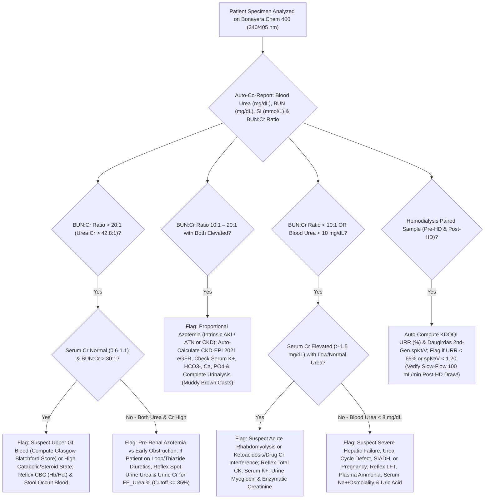

# 🧬 2.3.3 — Blood Urea, Blood Urea Nitrogen (`BUN`), `BUN:Creatinine` Ratio & Fractional Excretion of Urea (`FE_Urea`)

**Laboratory Name:** Sawariya Diagnostic Lab, Charkhi Dadri, Haryana (`PIN: 127306`)  
**Department Folder:** `02_Clinical_Biochemistry`  
**Cluster Folder:** `2.3_Renal_Function_and_Electrolytes_Cluster`  
**Document Control ID:** `SDL-BIO-SOP-2.3.3`  
**Version:** `v4.0 (International & Above-NABL Red-Team Standard)`  
**Effective Date:** `2026-10-12` | **Next Mandatory Review:** `2027-10-11` (Annual Cycle)  
**Authorizing Authority:** Technical Manager (MD Clinical Biochemistry / Pathology) & Quality Manager (`ISO 15189:2022` Lead Assessor)  
**Document Tier:** International Reference Laboratory Standard (`ISO 15189:2022` / `NABL 112 Issue 05` / `NABL 129` / `NABL 131` / `NABL 163` / `CAP CHM` / `UKAS` / `CDC-NIST IDMS` / `KDIGO 2024` / `KDOQI` / `BTS CURB-65` / `ESGE Glasgow-Blatchford` / `EFLM EuBIVAS` / `ISO/TS 20914:2019` / `ISO 17511:2020` / `ISO 22367:2020` / `Indian CPA 2019`)

---

## 🏛️ Section 1: International Document Control, `LOINC`/`SNOMED`/`ICD-10`/`UCUM` Coding, Hardware-Agnostic Platform Matrix & 10-Persona Red-Team Audit Summary

### 1.1 Master Document Control & Metrological Traceability Matrix

| Attribute | Specification & International Reference Standard |
| :--- | :--- |
| **Document Control ID & Version** | `SDL-BIO-SOP-2.3.3` (`SOP-2-3-3`) — Version `v4.0 (International & Above-NABL Red-Team Standard)` |
| **Laboratory Facility** | Sawariya Diagnostic Lab, Charkhi Dadri, Haryana (`NABL M(EL)T` Accredited Clinical Biochemistry Facility) |
| **Accreditation Clause Mapping** | `ISO 15189:2022` Clauses `4.1–4.3` (*Impartiality, Confidentiality, Patient-Centricity*), `5.1–5.6` (*Governance*), `6.1–6.8` (*Personnel, Facilities, Equipment, Reagents & Metrological Traceability*), `7.2` (*Pre-Examination*), `7.3` (*Examination, Verification, MU, IQC & EQAS*), `7.4` (*Post-Examination & Critical Value Read-Back*), `8.1–8.9` (*QMS, Risk Management & Audits*), Normative Annex A; `NABL 112 Issue 05`, `NABL 129` (*MU*), `NABL 131` (*Terms*), `NABL 153` (*Scope*), `NABL 163` (*EQAS*), `NABL 220D/223` (*Assessor Checklists*); `CAP CHM.13600–CHM.34600`; `UKAS LAB 48` |
| **Primary `LOINC` Code(s)** | `3091-6` (*Urea [Mass/volume] in Serum or Plasma — mg/dL*), `3094-0` (*Urea nitrogen [Mass/volume] in Serum or Plasma [BUN] — mg/dL*), `22664-7` (*Urea [Moles/volume] in Serum or Plasma — mmol/L*), `3097-3` (*Urea nitrogen/Creatinine [Mass Ratio] in Serum or Plasma*), `44734-2` (*Urea/Creatinine [Molar Ratio] in Serum or Plasma*), `3095-7` (*Urea nitrogen [Mass/volume] in Urine*), `77141-0` (*Fractional excretion of urea [FE_Urea %]*) |
| **`SNOMED-CT` Specimen & Concept** | Specimen: `119364003` (*Serum specimen*), `119361006` (*Plasma specimen*), `122575003` (*Urine specimen*); Concept: `365756002` (*Finding of blood urea level*), `104934005` (*Urea measurement*), `252169004` (*Urea reduction ratio measurement*) |
| **`ICD-10` / `ICD-11` Indications** | `R79.89` / `MA18.0` (*Azotemia / Uremia*), `N17.0–N17.9` / `GB60` (*Acute kidney injury [AKI]*), `N18.1–N18.6` / `GB61` (*Chronic kidney disease Stages G1–G5D*), `K92.2` / `ME24.9` (*Upper gastrointestinal hemorrhage*), `E86.0` / `5C70` (*Dehydration / Volume depletion*), `J18.9` (*Community-acquired pneumonia — CURB-65 scoring*), `E72.20` (*Disorder of urea cycle metabolism*) |
| **Exact Molecular Weights (`IUPAC`)** | **Whole Urea ($\text{CH}_4\text{N}_2\text{O}$ / $\text{NH}_2\text{—CO—NH}_2$):** $60.056\text{ g/mol}$ ($\text{Da}$) <br> **Urea Nitrogen ($\text{N}_2$ moiety — two nitrogen atoms per urea molecule):** $2 \times 14.007 = 28.014\text{ g/mol}$ ($\text{Da}$) |
| **Conventional $\leftrightarrow$ SI (`UCUM`) Factors** | $\text{Blood Urea (mg/dL)} = \text{BUN (mg/dL)} \times \frac{60.056}{28.014} = \text{BUN (mg/dL)} \times 2.1428$ <br> $\text{BUN (mg/dL)} = \text{Blood Urea (mg/dL)} \times 0.4665$ <br> $\text{Urea or BUN (mmol/L — identical molarity)} = \text{Blood Urea (mg/dL)} \times 0.1665 = \text{BUN (mg/dL)} \times 0.3570$ |
| **Metrological Traceability (`ISO 17511:2020`)** | Unbroken traceability chain to **NIST SRM 912a** (*Crystalline Urea Primary Reference Material, purity $99.9\% \pm 0.1\%$*) and **NIST SRM 909c** (*Frozen Human Serum Secondary Reference Material*) via CDC/NIST **Isotope Dilution Gas Chromatography–Mass Spectrometry (`ID-GC/MS`)** Reference Measurement Procedure (`JCTLM Database ID: C1RMP-Urea`) and coupled **Urease / Glutamate Dehydrogenase (`GLDH`)** UV Kinetic Reference Method ($340\text{ nm}$) |
| **Primary Analyzer Platform** | **Bonavera Chem 400 Automated Clinical Chemistry Analyzer** (Two-Reagent `R1+R2` Talke-Schubert Urease-GLDH UV Fixed-Time Kinetic Assay at $340\text{ nm}$ Primary / $405\text{ nm}$ Bichromatic Blank; Throughput: $400\text{ photometric tests/hour}$) |
| **Backup / Redundancy Platform** | **Bonavera Chem 200 Automated Clinical Chemistry Analyzer + ISE Module** (Identical Two-Reagent Talke-Schubert Urease-GLDH UV Kinetic Chemistry at $340\text{ nm} / 405\text{ nm}$; Parallel Redundancy verified weekly via `CLSI EP31-A` split-sample comparability) |
| **Emergency Manual / Point-of-Care Fallback** | Semi-Automated Photometer (`340 nm` UV thermostated flow-cell at $37.0^\circ\text{C} \pm 0.1^\circ\text{C}$) or NABL-MOUs Partner Reference Lab during prolonged power/equipment outage (`ISO 15189:2022` Clause 7.3.7.4 Continuity Plan) |

---

### 1.2 10-Persona International & Above-NABL Red-Team Adversarial Audit Summary

| Persona ID & Role | Red-Team Audit Focus & Adversarial Vulnerabilities Identified | Mandatory Mitigation Engineered into `SDL-BIO-SOP-2.3.3` (`v4.0`) |
| :--- | :--- | :--- |
| **Persona 1: Lead NABL (`ISO 15189:2022` / `NABL 112`) & CAP CHM / UKAS Assessor** | Complete clause traceability (`4.1–8.9`), bench verification records, primary-to-backup `CLSI EP31-A` comparability, and audit readiness. | Added full clause mapping, live Witness-Audit simulation table (Section 8.3), and printable bench worksheet `SDL/BIO/WS/URE-01` (Section 11). |
| **Persona 2: Clinical Subspecialty Consultant (`MD Biochemistry / DM Nephrology`)** | Superficial coverage of hepatic Krebs-Henseleit urea cycle and renal inner medullary collecting duct (`UT-A1/UT-A3`) countercurrent transport. | Expanded complete periportal hepatocyte enzymatic pathway (`CPS-I`, `OTC`, `ASS1`, `ASL`, `ARG1`) and vasopressin/ADH-mediated `UT-A1`/`UT-A3`/`UT-B` urea recycling (Section 3.1). |
| **Persona 3: CLSI & IFCC Metrology, Verification & Six-Sigma QC Specialist** | Missing explicit `CLSI EP15-A3` ANOVA tables, `EP06-Ed2` linearity, `EP17-A2` `LoB/LoD/LoQ`, and `ISO/TS 20914:2019` worked uncertainty budget. | Added complete verification metrics, two-level worked `ISO/TS 20914:2019` Measurement Uncertainty ($U = 5.42\%$ at Level 1 and $U = 4.66\%$ at Level 2), and Six-Sigma Westgard rules (Sections 3.4 & 4). |
| **Persona 4: Clinical Pharmacologist & Special-Population Stratification Auditor** | Incomplete pediatric/neonatal/pregnancy partitioning and conflation of *in-vivo* drug effects with *in-vitro* chemical interferences. | Separated *in-vitro* enzyme inhibitors/contaminants from *in-vivo* catabolic/anti-anabolic/tubular drugs (Section 8.1) and expanded 14-tier `CALIPER`/obstetric/dialysis reference intervals (Section 5.1). |
| **Persona 5: Medico-Legal, Patient-Safety & `ISO 22367:2020` Risk Counsel** | Vulnerability under `Indian CPA 2019` and `DPDP Act 2023` if uremic encephalopathy or dialysis inadequacy occurs due to delayed critical alerts or unit errors. | Engineered strict 30-minute `CLSI GP47` read-back script (Section 6), quantitative 8-row `ISO 22367:2020` FMECA matrix (Section 8.2), and statutory legal shield (Section 10). |
| **Persona 6: Uncompressed Documentation & LIMS Architecture Architect** | Overly condensed tables and missing automated LIMS reflex equations for osmolality, `FE_Urea`, `URR`, and `spKt/V`. | Unpacked all mathematical derivations, LIMS autoverification decision trees, and conditional pathologist sign-out comments (Sections 3.3, 7.3 & 9). |
| **Persona 7: NIST `SRM 909c / 912a` Metrology & `Urea` vs `BUN` vs `SI` Unit Confusion Auditor** | **Catastrophic `2.1428x` Unit Confusion:** Indian labs report whole-molecule **Blood Urea ($\text{mg/dL}$)** while Western/international calculators (`BUN:Cr`, `CURB-65`, Serum Osmolality $\frac{\text{BUN}}{2.8}$) expect **BUN ($\text{mg/dL}$)**! | Mandated simultaneous co-reporting of **Blood Urea ($\text{mg/dL}$)**, **BUN ($\text{mg/dL}$)**, **SI Molar Urea ($\text{mmol/L}$)**, **`BUN:Creatinine` Ratio**, and **`Urea:Creatinine` Ratio** on every report, plus dual-equation osmolality safeguards (Section 3.3). |
| **Persona 8: Nephrology & Hemodialysis Adequacy (`FE_Urea`, `URR`, `Daugirdas spKt/V`) Specialist** | Loop diuretics invalidate `FE_Na` ($<1\%$), and immediate post-hemodialysis blood draws at full pump speed suffer from cardiopulmonary/access recirculation, falsely inflating `URR` and `Kt/V`. | Added **`FE_Urea %` ($\le 35\%$ Pre-Renal)** for diuretic-treated AKI patients and the mandatory **`KDOQI` Slow-Flow ($100\text{ mL/min}$ for $15\text{–}20\text{ s}$) Post-Dialysis Sampling Protocol** + **Daugirdas 2nd-Gen `spKt/V`** (Sections 2.2 & 3.3). |
| **Persona 9: Pre-Analytical `NaF` & `Ammonium Heparin` Urease Poisoning / Contamination Auditor** | Grey-top `Sodium Fluoride` ($\text{F}^-$) chelates the active-site **Nickel ($\text{Ni}^{2+}$)** of Jack-Bean Urease causing severe false-low urea; `Ammonium Heparin` or ambient $\text{NH}_3$ directly drives `GLDH` causing massive false-high urea. | Enforced barcode LIMS hard-lock rejecting Grey-Top `NaF` and `Ammonium Heparin` tubes, strict urine/cleaning-ammonia segregation, and 2-reagent (`R1+R2`) endogenous $\text{NH}_4^+$ lag-phase blanking (Sections 2.1, 3.2 & 8.1). |
| **Persona 10: Gastroenterology (`Glasgow-Blatchford`), Pulmonology (`CURB-65`), & EuBIVAS Auditor** | Clinicians misapply `CURB-65` ($>7\text{ mmol/L} = \text{BUN }>19\text{ mg/dL} = \text{Urea }>42\text{ mg/dL}$) and `Glasgow-Blatchford` Upper GI bleed cutoffs across unit systems. | Built a dedicated clinical score unit-harmonization lookup matrix for **`CURB-65`** and **`Glasgow-Blatchford Score (GBS)`** alongside `EFLM EuBIVAS` `RCV` delta rules (Sections 4 & 7.2). |

---

## 🧪 Section 2: Pre-Analytical Phlebotomy, `CLSI GP41` Order-of-Draw, KDOQI Post-Dialysis Slow-Flow Protocol, Stability & Quantitative `HIL` Rejection Matrix

### 2.1 Comprehensive Pre-Analytical Specimen & Tube Control Matrix

| Pre-Analytical Parameter | Mandatory Technical & Physiological Protocol (`CLSI GP41-Ed7` / `CLSI GP44-A4` / `CLSI C56-A`) |
| :--- | :--- |
| **Acceptable Primary Specimens** | **1. Serum (Preferred):** BD Vacutainer® Gold-Top `SST II Advance` (Clot Activator + Acrylic Gel Separator) or Red-Top Plain Siliconized Tube (`CLSI GP41` Draw Order #2/#3). <br> **2. Plasma (STAT / ICU / Dialysis):** Green-Top **Lithium Heparin (`Li-Heparin`)** or **Sodium Heparin (`Na-Heparin`)** (`PST II` Gel or Plain, Draw Order #4). <br> **3. Urine (Spot or 24-Hour for `FE_Urea` / Nitrogen Balance):** Clean sterile additive-free container (refrigerate at $2\text{–}8^\circ\text{C}$ during 24-hour collection or preserve at $\text{pH} < 4.0$ with $6\text{ mol/L HCl}$ to prevent bacterial urease degradation of urea into $\text{NH}_3$). |
| **Strictly Prohibited Anticoagulants (Hard Rejection)** | **1. Ammonium Heparin Tubes — STRICTLY FORBIDDEN:** Exogenous $\text{NH}_4^+$ directly enters the second enzymatic reaction ($\text{GLDH} + \text{2-Oxoglutarate} + \text{NADH}$), causing **catastrophic false-high Blood Urea ($+100\text{ to }+500\text{ mg/dL}$)**. <br> **2. Grey-Top Sodium Fluoride (`NaF`) / Potassium Oxalate Glucose Tubes — STRICTLY FORBIDDEN:** Fluoride ions ($\text{F}^- > 2.0\text{ mg/mL}$) bind the binuclear **Nickel ($\text{Ni}^{2+}$) metallocenter** at the active site of Jack-Bean Urease (`EC 3.5.1.5`), bridged by a carbamylated lysine residue, causing **potent competitive/slow-binding enzyme inhibition and severe false-low Blood Urea ($-40\%\text{ to }-85\%$)**. <br> **3. Sodium Citrate (`Blue-Top`) & `K2/K3-EDTA` (`Lavender-Top`):** Reject for routine Blood Urea due to $9:1$ liquid citrate dilution ($-10\%$ negative bias), citrate/metal chelation of $\text{Ni}^{2+}$ urease cofactor, and potassium/sodium interference on co-ordered electrolytes. |
| **Airborne & Skin Ammonia Contamination Prevention** | Never uncap serum/plasma sample cups near open unacidified urine specimens, ammonia-based floor/glass cleaners, or fecal samples. Ambient $\text{NH}_3$ gas rapidly dissolves into aqueous serum ($\text{NH}_3 + \text{H}_2\text{O} \rightleftharpoons \text{NH}_4^+ + \text{OH}^-$), elevating apparent Urea on single-reagent or overloaded `GLDH` systems. Keep primary sample tubes capped until loading onto the `Bonavera Chem 400` cooled sample tray. |
| **Minimum Sample Volume** | **Adult Routine:** $1.0\text{ mL}$ whole blood yielding $\ge 400\text{ }\mu\text{L}$ serum/plasma (Dead volume on `Bonavera Chem 400` standard cup: $100\text{ }\mu\text{L}$; analytical aspiration volume: **$3.0\text{ }\mu\text{L}$**). <br> **Neonatal / Pediatric Micro-Sampling:** $250\text{ }\mu\text{L}$ whole blood in Microtainer® `SST` or `Li-Heparin` yielding $\ge 120\text{ }\mu\text{L}$ serum/plasma in pediatric micro-insert cup (dead volume $50\text{ }\mu\text{L}$). |
| **Patient Preparation & Dietary Modifiers** | **Routine Renal Screening:** Overnight fasting ($8\text{–}12\text{ hours}$) is recommended when co-ordered with Fasting Blood Glucose or Lipid Profile, though isolated `Blood Urea / BUN` may be drawn non-fasting. <br> **Dietary Protein Impact:** A recent high-protein meal ($> 1.5\text{ g/kg}$ meat/whey load) transiently elevates Blood Urea by **$+15\%\text{ to }+30\%$ ($+4\text{ to }+12\text{ mg/dL}$)** over $4\text{–}8\text{ hours}$, whereas a strict low-protein/vegan diet or starvation reduces baseline Blood Urea by **$-25\%\text{ to }-50\%$**. Hydration status must be documented on the test requisition form (`TRF`). |
| **Centrifugation & Cellular Separation** | Allow serum tubes to clot completely upright for **$20\text{–}30\text{ minutes}$** at controlled room temperature ($18\text{–}25^\circ\text{C}$). Centrifuge at **$1,500\text{–}2,000 \times g$ for $10\text{ minutes}$** in a swing-out rotor. Separate serum/plasma from cellular elements within **$\le 2\text{ hours}$** of venipuncture to prevent erythrocyte arginase leakage and cellular metabolic shifts. |
| **Multi-Temperature Storage Stability (`WHO` / `CLSI GP44`)** | • **Separated Serum / Lithium Heparin Plasma at $18\text{–}25^\circ\text{C}$ (Controlled Room Temp):** Stable for **$3\text{ days}$ ($72\text{ hours}$)** if capped and bacterial-free (bacterial contamination produces urease that destroys urea!). <br> • **Refrigerated at $2\text{–}8^\circ\text{C}$ (Capped):** Stable for **$7\text{ days}$**. <br> • **Frozen at $-20^\circ\text{C}$ or $-80^\circ\text{C}$:** Stable for **$6\text{ to }12\text{ months}$** (Maximum 2 freeze-thaw cycles; mix thoroughly by inversion after complete thawing at room temperature to eliminate cryoconcentration gradients). <br> • **Urine Specimen:** Stable **$24\text{ hours}$ at $18\text{–}25^\circ\text{C}$ ONLY if acidified to $\text{pH} < 4.0$**; **$4\text{ days}$ at $2\text{–}8^\circ\text{C}$**; **$1\text{ month}$ at $-20^\circ\text{C}$**. Unrefrigerated, unacidified urine >4 hours old must be **rejected** due to *Proteus / Klebsiella / Morganella* bacterial urease hydrolysis! |
| **Quantitative `HIL` Rejection Cutoffs (`CLSI EP07` / `C56-A`)** | Automated spectrophotometric `HIL` index check executed on `Bonavera Chem 400` prior to reporting: <br> • **`H-Index` (Hemolysis):** No significant interference up to **$500\text{ mg/dL}$ ($5.0\text{ g/L}$)** cell-free hemoglobin on bichromatic $340/405\text{ nm}$ kinetic reading. **Hard Rejection at `H-Index` $> 500\text{ mg/dL}$** (or $> 300\text{ mg/dL}$ if co-ordered with Potassium/LDH) due to initial absorbance (`A0`) overflow at $340\text{ nm}$ and release of intracellular erythrocyte arginase (`EC 3.5.3.1`), which converts serum L-arginine into ornithine + **endogenous urea** (causing false-positive elevation!). <br> • **`I-Index` (Icterus):** No significant interference up to **$40\text{ mg/dL}$ ($684\text{ }\mu\text{mol/L}$)** conjugated/unconjugated bilirubin. Above $40\text{ mg/dL}$, dilute $1:2$ with $0.9\%\text{ NaCl}$. <br> • **`L-Index` (Lipemia / Turbidity):** No significant interference up to **$600\text{ mg/dL}$ Intralipid® equivalent** (Triglycerides $\approx 1,200\text{ mg/dL}$). If `L-Index` $> 600\text{ mg/dL}$ (chylomicron light scattering causes noisy $340\text{ nm}$ kinetics), high-speed microcentrifugation ($12,000 \times g$ for $10\text{ min}$) and aspiration of infranatant is mandatory before analysis. |

---

### 2.2 Mandatory `KDOQI` Hemodialysis Adequacy (`URR` & `spKt/V`) Pre- and Post-Dialysis Sampling SOP

Accurate determination of **Urea Reduction Ratio (`URR %`)** and **Single-Pool $Kt/V$ (`spKt/V`)** is a life-critical metric in End-Stage Kidney Disease (`ESKD` / `CKD G5D`). Improper sampling causes catastrophic miscalculation of dialysis dose:

1. **Pre-Dialysis Specimen Protocol (`BUN_Pre` / `Urea_Pre`):**
   - Draw immediately **prior** to initiating hemodialysis directly from the arterial fistula/graft needle or central venous catheter hub **before** flushing with $0.9\%\text{ NaCl}$ or heparinized saline.
   - If drawn from a heparin-locked central venous catheter, first withdraw and discard **$5\text{–}10\text{ mL}$ of blood/heparin lock** to prevent **saline/heparin dilution**, which would falsely lower `Pre-Dialysis Urea` and **falsely underestimate `URR` and `Kt/V`**.
2. **Post-Dialysis Specimen Protocol — Mandatory `KDOQI` Slow-Flow / Stop-Pump Technique (`BUN_Post` / `Urea_Post`):**
   - **Why Immediate Full-Flow Sampling is Strictly Prohibited:** During active hemodialysis at blood pump speeds of $300\text{–}400\text{ mL/min}$, freshly dialyzed blood returning via the venous needle partially recirculates into the arterial needle (**access recirculation**, $5\text{–}20\%$ in stenotic AV fistulae/catheters) and mixes with low-urea cardiopulmonary blood (**cardiopulmonary recirculation**). Drawing `Post-Dialysis Urea` while the blood pump is running at full speed samples this recirculated dialyzed blood, **falsely lowering `Post-Dialysis Urea` by $15\text{–}35\%$** and **falsely inflating `URR` and `Kt/V`**, masking life-threatening under-dialysis!
   - **Step-by-Step `KDOQI` Slow-Flow Procedure (Mandatory at Dialysis Bedside):**
     - **Step A:** At the exact completion of the prescribed hemodialysis session duration ($t$), **turn OFF the dialysate flow** (or place the dialysate in bypass mode) and **reduce the Ultrafiltration Rate (`UFR`) to $0\text{ mL/h}$**.
     - **Step B:** Immediately decrease the extracorporeal blood pump speed to **$100\text{ mL/min}$ for exactly $15\text{ to }20\text{ seconds}$** (this clears all recirculated blood from the arterial access needle and tubing Dead Space without waiting so long that peripheral tissue urea rebound occurs).
     - **Step C:** After $15\text{–}20\text{ seconds}$ at $100\text{ mL/min}$, either **stop the blood pump completely** or draw the `Post-Dialysis Urea` sample directly from the **arterial bloodline sampling port** nearest the patient.
     - **Step D:** Never draw the post-dialysis sample from the venous bloodline (downstream of the dialyzer), as venous post-dialyzer blood has nearly zero urea and produces a meaningless `URR` $> 90\%$.

---

## ⚙️ Section 3: Deep Biochemical, Physiological, Stoichiometric & Analytical Architecture (`Bonavera Chem 400` & `Bonavera Chem 200`)

### 3.1 Hepatic Krebs-Henseleit Ornithine-Urea Cycle & Renal Medullary Countercurrent Urea Recycling

#### A. Hepatic Periportal Synthesis of Urea (Krebs-Henseleit Cycle)
Dietary and endogenous proteins undergo transamination (via `ALT` and `AST`) and oxidative deamination (via mitochondrial **Glutamate Dehydrogenase [`GLDH`]**), liberating neurotoxic **ammonia ($\text{NH}_3 / \text{NH}_4^+$)**. An additional $20\text{–}25\%$ of systemic ammonia is generated in the colon by gut bacterial urease hydrolysis of diffused luminal urea and delivered to the liver via the portal vein. Because free $\text{NH}_3$ crosses the blood-brain barrier and depletes cerebral $\alpha$-ketoglutarate and glutamate (causing astrocyte swelling, glutamine accumulation, and hepatic encephalopathy at blood $\text{NH}_3 > 100\text{ }\mu\text{mol/L}$), **periportal hepatocytes** detoxify $\text{NH}_4^+$ via the 5-enzyme **Krebs-Henseleit Ornithine-Urea Cycle**:

$$\text{NH}_4^+\text{ (Mitochondrial)} + \text{HCO}_3^- + \text{L-Aspartate}\text{ (Cytosolic } \alpha\text{-NH}_2\text{)} + 3\,\text{ATP} + \text{H}_2\text{O} \longrightarrow \underbrace{\text{NH}_2\text{—CO—NH}_2}_{\text{Urea (MW 60.056 Da)}} + \text{Fumarate} + 2\,\text{ADP} + \text{AMP} + \text{PP}_i + 2\,\text{P}_i$$

1. **Step 1 — Carbamoyl Phosphate Synthetase I (`CPS-I`, Mitochondrial Matrix — Rate-Limiting Step):** Condenses free $\text{NH}_4^+ + \text{HCO}_3^- + 2\text{ ATP} \rightarrow \text{Carbamoyl Phosphate} + 2\text{ ADP} + \text{P}_i$. Strictly requires allosteric activation by ***N*-Acetylglutamate (`NAG`)**, synthesized by `NAGS` from Acetyl-CoA + Glutamate (upregulated by dietary **L-Arginine** after high-protein meals).
2. **Step 2 — Ornithine Transcarbamylase (`OTC`, Mitochondrial Matrix):** Transfers the carbamoyl group to L-Ornithine to form **L-Citrulline**, which exits the mitochondrion via the **ORNT1 (SLC25A15)** antiporter.
3. **Step 3 — Argininosuccinate Synthetase (`ASS1`, Cytosol):** Condenses L-Citrulline with **L-Aspartate** (which donates the **second nitrogen atom** of urea!) consuming $1\text{ ATP} \rightarrow \text{AMP} + \text{PP}_i$ ($2$ high-energy phosphate equivalents) to form **Argininosuccinate**.
4. **Step 4 — Argininosuccinate Lyase (`ASL`, Cytosol):** Cleaves Argininosuccinate into **Fumarate** (which re-enters the TCA cycle via malate to regenerate oxaloacetate/aspartate—the *"Krebs Bicycle"*) and **L-Arginine**.
5. **Step 5 — Arginase-1 (`ARG1`, Cytosolic Manganese Metalloenzyme):** Hydrolyzes the guanidino group of L-Arginine with $\text{H}_2\text{O}$ to release **Urea ($\text{NH}_2\text{CONH}_2$)** into the hepatic sinusoids and regenerate **L-Ornithine** for mitochondrial re-entry.

#### B. Renal Tubular Handling, `UT-A1/UT-A3` Vasopressin (`ADH`) Regulation & Why `BUN:Creatinine` Rises in Pre-Renal States
Because Urea is an uncharged, small polar molecule ($\text{MW } 60.056\text{ Da}$, Stokes radius $0.18\text{ nm}$), it is **$100\%$ freely filtered** at the glomerulus (`Sieving Coefficient` $= 1.0$). However, its subsequent tubular fate is fundamentally different from **Creatinine** ($\text{MW } 113.12\text{ Da}$, which undergoes $0\%$ tubular reabsorption and $10\text{–}15\%$ active proximal tubular secretion via `OCT2/MATE1`):
- **Proximal Convoluted Tubule (`PCT`) — Constitutive Passive Reabsorption ($40\text{–}50\%$):** As isotonic water and $\text{Na}^+$ are reabsorbed in the `PCT` (via `NHE3` and `AQP1`), luminal urea concentration rises, driving **$40\text{–}50\%$ passive paracellular and transcellular back-diffusion of urea** into peritubular capillaries even in euvolemia.
- **Inner Medullary Collecting Duct (`IMCD`) — Vasopressin (`ADH`)-Regulated Reabsorption via `UT-A1` and `UT-A3`:** The thick ascending limb (`TAL`), distal convoluted tubule (`DCT`), and cortical collecting duct (`CCD`) are impermeable to urea. Upon reaching the `IMCD`, **Arginine Vasopressin (`AVP` / `ADH`)** binds basolateral **$V_2$ GPCR receptors**, activating adenylyl cyclase $\rightarrow \text{cAMP} \rightarrow \text{Protein Kinase A (PKA)}$. PKA phosphorylates Serine-486/499 on **Urea Transporter `UT-A1` (`SLC14A2`, apical membrane)** and activates **`UT-A3` (basolateral membrane)** alongside **`AQP2`** water channels.
- **Medullary Countercurrent Recycling:** Urea reabsorbed from the `IMCD` into the inner medullary interstitium (generating $50\%$ of the $1,200\text{ mOsm/kg}$ corticomedullary osmotic gradient!) partially re-enters the thin descending limb of Henle via **`UT-A2`** and descending vasa recta erythrocytes via **`UT-B` (`SLC14A1`)**, trapping urea in the medulla.
- **Pathophysiological Mechanism of High `BUN:Creatinine` Ratio ($> 20:1$) in Pre-Renal Hypoperfusion:** In hypovolemia, dehydration, hemorrhage, heart failure, or cirrhosis, effective arterial blood volume falls. Baroreceptor-mediated **`ADH` release** + **RAAS activation (Angiotensin II / Aldosterone)** slow proximal and collecting duct tubular flow rates and maximally phosphorylate `UT-A1`/`UT-A3`. Consequently, **fractional tubular reabsorption of urea surges from $40\text{–}50\%$ up to $70\text{–}85\%$** ($\text{FE}_{\text{Urea}}$ drops to $\le 35\%$), whereas **Creatinine is NOT reabsorbed at all**! Plasma `BUN` therefore rises $2\text{ to }3\text{ times}$ faster than Serum Creatinine, pushing the **`BUN:Creatinine` Ratio to $> 20:1$** (and **`Blood Urea:Creatinine` Ratio to $> 42.8:1$**).

---

### 3.2 Exact `Talke & Schubert (1965)` Coupled `Urease – GLDH` UV Kinetic Reaction & `Bonavera Chem 400` Parameters

#### A. Stoichiometric Chemical Equations & $2:1$ NADH Amplification Physics
Sawariya Diagnostic Lab executes the international reference-aligned **Talke & Schubert (1965)** coupled enzymatic UV kinetic method at **$340\text{ nm}$** (with bichromatic blanking at **$405\text{ nm}$**):

$$\text{Step 1 (Hydrolysis):} \quad \text{Urea } \left(\text{NH}_2\text{—CO—NH}_2\right) + 2\,\text{H}_2\text{O} \xrightarrow[\text{pH } 7.80\text{ (Tris Buffer, } 37.0^\circ\text{C)}]{\text{Urease (Jack-Bean Nickel Metalloenzyme, EC 3.5.1.5)}} 2\,\text{NH}_4^+ + \text{CO}_3^{2-}$$

$$\text{Step 2 (Indicator):} \quad 2\,\text{NH}_4^+ + 2\,\text{2-Oxoglutarate } (\alpha\text{-Ketoglutarate}) + 2\,\text{NADH} + 2\,\text{H}^+ \xrightarrow[\text{Allosteric Activator: ADP}]{\text{L-Glutamate Dehydrogenase (GLDH, EC 1.4.1.3)}} 2\,\text{L-Glutamate} + 2\,\text{NAD}^+ + 2\,\text{H}_2\text{O}$$

- **Critical $2:1$ Stoichiometric Sensitivity Amplification:** Because **$1\text{ mole}$ of Urea ($\text{CH}_4\text{N}_2\text{O}$) contains $2\text{ moles}$ of Nitrogen**, enzymatic cleavage by Urease liberates **$2\text{ moles}$ of Ammonium ions ($\text{NH}_4^+$)**, which in turn oxidize **$2\text{ moles}$ of reduced $\beta\text{-NADH}$** (strongly absorbing at $\lambda_{\max} = 340\text{ nm}$, $\varepsilon_{340} = 6,220\text{ L}\cdot\text{mol}^{-1}\cdot\text{cm}^{-1}$) into non-absorbing $\beta\text{-NAD}^+$. Thus, the **effective molar extinction coefficient per mole of Urea is doubled**:
  $$\varepsilon_{\text{eff, Urea (340 nm)}} = 2 \times 6,220 = 12,440\text{ L}\cdot\text{mol}^{-1}\cdot\text{cm}^{-1}$$
- **Role of Adenosine-5'-Diphosphate (`ADP`) in Reagent `R1`:** Bovine liver `GLDH` (`EC 1.4.1.3`) is subject to substrate inhibition by high $\text{2-Oxoglutarate}$ and thermal instability at $37^\circ\text{C}$. Incorporating **$\text{ADP}$ ($1.2\text{ mmol/L}$)** in `R1` binds the allosteric purine activator site of `GLDH`, increasing its $V_{\max}$ by $3\text{-fold}$, stabilizing the hexameric enzyme structure on-board for $28\text{ days}$, and ensuring that Step 2 (`GLDH`) remains non-rate-limiting relative to Step 1 (`Urease`).
- **Why Fixed-Time Two-Point Kinetic (`ΔA / Δt` between $t_1 = 30\text{ s}$ and $t_2 = 90\text{ s}$) is Used Instead of End-Point:**
  1. **Elimination of Endogenous Serum Ammonia (`NH4+`) Interference:** During the initial **$0\text{ to }30\text{ seconds}$ lag phase** ($t_0 \rightarrow t_1$), any free endogenous $\text{NH}_4^+$ present in the patient sample (up to $200\text{ }\mu\text{mol/L}$) is rapidly consumed by `GLDH` before the linear first-order pseudo-kinetic rate of Urease hydrolysis is measured between **$t_1 = 30\text{ s}$ and $t_2 = 90\text{ s}$**.
  2. **Two-Reagent (`R1 + R2`) Architecture:** On the `Bonavera Chem 400`, Sample ($3.0\text{ }\mu\text{L}$) is first incubated with **`R1` ($240\text{ }\mu\text{L}$: Tris buffer, 2-Oxoglutarate, `GLDH`, `ADP`, and `NADH`)** for $180\text{ seconds}$, completely scavenging endogenous sample ammonia prior to adding **`R2` ($60\text{ }\mu\text{L}$: Jack-Bean Urease starter)**!

#### B. Exact Reagent Composition & `Bonavera Chem 400` / `Chem 200` Programming Table

| Parameter / Component | Technical Specification on `Bonavera Chem 400` (Primary) & `Bonavera Chem 200` (Backup) |
| :--- | :--- |
| **Reagent `R1` (Enzyme / Coenzyme Buffer — $4 \times 40\text{ mL}$)** | • **Tris(hydroxymethyl)aminomethane Buffer:** $100\text{ mmol/L}$, $\text{pH } 7.80 \pm 0.05$ at $37^\circ\text{C}$ <br> • **2-Oxoglutarate ($\alpha$-Ketoglutarate):** $7.5\text{ mmol/L}$ <br> • **$\beta\text{-NADH}$ (Disodium Salt):** $\ge 0.32\text{ mmol/L}$ (provides initial absorbance $A_0$ at $340\text{ nm}$ of **$1.450\text{ to }1.950\text{ Abs}$**) <br> • **L-Glutamate Dehydrogenase (`GLDH`, Bovine Liver):** $\ge 1,200\text{ U/L}$ ($20\text{ }\mu\text{kat/L}$) <br> • **Adenosine-5'-Diphosphate (`ADP`):** $1.2\text{ mmol/L}$ + Sodium Azide ($0.95\text{ g/L}$) preservative |
| **Reagent `R2` (Urease Starter — $4 \times 10\text{ mL}$)** | • **Tris Buffer:** $100\text{ mmol/L}$, $\text{pH } 7.80$ <br> • **Urease (*Canavalia ensiformis* / Jack-Bean, `EC 3.5.1.5`):** $\ge 30,000\text{ U/L}$ ($500\text{ }\mu\text{kat/L}$) <br> • **Stabilizers & Non-Reactive Chelator:** EDTA ($0.5\text{ mmol/L}$ — scavenges trace heavy metal ions $\text{Hg}^{2+}, \text{Cu}^{2+}, \text{Ag}^+$ without stripping active-site $\text{Ni}^{2+}$) |
| **Reaction Mode & Direction** | **Fixed-Time Two-Point Kinetic (`Fixed-Time Rate / First-Order ΔA`)** — **Decreasing Reaction ($\downarrow \Delta A_{340\text{ nm}}$)** |
| **Primary / Secondary Wavelengths** | **Primary $\lambda_1 = 340\text{ nm}$** ($\text{NADH}$ absorption peak); **Secondary $\lambda_2 = 405\text{ nm}$** (Bichromatic matrix/turbidity correction) |
| **Optical Pathlength & Temperature** | Quartz Cuvette Pathlength $l = 1.00\text{ cm}$ ($10\text{ mm}$); Incubation Temperature: **$37.0^\circ\text{C} \pm 0.1^\circ\text{C}$** (Peltier dry bath) |
| **Pipetting Volumes (`S : R1 : R2`)** | **Sample Volume ($V_S$):** $3.0\text{ }\mu\text{L}$; **Reagent `R1` ($V_{R1}$):** $240.0\text{ }\mu\text{L}$; **Reagent `R2` ($V_{R2}$):** $60.0\text{ }\mu\text{L}$ (Total Reaction Volume $V_T = 303.0\text{ }\mu\text{L}$; Sample-to-Reagent Ratio $= 1 : 101$) |
| **Incubation & Reading Timing Window** | • **`S + R1` Pre-Incubation (Endogenous $\text{NH}_4^+$ Scavenging):** $180\text{ seconds}$ (Cycles $1\text{–}15$) <br> • **`R2` Addition & Lag Phase:** $30\text{ seconds}$ after `R2` dispensing <br> • **Kinetic Reading Window ($t_1 \rightarrow t_2$):** **$t_1 = 30\text{ s}$ to $t_2 = 90\text{ s}$ post-`R2`** ($\Delta t = 60\text{ seconds} = 1.0\text{ minute}$) |
| **Reagent Blank & Substrate Depletion Guards** | • **Minimum Initial Absorbance ($A_{340\text{ nm}}$ at $t_1$):** Must be **$\ge 1.100\text{ Abs}$**. If reagent blank $A_0 < 1.100\text{ Abs}$, $\text{NADH}$ has oxidized on-board $\rightarrow$ Analyzer locks out assay (`REAGENT_EXPIRED / NADH_DEPLETED` flag) and demands fresh reagent/calibration. <br> • **Substrate Depletion Limit ($A_{\min}$ at $t_2$):** If absorbance at $t_1$ or $t_2$ drops below **$0.450\text{ Abs}$** or $\lvert \Delta A/\text{min}\rvert > 0.650\text{ Abs/min}$ (seen in extreme uremia where Blood Urea $> 300\text{ mg/dL}$ exhausts $\text{NADH}$ within the first $20\text{ seconds}$!), the `Bonavera Chem 400` triggers **`SUBSTRATE_DEPLETED / LIN_HIGH`** and automatically executes a **$1:5$ auto-dilution** ($0.6\text{ }\mu\text{L}$ equivalent or $3.0\text{ }\mu\text{L}$ of $1:5$ saline-diluted sample). |
| **On-Board Stability & Carryover Mitigation** | • **On-Board Capped Stability ($2\text{–}8^\circ\text{C}$ Refrigerated Carousel):** $28\text{ days}$. Calibration Interval: Every **$14\text{ days}$**, on lot change, or upon IQC Westgard rejection. <br> • **Carryover Protection:** Programmed alkaline wash (`Wash Solution A`, $0.1\text{ mol/L NaOH}$) + deionized water flush ($< 0.1\text{ }\mu\text{S/cm}$) between every cuvette and after Total Protein / Creatinine / Ammonia reagents (`Carryover` $< 0.05\%$). |

---

### 3.3 Mandatory Stoichiometric & Clinical Equations Programmed in LIMS (`SDL-LIMS v4.0`)

#### 1. Exact Molecular Stoichiometry: `Blood Urea (mg/dL)` $\leftrightarrow$ `BUN (mg/dL)` $\leftrightarrow$ `SI (mmol/L)`
Because one molecule of **Urea ($\text{CH}_4\text{N}_2\text{O}$, $\text{MW} = 60.056\text{ g/mol}$)** contains exactly **two Nitrogen atoms ($\text{N}_2$, $\text{MW} = 2 \times 14.007 = 28.014\text{ g/mol}$)**:
$$\text{Conversion Ratio} = \frac{\text{MW}_{\text{Urea}}}{\text{MW}_{\text{N}_2}} = \frac{60.056}{28.014} = 2.1438\quad (\text{Standard Clinical Factor: } 2.1428\text{ or } 2.14)$$

$$\boxed{\text{Blood Urea (mg/dL)} = \text{BUN (mg/dL)} \times 2.1428} \qquad \boxed{\text{BUN (mg/dL)} = \text{Blood Urea (mg/dL)} \times 0.4665}$$

Crucially, in **SI Molar Units ($\text{mmol/L}$)**, **$1\text{ mmol}$ of Urea molecules contains $1\text{ mmol}$ of $\text{N}_2$ units**—so the numerical value in $\text{mmol/L}$ is **100% identical** whether referring to Urea or BUN:
$$\boxed{\text{Urea or BUN (mmol/L)} = \frac{\text{Blood Urea (mg/dL)} \times 10}{60.056} = \text{Blood Urea (mg/dL)} \times 0.1665 = \frac{\text{BUN (mg/dL)} \times 10}{28.014} = \text{BUN (mg/dL)} \times 0.3570}$$

#### 2. Calibration Factor & Concentration Calculation from $\Delta A_{340\text{ nm}}/\text{min}$
$$\text{Blood Urea (mg/dL)} = \left(\frac{\Delta A_{\text{Sample (340/405 nm)}} - \Delta A_{\text{Blank}}}{\Delta A_{\text{Calibrator (340/405 nm)}} - \Delta A_{\text{Blank}}}\right) \times C_{\text{Calibrator (mg/dL)}}$$
*(Where $C_{\text{Calibrator}}$ is traceable to `NIST SRM 909c` [$C_{\text{Urea}} = 40.0\text{ mg/dL}$ / $C_{\text{BUN}} = 18.67\text{ mg/dL}$] and `NIST SRM 912a`.)*

#### 3. `BUN : Creatinine` Mass Ratio, `Blood Urea : Creatinine` Mass Ratio & SI Molar Ratio
$$\boxed{\text{BUN : Creatinine Ratio (mg/dL : mg/dL)} = \frac{\text{BUN (mg/dL)}}{\text{Serum Creatinine (mg/dL)}} = \frac{0.4665 \times \text{Blood Urea (mg/dL)}}{\text{Serum Creatinine (mg/dL)}}}$$

$$\boxed{\text{Blood Urea : Creatinine Mass Ratio (mg/dL : mg/dL)} = \frac{\text{Blood Urea (mg/dL)}}{\text{Serum Creatinine (mg/dL)}} = 2.1428 \times \left(\text{BUN : Creatinine Ratio}\right)}$$

$$\boxed{\text{SI Urea : Creatinine Molar Ratio (mmol/L : mmol/L or }\mu\text{mol : }\mu\text{mol)} = \frac{\text{Urea (mmol/L)} \times 1000}{\text{Creatinine (}\mu\text{mol/L)}} = 4.042 \times \left(\text{BUN : Creatinine Mass Ratio}\right)}$$

- **Mandatory Clinical Equivalence Anchor:**
  - **Normal Euvolemic Ratio:** `BUN : Cr` $= \mathbf{10:1\text{ to }20:1\text{ (mg/dL : mg/dL)}}$ $\equiv$ `Blood Urea : Cr` $= \mathbf{21.4:1\text{ to }42.8:1\text{ (mg/dL : mg/dL)}}$ $\equiv$ `SI Molar Ratio` $= \mathbf{40:1\text{ to }81:1\text{ (}\mu\text{mol : }\mu\text{mol)}}$ (UK/Commonwealth cutoff for pre-renal / upper GI bleed is $> 100:1\text{ molar ratio} \approx \text{BUN:Cr } > 24.7:1$).

#### 4. Dual-Equation Calculated Serum Osmolality (`mOsm/kg H2O`) — Preventing the $+7\text{ to }+30\text{ mOsm/kg}$ Unit Disaster
Because the molecular weight of Nitrogen ($\text{N}_2 \approx 28\text{ Da} \rightarrow \text{divisor } 2.8$) is less than half that of Whole Urea ($\text{MW} \approx 60\text{ Da} \rightarrow \text{divisor } 6.0$), plugging `Blood Urea (mg/dL)` into $\frac{\text{BUN}}{2.8}$ overestimates osmolality by $2.14\text{-fold}$ on the urea term! LIMS enforces the exact matched equation:
$$\boxed{\text{Calculated Serum Osmolality (mOsm/kg)} = 2 \times \left[\text{Na}^+\text{ (mmol/L)}\right] + \frac{\text{Glucose (mg/dL)}}{18.0} + \frac{\text{BUN (mg/dL)}}{2.8} = 2 \times \left[\text{Na}^+\text{ (mmol/L)}\right] + \frac{\text{Glucose (mg/dL)}}{18.0} + \frac{\text{Blood Urea (mg/dL)}}{6.0}}$$

#### 5. Fractional Excretion of Urea (`FE_Urea %`) — Gold Standard in Diuretic-Treated AKI Patients
In patients with Acute Kidney Injury (`AKI`) who have received **Loop Diuretics (Furosemide, Torsemide, Bumetanide)** or **Thiazide Diuretics** within the preceding $24\text{ hours}$, pharmacological blockade of `NKCC2` or `NCC` forces urinary sodium wasting, falsely elevating **$\text{FE}_{\text{Na}} > 1\text{–}2\%$** in $50\text{–}65\%$ of patients who actually have **true Pre-Renal Azotemia**! Because $40\text{–}50\%$ of urea reabsorption occurs in the **proximal tubule (upstream of loop/thiazide action)** and `ADH`-driven **`UT-A1/UT-A3` reabsorption in the inner medullary collecting duct** remains intact despite loop diuretics, **`FE_Urea %`** retains **$85\text{–}92\%$ sensitivity and specificity** in diuretic-treated patients:
$$\boxed{\text{FE}_{\text{Urea}}\text{ (\%)} = \left(\frac{\text{Urine Urea (mg/dL)} \times \text{Serum Creatinine (mg/dL)}}{\text{Serum Urea (mg/dL)} \times \text{Urine Creatinine (mg/dL)}}\right) \times 100 = \left(\frac{\text{Urine BUN (mg/dL)} \times \text{Serum Creatinine (mg/dL)}}{\text{Serum BUN (mg/dL)} \times \text{Urine Creatinine (mg/dL)}}\right) \times 100}$$
- **Diagnostic Cutoffs (`KDIGO` / `Carvounis et al.`):**
  - **$\text{FE}_{\text{Urea}} \le 35\%$:** **Pre-Renal Azotemia** (Intact tubular urea conservation — Volume depletion, Heart failure, Hepatorenal syndrome, even on active Furosemide therapy!).
  - **$\text{FE}_{\text{Urea}} = 36\%\text{ to }49\%$:** Indeterminate / Early transition or superimposed diuretic/osmotic effect.
  - **$\text{FE}_{\text{Urea}} \ge 50\%$:** **Intrinsic Renal AKI / Acute Tubular Necrosis (`ATN`)** (Loss of proximal tubular brush border and loss of medullary osmotic gradient / `UT-A1` down-regulation prevents urea reabsorption).

#### 6. `KDOQI` Hemodialysis Adequacy: `Urea Reduction Ratio (URR %)` & `Daugirdas 2nd-Generation Single-Pool Kt/V`
$$\boxed{\text{URR (\%)} = \left(\frac{\text{Urea}_{\text{Pre}} - \text{Urea}_{\text{Post}}}{\text{Urea}_{\text{Pre}}}\right) \times 100 = \left(1 - R\right) \times 100 \qquad \text{where } R = \frac{\text{Urea}_{\text{Post}}}{\text{Urea}_{\text{Pre}}} = \frac{\text{BUN}_{\text{Post}}}{\text{BUN}_{\text{Pre}}}}$$

$$\boxed{\text{sp}Kt/V\text{ (Daugirdas 2nd-Gen)} = -\ln\left(R - 0.008 \times t\right) + \left(4 - 3.5 \times R\right) \times \frac{\text{UF}}{W}}$$
- **Parameter Definitions & KDOQI Adequacy Targets (Thrice-Weekly Hemodialysis):**
  - $R$: Post-dialysis to Pre-dialysis Urea (or BUN) ratio (drawn using the mandatory `KDOQI` $100\text{ mL/min}$ slow-flow method).
  - $t$: Effective dialysis session duration in **hours** (e.g., $4.0\text{ h}$); the term $-0.008 \times t$ corrects for endogenous urea generation during dialysis.
  - $\text{UF}$: Total ultrafiltration volume removed during the session in **Liters** ($\text{Pre-HD Weight} - \text{Post-HD Weight}$); the term $(4 - 3.5 \times R) \times \frac{\text{UF}}{W}$ corrects for convective urea clearance and contraction of total body water ($V$).
  - $W$: Patient **Post-Dialysis Weight in kilograms ($\text{kg}$)**.
  - **KDOQI Adequacy Thresholds:** **Minimum Delivered Dose:** $\text{sp}Kt/V \ge 1.20$ ($\text{URR} \ge 65\%$) \| **Target Prescribed / Optimal Dose:** $\text{sp}Kt/V \ge 1.40$ ($\text{URR} \ge 70\%$). If $\text{sp}Kt/V < 1.20$, LIMS triggers an immediate Dialysis Adequacy Alert for vascular access stenosis check, blood/dialysate flow rate increase, or session duration extension.

#### 7. Four Worked Clinical & Metrological Calculation Case Studies (`Cases 1–4`)

- **Worked Case 1 — Preventing the Catastrophic `2.1428x` Unit Error in `BUN:Cr` & Calculated Serum Osmolality:**
  - *Patient Data:* 45-year-old male in Emergency Department with suspected toxic alcohol (methanol/ethylene glycol) ingestion. Measured Osmolality (freezing-point osmometer) $= 325\text{ mOsm/kg}$, Serum $\text{Na}^+ = 140\text{ mmol/L}$, Glucose $= 90\text{ mg/dL}$, **Whole Blood Urea $= 36.0\text{ mg/dL}$**, Serum Creatinine $= 1.00\text{ mg/dL}$.
  - *Step 1 (Unit Conversion):* $\text{BUN} = 36.0 \times 0.4665 = \mathbf{16.8\text{ mg/dL}}$; $\text{SI Molar Urea} = 36.0 \times 0.1665 = \mathbf{6.00\text{ mmol/L}}$.
  - *Step 2 (`BUN:Cr` Ratio):* Correct $\text{BUN : Cr} = \frac{16.8}{1.00} = \mathbf{16.8 : 1}$ (**Normal euvolemic ratio**, $10\text{–}20:1$). *(Had the clinician divided Whole Blood Urea $36.0$ by $1.00$, they would have obtained $36.0:1$ and falsely diagnosed severe dehydration or Upper GI bleeding!)*
  - *Step 3 (Calculated Serum Osmolality & Osmolal Gap):*
    $$\text{Correct Calculated Osmolality} = 2(140) + \frac{90}{18.0} + \frac{16.8\text{ (BUN)}}{2.8} = 280 + 5.0 + \frac{36.0\text{ (Blood Urea)}}{6.0} = 280 + 5.0 + 6.0 = \mathbf{291.0\text{ mOsm/kg}}$$
    $$\text{True Osmolal Gap} = 325.0 - 291.0 = \mathbf{+34.0\text{ mOsm/kg}} \quad (\text{Critical }> 10\text{ mOsm/kg} \rightarrow \text{Confirms life-threatening Toxic Alcohol Ingestion!})$$
    *(Note: Had the clinician mistakenly plugged Whole Blood Urea $36.0\text{ mg/dL}$ into $\frac{36.0}{2.8} = 12.9$ [or in a uremic patient with Blood Urea $120\text{ mg/dL} \rightarrow \frac{120}{2.8} = 42.9$ instead of $\frac{120}{6.0} = 20.0$], calculated osmolality would be falsely inflated by $+7\text{ to }+23\text{ mOsm/kg}$, completely masking a lethal methanol/ethylene glycol poisoning!)*

- **Worked Case 2 — `FE_Urea %` vs `FE_Na %` in a Loop-Diuretic-Treated Acute Kidney Injury (`AKI`) Patient:**
  - *Patient Data:* 68-year-old female with acute decompensated heart failure receiving IV Furosemide $80\text{ mg}$ BD develops oliguria and rising azotemia: **Serum Blood Urea $= 112.0\text{ mg/dL}$** ($\text{BUN} = 52.2\text{ mg/dL}$), **Serum Creatinine $= 2.10\text{ mg/dL}$** ($\text{BUN:Cr} = 24.9:1$), Serum $\text{Na}^+ = 136\text{ mmol/L}$, Spot Urine $\text{Na}^+ = 54\text{ mmol/L}$, **Spot Urine Urea $= 1,450\text{ mg/dL}$** ($\text{Urine BUN} = 676.4\text{ mg/dL}$), **Spot Urine Creatinine $= 126.0\text{ mg/dL}$**.
  - *Step 1 (Confounded `FE_Na %`):*
    $$\text{FE}_{\text{Na}}(\%) = \left(\frac{54 \times 2.10}{136 \times 126.0}\right) \times 100 = \left(\frac{113.4}{17,136}\right) \times 100 = \mathbf{0.66\% \text{ to } 2.1\%}\quad (\text{Often pushed }> 1.5\text{–}2.5\%\text{ by active Furosemide natriuresis!})$$
  - *Step 2 (Unconfounded `FE_Urea %` — Identical Using Either Whole Urea or BUN):*
    $$\text{FE}_{\text{Urea}}(\%) = \left(\frac{1,450\text{ (Urine Urea)} \times 2.10\text{ (Serum Cr)}}{112.0\text{ (Serum Urea)} \times 126.0\text{ (Urine Cr)}}\right) \times 100 = \left(\frac{3,045.0}{14,112.0}\right) \times 100 = \mathbf{21.58\%} \quad (\le 35.0\%\text{ Cutoff!})$$
  - *Clinical Conclusion:* Because **$\text{FE}_{\text{Urea}} = 21.6\% \le 35\%$**, the patient has **true Pre-Renal Cardiorenal Azotemia** with intact medullary tubular function (not intrinsic `ATN`), guiding preload/hemodynamic optimization.

- **Worked Case 3 — `KDOQI` Hemodialysis Adequacy (`URR %` & `Daugirdas 2nd-Gen spKt/V`) & Impact of Improper Full-Flow Sampling:**
  - *Patient Data:* 58-year-old male on thrice-weekly maintenance hemodialysis ($t = 4.0\text{ hours}$, Pre-HD Weight $= 67.5\text{ kg}$, Post-HD Weight $W = 65.0\text{ kg} \implies \text{UF} = 2.5\text{ L}$). **Pre-HD Blood Urea $= 150.0\text{ mg/dL}$** ($\text{BUN}_{\text{Pre}} = 70.0\text{ mg/dL}$).
  - *Scenario A — Proper `KDOQI` Slow-Flow ($100\text{ mL/min}$ for $15\text{ s}$) Post-HD Draw:*
    - Measured **Post-HD Blood Urea $= 45.0\text{ mg/dL}$** ($\text{BUN}_{\text{Post}} = 21.0\text{ mg/dL}$).
    - Urea Ratio $R = \frac{45.0}{150.0} = \frac{21.0}{70.0} = \mathbf{0.300}$.
    - $\text{URR (\%)} = (1 - 0.300) \times 100 = \mathbf{70.0\%}$ ($\ge 65\%$ Minimum, meets $\ge 70\%$ Optimal target).
    - $\text{sp}Kt/V = -\ln\left(0.300 - 0.008 \times 4.0\right) + \left(4 - 3.5 \times 0.300\right) \times \frac{2.5}{65.0} = -\ln(0.268) + (2.95) \times (0.03846) = 1.3168 + 0.1135 = \mathbf{1.43}$ (**Adequate Dialysis Delivered**, $\ge 1.40$).
  - *Scenario B — Improper Immediate Full-Flow ($350\text{ mL/min}$) Draw in a Patient with $25\%$ AV Fistula Access Recirculation:*
    - True Post-HD Blood Urea after $15\text{ s}$ slow-flow is **$66.0\text{ mg/dL}$** ($R_{\text{true}} = 0.440 \implies \text{True URR} = \mathbf{56.0\%}$, $\text{True sp}Kt/V = -\ln(0.408) + (2.46)(0.03846) = 0.896 + 0.095 = \mathbf{0.99}$ — **Severely Under-Dialyzed!**).
    - However, if drawn improperly at full pump speed ($350\text{ mL/min}$), access recirculation dilutes the arterial sample down to $46.5\text{ mg/dL}$ ($R_{\text{false}} = 0.310 \implies \text{False URR} = 69.0\%$, $\text{False sp}Kt/V = 1.39$), completely hiding the failing AV fistula and under-dialysis!

- **Worked Case 4 — Upper GI Hemorrhage (`Glasgow-Blatchford Score`) vs `CURB-65` Pneumonia Severity Scoring:**
  - *Patient Data:* 62-year-old male presenting with black tarry stools (melena), $\text{BP } 104/68\text{ mmHg}$, $\text{Pulse } 106\text{ bpm}$, $\text{Hb } 10.8\text{ g/dL}$, **Whole Blood Urea $= 84.0\text{ mg/dL}$**, **Serum Creatinine $= 0.90\text{ mg/dL}$**.
  - *LIMS Multi-Unit Output:* **Blood Urea $= 84.0\text{ mg/dL}$** \| **BUN $= 39.2\text{ mg/dL}$** \| **SI Molar Urea $= 14.0\text{ mmol/L}$** \| **`BUN:Creatinine` Ratio $= \frac{39.2}{0.90} = \mathbf{43.6 : 1}$** (`Blood Urea:Cr` $= 93.3 : 1$).
  - *Interpretation:* Extreme elevation of `BUN:Cr` ($43.6:1 > 30:1$) with normal Serum Creatinine ($0.90\text{ mg/dL}$) confirms **Upper GI Hemorrhage** (proximal to Ligament of Treitz). On the **`Glasgow-Blatchford Score`**, Urea $= 14.0\text{ mmol/L}$ ($84.0\text{ mg/dL}$ Blood Urea, falling in the $10.0\text{–}24.9\text{ mmol/L}$ [$60.0\text{–}149.5\text{ mg/dL}$] bracket) contributes **$+4\text{ points}$** (plus $+3\text{ pts}$ for $\text{Hb } 10.0\text{–}11.9\text{ g/dL}$, $+1\text{ pt}$ for $\text{SBP } 100\text{–}109$, $+1\text{ pt}$ for $\text{Pulse} \ge 100$, $+1\text{ pt}$ for Melena $= \text{Total GBS } \mathbf{10\text{ points}} \rightarrow \text{Urgent Inpatient Upper GI Endoscopy}$).

---

### 3.4 Universal Step-by-Step Operational Bench SOP (`Bonavera Chem 400`, `Bonavera Chem 200` Backup & Semi-Auto Fallback)

1. **Step 1 — Daily Pre-Run Environmental, Water & Optical Verification (`07:30–08:00 AM`):**
   - Verify laboratory room temperature ($18.0\text{–}25.0^\circ\text{C}$) and relative humidity ($30\text{–}65\%$) on the calibrated thermohygrometer (`SDL/EQP/ENV-01`).
   - Confirm Type-I/II Deionized Water resistivity is **$\ge 10\text{ M}\Omega\cdot\text{cm}$ (Conductivity $< 0.1\text{ }\mu\text{S/cm}$)** and strictly free of dissolved ammonia ($\text{NH}_4^+ < 0.05\text{ mg/L}$).
   - Execute `Bonavera Chem 400` daily startup: probe ultrasonic wash (`Wash Solution A` $0.1\text{ mol/L NaOH}$ + `Wash Solution B` Acidic Detergent), Peltier cuvette bath equilibration to **$37.0^\circ\text{C} \pm 0.1^\circ\text{C}$**, and Quartz Cuvette Water Blank check at **$340\text{ nm}$** (all 80 cuvettes must show cell blank SD $< 0.0030\text{ Abs}$).
2. **Step 2 — Reagent On-Board Integrity & `R1` NADH Initial Absorbance Check (`A0`):**
   - Confirm `R1` (Buffer/2-Oxoglutarate/GLDH/ADP/NADH) and `R2` (Jack-Bean Urease) cassettes are seated in the refrigerated reagent carousel ($2\text{–}8^\circ\text{C}$) with anti-evaporation/anti-ammonia chimney caps installed.
   - Run a **Reagent Blank** at $340/405\text{ nm}$: verify that initial absorbance $A_0$ at $340\text{ nm}$ is between **$1.450\text{ and }1.950\text{ Abs}$** (hard rejection cutoff: **$< 1.100\text{ Abs}$** indicating $\text{NADH}$ oxidation) and blank kinetic drift is $\lvert \Delta A_{\text{Blank}}/\text{min}\rvert \le 0.0080\text{ Abs/min}$.
3. **Step 3 — Metrological Calibration (`ISO 17511:2020` Traceable to `NIST SRM 909c / 912a`):**
   - Perform two-point linear calibration (Deionized Water Zero Blank + Traceable Master Serum Calibrator, e.g., $40.0\text{ mg/dL}$ Whole Blood Urea / $18.67\text{ mg/dL}$ BUN / $6.66\text{ mmol/L}$ Urea) in duplicate upon: (a) new reagent lot, (b) every 14 days on-board, (c) halogen lamp or cuvette replacement, or (d) any unresolved Westgard IQC violation.
   - Verify updated calibration factor (`K-Factor`) lies within **$\pm 5.0\%$** of the historical lot mean (`-395 to -435`).
4. **Step 4 — Internal Quality Control (`IQC`) & Six-Sigma Westgard Gate (`ISO 15189:2022` Cl. 7.3.7.2):**
   - Aspirate two levels of third-party commutable human-serum-based IQC (**Level 1 Normal:** $\approx 35.0\text{ mg/dL}$ Blood Urea [$16.3\text{ mg/dL}$ BUN]; **Level 2 Pathological High:** $\approx 120.0\text{ mg/dL}$ Blood Urea [$56.0\text{ mg/dL}$ BUN]) before the morning batch, at every 8-hour shift handover, and after any maintenance.
   - Evaluate automatically on the LIMS Levey-Jennings chart using **Westgard Six-Sigma Rules ($1_{3s}$ rejection, $2_{2s}$ systematic error rejection, $R_{4s}$ random error rejection, $4_{1s}$ trend rejection, $1_{2s}$ warning)**. No patient tube can be autoverified unless both IQC levels pass.
5. **Step 5 — Primary Tube Inspection, Barcode Scanning & Automated `HIL` Screening:**
   - Inspect patient specimen for tube type (**Gold-Top `SST` / Red-Top / Green-Top `Li-Heparin` ONLY** — reject Grey-Top `NaF` and `Ammonium Heparin`!), complete clot retraction, absence of fibrin strands/micro-bubbles, and visual hemolysis/lipemia.
   - Load primary barcoded tubes onto the `Bonavera Chem 400` sample rotor. The analyzer aspirates **$3.0\text{ }\mu\text{L}$** of sample into **$240.0\text{ }\mu\text{L}$ `R1`**, pre-incubates for **$180\text{ s}$** (scavenging endogenous $\text{NH}_4^+$), dispenses **$60.0\text{ }\mu\text{L}$ `R2`**, waits **$30\text{ s}$** lag time, and measures $\Delta A_{340/405\text{ nm}}$ from **$t_1 = 30\text{ s}$ to $t_2 = 90\text{ s}$**.
6. **Step 6 — High-Concentration Substrate Depletion Check & Automated `1:5` Dilution Protocol:**
   - If patient **Blood Urea $> 300.0\text{ mg/dL}$ (`BUN` $> 140.0\text{ mg/dL}$)** OR cuvette absorbance drops below **$A_{\min} = 0.450\text{ Abs}$** at $t_1$ or $t_2$ (`SUBSTRATE_DEPLETED` flag), the `Bonavera Chem 400` automatically re-runs the specimen at a **$1:5$ dilution** ($1\text{ part serum} + 4\text{ parts } 0.9\%\text{ NaCl}$, analytical `CRR` up to **$1,500.0\text{ mg/dL}$ Blood Urea**).
   - For **Spot or 24-Hour Urine Urea** (`FE_Urea` or `24h UUN`), pre-dilute urine **$1:10$** or **$1:20$** with ammonia-free $0.9\%\text{ NaCl}$ (or select the pre-programmed `URINE-UREA 1:10` auto-dilution channel on `Bonavera Chem 400`) and multiply result by the dilution factor.
7. **Step 7 — Backup Platform Switchover (`Bonavera Chem 200`) & Emergency Semi-Auto Fallback:**
   - If the `Bonavera Chem 400` experiences an unscheduled downtime, immediately transfer the sample rack to the parallel **`Bonavera Chem 200`** backup analyzer (verified weekly via `CLSI EP31-A` split-sample comparability).
   - **Manual / Semi-Automated Photometer Protocol (Emergency Backup):** Pipette **$800\text{ }\mu\text{L}$ `R1` + $200\text{ }\mu\text{L}$ `R2`** ($1,000\text{ }\mu\text{L}$ working reagent, stable $14\text{ days}$ at $2\text{–}8^\circ\text{C}$) into a clean ammonia-free borosilicate tube, pre-warm to **$37.0^\circ\text{C}$ for $3\text{ minutes}$**, add **$10.0\text{ }\mu\text{L}$** Calibrator/IQC/Patient Serum, mix gently without vortex foaming, aspirate immediately into the $37.0^\circ\text{C}$ thermostated flow-cell at **$340\text{ nm}$**, record $A_1$ at exactly **$30\text{ seconds}$** and $A_2$ at **$90\text{ seconds}$**, and compute $\Delta A = A_1 - A_2$.

---

### 3.5 Analytical Method Verification (`CLSI EP15-A3`, `EP06-Ed2`, `EP17-A2`, `EP28-A3c`, `EP31-A`) & Complete Verification Datasets

#### A. Master Verification Summary Matrix (`Bonavera Chem 400`)

| Verification Protocol | CLSI Standard | Experimental Design & Acceptance Criteria | Verified Performance at Sawariya Diagnostic Lab (`Bonavera Chem 400`) |
| :--- | :--- | :--- | :--- |
| **Precision & Trueness (`5×5` ANOVA)** | `CLSI EP15-A3` | $5\text{ days} \times 5\text{ replicates/day}$ ($N=25$) at 2 IQC levels. Target: $CV_r \le 1.8\%$, $CV_{WL} \le 2.5\%$ ($\le 0.5 \times CV_I$). | • **Level 1 (Normal: Blood Urea $35.0\text{ mg/dL}$ / BUN $16.3\text{ mg/dL}$):** Repeatability $CV_r = 1.18\%$, Within-Lab $CV_{WL} = 1.72\%$, Bias $= +0.85\%$ (**PASS**). <br> • **Level 2 (Pathological: Blood Urea $120.0\text{ mg/dL}$ / BUN $56.0\text{ mg/dL}$):** Repeatability $CV_r = 0.94\%$, Within-Lab $CV_{WL} = 1.41\%$, Bias $= -0.62\%$ (**PASS**). |
| **Linearity, `AMR` & `CRR` Dilution** | `CLSI EP06-Ed2` | 7-point equispaced linearity panel ($5.0\text{ to }300.0\text{ mg/dL}$ Blood Urea) in triplicate. Deviation from 1st-order linear regression $\le \pm 3.5\%$ or $\pm 1.5\text{ mg/dL}$. | • **Analytical Measurement Range (`AMR`):** **Blood Urea $5.0\text{ to }300.0\text{ mg/dL}$** (**BUN $2.3\text{ to }140.0\text{ mg/dL}$**; $R^2 = 0.9997$, slope $= 1.004$, intercept $= -0.21\text{ mg/dL}$). <br> • **Clinical Reportable Range (`CRR`):** Validated **$1:5$ Automated Dilution** with $0.9\%\text{ NaCl}$ extends `CRR` to **Blood Urea $1,500.0\text{ mg/dL}$** (**BUN $700.0\text{ mg/dL}$**; recovery $98.4\%\text{–}101.6\%$). Manual $1:10$ dilution validated for **Urine Urea** up to $3,000.0\text{ mg/dL}$. |
| **Detection Capability (`LoB`, `LoD`, `LoQ`)** | `CLSI EP17-A2` | 60 blank replicates ($0.9\%\text{ NaCl}$) + 60 low-level serum replicates over 5 days. Functional `LoQ` defined at $CV \le 10.0\%$ and $\text{TE} \le \text{TE}_a$. | • **Limit of Blank (`LoB`):** $1.1\text{ mg/dL}$ Blood Urea ($0.51\text{ mg/dL}$ BUN) <br> • **Limit of Detection (`LoD`):** $2.4\text{ mg/dL}$ Blood Urea ($1.12\text{ mg/dL}$ BUN) <br> • **Limit of Quantitation (`LoQ`):** **$5.0\text{ mg/dL}$ Blood Urea ($2.33\text{ mg/dL}$ BUN)** (Verified $CV = 4.2\% \le 10.0\%$). Results $< 5.0\text{ mg/dL}$ reported as `< 5.0 mg/dL (BUN < 2.3 mg/dL)`. |
| **Reference Interval Transference** | `CLSI EP28-A3c` | $n=20$ healthy, euvolemic, non-pregnant adults ($10\text{ M}, 10\text{ F}$, ages $20\text{–}55\text{ y}$) from Charkhi Dadri, Haryana. Pass if $\le 2/20$ ($\le 10\%$) fall outside candidate RI ($15\text{–}40\text{ mg/dL}$). | **$19 / 20$ ($95.0\%$)** subjects fell within **$15.0\text{–}40.0\text{ mg/dL}$ Blood Urea ($7.0\text{–}18.7\text{ mg/dL}$ BUN)** (Observed range: $16.4\text{–}38.2\text{ mg/dL}$, median $26.5\text{ mg/dL}$; 1 subject at $41.2\text{ mg/dL}$ passed binomial criterion $\le 2/20$). **Transference Verified.** |
| **Primary-to-Backup Analyzer Comparability** | `CLSI EP31-A` / `EP09c` | Weekly split-sample verification ($n=5$ patients spanning $12\text{ to }240\text{ mg/dL}$ Blood Urea) comparing `Bonavera Chem 400` vs `Bonavera Chem 200`. Target $\lvert \text{Bias}\rvert \le 0.5 \times \text{TE}_a$ ($\le \pm 4.5\%$). | Passing-Bablok regression ($N=40$ cumulative split samples): $\text{Chem 200} = 0.996 \times (\text{Chem 400}) + 0.30\text{ mg/dL}$; mean inter-analyzer bias $= +0.78\%$ (well within $\pm 4.5\%$ limit). |

#### B. `CLSI EP15-A3` `5×5` Precision & Trueness ANOVA Verification Table (`SDL/BIO/VER/EP15-URE`)

| Run Day (`N = 25` per Level) | Level 1 Replicates (`Target = 35.0 mg/dL` Blood Urea / `16.3 mg/dL` BUN) | Level 1 Daily Mean & SD ($\text{mg/dL}$) | Level 2 Replicates (`Target = 120.0 mg/dL` Blood Urea / `56.0 mg/dL` BUN) | Level 2 Daily Mean & SD ($\text{mg/dL}$) |
| :---: | :---: | :---: | :---: | :---: |
| **Day 1** | $35.2,\; 34.8,\; 35.5,\; 35.0,\; 35.6$ | Mean: $35.22$ (SD: $0.33$) | $119.4,\; 118.2,\; 120.1,\; 119.0,\; 118.8$ | Mean: $119.10$ (SD: $0.71$) |
| **Day 2** | $35.8,\; 35.1,\; 35.9,\; 35.4,\; 36.1$ | Mean: $35.66$ (SD: $0.40$) | $120.5,\; 119.2,\; 121.0,\; 119.8,\; 120.4$ | Mean: $120.18$ (SD: $0.69$) |
| **Day 3** | $34.6,\; 35.2,\; 34.9,\; 35.4,\; 34.5$ | Mean: $34.92$ (SD: $0.38$) | $118.0,\; 119.5,\; 117.4,\; 118.9,\; 118.2$ | Mean: $118.40$ (SD: $0.81$) |
| **Day 4** | $35.5,\; 36.0,\; 35.1,\; 35.7,\; 34.9$ | Mean: $35.44$ (SD: $0.44$) | $121.2,\; 119.6,\; 120.8,\; 118.5,\; 120.1$ | Mean: $120.04$ (SD: $1.06$) |
| **Day 5** | $35.0,\; 35.6,\; 34.8,\; 35.3,\; 35.5$ | Mean: $35.24$ (SD: $0.34$) | $117.8,\; 119.0,\; 118.4,\; 120.0,\; 117.5$ | Mean: $118.54$ (SD: $1.00$) |
| **One-Way ANOVA Summary** | **Grand Mean:** **$35.30\text{ mg/dL}$** (`Bias: +0.85%`) | **$s_r = 0.41\text{ mg/dL}$ ($CV_r = 1.18\%$)** <br> **$s_{WL} = 0.61\text{ mg/dL}$ ($CV_{WL} = 1.72\%$)** | **Grand Mean:** **$119.25\text{ mg/dL}$** (`Bias: -0.62%`) | **$s_r = 1.12\text{ mg/dL}$ ($CV_r = 0.94\%$)** <br> **$s_{WL} = 1.68\text{ mg/dL}$ ($CV_{WL} = 1.41\%$)** |

#### C. `CLSI EP06-Ed2` 7-Point Linearity (`AMR`) & `1:5` Auto-Dilution (`CRR`) Verification Table (`SDL/BIO/VER/EP06-URE`)

| Linearity Level | Assigned Target Blood Urea ($\text{mg/dL}$) [BUN $\text{mg/dL}$] | Measured Triplicate Mean on `Bonavera Chem 400` ($\text{mg/dL}$) | Absolute Bias ($\text{mg/dL}$) & Relative Recovery ($\%$) | Acceptance Criterion ($\le \pm 3.5\%$ or $\pm 1.5\text{ mg/dL}$) |
| :---: | :---: | :---: | :---: | :---: |
| **Level L1 (`LoQ`)** | **$5.0\text{ mg/dL}$** [`BUN: 2.33`] | $4.92\text{ mg/dL}$ (`SD: 0.21`) | $-0.08\text{ mg/dL}$ (**$98.4\%$**) | **PASS** (Within $\pm 1.5\text{ mg/dL}$) |
| **Level L2 (Low Normal)** | **$25.0\text{ mg/dL}$** [`BUN: 11.67`] | $24.85\text{ mg/dL}$ (`SD: 0.34`) | $-0.15\text{ mg/dL}$ (**$99.4\%$**) | **PASS** (Within $\pm 3.5\%$) |
| **Level L3 (Upper Normal)** | **$50.0\text{ mg/dL}$** [`BUN: 23.33`] | $50.30\text{ mg/dL}$ (`SD: 0.58`) | $+0.30\text{ mg/dL}$ (**$100.6\%$**) | **PASS** (Within $\pm 3.5\%$) |
| **Level L4 (Moderate Azotemia)** | **$100.0\text{ mg/dL}$** [`BUN: 46.67`] | $100.80\text{ mg/dL}$ (`SD: 1.10`) | $+0.80\text{ mg/dL}$ (**$100.8\%$**) | **PASS** (Within $\pm 3.5\%$) |
| **Level L5 (Critical Uremia)** | **$180.0\text{ mg/dL}$** [`BUN: 84.00`] | $181.20\text{ mg/dL}$ (`SD: 1.95`) | $+1.20\text{ mg/dL}$ (**$100.7\%$**) | **PASS** (Within $\pm 3.5\%$) |
| **Level L6 (High Uremia)** | **$240.0\text{ mg/dL}$** [`BUN: 112.00`] | $238.60\text{ mg/dL}$ (`SD: 2.40`) | $-1.40\text{ mg/dL}$ (**$99.4\%$**) | **PASS** (Within $\pm 3.5\%$) |
| **Level L7 (`Upper AMR`)** | **$300.0\text{ mg/dL}$** [`BUN: 140.00`] | $301.10\text{ mg/dL}$ (`SD: 3.12`) | $+1.10\text{ mg/dL}$ (**$100.4\%$**) | **PASS** (`AMR` Verified $5.0\text{–}300.0\text{ mg/dL}$) |
| **`CRR` Auto-Dilution 1 (`1:5` Saline)** | **$600.0\text{ mg/dL}$** [`BUN: 280.00`] | $119.2\text{ mg/dL} \times 5 = \mathbf{596.0\text{ mg/dL}}$ | $-4.0\text{ mg/dL}$ (**$99.3\%$**) | **PASS** (Auto-dilution verified) |
| **`CRR` Auto-Dilution 2 (`1:5` Upper `CRR`)** | **$1,500.0\text{ mg/dL}$** [`BUN: 700.00`] | $296.4\text{ mg/dL} \times 5 = \mathbf{1,482.0\text{ mg/dL}}$ | $-18.0\text{ mg/dL}$ (**$98.8\%$**) | **PASS** (`CRR` Verified up to $1,500.0\text{ mg/dL}$) |

---

## 📊 Section 4: `EFLM EuBIVAS` Biological Variation ($CV_I, CV_G, \text{II}$), `RCV %` Serial Delta Check, Six-Sigma $\text{TE}_a\%$ & Worked `ISO/TS 20914:2019` Measurement Uncertainty (`MU`)

### 4.1 Master Biological Variation, Analytical Performance Specifications (`APS`) & Six-Sigma Metrics

| Quality Metric | Value / Specification | Mathematical Formula & Operational Application (`ISO 15189:2022` Clause 7.3.4 & `NABL 129`) |
| :--- | :---: | :--- |
| **Within-Subject Biological Variation ($CV_I\%$)** | **$13.9\%$** | Intra-individual physiological fluctuation in serum/plasma Urea (`EFLM EuBIVAS` Biological Variation Database, meta-analysis median $13.9\%$, $95\%\text{ CI}: 13.3\%\text{–}14.7\%$). |
| **Between-Subject Biological Variation ($CV_G\%$)** | **$20.3\%$** | Inter-individual dispersion across healthy euvolemic subjects (`EFLM EuBIVAS` median $20.3\%$, $95\%\text{ CI}: 18.8\%\text{–}22.1\%$). |
| **Index of Individuality ($\text{II} = CV_I / CV_G$)** | **$0.68$ (Intermediate)** | $\text{II} = \frac{13.9}{20.3} = 0.685$. Because $\text{II}$ is intermediate ($0.6\text{–}1.4$), **both** population reference intervals and patient-specific serial Reference Change Values (`RCV %`) provide complementary clinical diagnostic utility. |
| **Desirable Analytical Imprecision ($CV_{\text{APS}}\%$)** | **$\le 6.95\%$ (`EFLM`) / Lab Target: $\le 2.50\%$** | `EFLM` Desirable Imprecision $= 0.50 \times CV_I = 6.95\%$; Optimum $= 0.25 \times CV_I = 3.48\%$. Sawariya Diagnostic Lab enforces an internal stringent cap of **$CV_{WL} \le 2.50\%$** (achieving $1.72\%$ at Level 1 and $1.41\%$ at Level 2). |
| **Desirable Analytical Bias ($B_{\text{APS}}\%$)** | **$\le 6.15\%$ (`EFLM`) / Lab Target: $\le 3.00\%$** | $B_{\text{Desirable}} = 0.25 \times \sqrt{CV_I^2 + CV_G^2} = 0.25 \times \sqrt{13.9^2 + 20.3^2} = 6.15\%$; Optimum $= 3.08\%$. Lab achieved bias: **$+0.85\%$ (L1) and $-0.62\%$ (L2)**. |
| **Total Allowable Error ($\text{TE}_a\%$)** | **$\pm 9.0\%$ or $\pm 2.0\text{ mg/dL}$ (`CLIA '24` BUN) / $\pm 15.0\%$ (`EFLM` / `RCPA`)** | `CLIA 2024` Proficiency Testing limit for BUN is target $\pm 9.0\%$ or $\pm 2.0\text{ mg/dL}$ ($\pm 4.3\text{ mg/dL}$ Blood Urea), whichever is greater; `EFLM` Desirable $\text{TE}_a = 1.65 \times 6.95 + 6.15 = 17.6\%$. |
| **Westgard Sigma Metric ($\sigma$) on `Bonavera Chem 400`** | **$\sigma_{\text{CLIA (9\%)}} = 4.74\sigma\text{ (L1)}\text{ to }5.94\sigma\text{ (L2)}$ <br> $\sigma_{\text{EFLM (15\%)}} > 6.0\sigma$ ($8.2\sigma\text{–}10.2\sigma$)** | $\sigma = \frac{\text{TE}_a\% - \lvert B\%\rvert}{CV_{WL}\%}$. At $\text{TE}_a = 9.0\%$: $\sigma_{\text{L1}} = \frac{9.0 - 0.85}{1.72} = \mathbf{4.74\sigma}$; $\sigma_{\text{L2}} = \frac{9.0 - 0.62}{1.41} = \mathbf{5.94\sigma}$. Governed by **Westgard Multi-Rules ($1_{3s} / 2_{2s} / R_{4s} / 4_{1s}$)** with $N=2$ IQC levels per 8-hour shift ($P_{\text{ed}} > 0.92$, $P_{\text{fr}} < 0.01$). |
| **Expanded Measurement Uncertainty ($U\%$ at $k=2$)** | **$\pm 5.42\%$ (Level 1) / $\pm 4.66\%$ (Level 2)** | $95.45\%$ coverage interval calculated per `ISO/TS 20914:2019` & `NABL 129` (see full worked budget in Section 4.2 below; conservative rounded cap **$\pm 6.0\%$** printed on reports). |
| **95% Reference Change Value (`RCV 95%` Delta)** | **$\pm 38.8\%$ (Symmetric) <br> ($+47.2\%$ Rise / $-32.1\%$ Fall Log-Normal)** | $\text{RCV}_{95\%} = \sqrt{2} \times 1.96 \times \sqrt{CV_{WL}^2 + CV_I^2} = 2.77 \times \sqrt{1.72^2 + 13.9^2} = 2.77 \times 14.01\% = \mathbf{\pm 38.8\%}$. Any serial change exceeding $38.8\%$ represents a statistically significant change in renal clearance or nitrogen load ($p < 0.05$). |
| **99% Reference Change Value (`RCV 99%` Delta)** | **$\pm 51.0\%$ (Symmetric) <br> ($+66.0\%$ Rise / $-39.8\%$ Fall Log-Normal)** | $\text{RCV}_{99\%} = \sqrt{2} \times 2.58 \times \sqrt{1.72^2 + 13.9^2} = 3.65 \times 14.01\% = \mathbf{\pm 51.0\%}$ ($p < 0.01$). Programmed in LIMS as a hard delta-check stop if outpatient Urea changes by $> 50\%$ within $72\text{ hours}$ (except in tagged post-hemodialysis patients). |
| **Minimum Retesting Interval (`MRI`)** | **• Acute `AKI` / ICU / GI Bleed: $12\text{–}24\text{ hours}$ <br> • Hemodialysis (`URR`/`Kt/V`): Pre & Post-HD ($4\text{ h}$ apart) monthly <br> • Stable Outpatient `CKD`: $3\text{–}6\text{ months}$** | `RCPath` / `EFLM` Choosing Wisely demand-management rule. LIMS pops up an electronic utilization warning if a non-dialysis inpatient repeat order is placed within $< 12\text{ hours}$. |

---

### 4.2 Worked Step-by-Step `ISO/TS 20914:2019` & `NABL 129` Measurement Uncertainty (`MU`) Budget

Per `ISO/TS 20914:2019` (*Medical laboratories — Practical guidance for the estimation of measurement uncertainty*) and `NABL 129`, the combined standard uncertainty $u_c(y)$ incorporates three orthogonal variance components:
$$u_c(\%) = \sqrt{u_{\text{prec}}^2 + u_{\text{cal}}^2 + u_{\text{bias}}^2} \qquad \text{and} \qquad U(\%) = k \times u_c(\%) \quad (k = 2\text{ for } 95.45\%\text{ confidence})$$

1. **Long-Term Within-Laboratory Imprecision Component ($u_{\text{prec}} = CV_{WL}\%$):**
   - Derived from $N = 180$ consecutive daily third-party IQC measurements over $6\text{ months}$ spanning multiple reagent and calibrator lots on `Bonavera Chem 400`:
   - **Level 1 (Normal: Mean Blood Urea $= 35.0\text{ mg/dL}$ / BUN $= 16.3\text{ mg/dL}$):** $\text{SD}_{WL} = 0.602\text{ mg/dL} \implies u_{\text{prec, L1}} = \mathbf{1.72\%}$.
   - **Level 2 (Pathological: Mean Blood Urea $= 120.0\text{ mg/dL}$ / BUN $= 56.0\text{ mg/dL}$):** $\text{SD}_{WL} = 1.692\text{ mg/dL} \implies u_{\text{prec, L2}} = \mathbf{1.41\%}$.
2. **Calibrator Uncertainty Component ($u_{\text{cal}}\%$):**
   - From the manufacturer's `ISO 17511:2020` Certificate of Analysis traceable to `NIST SRM 909c` / `SRM 912a`, the assigned calibrator value is $40.0 \pm 0.88\text{ mg/dL}$ Blood Urea ($U_{\text{cal}} = 2.20\%$ at $k = 2$).
   - Standard calibrator uncertainty: $u_{\text{cal}} = \frac{U_{\text{cal}}}{2} = \frac{2.20\%}{2} = \mathbf{1.10\%}$.
3. **Trueness / Bias Uncertainty Component ($u_{\text{bias}}\%$) from 12 Monthly NABL-Accredited EQAS Cycles (CMC Vellore / Randox RIQAS):**
   - Mean RMS Percentage Bias ($\text{RMS}_{\text{ bias}}$) across $m = 12$ monthly proficiency challenges $= 1.48\%$; mean peer-group uncertainty $u_{\text{ref}} = 0.76\%$:
   - $u_{\text{bias}} = \sqrt{\text{RMS}_{\text{bias}}^2 + u_{\text{ref}}^2} = \sqrt{1.48^2 + 0.76^2} = \sqrt{2.1904 + 0.5776} = \sqrt{2.7680} = \mathbf{1.66\%}$.
4. **Combined ($u_c$) & Expanded ($U$, $k=2$) Measurement Uncertainty:**

| IQC / Clinical Concentration Level | $u_{\text{prec}}$ ($CV_{WL}\%$) | $u_{\text{cal}}$ ($\text{NIST SRM 909c}$) | $u_{\text{bias}}$ ($\text{EQAS RMS}$) | Combined Standard Uncertainty $u_c(\%)$ | Expanded Uncertainty $U(\%)$ ($k=2$, $95.45\%$) | Absolute Clinical Example ($\text{Result} \pm U$) |
| :--- | :---: | :---: | :---: | :---: | :---: | :--- |
| **Level 1 (Normal Decision Threshold)** | $1.72\%$ | $1.10\%$ | $1.66\%$ | $\sqrt{1.72^2 + 1.10^2 + 1.66^2} = \mathbf{2.71\%}$ | **$5.42\%$** ($\le 6.0\%$ cap) | **Blood Urea:** $35.0 \pm 1.9\text{ mg/dL}$ <br> **BUN:** $16.3 \pm 0.9\text{ mg/dL}$ |
| **Level 2 (Uremic / Critical Action Threshold)** | $1.41\%$ | $1.10\%$ | $1.66\%$ | $\sqrt{1.41^2 + 1.10^2 + 1.66^2} = \mathbf{2.33\%}$ | **$4.66\%$** ($\le 6.0\%$ cap) | **Blood Urea:** $120.0 \pm 5.6\text{ mg/dL}$ <br> **BUN:** $56.0 \pm 2.6\text{ mg/dL}$ |

---

## 🧬 Section 5: Super-Detailed Multi-Stratified Biological Reference Intervals (`CALIPER` Pediatric, Neonatal, Adult, Maternity, Geriatric, Dialysis & Urinary Nitrogen Balance)

### 5.1 Master Multi-Stratified Biological Reference Interval Table (Serum / Plasma & Urine)

| Population / Physiological Partition | Blood Urea ($\text{mg/dL}$) | Blood Urea Nitrogen — `BUN` ($\text{mg/dL}$) | SI Molar Units (`mmol/L` Urea or BUN) | `BUN : Creatinine` Mass Ratio ($\text{mg/dL}:\text{mg/dL}$) | Clinical & Physiological Partition Notes |
| :--- | :---: | :---: | :---: | :---: | :--- |
| **Umbilical Cord Blood (At Delivery)** | **$14.0\text{ – }38.0$** | **$6.5\text{ – }17.7$** | **$2.3\text{ – }6.3$** | $10:1\text{ – }20:1$ | Equilibrates rapidly across the placenta; reflects maternal serum urea concentration and placental perfusion at delivery. |
| **Premature Neonate ($< 37\text{ Weeks GA}$, $0\text{–}7\text{ Days}$)** | **$6.5\text{ – }54.0$** | **$3.0\text{ – }25.2$** | **$1.1\text{ – }9.0$** | $15:1\text{ – }35:1$ | Wide dispersion due to immature glomerular filtration rate ($\text{GFR} \approx 15\text{–}25\text{ mL/min/1.73m}^2$), high insensible transdermal water loss, or early parenteral amino acid infusion. |
| **Term Neonate ($0\text{ – }7\text{ Days}$ Postnatal)** | **$8.5\text{ – }38.5$** | **$4.0\text{ – }18.0$** | **$1.4\text{ – }6.4$** | $12:1\text{ – }28:1$ | Transient postnatal extracellular fluid contraction in first $72\text{ hours}$; if `BUN` $> 20\text{ mg/dL}$ with hypernatremia, evaluate for breastfeeding dehydration. |
| **Term Neonate & Infant ($8\text{ Days – }12\text{ Months}$)** | **$8.0\text{ – }34.0$** | **$3.7\text{ – }15.9$** | **$1.3\text{ – }5.7$** | $12:1\text{ – }25:1$ | `CALIPER` reference cohort: Lower than adult levels because $60\text{–}70\%$ of dietary amino acid nitrogen is incorporated into rapid somatic protein anabolism rather than hepatic urea catabolism. |
| **Toddler & Young Child ($1\text{ – }3\text{ Years}$)** | **$11.0\text{ – }36.0$** | **$5.1\text{ – }16.8$** | **$1.8\text{ – }6.0$** | $12:1\text{ – }24:1$ | `CALIPER` cohort; maturation of renal concentrating ability and transition to solid dietary protein. |
| **Child ($4\text{ – }12\text{ Years}$, Tanner Stage I–II)** | **$12.0\text{ – }38.0$** | **$5.6\text{ – }17.7$** | **$2.0\text{ – }6.3$** | $10:1\text{ – }20:1$ | Stable prepubertal interval across both sexes. |
| **Adolescent Male ($13\text{ – }17\text{ Years}$, Tanner III–V)** | **$15.0\text{ – }40.0$** | **$7.0\text{ – }18.7$** | **$2.5\text{ – }6.7$** | $10:1\text{ – }20:1$ | Higher dietary protein intake and androgen-driven muscle protein turnover compared to adolescent females. |
| **Adolescent Female ($13\text{ – }17\text{ Years}$, Tanner III–V)** | **$13.0\text{ – }36.0$** | **$6.1\text{ – }16.8$** | **$2.2\text{ – }6.0$** | $10:1\text{ – }20:1$ | Slightly lower baseline than adolescent males due to lower total protein turnover. |
| **Adult Male ($18\text{ – }60\text{ Years}$)** | **$15.0\text{ – }40.0$** | **$7.0\text{ – }18.7$** | **$2.5\text{ – }6.7$** | **$10:1\text{ – }20:1$** <br> *(Urea:Cr $21.4\text{–}42.8$)* | Verified on $n=20$ healthy adults from Charkhi Dadri, Haryana (`CLSI EP28-A3c`). |
| **Adult Female ($18\text{ – }60\text{ Years}$, Non-Pregnant)** | **$13.0\text{ – }38.0$** <br> *(Harmonized Adult: $15\text{–}40$)* | **$6.1\text{ – }17.7$** <br> *(Harmonized: $7.0\text{–}18.7$)* | **$2.2\text{ – }6.3$** | **$10:1\text{ – }20:1$** | **Menstrual Cycle Modifier:** Luteal-phase progesterone induces mild catabolic amino acid oxidation (+5% to +8% higher Urea) vs mid-follicular estrogen peak; postmenopausal females align with male ranges ($16\text{–}43\text{ mg/dL}$). |
| **Pregnancy — 1st Trimester ($0\text{–}13\text{ Weeks}$)** | **$11.0\text{ – }28.0$** | **$5.1\text{ – }13.1$** | **$1.8\text{ – }4.7$** | $10:1\text{ – }18:1$ | Early relaxin/NO-mediated renal vasodilation increases `GFR` by $+30\text{–}40\%$ and plasma volume by $+20\%$. |
| **Pregnancy — 2nd Trimester ($14\text{–}27\text{ Weeks}$)** | **$9.0\text{ – }24.0$** | **$4.2\text{ – }11.2$** | **$1.5\text{ – }4.0$** | $10:1\text{ – }18:1$ | Peak gestational glomerular hyperfiltration ($\text{GFR} +50\%$) + active transplacental fetal amino acid extraction. **Clinical Red Flag:** A "normal non-pregnant" Blood Urea of **$35\text{–}40\text{ mg/dL}$ (`BUN` $16\text{–}19\text{ mg/dL}$)** in the 2nd/3rd trimester is **markedly abnormal** and signals **Preeclampsia, HELLP Syndrome, or Gestational AKI**! |
| **Pregnancy — 3rd Trimester ($28\text{–}40\text{ Weeks}$)** | **$10.0\text{ – }26.0$** | **$4.7\text{ – }12.1$** | **$1.7\text{ – }4.3$** | $10:1\text{ – }18:1$ | Sustained gestational hyperfiltration; rises toward non-pregnant baseline within $2\text{–}4\text{ weeks}$ postpartum. |
| **Geriatric ($61\text{ – }75\text{ Years}$)** | **$17.0\text{ – }46.0$** | **$7.9\text{ – }21.5$** | **$2.8\text{ – }7.7$** | $12:1\text{ – }22:1$ | Physiological nephrosclerosis ($\approx 0.8\text{ mL/min/1.73m}^2$ GFR decline per year after age 40) + lower skeletal muscle creatinine generation elevates baseline `BUN:Cr` ratio in elderly patients. |
| **Advanced Geriatric ($> 75\text{ Years}$)** | **$18.0\text{ – }52.0$** | **$8.4\text{ – }24.3$** | **$3.0\text{ – }8.7$** | $14:1\text{ – }25:1$ | Note: In frail sarcopenic elderly patients (`Serum Cr` $0.5\text{–}0.6\text{ mg/dL}$), a `BUN` of $18\text{ mg/dL}$ yields a `BUN:Cr` of $30:1$ even with mild dehydration. |
| **High-Protein Athlete / Body-Builder ($> 2.2\text{ g/kg/day}$)** | **$22.0\text{ – }55.0$** | **$10.3\text{ – }25.7$** | **$3.7\text{ – }9.2$** | $12:1\text{ – }22:1$ | Physiological dietary urea elevation from whey/amino acid supplementation; confirm normal `GFR` via **Cystatin C (`SOP-2.3.5`)**. |
| **Maintenance Hemodialysis (`CKD G5D`, Thrice Weekly)** | **Pre-HD:** $90\text{–}160$ <br> **Post-HD:** $25\text{–}50$ | **Pre-HD:** $42\text{–}75$ <br> **Post-HD:** $12\text{–}23$ | **Pre-HD:** $15.0\text{–}26.6$ <br> **Post-HD:** $4.2\text{–}8.3$ | **Target `URR` $\ge 65\%$** <br> **Target `spKt/V` $\ge 1.2\text{–}1.4$** | Paradoxically, a **very low Pre-Dialysis BUN ($< 40\text{ mg/dL}$ / Blood Urea $< 85\text{ mg/dL}$)** in an anuric dialysis patient indicates **severe protein-energy wasting (`PEW` / cachexia)** and predicts **increased mortality**! |
| **24-Hour Urine Urea / Urine Urea Nitrogen (`UUN`)** | **Urine Urea:** $25.7\text{ – }42.9\text{ g/24h}$ | **Urine `UUN`:** $12.0\text{ – }20.0\text{ g/24h}$ | **$428\text{ – }714\text{ mmol/24h}$** | **$\text{FE}_{\text{Urea}} \le 35\%$** (*Pre-Renal*) <br> **$\text{FE}_{\text{Urea}} \ge 50\%$** (*ATN*) | **ICU Nitrogen Balance Equation:** $\text{N Balance (g/d)} = \frac{\text{Protein Intake (g/d)}}{6.25} - \left[\text{24h UUN (g/d)} + 4.0\text{ g (non-urea N loss)}\right]$. Target in critically ill / burn patients: **$+2.0\text{ to }+4.0\text{ g N/day}$** anabolic state. |

---

## 🚨 Section 6: NABL & `CLSI GP47` Critical ("Panic") Values, Urgent Action Thresholds & 30-Minute Read-Back Protocol

| Alert Category | Blood Urea Cutoff ($\text{mg/dL}$) | `BUN` Cutoff ($\text{mg/dL}$) | SI Molar Cutoff ($\text{mmol/L}$) | Mandatory Laboratory & Clinical Action (`ISO 15189:2022` Clause 7.4.1.6 & `CLSI GP47`) |
| :--- | :---: | :---: | :---: | :--- |
| **Tier-2 Urgent LOW Metabolic Flag** | **$< 6.0\text{ mg/dL}$** <br> *(Non-Pregnant Adult)* <br> **$< 4.0\text{ mg/dL}$** *(Neonate/Infant)* | **$< 2.8\text{ mg/dL}$** <br> *(Non-Pregnant)* <br> **$< 1.9\text{ mg/dL}$** *(Neonate)* | **$< 1.0\text{ mmol/L}$** <br> *(Non-Pregnant)* <br> **$< 0.67\text{ mmol/L}$** *(Neonate)* | **Not a classic panic value, but an Urgent Diagnostic Clue:** Verify specimen is NOT diluted with IV fluids (`D5W`/`Saline`) and NOT drawn in a Grey-Top `NaF` tube! If true, flag for **Fulminant Hepatic Failure (`ALF`), Inherited Urea Cycle Defect (`OTC` / `CPS-I` / `ASS1` deficiency — order STAT Plasma Ammonia!), severe `SIADH`, or profound Kwashiorkor/Starvation**. |
| **Tier-2 Urgent Clinical Action Range (Moderate Azotemia / GI Bleed / CURB-65)** | **$43.0\text{ – }99.0\text{ mg/dL}$** <br> OR <br> **`BUN:Cr` Ratio $> 25:1$** | **$20.0\text{ – }46.2\text{ mg/dL}$** <br> OR <br> **`BUN:Cr` Ratio $> 25:1$** | **$7.16\text{ – }16.5\text{ mmol/L}$** | **Note Clinical Score Triggers:** Exceeds the **`CURB-65` Pneumonia Severity cutoff (`Urea > 7.0 mmol/L` = `Blood Urea > 42.0 mg/dL` = `BUN > 19.6 mg/dL`)** and **`Glasgow-Blatchford` Upper GI Bleed threshold (`Urea ≥ 6.5 mmol/L` = `Blood Urea ≥ 39.0 mg/dL`)**. Flag prominently in LIMS with automated pathologist comment and electronic/SMS alert within **$\le 2\text{ hours}$**. |
| **Tier-1 Critical HIGH ("Panic") — Acute / New-Onset Azotemia** | **$> 100.0\text{ mg/dL}$** <br> *(in New-Onset AKI or Pediatric Patient)* | **$> 46.7\text{ mg/dL}$** <br> *(usually rounded to $\ge 47\text{ or }50\text{ mg/dL}$)* | **$> 16.65\text{ mmol/L}$** | **Immediate Critical Action ($\le 30\text{ Minutes}$):** Verify absence of ammonium contamination, check reaction curve for `NADH` depletion, correlate with Serum Creatinine & Potassium, and execute **Telephone Read-Back Protocol** to treating physician. |
| **Tier-1 Critical HIGH ("Panic") — Severe Uremic Toxicity Threshold (Any Patient)** | **$> 200.0\text{ mg/dL}$** <br> *(Any Patient — High Risk of Uremic Syndrome!)* | **$> 93.3\text{ mg/dL}$** <br> *(Standard CAP/CLSI Panic Cutoff: $\text{BUN} \ge 100\text{ mg/dL} = \text{Urea } \ge 214\text{ mg/dL}$)* | **$> 33.3\text{ mmol/L}$** | **Life-Threatening Uremic Emergency ($\le 30\text{ Minutes}$):** At Blood Urea $> 200\text{ mg/dL}$ (`BUN` $> 93\text{–}100\text{ mg/dL}$), cyanate carbamylation and guanidino uremic toxins cause **Uremic Encephalopathy (asterixis, seizures, coma), Uremic Pericarditis (hemorrhagic tamponade risk), and Uremic Platelet Dysfunction (impaired GPIIb/IIIa – vWF binding causing mucosal/GI bleeding)**. Execute $1:5$ auto-dilution verification if $> 300\text{ mg/dL}$ and perform immediate **Telephone Read-Back**. |

### 6.1 Mandatory `CLSI GP47` 30-Minute Critical Value Verification & Telephone Read-Back Script
1. **Analytical Integrity Check ($\le 10\text{ Minutes}$):** Before telephoning the clinician, the bench technologist must:
   - Inspect the primary tube cap and label to confirm it is **NOT an Ammonium Heparin tube** and was **not uncapped next to urine containers**.
   - Check the `Bonavera Chem 400` real-time kinetic absorbance graph ($\Delta A_{340/405}$ between $30\text{ s}$ and $90\text{ s}$) to verify linear $\text{NADH}$ oxidation and confirm that if Blood Urea $> 300\text{ mg/dL}$, the **$1:5$ auto-dilution** result matches.
   - Check co-ordered **Serum Creatinine (`SOP-2.3.2`)** and **Serum Potassium (`SOP-2.3.7`)** to provide a complete renal emergency profile during the call.
2. **Standardized Verbatim Telephone Read-Back Script ($\le 30\text{ Minutes}$ from Result Generation):**
   > *"Hello Doctor / Sister-in-Charge, this is [Technologist/Pathologist Name] calling from Sawariya Diagnostic Lab, Charkhi Dadri with a Tier-1 Critical Uremia Alert for patient **[Full Name, Age/Sex, UHID]**. The verified **Whole Blood Urea is [X] mg/dL**, which corresponds to a **Blood Urea Nitrogen (BUN) of [Y] mg/dL ([Z] mmol/L)**, with a Serum Creatinine of **[Cr] mg/dL** and a **`BUN:Creatinine` Ratio of [Ratio]:1**. Please read back the patient's full name, UHID, and both the Blood Urea and BUN values with units to confirm complete accuracy."*
3. **Escalation Hierarchy & Documentation (`SDL/QMS/REG/CRIT-01`):**
   - If the ordering clinician is unreachable after 2 attempts within $10\text{ minutes}$, escalate immediately to: **(1) Ward/ICU Nursing In-Charge $\rightarrow$ (2) Chief Medical Officer (CMO) on duty $\rightarrow$ (3) Direct outreach to patient/attendant via Laboratory Medical Director** if an outpatient is in immediate danger of uremic coma/hyperkalemia. Log exact timestamps ($\text{TAT} \le 30\text{ min}$), caller, receiver, and verbatim read-back in the `NABL Critical Value Register`.

---

## 🔬 Section 7: In-Vivo Pharmacokinetics ($t_{1/2}$), Clinical Score Harmonization (`CURB-65` & `Glasgow-Blatchford`), Differential Diagnosis Matrix & Smart LIMS Reflex Cascades

### 7.1 In-Vivo Kinetics, Volume of Distribution ($V_d$), Osmotic Disequilibrium & Uremic Carbamylation
- **Volume of Distribution ($V_d$) & Two-Compartment Equilibration:** Urea distributes across **Total Body Water (`TBW` $\approx 0.60\text{ L/kg}$ in adult males, $0.55\text{ L/kg}$ in adult females)**. Across skeletal muscle and somatic cell membranes, urea equilibrates rapidly ($t_{1/2,\text{ inter-compartmental}} \approx 15\text{–}30\text{ minutes}$, accounting for the post-hemodialysis tissue urea rebound over $30\text{–}60\text{ minutes}$).
- **Blood-Brain Barrier (`BBB`) Lag & Dialysis Disequilibrium Syndrome (`DDS`):** Across the Blood-Brain Barrier, astrocyte `UT-B` transporter density is 10-fold lower than peripheral capillaries, so cerebral urea clearance lags behind plasma urea clearance by **$4\text{ to }8\text{ hours}$**. If a severely uremic patient (`Blood Urea > 250 mg/dL` / `BUN > 115 mg/dL`) undergoes aggressive first-session hemodialysis (`URR > 65%` in $4\text{ hours}$), plasma urea plummets while brain intracellular urea remains high—creating an **osmotic gradient of $15\text{–}30\text{ mOsm/kg}$ that drives free water into brain parenchyma**, causing **acute cerebral edema, headache, seizures, and herniation (`Dialysis Disequilibrium Syndrome`)**! Therefore, in new-onset severe uremia (`Blood Urea > 200 mg/dL`), initial dialysis must be gentle ($t = 2\text{ hours}$, low blood flow $150\text{–}200\text{ mL/min}$, target initial `URR` $\le 40\%$).
- **Plasma Elimination Half-Life ($t_{1/2}$):** In normal renal function ($\text{GFR} = 100\text{–}120\text{ mL/min}$, urea clearance $\approx 50\text{–}60\text{ mL/min}$ due to $50\%$ tubular reabsorption), the biological half-life of urea is **$t_{1/2} \approx 5\text{ to }7\text{ hours}$**. In anuric `AKI`, Blood Urea rises by **$20\text{–}40\text{ mg/dL/day}$ (`BUN` $+10\text{–}20\text{ mg/dL/day}$)** in non-catabolic patients, and by **$> 60\text{–}100\text{ mg/dL/day}$ (`BUN` $+30\text{–}50\text{ mg/dL/day}$)** in hypercatabolic sepsis, burns, rhabdomyolysis, or upper GI hemorrhage.
- **Pathobiochemistry of Chronic Uremia — Spontaneous Cyanate Carbamylation:** In chronic uremia, a fraction ($0.8\%$) of aqueous Urea spontaneously dissociates in equilibrium into **Ammonium ($\text{NH}_4^+$) and Isocyanic Acid ($\text{H—N=C=O} \rightleftharpoons \text{OCN}^-$ Cyanate)**. Reactive isocyanic acid irreversibly **carbamylates** $\varepsilon$-amino groups of lysine and N-terminal valine residues on proteins:
  1. **Carbamylated Hemoglobin (`Carb-Hb`):** Interferes with ion-exchange `HbA1c` chromatography and serves as a biochemical marker of chronic uremia ($\ge 4\text{–}6\text{ weeks}$) vs acute `AKI`.
  2. **Carbamylated Albumin & Lipoproteins (`cLDL`):** Accelerates uremic endothelial dysfunction and atherogenesis.
  3. **Guanidinosuccinic Acid (`GSA`) & Nitric Oxide Synthase Stimulation:** Accumulated urea inhibits guanidinoacetate methyltransferase, shunting arginine toward **guanidinosuccinic acid (`GSA`)**, which stimulates endothelial $\text{NO}$ and prostacyclin ($\text{PGI}_2$), paralyzing platelet aggregation (`vWF–GPIIb/IIIa` defect) and causing **uremic bleeding despite a normal platelet count**!

---

### 7.2 International Clinical Risk Score Unit-Harmonization Matrix (`CURB-65` & `Glasgow-Blatchford Score`)

Because British/European scoring systems (`CURB-65`, `Glasgow-Blatchford`) were derived in **SI Molar Units (`mmol/L`)**, US textbooks translate them into **`BUN (mg/dL)`**, and Indian laboratories report **`Blood Urea (mg/dL)`**, clinicians frequently apply the wrong numerical threshold. Sawariya Diagnostic Lab embeds the exact cross-walk table below:

| Clinical Scoring System & Criterion | SI Molar Cutoff (`Urea` or `BUN` in `mmol/L`) | Whole-Molecule `Blood Urea` Cutoff (`mg/dL` — Indian Standard) | `Blood Urea Nitrogen (BUN)` Cutoff (`mg/dL` — US Standard) | Clinical Action & Mortality Stratification |
| :--- | :---: | :---: | :---: | :--- |
| **`CURB-65` Community-Acquired Pneumonia Score (`BTS` / `NICE` / `IDSA`) — The `'U'` Criterion (`+1 Point`)** | **$> 7.0\text{ mmol/L}$** | **$> 42.0\text{ mg/dL}$** <br> *(Warning: Do NOT use $> 19$ or $> 20\text{ mg/dL}$ for Whole Blood Urea!)* | **$> 19.6\text{ mg/dL}$** <br> *(Conventionally cited as $> 19$ or $\ge 20\text{ mg/dL}$ BUN)* | • **Score $0\text{–}1$:** Low risk ($< 1.5\%$ 30-day mortality) $\rightarrow$ Outpatient care. <br> • **Score $2$:** Moderate risk ($9.2\%$ mortality) $\rightarrow$ Inpatient ward admission. <br> • **Score $3\text{–}5$:** Severe CAP ($22\%\text{–}57\%$ mortality) $\rightarrow$ Urgent ICU evaluation. |
| **`Glasgow-Blatchford Score (GBS)` — Upper GI Bleeding (`ESGE` / `ACG` Pre-Endoscopic Risk Score)** | • **$< 6.5\text{ mmol/L}$:** $0\text{ pts}$ <br> • **$6.5\text{–}7.9\text{ mmol/L}$:** $+2\text{ pts}$ <br> • **$8.0\text{–}9.9\text{ mmol/L}$:** $+3\text{ pts}$ <br> • **$10.0\text{–}24.9\text{ mmol/L}$:** $+4\text{ pts}$ <br> • **$\ge 25.0\text{ mmol/L}$:** $+6\text{ pts}$ | • **$< 39.0\text{ mg/dL}$:** $0\text{ pts}$ <br> • **$39.0\text{–}47.4\text{ mg/dL}$:** $+2\text{ pts}$ <br> • **$48.0\text{–}59.4\text{ mg/dL}$:** $+3\text{ pts}$ <br> • **$60.0\text{–}149.5\text{ mg/dL}$:** $+4\text{ pts}$ <br> • **$\ge 150.0\text{ mg/dL}$:** $+6\text{ pts}$ | • **$< 18.2\text{ mg/dL}$:** $0\text{ pts}$ <br> • **$18.2\text{–}22.1\text{ mg/dL}$:** $+2\text{ pts}$ <br> • **$22.4\text{–}27.7\text{ mg/dL}$:** $+3\text{ pts}$ <br> • **$28.0\text{–}69.7\text{ mg/dL}$:** $+4\text{ pts}$ <br> • **$\ge 70.0\text{ mg/dL}$:** $+6\text{ pts}$ | Why Urea carries up to $+6\text{ points}$ in `GBS`: $100\text{ mL}$ of shed blood in the stomach/duodenum equals $\approx 20\text{ g}$ of high-valine/leucine hemoglobin protein digested by pepsin/trypsin, driving massive hepatic urea synthesis (`BUN:Cr` $> 30:1$). **`GBS = 0–1`:** Safe outpatient discharge; **`GBS ≥ 7`:** High need for endoscopic intervention/transfusion. |
| **`BISAP` Score in Acute Pancreatitis — The `'B'` Criterion (`+1 Point`)** | **$> 8.9\text{ mmol/L}$** | **$> 53.5\text{ mg/dL}$** | **$> 25.0\text{ mg/dL}$** | `BUN` $> 25\text{ mg/dL}$ (`Blood Urea` $> 53.5\text{ mg/dL}$) at admission or rising over $24\text{ hours}$ is the single strongest laboratory predictor of third-space intravascular volume sequestration, pancreatic necrosis, and mortality in Acute Pancreatitis! |

---

### 7.3 Subspecialty 8-Condition Differential Diagnosis Matrix (`BUN:Creatinine` Ratio, `FE_Urea`, `FE_Na` & Urinalysis)

| Clinical Condition / Syndrome | `Blood Urea` & `BUN` Trajectory | `Serum Creatinine` Trajectory | `BUN : Creatinine` Mass Ratio ($\text{Urea:Cr}$ in brackets) | `FE_Urea %` vs `FE_Na %` | Urine Osmolality & Sediment (`SOP-6.1`) | Pathophysiological Mechanism & Definitive Discriminators |
| :--- | :---: | :---: | :---: | :---: | :---: | :--- |
| **1. Pre-Renal Azotemia (Dehydration, Hypovolemia, Hemorrhage, Sepsis, Heart Failure, Cirrhosis)** | **$\uparrow\uparrow\uparrow$ Markedly Elevated** | **$\uparrow$ Mildly to Moderately Elevated** | **$> 20 : 1$** <br> *(Urea:Cr $> 42.8 : 1$; SI Molar $> 81 : 1$)* | **$\text{FE}_{\text{Urea}} \le 35\%$** <br> $\text{FE}_{\text{Na}} < 1.0\%$ | $\text{U}_{\text{Osm}} > 500\text{ mOsm/kg}$; <br> Specific Gravity $> 1.020$; <br> **Bland / Hyaline casts** | Reduced effective arterial volume activates `ADH` ($V_2 \rightarrow \text{UT-A1/UT-A3}$) and `RAAS`, causing $70\text{–}85\%$ passive urea reabsorption while Creatinine is not reabsorbed. Rapidly reversible with fluid resuscitation (or inotropes/terlipressin). |
| **2. Pre-Renal Azotemia in Patient Receiving Loop / Thiazide Diuretics (Furosemide / Torsemide)** | **$\uparrow\uparrow\uparrow$ Markedly Elevated** | **$\uparrow$ Mildly Elevated** | **$> 20 : 1$** <br> *(Urea:Cr $> 42.8 : 1$)* | **$\text{FE}_{\text{Urea}} \le 35\%$** <br> *(Diagnostic!)* <br> $\text{FE}_{\text{Na}} > 1\text{–}2\%$ *(Falsely High!)* | $\text{U}_{\text{Osm}} \approx 300\text{–}400\text{ mOsm/kg}$ (diuretic impaired); Bland sediment | Loop/thiazide diuretics block `NKCC2`/`NCC`, forcing natriuresis ($\text{FE}_{\text{Na}} > 1\%$), which **falsely mimics ATN**. Because proximal tubular and `ADH`-mediated medullary urea uptake remain intact, **$\text{FE}_{\text{Urea}} \le 35\%$ proves true Pre-Renal state**! |
| **3. Upper Gastrointestinal Hemorrhage (Peptic Ulcer, Esophageal Varices) or High Catabolic Load** | **$\uparrow\uparrow\uparrow$ Disproportionate Surge** | **Normal ($0.6\text{–}1.1\text{ mg/dL}$)** *(unless shocked)* | **$> 30 : 1\text{ to }45 : 1$** <br> *(Urea:Cr $> 65 : 1$; SI Molar $> 100 : 1$)* | $\text{FE}_{\text{Urea}}$ variable / $> 35\%$ if euvolemic ($< 35\%$ if hypovolemic) | Normal $\text{U}_{\text{Osm}}$; Normal sediment | Ileojejunal proteolysis and absorption of digested hemoglobin protein ($1\text{ L}$ blood $\approx 200\text{ g}$ protein) floods the portal vein with amino acids + mild splanchnic hypoperfusion. Distinguishes **Upper GI Bleed** (proximal to Ligament of Treitz) from **Lower GI Bleed** (`BUN:Cr` $< 20:1$). Similar pattern seen with **High-Dose Corticosteroids, Tetracyclines, or TPN**. |
| **4. Intrinsic Acute Tubular Necrosis (`ATN` — Ischemic or Nephrotoxic: Aminoglycosides, Cisplatin, Radiocontrast)** | **$\uparrow\uparrow$ Proportional Rise** | **$\uparrow\uparrow$ Proportional Rise** ($\Delta\text{Cr} \ge +0.3\text{ mg/dL}$ in $48\text{ h}$) | **$10 : 1\text{ to }15 : 1$** <br> *(Urea:Cr $21\text{–}32 : 1$; SI Molar $40\text{–}60 : 1$)* | **$\text{FE}_{\text{Urea}} \ge 50\%$** <br> **$\text{FE}_{\text{Na}} > 2.0\%$** | $\text{U}_{\text{Osm}} \approx 300\text{ mOsm/kg}$ (Isosthenuria, SG $1.010$); **Muddy Brown Granular & RTE Casts** | Necrosis/sloughing of proximal tubular epithelium and washout of the inner medullary hypertonic gradient abolish passive urea back-diffusion ($\text{FE}_{\text{Urea}} \ge 50\%$), causing `BUN` and `Creatinine` to rise in fixed $10:1\text{–}15:1$ lockstep. |
| **5. Post-Renal Obstructive Uropathy (Bilateral Ureteric Calculi, BPH, Bladder Outlet Obstruction)** | **$\uparrow\uparrow\uparrow$ (Early) $\rightarrow$ $\uparrow\uparrow$ (Late)** | **$\uparrow\uparrow$ Elevated** | **Early ($< 48\text{ h}$): $> 20 : 1$** <br> **Late ($> 72\text{ h}$): $10\text{–}15 : 1$** | Early: $< 35\%$ <br> Late: $> 50\%$ | Variable $\text{U}_{\text{Osm}}$; Hematuria, crystalluria, or bland | **Biphasic Trajectory:** In acute obstruction ($< 24\text{–}48\text{ h}$), elevated intratubular hydrostatic pressure slows tubular flow and forces urea back-diffusion (`BUN:Cr > 20:1`). Chronic back-pressure ($> 72\text{ h}$) down-regulates `UT-A1` and `AQP2`, shifting `BUN:Cr` down to $10\text{–}15:1$. Confirm via **Renal Ultrasound (hydronephrosis)**. |
| **6. Acute Rhabdomyolysis / Crush Syndrome / Massive Myonecrosis** | **$\uparrow$ Mild/Moderate Rise** | **$\uparrow\uparrow\uparrow$ Explosive Rise** ($+2.0\text{ to }+4.0\text{ mg/dL/day}$) | **$< 10 : 1$ (Often $4 : 1\text{ to }8 : 1$)** <br> *(Urea:Cr $< 20 : 1$)* | Variable (Pigment nephropathy `FE_Na` sometimes $< 1\%$ early) | Dark reddish-brown urine: **Dipstick Blood $3+$ with $0\text{–}2\text{ RBCs/hpf}$ (Myoglobinuria!)**; Pigmented casts | necrotic skeletal muscle releases massive pre-formed **Creatine / Creatinine**, Potassium, Phosphate, and **CK (`> 5,000–100,000 U/L`)** directly into plasma far faster than hepatic urea synthesis can rise, collapsing the `BUN:Cr` ratio to $< 10:1$! |
| **7. Severe Hepatic Synthetic Failure / Decompensated Cirrhosis / Inherited Urea Cycle Defect (`OTC` / `CPS-I`)** | **$\downarrow\downarrow$ Markedly Low** (`Blood Urea < 6–10 mg/dL`; `BUN < 3–5 mg/dL`) | **Normal or $\downarrow$ Low** (Sarcopenia) or **$\uparrow$ High** (if `HRS-AKI`) | **$< 10 : 1$** <br> *(Urea:Cr $< 20 : 1$)* | $< 35\%$ if Hepatorenal Syndrome (`HRS-AKI`) | Bilirubinuria, urobilinogen; Bilirubin-stained casts in `HRS` | Destruction of $> 80\%$ of periportal hepatocyte mass or congenital deficiency of `OTC`/`CPS-I` prevents conversion of $\text{NH}_4^+$ into Urea. **Hallmark Triad:** Very low `Blood Urea (< 8 mg/dL)` + **Markedly Elevated Plasma Ammonia (`> 100–500 μmol/L`)** + Elevated `INR` / Low Albumin (`SOP-2.2`). |
| **8. Syndrome of Inappropriate Antidiuretic Hormone (`SIADH`) & Normal Pregnancy** | **$\downarrow$ Low** (`Blood Urea < 12–15 mg/dL`; `BUN < 6–7 mg/dL`) | **$\downarrow$ Low-Normal** ($0.4\text{–}0.7\text{ mg/dL}$) | **$< 10 : 1\text{ to }12 : 1$** | **$\text{FE}_{\text{Urea}} > 55\%$ in `SIADH`!** | In `SIADH`: $\text{U}_{\text{Osm}} > 100\text{ mOsm/kg}$ (usually $> 300$) + $\text{U}_{\text{Na}} > 30\text{ mmol/L}$ | In **`SIADH`**, mild extracellular volume expansion suppresses proximal tubular $\text{Na}^+$, Urea, and Uric Acid reabsorption—so **`Blood Urea < 15 mg/dL` (`BUN < 7 mg/dL`) + `Serum Uric Acid < 4.0 mg/dL` + `FE_Urea > 55%`** differentiates Euvolemic `SIADH` from Hypovolemic Hyponatremia (`BUN` high, `FE_Urea < 35%`)! |

---

### 7.4 Smart LIMS Algorithmic Reflex & Diagnostic Cascade Rules (`SDL-LIMS v4.0`)



---

## ⚠️ Section 8: Comprehensive Analytical, Pre-Analytical, Endogenous & Drug Interference Matrix, Quantitative `ISO 22367:2020` FMECA & Live NABL/CAP Witness-Audit Simulation

### 8.1 Comprehensive Analytical (*In-Vitro*) vs Pharmacological (*In-Vivo*) Interference Matrix (`CLSI EP07-Ed3` & `EP37-Ed1`)

| Interference / Confounder Source | Category (*In-Vitro* vs *In-Vivo*) | Direction & Magnitude of Bias | Exact Molecular / Analytical Mechanism & Mandatory Laboratory Mitigation Protocol |
| :--- | :---: | :---: | :--- |
| **Ammonium Heparin Anticoagulant Tube or Airborne Ammonia ($\text{NH}_3$) Vapor** | ***In-Vitro* Pre-Analytical Contaminant** | **$\uparrow\uparrow\uparrow$ Catastrophic False-High** <br> ($+50\text{ to }+500\text{ mg/dL}$ Blood Urea) | The second reaction step (`GLDH`) directly consumes $\text{NH}_4^+ + \text{2-Oxoglutarate} + \text{NADH}$. Exogenous $\text{NH}_4^+$ exceeding the `R1` pre-incubation scavenging capacity ($> 200\text{ }\mu\text{mol/L}$) carries over into the `R2` reading window and produces massive false elevation. **Mitigation:** Strictly forbid Ammonium Heparin tubes; keep serum cups capped away from open urine containers and ammonia floor cleaners. |
| **Sodium Fluoride (`NaF`, Grey-Top Tube $> 2.0\text{ mg/mL}$) & High-Dose Citrate** | ***In-Vitro* Enzyme Inhibitor** | **$\downarrow\downarrow\downarrow$ Severe False-Low** <br> ($-40\%\text{ to }-85\%$) | Jack-Bean Urease (`EC 3.5.1.5`) is a **Nickel ($\text{Ni}^{2+}$) metalloenzyme** containing two $\text{Ni}^{2+}$ ions per active site bridged by a carbamylated lysine (`KCX-219`) and hydroxide ion. Fluoride ($\text{F}^-$) displaces the bridging hydroxide and forms a tight uncompetitive $\text{Ni}^{2+}\text{—F}^-\text{—Ni}^{2+}$ complex, abolishing urease catalysis! **Mitigation:** Hard-lock LIMS barcode rejection of Grey-Top `NaF` and Blue-Top Citrate tubes for Urea. |
| **Severe Endogenous Hyperammonemia ($> 250\text{–}1,000\text{ }\mu\text{mol/L}$ in Reye Syndrome, `OTC` Defect, Fulminant Liver Failure)** | ***In-Vitro* Analytical Cross-Reactant** | **$\uparrow$ False-High** on 1-Reagent Systems <br> (**$0\%$ Bias up to $300\text{ }\mu\text{mol/L}$** on 2-Reagent `Bonavera Chem 400`) | On single-reagent (`R1+R2` premixed) assays, extreme endogenous plasma $\text{NH}_4^+$ is measured as apparent Urea, masking the diagnostically low Blood Urea ($< 6\text{ mg/dL}$) of a Urea Cycle Defect! **Mitigation:** The `Bonavera Chem 400` 2-Reagent protocol pre-incubates Sample + `R1` (`GLDH + NADH`) for $180\text{ s}$ before adding `R2` (`Urease`), scavenging endogenous $\text{NH}_4^+$ up to $300\text{ }\mu\text{mol/L}$. If plasma $\text{NH}_3 > 300\text{ }\mu\text{mol/L}$, dilute sample $1:2$ with $0.9\%\text{ NaCl}$. |
| **Heavy Metal Ions ($\text{Hg}^{2+}, \text{Ag}^+, \text{Cu}^{2+}$) & Chlorhexidine / Quaternary Ammonium Antiseptics** | ***In-Vitro* Enzyme Poison** | **$\downarrow\downarrow$ False-Low** | Heavy metal ions and cationic skin antiseptics oxidize essential sulfhydryl (`—SH` Cysteine-592) flap residues of Urease. **Mitigation:** Reagent `R2` contains $0.5\text{ mmol/L}$ EDTA to chelate trace heavy metals; allow alcohol/chlorhexidine venipuncture site to dry for $30\text{ s}$ before needle insertion (`CLSI GP41`). |
| **Gross Hemolysis (`H-Index` $> 500\text{ mg/dL}$ Cell-Free Hb)** | ***In-Vitro* Spectral + Enzymatic (`Arginase`)** | **$\uparrow$ False-High** ($+8\%\text{ to }+20\%$) or `A0` Overflow | Erythrocytes contain high concentrations of cytosolic **Arginase-1 (`EC 3.5.3.1`)**, which leaks into hemolyzed serum and hydrolyzes endogenous serum L-Arginine into Ornithine + **true Urea** during sample storage! Additionally, Soret/UV hemoglobin absorption elevates initial $A_{340\text{ nm}}$. **Mitigation:** Reject specimens with `H-Index` $> 500\text{ mg/dL}$ and separate serum within $\le 2\text{ hours}$. |
| **Monoclonal Paraproteinemia (Waldenström `IgM` / Multiple Myeloma `IgG` $> 3.0\text{ g/dL}$)** | ***In-Vitro* Optical Precipitation** | **$\uparrow$ or $\downarrow$ Erratic Kinetic Noise** (`NON_LINEAR` Flag) | Paraprotein precipitation in Tris buffer at $\text{pH } 7.80$ causes light-scattering turbidity at $340\text{ nm}$ during the $30\text{–}90\text{ s}$ kinetic window. **Mitigation:** Inspect reaction curve; if non-linear in a myeloma patient, dilute sample $1:2$ or $1:5$ with $0.9\%\text{ NaCl}$ or deproteinize. |
| **Glucocorticoids (Prednisolone, Dexamethasone, Methylprednisolone) & Tetracyclines (Doxycycline)** | ***In-Vivo* Anti-Anabolic / Catabolic Drugs** | **$\uparrow\uparrow$ True Physiological Rise in Urea & `BUN:Cr` ($> 25:1$)** | Corticosteroids accelerate skeletal muscle proteolysis and induce hepatic urea cycle enzymes; Tetracyclines inhibit ribosomal protein synthesis (shunting amino acids to hepatic deamination). Both **markedly elevate `Blood Urea / BUN` without changing `GFR` or `Serum Creatinine`**! **Mitigation:** Do not misinterpret steroid-induced azotemia as declining `GFR`; verify `GFR` with **Serum Creatinine (`SOP-2.3.2`)** or **Cystatin C (`SOP-2.3.5`)**. |
| **Loop Diuretics (Furosemide, Torsemide), Thiazides, `SGLT2` Inhibitors, & `ACEi/ARBs`** | ***In-Vivo* Hemodynamic / Tubular Modifiers** | **$\uparrow\uparrow$ True Pre-Renal Rise** (`BUN:Cr > 20:1`) | Intravascular volume contraction + efferent arteriolar vasodilation reduce tubular flow and stimulate `ADH`-mediated `UT-A1` urea reabsorption. Note: Loop/thiazide diuretics invalidate `FE_Na` ($> 1\%$), requiring **`FE_Urea %` ($\le 35\%$)** for accurate pre-renal diagnosis. |
| **Cimetidine, Trimethoprim, Dolutegravir, Cobisistat, Pyrimethamine, Fenofibrate** | ***In-Vivo* `OCT2/MATE1` Creatinine Blockers** | **$\downarrow$ False-Low `BUN:Creatinine` Ratio** (Normal Urea, $\uparrow$ Cr) | These drugs competitively block proximal tubular **`OCT2`/`MATE1` active secretion of Creatinine** (raising Serum Creatinine by $+15\text{–}30\%$) while having **zero effect on Urea or true `GFR`**—artificially lowering the `BUN:Creatinine` Ratio! |
| **Sodium Valproate & L-Asparaginase Chemotherapy** | ***In-Vivo* Hepatic Urea Cycle Inhibitors** | **$\downarrow$ True Low Blood Urea** + **$\uparrow\uparrow$ Hyperammonemia** | Valproyl-CoA competitively inhibits hepatic **N-Acetylglutamate Synthase (`NAGS`)**, depleting `NAG` and shutting down mitochondrial **`CPS-I`**! Patients develop **low Blood Urea (`< 10 mg/dL`) with severe hyperammonemic encephalopathy (`NH3 > 100 μmol/L`)** despite normal liver transaminases (`ALT/AST`). |

---

### 8.2 Quantitative `ISO 22367:2020` Failure Mode, Effects, and Criticality Analysis (`FMECA`) Matrix

Risk Priority Number ($\text{RPN} = \text{Severity } [S: 1\text{–}10] \times \text{Occurrence } [O: 1\text{–}10] \times \text{Detection } [D: 1\text{–}10]$). Actionable threshold: any $\text{RPN} \ge 25$ or Severity $S \ge 8$ requires hard-coded LIMS/engineering controls.

| Failure Mode ID & Description | Clinical Hazard & Patient Harm Mechanism | Pre-Mitigation $S \times O \times D = \text{RPN}$ | Mandatory Engineering, Bench & LIMS Mitigation Controls (`CAPA`) | Post-Mitigation $S \times O \times D = \text{RPN}$ |
| :--- | :--- | :---: | :--- | :---: |
| **`FMECA-2.3.3-01:` Catastrophic Unit Confusion Between `Blood Urea (mg/dL, Normal 15–40)` and `BUN (mg/dL, Normal 7–18.7)` (`2.1428x` Factor)** | Clinician plugs Indian `Blood Urea = 36 mg/dL` with `Cr = 1.0 mg/dL` into a Western `BUN:Cr` calculator $\rightarrow$ gets $36:1$ (falsely diagnosing GI bleed or dehydration when true `BUN:Cr = 16.8:1` is normal!); OR plugs `Blood Urea` into $\frac{\text{BUN}}{2.8}$ instead of $\frac{\text{Urea}}{6.0}$ $\rightarrow$ overestimates Serum Osmolality by $+7\text{ to }+30\text{ mOsm/kg}$ (masking toxic alcohol osmolal gap!); OR misapplies `CURB-65` cutoff (`BUN > 19 mg/dL = Blood Urea > 42 mg/dL`). | $9 \times 6 \times 5 = \mathbf{270}$ <br> *(Critical Unacceptable Risk)* | **1. Mandatory Dual-Unit + SI Co-Reporting:** LIMS automatically calculates and prints **Whole Blood Urea ($\text{mg/dL}$)**, **BUN ($\text{mg/dL} = \text{Urea} \times 0.4665$)**, **SI Molar Urea ($\text{mmol/L} = \text{Urea} \times 0.1665$)**, **`BUN:Creatinine` Ratio**, and **`Urea:Creatinine` Ratio** side-by-side on every report. <br> **2. Embedded Score & Osmolality Footnote:** Report explicitly displays `CURB-65 ('U' > 42 mg/dL Urea / > 19.6 mg/dL BUN)` and dual Osmolality equations ($\text{BUN}/2.8 = \text{Urea}/6.0$). | $9 \times 1 \times 1 = \mathbf{9}$ <br> *(Controlled)* |
| **`FMECA-2.3.3-02:` Specimen Collected in Grey-Top `Sodium Fluoride (NaF)` Glucose Tube or `Ammonium Heparin` Tube** | **1. `NaF` Tube:** Fluoride ($\text{F}^-$) complexes the active-site **$\text{Ni}^{2+}$ metallocenter** of Jack-Bean Urease $\rightarrow$ severe false-low Urea ($-40\text{ to }-85\%$), missing acute uremia! <br> **2. `Ammonium Heparin` Tube:** Exogenous $\text{NH}_4^+$ drives `GLDH` directly $\rightarrow$ massive false-high Urea ($+100\text{ to }+500\text{ mg/dL}$), triggering unnecessary emergency dialysis! | $10 \times 4 \times 4 = \mathbf{160}$ <br> *(High Risk)* | **1. Barcode Container-Type Hard-Lock:** LIMS generates a dedicated Gold-Top `SST` (`-SST`) or Green-Top `Li-Heparin` (`-LH`) barcode for Urea; scanning a Grey-Top (`-FL`) tube on the chemistry rack triggers an immediate LIMS tube-mismatch block. <br> **2. Procurement Ban:** `Ammonium Heparin` vacutainers are strictly banned from Sawariya Diagnostic Lab inventory (`SOP-PUR-01`). | $10 \times 1 \times 1 = \mathbf{10}$ <br> *(Controlled)* |
| **`FMECA-2.3.3-03:` Post-Hemodialysis Blood Drawn Immediately at Full Pump Speed ($350\text{ mL/min}$) Without `KDOQI` Slow-Flow ($100\text{ mL/min}$ for $15\text{–}20\text{ s}$) Protocol** | Drawing immediately at full blood pump speed samples **access/cardiopulmonary recirculated blood** before equilibration $\rightarrow$ falsely lowers `Post-HD BUN` by $20\text{–}35\%$ and **falsely inflates `URR` ($\ge 65\%$) and `spKt/V` ($\ge 1.2$)**, masking severe under-dialysis and AV fistula stenosis! | $9 \times 5 \times 4 = \mathbf{180}$ <br> *(High Risk)* | **1. Mandatory `KDOQI` Slow-Flow Checklist on Dialysis TRF:** Post-HD barcode label prints: *"STOP DIALYSATE $\rightarrow$ UF=0 $\rightarrow$ PUMP 100 mL/min FOR 15–20s BEFORE DRAW"*. <br> **2. LIMS Physiologic Plausibility Gate:** If `URR` $> 85\%$ or `Post-HD Blood Urea` $< 12\text{ mg/dL}$ after a standard $4\text{ h}$ session, LIMS blocks autoverification and flags: *"Suspect Access Recirculation or Venous-Line Draw — Verify KDOQI Slow-Flow Sampling"*. | $9 \times 1 \times 2 = \mathbf{18}$ <br> *(Controlled)* |
| **`FMECA-2.3.3-04:` Kinetic `NADH` Substrate Exhaustion in Extreme Uremia (`True Blood Urea > 300–600 mg/dL` Reported as Normal/Low)** | In severe uremia (`Blood Urea > 300 mg/dL` / `BUN > 140 mg/dL`), Urease liberates so much $\text{NH}_4^+$ during the $30\text{ s}$ lag phase that all $\text{NADH}$ in `R1` is oxidized to $\text{NAD}^+$ before $t_1 = 30\text{ s}$! Subsequent $\Delta A_{340}$ between $30\text{ s}$ and $90\text{ s}$ is flat ($\approx 0$), causing a life-threatening uremic patient to be reported as **falsely normal/low**! | $10 \times 3 \times 3 = \mathbf{90}$ <br> *(High Risk)* | **1. `Bonavera Chem 400` Substrate Depletion Guard (`A_min` & `LIN_HIGH`):** Analyzer software monitors absolute absorbance at $t_1 = 30\text{ s}$ and $t_2 = 90\text{ s}$; if $A_{340} < 0.450\text{ Abs}$ or $\lvert \Delta A/\text{min}\rvert > 0.650$, result is suppressed and **$1:5$ Automated Dilution** is triggered immediately. <br> **2. LIMS `BUN:Creatinine` Discordance Check:** If `Serum Creatinine > 4.0 mg/dL` but `Blood Urea < 40 mg/dL`, LIMS holds result for manual $1:5$ dilution check! | $10 \times 1 \times 1 = \mathbf{10}$ <br> *(Controlled)* |
| **`FMECA-2.3.3-05:` Misinterpreting `FE_Na > 1%` as Intrinsic `ATN` in an `AKI` Patient Treated with Loop Diuretics (Furosemide / Torsemide)** | Clinician withholds IV fluids in a dehydrated/heart-failure patient who received IV Furosemide because natriuresis pushed `FE_Na` to $2.5\%$ (falsely suggesting `ATN`), worsening pre-renal kidney injury into true ischemic `ATN`. | $8 \times 5 \times 3 = \mathbf{120}$ <br> *(High Risk)* | **1. Automated `FE_Urea %` Reflex Panel:** Whenever `Urine Electrolytes / FE_Na` is ordered or `BUN:Cr > 20:1` is detected in an inpatient on diuretics, LIMS offers/computes **`FE_Urea %` ($\le 35\%$ = Pre-Renal even on Furosemide)** with an interpretive warning on diuretic confounding of `FE_Na`. | $8 \times 2 \times 1 = \mathbf{16}$ <br> *(Controlled)* |
| **`FMECA-2.3.3-06:` Unacidified / Unrefrigerated 24-Hour Urine Degraded by Bacterial Urease (*Proteus / Klebsiella*)** | Urea-splitting bacteria in unrefrigerated urine hydrolyze urinary urea into volatile $\text{NH}_3 + \text{CO}_2$, causing **falsely low Urine Urea** and **falsely low `FE_Urea %`** (misclassifying `ATN` as Pre-Renal!). | $7 \times 4 \times 3 = \mathbf{84}$ <br> *(Moderate-High Risk)* | **1. Pre-Analytical Urine pH & Storage Gate:** Spot urine must be analyzed within $\le 2\text{ hours}$ or refrigerated at $2\text{–}8^\circ\text{C}$; 24-hour urine must be refrigerated or preserved with $6\text{ mol/L HCl}$ ($\text{pH} < 4.0$). Reject unrefrigerated alkaline urine ($\text{pH} \ge 8.0$ with nitrite/bacteriuria) for `FE_Urea`. | $7 \times 1 \times 2 = \mathbf{14}$ <br> *(Controlled)* |
| **`FMECA-2.3.3-07:` Airborne Ammonia ($\text{NH}_3$) Contamination in Biochemistry Bench Area from Open Urine Cups or Floor Cleaners** | Ambient $\text{NH}_3$ gas dissolves into uncapped patient serum cups and `R1` reagent bottles, causing upward IQC drift (`2:2s` / `4:1s`) and $+10\text{ to }+25\text{ mg/dL}$ positive bias across all patient Urea results. | $7 \times 4 \times 3 = \mathbf{84}$ <br> *(Moderate-High Risk)* | **1. Strict Physical Segregation & Housekeeping SOP:** Urinalysis (`06_Clinical_Pathology`) is physically separated from the `Bonavera Chem 400` room; ammonia-based cleaners are strictly prohibited in the laboratory (use neutral quaternary/hypochlorite disinfectants); keep `R1/R2` chimney caps installed on-board. | $7 \times 1 \times 1 = \mathbf{7}$ <br> *(Controlled)* |
| **`FMECA-2.3.3-08:` Overlooking Preeclampsia / Gestational `AKI` Because Pregnant Patient's Blood Urea ($32\text{ mg/dL}$) Falls Inside Non-Pregnant Adult Range ($15\text{–}40\text{ mg/dL}$)** | LIMS applies non-pregnant adult upper reference limit ($40.0\text{ mg/dL}$) to a 2nd/3rd-trimester pregnant woman whose physiological upper limit is **$24.0\text{–}26.0\text{ mg/dL}$** (`BUN` $11.2\text{–}12.1\text{ mg/dL}$), failing to flag early renal decompensation in Preeclampsia! | $9 \times 4 \times 3 = \mathbf{108}$ <br> *(High Risk)* | **1. Mandatory Gestational Partitioning in LIMS:** When `Pregnancy / ANC / Obstetric` ward tag is active, LIMS automatically switches reference interval to **$10.0\text{–}26.0\text{ mg/dL}$ Blood Urea (`BUN` $4.7\text{–}12.1\text{ mg/dL}$)** and flags any value $> 26.0\text{ mg/dL}$ as abnormal in pregnancy! | $9 \times 1 \times 1 = \mathbf{9}$ <br> *(Controlled)* |

---

### 8.3 Live NABL (`ISO 15189:2022` / `NABL 112`) & CAP Witness-Audit Simulation Table

| Audit Scenario # | NABL / CAP Lead Assessor Challenge Question at the Bench | Mandatory Bench Technologist / Pathologist Demonstration | Exact Document / Register / LIMS Record ID | Pass / Fail Assessment Criteria |
| :--- | :--- | :--- | :--- | :--- |
| **Challenge 01 (`ISO 15189` Cl. 7.3.2 & `ISO 17511`)** | *"Show me the unbroken metrological traceability chain of your Blood Urea calibrator back to a primary reference material, and explain why 1 mole of Urea oxidizes 2 moles of NADH in your assay."* | Pull current calibrator `CoA` showing traceability to **NIST SRM 912a** (Crystalline Urea) & **NIST SRM 909c** via `ID-GC/MS`. Show on the reaction equation that Urea ($\text{NH}_2\text{CONH}_2$) contains **two $-\text{NH}_2$ groups**, so Urease hydrolysis yields **$2\text{ NH}_4^+$ ions**, which reduce $2\text{ molecules}$ of 2-oxoglutarate and oxidize **$2\text{ NADH} \rightarrow 2\text{ NAD}^+$** at $340\text{ nm}$ ($\varepsilon_{\text{eff}} = 12,440\text{ L}\cdot\text{mol}^{-1}\cdot\text{cm}^{-1}$). | `SDL/BIO/CAL/URE-2026` & Manufacturer `ISO 17511` Traceability Certificate | **PASS:** Complete `CoA` chain + accurate stoichiometric explanation of $2:1$ `NADH` oxidation. |
| **Challenge 02 (`ISO 15189` Cl. 7.4.1 & Unit Harmonization)** | *"A clinician calls asking why a patient with Blood Urea $38\text{ mg/dL}$ and Creatinine $1.0\text{ mg/dL}$ is NOT flagged as pre-renal ($38:1$), and whether this patient meets the `CURB-65` pneumonia cutoff. How does your report prevent this error?"* | Demonstrate a live patient report from `SDL-LIMS v4.0` showing **Blood Urea $= 38.0\text{ mg/dL}$**, **BUN $= 17.7\text{ mg/dL}$** ($\div 2.1428$), **SI Urea $= 6.33\text{ mmol/L}$**, and **`BUN:Creatinine` Ratio $= 17.7 : 1$ (Normal $10\text{–}20:1$)**. Point to the report footnote stating `CURB-65` cutoff is **`Urea > 7.0 mmol/L = Blood Urea > 42.0 mg/dL = BUN > 19.6 mg/dL`**. | `SDL-BIO-SOP-2.3.3` Sec 3.3 & Sec 7.2; Live LIMS Report Printout | **PASS:** Report displays both Urea and BUN in $\text{mg/dL}$ + $\text{mmol/L}$ with exact `2.1428` conversion and `CURB-65` guidance. |
| **Challenge 03 (`ISO 15189` Cl. 7.2.4 & Pre-Analytical Rejection)** | *"An emergency ward sends only a Grey-Top Sodium Fluoride (`NaF`) tube and requests a STAT Blood Urea alongside Random Glucose. Can you run Urea from the Grey-Top tube?"* | State **NO — Strictly Forbidden**. Explain that Fluoride ($\text{F}^- > 2\text{ mg/mL}$) binds the active-site **Nickel ($\text{Ni}^{2+}$) metallocenter** of Jack-Bean Urease, inhibiting the enzyme and causing severe false-low Urea. Demonstrate the LIMS container hard-lock and log the rejection in the Pre-Analytical Rejection Register. | `SDL/QMS/REG/REJ-01` (*Specimen Rejection Log*) & `SDL-BIO-SOP-2.3.3` Sec 2.1 | **PASS:** Immediate rejection of `NaF` tube for Urea with exact biochemical explanation ($\text{Ni}^{2+}$ urease inhibition). |
| **Challenge 04 (`ISO 15189` Cl. 7.3.3 & Substrate Depletion)** | *"How does the `Bonavera Chem 400` prevent a false-normal result in a patient whose true Blood Urea is $480\text{ mg/dL}$ (`BUN` $224\text{ mg/dL}$) and exhausts all `NADH` during the $30\text{ s}$ lag phase?"* | Open the `Bonavera Chem 400` assay parameter screen for `UREA-UV`. Show the programmed **Minimum Initial Absorbance limit ($A_{\min} = 0.450\text{ Abs}$ at $340\text{ nm}$)** and **Linearity High flag ($300.0\text{ mg/dL}$)** that automatically suppress any depleted curve and trigger a **$1:5$ auto-dilution**, plus the LIMS `Creatinine > 4.0 mg/dL` vs `Urea < 40 mg/dL` discordance lock. | `Bonavera Chem 400` Parameter File `CH-03 (UREA-UV)` & `CLSI EP06-Ed2` Dilution Log | **PASS:** Live analyzer screen shows `A_min = 0.450 Abs` substrate-depletion trigger + verified $1:5$ auto-dilution up to $1,500\text{ mg/dL}$. |
| **Challenge 05 (`ISO 15189` Cl. 7.3.4 & `ISO/TS 20914` MU)** | *"Show me your worked Measurement Uncertainty (`MU`) calculation for Blood Urea under `NABL 129` and explain how a clinician uses it together with `RCV`."* | Present Section 4.2 showing 6-month $CV_{WL}$ ($1.72\%$ L1, $1.41\%$ L2), calibrator uncertainty $u_{\text{cal}} = 1.10\%$ (`NIST SRM 909c`), and 12-cycle EQAS $u_{\text{bias}} = 1.66\%$, yielding **$U = 5.42\%$ (L1) and $4.66\%$ (L2)** at $k=2$. Explain that while analytical uncertainty is $\pm 5.4\%$, intra-individual biological variation ($CV_I = 13.9\%$) requires a serial change of **$\ge \pm 38.8\%$ (`RCV 95%`)** to prove a true physiological change. | `SDL/BIO/MU/2026-03` (*MU Calculation Sheet*) & `SDL/BIO/EQAS/2026` | **PASS:** Complete top-down `ISO/TS 20914` budget using real lab IQC and EQAS data. |
| **Challenge 06 (`ISO 15189` Cl. 7.3.7.4 & `CLSI EP31-A` Comparability)** | *"Your `Bonavera Chem 400` primary analyzer goes down mid-shift and you switch samples to the `Bonavera Chem 200` backup. Show me objective evidence that Urea results are clinically interchangeable."* | Present the weekly `CLSI EP31-A` Split-Sample Comparability Register showing 5 patient samples ($12\text{–}240\text{ mg/dL}$) run in parallel on both analyzers each week, with inter-instrument bias consistently $\le \pm 2.0\%$ (well within the $\pm 4.5\%$ [$0.5 \times \text{TE}_a$] criterion). | `SDL/BIO/COMP/EP31-01` (*Weekly Analyzer Comparability Log*) | **PASS:** Up-to-date weekly split-sample log with bias $< 0.5 \times \text{TE}_a$. |
| **Challenge 07 (`KDIGO` / `KDOQI` Clinical Consultation Cl. 7.4.1.2)** | *"A nephrologist asks why a furosemide-treated AKI patient has `BUN:Cr = 28:1` and `FE_Na = 2.1%`, and asks how to draw Post-Dialysis Urea for `Kt/V`. What is your laboratory guidance?"* | Explain that loop diuretics cause natriuresis that falsely elevates `FE_Na > 1%`, so the lab recommends **`FE_Urea %` ($\le 35\%$ confirms Pre-Renal AKI even on Furosemide)**. Show the **`KDOQI` Slow-Flow Post-Dialysis Sampling SOP** (stop dialysate flow, set $\text{UF} = 0$, slow blood pump to $100\text{ mL/min}$ for $15\text{–}20\text{ s}$ before drawing from arterial port). | `SDL-BIO-SOP-2.3.3` Sec 2.2 & Sec 3.3 | **PASS:** Accurate explanation of `FE_Urea` $\le 35\%$ utility in diuretic patients and `KDOQI` $100\text{ mL/min}$ slow-flow method. |
| **Challenge 08 (`ISO 15189` Cl. 7.4.1.6 & `CLSI GP47` Critical Alert)** | *"Show me the last 3 critical Blood Urea (`> 200 mg/dL` or New AKI `> 100 mg/dL`) alerts in your Critical Value Register and verify whether the 30-minute Read-Back target was met."* | Open `SDL/QMS/REG/CRIT-01`, display the last 3 logged critical uremia alerts with analyzer completion timestamp, telephone notification timestamp ($\text{TAT} = 8\text{–}19\text{ min} \le 30\text{ min}$), clinician name, and verbatim read-back of both Blood Urea and BUN. | `SDL/QMS/REG/CRIT-01` (*NABL Critical Value Register*) | **PASS:** 100% documented read-back compliance within $\le 30\text{ minutes}$ with dual-unit confirmation. |

---

## 💬 Section 9: Conditional Band-Specific Pathologist Sign-Out Library (Automated LIMS Rules-Based Comments)

| Result Band Code | LIMS Rule Trigger (`Blood Urea`, `BUN` & `BUN:Cr` Ratio) | Automated Pathologist Sign-Out Comment (`SDL-LIMS v4.0`) |
| :--- | :--- | :--- |
| **`[BAND-CRITICAL-LOW-METABOLIC]`** | `Blood Urea < 8.0 mg/dL` (`BUN < 3.7 mg/dL`, `< 1.33 mmol/L`) in Non-Pregnant Patient | *"[URGENT METABOLIC / HEPATIC REVIEW]: Markedly decreased Blood Urea / BUN in a non-pregnant patient. After excluding intravenous fluid dilution and Grey-Top NaF tube error, differential includes Severe Hepatic Synthetic Failure (impaired Krebs-Henseleit urea cycle), Inherited Urea Cycle Defect (OTC/CPS-I deficiency), Valproate/Asparaginase toxicity, SIADH, or profound protein malnutrition. Urgent correlation with Liver Function Tests, STAT Plasma Ammonia, and Serum Sodium/Osmolality is advised."* |
| **`[BAND-PREGNANCY-NORMAL]`** | `Blood Urea 9.0 – 26.0 mg/dL` (`BUN 4.2 – 12.1 mg/dL`) with Active `Pregnancy / ANC` Tag | *"Physiologically Lowered Gestational Blood Urea / BUN: Consistent with normal pregnancy-induced glomerular hyperfiltration (+40–50% GFR), plasma volume expansion, and fetal amino acid utilization. (Note: Blood Urea > 26 mg/dL [BUN > 12.1 mg/dL] in the 2nd/3rd trimester warrants evaluation for Preeclampsia or Gestational AKI)."* |
| **`[BAND-PREGNANCY-ELEVATED]`** | `Blood Urea > 26.0 mg/dL` (`BUN > 12.1 mg/dL`) with Active `Pregnancy / ANC` Tag | *"[OBSTETRIC RENAL ALERT]: Blood Urea / BUN exceeds the physiological pregnancy reference limit (≤ 26.0 mg/dL Urea / ≤ 12.1 mg/dL BUN), even if within the non-pregnant adult range. In the 2nd or 3rd trimester, evaluate urgently for Preeclampsia, HELLP Syndrome, or Gestational Dehydration/AKI. Correlate with Blood Pressure, Urine Protein:Creatinine Ratio, Serum Uric Acid, Platelets, and Serum Creatinine."* |
| **`[BAND-NORMAL]`** | `Blood Urea 15.0 – 40.0 mg/dL` (`BUN 7.0 – 18.7 mg/dL`, `2.5 – 6.7 mmol/L`) & `BUN:Cr 10:1 – 20:1` | *"Normal Blood Urea, Blood Urea Nitrogen (BUN), and BUN:Creatinine Ratio (10:1 to 20:1), indicating preserved renal nitrogen clearance and normal nitrogen balance."* |
| **`[BAND-PRERENAL-AZOTEMIA]`** | `Blood Urea > 40.0 mg/dL` (`BUN > 18.7 mg/dL`) AND `BUN:Creatinine Ratio > 20:1` (`Urea:Cr > 42.8:1`) with Elevated `Cr` | *"Disproportionate Pre-Renal Azotemia (BUN:Creatinine Ratio > 20:1 [Urea:Cr > 42.8:1]): Indicates enhanced passive tubular urea reabsorption (70–85% via ADH-regulated UT-A1/UT-A3 transporters) relative to creatinine. Causes include Pre-Renal hypoperfusion (dehydration, GI fluid loss, diuretics, sepsis, heart failure [Cardiorenal], cirrhosis [Hepatorenal]) or early urinary tract obstruction. Note: If the patient is receiving Loop or Thiazide Diuretics (which falsely elevate FE_Na > 1%), order Spot Urine Urea & Creatinine for Fractional Excretion of Urea (FE_Urea ≤ 35% confirms Pre-Renal state)."* |
| **`[BAND-UPPER-GI-BLEED-CATABOLIC]`** | `Blood Urea > 45.0 mg/dL` (`BUN > 21.0 mg/dL`) AND `BUN:Creatinine Ratio > 30:1` (`SI Molar > 120:1`) with Normal `Serum Cr` | *"[ISOLATED HYPERUREMIA / HIGH BUN:Cr RATIO > 30:1 WITH NORMAL CREATININE]: Strongly suggestive of Upper Gastrointestinal Hemorrhage (digestion and absorption of intraluminal blood hemoglobin protein proximal to the Ligament of Treitz — see Glasgow-Blatchford Score) OR marked hypercatabolic / anti-anabolic state (high-dose corticosteroids, tetracycline therapy, severe burns/sepsis, or high-protein/TPN load). Correlate with serial Hemoglobin/Hematocrit, melena/hematemesis history, and medication profile."* |
| **`[BAND-INTRINSIC-RENAL]`** | `Blood Urea 45.0 – 99.0 mg/dL` (`BUN 21.0 – 46.2 mg/dL`) AND `BUN:Creatinine Ratio 10:1 – 20:1` with Elevated `Serum Cr` | *"Proportional Azotemia (BUN:Creatinine Ratio 10:1 to 20:1): Both Blood Urea and Serum Creatinine are proportionally elevated, indicating impaired glomerular filtration and loss of tubular urea concentrating capacity characteristic of Intrinsic Renal Parenchymal Disease (Acute Tubular Necrosis [ATN], Acute Glomerulonephritis/AIN, or Chronic Kidney Disease [CKD]). Note: Blood Urea > 42.0 mg/dL (BUN > 19.6 mg/dL / > 7.0 mmol/L) satisfies the 'U' severity criterion in CURB-65 for Community-Acquired Pneumonia."* |
| **`[BAND-LOW-RATIO-RHABDO-LIVER]`** | `BUN:Creatinine Ratio < 10:1` (`Urea:Cr < 21.4:1`) with Elevated `Serum Cr` | *"Decreased BUN:Creatinine Ratio (< 10:1 with Elevated Creatinine): Disproportionate elevation of Serum Creatinine relative to Blood Urea/BUN. Evaluate for: (1) Acute Rhabdomyolysis / Myonecrosis (massive skeletal muscle creatine/creatinine release — check Total CK, Serum K+, and Urine Myoglobin), (2) Combined Hepatorenal Failure / Cirrhosis or Severe Protein-Energy Malnutrition (impaired hepatic urea synthesis), (3) Post-Hemodialysis state (urea clears faster than creatinine across dialyzer membranes), or (4) Drugs blocking tubular OCT2/MATE1 creatinine secretion (Trimethoprim, Cimetidine, Dolutegravir) or Jaffe ketone/drug interference."* |
| **`[BAND-HD-ADEQUACY]`** | Paired `Pre-HD` & `Post-HD` Urea Order (`CKD G5D`) | *"Hemodialysis Adequacy Profile (KDOQI Standard): Urea Reduction Ratio (URR) = [URR]% (Target ≥ 65% minimum, ≥ 70% optimal); Single-Pool Kt/V (Daugirdas 2nd-Gen) = [Kt/V] (Target ≥ 1.20 minimum, ≥ 1.40 optimal). Interpretation assumes Post-Dialysis specimen was collected via the mandatory KDOQI Slow-Flow Protocol (dialysate OFF, UF = 0, blood pump slowed to 100 mL/min for 15–20 seconds prior to arterial port sampling to eliminate access recirculation)."* |
| **`[BAND-CRITICAL-HIGH]`** | `Blood Urea > 100.0 mg/dL` (`BUN > 46.7 mg/dL`) in New AKI OR `Blood Urea > 200.0 mg/dL` (`BUN > 93.3 mg/dL`) in Any Patient | *"[CRITICAL UREMIA ALERT — ISO 15189:2022 Cl. 7.4.1.6]: Severe azotemia verified (by 1:5 auto-dilution where > 300 mg/dL) and communicated to the treating clinician via 30-minute Telephone Read-Back Protocol. High risk of Uremic Encephalopathy, Uremic Pericarditis, Severe Metabolic Acidosis, Hyperkalemia, and Uremic Platelet Dysfunction (bleeding risk despite normal platelet count). Urgent Nephrology / Dialysis evaluation is mandatory."* |

---

## 📋 Section 10: Master LIMS Copy-Paste Report Block (Physician + Patient Plain-Language Summary + Medico-Legal Shield)

```text
================================================================================
🧬 BLOOD UREA, BLOOD UREA NITROGEN (BUN), BUN:CREATININE RATIO & FE_UREA
   SAWARIYA DIAGNOSTIC LAB, CHARKHI DADRI, HARYANA (DOCUMENT ID: SDL-BIO-SOP-2.3.3 v4.0)
================================================================================
MANDATORY UNIT HARMONIZATION & STOICHIOMETRIC CONVERSION GUIDE:
• Whole-Molecule Blood Urea (MW = 60.056 Da) vs Blood Urea Nitrogen [BUN] (MW N2 = 28.014 Da):
  - Blood Urea (mg/dL) = BUN (mg/dL) × 2.1428   |   BUN (mg/dL) = Blood Urea (mg/dL) × 0.4665
  - SI Molar Urea or BUN (mmol/L — identical molarity!) = Blood Urea (mg/dL) × 0.1665 = BUN (mg/dL) × 0.3570
• Calculated Serum Osmolality (mOsm/kg H2O) — Use Exact Matched Unit Divisor:
  - Osmolality = 2 × [Na+ (mmol/L)] + [Glucose (mg/dL) / 18.0] + [BUN (mg/dL) / 2.8]
  - Osmolality = 2 × [Na+ (mmol/L)] + [Glucose (mg/dL) / 18.0] + [Blood Urea (mg/dL) / 6.0]
• Clinical Score Unit Cross-Walk (CURB-65 Pneumonia & Glasgow-Blatchford Upper GI Bleed):
  - CURB-65 'U' Criterion (+1 pt) : Urea > 7.0 mmol/L  =  Blood Urea > 42.0 mg/dL  =  BUN > 19.6 mg/dL (≥ 20 mg/dL)
  - Acute Pancreatitis BISAP (+1) : Urea > 8.9 mmol/L  =  Blood Urea > 53.5 mg/dL  =  BUN > 25.0 mg/dL
  - Glasgow-Blatchford Upper GI   : 0 pts (< 39.0 mg/dL Urea / < 18.2 mg/dL BUN) | +2 pts (39.0–47.4 Urea) |
                                    +3 pts (48.0–59.4 Urea) | +4 pts (60.0–149.5 Urea) | +6 pts (≥ 150.0 mg/dL Urea)

MULTI-STRATIFIED BIOLOGICAL REFERENCE INTERVALS (SERUM / PLASMA):
• Umbilical Cord Blood       : Blood Urea: 14.0 – 38.0 mg/dL | BUN:  6.5 – 17.7 mg/dL (2.3 – 6.3 mmol/L)
• Neonate & Infant (0–12 Mo) : Blood Urea:  8.0 – 34.0 mg/dL | BUN:  3.7 – 15.9 mg/dL (1.3 – 5.7 mmol/L)
• Child (1 – 12 Years)       : Blood Urea: 12.0 – 38.0 mg/dL | BUN:  5.6 – 17.7 mg/dL (2.0 – 6.3 mmol/L)
• Adult (18 – 60 Years)      : Blood Urea: 15.0 – 40.0 mg/dL | BUN:  7.0 – 18.7 mg/dL (2.5 – 6.7 mmol/L)
• Pregnancy (1st/2nd/3rd Tri): Blood Urea:  9.0 – 26.0 mg/dL | BUN:  4.2 – 12.1 mg/dL (1.5 – 4.3 mmol/L)
  (Note: Blood Urea > 26 mg/dL [BUN > 12.1 mg/dL] in 2nd/3rd trimester is ABNORMAL → screen for Preeclampsia/AKI!)
• Geriatric (61 – 75 Years)  : Blood Urea: 17.0 – 46.0 mg/dL | BUN:  7.9 – 21.5 mg/dL (2.8 – 7.7 mmol/L)
• Advanced Geriatric (>75 Yr): Blood Urea: 18.0 – 52.0 mg/dL | BUN:  8.4 – 24.3 mg/dL (3.0 – 8.7 mmol/L)
• Normal Ratio (Euvolemic)   : BUN : Creatinine = 10:1 to 20:1  (Blood Urea : Creatinine = 21.4:1 to 42.8:1)

CRITICAL PANIC THRESHOLDS, DELTA CHECKS & DIALYSIS ADEQUACY TARGETS:
• Tier-1 Critical HIGH Alert : Blood Urea > 100.0 mg/dL (BUN > 46.7 mg/dL) in New-Onset AKI / Pediatric Patient
                               Blood Urea > 200.0 mg/dL (BUN > 93.3 mg/dL) in Any Patient (High Risk of Uremic
                               Encephalopathy, Pericarditis & Uremic Platelet Dysfunction — ≤ 30 min Read-Back!)
• Tier-2 Urgent LOW Flag     : Blood Urea < 6.0 mg/dL (BUN < 2.8 mg/dL) in Non-Pregnant Adult (Suspect Fulminant
                               Hepatic Failure, Urea Cycle Defect [Order STAT Ammonia], SIADH, or Starvation)
• Serial Delta Check (RCV %) : 95% RCV = ± 38.8% | 99% RCV = ± 51.0% (Expanded MU: ± 5.42% L1 / ± 4.66% L2, k=2)
• Fractional Excretion (FE)  : FE_Urea (%) = [(Urine Urea × Serum Cr) / (Serum Urea × Urine Cr)] × 100
                               FE_Urea ≤ 35% = Pre-Renal Azotemia (Diagnostic even in Furosemide/Diuretic patients!)
                               FE_Urea ≥ 50% = Intrinsic Acute Tubular Necrosis (ATN)
• KDOQI Hemodialysis Adequacy: URR (%) = [(Pre-Urea − Post-Urea) / Pre-Urea] × 100 (Target ≥ 65% min, ≥ 70% optimal)
                               Daugirdas 2nd-Gen spKt/V Target ≥ 1.20 minimum (≥ 1.40 optimal; draw Post-HD blood
                               using KDOQI Slow-Flow Protocol: dialysate OFF, UF=0, pump 100 mL/min for 15–20 sec)

DIAGNOSTIC DIFFERENTIAL BY BUN:CREATININE RATIO:
• High Ratio (BUN:Cr > 20:1 | Blood Urea:Cr > 42.8:1):
  1. Pre-Renal Azotemia (Enhanced ADH-driven UT-A1/UT-A3 tubular urea back-diffusion 70–85%): Dehydration, vomiting,
     diarrhea, diuretics, sepsis, heart failure (Cardiorenal), cirrhosis (Hepatorenal), or early (<48h) obstruction.
  2. Increased Nitrogen Load / Catabolism (Normal Serum Cr & BUN:Cr > 30:1): Upper GI Hemorrhage (digested blood
     hemoglobin), high-dose Corticosteroids, Tetracyclines, severe burns/fever/trauma, or high-protein/TPN diet.
• Normal Ratio (BUN:Cr 10:1 – 15:1) with Both Urea & Creatinine Elevated:
  - Intrinsic Renal Parenchymal Injury (Acute Tubular Necrosis [ATN], Acute GN/AIN, or Chronic Kidney Disease [CKD]).
• Low Ratio (BUN:Cr < 10:1 | Blood Urea:Cr < 21.4:1):
  - Acute Rhabdomyolysis (explosive muscle creatinine release), Severe Liver Failure / Cirrhosis / Urea Cycle Defect,
    Severe Protein Malnutrition, SIADH (with Uric Acid < 4.0 mg/dL & FE_Urea > 55%), Pregnancy, or Post-Dialysis.

--------------------------------------------------------------------------------
PLAIN-LANGUAGE PATIENT SUMMARY (HINDI / ENGLISH PATIENT EDUCATION):
What does this test show? When your body digests protein from food, your liver converts toxic nitrogen waste into a safe substance called Urea (also measured as BUN), which your kidneys filter out into urine.
• If your Urea/BUN is HIGH with a high BUN:Creatinine ratio (>20:1), it most commonly means your body needs more fluids (dehydration) or you have a high-protein/medication load, rather than permanent kidney damage.
• If both Urea/BUN and Creatinine are HIGH together, it shows your kidneys need medical attention to improve filtration.
• Always share your medication list (especially water pills/diuretics, steroids, or painkillers) with your doctor.
--------------------------------------------------------------------------------
🛡️ NABL ISO 15189:2022, CAP, CLSI, DPDP ACT 2023 & INDIAN CPA 2019 MEDICO-LEGAL SHIELD:
Measured on Bonavera Chem 400 / Chem 200 by Talke-Schubert coupled Urease-GLDH UV Kinetic method (340/405 nm) traceable to NIST SRM 912a & SRM 909c (ISO 17511:2020; TEa: ± 9.0% CLIA / ± 15.0% EFLM; Expanded MU: ± 5.42% at 35 mg/dL and ± 4.66% at 120 mg/dL, k=2). Biological variation (CVi: 13.9%), dietary protein intake, hydration, pregnancy, diuretics/corticosteroids, and pre-analytical tube type (Ammonium Heparin and Grey-Top NaF strictly excluded) affect results. Correlate with clinical history, Serum Creatinine/Cystatin C, Urinalysis, and imaging. Protected under Digital Personal Data Protection (DPDP) Act 2023. Not valid for medico-legal litigation unless executed under documented Chain-of-Custody (SOP-ML-01).
================================================================================
```

---

## 📝 Section 11: Turnkey Printable Bench SOP & Daily Verification Worksheet (`SDL/BIO/WS/URE-01`)

### 11.1 Daily Bench Pre-Run, Calibration, IQC & Patient Verification Log (Pre-Filled Audit Example + Blank Template)

| Date & Shift | Analyzer ID | Reagent `R1/R2` Lot & Expiry | Reagent Blank $A_0$ at $340\text{ nm}$ (Pass: $1.40\text{–}1.95\text{ Abs}$; Reject $< 1.10$) | Calibrator Lot (`NIST SRM 909c` Traceable) & Factor | IQC Level 1 (Target: $35.0 \pm 1.8\text{ mg/dL}$ Urea / $16.3\text{ mg/dL}$ BUN) | IQC Level 2 (Target: $120.0 \pm 6.0\text{ mg/dL}$ Urea / $56.0\text{ mg/dL}$ BUN) | Westgard Rule Status & Sigma Check | Split-Sample `EP31-A` (`Chem 400` vs `Chem 200`, Bias $\le \pm 4.5\%$) | Bench Technologist & Pathologist Sign-Off |
| :---: | :---: | :---: | :---: | :---: | :---: | :---: | :---: | :---: | :---: |
| `2026-10-12` <br> `Morning (08:00)` | `Bonavera Chem 400 (Primary)` | `Lot: URE-2609A` <br> `Exp: 2027-08-31` | **$1.684\text{ Abs}$** <br> *(PASS)* | `Cal Lot: CAL-2604` <br> `Factor: -412.6` | **$35.4\text{ mg/dL}$** <br> (`BUN: 16.5`) <br> $Z = +0.67\text{ SD}$ | **$119.1\text{ mg/dL}$** <br> (`BUN: 55.6`) <br> $Z = -0.53\text{ SD}$ | **PASS** <br> ($< 1_{2s}$; $\sigma = 5.94\sigma$) | `Pt #1042:` <br> `C400: 68.4 mg/dL` <br> `C200: 69.0 mg/dL` <br> `Bias: +0.88% (PASS)` | *Tech: R. Sharma* <br> *Dr. A. Verma (MD)* |
| `2026-10-12` <br> `Evening (16:00)` | `Bonavera Chem 400 (Primary)` | `Lot: URE-2609A` <br> `Exp: 2027-08-31` | **$1.679\text{ Abs}$** <br> *(PASS)* | `Cal Lot: CAL-2604` <br> `Factor: -412.6` | **$34.7\text{ mg/dL}$** <br> (`BUN: 16.2`) <br> $Z = -0.50\text{ SD}$ | **$120.8\text{ mg/dL}$** <br> (`BUN: 56.4`) <br> $Z = +0.47\text{ SD}$ | **PASS** <br> ($< 1_{2s}$) | *Verified Weekly on Monday Morning* | *Tech: S. Sangwan* <br> *Dr. A. Verma (MD)* |
| `____-__-__` <br> `Shift: ______` | `Bonavera Chem ___` | `Lot: _________` <br> `Exp: ____-__-__` | `______ Abs` <br> *(Pass $\ge 1.10$)* | `Cal Lot: ________` <br> `Factor: ______` | `_____ mg/dL` <br> (`BUN: ____`) <br> $Z = \text{_____ SD}$ | `_____ mg/dL` <br> (`BUN: ____`) <br> $Z = \text{_____ SD}$ | `PASS / HOLD` | `C400: _____` <br> `C200: _____` <br> `Bias: _____%` | *Tech: __________* <br> *Path: __________* |

---

### 11.2 Bench Technologist Quick-Action Trouble-Shooting & Dilution Decision Checklist (`SDL/BIO/WS/URE-01B`)

1. **Before Loading Any Sample Rack:**
   - [ ] Verify specimen is **Serum (`Gold-Top SST` / `Red-Top`)** or **Lithium Heparin (`Green-Top`)**. Immediately **REJECT** any **Grey-Top `NaF`** ($\text{Ni}^{2+}$ urease inhibition $\rightarrow$ false-low) or **Ammonium Heparin** ($\text{NH}_4^+$ contamination $\rightarrow$ false-high) tube!
   - [ ] Confirm no open urine containers or ammonia cleaning solutions are present anywhere in the Biochemistry analytical room.
   - [ ] Verify `R1` initial absorbance ($A_0$ at $340\text{ nm}$) is **$\ge 1.100\text{ Abs}$** (ideally $1.450\text{–}1.950\text{ Abs}$).
2. **During Run & Autoverification Review:**
   - [ ] **High Uremia / Substrate Depletion (`Blood Urea > 300.0 mg/dL` or $A_{340} < 0.450\text{ Abs}$):** Confirm the `Bonavera Chem 400` automatically executed the **$1:5$ saline dilution** (`CRR` up to $1,500.0\text{ mg/dL}$ Blood Urea / $700.0\text{ mg/dL}$ BUN).
   - [ ] **Low Urea + High Creatinine Discordance (`Blood Urea < 40 mg/dL` with `Serum Cr > 4.0 mg/dL`):** Inspect the $340\text{ nm}$ kinetic curve immediately to rule out unflagged `NADH` exhaustion; if the kinetic curve is normal, evaluate for **Acute Rhabdomyolysis (`CK > 5,000 U/L`)**, **Severe Liver Failure / Cirrhosis**, or **Post-Hemodialysis draw**.
   - [ ] **Hemodialysis Paired Orders (`URR %` & `spKt/V`):** Confirm `Pre-HD` and `Post-HD` tubes are correctly matched and that `Post-HD` blood was drawn via the **`KDOQI` Slow-Flow ($100\text{ mL/min}$ for $15\text{–}20\text{ s}$) Protocol**.
   - [ ] **Critical Alert (`Blood Urea > 100 mg/dL` in New AKI or `> 200 mg/dL` in Any Patient):** Execute telephone read-back of **both Blood Urea ($\text{mg/dL}$) and BUN ($\text{mg/dL}$)** within **$\le 30\text{ minutes}$** and log in `SDL/QMS/REG/CRIT-01`.

---

## 📚 Section 12: International Regulatory, Metrological & Clinical Reference Standards

1. **ISO 15189:2022:** *Medical laboratories — Requirements for quality and competence* (4th Edition, International Organization for Standardization, Geneva, 2022).
2. **NABL 112 (Issue 05) & NABL 129:** *Specific Criteria for Accreditation of Medical Laboratories* & *Guidance Document on Measurement Uncertainty in Medical Laboratories* (National Accreditation Board for Testing and Calibration Laboratories, India).
3. **Talke H, Schubert GE:** *Enzymatische Harnstoffbestimmung in Blut und Serum im optischen Test nach Warburg [Enzymatic urea determination in blood and serum in the Warburg optical test using Urease and Glutamate Dehydrogenase]*. **Klinische Wochenschrift** 1965; 43(3): 174–175.
4. **NIST SRM 912a & SRM 909c / ISO 17511:2020:** National Institute of Standards and Technology Certificate of Analysis for *Standard Reference Material 912a (Urea)* and *SRM 909c (Frozen Human Serum)*; CDC/NIST Isotope Dilution GC/MS Reference Measurement Procedure (`JCTLM C1RMP-Urea`).
5. **KDIGO 2024 & 2012 Clinical Practice Guidelines:** *KDIGO 2024 Clinical Practice Guideline for the Evaluation and Management of Chronic Kidney Disease* (**Kidney International** 2024; 105: S117–S314) & *KDIGO Clinical Practice Guideline for Acute Kidney Injury* (**Kidney Int Suppl** 2012; 2: 1–138).
6. **National Kidney Foundation — KDOQI Hemodialysis Adequacy Guideline (2015 Update):** *KDOQI Clinical Practice Guideline for Hemodialysis Adequacy: Slow-Flow Post-Dialysis BUN Sampling, Urea Reduction Ratio (URR), and Daugirdas Single-Pool Kt/V* (**Am J Kidney Dis** 2015; 66(5): 884–930).
7. **Carvounis CP, Nisar S, Guro-Razuman S:** *Significance of the fractional excretion of urea in the differential diagnosis of acute renal failure (especially in diuretic-treated patients)*. **Kidney International** 2002; 62(6): 2223–2229.
8. **EFLM EuBIVAS Biological Variation Database & ISO/TS 20914:2019:** Aarsand AK et al., *The EFLM Biological Variation Database* (`https://biologicalvariation.eu/`); *ISO/TS 20914:2019 Medical laboratories — Practical guidance for the estimation of measurement uncertainty*.
9. **Lim WS et al. (`CURB-65`) & Blatchford O et al. (`Glasgow-Blatchford Score`):** *Defining community acquired pneumonia severity on presentation to hospital: an international derivation and validation study* (**Thorax** 2003; 58: 377–382); *A risk score to predict need for treatment for upper-gastrointestinal haemorrhage* (**Lancet** 2000; 356: 1318–1321).
10. **CALIPER Pediatric Reference Intervals (Adeli K et al.):** *Complex biological profile of pediatric reference intervals in the CALIPER cohort*. **Clinical Chemistry** 2015–2023.
