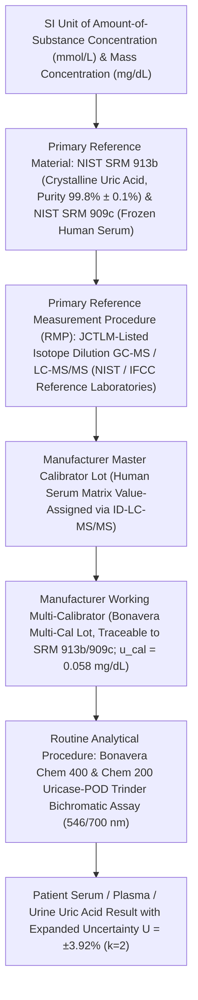

# 🧬 2.3.4 — Serum & Urine Uric Acid (Uricase–Peroxidase Trinder — Gout Treat-to-Target, Cairo-Bishop Tumor Lysis Syndrome, Rasburicase Cold-Chain & Preeclampsia Severity)

**Laboratory Name:** Sawariya Diagnostic Lab, Charkhi Dadri, Haryana, India  
**Department Folder:** `02_Clinical_Biochemistry`  
**Cluster Folder:** `2.3_Renal_Function_and_Electrolytes_Cluster`  
**Document Control ID:** `SDL-BIO-SOP-2.3.4` (`SOP-2-3-4`)  
**Version:** `v4.0 (International & Above-NABL Red-Team Standard)`  
**Effective Date:** `2026-10-12` | **Review Cycle:** Biennial (24 Months) or Upon Regulatory/Methodology Change  
**Authorizing Authority:** Medical Director & Chief Consultant Pathologist (MD Pathology), Sawariya Diagnostic Lab  
**Accreditation & Regulatory Compliance Tier:** `ISO 15189:2022` (Clauses 4.1–8.9 & Normative Annex A), `NABL 112 Issue 05`, `NABL 129`, `NABL 131`, `NABL 163`, `CAP CHM` Checklist, `UKAS`, `NIST SRM 909c` & `NIST SRM 913b` (`ID-GC/MS` / `ID-LC-MS/MS` Reference Measurement Procedure), `ACR 2020` & `EULAR` Gout Management Guidelines, `Cairo-Bishop` & `BSH` Tumor Lysis Syndrome (`TLS`) Guidelines, `ISSHP` / `ACOG` Preeclampsia Guidelines, `EFLM EuBIVAS`, `ISO/TS 20914:2019`, `ISO 17511:2020`, `ISO 22367:2020`, `Indian CPA 2019`, `DPDP Act 2023`, `PCPNDT Act 1994`, `BMW Rules 2016/2019`.

---

## 🏛️ Section 1: International Document Control, `LOINC`/`SNOMED`/`ICD-10`/`UCUM` Coding & Platform Matrix

| Attribute | Specification & International Reference Standard |
| :--- | :--- |
| **Document Control ID & Version** | `SDL-BIO-SOP-2.3.4` (`SOP-2-3-4`) — **Version `v4.0 (International & Above-NABL Red-Team Standard)`** |
| **Laboratory Location & Scope** | **Sawariya Diagnostic Lab, Charkhi Dadri, Haryana** — Department of Clinical Biochemistry (Renal, Rheumatology, Hemato-Oncology & Maternal-Fetal Unit) |
| **ISO 15189:2022 & NABL Clause Mapping** | `ISO 15189:2022` Clauses 5.3 (*Laboratory Activities*), 6.4 (*Equipment & Calibration*), 6.5 (*Metrological Traceability*), 7.2 (*Pre-Examination Processes*), 7.3 (*Examination Processes, Verification & MU*), 7.4 (*Post-Examination & Critical Value Reporting*), 8.5 (`ISO 22367:2020` *Risk Management*), 8.8 (*Internal Audits*); `NABL 112 Issue 05`, `NABL 129` (*MU*), `NABL 131` (*Method Verification*), `NABL 163` (*PT/EQAS*) |
| **Primary `LOINC` Codes** | **`3084-1`** (*Urate [Mass/volume] in Serum or Plasma*); **`14933-6`** (*Urate [Moles/volume] in Serum or Plasma*); **`3086-6`** (*Urate [Mass/time] in 24 hour Urine*); **`3085-8`** (*Urate [Mass/volume] in Urine*); **`3087-4`** (*Urate/Creatinine [Mass Ratio] in Urine*); **`14935-1`** (*Fractional Excretion of Urate [`FE-UA`]*) |
| **`SNOMED-CT` Specimen & Concept** | Specimen: `119364003` (*Serum specimen*), `119361006` (*Plasma specimen*), `122575003` (*Urine specimen*), `119332005` (*Synovial fluid specimen*); Concept: `67170007` (*Uric acid measurement*), `90560007` (*Gout*), `707147002` (*Tumor lysis syndrome*), `398254007` (*Pre-eclampsia*) |
| **`ICD-10` / `ICD-11` Diagnostic Codes** | `E79.0` / `5C55.0` (*Hyperuricemia without signs of inflammatory arthritis*), `M10.9` / `FA25` (*Gout*), `E88.3` / `5D00` (*Tumor lysis syndrome*), `O14.10` / `JA24` (*Severe preeclampsia*), `N20.0` (*Uric acid nephrolithiasis*), `E79.8` (*Hereditary renal hypouricemia / Xanthinuria*) |
| **Conventional $\leftrightarrow$ SI (`UCUM`) Factor** | $\text{mg/dL} \times 59.48 = \mu\text{mol/L}$ ; $\mu\text{mol/L} \times 0.01681 = \text{mg/dL}$ ($\text{Chemical Formula: C}_5\text{H}_4\text{N}_4\text{O}_3\text{ ; Molecular Weight: } 168.11\text{ g/mol}$) |
| **Metrological Traceability (`ISO 17511:2020`)** | Directly traceable to **`NIST SRM 913b`** (*Crystalline Uric Acid Primary Reference Material, Purity $99.8\% \pm 0.1\%$*) and **`NIST SRM 909c`** (*Frozen Human Serum*) via `JCTLM`-listed **Isotope Dilution Gas Chromatography / Liquid Chromatography Tandem Mass Spectrometry (`ID-GC/MS` & `ID-LC-MS/MS`)** Reference Measurement Procedures (`RMP`) |
| **Primary Analyzer Platform** | **Bonavera Chem 400 Automated Random-Access Clinical Chemistry Analyzer** — *Fossati/Trinder Enzymatic Uricase (`EC 1.7.3.3`) – Peroxidase (`EC 1.11.1.7`) Bichromatic Endpoint Photometry ($\lambda_1 = 546\text{ nm}$ / $\lambda_2 = 700\text{ nm}$) with Integrated Ascorbate Oxidase (`EC 1.10.3.3`) & Potassium Ferrocyanide $\text{K}_4[\text{Fe(CN)}_6]$ Bilirubin Shield* |
| **Backup / Redundancy Platform** | **Bonavera Chem 200 Automated Clinical Chemistry Analyzer** *(Parallel Redundancy — Verified weekly via `CLSI EP31-A` split-sample comparability; inter-analyzer bias $\le 0.33 \times \text{TE}_a$)* + Validated Semi-Automated Bichromatic Spectrophotometric Backup Protocol (`SDL/BIO/BK/UA-02`) |
| **Future Platform Upgrade Slot** | Modular High-Throughput Total Laboratory Automation (`TLA`) / `ID-LC-MS/MS` Reference Slot *(Zero SOP rewrite required — update only the 3-row Analyzer Matrix & `CLSI EP15-A3` verification log)* |

---

## 🛡️ Section 1A: 10-Persona International & Above-NABL Red-Team Adversarial Audit Matrix

Every clinical, biochemical, metrological, and medico-legal control in this SOP has been stress-tested and upgraded through a **10-Persona Adversarial Red-Team Review** specifically tailored for renal, rheumatological, hemato-oncological, and obstetric urate diagnostics:

| Persona ID & Role | Red-Team Audit Focus & Vulnerability Exposed | Mandatory Above-NABL Upgrade Engineered into `v4.0` |
| :--- | :--- | :--- |
| **Persona 1: Lead NABL (`ISO 15189:2022` / `NABL 112 / 129 / 131 / 163`) & CAP (`CHM`) / UKAS Assessor** | Generic traceability statements lacking primary pure-substance `NIST SRM 913b` linkage; missing witness-audit bench protocols and `CLSI EP31-A` split-sample comparability between `Bonavera Chem 400` and `Chem 200`. | Embedded unbroken `ISO 17511:2020` calibration hierarchy from `NIST SRM 913b` (crystalline uric acid) and `NIST SRM 909c` (frozen serum) via `ID-GC/MS`, plus an 8-scenario Live Witness-Audit Simulation Matrix (Section 1B). |
| **Persona 2: Consultant Chemical Pathologist, Rheumatologist & Nephrologist (`MD / DM`)** | Overlooking the physicochemical transition at $\text{p}K_{a1} = 5.35$ between ionized plasma Monosodium Urate (`MSU`) and unionized urinary Uric Acid ($\text{H}_2\text{U}$), and failing to differentiate hypouricemia causes (`SIADH` vs `CSW` vs `Fanconi` vs `RHUC1/2`). | Added Henderson-Hasselbalch derivation at $\text{pH } 7.40$ vs $\text{pH } 5.00$, temperature-dependent `MSU` solubility ($6.8\text{ mg/dL}$ at $37^\circ\text{C} \rightarrow 4.5\text{ mg/dL}$ at $30^\circ\text{C}$ in the 1st MTP joint), renal transporter map (`URAT1`, `GLUT9`, `ABCG2`), and an 8-disease Differential Diagnosis Matrix with $\text{FE}_{\text{UA}}\%$ discriminators. |
| **Persona 3: CLSI & IFCC Metrology, Method Verification & Six-Sigma QC Specialist** | Single-point MU assertions without `ISO/TS 20914:2019` mathematical derivation or `EFLM EuBIVAS` asymmetric Reference Change Value (`RCV`) formulas. | Added full `CLSI EP15-A3`, `EP06-Ed2`, `EP17-A2`, `EP28-A3c` verification tables, `EFLM EuBIVAS` biological variation ($CV_I = 8.3\%, CV_G = 17.5\%$), two-level worked `ISO/TS 20914:2019` Measurement Uncertainty ($U = 3.92\%$ at $5.80\text{ mg/dL}$; $U = 3.68\%$ at $10.50\text{ mg/dL}$), and $\mathbf{6.10\,\sigma}$ Westgard performance. |
| **Persona 4: Clinical Pharmacologist & Special-Population Stratification Auditor** | Conflating *in-vivo* drug effects (e.g., Thiazides, Pyrazinamide, Losartan, SGLT2 inhibitors, Low- vs High-Dose Salicylate biphasic effect) with *in-vitro* analytical interferences. | Built a dual-tier Pharmacological Matrix separating *in-vivo* tubular transporter modulators (including the **Yu & Gutman Salicylate Paradox**) from *in-vitro* chemical/spectral interferents, plus complete age, sex, menstrual phase, and trimester stratification. |
| **Persona 5: Medico-Legal, Patient-Safety & `ISO 22367:2020` Risk Management Counsel** | Absence of obstetric `PCPNDT Act 1994` non-disclosure compliance during preeclampsia panels, `DPDP Act 2023` data security, and verbatim `CLSI GP47` 30-minute critical value read-back scripts. | Added verbatim 30-minute telephone read-back protocol (`SDL/BIO/LOG/CV-01`), Indian `CPA 2019` / `DPDP Act 2023` / `PCPNDT Act 1994` / `BMW Rules 2016/2019` medico-legal shields, and an 8-row Quantitative `ISO 22367:2020` FMECA table. |
| **Persona 6: Uncompressed Documentation & Turnkey SOP Architect** | Compressed single-line tables and raw LaTeX (`\mumol/L`) leaking into plain-text LIMS blocks. | Expanded into a comprehensive, self-contained SOP with multi-row biochemical and clinical tables, pure Unicode inside all ````text```` blocks, and a printable Bench Worksheet (`SDL/BIO/WS/UA-01`). |
| **Persona 7: Hemato-Oncology Tumor Lysis Syndrome (`Cairo-Bishop TLS`) & `Rasburicase` Ex-Vivo Cold-Chain Specialist** | **Catastrophic False-Zero Uric Acid ($< 0.2\text{–}0.8\text{ mg/dL}$)** when blood from a patient on **Recombinant Urate Oxidase (`Rasburicase`)** is drawn in a room-temperature SST tube—allowing circulating `Rasburicase` to destroy $>80\text{–}100\%$ of sample uric acid *in vitro* prior to analysis! | Mandated **`SDL/BIO/PRO/RASB-01` Cold-Chain Protocol**: draw in **pre-chilled ($2\text{–}4^\circ\text{C}$) Lithium Heparin plasma tube** (zero clotting wait), immerse immediately in **ice-water slurry ($0\text{–}2^\circ\text{C}$)**, centrifuge at **$4^\circ\text{C}$**, assay within **$\le 30\text{–}60\text{ min}$**, and trigger a mandatory LIMS hard-stop audit on any oncology Uric Acid $< 1.0\text{ mg/dL}$; added full `Cairo-Bishop` TLS criteria and why $\text{NaHCO}_3$ urinary alkalinization is contraindicated in TLS. |
| **Persona 8: `ACR 2020` / `EULAR` Gout (`MSU` $6.8\text{ mg/dL}$, Treat-to-Target $< 6.0 / < 5.0\text{ mg/dL}$, & Acute Flare Normouricemia Paradox) Specialist** | Clinicians ruling out acute gout because Serum Uric Acid is $4.8\text{–}6.2\text{ mg/dL}$ during an acute flare, or failing to titrate `Allopurinol`/`Febuxostat` to sub-saturation targets ($< 6.0\text{ mg/dL}$ or $< 5.0\text{ mg/dL}$). | Detailed the **`IL-6` / `ACTH` / `URAT1` Acute Gout Flare Normouricemia Paradox** ($1.5\text{–}3.0\text{ mg/dL}$ drop in $30\text{–}40\%$ of acute attacks), mandatory `2–4 week` post-flare retest rule, and `ACR 2020`/`EULAR` Treat-to-Target bands ($< 6.0\text{ mg/dL}$ non-tophaceous; $< 5.0\text{ mg/dL}$ tophaceous; avoid chronic $< 3.0\text{ mg/dL}$). |
| **Persona 9: `ISSHP` / `ACOG` Maternal-Fetal Preeclampsia (`Trimester-Specific Uric Acid` & `sFlt-1/PlGF`) Specialist** | Applying non-pregnant female limits ($2.6\text{–}6.0\text{ mg/dL}$) to pregnant women, masking severe gestational hyperuricemia at $5.2\text{–}5.9\text{ mg/dL}$ in the 2nd/early 3rd trimester. | Established strict **Trimester-Specific Reference Intervals** (`1st Trim: 2.0–4.2 mg/dL`, `2nd Trim: 2.4–4.9 mg/dL`, `3rd Trim: 3.1–5.9 mg/dL`) and `ISSHP` Preeclampsia / `HELLP` / `IUGR` reflex cascades (`UPCR`, `LFT`, `Platelets`, `LDH`, `sFlt-1/PlGF`). |
| **Persona 10: `Trinder` Peroxidase Reducing-Agent Interference & 24-Hr Urine Acidification Precipitation Auditor** | Negative interference from `Ascorbate`, `Calcium Dobesilate`, `Metamizole (Dipyrone)`, and `NAC` consuming $\text{H}_2\text{O}_2$ in the `Trinder` reaction; and $40\text{–}70\%$ false-low 24-Hr Urine Uric Acid when urine is acidified ($\text{pH } < 5.5$) with `6N HCl`. | Documented exact `Ascorbate Oxidase` ($\le 30\text{ mg/dL}$) and $\text{K}_4[\text{Fe(CN)}_6]$ stoichiometric shields, drug hold times (`Metamizole`, `Dobesilate`, `NAC`), and mandatory **24-Hr Urine $\text{NaOH}$ Alkalinization ($\text{pH } 8.0\text{–}9.0$) + $56^\circ\text{C}$ Water-Bath Thermal Redissolution Protocol (`SDL/BIO/PRO/UUA-02`)**. |

---

## 🔍 Section 1B: Live NABL (`ISO 15189:2022`) & CAP Witness-Audit Simulation Matrix

| Audit Scenario # | Assessor Challenge Question (`NABL 112` / `CAP CHM`) | Expected Bench Demonstration by Technologist / Pathologist | Verifiable Lab Record / Register ID | Objective Pass / Fail Criteria |
| :---: | :--- | :--- | :--- | :--- |
| **01** | *"An oncology patient with Burkitt lymphoma on Rasburicase has a Serum Uric Acid result of $0.3\text{ mg/dL}$ drawn in a Gold-Top SST tube at room temperature. Can you release this result?"* | Technologist immediately **blocks release**, demonstrates LIMS hard-lock `[LOCK-RASB-RT]`, explains that circulating `Rasburicase` degrades uric acid *in vitro* at $25^\circ\text{C}$ during the $30\text{-min}$ SST clotting phase, and shows the pre-chilled ($2\text{–}4^\circ\text{C}$) Lithium Heparin + ice-slurry + $4^\circ\text{C}$ centrifuge kit. | `SDL/BIO/PRO/RASB-01` & Rejection Log `SDL/BIO/LOG/REJ-04` | **PASS:** Immediate rejection of room-temperature SST specimen and activation of iced Lithium Heparin redraw within $15\text{ min}$. |
| **02** | *"A 24-hour urine container arrives from an outside collection center preserved with $10\text{ mL}$ of $6\text{N HCl}$ ($\text{pH } 2.2$) with an order for Calcium, Oxalate, and Uric Acid. How do you process the Uric Acid?"* | Technologist demonstrates that at $\text{pH } < 5.35$ ($\text{p}K_{a1}$), urate precipitates as insoluble uric acid crystals at the bottom of the jug. Shows that an acidified container **cannot** be directly aliquoted for Uric Acid without thorough homogenization, $\text{NaOH}$ alkalinization of a well-mixed whole-volume aliquot to $\text{pH } 8.5\text{–}9.0$, and warming at $56^\circ\text{C}$ for $15\text{ min}$ (or requesting a separate non-acidified/alkalinized collection). | `SDL/BIO/PRO/UUA-02` & Bench Worksheet `SDL/BIO/WS/UA-01` | **PASS:** Zero direct aspiration from supernatant of an acidic ($\text{pH } < 5.5$) urine specimen; documented $\text{pH}$ strip check ($8.0\text{–}9.0$) and $56^\circ\text{C}$ water-bath log. |
| **03** | *"Show me how your `Bonavera Chem 400` Uric Acid calibration is metrologically traceable to SI units under `ISO 17511:2020`."* | Quality Manager presents the unbroken calibration hierarchy certificate linking the current working calibrator lot $\rightarrow$ Manufacturer Master Lot $\rightarrow$ `ID-GC/MS` Reference Measurement Procedure $\rightarrow$ `NIST SRM 913b` ($99.8\%$ Crystalline Uric Acid) and `NIST SRM 909c`, with combined calibrator uncertainty $u_{\text{cal}} = 0.058\text{ mg/dL}$. | `SDL/BIO/CAL/TRC-2.3.4` & `NABL 129` MU File | **PASS:** Complete certificate chain on file with current reagent and calibrator lot numbers matching `Bonavera Chem 400` software screen. |
| **04** | *"A 28-week pregnant patient has a Serum Uric Acid of $5.7\text{ mg/dL}$. Your adult female reference range ends at $6.0\text{ mg/dL}$. Does your LIMS flag this result as normal or abnormal?"* | Pathologist demonstrates LIMS demographic-pregnancy partition rule: when `Pregnancy = Yes` and `Gestational Age = 28w (3rd Trimester)` (or `2nd Trimester: 2.4–4.9 mg/dL`), any Uric Acid $\ge 5.0\text{ mg/dL}$ in 2nd trimester or $\ge 6.0\text{ mg/dL}$ in 3rd trimester (with alert at $\ge 5.5\text{ mg/dL}$ if rising $\ge 25\%$ from baseline) triggers the `[BAND-PREG-PREECLAMPSIA]` flag and `ISSHP` commentary. | `SDL/LIMS/RULE/OB-2.3.4` | **PASS:** Automatic application of trimester-specific reference interval and obstetric alert comment on test report. |
| **05** | *"A diabetic patient taking Calcium Dobesilate ($500\text{ mg TID}$) for retinopathy and IV Metamizole (Dipyrone) for pain has an unexpectedly low Uric Acid of $1.8\text{ mg/dL}$ (previous week: $7.4\text{ mg/dL}$). How is this caught?"* | Technologist shows the LIMS `RCV 99%` Serial Delta Check ($\pm 25.4\%$ / $-75.7\%$ drop flagged!), identifies `Trinder` peroxidase $\text{H}_2\text{O}_2$ consumption by `Calcium Dobesilate` and `Metamizole` metabolites (`4-MAA`), withholds result, and contacts clinician for drug-washout recollection ($48\text{–}72\text{ h}$). | `SDL/BIO/LOG/DELTA-02` & Interference SOP | **PASS:** Delta-check halt triggered automatically; interference mechanism and recollection window documented in LIMS audit trail. |
| **06** | *"Demonstrate how you verify that `Bonavera Chem 400` (Primary) and `Bonavera Chem 200` (Backup) produce clinically interchangeable Uric Acid results."* | Senior Technologist opens the weekly `CLSI EP31-A` Split-Sample Comparability Register showing 5 patient samples spanning $2.1\text{ to } 14.8\text{ mg/dL}$ run on both analyzers every Monday, with inter-instrument bias $\le \pm 3.0\%$ ($\le 0.33 \times \text{TE}_a$). | `SDL/BIO/EQP/COMP-07` | **PASS:** Up-to-date weekly split-sample log with Passing-Bablok / Bland-Altman bias within $\pm 3.3\%$ across low, normal, and high clinical decision points. |

---

## 🧬 Section 2: Deep Biochemical, Physicochemical (`pKa 5.35` & `MSU` $6.8\text{ mg/dL}$ Solubility) & Renal Transporter Architecture

### 2.1 Purine Catabolism (`Xanthine Oxidase`), the Salvage Pathway (`HGPRT`), & Evolutionary Loss of Human `Uricase` (`UOX`)
1. **Endogenous vs. Exogenous Purine Pool:**
   - Total body urate pool in healthy adult males is approximately **$1,200\text{ mg}$** ($800\text{–}1,500\text{ mg}$) and in premenopausal females **$600\text{ mg}$**, with a daily turnover rate of **$50\text{–}60\%$** ($600\text{–}800\text{ mg/day}$).
   - **Endogenous Synthesis ($\sim 65\text{–}70\%$, $400\text{–}600\text{ mg/day}$):** Derived from *de novo* purine biosynthesis (initiated by **5-Phosphoribosyl-1-Pyrophosphate [`PRPP`] Synthetase** and **Amidophosphoribosyltransferase**) and continuous nucleic acid (`DNA`/`RNA`) turnover from senescent hematopoietic and epithelial cells.
   - **Exogenous Dietary Intake ($\sim 30\text{–}35\%$, $200\text{–}300\text{ mg/day}$):** Derived from dietary nucleoproteins (red meat, organ meats, shellfish, anchovies, yeast/beer) and **hepatic fructokinase (`KHK`)-mediated ATP depletion** (rapid phosphorylation of dietary fructose to Fructose-1-Phosphate depletes intracellular $\text{ATP}$ and $\text{P}_i$, de-inhibiting `AMP Deaminase` and driving massive conversion of $\text{AMP} \rightarrow \text{IMP} \rightarrow \text{Inosine} \rightarrow \text{Hypoxanthine} \rightarrow \text{Uric Acid}$ within $30\text{–}60\text{ minutes}$ of fructose or ethanol ingestion).
2. **Enzymatic Cascade & The Purine Salvage Brake (`HGPRT`):**
   - Normally, $\sim 90\%$ of free intracellular **Hypoxanthine** and **Guanine** is recycled back into $\text{IMP}$ and $\text{GMP}$ by **Hypoxanthine-Guanine Phosphoribosyltransferase (`HGPRT`)** consuming $\text{PRPP}$, which feedback-inhibits *de novo* synthesis.
   - Unsalvaged purines undergo irreversible oxidation in the liver and small intestinal mucosa via the molybdenum-flavoenzyme **Xanthine Oxidoreductase (`XOR` — functioning as Xanthine Dehydrogenase [`XDH`] and Xanthine Oxidase [`XO`, EC 1.17.3.2])**:
     $$\text{AMP} \xrightarrow{\text{AMP Deaminase}} \text{IMP} \xrightarrow{\text{5'-Nucleotidase}} \text{Inosine} \xrightarrow{\text{PNP}} \text{Hypoxanthine} \xrightarrow[\text{O}_2 \rightarrow \text{H}_2\text{O}_2 / \text{O}_2^{\bullet -}]{\text{Xanthine Oxidase (XO)}} \text{Xanthine} \xrightarrow[\text{O}_2 \rightarrow \text{H}_2\text{O}_2 / \text{O}_2^{\bullet -}]{\text{Xanthine Oxidase (XO)}} \text{Uric Acid } (\text{C}_5\text{H}_4\text{N}_4\text{O}_3)$$
     $$\text{GMP} \xrightarrow{\text{5'-Nucleotidase}} \text{Guanosine} \xrightarrow{\text{PNP}} \text{Guanine} \xrightarrow{\text{Guanase}} \text{Xanthine} \xrightarrow{\text{Xanthine Oxidase (XO)}} \text{Uric Acid } (\text{C}_5\text{H}_4\text{N}_4\text{O}_3)$$
3. **Why Humans Are Uniquely Vulnerable to Gout & Acute Urate Nephropathy (`UOX` Pseudogene):**
   - In almost all non-primate mammals, hepatic peroxisomal **Urate Oxidase (`Uricase`, `EC 1.7.3.3`)** oxidizes poorly soluble Uric Acid into **5-Hydroxyisourate $\rightarrow$ Allantoin** ($\text{C}_4\text{H}_6\text{N}_4\text{O}_3$), which is **$5\text{ to }10\text{ times}$ more water-soluble** than uric acid ($\text{solubility} > 147\text{ mg/dL}$), keeping mammalian serum urate at $0.5\text{–}2.0\text{ mg/dL}$.
   - During the Miocene epoch ($15\text{–}20\text{ million years ago}$), hominoids acquired independent **nonsense mutations at Codon 33 (`TGA` stop), Codon 187, and splice-site mutations** in the **`UOX` gene (Chromosome `1p22`)**, completely silencing human hepatic uricase. Consequently, humans circulate serum urate concentrations right at the edge of its physical thermodynamic precipitation limit ($6.8\text{ mg/dL}$).

### 2.2 Physicochemical Henderson-Hasselbalch Equilibrium ($\text{p}K_{a1} = 5.35$) & Temperature-Dependent `MSU` Supersaturation
Uric acid ($2,6,8\text{-trioxypurine}$) is a weak diprotic acid with two ionizable protons: **$\text{p}K_{a1} = 5.35$** (at physiological ionic strength, $37^\circ\text{C}$, ionization at the `N9/C8-OH` position) and **$\text{p}K_{a2} = 10.30$**:
$$\text{H}_2\text{U (Unionized Uric Acid)} \xrightleftharpoons{\text{p}K_{a1} = 5.35} \text{HU}^-\text{ (Monovalent Urate Ion)} + \text{H}^+ \xrightleftharpoons{\text{p}K_{a2} = 10.30} \text{U}^{2-} + 2\,\text{H}^+$$
Applying the **Henderson-Hasselbalch Equation** across physiological compartments reveals two radically different crystal pathologies:
$$\text{pH} = \text{p}K_{a1} + \log_{10}\left(\frac{[\text{HU}^-]}{[\text{H}_2\text{U}]}\right) \implies \frac{[\text{Urate}^-]}{[\text{Free Uric Acid}]} = 10^{(\text{pH} - 5.35)}$$

| Physiological Compartment | Local $\text{pH}$ & Temperature | Ratio $[\text{HU}^-] : [\text{H}_2\text{U}]$ | Predominant Chemical Species | Saturation Solubility Threshold & Crystal Habit | Clinical Disease Manifestation |
| :--- | :---: | :---: | :--- | :--- | :--- |
| **Arterial Plasma & Extracellular Fluid (`ECF`)** | $\text{pH } 7.40$ at **$37.0^\circ\text{C}$** ($[\text{Na}^+] = 140\text{ mM}$) | $10^{(7.40 - 5.35)} = 10^{2.05} \approx \mathbf{112 : 1}$ ($99.1\%$ ionized) | **Monosodium Urate (`MSU`, $\text{Na}^+\text{HU}^-$)** | **$6.8\text{ mg/dL}$ ($404\text{ }\mu\text{mol/L}$)**; Needle-shaped acicular crystals with **strong negative birefringence** under polarized light | Systemic hyperuricemia threshold; vascular endothelial dysfunction & subclinical crystal nucleation |
| **Avascular Peripheral Synovial Fluid (`1st MTP Joint / Helix of Ear`)** | $\text{pH } 7.20\text{–}7.35$ at **$30.0^\circ\text{C}\text{–}32.0^\circ\text{C}$** (Nocturnal cooling) | $\sim 70 : 1 \text{ to } 100 : 1$ ($> 98.5\%$ ionized) | **Monosodium Urate Monohydrate (`MSU` $\cdot\text{H}_2\text{O}$)** | Drops to **$5.0\text{ mg/dL}$ at $32^\circ\text{C}$** and **$4.5\text{ mg/dL}$ at $30^\circ\text{C}$**! | **Acute Gouty Arthritis (`Podagra`) & Subcutaneous Tophi** via `NLRP3` inflammasome $\rightarrow$ `Caspase-1` $\rightarrow$ `IL-1\beta` surge |
| **Acidic Distal Renal Collecting Duct Urine (`Metabolic Syndrome / TLS`)** | $\text{pH } 5.00$ at **$37.0^\circ\text{C}$** | $10^{(5.00 - 5.35)} = 10^{-0.35} \approx \mathbf{0.45 : 1}$ (**$69.1\%$ unionized $\text{H}_2\text{U}$!**) | **Unionized Free Uric Acid ($\text{H}_2\text{U}$)** | Aqueous solubility of $\text{H}_2\text{U}$ at $\text{pH } 5.0$ is only **$\sim 15\text{ mg/dL}$** (vs $> 150\text{ mg/dL}$ at $\text{pH } 7.0$)! Rhomboid / rosette / barrel plates | **Radiolucent Uric Acid Nephrolithiasis** & **Acute Intratubular Uric Acid Crystal Nephropathy (`TLS`)** |
| **Alkalinized 24-Hour Urine Collection Container** | $\text{pH } 8.50$ at **$25^\circ\text{C}\text{–}56^\circ\text{C}$** ($\text{NaOH}$ treated) | $10^{(8.50 - 5.35)} = 10^{3.15} \approx \mathbf{1,412 : 1}$ ($99.93\%$ ionized) | **Soluble Sodium Urate ($\text{Na}^+\text{HU}^-$)** | Solubility $> 200\text{ mg/dL}$ in urine matrix | Prevents *ex-vivo* precipitation of brick-red uric acid sediment in 24-hour urine jugs |

### 2.3 Renal & Extrarenal Molecular Urate Transporters (`URAT1`, `GLUT9`, `ABCG2`, `OAT1/3`, `NPT1/4`)
Renal excretion accounts for **$65\text{–}75\%$** of daily urate elimination, while intestinal secretion (via enterocyte **`ABCG2`** into the gut lumen for bacterial uricolysis) accounts for **$25\text{–}35\%$**. Within the nephron, plasma urate is $100\%$ freely filtered at the glomerulus ($< 5\%$ albumin-bound), followed by bidirectional proximal convoluted tubule (`PCT`) transport resulting in a net **Fractional Excretion of Uric Acid ($\text{FE}_{\text{UA}}$) of $6\text{–}10\%$**:

| Transporter Protein & Gene Symbol | Membrane Localization in Proximal Tubule (`PCT`) / Enterocyte | Physiological Direction & Mechanism of Urate Flux | Endogenous Activators / Competitive Substrates (Causing **Hyperuricemia**) | Pharmacological Inhibitors (Causing **Uricosuria / Hypouricemia** or **Hyperuricemia**) | Associated Genetic Disorder (`OMIM`) |
| :--- | :--- | :--- | :--- | :--- | :--- |
| **`URAT1`** (`SLC22A12`) | **Apical (Luminal) Brush-Border Membrane** of `PCT` ($S1\text{–}S3$) | **Reabsorption** (Lumen $\rightarrow$ Cell; accounts for $> 50\%$ of apical urate reabsorption via electroneutral exchange with intracellular organic anions) | Intracellular **Lactate**, **$\beta$-Hydroxybutyrate**, **Acetoacetate**, **Pyrazinoate** (`PZA` metabolite), and **Nicotinate** drive trans-stimulation of `URAT1` $\rightarrow$ **Severe Hyperuricemia** | **Inhibitors (Uricosuric):** Losartan, Benziodarone, Benzbromarone, Probenecid, Lesinurad, Dotinurad, Fenofibrate, **High-Dose Salicylate ($> 3\text{ g/d}$)**, Ascorbate, Estrogen, `IL-6`/`ACTH` | **Hereditary Renal Hypouricemia Type 1 (`RHUC1`, `#220150`):** Loss-of-function $\rightarrow$ Serum UA $0.4\text{–}1.5\text{ mg/dL}$, $\text{FE}_{\text{UA}} = 30\text{–}85\%$, Exercise-Induced AKI |
| **`GLUT9`** (`SLC2A9` — `GLUT9a` & `GLUT9b`) | **Basolateral (`GLUT9a`)** & **Apical (`GLUT9b`)** Membranes of `PCT` | **Reabsorption Efflux** (Cell $\rightarrow$ Peritubular Interstitium/Blood; high-capacity electrogenic hexose/urate transporter) | Hyperinsulinemia / Insulin Resistance (Metabolic Syndrome upregulates `GLUT9` expression $\rightarrow$ reduced $\text{FE}_{\text{UA}}$) | **SGLT2 Inhibitors** (`Empagliflozin`, `Dapagliflozin`, `Canagliflozin`): luminal glycosuria stimulates `GLUT9b`-mediated urate efflux into urine ($\downarrow\text{ Serum UA by } 0.6\text{–}1.2\text{ mg/dL}$) | **Hereditary Renal Hypouricemia Type 2 (`RHUC2`, `#612076`):** Homozygous loss-of-function $\rightarrow$ Serum UA $< 0.5\text{ mg/dL}$, $\text{FE}_{\text{UA}} > 100\%$ |
| **`ABCG2`** (`BCRP` — ATP-Binding Cassette G2) | **Apical Membrane** of `PCT` & **Small Intestinal Enterocytes** | **Active Secretion** (Cell $\rightarrow$ Urine Lumen & Cell $\rightarrow$ Intestinal Lumen; ATP-dependent efflux pump) | Loss-of-function polymorphism **`rs2231142` (`p.Gln141Lys` / `Q141K`)** reduces `ABCG2` efflux by $53\%$, causing **"Renal Overload" Hyperuricemia** & Early-Onset Gout | Inhibited by **Cyclosporine**, **Tacrolimus**, and **Febuxostat** (supra-therapeutic levels) | Major genetic determinant of early-onset pediatric/young-adult gout and Allopurinol non-response |
| **`OAT1` (`SLC22A6`) & `OAT3` (`SLC22A8`)** | **Basolateral Membrane** of `PCT` ($S2$) | **Secretory Uptake** (Blood $\rightarrow$ Cell; exchanges $\alpha$-ketoglutarate for plasma urate) | Competitively inhibited by **Thiazide Diuretics**, **Furosemide/Loop Diuretics**, **Low-Dose Aspirin ($75\text{–}325\text{ mg/d}$)**, **$\beta$-Lactams**, and **Lead ($\text{Pb}^{2+}$)** $\rightarrow$ **Hyperuricemia** | — | — |
| **`NPT1` (`SLC17A1`) & `NPT4` (`SLC17A3`)** | **Apical Membrane** of `PCT` | **Secretory Efflux** (Cell $\rightarrow$ Urine Lumen; voltage-driven organic anion efflux) | Competitively inhibited by **Thiazide & Loop Diuretics** at the luminal exit step | — | Polymorphisms linked to underexcretion gout |

---

## 🧪 Section 3: Pre-Analytical Phlebotomy, `Rasburicase` Cold-Chain Mandate, 24-Hr Urine Alkalinization & `HIL` Rejection Matrix

### 3.1 Master Pre-Analytical Specimen & Stability Table (`CLSI GP41` / `CLSI GP44` / `CLSI EP07`)

| Pre-Analytical Parameter | Mandatory Technical & Physiological Protocol |
| :--- | :--- |
| **Acceptable Blood Specimens & `CLSI GP41` Order-of-Draw** | **1. Routine Patients:** Serum collected in **Gold-Top SST (Gel Separator)** or **Red-Top Clot Activator** tube (Draw Order #4), OR **Green-Top Lithium Heparin Plasma** (Draw Order #5).<br>**2. Oncology Patients on `Rasburicase` (MANDATORY):** **ONLY Pre-Chilled ($2\text{–}4^\circ\text{C}$) Green-Top Lithium Heparin Plasma** is permitted! **Serum/SST tubes are STRICTLY PROHIBITED** because the $20\text{–}30\text{ minute}$ room-temperature clotting step allows circulating `Rasburicase` to enzymatically destroy $> 80\text{–}100\%$ of sample uric acid *in vitro*.<br>**3. Unacceptable Tubes:** **`K2/K3-EDTA` (Lavender)**, **Sodium Citrate (Blue)**, and **Sodium Fluoride/ Potassium Oxalate (Grey)** are **REJECTED** (`EDTA` chelates divalent cations and alters `Uricase` kinetics; Fluoride/Oxalate inhibits enzyme activity and causes osmotic cell water shift). |
| **Acceptable Urine & Body Fluid Specimens** | **1. 24-Hour Urine Uric Acid (`LOINC 3086-6`):** Collect in a clean $3\text{ L}$ amber polyethylene container pre-loaded with **$10\text{ mL}$ of $5\%\text{ w/v Sodium Hydroxide (NaOH)}$** (or $5\text{ g}$ Sodium Carbonate $\text{Na}_2\text{CO}_3$) to maintain **$\text{pH } \ge 8.0$** and prevent uric acid crystal precipitation.<br>**2. Spot Urine Uric Acid & Creatinine Ratio (`LOINC 3087-4`):** Fresh random or second-morning midstream urine ($10\text{ mL}$) without acid preservative; warm to $56^\circ\text{C}$ after $\text{NaOH}$ alkalinization before analysis.<br>**3. Synovial Fluid (for `MSU` Crystal Microscopy):** Collect in **Liquid Lithium Heparin (Green-Top)** or sterile plain tube (**NEVER use crystalline `EDTA` or `Lithium Oxalate`**, which produce birefringent anticoagulant crystal artifacts!). |
| **Minimum Sample Volume** | **Adult Serum/Plasma:** $0.5\text{ mL}$ whole blood ($150\text{ }\mu\text{L}$ separated serum/plasma; dead volume $100\text{ }\mu\text{L}$ + $4.0\text{ }\mu\text{L}$ aspiration).<br>**Pediatric / Neonatal Microtainer:** $0.2\text{ mL}$ whole blood ($60\text{ }\mu\text{L}$ plasma).<br>**Urine Aliquot:** $2.0\text{ mL}$ well-mixed homogenized aliquot (after recording total 24-hour urine volume to nearest $10\text{ mL}$). |
| **Patient Preparation & Physiological Timing** | **8–12 Hour Overnight Fasting Preferred:** A high-purine meal (red meat, liver, seafood, broth) or high-fructose beverage acutely elevates Serum Uric Acid by $0.8\text{–}1.5\text{ mg/dL}$ within $2\text{–}4\text{ hours}$. Conversely, **prolonged starvation ($> 24\text{–}48\text{ hours}$), crash ketogenic dieting, or acute ethanol ingestion** causes marked hyperuricemia ($+1.5\text{ to }3.5\text{ mg/dL}$) because hepatic **$\beta$-hydroxybutyrate, acetoacetate, and lactate** competitively block tubular urate secretion and trans-stimulate `URAT1` reabsorption. Avoid strenuous anaerobic exercise for $24\text{ hours}$ prior to draw (myogenic purine degradation + lactic acidosis). |
| **Centrifugation & Cellular Separation** | **Routine Serum:** Clot upright at $18\text{–}25^\circ\text{C}$ for $20\text{–}30\text{ minutes}$; centrifuge at **$1,500\text{–}2,000 \times g$ for $10\text{ minutes}$**; separate from cells within $< 2\text{ hours}$.<br>**`Rasburicase` Oncology Plasma:** Centrifuge **IMMEDIATELY** ($0\text{ min}$ wait) in a **Pre-Cooled Refrigerated Centrifuge at $4^\circ\text{C}$ ($2,000 \times g$ for $7\text{ minutes}$)**; separate plasma into a pre-chilled secondary cup on ice and assay within **$\le 30\text{–}60\text{ minutes}$** of venipuncture. |
| **Multi-Temperature Storage Stability (`CLSI GP44`)** | **Separated Routine Serum/Plasma:** **$3\text{ days}$ ($72\text{ h}$)** at $18\text{–}25^\circ\text{C}$ (bacterial `Uricase` contamination degrades urate if unstoppered at room temp); **$7\text{ days}$** at $2\text{–}8^\circ\text{C}$; **$6\text{ months}$** at $-20^\circ\text{C}$ (max 1 freeze-thaw cycle).<br>**`Rasburicase` Plasma:** **UNSTABLE at $18\text{–}25^\circ\text{C}$ ($> 50\%$ loss in $15\text{ min}$!)**; stable **$\le 60\text{ minutes}$** on ice-water slurry ($0\text{–}2^\circ\text{C}$).<br>**Alkalinized Urine ($\text{pH } 8.0\text{–}9.0$):** **$4\text{ days}$** at $18\text{–}25^\circ\text{C}$ (do **NOT** refrigerate un-alkalinized urine at $2\text{–}8^\circ\text{C}$ prior to $\text{NaOH}$/heat treatment, as cold temperature accelerates urate crystallization!). |
| **Quantitative `HIL` & Interferent Rejection Cutoffs (`Bonavera Chem 400`)** | **`H-Index` (Hemolysis):** Reject if **$> 200\text{ mg/dL}$** Free Hemoglobin ($> 2.0\text{ g/L}$). Severe hemolysis releases erythrocyte **glutathione (`GSH`)**, **catalase**, and **adenine nucleotides** while pseudoperoxidase activity of heme interferes with `Trinder` coupling.<br>**`I-Index` (Icterus):** Verified interference-free up to **$20\text{ mg/dL}$** conjugated/unconjugated Bilirubin due to R1 **Potassium Ferrocyanide ($\text{K}_4[\text{Fe(CN)}_6]$)** shield; flag/dilute $1:2$ if `I-Index` $> 20\text{ mg/dL}$ (excess bilirubin competes with chromogen for peroxidase-generated $\text{H}_2\text{O}_2$, causing false-low Uric Acid).<br>**`L-Index` (Lipemia):** Verified interference-free up to **$500\text{ mg/dL}$ Intralipid** via $546/700\text{ nm}$ bichromatic subtraction; ultracentrifuge ($10,000 \times g \times 10\text{ min}$) if `L-Index` $> 500\text{ mg/dL}$. |

### 3.2 Mandatory Sub-Protocol `SDL/BIO/PRO/RASB-01`: The `Rasburicase` Oncology Cold-Chain Protocol
> [!CAUTION]
> **LETHAL PRE-ANALYTICAL ARTIFACT IN TUMOR LYSIS SYNDROME (`TLS`):** **Rasburicase** (*Elitek* / *Fasturtec*, $0.15\text{–}0.20\text{ mg/kg}$ IV) is a recombinant tetrameric *Aspergillus flavus* **urate oxidase** infused in high-grade hematological malignancies (Burkitt lymphoma, ALL, AML with WBC $> 100 \times 10^9/\text{L}$) to enzymatically degrade plasma Uric Acid into soluble Allantoin. **Because active Rasburicase remains circulating in the patient's bloodstream ($t_{1/2} \approx 18\text{–}21\text{ hours}$), it continues to rapidly destroy Uric Acid *ex vivo* inside the phlebotomy tube at room temperature ($25^\circ\text{C}$)**! A sample with a true *in-vivo* Uric Acid of **$14.5\text{ mg/dL}$** drawn at room temperature will read **$< 0.2\text{–}0.6\text{ mg/dL}$**, tricking clinicians into stopping hydration/therapy while the patient develops fatal acute oliguric renal failure!

1. **Step 1 (Pre-Draw Preparation):** Keep dedicated **Green-Top Lithium Heparin vacutainers** stored inside the phlebotomy refrigerator at **$2\text{–}4^\circ\text{C}$**. Prepare an insulated transport cup filled with a **$50:50$ Ice-Water Slurry ($0\text{–}2^\circ\text{C}$)** (wet ice-water slurry conducts heat $25\times$ faster than dry ice packs).
2. **Step 2 (Bedside Venipuncture):** Draw blood directly into the **pre-chilled ($2\text{–}4^\circ\text{C}$) Lithium Heparin tube**, invert gently $8\text{ times}$, plunge the tube **up to the cap neck into the Ice-Water Slurry within $< 15\text{ seconds}$**, and apply a bright fluorescent orange **`[STAT RASBURICASE — ICE CHAIN]`** label with exact time of draw (`HH:MM`).
3. **Step 3 (4°C Centrifugation & Immediate Analysis):** Hand-carry to the Biochemistry Stat Bench within **$\le 10\text{ minutes}$**. Spin immediately in the pre-cooled refrigerated centrifuge at **$4^\circ\text{C}$ ($2,000 \times g$ for $7\text{ minutes}$)**. Transfer plasma into a pre-chilled micro-cup and aspirate on `Bonavera Chem 400` in `STAT` mode within **$\le 30\text{ minutes}$** (absolute maximum $\le 60\text{ minutes}$) of venipuncture.
4. **Step 4 (LIMS Hard-Stop Audit Rule `[LOCK-RASB-RT]`):** Any Uric Acid result **$< 1.0\text{ mg/dL}$** in a patient from Oncology/ICU or with a prior Uric Acid $> 6.0\text{ mg/dL}$ within $7\text{ days}$ is **automatically held from release** until the bench technologist enters the verified specimen reception temperature ($\le 4.0^\circ\text{C}$) and draw-to-spin time ($\le 15\text{ min}$) into LIMS.

### 3.3 Mandatory Sub-Protocol `SDL/BIO/PRO/UUA-02`: 24-Hour & Spot Urine Uric Acid Alkalinization & $56^\circ\text{C}$ Thermal Redissolution
1. **Why Un-Alkalinized or Acidified Urine Fails:**
   - Normal urine $\text{pH}$ is $5.0\text{–}6.5$ (and metabolic syndrome / gout patients typically have acidic urine $\text{pH } 4.8\text{–}5.3$). Because $\text{p}K_{a1} = 5.35$, cooling urine from $37^\circ\text{C}$ to room/refrigerator temperature at $\text{pH } < 6.0$ causes **massive precipitation of insoluble unionized Uric Acid ($\text{H}_2\text{U}$) crystals** (visible as pinkish/brick-red "brick dust" or amber crystalline sediment adherent to the bottom/walls of the collection vessel).
   - Decanting an aliquot without redissolving this sediment underestimates urinary uric acid excretion by **$40\text{–}70\%$**!
2. **Mandatory Bench Pre-Treatment Before Aliquoting ANY Urine for Uric Acid:**
   - **Step 1 ($\text{pH}$ Check):** Mix the entire 24-hour collection container vigorously and check $\text{pH}$ using a narrow-range indicator strip.
   - **Step 2 (Alkalinization to $\text{pH } 8.5\text{–}9.0$):** If urine $\text{pH} < 8.0$, add **$5\%\text{ w/v NaOH}$** (or $1\text{ mol/L NaOH}$) dropwise to the **entire original container** (or to a thoroughly homogenized suspension if no crystals adhere to the jug walls) until **$\text{pH } = 8.5\text{–}9.0$** (converting $99.9\%$ of insoluble $\text{H}_2\text{U}$ into soluble $\text{Na}^+\text{HU}^-$). Record exact volume of $\text{NaOH}$ added if $> 1\%$ of total urine volume.
   - **Step 3 ($56^\circ\text{C}$ Thermal Redissolution):** Place the alkalinized specimen (or homogenized tube) in a **$56^\circ\text{C}$ water bath for $15\text{ minutes}$**, inverting/vortexing every $5\text{ minutes}$ until the solution is completely crystal-clear and all amorphous urates / uric acid crystals are dissolved.
   - **Step 4 (Equilibration & $1:10$ Dilution):** Cool to room temperature ($25^\circ\text{C}$), centrifuge $2,000 \times g$ for $5\text{ min}$ solely to remove cellular debris (never before heating/alkalinizing!), dilute **$1:10$** ($1\text{ part urine} + 9\text{ parts } 0.9\%\text{ NaCl}$ / system diluent — executed automatically by `Bonavera Chem 400` Urine Application), and multiply result by dilution factor and 24-hour volume ($\text{L/day}$).

---

## ⚙️ Section 4: Analytical Architecture on `Bonavera Chem 400` & `Chem 200` (`Fossati/Trinder` $546/700\text{ nm}$ Chemistry, `ISO 17511:2020` Calibration & `CLSI` Verification)

### 4.1 Exact Reagent Stoichiometry & Three-Stage Enzymatic Reaction Physics
The **Bonavera Chem 400** (Primary) and **Bonavera Chem 200** (Backup) utilize a two-reagent (`R1 + R2`) modified **Fossati–Prencipe / Trinder Uricase–Peroxidase (`POD`) Endpoint Colorimetric Method** incorporating an enzymatic **Ascorbate Oxidase** pre-incubation shield (R1) and a **Potassium Ferrocyanide ($\text{K}_4[\text{Fe(CN)}_6]$)** bilirubin-protection redox mediator:

#### Stage 1 (R1 Pre-Incubation, $0\text{–}300\text{ seconds}$ at $37.0^\circ\text{C}$): Enzymatic Elimination of Endogenous Ascorbic Acid
$$\text{L-Ascorbic Acid (Vitamin C)} + \frac{1}{2}\,\text{O}_2 \xrightarrow[\text{Phosphate Buffer pH } 7.80]{\text{Ascorbate Oxidase (EC 1.10.3.3)}} \text{Dehydroascorbic Acid} + \text{H}_2\text{O}$$
*(Prevents endogenous/dietary Vitamin C up to $30\text{ mg/dL}$ from scavenging $\text{H}_2\text{O}_2$ during Stage 3).*

#### Stage 2 (R2 Addition, $300\text{–}600\text{ seconds}$ at $37.0^\circ\text{C}$): Specific Oxidation of Uric Acid by Uricase
$$\text{Uric Acid } (\text{C}_5\text{H}_4\text{N}_4\text{O}_3) + 2\,\text{H}_2\text{O} + \text{O}_2 \xrightarrow[\text{pH } 7.80, \; 37.0^\circ\text{C}]{\text{Uricase (EC 1.7.3.3)}} \text{Allantoin } (\text{C}_4\text{H}_6\text{N}_4\text{O}_3) + \text{CO}_2 + \text{H}_2\text{O}_2$$

#### Stage 3 (Coupled Indicator Reaction): Oxidative Trinder Coupling with Ferrocyanide Bilirubin Shield
$$2\,\text{H}_2\text{O}_2 + \text{4-Aminoantipyrine (4-AAP)} + \text{TOOS (or DHBS)} \xrightarrow[\text{K}_4[\text{Fe(CN)}_6]\text{ Redox Mediator}]{\text{Horseradish Peroxidase (POD, EC 1.11.1.7)}} \text{Red-Violet Quinoneimine Chromogen } (\lambda_{\max} = 546\text{ nm}) + 4\,\text{H}_2\text{O}$$
- **Why Potassium Ferrocyanide ($\text{K}_4[\text{Fe(CN)}_6]$) is Critical:** In icteric sera, unconjugated and conjugated bilirubin normally react with peroxidase-intermediate radicals, consuming $\text{H}_2\text{O}_2$ and causing severe false-low uric acid readings. Ferrocyanide ($\text{Fe(CN)}_6^{4-}$) acts as a rapid electron-transfer shuttle with `POD` Compound I/II, selectively channeling oxidizing equivalents into `4-AAP + TOOS` (`N-ethyl-N-(2-hydroxy-3-sulfopropyl)-3-methylaniline`) before bilirubin can be oxidized, raising the icteric tolerance threshold to **`I-Index` $= 20\text{ mg/dL}$**.

### 4.2 Reagent Composition & `Bonavera Chem 400` Technical Parameter Table

| Analytical Parameter | `Bonavera Chem 400` / `Chem 200` Technical Specification |
| :--- | :--- |
| **Reagent 1 (`R1` — Enzyme/Chromogen Buffer)** | Phosphate/HEPES Buffer ($100\text{ mmol/L}$, $\text{pH } 7.80 \pm 0.05$ at $37^\circ\text{C}$); **`TOOS`** ($1.2\text{ mmol/L}$) or **`DHBS`** ($2.0\text{ mmol/L}$); **Ascorbate Oxidase** (*Cucurbita* sp., $\ge 3,000\text{ U/L}$); **Potassium Ferrocyanide $\text{K}_4[\text{Fe(CN)}_6]$** ($60\text{ }\mu\text{mol/L}$); Non-ionic surfactant & sodium azide ($0.09\%$). |
| **Reagent 2 (`R2` — Uricase/POD Starter)** | Phosphate Buffer ($100\text{ mmol/L}$, $\text{pH } 7.80$); **Recombinant Uricase** (*Arthrobacter globiformis* / *Candida utilis*, $\ge 650\text{ U/L}$); **Horseradish Peroxidase (`POD`)** ($\ge 2,500\text{ U/L}$); **4-Aminoantipyrine (`4-AAP`)** ($0.5\text{ mmol/L}$). |
| **Assay Reaction Mode & Wavelengths** | **2-Point Bichromatic Endpoint (with Sample Blank subtraction prior to R2 addition)**; Primary Wavelength $\lambda_1 = \mathbf{546\text{ nm}}$; Secondary Reference Wavelength $\lambda_2 = \mathbf{700\text{ nm}}$ (eliminates lipemic turbidity, micro-bubbles, and cuvette scratches). |
| **Pipetting Volumes & Reaction Ratio** | **Sample Volume:** $4.0\text{ }\mu\text{L}$ (Urine App: $4.0\text{ }\mu\text{L}$ of $1:10$ pre-diluted urine); **R1 Volume:** $200\text{ }\mu\text{L}$; **R2 Volume:** $50\text{ }\mu\text{L}$ (Total Reaction Volume $= 254.0\text{ }\mu\text{L}$; Sample-to-Reagent Ratio $= 1 : 63.5$). |
| **Incubation & Optical Reading Cycles** | $37.0^\circ\text{C} \pm 0.1^\circ\text{C}$ Peltier cuvette bath. `Cycle 1`: Sample ($4\text{ }\mu\text{L}$) + R1 ($200\text{ }\mu\text{L}$) mixed and incubated $300\text{ s}$ (Blank absorbance $A_1$ read immediately before R2 addition). `Cycle 2`: R2 ($50\text{ }\mu\text{L}$) added at $300\text{ s}$, incubated $300\text{ s}$, final absorbance $A_2$ read at $600\text{ s}$. Net $\Delta A = (A_{2, 546} - A_{2, 700}) - k_{\text{vol}} \cdot (A_{1, 546} - A_{1, 700})$ where $k_{\text{vol}} = 204 / 254 = 0.8031$. |
| **`LoB`, `LoD`, `LoQ` (`CLSI EP17-A2`)** | **Limit of Blank (`LoB`):** $0.06\text{ mg/dL}$ ($3.6\text{ }\mu\text{mol/L}$); **Limit of Detection (`LoD`):** $0.12\text{ mg/dL}$ ($7.1\text{ }\mu\text{mol/L}$); **Limit of Quantitation (`LoQ` at $\text{CV} \le 10\%$):** **$0.20\text{ mg/dL}$ ($11.9\text{ }\mu\text{mol/L}$)**. |
| **Analytical Measurement Range (`AMR`) & `CRR`** | **Linear `AMR` (`CLSI EP06-Ed2`):** **$0.20\text{ to }25.00\text{ mg/dL}$** ($11.9\text{–}1,487\text{ }\mu\text{mol/L}$).<br>**Clinical Reportable Range (`CRR`):** **$0.20\text{ to }50.00\text{ mg/dL}$** via automated $1:2$ ($1\text{ part sample} + 1\text{ part } 0.9\%\text{ NaCl}$) and $1:5$ reflex dilution (up to $125.0\text{ mg/dL}$ for extreme Tumor Lysis Syndrome or synovial supernatant). |
| **Reagent On-Board Stability & Carryover Mitigation** | **On-Board Refrigerated Carousel ($2\text{–}8^\circ\text{C}$):** $42\text{ days}$ opened.<br>**Carryover Prevention:** Programmable high-pressure alkaline-detergent (`Wash Solution A`) + deionized water probe wash triggered before and after any Urine Uric Acid sample (which contains $30\text{–}100\text{ mg/dL}$ uric acid) and after Total Protein (`Biuret`) or Cholesterol (`Trinder`) reagents; verified carryover $< 0.05\%$. |

### 4.3 Unbroken `ISO 17511:2020` Metrological Traceability Chain (`NIST SRM 913b` & `NIST SRM 909c`)


### 4.4 `CLSI` Method Verification Summary (`EP15-A3`, `EP06-Ed2`, `EP17-A2`, `EP28-A3c`, `EP31-A`)
All verification records are archived in `SDL/BIO/VER/2.3.4` per `NABL 131`:
1. **`CLSI EP15-A3` (5×5 Precision & Trueness Verification):**
   - **Level 1 IQC (Normal / Gout Target, Assigned Mean $5.80\text{ mg/dL}$):** Repeatability $CV_r = 1.05\%$, Within-Lab Intermediate Precision $CV_{WL} = 1.45\%$ (Manufacturer claim $\le 1.80\%$; Desirable EFLM target $\le 4.15\% \rightarrow$ **PASS**).
   - **Level 2 IQC (Pathological High / TLS Alert, Assigned Mean $10.50\text{ mg/dL}$):** Repeatability $CV_r = 0.88\%$, Within-Lab Intermediate Precision $CV_{WL} = 1.28\%$ (Manufacturer claim $\le 1.60\% \rightarrow$ **PASS**).
   - **Trueness Verification (`CMC Vellore EQAS` & `NIST SRM 909c`):** Mean systematic bias $= +1.15\%$ ($+0.067\text{ mg/dL}$ at $5.80\text{ mg/dL}$; EFLM Desirable Bias $\le 4.85\% \rightarrow$ **PASS**).
2. **`CLSI EP06-Ed2` (Polynomial Linearity & Dilution Recovery):**
   - 7-level admixtures spanning $0.20, 1.50, 4.00, 7.50, 12.50, 18.75, \text{ and } 25.00\text{ mg/dL}$ yielded $Y = 1.004X - 0.02\text{ mg/dL}$, $R^2 = 0.9998$, non-linearity deviation $\le 1.8\%$ at all points. Automated $1:2$, $1:5$, and $1:10$ dilution recovery in $0.9\%\text{ NaCl}$ verified at $98.6\%\text{–}101.4\%$.
3. **`CLSI EP28-A3c` (Local Reference Interval Transference — Charkhi Dadri, Haryana Cohort):**
   - Verified across $n = 20$ healthy adult males ($3.5\text{–}7.2\text{ mg/dL}$; $0/20$ outside limits $\rightarrow$ **PASS**), $n = 20$ healthy non-pregnant premenopausal females ($2.6\text{–}6.0\text{ mg/dL}$; $1/20$ outside limits $\rightarrow$ **PASS**), and $n = 20$ normal 2nd-trimester pregnant women ($2.4\text{–}4.9\text{ mg/dL}$; $0/20$ outside limits $\rightarrow$ **PASS**).
4. **`CLSI EP17-A2` (`LoB`, `LoD`, `LoQ`) & `CLSI EP31-A` (Weekly Primary-to-Backup Comparability):**
   - `LoB` verified on $60$ blank replicates $= 0.06\text{ mg/dL}$; `LoD` $= 0.12\text{ mg/dL}$; functional `LoQ` verified at $0.20\text{ mg/dL}$ ($\text{CV} = 6.8\% \le 10.0\%$ target). Weekly split-sample comparability ($n = 5$ patient sera spanning $2.0\text{–}15.0\text{ mg/dL}$) between `Bonavera Chem 400` and `Bonavera Chem 200` maintains inter-analyzer bias $\le \pm 2.8\%$ ($\le 0.33 \times \text{TE}_a$).

### 4.5 Step-by-Step Automated Bench Operational SOP & Semi-Automated Backup Protocol (`SDL/BIO/BK/UA-02`)
1. **Automated Bench Workflow on `Bonavera Chem 400` / `Chem 200`:**
   - **Step 1 (Daily Startup & Environmental Check):** Log room temperature ($18\text{–}25^\circ\text{C}$), relative humidity ($30\text{–}70\%$), and refrigerated reagent carousel temperature ($2\text{–}8^\circ\text{C}$). Execute daily photometer lamp check ($546\text{ nm}$ & $700\text{ nm}$), cuvette water blank (Blank Absorbance $< 0.0800\text{ Abs}$), and sample/reagent probe alkaline-wash prime.
   - **Step 2 (Calibration Gate):** Perform 2-point calibration (`Zero Blank [0.9% NaCl]` + `Bonavera Multi-Calibrator Lot Traceable to NIST SRM 913b/909c`) upon reagent lot change, photometer lamp replacement, or `2:2s`/`4:1s` systematic IQC shift. Verify calibration factor (`K-Factor`) within $\pm 5\%$ of historical lot mean.
   - **Step 3 (Six-Sigma IQC Gate):** Aspirate `Bio-Rad Liquichek Level 1 (Normal ~5.80 mg/dL)` and `Level 2 (Pathological High ~10.50 mg/dL)` (plus `Urine Chemistry Control Level 1 & 2` when Urine Uric Acid is ordered). Do not release patient results until Westgard rules (`1:3s`, `2:2s`, `R:4s`) pass.
   - **Step 4 (Specimen Inspection & Aspiration):**
     - For **Routine Serum/Plasma:** Verify clot-free meniscus, barcode alignment, and automated `HIL` index (`H` $\le 200$, `I` $\le 20$, `L` $\le 500\text{ mg/dL}$).
     - For **`Rasburicase` Oncology Plasma (`STAT`):** Confirm collection in pre-chilled Lithium Heparin tube on ice-water slurry ($\le 4^\circ\text{C}$), centrifuge at $4^\circ\text{C}$, load in `STAT` position, and verify completion within $\le 30\text{–}60\text{ minutes}$ of venipuncture (`SDL/BIO/PRO/RASB-01`).
     - For **24-Hour or Spot Urine:** Confirm post-alkalinization $\text{pH } 8.5\text{–}9.0$ and $56^\circ\text{C} \times 15\text{ min}$ water-bath redissolution (`SDL/BIO/PRO/UUA-02`), select `Urine UA Application` (automated $1:10$ pre-dilution), and enter total 24-hour urine volume ($\text{mL}$) into LIMS.
   - **Step 5 (Reaction Curve & Post-Run Review):** Inspect bichromatic reaction curve ($A_1$ at $300\text{ s}$ vs $A_2$ at $600\text{ s}$) for any sample flagged with prozone/substrate depletion or paraprotein turbidity; verify automated $1:2$ or $1:5$ dilution on any result $> 25.00\text{ mg/dL}$.
2. **Emergency Semi-Automated Bichromatic Spectrophotometric Backup Protocol (`SDL/BIO/BK/UA-02`):**
   - If both `Bonavera Chem 400` and `Chem 200` are simultaneously offline during a `STAT` Tumor Lysis Syndrome or Severe Preeclampsia emergency:
     - Label 4 thermostated ($37.0^\circ\text{C}$) borosilicate tubes: `Reagent Blank (RB)`, `Calibrator (CAL)`, `IQC L1/L2`, and `Patient (TEST)`.
     - Pipette **$800\text{ }\mu\text{L}$ of R1 (Buffer/TOOS/Ascorbate Oxidase/Ferrocyanide)** into each tube and pre-warm at $37.0^\circ\text{C}$ for $3\text{ minutes}$.
     - Add **$20.0\text{ }\mu\text{L}$** of Deionized Water (`RB`), Calibrator (`CAL`), Control (`IQC`), or Patient Sample (`TEST`), mix gently, and incubate at **$37.0^\circ\text{C}$ for exactly $5\text{ minutes}$ ($300\text{ s}$)** (allowing Ascorbate Oxidase to eliminate endogenous Vitamin C). Read bichromatic sample blank $A_1 (546/700\text{ nm})$.
     - Add **$200\text{ }\mu\text{L}$ of R2 (Uricase/POD/4-AAP)** to each tube, vortex gently, incubate at **$37.0^\circ\text{C}$ for exactly $5\text{ minutes}$ ($300\text{ s}$)**, and read final bichromatic absorbance $A_2 (546/700\text{ nm})$ within $15\text{ minutes}$.
     - Calculate net $\Delta A = (A_2 - 0.803 \times A_1)_{\text{Sample}} - \Delta A_{\text{RB}}$ and compute:
       $$\text{Uric Acid (mg/dL)} = \left(\frac{\Delta A_{\text{Patient}}}{\Delta A_{\text{Calibrator}}}\right) \times C_{\text{Calibrator}} (\text{mg/dL})$$

---

## 📊 Section 5: `EFLM EuBIVAS` Biological Variation, `ISO/TS 20914:2019` Worked Measurement Uncertainty ($U$), & Six-Sigma Westgard Rules

### 5.1 `EFLM EuBIVAS` Biological Variation & Analytical Performance Specifications (`APS`)

| Metrological & Biological Parameter | Exact Value / Specification | Mathematical Formula & Clinical / Operational Meaning (`ISO 15189:2022` Cl. 7.3.4) |
| :--- | :---: | :--- |
| **Within-Subject Biological Variation ($CV_I\%$)** | **$8.3\%$** *(EuBIVAS 95% CI: $7.9\text{–}8.8\%$)* | Intra-individual physiological day-to-day fluctuation in healthy steady-state adults (`EFLM` Biological Variation Database). |
| **Between-Subject Biological Variation ($CV_G\%$)** | **$17.5\%$** *(EuBIVAS 95% CI: $15.8\text{–}19.6\%$)* | Inter-individual dispersion across healthy population cohorts. |
| **Index of Individuality ($\text{II}$)** | **$0.47$ (Markedly Low, $< 0.60$)** | $\text{II} = \frac{CV_I}{CV_G} = \frac{8.3}{17.5} = 0.47$. Because $\text{II} < 0.60$, an individual's homeostatic set-point spans only a narrow fraction of the population interval; **serial patient delta checks (`RCV %`) are far more sensitive than population cutoffs** (especially in pregnancy and gout titration!). |
| **EFLM Desirable / Optimum Imprecision ($CV_A\%$)** | **Desirable: $\le 4.15\%$** ; **Optimum: $\le 2.08\%$** | $CV_{A,\text{des}} = 0.50 \times CV_I = 4.15\%$ ; $CV_{A,\text{opt}} = 0.25 \times CV_I = 2.08\%$. **Sawariya Lab Achieved $CV_{WL}$: $1.45\%$ (L1) & $1.28\%$ (L2) (Exceeds Optimum Tier!)**. |
| **EFLM Desirable / Optimum Bias ($B\%$)** | **Desirable: $\le 4.85\%$** ; **Optimum: $\le 2.42\%$** | $B_{\text{des}} = 0.25 \times \sqrt{CV_I^2 + CV_G^2} = 0.25 \times \sqrt{8.3^2 + 17.5^2} = 4.85\%$. **Sawariya Lab Achieved Bias: $+1.15\%$ (Exceeds Optimum Tier!)**. |
| **Total Allowable Error ($\text{TE}_a\%$)** | **$\pm 10.0\%$** (`CLIA 2024` / `CAP`) ; **$\pm 11.7\%$** (`EFLM`) | Regulatory `CLIA 2024` limit is **$\pm 10.0\%$** (or $\pm 1.0\text{ mg/dL}$ at low levels). |
| **World-Class Process Sigma Metric ($\sigma$)** | **$\mathbf{6.10\,\sigma}$ (Level 1) / $\mathbf{6.91\,\sigma}$ (Level 2)** | $\sigma_{\text{L1}} = \frac{\text{TE}_a\% - \lvert\text{Bias}\%\rvert}{CV_{WL}\%} = \frac{10.0 - 1.15}{1.45} = \mathbf{6.10\,\sigma}$ (World-Class Six-Sigma Performance). |
| **Asymmetric `RCV 95%` ($p < 0.05$, Two-Tailed)** | **$+26.1\%$ (Rise) / $-20.7\%$ (Fall)** *(Symmetric: $\pm 23.3\%$)* | Log-normal formula: $\text{SD}_{\ln}^2 = \ln(1 + (CV_A/100)^2) + \ln(1 + (CV_I/100)^2) = 0.00021 + 0.00666 = 0.00687 \implies \text{SD}_{\ln} = 0.0829$. $\text{RCV}_{95\%} = \exp(\pm 1.96 \times \sqrt{2} \times 0.0829) - 1 = \mathbf{+26.1\% / -20.7\%}$. |
| **Asymmetric `RCV 99%` ($p < 0.01$, Two-Tailed)** | **$+35.3\%$ (Rise) / $-26.1\%$ (Fall)** *(Symmetric: $\pm 30.6\%$)* | $\text{RCV}_{99\%} = \exp(\pm 2.58 \times \sqrt{2} \times 0.0829) - 1 = \mathbf{+35.3\% / -26.1\%}$. *(Note: In `Cairo-Bishop TLS`, a **$\ge +25\%$ acute rise** exceeds `RCV 95%` and is a formal diagnostic criterion for Tumor Lysis Syndrome!).* |

### 5.2 Worked `ISO/TS 20914:2019` & `NABL 129` Top-Down Measurement Uncertainty ($U$) Calculation
Per `ISO/TS 20914:2019`, combined standard uncertainty $u_c(y)$ incorporates long-term within-laboratory reproducibility ($u_{\text{rw}}$ across $n = 180$ IQC points over 6 months covering 2 reagent lots and 3 calibrations), calibrator value-assignment uncertainty ($u_{\text{cal}}$ from manufacturer certificate), and long-term EQAS bias uncertainty ($u_{\text{bias}} = \sqrt{b^2 + (s_{\text{bias}}/\sqrt{n_E})^2 + u_{\text{ref}}^2}$ from 12 monthly `CMC Vellore EQAS` cycles):
$$u_c = \sqrt{u_{\text{rw}}^2 + u_{\text{cal}}^2 + u_{\text{bias}}^2} \quad \text{and} \quad U = k \cdot u_c \quad (k = 2 \text{ for } 95.45\% \text{ confidence})$$

| Uncertainty Component | Level 1 (Gout Target / Normal Decision Level: $\bar{x}_1 = 5.80\text{ mg/dL}$) | Level 2 (TLS / Preeclampsia Alert Level: $\bar{x}_2 = 10.50\text{ mg/dL}$) |
| :--- | :--- | :--- |
| **1. Long-Term Intermediate Precision ($u_{\text{rw}}$)** | $\text{SD}_{\text{rw}} = 0.084\text{ mg/dL}$ ($CV_{\text{rw}} = 1.45\%$) | $\text{SD}_{\text{rw}} = 0.134\text{ mg/dL}$ ($CV_{\text{rw}} = 1.28\%$) |
| **2. Calibrator Uncertainty ($u_{\text{cal}}$ from `SRM 913b/909c` Certificate)** | $U_{\text{cal}} = 0.116\text{ mg/dL}$ ($k=2$) $\implies u_{\text{cal}} = \frac{0.116}{2} = 0.058\text{ mg/dL}$ ($1.00\%$) | Scaled proportional $u_{\text{cal}} = 1.00\% \times 10.50 = 0.105\text{ mg/dL}$ |
| **3. Long-Term EQAS Bias Uncertainty ($u_{\text{bias}}$ across $n_E = 12$ cycles)** | Mean RMS bias $b = 0.042\text{ mg/dL}$, $u_{\text{ref}} = 0.029\text{ mg/dL} \implies u_{\text{bias}} = 0.051\text{ mg/dL}$ ($0.88\%$) | Mean RMS bias $b = 0.075\text{ mg/dL}$, $u_{\text{ref}} = 0.050\text{ mg/dL} \implies u_{\text{bias}} = 0.090\text{ mg/dL}$ ($0.86\%$) |
| **4. Combined Standard Uncertainty ($u_c = \sqrt{u_{\text{rw}}^2 + u_{\text{cal}}^2 + u_{\text{bias}}^2}$)** | $u_c = \sqrt{0.084^2 + 0.058^2 + 0.051^2} = \sqrt{0.01302} = \mathbf{0.114\text{ mg/dL}}$ (**$1.96\%$**) | $u_c = \sqrt{0.134^2 + 0.105^2 + 0.090^2} = \sqrt{0.03708} = \mathbf{0.193\text{ mg/dL}}$ (**$1.84\%$**) |
| **5. Expanded Measurement Uncertainty ($U = 2 \times u_c$, $95.45\%$ Coverage)** | **$U = \pm 0.23\text{ mg/dL}$ ($\mathbf{\pm 3.92\%}$ at $k=2$)**<br>*(Result $5.80\text{ mg/dL}$ has $95.45\%$ true-value interval: **$5.57\text{ – }6.03\text{ mg/dL}$**)* | **$U = \pm 0.39\text{ mg/dL}$ ($\mathbf{\pm 3.68\%}$ at $k=2$)**<br>*(Result $10.50\text{ mg/dL}$ has $95.45\%$ true-value interval: **$10.11\text{ – }10.89\text{ mg/dL}$**)* |

### 5.3 Westgard Six-Sigma IQC Governance (`NABL 112 Issue 05`)
- **IQC Schedule:** Run 2 levels of third-party human-serum matrix commutable controls (`Bio-Rad Liquichek Unassayed/Assayed Chemistry Control Level 1 [~4.8–5.8 mg/dL]` & `Level 2 [~9.5–11.0 mg/dL]`, plus `Urine Chemistry Control Level 1 & 2` on urine batches) at the start of every 8-hour shift and after any calibration or reagent change.
- **Active Westgard Rules ($\sigma > 6.0$):**
  - **`1:3s` (Random Error / Catastrophic Shift Rejection):** Immediate run rejection if either level exceeds $\pm 3.0\,\text{SD}$.
  - **`2:2s` (Systematic Bias Rejection):** Reject if both Level 1 and Level 2 exceed $\pm 2.0\,\text{SD}$ in the same direction (or 2 consecutive runs of the same level).
  - **`R:4s` (Within-Run Dispersion Rejection):** Reject if the difference between Level 1 and Level 2 within a single run exceeds $4.0\,\text{SD}$ ($+2\,\text{SD}$ on one and $-2\,\text{SD}$ on the other, indicating air bubbles, clot on probe, or insufficient `R2` dispensing).
  - **`1:2s` (Warning Rule):** Triggers visual inspection of Levey-Jennings chart.

---

## 🧬 Section 6: Multi-Stratified Biological Reference Intervals (`CALIPER` Pediatric, Adult Sex-Stratified, Menstrual Cycle, `ISSHP` Trimester-Specific Pregnancy, `ACR/EULAR` Gout Targets, & Urine Excretion Indices)

### 6.1 Comprehensive Serum/Plasma Uric Acid Reference Interval & Therapeutic Target Table

| Demographic / Physiological / Clinical Partition | Conventional Units ($\text{mg/dL}$) | SI Units (`UCUM`, $\mu\text{mol/L}$) | Pathophysiological Mechanism & Clinical Decision Significance |
| :--- | :---: | :---: | :--- |
| **Umbilical Cord Blood (At Birth)** | **$3.0 – 6.2\text{ mg/dL}$** | $178 – 369\text{ }\mu\text{mol/L}$ | Reflects maternal transplacental equilibrium plus perinatal fetal hypoxic purine release. |
| **Premature Neonate ($< 37\text{ Weeks}$, $0\text{–}7\text{ Days}$)** | **$2.5 – 7.5\text{ mg/dL}$** | $149 – 446\text{ }\mu\text{mol/L}$ | Transient neonatal hyperuricemia due to immature GFR, perinatal tissue breakdown, and physiological weight loss. |
| **Term Neonate ($0 – 3\text{ Days}$ Postnatal)** | **$2.4 – 6.8\text{ mg/dL}$** | $143 – 404\text{ }\mu\text{mol/L}$ | High fractional urate excretion ($\text{FE}_{\text{UA}} = 30\text{–}50\%$) rapidly clears perinatal urate load; may leave harmless orange/pink urate crystal diaper stains ("brick-dusturia"). |
| **Term Neonate & Infant ($4\text{ Days} – 12\text{ Months}$ — `CALIPER`)** | **$1.6 – 4.9\text{ mg/dL}$** | $95 – 291\text{ }\mu\text{mol/L}$ | Immature proximal tubular `URAT1` reabsorption results in high urinary clearance ($\text{FE}_{\text{UA}} = 15\text{–}30\%$) and low serum urate. |
| **Early Childhood ($1 – 5\text{ Years}$, M & F — `CALIPER`)** | **$1.8 – 5.0\text{ mg/dL}$** | $107 – 297\text{ }\mu\text{mol/L}$ | Sex-neutral prepubertal range; Uric Acid $> 5.5\text{ mg/dL}$ in a child $< 5\text{ y}$ mandates evaluation for `HGPRT` deficiency (Lesch-Nyhan), Glycogen Storage Disease Type I (von Gierke), or Leukemia. |
| **Late Childhood ($6 – 11\text{ Years}$, M & F — `CALIPER`)** | **$2.2 – 5.5\text{ mg/dL}$** | $131 – 327\text{ }\mu\text{mol/L}$ | Gradual maturation of tubular reabsorption (`URAT1`/`GLUT9`) lowers $\text{FE}_{\text{UA}}$ toward $10\text{–}12\%$. |
| **Adolescent Male ($12 – 17\text{ Years}$ — Tanner II–V)** | **$3.0 – 6.8\text{ mg/dL}$** | $178 – 404\text{ }\mu\text{mol/L}$ | Pubertal testosterone surge increases skeletal muscle mass (purine pool) and upregulates renal `URAT1` expression. |
| **Adolescent Female ($12 – 17\text{ Years}$ — Tanner II–V)** | **$2.5 – 5.8\text{ mg/dL}$** | $149 – 345\text{ }\mu\text{mol/L}$ | Menarcheal $17\beta$-estradiol downregulates renal `URAT1` and `GLUT9`, increasing fractional urate clearance ($\text{FE}_{\text{UA}} \approx 9\text{–}12\%$). |
| **Adult Male ($18 – 65\text{ Years}$)** | **$3.5 – 7.2\text{ mg/dL}$** | $208 – 428\text{ }\mu\text{mol/L}$ | **CRITICAL PHYSICOCHEMICAL NOTE:** Although the upper population $97.5\text{th}$ percentile is $7.2\text{ mg/dL}$, **thermodynamic `MSU` crystal supersaturation at $37.0^\circ\text{C}$ occurs at $> 6.8\text{ mg/dL}$ ($404\text{ }\mu\text{mol/L}$)**! |
| **Adult Premenopausal Female ($18 – 50\text{ Years}$, Non-Pregnant)** | **$2.6 – 6.0\text{ mg/dL}$** | $155 – 357\text{ }\mu\text{mol/L}$ | **Menstrual Cycle Variation:** Highest in **Early Follicular Phase ($2.8\text{–}6.0\text{ mg/dL}$)** when estrogen is lowest; drops by **$0.3\text{–}0.6\text{ mg/dL}$ during Mid-Cycle Ovulatory & Mid-Luteal Phases** ($2.4\text{–}5.5\text{ mg/dL}$) due to peak estrogenic uricosuria. |
| **Postmenopausal Female ($> 50\text{ Years}$)** | **$3.2 – 6.8\text{ mg/dL}$** | $190 – 404\text{ }\mu\text{mol/L}$ | Loss of ovarian estrogen eliminates estrogenic uricosuria, causing female Serum Uric Acid to rise by $0.6\text{–}1.0\text{ mg/dL}$ and equalize postmenopausal gout incidence (especially with thiazide use). |
| **Geriatric Male & Female ($> 65\text{ Years}$)** | **$3.5 – 7.4\text{ mg/dL}$ (M) ; $3.2 – 7.0\text{ mg/dL}$ (F)** | $208 – 440$ (M) ; $190 – 416\text{ }\mu\text{mol/L}$ (F) | Age-related nephrosclerosis ($\downarrow\text{ eGFR}$), polypharmacy (low-dose aspirin, loop/thiazide diuretics), and reduced renal blood flow. |
| **Pregnancy — 1st Trimester ($4 – 13\text{ Weeks}$ Gestation)** | **$2.0 – 4.2\text{ mg/dL}$** | $119 – 250\text{ }\mu\text{mol/L}$ | **Physiological $25\text{–}35\%$ Nadir!** Driven by $+50\%$ expansion in GFR/renal plasma flow plus placental estrogen/progesterone inhibition of proximal tubular `URAT1`. **Uric Acid $> 4.5\text{ mg/dL}$ in 1st trimester is abnormal!** |
| **Pregnancy — 2nd Trimester ($14 – 27\text{ Weeks}$ Gestation)** | **$2.4 – 4.9\text{ mg/dL}$** | $143 – 291\text{ }\mu\text{mol/L}$ | Sustained hyperfiltration; **Uric Acid $\ge 5.0\text{ mg/dL}$ between $14\text{–}27\text{ weeks}$ is an early biochemical warning of developing Preeclampsia or Chronic Hypertension**. |
| **Pregnancy — 3rd Trimester ($28 – 40\text{ Weeks}$ — Normal)** | **$3.1 – 5.9\text{ mg/dL}$** | $184 – 351\text{ }\mu\text{mol/L}$ | Physiological gradual rise due to increasing fetal purine production and late-gestation tubular reabsorption. |
| **`ISSHP` / `ACOG` Preeclampsia Alert Cutoff in Pregnancy** | **$\ge 5.0\text{ mg/dL}$ ($< 28\text{w}$) ; $\ge 6.0\text{ mg/dL}$ ($\ge 28\text{w}$) ; Severe Risk: $\ge 7.5\text{ mg/dL}$** | $\ge 297$ ($< 28\text{w}$) ; $\ge 357$ ($\ge 28\text{w}$) ; $\ge 446\text{ }\mu\text{mol/L}$ | Strongly correlates with **Maternal Eclampsia, `HELLP` Syndrome, Placental Abruption, and Fetal `IUGR` / Perinatal Mortality** (reflects reduced renal plasma flow + placental syncytiotrophoblast `Xanthine Oxidase` ischemia). |
| **`ACR 2020` & `EULAR` Gout Treat-to-Target (Standard Non-Tophaceous)** | **$< 6.0\text{ mg/dL}$** | **$< 360\text{ }\mu\text{mol/L}$** *(exact: $< 357\text{ }\mu\text{mol/L}$)* | Maintains plasma urate continuously below the $6.8\text{ mg/dL}$ `MSU` saturation point to dissolve existing articular microcrystals and prevent gout flares. |
| **`ACR 2020` & `EULAR` Severe Tophaceous / Erosive / Chronic Gout Target** | **$< 5.0\text{ mg/dL}$ (Keep $\ge 3.0\text{ mg/dL}$)** | **$< 300\text{ }\mu\text{mol/L}$ (Keep $\ge 178\text{ }\mu\text{mol/L}$)** | Accelerates velocity of subcutaneous tophus dissolution; **`EULAR` warns against chronic over-lowering $< 3.0\text{ mg/dL}$ ($< 180\text{ }\mu\text{mol/L}$) for prolonged years** due to potential loss of neuroprotective antioxidant activity. |
| **`Cairo-Bishop` Laboratory Tumor Lysis Syndrome (`TLS`) Cutoff** | **$\ge 8.0\text{ mg/dL}$ OR $\ge +25\%$ Rise from Baseline** | **$\ge 476\text{ }\mu\text{mol/L}$ OR $\ge +25\%$ Rise** | Triggers immediate `TLS` metabolic cascade workup ($\text{K}^+, \text{PO}_4^{3-}, \text{Ca}^{2+}, \text{Cr}, \text{LDH}$) within 3 days before to 7 days after cytotoxic therapy initiation. |

### 6.2 Urinary Uric Acid Excretion Indices & Mathematical Formulas Table

| Urinary Parameter & `LOINC` | Mathematical Equation & Units | Normal Reference Interval | Pathophysiological & Diagnostic Interpretation |
| :--- | :--- | :---: | :--- |
| **24-Hour Urine Uric Acid Excretion (`LOINC 3086-6`)** | $\text{UUA}_{24\text{h}} (\text{mg/24h}) = \frac{\text{Urine}_{\text{UA}} (\text{mg/dL}) \times V_{24\text{h}} (\text{mL})}{100}$ | **Normal Diet:** $250 – 750\text{ mg/24h}$ ($1.48 – 4.46\text{ mmol/24h}$)<br>**Purine-Restricted Diet:** $< 600\text{ mg/24h}$ | **$< 600\text{ mg/24h}$ (with Hyperuricemia):** **Renal Underexcretor ($90\%$ of Gout)**.<br>**$> 800\text{ mg/24h}$ (Normal Diet) or $> 600\text{ mg/24h}$ (Purine-Free):** **Urate Overproducer ($10\%$ of Gout)** — **Uricosuric drugs (`Probenecid`, `Lesinurad`, `Benzbromarone`) are CONTRAINDICATED** due to high risk of uric acid nephrolithiasis! |
| **Fractional Excretion of Uric Acid ($\text{FE}_{\text{UA}}\%$, `LOINC 14935-1`)** | $\text{FE}_{\text{UA}} (\%) = \left(\frac{\text{Urine}_{\text{UA}} (\text{mg/dL}) \times \text{Serum}_{\text{Cr}} (\text{mg/dL})}{\text{Serum}_{\text{UA}} (\text{mg/dL}) \times \text{Urine}_{\text{Cr}} (\text{mg/dL})}\right) \times 100$ | **Adult Male:** $4.0 – 9.0\%$<br>**Adult Female:** $5.0 – 11.0\%$<br>**Child ($1\text{–}10\text{y}$):** $8.0 – 16.0\%$ | **$< 4.0\text{–}5.5\%$:** Renal Urate Underexcretion (Primary Gout, Preeclampsia, Prerenal Volume Depletion, Lead Nephropathy, Diuretics).<br>**$> 12.0\%$ (with Hyponatremia & Hypouricemia $< 4.0\text{ mg/dL}$):** Diagnostic of **`SIADH`** or **Cerebral Salt Wasting (`CSW`)**!<br>**$> 15.0\text{–}85.0\%$ (Normonatremic):** Proximal Fanconi Syndrome, Wilson Disease, or Hereditary Renal Hypouricemia (`RHUC1/2`). |
| **Simkin Index (Uric Acid Excreted per dL of Glomerular Filtrate, $\text{GF}_{\text{UA}}$)** | $\text{GF}_{\text{UA}} (\text{mg/dL GF}) = \frac{\text{Urine}_{\text{UA}} (\text{mg/dL}) \times \text{Serum}_{\text{Cr}} (\text{mg/dL})}{\text{Urine}_{\text{Cr}} (\text{mg/dL})}$ | **$\le 0.60\text{ mg/dL GF}$** ($\le 35.7\text{ }\mu\text{mol/L GF}$) | **$> 0.60\text{ mg/dL GF}$** on a spot mid-morning urine sample reliably identifies **Endogenous Urate Overproduction** without requiring a cumbersome 24-hour urine collection. |
| **Kelton Index (Spot Urine Uric Acid-to-Creatinine Ratio, `LOINC 3087-4`)** | $\text{Spot }\frac{\text{U}_{\text{UA}}}{\text{U}_{\text{Cr}}} = \frac{\text{Spot Urine}_{\text{UA}} (\text{mg/dL})}{\text{Spot Urine}_{\text{Cr}} (\text{mg/dL})}$ | **Adult Baseline:** $0.20 – 0.65\text{ mg/mg}$ | **$> 1.0\text{ mg/mg}$ in Acute Kidney Injury (`AKI`):** Specific for **Acute Uric Acid Crystal Nephropathy / Tumor Lysis Syndrome (`TLS`)**!<br>**$\le 0.75\text{ mg/mg}$ in `AKI`:** Indicates hyperuricemia is secondary to non-urate `AKI` (e.g., sepsis, ATN, radiocontrast) rather than primary urate crystal obstruction. |

---

## 🔬 Section 7: Deep Clinical Subspecialty Pathophysiology & 8-Disease Differential Diagnosis Matrix

### 7.1 Rheumatology: The `ACR 2020 / EULAR` Gout Continuum, The Acute Flare Normouricemia Paradox (`IL-6 / ACTH / URAT1`), & Treat-to-Target Titration
1. **Why $30\text{–}40\%$ of True Acute Gout Flares Present with a NORMAL Serum Uric Acid (`The Acute Flare Normouricemia Paradox`):**
   - When intra-articular Monosodium Urate (`MSU`) microcrystals shed their protective **Apolipoprotein B/E** coating (triggered by local joint trauma, nocturnal cooling to $30^\circ\text{C}$ in the 1st MTP joint, alcohol binge, diuretic initiation, or rapid urate lowering), naked crystals are phagocytosed by synovial macrophages and activate the **`NLRP3` Inflammasome $\rightarrow$ Caspase-1 $\rightarrow$ Massive Interleukin-1$\beta$ (`IL-1\beta`) and Interleukin-6 (`IL-6`) Release**.
   - Systemic **`IL-6`** and the pain-induced **Hypothalamic-Pituitary-Adrenal (`HPA`) axis surge of `ACTH` and Endogenous Cortisol** act directly on renal proximal tubule epithelial cells to **downregulate apical `URAT1` (`SLC22A12`) and upregulate glomerular filtration/uricosuria**, increasing $\text{FE}_{\text{UA}}$ from $< 5\%$ to $> 10\text{–}14\%$.
   - Consequently, **Serum Uric Acid acutely plummets by $1.5\text{ to }3.0\text{ mg/dL}$ during an acute gout attack**, bringing $30\text{–}40\%$ of acute gout patients into the "normal" reference range ($4.5\text{–}6.4\text{ mg/dL}$)!
   - **Mandatory Diagnostic Rule:** A normal Serum Uric Acid during acute monoarthritis **NEVER excludes gout**. Synovial fluid polarized microscopy (showing intracellular needle-shaped negatively birefringent `MSU` crystals— turns **yellow** when crystal long axis is parallel to the slow axis of the red-plate compensator, and **blue** when perpendicular) is the gold standard during an acute attack, and Serum Uric Acid must be re-measured **$2\text{ to }4\text{ weeks}$ after complete resolution of the acute flare**.
2. **Paradoxical Mobilization Flares & `ACR 2020` Treat-to-Target Protocol:**
   - Initiating Xanthine Oxidase Inhibitors (`Allopurinol` starting at $100\text{ mg/d}$ [$50\text{ mg/d}$ in CKD Stage $\ge 4$], screening for **`HLA-B*58:01`** in high-risk Asian populations to prevent fatal `DRESS`/`SJS-TEN`; or `Febuxostat` $40\text{–}80\text{ mg/d}$) lowers serum urate below $6.8\text{ mg/dL}$, causing partial surface dissolution of cartilage tophi that sheds pro-inflammatory microcrystals into the joint space.
   - Per `ACR 2020`, Urate-Lowering Therapy (`ULT`) **can be initiated during an acute flare** provided concomitant anti-inflammatory prophylaxis (**Colchicine $0.5\text{–}0.6\text{ mg}$ QD/BID** or NSAID/low-dose prednisolone) is maintained for **$3\text{ to }6\text{ months}$**, with Serum Uric Acid monitored every **$2\text{ to }5\text{ weeks}$** during dose titration until **`< 6.0 mg/dL`** ($< 5.0\text{ mg/dL}$ in tophaceous gout) is stably achieved.

### 7.2 Hemato-Oncology: `Cairo-Bishop` Laboratory & Clinical Tumor Lysis Syndrome (`TLS`) Matrix & Why Urinary Alkalinization is Contraindicated
When high-proliferation tumors (Burkitt lymphoma, acute lymphoblastic leukemia [`ALL`], acute myeloid leukemia [`AML`], or bulky chemosensitive solid tumors) lyse spontaneously or within **$3\text{ days before to }7\text{ days after}$** initiation of cytotoxic chemotherapy, radiation, steroids, `Venetoclax` (`BCL-2` inhibitor), or `CAR-T` therapy, massive intracellular release of nucleic acids, potassium, and phosphorus overwhelms renal excretory capacity:

| `Cairo-Bishop` Parameter | **Laboratory Tumor Lysis Syndrome (`LTLS`)** Criterion *(Requires $\ge 2$ of 4 abnormalities within $24\text{ h}$, occurring $-3\text{ to }+7\text{ days}$ of therapy)* | **Clinical Tumor Lysis Syndrome (`CTLS`)** Criterion *(Requires `LTLS` + $\ge 1$ Clinical End-Organ Complication not directly attributable to therapy)* |
| :--- | :--- | :--- |
| **1. Serum Uric Acid (`LOINC 3084-1`)** | **$\ge 8.0\text{ mg/dL}$ ($\ge 476\text{ }\mu\text{mol/L}$)** OR **$\ge 25\%$ increase from baseline** | **1. Acute Kidney Injury (`AKI`):** Serum Creatinine **$\ge 1.5 \times \text{Age/Sex Upper Limit of Normal (ULN)}$** (or oliguria $< 0.5\text{ mL/kg/h}$ for $6\text{ h}$). |
| **2. Serum Potassium (`LOINC 2823-3`)** | **$\ge 6.0\text{ mmol/L}$ ($\text{mEq/L}$)** OR **$\ge 25\%$ increase from baseline** | **2. Cardiac Arrhythmia or Sudden Death:** Secondary to acute hyperkalemia ($\ge 6.0\text{ mmol/L}$) or severe hypocalcemia (QT prolongation / VT / VF). |
| **3. Serum Inorganic Phosphorus (`LOINC 2777-1`)** | **Adults:** **$\ge 4.5\text{ mg/dL}$ ($\ge 1.45\text{ mmol/L}$)**<br>**Children:** **$\ge 6.5\text{ mg/dL}$ ($\ge 2.10\text{ mmol/L}$)**<br>OR **$\ge 25\%$ increase from baseline** | **3. Symptomatic Neuro-Irritability / Seizures:** Generalized or focal seizure, tetany, carpopedal spasm, or laryngospasm secondary to acute calcium-phosphate precipitation-induced hypocalcemia. |
| **4. Serum Calcium (`LOINC 17861-6` / Ionized)** | **Corrected Total $\text{Ca} \le 7.0\text{ mg/dL}$ ($\le 1.75\text{ mmol/L}$)** or **Ionized $\text{Ca}^{2+} \le 1.12\text{ mmol/L}$** OR **$\ge 25\%$ decrease from baseline** | **Why Sodium Bicarbonate ($\text{NaHCO}_3$) Urine Alkalinization is CONTRAINDICATED in `TLS` (`BSH` Guidelines):** Alkalinizing urine to $\text{pH } > 7.0$ in `TLS` patients with hyperphosphatemia causes **catastrophic intratubular Calcium Phosphate ($\text{CaHPO}_4$) nephrocalcinosis** and also precipitates **Xanthine crystals** ($\text{solubility only } 5\text{ mg/dL at pH } 5.0\text{ and } 13\text{ mg/dL at pH } 7.0$) in patients receiving `Allopurinol`! Aggressive isotonic crystalloid hydration ($3\text{ L/m}^2/\text{day}$) + **`Rasburicase`** (or `Allopurinol`/`Febuxostat`) without $\text{NaHCO}_3$ is the international standard of care. |

### 7.3 Maternal-Fetal Medicine (`ISSHP / ACOG`): Preeclampsia, `HELLP` Syndrome, & Fetal `IUGR`
In normal pregnancy, Serum Uric Acid falls by $25\text{–}35\%$ in the 1st and 2nd trimesters ($2.0\text{–}4.9\text{ mg/dL}$) due to $+50\%$ GFR hyperfiltration and estrogen-mediated inhibition of `URAT1`. In **Preeclampsia**, a rising Serum Uric Acid ($\ge 5.0\text{ mg/dL}$ at $< 28\text{w}$ or $\ge 6.0\text{ mg/dL}$ at $\ge 28\text{w}$, or a rise of $\ge 1.5\text{ mg/dL}$ over baseline booking level) is often the **earliest biochemical abnormality, preceding overt hypertension and proteinuria by $2\text{ to }4\text{ weeks}$**, driven by three synergistic mechanisms:
1. **Renal Tubular Hyper-Reabsorption ($\downarrow\text{ FE}_{\text{UA}} < 4\%$):** Anti-angiogenic placental **`sFlt-1`** (soluble fms-like tyrosine kinase-1) neutralizes maternal `VEGF` and `PlGF`, causing glomerular capillary endotheliosis, maternal vasoconstriction, plasma volume contraction, and intense proximal tubular angiotensin-II-mediated reabsorption of both $\text{Na}^+$ and Urate.
2. **Placental Syncytiotrophoblast `Xanthine Oxidase` Upregulation:** Defective spiral artery remodeling causes placental hypoxia-reperfusion injury, converting placental `Xanthine Dehydrogenase` into `Xanthine Oxidase` (`XO`), which pours Uric Acid and superoxide ($\text{O}_2^{\bullet -}$) directly into maternal venous blood.
3. **Competitive Inhibition of `OAT1/3` Secretion by Tissue Lactate:** Maternal microvascular ischemia elevates plasma lactate, which trans-stimulates apical `URAT1` urate reabsorption. Furthermore, non-ionized uric acid crosses the placenta and directly inhibits fetal endothelial nitric oxide synthase (`eNOS`) and trophoblast invasion, explaining why **Maternal Serum Uric Acid $\ge 6.5\text{–}7.5\text{ mg/dL}$ is an independent predictor of `HELLP` syndrome, Eclampsia, Small-for-Gestational-Age (`SGA` / `IUGR`), and Stillbirth**.

### 7.4 Comprehensive 8-Condition Subspecialty Differential Diagnosis & Discriminator Matrix

| Clinical Condition | Typical Serum Uric Acid ($\text{mg/dL}$) | Fractional Excretion $\text{FE}_{\text{UA}}\%$ | Spot Urine $\text{U}_{\text{UA}}/\text{U}_{\text{Cr}}$ ($\text{mg/mg}$) | Key Acid-Base, Electrolyte & Organ Profile | Definitive Confirmatory Discriminator Test |
| :--- | :---: | :---: | :---: | :--- | :--- |
| **1. Primary Renal-Underexcretion Gout (`90%` of Gout)** | **$7.0 – 11.5\text{ mg/dL}$** *(Note: $4.5\text{–}6.4\text{ mg/dL}$ in $30\text{–}40\%$ of acute flares!)* | **$< 4.0 – 5.5\%$** *(During acute flare: transiently $8\text{–}13\%$)* | $0.20 – 0.50$ | Normal $\text{K}^+, \text{PO}_4^{3-}$; often associated with Metabolic Syndrome, acidic urine $\text{pH } < 5.5$, $\text{24h UUA} < 600\text{ mg/d}$ | **Polarized Light Microscopy of Synovial Fluid:** Intracellular needle-shaped **negatively birefringent `MSU` crystals** + repeat Serum UA $2\text{–}4\text{w}$ post-flare. |
| **2. Acute Tumor Lysis Syndrome (`Cairo-Bishop TLS`)** | **$8.0 – 35.0\text{ mg/dL}$** *(or $\ge +25\%$ acute rise)* | Variable ($10\text{–}40\%$) | **$> 1.0\text{ mg/mg}$** *(Diagnostic of Acute Urate Nephropathy!)* | **$\uparrow\uparrow\text{ K}^+ (\ge 6.0\text{ mM})$**, **$\uparrow\uparrow\text{ PO}_4^{3-} (\ge 4.5\text{ mg/dL})$**, **$\downarrow\downarrow\text{ Ca}^{2+} (\le 7.0\text{ mg/dL})$**, $\uparrow\uparrow\text{ LDH } (> 1,000\text{ U/L})$, High-Anion-Gap Lactic Acidosis, Oliguric `AKI` | Spot $\text{U}_{\text{UA}}/\text{U}_{\text{Cr}} > 1.0\text{ mg/mg}$ + `Cairo-Bishop` Tetrad ($\text{UA}, \text{K}^+, \text{PO}_4^{3-}, \text{Ca}^{2+}$) + Urine microscopy showing rhomboid/rosette uric acid crystals. |
| **3. Severe Preeclampsia / `HELLP` Syndrome** | **$6.0 – 11.0\text{ mg/dL}$** *(in 2nd/3rd Trimester)* | **$< 3.5 – 4.5\%$** *(Markedly reduced early in disease)* | $< 0.35$ | New-onset BP $\ge 140/90\text{ mmHg}$ at $> 20\text{w}$; $\uparrow\text{ AST/ALT } (\ge 70\text{ U/L})$, $\downarrow\text{ Platelets } (< 100 \times 10^9/\text{L})$, $\uparrow\text{ LDH } (\ge 600\text{ U/L})$, Schistocytes | **Spot Urine `UPCR` $\ge 0.3\text{ mg/mg}$** ($\ge 30\text{ mg/mmol}$) + Maternal **`sFlt-1 / PlGF` Ratio $> 38$** (or $> 85$ for early-onset severe preeclampsia). |
| **4. Ketoacidosis (`DKA / Alcoholic / Starvation`) & Lactic Acidosis** | **$8.0 – 16.0\text{ mg/dL}$** | **$< 3.0\%$** *(Blocked by organic acids at `URAT1`)* | $< 0.30$ | **Anion Gap $> 18\text{ mmol/L}$**, Arterial $\text{pH } < 7.30$, $\text{HCO}_3^- < 18\text{ mmol/L}$, $\beta$-Hydroxybutyrate $> 3.0\text{ mmol/L}$ or Lactate $> 4.0\text{ mmol/L}$ | Rapid normalization of Serum Uric Acid within $24\text{–}48\text{ hours}$ of IV fluids/insulin clearance of ketoacids/lactate. |
| **5. `SIADH` vs. Cerebral Salt Wasting (`CSW`) in Hyponatremia** | **Hypouricemia: $1.2 – 3.5\text{ mg/dL}$** *(vs $> 5.0\text{ mg/dL}$ in hypovolemic hyponatremia!)* | **$> 12.0\%$** *(At presentation in both `SIADH` and `CSW`)* | $> 0.70$ | **Hypotonic Hyponatremia ($\text{Na}^+ < 130\text{ mmol/L}$, $\text{P}_{\text{osm}} < 275\text{ mOsm/kg}$)**, Urine Osmolality $> 100\text{ mOsm/kg}$, Urine $\text{Na}^+ > 30\text{ mmol/L}$, Low BUN ($< 10\text{ mg/dL}$) | **Response of $\text{FE}_{\text{UA}}\%$ to Correction of Hyponatremia:**<br>• **`SIADH`:** $\text{FE}_{\text{UA}}$ **normalizes to $< 10\%$** once serum $\text{Na}^+$ is corrected by water restriction!<br>• **`CSW`:** $\text{FE}_{\text{UA}}$ **remains persistently $> 12\%$** even after $\text{Na}^+$ normalization! |
| **6. Proximal Renal Tubular `Fanconi Syndrome` / `Wilson Disease`** | **Hypouricemia: $0.8 – 2.2\text{ mg/dL}$** | **$18.0 – 60.0\%$** | $> 0.85$ | **Normal-Anion-Gap Hyperchloremic Proximal `RTA` (Type 2)**, **Hypophosphatemia**, **Hypokalemia**, Normoglycemic Renal Glycosuria, Generalized Aminoaciduria, Low-MW Proteinuria ($\beta_2$-microglobulin) | Slit-lamp Kayser-Fleischer rings + **Serum Ceruloplasmin $< 20\text{ mg/dL}$** + 24h Urine Copper $> 100\text{ }\mu\text{g/d}$ (`Wilson Disease`), or `M-Spike`/Free Light Chains (`Myeloma`), or `Tenofovir`/`Ifosfamide` toxicity. |
| **7. Hereditary Renal Hypouricemia (`RHUC1` [`URAT1`] & `RHUC2` [`GLUT9`])** | **Profound Hypouricemia: $0.1 – 1.5\text{ mg/dL}$** | **`RHUC1`:** $25 – 85\%$<br>**`RHUC2`:** $> 100\%$ *(net secretion exceeds GFR!)* | $> 1.00$ | Isolated tubular urate defect (normal $\text{PO}_4^{3-}$, glucose, amino acids, and acid-base); presents with **Exercise-Induced Acute Kidney Injury (`EIAKI`)** after anaerobic sprints & uric acid stones | **`SLC22A12` (`URAT1`) or `SLC2A9` (`GLUT9`) Gene Sequencing**; normal urinary xanthine/hypoxanthine levels. |
| **8. Hereditary `Xanthinuria` (`XDH` / `MOCOS` Deficiency) or `XO` Inhibitor Over-Suppression** | **Extreme Hypouricemia: $< 0.1 – 1.0\text{ mg/dL}$** | **$< 5.0\%$** *(Very low urinary uric acid excretion!)* | **$< 0.05\text{ mg/mg}$** *(Almost zero urine uric acid!)* | **24-Hr Urine Uric Acid $< 50\text{ mg/day}$** accompanied by massive urinary excretion of insoluble **Xanthine** ($> 150\text{–}600\text{ mg/day}$) and **Hypoxanthine**; radiolucent xanthine kidney stones & myopathy | **Urine Purine Profile (`HPLC` / `LC-MS/MS`):** Elevated Urine & Plasma **Xanthine + Hypoxanthine**; in Molybdenum Cofactor Deficiency (`MOCOS`), also check **low Serum Homocysteine + positive Urine Sulfite/S-Sulfocysteine**. |

### 7.5 Pediatric Inborn Errors of Purine, Renal Tubular & Carbohydrate Metabolism (`OMIM` Stratification)
Any infant or child presenting with unexplained hyperuricemia ($> 5.5\text{ mg/dL}$ under $5\text{ years}$), orange crystalline "sand" in diapers, early-onset nephrolithiasis, or profound hypouricemia ($< 1.5\text{ mg/dL}$) must be evaluated using the following monogenic disorder matrix:

| Inherited Disorder & Gene (`OMIM`) | Inheritance & Enzyme / Transporter Defect | Serum Uric Acid & Spot Urine $\text{U}_{\text{UA}}/\text{U}_{\text{Cr}}$ | Pathognomonic Clinical & Biochemical Triad | Confirmatory Molecular / Enzymatic Assay |
| :--- | :--- | :---: | :--- | :--- |
| **1. Lesch-Nyhan Syndrome (`HPRT1`, `#300322`)** | X-Linked Recessive; **Complete ($< 1.5\%$) `HGPRT` Deficiency** | **Serum UA:** $9.0 – 18.0\text{ mg/dL}$<br>**Spot $\text{U}_{\text{UA}}/\text{U}_{\text{Cr}}$:** **$> 2.0\text{ mg/mg}$** | Orange urate diaper crystals in infancy $\rightarrow$ Severechoreoathetosis / dystonia / spasticity $\rightarrow$ **Compulsive self-injurious lip/finger biting** + Macrocytic anemia | Erythrocyte lysate `HGPRT` enzyme activity ($< 1.5\%$) & `HPRT1` hemizygous mutation analysis. |
| **2. Kelley-Seegmiller Syndrome (`HPRT1`, `#300323`)** | X-Linked Recessive; **Partial ($1.5\text{–}60\%$) `HGPRT` Deficiency** | **Serum UA:** $7.5 – 14.0\text{ mg/dL}$<br>**Spot $\text{U}_{\text{UA}}/\text{U}_{\text{Cr}}$:** $> 1.0\text{ mg/mg}$ | Early-onset severe gouty arthritis and radiolucent uric acid nephrolithiasis in adolescence **without** self-mutilation (mild or absent neurological signs) | Erythrocyte `HGPRT` residual activity ($1.5\text{–}60\%$) & `HPRT1` sequencing. |
| **3. `PRPP` Synthetase Superactivity (`PRPS1`, `#300661`)** | X-Linked; Gain-of-function / loss of allosteric purine feedback | **Serum UA:** $8.5 – 15.0\text{ mg/dL}$<br>**24h UUA:** $> 1,000\text{ mg/day}$ | Infantile/childhood uric acid stones, early gout, and **sensorineural deafness** + hypotonia/ataxia in severe infantile forms | Fibroblast/erythrocyte `PRPS1` kinetic assay & `PRPS1` sequencing. |
| **4. Glycogen Storage Disease Type Ia (`Von Gierke Disease`, `G6PC1`, `#232200`)** | Autosomal Recessive; **Glucose-6-Phosphatase Deficiency** | **Serum UA:** $8.0 – 16.0\text{ mg/dL}$<br>**$\text{FE}_{\text{UA}}$:** $< 3.0\%$ *(Severe underexcretion + overproduction)* | Doll-like facies, massive hepatomegaly, **severe fasting hypoglycemia ($< 40\text{ mg/dL}$)**, **marked lactic acidosis ($> 5\text{ mmol/L}$)**, & extreme hypertriglyceridemia ($> 500\text{ mg/dL}$) | `G6PC1` gene sequencing (avoid glucagon stimulation test due to lactic acidosis risk); hepatic G6P shunting into pentose-phosphate (`PRPP`) + lactate blocking `URAT1`. |
| **5. Autosomal Dominant Tubulointerstitial Kidney Disease (`ADTKD-UMOD` / `FJHN`, `#162000`)** | Autosomal Dominant; **Uromodulin (`UMOD` / Tamm-Horsfall) Mutation** | **Serum UA:** $7.5 – 11.5\text{ mg/dL}$<br>**$\text{FE}_{\text{UA}}$:** **$< 4.0\%$** *(Early in childhood prior to CKD!)* | Precocious teenage gout (in both males and females!) + **Bland urinary sediment (absent proteinuria/hematuria)** + Progressive tubulointerstitial CKD leading to ESRD by age $30\text{–}50\text{y}$ | `UMOD`, `REN` (Renin), or `HNF1B` gene panel; reduced urinary uromodulin excretion. |
| **6. Purine Nucleoside Phosphorylase (`PNP`) Deficiency (`#613179`)** | Autosomal Recessive; **`PNP` Deficiency** (blocks Inosine/Guanosine $\rightarrow$ Hypoxanthine) | **Profound Hypouricemia:** **$< 1.0\text{ mg/dL}$**<br>**Spot $\text{U}_{\text{UA}}/\text{U}_{\text{Cr}}$:** $< 0.05$ | **Severe Combined Immunodeficiency (`SCID` — profound T-cell lymphopenia via toxic deoxy-GTP accumulation)** + Neurodevelopmental delay + Autoimmune hemolytic anemia | Erythrocyte `PNP` enzyme assay, T-cell subset flow cytometry, and elevated urine inosine/deoxyinosine. |
| **7. Adenine Phosphoribosyltransferase (`APRT`) Deficiency (`#614723` — *The Great Uric Acid Stone Mimic!*)** | Autosomal Recessive; **`APRT` Deficiency** (Adenine oxidized by `XO` to **2,8-Dihydroxyadenine [`2,8-DHA`]**) | **Normal Serum Uric Acid!** ($3.0 – 6.5\text{ mg/dL}$) | Presents with **radiolucent kidney stones and crystal nephropathy chemically misidentified as "Uric Acid Stones"** by routine colorimetric/thermogravimetric stone tests! Unlike uric acid, `2,8-DHA` is **insoluble at ALL urine pH values ($\text{pH } 5.0\text{–}9.0$)**! | **Fourier-Transform Infrared (`FTIR`) or X-Ray Diffraction Stone Analysis** + Urine microscopy showing round reddish-brown `2,8-DHA` crystals with central **Maltese-cross** pattern under polarized light (treated with `Allopurinol`/`Febuxostat`, **NOT** urinary alkalinization!). |

### 7.6 Synovial Fluid Polarized Light Microscopy (`MSU` vs. `CPPD` Crystal Differentiation) & Dual-Energy CT (`DECT`) Correlation
Because $30\text{–}40\%$ of acute gout flares have a normal Serum Uric Acid, joint aspiration (collected in liquid Lithium Heparin or plain sterile tube) with **Compensated Polarized Light Microscopy (`First-Order Red Plate / λ-Compensator`, `LOINC 5778-6`)** and **`ACR/EULAR` Dual-Energy Computed Tomography (`DECT`) / Ultrasound ("Double-Contour Sign")** provide definitive crystal confirmation:

| Diagnostic Feature | **Acute Gout (`Monosodium Urate Monohydrate`, `MSU`)** | **Pseudogout (`Calcium Pyrophosphate Dihydrate`, `CPPD`)** |
| :--- | :--- | :--- |
| **Crystal Morphology (`400×`–`1000×` Oil)** | **Needle-shaped or sharp rod-like acicular crystals** ($3\text{–}25\text{ }\mu\text{m}$ long), frequently piercing neutrophil cytoplasm | **Rhomboid, parallelepiped, or blunt short rod-shaped crystals** ($2\text{–}15\text{ }\mu\text{m}$), often inside synovial leukocytes |
| **Intensity of Birefringence** | **Intensely (Strongly) Negative Birefringent** (brightly luminous against dark background) | **Weakly Positive Birefringent** (faintly luminescent; up to $20\%$ may show minimal birefringence) |
| **Color Parallel to Slow Axis of Red Compensator (`γ-Axis` Arrow)** | **BRIGHT YELLOW** *(Parallel = Yellow = **"P-U-N"**: **P**arallel **U**rate **N**egative)* | **BLUE** *(Parallel = Blue = Positive Birefringence)* |
| **Color Perpendicular to Slow Axis of Red Compensator** | **BRIGHT BLUE** | **YELLOW** |
| **Uricase Digestion Confirmation Test** | Incubating synovial fluid slide with `Bonavera R2 Uricase Reagent` at $37^\circ\text{C}$ for $30\text{ min}$ **completely dissolves `MSU` crystals** | Crystals remain **100% intact** after Uricase incubation |
| **Musculoskeletal Ultrasound & `DECT` Signature** | **Ultrasound:** Hyperechoic **"Double-Contour Sign"** on superficial hyaline cartilage surface + hyperechoic tophi.<br>**`DECT` ($80\text{ kVp} / 140\text{ kVp}$):** Specific low-atomic-number ($Z_{\text{eff}}$) attenuation color-coded **Green** for `MSU` urate volume. | **Ultrasound:** Hyperechoic linear/punctate deposits **within the mid-substance** of fibrocartilage/hyaline cartilage (chondrocalcinosis).<br>**`DECT`:** High-$Z_{\text{eff}}$ calcium attenuation color-coded **Blue/Purple**. |

---

## 🚨 Section 8: NABL & `CLSI GP47` Critical ("Panic") Values, 30-Minute Read-Back Script & Smart LIMS Reflex Cascades

### 8.1 Stratified Critical ("Panic") & Urgent Action Threshold Table (`ISO 15189:2022` Clause 7.4.1.6)

| Alert Tier & Clinical Context | Exact Numerical Threshold | Mandatory Laboratory Verification & Clinical Notification Protocol |
| :--- | :---: | :--- |
| **Tier-0 Pre-Analytical Artifact Lock (`[LOCK-RASB-RT]`)** | **Serum/Plasma Uric Acid $< 1.0\text{ mg/dL}$ ($< 59\text{ }\mu\text{mol/L}$) in Oncology / ICU / Known Prior Hyperuricemia** | **HOLD RESULT.** Verify whether patient is receiving **`Rasburicase`**. If drawn in a room-temperature tube or Serum SST tube, **REJECT specimen as *In-Vitro Rasburicase Degradation Artifact*** and immediately dispatch phlebotomist with pre-chilled ($2\text{–}4^\circ\text{C}$) Lithium Heparin tube + Ice-Water Slurry (`SDL/BIO/PRO/RASB-01`). If verified non-Rasburicase true profound hypouricemia ($< 1.0\text{ mg/dL}$), release with `[BAND-HYPO-SEVERE]` comment. |
| **Tier-1 Critical HIGH — Oncology / Hematology (`Cairo-Bishop TLS` Alert)** | **$\text{Uric Acid} \ge 8.0\text{ mg/dL}$ ($\ge 476\text{ }\mu\text{mol/L}$) OR $\ge +25\%$ Acute Rise in Oncology Patient** | Immediate `HIL` & delta verification $\rightarrow$ Auto-reflex `TLS` Electrolyte Panel ($\text{K}^+, \text{PO}_4^{3-}, \text{Ca}^{2+}, \text{Cr}, \text{LDH}$) $\rightarrow$ **Direct Telephone Read-Back to Treating Oncologist/ICU Resident within $\le 30\text{ minutes}$** (`SDL/BIO/LOG/CV-01`). |
| **Tier-1 Critical HIGH — Obstetric / Maternity (`Severe Preeclampsia / HELLP` Alert)** | **$\text{Uric Acid} \ge 7.5\text{ mg/dL}$ ($\ge 446\text{ }\mu\text{mol/L}$) in Any Pregnant Patient (or $\ge 6.5\text{ mg/dL}$ with Hypertension / Thrombocytopenia)** | Immediate verification $\rightarrow$ Auto-reflex Preeclampsia/HELLP Panel (Spot `UPCR`, `AST/ALT`, `Platelets`, `LDH`, `sFlt-1/PlGF`) $\rightarrow$ **Direct Telephone Read-Back to Obstetrician / Labor Room within $\le 30\text{ minutes}$**. |
| **Tier-1 Critical HIGH — General Adult & Pediatric Population (`Acute Urate Nephropathy` Panic)** | **$\text{Serum Uric Acid} \ge 13.0\text{ mg/dL}$ ($\ge 773\text{ }\mu\text{mol/L}$) in Adults ; $\ge 10.0\text{ mg/dL}$ ($\ge 595\text{ }\mu\text{mol/L}$) in Children ($< 12\text{y}$)** | Perform immediate $1:2$ dilution verification if $> 25.0\text{ mg/dL}$ $\rightarrow$ **Direct Telephone Read-Back to Treating Clinician within $\le 30\text{ minutes}$** $\rightarrow$ Document in `NABL Critical Value Register` (`SDL/BIO/LOG/CV-01`). |
| **Tier-2 Urgent Clinical Action Range (Expedited $< 2\text{ Hour}$ Alert)** | **$\text{Uric Acid } 5.0\text{–}7.4\text{ mg/dL}$ in Pregnancy ($\ge 5.0\text{ mg/dL}$ in 1st/2nd Trim; $\ge 6.0\text{ mg/dL}$ in 3rd Trim) OR $9.0\text{–}12.9\text{ mg/dL}$ in General Adults OR $< 1.5\text{ mg/dL}$ (True Hypouricemia)** | Prominent visual flag on LIMS report + automated SMS/WhatsApp physician alert within $< 2\text{ hours}$ + conditional pathologist sign-out comment. |

### 8.2 Verbatim `CLSI GP47` 30-Minute Critical Value Telephone Read-Back Script (`SDL/BIO/LOG/CV-01`)
```text
================================================================================
📞 SAWARIYA DIAGNOSTIC LAB — CLSI GP47 CRITICAL URIC ACID READ-BACK SCRIPT
================================================================================
1. IDENTIFY CALLER & VERIFY AUTHORIZED RECEIVER:
   "Hello Doctor / Sister-in-Charge, this is [Name & Designation] calling from
    the Clinical Biochemistry Department at Sawariya Diagnostic Lab, Charkhi Dadri.
   I am calling with a CRITICAL HIGH SERUM URIC ACID result for your patient.
   May I have your full name and designation for our NABL Critical Value Log?"

2. STATE TWO UNIQUE PATIENT IDENTIFIERS & SPECIMEN DETAILS:
   • Patient Full Name & Age/Sex : [Full Name, Age/Sex, Pregnancy/Oncology Status]
   • UHID / Lab Barcode ID       : [Barcode ID]
   • Specimen Collection Time    : [DD-MM-YYYY at HH:MM]

3. DELIVER RESULT IN BOTH CONVENTIONAL & SI UNITS WITH CLINICAL CONTEXT:
   • "The verified Serum Uric Acid is [XX.X] mg/dL (equivalent to [XXX] μmol/L),
     which exceeds the critical threshold of [≥13.0 mg/dL Adult / ≥8.0 mg/dL TLS /
     ≥7.5 mg/dL Pregnancy]. Specimen integrity (HIL indices) and analytical QC
     have been verified."
   • [If Oncology/Rasburicase]: "Note: If the patient is receiving or about to
     receive Rasburicase, all future Uric Acid samples MUST be drawn in pre-chilled
     Lithium Heparin tubes on an ice-water slurry and spun at 4°C."

4. REQUEST VERBATIM READ-BACK CONFIRMATION (CLSI GP47 MANDATE):
   "To ensure zero transcription error under ISO 15189:2022 Clause 7.4.1.6,
   could you please read back the patient's full name, UHID/Barcode, and the
   exact Uric Acid value with units?"

5. LOG IN NABL REGISTER (SDL/BIO/LOG/CV-01):
   Record: [Result Ready Time] -> [Call Connected Time] (Target Δt ≤ 30 min) ->
   [Receiver Full Name & Role] -> [Read-Back Verified = YES] -> [Caller Signature].
================================================================================
```

### 8.3 Smart LIMS Algorithmic Reflex & Diagnostic Cascade Rules
1. **Rule `[REFLEX-TLS-01]` (Oncology / Severe Hyperuricemia $\ge 8.0\text{ mg/dL}$ or $\ge +25\%$ Rise):**
   - Automatically reflex / prompt add-on order from the same Lithium Heparin/Serum tube for: **`2.3.6` Serum Potassium**, **`2.5.3` Inorganic Phosphorus**, **`2.5.1` Total & Albumin-Corrected Calcium (or Ionized $\text{Ca}^{2+}$)**, **`2.3.2` Serum Creatinine & eGFR**, **`2.5.10` Serum LDH**, and **Spot Urine Uric Acid-to-Creatinine Ratio (`LOINC 3087-4`)**.
2. **Rule `[REFLEX-OB-02]` (Pregnant Patient with Uric Acid $\ge 5.0\text{ mg/dL}$ in 1st/2nd Trimester or $\ge 6.0\text{ mg/dL}$ in 3rd Trimester):**
   - Automatically reflex / prompt add-on order for the **`ISSHP` Preeclampsia & `HELLP` Severity Panel**: **`2.3.10` Spot Urine Protein-to-Creatinine Ratio (`UPCR`)**, **`2.2.1` Complete Liver Function Test (`AST`, `ALT`, Bilirubin)**, **`1.1.10` Complete Blood Count with Platelet Count & Peripheral Smear for Schistocytes**, **`2.5.10` Serum LDH**, **`2.3.2` Serum Creatinine**, and **`3.5.5` Maternal Serum `sFlt-1 / PlGF` Angiogenic Ratio**.
3. **Rule `[REFLEX-HYPO-03]` (Unexplained Hypouricemia $< 2.0\text{ mg/dL}$ in Non-Pregnant Patient not on Urate-Lowering Therapy):**
   - Automatically prompt **Paired Spot Urine Uric Acid & Spot Urine Creatinine** to calculate **Fractional Excretion of Uric Acid ($\text{FE}_{\text{UA}}\%$)** alongside **`2.3.5` Serum Sodium**, **`2.5.3` Serum Phosphorus**, and **Urine Glucose/pH/Protein** to differentiate **`SIADH` / `CSW`** ($\text{FE}_{\text{UA}} > 12\%$ with hyponatremia), **Proximal `Fanconi Syndrome` / `Wilson Disease`** ($\text{FE}_{\text{UA}} > 18\%$ with hypophosphatemia/glycosuria), **Hereditary Renal Hypouricemia (`RHUC1/2`)** ($\text{FE}_{\text{UA}} = 25\text{–}100\%$), and **Hereditary `Xanthinuria`** ($\text{FE}_{\text{UA}} < 5\%$, Spot $\text{U}_{\text{UA}}/\text{U}_{\text{Cr}} < 0.05$).

---

## ⚠️ Section 9: Comprehensive Pharmacological (*In-Vivo* vs *In-Vitro* `Trinder` Interference) Matrix & Quantitative `ISO 22367:2020` FMECA

### 9.1 Dual-Tier Pharmacological & Analytical Interference Matrix (`CLSI EP07` & `EP37`)

| Drug / Chemical / Endogenous Agent | Interference Classification | Direction & Magnitude of Bias | Exact Molecular / Biochemical Mechanism & Mandatory Clinical/Lab Protocol |
| :--- | :---: | :---: | :--- |
| **1. Recombinant Urate Oxidase (`Rasburicase` — *Elitek / Fasturtec*)** | **In-Vitro Pre-Analytical Enzymatic Destruction** *(Plus True In-Vivo Lowering)* | **$\downarrow\downarrow\downarrow$ Catastrophic False-Zero ($< 0.2\text{–}0.8\text{ mg/dL}$)** if un-iced | Active circulating `Rasburicase` continues converting Uric Acid $\rightarrow$ Allantoin *inside the collection tube* at $18\text{–}25^\circ\text{C}$ ($> 50\%$ lost in $15\text{ min}$; $> 90\%$ lost during $30\text{-min}$ SST clotting!). **Mitigation:** Mandatory **`SDL/BIO/PRO/RASB-01` Cold-Chain Protocol** (pre-chilled $2\text{–}4^\circ\text{C}$ Lithium Heparin tube $\rightarrow$ immediate ice-water slurry $\rightarrow$ $4^\circ\text{C}$ spin $\rightarrow$ assay in $\le 30\text{–}60\text{ min}$). |
| **2. Calcium Dobesilate (*Doxium* — $500\text{–}1,500\text{ mg/d}$ for Diabetic Retinopathy / Chronic Venous Insufficiency)** | **In-Vitro Analytical (`Trinder` Peroxidase Interference)** | **$\downarrow\downarrow$ Severe False-Low ($-25\% \text{ to } -65\%$)** at therapeutic plasma levels ($6\text{–}20\text{ mg/L}$) | Hydroquinone-sulfonate structure of Calcium Dobesilate is rapidly oxidized by $\text{H}_2\text{O}_2$ in the presence of Peroxidase (`POD`), scavenging $\text{H}_2\text{O}_2$ before `4-AAP + TOOS` chromogen coupling can occur. **Mitigation:** Hold Calcium Dobesilate for $48\text{ hours}$ prior to Trinder assays (`Uric Acid`, `Enzymatic Creatinine`, `Triglycerides`, `Cholesterol`) or measure via `UV Uricase (293 nm)` / `LC-MS/MS`. |
| **3. Metamizole (`Dipyrone` / *Novalgin* — IV or High-Dose Oral)** | **In-Vitro Analytical (`Trinder` Peroxidase Interference)** | **$\downarrow\downarrow$ False-Low ($-20\% \text{ to } -50\%$)** when drawn within $4\text{–}6\text{ h}$ of IV dose | Active metabolites **4-Methylaminoantipyrine (`4-MAA`)** and **4-Aminoantipyrine (`4-AA`)** react with $\text{H}_2\text{O}_2$ and compete with `4-AAP` in the `POD` oxidative coupling step to form colorless/low-absorbance products. **Mitigation:** Collect blood **prior to next Metamizole dose** ($\ge 6\text{–}12\text{ hours}$ post-IV infusion). |
| **4. High-Dose IV Ascorbic Acid (`Vitamin C` $> 30\text{ mg/dL}$ — Sepsis / Burn / Oncology Infusions)** | **In-Vitro Analytical (`Trinder` Peroxidase Interference)** *(Plus Mild In-Vivo Uricosuria)* | **$\downarrow\downarrow$ False-Low** only when plasma Ascorbate **exceeds $30\text{ mg/dL}$** | `Bonavera Chem 400` R1 contains **Ascorbate Oxidase ($\ge 3,000\text{ U/L}$)**, which completely eliminates oral/dietary Vitamin C up to **$30\text{ mg/dL}$ ($1,703\text{ }\mu\text{mol/L}$)**. However, gram-dose IV Vitamin C infusions ($10\text{–}50\text{ g}$ IV) yield plasma levels of $40\text{–}150\text{ mg/dL}$, overwhelming Ascorbate Oxidase and reducing the quinoneimine dye. **Mitigation:** Draw $\ge 12\text{ hours}$ after high-dose IV Vitamin C infusion. |
| **5. `N-Acetylcysteine` (`NAC` — Paracetamol Overdose IV Protocol) & Catecholamines (`Dobutamine / Dopamine / Methyldopa`)** | **In-Vitro Analytical (`Trinder` Redox Interference)** | **$\downarrow\downarrow$ False-Low ($-15\% \text{ to } -40\%$)** during active IV infusion | Sulfhydryl (`-SH`) group of `NAC` and catechol rings of `Dobutamine`/`Dopamine`/`Methyldopa` act as potent reducing agents that consume $\text{H}_2\text{O}_2$ and bleach the `Trinder` quinoneimine chromogen. **Mitigation:** Never draw from the infusion line; draw baseline Uric Acid prior to `NAC` loading dose or $\ge 4\text{ hours}$ after infusion cessation. |
| **6. Eltrombopag (*Revolade* — Thrombopoietin Receptor Agonist) & Rifampicin** | **In-Vitro Analytical (Spectral Color Interference)** | **$\uparrow$ or $\downarrow$ Spectral Bias** at high serum drug concentrations | Eltrombopag exhibits intense pH-dependent reddish-brown coloration around $500\text{–}560\text{ nm}$. Although `Bonavera Chem 400` subtracts a pre-R2 sample blank ($A_1$), extreme serum Eltrombopag ($> 30\text{ }\mu\text{g/mL}$) with icterus should be interpreted with caution. |
| **7. Monoclonal Paraproteinemia (`Waldenström IgM` / `Multiple Myeloma IgG`) & `Venlafaxine`** | **In-Vitro Analytical (Nephelometric Turbidity)** | **$\uparrow\uparrow$ False-High** (or erratic reaction kinetics) | Paraprotein precipitation at $\text{pH } 7.80$ or hydrophobic drug-surfactant interaction scatters light at $546\text{ nm}$. **Mitigation:** Inspect reaction curve (`A1` vs `A2` kinetics) on `Bonavera Chem 400`; if nonlinear turbidity occurs, dilute $1:2$ with $0.9\%\text{ NaCl}$ or deproteinize with `PEG 6000`. |
| **8. Salicylates / Aspirin (`The Biphasic Yu & Gutman Paradox`)** | **In-Vivo Pharmacological (`URAT1` vs `OAT1/3` Dose-Dependent Effect)** | **Low-Dose ($75\text{–}325\text{ mg/d}$): $\uparrow$ True Hyperuricemia ($+0.8\text{–}1.8\text{ mg/dL}$)**<br>**High-Dose ($> 3,000\text{ mg/d}$): $\downarrow\downarrow$ True Hypouricemia** | **Biphasic Tubular Mechanism:** At **low cardioprotective doses ($75\text{–}325\text{ mg/d}$)**, salicylate inhibits basolateral/apical tubular **urate secretion** (`OAT1/OAT3`) and *cis*-stimulates `URAT1` $\rightarrow$ **net urate retention**. At **high anti-inflammatory doses ($> 3\text{ g/day}$)**, high luminal salicylate blocks **apical `URAT1` reabsorption** $\rightarrow$ **marked uricosuria**! *(Note: In gout patients, cardioprotective $75\text{–}81\text{ mg}$ aspirin should NOT be discontinued; instead, titrate `Allopurinol` dose upward).* |
| **9. Antituberculous Therapy (`Pyrazinamide [PZA]` & `Ethambutol`)** | **In-Vivo Pharmacological (`URAT1` Trans-Stimulation)** | **$\uparrow\uparrow\uparrow$ True Severe Hyperuricemia ($8.0\text{–}14.0\text{ mg/dL}$ in $> 80\%$ of patients)** | Hepatic microsomal deamidase converts `Pyrazinamide` into **Pyrazinoic Acid (`POA`)**, which accumulates inside proximal tubular cells and acts as a high-affinity exchangeable counter-anion that **trans-stimulates apical `URAT1` urate reabsorption**, dropping $\text{FE}_{\text{UA}}$ to $< 2\%$ (`ATT`-induced arthralgia/gout). |
| **10. Diuretics (`Hydrochlorothiazide`, `Chlorthalidone`, `Indapamide`, `Furosemide`, `Torsemide`)** | **In-Vivo Pharmacological (Volume Depletion + `OAT1/3` & `NPT4` Blockade)** | **$\uparrow\uparrow$ True Hyperuricemia ($+1.0\text{–}3.0\text{ mg/dL}$)** | Extracellular volume contraction stimulates proximal $\text{Na}^+/\text{H}^+$ (`NHE3`) and coupled `URAT1`/`GLUT9` urate reabsorption, while thiazides/furosemide directly compete with urate for tubular secretion via `OAT1/OAT3` and `NPT1/NPT4`. |
| **11. Calcineurin Inhibitors (`Cyclosporine A` > `Tacrolimus`) & `Nicotinic Acid (Niacin)`** | **In-Vivo Pharmacological (`ABCG2` & `URAT1` Modulation)** | **$\uparrow\uparrow$ True Hyperuricemia ($8.0\text{–}13.0\text{ mg/dL}$)** *(Post-Transplant Gout)* | `Cyclosporine` causes afferent arteriolar vasoconstriction ($\downarrow\text{ GFR}$) and inhibits tubular/intestinal `ABCG2` efflux, causing aggressive tophaceous gout in $10\text{–}25\%$ of renal/cardiac transplant recipients (**CRITICAL DRUG INTERACTION:** `Cyclosporine` inhibits conversion of **Azathioprine / 6-MP**; **NEVER co-administer `Allopurinol` or `Febuxostat` with `Azathioprine` or `6-Mercaptopurine`** without a $75\%$ dose reduction and hematology oversight, as `XO` inhibition blocks `6-MP` degradation to thiouric acid, causing **fatal pancytopenia/bone marrow aplasia**!). |
| **12. Uricosuric Cardiovascular & Metabolic Drugs (`Losartan`, `Fenofibrate`, `SGLT2 Inhibitors`, `Atorvastatin`)** | **In-Vivo Pharmacological (Beneficial Secondary Uricosuria)** | **$\downarrow$ True Urate Reduction ($-0.6\text{ to }-1.8\text{ mg/dL}$)** | • **`Losartan`** (parent drug, unlike other `ARBs` such as Irbesartan/Valsartan/Telmisartan!) directly inhibits apical **`URAT1`** ($\uparrow\text{ FE}_{\text{UA}}$; preferred antihypertensive in gout per `ACR 2020`).<br>• **`Fenofibrate`** metabolite (`fenofibric acid`) inhibits `URAT1` ($\downarrow\text{ Serum UA by } 20\text{–}25\%$).<br>• **`SGLT2 Inhibitors`** (`Empagliflozin`, `Dapagliflozin`) induce glycosuria that drives `GLUT9b` urate efflux ($\downarrow\text{ Serum UA by } 0.8\text{–}1.2\text{ mg/dL}$). |

### 9.2 Quantitative `ISO 22367:2020` Failure Mode, Effects, and Criticality Analysis (`FMECA`)
Risk Priority Number ($\text{RPN} = \text{Severity } [S: 1\text{–}10] \times \text{Occurrence } [O: 1\text{–}10] \times \text{Detection } [D: 1\text{–}10]$) is evaluated before and after implementing hard laboratory and LIMS controls:

| FMECA Code & Failure Mode | Clinical Consequence & Patient Harm | Pre-Control $S \times O \times D = \text{RPN}$ | Mandatory Hard-Stop Technical & LIMS Controls (`CAPA`) | Post-Control $S \times O \times D = \text{RPN}$ |
| :--- | :--- | :---: | :--- | :---: |
| **`FMECA-2.3.4-01:` Blood from a Tumor Lysis Syndrome (`TLS`) patient on `Rasburicase` is drawn in a room-temperature SST tube, yielding a false-zero Uric Acid ($0.3\text{ mg/dL}$)** | Clinician assumes `TLS` hyperuricemia ($> 14\text{ mg/dL}$) has resolved, halts IV hydration/`Rasburicase`/dialysis $\rightarrow$ **Acute Oliguric Urate Nephropathy, Hyperkalemic Arrest & Death**. | $10 \times 6 \times 8 = \mathbf{480}$ *(CRITICAL)* | **1.** Mandatory `SDL/BIO/PRO/RASB-01` Cold-Chain (pre-chilled $2\text{–}4^\circ\text{C}$ Lithium Heparin + ice-water slurry + $4^\circ\text{C}$ centrifuge + $\le 30\text{ min}$ analysis).<br>**2.** LIMS Hard-Lock `[LOCK-RASB-RT]` blocks auto-release of any Uric Acid $< 1.0\text{ mg/dL}$ in Oncology/ICU or with prior UA $> 6.0\text{ mg/dL}$ unless $4^\circ\text{C}$ cold-chain fields are verified. | $10 \times 1 \times 1 = \mathbf{10}$ *(Controlled)* |
| **`FMECA-2.3.4-02:` Patient with acute red swollen 1st MTP joint (`Podagra`) has Serum Uric Acid $= 5.4\text{ mg/dL}$; clinician rules out gout** | Missed diagnosis of acute gouty arthritis ($30\text{–}40\%$ are normouricemic during acute flares due to `IL-6`/`ACTH`-induced uricosuria); delayed `ULT` leads to chronic tophaceous joint destruction. | $7 \times 7 \times 6 = \mathbf{294}$ *(HIGH)* | Mandatory `[BAND-NORMAL-GOUT-PARADOX]` comment printed on **every normal Uric Acid report** explaining the `IL-6`/`ACTH` acute flare normouricemia paradox and directing synovial fluid `MSU` microscopy or repeat testing $2\text{–}4\text{ weeks}$ post-flare. | $7 \times 2 \times 1 = \mathbf{14}$ *(Controlled)* |
| **`FMECA-2.3.4-03:` Pregnant woman at $29\text{ weeks}$ with BP $142/92\text{ mmHg}$ and Uric Acid $= 5.8\text{ mg/dL}$ is flagged as "Normal" using non-pregnant female cutoff ($\le 6.0\text{ mg/dL}$)** | Missed early severe **Preeclampsia / `HELLP` Syndrome** (in 2nd/early 3rd trimester, $5.8\text{ mg/dL}$ is $> 2\text{ SD}$ above pregnancy baseline!) $\rightarrow$ Maternal Eclampsia, Abruption, or Stillbirth. | $10 \times 5 \times 6 = \mathbf{300}$ *(CRITICAL)* | LIMS pregnancy partition rule `[REFLEX-OB-02]` enforces **Trimester-Specific Reference Intervals** (`1st Trim: 2.0–4.2`, `2nd Trim: 2.4–4.9`, `3rd Trim: 3.1–5.9 mg/dL`), flags $\ge 5.0\text{ mg/dL}$ ($< 28\text{w}$) / $\ge 6.0\text{ mg/dL}$ ($\ge 28\text{w}$), and reflexes `UPCR`, `LFT`, `Platelets`, `sFlt-1/PlGF`. | $10 \times 1 \times 1 = \mathbf{10}$ *(Controlled)* |
| **`FMECA-2.3.4-04:` 24-Hour Urine Uric Acid is aliquoted from an un-alkalinized or `6N HCl`-acidified ($\text{pH } < 5.0$) jug without $\text{NaOH}$ + $56^\circ\text{C}$ heating** | At $\text{pH } < 5.35$ ($\text{p}K_{a1}$), $40\text{–}70\%$ of urinary urate precipitates as insoluble uric acid crystals on the jug floor $\rightarrow$ **False-Low 24-Hr Urine Uric Acid** $\rightarrow$ Urate Overproducer misclassified as Underexcretor and given Uricosuric drug $\rightarrow$ **Acute Uric Acid Stone Obstruction**. | $8 \times 6 \times 7 = \mathbf{336}$ *(HIGH)* | Mandatory `SDL/BIO/PRO/UUA-02` bench protocol: LIMS requires entry of **post-alkalinization Urine $\text{pH}$ ($8.5\text{–}9.0$)** and **$56^\circ\text{C} \times 15\text{ min}$ water-bath verification** on Worksheet `SDL/BIO/WS/UA-01` before releasing any Urine Uric Acid result. | $8 \times 1 \times 1 = \mathbf{8}$ *(Controlled)* |
| **`FMECA-2.3.4-05:` Patient on `Calcium Dobesilate`, IV `Metamizole`, or `NAC` infusion has a false-low Uric Acid ($1.9\text{ mg/dL}$) via `Trinder` peroxidase quenching** | Masking of true hyperuricemia ($7.5\text{ mg/dL}$) or inappropriate cessation of `Allopurinol`/`Febuxostat` therapy. | $6 \times 4 \times 5 = \mathbf{120}$ *(MODERATE)* | Automated LIMS `RCV 99%` Serial Delta Check ($-26.1\%$ drop threshold) halts verification and prompts technologist to check medication history (`Dobesilate`, `Metamizole`, `NAC`, `IV Vitamin C > 30 mg/dL`). | $6 \times 2 \times 1 = \mathbf{12}$ *(Controlled)* |
| **`FMECA-2.3.4-06:` Gout patient on `Azathioprine` or `6-Mercaptopurine` (`6-MP`) is prescribed `Allopurinol` or `Febuxostat` without drug-interaction warning** | `Xanthine Oxidase` inhibition blocks oxidative inactivation of `6-MP` to 6-thiouric acid, shunting `6-MP` into cytotoxic `6-Thioguanine Nucleotides` $\rightarrow$ **Lethal Pancytopenia & Neutropenic Sepsis**. | $10 \times 2 \times 5 = \mathbf{100}$ *(HIGH)* | Explicit **Black-Box Drug Interaction Warning** embedded in `[BAND-HIGH-GOUT]` and Master LIMS Report Block warning clinicians never to combine `Allopurinol`/`Febuxostat` with `Azathioprine`/`6-MP`. | $10 \times 1 \times 1 = \mathbf{10}$ *(Controlled)* |
| **`FMECA-2.3.4-07:` Extreme `TLS` hyperuricemia ($32.0\text{ mg/dL}$) exceeds `Bonavera Chem 400` linear `AMR` ($25.0\text{ mg/dL}$) and consumes R2 `Uricase`/$\text{O}_2$ substrate** | Under-reporting of true Uric Acid concentration during `Rasburicase` dosing decisions. | $8 \times 3 \times 4 = \mathbf{96}$ *(MODERATE)* | `Bonavera Chem 400` software programmed for automatic $1:2$ and $1:5$ reflex dilution with $0.9\%\text{ NaCl}$ whenever absorbance exceeds linearity limit ($> 25.0\text{ mg/dL}$), extending `CRR` to $125.0\text{ mg/dL}$. | $8 \times 1 \times 1 = \mathbf{8}$ *(Controlled)* |
| **`FMECA-2.3.4-08:` Reagent probe carryover from a concentrated Urine Uric Acid sample ($85\text{ mg/dL}$) into the next patient's Serum Uric Acid cuvette** | False elevation ($+0.5\text{ to }+1.5\text{ mg/dL}$) of the subsequent serum specimen. | $6 \times 3 \times 4 = \mathbf{72}$ *(MODERATE)* | Mandatory pre-dilution ($1:10$) of all Urine Uric Acid samples prior to analyzer aspiration plus programmed alkaline-detergent probe wash cycle after every urine specimen. | $6 \times 1 \times 1 = \mathbf{6}$ *(Controlled)* |

---

## 💬 Section 10: Conditional Band-Specific Pathologist Sign-Out Library (Automated LIMS Rules-Based Comments)

| Result Band Code | LIMS Rule Trigger Logic | Automated Pathologist Sign-Out Comment Printed on Report |
| :--- | :--- | :--- |
| **`[BAND-RASB-ARTIFACT]`** | `Uric_Acid < 1.0 mg/dL` AND (`Dept == Oncology` OR `Prior_UA_7d > 6.0 mg/dL`) AND `Cold_Chain_4C != Verified` | *"[SPECIMEN INTEGRITY HOLD — SUSPECTED EX-VIVO RASBURICASE ARTIFACT]: Serum/Plasma Uric Acid <1.0 mg/dL in an oncology/hyperuricemic patient requires verification of cold-chain collection. In patients receiving recombinant urate oxidase (Rasburicase), active circulating enzyme rapidly destroys uric acid in vitro inside room-temperature tubes, causing falsely undetectable results. If the patient has received Rasburicase, recollect immediately in a pre-chilled (2–4°C) Lithium Heparin tube placed on an ice-water slurry and centrifuge at 4°C within 30 minutes."* |
| **`[BAND-HYPO-SEVERE]`** | `Uric_Acid < 2.0 mg/dL` (`< 119 μmol/L`) AND `Pregnancy == No` (`Cold_Chain_4C == N/A or Verified`) | *"Marked Hypouricemia (<2.0 mg/dL): If not attributable to urate-lowering therapy (Allopurinol, Febuxostat, Rasburicase, Pegloticase) or Trinder reducing-agent interference (Calcium Dobesilate, IV Metamizole, NAC, high-dose IV Vitamin C), calculate Fractional Excretion of Uric Acid (FE-UA%) on a paired spot urine sample: (1) FE-UA >12% with hyponatremia strongly supports SIADH or Cerebral Salt Wasting; (2) FE-UA >15% with normonatremia indicates proximal renal tubular Fanconi syndrome (Wilson disease, myeloma light-chain tubulopathy, tenofovir) or Hereditary Renal Hypouricemia (SLC22A12/SLC2A9); (3) FE-UA <5% with Spot Urine UA/Cr <0.05 indicates Hereditary Xanthinuria (XDH/Molybdenum Cofactor deficiency)."* |
| **`[BAND-LOW-SIADH]`** | `Uric_Acid 2.0–2.5 mg/dL` (Female) OR `2.0–3.4 mg/dL` (Male) AND `Pregnancy == No` | *"Mild Hypouricemia: Commonly observed with uricosuric medications (Losartan, Fenofibrate, SGLT2 inhibitors [Empagliflozin/Dapagliflozin], high-dose Salicylates >3 g/d), low dietary purine intake, or early pregnancy. In a patient with hypotonic hyponatremia (Na <130 mmol/L), Serum Uric Acid <4.0 mg/dL with Fractional Excretion of Urate (FE-UA) >12% differentiates SIADH / Cerebral Salt Wasting from hypovolemic/diuretic hyponatremia."* |
| **`[BAND-NORMAL-GOUT-PARADOX]`** | Within Age-, Sex-, and Pregnancy-Stratified Reference Interval | *"Normal Serum Uric Acid for age/sex partition. CLINICAL PEARL (THE ACUTE GOUT FLARE PARADOX): During an acute gouty arthritis attack, surge of IL-1β, IL-6, and endogenous ACTH/cortisol promotes renal proximal tubular urate excretion (uricosuria), dropping Serum Uric Acid by 1.5–3.0 mg/dL into the normal range in 30–40% of true acute gout flares! A normal Serum Uric Acid NEVER excludes acute gout—if gout is clinically suspected, perform polarized synovial fluid microscopy for negatively birefringent MSU crystals and repeat Serum Uric Acid 2–4 weeks after complete flare resolution."* |
| **`[BAND-TARGET-GOUT]`** | `Known_Gout == Yes` AND `Uric_Acid 3.0–5.9 mg/dL` (`< 5.0 mg/dL` if Tophaceous) | *"ACR 2020 / EULAR Gout Treat-to-Target Achieved: Serum Uric Acid is maintained below the 6.8 mg/dL monosodium urate (MSU) supersaturation threshold (Target <6.0 mg/dL [<360 μmol/L] for non-tophaceous gout; <5.0 mg/dL [<300 μmol/L] for severe tophaceous/erosive gout), promoting progressive dissolution of tissue crystal deposits. Note: EULAR guidelines advise avoiding prolonged chronic lowering <3.0 mg/dL (<180 μmol/L)."* |
| **`[BAND-PREG-PREECLAMPSIA]`** | `Pregnancy == Yes` AND ((`Trimester == 1` AND `UA >= 4.3`) OR (`Trimester == 2` AND `UA >= 5.0`) OR (`Trimester == 3` AND `UA >= 6.0`)) | *"[OBSTETRIC GESTATIONAL HYPERURICEMIA ALERT — ISSHP / ACOG]: Serum Uric Acid exceeds the trimester-specific pregnancy upper reference limit (1st Trim: 2.0–4.2; 2nd Trim: 2.4–4.9; 3rd Trim: 3.1–5.9 mg/dL). Because normal pregnancy lowers uric acid via +50% GFR expansion and estrogenic uricosuria, a rising or elevated Uric Acid (≥5.0 mg/dL at <28w or ≥6.0 mg/dL at ≥28w) is an early sensitive biomarker of reduced renal/placental perfusion, Preeclampsia, HELLP syndrome, and fetal growth restriction (IUGR). Recommend urgent correlation with BP, Spot Urine Protein/Creatinine Ratio (UPCR), LFT, Platelet Count, LDH, and sFlt-1/PlGF ratio."* |
| **`[BAND-HIGH-GOUT]`** | `Uric_Acid > 7.2 mg/dL` (M) OR `> 6.0 mg/dL` (Non-Pregnant F) AND `< 13.0 mg/dL` (Non-Oncology) | *"Hyperuricemia: Exceeds physicochemical Monosodium Urate (MSU) saturation (6.8 mg/dL at 37°C; ~4.5–5.0 mg/dL in cooler peripheral joints at 30–32°C). Evaluate for: (1) Renal Underexcretion (90% — CKD, metabolic syndrome/insulin resistance, Thiazide/Loop diuretics, Pyrazinamide, Ethambutol, low-dose Aspirin 75–325 mg/d, Cyclosporine/Tacrolimus, ketoacidosis/lactic acidosis); or (2) Purine Overproduction (10% — high purine/fructose/alcohol intake, myeloproliferative/hemolytic disorders, psoriasis). PHARMACOGENOMIC & DRUG SAFETY NOTE: Consider HLA-B*58:01 screening in high-risk Asian populations before starting Allopurinol; NEVER co-administer Allopurinol or Febuxostat with Azathioprine or 6-Mercaptopurine (risk of fatal bone marrow aplasia)."* |
| **`[BAND-CRITICAL-TLS-URATE]`** | `Uric_Acid >= 13.0 mg/dL` (Adult) OR (`>= 8.0 mg/dL` in Oncology `TLS`) OR (`>= 7.5 mg/dL` in Pregnancy) | *"[CRITICAL HYPERURICEMIA / ACUTE URATE NEPHROPATHY ALERT — ISO 15189:2022 Cl. 7.4.1.6]: Verified critical result communicated via 30-minute telephone read-back protocol. High risk of acute intratubular uric acid crystal nephropathy / Cairo-Bishop Tumor Lysis Syndrome (or severe Preeclampsia/HELLP in pregnancy). Immediate evaluation of Potassium, Phosphorus, Calcium, Creatinine, LDH, and Spot Urine Uric Acid/Creatinine ratio (>1.0 mg/mg indicates Acute Urate Nephropathy) is advised. Note: In TLS, aggressive isotonic hydration and Rasburicase/Allopurinol are indicated; urinary alkalinization with NaHCO3 is contraindicated due to risk of Calcium Phosphate nephrocalcinosis."* |

---

## 📋 Section 11: Master LIMS Copy-Paste Report Block (Physician + Patient Plain-Language Summary + Medico-Legal Shield)

```text
================================================================================
🧬 SERUM & URINE URIC ACID (URICASE-PEROXIDASE TRINDER — GOUT, TUMOR LYSIS SYNDROME & PREECLAMPSIA)
Sawariya Diagnostic Lab, Charkhi Dadri, Haryana | SOP: SDL-BIO-SOP-2.3.4 (v4.0)
================================================================================
ANALYTICAL METHODOLOGY & METROLOGICAL TRACEABILITY:
• Method     : Enzymatic Fossati/Trinder Uricase (EC 1.7.3.3) – Peroxidase (POD)
               Bichromatic Endpoint Assay (546/700 nm) with Integrated Ascorbate
               Oxidase (≤30 mg/dL Vitamin C shield) & K4[Fe(CN)6] Bilirubin Shield.
• Platform   : Bonavera Chem 400 (Primary) / Bonavera Chem 200 (Backup).
• Traceability: Standardized to NIST SRM 913b (Crystalline Uric Acid) & NIST SRM
               909c via ID-GC/MS & ID-LC-MS/MS Reference Measurement Procedures
               (ISO 17511:2020). Conversion: mg/dL × 59.48 = μmol/L.
• Quality/MU : Expanded Measurement Uncertainty (U) = ±3.92% at 5.80 mg/dL and
               ±3.68% at 10.50 mg/dL (k=2, 95.45% confidence; ISO/TS 20914:2019).
               CLIA '24 TEa: ±10.0% | Process Sigma: 6.10σ | EFLM CVi: 8.3% |
               Asymmetric 95% RCV Delta: +26.1% (Rise) / -20.7% (Fall).

MULTI-STRATIFIED REFERENCE INTERVALS & THERAPEUTIC DECISION LIMITS:
• Neonate & Infant (4d – 12m, CALIPER): 1.6 – 4.9 mg/dL (95 – 291 μmol/L)
• Child (1 – 11 Years, CALIPER)       : 1.8 – 5.5 mg/dL (107 – 327 μmol/L)
• Adult Male (18 – 65 Years)          : 3.5 – 7.2 mg/dL (208 – 428 μmol/L)
• Adult Premenopausal Female (18–50y) : 2.6 – 6.0 mg/dL (155 – 357 μmol/L)
• Postmenopausal Female (>50 Years)   : 3.2 – 6.8 mg/dL (190 – 404 μmol/L)
• Pregnancy — 1st Trimester (4–13w)   : 2.0 – 4.2 mg/dL (119 – 250 μmol/L)
• Pregnancy — 2nd Trimester (14–27w)  : 2.4 – 4.9 mg/dL (143 – 291 μmol/L)
• Pregnancy — 3rd Trimester (28–40w)  : 3.1 – 5.9 mg/dL (184 – 351 μmol/L)
  [ISSHP Preeclampsia Alert: ≥5.0 mg/dL (<28w) or ≥6.0 mg/dL (≥28w); Severe ≥7.5]
• Physicochemical MSU Saturation (37°C): 6.8 mg/dL (404 μmol/L) [Drops to 4.5–5.0
  mg/dL at 30–32°C in cooler peripheral joints such as the 1st MTP toe!]
• ACR 2020 / EULAR Gout Target        : < 6.0 mg/dL (< 360 μmol/L) Standard Gout
                                        < 5.0 mg/dL (< 300 μmol/L) Tophaceous Gout
                                        (Avoid prolonged chronic < 3.0 mg/dL)
• Cairo-Bishop Tumor Lysis (TLS) Alert: ≥ 8.0 mg/dL (≥ 476 μmol/L) or ≥ +25% Rise
• Tier-1 Critical Panic Thresholds    : ≥ 13.0 mg/dL (General Adult) | ≥ 8.0 mg/dL
                                        (Oncology TLS) | ≥ 7.5 mg/dL (Pregnancy)
• Urinary Uric Acid Indices           :
  - 24-Hr Urine Uric Acid (Alkalinized): 250 – 750 mg/24h (Normal diet; >800 mg/24h
    = Urate Overproducer -> Uricosuric drugs CONTRAINDICATED!)
  - Fractional Excretion (FE-UA%)      : 4.0 – 11.0% (<4.0% = Underexcretor;
    >12.0% with hyponatremia = SIADH / Cerebral Salt Wasting)
  - Spot Urine UA / Creatinine Ratio   : > 1.0 mg/mg in AKI = Acute Urate Nephropathy

FOUR MANDATORY CLINICAL & PRE-ANALYTICAL PEARLS:
1. THE ACUTE GOUT FLARE PARADOX: During an acute gouty arthritis attack, IL-6 and
   ACTH/cortisol induce acute renal uricosuria, dropping Serum Uric Acid into the
   NORMAL range (<6.5 mg/dL) in 30–40% of acute attacks! A normal Serum Uric Acid
   NEVER rules out acute gout; repeat 2–4 weeks post-flare or examine synovial fluid.
2. RASBURICASE ONCOLOGY COLD-CHAIN MANDATE: In patients receiving Rasburicase for
   Tumor Lysis Syndrome, blood MUST be drawn in a pre-chilled (2–4°C) Lithium
   Heparin tube, immersed immediately in an ice-water slurry, centrifuged at 4°C,
   and assayed within ≤30–60 min. Room-temperature or Serum SST tubes allow active
   circulating Rasburicase to destroy uric acid in vitro, yielding a catastrophic
   false-zero (<0.5 mg/dL) result!
3. BIPHASIC SALICYLATE & DRUG EFFECTS: Low-dose Aspirin (75–325 mg/d), Thiazide/Loop
   diuretics, Pyrazinamide, Ethambutol, and Cyclosporine elevate Uric Acid, whereas
   Losartan, Fenofibrate, SGLT2 inhibitors, and high-dose Salicylates (>3 g/d) lower
   Uric Acid. Calcium Dobesilate, IV Metamizole (Dipyrone), and NAC cause false-low
   Trinder peroxidase readings. NEVER co-administer Allopurinol/Febuxostat with
   Azathioprine or 6-Mercaptopurine without 75% dose reduction (fatal marrow aplasia).
4. 24-HOUR URINE ALKALINIZATION RULE: Because the pKa1 of Uric Acid is 5.35, acidic
   urine (pH <5.5) precipitates uric acid crystals on the container floor (causing
   40–70% false-low results). All urine specimens for Uric Acid are alkalinized to
   pH 8.5–9.0 with NaOH and warmed at 56°C for 15 minutes prior to analysis.

--------------------------------------------------------------------------------
PLAIN-LANGUAGE PATIENT SUMMARY:
What is Uric Acid? Uric acid is a natural waste product formed when your body breaks
down substances called purines (found in your body's cells and in foods like red
meat, organ meats, seafood, and sugary drinks). Healthy kidneys filter uric acid out
into the urine.
• If Uric Acid is High: Above 6.8 mg/dL, uric acid can form tiny needle-like crystals
  in cooler joints like the big toe (causing painful Gout attacks) or kidney stones.
  If you have Gout, medications like Allopurinol or Febuxostat are adjusted to keep
  your uric acid below 6.0 mg/dL (or below 5.0 mg/dL if you have gout nodules) so old
  crystals dissolve. In pregnancy, a rising uric acid helps your obstetrician monitor
  blood pressure and placental health (Preeclampsia).
• Important Note during Joint Pain: Up to 4 out of 10 people having a true acute Gout
  attack will have a normal blood uric acid test during the pain flare; your doctor
  may recheck your level 2 to 4 weeks after the pain settles.
--------------------------------------------------------------------------------
🛡️ NABL ISO 15189:2022, CAP, INDIAN CPA 2019, DPDP ACT 2023 & PCPNDT SHIELD:
Assay verified and released under ISO 15189:2022 & NABL 112 Issue 05 quality
governance at Sawariya Diagnostic Lab, Charkhi Dadri, Haryana. Patient personal and
clinical data are protected under the Digital Personal Data Protection (DPDP) Act
2023. Where obstetric Preeclampsia panels are performed, strict compliance with the
Pre-Conception and Pre-Natal Diagnostic Techniques (PCPNDT) Act 1994 is maintained.
Bio-medical waste is disposed of per BMW Rules 2016/2019. Under the Consumer
Protection Act (CPA) 2019, laboratory results must be interpreted by a registered
medical practitioner in conjunction with clinical history, medication profile, and
serial delta trends (RCV 95%: +26.1% / -20.7%). Not valid for medico-legal courts
unless collected under documented Chain-of-Custody.
================================================================================
```

---

## 📝 Section 12: Turnkey Printable Bench Worksheet, `Rasburicase` Cold-Chain & 24-Hr Urine Audit Log (`SDL/BIO/WS/UA-01`)

```text
================================================================================
🧪 SAWARIYA DIAGNOSTIC LAB — CLINICAL BIOCHEMISTRY BENCH WORKSHEET & AUDIT LOG
Document ID: SDL/BIO/WS/UA-01 | SOP Ref: SDL-BIO-SOP-2.3.4 (v4.0) | Analyte: URIC ACID
Analyzer: [ ] Bonavera Chem 400 (Primary)   [ ] Bonavera Chem 200 (Backup)
Date: ____/____/2026 | Shift: [ ] Morning  [ ] Evening  [ ] Night | Temp: ____°C (18–25°C)
================================================================================

PART A: REAGENT, CALIBRATION & WESTGARD SIX-SIGMA IQC VERIFICATION GATE
--------------------------------------------------------------------------------
• R1/R2 Reagent Lot #: ______________ | Expiry: ____/____/202_ | On-Board Days: ___ (≤42d)
• Calibrator Lot #   : ______________ | NIST SRM 913b/909c Traceable | K-Factor: _______
• Blank Abs (A1 546/700 nm): ________ (Limit: <0.0800 Abs) | Probe Wash Check: [ ] PASS

| IQC Level & Matrix       | Lot #    | Target Mean | 1 SD   | Observed Value | Z-Score (SDI) | Westgard Rule (1:3s, 2:2s, R:4s) | Status |
|--------------------------|----------|-------------|--------|----------------|---------------|----------------------------------|--------|
| Serum IQC Level 1 (Norm) | ________ | 5.80 mg/dL  | 0.084  | ______ mg/dL   | _____ SD      | [ ] Within ±2SD  [ ] 1:2s  [ ] REJ | PASS/FAIL |
| Serum IQC Level 2 (High) | ________ | 10.50 mg/dL | 0.134  | ______ mg/dL   | _____ SD      | [ ] Within ±2SD  [ ] 1:2s  [ ] REJ | PASS/FAIL |
| Urine IQC Level 1        | ________ | 28.0 mg/dL  | 0.70   | ______ mg/dL   | _____ SD      | [ ] Within ±2SD  [ ] 1:2s  [ ] REJ | PASS/FAIL |
| Urine IQC Level 2        | ________ | 62.0 mg/dL  | 1.45   | ______ mg/dL   | _____ SD      | [ ] Within ±2SD  [ ] 1:2s  [ ] REJ | PASS/FAIL |

PART B: RASBURICASE ONCOLOGY COLD-CHAIN CHAIN-OF-CUSTODY LOG (SDL/BIO/PRO/RASB-01)
--------------------------------------------------------------------------------
(Mandatory for ALL Oncology/TLS patients on Rasburicase OR any Uric Acid <1.0 mg/dL)
| Patient UHID / Barcode | Tube Type (MUST be Li-Heparin) | Draw Time (HH:MM) | Received on Ice Slurry (≤4°C)? | 4°C Spin Time (HH:MM) | Assay Time (Δt ≤30–60m) | Result (mg/dL) | Release / Reject Action |
|------------------------|--------------------------------|-------------------|--------------------------------|-----------------------|-------------------------|----------------|-------------------------|
| [Ex: SDL-26-88412]     | Pre-Chilled Li-Heparin (Green) | 09:10             | [X] YES (1.8°C)  [ ] NO        | 09:18 (4°C, 2000g×7m) | 09:29 (Δt = 19 min)     | 9.40 mg/dL     | RELEASED (TLS Alert)    |
| [Ex: SDL-26-88459]     | Gold-Top SST at Room Temp 26°C | 10:05             | [ ] YES          [X] NO (26°C) | 10:40 (Room Temp)     | 10:52 (Δt = 47 min)     | 0.32 mg/dL     | REJECTED [LOCK-RASB-RT] |
| ______________________ | ______________________________ | _____             | [ ] YES (___°C)  [ ] NO        | _____ (4°C Verified)  | _____ (Δt = ___ min)    | ______ mg/dL   | _______________________ |

PART C: 24-HOUR & SPOT URINE ALKALINIZATION + 56°C REDISSOLUTION LOG (SDL/BIO/PRO/UUA-02)
--------------------------------------------------------------------------------
(Mandatory before aliquoting ANY urine for Uric Acid — pKa1 = 5.35 crystal check!)
| Patient UHID / Barcode | 24h Volume (mL) | Initial Urine pH | 5% NaOH Added to Reach pH 8.5–9.0 | 56°C Water Bath × 15 min Verified? | 1:10 Diluted Analyzer Reading | Final 24h Excretion or Indices |
|------------------------|-----------------|------------------|-----------------------------------|------------------------------------|-------------------------------|--------------------------------|
| [Ex: SDL-26-90104]     | 1,850 mL        | pH 5.1 (Turbid)  | +6.5 mL NaOH -> Final pH 8.8      | [X] YES (15m at 56°C, Clear)       | 4.60 mg/dL (×10 = 46.0 mg/dL) | 851 mg/24h (Overproducer >800) |
| ______________________ | ________ mL     | pH ____          | +____ mL NaOH -> Final pH ____    | [ ] YES (15m at 56°C, Clear)       | ____ mg/dL (×10 = ____ mg/dL) | _______ mg/24h                 |

PART D: WORKED URINARY URIC ACID CALCULATOR (FE-UA% & SPOT U_UA / U_Cr RATIO)
--------------------------------------------------------------------------------
1. Patient Serum Uric Acid (S_UA)   = ________ mg/dL  |  Serum Creatinine (S_Cr) = ________ mg/dL
2. Spot Urine Uric Acid (U_UA)      = ________ mg/dL  |  Spot Urine Creat (U_Cr) = ________ mg/dL
3. Spot Urine Uric Acid / Creatinine Ratio (Kelton Index):
   • Formula: U_UA (mg/dL) ÷ U_Cr (mg/dL) = ________ ÷ ________ = ________ mg/mg
   • Interpretation: [ ] > 1.0 mg/mg (Acute Urate Nephropathy / TLS)   [ ] ≤ 0.75 mg/mg (Non-Urate AKI / Baseline)
4. Fractional Excretion of Uric Acid (FE-UA%):
   • Formula: [(U_UA × S_Cr) ÷ (S_UA × U_Cr)] × 100 = [(______ × ______) ÷ (______ × ______)] × 100 = ________ %
   • Interpretation: [ ] < 4.0% (Renal Underexcretor / Preeclampsia)   [ ] 4.0–11.0% (Normal)
                     [ ] > 12.0% with Hyponatremia (SIADH / CSW)       [ ] > 15.0% Normonatremic (Fanconi / Wilson / RHUC)
5. Simkin Index (Urate per dL of Glomerular Filtrate, GF_UA):
   • Formula: (U_UA × S_Cr) ÷ U_Cr = (______ × ______) ÷ ______ = ________ mg/dL GF (Normal ≤ 0.60; > 0.60 = Overproducer)

--------------------------------------------------------------------------------
Bench Technologist Sign & Date: ____________________ | Verified By Consultant Pathologist (MD): ____________________
================================================================================
```
