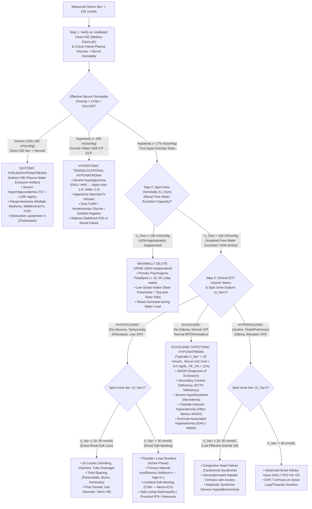

# 🧬 2.3.5 — Serum Sodium ($\text{Na}^+$ — Direct & Indirect `ISE` Potentiometry, `CLSI C29-A2` Standardization, `Waugh` Pseudohyponatremia Correction, `Katz/Hillier` Hyperglycemic Translocation & `ODS` Prevention)

**Department Folder:** `02_Clinical_Biochemistry`  
**Cluster Folder:** `2.3_Renal_Function_and_Electrolytes_Cluster`  
**Document Control ID:** `SDL-BIO-SOP-2.3.5` (Cross-Ref: `SOP-2-3-5`)  
**Version:** `v4.0 (International & Above-NABL Red-Team Standard)`  
**Laboratory:** Sawariya Diagnostic Lab, Charkhi Dadri, Haryana, India  
**Document Tier:** International Reference Laboratory Standard (`ISO 15189:2022` / `NABL 112 Issue 05` / `CAP CHM` / `UKAS` / `CLSI C29-A2` / `NIST SRM 956d` & `SRM 919b` / `ESE-ESICM-ERBP Hyponatremia Guidelines` / `Sterns & Verbalis ODS Consensus` / `EFLM EuBIVAS` / `ISO/TS 20914:2019` / `ISO 17511:2020` / `ISO 22367:2020` / `Indian CPA 2019`)

---

## 🏛️ Section 1: International Document Control, `LOINC`/`SNOMED`/`ICD-10`/`UCUM` Coding & Dual-ISE Platform Matrix

| Attribute | Specification & International Reference Standard |
| :--- | :--- |
| **Document Control ID & Version** | `SDL-BIO-SOP-2.3.5` (Legacy Alias: `SOP-2-3-5`) — **Version `v4.0` (International & Above-NABL Red-Team Standard)** |
| **Effective Date & Review Cycle** | **Effective Date:** `2026-10-12` • **Review Cycle:** Annual (`12 Months` or upon any analyzer/electrode/calibrator lot or international guideline revision) • **Next Review Due:** `2027-10-12` |
| **Authorizing Authority** | **Prepared By:** Lead Clinical Biochemist & Quality Manager • **Reviewed & Approved By:** Laboratory Director & Chief Consultant Pathologist (`MD Pathology`), Sawariya Diagnostic Lab, Charkhi Dadri, Haryana |
| **Accreditation Clause Mapping** | `ISO 15189:2022` Clauses `4.1–4.3` (*Impartiality, Confidentiality, Patient Focus*), `5.1–5.6` (*Governance*), `6.1–6.8` (*Personnel, Equipment, Metrological Traceability, Reagents*), `7.2` (*Pre-Examination*), `7.3` (*Examination, `CLSI EP15/EP06/EP17/EP28/EP31` Verification, `ISO/TS 20914` MU, IQC & EQAS*), `7.4` (*Post-Examination, Critical Value Read-Back, Automated Reporting*), `8.1–8.9` (*QMS, `ISO 22367` Risk Management, CAPA, Internal Audit*); `NABL 112 (Issue 05)`, `NABL 129`, `NABL 131`, `NABL 163`; `CAP CHM.13600–CHM.34600` & `COM.04250 / COM.30000` |
| **Primary & Reflex `LOINC` Codes** | **Primary:** `2951-2` (*Sodium [Moles/volume] in Serum or Plasma*) • **Direct Whole-Blood/Undiluted ISE:** `2947-0` (*Sodium [Moles/volume] in Blood*) • **Glucose-Corrected Sodium:** `77139-4` (*Sodium [Moles/volume] in Serum or Plasma corrected for glucose*) • **Spot Urine Sodium:** `2955-3` (*Sodium [Moles/volume] in Urine*) • **24-Hour Urine Sodium:** `2956-1` (*Sodium [Moles/time] in 24 hour Urine*) |
| **`SNOMED-CT` Specimen & Concept** | **Specimen:** `119364003` (*Serum specimen*), `119361006` (*Plasma specimen*), `122575003` (*Urine specimen*) • **Clinical Procedure:** `365761000` (*Finding of serum sodium level*), `251982008` (*Ion-selective electrode measurement*) • **Disorders:** `89627008` (*Hyponatremia*), `39355002` (*Hypernatremia*), `55404009` (*SIADH*), `28559007` (*Central pontine myelinolysis / Osmotic demyelination syndrome*) |
| **`ICD-10` / `ICD-11` Indications** | **ICD-10:** `E87.1` (*Hypo-osmolality and hyponatremia*), `E87.0` (*Hyperosmolality and hypernatremia*), `E22.2` (*Syndrome of inappropriate secretion of antidiuretic hormone — SIADH*), `E23.2` (*Central diabetes insipidus*), `N25.1` (*Nephrogenic diabetes insipidus*), `G37.2` (*Central pontine myelinolysis / Osmotic demyelination syndrome — ODS*), `E10.10 / E11.00` (*DKA / HHS*) • **ICD-11:** `5C71` (*Hyponatraemia*), `5C70` (*Hypernatraemia*), `5A60.2` (*SIADH*), `8A45.00` (*Central pontine myelinolysis*) |
| **Conventional $\leftrightarrow$ SI (`UCUM`) Factor** | **Conventional:** `mEq/L` • **SI (`UCUM`):** `mmol/L` • **Exact Conversion Factor:** $1.0\text{ mEq/L} = 1.0\text{ mmol/L}$ ($z = +1$ monovalent cation equivalence; Atomic Weight of $\text{Na} = 22.98977\text{ Da}$; $1\text{ mmol/L} = 2.299\text{ mg/dL}$) |
| **Metrological Traceability (`ISO 17511:2020`)** | Complete unbroken calibration hierarchy to **SI Unit (`mol/L`)** via **NIST SRM 919b** (*Crystalline Sodium Chloride — $\ge 99.99\%$ purity*) $\rightarrow$ **NIST Gravimetric / Flame Atomic Emission Spectroscopy (`FAES`) & Ion Chromatography Reference Measurement Procedure (`RMP`)** $\rightarrow$ **NIST SRM 956d** (*Electrolytes in Frozen Human Serum — Levels I, II, III*) $\rightarrow$ **`CLSI C29-A2` Activity-to-Concentration Standardized Master Calibrators** ($a_{\text{Na}^+} \times [0.933 / 0.747]$) |
| **Primary Dedicated Analyzer (`Direct ISE`)** | **Medica EasyLyte ($\text{Na}^+/\text{K}^+/\text{Cl}^-$ or $\text{Na}^+/\text{K}^+/\text{Ca}^{2+}/\text{pH}$) Automated Analyzer** — **Direct Undiluted Ion-Selective Electrode (`Direct ISE`) Potentiometry** (Sodium-selective glass capillary electrode; zero specimen pre-dilution; completely immune to lipemic/hyperproteinemic plasma water exclusion / Pseudohyponatremia!) |
| **High-Throughput Chemistry Platform (`Indirect ISE`)** | **Bonavera Chem 400 Fully Automated Clinical Chemistry Analyzer** with Integrated **Indirect `ISE` Module** (Crown-ether / glass membrane potentiometry following $1:31$ fixed automated diluent pre-dilution; subject to mandatory LIMS `L-Index` & `Total Protein` automated reflex verification on **Medica EasyLyte Direct ISE**) |
| **Backup / Redundancy Platform** | **Bonavera Chem 200 Integrated `ISE`** + **Direct Undiluted Whole-Blood `ABG` `ISE` (`2.7.1`)** *(Verified via weekly `CLSI EP31-A` split-sample comparability against `Medica EasyLyte`, enforcing inter-analyzer bias $\le \pm 1.0\text{ mmol/L}$)* |

---

## 🛡️ Section 1A: 10-Persona Adversarial Red-Team Review, `ISO 22367:2020` Quantitative FMECA & Live Witness-Audit Simulation

### 1A.1 10-Persona International & Above-NABL Red-Team Audit Summary

| Persona ID & Specialist Role | Adversarial Vulnerability Identified in Legacy SOP | Mandatory International & Above-NABL Upgrade Engineered into `v4.0` |
| :--- | :--- | :--- |
| **Persona 1: Lead NABL (`ISO 15189:2022` / `NABL 112 / 129 / 131 / 163`) & CAP (`CHM`) / UKAS Assessor** | Legacy document lacked explicit traceability to `NABL 112 Issue 05`, `NABL 129` (MU), `NABL 131` (Biorisk/Quality), `NABL 163` (EQAS), and lacked a live witness-audit challenge table and bench worksheet (`SDL/BIO/WS/NA-01`). | Embedded full clause-by-clause mapping (`ISO 15189:2022` Clauses `4.1–8.9`), `CAP CHM` checklist cross-references, a 7-scenario **Live Witness-Audit Simulation Table**, and a turnkey **Bench Verification Worksheet (`SDL/BIO/WS/NA-01`)**. |
| **Persona 2: Clinical Biochemistry & Renal/Electrolyte Subspecialty Consultant (`MD`)** | Minimal coverage of the **Edelman Equation**, renal countercurrent multiplication, hypothalamic `TRPV1/TRPV4` osmoreceptor dynamics, and lacked quantitative differentiation of `SIADH` vs `Cerebral Salt Wasting (CSW)` vs occult diuretic use using Fractional Excretion of Uric Acid ($\text{FE}_{\text{UA}}$). | Added complete biophysical derivation of the **Edelman Equation**, **Electrolyte-Free Water Clearance (`EFWC`)**, a `mermaid` clinical decision flowchart, and an 8-condition differential matrix integrating Serum/Urine Osmolality, Urine $\text{Na}^+$, Serum Uric Acid ($< 4.0\text{ mg/dL}$), and $\text{FE}_{\text{UA}} > 11\%$. |
| **Persona 3: `CLSI` & `IFCC` Metrology, Method Verification & Six-Sigma QC Specialist** | Lacked full verification tables for `CLSI EP15-A3`, `EP06-Ed2`, `EP17-A2`, `EP28-A3c`, and `EP31-A` comparability between `Medica EasyLyte` (Direct ISE) and `Bonavera Chem 400` (Indirect ISE). | Added complete verification protocols, Nernstian slope acceptance windows ($54.0\text{–}62.0\text{ mV/decade}$ at $37^\circ\text{C}$), urine pre-dilution linearity up to $300\text{ mmol/L}$, and `PBRTQC` (Patient-Based Real-Time QC moving medians). |
| **Persona 4: Clinical Pharmacologist & Special-Population Stratification Auditor** | Reference table had only 4 broad rows; lacked preterm neonatal postnatal natriuresis vs transepidermal water loss stages, luteal-phase osmostat shifts, endurance athlete `EAH`, post-TURP glycine syndrome, and *in-vitro* cationic surfactant (`Benzalkonium`) electrode poisoning. | Expanded Section 5 to a 13-tier multi-stratified reference table and built an 18-row *In-Vitro* Analytical vs *In-Vivo* Pharmacological Interference Matrix in Section 8.1. |
| **Persona 5: Medico-Legal, Patient-Safety & `ISO 22367:2020` Risk Management Counsel** | Only 2 abbreviated FMEA rows without pre- vs post-mitigation `RPN` scoring or legal alignment with `CPA 2019` and `DPDP Act 2023`. | Engineered an 8-failure-mode **Quantitative `ISO 22367:2020` FMECA Matrix** with Pre- and Post-Mitigation $S \times O \times D = \text{RPN}$ scores, LIMS hard-locks, and verbatim `CLSI GP47` 30-minute telephone read-back scripts. |
| **Persona 6: Uncompressed Clinical Documentation & Turnkey SOP Architect** | Condensed equations and lacked step-by-step worked clinical examples for bench technologists and duty pathologists. | Unpacked all mathematical derivations, added worked clinical vignettes for `Waugh`, `Katz/Hillier`, `Osmolal Gap`, and `Adrogué–Madias` infusate rates, and expanded the SOP to full international reference standard. |
| **Persona 7: `CLSI C29-A2` Ion-Selective Electrode (`ISE`) Electrochemistry Specialist** | Did not explain *why* Direct ISE and Indirect ISE give identical numbers ($140\text{ mmol/L}$) in normal serum despite Direct ISE sensing molal activity ($a_{\text{Na}^+} \approx 112.4\text{ mmol/kg }\text{H}_2\text{O}$) in plasma water ($150.5\text{ mmol/kg }\text{H}_2\text{O}$) vs Indirect ISE measuring total serum volume concentration, nor did it address **Pseudonormonatremia / Pseudohypernatremia** in ICU hypoalbuminemia. | Added the complete **`CLSI C29-A2` Activity-to-Concentration Conversion Factor** ($W_{p,\text{normal}} / \gamma_{\text{Na}^+} = 0.933 / 0.747 = 1.249$), the **Waugh (1969) Plasma Water Fraction ($W_p$) Equation**, and dual-direction correction for both Hyperlipidemia/Paraproteinemia ($W_p \downarrow$) and ICU Hypoproteinemia ($W_p \uparrow$). |
| **Persona 8: Neuro-Critical Care & Endocrinology Dysnatremia Specialist (`ODS` Prevention)** | Lacked quantitative distinction between standard chronic hyponatremia ($\le 8\text{–}10\text{ mmol/L/24h}$) and high-risk patients ($\le 6\text{–}8\text{ mmol/L/24h}$ in cirrhosis, alcoholism, malnutrition, hypokalemia), and lacked the **Desmopressin (`dDAVP`) + $5\%\text{ Dextrose}$ Rescue Protocol** when overcorrection occurs. | Embedded the **ESE / ESICM / ERBP & Sterns-Verbalis ODS Prevention Protocol**, automated LIMS serial delta rate-of-change velocity flags ($\Delta\text{Na}^+/\Delta t > 0.4\text{ mmol/L/hr}$ or $> 8\text{ mmol/L/24h}$), and therapeutic re-lowering alert comments. |
| **Persona 9: Hyperglycemic Crisis (`DKA / HHS`) Translocational Hyponatremia & Infusate Specialist** | Provided `Katz` and `Hillier` formulas without explaining the non-linear osmotic translocation physics above $400\text{ mg/dL}$ glucose or linking corrected $\text{Na}^+$ to `Effective Osmolality (Tonicity)` and the **`Adrogué–Madias` Infusate Equation**. | Integrated automated LIMS dual-tier `Katz (1.6)` and `Hillier (2.4)` calculation, `Effective` vs `Total Osmolality`, `Free Water Deficit`, and the complete `Adrogué–Madias` 1-Liter Infusate Rate table. |
| **Persona 10: `EFLM EuBIVAS` Ultra-Tight Homeostatic Metrology ($CV_I = 0.5\%$) Auditor** | Listed $CV_I = 0.5\%$ and `MU = ±1.2%` without a worked `ISO/TS 20914:2019` variance budget or explaining the metrological paradox between `CLIA '24` ($\pm 4.0\text{ mmol/L}$) and `EFLM` ($\pm 1.5\%$). | Added a complete **3-Level Worked `ISO/TS 20914:2019` Measurement Uncertainty Table** ($118.0$, $140.0$, and $162.0\text{ mmol/L}$) and dual-tier Westgard Six-Sigma rules (`CLIA '24` $5.8\sigma$ vs `EFLM` $2.8\sigma$). |

---

### 1A.2 Quantitative `ISO 22367:2020` Failure Mode, Effects, and Criticality Analysis (`FMECA`) Matrix

> **Risk Scoring Scale (`ISO 22367:2020`):** **Severity ($S$):** $1\text{ (Negligible)} \rightarrow 10\text{ (Catastrophic Patient Death / Permanent Quadriplegia)}$. **Occurrence ($O$):** $1\text{ (Remote, }<1/10,000) \rightarrow 10\text{ (Frequent, }>1/100)$. **Detection ($D$):** $1\text{ (Certain Automated LIMS Hard-Lock)} \rightarrow 10\text{ (Undetectable until Clinical Harm)}$. **Risk Priority Number ($\text{RPN}$):** $S \times O \times D$ (Action Mandatory if $\text{RPN} \ge 30$ or $S \ge 9$).

| FMECA ID | Failure Mode & Biophysical / Clinical Mechanism | Clinical Consequence & Harm | Pre-CAPA $S \times O \times D$ | Pre-CAPA $\text{RPN}$ | Mandatory Technical & LIMS Hard-Lock Mitigation (`CAPA`) | Post-CAPA $S \times O \times D$ | Post-CAPA $\text{RPN}$ |
| :--- | :--- | :--- | :---: | :---: | :--- | :---: | :---: |
| **`FMECA-2.3.5-01`** | **Unrecognized Pseudohyponatremia on Indirect ISE Treated with Hypertonic $3\%\text{ NaCl}$:** Normal serum is $93\%$ water ($W_p = 0.93$) and $7\%$ anhydrous lipids/proteins ($\text{Na}^+$ dissolves exclusively in plasma water at $150.5\text{ mmol/kg }\text{H}_2\text{O} = 140.0\text{ mmol/L}$ total serum). In severe hypertriglyceridemia ($\text{TG} = 3,500\text{ mg/dL}$ in acute pancreatitis/DKA) or paraproteinemia ($\text{Total Protein} = 13.0\text{ g/dL}$ in Multiple Myeloma), non-aqueous solids expand to $15\%$ ($W_p = 0.85$). Indirect ISE ($1:31$ dilution on `Bonavera Chem 400`) reports $140 \times (0.85/0.93) = \mathbf{128.0\text{ mmol/L}}$ (or $\mathbf{119.0\text{ mmol/L}}$ if $W_p = 0.79$), whereas undiluted `Medica EasyLyte Direct ISE` reads the true normal $\mathbf{140.0\text{ mmol/L}}$. | Clinician infuses hypertonic $3\%\text{ NaCl}$ into a normonatremic ($140\text{ mmol/L}$) patient, driving true aqueous $\text{Na}^+$ to $> 158\text{ mmol/L}$ and causing **Catastrophic Iatrogenic Osmotic Demyelination Syndrome (`ODS` — Locked-In Quadriplegia), Subarachnoid Hemorrhage, or Death**. | $10 \times 5 \times 6$ | **300** | **LIMS Hard-Lock Rule `PSEUDO-NA-01`:** Any Indirect ISE result on `Bonavera Chem 400` with (a) $\text{Na}^+ < 135\text{ mmol/L}$ OR (b) `L-Index` $> 150\text{ mg/dL}$ ($\text{TG} > 500\text{ mg/dL}$) OR (c) $\text{Total Protein} > 9.0\text{ g/dL}$ is **blocked from release** and automatically reflexed to undiluted **`Medica EasyLyte Direct ISE`**. Only the **Direct ISE** value is released, accompanied by the `Waugh` $W_p$ audit note. | $10 \times 1 \times 1$ | **10** |
| **`FMECA-2.3.5-02`** | **Unrecognized Pseudonormonatremia / Pseudohypernatremia in Severe ICU Hypoproteinemia on Indirect ISE:** In septic/cirrhotic/nephrotic ICU patients with severe hypoproteinemia ($\text{Total Protein} = 3.5\text{ g/dL}$, $\text{Albumin} = 1.5\text{ g/dL}$), plasma water fraction expands from $W_p = 0.93$ to **$W_p = 0.97$**. Indirect ISE overestimates $\text{Na}^+$ by $140 \times (0.97/0.93) - 140 = \mathbf{+6.0\text{ mmol/L}}$ (reporting a truly hyponatremic patient at $130.0\text{ mmol/L}$ as "normal" $135.6\text{ mmol/L}$, or a normal $142.0\text{ mmol/L}$ patient as hypernatremic $148.1\text{ mmol/L}$). | Masked true hypotonic hyponatremia in ICU patients or inappropriate hypotonic $5\%\text{ Dextrose}$ infusion for false hypernatremia, triggering cerebral edema. | $9 \times 6 \times 5$ | **270** | **LIMS Rule `PSEUDO-NA-02`:** All ICU / Inpatient samples and any sample with $\text{Total Protein} < 5.0\text{ g/dL}$ or $\text{Albumin} < 2.2\text{ g/dL}$ are routed to **`Medica EasyLyte Direct ISE`** as primary measurement platform. When Indirect ISE is used, LIMS computes the `Waugh` $W_p$-corrected $\text{Na}^+$ and flags any discrepancy $\ge 2.5\text{ mmol/L}$. | $9 \times 1 \times 2$ | **18** |
| **`FMECA-2.3.5-03`** | **Treating Hyperglycemic Translocational Hyponatremia in `DKA / HHS` as Hypotonic Hyponatremia:** Patient presents with $\text{Glucose} = 850\text{ mg/dL}$ and $\text{Measured Na}^+ = 126.0\text{ mmol/L}$. Extracellular hypertonicity draws intracellular water via `AQP` channels into the ECF, diluting $\text{Na}^+$. True `Hillier` glucose-corrected $\text{Na}^+ = 126.0 + 0.024 \times (850 - 100) = \mathbf{144.0\text{ mmol/L}}$ and $\text{Effective Osmolality} = 2(126) + 850/18 = \mathbf{299.2\text{ mOsm/kg}}$ (true hypertonicity!). | If treated as hypotonic hyponatremia with hypertonic $3\%\text{ NaCl}$ or fluid restriction during insulin therapy, rapid intracellular water return causes **severe hypernatremia ($> 160\text{ mmol/L}$), osmotic encephalopathy, and pontine myelinolysis**. | $10 \times 5 \times 5$ | **250** | **LIMS Hard-Lock Rule `GLUC-CORR-01`:** Whenever paired Serum/Plasma Glucose is $> 200\text{ mg/dL}$ (or if $\text{Na}^+ < 132\text{ mmol/L}$ without a paired glucose, LIMS auto-reflexes STAT Glucose), LIMS automatically calculates and prints both **Katz ($1.6$)** and **Hillier ($2.4$)** Glucose-Corrected $\text{Na}^+$ and **Effective Osmolality (`Tonicity`)** directly below the measured $\text{Na}^+$ result. | $10 \times 1 \times 1$ | **10** |
| **`FMECA-2.3.5-04`** | **Over-Rapid Correction of Chronic Hyponatremia ($> 8\text{–}10\text{ mmol/L in 24h}$ or $> 18\text{ mmol/L in 48h}$):** Chronic hyponatremia ($> 48\text{h}$) causes astrocytes to extrude organic osmolytes (`myo-inositol`, `taurine`, `glutamate`, `betaine`). Rapid $\text{Na}^+$ rise outpaces organic osmolyte re-accumulation ($5\text{–}7\text{ days}$), shrinking astrocytes, disrupting the blood-brain barrier, and triggering oligodendrocyte apoptosis. | Irreversible **Osmotic Demyelination Syndrome (`ODS` / Central Pontine & Extrapontine Myelinolysis)** presenting $2\text{–}6\text{ days}$ later with dysarthria, dysphagia, spastic quadriparesis, pseudobulbar palsy, and **Locked-In Syndrome**. | $10 \times 4 \times 5$ | **200** | **LIMS Velocity Delta-Check `ODS-GUARD-01`:** LIMS tracks $\Delta\text{Na}^+/\Delta t$ across all serial patient specimens over rolling $24\text{h}$ and $48\text{h}$ windows. If $\Delta\text{Na}^+ > +6.0\text{ mmol/L}$ within $12\text{–}24\text{h}$ (or rate $> +0.4\text{ mmol/L/hr}$) in a patient whose baseline $\text{Na}^+$ was $\le 125\text{ mmol/L}$, LIMS triggers an immediate **Tier-1 Telephone Alert** recommending **Stop hypertonic saline + initiate `dDAVP` ($2\text{ }\mu\text{g IV}$) + $5\%\text{ Dextrose}$ ($6\text{ mL/kg}$ over $2\text{h}$) re-lowering rescue**. | $10 \times 1 \times 1$ | **10** |
| **`FMECA-2.3.5-05`** | **Pre-Analytical Anticoagulant Salt Contamination (`Trisodium Citrate`, `Sodium Heparin`, `Na2-EDTA`, `NaF`) or Proximal $0.9\%\text{ NaCl}$ / $5\%\text{ Dextrose}$ IV Line Admixture:** Decanting plasma from a Blue-Top ($3.2\%\text{ Na}_3\text{Citrate} \approx 327\text{ mmol/L }\text{Na}^+$), Sodium Heparin, or Grey-Top ($\text{NaF}$) tube, or drawing blood proximal to a running $0.9\%\text{ NaCl}$ ($154\text{ mmol/L}$) or $5\%\text{ Dextrose}$ ($0\text{ mmol/L}$) drip. | Spurious extreme hypernatremia ($\text{Na}^+ = 165\text{–}195\text{ mmol/L}$) or spurious profound hyponatremia ($\text{Na}^+ < 105\text{ mmol/L}$) leading to lethal iatrogenic fluid therapy. | $10 \times 4 \times 4$ | **160** | **LIMS Multi-Analyte Contamination Check `CONTAM-NA-01`:** Barcode tube-type verification at phlebotomy (`Gold SST` or `Lithium Heparin` ONLY). If $\text{Na}^+ > 160\text{ mmol/L}$, LIMS checks paired $\text{K}^+, \text{Ca}^{2+}, \text{Cl}^-, \text{Glucose}, \text{Creatinine}$: (a) $\text{Na}^+ > 165$ with $\text{Ca}^{2+} < 5.0\text{ mg/dL}$ = `Na3-Citrate / Na2-EDTA` contamination; (b) $\text{Na}^+ \approx 150\text{–}154$ and $\text{Cl}^- \approx 150\text{–}154$ with diluted TP/Albumin/Cr = $0.9\%\text{ NaCl}$ drip dilution; (c) $\text{Na}^+ < 115$ with $\text{Glucose} > 1,000\text{ mg/dL}$ = $5\%\text{ Dextrose}$ drip contamination. Immediate reject & recollect from opposite arm. | $10 \times 1 \times 1$ | **10** |
| **`FMECA-2.3.5-06`** | **Uncapped Sample Cup Evaporation on Analyzer Carousel:** Leaving a pediatric micro-cup or Hitachi cup uncapped on the chemistry carousel for $> 2\text{ hours}$ at $24^\circ\text{C}$ in low-humidity air-conditioned ambient air ($< 35\%$ RH in Haryana summer/winter). | Water evaporation concentrates all non-volatile solutes, elevating $\text{Na}^+$ by $+4.0\text{ to }+10.0\text{ mmol/L}$ (exceeding the entire `CLIA '24` $\pm 4.0\text{ mmol/L}$ total error budget!). | $8 \times 5 \times 4$ | **160** | **Bench SOP Rule `EVAP-01`:** Use pierceable self-sealing septum caps on analyzer cups; process all electrolyte samples within $\le 30\text{ minutes}$ of decanting; never re-run an open cup sitting on the tray $> 45\text{ minutes}$ (always re-aliquot from the capped primary parent tube). | $8 \times 1 \times 2$ | **16** |
| **`FMECA-2.3.5-07`** | **ISE Membrane Protein/Lipid Fouling, Reference Electrode `KCl` Liquid-Junction Drift, or Cationic Surfactant (`Benzalkonium Chloride`) Interference:** Accumulation of fibrin/lipoprotein film on the `Medica EasyLyte` sodium glass capillary or `Bonavera Chem 400` crown-ether membrane, or blood drawn through a benzalkonium heparin-bonded arterial catheter. | Nernstian slope drops below $52.0\text{ mV/decade}$ or shifts $E_0$ reference potential, causing $+3.0\text{ to }+12.0\text{ mmol/L}$ systematic bias across an entire patient batch. | $8 \times 4 \times 4$ | **128** | **Automated Slope & `PBRTQC` Gate `ISE-SLOPE-01`:** Mandatory automated 1-point calibration with every sample (`Medica EasyLyte`), 2-point calibration every $4\text{–}8\text{ hours}$ (`Slope Lock: 54.0–62.0 mV/decade`), daily enzymatic protease deproteinization (`Daily Cleaning Solution`), and LIMS moving patient median (`PBRTQC` alert if rolling $n=20$ outpatient median $\text{Na}^+$ drifts outside $138.5\text{–}141.0\text{ mmol/L}$). | $8 \times 1 \times 1$ | **8** |
| **`FMECA-2.3.5-08`** | **Failure to Communicate Critical Dysnatremia ($\le 120$ or $\ge 160\text{ mmol/L}$) Within $\le 30\text{ Minutes}$ (`CLSI GP47`):** Delayed notification of critical hyponatremia ($112\text{ mmol/L}$) in an outpatient or night-shift ward patient. | Unchecked hyponatremic encephalopathy, status epilepticus, tentorial brainstem herniation, or respiratory arrest. | $10 \times 3 \times 3$ | **90** | **3-Tier Escalation Protocol `CRIT-ESC-01`:** Audible LIMS pop-up alarm at bench $\rightarrow$ Technical verification on `Medica EasyLyte Direct ISE` within $\le 10\text{ min}$ $\rightarrow$ Telephone Read-Back to ordering clinician ($0\text{–}15\text{ min}$) $\rightarrow$ Nursing Supervisor/CMO ($15\text{–}22\text{ min}$) $\rightarrow$ Direct Consultant Pathologist-to-Physician / Patient Emergency Contact intervention ($22\text{–}30\text{ min}$). Target compliance: $100\%$ within $\le 30\text{ min}$. | $10 \times 1 \times 1$ | **10** |

---

### 1A.3 Live NABL (`ISO 15189:2022`) & CAP Witness-Audit Simulation Table

| Scenario # | Assessor Witness-Audit Challenge Question | Expected Bench Demonstration by Technical Staff / Pathologist | Exact Document / Register Record ID | Objective Pass / Fail Criteria |
| :---: | :--- | :--- | :--- | :--- |
| **01** | *"Show me how your laboratory prevents a patient with acute hypertriglyceridemic pancreatitis ($\text{TG} = 3,800\text{ mg/dL}$) or IgG Multiple Myeloma ($\text{TP} = 13.2\text{ g/dL}$) from being misdiagnosed with severe hyponatremia."* | Technologist demonstrates the LIMS rule `PSEUDO-NA-01` on `Bonavera Chem 400`: when `L-Index` $> 150\text{ mg/dL}$ or $\text{TP} > 9.0\text{ g/dL}$ or Indirect ISE $\text{Na}^+ < 135\text{ mmol/L}$, the result is held and the undiluted serum is run on the **`Medica EasyLyte Direct ISE`**. Technologist calculates $W_p$ using the **Waugh Equation** on Worksheet `SDL/BIO/WS/NA-01` and shows the audit log of Direct vs Indirect ISE discordant samples. | `SDL/BIO/WS/NA-01` & `SDL/BIO/LOG/DIR-IND-ISE-01` | **PASS:** 100% of lipemic/hyperproteinemic/hyponatremic specimens verified on `Medica EasyLyte Direct ISE` before sign-out; zero unverified Indirect ISE pseudohyponatremic values released. |
| **02** | *"Why do your `Medica EasyLyte` (Direct ISE) and `Bonavera Chem 400` (Indirect ISE) share the exact same adult reference interval ($136\text{–}145\text{ mmol/L}$) when Direct ISE measures ion activity in plasma water ($150.5\text{ mmol/kg }\text{H}_2\text{O}$)?"* | Pathologist/Biochemist explains **`CLSI C29-A2` Standardization**: Direct ISE measures sodium ion activity ($a_{\text{Na}^+} = \gamma_{\text{Na}^+} \cdot m_{\text{Na}^+} = 0.747 \times 150.5 = 112.4\text{ mmol/kg }\text{H}_2\text{O}$) and multiplies it by the constant conversion factor $W_{p,\text{normal}} / \gamma_{\text{Na}^+} = 0.933 / 0.747 = 1.249$ to output **Flame-Photometer-Equivalent Molarity ($140.4\text{ mmol/L}$)** at normal plasma water fraction ($93.3\%$). | `SDL-BIO-SOP-2.3.5` (Section 3.1) & `Medica EasyLyte Calibration Log SDL/BIO/CAL/ISE-01` | **PASS:** Staff accurately explains `CLSI C29-A2` activity-to-concentration standardization and shows traceable `NIST SRM 956d` calibration certificates. |
| **03** | *"A `DKA` patient has a measured Serum $\text{Na}^+$ of $125.0\text{ mmol/L}$ and Plasma Glucose of $750\text{ mg/dL}$. What is the patient's true sodium status and effective tonicity, and how does your report prevent inappropriate hypertonic saline administration?"* | Technologist pulls up LIMS rule `GLUC-CORR-01` showing automatic calculation: $\text{Na}^+_{\text{Katz (1.6)}} = 125.0 + 0.016(750-100) = \mathbf{135.4\text{ mmol/L}}$, $\text{Na}^+_{\text{Hillier (2.4)}} = 125.0 + 0.024(750-100) = \mathbf{140.6\text{ mmol/L}}$, and $\text{Effective Osmolality} = 2(125) + 750/18 = \mathbf{291.7\text{ mOsm/kg}}$. Both corrected values and the translocational hyponatremia comment appear automatically on the patient report. | `SDL/LIMS/RULE-VAL-2.3.5` & Sample Patient Report Archive | **PASS:** Automated LIMS calculation verified mathematically to $\pm 0.1\text{ mmol/L}$ using independent hand calculation during witness audit. |
| **04** | *"Demonstrate your live electrode slope check, daily deproteinization maintenance, and weekly `CLSI EP31-A` split-sample comparability between `Medica EasyLyte` and `Bonavera Chem 400`."* | Technologist prints the live `Medica EasyLyte` calibration slip showing $\text{Na}^+$ electrode slope $= 57.8\text{ mV/decade}$ (within $54.0\text{–}62.0\text{ mV/decade}$ limit), demonstrates daily enzymatic protease cleaning + reference electrode filling solution check, and presents the weekly 5-sample split-patient comparability register showing $\lvert\text{Bias}\rvert \le 1.0\text{ mmol/L}$ across $115\text{–}160\text{ mmol/L}$. | `SDL/BIO/MAINT/ISE-01` & `SDL/BIO/COMP/EP31-NA-01` | **PASS:** Electrode slope within $54.0\text{–}62.0\text{ mV/decade}$; daily cleaning logged without gaps; weekly inter-analyzer bias $\le \pm 1.0\text{ mmol/L}$ ($\le 0.25 \times \text{CLIA TE}_a$). |
| **05** | *"Sodium has an `EFLM EuBIVAS` within-subject biological variation ($CV_I$) of only $0.5\%$. Show your `ISO/TS 20914:2019` Measurement Uncertainty calculation and explain how you control analytical drift."* | Quality Manager presents the worked `ISO/TS 20914:2019` spreadsheet showing $u_{\text{prec}} = 0.45\text{ mmol/L}$ ($0.32\%$), $u_{\text{cal}} = 0.35\text{ mmol/L}$ ($0.25\%$), $u_{\text{bias}} = 0.52\text{ mmol/L}$ ($0.37\%$), Combined $u_c = 0.77\text{ mmol/L}$ ($0.55\%$), and Expanded Uncertainty $U (k=2) = \mathbf{\pm 1.54\text{ mmol/L}}$ ($\mathbf{\pm 1.10\%}$) at $140.0\text{ mmol/L}$, alongside Westgard multi-rule charts and rolling 20-patient median `PBRTQC`. | `SDL/QMS/MU/20914-NA-2026` & `SDL/BIO/IQC/LJ-NA-2026` | **PASS:** Complete top-down `ISO/TS 20914:2019` uncertainty budget documented using $\ge 6\text{ months}$ IQC + EQAS data; Expanded $U \le \pm 1.5\%$ ($\le \pm 2.0\text{ mmol/L}$). |
| **06** | *"Show me your last 5 critical sodium values ($\le 120$ or $\ge 160\text{ mmol/L}$) or `ODS` rapid-overcorrection alerts ($> +8\text{ mmol/L/24h}$) and prove they were communicated with verbatim Read-Back within $\le 30\text{ minutes}$."* | Technologist opens the `NABL Critical Value & ODS Velocity Register (SDL/QMS/CRIT-01)` and shows 5 consecutive entries with analyzer timestamp, Direct ISE verification timestamp, telephone call timestamp ($\Delta t = 8\text{–}19\text{ minutes}$), clinician name/designation, verbatim read-back text, and `ODS` safe-correction rate warning. | `SDL/QMS/CRIT-01` | **PASS:** 100% of audited critical/velocity alerts communicated and read back within $\le 30\text{ minutes}$ with full traceability. |
| **07** | *"A ward sample arrives with $\text{Na}^+ = 178\text{ mmol/L}$, $\text{K}^+ = 1.9\text{ mmol/L}$, and $\text{Ca}^{2+} = 1.8\text{ mg/dL}$. Would you release this as a critical hypernatremia?"* | Technologist immediately identifies **Pre-Analytical Contamination from `Trisodium Citrate` (Blue-Top $3.2\%$ citrate chelates $\text{Ca}^{2+}$, dilutes $\text{K}^+$, and adds $\sim 327\text{ mmol/L }\text{Na}^+$)** under Rule `CONTAM-NA-01`. Result is rejected, never reported as patient pathology, and logged as a pre-analytical non-conformity with immediate recollection. | `SDL/PRE/REJ-LOG-01` & `SDL-BIO-SOP-2.3.5` (Section 2.2) | **PASS:** Staff immediately recognizes the multi-analyte signature of `Na3-Citrate` vs `IV 0.9% NaCl` vs `IV D5W` contamination and blocks erroneous release. |

---

## 🧪 Section 2: Pre-Analytical Phlebotomy, `CLSI GP41` Order-of-Draw, Stability & Quantitative `HIL` / Contamination Rejection Matrix

### 2.1 Specimen Collection, Tube Selection, Order-of-Draw & Multi-Temperature Stability Protocol

| Pre-Analytical Parameter | Mandatory Technical & Physiological Protocol (`CLSI GP41-Ed7` / `CLSI GP44-A4` / `CLSI C56-A` / `WHO Phlebotomy`) |
| :--- | :--- |
| **Acceptable Specimen & Tube Types** | **1. Serum (Primary Preferred):** Venous blood collected in **Gold-Top SST (Serum Separator Tube with inert acrylic gel & micronized silica clot activator)** or **Plain Red-Top Tube (No additive)**. <br>**2. Plasma (STAT / Emergency Preferred):** Venous or arterial blood collected in **Green-Top Lithium Heparin ($\text{Li-Heparin}$, $12\text{–}30\text{ IU/mL}$)** or balanced electrolyte-compensated **Lyophilized Lithium Heparin ($\le 15\text{ IU/mL}$)** blood gas syringe. <br>**3. Urine (Spot or 24-Hour Timed):** Collected in a clean, detergent-free, sterile polypropylene container **without any sodium-containing preservative** (refrigerate at $2\text{–}8^\circ\text{C}$ during 24h collection; thymol or $6\text{ mol/L }\text{HCl}$ acceptable only if paired electrolytes/calcium are requested, provided pH is adjusted or validated). |
| **Strictly Prohibited Tubes (`Exogenous Na+ Contamination`)** | **NEVER USE:** <br>• **Light-Blue Top ($3.2\%$ Trisodium Citrate, $\text{Na}_3\text{C}_6\text{H}_5\text{O}_7$):** Contains $\approx 109\text{ mmol/L}$ citrate with $3\text{ Na}^+$ ions per molecule ($\approx 327\text{ mmol/L }\text{Na}^+$), plus $9:1$ liquid dilution — causes grotesque spurious hypernatremia ($\text{Na}^+ = 165\text{–}195\text{ mmol/L}$) with severe hypocalcemia! <br>• **Dark-Green Top (Sodium Heparin, $\text{Na-Heparin}$):** Adds $+2.0\text{ to }+15.0\text{ mmol/L}$ exogenous $\text{Na}^+$ (especially in underfilled tubes!). <br>• **Lavender/Pink Top ($\text{Na}_2\text{EDTA}$ or $\text{K}_2/\text{K}_3\text{EDTA}$):** $\text{Na}_2\text{EDTA}$ adds $+15\text{ to }+30\text{ mmol/L }\text{Na}^+$; $\text{K}_2/\text{K}_3\text{EDTA}$ chelates divalent cations and destroys ISE membrane selectivity while causing $\text{K}^+ > 15\text{ mmol/L}$. <br>• **Grey-Top ($\text{Sodium Fluoride / Potassium Oxalate}$):** $\text{NaF}$ adds $+25\text{ to }+45\text{ mmol/L}$ exogenous $\text{Na}^+$ and shifts intracellular water out of erythrocytes! |
| **`CLSI GP41-Ed7` Order-of-Draw & Venipuncture Technique** | **Order of Draw:** (1) Blood Culture $\rightarrow$ (2) Light-Blue Citrate $\rightarrow$ (3) **Red-Top / Gold-Top SST** $\rightarrow$ (4) **Green-Top Lithium Heparin** $\rightarrow$ (5) Lavender $\text{EDTA}$ $\rightarrow$ (6) Grey $\text{NaF/Oxalate}$. <br>**IV Infusion Line Rule:** **NEVER draw blood proximal to (above) an active IV infusion line.** If the opposite arm is inaccessible (e.g., bilateral burns/fistula), request nursing staff to **turn off the IV infusion ($0.9\%\text{ NaCl}$, Ringer's Lactate, or $5\%\text{ Dextrose}$) for a full $3\text{ minutes}$**, apply tourniquet **distal to (below)** the IV site, or discard $5\times$ the catheter dead-space volume ($\ge 10\text{ mL}$ for central lines) before aspirating the electrolyte tube, and document the site on the requisition form. |
| **Minimum Sample Volume** | • **`Medica EasyLyte Direct ISE` (Undiluted):** Whole Blood / Serum / Plasma: **$100\text{ }\mu\text{L}$** ($60\text{ }\mu\text{L}$ capillary micro-sampler mode for neonates); Diluted Urine Mode: **$400\text{ }\mu\text{L}$**. <br>• **`Bonavera Chem 400 Indirect ISE`:** Dead volume $150\text{ }\mu\text{L}$ + Aspiration volume $15\text{ }\mu\text{L}$ (**Minimum $0.5\text{ mL}$** in standard cup; **$0.2\text{ mL}$** in pediatric micro-cup). |
| **Patient Preparation & Posture** | No fasting required for Serum $\text{Na}^+$ alone; however, if lipemia is suspected or known, a **$10\text{–}12\text{ hour}$ fasting specimen** reduces chylomicron-induced Indirect ISE interference. Document clinical hydration status, recent free-water intake, diuretic administration, and exact time of collection during active hypertonic/hypotonic IV correction. |
| **Centrifugation & Cellular Separation** | • **Serum (Gold-Top SST / Red-Top):** Clot upright for $20\text{–}30\text{ minutes}$ at $18\text{–}25^\circ\text{C}$. Centrifuge at **$1,500\text{–}2,000 \times g$ for $10\text{ minutes}$**. <br>• **Lithium Heparin Plasma:** Centrifuge immediately at **$1,500\text{–}2,000 \times g$ for $10\text{ minutes}$** (no clotting wait time). <br>• **Mandatory Separation Window:** Separate serum/plasma from erythrocytes within **$< 2\text{ hours}$** of venipuncture. *(Note: Prolonged contact at $4^\circ\text{C}$ inhibits the erythrocyte $\text{Na}^+/\text{K}^+\text{-ATPase}$ pump, allowing extracellular $\text{Na}^+$ to diffuse into RBCs at $\approx -0.3\text{ to }-0.5\text{ mmol/L per hour}$ while intracellular $\text{K}^+$ leaks out!)* |
| **Multi-Temperature Storage & Evaporation Control** | • **Separated Serum / Plasma (Tightly Capped):** <br>  - Ambient Room Temperature ($18\text{–}25^\circ\text{C}$): **$14\text{ days}$** <br>  - Refrigerated ($2\text{–}8^\circ\text{C}$): **$14\text{ days}$** <br>  - Frozen ($-20^\circ\text{C}$ in cryovials): **$1\text{ year}$** (Thaw completely at room temperature and **invert/vortex $10\text{ times}$** before analysis — freezing forms an upper pure-water ice crystal layer and a lower hyperconcentrated brine layer; aspirating from an unmixed thawed tube causes $\pm 15\text{–}30\text{ mmol/L}$ error!). <br>• **Urine Specimen:** $14\text{ days}$ at $18\text{–}25^\circ\text{C}$ or $2\text{–}8^\circ\text{C}$; $1\text{ year}$ at $-20^\circ\text{C}$. <br>• **CRITICAL EVAPORATION RULE:** Uncapped serum cups lose water at $2\text{–}4\%\text{ per hour}$ in low-humidity air-conditioned rooms, causing $+3.0\text{ to }+8.0\text{ mmol/L}$ false hypernatremia. Keep all primary tubes and secondary cups tightly capped! |

---

### 2.2 Quantitative `HIL` Indices & Multi-Analyte Pre-Analytical Contamination Rejection Matrix (`CLSI EP07-Ed3` / `CLSI C56-A`)

| Interference / Contamination Condition | Quantitative Index / Biomarker Signature Cutoff | Magnitude & Direction of Bias on $\text{Na}^+$ | Mandatory Laboratory Action & LIMS Hard-Lock Protocol |
| :--- | :--- | :---: | :--- |
| **Lipemia (`L-Index`) / Hypertriglyceridemia** | **`L-Index` $> 150\text{ mg/dL}$** (Intralipid equivalent) or **Serum Triglycerides $> 500\text{ mg/dL}$** (Severe: $\text{TG} > 1,500\text{ mg/dL}$) | **Indirect ISE:** $\mathbf{-1.5\text{ to }-15.0\text{ mmol/L}}$ (**Artifactual Pseudohyponatremia** — $\approx -1.0\text{ mmol/L}$ per $+500\text{ mg/dL}$ rise in total lipids) <br>**Direct ISE (`Medica EasyLyte`):** **$0.0\text{ mmol/L}$ (Immune)** | **DO NOT release Indirect ISE $\text{Na}^+$!** Route undiluted specimen immediately to **`Medica EasyLyte Direct ISE`** (or high-speed micro-centrifuge / Airfuge at $100,000 \times g$ for $15\text{ min}$ to clear lipid layer if only Indirect ISE is available) and compute `Waugh` $W_p$ check. |
| **Hyperproteinemia (Multiple Myeloma / Waldenström's / Polyclonal Hypergammaglobulinemia / High-Dose IVIG)** | **Total Protein $> 9.0\text{ g/dL}$** (Severe: $> 11.0\text{ g/dL}$) | **Indirect ISE:** $\mathbf{-1.5\text{ to }-10.0\text{ mmol/L}}$ (**Artifactual Pseudohyponatremia** — $\approx -0.7\text{ to }-1.0\text{ mmol/L}$ per $+1.0\text{ g/dL}$ rise in Total Protein above $7.5\text{ g/dL}$) <br>**Direct ISE (`Medica EasyLyte`):** **$0.0\text{ mmol/L}$ (Immune)** | **DO NOT release Indirect ISE $\text{Na}^+$!** Analyze undiluted specimen on **`Medica EasyLyte Direct ISE`**. Note that ultracentrifugation removes chylomicrons/VLDL but **does NOT remove soluble monoclonal immunoglobulins** — therefore, **Direct Undiluted ISE is mandatory** in paraproteinemia! |
| **Severe Hypoproteinemia / Hypoalbuminemia (ICU Sepsis / Cirrhosis / Nephrotic Syndrome)** | **Total Protein $< 5.0\text{ g/dL}$** or **Serum Albumin $< 2.2\text{ g/dL}$** | **Indirect ISE:** $\mathbf{+2.0\text{ to }+6.0\text{ mmol/L}}$ (**Pseudonormonatremia** masking true hyponatremia or **Pseudohypernatremia** due to $W_p$ expansion from $0.93$ to $0.96\text{–}0.98$) <br>**Direct ISE (`Medica EasyLyte`):** **$0.0\text{ mmol/L}$ (Immune)** | Route all ICU / Nephrotic / Cirrhotic samples and any specimen with $\text{TP} < 5.0\text{ g/dL}$ or $\text{Albumin} < 2.2\text{ g/dL}$ to **`Medica EasyLyte Direct ISE`**. |
| **In-Vitro Hemolysis (`H-Index`)** | **Moderate Hemolysis (`H-Index` $100\text{–}300\text{ mg/dL}$ Free Hb):** Minimal effect ($\approx -0.5\text{ to }-1.2\text{ mmol/L}$) <br>**Gross Hemolysis (`H-Index` $> 300\text{ mg/dL}$ Free Hb):** Significant intracellular RBC fluid dilution | **Both Direct & Indirect ISE:** $\mathbf{-1.5\text{ to }-5.0\text{ mmol/L}}$ (**Dilutional Pseudohyponatremia** because intra-erythrocyte $[\text{Na}^+] \approx 10\text{–}12\text{ mmol/L}$ vs extracellular $[\text{Na}^+] \approx 140\text{ mmol/L}$) | If `H-Index` $> 300\text{ mg/dL}$ (paired $\text{K}^+$ markedly elevated), **REJECT specimen** for electrolyte panel and request immediate recollection (`CLSI C56-A`). |
| **Icterus (`I-Index` / Hyperbilirubinemia)** | **`I-Index` up to $60.0\text{ mg/dL}$** (Conjugated & Unconjugated Bilirubin) | **$0.0\text{ mmol/L}$** (No significant electrochemical interference on Direct or Indirect ISE up to $60\text{ mg/dL}$ bilirubin) | Report without bilirubin restriction; however, in decompensated cirrhotic patients with `I-Index` $> 10\text{ mg/dL}$, verify Total Protein/Albumin and measure on **`Medica EasyLyte Direct ISE`** to avoid hypoproteinemic $W_p$ bias. |
| **Proximal $0.9\%\text{ NaCl}$ (`Normal Saline`) IV Drip Admixture** | $\text{Na}^+$ shifts toward **$154\text{ mmol/L}$** AND $\text{Cl}^-$ shifts disproportionately toward **$154\text{ mmol/L}$** ($\text{Na}^+/\text{Cl}^-$ ratio approaches $1.00$ with hyperchloremia $\text{Cl}^- > 118\text{ mmol/L}$), while Total Protein, Albumin, $\text{K}^+$, $\text{Ca}^{2+}$, and Creatinine drop by $\ge 25\%$ relative to prior baseline | **False Hypernatremia or Masked Hyponatremia** ($\text{Na}^+$ pulled toward $154\text{ mmol/L}$) + **Severe False Hyperchloremia** | **REJECT specimen (`CONTAM-NA-01`).** Contact nursing station immediately to recollect from the contralateral (non-infused) arm. |
| **Proximal $5\%\text{ Dextrose}$ (`D5W`) IV Drip Admixture** | **Extreme Spurious Hyperglycemia ($\text{Glucose} > 800\text{–}2,500\text{ mg/dL}$)** paired with acute drop in $\text{Na}^+ (< 115\text{ mmol/L})$, $\text{K}^+$, $\text{Cl}^-$, Total Protein, and Creatinine in a patient without `DKA/HHS` | **Severe False Hyponatremia ($\mathbf{-20\text{ to }-50\text{ mmol/L}}$)** due to direct specimen dilution with sodium-free $5\%\text{ Dextrose}$ ($5,000\text{ mg/dL}$ glucose) | **REJECT specimen (`CONTAM-NA-01`).** Note: Do NOT apply `Katz/Hillier` correction to *in-vitro* `D5W` syringe contamination because no *in-vivo* erythrocyte osmotic equilibration occurred in a serum tube or syringe! Recollect from opposite arm. |
| **Anticoagulant Salt Swap (`Na3-Citrate`, `Na2-EDTA`, `NaF`)** | **$\text{Na}^+ > 165\text{–}195\text{ mmol/L}$** paired with **undetectable/critical-low Calcium ($\text{Ca}^{2+} < 4.5\text{ mg/dL}$)** and/or low Alkaline Phosphatase | **Grotesque False Hypernatremia ($\mathbf{+25\text{ to }+55\text{ mmol/L}}$)** | **REJECT specimen immediately (`CONTAM-NA-01`).** Log pre-analytical error and recollect in Gold-Top SST or Lithium Heparin tube. |

---

## ⚙️ Section 3: Deep Electrochemical, Biophysical & Mathematical Architecture (`Medica EasyLyte Direct ISE` + `Bonavera Chem 400 Indirect ISE`)

### 3.1 Nernstian Potentiometry & `CLSI C29-A2` Activity-to-Concentration Standardization Physics

1. **Electrochemical Sensing Architecture:**
   - **Primary `Medica EasyLyte` (Direct Undiluted ISE):** Utilizes a flow-through **Sodium-Selective Capillary Glass Membrane Electrode** formulated from lithia-alumina-silicate glass ($11\%\text{ Na}_2\text{O}, 18\%\text{ Al}_2\text{O}_3, 71\%\text{ SiO}_2$). Hydrated anionic aluminosilicate sites ($\text{—AlO}_4^-$) at the inner and outer glass-solution interfaces undergo selective, reversible monovalent ion exchange with $\text{Na}^+$ ions in the **undiluted aqueous plasma phase**, displaying a selectivity coefficient over potassium of $k_{\text{Na}^+,\text{K}^+}^{\text{pot}} < 10^{-3}$ (i.e., $> 1,000:1$ selectivity for $\text{Na}^+$ over $\text{K}^+$).
   - **High-Throughput `Bonavera Chem 400` (Indirect Pre-Diluted ISE):** Utilizes a polyvinyl chloride (`PVC`) matrix membrane impregnated with a lipophilic **Neutral-Carrier Crown-Ether Ionophore (`Bis-[12-crown-4]` or `Methyl Monensin` derivative)** and tetraphenylborate anionic sites, measuring the specimen after an automated **$1:31$ volumetric dilution** with high-ionic-strength buffered diluent ($\text{pH } 7.40$).
   - **Reference Electrode & Liquid Junction (`Ag/AgCl`):** Both systems measure the electromotive force ($E$, in millivolts) developed across the sodium indicator membrane relative to an internal $\text{Ag/AgCl}$ reference element and an external **$\text{Ag/AgCl}$ Reference Electrode** coupled via a saturated/concentrated Potassium Chloride ($\text{KCl} \ge 2.0\text{ mol/L}$) free-diffusion or ceramic liquid junction (where equitransferent mobilities $u_{\text{K}^+} \approx u_{\text{Cl}^-}$ minimize the Liquid-Junction Potential $E_j$ to $< 0.2\text{ mV}$).

2. **Fundamental Nernst Equation (`CLSI C29-A2`):**
   At thermodynamic equilibrium across the sodium-selective membrane, the measured electrochemical cell potential $E$ is governed by the **Nernst Equation**:
   $$E = E_0 + E_j + \frac{2.303 \, R \, T}{z \, F} \log_{10}\left(a_{\text{Na}^+}\right) = E_0 + E_j + \frac{2.303 \, R \, T}{z \, F} \log_{10}\left(\gamma_{\text{Na}^+} \cdot m_{\text{Na}^+}\right)$$
   Where:
   - $E$ = Measured cell potential ($\text{mV}$) between the Sodium Indicator Electrode and Reference Electrode
   - $E_0$ = Standard cell potential ($\text{mV}$) incorporating internal reference potentials and membrane asymmetry potential
   - $E_j$ = Liquid-junction potential ($\text{mV}$) at the reference salt bridge interface
   - $R$ = Universal Gas Constant ($8.31446\text{ J}\cdot\text{mol}^{-1}\cdot\text{K}^{-1}$)
   - $T$ = Absolute thermodynamic temperature ($310.15\text{ K}$ at $37.0^\circ\text{C}$, or $298.15\text{ K}$ at $25.0^\circ\text{C}$)
   - $z$ = Ionic charge of Sodium ($+1$)
   - $F$ = Faraday Constant ($96,485.3\text{ C}\cdot\text{mol}^{-1}$)
   - **Theoretical Nernstian Slope ($S = 2.303 \, R \, T / z \, F$):**
     - At **$37.0^\circ\text{C}$ ($310.15\text{ K}$):** $S = \mathbf{61.54\text{ mV per 10-fold (decade) change in }a_{\text{Na}^+}}$ (Acceptable operational slope window after efficiency factor: **$54.0\text{ to }62.0\text{ mV/decade}$**)
     - At **$25.0^\circ\text{C}$ ($298.15\text{ K}$):** $S = \mathbf{59.16\text{ mV/decade}}$
   - **Differential Two-Point Calibration Equation (`Medica EasyLyte`):**
     $$\text{Sample } a_{\text{Na}^+} = a_{\text{Na}^+,\text{Std A}} \times 10^{\left(\frac{E_{\text{Sample}} - E_{\text{Std A}}}{S}\right)} \quad \text{where} \quad S = \frac{E_{\text{Std A}} - E_{\text{Std B}}}{\log_{10}\left(a_{\text{Na}^+,\text{Std A}} / a_{\text{Na}^+,\text{Std B}}\right)}$$

3. **Biophysics of Molality ($m_{\text{Na}^+}$), Activity ($a_{\text{Na}^+}$), Molarity ($c_{\text{Na}^+}$), and `CLSI C29-A2` Standardization:**
   - **Physiological Phase Partitioning of Normal Human Serum:**
     - $1.000\text{ L}$ of healthy human serum has a mass of $\approx 1.026\text{ kg}$ and consists of two distinct physical compartments:
       1. **Aqueous Plasma Water Phase ($W_p = 0.933\text{ kg }\text{H}_2\text{O/L}$ or $93.3\%\text{ v/v}$):** Electrolytes ($\text{Na}^+, \text{K}^+, \text{Cl}^-, \text{HCO}_3^-$) are dissolved **100% exclusively** in this aqueous phase.
       2. **Anhydrous Solid Excluded Phase ($6.7\%\text{ v/v}$, $\approx 0.067\text{ L/L}$):** Composed of serum proteins ($\approx 7.0\text{ g/dL}$, partial specific volume $\approx 0.73\text{ mL/g} \rightarrow 5.1\%$ volume) and serum lipids ($\approx 500\text{–}700\text{ mg/dL}$, partial specific volume $\approx 1.0\text{ mL/g} \rightarrow 0.6\text{–}1.6\%$ volume). This hydrophobic/macromolecular phase contains **zero dissolved sodium ions**.
   - **The Three Physical Quantities in a Normal Adult ($\text{Serum Na}^+ = 140.0\text{ mmol/L}$):**
     1. **Total Serum Molar Concentration ($c_{\text{Na}^+}$ — Measured by Flame Photometry / Indirect ISE at $W_p = 0.933$):**
        $$c_{\text{Na}^+} = \mathbf{140.0\text{ mmol per Liter of Total Serum}}$$
     2. **Aqueous Plasma Water Molality ($m_{\text{Na}^+}$ — The True Physiologically & Osmotically Active Concentration Sensed by Hypothalamic Osmoreceptors):**
        $$m_{\text{Na}^+} = \frac{c_{\text{Na}^+}}{W_{p,\text{normal}}} = \frac{140.0\text{ mmol/L}}{0.933\text{ kg }\text{H}_2\text{O/L}} = \mathbf{150.05\text{ mmol/kg }\text{H}_2\text{O}}$$
     3. **Thermodynamic Single-Ion Activity in Plasma Water ($a_{\text{Na}^+}$ — What the Undiluted Direct ISE Electrode Physically Senses):**
        At the physiological ionic strength of human plasma water ($I = 0.160\text{ mol/kg}$), Debye–Hückel electrostatic inter-ionic shielding yields a single-ion activity coefficient for sodium of **$\gamma_{\text{Na}^+} = 0.747$**:
        $$a_{\text{Na}^+} = \gamma_{\text{Na}^+} \times m_{\text{Na}^+} = 0.747 \times 150.05\text{ mmol/kg }\text{H}_2\text{O} = \mathbf{112.09\text{ mmol/kg }\text{H}_2\text{O}}$$
   - **How `CLSI C29-A2` Harmonizes Direct ISE (`Medica EasyLyte`) with Indirect ISE (`Bonavera Chem 400`) & Flame Photometry:**
     To prevent catastrophic clinical confusion from having three different reference ranges ($112.1$ for activity, $150.1$ for molality, and $140.0$ for molarity), **`CLSI C29-A2` (*Standardization of Sodium and Potassium Ion-Selective Electrode Systems to the Flame Photometric Reference Method*)** mandates that all Direct Undiluted ISE analyzers multiply their measured aqueous ion activity ($a_{\text{Na}^+}$) by a fixed, invariant **Activity-to-Concentration Conversion Factor** calibrated against **NIST SRM 956d** (normal human serum with $W_p = 0.933$ and $I = 0.160\text{ mol/kg}$):
     $$\text{Reported Direct ISE }\text{Na}^+ (\text{mmol/L}) = a_{\text{Na}^+} \times \left(\frac{W_{p,\text{normal}}}{\gamma_{\text{Na}^+,\text{normal}}}\right) = a_{\text{Na}^+} \times \left(\frac{0.933}{0.747}\right) = a_{\text{Na}^+} \times \mathbf{1.249}$$
     $$\text{Verification in Normal Serum: } 112.09\text{ mmol/kg }\text{H}_2\text{O} \times 1.249 = \mathbf{140.0\text{ mmol/L}}$$
     - **Why Direct ISE Is the Gold Standard in Dyslipidemia, Paraproteinemia & ICU Hypoproteinemia:** Because `Medica EasyLyte Direct ISE` aspirates **undiluted serum/whole blood**, its electrode tip sits directly in the aqueous plasma water phase and measures $a_{\text{Na}^+}$ *without* diluting the solid lipid/protein fraction into the measurement volume. Even if $W_p$ drops to $0.80$ in severe hypertriglyceridemia or rises to $0.97$ in ICU hypoalbuminemia, the aqueous molality $m_{\text{Na}^+}$ ($150.05\text{ mmol/kg }\text{H}_2\text{O}$) and activity $a_{\text{Na}^+}$ ($112.09\text{ mmol/kg }\text{H}_2\text{O}$) are unchanged, so **Direct ISE accurately reports $140.0\text{ mmol/L}$**!
     - Conversely, **Indirect ISE (`Bonavera Chem 400`)** aspirates a fixed total volume ($15\text{ }\mu\text{L}$) of whole serum and dilutes it $1:31$ ($450\text{ }\mu\text{L}$ diluent). Because the high-dilution step drives $\gamma_{\text{Na}^+}$ to a constant value and measures total sodium moles per unit of *total serum volume* (assuming $W_p = 0.933$), any deviation in actual $W_p$ causes an error directly proportional to $W_{p,\text{actual}} / 0.933$!

---

### 3.2 Comprehensive Comparison: Direct Undiluted ISE vs. Indirect Pre-Diluted ISE vs. NIST Reference Method

| Analytical Feature | `Medica EasyLyte` / `ABG` (`Direct Undiluted ISE`) | `Bonavera Chem 400` (`Indirect Pre-Diluted ISE`) | `NIST FAES` / Gravimetric Ion Chromatography (`RMP`) |
| :--- | :--- | :--- | :--- |
| **Specimen Pre-Dilution** | **None ($1:1$ Undiluted Serum, Plasma, or Whole Blood)** *(Urine only is diluted $1:10$)* | **Mandatory Fixed Volumetric Dilution ($1:31$)** with buffered ionic-strength adjustor (`ISA`) diluent | Gravimetric dilution by weight ($\text{kg/kg}$) |
| **Physical Quantity Sensed by Detector** | **Thermodynamic Sodium Ion Activity ($a_{\text{Na}^+} = \gamma_{\text{Na}^+} \cdot m_{\text{Na}^+}$) in Plasma Water** | **Total Stoichiometric Sodium Concentration ($c_{\text{Na}^+}$) in Total Serum Volume** | Total atomic sodium concentration per unit volume/mass |
| **`CLSI C29-A2` Output Standardization** | Multiplies $a_{\text{Na}^+}$ by fixed factor $0.933 / 0.747 = 1.249$ (`NIST SRM 956d` assigned) to report **Flame-Equivalent $\text{mmol/L}$** | Calibrated against aqueous/serum standards assuming fixed normal $W_p = 0.933$ | Defines the primary SI molar value (`mmol/L`) at $W_p = 0.933$ |
| **Adult Reference Interval (when $W_p = 0.933$)** | **$136.0\text{ – }145.0\text{ mmol/L}$** | **$136.0\text{ – }145.0\text{ mmol/L}$** | **$136.0\text{ – }145.0\text{ mmol/L}$** |
| **Behavior in Severe Hypertriglyceridemia ($\text{TG} = 3,500\text{ mg/dL}$, $W_p = 0.85$)** | **Reports True Normal $\mathbf{140.0\text{ mmol/L}}$ (100% Immune)** | **Falsely Reports $\mathbf{128.0\text{ mmol/L}}$ (`Pseudohyponatremia` — $-12.0\text{ mmol/L}$ Error!)** | Falsely low unless corrected for $W_p$ or ultracentrifuged |
| **Behavior in Multiple Myeloma Paraproteinemia ($\text{TP} = 13.0\text{ g/dL}$, $W_p = 0.85$)** | **Reports True Normal $\mathbf{140.0\text{ mmol/L}}$ (100% Immune)** | **Falsely Reports $\mathbf{128.0\text{ mmol/L}}$ (`Pseudohyponatremia` — Not corrected by ultracentrifugation!)** | Falsely low per total serum volume |
| **Behavior in Severe ICU Hypoalbuminemia ($\text{TP} = 3.5\text{ g/dL}$, $W_p = 0.97$)** | **Reports True Value (100% Immune)** | **Falsely Overestimates $\text{Na}^+$ by $\mathbf{+4.5\text{ to }+6.0\text{ mmol/L}}$ (`Pseudonormonatremia / Pseudohypernatremia`)** | Overestimates relative to plasma water molality |

---

### 3.3 Mandatory Mathematical Equations Integrated into LIMS (With Step-by-Step Worked Clinical Examples)

#### Equation System 1: Waugh (1969) Plasma Water Fraction ($W_p$) & Indirect-to-Direct ISE Correction
Established by Waugh (*Metabolism* 1969;18:706–712), the exact percentage of aqueous water ($W_p\%$, in $\text{g H}_2\text{O per 100 mL of whole serum}$) is governed by the specific volume displacement of serum proteins ($0.73\text{ mL/g}$) and total serum lipids ($0.001\text{ mL/mg} = 1.0\text{ mL/g}$), plus $0.9\text{ mL/dL}$ occupied by anhydrous crystalloids (glucose, urea, salts):
$$W_p\text{ (\%)} = 99.1 - \left(0.001 \times \text{Total Lipids [mg/dL]}\right) - \left(0.73 \times \text{Total Protein [g/dL]}\right)$$
*(Where $\text{Total Lipids [mg/dL]} \approx \text{Triglycerides [mg/dL]} + \text{Total Cholesterol [mg/dL]} + \text{Phospholipids [mg/dL]}$, or clinically estimated as $1.3 \times (\text{Triglycerides} + \text{Total Cholesterol}) + 50\text{ mg/dL}$).*

To convert an erroneous **Indirect ISE $\text{Na}^+$** into the true **Direct ISE (`CLSI C29-A2` Flame-Equivalent) $\text{Na}^+$**:
$$\text{Corrected Na}^+ (\text{mmol/L}) = \text{Measured Indirect ISE Na}^+ \times \left(\frac{93.0}{W_p\text{ (\%)}}\right)$$

- **Worked Clinical Example 1A (Hypertriglyceridemic Pancreatitis Pseudohyponatremia):**
  - *Patient Data:* Indirect ISE $\text{Na}^+ = 126.5\text{ mmol/L}$, $\text{Total Lipids} = 4,200\text{ mg/dL}$ ($\text{TG} = 3,600\text{ mg/dL}$), $\text{Total Protein} = 7.0\text{ g/dL}$.
  - *Step 1 ($W_p\%$):* $W_p = 99.1 - (0.001 \times 4,200) - (0.73 \times 7.0) = 99.1 - 4.20 - 5.11 = \mathbf{89.79\%}$ *(Note: If $\text{Total Lipids} = 9,000\text{ mg/dL}$, $W_p = 84.99\%$).*
  - *Step 2 ($\text{Corrected Na}^+$ at $W_p = 84.99\%$):* $\text{Corrected Na}^+ = 126.5 \times (93.0 / 84.99) = \mathbf{138.4\text{ mmol/L}}$ (Confirmed on `Medica EasyLyte Direct ISE` as **$138.6\text{ mmol/L}$** — **True Normonatremia!**).
- **Worked Clinical Example 1B (IgG Multiple Myeloma Paraproteinemic Pseudohyponatremia):**
  - *Patient Data:* Indirect ISE $\text{Na}^+ = 127.8\text{ mmol/L}$, $\text{Total Protein} = 13.5\text{ g/dL}$ ($\text{M-Spike} = 7.8\text{ g/dL}$), $\text{Total Lipids} = 500\text{ mg/dL}$.
  - *Step 1 ($W_p\%$):* $W_p = 99.1 - (0.001 \times 500) - (0.73 \times 13.5) = 99.1 - 0.50 - 9.855 = \mathbf{88.75\%}$.
  - *Step 2 ($\text{Corrected Na}^+$):* $\text{Corrected Na}^+ = 127.8 \times (93.0 / 88.75) = \mathbf{133.9\text{ mmol/L}}$ *(Note: In cationic IgG myeloma where the paraprotein has an isoelectric point $\text{pI} > 7.8$, the positively charged paraprotein also exerts a Donnan Gibbs-Donnan equilibrium exclusion of $\text{Na}^+$ and binds $\text{Cl}^-$, reducing the anion gap to $< 3\text{ mmol/L}$; therefore, direct verification on `Medica EasyLyte Direct ISE` is mandatory!).*
- **Worked Clinical Example 1C (ICU Septic Hypoproteinemic Pseudonormonatremia):**
  - *Patient Data:* Indirect ISE $\text{Na}^+ = 136.5\text{ mmol/L}$ ("Normal"), $\text{Total Protein} = 3.4\text{ g/dL}$, $\text{Total Lipids} = 300\text{ mg/dL}$.
  - *Step 1 ($W_p\%$):* $W_p = 99.1 - (0.001 \times 300) - (0.73 \times 3.4) = 99.1 - 0.30 - 2.48 = \mathbf{96.32\%}$.
  - *Step 2 ($\text{Corrected Na}^+$):* $\text{Corrected Na}^+ = 136.5 \times (93.0 / 96.32) = \mathbf{131.8\text{ mmol/L}}$ (Confirmed on `Medica EasyLyte Direct ISE` as **$131.5\text{ mmol/L}$** — **Unmasked True Hyponatremia!**).

---

#### Equation System 2: Katz (1973) & Hillier (1999) Hyperglycemic Translocational Sodium Correction
In insulin-deficient hyperglycemic states (`DKA` / `HHS`), glucose becomes an impermeant extracellular osmole. The resulting rise in ECF effective osmolality pulls intracellular water across cell membranes into the ECF, diluting extracellular $\text{Na}^+$. This is a **true *in-vivo* dilution of both Direct and Indirect ISE $\text{Na}^+$**, NOT an analytical artifact!
- **Katz (1973) Equation (*NEJM* 1973;289:843–844) — Valid for Moderate Hyperglycemia ($\text{Glucose } 100\text{ to } 400\text{ mg/dL}$):**
  $$\text{Na}^+_{\text{Katz}} (\text{mmol/L}) = \text{Measured Na}^+ + 0.016 \times \left(\text{Plasma Glucose [mg/dL]} - 100\right)$$
  *(Assumes a linear $1.6\text{ mmol/L}$ drop in $\text{Na}^+$ per $100\text{ mg/dL}$ [$5.55\text{ mmol/L}$] rise in glucose above $100\text{ mg/dL}$).*
- **Hillier et al. (1999) Equation (*Am J Med* 1999;106:399–403) — Mandatory for Severe Hyperglycemia ($\text{Glucose} > 400\text{ mg/dL}$):**
  $$\text{Na}^+_{\text{Hillier}} (\text{mmol/L}) = \text{Measured Na}^+ + 0.024 \times \left(\text{Plasma Glucose [mg/dL]} - 100\right)$$
  *(Demonstrated experimentally in human subjects that at $\text{Glucose} > 400\text{ mg/dL}$, progressive cellular dehydration increases the translocation slope to **$2.4\text{ mmol/L}$ per $100\text{ mg/dL}$ glucose**).*
- **Worked Clinical Example 2 (`HHS` Emergency Presentation):**
  - *Patient Data:* $\text{Measured Direct ISE Na}^+ = 126.0\text{ mmol/L}$, $\text{Plasma Glucose} = 850\text{ mg/dL}$.
  - *Katz ($1.6$) Calculation:* $126.0 + 0.016 \times (850 - 100) = 126.0 + 12.0 = \mathbf{138.0\text{ mmol/L}}$.
  - *Hillier ($2.4$) Calculation (Primary for Glucose $> 400\text{ mg/dL}$):* $126.0 + 0.024 \times (850 - 100) = 126.0 + 18.0 = \mathbf{144.0\text{ mmol/L}}$.
  - *Clinical Interpretation:* As insulin drives those $750\text{ mg/dL}$ of excess glucose back into cells, water will follow glucose back into the ICF and the patient's serum $\text{Na}^+$ will automatically rise from $126.0$ to **$144.0\text{ mmol/L}$** without adding any hypertonic salt!

---

#### Equation System 3: Calculated Serum Effective Osmolality (`Tonicity`), Total Osmolality & Osmolal Gap (`OG`)
- **Calculated Effective Osmolality (`Tonicity` — Excludes Urea/BUN because Urea freely equilibrates across cell membranes via `UT-B` transporters without exerting sustained osmotic water shifts):**
  $$\text{Effective Osmolality (Tonicity, mOsm/kg)} = 2 \times \text{Measured Na}^+ (\text{mmol/L}) + \frac{\text{Plasma Glucose (mg/dL)}}{18}$$
  *(Reference Interval for Normal Effective Tonicity: **$275.0\text{ to }290.0\text{ mOsm/kg}$**).*
- **Total Calculated Serum Osmolality (`Dorwart–Chalmers` / `Worthley` Standard Formula):**
  $$\text{Total Calculated Osmolality (mOsm/kg)} = 2 \times \text{Measured Na}^+ (\text{mmol/L}) + \frac{\text{Glucose (mg/dL)}}{18} + \frac{\text{BUN (mg/dL)}}{2.8}$$
  *(Note: If Blood Urea is reported in $\text{mg/dL}$ instead of $\text{BUN}$, substitute $\text{Urea [mg/dL]} / 6.0$. Normal Reference Interval: **$280.0\text{ to }295.0\text{ mOsm/kg}$**).*
- **Serum Osmolal Gap (`OG`) — Screening for Unmeasured Osmoles (Toxic Alcohols, Mannitol, Glycine, Propylene Glycol):**
  $$\text{Osmolal Gap (mOsm/kg)} = \text{Measured Osmolality (Freezing-Point Osmometer)} - \text{Total Calculated Osmolality}$$
  *(Normal $\text{Osmolal Gap} \le \mathbf{10.0\text{ mOsm/kg}}$. An $\text{Osmolal Gap} > 10\text{–}15\text{ mOsm/kg}$ with hyponatremia indicates either (a) Pseudohyponatremia if Indirect ISE $\text{Na}^+$ was used in the formula, or (b) Hypertonic translocational hyponatremia from exogenous Mannitol, Sorbitol, Glycine, Maltose/IVIG, or Ethanol/Methanol/Ethylene Glycol poisoning!).*

---

#### Equation System 4: Edelman Equation, Free Water Deficit, Electrolyte-Free Water Clearance (`EFWC`) & `Adrogué–Madias` Infusate Equation
1. **Simplified Edelman Equation (1958 — Biophysical Determinant of Plasma Water Sodium):**
   $$[\text{Na}^+]_{\text{Plasma Water}} = 1.11 \times \left(\frac{e\text{Na}^+ + e\text{K}^+}{\text{Total Body Water (TBW)}}\right) - 25.6$$
   *Clinical Axiom:* Because both extracellular exchangeable sodium ($e\text{Na}^+$) and intracellular exchangeable potassium ($e\text{K}^+$) determine cell volume equilibration across `TBW`, **hypokalemia directly exacerbates hyponatremia**, and **replenishing $1\text{ mmol}$ of $\text{K}^+$ raises Serum $\text{Na}^+$ by the exact same magnitude as infusing $1\text{ mmol}$ of $\text{Na}^+$** (as infused $\text{K}^+$ enters cells in exchange for intracellular $\text{Na}^+$ or shifts water into cells)!
2. **Free Water Deficit in Hypernatremia ($\text{Na}^+ > 145\text{ mmol/L}$):**
   $$\text{Total Body Water (TBW, Liters)} = f_{\text{water}} \times \text{Body Weight (kg)} \quad \text{where } f_{\text{water}} = \begin{cases} 0.60 & \text{Adult Male / Children} \\ 0.50 & \text{Adult Female / Elderly Male} \\ 0.45 & \text{Elderly Female / Obese} \end{cases}$$
   $$\text{Free Water Deficit (Liters)} = \text{TBW (L)} \times \left(\frac{\text{Measured Serum Na}^+}{140.0} - 1\right)$$
3. **Electrolyte-Free Water Clearance (`EFWC` / `Rose–Furst` Urine-to-Serum Electrolyte Ratio):**
   $$\text{EFWC (L/day)} = V_{\text{Urine}} \times \left(1 - \frac{U_{\text{Na}^+} + U_{\text{K}^+}}{S_{\text{Na}^+}}\right)$$
   - If $(U_{\text{Na}^+} + U_{\text{K}^+}) / S_{\text{Na}^+} > 1.0$: The kidney is excreting hypertonic urine and **retaining free water** (fluid restriction $< 500\text{ mL/day}$ alone will fail in `SIADH`!).
   - If $(U_{\text{Na}^+} + U_{\text{K}^+}) / S_{\text{Na}^+} < 0.5$: The kidney is excreting large volumes of electrolyte-free water (rapid spontaneous auto-correction of $\text{Na}^+$ is imminent — **High `ODS` Risk!**).
4. **`Adrogué–Madias` Infusate Rate Equation (*NEJM* 2000;342:1493–1499 & 1581–1589):**
   Predicts the exact change in a patient's Serum $\text{Na}^+$ ($\Delta\text{Serum Na}^+$, in $\text{mmol/L}$) resulting from the infusion of **$1.0\text{ Liter}$** of any IV fluid containing $[\text{Na}^+ + \text{K}^+]_{\text{Infusate}}$:
   $$\Delta\text{Serum Na}^+\text{ per 1.0 Liter Infusate (mmol/L)} = \frac{\left([\text{Na}^+]_{\text{Infusate}} + [\text{K}^+]_{\text{Infusate}}\right) - \text{Patient Serum Na}^+}{\text{Total Body Water (L)} + 1}$$

| Standard Intravenous Infusate | $[\text{Na}^+]_{\text{Infusate}}$ ($\text{mmol/L}$) | $[\text{K}^+]_{\text{Infusate}}$ ($\text{mmol/L}$) | Effective $[\text{Na}^+ + \text{K}^+]$ ($\text{mmol/L}$) | Predicted $\Delta\text{Na}^+$ per $1.0\text{ L}$ in $70\text{ kg}$ Male ($\text{TBW}=42\text{ L}$) with Baseline $\text{Na}^+ = 112\text{ mmol/L}$ | Predicted $\Delta\text{Na}^+$ per $1.0\text{ L}$ in $60\text{ kg}$ Elderly Female ($\text{TBW}=27\text{ L}$) with Baseline $\text{Na}^+ = 164\text{ mmol/L}$ |
| :--- | :---: | :---: | :---: | :---: | :---: |
| **Hypertonic $3.0\%\text{ NaCl}$ (`513 mmol/L`)** | $513$ | $0$ | **$513$** | $\frac{513 - 112}{42 + 1} = \mathbf{+9.33\text{ mmol/L}}$ *(Max $24\text{h}$ volume $\le 640\text{ mL}$ for $+6.0\text{ mmol/L}$ target!)* | Contraindicated ($\mathbf{+12.46\text{ mmol/L}}$) |
| **Isotonic $0.9\%\text{ NaCl}$ (`Normal Saline`)** | $154$ | $0$ | **$154$** | $\frac{154 - 112}{42 + 1} = \mathbf{+0.98\text{ mmol/L}}$ *(Note: In `SIADH` with $U_{\text{Osm}} > 500\text{ mOsm/kg}$, $0.9\%\text{ NaCl}$ actually **worsens** hyponatremia because the kidney excretes the $154\text{ mmol }\text{Na}^+$ in only $300\text{ mL}$ of urine and retains $700\text{ mL}$ of free water!)* | $\frac{154 - 164}{27 + 1} = \mathbf{-0.36\text{ mmol/L}}$ *(Used initially only if hemodynamically hypotensive)* |
| **Ringer's Lactate (`Hartmann's Solution`)** | $130$ | $4$ | **$134$** | $\frac{134 - 112}{42 + 1} = \mathbf{+0.51\text{ mmol/L}}$ | $\frac{134 - 164}{27 + 1} = \mathbf{-1.07\text{ mmol/L}}$ |
| **Half-Normal $0.45\%\text{ NaCl}$** | $77$ | $0$ | **$77$** | $\frac{77 - 112}{42 + 1} = \mathbf{-0.81\text{ mmol/L}}$ | $\frac{77 - 164}{27 + 1} = \mathbf{-3.11\text{ mmol/L}}$ |
| **$0.45\%\text{ NaCl} + 40\text{ mmol/L }\text{KCl}$** | $77$ | $40$ | **$117$** | $\frac{117 - 112}{42 + 1} = \mathbf{+0.12\text{ mmol/L}}$ *(Adding $\text{KCl}$ converts a hypotonic fluid into an isotonic/hypertonic infusate relative to $\text{Na}^+ = 112$!)* | $\frac{117 - 164}{27 + 1} = \mathbf{-1.68\text{ mmol/L}}$ |
| **$5.0\%\text{ Dextrose in Water}$ (`D5W`)** | $0$ | $0$ | **$0$** | $\frac{0 - 112}{42 + 1} = \mathbf{-2.60\text{ mmol/L}}$ *(Used with `dDAVP` for therapeutic re-lowering of overcorrected hyponatremia!)* | $\frac{0 - 164}{27 + 1} = \mathbf{-5.86\text{ mmol/L}}$ *(Max $24\text{h}$ volume $\le 1.36\text{ L}$ + ongoing losses for $-8.0\text{ mmol/L}$ target)* |

---

### 3.4 Turnkey Bench Operational Protocol, Calibration Hierarchy (`ISO 17511:2020`) & Method Verification (`CLSI EP15/EP06/EP17/EP28/EP31`)

1. **Step-by-Step Standard Operating Procedure (`Medica EasyLyte Direct ISE` & `Bonavera Chem 400 Indirect ISE`):**
   - **Step 1 — Daily Pre-Run Maintenance & Electrode Conditioning:**
     - Inspect the `Medica EasyLyte` Fluid Pack fill level ($800\text{ mL}$ / $400\text{ mL}$ pack containing Standard A: $\text{Na}^+ = 140.0\text{ mmol/L}, \text{K}^+ = 4.0\text{ mmol/L}, \text{Cl}^- = 125.0\text{ mmol/L}$; Standard B: $\text{Na}^+ = 35.0\text{ mmol/L}, \text{K}^+ = 16.0\text{ mmol/L}, \text{Cl}^- = 41.0\text{ mmol/L}$; and Wash Solution), verify waste chamber capacity, and inspect peristaltic pump tubing and reference electrode internal filling solution ($\ge 80\%$ full, free of air bubbles or $\text{KCl}$ crystal crusting).
     - Aspirate $100\text{ }\mu\text{L}$ of **Medica Daily Cleaning Solution** (pepsin/protease in $0.1\text{ mol/L }\text{HCl}$) at the start or end of every 24h cycle to strip protein/lipid biofilm from the sodium glass capillary. If $\text{Na}^+$ slope degrades below $54.0\text{ mV/decade}$, perform **Sodium Electrode Conditioning** by aspirating `Red Conditioning Solution` ($\text{NH}_4\text{HF}_2$ micro-etchant) followed by protein serum conditioner.
   - **Step 2 — Two-Point Slope Calibration & `ISO 17511:2020` Traceability:**
     - Execute automated 2-point calibration (`Std A = 140.0 mmol/L`, `Std B = 35.0 mmol/L`) every $4\text{–}8\text{ hours}$, upon fluid pack change, electrode replacement, or IQC failure.
     - **Mandatory Calibration Slope Gate:** Verify that the printed Nernstian slope for $\text{Na}^+$ is strictly within **$54.0\text{ to }62.0\text{ mV/decade}$** (Optimal: $56.5\text{–}60.5\text{ mV/decade}$) and drift between consecutive 1-point Standard A checks is $\le \pm 0.5\text{ mV}$ ($\le \pm 1.2\text{ mmol/L}$).
   - **Step 3 — Internal Quality Control (`IQC`), Six-Sigma Westgard Rules & `PBRTQC`:**
     - Analyze **3 levels of third-party aqueous/serum-matrix ISE Quality Control** (Level 1 Pathological Low: $\approx 118.0\text{ mmol/L}$; Level 2 Normal Physiological: $\approx 140.0\text{ mmol/L}$; Level 3 Pathological High: $\approx 162.0\text{ mmol/L}$ — e.g., *Bio-Rad Liquichek Unassayed/Assayed Chemistry Control* & *Medica Tri-Level ISE Control*) every $8\text{ hours}$ ($3\text{ shifts/day}$).
     - Apply **Westgard Multi-Rules (`1:3s`, `2:2s`, `R:4s`, `4:1s`, `8:x`)**: Reject run on any rule violation (`1:2s` serves as warning rule triggering immediate review of Level 1/2/3 trends).
     - Monitor **Patient-Based Real-Time QC (`PBRTQC` — Bull's Moving Average/Median)**: LIMS continuously computes the truncated moving median of outpatient Serum $\text{Na}^+$ (truncation window: $130\text{–}150\text{ mmol/L}$, block size $n = 20$). If the moving median drifts outside **$138.5\text{ to }141.0\text{ mmol/L}$**, an immediate automated recalibration and IQC check is triggered before releasing further patient results.
   - **Step 4 — Specimen Analysis, `HIL` Gate & Urine Mode Protocol:**
     - **Serum / Plasma:** Verify barcode ID, inspect for clots/bubbles/hemolysis. If analyzed on `Bonavera Chem 400`, LIMS automatically evaluates `H-Index`, `I-Index`, `L-Index`, `Total Protein`, and `Glucose`. Any specimen meeting `PSEUDO-NA-01` or `PSEUDO-NA-02` criteria is immediately analyzed undiluted on **`Medica EasyLyte Direct ISE`** (`Serum Mode`, $100\text{ }\mu\text{L}$ aspiration, $55\text{ seconds}$ cycle time).
     - **Urine Sodium (`Urine Mode`):** Because urine ionic strength, pH ($4.5\text{–}8.0$), and $\text{NH}_4^+$ concentrations vary wildly, urine **must NEVER be run in undiluted Serum Mode**. Dilute urine $1:10$ ($1\text{ part Urine} + 9\text{ parts Medica Urine Diluent}$, e.g., $100\text{ }\mu\text{L Urine} + 900\text{ }\mu\text{L Urine Diluent}$) and analyze in **`Urine Mode`**.

2. **Analytical Performance & Method Verification Summary (`CLSI EP15-A3` / `EP06-Ed2` / `EP17-A2` / `EP28-A3c` / `EP31-A`):**

| Metrological Verification Parameter | `Medica EasyLyte` (`Direct ISE`) Specification | `Bonavera Chem 400` (`Indirect ISE`) Specification | International CLSI Verification Standard & Local Acceptance Criteria |
| :--- | :---: | :---: | :--- |
| **Limit of Blank (`LoB`), Limit of Detection (`LoD`), Limit of Quantitation (`LoQ`) (`CLSI EP17-A2`)** | $\text{LoB}: 15.0\text{ mmol/L}$ <br>$\text{LoD}: 18.0\text{ mmol/L}$ <br>$\text{LoQ (CV}\le 5\%\text{)}: 20.0\text{ mmol/L}$ | $\text{LoB}: 40.0\text{ mmol/L}$ <br>$\text{LoD}: 50.0\text{ mmol/L}$ <br>$\text{LoQ (CV}\le 5\%\text{)}: 70.0\text{ mmol/L}$ | Verified using 20 replicates of sodium-free blank and low-level standards across 5 days (`CLSI EP17-A2`). |
| **Analytical Measurement Range (`AMR` — Undiluted) (`CLSI EP06-Ed2`)** | **Serum/Plasma/Blood:** $20.0\text{ – }200.0\text{ mmol/L}$ <br>**Urine ($1:10$ Std):** $25.0\text{ – }300.0\text{ mmol/L}$ | **Serum/Plasma:** $80.0\text{ – }200.0\text{ mmol/L}$ <br>**Urine:** $10.0\text{ – }250.0\text{ mmol/L}$ | Polynomial linearity verified across 7 equidistant levels ($80\text{ to }200\text{ mmol/L}$ in serum); deviation from linearity $\le \pm 1.0\text{ mmol/L}$ ($r^2 \ge 0.999$). |
| **Clinical Reportable Range (`CRR` — With Validated Dilution)** | **Serum/Plasma:** $20.0\text{ – }200.0\text{ mmol/L}$ *(No dilution required across human pathophysiological survival limits)* <br>**Urine ($1:20$ Dilution):** $25.0\text{ – }1,000.0\text{ mmol/L}$ | **Serum/Plasma ($1:2$ ISE Diluent):** $80.0\text{ – }300.0\text{ mmol/L}$ <br>**Urine ($1:2\text{ to }1:5$):** $10.0\text{ – }1,000.0\text{ mmol/L}$ | Recovery within $98.0\%\text{ to }102.0\%$ on gravimetric dilution check. |
| **`CLSI EP15-A3` Repeatability ($s_r / CV_r\%$) & Within-Lab Precision ($s_{WL} / CV_{WL}\%$)** | **Level 1 ($118\text{ mmol/L}$):** $CV_r = 0.28\%, CV_{WL} = 0.36\%$ <br>**Level 2 ($140\text{ mmol/L}$):** $CV_r = 0.22\%, CV_{WL} = 0.32\%$ <br>**Level 3 ($162\text{ mmol/L}$):** $CV_r = 0.26\%, CV_{WL} = 0.35\%$ | **Level 1 ($118\text{ mmol/L}$):** $CV_r = 0.35\%, CV_{WL} = 0.45\%$ <br>**Level 2 ($140\text{ mmol/L}$):** $CV_r = 0.30\%, CV_{WL} = 0.39\%$ <br>**Level 3 ($162\text{ mmol/L}$):** $CV_r = 0.34\%, CV_{WL} = 0.42\%$ | $5\text{ days} \times 5\text{ replicates/day}$ ($N=25$ per level). All levels satisfy $CV_{WL} \le 0.45\%$ ($\le 0.65\text{ mmol/L}$ SD). |
| **Trueness & Systematic Bias vs `NIST SRM 956d` & EQAS (`CMC Vellore / RIQAS`)** | **Mean Bias:** $+0.28\text{ mmol/L}$ ($+0.20\%$) <br>**EQAS Z-Score (SDI):** $-0.45\text{ to }+0.62$ | **Mean Bias (at $W_p=0.93$):** $+0.42\text{ mmol/L}$ ($+0.30\%$) <br>**EQAS Z-Score (SDI):** $-0.58\text{ to }+0.74$ | Target $\lvert\text{Bias}\rvert \le 0.5\text{ mmol/L}$ ($\le 0.36\%$); monthly EQAS $\lvert\text{SDI}\rvert \le 1.5$ (Mandatory Action at $\lvert\text{SDI}\rvert \ge 2.0$, `NABL 163`). |
| **Inter-Analyzer Split-Sample Comparability (`CLSI EP31-A`)** | Reference Comparator (`Medica EasyLyte Direct ISE`) | Evaluated Weekly ($n = 5$ normal-lipemic patient sera spanning $115\text{–}165\text{ mmol/L}$) | Maximum allowable pairwise difference between `Medica EasyLyte` and `Bonavera Chem 400` in normolipemic/normoproteinemic sera: **$\le \pm 1.0\text{ mmol/L}$** ($0.25 \times \text{CLIA TE}_a$). |
| **Local Reference Interval Transference (`CLSI EP28-A3c`)** | Verified on $n = 20$ healthy euvolemic adults ($10\text{ M}, 10\text{ F}$) from Charkhi Dadri, Haryana | $20/20$ ($100\%$) fell within **$136.0\text{ – }145.0\text{ mmol/L}$** (Observed range: $137.2\text{ – }143.8\text{ mmol/L}$, Median: $140.1\text{ mmol/L}$) | Transference passed ($\le 2/20$ outside manufacturer/IFCC limits). |

---

## 📊 Section 4: `EFLM EuBIVAS` Biological Variation ($CV_I = 0.5\%$), Worked `ISO/TS 20914:2019` Measurement Uncertainty (`MU`), `RCV %` & Six-Sigma Metrics

### 4.1 `EFLM EuBIVAS` Biological Variation & Six-Sigma Analytical Performance Specifications (`APS`)

| Metrological & Biological Parameter | Mathematical Formula | Numerical Value (Percentage & Absolute $\text{mmol/L}$ at $140\text{ mmol/L}$) | Clinical, Metrological & LIMS Autoverification Governance (`ISO 15189:2022` Clause 7.3.4) |
| :--- | :--- | :---: | :--- |
| **Within-Subject Biological Variation ($CV_I\%$)** | `EFLM EuBIVAS` Meta-Analysis (Aarsand et al.) | **$0.50\%$ ($\approx \pm 0.70\text{ mmol/L}$)** | **Tightest homeostatically regulated electrolyte in human biology**, defended by hypothalamic `OVLT` / `SFO` osmoreceptors ($1\%$ osmolality shift triggers `AVP` release) and renal collecting duct `AQP2` channels. |
| **Between-Subject Biological Variation ($CV_G\%$)** | `EFLM EuBIVAS` Meta-Analysis | **$0.70\%$ ($\approx \pm 0.98\text{ mmol/L}$)** | Inter-individual homeostatic set-point dispersion across healthy euvolemic adults. |
| **Index of Individuality ($\text{II}$)** | $\text{II} = \frac{CV_I}{CV_G} = \frac{0.50}{0.70}$ | **$0.71$ (Intermediate-Low)** | Indicates that each individual maintains a narrow personal sodium set-point ($\approx \pm 1.4\text{ mmol/L}$); serial patient delta checks (`RCV`) detect subtle water-balance shifts before population reference limits ($136\text{–}145\text{ mmol/L}$) are breached. |
| **EFLM Desirable / Minimum Analytical Imprecision ($CV_A\%$)** | $\text{Desirable } CV_A \le 0.50 \times CV_I$ <br>$\text{Minimum } CV_A \le 0.75 \times CV_I$ | **Desirable: $\le 0.25\%$ ($\le 0.35\text{ mmol/L}$)** <br>**Minimum: $\le 0.38\%$ ($\le 0.53\text{ mmol/L}$)** | Sawariya Diagnostic Lab achieved $CV_{WL} = \mathbf{0.32\%}$ ($0.45\text{ mmol/L}$) on `Medica EasyLyte Direct ISE`, meeting the `EFLM` Minimum-to-Desirable analytical precision tier. |
| **EFLM Desirable / Minimum Analytical Bias ($B\%$)** | $\text{Desirable } B \le 0.25 \sqrt{CV_I^2 + CV_G^2}$ <br>$\text{Minimum } B \le 0.375 \sqrt{CV_I^2 + CV_G^2}$ | **Desirable: $\le 0.22\%$ ($\le 0.30\text{ mmol/L}$)** <br>**Minimum: $\le 0.32\%$ ($\le 0.45\text{ mmol/L}$)** | Sawariya Diagnostic Lab achieved $\lvert\text{Bias}\rvert = \mathbf{0.20\%}$ ($0.28\text{ mmol/L}$) vs `NIST SRM 956d` / EQAS peer group. |
| **Total Allowable Error ($\text{TE}_a$)** | **1. `CLIA '24` / `CAP` Regulatory:** $\pm 4.0\text{ mmol/L}$ <br>**2. `RCPA` Australia:** $\pm 3.0\text{ mmol/L}$ ($\le 150$) or $\pm 2.0\%$ ($> 150$) <br>**3. `EFLM` Biological:** $1.65(0.38\%) + 0.32\%$ | **`CLIA '24`: $\mathbf{\pm 4.0\text{ mmol/L}}$ ($\pm 2.86\%$)** <br>**`RCPA`: $\mathbf{\pm 3.0\text{ mmol/L}}$ ($\pm 2.14\%$)** <br>**`EFLM`: $\mathbf{\pm 1.50\%}$ ($\pm 2.10\text{ mmol/L}$)** | Dual-tier governance: Regulatory PT/EQAS pass/fail is graded against `CLIA '24` ($\pm 4.0\text{ mmol/L}$), while internal bench drift and calibration locks are governed by the stringent `EFLM` ($\pm 1.50\% = \pm 2.10\text{ mmol/L}$) limit! |
| **Westgard Six-Sigma Metric ($\sigma$)** | $\sigma = \frac{\text{TE}_a\% - \lvert\text{Bias}\%\rvert}{CV_{WL}\%}$ | **`CLIA '24` ($\pm 2.86\%$): $\mathbf{8.3\sigma}$ (Direct) / $\mathbf{6.5\sigma}$ (Indirect)** <br>**`EFLM` ($\pm 1.50\%$): $\mathbf{4.06\sigma}$ (Direct) / $\mathbf{3.08\sigma}$ (Indirect)** | Because `EFLM` biological Sigma is $3.1\text{–}4.1\sigma$, a simple `1:3s` rule is insufficient! Mandatory **Westgard Multi-Rule (`1:3s / 2:2s / R:4s / 4:1s / 8:x`) + `PBRTQC` moving patient medians** are enforced on both platforms. |
| **Reference Change Value — Bidirectional 95% (`RCV 95%`)** | $\text{RCV}_{95\%} = \sqrt{2} \times 1.96 \times \sqrt{CV_A^2 + CV_I^2}$ <br>$= 2.77 \times \sqrt{0.32^2 + 0.50^2}$ | **$\pm 1.65\%$ ($\approx \mathbf{\pm 2.3\text{ mmol/L}}$ at $140\text{ mmol/L}$)** *(Up to $\pm 2.2\%$ / $\pm 3.0\text{ mmol/L}$ on Indirect ISE)* | Any serial shift $\ge \pm 3.0\text{ mmol/L}$ between two consecutive measurements represents a **statistically significant ($p < 0.05$) physiological change** in water balance. |
| **Reference Change Value — Bidirectional 99% (`RCV 99%`)** | $\text{RCV}_{99\%} = \sqrt{2} \times 2.58 \times \sqrt{CV_A^2 + CV_I^2}$ <br>$= 3.65 \times \sqrt{0.32^2 + 0.50^2}$ | **$\pm 2.17\%$ ($\approx \mathbf{\pm 3.0\text{ mmol/L}}$ Direct / $\mathbf{\pm 4.0\text{ mmol/L}}$ Indirect)** | Programmed LIMS Autoverification Delta-Check hold threshold ($p < 0.01$); any serial change $\ge \pm 4.0\text{ mmol/L}$ within $24\text{h}$ halts autoverification for pathologist review and `ODS` velocity check. |
| **Minimum Retesting Interval (`MRI`)** | `RCPath` / `EFLM` / `ESE-ESICM` Consensus | **1. Active Dysnatremia Correction ($\text{Na}^+ < 125$ or $> 155\text{ mmol/L}$, or on $3\%\text{ NaCl}$ / `dDAVP`):** **Every $2\text{ to }4\text{ hours}$** <br>**2. Stable Inpatient:** Every $24\text{ hours}$ <br>**3. Stable Outpatient (Diuretic/SSRI check):** $1\text{–}2\text{ weeks}$ after dose initiation, then $3\text{–}6\text{ months}$ | Prevents both dangerous under-monitoring during hypertonic/hypotonic rescue (risking `ODS` or cerebral edema) and wasteful redundant daily testing in stable ward patients. |

---

### 4.2 Worked `ISO/TS 20914:2019` & `NABL 129` Top-Down Measurement Uncertainty (`MU`) Budget

Per **`ISO/TS 20914:2019` (*Medical laboratories — Practical guidance for the estimation of measurement uncertainty*)** and **`NABL 129`**, Combined Standard Uncertainty ($u_c$) incorporates Long-Term Within-Laboratory Imprecision ($u_{\text{prec}} = s_{WL}$ from $6\text{ months}$ of daily routine IQC across reagent/calibrator lots, $N = 180$ runs), Calibrator Assigned Value Uncertainty ($u_{\text{cal}} = U_{\text{cal}} / 2$ from manufacturer `NIST SRM 956d` traceability certificate), and Long-Term Bias Uncertainty ($u_{\text{bias}} = \sqrt{\text{Bias}^2 + (s_{\text{EQAS}}/\sqrt{n_{\text{EQAS}}})^2 + u_{\text{ref}}^2}$ from 12 monthly CMC Vellore / RIQAS EQAS surveys):

$$u_c = \sqrt{u_{\text{prec}}^2 + u_{\text{cal}}^2 + u_{\text{bias}}^2} \qquad \text{and} \qquad U = k \times u_c \quad (\text{where coverage factor } k = 2 \text{ for } 95.45\% \text{ confidence})$$

| Clinical Decision Level & Matrix | Target Mean $\text{Na}^+$ ($\text{mmol/L}$) | Long-Term Imprecision $u_{\text{prec}}$ ($\text{mmol/L}$ / $\%$) | Calibrator Uncertainty $u_{\text{cal}}$ ($\text{mmol/L}$ / $\%$) | Bias & EQAS Uncertainty $u_{\text{bias}}$ ($\text{mmol/L}$ / $\%$) | Combined Standard Uncertainty $u_c$ ($\text{mmol/L}$ / $\%$) | Expanded Uncertainty $U (k=2, 95.45\%)$ ($\text{mmol/L}$ / $\%$) | Clinical Interpretation of `MU` at Critical Thresholds |
| :--- | :---: | :---: | :---: | :---: | :---: | :---: | :--- |
| **Level 1: Pathological / Critical Low (`Medica EasyLyte`)** | **$118.0\text{ mmol/L}$** | $0.42\text{ mmol/L}$ ($0.36\%$) | $0.30\text{ mmol/L}$ ($0.25\%$) | $0.45\text{ mmol/L}$ ($0.38\%$) | **$0.69\text{ mmol/L}$ ($0.58\%$)** | **$\pm 1.38\text{ mmol/L}$ ($\pm 1.17\%$)** | A patient result of **$120.0\text{ mmol/L}$** has a true $95.45\%$ dispersion interval of **$118.6\text{ to }121.4\text{ mmol/L}$** (confirming high-confidence critical hyponatremia). |
| **Level 2: Normal Physiological (`Medica EasyLyte`)** | **$140.0\text{ mmol/L}$** | $0.45\text{ mmol/L}$ ($0.32\%$) | $0.35\text{ mmol/L}$ ($0.25\%$) | $0.52\text{ mmol/L}$ ($0.37\%$) | **$0.77\text{ mmol/L}$ ($0.55\%$)** | **$\pm 1.54\text{ mmol/L}$ ($\pm 1.10\%$)** | A normal result of **$140.0\text{ mmol/L}$** lies within **$138.5\text{ to }141.5\text{ mmol/L}$** ($p = 0.9545$), well within the `EFLM` $\pm 1.50\%$ ($\pm 2.10\text{ mmol/L}$) total error budget. |
| **Level 3: Pathological / Critical High (`Medica EasyLyte`)** | **$162.0\text{ mmol/L}$** | $0.57\text{ mmol/L}$ ($0.35\%$) | $0.40\text{ mmol/L}$ ($0.25\%$) | $0.58\text{ mmol/L}$ ($0.36\%$) | **$0.91\text{ mmol/L}$ ($0.56\%$)** | **$\pm 1.82\text{ mmol/L}$ ($\pm 1.12\%$)** | A critical high result of **$160.0\text{ mmol/L}$** has a true $95.45\%$ interval of **$158.2\text{ to }161.8\text{ mmol/L}$**. |
| **Routine High-Throughput (`Bonavera Chem 400 Indirect ISE` at $W_p = 0.93$)** | **$140.0\text{ mmol/L}$** | $0.55\text{ mmol/L}$ ($0.39\%$) | $0.38\text{ mmol/L}$ ($0.27\%$) | $0.60\text{ mmol/L}$ ($0.43\%$) | **$0.90\text{ mmol/L}$ ($0.64\%$)** | **$\pm 1.80\text{ mmol/L}$ ($\pm 1.29\%$)** | Satisfies `CLIA '24` ($\pm 4.0\text{ mmol/L}$), `RCPA` ($\pm 3.0\text{ mmol/L}$), and `EFLM` ($\pm 1.50\%$) targets when $W_p$ is normal ($0.93$). |

---

## 🧬 Section 5: Super-Detailed Multi-Stratified Biological Reference Intervals (`CALIPER` Pediatric, Adult, Maternity, Cycle, Geriatric & ICU)

### 5.1 Multi-Stratified Age, Sex, Gestational, Trimester & Matrix Reference Interval Table

| Population / Physiological Partition | Conventional Units (`mEq/L`) | SI Units (`UCUM`: `mmol/L`) | Biological / Physiological Mechanism & Clinical Partition Notes |
| :--- | :---: | :---: | :--- |
| **Umbilical Cord Blood (Arterial / Venous)** | **$126.0\text{ – }166.0\text{ mEq/L}$** *(Mean: $138.0\text{ mEq/L}$)* | **$126.0\text{ – }166.0\text{ mmol/L}$** | Directly mirrors maternal intrapartum IV fluid therapy (maternal oxytocin + hypotonic `D5W` administration frequently causes transplacental neonatal hyponatremia $< 130\text{ mmol/L}$!). |
| **Extremely Preterm Neonate ($24\text{–}28\text{ Weeks GA}$, Postnatal $0\text{–}7\text{ Days}$)** | **$130.0\text{ – }142.0\text{ mEq/L}$** | **$130.0\text{ – }142.0\text{ mmol/L}$** | Extremely high transepidermal water loss (`TEWL` across unkeratinized stratum corneum causes hypernatremia $> 150\text{ mmol/L}$ in first $48\text{h}$) balanced against immature proximal tubular $\text{Na}^+$ reabsorption ($\text{FE}_{\text{Na}} > 3\text{–}5\%$) and aldosterone resistance. |
| **Moderate-to-Late Preterm Neonate ($29\text{–}36\text{ Weeks GA}$, Postnatal $0\text{–}28\text{ Days}$)** | **$132.0\text{ – }142.0\text{ mEq/L}$** | **$132.0\text{ – }142.0\text{ mmol/L}$** | Physiological contraction of extracellular fluid volume ($10\text{–}15\%$ postnatal weight loss via ANP-mediated natriuresis during days $2\text{–}5$). Late-onset preterm hyponatremia ($2\text{–}6\text{ weeks}$) requires oral $\text{NaCl}$ supplementation ($3\text{–}5\text{ mmol/kg/day}$). |
| **Term Neonate ($0\text{ – }28\text{ Days}$ — `CALIPER`)** | **$133.0\text{ – }146.0\text{ mEq/L}$** | **$133.0\text{ – }146.0\text{ mmol/L}$** | Exclusively breastfed neonates with poor lactation latch at days $3\text{–}10$ are at high risk for **Lactation Failure Hypernatremic Dehydration** ($\text{Na}^+ > 155\text{ mmol/L}$, weight loss $> 10\%$, breast-milk $\text{Na}^+ > 30\text{ mmol/L}$). |
| **Infant & Toddler ($29\text{ Days – }2\text{ Years}$ — `CALIPER`)** | **$134.0\text{ – }144.0\text{ mEq/L}$** | **$134.0\text{ – }144.0\text{ mmol/L}$** | High surface-area-to-body-mass ratio and immature urinary concentrating capacity ($U_{\text{Osm,max}} \approx 600\text{–}800\text{ mOsm/kg}$ vs $1,200\text{ mOsm/kg}$ in adults) predispose to rapid hypernatremia during viral gastroenteritis. |
| **Pediatric & Adolescent ($3\text{ – }17\text{ Years}$, Tanner Stages I–V — `CALIPER`)** | **$135.0\text{ – }145.0\text{ mEq/L}$** | **$135.0\text{ – }145.0\text{ mmol/L}$** | Post-operative pediatric patients have a larger brain-to-intracranial skull volume ratio; **NEVER administer hypotonic maintenance fluids ($0.18\%\text{ or }0.45\%\text{ NaCl}$)** post-operatively (`AAP Clinical Practice Guideline` mandates isotonic $0.9\%\text{ NaCl}$ or Ringer's Lactate)! |
| **Adult Male & Non-Pregnant Female ($18\text{ – }65\text{ Years}$)** | **$136.0\text{ – }145.0\text{ mEq/L}$** | **$136.0\text{ – }145.0\text{ mmol/L}$** | **ESE / ESICM / ERBP Biochemical Severity Grading of Hyponatremia:** <br>• **Mild:** $130.0\text{ – }134.9\text{ mmol/L}$ <br>• **Moderate:** $125.0\text{ – }129.9\text{ mmol/L}$ <br>• **Profound (Severe):** $< 125.0\text{ mmol/L}$ *(Panic Critical Alert at $\le 120.0\text{ mmol/L}$)* |
| **Menstrual Cycle — Follicular vs. Luteal Phase (Adult Female)** | **Follicular:** $136.0\text{ – }145.0\text{ mEq/L}$ <br>**Luteal:** $134.5\text{ – }143.5\text{ mEq/L}$ | **Follicular:** $136.0\text{ – }145.0\text{ mmol/L}$ <br>**Luteal:** $134.5\text{ – }143.5\text{ mmol/L}$ | Luteal-phase surge in $17\beta\text{-Estradiol}$ and Progesterone lowers the hypothalamic osmotic threshold for `AVP` release and thirst by $\approx 1.5\text{–}2.5\text{ mmol/L}$. Estrogen also inhibits astrocyte $\text{Na}^+/\text{K}^+\text{-ATPase}$, making **premenopausal women $28\times$ more susceptible to fatal post-operative hyponatremic brain herniation** than men! |
| **Pregnancy — 1st, 2nd & 3rd Trimester (`Gestational Osmostat Reset`)** | **$132.0\text{ – }140.0\text{ mEq/L}$** | **$132.0\text{ – }140.0\text{ mmol/L}$** | Human Chorionic Gonadotropin (`hCG`) and corpus luteal **Relaxin** act via `OVLT` nitric oxide synthase to **reset the maternal hypothalamic osmostat downward by $-4\text{ to }-5\text{ mmol/L}$** ($P_{\text{Osm}} \approx 275\text{–}280\text{ mOsm/kg}$). A gravid $\text{Na}^+$ of $133\text{ mmol/L}$ is completely physiological, whereas $\text{Na}^+ < 130\text{ mmol/L}$ requires exclusion of preeclampsia, hyperemesis gravidarum, or oxytocin water intoxication. |
| **Geriatric ($66\text{ – }90\text{ Years}$)** | **$135.0\text{ – }145.0\text{ mEq/L}$** | **$135.0\text{ – }145.0\text{ mmol/L}$** | **Over $90\text{ Years}$:** $132.0\text{–}146.0\text{ mmol/L}$. Aging kidneys exhibit a $30\text{–}50\%$ decline in GFR, impaired thick ascending limb free-water generation, blunted renin-aldosterone response, elevated basal `AVP`, and diminished thirst perception (**Hypodipsia**). Even "mild" chronic hyponatremia ($130\text{–}134\text{ mmol/L}$) in the elderly increases **gait instability, falls ($4\times$ risk), and osteoporotic hip fractures** (bone matrix holds $30\%$ of total body $\text{Na}^+$, which osteoclasts resorb during chronic hyponatremia!). |
| **Spot Urine Sodium ($\text{U}_{\text{Na}^+}$)** | **Random Spot:** $20.0\text{ – }220.0\text{ mEq/L}$ *(Diet-dependent; interpret ONLY against clinical volume status)* | **$20.0\text{ – }220.0\text{ mmol/L}$** | **Diagnostic Decision Cutoffs in Hyponatremia / AKI:** <br>• $\mathbf{U_{\text{Na}^+} < 20.0\text{ mmol/L}}$ ($\text{FE}_{\text{Na}} < 1.0\%$): Extra-renal sodium loss / effective arterial hypovolemia (GI vomiting/diarrhea, burns, heart failure, cirrhosis) <br>• $\mathbf{U_{\text{Na}^+} > 30.0\text{ mmol/L}}$ ($\text{FE}_{\text{Na}} > 1.0\%$): `SIADH`, Adrenal Insufficiency, Cerebral Salt Wasting (`CSW`), Diuretic phase, or Acute Tubular Necrosis (`ATN`). |
| **24-Hour Timed Urine Sodium Excretion** | **$40.0\text{ – }220.0\text{ mEq/24h}$** | **$40.0\text{ – }220.0\text{ mmol/24h}$** | Reflects steady-state dietary salt intake ($100\text{ mmol/24h }\text{Na}^+ \approx 2.3\text{ g elemental }\text{Na}^+ \approx 5.85\text{ g }\text{NaCl/day}$). In cirrhotic ascites on an $88\text{ mmol/day}$ ($2\text{ g }\text{Na}^+$) restricted diet, $24\text{h } U_{\text{Na}^+} > 78\text{ mmol/day}$ indicates adequate natriuretic response to spironolactone/furosemide. |
| **Sweat Sodium (Pilocarpine Iontophoresis — `CLSI C34`)** | **Normal:** $< 40.0\text{ mEq/L}$ <br>**Intermediate:** $40.0\text{ – }59.0\text{ mEq/L}$ <br>**Cystic Fibrosis:** $\ge 60.0\text{ mEq/L}$ | **Normal:** $< 40.0\text{ mmol/L}$ <br>**Intermediate:** $40.0\text{ – }59.0\text{ mmol/L}$ <br>**Cystic Fibrosis:** $\ge 60.0\text{ mmol/L}$ | Auxiliary to Sweat Chloride (`2.3.7` — gold standard for `CFTR` channel dysfunction). |

---

### 5.2 Mandatory Safe Rate of Correction Shield (`ESE / ESICM / ERBP` & `Sterns-Verbalis ODS Prevention Consensus`)

> [!CAUTION]
> **IRONCLAD MEDICO-LEGAL & PATIENT-SAFETY SHIELD AGAINST OSMOTIC DEMYELINATION SYNDROME (`ODS` / CENTRAL PONTINE MYELINOLYSIS):**
> 1. **Acute Symptomatic Hyponatremia ($< 48\text{ hours}$ onset — e.g., Post-Operative, Exercise-Associated, MDMA/Ecstasy, Acute Polydipsia) OR Severe Neurological Symptoms (Seizures, Coma, Obtundation, Vomiting, Cardiorespiratory Distress):**
>    - **Immediate Rescue Goal:** Raise Serum $\text{Na}^+$ by **$+4.0\text{ to }+6.0\text{ mmol/L}$ within the first $1\text{ to }6\text{ hours}$** using intermittent boluses of **$100\text{ to }150\text{ mL}$ of Hypertonic $3.0\%\text{ NaCl}$ (`513 mmol/L`) IV over $20\text{ minutes}$** (repeated up to $2\text{–}3\text{ times}$ while checking Direct ISE $\text{Na}^+$ every $20\text{–}60\text{ minutes}$). A $+4\text{ to }+6\text{ mmol/L}$ rise reduces brain volume by $\approx 50\%$ of the acute cerebral edema and halts tentorial herniation and status epilepticus!
> 2. **Chronic Hyponatremia ($\ge 48\text{ hours}$ or Unknown Duration — $> 90\%$ of Emergency Department Presentations):**
>    - **Standard Risk Patients:** **NEVER exceed a correction of $\le 8.0\text{ to }10.0\text{ mmol/L}$ in any $24\text{-hour}$ period** and **$\le 18.0\text{ mmol/L}$ in any $48\text{-hour}$ period** (Target therapeutic rate: **$+4.0\text{ to }+6.0\text{ mmol/L per 24 hours}$**).
>    - **High-Risk `ODS` Patients (Baseline $\text{Na}^+ \le 105\text{ mmol/L}$, Chronic Alcoholism, Decompensated Cirrhosis, Severe Malnutrition, Advanced Liver Disease, or Concomitant Hypokalemia $\text{K}^+ < 3.0\text{ mmol/L}$):** **NEVER exceed $\le 6.0\text{ to }8.0\text{ mmol/L}$ in any $24\text{-hour}$ period** (Target therapeutic rate: **$+4.0\text{ to }+6.0\text{ mmol/L per 24 hours}$**).
> 3. **Emergency Therapeutic Re-Lowering Rescue Protocol (If $24\text{h}$ Correction Limit Is Breached):**
>    - In reversible causes of `AVP` surge (hypovolemia corrected by normal saline, thiazide withdrawal, glucocorticoid replacement in adrenal crisis, or transient post-op `SIADH`), sudden cessation of endogenous `AVP` triggers a **massive water diuresis ($U_{\text{Osm}} < 100\text{ mOsm/kg}$, urine output $> 200\text{ mL/hr}$)** that can spike Serum $\text{Na}^+$ by $+15\text{ to }+25\text{ mmol/L}$ in $12\text{ hours}$!
>    - **Mandatory Action when $\Delta\text{Na}^+ > +8.0\text{ mmol/L in 24h}$ (or $> +6.0\text{ mmol/L}$ in high-risk patients):** Immediately (a) discontinue all sodium-containing fluids, (b) administer **Desmopressin (`dDAVP`, $2\text{ to }4\text{ }\mu\text{g IV/SC every }6\text{–}8\text{ hours}$)** to clamp renal free-water excretion, and (c) infuse **$5.0\%\text{ Dextrose in Water}$ (`D5W`, $3\text{ to }6\text{ mL/kg/hr IV}$)** with `q2h Direct ISE Na+` checks to **actively re-lower Serum $\text{Na}^+$** back below the $24\text{h}$ ceiling!
> 4. **Chronic Hypernatremia ($\ge 48\text{ hours}$ duration, $\text{Na}^+ > 155\text{ mmol/L}$):**
>    - During chronic hypernatremia, astrocytes synthesize intracellular idiogenic osmoles (`myo-inositol`, `taurine`, `glutamine`) to restore brain cell volume. **NEVER lower Serum $\text{Na}^+$ faster than $\le 0.5\text{ mmol/L per hour}$ or $\le 10.0\text{ mmol/L per 24 hours}$** — rapid hypotonic lowering causes **Rebound Cerebral Edema, Convulsions, and Permanent Neurological Injury**!

---

## 🚨 Section 6: NABL & `CLSI GP47` Critical ("Panic") Values, Velocity Alerts & 30-Minute Read-Back Protocol

| Alert Category | Quantitative Threshold / Cutoff | Mandatory Laboratory Verification & Clinical Escalation Protocol (`ISO 15189:2022` Clause 7.4.1.6 / `CLSI GP47`) |
| :--- | :---: | :--- |
| **Tier-1 Critical LOW ("Panic")** | **Adults: $\text{Serum Na}^+ \le 120.0\text{ mmol/L}$** <br>**Pediatric ($< 18\text{y}$) / Post-Operative / Neuro-ICU / Acute ($< 48\text{h}$): $\text{Serum Na}^+ \le 125.0\text{ mmol/L}$** | **Life-Threatening Hyponatremic Encephalopathy, Status Epilepticus, Cerebral Edema & Tentorial Brainstem Herniation Risk!** <br>**Step 1 ($\le 10\text{ min}$):** Verify specimen integrity (rule out `D5W` drip dilution), verify on undiluted **`Medica EasyLyte Direct ISE`** (rule out lipemic/myeloma pseudohyponatremia), and check paired Glucose (`Katz/Hillier` correction). <br>**Step 2 ($\le 30\text{ min}$):** Execute mandatory **Telephone Notification with Verbatim Read-Back** to treating physician/ICU team and log in `SDL/QMS/CRIT-01`. |
| **Tier-1 Critical HIGH ("Panic")** | **Adults: $\text{Serum Na}^+ \ge 160.0\text{ mmol/L}$** <br>**Neonates & Infants ($< 2\text{y}$): $\text{Serum Na}^+ \ge 155.0\text{ mmol/L}$** | **Life-Threatening Hyperosmolar Neuronal Shrinkage, Bridging Cortical Vein Tearing, Intracranial Subarachnoid/Subdural Hemorrhage & Dural Sinus Thrombosis Risk!** <br>**Step 1 ($\le 10\text{ min}$):** Rule out `Na3-Citrate / Na2-EDTA / NaF` tube swap or $0.9\%\text{ NaCl}$ drip contamination (`CONTAM-NA-01`), check cup evaporation, and confirm on **`Medica EasyLyte Direct ISE`**. <br>**Step 2 ($\le 30\text{ min}$):** Execute mandatory **Telephone Notification with Verbatim Read-Back** to treating physician and log in `SDL/QMS/CRIT-01`. |
| **Tier-1 Critical Velocity Alert (`ODS` / Cerebral Edema Guard)** | **1. Hyponatremia Overcorrection Velocity:** $\Delta\text{Na}^+ > \mathbf{+8.0\text{ mmol/L}}$ within $\le 24\text{h}$ (or $> \mathbf{+6.0\text{ mmol/L}}$ in cirrhosis/alcoholism/malnutrition/$\text{K}^+<3.0$, or rate $> +0.4\text{ mmol/L/hr}$) from a baseline $\text{Na}^+ \le 125.0\text{ mmol/L}$ <br>**2. Hypernatremia Over-Rapid Lowering:** $\Delta\text{Na}^+ < \mathbf{-10.0\text{ mmol/L}}$ within $\le 24\text{h}$ from a baseline $\text{Na}^+ \ge 155.0\text{ mmol/L}$ | **Imminent Iatrogenic Osmotic Demyelination Syndrome (`ODS`) or Rebound Cerebral Edema!** <br>**Mandatory Action:** Treat with exact same urgency as a Tier-1 Panic Value! Call treating physician within **$\le 30\text{ minutes}$** to alert that the $24\text{h}$ safe correction rate has been breached and communicate the **`dDAVP` + `D5W` re-lowering rescue recommendation** (for `ODS` risk) or infusion rate reduction (for cerebral edema risk). |
| **Tier-2 Urgent Clinical Action Range** | **$\text{Serum Na}^+ 121.0\text{ – }125.0\text{ mmol/L}$ (Adults) OR $155.0\text{ – }159.9\text{ mmol/L}$ (Adults)** | Flag prominently on LIMS dashboard with conditional pathologist auto-comment, reflex paired Glucose / Osmolality check, and transmit expedited electronic/WhatsApp/SMS alert to ordering clinician within **$< 2\text{ hours}$**. |

### Verbatim `CLSI GP47` 30-Minute Critical Value & `ODS` Velocity Read-Back Script
```text
"Hello Dr. [Clinician Name / Ward Nursing Officer], this is [Caller Name & Designation] calling from the Clinical Biochemistry Department at Sawariya Diagnostic Lab, Charkhi Dadri. I am calling with a Tier-1 CRITICAL SODIUM ALERT for patient [Patient Full Name], Age/Sex [Age/Sex], UHID/Lab ID [ID Number], Specimen collected at [Time].

• Measured Serum Sodium (Verified on Undiluted Direct ISE): [Value] mmol/L (Reference Range: 136.0–145.0 mmol/L).
• Paired Blood Glucose: [Glucose Value] mg/dL | Hillier Glucose-Corrected Sodium: [Corrected Value] mmol/L.
• Prior Result ([Hours] hours ago): [Prior Value] mmol/L | 24-Hour Correction Velocity: [+/- Delta] mmol/L.

CRITICAL SAFETY REMINDER: In chronic hyponatremia (>48h), please limit total 24-hour Na+ correction to <= 8–10 mmol/L (<= 6–8 mmol/L in cirrhosis, alcoholism, malnutrition, or hypokalemia) with q2–4h monitoring to prevent Osmotic Demyelination Syndrome (ODS). If correction exceeds 8 mmol/L/24h, consider Desmopressin (dDAVP) + 5% Dextrose re-lowering rescue.

For NABL ISO 15189:2022 accreditation compliance, could you please read back the Patient Name, Lab ID, Sodium result with units, and your full name and designation?"
```

---

## 🔬 Section 7: Pathophysiological Mechanisms, Stepwise Diagnostic Algorithms (`Hyponatremia` & `Hypernatremia`), Subspecialty Differential Diagnosis & LIMS Reflex Cascades

### 7.1 Molecular & Cellular Homeostasis of Sodium and Water (`AVP–AQP2` & `RAAS` Axes)
1. **Extracellular vs. Intracellular Distribution & The $\text{Na}^+/\text{K}^+\text{-ATPase}$ Pump:**
   - Total body sodium in a $70\text{ kg}$ adult is $\approx 4,000\text{ mmol}$ ($60\text{ mmol/kg}$): **$50\%$ is extracellular** ($\text{ECF } [\text{Na}^+] = 140\text{ mmol/L}$), **$40\%$ is bound to hydroxyapatite crystals in bone** (approx. one-third exchangeable during chronic acidosis or hyponatremia), and **$10\%$ is intracellular** ($\text{ICF } [\text{Na}^+] = 10\text{–}12\text{ mmol/L}$).
   - This $12:1$ transcellular gradient is maintained by the basolateral **$\text{Na}^+/\text{K}^+\text{-ATPase}$ pump** (extruding $3\text{ Na}^+$ ions in exchange for $2\text{ K}^+$ ions per ATP hydrolyzed), consuming $20\text{–}40\%$ of basal resting metabolic energy ($70\%$ in the brain and kidney!).
2. **Dual Neurohumoral Feedback Loops (Why Serum $\text{Na}^+$ Measures Water Balance, NOT Total Body Salt!):**
   - **Osmoregulation (`Hypothalamic Osmoreceptors` $\rightarrow$ `Arginine Vasopressin [AVP / ADH]` $\rightarrow$ `Collecting Duct AQP2` — Controls Serum $[\text{Na}^+]$):**
     - Specialized mechanosensitive `TRPV1/TRPV4` cation channels in the **organum vasculosum of the lamina terminalis (`OVLT`)** and **subfornical organ (`SFO`)** (circumventricular organs lacking a blood-brain barrier) shrink when effective plasma osmolality rises above **$280\text{–}285\text{ mOsm/kg}$** ($\Delta \ge 1\%$).
     - Magnocellular neurons in the supraoptic and paraventricular nuclei secrete **Arginine Vasopressin (`AVP`)** (co-secreted $1:1$ with its stable 39-amino-acid C-terminal glycopeptide **Copeptin**, $t_{1/2} \approx 45\text{–}60\text{ min}$ vs `AVP` $t_{1/2} \approx 15\text{–}20\text{ min}$).
     - `AVP` binds basolateral **$\text{V}_2$ G-protein-coupled receptors ($\text{G}_s \rightarrow \text{cAMP} \rightarrow \text{PKA}$)** on renal collecting duct principal cells, triggering phosphorylation (at Ser256) and exocytic insertion of **Aquaporin-2 (`AQP2`)** water channels into the apical membrane. Free water is reabsorbed down the corticomedullary osmotic gradient ($1,200\text{ mOsm/kg}$), concentrating urine ($U_{\text{Osm}} > 800\text{ mOsm/kg}$) and lowering Serum $\text{Na}^+$.
     - Conversely, when plasma osmolality falls below $280\text{ mOsm/kg}$, `AVP` secretion is completely suppressed ($< 0.5\text{ pg/mL}$), `AQP2` is endocytosed, and the kidney excretes up to **$15\text{–}20\text{ Liters/day}$ of maximally dilute urine ($U_{\text{Osm}} = 50\text{–}100\text{ mOsm/kg}$)**. Therefore, **sustained hypotonic hyponatremia can ONLY occur if `AVP` is non-osmotically stimulated (`SIADH`, effective hypovolemia, cortisol/thyroid deficiency) OR if renal diluting capacity is overwhelmed/impaired (GFR $< 15\text{ mL/min}$, thiazide diuretics, or $> 20\text{ L/day}$ psychogenic polydipsia / low-solute beer potomania)!**
   - **Volume Regulation (`Carotid/Aortic Baroreceptors` & `Juxtaglomerular Apparatus` $\rightarrow$ `RAAS` & `ANP/BNP` — Controls Total Body $\text{Na}^+$ & ECF Volume):**
     - A $\ge 8\text{–}10\%$ drop in **Effective Arterial Blood Volume (`EABV`)** (whether from true hypovolemia like hemorrhage/diarrhea OR edematous hypervolemia with low cardiac output/splanchnic vasodilation like Heart Failure or Cirrhosis) activates: (a) **Renin $\rightarrow$ Angiotensin II** (stimulating proximal tubular `NHE3` $\text{Na}^+/\text{H}^+$ exchange), (b) **Aldosterone** (activating cortical collecting duct `ENaC` channels $\rightarrow U_{\text{Na}^+} < 10\text{–}20\text{ mmol/L}$), and (c) **Baroreceptor-mediated non-osmotic `AVP` surge** (which overrides hypo-osmolality to defend blood pressure at the expense of causing hyponatremia!).

---

### 7.2 Stepwise Clinical Diagnostic Algorithm for Hyponatremia ($\text{Serum Na}^+ < 135.0\text{ mmol/L}$)



---

### 7.3 Subspecialty Differential Diagnosis Matrix: Euvolemic vs. Hypovolemic vs. Neuro-Critical Hyponatremia (`SIADH` vs `CSW` vs `Addison's` vs `Thiazides`)

| Diagnostic Parameter | `SIADH` (*Syndrome of Inappropriate Antidiuresis*) | `Cerebral Salt Wasting (CSW)` (*Subarachnoid Hemorrhage / Neuro-Trauma*) | `Primary Adrenal Crisis` (*Addison's Disease — Aldosterone + Cortisol Def.*) | `Secondary Adrenal Insufficiency` (*Pituitary ACTH / Cortisol Def. Only*) | `Thiazide-Induced Hyponatremia (TIH)` (*Hydrochlorothiazide / Chlorthalidone / Indapamide*) | `Beer Potomania / Tea-and-Toast` (*Severe Low Dietary Solute Intake*) | `Decompensated Cirrhosis / CHF` (*Hypervolemic Non-Osmotic AVP Surge*) |
| :--- | :--- | :--- | :--- | :--- | :--- | :--- | :--- |
| **True Extracellular Fluid (`ECF`) Volume Status** | **Euvolemic** (Subclinical mild plasma volume expansion; normal BP, no edema) | **Hypovolemic** (Negative fluid balance, orthostatic hypotension, low CVP $< 5\text{ cmH}_2\text{O}$, hemoconcentration $\uparrow\text{Hct/Alb}$) | **Hypovolemic** (Hypotension/shock, postural dizziness, prerenal azotemia) | **Euvolemic** (Aldosterone axis is intact via Renin-Angiotensin II; clinically indistinguishable from `SIADH`!) | **Mildly Hypovolemic or Euvolemic** (Often appears clinically euvolemic, mimicking `SIADH`) | **Euvolemic or Mildly Hypovolemic** | **Hypervolemic** (Ascites, peripheral pitting edema, pleural effusion, elevated JVP) |
| **Primary Molecular Mechanism** | Non-osmotic `AVP` secretion (`SCLC` ectopic `AVP`, CNS lesion, pulmonary pathology, `SSRI`/`Carbamazepine`) or activating `V2R` mutation (`NSIAD`) | Brain injury releases **`BNP` / `ANP` / Ouabain-like natriuretic peptides** + loss of sympathetic renal tone $\rightarrow$ massive proximal tubular $\text{Na}^+$ & water wasting; secondary hypovolemia triggers appropriate `AVP` | Destruction of adrenal cortex $\rightarrow$ **Aldosterone deficiency** (renal $\text{Na}^+$ wasting via `ENaC` loss) + **Cortisol deficiency** (loss of tonic inhibition on hypothalamic `AVP` neurons) | Deficiency of **Cortisol** removes negative feedback on paraventricular `CRH` & `AVP` co-secretion and upregulates collecting duct `AQP2` | Inhibition of distal convoluted tubule **`NCC` ($\text{Na}^+\text{-Cl}^-$ cotransporter)** abolishes urinary diluting capacity + prostaglandin $\text{E}_2$ (`SLCO2A1`) mediated `AQP2` insertion + $\text{K}^+$ depletion | Normal daily solute excretion ($600\text{–}900\text{ mOsm/d}$) falls to **$< 150\text{–}200\text{ mOsm/d}$** (beer has zero protein/salt). Even at $U_{\text{Osm,min}} = 60\text{ mOsm/kg}$, max free water excretion is $180/60 = \mathbf{3.0\text{ L/d}}$! | Splanchnic arterial vasodilation (Cirrhosis) or low cardiac output (CHF) $\rightarrow$ **Low `EABV`** $\rightarrow$ intense baroreceptor `AVP` + `RAAS` + sympathetic activation |
| **Spot Urine Osmolality ($U_{\text{Osm}}$)** | **$> 100\text{ mOsm/kg}$** *(Usually $> 300\text{–}600\text{ mOsm/kg}$)* | **$> 100\text{ mOsm/kg}$** *(Usually $> 300\text{ mOsm/kg}$)* | **$> 100\text{ mOsm/kg}$** | **$> 100\text{ mOsm/kg}$** | **$> 100\text{ mOsm/kg}$** *(Often $200\text{–}500\text{ mOsm/kg}$)* | **$\le 100\text{ mOsm/kg}$** *(Maximally dilute, $50\text{–}95\text{ mOsm/kg}$)* | **$> 300\text{–}500\text{ mOsm/kg}$** |
| **Spot Urine Sodium ($U_{\text{Na}^+}$)** | **$> 30\text{ mmol/L}$** *(Often $40\text{–}100\text{ mmol/L}$ on normal salt intake)* | **Markedly Elevated: $> 40\text{ to }> 100\text{ mmol/L}$** *(Massive polyuria $> 3\text{ L/day}$ with huge daily net $\text{Na}^+$ deficit)* | **$> 30\text{ mmol/L}$** *(Inappropriate renal salt wasting despite hypovolemia)* | **$> 30\text{ mmol/L}$** | **$> 30\text{ mmol/L}$** *(While thiazide is active; drops to $< 20\text{ mmol/L}$ after drug wears off)* | **$< 20\text{ mmol/L}$** | **$< 10\text{–}20\text{ mmol/L}$** *(Unless on active loop/thiazide diuretics)* |
| **Serum Potassium ($\text{K}^+$) & Acid-Base** | **Normal $\text{K}^+$** ($3.5\text{–}5.0\text{ mmol/L}$), Normal $\text{HCO}_3^-$ | **Normal $\text{K}^+$** | **Hyperkalemia ($\text{K}^+ > 5.2\text{ mmol/L}$)** + Non-Anion Gap Metabolic Acidosis (`Type 4 RTA`) + Hypoglycemia | **Normal $\text{K}^+$** (Aldosterone intact!) | **Hypokalemia ($\text{K}^+ < 3.5\text{ mmol/L}$)** + Hypochloremic Metabolic Alkalosis ($\text{HCO}_3^- > 28\text{ mmol/L}$) | Often **Hypokalemia & Hypomagnesemia** | Variable $\text{K}^+$; Respiratory Alkalosis (Cirrhosis) |
| **Serum Uric Acid & Fractional Excretion of Uric Acid ($\text{FE}_{\text{UA}}$)** | **Low Serum Uric Acid ($< 4.0\text{ mg/dL}$)** <br>**$\text{FE}_{\text{UA}} > 11\text{–}12\%$** <br>*(Normalizes to $\text{FE}_{\text{UA}} < 11\%$ AFTER $\text{Na}^+$ is corrected!)* | **Low Serum Uric Acid ($< 4.0\text{ mg/dL}$)** <br>**$\text{FE}_{\text{UA}} > 11\text{–}12\%$** <br>*(Crucial Discriminator: $\text{FE}_{\text{UA}}$ **remains $> 11\%$ EVEN AFTER** $\text{Na}^+$ is corrected!)* | Normal-to-High Uric Acid ($\text{FE}_{\text{UA}} < 8\%$) | Low Serum Uric Acid ($< 4.0\text{ mg/dL}$), $\text{FE}_{\text{UA}} > 11\%$ | **Discriminates `TIH` from `SIADH` in patients on diuretics:** <br>• $\text{FE}_{\text{UA}} < 8\%$: Excludes `SIADH` ($98\%$ PPV for diuretic/hypovolemia) <br>• $\text{FE}_{\text{UA}} > 12\%$: Underlying `SIADH` | Normal or High Uric Acid | Normal or High Uric Acid (Prerenal urate retention, $\text{FE}_{\text{UA}} < 8\%$) |
| **Serum BUN & Creatinine** | **Low BUN ($< 10\text{ mg/dL}$)**, Low-Normal Creatinine | **Elevated BUN/Cr Ratio ($> 20:1$)** | **Elevated BUN & Creatinine** (Prerenal azotemia) | Low-Normal BUN | Mildly Elevated BUN | Very Low BUN ($< 6\text{ mg/dL}$ — low protein intake!) | Elevated BUN & Creatinine (`HRS` / `CRS`) |
| **Response to $1.0\text{ L}$ Isotonic $0.9\%\text{ NaCl}$ Challenge & Specific Therapy** | **Worsens or Fails to Correct $\text{Na}^+$** if $U_{\text{Osm}} > 500\text{ mOsm/kg}$! <br>**Rx:** Fluid restriction ($< 800\text{ mL/d}$), Oral Urea ($15\text{–}60\text{ g/d}$), Salt + Loop Diuretic, or V2 antagonist (`Tolvaptan`) | **Improves with Volume & Salt Replacement!** *(Fluid restriction causes lethal cerebral vasospasm/ischemia!)* <br>**Rx:** Isotonic $0.9\%\text{ NaCl}$ / Hypertonic $3\%\text{ NaCl}$ + **Fludrocortisone ($0.1\text{–}0.2\text{ mg BID}$)** | **Rapidly Corrects** (Beware `ODS` once hydrocortisone suppresses `AVP`!) <br>**Rx:** IV **Hydrocortisone $100\text{ mg}$ bolus** + $0.9\%\text{ NaCl}$ | **Rapidly Corrects** upon cortisol replacement (High `ODS` risk!) <br>**Rx:** Hydrocortisone replacement | **Rx:** Permanently stop Thiazide + Replenish $\text{K}^+$ and $\text{Mg}^{2+}$ (Beware rapid water diuresis once thiazide clears!) | **Extreme `ODS` Risk!** Administering solutes ($0.9\%\text{ NaCl}$ or protein) triggers immediate massive water diuresis! Monitor `q2h Na+`. | **Rx:** Salt & fluid restriction, Loop diuretic + Spironolactone, Albumin infusion (Avoid `Tolvaptan` in cirrhosis — FDA Black Box hepatotoxicity!) |

---

### 7.4 Stepwise Diagnostic Algorithm & Differential Table for Hypernatremia ($\text{Serum Na}^+ > 145.0\text{ mmol/L}$)

> **Pathophysiological Rule:** Because thirst is an extraordinarily potent behavioral defense (triggered at $P_{\text{Osm}} \ge 290\text{ mOsm/kg}$ / $\text{Na}^+ \ge 145\text{ mmol/L}$), **sustained hypernatremia NEVER develops in an alert ambulatory adult with intact thirst and free access to water!** It almost exclusively occurs in **Infants, Intubated/Sedated ICU patients, Stroke/Dementia/Coma patients, Elderly nursing-home residents, or Hypothalamic Adipsic disorders**.

| Etiological Category & Clinical Volume Status | Specific Conditions & Molecular Mechanisms | Spot Urine Osmolality ($U_{\text{Osm}}$) | Spot Urine Sodium ($U_{\text{Na}^+}$) | Response to Desmopressin (`dDAVP` $1\text{–}2\text{ }\mu\text{g}$ IV/SC) & Specific Management |
| :--- | :--- | :---: | :---: | :--- |
| **1A. Pure Water Loss — Renal (`Diabetes Insipidus` — Euvolemic / Mildly Hypovolemic)** | • **Central Diabetes Insipidus (`AVP-Deficiency` / `AVP-D`):** Pituitary surgery, craniopharyngioma, traumatic brain injury, Sheehan's, neurosarcoidosis, histiocytosis, idiopathic autoantibodies. <br>• **Nephrogenic Diabetes Insipidus (`AVP-Resistance` / `AVP-R`):** **Chronic Lithium Therapy** (enters principal cells via `ENaC` and downregulates `AQP2` — #1 cause in adults!), Hypercalcemia ($\text{Ca}^{2+} > 11.0\text{ mg/dL}$ activates `CaSR` $\rightarrow$ degrades `AQP2`), Severe Hypokalemia ($\text{K}^+ < 3.0\text{ mmol/L}$), Demeclocycline, Foscarnet, Amphotericin B, Congenital `AVPR2` (X-linked) or `AQP2` mutations. <br>• **Gestational `DI`:** Placental **Vasopressinase** (cystine aminopeptidase) degrades endogenous `AVP` in 3rd trimester (often with preeclampsia/`HELLP`). | **Sub-Maximally Concentrated or Frank Hyposthenuria:** <br>• **Complete `DI`:** $U_{\text{Osm}} < \mathbf{300\text{ mOsm/kg}}$ *(often $50\text{–}200\text{ mOsm/kg}$)* despite $P_{\text{Osm}} > 300\text{ mOsm/kg}$ <br>• **Partial `DI`:** $U_{\text{Osm}} = 300\text{–}600\text{ mOsm/kg}$ | Variable (depends on water intake; rises as dehydration progresses) | • **Complete Central `AVP-D`:** $U_{\text{Osm}}$ increases by **$> 50\%$** after `dDAVP`; **Baseline Plasma Copeptin $< 4.9\text{ pmol/L}$**. **Rx:** `dDAVP` (Desmopressin — resistant to placental vasopressinase as well!) + Free Water (`D5W` / enteral water). <br>• **Complete Nephrogenic `AVP-R`:** $U_{\text{Osm}}$ increases by **$< 10\%$** after `dDAVP`; **Baseline Plasma Copeptin $\ge 21.4\text{ pmol/L}$**. **Rx:** Stop Lithium (or add **Amiloride $5\text{–}10\text{ mg}$** to block `ENaC` lithium uptake!), low-salt diet, Hydrochlorothiazide, Indomethacin + Free Water. |
| **1B. Pure Water Loss — Extra-Renal (Dermal / Respiratory / Hypodipsia)** | • **Insensible Dermal & Respiratory Water Loss:** High fever ($+500\text{ mL/day}$ per $1^\circ\text{C}$ above $37^\circ\text{C}$), heatstroke in Haryana summer ($> 45^\circ\text{C}$), mechanical ventilation without humidified circuit, severe thyrotoxicosis, extensive burns. <br>• **Primary Hypothalamic Hypodipsia / Adipsia:** Anterior communicating artery aneurysm repair, hypothalamic tumor/granuloma obliterating `OVLT` osmoreceptors. | **Maximally Concentrated:** <br>$U_{\text{Osm}} > \mathbf{600\text{ to }1,200\text{ mOsm/kg}}$ <br>*(Oliguria with intact `AVP–AQP2` axis)* | **$< 20.0\text{ mmol/L}$** *(Once volume depletion activates `RAAS`)* | No additional increase in $U_{\text{Osm}}$ after `dDAVP` because endogenous `AVP` is already maximally stimulated. <br>**Rx:** Calculate **Free Water Deficit** + replace ongoing insensible losses using enteral free water or IV $5\%\text{ Dextrose}$ / $0.45\%\text{ NaCl}$ at $\le 10\text{ mmol/L per 24h}$. |
| **2A. Hypotonic Fluid Loss — Renal (`Osmotic Diuresis` — Hypovolemic)** | • **Hyperglycemic Hyperosmolar State (`HHS`) / `DKA`:** Glucosuria $> 180\text{ mg/dL}$ carries obligatory water and $\approx 50\text{–}70\text{ mmol/L }\text{Na}^+$. <br>• **Post-ICU High-Protein Tube Feeding (`Urea Osmotic Diuresis`):** Catabolism / high-protein enteral feeds generate massive urea excretion. <br>• **Exogenous Osmotic Diuretics:** IV Mannitol, `SGLT2` Inhibitors (`Empagliflozin`/`Dapagliflozin`), Post-Obstructive Diuresis. | **Isosthenuric / Moderately Concentrated:** <br>$U_{\text{Osm}} = \mathbf{300\text{ to }600\text{ mOsm/kg}}$ <br>**Key Diagnostic Proof:** Total Daily Urinary Solute Excretion ($U_{\text{Osm}} \times 24\text{h Urine Vol}$) is **$> 1,000\text{ mOsm/day}$** (Normal: $600\text{–}900\text{ mOsm/day}$)! | **$> 20.0\text{ to }70.0\text{ mmol/L}$** *(Obligatory osmotic natriuresis)* | **Rx:** Restore hemodynamic stability first with isotonic $0.9\%\text{ NaCl}$ or Ringer's Lactate if hypotensive, treat underlying hyperglycemia/solute load, and replace free-water deficit with $0.45\%\text{ NaCl}$ or enteral water. |
| **2B. Hypotonic Fluid Loss — Extra-Renal (`GI / Cutaneous` — Hypovolemic)** | • **Osmotic Diarrhea:** **Lactulose therapy in Hepatic Encephalopathy** (classic ICU trigger of severe hypernatremia!), Pediatric Rotavirus/Norovirus gastroenteritis, malabsorption, nasogastric suctioning *(Note: Secretory cholera/VIPoma diarrhea has fecal $[\text{Na}^+ + \text{K}^+] \approx 140\text{ mmol/L}$ [isotonic], whereas osmotic lactulose diarrhea has fecal $[\text{Na}^+ + \text{K}^+] \approx 40\text{–}60\text{ mmol/L}$, losing massive free water!)*. <br>• **Profuse Sweating / Thermal Burns.** | **$> 600\text{ mOsm/kg}$** | **$< 20.0\text{ mmol/L}$** | **Rx:** Replace extracellular volume deficit + free water deficit; adjust lactulose dosing in hepatic encephalopathy while monitoring `q6h Direct ISE Na+`. |
| **3. Hypertonic Sodium Overload (`Iatrogenic / Salt Poisoning` — Hypervolemic)** | • **Iatrogenic ICU Hypertonic Infusions:** Repeated ampoules of **$8.4\%\text{ Sodium Bicarbonate}$ (`1,000 mmol/L` $\text{Na}^+$!)** during cardiac arrest / severe lactic acidosis, excessive $3.0\%\text{ NaCl}$ (`513 mmol/L`) in traumatic brain injury, hypertonic saline enemas/gastric lavage, or improperly mixed infant formula / intentional salt poisoning. <br>• **Endocrine Mineralocorticoid Excess:** Primary Hyperaldosteronism (`Conn's Syndrome`) or Cushing's Syndrome (causes mild chronic hypernatremia $145\text{–}149\text{ mmol/L}$ due to upward osmostat reset from volume expansion). | **$> 300\text{ mOsm/kg}$** | **Markedly Elevated: $> 100.0\text{ mmol/L}$** *(Kidney attempting to excrete massive sodium load)* | **Rx:** Stop hypertonic sodium source immediately; administer **Loop Diuretic (`Furosemide 20–40 mg IV`)** (which causes excretion of hypotonic urine with $[\text{Na}^+] \approx 60\text{–}75\text{ mmol/L}$) **paired with IV $5\%\text{ Dextrose in Water}$ (`D5W`)** to achieve negative sodium balance while preventing volume overload (or hemodialysis in anuric renal failure). |

---

### 7.5 Smart LIMS Algorithmic Reflex & Diagnostic Cascade Rules

| Trigger Condition on Initial Electrolyte Run | Mandatory Automated LIMS Reflex / Add-On Testing Cascade | Clinical Rationale & Guideline Mandate |
| :--- | :--- | :--- |
| **Trigger 1: Indirect ISE $\text{Na}^+ < 135.0\text{ mmol/L}$ OR `L-Index` $> 150\text{ mg/dL}$ OR $\text{TP} > 9.0\text{ g/dL}$ OR $\text{TP} < 5.0\text{ g/dL}$** | **Immediate Internal Bench Reflex (Zero Cost to Patient):** Analyze undiluted serum on **`Medica EasyLyte Direct ISE`** + compute `Waugh` Plasma Water Fraction ($W_p\%$). | Eliminates 100% of Pseudohyponatremia, Pseudonormonatremia, and Pseudohypernatremia before report sign-out (`CLSI C29-A2`). |
| **Trigger 2: Confirmed Direct ISE $\text{Na}^+ < 132.0\text{ mmol/L}$ (Without Paired Glucose)** | **Automated LIMS Reflex:** Add on **`2.1.1` Fasting / Random Plasma Glucose** and automatically compute **Katz ($1.6$)** and **Hillier ($2.4$)** Glucose-Corrected $\text{Na}^+$ + **Effective Osmolality (`Tonicity`)**. | Excludes hypertonic translocational hyponatremia (`DKA` / `HHS`) before any hypotonic workup is initiated (`ESE / ESICM Guideline`). |
| **Trigger 3: Confirmed True Hypotonic Hyponatremia ($\text{Direct ISE Na}^+ < 130.0\text{ mmol/L}$ & $\text{Effective Osmolality} < 275\text{ mOsm/kg}$)** | **Recommended / Reflex Clinical Workup Panel:** <br>1. **`2.3.8` Paired Serum & Spot Urine Osmolality** <br>2. **Spot Urine Sodium ($\text{U}_{\text{Na}^+}$) & Spot Urine Potassium ($\text{U}_{\text{K}^+}$)** (with `EFWC` calculation) <br>3. **`2.3.4` Serum & Spot Urine Uric Acid + Creatinine** (to compute **$\text{FE}_{\text{UA}} = \frac{U_{\text{UA}} \times S_{\text{Cr}}}{S_{\text{UA}} \times U_{\text{Cr}}} \times 100\%$**) <br>4. **`3.1.2` Sensitive `TSH` & `3.1.4` Free $\text{T}_4$** <br>5. **`3.4.4` Morning `8:00 AM Serum Cortisol` + `ACTH`** | **`SIADH` is strictly a diagnosis of exclusion!** Adrenal insufficiency (Addison's or secondary ACTH deficiency) and severe hypothyroidism must be biochemically excluded before diagnosing `SIADH` or initiating fluid restriction / vaptans. |
| **Trigger 4: Confirmed Hypernatremia ($\text{Direct ISE Na}^+ > 150.0\text{ mmol/L}$)** | **Recommended / Reflex Clinical Workup Panel:** <br>1. **Paired Serum & Spot Urine Osmolality + Spot Urine $\text{Na}^+$ & $\text{K}^+$** <br>2. **Serum Calcium (`2.4.1`), Serum Potassium (`2.3.6`), Serum Glucose (`2.1.1`), & BUN (`2.3.2`)** <br>3. Automated LIMS calculation of **Free Water Deficit (per kg body weight)** and **`Adrogué–Madias` `D5W` / $0.45\%\text{ NaCl}$ correction guide**. | Differentiates Central vs Nephrogenic Diabetes Insipidus (including hypercalcemic/hypokalemic `AVP-R`), Osmotic Diuresis, and Pure Water Loss. |

---

## ⚠️ Section 8: Comprehensive *In-Vitro* Analytical vs. *In-Vivo* Pharmacological Interference Matrix (`CLSI EP07 / EP37`)

| Interference / Drug / Clinical Agent | Class (*In-Vitro* Analytical vs. *In-Vivo* Pharmacological) | Direction & Magnitude of $\text{Na}^+$ Shift | Exact Molecular / Electrochemical Mechanism & Mandatory Laboratory / Clinical Mitigation |
| :--- | :---: | :---: | :--- |
| **Severe Hypertriglyceridemia ($\text{TG} > 1,000\text{ mg/dL}$) or Chylomicronemia** | *In-Vitro* Analytical (`Indirect ISE` Only) | **$\downarrow\downarrow$ False-Low ($\mathbf{-2\text{ to }-15\text{ mmol/L}}$)** | **Plasma Water Exclusion Effect:** Non-aqueous lipid volume reduces $W_p$ from $0.93$ to $0.78\text{–}0.88$; $1:31$ volumetric dilution on `Bonavera Chem 400` under-aspirates plasma water. **Mitigation:** Analyze undiluted on **`Medica EasyLyte Direct ISE`**. |
| **Monoclonal Paraproteinemia (`Multiple Myeloma`, `Waldenström's`) or High-Dose IVIG** | *In-Vitro* Analytical (`Indirect ISE` Only) | **$\downarrow\downarrow$ False-Low ($\mathbf{-2\text{ to }-12\text{ mmol/L}}$)** | Macromolecular protein volume displaces plasma water ($W_p < 0.88$ when $\text{TP} > 10\text{ g/dL}$). Cationic IgG ($\text{pI} > 7.8$) also exerts a Gibbs-Donnan exclusion of $\text{Na}^+$. **Mitigation:** Analyze undiluted on **`Medica EasyLyte Direct ISE`** (ultracentrifugation fails to remove IgG!). |
| **Severe Hypoproteinemia / Hypoalbuminemia ($\text{TP} < 5.0\text{ g/dL}$, $\text{Albumin} < 2.2\text{ g/dL}$)** | *In-Vitro* Analytical (`Indirect ISE` Only) | **$\uparrow\uparrow$ False-High ($\mathbf{+2\text{ to }+6\text{ mmol/L}}$)** | Expansion of plasma water fraction to $W_p = 0.96\text{–}0.98$ causes $1:31$ Indirect ISE dilution to overestimate $\text{Na}^+$ (`Pseudonormonatremia` masking true hyponatremia). **Mitigation:** Analyze all ICU/hypoalbuminemic samples on **`Medica EasyLyte Direct ISE`**. |
| **Benzalkonium Chloride / Cationic Quaternary Ammonium Surfactants (Heparin-Bonded Catheters & Skin Antiseptics)** | *In-Vitro* Analytical (Electrochemical Membrane Poisoning) | **$\uparrow\uparrow\uparrow$ False-High ($\mathbf{+5\text{ to }+25\text{ mmol/L}}$)** | Lipophilic cationic quaternary ammonium ions ($\text{R}_4\text{N}^+$) partition irreversibly into PVC crown-ether or glass ISE membranes, generating a massive positive Nernstian interference potential. **Mitigation:** Never use benzalkonium antiseptics; discard $\ge 10\text{ mL}$ from heparin-bonded arterial catheters before sampling; re-condition poisoned electrode. |
| **Exogenous Anticoagulant Salts (`Trisodium Citrate`, `Sodium Heparin`, `Na2-EDTA`, `NaF`)** | *In-Vitro* Pre-Analytical Contamination | **$\uparrow\uparrow\uparrow$ False-High ($\mathbf{+15\text{ to }+55\text{ mmol/L}}$)** | Direct addition of sodium salt to specimen (`Na3-Citrate` $= 327\text{ mmol/L }\text{Na}^+$). **Mitigation:** Enforce LIMS multi-analyte rule `CONTAM-NA-01` (check paired $\text{Ca}^{2+}, \text{K}^+$) and collect strictly in Gold-Top SST or Lithium Heparin. |
| **Extreme Leukocytosis ($\text{WBC} > 100 \times 10^9\text{/L}$ in Acute Leukemia / `CML`) in Unseparated Tube** | *In-Vitro* Pre-Analytical Metabolic Drift | **$\downarrow$ False-Low or $\uparrow$ False-High** | Rapid leukocytic glycolysis depletes glucose and ATP in the collection tube, shutting down leukocyte $\text{Na}^+/\text{K}^+\text{-ATPase}$ pumps and shifting $\text{Na}^+/\text{K}^+$/water across membranes. **Mitigation:** Centrifuge and separate Lithium Heparin plasma within $\le 15\text{ minutes}$ of venipuncture. |
| **Hyperglycemia (`DKA / HHS`), Mannitol, Post-TURP Glycine / Sorbitol, or Maltose-IVIG** | *In-Vivo* Biophysical (Translocational Osmotic Shift) | **$\downarrow\downarrow$ True *In-Vivo* Low ($\mathbf{-1.6\text{ to }-2.4\text{ mmol/L}}$ per $100\text{ mg/dL}$ Glucose)** | Impermeant extracellular osmoles increase ECF tonicity, drawing water out of cells via `AQP` channels and diluting extracellular $\text{Na}^+$ on **both Direct and Indirect ISE**. **Mitigation:** Apply **Katz ($1.6$)** and **Hillier ($2.4$)** equations and measure Freezing-Point Serum Osmolality (`Osmolal Gap > 15 mOsm/kg` confirms Mannitol/Glycine/Maltose). |
| **Thiazide & Thiazide-Like Diuretics (`Hydrochlorothiazide`, `Chlorthalidone`, `Indapamide`, `Metolazone`)** | *In-Vivo* Pharmacological (#1 Drug Cause of Severe Hyponatremia!) | **$\downarrow\downarrow\downarrow$ True *In-Vivo* Low (Often $< 115\text{–}125\text{ mmol/L}$)** | Blocks distal convoluted tubule `NCC` ($\text{Na}^+\text{-Cl}^-$ cotransporter), impairing urinary dilution while leaving medullary concentrating gradient intact; induces $\text{K}^+$ depletion (shifting $\text{Na}^+$ into cells), stimulates `AVP`, and upregulates `AQP2` (especially in elderly women with `SLCO2A1` prostaglandin transporter polymorphisms within $2\text{ weeks}$ of initiation). |
| **Loop Diuretics (`Furosemide`, `Torsemide`, `Bumetanide`)** | *In-Vivo* Pharmacological | **$\downarrow$ Mild Hyponatremia OR $\uparrow$ Hypernatremia** | Inhibits thick ascending limb `NKCC2`, abolishing the renal medullary countercurrent osmotic gradient. Because urine is hypotonic ($\approx 60\text{–}75\text{ mmol/L }\text{Na}^+$), loop diuretics cause far less hyponatremia than thiazides and can cause **hypernatremia** if free water is not replaced! |
| **SSRIs (`Escitalopram`, `Fluoxetine`, `Sertraline`, `Paroxetine`), SNRIs (`Venlafaxine`, `Duloxetine`), Tricyclics & Antipsychotics** | *In-Vivo* Pharmacological (`Drug-Induced SIADH`) | **$\downarrow\downarrow$ True *In-Vivo* Low ($118\text{–}132\text{ mmol/L}$)** | Central serotonergic ($5\text{-HT}_{2\text{C}}$) and noradrenergic stimulation of hypothalamic supraoptic/paraventricular neurons triggers non-osmotic `AVP` release. Highest risk within the first $2\text{–}4\text{ weeks}$ in geriatric patients ($> 65\text{y}$). |
| **Antiepileptics (`Carbamazepine`, `Oxcarbazepine`, `Eslicarbazepine`, `Sodium Valproate`, `Lamotrigine`)** | *In-Vivo* Pharmacological (`Central AVP` + Renal `V2R` Sensitization) | **$\downarrow\downarrow\downarrow$ True *In-Vivo* Low (Occurs in $25\text{–}45\%$ on `Oxcarbazepine`!)** | Dual mechanism: (1) increases hypothalamic `AVP` release, and (2) directly upregulates collecting duct **$\text{V}_2$ receptor–`AQP2` expression** independently of circulating `AVP`. |
| **Antineoplastic & Immunomodulatory Agents (`Cyclophosphamide`, `Vincristine`, `Vinblastine`, `Cisplatin`, `Ifosfamide`, `ICIs`)** | *In-Vivo* Pharmacological | **$\downarrow\downarrow\downarrow$ True *In-Vivo* Low** | High-dose IV **Cyclophosphamide** metabolites directly damage collecting duct cells and potentiate `AVP` at the exact time patients receive massive IV hydration to prevent hemorrhagic cystitis! **Vincristine** causes neurotoxic hypothalamic `AVP` release; **Immune Checkpoint Inhibitors (`Nivolumab`/`Pembrolizumab`)** cause autoimmune hypophysitis (`ACTH` deficiency). |
| **Exogenous Vasopressin Analogs (`Desmopressin [dDAVP]`, `Terlipressin`, `Oxytocin`) & `MDMA` ("Ecstasy")** | *In-Vivo* Pharmacological | **$\downarrow\downarrow\downarrow$ Acute Life-Threatening Hyponatremia** | **Oxytocin** shares structural homology with `AVP` and activates renal $\text{V}_2$ receptors when infused with `D5W` during labor. **`MDMA` ("Ecstasy")** causes massive hypothalamic `AVP` release combined with compulsive water drinking at dance events, causing fatal acute cerebral edema in young adults. |
| **NSAIDs (`Ibuprofen`, `Diclofenac`, `Indomethacin`, `Celecoxib`)** | *In-Vivo* Pharmacological (Potentiator) | **$\downarrow$ Potentiates Hyponatremia** | Renal prostaglandins ($\text{PGE}_2$) physiologically antagonize `AVP`-mediated cAMP generation in the collecting duct. Inhibiting `COX-1/COX-2` removes this brake, sharply amplifying `AVP` water retention in patients on thiazides, SSRIs, or endurance athletes. |
| **Potassium-Sparing Diuretics & Antibiotics (`Amiloride`, `Spironolactone`, `Eplerenone`, `High-Dose Trimethoprim-Sulfamethoxazole`)** | *In-Vivo* Pharmacological | **$\downarrow$ Hyponatremia + $\uparrow$ Hyperkalemia** | **Trimethoprim** (at high doses in `PCP` therapy) and **Amiloride** directly block apical **`ENaC`** sodium channels in the cortical collecting duct, causing renal sodium wasting ($U_{\text{Na}^+} > 40\text{ mmol/L}$) and hyperkalemic `Type 4 RTA` that biochemically mimics Addison's disease! |
| **Lithium Carbonate, Demeclocycline, Amphotericin B, & Foscarnet** | *In-Vivo* Pharmacological (`Nephrogenic DI`) | **$\uparrow\uparrow$ True *In-Vivo* Hypernatremia** | Induce **Nephrogenic Diabetes Insipidus (`AVP-R`)** by uncoupling $\text{V}_2$ receptor $\text{G}_s\text{–cAMP}$ signaling and triggering lysosomal degradation of `AQP2` water channels ($U_{\text{Osm}} < 300\text{ mOsm/kg}$). |
| **Vasopressin $\text{V}_2$ Receptor Antagonists ("Vaptans" — `Tolvaptan`, `Conivaptan`) & `SGLT2` Inhibitors (`Empagliflozin`, `Dapagliflozin`)** | *In-Vivo* Pharmacological (`Aquaresis` / `Osmotic Diuresis`) | **$\uparrow\uparrow$ True *In-Vivo* Rise in $\text{Na}^+$** | **Tolvaptan** competitively blocks collecting duct $\text{V}_2$ receptors, inducing pure electrolyte-free water excretion (`aquaresis`) and raising $\text{Na}^+$ (requires inpatient initiation with `q6h Na+` checks to prevent overcorrection $> 8\text{ mmol/L/24h}$!). **`SGLT2` inhibitors** induce glucosuric osmotic diuresis and are therapeutically effective in chronic `SIADH`. |
| **Hypertonic Sodium Load (`8.4% NaHCO3` Ampoules, `3% NaCl`, `Piperacillin-Tazobactam` / `Fosfomycin IV`)** | *In-Vivo* Pharmacological (Exogenous $\text{Na}^+$ Load) | **$\uparrow\uparrow$ True *In-Vivo* Hypernatremia** | High-dose IV **Fosfomycin** contains $14.4\text{ mmol }\text{Na}^+$ per gram ($230\text{ mmol }\text{Na}^+/\text{day}$ at $16\text{ g/d}$), and **$8.4\%\text{ NaHCO}_3$** contains $1,000\text{ mmol/L }\text{Na}^+$, causing severe hypervolemic hypernatremia in ICU patients. |

---

## 💬 Section 9: Conditional Band-Specific Pathologist Sign-Out Library (Automated LIMS Rules-Based Comments)

| Result Band Code | LIMS Rule Trigger Logic | Verbatim Automated Pathologist Sign-Out Comment Appended to Patient Report |
| :--- | :--- | :--- |
| **`[BAND-CRIT-LOW]`** | $\text{Direct ISE Na}^+ \le 120.0\text{ mmol/L}$ *(or $\le 125.0\text{ mmol/L}$ if Age $< 18\text{y}$ or Post-Op/Neuro-ICU)* | *"[CRITICAL HYPONATREMIA ALERT — <= 120.0 mmol/L]: Life-threatening hyponatremia verified on undiluted Direct ISE (pseudohyponatremia excluded) and communicated via CLSI GP47 Telephone Read-Back protocol. High risk of cerebral edema, seizures, and brainstem herniation. MANDATORY ODS PREVENTION SHIELD: In acute/severely symptomatic hyponatremia, a +4 to +6 mmol/L rise via 3% NaCl bolus halts cerebral edema; however, in chronic hyponatremia (>48h or unknown duration), NEVER exceed a total correction of <= 8 to 10 mmol/L in 24 hours (<= 6 to 8 mmol/L per 24h in cirrhosis, alcoholism, malnutrition, or hypokalemia) and <= 18 mmol/L in 48 hours. Monitor Serum Na+ every 2 to 4 hours. If correction exceeds 8 mmol/L/24h, consider Desmopressin (dDAVP) + 5% Dextrose re-lowering rescue to prevent Osmotic Demyelination Syndrome (ODS)."* |
| **`[BAND-ODS-VELOCITY]`** | Serial $\Delta\text{Na}^+ > +8.0\text{ mmol/L}$ within $\le 24\text{h}$ *(or $> +6.0\text{ mmol/L}$ in high-risk group)* from baseline $\le 125.0\text{ mmol/L}$ | *"[CRITICAL OVERCORRECTION VELOCITY ALERT — ODS RISK]: Serial Serum Sodium has risen by > +8.0 mmol/L within 24 hours from a profound hyponatremic baseline. Rapid correction of chronic hyponatremia (> 8–10 mmol/L per 24h; > 6–8 mmol/L per 24h in cirrhosis/alcoholism/malnutrition/hypokalemia) carries a high risk of irreversible Osmotic Demyelination Syndrome (ODS / Central Pontine Myelinolysis). Immediate clinical evaluation recommended: consider halting sodium-containing fluids and initiating Desmopressin (dDAVP 2–4 ug IV/SC) + 5% Dextrose in Water (D5W) to re-lower Serum Na+ below the 24-hour target ceiling."* |
| **`[BAND-GLUC-TRANSLOC]`** | Paired $\text{Glucose} > 200\text{ mg/dL}$ AND $\text{Measured Na}^+ < 135.0\text{ mmol/L}$ | *"[HYPERGLYCEMIC TRANSLOCATIONAL HYPONATREMIA NOTE]: Measured Serum Na+ is lowered in vivo by hyperglycemic osmotic water translocation from the intracellular to the extracellular compartment. Calculated Katz (1.6 factor) Glucose-Corrected Na+ = [X.X] mmol/L; Hillier (2.4 factor, preferred if Glucose > 400 mg/dL) Glucose-Corrected Na+ = [Y.Y] mmol/L; Effective Osmolality (Tonicity) = [Z.Z] mOsm/kg. Guide fluid therapy using the Glucose-Corrected Na+ and Effective Tonicity rather than the uncorrected Na+."* |
| **`[BAND-PSEUDO-FIXED]`** | Indirect ISE $\text{Na}^+ < 135.0\text{ mmol/L}$ with `L-Index` $> 150\text{ mg/dL}$ or $\text{TP} > 9.0\text{ g/dL}$ OR $\text{TP} < 5.0\text{ g/dL}$, verified on `Medica EasyLyte Direct ISE` | *"[DIRECT UNDILUTED ISE VERIFICATION NOTE]: Due to specimen lipemia / dysproteinemia (Estimated Waugh Plasma Water Fraction Wp = [W.W]% vs normal 93.0%), Serum Sodium was analyzed on an undiluted Direct Ion-Selective Electrode (Medica EasyLyte Direct ISE) in accordance with CLSI C29-A2 to eliminate plasma water exclusion artifact (Pseudohyponatremia / Pseudonormonatremia). The reported value reflects the true physiologically active sodium concentration."* |
| **`[BAND-LOW-MOD]`** | $\text{Direct ISE Na}^+ 121.0\text{ – }129.9\text{ mmol/L}$ | *"Moderate-to-Profound Hyponatremia (121.0–129.9 mmol/L): Verified on Direct ISE. Correlate with paired Blood Glucose (Katz/Hillier correction) and clinical ECF volume status (Hypovolemic, Euvolemic, or Hypervolemic). Recommended diagnostic reflex cascade: Paired Serum & Spot Urine Osmolality (2.3.8), Spot Urine Sodium & Potassium, Serum Uric Acid & Fractional Excretion of Uric Acid (FE_UA), Sensitive TSH (3.1.2), and 8:00 AM Serum Cortisol (3.4.4 — mandatory before diagnosing SIADH). In chronic hyponatremia, limit correction rate to <= 8–10 mmol/L per 24 hours."* |
| **`[BAND-LOW-MILD]`** | $\text{Direct ISE Na}^+ 130.0\text{ – }135.9\text{ mmol/L}$ | *"Mild Hyponatremia (130.0–135.9 mmol/L): Note that Serum Na+ of 132.0–140.0 mmol/L is physiologically normal during pregnancy due to hCG/Relaxin-mediated downward osmostat reset. In non-pregnant adults and elderly patients, correlate with medication profile (Thiazide diuretics, SSRIs/SNRIs, Carbamazepine/Oxcarbazepine, NSAIDs), blood glucose, hydration status, and fall/fracture risk."* |
| **`[BAND-NORMAL]`** | $\text{Na}^+ 136.0\text{ – }145.0\text{ mmol/L}$ | *"Normonatremia (Within adult biological reference interval: 136.0–145.0 mmol/L; Expanded Measurement Uncertainty U = ±1.1% at k=2)."* |
| **`[BAND-HIGH-MOD]`** | $\text{Direct ISE Na}^+ 145.1\text{ – }159.9\text{ mmol/L}$ | *"Hypernatremia (145.1–159.9 mmol/L): Always reflects a hypertonic state (Effective Osmolality > 290 mOsm/kg) caused by net free-water deficit relative to total body sodium (insensible fever/respiratory/sweat loss, hypodipsia, osmotic diarrhea/lactulose, glucosuric/urea osmotic diuresis, Central or Nephrogenic Diabetes Insipidus, or hypertonic sodium administration). Recommend Spot Urine Osmolality & Urine Na+, calculation of Free Water Deficit, and gradual correction at <= 0.5 mmol/L/hr (<= 10.0 mmol/L per 24 hours) to avoid rebound cerebral edema."* |
| **`[BAND-CRIT-HIGH]`** | $\text{Direct ISE Na}^+ \ge 160.0\text{ mmol/L}$ *(or $\ge 155.0\text{ mmol/L}$ if Age $< 2\text{y}$)* | *"[CRITICAL HYPERNATREMIA ALERT — >= 160.0 mmol/L]: Severe hyperosmolar state verified on undiluted Direct ISE (pre-analytical anticoagulant/IV contamination excluded) and communicated via CLSI GP47 Telephone Read-Back protocol. High risk of neuronal dehydration, cortical vein tearing, and intracranial subarachnoid/subdural hemorrhage. Calculate Free Water Deficit [= TBW x (Measured Na+/140 - 1)] and correct gradually at <= 0.5 mmol/L/hr (NEVER exceed <= 10.0 mmol/L reduction per 24 hours in chronic hypernatremia) with q2–4h Na+ monitoring to prevent rebound cerebral edema and seizures."* |

---

## 📋 Section 10: Master LIMS Copy-Paste Report Block (Physician + Patient Plain-Language Summary + Medico-Legal Shield)

```text
================================================================================
🧬 SERUM SODIUM (Na+ — DIRECT & INDIRECT ISE, CLSI C29-A2 STANDARDIZATION,
   WAUGH PSEUDOHYPONATREMIA & KATZ/HILLIER HYPERGLYCEMIC CORRECTION)
   SAWARIYA DIAGNOSTIC LAB, CHARKHI DADRI, HARYANA [SOP: SDL-BIO-SOP-2.3.5 v4.0]
================================================================================
ANALYTICAL METHODOLOGY & METROLOGICAL TRACEABILITY:
• Primary Platform (Undiluted Direct ISE) : Medica EasyLyte Automated ISE
  (Sodium-selective glass capillary electrode; zero pre-dilution; 100% immune
  to lipemic/paraproteinemic Pseudohyponatremia and ICU Hypoproteinemia bias)
• High-Throughput Platform (Indirect ISE) : Bonavera Chem 400 Integrated ISE
  (1:31 dilution; automated LIMS reflex to Direct ISE if Na+ < 135 mmol/L,
  L-Index > 150 mg/dL, Total Protein > 9.0 g/dL, or Total Protein < 5.0 g/dL)
• Metrological Traceability (ISO 17511)   : NIST SRM 919b & NIST SRM 956d via
  CLSI C29-A2 Activity-to-Concentration Standardization (Factor = 0.933 / 0.747)
• LOINC / SNOMED-CT / UCUM                : 2951-2 / 365761000 / mmol/L (= mEq/L)

MULTI-STRATIFIED BIOLOGICAL REFERENCE INTERVALS (mmol/L = mEq/L):
• Preterm Neonate (24–28w GA, 0–7 Days)   : 130.0 – 142.0 mmol/L
• Preterm Neonate (29–36w GA, 0–28 Days)  : 132.0 – 142.0 mmol/L
• Term Neonate (0 – 28 Days, CALIPER)     : 133.0 – 146.0 mmol/L
• Infant & Toddler (29 Days – 2 Years)    : 134.0 – 144.0 mmol/L
• Pediatric & Adolescent (3 – 17 Years)   : 135.0 – 145.0 mmol/L
• Adult Male & Non-Pregnant Female (≥18y) : 136.0 – 145.0 mmol/L
  [Hyponatremia Severity: Mild 130.0–134.9 | Moderate 125.0–129.9 | Profound <125.0]
• Pregnancy (1st, 2nd & 3rd Trimester)    : 132.0 – 140.0 mmol/L (hCG/Relaxin shift)
• Spot Urine Sodium (Interpret w/ Volume) : < 20 mmol/L (Extra-renal loss / Low EABV)
                                            > 30 mmol/L (SIADH / CSW / Addison / Diuretic)
• 24-Hour Timed Urine Sodium Excretion    : 40.0 – 220.0 mmol/24h (Diet-dependent)

CRITICAL PANIC THRESHOLDS, ODS VELOCITY GUARD & METROLOGICAL METRICS:
• Tier-1 Critical LOW ("Panic")  : ≤ 120.0 mmol/L (Adults) | ≤ 125.0 mmol/L (Children/Post-Op)
• Tier-1 Critical HIGH ("Panic") : ≥ 160.0 mmol/L (Adults) | ≥ 155.0 mmol/L (Neonates/Infants)
• Tier-1 ODS Velocity Alert      : ΔNa+ > +8.0 mmol/L per 24h (or > +6.0 mmol/L/24h in
                                   cirrhosis, alcoholism, malnutrition, or K+ < 3.0 mmol/L)
• EFLM Biological Variation      : CVi = 0.50% | CVg = 0.70% | Index of Individuality = 0.71
• Expanded Uncertainty (ISO 20914): ± 1.10% (k = 2, ~ ± 1.54 mmol/L at 140.0 mmol/L)
• Serial Delta Check (RCV%)      : 95% RCV = ± 1.65% (~ ± 2.3 mmol/L Direct / ± 3.0 Indirect)
                                   99% RCV = ± 2.17% (~ ± 3.0 mmol/L Direct / ± 4.0 Indirect)
• Minimum Retesting Interval     : Every 2 to 4 hours during active correction of severe
                                   hyponatremia (< 125 mmol/L) or hypernatremia (> 155 mmol/L)

MANDATORY CLINICAL EQUATIONS FOR BEDSWIDE INTERPRETATION & INFUSION THERAPY:
1. Waugh Plasma Water Fraction (Wp%) & Indirect-to-Direct ISE Correction:
   • Wp (%) = 99.1 - (0.001 × Total Lipids [mg/dL]) - (0.73 × Total Protein [g/dL])
   • Corrected Na+ (mmol/L) = Measured Indirect ISE Na+ × (93.0 / Wp [%])
2. Katz (1973) & Hillier (1999) Hyperglycemic Translocational Na+ Correction:
   • Katz (Glucose 100–400 mg/dL) : Corrected Na+ = Measured Na+ + 0.016 × (Glucose - 100)
   • Hillier (Glucose > 400 mg/dL): Corrected Na+ = Measured Na+ + 0.024 × (Glucose - 100)
3. Serum Effective Osmolality (Tonicity) & Total Calculated Osmolality:
   • Effective Osmolality (mOsm/kg) = (2 × Na+) + (Glucose [mg/dL] / 18)  [Normal: 275–290]
   • Total Osmolality (mOsm/kg)     = (2 × Na+) + (Glucose / 18) + (BUN [mg/dL] / 2.8)
4. Free Water Deficit & Adrogué–Madias 1-Liter Infusate Equation:
   • Free Water Deficit (L) = TBW (0.6 M or 0.5 F × Wt [kg]) × [(Measured Na+ / 140) - 1]
   • ΔSerum Na+ per 1 L Infusate = ([Infusate Na+ + K+] - Patient Na+) / (TBW [L] + 1)
     [Infusate Na+: 3% NaCl = 513 | 0.9% NaCl = 154 | RL = 134 | 0.45% NaCl = 77 | D5W = 0]

STEPWISE DIAGNOSTIC CORRELATION & REFLEX GUIDE:
• HYPONATREMIA (< 135.0 mmol/L):
  1. Isotonic Pseudohyponatremia (280–295 mOsm/kg): Severe Hypertriglyceridemia or
     Multiple Myeloma / Waldenström's / IVIG on Indirect ISE (Normal on Direct ISE!).
  2. Hypertonic Translocational (> 295 mOsm/kg): DKA / HHS (check Glucose-Corrected Na+),
     IV Mannitol, Post-TURP Glycine/Sorbitol irrigation.
  3. True Hypotonic Hyponatremia (< 275 mOsm/kg):
     - Urine Osm ≤ 100 mOsm/kg (ADH Suppressed): Primary Polydipsia, Beer Potomania,
       Low-solute "Tea-and-Toast" diet.
     - Urine Osm > 100 mOsm/kg (Impaired Free-Water Excretion):
       • Hypovolemic (U_Na < 20): GI vomiting/diarrhea, burns, pancreatitis, remote diuretics.
       • Hypovolemic (U_Na > 30): Active Thiazide/Loop diuretics, Addison's adrenal crisis
         (High K+), Cerebral Salt Wasting (CSW — persistent FE_UA > 11% after correction).
       • Euvolemic (U_Na > 30, Uric Acid < 4.0 mg/dL, FE_UA > 11%): SIADH (malignancy, CNS/
         pulmonary disease, SSRIs, Carbamazepine/Oxcarbazepine, Cyclophosphamide), Secondary
         ACTH/Cortisol deficiency, Severe Hypothyroidism, Exercise-Associated (EAH).
       • Hypervolemic (U_Na < 20): Congestive Heart Failure, Cirrhosis, Nephrotic Syndrome.
• HYPERNATREMIA (> 145.0 mmol/L — Always Hypertonic):
  1. Pure Water Loss: Central or Nephrogenic Diabetes Insipidus (Lithium, hypercalcemia,
     hypokalemia; U_Osm < 300 mOsm/kg), fever/tachypnea/heatstroke (U_Osm > 600 mOsm/kg).
  2. Hypotonic Fluid Loss: Lactulose/osmotic diarrhea, HHS/Mannitol/Urea osmotic diuresis
     (U_Osm 300–600 mOsm/kg, 24h solute excretion > 1,000 mOsm/day).
  3. Hypertonic Sodium Overload: 8.4% NaHCO3 / 3% NaCl resuscitation (U_Na > 100 mmol/L).
• MANDATORY SAFE CORRECTION SHIELD:
  - Chronic Hyponatremia (>48h): NEVER exceed ≤ 8–10 mmol/L in 24h (≤ 6–8 mmol/L/24h in
    cirrhosis, alcoholism, malnutrition, or hypokalemia) to prevent irreversible Osmotic
    Demyelination Syndrome (ODS / Central Pontine Myelinolysis). If overcorrected, rescue
    immediately with Desmopressin (dDAVP) + 5% Dextrose in Water (D5W).
  - Chronic Hypernatremia (>48h): Lower at ≤ 0.5 mmol/L/hr (≤ 10 mmol/L/24h) to prevent
    rebound cerebral edema.

--------------------------------------------------------------------------------
PLAIN-LANGUAGE PATIENT SUMMARY (HINDI / ENGLISH PATIENT COMMUNICATION):
What does this test show? Sodium (Na+) is the primary mineral salt in your blood
that regulates your body's water balance, blood pressure, and brain/nerve function.
An abnormal sodium reading almost always reflects too much or too little water in
your bloodstream (caused by dehydration, kidney/hormone changes, high blood sugar,
or medications like blood-pressure water pills) rather than how much table salt you
eat. Because rapid changes in blood sodium can affect the brain, never change your
fluid intake or stop prescribed medications without your doctor's direct guidance.
--------------------------------------------------------------------------------
🛡️ NABL ISO 15189:2022, CAP, CLSI C29-A2 & INDIAN CPA 2019 MEDICO-LEGAL SHIELD:
Verified under ISO 15189:2022 & NABL 112 (Issue 05) quality governance at Sawariya
Diagnostic Lab, Charkhi Dadri, Haryana (CLIA '24 TEa: ± 4.0 mmol/L; EFLM TEa: ± 1.50%;
Expanded MU [ISO/TS 20914:2019]: ± 1.10% at k=2 [± 1.54 mmol/L]). Due to ultra-tight
within-subject biological variation (CVi = 0.50%), serial changes ≥ ± 3.0 mmol/L
are physiologically significant. Pre-analytical IV fluid admixture (0.9% NaCl, D5W),
tube-type contamination (Citrate, EDTA, NaF), uncapped sample evaporation, and drug
effects must be excluded. Correlate with clinical volume status, blood glucose, paired
urine studies, and serial trends. Under the Consumer Protection Act (CPA) 2019 and
DPDP Act 2023, this report is confidential and intended solely for clinical correlation
by a registered medical practitioner; not valid for medico-legal litigation unless
collected under documented Chain-of-Custody.
================================================================================
```

---

## 📝 Section 11: Printable Bench Verification, `Waugh` / `Katz-Hillier` Calculation & Critical Alert Log Worksheet (`SDL/BIO/WS/NA-01`)

```text
====================================================================================================
SAWARIYA DIAGNOSTIC LAB — CLINICAL BIOCHEMISTRY BENCH WORKSHEET
DOCUMENT ID: SDL/BIO/WS/NA-01 | SOP REF: SDL-BIO-SOP-2.3.5 (v4.0) | NABL 112 / ISO 15189:2022
TITLE: DAILY MEDICA EASYLYTE (DIRECT ISE) & BONAVERA CHEM 400 (INDIRECT ISE) LOG,
       WAUGH / KATZ-HILLIER VERIFICATION & CLSI GP47 CRITICAL / ODS VELOCITY REGISTER
====================================================================================================
DATE: ____/____/202__   SHIFT: [ ] Morning  [ ] Evening  [ ] Night   BENCH TECH: ___________________
AMBIENT TEMP: ______ °C (Limit: 18–25°C)   HUMIDITY: ______ % (Limit: 30–70%)

PART A: DAILY MEDICA EASYLYTE DIRECT ISE MAINTENANCE, SLOPE & 3-LEVEL IQC VERIFICATION
----------------------------------------------------------------------------------------------------
1. Fluid Pack Lot #: ______________ Exp: ___/___/20__ Remaining %: _____% (>15% Required)
2. Reference Electrode KCl Fill Check: [ ] Pass  | Daily Protease Deproteinization: [ ] Done (Time: _____)
3. Automated 2-Point Calibration Slope (Target: 54.0 – 62.0 mV/decade at 37.0°C):
   • Morning Slope: _______ mV/dec [ ] Pass  | Evening Slope: _______ mV/dec [ ] Pass
4. Internal Quality Control (IQC — Bio-Rad / Medica Tri-Level) & PBRTQC Moving Patient Median:
   • Level 1 (Low ~118 mmol/L)   Target: _______ ± _____ | Result: _______ | Z-Score: _____ [ ] Pass
   • Level 2 (Norm ~140 mmol/L)  Target: _______ ± _____ | Result: _______ | Z-Score: _____ [ ] Pass
   • Level 3 (High ~162 mmol/L)  Target: _______ ± _____ | Result: _______ | Z-Score: _____ [ ] Pass
   • PBRTQC Outpatient Median (n=20, Target 138.5–141.0 mmol/L): _______ mmol/L            [ ] Pass

PART B: DIRECT vs. INDIRECT ISE PSEUDOHYPONATREMIA / WAUGH Wp & KATZ-HILLIER LOG
----------------------------------------------------------------------------------------------------
| Lab ID / | Indirect | L-Index / | Waugh Wp% | Medica EasyLyte | Paired  | Katz (1.6) / | Final    |
| Patient  | ISE Na+  | Total Prot| [99.1 -   | Direct ISE Na+  | Glucose | Hillier (2.4)| Released |
| Initials | (Chem400)| (mg/dL /  | 0.001×Lip | (Undiluted      | (mg/dL) | Corrected Na+| Result   |
|          | (mmol/L) | g/dL)     | - 0.73×TP]| Gold Standard)  |         | (mmol/L)     | (mmol/L) |
|----------|----------|-----------|-----------|-----------------|---------|--------------|----------|
| EX-01    | 127.0    | TG: 3500  | 85.2%     | 139.8 mmol/L    | 98      | N/A          | 139.8    |
|          |          | TP: 7.2   |           |                 |         |              | (Direct) |
|----------|----------|-----------|-----------|-----------------|---------|--------------|----------|
| EX-02    | 126.0    | L: 20     | 93.1%     | 126.2 mmol/L    | 850     | Katz: 138.2  | 126.2 +  |
|          |          | TP: 7.4   |           |                 |         | Hill: 144.2  | Hillier  |
|----------|----------|-----------|-----------|-----------------|---------|--------------|----------|
| 1.       |          |           |           |                 |         |              |          |
|----------|----------|-----------|-----------|-----------------|---------|--------------|----------|
| 2.       |          |           |           |                 |         |              |          |
|----------|----------|-----------|-----------|-----------------|---------|--------------|----------|
| 3.       |          |           |           |                 |         |              |          |
----------------------------------------------------------------------------------------------------

PART C: CLSI GP47 CRITICAL PANIC (≤120 / ≥160 mmol/L) & ODS VELOCITY (>+8 mmol/L/24h) READ-BACK LOG
----------------------------------------------------------------------------------------------------
| Lab ID / | Direct  | Prior Na+ & | Ready | Call  | Δt    | Receiving Dr. / | Read-Back  | Tech &   |
| Patient  | ISE Na+ | 24h ΔNa+    | Time  | Time  | (≤30  | Nurse Name &    | Confirmed  | Path     |
| Name     | (mmol/L)| Velocity    |       |       | min!) | Designation     | + ODS Note | Sign     |
|----------|---------|-------------|-------|-------|-------|-----------------|------------|----------|
|          |         |             |       |       |       |                 | [ ] Yes    |          |
|----------|---------|-------------|-------|-------|-------|-----------------|------------|----------|
|          |         |             |       |       |       |                 | [ ] Yes    |          |
====================================================================================================
REVIEWED BY DUTY PATHOLOGIST: ________________________ (Dr. ______________ MD) DATE: ____/____/202__
====================================================================================================
```

---

## 📚 Section 12: Authoritative International & National Regulatory References
1. **CLSI C29-A2:** *Standardization of Sodium and Potassium Ion-Selective Electrode Systems to the Flame Photometric Reference Method; Approved Standard — Second Edition.* Clinical and Laboratory Standards Institute; Wayne, PA.
2. **Spasovski G, Vanholder R, Allolio B, et al.** *Clinical practice guideline on diagnosis and treatment of hyponatraemia.* **Eur J Endocrinol / Intensive Care Med / Nephrol Dial Transplant** (`ESE / ESICM / ERBP Joint Guideline`). 2014;170(3):G1–G47.
3. **Verbalis JG, Goldsmith SR, Greenberg A, Korzelius C, Schrier RW, Sterns RH, Thompson CJ.** *Diagnosis, evaluation, and treatment of hyponatremia: expert panel recommendations.* **Am J Med.** 2013;126(10 Suppl 1):S1–S42.
4. **Sterns RH.** *Disorders of Plasma Sodium — Causes, Consequences, and Correction.* **N Engl J Med.** 2015;372(1):55–65.
5. **Adrogué HJ, Madias NE.** *Hyponatremia & Hypernatremia.* **N Engl J Med.** 2000;342(20):1493–1499 & 342(21):1581–1589.
6. **Waugh WH.** *Utility of expressing serum sodium per unit of water in assessing the significance of a low measured sodium in a patient with hyperlipidemia.* **Metabolism.** 1969;18(8):706–712.
7. **Katz MA.** *Hyperglycemia-induced hyponatremia — calculation of expected serum sodium depression.* **N Engl J Med.** 1973;289(16):843–844.
8. **Hillier TA, Abbott RD, Barrett EJ.** *Hyponatremia: evaluating the correction factor for hyperglycemia.* **Am J Med.** 1999;106(4):399–403.
9. **Edelman IS, Leibman J, O'Meara MP, Birkenfeld LW.** *Interrelations between serum sodium concentration, serum osmolarity and total exchangeable sodium, total exchangeable potassium and total body water.* **J Clin Invest.** 1958;37(9):1236–1256.
10. **Aarsand AK, Fernandez-Calle P, Webster C, et al.** *The EFLM Biological Variation Database (`EuBIVAS`).* European Federation of Clinical Chemistry and Laboratory Medicine (`https://biologicalvariation.eu/`).
11. **ISO 15189:2022:** *Medical laboratories — Requirements for quality and competence.* International Organization for Standardization, Geneva, Switzerland.
12. **ISO/TS 20914:2019:** *Medical laboratories — Practical guidance for the estimation of measurement uncertainty.*
13. **ISO 17511:2020:** *In vitro diagnostic medical devices — Requirements for establishing metrological traceability of values assigned to calibrators, trueness control materials and human samples.*
14. **ISO 22367:2020:** *Medical laboratories — Application of risk management to medical laboratories.*
15. **NABL 112 (Issue 05), NABL 129, NABL 131, & NABL 163:** National Accreditation Board for Testing and Calibration Laboratories (NABL), Quality Council of India.
