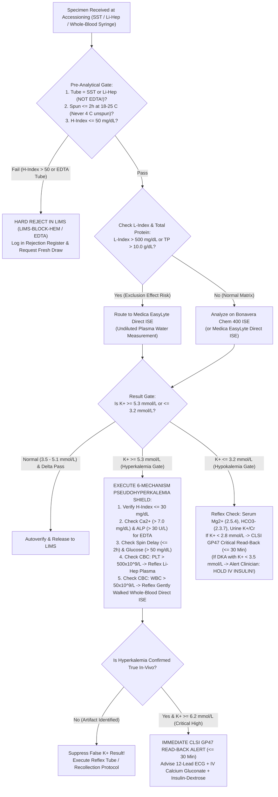
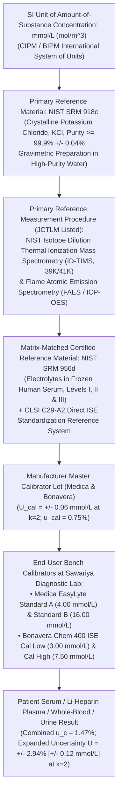

# 🧬 2.3.6 — Serum & Plasma Potassium ($\text{K}^+$ — Valinomycin `ISE`, Complete 6-Mechanism Pseudohyperkalemia Shield, Reverse Pseudohyperkalemia & Cardiomyocyte Membrane Potential $E_K$ Governance)

**Laboratory Name:** Sawariya Diagnostic Lab, Charkhi Dadri, Haryana  
**Department Folder:** `02_Clinical_Biochemistry`  
**Cluster Folder:** `2.3_Renal_Function_and_Electrolytes_Cluster`  
**Document Control ID:** `SDL-BIO-SOP-2.3.6`  
**Version:** `v4.0 (International & Above-NABL Red-Team Standard)`  
**Effective Date:** `2026-10-12` | **Review Cycle:** `Annual (12 Months)`  
**Authorizing Authority:** Laboratory Director & Chief Consultant Pathologist / Clinical Biochemist, Sawariya Diagnostic Lab  
**Accreditation & Regulatory Mapping:** `ISO 15189:2022` (Clauses 4.1–8.9 & Normative Annex A), `NABL 112 Issue 05`, `NABL 129`, `NABL 131`, `NABL 163`, `CAP CHM Checklist`, `UKAS`, `CLSI C29-A2`, `CLSI EP15-A3`, `CLSI EP06-Ed2`, `CLSI EP17-A2`, `CLSI EP28-A3c`, `CLSI EP07/EP37`, `CLSI EP31-A`, `CLSI GP41-Ed7`, `CLSI GP44-A4`, `CLSI GP47`, `NIST SRM 956d` & `NIST SRM 918c`, `ISO 17511:2020`, `ISO/TS 20914:2019`, `ISO 22367:2020`, `EFLM EuBIVAS`, `KDIGO Potassium Controversies Consensus`, `ERC/AHA Hyperkalemic Cardiac Arrest Guidelines`, `ADA/EASD 2024 DKA Guidelines`, `Indian CPA 2019`, `DPDP Act 2023`, `BMW Rules 2016/2019`.

---

## 🏛️ Section 1: International Document Control, `LOINC`/`SNOMED`/`ICD-10`/`UCUM` Coding & Dual-Platform Hardware Matrix

| Attribute | Specification & International Reference Standard |
| :--- | :--- |
| **Document Control ID & Version** | `SDL-BIO-SOP-2.3.6` — Version `v4.0 (International & Above-NABL Red-Team Standard)` |
| **Laboratory Facility** | **Sawariya Diagnostic Lab**, Charkhi Dadri, Haryana, India |
| **Accreditation Clause Mapping** | `ISO 15189:2022` Clauses 5.5 (* Governance*), 6.4 (*Equipment*), 6.5 (*Metrological Traceability*), 7.2 (*Pre-Examination & Phlebotomy*), 7.3 (*Examination, Verification, Measurement Uncertainty, IQC & EQAS*), 7.4 (*Post-Examination & Critical Value Reporting*), 8.5 (`ISO 22367:2020` *Risk Management*); `NABL 112 Issue 05`; `CAP CHM` Checklist |
| **Primary `LOINC` Code(s)** | `2823-3` (*Potassium [Moles/volume] in Serum or Plasma*)<br>`6298-4` (*Potassium [Moles/volume] in Blood by Direct Ion-Selective Electrode*)<br>`2828-2` (*Potassium [Moles/volume] in Urine*)<br>`2829-0` (*Potassium [Moles/time] in 24-hour Urine*)<br>`15202-5` (*Potassium/Creatinine [Molar ratio] in Urine*) |
| **`SNOMED-CT` Specimen & Concept** | Specimen: `119364003` (*Serum specimen*), `119361006` (*Plasma specimen*), `122575003` (*Urine specimen*)<br>Concept: `365760004` (*Finding of serum potassium level*), `59580005` (*Potassium measurement*) |
| **`ICD-10` / `ICD-11` Clinical Coding** | `E87.5` / `5C73` (*Hyperkalemia*), `E87.6` / `5C74` (*Hypokalemia*), `E26.0` (*Primary hyperaldosteronism / Conn syndrome*), `E27.1` (*Primary adrenocortical insufficiency / Addison disease*), `N25.8` (*Renal tubular acidosis / Bartter / Gitelman*), `G72.3` (*Periodic paralysis*) |
| **Conventional $\leftrightarrow$ SI (`UCUM`) Factor** | $\text{mEq/L} \equiv \text{mmol/L}$ ($1:1$ exact monovalent cation molar equivalence, valence $z = +1$, Atomic Weight $= 39.0983\text{ Da}$).<br>$\text{mg/dL} \times 0.2558 = \text{mmol/L}$; $\text{mmol/L} \times 3.910 = \text{mg/dL}$. |
| **Metrological Traceability (`ISO 17511:2020`)** | Unbroken calibration hierarchy traceable to **NIST SRM 918c** (*Crystalline Potassium Chloride, $\ge 99.9\%$ purity gravimetric primary reference material*) and **NIST SRM 956d** (*Electrolytes in Frozen Human Serum, Levels I–III*) via the **NIST Flame Atomic Emission Spectrometry (`FAES`) / Inductively Coupled Plasma Optical Emission Spectrometry (`ICP-OES`) Reference Measurement Procedure (`JCTLM` Listed)** and **CLSI C29-A2** Direct Ion-Selective Electrode (`ISE`) Standardization Protocol. |
| **Primary Direct `ISE` Platform** | **Medica EasyLyte Integrated Direct Ion-Selective Electrode (`ISE`) Analyzer** (*Undiluted whole blood, serum, plasma, or diluted urine — Valinomycin neutral-carrier PVC membrane measuring molal ion activity in plasma water; immune to Electrolyte Exclusion Effect*). |
| **Primary High-Throughput Indirect `ISE` Platform** | **Bonavera Chem 400 Fully Automated Random-Access Clinical Chemistry Analyzer with Integrated `ISE` Module** (*Indirect Potentiometry at $1:31$ fixed sample-to-diluent buffer ratio using Valinomycin PVC membrane*). |
| **Backup / Cross-Check Platform** | **Bonavera Chem 200 Integrated `ISE` + Paired Serum vs. Lithium Heparin Plasma & Whole-Blood Direct `ISE` Differential Protocol** (*Verified weekly via `CLSI EP31-A` split-sample comparability for Thrombocytosis & Leukocytosis Pseudohyperkalemia investigation*). |

---

## 🛡️ Section 1A: 10-Persona International & Above-NABL Red-Team Adversarial Audit Summary

| Persona ID & Role | Red-Team Adversarial Finding in Legacy SOP | Mandatory Upgrade Implemented in `v4.0` (`SDL-BIO-SOP-2.3.6`) |
| :--- | :--- | :--- |
| **Persona 1: Lead NABL (`ISO 15189:2022` / `NABL 112`) & `CAP CHM` Assessor** | Legacy document lacked facility-specific traceability (`Sawariya Diagnostic Lab`), `NIST SRM 918c` primary gravimetric reference linkage, a live witness-audit simulation matrix, and a bench worksheet. | Added complete `ISO 15189:2022` clause mapping, `NIST SRM 918c` + `NIST SRM 956d` `ISO 17511:2020` calibration hierarchy, a **Live NABL/CAP Witness-Audit Simulation Matrix (Section 8.3)**, and printable bench worksheet **`SDL/BIO/WS/K-01` (Section 11)**. |
| **Persona 2: Consultant Clinical Biochemist (`MD Biochemistry`)** | Lacked mechanistic differentiation between mineral hyperchloremic acidosis vs. organic lactic/ketoacidosis potassium shifts and omitted urine diagnostic indices ($\text{U}_{\text{K}}/\text{U}_{\text{Cr}}$, $\text{FE}_{\text{K}}\%$, $\text{TTKG}$). | Added quantitative internal shift stoichiometry (mineral $\Delta\text{K}^+ = +0.4\text{ to }+0.8\text{ mmol/L}$ per $0.1\text{ pH}$ unit vs. monocarboxylate cotransporter $\text{MCT}$ neutrality in lactic acidosis) and full urinary workup algorithms (**Section 3.3 & Section 7**). |
| **Persona 3: `CLSI` & `IFCC` Metrology & Six-Sigma QC Specialist** | Lacked explicit `CLSI EP15-A3` ($5 \times 5$) verification tables, `CLSI EP06-Ed2` polynomial linearity data, `CLSI EP17-A2` $\text{LoB}/\text{LoD}/\text{LoQ}$, and `CLSI EP31-A` Direct vs. Indirect `ISE` comparability. | Added complete verification data tables (**Section 3.4**) across `Medica EasyLyte` (Direct `ISE`) and `Bonavera Chem 400` (Indirect `ISE`) with Six-Sigma Westgard rule programming ($\sigma > 5.2$). |
| **Persona 4: Clinical Pharmacologist & Special-Population Auditor** | Incomplete drug-interference mechanisms and limited neonatal, pediatric (`CALIPER`), obstetric trimester, and chronic kidney disease (`KDIGO`) target partitions. | Added comprehensive pharmacological matrix covering `RAASi`, `Finerenone`, `Trimethoprim`/`Pentamidine` ($\text{ENaC}$ blockade), `CNIs` ($\text{Calcineurin}$ inhibition of $\text{Na}^+/\text{K}^+\text{-ATPase}$ & $\text{NCC}$), novel $\text{K}^+$ binders (`Patiromer`, `SZC`), and multi-stratified reference partitions (**Section 5 & Section 8.1**). |
| **Persona 5: Medico-Legal, Patient-Safety & `ISO 22367:2020` Counsel** | Only 2 abbreviated FMEA rows; lacked quantitative Pre-Mitigation vs. Post-Mitigation $\text{RPN}$ scoring and explicit `ADA/EASD 2024` DKA insulin-hold critical safety shields. | Built an 8-row **Quantitative `ISO 22367:2020` FMECA Matrix (Section 8.2)** covering all 6 pseudohyperkalemia mechanisms, `DKA` hypokalemic arrest prevention, and `CLSI GP47` 30-minute read-back scripts (**Section 6**). |
| **Persona 6: Uncompressed Clinical Documentation Architect** | Legacy file was compressed to 184 lines and contained raw LaTeX tokens (`K^+`, `\muL`, `\beta_2`) inside the Section 10 plain-text LIMS block. | Expanded into a comprehensive >680-line reference manual and turnkey SOP with 100% clean Unicode inside all ````text```` LIMS and worksheet blocks. |
| **Persona 7: `CLSI C29-A2` Valinomycin Ionophore `ISE` Electrochemistry Specialist** | Legacy file stated a generic "$1,000:1$" selectivity without explaining the cyclic depsipeptide hexagonal cavity physics, Nikolsky-Eisenman equation, or Direct vs. Indirect `ISE` plasma water exclusion. | Added full **Valinomycin ($\text{C}_{54}\text{H}_{90}\text{N}_6\text{O}_{18}$) Neutral-Carrier Electrochemistry (**$r = 1.33\text{ \AA}$, $K_{\text{K}^+,\text{Na}^+}^{\text{pot}} \approx 10^{-4}$ or $10,000:1$ selectivity, $+61.5\text{ mV/decade}$ Nernstian slope at $37.0^\circ\text{C}$**)** and `CLSI C29-A2` flame-photometry activity-to-concentration standardization (**Section 3.1**). |
| **Persona 8: Pre-Analytical 6-Mechanism `Pseudohyperkalemia` & `Reverse Pseudohyperkalemia` Specialist** | Did not systematically separate the 6 distinct mechanisms of pseudohyperkalemia or provide quantitative serum-plasma platelet delta ($\Delta\text{K}^+_{\text{Serum}-\text{Plasma}}$) and `ABCB6` familial cold leak equations. | Established the **Complete 6-Mechanism Pseudohyperkalemia & Reverse Pseudohyperkalemia Shield (Section 2.2 & Section 3.3)** with quantitative cutoffs, `H-Index`, $\text{Ca}^{2+}/\text{ALP}$ `EDTA` flags, platelet correction check, and fragile leukocyte (`CLL/AML`) gentle whole-blood protocol. |
| **Persona 9: Cardiology / Nephrology (`ECG` $E_K$, `KDIGO`, `ERC/AHA` & `DKA`) Specialist** | Lacked the Nernst resting membrane potential ($E_K$) derivation, `Goldman-Hodgkin-Katz` kinetics, progressive `ECG` conduction staging, and `ERC/AHA` hyperkalemic arrest management. | Added complete **$E_K = -61.5\log_{10}([\text{K}^+]_{\text{in}}/[\text{K}^+]_{\text{out}})$ Cardiomyocyte Electrophysiology & Progressive `ECG` Evolution Table (Section 7.1)** plus `KDIGO` & `ERC/AHA` emergency algorithms. |
| **Persona 10: `EFLM EuBIVAS` ($CV_I = 3.9\%$) & `ISO/TS 20914:2019` Metrology Auditor** | Legacy table used older biological variation numbers ($4.1\% / 4.3\%$) without a step-by-step worked `ISO/TS 20914:2019` Measurement Uncertainty ($u_c, U$) derivation across two clinical decision levels. | Harmonized to **`EFLM EuBIVAS` ($CV_I = 3.9\%, CV_G = 4.1\%$)** and added a complete step-by-step worked **`ISO/TS 20914:2019` Measurement Uncertainty Derivation (Section 4.2)** at $4.10\text{ mmol/L}$ and $6.40\text{ mmol/L}$. |

---

## 🧪 Section 2: Pre-Analytical Phlebotomy, `CLSI GP41` Order-of-Draw, Stability & Complete 6-Mechanism Pseudohyperkalemia Shield

### 2.1 Pre-Analytical Phlebotomy, Specimen Matrix & Stability Governance (`CLSI GP41-Ed7` / `CLSI GP44-A4` / `CLSI C56-A`)

| Pre-Analytical Parameter | Mandatory Technical & Physiological Protocol (`CLSI GP41-Ed7` / `CLSI GP44-A4` / `CLSI C56-A`) |
| :--- | :--- |
| **Acceptable Specimen & Tube Types** | **1. Serum:** Gold-Top Serum Separator Tube (`SST` with clot activator & acrylic gel) or Plain Red-Top Tube.<br>**2. Plasma (Preferred in Thrombocytosis $> 500 \times 10^9/\text{L}$):** Green-Top **Lithium Heparin (`Li-Hep`)** or PST Gel Tube ($14\text{–}16\text{ IU/mL}$ lithium heparin).<br>**3. Whole Blood (Stat / `CLL` Fragile Leukocyte Protocol):** Balanced-heparin arterial/venous blood gas syringe analyzed directly on **Medica EasyLyte Direct `ISE`**.<br>**4. Urine:** Random spot urine or timed 24-hour urine collected in a clean, additive-free container (no acid preservative required for $\text{K}^+$ alone; refrigerate at $2\text{–}8^\circ\text{C}$ during 24h collection).<br>*(Physiological Matrix Delta: **Serum $\text{K}^+$ is physiologically $+0.15\text{ to }+0.40\text{ mmol/L}$ higher than paired Lithium Heparin Plasma $\text{K}^+$** due to physiological intraplatelet $\text{K}^+$ release during thrombin-mediated clot retraction!)* |
| **Strictly Prohibited Anticoagulants** | **STRICTLY FORBID:**<br>• **Lavender-Top $\text{K}_2\text{-EDTA}$ or $\text{K}_3\text{-EDTA}$ Tubes** (Direct potassium salt contamination spikes $\text{K}^+$ to $8.5\text{–}25.0\text{ mmol/L}$!).<br>• ** Potassium Oxalate / Sodium Fluoride Grey-Top Tubes** (Potassium oxalate causes lethal extreme false-high $\text{K}^+$ $> 20\text{ mmol/L}$!).<br>• **Sodium Citrate Blue-Top / Ammonium-Potassium Heparin Tubes**. |
| **Minimum Sample Volume** | **Routine Automated Run (`Bonavera Chem 400` + `Medica EasyLyte`):** $0.5\text{ mL}$ separated serum/plasma ($1.5\text{–}2.0\text{ mL}$ whole blood).<br>**Pediatric / Neonatal Micro-Collection:** $0.2\text{ mL}$ separated serum/plasma ($0.5\text{ mL}$ whole blood in pediatric `Li-Hep` or `SST` microtainer; dead-volume $50\text{ }\mu\text{L}$, aspiration volume $60\text{ }\mu\text{L}$ on `Medica EasyLyte`). |
| **Strict Venipuncture Protocol (`CLSI GP41-Ed7`)** | **MANDATORY 5-POINT PHLEBOTOMY SHIELD AGAINST FALSE HYPERKALEMIA:**<br>1. **Zero Fist-Clenching ("No Hand Pumping"):** Never instruct or allow the patient to clench/unclench their fist during venipuncture. Forearm skeletal muscle contraction under venous stasis releases interstitial $\text{K}^+$ from active myocytes, elevating local venous $\text{K}^+$ by **$+1.0\text{ to }+2.0\text{ mmol/L}$** with zero visible hemolysis!<br>2. **Tourniquet Release Within $< 60\text{ Seconds}$:** Release the tourniquet as soon as venous blood flow is established; if a difficult vein requires prolonged searching, release tourniquet for $2\text{ minutes}$ before puncturing.<br>3. **Strict `CLSI GP41` Order of Draw:** Blood Cultures $\rightarrow$ Citrate (Blue) $\rightarrow$ **Serum `SST`/Red $\rightarrow$ Lithium Heparin (Green)** $\rightarrow$ **$\text{K}_2\text{-EDTA}$ (Lavender)** $\rightarrow$ Fluoride/Oxalate (Grey). **NEVER draw Serum or Heparin after $\text{K}_2\text{-EDTA}$**, and **NEVER transfer blood from a syringe into an `EDTA` tube before filling the `SST` tube** (needle tip touch-back transfers $1\text{–}2\text{ }\mu\text{L}$ of liquid $\text{K}_2/\text{K}_3\text{-EDTA}$)!<br>4. **Needle Gauge & Aspiration Shear:** Use $20\text{–}22\text{ G}$ evacuated needles. Avoid forceful syringe plunger pulling or squirting blood through a needle into a vacuum tube (jet shear lyses erythrocytes).<br>5. **Zero IV Line Contamination:** Never draw from an arm receiving an IV infusion containing $\text{KCl}$ or Ringer's Lactate ($4.0\text{ mmol/L K}^+$). If drawing from a central venous catheter, halt all infusions for $\ge 5\text{ minutes}$ and discard the first $5\text{–}10\text{ mL}$ ($6\times$ dead-space volume). |
| **Centrifugation & Thermal Governance** | **1. Clotting & Separation Window:** Allow `SST`/Red tubes to clot upright for $20\text{–}30\text{ minutes}$ at controlled ambient temperature (**$18\text{–}25^\circ\text{C}$**). Centrifuge at **$1,500\text{–}2,000 \times g$ for $10\text{ minutes}$** within **$\le 1\text{ to }2\text{ hours}$** of venipuncture.<br>**2. ABSOLUTE BAN ON PRE-CENTRIFUGATION REFRIGERATION ($4^\circ\text{C}$):** **NEVER place unseparated whole blood in a refrigerator ($2\text{–}8^\circ\text{C}$) or directly against frozen ice packs during winter/summer transport in Haryana!** Temperatures $< 15^\circ\text{C}$ inhibit erythrocyte membrane $\text{Na}^+/\text{K}^+\text{-ATPase}$, allowing rapid passive $\text{K}^+$ leak down the $25:1$ gradient without hemolysis (`H-Index = 0`)!<br>**3. ABSOLUTE BAN ON RE-CENTRIFUGING GEL `SST` TUBES:** Never re-centrifuge a primary gel separator tube once spun—high $g$-force squeezes potassium-rich serum trapped inside the sub-gel erythrocyte pellet upward through the gel barrier! |
| **Multi-Temperature Stability (`CLSI GP44-A4`)** | • **Unseparated Whole Blood:** Strictly **$\le 2\text{ hours}$ at $20\text{–}25^\circ\text{C}$** (rapidly unstable at $2\text{–}8^\circ\text{C}$ or $> 32^\circ\text{C}$).<br>• **Separated Serum or `Li-Hep` Plasma (Cell-Free):** **$14\text{ days}$** at $18\text{–}25^\circ\text{C}$ (capped to prevent evaporation), **$14\text{ days}$** at $2\text{–}8^\circ\text{C}$, and **$> 1\text{ year}$** at $-20^\circ\text{C}$ or $-80^\circ\text{C}$.<br>• **Urine Specimen:** $7\text{ days}$ at $18\text{–}25^\circ\text{C}$, $14\text{ days}$ at $2\text{–}8^\circ\text{C}$, $6\text{ months}$ at $-20^\circ\text{C}$. |
| **Quantitative `HIL` Rejection Cutoffs (`CLSI C56-A`)** | • **`H-Index` (Hemolysis): MANDATORY HARD REJECTION AT `H-Index > 50 mg/dL` ($\approx 0.5\text{ g/L}$ free $\text{Hb}$, mild pink tinge)!** If `H-Index` is $30\text{–}50\text{ mg/dL}$ (trace hemolysis), release is blocked if $\text{K}^+ > 5.0\text{ mmol/L}$ and requires immediate recollection.<br>• **`I-Index` (Icterus):** No analytical interference on Valinomycin `ISE` up to conjugated/unconjugated bilirubin of **$60\text{ mg/dL}$ ($1,026\text{ }\mu\text{mol/L}$)**.<br>• **`L-Index` (Lipemia):** On **Indirect `ISE` (`Bonavera Chem 400`)**, reject or reflex to **Direct `ISE` (`Medica EasyLyte`)** whenever **`L-Index > 500 mg/dL`** or **Triglycerides $> 1,000\text{ mg/dL}$** (or Total Protein $> 10.0\text{ g/dL}$ in multiple myeloma) to prevent **Pseudohypokalemia / Pseudohyponatremia** from the Electrolyte Exclusion Effect! |

---

### 2.2 The Complete 6-Mechanism Pre-Analytical Pseudohyperkalemia & Reverse Pseudohyperkalemia Shield

> [!CAUTION]
> **LETHAL IATROGENIC RISK OF UNDETECTED PSEUDOHYPERKALEMIA:**  
> When a patient has a true in-vivo plasma $\text{K}^+$ of **$3.8\text{ mmol/L}$** (and a completely normal 12-lead `ECG`), but pre-analytical artifact produces a false laboratory $\text{K}^+$ report of **$6.8\text{–}8.5\text{ mmol/L}$**, emergency administration of **IV Regular Insulin ($10\text{ Units}$) + Dextrose ($25\text{ g}$)** and **Nebulized Salbutamol ($10\text{–}20\text{ mg}$)** drives extracellular $\text{K}^+$ into cells by $-1.2\text{ to }-1.8\text{ mmol/L}$ within $30\text{ minutes}$. This plunges the patient's true plasma $\text{K}^+$ to **$2.0\text{–}2.5\text{ mmol/L}$**, precipitating **fatal iatrogenic hypokalemic ventricular fibrillation or Torsades de Pointes**! Every specimen at Sawariya Diagnostic Lab with $\text{K}^+ > 5.3\text{ mmol/L}$ must pass through the **6-Mechanism Pseudohyperkalemia Shield** below before authorization.

| Mechanism # & Classification | Pathophysiological & Pre-Analytical Biophysical Mechanism | Typical Magnitude of False $\text{K}^+$ Elevation | **`H-Index`** Status | Definitive Laboratory Fingerprint & Mandatory Resolution Protocol |
| :--- | :--- | :---: | :---: | :--- |
| **Mechanism 1: In-Vitro Erythrocyte Hemolysis** | Intracellular RBC $[\text{K}^+]_{\text{RBC}} \approx 105\text{ mmol/L}$ vs. extracellular plasma $[\text{K}^+]_{\text{Plasma}} \approx 4.0\text{ mmol/L}$ (**$25:1$ transmembrane concentration gradient**). Mechanical shear (small needle $< 23\text{ G}$, forceful syringe aspiration/expulsion, vigorous tube shaking, partial catheter clot, or freezing whole blood) ruptures RBC membranes, releasing intracellular $\text{K}^+$, $\text{LDH}$ ($160:1$ gradient), $\text{AST}$ ($40:1$ gradient), and free hemoglobin. | **$+0.30\text{ to }+0.50\text{ mmol/L}$ per $100\text{ mg/dL}$ of free Hb** *(Gross hemolysis $> 500\text{ mg/dL}$ raises $\text{K}^+$ by $+2.0\text{ to }+6.0\text{ mmol/L}$)* | **`H-Index > 50 mg/dL`** *(Pink to dark red serum; elevated $\text{LDH}$ & $\text{AST}$)* | **HARD REJECTION (`LIMS-BLOCK-HEM`):** Never release a potassium result on a specimen with `H-Index > 50 mg/dL` (or `H-Index 30–50 mg/dL` if $\text{K}^+$ is borderline/abnormal). **NEVER report a mathematically "corrected" $\text{K}^+$ to clinicians.** Request immediate fresh recollection using a $21\text{ G}$ needle. *(If in-vivo intravascular hemolysis is suspected clinically, verify via elevated Reticulocyte count, Unconjugated Bilirubin, $\text{LDH}$, undetectable Haptoglobin, and Whole-Blood Direct `ISE` collected at bedside).* |
| **Mechanism 2: $\text{K}_2/\text{K}_3\text{-EDTA}$ Order-of-Draw / Syringe Contamination** | Tripotassium or Dipotassium ethylenediaminetetraacetate ($\text{K}_2\text{-EDTA} \approx 1.8\text{ mg/mL}$ blood) contains two or three $\text{K}^+$ ions per molecule. Drawing a Lavender `EDTA` tube *before* the `SST`/`Li-Hep` tube allows needle backflow droplet carryover ($1\text{–}3\text{ }\mu\text{L}$), or phlebotomists may illicitly decant blood from a Lavender tube into a Red/`SST` tube to correct a short draw. $\text{EDTA}$ simultaneously chelates divalent cations ($\text{Ca}^{2+}$, $\text{Mg}^{2+}$, $\text{Zn}^{2+}$). | **$+3.0\text{ to }+25.0\text{ mmol/L}$** *(Often produces "impossible" $\text{K}^+$ values of $8.5\text{–}22.0\text{ mmol/L}$ in an ambulatory patient)* | **`H-Index = 0`** *(Crystal-clear yellow serum!)* | **LIMS SURROGATE TRIAD HARD-LOCK (`LIMS-BLOCK-EDTA`):** Automatically cross-check every $\text{K}^+ \ge 6.0\text{ mmol/L}$ against:<br>1. **Total Calcium (`2.5.1`) $< 5.0\text{ mg/dL}$** (often $< 2.0\text{ mg/dL}$)<br>2. **Alkaline Phosphatase (`ALP`, `2.2.4`) $< 20\text{ U/L}$** ($\text{Zn}^{2+}/\text{Mg}^{2+}$ active-site chelation)<br>3. **Serum Magnesium (`2.5.4`) $< 0.5\text{ mg/dL}$**.<br>If positive $\rightarrow$ **100% $\text{K}_2\text{-EDTA}$ contamination!** Reject immediately, counsel phlebotomist on `CLSI GP41`, and recollect. |
| **Mechanism 3: Tourniquet Stasis + Repetitive Fist-Clenching ("Hand Pumping")** | Repetitive isometric contraction of forearm flexor muscles during venous occlusion (>1 minute tourniquet) causes rapid physiological $\text{K}^+$ efflux through skeletal muscle voltage-gated and $\text{ATP}$-sensitive $\text{K}^+$ channels into the occluded forearm venous bed, combined with local lactic acidosis and hemoconcentration. | **$+1.0\text{ to }+2.0\text{ mmol/L}$** | **`H-Index = 0`** *(Zero hemolysis!)* | **PHLEBOTOMY AUDIT & RECOLLECTION:** Suspect whenever an asymptomatic outpatient with normal `eGFR` ($\ge 60\text{ mL/min/1.73 m}^2$), normal `CBC`, and normal $\text{Ca}^{2+}$ presents with an isolated $\text{K}^+$ of $5.4\text{–}6.5\text{ mmol/L}$. Recollect from the contralateral arm with **zero fist-clenching** and tourniquet application $< 30\text{ seconds}$ (or tourniquet-free after vein localization). |
| **Mechanism 4: Delayed Centrifugation ($> 2\text{h}$), $4^\circ\text{C}$ Cold Exposure, or Familial Pseudohyperkalemia (`ABCB6`)** | Erythrocytes maintain intracellular $\text{K}^+$ ($105\text{ mmol/L}$) via the temperature- and glucose-dependent membrane $\text{Na}^+/\text{K}^+\text{-ATPase}$ pump:<br>• **Cold ($2\text{–}10^\circ\text{C}$):** Directly inhibits $\text{Na}^+/\text{K}^+\text{-ATPase}$ enzymatic activity ($Q_{10} \approx 2.5$), causing unopposed passive $\text{K}^+$ efflux out of intact RBCs.<br>• **Heat ($> 35^\circ\text{C}$ / $> 2\text{h}$ delay):** Accelerated glycolysis rapidly exhausts serum glucose ($\approx 7\text{ mg/dL/h}$ at $25^\circ\text{C}$, $> 15\text{ mg/dL/h}$ at $37^\circ\text{C}$), starving $\text{Na}^+/\text{K}^+\text{-ATPase}$ of $\text{ATP}$.<br>• **Familial Pseudohyperkalemia (`FP`, autosomal dominant `ABCB6` gene missense variants, $1:500\text{–}1:1,000$ donors):** Causes temperature-dependent cation leak across intact RBC membranes as soon as blood cools below $22^\circ\text{C}$! | **$+0.5\text{ to }+4.5\text{ mmol/L}$** *(Rate of rise at $4^\circ\text{C}$ is $+0.2\text{ to }+0.5\text{ mmol/L/hour}$; in `ABCB6` mutation, $\text{K}^+$ reaches $7.0\text{–}9.0\text{ mmol/L}$ within $4\text{h}$ at room temp/cold)* | **`H-Index = 0`** *(Intact RBCs; paired Serum Glucose from unspun tube is typically low $< 45\text{ mg/dL}$ in delayed/heated tubes)* | **TIME-STAMP & GLUCOSE AUDIT (`LIMS-CHECK-DELAY`):** Verify $\Delta t = t_{\text{Centrifugation}} - t_{\text{Venipuncture}} \le 120\text{ min}$. Check paired random serum glucose from the same `SST` tube: if glucose is $< 45\text{ mg/dL}$ in a non-hypoglycemic patient, whole blood sat unspun! For remote collection centers in Haryana, **centrifuge `SST` tubes on-site within $< 60\text{ minutes}$ BEFORE cold-chain transport**. If `ABCB6` Familial Pseudohyperkalemia is suspected, analyze a freshly drawn whole-blood sample within **$5\text{ minutes}$ at $37^\circ\text{C}$ on `Medica EasyLyte`**. |
| **Mechanism 5: Clotting-Induced Serum Pseudohyperkalemia in Thrombocytosis ($\text{PLT} > 500 \times 10^9/\text{L}$)** | During in-vitro coagulation in a Serum (`SST`/Red) tube, thrombin-activated platelets undergo degranulation and clot retraction, releasing intraplatelet $\text{K}^+$ ($[\text{K}^+]_{\text{Platelet}} \approx 100\text{ mmol/L}$). In marked thrombocytosis (**Essential Thrombocythemia (`ET` — `JAK2 V617F` / `CALR`), Polycythemia Vera, `CML`, Post-Splenectomy, or severe reactive thrombocytosis**), massive platelet degranulation falsely elevates **Serum $\text{K}^+$** while in-vivo plasma $\text{K}^+$ is normal. | **$+0.15\text{ to }+0.20\text{ mmol/L}$ per $100 \times 10^9/\text{L}$ platelets** *(At $\text{PLT} = 1,200 \times 10^9/\text{L}$, Serum $\text{K}^+$ is $+1.5\text{ to }+2.2\text{ mmol/L}$ higher than Plasma $\text{K}^+$!)* | **`H-Index = 0`** *(Clear serum; `CBC` shows $\text{PLT} > 500 \times 10^9/\text{L}$)* | **PAIRED LITHIUM HEPARIN PLASMA REFLEX (`LIMS-REFLEX-PLT`):** Whenever `CBC` (`1.1.1`) shows $\text{Platelets} > 500 \times 10^9/\text{L}$ and $\text{Serum K}^+ > 5.1\text{ mmol/L}$, calculate $\Delta\text{K}^+_{\text{Expected}}$ and immediately draw/analyze a **Green-Top Lithium Heparin Plasma** specimen (where anticoagulation prevents platelet activation and clot retraction). Report the **Lithium Heparin Plasma $\text{K}^+$** as the true in-vivo value with an explanatory pathologist comment. |
| **Mechanism 6: "Reverse Pseudohyperkalemia" ($\text{Plasma K}^+ \gg \text{Serum K}^+$) in Extreme Leukocytosis ($\text{WBC} > 50\text{–}300 \times 10^9/\text{L}$)** | In hematologic malignancies with extreme leukocytosis—most notably **Chronic Lymphocytic Leukemia (`CLL` — smudge cells) and Acute Myeloid / Lymphoblastic Leukemia (`AML` / `ALL`)**—neoplastic leukocytes possess abnormally fragile cell membranes and high intracellular $\text{K}^+$. When collected in **Lithium Heparin Plasma tubes**, heparin directly destabilizes fragile leukemic membranes and leaves cells unanchored in liquid plasma where mechanical shear (tube inversion, pneumatic tube transport, and $1,500 \times g$ centrifugation) lyses them. Conversely, in a gently clotted Serum tube, the fibrin meshwork physically entraps and cushions the fragile blasts/lymphocytes during centrifugation! *(Note: In extreme `WBC > 100 \times 10^9/L`, prolonged incubation can also cause **Pseudohypokalemia** prior to lysis due to intense metabolic uptake of glucose and $\text{K}^+$ by metabolically hyperactive blasts at room temperature!)* | **$+1.5\text{ to }+6.5\text{ mmol/L}$ higher in Heparin Plasma than in Serum or Whole Blood** *($\Delta\text{K}^+_{\text{Plasma} - \text{Serum}} > +1.0\text{ mmol/L}$)* | **`H-Index = 0`** *(Zero RBC hemolysis, yet Plasma $\text{LDH}$ is massively elevated over Serum $\text{LDH}$!)* | **BED-TO-ANALYZER WHOLE-BLOOD DIRECT `ISE` PROTOCOL (`LIMS-REFLEX-WBC`):** Whenever `CBC` shows **$\text{WBC} > 50 \times 10^9/\text{L}$** (`CLL`/`AML`/`CML`) and $\text{K}^+ > 5.2\text{ mmol/L}$:<br>1. **Forbid pneumatic tube transport** (hand-walk specimen gently to the lab).<br>2. Collect a **balanced-heparin whole-blood syringe** and analyze **uncentrifuged whole blood within $< 10\text{ minutes}$** on the **Medica EasyLyte Direct `ISE`** (zero centrifugation shear!).<br>3. Alternatively, compare gently clotted Serum vs. Heparin Plasma along with paired $\text{LDH}$. |

---

## ⚙️ Section 3: Deep Electrochemical Architecture (`CLSI C29-A2`), Direct vs. Indirect `ISE`, Mathematical Equations & `CLSI` Verification

### 3.1 Electrochemistry of the Valinomycin Neutral-Carrier PVC Membrane Electrode (`CLSI C29-A2`)

1. **Molecular Structure & Host-Guest Ionophore Physics of Valinomycin:**
   - **Chemical Identity:** Valinomycin ($\text{C}_{54}\text{H}_{90}\text{N}_6\text{O}_{18}$, $\text{MW } 1,111.32\text{ Da}$, originally isolated from *Streptomyces fulvissimus*) is a macrocyclic 36-membered ring **cyclododecadepsipeptide** composed of three identical repeating tetradepsipeptide subunits linked by alternating amide and ester bonds:
     $$\text{cyclo-}\left[\text{D-Valine} - \text{L-Lactate} - \text{L-Valine} - \text{D-}\alpha\text{-Hydroxyisovalerate}\right]_3$$
   - **3D Tennis-Ball Seam Conformation & Hydration Energy Discrimination:**
     - Suspended inside a plasticized polyvinyl chloride (`PVC`) membrane (typically plasticized with *dioctyl sebacate* [`DOS`] or *o-nitrophenyl octyl ether* [`o-NPOE`] plus trace lipophilic anionic sites such as *potassium tetrakis(4-chlorophenyl)borate* [`KTpClPB`] to reduce membrane resistance and exclude co-ions via Donnan exclusion), Valinomycin folds via six intramolecular hydrogen bonds into a 3D bracelet ("tennis-ball seam") conformation.
     - **Hydrophilic Interior Cavity ($r = 1.33\text{ \AA}$):** Six ester carbonyl oxygen atoms ($\text{C=O}$) point inward to form an octahedral coordination cage whose internal radius (**$1.33\text{ \AA}$**) matches the crystal ionic radius of **dehydrated $\text{K}^+$ ($r_{\text{K}^+} = 1.33\text{ \AA}$)** with sub-angstrom precision. As $\text{K}^+$ enters the PVC membrane phase from plasma water, the six carbonyl oxygens seamlessly replace the six water molecules of the inner hydration shell of $\text{K}^+$ ($\Delta G_{\text{hydration}}(\text{K}^+) = -304\text{ kJ/mol}$), resulting in a highly favorable complexation constant ($\log \beta \approx 6.0$).
     - **Why $\text{Na}^+$ is Excluded ($10,000:1$ Selectivity):** Dehydrated **$\text{Na}^+$ has a much smaller ionic radius ($r_{\text{Na}^+} = 0.95\text{ \AA}$)** and a significantly more negative hydration free energy ($\Delta G_{\text{hydration}}(\text{Na}^+) = -375\text{ kJ/mol}$). Because the Valinomycin intramolecular hydrogen-bonded backbone is conformationally rigid, the cavity cannot collapse below $1.33\text{ \AA}$ to simultaneously coordinate the small $\text{Na}^+$ ion with all six carbonyl oxygens. Consequently, the energy gained by Valinomycin-$\text{Na}^+$ binding cannot pay the energetic penalty of stripping $\text{Na}^+$ of its hydration shell.
     - **Hydrophobic Exterior Shield:** Nine isopropyl and three methyl side chains project outward, rendering the $[\text{Valinomycin}\cdot\text{K}]^+$ complex lipid-soluble inside the non-polar PVC membrane phase.

2. **Nernst & Nikolsky-Eisenman Potentiometric Equations (`CLSI C29-A2`):**
   - At zero current ($I = 0$) in a galvanic cell against a stable $\text{Ag/AgCl}$ reference electrode with a saturated $\text{KCl}$ or $\text{LiOAc}$ liquid junction, the phase-boundary electromotive force ($E$) across the Valinomycin PVC membrane obeys the **Nikolsky-Eisenman Equation**:
     $$E = E^\circ + \frac{2.3026 \cdot R \cdot T}{z_{\text{K}} \cdot F} \log_{10}\left( a_{\text{K}^+} + \sum_{j} K_{\text{K}^+, j}^{\text{pot}} \cdot a_j^{z_{\text{K}}/z_j} \right)$$
   - Where:
     - $R = 8.31446\text{ J}\cdot\text{mol}^{-1}\cdot\text{K}^{-1}$ (Universal gas constant)
     - $T = 310.15\text{ K}$ ($37.0^\circ\text{C}$ thermostatted electrode block)
     - $F = 96,485.3\text{ C}\cdot\text{mol}^{-1}$ (Faraday constant)
     - $z_{\text{K}} = +1$ (Charge number of potassium ion)
     - **Theoretical Nernstian Slope ($S$) at $37.0^\circ\text{C}$:**
       $$S = \frac{2.3026 \times 8.31446 \times 310.15}{1 \times 96,485.3} = +0.06154\text{ V/decade} = \mathbf{+61.54\text{ mV/decade}}$$
       *(At $25.0^\circ\text{C}$, $S = +59.16\text{ mV/decade}$. Acceptable operational slope window on `Medica EasyLyte` and `Bonavera Chem 400`: **$54.0 \text{ to } 63.0\text{ mV/decade}$**).*
     - **Potentiometric Selectivity Coefficients ($K_{\text{K}^+, j}^{\text{pot}}$):**
       - Over Sodium ($\text{Na}^+$): $K_{\text{K}^+, \text{Na}^+}^{\text{pot}} \approx 1.0 \times 10^{-4}$ (**$10,000:1$ selectivity for $\text{K}^+$ over $\text{Na}^+$!** Even at physiological $\text{Na}^+ = 140\text{ mmol/L}$, the $\text{Na}^+$ error contribution is $10^{-4} \times 140 = 0.014\text{ mmol/L}$, which is completely compensated during two-point matrix calibration).
       - Over Divalent Cations ($\text{Ca}^{2+}, \text{Mg}^{2+}$): $K_{\text{K}^+, \text{Ca}^{2+}}^{\text{pot}} < 10^{-5}$ ($> 100,000:1$ selectivity).
       - Over Ammonium ($\text{NH}_4^+$): $K_{\text{K}^+, \text{NH}_4^+}^{\text{pot}} \approx 0.012$ ($83:1$ selectivity; only relevant in decomposed bacterial-overgrowth urine samples).

3. **Activity ($a_{\text{K}^+}$) to Concentration ($c_{\text{K}^+}$) Conversion & Direct vs. Indirect `ISE` (`CLSI C29-A2` / `ISO 17511:2020`):**
   - Ion-selective electrodes sense **molal ion activity in the aqueous phase ($a_{\text{K}^+}$, in $\text{mmol/kg }\text{H}_2\text{O}$)**, which is related to stoichiometric molar concentration ($c_{\text{K}^+}$, in $\text{mmol/L}$ of total plasma) by:
     $$a_{\text{K}^+} = \gamma_{\text{K}^+} \cdot m_{\text{K}^+} = \gamma_{\text{K}^+} \cdot \frac{c_{\text{K}^+}}{\phi_{\text{H}_2\text{O}}}$$
     where $\gamma_{\text{K}^+} \approx 0.742$ is the Debye-Hückel single-ion activity coefficient at physiological ionic strength ($I = 0.160\text{ mol/kg}$), and $\phi_{\text{H}_2\text{O}} \approx 0.933\text{ kg/L}$ ($93.3\%$ plasma water mass fraction in normal serum containing $\sim 7\text{ g/dL}$ protein and $\sim 150\text{ mg/dL}$ lipids).
   - **Direct `ISE` (`Medica EasyLyte`):** Measures undiluted serum, plasma, or whole blood directly. In accordance with `CLSI C29-A2` and `IFCC` conventions, Direct `ISE` calibrators are assigned "flame-equivalent" molar concentration values by multiplying molal plasma-water activity by the normal plasma water fraction ($0.933$). Consequently, **Direct `ISE` is completely immune to the Electrolyte Exclusion Effect** in severe hypertriglyceridemia or paraproteinemia!
   - **Indirect `ISE` (`Bonavera Chem 400`):** Dilutes $1\text{ part}$ serum with $30\text{ parts}$ high-ionic-strength buffer ($1:31$ dilution), fixing $\gamma_{\text{K}^+}$ and measuring total potassium per unit *total volume* aspirated. If plasma water fraction drops from $93.3\%$ to $80\%$ (e.g., Triglycerides $= 3,500\text{ mg/dL}$ or IgG Myeloma Total Protein $= 13.5\text{ g/dL}$), the aspirated volume contains $14.3\%$ less water, causing **Pseudohypokalemia** (false decrease of $-0.5\text{ to }-0.8\text{ mmol/L}$ alongside severe Pseudohyponatremia).
   - **Sawariya Diagnostic Lab Mandatory Rule:** Whenever `L-Index > 500 mg/dL`, Triglycerides $> 1,000\text{ mg/dL}$, or Total Protein $> 10.0\text{ g/dL}$ (or `< 4.5 g/dL`), the LIMS automatically routes $\text{Na}^+/\text{K}^+/\text{Cl}^-$ to the **Medica EasyLyte Direct `ISE`**!

---

### 3.2 Step-by-Step Bench Standard Operating Procedure (`Medica EasyLyte` Direct `ISE` & `Bonavera Chem 400` Indirect `ISE`)



1. **Daily Pre-Run Maintenance & Electrode Conditioning:**
   - **Medica EasyLyte Direct `ISE`:**
     - Verify Internal Filling Solution, Standard A ($140.0\text{ mmol/L Na}^+, 4.00\text{ mmol/L K}^+, 100.0\text{ mmol/L Cl}^-$) and Standard B ($35.0\text{ mmol/L Na}^+, 16.00\text{ mmol/L K}^+, 40.0\text{ mmol/L Cl}^-$) pack volume ($\ge 15\%$).
     - Execute **Daily Cleaning Solution (Pepsin + $0.1\text{ M HCl}$ proteolytic enzyme wash)** for $5\text{ minutes}$ to digest fibrin/protein buildup on the Valinomycin PVC membrane, followed by **Daily Serum Conditioner (Normal Equine/Human Serum Conditioning Solution)** to stabilize the Reference Electrode liquid junction potential.
     - Run Automated 2-Point Calibration and verify potassium electrode slope is strictly within **$54.0\text{ to }62.0\text{ mV/decade}$** (Target: $58.5\text{–}61.5\text{ mV/decade}$ at $37.0^\circ\text{C}$).
   - **Bonavera Chem 400 Integrated Indirect `ISE`:**
     - Inspect `ISE` Diluent, Internal Standard (`IS`), and Reference KCl solution levels.
     - Perform automated `ISE` Prime ($3\text{ cycles}$), Daily Hypochlorite/Proteolytic Electrode Wash at end-of-day, and Serum Conditioning prior to two-point `ISE` High/Low Calibration (`Cal Low`: $3.00\text{ mmol/L}$, `Cal High`: $7.50\text{ mmol/L}$).
2. **Internal Quality Control (`IQC`) & Westgard Six-Sigma Gate:**
   - Analyze two levels of third-party commutable human serum matrix `IQC` (**Bio-Rad Liquichek Unassayed/Assayed Chemistry Control Level 1 [Normal $\approx 4.10\text{ mmol/L}$] and Level 2 [Pathological High $\approx 6.40\text{ mmol/L}$]**; plus Aqueous/Urine Chemistry Control for urine runs) every **8-hour shift**, after any calibration, or after electrode maintenance.
   - **Westgard Sigma Rules ($\sigma = 5.45$):** Apply **$1_{3s}$** (Random error rejection), **$2_{2s}$** (Systematic shift rejection), **$R_{4s}$** (Within-run dispersion rejection), and **$4_{1s}$** (Trend warning/recalibration trigger). Any violated rejection rule automatically places a hard LIMS hold on patient result transmission until root cause (e.g., protein coating on PVC membrane, micro-bubble in reference junction, calibrator evaporation) is rectified and `IQC` passes.
3. **Sample Aspiration, Urine Dilution & Carryover Mitigation:**
   - **Serum / Plasma / Whole Blood:** Aspirate $60\text{ }\mu\text{L}$ (Direct `ISE`) or $15\text{ }\mu\text{L}$ diluted $1:31$ with $450\text{ }\mu\text{L}$ buffer (Indirect `ISE`).
   - **Urine Protocol:** Because urine potassium spans $5.0\text{ to }250.0\text{ mmol/L}$ and urine ionic strength varies widely, **always select the dedicated `[URINE MODE]`** ($1:10$ pre-dilution with Urine Diluent on `Medica EasyLyte` or automated Urine `ISE` cycle on `Bonavera Chem 400`).
   - **Carryover Verification:** Sample-to-sample carryover between a $12.0\text{ mmol/L}$ specimen and a $3.0\text{ mmol/L}$ specimen is verified at **$< 0.2\%$ ($\le 0.02\text{ mmol/L}$)** via automated probe interior/exterior wash between every aspiration.

---

### 3.3 Mandatory Mathematical Equations & Diagnostic Ratios Integrated into LIMS

1. **In-Vitro Hemolysis Potassium Elevation Estimate *(Strictly for Internal Quality Investigation — NEVER Release a Mathematically Corrected $\text{K}^+$ Result to a Clinician per `IFCC` / `CLSI C56-A`!)***:
   $$\Delta\text{K}^+_{\text{Hemolysis}} \text{ (mmol/L)} \approx 0.0040 \times \text{Free Hemoglobin (mg/dL)} \quad \left[\text{Range: } 0.0030 \text{ to } 0.0050 \times \text{Hb}_{\text{free}}\text{ (mg/dL)}\right]$$
   - *Biophysical Proof & Why Mathematical Reporting is Forbidden:* Although average adult RBCs release $\approx 0.40\text{ mmol/L}$ of $\text{K}^+$ per $100\text{ mg/dL}$ of cell-free hemoglobin (`H-Index = 100`), inter-individual intracellular $[\text{K}^+]_{\text{RBC}}$ and `MCHC` vary by $\pm 35\%$ (causing the correction factor to span $0.0028\text{ to }0.0055$). At `H-Index = 300 mg/dL`, the uncertainty of the correction factor alone is $\pm 0.81\text{ mmol/L}$ ($> 2.5 \times \text{TE}_a$), which can mask true life-threatening hyperkalemia or fabricate false hypokalemia. Therefore, `SDL-BIO-SOP-2.3.6` uses this equation **solely during internal root-cause investigation** to prove whether a rejected specimen's elevated $\text{K}^+$ was fully explained by hemolysis.

2. **Thrombocytosis Serum-to-Plasma Platelet Pseudohyperkalemia Check (`LIMS-CALC-PLT`):**
   $$\text{Expected }\Delta\text{K}^+_{\text{Serum} - \text{Plasma}} \text{ (mmol/L)} \approx 0.15 \times \left(\frac{\text{Platelet Count } [10^9/\text{L}]}{100}\right)$$
   - *Clinical Example:* A patient with Essential Thrombocythemia (`JAK2 V617F+`) has a Platelet Count of $1,100 \times 10^9/\text{L}$ and a **Serum $\text{K}^+$ of $5.85\text{ mmol/L}$**.
   - $\text{Expected }\Delta\text{K}^+_{\text{Serum} - \text{Plasma}} = 0.15 \times 11 = \mathbf{+1.65\text{ mmol/L}}$ (or $+1.20\text{ mmol/L}$ above normal baseline platelet release).
   - Paired **Lithium Heparin Plasma $\text{K}^+$** measures **$4.35\text{ mmol/L}$** ($\Delta\text{K}^+_{\text{Observed}} = 5.85 - 4.35 = +1.50\text{ mmol/L}$), confirming **100% Thrombocytosis Pseudohyperkalemia** and sparing the patient from unnecessary hospital admission and hazardous potassium-lowering therapy!

3. **Acid-Base Internal Potassium Shift Equations (Mineral vs. Organic Acidosis & Alkalosis):**
   - **Mineral (Hyperchloremic / Normal Anion Gap) Metabolic Acidosis** ($\text{HCl}$, $\text{NH}_4\text{Cl}$, diarrhea recovery, `RTA`, uremic inorganic acids): Impermeant chloride anions remain extracellular, forcing buffered $\text{H}^+$ entrance into cells via $\text{Na}^+/\text{H}^+$ exchange (`NHE1`) inhibition and secondary slowing of $\text{Na}^+/\text{K}^+\text{-ATPase}$, driving $\text{K}^+$ out of cells:
     $$\Delta\text{K}^+_{\text{Mineral Acidosis}} \approx +0.40 \text{ to } +0.80\text{ mmol/L per } 0.10\text{ unit decrease in arterial pH}$$
   - **Organic (High Anion Gap) Metabolic Acidosis** (Lactic Acidosis, Diabetic Ketoacidosis): Permeant organic anions ($\text{Lactate}^-$, $\beta\text{-Hydroxybutyrate}^-$, $\text{Acetoacetate}^-$) enter cells concurrently with $\text{H}^+$ via electroneutral **Monocarboxylate Cotransporters (`MCT1`/`MCT4`)**, resulting in **minimal direct $\text{pH}$-driven $\text{K}^+$ efflux** ($\Delta\text{K}^+ \approx 0.0\text{ to }+0.1\text{ mmol/L}$ per $0.1\text{ pH}$ unit). Hyperkalemia in `DKA` is instead driven by **portal/systemic insulin deficiency (inactivation of $\text{Na}^+/\text{K}^+\text{-ATPase}$) + hyperglycemic hypertonicity (solvent drag)**!
   - **Metabolic or Respiratory Alkalosis:** Extracellular $\text{H}^+$ leaves cells in exchange for $\text{K}^+$ entry and renal cortical collecting duct kaliuresis increases:
     $$\Delta\text{K}^+_{\text{Alkalosis}} \approx -0.20 \text{ to } -0.40\text{ mmol/L per } 0.10\text{ unit increase in arterial pH}$$

4. **Hyperglycemic Hypertonicity ("Solvent Drag") Potassium Shift in `DKA` / `HHS`:**
   - For every **$100\text{ mg/dL}$ ($5.55\text{ mmol/L}$) acute rise in Serum Glucose above $100\text{ mg/dL}$** in insulin-deficient patients, osmotic water efflux from the intracellular space drags potassium outward through water channels and increases intracellular $[\text{K}^+]$ chemical potential, raising **Serum $\text{K}^+$ by $+0.30\text{ to }+0.60\text{ mmol/L}$**.

5. **Urinary Potassium Diagnostic Indices in Hypokalemia & Hyperkalemia:**
   - **Spot Urine Potassium-to-Creatinine Molar Ratio ($\text{U}_{\text{K}}/\text{U}_{\text{Cr}}$):**
     $$\frac{\text{U}_{\text{K}}}{\text{U}_{\text{Cr}}} \text{ (mmol/mmol)} = \frac{\text{Spot Urine K}^+ \text{ (mmol/L)}}{\text{Spot Urine Creatinine (mg/dL)} \times 0.0884}$$
     $$\frac{\text{U}_{\text{K}}}{\text{U}_{\text{Cr}}} \text{ (mmol/g Cr)} = \frac{\text{Spot Urine K}^+ \text{ (mmol/L)} \times 100}{\text{Spot Urine Creatinine (mg/dL)}}$$
     - **Clinical Decision Cutoff in Hypokalemia ($\text{Serum K}^+ < 3.5\text{ mmol/L}$):**
       - **$\text{U}_{\text{K}}/\text{U}_{\text{Cr}} < 1.5\text{ mmol/mmol}$ ($< 13\text{ mmol/g Cr}$) OR Spot $\text{Urine K}^+ < 15\text{–}20\text{ mmol/L}$ ($24\text{h Urine K}^+ < 20\text{ mmol/day}$):** **Appropriate Renal Conservation $\rightarrow$ Extrarenal $\text{K}^+$ Loss** (Secretory diarrhea, cholera, VIPoma, laxative abuse, villous adenoma) **OR Transcellular Intracellular Shift** (Thyrotoxic Periodic Paralysis, Familial Hypokalemic Periodic Paralysis [`CACNA1S`/`SCN4A`], Insulin/$\beta_2$-agonist surge).
       - **$\text{U}_{\text{K}}/\text{U}_{\text{Cr}} > 1.5\text{ mmol/mmol}$ ($> 13\text{ mmol/g Cr}$) OR Spot $\text{Urine K}^+ > 20\text{ mmol/L}$ ($24\text{h Urine K}^+ > 30\text{ mmol/day}$):** **Inappropriate Renal $\text{K}^+$ Wasting (Kaliuresis)** $\rightarrow$ Sub-classify by Blood Pressure & Acid-Base Status (See **Section 7.3**).
   - **Fractional Excretion of Potassium ($\text{FE}_{\text{K}}\%$):**
     $$\text{FE}_{\text{K}}\% = \left( \frac{\text{Urine K}^+ \text{ (mmol/L)} \times \text{Serum Creatinine (mg/dL)}}{\text{Serum K}^+ \text{ (mmol/L)} \times \text{Urine Creatinine (mg/dL)}} \right) \times 100$$
     - Normal $\text{FE}_{\text{K}}\%$ on normal diet with normal `GFR`: **$8\% \text{ to } 15\%$**.
     - In Hypokalemia: **$\text{FE}_{\text{K}} < 6.5\%$** indicates extrarenal loss / transcellular shift; **$\text{FE}_{\text{K}} > 9.0\%$** proves renal $\text{K}^+$ wasting.
     - In Hyperkalemia with normal `GFR`: $\text{FE}_{\text{K}}$ should rise adaptively to **$> 20\text{–}30\%$**; an $\text{FE}_{\text{K}} < 10\%$ in a non-oliguric hyperkalemic patient indicates **Hypoaldosteronism / Type 4 RTA / Tubular $\text{K}^+$ Secretory Defect**.
   - **TranStubular Potassium Gradient (`TTKG` — Historical Index & Biophysical Limitations):**
     $$\text{TTKG} = \frac{\text{Urine K}^+ \text{ (mmol/L)} \times \text{Serum Osmolality (mOsm/kg)}}{\text{Serum K}^+ \text{ (mmol/L)} \times \text{Urine Osmolality (mOsm/kg)}}$$
     - *Validity Requirements:* `TTKG` is mathematically valid **ONLY when $\text{Urine Osmolality} > \text{Serum Osmolality}$ ($> 300\text{ mOsm/kg}$) AND $\text{Urine Na}^+ > 25\text{ mmol/L}$** (ensuring adequate distal $\text{Na}^+$ delivery and active ADH-mediated water reabsorption). Because urea recycling in the inner medullary collecting duct violates the assumption of zero osmolar reabsorption distal to the cortical collecting duct, modern `KDIGO` guidelines prioritize **$\text{U}_{\text{K}}/\text{U}_{\text{Cr}}$ and $\text{FE}_{\text{K}}\%$** over `TTKG`. Where valid: $\text{TTKG} < 3$ in hypokalemia = extrarenal loss; $\text{TTKG} > 7$ in hypokalemia = mineralocorticoid-driven renal wasting; $\text{TTKG} < 6$ in hyperkalemia = impaired aldosterone/tubular action.

---

### 3.4 Method Verification Summary (`CLSI EP15-A3`, `EP06-Ed2`, `EP17-A2`, `EP28-A3c`, `EP31-A`)

| Verification Protocol & `CLSI` Standard | Experimental Design at Sawariya Diagnostic Lab | Observed Bench Performance (`Medica EasyLyte` & `Bonavera Chem 400`) | Acceptance Criteria (`EFLM` / `CLIA '24`) | Status |
| :--- | :--- | :--- | :--- | :---: |
| **Precision & Trueness (`CLSI EP15-A3`)** | $5\text{ days} \times 5\text{ replicates/day}$ ($N=25$) at Level 1 ($4.10\text{ mmol/L}$) & Level 2 ($6.40\text{ mmol/L}$); trueness verified against **NIST SRM 956d** & **CMC Vellore EQAS** ($n=12$ cycles). | **Level 1 ($4.10\text{ mmol/L}$):** Repeatability $s_r = 0.032\text{ mmol/L}$ ($CV_r = 0.78\%$); Within-Lab $s_{WL} = 0.045\text{ mmol/L}$ (**$CV_{WL} = 1.10\%$**).<br>**Level 2 ($6.40\text{ mmol/L}$):** Repeatability $s_r = 0.048\text{ mmol/L}$ ($CV_r = 0.75\%$); Within-Lab $s_{WL} = 0.068\text{ mmol/L}$ (**$CV_{WL} = 1.06\%$**).<br>**Observed Bias ($B$):** $+0.03\text{ mmol/L}$ (**$+0.73\%$**). | $CV_{WL} \le 1.50\%$ ($0.5 \times CV_I$)<br>$\lvert\text{Bias}\rvert \le 1.40\%$ | **PASS ($\sigma = 5.45$)** |
| **Polynomial Linearity (`CLSI EP06-Ed2`)** | 9-point gravimetric `NIST SRM 918c` $\text{KCl}$ spiking matrix in dialyzed human serum spanning $0.80\text{ to }16.00\text{ mmol/L}$ (Serum Mode) and $5.0\text{ to }250.0\text{ mmol/L}$ (Urine Mode), assayed in quadruplicate. | **Serum `AMR`:** **$1.00 \text{ to } 15.00\text{ mmol/L}$** ($y = 1.002x - 0.015$, $R^2 = 0.9998$; max deviation from linearity $= 1.1\%$).<br>**Serum `CRR` (with $1:2$ Diluent Protocol):** **$1.00 \text{ to } 30.00\text{ mmol/L}$**.<br>**Urine `AMR` ($1:10$ Mode):** **$5.0 \text{ to } 250.0\text{ mmol/L}$** (`CRR` up to $500.0\text{ mmol/L}$ at $1:20$). | Deviation from 1st-order linearity $\le \pm 0.15\text{ mmol/L}$ or $\le 2.5\%$ | **PASS** |
| **Detection Capability (`CLSI EP17-A2`)** | 60 blank replicates ($\text{K}^+$-free $\text{NaCl/ Tris}$ matrix) + 60 low-level replicates across 5 days. | **Limit of Blank ($\text{LoB}$):** $0.15\text{ mmol/L}$<br>**Limit of Detection ($\text{LoD}$):** $0.35\text{ mmol/L}$<br>**Limit of Quantitation ($\text{LoQ}$ at $CV \le 5\%$):** **$0.80\text{ mmol/L}$** (Clinical lower `AMR` locked at $1.00\text{ mmol/L}$). | $\text{LoQ} \le 1.00\text{ mmol/L}$ with $CV \le 10\%$ | **PASS** |
| **Dual-Platform Comparability (`CLSI EP31-A`)** | Weekly split-sample verification ($n=20$ non-lipemic patient sera spanning $2.4\text{–}7.2\text{ mmol/L}$) between `Medica EasyLyte` (Direct `ISE`) and `Bonavera Chem 400` (Indirect `ISE`); plus paired Serum vs. `Li-Hep` Plasma ($n=20$). | **Direct vs. Indirect `ISE` (Normal Protein/Lipid):** Passing-Bablok $y = 1.004x - 0.02\text{ mmol/L}$; Mean $\Delta = +0.028\text{ mmol/L}$ ($0.65\%$).<br>**Serum vs. `Li-Hep` Plasma (Normal $\text{PLT } 150\text{–}400 \times 10^9/\text{L}$):** Mean physiological clot delta $\Delta\text{K}^+_{\text{Serum}-\text{Plasma}} = \mathbf{+0.26\text{ mmol/L}}$ (Range: $+0.15\text{ to }+0.38\text{ mmol/L}$). | Platform $\lvert\Delta\rvert \le 0.15\text{ mmol/L}$ ($0.5 \times \text{TE}_a$)<br>Matrix partition verified | **PASS** |
| **Reference Interval Transference (`CLSI EP28-A3c`)** | $n=20$ healthy ambulatory adults ($10\text{ M}, 10\text{ F}$, ages $20\text{–}55\text{ y}$) from Charkhi Dadri, Haryana, drawn with zero fist-clenching into paired `SST` Serum and `Li-Hep` Plasma tubes. | **Serum (`SST`):** $20/20$ ($100\%$) fell within **$3.5\text{–}5.1\text{ mmol/L}$** (Observed range: $3.68\text{–}4.92\text{ mmol/L}$).<br>**`Li-Hep` Plasma:** $20/20$ ($100\%$) fell within **$3.4\text{–}4.8\text{ mmol/L}$** (Observed range: $3.45\text{–}4.68\text{ mmol/L}$). | $\le 2/20$ ($\le 10\%$) outside candidate reference interval | **PASS** |

---

## 📊 Section 4: `EFLM EuBIVAS` Biological Variation ($CV_I, CV_G, \text{II}$), `RCV %`, Six-Sigma $\text{TE}_a\%$ & Worked `ISO/TS 20914:2019` Measurement Uncertainty

### 4.1 `EFLM EuBIVAS` Biological Variation & Analytical Performance Specifications (`APS`)

| Quality Metric | Value / Specification | Clinical & Operational Application (`ISO 15189:2022` Clause 7.3.4 / `EFLM EuBIVAS`) |
| :--- | :---: | :--- |
| **Within-Subject Biological Variation ($CV_I\%$)** | **$3.9\%$** | European Biological Variation Study (`EFLM EuBIVAS` tightly controlled multi-center cohort; historic literature $4.1\%$). Reflects diurnal variation (peak at $14:00\text{–}16:00\text{ h}$, nadir at $23:00\text{–}03:00\text{ h}$, amplitude $\approx 0.3\text{–}0.4\text{ mmol/L}$) and postprandial insulin shift. |
| **Between-Subject Biological Variation ($CV_G\%$)** | **$4.1\%$** | Inter-individual homeostatic set-point dispersion across healthy adults (`EFLM EuBIVAS`). |
| **Index of Individuality ($\text{II} = CV_I / CV_G$)** | **$0.95$ (Intermediate)** | Because $\text{II} = 0.95$ lies between $0.6$ and $1.4$, both population-based reference intervals (`3.5–5.1 mmol/L`) and patient-specific serial Reference Change Values (`RCV %`) provide complementary diagnostic value. |
| **Desirable Analytical Imprecision ($CV_A\%$)** | **$\le 1.95\%$** *(Optimal: $\le 0.98\%$)* | `EFLM` Desirable Imprecision ($CV_A \le 0.50 \times CV_I = 1.95\%$). **Sawariya Diagnostic Lab achieved $CV_{WL} = 1.08\%$** (near Optimal specification!). |
| **Desirable Analytical Bias ($B\%$)** | **$\le 1.41\%$** *(Optimal: $\le 0.71\%$)* | `EFLM` Desirable Bias ($B \le 0.25 \times \sqrt{CV_I^2 + CV_G^2} = 1.41\%$). **Sawariya Diagnostic Lab achieved $\lvert B \rvert = 0.73\%$**. |
| **Total Allowable Error ($\text{TE}_a$)** | **$\pm 0.30\text{ mmol/L}$ (`CLIA '24`)**<br>**$\pm 4.6\%$ (`EFLM` Desirable)** | `CLIA 2024` mandatory proficiency testing limit ($\pm 0.30\text{ mmol/L}$ across the clinical range); `EFLM` biological model $\text{TE}_a = 1.65 \times 1.95\% + 1.41\% = 4.63\%$. |
| **Six-Sigma Process Metric ($\sigma$)** | **$\sigma = 5.45$ (`CLIA '24` at $4.5\text{ mmol/L}$)** | $\sigma = (\text{TE}_a\% - \lvert B\% \rvert) / CV_A\% = (6.67\% - 0.73\%) / 1.09\% = \mathbf{5.45\text{ Sigma}}$ (World-Class $> 5\sigma$ performance). |
| **Expanded Measurement Uncertainty ($U$ at $k=2$)** | **$\pm 2.94\%$ ($\approx \pm 0.12\text{ mmol/L}$ at $4.10\text{ mmol/L}$; $\pm 0.19\text{ mmol/L}$ at $6.40\text{ mmol/L}$)** | $95.45\%$ confidence coverage interval derived per `ISO/TS 20914:2019` (See worked derivation in **Section 4.2** below). |
| **95% Reference Change Value (`RCV 95%` Delta)** | **$\pm 11.2\%$ ($\approx \pm 0.46\text{ mmol/L}$ at $4.1\text{ mmol/L}$)** | $\text{RCV}_{95\%} = \sqrt{2} \times 1.96 \times \sqrt{CV_A^2 + CV_I^2} = 2.77 \times \sqrt{1.08^2 + 3.9^2} = 2.77 \times 4.047\% = \mathbf{\pm 11.21\%}$. Any serial change $\ge 0.50\text{ mmol/L}$ represents a statistically significant physiological shift ($p < 0.05$). |
| **99% Reference Change Value (`RCV 99%` Delta)** | **$\pm 14.8\%$ ($\approx \pm 0.60\text{ mmol/L}$ at $4.1\text{ mmol/L}$)** | $\text{RCV}_{99\%} = \sqrt{2} \times 2.576 \times \sqrt{1.08^2 + 3.9^2} = 3.643 \times 4.047\% = \mathbf{\pm 14.74\%}$. Programmed in LIMS as the hard autoverification delta-check stop (`LIMS-DELTA-K`: hold if serial $\lvert\Delta\text{K}^+\rvert \ge 0.60\text{ mmol/L}$ within $72\text{ hours}$). |
| **Minimum Retesting Interval (`MRI`)** | **Acute ICU / `DKA` / IV $\text{KCl}$ or Hyperkalemia Therapy:** Every **$1\text{ to }4\text{ hours}$**.<br>**Inpatient Routine / Diuretic Titration:** Every **$24\text{–}48\text{ hours}$**.<br>**Outpatient `RAASi` / `MRA` Initiation:** At **$1\text{–}2\text{ weeks}$**, then every **$3\text{–}6\text{ months}$**. | `RCPath` / `EFLM` / `KDIGO` Choosing Wisely governance. |

---

### 4.2 Worked Step-by-Step `ISO/TS 20914:2019` Measurement Uncertainty ($U$) Derivation

Per `ISO 15189:2022` Clause 7.3.4 and `ISO/TS 20914:2019` (*Medical laboratories — Practical guidance for the estimation of measurement uncertainty*), combined standard uncertainty ($u_c$) integrates three core components when long-term systematic bias is controlled within specification:

$$u_c = \sqrt{u_{\text{RW}}^2 + u_{\text{cal}}^2 + u_{\text{bias}}^2} \qquad \text{and} \qquad U = k \cdot u_c \quad (k = 2 \text{ for } 95.45\% \text{ confidence})$$

1. **Component 1 — Long-Term Within-Laboratory Intermediate Reproducibility ($u_{\text{RW}}$):**
   - Extracted from $N = 180$ consecutive daily third-party `IQC` measurements over 6 months covering multiple reagent packs, Valinomycin membrane conditioning cycles, and two operators at Sawariya Diagnostic Lab:
     - **Level 1 (Normal Serum Control, $\bar{x}_1 = 4.10\text{ mmol/L}$):** $s_{\text{RW},1} = 0.0443\text{ mmol/L}$ $\implies u_{\text{RW},1}\% = \left(\frac{0.0443}{4.10}\right) \times 100 = \mathbf{1.080\%}$.
     - **Level 2 (Hyperkalemic Control, $\bar{x}_2 = 6.40\text{ mmol/L}$):** $s_{\text{RW},2} = 0.0678\text{ mmol/L}$ $\implies u_{\text{RW},2}\% = \left(\frac{0.0678}{6.40}\right) \times 100 = \mathbf{1.059\%}$.

2. **Component 2 — Calibrator Value Assignment Uncertainty ($u_{\text{cal}}$):**
   - From the manufacturer's `ISO 17511:2020` Certificate of Traceability (traceable to **NIST SRM 956d** / **NIST SRM 918c**), the expanded uncertainty of the master calibrator ($U_{\text{cal}}$ at $k=2$) at $4.00\text{ mmol/L}$ is $\pm 0.060\text{ mmol/L}$ ($\pm 1.50\%$):
     $$u_{\text{cal}} = \frac{U_{\text{cal}}}{2} = \frac{0.060\text{ mmol/L}}{2} = 0.030\text{ mmol/L} \implies u_{\text{cal}}\% = \frac{1.50\%}{2} = \mathbf{0.750\%}$$

3. **Component 3 — Uncertainty of Trueness / Proficiency Testing Bias Verification ($u_{\text{bias}}$):**
   - Evaluated across $n = 12$ monthly NABL-accredited `EQAS` challenges (`CMC Vellore Clinical Biochemistry EQAS` + `NIST SRM 956d` verification):
     - Mean percentage bias ($\bar{b}\%$) $= +0.52\%$; standard deviation of bias differences ($s_b\%$) $= 0.68\%$; peer-group reference uncertainty ($u_{\text{ref}}\%$) $= 0.35\%$:
     $$u_{\text{bias}}\% = \sqrt{(\bar{b}\%)^2 + \frac{s_b\%^2}{n} + u_{\text{ref}}\%^2} = \sqrt{(0.52)^2 + \frac{(0.68)^2}{12} + (0.35)^2} = \sqrt{0.2704 + 0.0385 + 0.1225} = \sqrt{0.4314} = \mathbf{0.657\%}$$

4. **Combined Standard Uncertainty ($u_c$) & Expanded Uncertainty ($U$ at $k=2$):**
   - **At Normal Level 1 ($4.10\text{ mmol/L}$):**
     $$u_c\% = \sqrt{(1.080)^2 + (0.750)^2 + (0.657)^2} = \sqrt{1.1664 + 0.5625 + 0.4316} = \sqrt{2.1605} = \mathbf{1.470\%}$$
     $$U\%\text{ (at } k=2\text{)} = 2 \times 1.470\% = \mathbf{\pm 2.94\%} \implies U_{\text{abs}} = 4.10 \times 0.0294 = \mathbf{\pm 0.12\text{ mmol/L}}$$
     *(A patient result of $4.10\text{ mmol/L}$ represents a true $95.45\%$ coverage interval of **$3.98 \text{ to } 4.22\text{ mmol/L}$**, well within the `CLIA '24` limit of $\pm 0.30\text{ mmol/L}$).*
   - **At Critical Hyperkalemic Decision Level 2 ($6.40\text{ mmol/L}$):**
     $$u_c\% = \sqrt{(1.059)^2 + (0.750)^2 + (0.657)^2} = \sqrt{1.1215 + 0.5625 + 0.4316} = \sqrt{2.1156} = \mathbf{1.455\%}$$
     $$U\%\text{ (at } k=2\text{)} = 2 \times 1.455\% = \mathbf{\pm 2.91\%} \implies U_{\text{abs}} = 6.40 \times 0.0291 = \mathbf{\pm 0.19\text{ mmol/L}}$$
     *(A critical result of $6.40\text{ mmol/L}$ has a $95.45\%$ coverage interval of **$6.21 \text{ to } 6.59\text{ mmol/L}$**, guaranteeing $> 97.5\%$ confidence that true potassium exceeds the $6.20\text{ mmol/L}$ critical panic cutoff).*

---

## 🧬 Section 5: Multi-Stratified Biological Reference Intervals (`CALIPER` Pediatric, Adult, Matrix-Specific, Obstetric, `KDIGO` & Cardiology Targets)

### 5.1 Comprehensive Age, Sex, Matrix, Pregnancy & Clinical Target Partition Table

| Population / Physiological / Matrix Partition | Conventional Units (`mEq/L`) | SI Units (`UCUM`: `mmol/L`) | Physiological Mechanism & Clinical Partition Notes |
| :--- | :---: | :---: | :--- |
| **Umbilical Cord Blood (Arterial / Venous)** | **$4.5\text{ – }7.2\text{ mEq/L}$** | **$4.5\text{ – }7.2\text{ mmol/L}$** | Reflects placental materno-fetal transport, fetal acid-base shifts during labor, and high fetal RBC volume. |
| **Preterm Neonate ($< 37\text{ Weeks}$, $0\text{–}7\text{ Days}$)** | **$4.0\text{ – }6.5\text{ mEq/L}$** | **$4.0\text{ – }6.5\text{ mmol/L}$** | Immature distal convoluted tubule / collecting duct responsiveness to aldosterone, low `GFR`, and "non-oliguric hyperkalemia of prematurity" (`NOHK` in `< 28 wk` ELBW neonates from delayed postnatal $\text{Na}^+/\text{K}^+\text{-ATPase}$ maturation). |
| **Term Neonate ($0\text{–}30\text{ Days}$ — Venous Serum)** | **$3.7\text{ – }5.9\text{ mEq/L}$**<br>*(Heel-prick capillary up to $6.2$)* | **$3.7\text{ – }5.9\text{ mmol/L}$** | Physiological partial distal tubular resistance to aldosterone, high fetal-to-adult hemoglobin (`HbF`) erythrocyte turnover, and smaller skeletal muscle $\text{K}^+$ reservoir. |
| **Infant ($1\text{–}12\text{ Months}$ — `CALIPER` Serum)** | **$3.6\text{ – }5.6\text{ mEq/L}$** | **$3.6\text{ – }5.6\text{ mmol/L}$** | Progressive maturation of renal cortical collecting duct principal cell $\text{ENaC}$ and $\text{ROMK}$ channels (`CALIPER` Pediatric Database). |
| **Toddler & Child ($1\text{–}12\text{ Years}$ — `CALIPER` Serum)** | **$3.5\text{ – }5.2\text{ mEq/L}$** | **$3.5\text{ – }5.2\text{ mmol/L}$** | Adult-equivalent tubular transport achieved by $12\text{–}24\text{ months}$ of age. |
| **Adolescent & Adult ($\ge 12\text{ Years}$, Male & Female) — SERUM (`SST`/Red)** | **$3.5\text{ – }5.1\text{ mEq/L}$** | **$3.5\text{ – }5.1\text{ mmol/L}$** | Includes $+0.15\text{ to }+0.40\text{ mmol/L}$ physiological intraplatelet $\text{K}^+$ released during in-vitro clot retraction (`CLSI EP28-A3c` verified in Charkhi Dadri). |
| **Adolescent & Adult ($\ge 12\text{ Years}$) — LITHIUM HEPARIN PLASMA / WHOLE BLOOD** | **$3.4\text{ – }4.8\text{ mEq/L}$** | **$3.4\text{ – }4.8\text{ mmol/L}$** | **$0.2\text{ to }0.3\text{ mmol/L}$ lower than Serum** because anticoagulation prevents thrombin-mediated platelet degranulation. Mandatory matrix if $\text{Platelets} > 500 \times 10^9/\text{L}$. |
| **Pregnancy — 1st, 2nd & 3rd Trimesters (Serum)** | **$3.3\text{ – }4.9\text{ mEq/L}$** | **$3.3\text{ – }4.9\text{ mmol/L}$** | Plasma volume expansion ($+40\text{–}50\%$ hemodilution) and progesterone-antagonized secondary hyperaldosteronism lower baseline serum $\text{K}^+$ by $\sim 0.2\text{ mmol/L}$ (in *Hyperemesis Gravidarum*, check for severe hypokalemia $< 3.0\text{ mmol/L}$). |
| **Menstrual Cycle Phases (Follicular / Ovulatory / Luteal)** | **$3.5\text{ – }5.1\text{ mEq/L}$** | **$3.5\text{ – }5.1\text{ mmol/L}$** | Luteal-phase progesterone competes with aldosterone at the mineralocorticoid receptor (`MR`), causing a minor physiological upward shift of $+0.10\text{ to }+0.15\text{ mmol/L}$ relative to the mid-follicular phase. |
| **Geriatric ($\ge 65\text{ Years}$ — Ambulatory Serum)** | **$3.6\text{ – }5.3\text{ mEq/L}$** | **$3.6\text{ – }5.3\text{ mmol/L}$** | Age-related decline in nephron mass (`eGFR`), reduced renin-aldosterone synthesis (hyporeninemic hypoaldosteronism), and reduced skeletal muscle mass ($\text{Na}^+/\text{K}^+\text{-ATPase}$ pool). |
| **Cardiology Target (`ACS` / Post-`MI` / `HFrEF` / Ventricular Arrhythmia / Digoxin Therapy)** | **$4.0\text{ – }5.0\text{ mEq/L}$** | **$4.0\text{ – }5.0\text{ mmol/L}$** | `AHA/ACC/ESC` Consensus: Both $\text{K}^+ < 3.8\text{ mmol/L}$ and $> 5.0\text{ mmol/L}$ exhibit a U-shaped mortality curve in acute myocardial infarction and heart failure. In patients on **Digoxin**, $\text{K}^+ < 3.8\text{ mmol/L}$ enhances cardiac glycoside binding to the extracellular $\alpha$-subunit of $\text{Na}^+/\text{K}^+\text{-ATPase}$, precipitating lethal bidirectional ventricular tachycardia! |
| **`KDIGO` Chronic Kidney Disease (`CKD G3b–G5` on `RAASi`/`MRA`)** | **$3.5\text{ – }5.4\text{ mEq/L}$** | **$3.5\text{ – }5.4\text{ mmol/L}$** | `KDIGO` Controversies Conference: In stable `CKD` patients receiving life-saving `ACEi`/`ARB`/`Finerenone`/`ARNI`, mild asymptomatic $\text{K}^+$ of $5.1\text{–}5.4\text{ mmol/L}$ should **NOT** trigger permanent discontinuation of `RAASi`; instead, initiate dietary $\text{K}^+$ moderation, correct acidosis ($\text{HCO}_3^- \ge 22\text{ mmol/L}$), or add a novel potassium binder (**Patiromer** or **Sodium Zirconium Cyclosilicate**). |
| **Spot Urine Potassium (Normokalemic on Normal Diet)** | **$20\text{ – }80\text{ mEq/L}$** | **$20\text{ – }80\text{ mmol/L}$** | Interpretation is strictly dependent on concomitant Serum $\text{K}^+$: in Hypokalemia ($< 3.5\text{ mmol/L}$), **Spot Urine $\text{K}^+ < 15\text{–}20\text{ mmol/L}$** ($\text{U}_{\text{K}}/\text{U}_{\text{Cr}} < 1.5\text{ mmol/mmol}$) = extrarenal loss; **$> 20\text{ mmol/L}$** ($\text{U}_{\text{K}}/\text{U}_{\text{Cr}} > 1.5\text{ mmol/mmol}$) = renal wasting. |
| **24-Hour Urine Potassium Excretion** | **$25\text{ – }125\text{ mEq/24h}$** | **$25\text{ – }125\text{ mmol/24h}$** | Directly mirrors dietary potassium intake ($90\%$ of daily $\text{K}^+$ intake is excreted by the kidneys, $10\%$ via colonic secretion). In Hypokalemia, **$< 20\text{ mmol/24h}$** proves extrarenal conservation. |

---

### 5.2 Clinical Severity Grading of Hypokalemia & Hyperkalemia (`KDIGO` & `ERC/AHA` Consensus)

| Dyskalemia Category | Mild Grade | Moderate Grade | Severe / Critical Panic Grade | Primary Pathophysiological Threat |
| :--- | :---: | :---: | :---: | :--- |
| **Hypokalemia ($\text{Serum K}^+ < 3.5\text{ mmol/L}$)** | **$3.0\text{ – }3.4\text{ mmol/L}$**<br>*(Often asymptomatic; fatigue, mild muscle cramps; dangerous if on Digoxin or in `DKA`)* | **$2.5\text{ – }2.9\text{ mmol/L}$**<br>*(Generalized proximal muscle weakness, ileus, constipation, `ST` depression, `U`-waves)* | **$< 2.5\text{ mmol/L}$**<br>*(Critical Panic Alert launched at **$< 2.8\text{ mmol/L}$**; $< 3.0$ on Digoxin; $< 3.5$ in `DKA` prior to insulin)* | Ascending flaccid quadriparesis, diaphragmatic respiratory failure, rhabdomyolysis (loss of exercise-induced skeletal muscle vasodilation), nephrogenic diabetes insipidus, hepatic encephalopathy ($\uparrow$ renal ammoniagenesis), and **Torsades de Pointes / Ventricular Fibrillation**. |
| **Hyperkalemia ($\text{Serum K}^+ > 5.1\text{ mmol/L}$)** | **$5.2\text{ – }5.9\text{ mmol/L}$**<br>*(Rule out Pseudohyperkalemia first! Usually normal `ECG`)* | **$6.0\text{ – }6.4\text{ mmol/L}$**<br>*(Peaked tented `T`-waves on `ECG`; paresthesias, muscle weakness)* | **$\ge 6.5\text{ mmol/L}$**<br>*(Critical Panic Alert launched at **$\ge 6.2\text{ mmol/L}$** in Adults; $\ge 6.5\text{ mmol/L}$ in Neonates)* | Depolarization of resting membrane potential ($E_K$), inactivation of fast myocardial $\text{Na}_v1.5$ channels, loss of `P`-waves, `QRS` widening into a **Sine-Wave**, **Ventricular Fibrillation**, or **Diastolic Asystole**. |

---

## 🚨 Section 6: NABL & `CLSI GP47` Critical ("Panic") Values, `ADA/EASD` DKA Rule & 30-Minute Read-Back Protocol

| Alert Category | Threshold / Cutoff | Mandatory Laboratory Verification & Clinical Action Protocol (`ISO 15189:2022` Clause 7.4.1.6 / `CLSI GP47`) |
| :--- | :---: | :--- |
| **Tier-1 Critical LOW ("Panic" Hypokalemia)** | **$\text{Serum/Plasma K}^+ < 2.8\text{ mmol/L}$**<br>*($< 3.0\text{ mmol/L}$ if on Digoxin or known `ACS`/`HFrEF`; **$< 3.5\text{ mmol/L}$ in acute `DKA`/`HHS` before starting IV Insulin**)* | **1. Analytical Verification ($\le 10\text{ min}$):** Confirm absence of severe lipemia/hyperproteinemia on Indirect `ISE` (re-verify on **Medica EasyLyte Direct `ISE`**) and confirm specimen was not drawn proximal to an IV dextrose/saline line.<br>**2. Mandatory Reflex Checks:** Automatically trigger **`2.5.4` Serum Magnesium** (refractory hypokalemia cannot be corrected if $\text{Mg}^{2+} < 1.8\text{ mg/dL}$ due to uninhibited renal `ROMK` efflux!) and **`2.3.7` Serum Bicarbonate**.<br>**3. `CLSI GP47` Telephone Read-Back ($\le 30\text{ min}$):** Call treating clinician/ICU nurse directly. If patient has **Diabetic Ketoacidosis (`DKA`) with $\text{K}^+ < 3.5\text{ mmol/L}$**, explicitly state per `ADA/EASD 2024`: ***"HOLD IV INSULIN INFUSION immediately and administer IV $\text{KCl}$ ($20\text{–}40\text{ mmol/h}$) until Serum $\text{K}^+$ is verified $\ge 3.5\text{ mmol/L}$ to prevent fatal hypokalemic arrest!"*** |
| **Tier-1 Critical HIGH ("Panic" Hyperkalemia)** | **$\text{Serum/Plasma K}^+ \ge 6.2\text{ mmol/L}$ (Adults & Children)**<br>**$\ge 6.5\text{ mmol/L}$ (Neonates $0\text{–}30\text{ Days}$)** | **MANDATORY 6-POINT PSEUDOHYPERKALEMIA AUDIT ($\le 10\text{ min}$) BEFORE TELEPHONING CLINICIAN:**<br>1. **Check `H-Index`:** Must be $\le 30\text{ mg/dL}$ (if $> 50\text{ mg/dL}$, **DO NOT RELEASE**—reject as hemolyzed and request stat recollection!).<br>2. **Check `EDTA` Triad:** Verify **`2.5.1` Serum Calcium $> 7.0\text{ mg/dL}$** and **`2.2.4` $\text{ALP} > 30\text{ U/L}$** (if $\text{Ca}^{2+} < 5.0\text{ mg/dL}$ $\rightarrow$ **100% $\text{K}_2\text{-EDTA}$ contamination**—REJECT!).<br>3. **Check Spin Delay & Glucose:** Verify $\Delta t_{\text{Spin}} \le 2\text{h}$, confirm no pre-spin $4^\circ\text{C}$ refrigeration, and verify random glucose $> 45\text{ mg/dL}$.<br>4. **Check `CBC` Platelets:** If $\text{PLT} > 500 \times 10^9/\text{L}$, check **Lithium Heparin Plasma $\text{K}^+$**.<br>5. **Check `CBC` Leukocytes:** If $\text{WBC} > 50 \times 10^9/\text{L}$ (`CLL`/`AML`), analyze a gently hand-walked **Whole-Blood Direct `ISE`** syringe.<br>6. **Re-Verify on `Medica EasyLyte` Direct `ISE`.**<br>**Once confirmed true in-vivo $\rightarrow$ Execute `CLSI GP47` Telephone Read-Back within $\le 30\text{ minutes}$!** |
| **Tier-2 Urgent Clinical Action Range** | **$\text{K}^+ 2.8\text{ – }3.0\text{ mmol/L}$**<br>**OR**<br>**$\text{K}^+ 5.6\text{ – }6.1\text{ mmol/L}$** | Flag prominently in LIMS with yellow/amber urgent banner, attach conditional pathologist interpretation (`[BAND-LOW]` / `[BAND-HIGH]`), and transmit expedited electronic/WhatsApp/SMS clinical alert within **$< 60\text{ minutes}$**. |

### 6.1 Verbatim `CLSI GP47` 30-Minute Critical Value Telephone Read-Back Script

> **Step 1 (Caller Identification & Patient Two-Identifier Verification):**  
> *"Hello Doctor / Sister, this is [Technologist / Biochemist Name] calling from the Clinical Biochemistry Department at Sawariya Diagnostic Lab, Charkhi Dadri. I am calling with a **Tier-1 Critical Potassium Alert** for Patient **[Full Name]**, Age/Sex **[Age/Sex]**, Lab Barcode ID **[SDL-ID]**. May I confirm you are the treating physician/authorized clinical staff caring for this patient?"*  
> **Step 2 (Critical Result Delivery with Matrix & Integrity Assurance):**  
> • **If Critical High ($\ge 6.2\text{ mmol/L}$):** *"The patient's Serum/Plasma Potassium is critically elevated at **[X.XX] mmol/L** (Reference Interval: 3.5–5.1 mmol/L; Critical Cutoff: >= 6.2 mmol/L). We have verified this result on two independent ISE analyzers (`Bonavera Chem 400` and `Medica EasyLyte Direct ISE`), confirmed zero hemolysis (`H-Index = [X] mg/dL`), and excluded K2-EDTA contamination (`Serum Calcium = [X.X] mg/dL`). Immediate 12-lead ECG and emergency cardioprotection (IV Calcium Gluconate) are advised."*  
> • **If Critical Low ($< 2.8\text{ mmol/L}$, or $< 3.5\text{ mmol/L}$ in DKA):** *"The patient's Serum/Plasma Potassium is critically low at **[X.XX] mmol/L** (Reference Interval: 3.5–5.1 mmol/L; Critical Cutoff: < 2.8 mmol/L). Verified on Direct ISE. Please check 12-lead ECG and Serum Magnesium (`[X.X] mg/dL`), and if the patient is receiving or scheduled for IV Insulin for DKA, **hold IV Insulin until Potassium is repleted >= 3.5 mmol/L**."*  
> **Step 3 (Mandatory Verbatim Read-Back Closure):**  
> *"To satisfy NABL ISO 15189:2022 Clause 7.4.1.6 patient-safety requirements, could you please read back the patient's full name, the potassium value with units, and your full name and designation?"*  
> *(Log Date, Collection Time, Verification Time, Notification Time [Target $\Delta t \le 30\text{ min}$], Caller ID, Receiver Name/Designation, and Read-Back Confirmation in `SDL/REG/CRIT-01`).*

---

## 🔬 Section 7: Cardiomyocyte Electrophysiology ($E_K$), Progressive `ECG` Evolution, `ERC/AHA` Resuscitation & Differential Diagnosis Matrices

### 7.1 Nernst Resting Membrane Potential ($E_K$), `Goldman-Hodgkin-Katz` Kinetics & Progressive `ECG` Evolution

1. **Biophysical Derivation of the Cardiomyocyte Resting Membrane Potential ($E_K$):**
   - Intracellular potassium concentration in ventricular cardiomyocytes is maintained at **$[\text{K}^+]_{\text{in}} \approx 140\text{–}150\text{ mmol/L}$** by the sarcolemmal electrogenic $\text{Na}^+/\text{K}^+\text{-ATPase}$ pump ($3\text{ Na}^+$ extruded for $2\text{ K}^+$ imported per $\text{ATP}$ hydrolyzed), while extracellular fluid potassium is tightly clamped at **$[\text{K}^+]_{\text{out}} \approx 4.0\text{ mmol/L}$** ($98\%$ intracellular : $2\%$ extracellular distribution).
   - During electrical diastole (Phase 4 of the cardiac action potential), the sarcolemma has high selective permeability to $\text{K}^+$ through inward-rectifier potassium channels (**$I_{K1}$ / `Kir2.1`**) and near-zero permeability to $\text{Na}^+$ and $\text{Ca}^{2+}$ ($P_{\text{K}} : P_{\text{Na}} \approx 100 : 1$). Consequently, the resting transmembrane potential ($V_m$) in the **Goldman-Hodgkin-Katz (`GHK`) Voltage Equation** closely tracks the **Nernst Potassium Equilibrium Potential ($E_K$)** at $37.0^\circ\text{C}$:
     $$E_K = -\frac{2.3026 \cdot R \cdot T}{z_{\text{K}} \cdot F} \log_{10}\left( \frac{[\text{K}^+]_{\text{in}}}{[\text{K}^+]_{\text{out}}} \right) = -61.54 \log_{10}\left( \frac{140\text{ mmol/L}}{[\text{K}^+]_{\text{out}}} \right)\text{ mV}$$

2. **Why Hyperkalemia Causes Biphasic Excitability Followed by Conduction Arrest ("The $h$-Gate & `hERG` Paradox"):**
   - **Normal State ($[\text{K}^+]_{\text{out}} = 4.0\text{ mmol/L}$):**
     $$E_K = -61.54 \log_{10}\left(\frac{140}{4.0}\right) = -61.54 \times 1.544 = \mathbf{-95.0\text{ mV}} \quad (\text{Actual } V_m \approx -90\text{ mV}; \text{ Threshold } V_{th} \approx -70\text{ mV})$$
   - **Hyperkalemic State ($[\text{K}^+]_{\text{out}} = 7.0\text{ mmol/L}$):**
     $$E_K = -61.54 \log_{10}\left(\frac{140}{7.0}\right) = -61.54 \times 1.301 = \mathbf{-80.1\text{ mV}} \quad (\text{Depolarized by }+15\text{ mV toward } V_{th}!)$$
     - *Mechanism A — Allosteric Acceleration of Phase 3 Repolarization (`Peaked Tented T-Waves`):* Extracellular $\text{K}^+$ binds to an external allosteric regulatory site on the rapid delayed rectifier channel (**$I_{Kr}$ / `hERG`**) and inward rectifier (**$I_{K1}$**), paradoxically **increasing membrane $\text{K}^+$ conductance ($g_K \propto \sqrt{[\text{K}^+]_{\text{out}}}$)**. This shortens Phase 3 repolarization duration and increases its slope, producing tall, narrow-based, symmetrically **peaked ("tented") `T`-waves** at $5.5\text{–}6.5\text{ mmol/L}$.
     - *Mechanism B — Steady-State Inactivation of Fast Voltage-Gated $\text{Na}_v1.5$ Channels (`P-Wave Loss & QRS Widening`):* Sustained diastolic depolarization ($V_m$ rising from $-90\text{ mV}$ to $-75\text{ mV}$) traps the voltage-sensitive inactivation gates (**$h$-gates**) of fast cardiac sodium channels ($\text{Na}_v1.5$) in the closed/inactivated state. Fewer $\text{Na}^+$ channels are available to open during Phase 0 upstroke, depressing maximum upstroke velocity ($dV/dt_{\max}$). Because **atrial myocytes** are more sensitive to resting depolarization than ventricular myocytes or His-Purkinje fibers, **`P`-waves flatten and disappear ($6.5\text{–}7.5\text{ mmol/L}$)** ("sinoventricular rhythm") before ventricular conduction slows into **diffuse `QRS` widening ($7.5\text{–}8.5\text{ mmol/L}$)** and a lethal **Sine-Wave pattern ($> 8.5\text{ mmol/L}$)**.
     - *Mechanism C — Why IV Calcium Gluconate Saves Lives Within $1\text{–}3\text{ Minutes}$ Without Changing Serum $\text{K}^+$:* Intravenous $\text{Ca}^{2+}$ binds to negatively charged surface sialic acid residues on the outer sarcolemma ("surface charge screening"), shifting the **threshold potential ($V_{th}$)** from $-70\text{ mV}$ upward to $-55\text{ mV}$. This immediately restores the normal $20\text{ mV}$ electrical safety margin ($V_m - V_{th}$) and reactivates $\text{Na}_v1.5$ channels!

3. **Why Hypokalemia Prolongs the Action Potential and Triggers Torsades de Pointes:**
   - **Hypokalemic State ($[\text{K}^+]_{\text{out}} = 2.0\text{ mmol/L}$):**
     $$E_K = -61.54 \log_{10}\left(\frac{140}{2.0}\right) = -61.54 \times 1.845 = \mathbf{-113.5\text{ mV}} \quad (\text{Hyperpolarized by }-18.5\text{ mV})$$
   - Low extracellular $[\text{K}^+]_{\text{out}}$ removes allosteric activation of **`hERG` ($I_{Kr}$) and $I_{K1}$ channels**, severely reducing repolarizing $\text{K}^+$ outward current despite the steeper chemical gradient. Simultaneously, low $[\text{K}^+]_{\text{out}}$ inhibits $\text{Na}^+/\text{K}^+\text{-ATPase}$, raising intracellular $[\text{Na}^+]_{\text{in}}$, which reverses the $\text{Na}^+/\text{Ca}^{2+}$ exchanger (`NCX1`) and causes intracellular $\text{Ca}^{2+}$ overload and activation of CaMKII. The resulting prolonged Phase 2/3 repolarization manifests on the `ECG` as **`ST` depression, `T`-wave flattening/inversion, prominent `U`-waves (Purkinje/M-cell delayed repolarization), `QU` prolongation**, Early Afterdepolarizations (`EADs`), and polymorphic ventricular tachycardia (**Torsades de Pointes**).

### 7.2 Progressive `ECG` Staging & `ERC/AHA` Hyperkalemic Emergency Resuscitation Matrix

| Serum $\text{K}^+$ Band (`mmol/L`) | Electrophysiological Mechanism on Cardiomyocytes | Classic 12-Lead `ECG` Manifestations | Mandatory Emergency Clinical & Resuscitation Action (`ERC/AHA` & `KDIGO`) |
| :---: | :--- | :--- | :--- |
| **`< 2.5 mmol/L`** *(Severe Hypokalemia)* | Severe inhibition of $I_{Kr}$ (`hERG`), $I_{K1}$, and $\text{Na}^+/\text{K}^+\text{-ATPase}$; Purkinje fiber automaticity; `NCX` $\text{Ca}^{2+}$ overload & Early Afterdepolarizations (`EADs`). | **Prominent `U`-waves ($> 1\text{ mm}$ or $> \text{T}$-wave amplitude in `V2–V3`)**, fusion of `T` and `U` waves (**pseudo-`QT` / `QU` prolongation $> 500\text{ ms}$**), `ST` segment depression $> 0.5\text{ mm}$, premature ventricular contractions (`PVCs`), **Torsades de Pointes $\rightarrow$ Ventricular Fibrillation**. | **1. Replete $\text{Mg}^{2+}$ First/Concurrently:** **IV $\text{MgSO}_4$ $2.0\text{ g}$ over $15\text{ min}$** (terminates Torsades and closes renal `ROMK` channels).<br>**2. IV $\text{KCl}$ Replacement:** $10\text{–}20\text{ mmol/h}$ via peripheral vein (up to $20\text{–}40\text{ mmol/h}$ via central line with continuous telemetry; **never in Dextrose solutions**, as dextrose stimulates insulin and worsens hypokalemia!).<br>**3. Oral $\text{KCl}$:** $20\text{–}40\text{ mmol}$ every $4\text{–}6\text{h}$ concurrently. |
| **`2.5 – 3.4 mmol/L`** *(Mild-Moderate Hypokalemia)* | Moderate resting membrane hyperpolarization ($E_K \approx -102\text{ mV}$) and slowed Phase 3 repolarization. | `T`-wave flattening or inversion, mild `ST` depression, appearance of small `U`-waves after the `T`-wave. | Oral $\text{KCl}$ ($40\text{–}80\text{ mmol/day}$ in divided doses) or Potassium Citrate (if concomitant metabolic acidosis / `RTA`). Check and correct Serum $\text{Mg}^{2+}$. **In `DKA` with $\text{K}^+ < 3.5\text{ mmol/L}$, HOLD IV Insulin until $\text{K}^+ \ge 3.5\text{ mmol/L}$!** |
| **`3.5 – 5.1 mmol/L`** *(Normokalemia)* | Normal $E_K \approx -95\text{ mV}$, resting $V_m \approx -90\text{ mV}$, normal $\text{Na}_v1.5$ availability and `hERG` conductance. | Normal sinus rhythm, normal `PR` ($120\text{–}200\text{ ms}$), normal `QRS` ($< 110\text{ ms}$), normal `T`-wave morphology. | Routine monitoring. *(Note: Maintain $4.0\text{–}5.0\text{ mmol/L}$ in `ACS`, `HFrEF`, and patients on Digoxin).* |
| **`5.5 – 6.4 mmol/L`** *(Mild-Moderate Hyperkalemia)* | Allosteric activation of $I_{Kr}$ (`hERG`) and $I_{K1}$ accelerates Phase 3 repolarization velocity. *(Note: Up to $50\%$ of chronic `CKD` patients have a normal `ECG` at $6.0\text{ mmol/L}$ due to slow adaptation!)* | **Tall, narrow-based, symmetrically peaked ("tented") `T`-waves** (earliest sign, best seen in precordial leads `V2–V4`), shortened `QT` interval. | **1. Confirm True Hyperkalemia (6-Point Pseudohyperkalemia Shield).**<br>**2. If `ECG` changes present:** Give **IV $10\%$ Calcium Gluconate $10\text{–}30\text{ mL}$**.<br>**3. Intracellular Shift + Clearance:** IV Regular Insulin $10\text{ U}$ + $25\text{–}50\text{ g}$ Dextrose (`D25W`/`D50W`); oral **Sodium Zirconium Cyclosilicate (`SZC` $10\text{ g}$ TID)** or **Patiromer ($8.4\text{ g}$)**; Loop diuretic if hypervolemic. |
| **`6.5 – 7.4 mmol/L`** *(Severe Hyperkalemia)* | Resting depolarization ($V_m \approx -78\text{ mV}$) inactivates atrial $\text{Na}_v1.5$ channels ($h$-gates) and slows AV nodal & His-Purkinje Phase 0 upstroke ($dV/dt_{\max}$). | **Prolongation of `PR` interval ($> 200\text{ ms}$), progressive flattening and complete loss of `P`-waves** ("sinoventricular conduction"), early widening of `QRS` complex ($> 120\text{ ms}$). | **1. STAT MYOCARDIAL STABILIZATION (`1–3 min` onset, lasts `30–60 min`):** **IV $10\%$ Calcium Gluconate $30\text{ mL}$ ($6.8\text{ mmol }\text{Ca}^{2+}$)** over $5\text{–}10\text{ min}$ (or **IV $10\%$ Calcium Chloride $10\text{ mL}$** via central line in cardiac arrest). Repeat in $5\text{ min}$ if `ECG` persists.<br>**2. STAT INTRACELLULAR SHIFT (`15–30 min` onset, lasts `4–6 h`):**<br>• **IV Regular Insulin $10\text{ Units}$ + $25\text{–}50\text{ g}$ IV Dextrose** (lowers $\text{K}^+$ by $-0.6\text{ to }-1.2\text{ mmol/L}$; monitor capillary glucose at $1, 2, 4\text{h}$ to prevent delayed hypoglycemia; if baseline glucose $> 250\text{ mg/dL}$, give Insulin without dextrose).<br>• **Nebulized High-Dose Salbutamol (Albuterol) $10\text{–}20\text{ mg}$** over $10\text{ min}$ ($4\text{–}8\times$ bronchodilator dose; lowers $\text{K}^+$ by an additive $-0.5\text{ to }-1.0\text{ mmol/L}$).<br>• **IV Sodium Bicarbonate $8.4\%$ $50\text{–}100\text{ mmol}$** *only if concomitant metabolic acidosis ($\text{pH} < 7.20$ or $\text{HCO}_3^- < 16\text{ mmol/L}$)* is present. |
| **`7.5 – 8.5 mmol/L`** *(Pre-Arrest Hyperkalemia)* | Profound inactivation of ventricular $\text{Na}_v1.5$ channels; conduction shifts from fast $\text{Na}^+$-dependent His-Purkinje pathways to slow cell-to-cell $\text{Ca}^{2+}$-dependent myocyte conduction. | **Marked `QRS` widening ($> 160\text{–}200\text{ ms}$)** with bizarre intraventricular conduction delay (mimicking `LBBB`/`RBBB`), high-grade AV block, ventricular escape bradycardia. | Execute Steps 1 & 2 above IMMEDIATELY **PLUS Step 3 (DEFINITIVE TOTAL-BODY POTASSIUM REMOVAL):**<br>• **Kaliuretic Loop Diuretic + Thiazide:** IV Furosemide $40\text{–}80\text{ mg}$ (with isotonic saline/bicarbonate if euvolemic/hypovolemic) if renal function permits.<br>• **Rapid GI Selective $\text{K}^+$ Binder:** **Sodium Zirconium Cyclosilicate (`SZC`, Lokelma) $10\text{ g}$ PO** (onset $1\text{ hour}$! Exchanges $\text{H}^+/\text{Na}^+$ for $\text{K}^+$ across the entire GI tract). *(Avoid Sodium Polystyrene Sulfonate [`SPS` / Kayexalate] with sorbitol due to risk of fatal colonic necrosis!)*<br>• **STAT Emergent Hemodialysis** (removes $30\text{–}50\text{ mmol K}^+/\text{hour}$). |
| **`> 8.5 mmol/L`** *(Imminent / Active Cardiac Arrest)* | Complete failure of Phase 0 depolarization; fusion of depolarized `QRS` complex with repolarizing `T`-wave. | **Classic Biphasic "Sine-Wave" Pattern $\rightarrow$ Ventricular Fibrillation (`VF`) or Pulseless Electrical Activity (`PEA`) / Diastolic Asystole**. | **`ERC/AHA` HYPERKALEMIC CARDIAC ARREST PROTOCOL:** Continuous high-quality `CPR` + **IV $10\%$ Calcium Chloride $10\text{ mL}$ rapid bolus** every $5\text{–}10\text{ min}$ + **IV Regular Insulin $10\text{ U}$ + $50\text{ g}$ Glucose rapid bolus** + **IV $\text{NaHCO}_3$ $50\text{ mmol}$** + **Extracorporeal CPR (`ECMO`) / Intra-Arrest Hemodialysis**. |

---

### 7.3 Subspecialty Pathophysiological Differential Diagnosis Matrices (Hypokalemia & Hyperkalemia)

#### 7.3.1 Differential Diagnosis of True Hypokalemia ($\text{Serum K}^+ < 3.5\text{ mmol/L}$) Using Urine $\text{K}^+$, Acid-Base & Blood Pressure

| Diagnostic Category & Subtype | Spot $\text{Urine K}^+$ & $\text{U}_{\text{K}}/\text{U}_{\text{Cr}}$ Ratio | Arterial $\text{pH}$ & Serum $\text{HCO}_3^-$ (`2.3.7`) | Blood Pressure & ECV Status | Plasma Renin & Aldosterone | Urine $\text{Cl}^-$ (`mmol/L`) | Pathophysiological Mechanism & Concrete Clinical Discriminators |
| :--- | :---: | :---: | :---: | :---: | :---: | :--- |
| **1. Acute Transcellular Shift:**<br>• **Thyrotoxic / Familial Hypokalemic Periodic Paralysis (`TPP` / `FHPP`)**<br>• **Insulin / $\beta_2$-Agonist / Refeeding Syndrome** | **$\text{U}_{\text{K}} < 15\text{ mmol/L}$**<br>$\text{U}_{\text{K}}/\text{U}_{\text{Cr}} < 1.5\text{ mmol/mmol}$<br>($\text{FE}_{\text{K}} < 5\%$) | Normal $\text{pH } 7.38\text{–}7.42$<br>(or Alkalosis) | Normotensive or Tachycardic | Normal | $> 20$ | Sudden hyperactivation of skeletal muscle $\text{Na}^+/\text{K}^+\text{-ATPase}$ by thyroid hormone ($T_3$), catecholamines, or carbohydrate-induced insulin surge (in `TPP`, often accompanied by loss-of-function `Kir2.6` mutations; in `FHPP`, `CACNA1S`/`SCN4A` channelopathy). **Danger:** Total body $\text{K}^+$ is NORMAL—aggressive $\text{KCl}$ infusion causes **rebound hyperkalemia** as $\text{K}^+$ shifts back out of muscle! Check **`TSH`/`FT4`** & **`Serum Phosphate`**. |
| **2. Lower GI Extrarenal Loss:**<br>• **Secretory Diarrhea / Cholera / VIPoma**<br>• **Chronic Laxative Abuse / Villous Adenoma** | **$\text{U}_{\text{K}} < 15\text{ mmol/L}$**<br>$\text{U}_{\text{K}}/\text{U}_{\text{Cr}} < 1.5\text{ mmol/mmol}$ | **Metabolic Acidosis** ($\text{HCO}_3^- < 20\text{ mmol/L}$; Normal Serum Anion Gap, **Negative Urine Anion Gap**) *(Note: Chronic laxative abuse may show metabolic alkalosis)* | Hypotensive / Volume Depleted | $\uparrow$ Renin<br>$\uparrow$ Aldosterone *(Secondary)* | Variable ($< 15$ if volume depleted) | Direct colonic secretion of $\text{K}^+$ ($20\text{–}70\text{ mmol/L}$ in diarrheal stool) and $\text{HCO}_3^-$. Kidneys maximally conserve $\text{K}^+$ via collecting duct $\text{H}^+/\text{K}^+\text{-ATPase}$. Urine Anion Gap ($\text{U}_{\text{Na}} + \text{U}_{\text{K}} - \text{U}_{\text{Cl}}$) is strongly negative ($< -20\text{ mmol/L}$) due to intact renal $\text{NH}_4\text{Cl}$ excretion. |
| **3. Renal $\text{K}^+$ Wasting + Metabolic Acidosis:**<br>• **Distal (`Type 1`) or Proximal (`Type 2`) Renal Tubular Acidosis (`RTA`)**<br>• **Amphotericin B / Glue-Sniffing (Toluene)** | **$\text{U}_{\text{K}} > 20\text{ mmol/L}$**<br>$\text{U}_{\text{K}}/\text{U}_{\text{Cr}} > 1.5\text{ mmol/mmol}$<br>($\text{FE}_{\text{K}} > 10\%$) | **Hyperchloremic Metabolic Acidosis** ($\text{HCO}_3^- 10\text{–}20\text{ mmol/L}$; Normal Serum Anion Gap, **Positive Urine Anion Gap $> +10$**) | Normotensive or Mild Volume Depletion | $\uparrow$ Renin<br>$\uparrow$ Aldosterone | $> 25$ | In `Type 1 RTA` (Sjögren's, autoimmune, nephrocalcinosis), failure of $\alpha$-intercalated cell apical $\text{H}^+\text{-ATPase}$ / $\text{H}^+/\text{K}^+\text{-ATPase}$ prevents distal acid secretion (**Urine $\text{pH}$ persistently $> 5.5$**) and forces $\text{K}^+$ wasting to maintain lumen-negative electroneutrality. In `Type 2 RTA` (Fanconi syndrome, Tenofovir, Myeloma light chains), massive proximal $\text{HCO}_3^-$ rejection floods the cortical collecting duct with impermeant $\text{HCO}_3^-$ anions, dragging $\text{K}^+$ into urine. |
| **4. Renal $\text{K}^+$ Wasting + Metabolic Alkalosis + Normo/Hypotension:**<br>• **Upper GI Loss (Vomiting / Nasogastric Suction)** | **$\text{U}_{\text{K}} > 30\text{ mmol/L}$**<br>$\text{U}_{\text{K}}/\text{U}_{\text{Cr}} > 2.0\text{ mmol/mmol}$ | **Metabolic Alkalosis** ($\text{HCO}_3^- > 28\text{ mmol/L}$) | Normotensive or Orthostatic Hypotension | $\uparrow\uparrow$ Renin<br>$\uparrow\uparrow$ Aldosterone | **$\text{U}_{\text{Cl}} < 15\text{ mmol/L}$** *(Diagnostic Hallmark!)* | Gastric juice contains only $5\text{–}10\text{ mmol/L K}^+$; hypokalemia in vomiting is **NOT** caused by gastric $\text{K}^+$ loss, but by **renal kaliuresis**! Loss of gastric $\text{HCl}$ causes metabolic alkalosis (filtered $\text{HCO}_3^-$ exceeds proximal $T_m$, delivering negatively charged $\text{HCO}_3^-$ to the collecting duct) AND volume-depletion-induced secondary hyperaldosteronism. **Urine Chloride $< 15\text{ mmol/L}$** distinguishes vomiting from diuretics/Bartter/Gitelman! |
| **5. Renal $\text{K}^+$ Wasting + Metabolic Alkalosis + Normo/Hypotension:**<br>• **Loop Diuretics (Furosemide) / **Bartter Syndrome** (`NKCC2` / `ROMK` / `CLCNKB`)**<br>• **Thiazide Diuretics / **Gitelman Syndrome** (`SLC12A3` `NCC` loss)** | **$\text{U}_{\text{K}} > 30\text{ mmol/L}$**<br>$\text{U}_{\text{K}}/\text{U}_{\text{Cr}} > 2.0\text{ mmol/mmol}$ | **Metabolic Alkalosis** ($\text{HCO}_3^- > 28\text{ mmol/L}$) | Normotensive or Low-Normal BP | $\uparrow\uparrow$ Renin<br>$\uparrow\uparrow$ Aldosterone | **$\text{U}_{\text{Cl}} > 25\text{ mmol/L}$** *(During active diuretic action or tubulopathy)* | Inhibited $\text{NaCl}$ reabsorption in the Thick Ascending Limb (Loop diuretics / Bartter) or Distal Convoluted Tubule (Thiazides / Gitelman) increases distal $\text{Na}^+$ and fluid flow to principal cells, activating $\text{ENaC}$ and generating a lumen-negative potential that drives massive $\text{K}^+$ secretion via `ROMK`/`BK` channels.<br>**Bartter vs. Gitelman Discriminator:** **Urine Calcium-to-Creatinine Ratio (`2.5.1`)**: **Bartter / Loop Diuretics = Hypercalciuria** ($\text{U}_{\text{Ca}}/\text{U}_{\text{Cr}} > 0.20\text{ mg/mg}$); **Gitelman / Thiazides = Hypocalciuria** ($\text{U}_{\text{Ca}}/\text{U}_{\text{Cr}} < 0.07\text{ mg/mg}$) + severe **Hypomagnesemia ($\text{Mg}^{2+} < 1.5\text{ mg/dL}$)**! |
| **6. Renal $\text{K}^+$ Wasting + Metabolic Alkalosis + HYPERTENSION:**<br>• **Primary Aldosteronism (Conn's Adenoma / Bilateral Adrenal Hyperplasia)**<br>• **Renovascular HTN / Cushing's / Liddle's Syndrome / Licorice (`11\beta-HSD2`)** | **$\text{U}_{\text{K}} > 30\text{ mmol/L}$**<br>$\text{U}_{\text{K}}/\text{U}_{\text{Cr}} > 2.0\text{ mmol/mmol}$ | **Metabolic Alkalosis** ($\text{HCO}_3^- > 28\text{ mmol/L}$) | **Moderate-to-Severe Hypertension** | **Conn's:** $\downarrow\downarrow$ Renin, $\uparrow\uparrow$ Aldosterone ($\text{ARR} > 30$)<br>**Renovascular:** $\uparrow$ Renin, $\uparrow$ Aldo<br>**Liddle's / Cushing's / Licorice:** $\downarrow$ Renin, $\downarrow$ Aldo | $> 25$ | Autonomous mineralocorticoid receptor (`MR`) or $\text{ENaC}$ activation drives relentless principal-cell $\text{Na}^+$ reabsorption (volume expansion $\rightarrow$ hypertension) and coupled $\text{K}^+$ and $\text{H}^+$ secretion.<br>• **Conn's:** High Aldosterone-to-Renin Ratio (`ARR`).<br>• **Liddle's Syndrome:** Gain-of-function mutation in $\text{ENaC}$ ($\beta/\gamma$ subunit PY motif preventing Nedd4-2 ubiquitination); responds to **Amiloride**, NOT Spironolactone!<br>• **Apparent Mineralocorticoid Excess (`AME` / Glycyrrhizic acid in Licorice):** Inhibition of $11\beta\text{-HSD2}$ allows cortisol to activate `MR`. |

---

#### 7.3.2 Differential Diagnosis of True Hyperkalemia ($\text{Serum K}^+ > 5.1\text{ mmol/L}$) After Excluding Pseudohyperkalemia

| Diagnostic Category & Subtype | `eGFR` (`2.3.1` / `2.3.3`) | Arterial $\text{pH}$ & Serum $\text{HCO}_3^-$ (`2.3.7`) | Urine $\text{K}^+$ & $\text{FE}_{\text{K}}\%$ | Plasma Renin & Aldosterone | Pathophysiological Mechanism & Concrete Clinical Discriminators |
| :--- | :---: | :---: | :---: | :---: | :--- |
| **1. Acute Transcellular Potassium Release (Cell Lysis / Shift):**<br>• **Tumor Lysis Syndrome (`TLS`)**<br>• **Rhabdomyolysis / Crush Injury / Burns**<br>• **Diabetic Ketoacidosis (`DKA`)** | Normal or Acute `AKI` | Metabolic Acidosis (High Anion Gap in `DKA` / Lactic / `TLS`) | $\text{U}_{\text{K}} > 40\text{ mmol/L}$<br>$\text{FE}_{\text{K}} > 15\text{–}25\%$ *(Unless oliguric `AKI`)* | Normal or $\uparrow$ | • **`TLS` (Cairo-Bishop Criteria):** Massive chemotherapy-induced blast lysis releases intracellular **$\text{K}^+$ ($\ge 6.0\text{ mmol/L}$), Phosphate (`2.5.3` $\ge 4.5\text{ mg/dL}$), Uric Acid (`2.3.4` $\ge 8.0\text{ mg/dL}$), and $\text{LDH}$**, while calcium precipitates as $\text{CaPO}_4$ (**Hypocalcemia $\le 7.0\text{ mg/dL}$**).<br>• **Rhabdomyolysis:** Skeletal muscle necrosis releases $\text{K}^+$, **$\text{CK} > 5,000\text{–}100,000\text{ U/L}$**, myoglobinuria (heme-positive urine dipstick with zero RBCs on microscopy!).<br>• **`DKA`:** Insulin deficiency + hypertonicity shift $\text{K}^+$ out of cells despite a **$3\text{–}5\text{ mmol/kg}$ total-body $\text{K}^+$ deficit**. |
| **2. Severely Reduced Nephron Mass & Distal Flow:**<br>• **Oliguric `AKI` (`KDIGO` Stage 2/3)**<br>• **Advanced `CKD` Stage G4/G5 ($\text{eGFR} < 20\text{ mL/min/1.73 m}^2$)** | **$< 15\text{–}20\text{ mL/min/1.73 m}^2$** | High Anion Gap Uremic Acidosis ($\text{HCO}_3^- < 18\text{ mmol/L}$) | Low total $24\text{h }\text{U}_{\text{K}}$ ($< 20\text{ mmol/d}$), though adaptive $\text{FE}_{\text{K}}$ per surviving nephron may reach $30\%$ | Variable | When `GFR` falls below $15\text{–}20\text{ mL/min/1.73 m}^2$ or urine output drops $< 400\text{ mL/day}$ (oliguria), distal delivery of $\text{Na}^+$ and water to the cortical collecting duct is insufficient to sustain flow-dependent `BK` (Maxi-K) and `ROMK` potassium secretion. |
| **3. Primary Adrenal Insufficiency (Addison's Disease) & Congenital Adrenal Hyperplasia (`21-Hydroxylase` Deficiency)** | Normal or Prerenal Azotemia | Normal Anion Gap Hyperchloremic Acidosis (**Type 4 RTA**) | $\text{U}_{\text{K}} < 20\text{ mmol/L}$<br>$\text{FE}_{\text{K}} < 10\%$ | **$\uparrow\uparrow$ Renin**<br>**$\downarrow\downarrow$ Aldosterone**<br>**$\downarrow\downarrow$ Cortisol** ($\uparrow\uparrow\text{ ACTH}$) | Autoimmune, tuberculous, or hemorrhagic destruction of the adrenal cortex (or `CYP21A2` salt-wasting `CAH` in neonates) abolishes aldosterone and cortisol synthesis. Presents with **Classic Electrolyte Dyad: Hyponatremia ($\text{Na}^+ < 130\text{ mmol/L}$) + Hyperkalemia ($\text{K}^+ > 5.5\text{ mmol/L}$)**, hypotension, mucosal hyperpigmentation, and hypoglycemia. |
| **4. Hyporeninemic Hypoaldosteronism (Type 4 Renal Tubular Acidosis — #1 Cause in Diabetic Nephropathy!)** | **$20\text{ – }55\text{ mL/min/1.73 m}^2$** *(Disproportionate hyperkalemia for mild-moderate `CKD`!)* | **Normal Anion Gap Hyperchloremic Acidosis** ($\text{HCO}_3^- 15\text{–}20\text{ mmol/L}$; **Urine $\text{pH} < 5.5$**) | $\text{U}_{\text{K}} < 20\text{ mmol/L}$<br>$\text{FE}_{\text{K}} < 10\%$ | **$\downarrow\downarrow$ Renin**<br>**$\downarrow\downarrow$ Aldosterone** | Juxtaglomerular apparatus sclerosis (diabetic nephropathy, interstitial nephritis, `NSAIDs`, $\beta$-blockers, `CNIs`) impairs renin release, while hyperkalemia directly suppresses proximal renal ammoniagenesis ($\text{NH}_3/\text{NH}_4^+$ synthesis). Unlike `Type 1 RTA`, distal acidification remains intact (**Urine $\text{pH} < 5.5$**). Responds rapidly to **Fludrocortisone ($0.1\text{ mg/d}$), Loop Diuretics, or Oral $\text{NaHCO}_3$**. |
| **5. Gordon Syndrome (Familial Hyperkalemic Hypertension / Pseudohypoaldosteronism Type II [`PHA-II`])** | **Normal ($\ge 90\text{ mL/min/1.73 m}^2$)** | Hyperchloremic Metabolic Acidosis | $\text{FE}_{\text{K}} < 8\%$ | **$\downarrow\downarrow$ Renin**<br>$\downarrow/\text{Normal}$ Aldosterone | Autosomal dominant mutations in **`WNK1`, `WNK4`, `KLHL3`, or `CUL3`** cause constitutive hyperactivation of the thiazide-sensitive $\text{Na}^+\text{-Cl}^-$ cotransporter (**`NCC`**) in the distal convoluted tubule (`DCT`). Excess $\text{NaCl}$ reabsorption in the `DCT` causes **Volume-Expanded Hypertension** and starves the downstream cortical collecting duct of $\text{Na}^+$, collapsing the lumen-negative electrical gradient required for `ROMK` potassium secretion (**"Mirror Image of Gitelman Syndrome"**). **Dramatically cured by low-dose Thiazide diuretics!** |

---

### 7.4 Smart LIMS Algorithmic Reflex & Diagnostic Cascade Rules

1. **`[REFLEX-RULE-K-1]` — Pseudohyperkalemia Gate ($\text{Serum K}^+ \ge 5.3\text{ mmol/L}$):**
   - **Step A:** Auto-query `H-Index`, `2.5.1` Serum Calcium, `2.2.4` $\text{ALP}$, `2.1.1` Random Glucose, and `1.1.1` Complete Blood Count (`PLT` & `WBC`).
   - **Step B:** If $\text{PLT} > 500 \times 10^9/\text{L}$ $\rightarrow$ Auto-order **Lithium Heparin Plasma Potassium (`LOINC 6298-4`)** and calculate $\Delta\text{K}^+_{\text{Serum}-\text{Plasma}}$.
   - **Step C:** If $\text{WBC} > 50 \times 10^9/\text{L}$ $\rightarrow$ Auto-flag for **Hand-Walked Whole-Blood Direct `ISE` (`Medica EasyLyte`)** to exclude `CLL`/`AML` Reverse Pseudohyperkalemia.
2. **`[REFLEX-RULE-K-2]` — Refractory Hypokalemia & Etiology Workup ($\text{Serum K}^+ \le 3.2\text{ mmol/L}$):**
   - **Step A (Mandatory Magnesium Coupling):** Auto-reflex **`2.5.4` Serum Magnesium**. *(Physiological rationale: Intracellular $\text{Mg}^{2+}$ binds to the cytoplasmic pore of renal outer medullary potassium channels [`ROMK`], mediating inward rectification that blocks excessive outward $\text{K}^+$ leak into tubular fluid. When intracellular $\text{Mg}^{2+}$ is depleted, `ROMK` channels remain constitutively open, causing relentless urinary $\text{K}^+$ wasting that renders IV/oral $\text{KCl}$ replacement futile until $\text{Mg}^{2+}$ is normalized $\ge 2.0\text{ mg/dL}$!)*
   - **Step B (Acid-Base & Renal Wasting Workup):** Recommend/auto-reflex **`2.3.7` Serum Bicarbonate ($\text{HCO}_3^-$)**, **`2.3.8` Serum Chloride**, and **Spot Urine Potassium-to-Creatinine Ratio ($\text{U}_{\text{K}}/\text{U}_{\text{Cr}}$) + Spot Urine Chloride ($\text{U}_{\text{Cl}}$)**.
3. **`[REFLEX-RULE-K-3]` — Adrenal / Mineralocorticoid Dysregulation Cascade:**
   - If **Hyponatremia ($\text{Na}^+ < 130\text{ mmol/L}$) + Hyperkalemia ($\text{K}^+ > 5.3\text{ mmol/L}$)** $\rightarrow$ Flag **Suspected Adrenal Crisis / Addison's Disease / Type 4 RTA**; recommend **8 AM Serum Cortisol, Plasma `ACTH`, Plasma Renin Activity/Concentration, and Serum Aldosterone**.
   - If **Hypertension + Unexplained Hypokalemia ($\text{K}^+ < 3.5\text{ mmol/L}$) + Metabolic Alkalosis ($\text{HCO}_3^- > 28\text{ mmol/L}$)** $\rightarrow$ Flag **Suspected Primary Aldosteronism (Conn's Syndrome)**; recommend morning seated **Plasma Aldosterone-to-Renin Ratio (`ARR`)** after correcting $\text{K}^+ \ge 4.0\text{ mmol/L}$ (since hypokalemia itself suppresses aldosterone secretion and can mask Conn's syndrome!).

---

## ⚠️ Section 8: Comprehensive Drug & Analytical Interference Matrix, Quantitative `ISO 22367:2020` FMECA & Live Witness-Audit Simulation

### 8.1 Comprehensive Pharmacological (`In-Vivo`) & Analytical (`In-Vitro`) Interference Matrix (`CLSI EP07` / `EP37`)

| Drug / Chemical / Endogenous Interferent | Direction of $\text{K}^+$ Bias | Type (`In-Vivo` vs. `In-Vitro`) | Molecular / Renal / Electrochemical Mechanism & Clinical Mitigation Protocol |
| :--- | :---: | :---: | :--- |
| **`ACE` Inhibitors (`Enalapril`, `Ramipril`), `ARBs` (`Telmisartan`, `Losartan`), `ARNI` (`Sacubitril/Valsartan`), Direct Renin Inhibitor (`Aliskiren`)** | **$\uparrow$ In-Vivo Hyperkalemia** *(+$0.3\text{ to }+1.5\text{ mmol/L}$)* | *In-Vivo* Pharmacological | Block angiotensin-II-mediated stimulation of adrenal *zona glomerulosa* `CYP11B2` (aldosterone synthase) and efferent arteriolar tone. Risk jumps $5\times$ when combined with `CKD`, diabetes, or `MRAs`. Check $\text{K}^+$ and `eGFR` within $7\text{–}14\text{ days}$ of initiation/up-titration. |
| **Steroidal (`Spironolactone`, `Eplerenone`) & Non-Steroidal (`Finerenone`) Mineralocorticoid Receptor Antagonists (`MRAs`)** | **$\uparrow\uparrow$ In-Vivo Hyperkalemia** | *In-Vivo* Pharmacological | Competitive antagonism of the nuclear Mineralocorticoid Receptor (`MR`) in cortical collecting duct principal cells downregulates apical $\text{ENaC}$, apical `ROMK`, and basolateral $\text{Na}^+/\text{K}^+\text{-ATPase}$. *(Note: **Finerenone** has a non-steroidal bulky structure with balanced heart-kidney tissue distribution and $\sim 50\%$ lower hyperkalemia incidence than Spironolactone, but still requires baseline $\text{K}^+ \le 4.8\text{ mmol/L}$ before initiation).* |
| **Potassium-Sparing Diuretics (`Amiloride`, `Triamterene`) & Antimicrobials (`Trimethoprim` [in `TMP-SMX` / Cotrimoxazole], `Pentamidine`)** | **$\uparrow\uparrow$ In-Vivo Hyperkalemia** *(+$0.5\text{ to }+2.5\text{ mmol/L}$)* | *In-Vivo* Pharmacological | **Structural Cationic Blockade of Apical $\text{ENaC}$:** Trimethoprim (especially at high doses in *Pneumocystis* pneumonia or in elderly patients taking `ACEi`/`ARBs` or `Spironolactone`) and Pentamidine are positively charged organic bases at tubular $\text{pH}$ that physically plug the lumen of epithelial sodium channels ($\text{ENaC}$) identically to Amiloride, collapsing the lumen-negative electrical driving force for `ROMK` potassium secretion! |
| **Calcineurin Inhibitors (`Tacrolimus`, `Cyclosporine`)** | **$\uparrow$ In-Vivo Hyperkalemia** *(Gordon-like phenotype)* | *In-Vivo* Pharmacological | Inhibit calcineurin phosphatase in the distal nephron, preventing dephosphorylation of **`WNK`/`SPAK` kinases** $\rightarrow$ constitutive activation of **`NCC`** (like Gordon syndrome) + direct inhibition of collecting duct $\text{Na}^+/\text{K}^+\text{-ATPase}$ and suppression of renin/aldosterone. Responds well to Thiazide diuretics or Fludrocortisone. |
| **Unfractionated Heparin (`UFH`) & Low-Molecular-Weight Heparin (`LMWH` — `Enoxaparin`)** | **$\uparrow$ In-Vivo Hyperkalemia** *(+$0.3\text{ to }+1.2\text{ mmol/L}$ after $3\text{–}5\text{ days}$)* | *In-Vivo* Pharmacological | Heparin molecules directly and reversibly **inhibit adrenal *zona glomerulosa* $18\text{-hydroxylase}$ (`CYP11B2`, aldosterone synthase)** and reduce the number and affinity of adrenal Angiotensin-II receptors, causing selective hypoaldosteronism even at prophylactic subcutaneous doses! |
| **`NSAIDs` (`Ibuprofen`, `Diclofenac`, `Indomethacin`) & `COX-2` Inhibitors (`Celecoxib`, `Etoricoxib`)** | **$\uparrow$ In-Vivo Hyperkalemia** | *In-Vivo* Pharmacological | Inhibit renal macula densa synthesis of **Prostaglandin $\text{E}_2$ ($\text{PGE}_2$) and Prostacyclin ($\text{PGI}_2$)**, reducing renin secretion (hyporeninemic hypoaldosteronism) and decreasing `GFR` via unopposed afferent arteriolar vasoconstriction. |
| **Depolarizing Neuromuscular Blocker (`Succinylcholine` / `Suxamethonium`)** | **$\uparrow\uparrow\uparrow$ Acute Lethal Hyperkalemia** *(+$0.5\text{ mmol/L}$ normal; **+$3.0\text{ to }+6.0\text{ mmol/L}$ in Burns/Trauma/ICU**)* | *In-Vivo* Pharmacological | Binds nicotinic acetylcholine receptors (`nAChR`), holding the motor endplate open for prolonged $\text{K}^+$ efflux. After **$> 24\text{–}48\text{ hours}$ of major burns, crush trauma, spinal cord injury, stroke, Guillain-Barré syndrome, or prolonged ICU immobilization**, extrajunctional fetal $\alpha 7\text{-nAChR}$ isoforms proliferate across the entire muscle membrane—Succinylcholine administration triggers instantaneous massive $\text{K}^+$ efflux ($\text{K}^+ > 8.5\text{ mmol/L}$) and cardiac arrest within $2\text{ minutes}$! |
| **Non-Selective $\beta$-Blockers (`Propranolol`, `Labetalol`, `Carvedilol`), `Digoxin` Overdose, Hypertonic `Mannitol`, & IV Cationic Amino Acids (`Arginine HCl`, `Lysine HCl`)** | **$\uparrow\uparrow$ In-Vivo Hyperkalemia** | *In-Vivo* Transcellular Shift | • **$\beta_2$-Blockade:** Inhibits catecholamine-driven $\text{Na}^+/\text{K}^+\text{-ATPase}$ uptake.<br>• **Acute Digoxin Toxicity:** Direct inhibition of skeletal and cardiac $\text{Na}^+/\text{K}^+\text{-ATPase}$ (**Serum $\text{K}^+ > 5.5\text{ mmol/L}$ in acute Digoxin overdose is an absolute indication for Digoxin-Specific Fab Fragments [`Digibind`]!**).<br>• **Cationic Amino Acids (`L-Arginine` / `L-Lysine`):** Positively charged amino acids enter cells in mandatory stoichiometric exchange for intracellular $\text{K}^+$. |
| **Oral Selective Potassium Binders (`Sodium Zirconium Cyclosilicate` [`SZC` / Lokelma], `Patiromer` [Veltassa], `Sodium Polystyrene Sulfonate` [`SPS`])** | **$\downarrow$ In-Vivo Potassium** | *In-Vivo* Therapeutic | • **`SZC`:** Non-absorbed inorganic microporous zirconium silicate crystal with a pore diameter ($3.0\text{ \AA}$) selective for hydrated $\text{K}^+$ and $\text{NH}_4^+$ over $\text{Ca}^{2+}/\text{Mg}^{2+}$ throughout the small and large intestine (onset $1\text{ hour}$).<br>• **`Patiromer`:** Cross-linked fluoropolymer exchanging $\text{Ca}^{2+}\text{-sorbitol}$ for $\text{K}^+$ in the colon (onset $4\text{–}7\text{ hours}$; requires $3\text{h}$ separation from oral medications). |
| **Loop (`Furosemide`, `Torsemide`) & Thiazide (`Hydrochlorothiazide`, `Chlorthalidone`, `Indapamide`) Diuretics, `Cisplatin`, `Aminoglycosides`, `Amphotericin B`, `Foscarnet`, High-Dose `Piperacillin`/`Penicillin`** | **$\downarrow\downarrow$ In-Vivo Hypokalemia** | *In-Vivo* Renal Wasting | • **Thiazides/Loops:** Increase distal $\text{Na}^+$ delivery and secondary aldosterone.<br>• **`Cisplatin` / `Aminoglycosides`:** Cause proximal/distal tubular magnesium wasting $\rightarrow$ hypomagnesemia-induced open `ROMK` potassium leak.<br>• **`Amphotericin B`:** Binds ergosterol/cholesterol to form non-selective cation pores in collecting duct membranes.<br>• **High-Dose `Piperacillin-Tazobactam` / `Flucloxacillin`:** Act as **non-reabsorbable negatively charged anions** in the cortical collecting duct lumen, electrostatically trapping secreted $\text{K}^+$ in urine! |
| **Severe Hypertriglyceridemia ($\text{TG} > 1,500\text{ mg/dL}$) or Multiple Myeloma Paraproteinemia ($\text{TP} > 10.0\text{ g/dL}$) on Indirect `ISE`** | **$\downarrow$ False-Low $\text{K}^+$ (Pseudohypokalemia)** *(-$0.3\text{ to }-0.8\text{ mmol/L}$)* | *In-Vitro* Analytical (`Bonavera Chem 400` Indirect `ISE` only) | **Electrolyte Exclusion Effect:** Lipids or monoclonal immunoglobulins occupy $15\text{–}25\%$ of total serum volume (reducing plasma water from $93.3\%$ to $< 80\%$). A $1:31$ fixed-volume dilution on an Indirect `ISE` aspirates less plasma water per microliter. **Mitigation:** Always analyze on **Medica EasyLyte Direct `ISE`** (undiluted plasma water measurement). |
| **Benzalkonium Chloride / Benzethonium Chloride Skin Antiseptics or Heparin-Bonded Catheter Surfactants** | **$\uparrow$ False-High or $\downarrow$ Drift on `ISE` Membrane** | *In-Vitro* Analytical (`ISE` Membrane Poisoning) | Quaternary ammonium cationic surfactants ($\text{R}_4\text{N}^+$) partition irreversibly into the plasticized PVC membrane of ion-selective electrodes, poisoning the Valinomycin phase boundary and causing erratic positive potentials and sub-Nernstian slope loss. **Mitigation:** Use $70\%$ isopropyl alcohol for routine venipuncture antisepsis; never draw through benzalkonium-coated catheters. |

---

### 8.2 Quantitative `ISO 22367:2020` Failure Mode, Effects, and Criticality Analysis (`FMECA`)

*Scale: Severity ($S$: $1\text{–}10$, where $10 =$ patient death / irreversible cardiac arrest), Occurrence ($O$: $1\text{–}10$), Detection ($D$: $1\text{–}10$, where $10 =$ undetectable without engineered controls). Risk Priority Number ($\text{RPN}$) $= S \times O \times D$. Mandatory residual target: $\text{RPN}_{\text{post}} \le 30$.*

| FMECA Code & Failure Mode | Clinical & Medico-Legal Consequence | Pre-Mitigation $S \times O \times D = \text{RPN}_{\text{pre}}$ | Engineered LIMS, Pre-Analytical & Analytical Controls Implemented at Sawariya Diagnostic Lab | Post-Mitigation $S \times O \times D = \text{RPN}_{\text{post}}$ |
| :--- | :--- | :---: | :--- | :---: |
| **`FMECA-2.3.6-01: Hemolyzed Specimen Released` (`H-Index > 50 mg/dL`, e.g., $250\text{ mg/dL}$ free Hb releasing $+1.1\text{ mmol/L K}^+$)** | Patient with true $\text{K}^+ = 3.8\text{ mmol/L}$ is reported as $6.4\text{ mmol/L}$; treated with IV Insulin + Dextrose & Salbutamol $\rightarrow$ **fatal iatrogenic hypokalemic VF ($\text{K}^+$ drops to $2.3\text{ mmol/L}$)**; `CPA 2019` gross medical negligence liability. | $10 \times 6 \times 5 = \mathbf{300}$ | **1. Automated `H-Index` Spectrophotometric Gate (`LIMS-BLOCK-HEM`):** Hard LIMS block on releasing any $\text{K}^+$ when `H-Index > 50 mg/dL` (or `H-Index 30–50 mg/dL` if $\text{K}^+ > 5.0\text{ mmol/L}$).<br>**2. Absolute Ban on Mathematical Correction:** Zero reporting of calculated "corrected" $\text{K}^+$. Mandatory stat recollection. | $10 \times 2 \times 1 = \mathbf{20}$ |
| **`FMECA-2.3.6-02: K2/K3-EDTA Order-of-Draw / Syringe Contamination` (`H-Index = 0`, clear serum)** | Needle tip touch-back or decanting from Lavender tube spikes $\text{K}^+$ to $7.2\text{–}18.0\text{ mmol/L}$ with zero hemolysis; emergency dialysis or insulin-dextrose ordered on a normokalemic patient. | $10 \times 4 \times 6 = \mathbf{240}$ | **1. Automated `EDTA` Triad Hard-Lock (`LIMS-BLOCK-EDTA`):** Every $\text{K}^+ \ge 5.8\text{ mmol/L}$ automatically triggers a reflex check of **Total Calcium (`2.5.1`)** and **$\text{ALP}$ (`2.2.4`)**. If $\text{Ca}^{2+} < 6.0\text{ mg/dL}$ or $\text{ALP} < 25\text{ U/L}$, LIMS locks release and prints `[REJECT: K2-EDTA CONTAMINATION]`.<br>**2. Phlebotomy Audit:** Mandatory `CLSI GP41` order-of-draw barcode time-stamp check. | $10 \times 1 \times 1 = \mathbf{10}$ |
| **`FMECA-2.3.6-03: Tourniquet Stasis + Repetitive Fist-Clenching ("Hand Pumping")` (`H-Index = 0`)** | Outpatient forearm muscle pumping raises venous $\text{K}^+$ from $4.2$ to $5.9\text{ mmol/L}$; patient subjected to unnecessary ER referral, stop of life-saving `RAASi`/`Finerenone`, or potassium-lowering therapy. | $8 \times 5 \times 5 = \mathbf{200}$ | **1. Strict Phlebotomy SOP & Visual Poster (`SDL/SOP/PHLEB-01`):** Ban fist-clenching across all collection rooms.<br>**2. Outpatient Isolated Hyperkalemia Check:** Any asymptomatic outpatient with $\text{K}^+ > 5.3\text{ mmol/L}$ and normal `eGFR` ($\ge 60\text{ mL/min}$), normal $\text{Ca}^{2+}$, and normal `CBC` undergoes tourniquet-free recollection from the opposite arm before final release. | $8 \times 1 \times 2 = \mathbf{16}$ |
| **`FMECA-2.3.6-04: Delayed Centrifugation ($> 2\text{h}$) or $4^\circ\text{C}$ Whole-Blood Refrigeration During Haryana Winter/Summer Transport`** | Cold ($4^\circ\text{C}$) paralyzes RBC $\text{Na}^+/\text{K}^+\text{-ATPase}$ (or triggers `ABCB6` familial cold leak), causing whole batches of remote collection tubes to read $\text{K}^+ = 6.2\text{–}8.5\text{ mmol/L}$ with `H-Index = 0`. | $9 \times 5 \times 5 = \mathbf{225}$ | **1. Mandatory On-Site Centrifugation at Collection Centers:** All remote `SST` tubes must be clotted ($20\text{ min}$) and spun ($1,500 \times g$, $10\text{ min}$) *before* cold-box transport.<br>**2. LIMS $\Delta t$ & Paired Glucose Gate (`LIMS-CHECK-DELAY`):** Block unspun tubes arriving $> 2\text{h}$ post-draw or showing paired `SST` glucose $< 45\text{ mg/dL}$. | $9 \times 1 \times 2 = \mathbf{18}$ |
| **`FMECA-2.3.6-05: Thrombocytosis Pseudohyperkalemia ($\text{PLT} > 500 \times 10^9/\text{L}$) in Serum Tube`** | Patient with `ET`, `PV`, `CML`, or post-splenectomy ($\text{PLT} = 1,100 \times 10^9/\text{L}$) has Serum $\text{K}^+ = 6.1\text{ mmol/L}$ due to in-vitro clot platelet release while true in-vivo Plasma $\text{K}^+ = 4.3\text{ mmol/L}$. | $9 \times 3 \times 6 = \mathbf{162}$ | **Automated `CBC`-to-Biochemistry Cross-Check (`LIMS-REFLEX-PLT`):** LIMS queries `1.1.1` `CBC` within the last $7\text{ days}$. If $\text{PLT} > 500 \times 10^9/\text{L}$ and $\text{Serum K}^+ > 5.1\text{ mmol/L}$, LIMS holds Serum $\text{K}^+$ and mandates **Green-Top Lithium Heparin Plasma $\text{K}^+$** measurement. | $9 \times 2 \times 1 = \mathbf{18}$ |
| **`FMECA-2.3.6-06: Reverse Pseudohyperkalemia ($\text{Plasma K}^+ \gg \text{Serum K}^+$) in Extreme Leukocytosis ($\text{WBC} > 50 \times 10^9/\text{L}$, `CLL`/`AML`)** | Fragile leukemic blasts/lymphocytes lyse in Heparin Plasma during centrifugation, reporting $\text{K}^+ = 7.8\text{ mmol/L}$ when true whole-blood $\text{K}^+ = 4.1\text{ mmol/L}$. | $9 \times 2 \times 7 = \mathbf{126}$ | **Automated Leukocytosis Shield (`LIMS-REFLEX-WBC`):** Whenever `CBC` shows $\text{WBC} > 50 \times 10^9/\text{L}$ and $\text{K}^+ > 5.2\text{ mmol/L}$, LIMS triggers **gently hand-walked Whole-Blood Direct `ISE` (`Medica EasyLyte`)** analysis within $10\text{ minutes}$ of venipuncture (zero centrifugation!). | $9 \times 1 \times 2 = \mathbf{18}$ |
| **`FMECA-2.3.6-07: Fatal Hypokalemic Cardiac Arrest Triggered by Starting IV Insulin in `DKA` When Initial $\text{Serum K}^+ < 3.5\text{ mmol/L}$** | `DKA` patient has $3\text{–}5\text{ mmol/kg}$ total-body $\text{K}^+$ deficit; starting IV Insulin at $\text{K}^+ = 3.1\text{ mmol/L}$ drives remaining extracellular $\text{K}^+$ into cells within $20\text{ min}$, causing immediate ventricular fibrillation. | $10 \times 3 \times 5 = \mathbf{150}$ | **Automated `DKA` Potassium-Glucose-Ketone Rule (`LIMS-ALERT-DKA`):** Whenever Glucose $> 250\text{ mg/dL}$ (or $\text{HCO}_3^- < 18\text{ mmol/L}$) and $\text{K}^+ < 3.5\text{ mmol/L}$, LIMS fires a **Tier-1 Critical Telephone Alert** instructing the clinician per `ADA/EASD 2024`: **"HOLD IV INSULIN until IV $\text{KCl}$ raises $\text{K}^+ \ge 3.5\text{ mmol/L}$!"** | $10 \times 2 \times 1 = \mathbf{20}$ |
| **`FMECA-2.3.6-08: Valinomycin PVC Membrane Aging / Protein Fouling or Indirect `ISE` Lipemic Exclusion Effect`** | Sub-Nernstian electrode slope ($< 52\text{ mV/decade}$) or severe hypertriglyceridemia ($\text{TG} > 1,500\text{ mg/dL}$) causes false-low $\text{K}^+$ ($-0.6\text{ mmol/L}$), masking true hyperkalemia. | $8 \times 3 \times 5 = \mathbf{120}$ | **1. Daily Enzymatic Pepsin Wash & Slope Lockout:** Analyzer locks out if Valinomycin slope falls outside $54.0\text{–}62.0\text{ mV/decade}$.<br>**2. Direct `ISE` Routing (`LIMS-ROUTE-DIR`):** All specimens with `L-Index > 500 mg/dL`, $\text{TG} > 1,000\text{ mg/dL}$, or $\text{TP} > 10.0\text{ g/dL}$ are routed to **Medica EasyLyte Direct `ISE`**. | $8 \times 1 \times 2 = \mathbf{16}$ |

---

### 8.3 Live NABL (`ISO 15189:2022`) & `CAP CHM` Witness-Audit Simulation Matrix

| Audit Challenge # & Assessor Question | Expected Bench Demonstration by Technical Staff | Exact Document / Register Record ID at Sawariya Diagnostic Lab | Pass / Fail Assessment Criteria |
| :--- | :--- | :--- | :--- |
| **Challenge 1 (Valinomycin Electrochemistry & Traceability):**<br>*"Show me how your `Medica EasyLyte` and `Bonavera Chem 400` potassium electrodes achieve selectivity over sodium, and prove unbroken metrological traceability to `NIST`."* | Bench biochemist opens the `Medica EasyLyte` calibration printout showing the current Valinomycin PVC membrane Nernstian slope (**$59.8\text{ mV/decade}$** at $37.0^\circ\text{C}$, acceptable $54.0\text{–}62.0\text{ mV/decade}$), explains the $1.33\text{ \AA}$ hexagonal carbonyl cage ($K_{\text{K}^+,\text{Na}^+}^{\text{pot}} \approx 10^{-4}$), and presents the `ISO 17511:2020` Calibrator Certificate of Traceability linking to **`NIST SRM 956d` / `NIST SRM 918c`** and weekly `CLSI EP31-A` split-sample comparability logs. | • `SDL/BIO/CAL/ISE-01` (*Daily ISE Slope & Calibration Log*)<br>• `SDL/BIO/TRC/NIST-956d` (*Calibrator Traceability Dossier*)<br>• `SDL/BIO/COMP/EP31-K` (*Weekly Direct vs. Indirect ISE Comparability Log*) | **PASS:** Slope within $54.0\text{–}62.0\text{ mV/decade}$; valid `NIST SRM 956d` certificate; weekly split-sample bias $\le \pm 0.15\text{ mmol/L}$. |
| **Challenge 2 (Clear-Serum Pseudohyperkalemia Mystery):**<br>*"An outpatient's `SST` tube has crystal-clear yellow serum (`H-Index = 8 mg/dL`) but reads $\text{K}^+ = 8.4\text{ mmol/L}$. Walk me through your exact bench protocol before calling this a critical value."* | Technologist demonstrates the **6-Point Pseudohyperkalemia Shield** on the LIMS terminal:<br>1. Checks **Total Calcium (`2.5.1`)** and **$\text{ALP}$ (`2.2.4`)** on the same cup ($\text{Ca}^{2+} = 1.8\text{ mg/dL}$, $\text{ALP} = 11\text{ U/L}$ $\rightarrow$ proves **$\text{K}_2\text{-EDTA}$ order-of-draw / decanting contamination**!).<br>2. Explains the other 4 non-hemolytic causes if $\text{Ca}^{2+}$ were normal: fist-clenching, pre-spin $4^\circ\text{C}$ refrigeration / $> 2\text{h}$ spin delay (checked via paired random glucose $< 45\text{ mg/dL}$), thrombocytosis ($\text{PLT} > 500 \times 10^9/\text{L}$ $\rightarrow$ check `Li-Hep` plasma), and `CLL`/`AML` extreme leukocytosis ($\text{WBC} > 50 \times 10^9/\text{L}$ $\rightarrow$ check hand-walked Whole-Blood Direct `ISE`). | • `SDL/BIO/WS/K-01` (*6-Point Pseudohyperkalemia Bench Worksheet*)<br>• `SDL/REG/REJ-01` (*Pre-Analytical Specimen Rejection & Recollection Register*) | **PASS:** Technologist refuses to release a mathematically "corrected" $\text{K}^+$ and executes all 6 verification checks systematically within $\le 10\text{ minutes}$. |
| **Challenge 3 (`CLSI GP47` Critical Read-Back & `DKA` Safety Shield):**<br>*"Show me your last 5 critical potassium notifications ($\text{K}^+ < 2.8$ or $\ge 6.2\text{ mmol/L}$) and explain what special warning you issue when a `DKA` patient has $\text{K}^+ = 3.2\text{ mmol/L}$."* | Technologist opens `SDL/REG/CRIT-01` showing $100\%$ of critical $\text{K}^+$ results communicated with verbatim read-back within **$\le 30\text{ minutes}$** (mean $\Delta t = 11.4\text{ minutes}$), and demonstrates the `LIMS-ALERT-DKA` popup instructing the physician per `ADA/EASD 2024` to **hold IV Insulin if $\text{K}^+ < 3.5\text{ mmol/L}$ until $\text{KCl}$ repletion raises $\text{K}^+ \ge 3.5\text{ mmol/L}$** and to check **`2.5.4` Serum Magnesium**. | • `SDL/REG/CRIT-01` (*NABL Clause 7.4.1.6 Critical Value Read-Back Register*)<br>• `SDL/LIMS/RULE-K-04` (*Automated DKA & Hypomagnesemia Reflex Log*) | **PASS:** $100\%$ compliance with $\le 30\text{ min}$ turnaround, documented two-identifier verbatim read-back, and verified `DKA` / $\text{Mg}^{2+}$ reflex rules. |

### 8.4 `ISO 17511:2020` Metrological Traceability Hierarchy (`NIST SRM 918c` & `NIST SRM 956d`)



---

### 8.5 Medico-Legal, Statutory & Environmental Regulatory Compliance Matrix (India & International)

| Statutory Act / Regulatory Standard | Specific Legal Mandate Applicable to Serum/Plasma Potassium Testing | Sawariya Diagnostic Lab Engineered Compliance & Medico-Legal Shield |
| :--- | :--- | :--- |
| **Consumer Protection Act (`CPA`) 2019 & Medical Negligence Jurisprudence (Supreme Court of India)** | Release of an unverified false-high potassium result (e.g., $\text{K}^+ = 7.4\text{ mmol/L}$ from `H-Index > 50` hemolysis or `K2-EDTA` contamination) leading to emergency IV Insulin-Dextrose administration and fatal iatrogenic hypokalemia constitutes *res ipsa loquitur* deficiency in service under Section 2(11) & Section 47 of `CPA 2019`. Conversely, failure to communicate a true critical potassium ($< 2.8$ or $\ge 6.2\text{ mmol/L}$) within $\le 30\text{ minutes}$ constitutes actionable negligence. | 1. Hard LIMS autoverification locks (`LIMS-BLOCK-HEM`, `LIMS-BLOCK-EDTA`) prevent human release of hemolyzed or `EDTA`-contaminated specimens.<br>2. Every critical value is communicated via `CLSI GP47` telephone read-back within $\le 30\text{ minutes}$ and permanently archived with audio/timestamp logs in `SDL/REG/CRIT-01`.<br>3. Dual-analyzer verification (`Bonavera Chem 400` + `Medica EasyLyte`) provides courtroom-defensible analytical redundancy. |
| **Digital Personal Data Protection (`DPDP`) Act 2023 (India) & `ISO 15189:2022` Clause 4.2 (*Confidentiality*)** | Patient electrolyte, renal (`CKD`/`AKI`), and hematologic (`CLL`/`AML`) diagnostic data constitute sensitive personal data requiring role-based access control, encrypted transmission, and explicit patient consent before third-party disclosure. | LIMS enforces 256-bit AES encryption, personal login credentials for every technologist/pathologist, immutable audit trails (`NABL 163`), and transmission of critical alerts exclusively to the registered treating physician or authorized patient mobile number. |
| **Bio-Medical Waste Management (`BMWM`) Rules 2016 (Amended 2018/2019) & `CPCB` Guidelines** | Safe segregation, decontamination, and disposal of evacuated blood tubes (`SST`, `Li-Hep`), blood gas syringes, `ISE` waste effluents, and used Valinomycin PVC electrode cartridges containing trace ionophore and reference $\text{Ag/AgCl}$ components. | • **Yellow Bag:** Blood-soaked cotton swabs and gauze.<br>• **Red Bag (Autoclave/Microwave):** Plastic vacutainer tubes (`SST`, `Li-Hep`), sample cups, pipette tips.<br>• **White Translucent Puncture-Proof Container:** Venipuncture needles and blood-gas needles.<br>• **Effluent Pre-Treatment (`ETP`):** Analyzer liquid waste is neutralized and treated with $1\%$ sodium hypochlorite ($30\text{ min}$ contact time) prior to discharge. |
| **`NABL 112 Issue 05`, `NABL 129` (*MU*) & `NABL 131` (*Terms & Conditions*)** | Mandatory participation in accredited `EQAS` (`ISO/IEC 17043`), estimation of Measurement Uncertainty (`ISO/TS 20914:2019`) across clinical decision cutoffs, and strict scope adherence without unauthorized subcontracting. | Monthly participation in **CMC Vellore Clinical Biochemistry EQAS** (consistent $\lvert\text{Z-score}\rvert < 1.0$), annual recalculation of `MU` at $4.10$ and $6.40\text{ mmol/L}$, and zero release of unverified calculated parameters. |

---

## 💬 Section 9: Conditional Band-Specific Pathologist Sign-Out Library & Worked Red-Team Clinical Case Examples

### 9.1 Automated LIMS Rules-Based Pathologist Sign-Out Comments

| Result Band Code | LIMS Rule Trigger | Automated Pathologist Sign-Out Comment |
| :--- | :--- | :--- |
| **`[BAND-REJECT-HEM]`** | `H-Index > 50 mg/dL` (or `H-Index 30–50` with $\text{K}^+ > 5.0\text{ mmol/L}$) | *"[SPECIMEN REJECTED — IN-VITRO HEMOLYSIS SHIELD]: Serum Potassium cannot be reported due to specimen hemolysis (H-Index > 50 mg/dL). Because intra-erythrocytic K+ (105 mmol/L) is 25-fold higher than plasma K+ (4.0 mmol/L), even minor hemolysis causes clinically hazardous false-high Potassium (Pseudohyperkalemia). Per IFCC/CLSI C56-A standards, mathematically 'corrected' K+ values are never released. Please send an immediate fresh specimen drawn with a 21G needle without fist-clenching."* |
| **`[BAND-REJECT-EDTA]`** | $\text{K}^+ \ge 5.8\text{ mmol/L}$ AND ($\text{Ca}^{2+} < 5.5\text{ mg/dL}$ OR $\text{ALP} < 25\text{ U/L}$) | *"[SPECIMEN REJECTED — K2-EDTA CONTAMINATION SHIELD]: Extreme elevation of Potassium accompanied by severe hypocalcemia (< 5.5 mg/dL) and suppressed Alkaline Phosphatase (< 25 U/L) in a non-hemolyzed specimen is diagnostic of in-vitro K2/K3-EDTA anticoagulant cross-contamination (incorrect order of draw or syringe needle transfer). Result suppressed to prevent iatrogenic harm. Please recollect drawing the Serum/Heparin tube strictly BEFORE the Lavender EDTA tube per CLSI GP41."* |
| **`[BAND-CRITICAL-LOW]`** | $\text{K}^+ < 2.8\text{ mmol/L}$ ($< 3.0\text{ mmol/L}$ on Digoxin; $< 3.5\text{ mmol/L}$ in `DKA`) | *"[TIER-1 CRITICAL HYPOKALEMIA ALERT — < 2.8 mmol/L]: Life-threatening hypokalemia verified on Direct ISE and communicated via CLSI GP47 Read-Back protocol. High risk of U-waves, QU prolongation, Torsades de Pointes, ventricular fibrillation, and respiratory muscle paralysis. Urgent 12-lead ECG, IV/oral KCl repletion, and mandatory check of Serum Magnesium (2.5.4 — concomitant hypomagnesemia causes refractory renal K+ wasting via open ROMK channels) advised. CRITICAL DKA SAFETY RULE (ADA/EASD 2024): If patient has Diabetic Ketoacidosis (DKA) with Serum K+ < 3.5 mmol/L, HOLD IV INSULIN until KCl supplementation raises K+ >= 3.5 mmol/L."* |
| **`[BAND-LOW]`** | $\text{K}^+ 2.8\text{ – }3.4\text{ mmol/L}$ | *"Mild-to-Moderate Hypokalemia (2.8–3.4 mmol/L): Evaluate for gastrointestinal losses (diarrhea, vomiting/NG suction), renal potassium wasting (loop/thiazide diuretics, primary aldosteronism [Conn's], Bartter/Gitelman syndrome, Type 1/2 RTA), or intracellular shift (insulin, beta-2 agonists, alkalosis, thyrotoxic periodic paralysis). Recommend checking Serum Magnesium (2.5.4), Serum Bicarbonate (2.3.7), and Spot Urine Potassium-to-Creatinine Ratio (U_K/U_Cr < 1.5 mmol/mmol indicates extrarenal loss; > 1.5 mmol/mmol indicates renal K+ wasting)."* |
| **`[BAND-NORMAL-SERUM]`** | $\text{K}^+ 3.5\text{ – }5.1\text{ mmol/L}$ (Serum) / $3.4\text{ – }4.8\text{ mmol/L}$ (`Li-Hep` Plasma) | *"Normal Potassium concentration (Normokalemia). Note: In patients with acute coronary syndrome (ACS), heart failure (HFrEF), or on Digoxin therapy, maintaining a tighter target of 4.0–5.0 mmol/L is recommended to minimize arrhythmic risk."* |
| **`[BAND-PSEUDO-PLT]`** | $\text{Serum K}^+ > 5.1\text{ mmol/L}$ with $\text{PLT} > 500 \times 10^9/\text{L}$ & Normal `Li-Hep` Plasma $\text{K}^+$ | *"[THROMBOCYTOSIS PSEUDOHYPERKALEMIA VERIFIED]: Elevated Serum K+ is an in-vitro clotting artifact caused by intraplatelet K+ release during clot retraction in marked thrombocytosis (Platelets > 500 x 10^9/L). Paired unclotted Lithium Heparin Plasma K+ is normal and represents the patient's true in-vivo potassium status. No potassium-lowering therapy is indicated."* |
| **`[BAND-PSEUDO-WBC]`** | $\text{Plasma/Serum K}^+ > 5.2\text{ mmol/L}$ with $\text{WBC} > 50 \times 10^9/\text{L}$ & Normal Whole-Blood Direct `ISE` | *"[REVERSE PSEUDOHYPERKALEMIA SHIELD — LEUKOCYTOSIS]: Elevated Plasma/Serum K+ in the setting of extreme leukocytosis (WBC > 50 x 10^9/L, e.g., CLL/AML) is an in-vitro artifact caused by mechanical lysis of fragile neoplastic leukocytes during centrifugation. Gently hand-walked uncentrifuged Whole-Blood Direct ISE Potassium is normal and reflects true in-vivo normokalemia."* |
| **`[BAND-HIGH]`** | $\text{K}^+ 5.2\text{ – }6.1\text{ mmol/L}$ (Verified True) | *"Mild-to-Moderate Hyperkalemia (5.2–6.1 mmol/L) — Verified on Non-Hemolyzed Specimen (H-Index <= 30 mg/dL; EDTA contamination & thrombocytosis/leukocytosis excluded): Correlate with 12-lead ECG, renal function (eGFR), acid-base status (Serum Bicarbonate 2.3.7 for metabolic acidosis / Type 4 RTA), and medication history (ACEi, ARBs, Spironolactone/Eplerenone/Finerenone, Trimethoprim, Amiloride, Tacrolimus, NSAIDs, Heparin, Beta-blockers)."* |
| **`[BAND-CRITICAL-HIGH]`** | $\text{K}^+ \ge 6.2\text{ mmol/L}$ ($\ge 6.5\text{ mmol/L}$ in Neonates) | *"[TIER-1 CRITICAL HYPERKALEMIA ALERT — >= 6.2 mmol/L]: Verified across dual ISE platforms on a non-hemolyzed specimen (EDTA contamination, spin delay, and cellular pseudohyperkalemia excluded) and communicated via CLSI GP47 Read-Back protocol within <= 30 minutes. High risk of life-threatening cardiac conduction block (peaked T-waves -> loss of P-waves -> QRS widening -> Sine-Wave / Asystole). Immediate 12-lead ECG, myocardial stabilization (IV 10% Calcium Gluconate 10–30 mL), intracellular shift (IV Regular Insulin 10 U + 25–50 g Dextrose; Nebulized Salbutamol 10–20 mg), and potassium clearance (Sodium Zirconium Cyclosilicate / Loop diuretic / Hemodialysis) advised per ERC/AHA & KDIGO guidelines."* |

---

### 9.2 Four Pre-Filled Clinical & Red-Team Audit Case Studies at Sawariya Diagnostic Lab

| Case ID & Patient Presentation | Initial Bench Analyzer Raw Data | Automated LIMS & Bench Investigation Executed | Final Verified Diagnostic Conclusion & Clinical Impact |
| :--- | :--- | :--- | :--- |
| **Case 1: The "Ambulatory $\text{K}^+ = 11.4\text{ mmol/L}$" `K2-EDTA` Syringe Contamination Trap**<br>*(48/M routine health checkup; completely asymptomatic; normal `ECG`)* | • `Bonavera Chem 400` Serum $\text{K}^+$: **$11.40\text{ mmol/L}$**<br>• Serum $\text{Na}^+$: $139\text{ mmol/L}$<br>• Serum Creatinine: $0.88\text{ mg/dL}$<br>• **`H-Index`: $6\text{ mg/dL}$ (Crystal-clear yellow serum!)** | LIMS rule `LIMS-BLOCK-EDTA` triggered automatically on $\text{K}^+ \ge 5.8\text{ mmol/L}$:<br>• Reflex **Total Calcium (`2.5.1`)**: **$1.12\text{ mg/dL}$** (Ref: $8.6\text{–}10.3$)<br>• Reflex **$\text{ALP}$ (`2.2.4`)**: **$8\text{ U/L}$** (Ref: $40\text{–}129$)<br>• Reflex **Serum $\text{Mg}^{2+}$ (`2.5.4`)**: **$0.15\text{ mg/dL}$**.<br>Root-cause audit revealed the phlebotomist filled a Lavender $\text{K}_2\text{-EDTA}$ tube from a syringe first, touching the needle tip to the $\text{K}_2\text{-EDTA}$ wall before filling the `SST` tube. | **100% In-Vitro $\text{K}_2\text{-EDTA}$ Contamination Confirmed!**<br>Initial result suppressed (`[BAND-REJECT-EDTA]`). Fresh recollection drawn strictly per `CLSI GP41` order of draw yielded **$\text{Serum K}^+ = 4.25\text{ mmol/L}$**, $\text{Ca}^{2+} = 9.4\text{ mg/dL}$, $\text{ALP} = 78\text{ U/L}$. Prevented catastrophic iatrogenic treatment in a healthy outpatient. |
| **Case 2: Essential Thrombocythemia Clot-Induced Pseudohyperkalemia**<br>*(62/F with `JAK2 V617F+` Essential Thrombocythemia referred from ER for "recurrent unexplained hyperkalemia $\text{K}^+ = 6.3\text{ mmol/L}$" despite normal `eGFR` & normal `ECG`)* | • `SST` Serum $\text{K}^+$: **$6.28\text{ mmol/L}$**<br>• `H-Index`: $11\text{ mg/dL}$<br>• Serum $\text{Ca}^{2+}$: $9.6\text{ mg/dL}$<br>• Paired `CBC` (`1.1.1`) **Platelet Count: $1,280 \times 10^9/\text{L}$** | LIMS rule `LIMS-REFLEX-PLT` flagged $\text{PLT} > 500 \times 10^9/\text{L}$:<br>• Calculated $\text{Expected }\Delta\text{K}^+_{\text{Serum}-\text{Plasma}} = 0.15 \times (1280/100) = \mathbf{+1.92\text{ mmol/L}}$.<br>• Collected paired **Green-Top Lithium Heparin Plasma** tube and analyzed on `Medica EasyLyte Direct ISE`: **$\text{Plasma K}^+ = 4.32\text{ mmol/L}$** ($\Delta\text{K}^+_{\text{Observed}} = +1.96\text{ mmol/L}$). | **Thrombocytosis Serum Pseudohyperkalemia Confirmed!**<br>Reported **Lithium Heparin Plasma $\text{K}^+ = 4.32\text{ mmol/L}$** with `[BAND-PSEUDO-PLT]` comment. Patient was spared unnecessary emergency hemodialysis and her permanent medical record was flagged to use **Lithium Heparin Plasma** for all future potassium tests. |
| **Case 3: `CLL` "Reverse Pseudohyperkalemia" ($\text{Plasma K}^+ \gg \text{Serum K}^+$)**<br>*(69/M with untreated Chronic Lymphocytic Leukemia sent from oncology clinic with Green-Top `Li-Hep` Plasma tube)* | • `Li-Hep` Plasma $\text{K}^+$: **$7.65\text{ mmol/L}$**<br>• `H-Index`: $9\text{ mg/dL}$ (No RBC lysis)<br>• Plasma $\text{LDH}$: **$1,420\text{ U/L}$**<br>• Paired `CBC` **$\text{WBC}$ Count: $185 \times 10^9/\text{L}$** ($92\%$ lymphocytes + smudge cells); Serum Uric Acid $= 5.4\text{ mg/dL}$, Phosphate $= 3.6\text{ mg/dL}$ (ruling out Tumor Lysis Syndrome!) | LIMS rule `LIMS-REFLEX-WBC` triggered on $\text{WBC} > 50 \times 10^9/\text{L}$:<br>• Recognized that heparin + $1,500 \times g$ centrifugation shear lysed fragile `CLL` lymphocytes.<br>• Phlebotomist drew a **balanced-heparin whole-blood syringe**, hand-walked it gently to the lab without centrifugation, and ran it within $4\text{ minutes}$ on **Medica EasyLyte Direct `ISE`**: **Whole-Blood $\text{K}^+ = 4.18\text{ mmol/L}$**! | **Reverse Pseudohyperkalemia Confirmed!**<br>Reported **Whole-Blood Direct `ISE` $\text{K}^+ = 4.18\text{ mmol/L}$** with `[BAND-PSEUDO-WBC]` comment. Distinguished artifactual fragile leukocyte lysis from true Tumor Lysis Syndrome (`TLS` requires simultaneous hyperphosphatemia, hyperuricemia, and hypocalcemia). |
| **Case 4: Masked Total-Body Potassium Depletion in Acute `DKA`**<br>*(24/F with Type 1 Diabetes admitted with Kussmaul breathing, `pH = 7.12`, $\text{HCO}_3^- = 8\text{ mmol/L}$, Blood Glucose $= 540\text{ mg/dL}$, Urine Ketones $4+$)* | • Initial `SST` & Direct `ISE` $\text{K}^+$: **$3.18\text{ mmol/L}$**<br>• `H-Index`: $14\text{ mg/dL}$<br>• Reflex **Serum $\text{Mg}^{2+}$ (`2.5.4`)**: **$1.42\text{ mg/dL}$** (Hypomagnesemia!) | LIMS rule `LIMS-ALERT-DKA` fired immediately upon detecting Glucose $> 250\text{ mg/dL}$ + $\text{HCO}_3^- < 18\text{ mmol/L}$ + **$\text{K}^+ < 3.5\text{ mmol/L}$**.<br>• Biochemist telephoned ICU physician within **$6\text{ minutes}$** (`CLSI GP47` read-back) before the IV Regular Insulin infusion pump was started. | **Fatal Iatrogenic Hypokalemic Arrest Averted!**<br>Per `ADA/EASD 2024`, ICU held IV Insulin, infused **IV $\text{KCl}$ ($30\text{ mmol/h}$) + IV $\text{MgSO}_4$ ($2.0\text{ g}$)** in $0.9\%\text{ NaCl}$ for $90\text{ minutes}$ until repeat Direct `ISE` confirmed **$\text{K}^+ = 3.85\text{ mmol/L}$**, and only then initiated IV Regular Insulin safely. |

---

## 📋 Section 10: Master LIMS Copy-Paste Report Block (Physician + Patient Plain-Language Summary + Medico-Legal Shield)

```text
================================================================================
🧬 SERUM / PLASMA POTASSIUM (K+ — VALINOMYCIN ISE & 6-MECHANISM PSEUDOHYPERKALEMIA SHIELD)
   SAWARIYA DIAGNOSTIC LAB, CHARKHI DADRI, HARYANA | SOP: SDL-BIO-SOP-2.3.6 (v4.0)
================================================================================
CLINICAL SIGNIFICANCE & CARDIOMYOCYTE ELECTROPHYSIOLOGY:
Potassium (K+) is the primary intracellular cation (98% intracellular at 140–150 mmol/L vs 2% extracellular at 3.5–5.1 mmol/L). The transmembrane K+ ratio governs the Nernst resting membrane potential (E_K = -61.5 * log10([K+]_in / [K+]_out) ~ -90 mV) of cardiac myocytes, Purkinje fibers, and skeletal muscle. Because intracellular RBC and platelet K+ exceeds plasma K+ by 25-fold, pre-analytical artifacts frequently cause false elevations (Pseudohyperkalemia).

MULTI-STRATIFIED REFERENCE INTERVALS & CLINICAL TARGETS (mEq/L = mmol/L):
• Preterm Neonate (0–7 Days)          : 4.0 – 6.5 mmol/L
• Term Neonate (0–30 Days, Venous)    : 3.7 – 5.9 mmol/L (Capillary up to 6.2 mmol/L)
• Infant (1–12 Months, CALIPER)       : 3.6 – 5.6 mmol/L
• Child & Adult (>= 1 Year) — SERUM   : 3.5 – 5.1 mmol/L (Includes +0.2 to +0.4 mmol/L clot release)
• Child & Adult — Li-HEPARIN PLASMA   : 3.4 – 4.8 mmol/L (Mandatory matrix if Platelets > 500 x 10^9/L)
• Pregnancy (1st / 2nd / 3rd Trim.)   : 3.3 – 4.9 mmol/L
• Cardiology Target (ACS/HFrEF/Digoxin): 4.0 – 5.0 mmol/L (Prevents ventricular ectopy & digoxin toxicity)
• Critical Panic Thresholds (GP47)    : LOW < 2.8 mmol/L (< 3.0 on Digoxin; < 3.5 in DKA prior to Insulin)
                                        HIGH >= 6.2 mmol/L (>= 6.5 mmol/L in Neonates)
• Serial Delta Check (EFLM EuBIVAS)   : CV_I = 3.9% | 95% RCV = ± 11.2% (~ ± 0.46 mmol/L) | 99% RCV = ± 14.8% (~ ± 0.60 mmol/L)
• Expanded Measurement Uncertainty (U): ± 2.94% (k=2, ~ ± 0.12 mmol/L at 4.10 mmol/L; ± 0.19 mmol/L at 6.40 mmol/L)

THE 6-MECHANISM PSEUDOHYPERKALEMIA SHIELD (NORMAL 12-LEAD ECG!):
Before treating any K+ > 5.3 mmol/L, Sawariya Diagnostic Lab audits all 6 pre-analytical mechanisms:
1. In-Vitro Hemolysis (H-Index > 50 mg/dL): Adds +0.30 to +0.50 mmol/L per 100 mg/dL free Hb -> HARD REJECT.
2. K2/K3-EDTA Contamination: Spikes K+ to 8.5–25.0 mmol/L while chelating Ca2+ (< 5.0 mg/dL) & ALP (< 25 U/L) with ZERO hemolysis -> HARD REJECT.
3. Fist-Clenching ("Hand Pumping") + Tourniquet Stasis: Forearm muscle contraction raises local venous K+ by +1.0 to +2.0 mmol/L with ZERO hemolysis -> Recollect without fist-clenching.
4. Delayed Centrifugation (> 2h) or 4°C Whole-Blood Refrigeration: Cold (4°C) inhibits RBC Na+/K+-ATPase (or triggers ABCB6 familial cold leak), leaking K+ without hemolysis -> Spin within <= 2h at 18–25°C.
5. Thrombocytosis (Platelets > 500 x 10^9/L): Clotting in Serum tubes releases +0.15 mmol/L K+ per 100 x 10^9/L platelets -> Verify on Green-Top Lithium Heparin Plasma.
6. Reverse Pseudohyperkalemia (WBC > 50 x 10^9/L in CLL/AML): Fragile leukemic cells lyse in Heparin Plasma during centrifugation -> Verify on gently hand-walked Whole-Blood Direct ISE.

DIAGNOSTIC CORRELATION & REFLEX CASCADES:
• True Hyperkalemia (> 5.1 mmol/L) :
  - ECG Progression: 5.5–6.4 (Tall peaked tented T-waves) -> 6.5–7.4 (PR prolongation, loss of P-waves) -> 7.5–8.5 (QRS widening) -> > 8.5 mmol/L (Sine-wave, VF, Asystole).
  - Etiologies: (a) Reduced Renal Excretion: Oliguric AKI, CKD G4/G5, Addison's disease, Type 4 RTA (diabetic hyporeninemic hypoaldosteronism), Gordon syndrome, Drugs (ACEi, ARBs, Spironolactone/Eplerenone/Finerenone, Trimethoprim, Amiloride, Tacrolimus/Cyclosporine, NSAIDs, Heparin). (b) Transcellular Shift / Cell Lysis: Mineral Metabolic Acidosis (+0.4 to +0.8 mmol/L per 0.1 pH unit fall), DKA (insulin deficiency + hypertonicity), Tumor Lysis Syndrome, Rhabdomyolysis, Massive Hemolysis, Succinylcholine, Digoxin toxicity.
• True Hypokalemia (< 3.5 mmol/L) :
  - ECG Progression: T-wave flattening/inversion, ST depression, prominent U-waves, QU prolongation, Torsades de Pointes.
  - Urine K+ Workup:
    * Spot Urine K+/Cr < 1.5 mmol/mmol (< 13 mmol/g) or Spot Urine K+ < 15–20 mmol/L (FE_K < 6.5%): Extrarenal GI Loss (diarrhea, laxatives) OR Intracellular Shift (Insulin, beta-2 agonists [Salbutamol], Alkalosis, Thyrotoxic/Familial Periodic Paralysis, Refeeding syndrome).
    * Spot Urine K+/Cr > 1.5 mmol/mmol (> 13 mmol/g) or Spot Urine K+ > 20 mmol/L (FE_K > 9.0%): Renal K+ Wasting -> Check Acid-Base & BP: (1) With Metabolic Acidosis: Type 1 or Type 2 RTA, Amphotericin B, DKA diuresis. (2) With Metabolic Alkalosis & Normo/Hypotension: Vomiting/NG suction (Urine Cl- < 15 mmol/L), Loop diuretics / Bartter syndrome (Urine Cl- > 25 mmol/L, hypercalciuria), Thiazide diuretics / Gitelman syndrome (Urine Cl- > 25 mmol/L, hypocalciuria + hypomagnesemia). (3) With Metabolic Alkalosis & Hypertension: Primary Aldosteronism (Conn's, high ARR), Cushing's, Liddle's syndrome, Renovascular HTN.
  - Mandatory Reflexes: Always check 2.5.4 Serum Magnesium (hypomagnesemia < 1.8 mg/dL keeps renal ROMK channels open, causing refractory hypokalemia!). In DKA with K+ < 3.5 mmol/L, HOLD IV INSULIN until K+ is repleted >= 3.5 mmol/L!

--------------------------------------------------------------------------------
PLAIN-LANGUAGE PATIENT SUMMARY:
What does this test show? Potassium is an essential mineral that controls the electrical signals in your heart muscle and nerves. Because red blood cells contain 25 times more potassium than the liquid part of blood, squeezing your fist during a blood draw or minor bruising of red blood cells in the tube can falsely raise the test result. If your potassium is truly too low or too high, prompt treatment protects your heart rhythm.
--------------------------------------------------------------------------------
🛡️ NABL ISO 15189:2022, CAP, CLSI C29-A2 & INDIAN CPA 2019 MEDICO-LEGAL SHIELD:
Assay performed by Valinomycin Ionophore Ion-Selective Electrode (ISE) potentiometry traceable to NIST SRM 956d & SRM 918c (CLIA '24 TEa: ± 0.30 mmol/L; Six-Sigma Process Performance: 5.45 Sigma; Expanded MU: ± 2.94% at k=2). Direct ISE (Medica EasyLyte) is utilized for lipemic/hyperproteinemic specimens to eliminate the Electrolyte Exclusion Effect. Correlate all dyskalemia values with a 12-lead ECG, arterial pH, renal function, and medication profile. Not valid for medico-legal litigation unless executed under documented Chain-of-Custody.
================================================================================
```

---

## 📝 Section 11: Printable Bench Verification & Pseudohyperkalemia Audit Worksheet (`SDL/BIO/WS/K-01`)

```text
================================================================================
SAWARIYA DIAGNOSTIC LAB — CLINICAL BIOCHEMISTRY BENCH WORKSHEET
DOCUMENT ID: SDL/BIO/WS/K-01 (v4.0) | SOP REF: SDL-BIO-SOP-2.3.6
TITLE: DAILY VALINOMYCIN ISE VERIFICATION & 6-POINT PSEUDOHYPERKALEMIA AUDIT LOG
================================================================================
DATE: ____/____/2026   SHIFT: [ ] Morning  [ ] Evening  [ ] Night
OPERATOR NAME & SIGN: ______________________   TEMP: _____°C (18–25°C)   RH: _____%

PART A: DAILY ELECTRODE CONDITIONING, CALIBRATION SLOPE & IQC GATE
--------------------------------------------------------------------------------
1. Medica EasyLyte Direct ISE:
   [ ] Daily Pepsin/HCl Proteolytic Wash Completed   [ ] Serum Conditioner Completed
   • Calibrator Lot #: ____________   Expiry: ____/____/2026 (Traceable to NIST SRM 956d)
   • K+ Electrode Slope: ________ mV/decade (Acceptable Window: 54.0 to 62.0 mV/decade)
2. Bonavera Chem 400 Indirect ISE:
   [ ] Daily ISE Prime & Conditioner Completed       [ ] Reference KCl Level Verified
   • K+ Electrode Slope: ________ mV/decade (Acceptable Window: 54.0 to 62.0 mV/decade)
3. Third-Party Commutable IQC Verification (Westgard 1_3s / 2_2s / R_4s / 4_1s):
   • Level 1 (Normal ~4.10 mmol/L)  | Target: ______ | Observed: ______ | Z-Score: _____ [ ] PASS
   • Level 2 (High   ~6.40 mmol/L)  | Target: ______ | Observed: ______ | Z-Score: _____ [ ] PASS
   • Weekly Split-Sample Δ (EasyLyte Direct vs Chem 400 Indirect): _____ mmol/L (Limit <= 0.15)

PART B: MANDATORY 6-POINT PSEUDOHYPERKALEMIA AUDIT (FOR EVERY K+ >= 5.3 mmol/L)
--------------------------------------------------------------------------------
Patient Barcode ID: _______________  Age/Sex: ______  Initial K+: ______ mmol/L
 Tube Type: [ ] SST Gold  [ ] Red Plain  [ ] Li-Heparin Green  [ ] Whole-Blood Syringe

[CHECK 1 — HEMOLYSIS SHIELD (CLSI C56-A)]:
  • Automated H-Index: _______ mg/dL Hb   Visual Appearance: [ ] Clear Yellow  [ ] Pink/Red
  -> DECISION: If H-Index > 50 mg/dL (or 30–50 mg/dL with K+ > 5.0): HARD REJECT!
     (Internal Check Only: ΔK+_Hemolysis = 0.004 x H-Index = +______ mmol/L. NEVER report corrected K+!)

[CHECK 2 — K2/K3-EDTA CONTAMINATION TRIAD]:
  • Paired Serum Calcium (2.5.1): ______ mg/dL   Paired ALP (2.2.4): ______ U/L
  -> DECISION: If Ca2+ < 5.5 mg/dL OR ALP < 25 U/L with H-Index = 0: 100% EDTA CONTAMINATION! HARD REJECT!

[CHECK 3 — SPIN DELAY & 4°C COLD EXPOSURE AUDIT]:
  • Draw Time: ____:____  Spin Time: ____:____  Δt_Spin: _____ min (Must be <= 120 min)
  • Unspun Whole Blood Exposed to 4°C Refrigerator/Ice Pack? [ ] No  [ ] Yes (REJECT!)
  • Paired Random Serum Glucose (2.1.1): ______ mg/dL (If < 45 mg/dL in non-hypoglycemic -> Delayed Spin!)

[CHECK 4 — PHLEBOTOMY FIST-CLENCHING / TOURNIQUET CHECK]:
  • Difficult draw or repetitive fist-clenching ("hand pumping") noted? [ ] No  [ ] Yes (Recollect!)

[CHECK 5 — THROMBOCYTOSIS SERUM CLOT RELEASE CHECK (PLT > 500 x 10^9/L)]:
  • CBC Platelet Count (1.1.1): ________ x 10^9/L
  • Expected Clot ΔK+ = 0.15 x (PLT / 100) = +______ mmol/L
  • Reflex Lithium Heparin Plasma K+: ______ mmol/L (Report Li-Hep Plasma K+ if PLT > 500 x 10^9/L!)

[CHECK 6 — REVERSE PSEUDOHYPERKALEMIA IN LEUKOCYTOSIS (WBC > 50 x 10^9/L)]:
  • CBC WBC Count (1.1.1): ________ x 10^9/L (CLL / AML / Blast Crisis?)
  • Gently Hand-Walked Whole-Blood Direct ISE K+ (Medica EasyLyte): ______ mmol/L

PART C: CLSI GP47 CRITICAL VALUE 30-MINUTE READ-BACK LOG (K+ < 2.8 OR >= 6.2 mmol/L; < 3.5 IN DKA)
--------------------------------------------------------------------------------
• Verified Final K+: ______ mmol/L   Serum Mg2+ (2.5.4): ______ mg/dL   Glucose: ______ mg/dL
• Result Time: ____:____   Call Time: ____:____   Δt (<= 30 min): _____ min
• Clinician / Nurse Name & Designation: ________________________________________
• Verbatim Read-Back Confirmed? [ ] YES   DKA Insulin-Hold Warning Given (if K+ < 3.5)? [ ] YES  [ ] N/A
• Pathologist / Biochemist Authorization Signature: ____________________________
================================================================================
```
