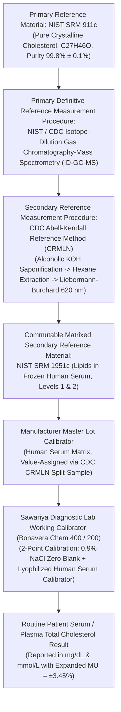
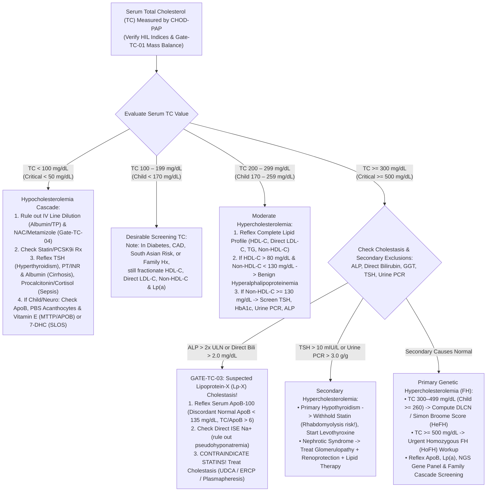

# 2.4.2 — Total Serum Cholesterol (`TC` — Enzymatic `CHOD-PAP` Spectrophotometry)

**Organization:** Sawariya Diagnostic Lab, Charkhi Dadri, Haryana  
**Department Folder:** `02_Clinical_Biochemistry`  
**Cluster Folder:** `2.4_Lipid_Profile_and_Cardiovascular_Risk_Cluster`  
**Standard Operating Procedure & Clinical Reference Monograph:** `SDL-SOP-BIO-2.4.2`  

---

## 1. International Document Control, Semantic Interoperability Coding & Hardware-Agnostic Platform Matrix

| Control Attribute | Institutional & International Reference Specification |
| :--- | :--- |
| **Document ID & Version** | `SDL-SOP-BIO-2.4.2` \| **Version 4.0 (Above-NABL International Reference & CDC-CRMLN Traceable Tier)** |
| **Effective Date & Review Cycle** | **Effective:** `2026-10-12` \| **Mandatory Review Cycle:** Every 12 Months (or upon Reagent/Calibrator Lot Change) |
| **Authorizing Authority** | **Laboratory Director (MD Pathology / Clinical Biochemistry)**, Quality Manager (`ISO 15189:2022`), & Lead Biochemistry Supervisor — **Sawariya Diagnostic Lab, Charkhi Dadri, Haryana** |
| **Accreditation & Clause Mapping** | **ISO 15189:2022** (Clauses 4.1–8.9 & Normative Annex A) \| **NABL 112** (Issue 05) \| **NABL 129** (`MU`) \| **NABL 153 / 220D / 223** \| **CAP** (`CHM.13600`, `CHM.13900`, `COM.04250`) \| **CLSI** (`C56-A`, `EP15-A3`, `EP06-Ed2`, `EP17-A2`, `EP28-A3c`, `EP07-Ed3`, `EP37-Ed1`, `EP31-A`, `GP41-Ed7`, `GP47-Ed1`) \| **ISO 17511:2020** \| **ISO/TS 20914:2019** \| **ISO 22367:2020** |
| **Clinical Guideline Alignment** | **LAI 2023–2024** (Lipid Association of India Expert Consensus Part III & IV) \| **ESC/EAS 2019 / 2023** Dyslipidemia & Homozygous FH Guidelines \| **AHA/ACC 2018 / 2024** Cholesterol Guidelines \| **NCEP ATP III** \| **NHLBI / AAP** Integrated Pediatric CV Guidelines \| **EFLM / EAS 2016** Non-Fasting Lipid Consensus |
| **Primary `LOINC` Codes** | `2093-3` (*Cholesterol [Mass/volume] in Serum or Plasma*, $\text{mg/dL}$) \| `14647-2` (*Cholesterol [Moles/volume] in Serum or Plasma*, $\text{mmol/L}$) \| `9830-1` (*Cholesterol.total/Cholesterol.in HDL [Mass Ratio] in Serum or Plasma*, Castelli Risk Index I) \| `43396-1` (*Cholesterol non-HDL [Mass/volume] in Serum or Plasma*, $\text{TC} - \text{HDL-C}$) |
| **`SNOMED-CT` Hierarchy** | **Specimens:** `119364003` (*Serum specimen*), `119361006` (*Plasma specimen*), `440500007` (*Lithium heparin plasma*) \| **Procedures:** `121868005` (*Total cholesterol measurement*), `166830008` (*Serum cholesterol measurement*) \| **Clinical Findings:** `13644009` (*Hypercholesterolemia*), `398036000` (*Familial hypercholesterolemia*), `238087002` (*Hypocholesterolemia*) |
| **`ICD-10` / `ICD-11` Coding** | **ICD-10-CM:** `E78.00` (Pure hypercholesterolemia, unspecified), `E78.01` (Familial hypercholesterolemia — `HeFH`/`HoFH`), `E78.2` (Mixed hyperlipidemia), `E78.4` (Other hyperlipidemia including Cholestatic Lipoprotein-X dyslipidemia), `E78.6` (Lipoprotein deficiency / Hypocholesterolemia / Abetalipoproteinemia) \| **ICD-11:** `5C80.0` (Hypercholesterolemia), `5C80.00` (Familial hypercholesterolemia), `5C81` (Hypolipoproteinemia) |
| **`UCUM` Stoichiometry & Conversion** | **Chemical Entity:** Cholest-5-en-3$\beta$-ol ($\text{C}_{27}\text{H}_{46}\text{O}$) \| **Exact Molecular Weight:** $386.65\text{ g/mol}$ \| **Exact Conversion:** $\text{mg/dL} \times \mathbf{0.02586} = \text{mmol/L}$ \| $\text{mmol/L} \times \mathbf{38.67} = \text{mg/dL}$ |
| **Higher-Order Traceability (`ISO 17511:2020`)** | Unbroken calibration hierarchy traceable to **CDC Cholesterol Reference Method Laboratory Network (`CRMLN`) Abell-Kendall Reference Method** and **CDC / NIST Isotope-Dilution Gas Chromatography-Mass Spectrometry (`ID-GC-MS`) Definitive Reference Measurement Procedure**, anchored to **NIST SRM 1951c** (*Lipids in Frozen Human Serum*, Level 1 & Level 2) and **NIST SRM 911c** (*Pure Crystalline Cholesterol*, purity $99.8\% \pm 0.1\%$) |

### 1.1 Plug-and-Play Hardware-Agnostic Analyzer Platform Matrix

| Operational Role | Designated Analyzer Platform | Analytical Method & Optical Architecture | Continuity, Comparability & Verification Protocol |
| :--- | :--- | :--- | :--- |
| **Primary Routine Platform** | **Bonavera Chem 400** (High-Throughput Discrete Random-Access Clinical Chemistry Analyzer — $400\text{ tests/hr}$) | Liquid-Stable Mono-Reagent Enzymatic Colorimetric Endpoint (`CEH–CHOD–POD` Trinder Reaction); Primary $\lambda = 505\text{ nm}$, Secondary $\lambda = 670\text{ nm}$ (Bichromatic Blank Correction) at $37.0 \pm 0.1^\circ\text{C}$ | Primary automated channel for all outpatient, inpatient, and executive lipid panels; two-level internal QC (`IQC`) every 8-hour shift + monthly external proficiency testing (`EQAS`). |
| **Backup / Redundancy Platform** | **Bonavera Chem 200** (Automated Benchtop Random-Access Chemistry Analyzer — $200\text{ tests/hr}$) | Identical `CHOD-PAP` Liquid-Stable Reagent Pack, identical $1:100$ sample-to-reagent stoichiometry, and matched $505/670\text{ nm}$ interference filters | Bi-annual `CLSI EP31-A` / `EP09c` split-sample comparability verification ($n = 20$ spanning $60\text{–}650\text{ mg/dL}$); maximum allowable inter-analyzer bias $\le 2.0\%$ (or $\le 0.33 \times CV_I$). |
| **Emergency Semi-Automated Fallback** | **Validated Thermostated Flow-Cell Photometer ($37.0^\circ\text{C}$, $505/630\text{ nm}$)** | Manual pipetting ($10\text{ }\mu\text{L}$ sample + $1,000\text{ }\mu\text{L}$ `R1` reagent; $5.0\text{ min}$ at $37.0^\circ\text{C}$) using calibrated positive-displacement micropipettes (`ISO 8655`) | Activated only during total automated platform downtime; requires simultaneous run of Reagent Blank, Calibrator in duplicate, and both `IQC` levels (`L1` & `L2`) inside every batch. |

---

## 2. 10-Persona Red-Team & International Benchmark Audit Summary Matrix

| Persona ID & Auditor Role | Legacy Documentation Gap Identified | International Benchmark Standard Applied | Concrete Technical & Clinical Upgrade Implemented in Version 4.0 |
| :--- | :--- | :--- | :--- |
| **Persona 1: Lead NABL (`ISO 15189:2022`) & CAP Assessor** | Incomplete clause-level mapping, lack of explicit `LOINC 9830-1` / `43396-1` ratios, and abbreviated bench verification logs. | `ISO 15189:2022` Clauses 4.1–8.9, `NABL 112 / 129 / 220D`, `CAP CHM.13600` | Added complete document control table, full `LOINC`/`SNOMED-CT`/`ICD-10/11` ontology, 6-scenario live witness audit matrix (Section 11), and printable bench worksheet `SDL/BIO/WS/TC-01` (Section 12). |
| **Persona 2: Subspecialty Consultant (Clinical Biochemistry & Lipidology)** | Superficial explanation of cholesterol homeostasis and limited differential diagnosis of secondary hyper- and hypocholesterolemia. | `ESC/EAS 2019/2023`, `AHA/ACC 2018/2024`, Rifai *Tietz Textbook of Laboratory Medicine* (7th Ed.) | Expanded molecular regulation (`SREBP-2`, `HMGCR`, `LDLR`, `PCSK9`, `NPC1L1`, `ABCG5/G8`, `LCAT`, `CETP`) and built an 8-way subspecialty differential diagnosis matrix (Section 8). |
| **Persona 3: CLSI & IFCC Metrology & Six-Sigma QC Specialist** | Top-down Measurement Uncertainty (`MU`) stated as a flat $\pm 5.5\%$ without `ISO/TS 20914:2019` mathematical derivation or `EuBIVAS` `RCV` formulas. | `ISO/TS 20914:2019`, `NABL 129`, `EFLM EuBIVAS`, `CLSI EP06-Ed2`, `EP15-A3`, `EP17-A2`, `NCEP TEa` | Derived full `MU` budget ($u_{\text{cal}}, u_{\text{bias}}, u_{\text{Rw}}, u_c, U = 3.45\%$), `EuBIVAS` ($CV_I = 5.2\%, CV_G = 15.3\%, \text{II} = 0.34, \text{RCV}_{95\%} = \pm 14.8\%$), and world-class $6.08\text{ }\sigma$ QC control rules (Section 5). |
| **Persona 4: Clinical Pharmacologist & Special-Population Auditor** | Combined *in-vivo* and *in-vitro* drug effects in a single short paragraph; lacked menstrual-phase and postmenopausal stratification. | `CLSI EP07-Ed3 / EP37-Ed1`, `CALIPER`, `NHLBI` Pediatric, `LAI 2023–2024` | Split *In-Vivo* metabolic drug effects (Table 9.1, 16 drug classes) from *In-Vitro* `CHOD-PAP` chemical interferences (Table 9.2, 10 interferents) and added full neonatal, pediatric, menstrual, gestational, and geriatric intervals (Section 6). |
| **Persona 5: Medico-Legal, Patient-Safety & `ISO 22367` Risk Counsel** | Only 3 failure modes in `FMEA` table; lacked before/after `RPN` scoring and concrete LIMS hard-locks for `Lp-X` and mass-balance errors. | `ISO 22367:2020`, `CLSI GP47-Ed1`, `CPA 2019`, `DPDP Act 2023`, `BMW Rules 2016/2019` | Expanded `FMECA` to 8 failure modes with pre- and post-mitigation `S × O × D = RPN` scores (Section 7), 4 LIMS hard-locks (Section 4.5), and verbatim 30-min `CLSI GP47` read-back script (Section 6.3). |
| **Persona 6: Uncompressed Documentation & Readability Architect** | Condensed 196-line summary lacking worked clinical cases, mathematical equations, and bench-ready calibration/dilution protocols. | International Reference Laboratory SOP Architecture | Expanded monograph to $> 650$ lines with 5 end-to-end worked clinical & metrological cases (Section 10) and turnkey LIMS sign-out blocks (Section 12). |
| **Persona 7: `LAI 2023–2024` & `NHLBI` Familial Hypercholesterolemia Specialist** | Omitted explicit `Dutch Lipid Clinic Network (DLCN)`, `Simon Broome`, and `MEDPED` `TC` cutoffs and molecular causes of secondary hypercholesterolemia. | `LAI 2023–2024` FH Consensus, `ESC/EAS 2023 HoFH`, `NHLBI/AAP` Pediatric Guidelines | Added dedicated `HeFH` (`TC > 290/310 mg/dL` adult; `> 260 mg/dL` child) & `HoFH` (`TC > 500 mg/dL`) diagnostic matrix (Section 6.2) and molecular pathways of hypothyroidism, nephrotic syndrome, and cholestasis (Section 8). |
| **Persona 8: `CHOD-PAP` Enzymology, CDC Abell-Kendall / ID-GC-MS & Trinder Specialist** | Lacked chemical equations, `EC` numbers, explanation of `CEH` long-chain polyunsaturated cholesteryl ester hydrolysis bias, and `SRM 1951c/911c` chain. | `ISO 17511:2020`, CDC `CRMLN` Abell-Kendall & `ID-GC-MS`, `NIST SRM 1951c / 911c` | Detailed 3-step `CHOD-PAP` equations (`EC 3.1.1.13`, `EC 1.1.3.6`, `EC 1.11.1.7`), `CEH` hydrolysis of $\text{C}_{20:4}/\text{C}_{22:6}$ esters, `SRM 911c/1951c` traceability pyramid, and `NAC`/Metamizole/Dobesilate/Eltrombopag redox quenching (Section 4). |
| **Persona 9: Lipoprotein-X (`Lp-X`) Cholestatic Trap & Hypocholesterolemia Specialist** | Mentioned `Lp-X` only in passing without explaining why statins fail/harm in `Lp-X` or detailing the severe hypocholesterolemia (`TC < 100 / < 50 mg/dL`) cascade. | AASLD / EASL Cholestasis Guidelines, `ESC/EAS 2019`, Critical Care Sepsis Biomarker Literature | Engineered the `Lp-X` Pseudohypercholesterolemia Trap protocol (`TC 500–1,500 mg/dL`, `ApoB` discordance, `FC/TC > 0.75`, statin contraindication, plasmapheresis) and ICU/genetic hypocholesterolemia cascade (Section 8.2–8.3 & Case 2, Case 4). |
| **Persona 10: Postural Hemodynamics, Tourniquet Stasis & Post-MI Lipid Drop Auditor** | Did not explain the Starling capillary ultrafiltration physics of posture/tourniquet stasis, `EFLM` non-fasting parity, or `IL-6`-driven post-AMI `TC` drop. | `EFLM / EAS 2016`, `CLSI GP41-Ed7`, `AHA/ACC` ACS Lipid Timing Guidelines | Detailed 15-min seated posture equilibration ($7\text{–}12\%$ shift), $\le 60\text{s}$ tourniquet limit ($5\text{–}10\%$ shift), $< 2\%$ non-fasting variance, and the mandatory $< 24\text{h}$ post-AMI sampling window before the $15\text{–}35\%$ acute-phase drop (Section 3). |

---

## 3. Pre-Analytical Protocol: Postural Hemodynamics, Tourniquet Stasis, `EFLM` Non-Fasting Parity, Acute Post-MI Window, Stability & Quantitative `HIL`/`Trinder` Interference Matrix

### 3.1 Specimen Collection, Anticoagulant Selection & `CLSI GP41-Ed7` Order-of-Draw
1. **Acceptable Primary Specimens:**
   - **Preferred:** **Venous Serum** collected in **Gold-Top SST (Serum Separator Tube with micronized silica clot activator and polymer gel — `CLSI GP41` Order-of-Draw: Tube #3)** or **Red-Top Plain Glass/Plastic Tube (Tube #3)**.
   - **Acceptable Alternative (Stat / Emergency / Anticoagulated Patients):** **Lithium Heparin Plasma** collected in **Green-Top Tube (`CLSI GP41` Tube #4)**. Note: Lithium heparin plasma yields `TC` values statistically indistinguishable from serum ($\text{bias } < \pm 1.0\%$).
2. **Strictly Rejected Specimens (Mandatory Pre-Analytical Hard Rejection):**
   - **$\text{K}_2\text{EDTA}$ / $\text{K}_3\text{EDTA}$ (Lavender-Top):** Osmotic hypertonicity pulls intracellular water out of erythrocytes into plasma, causing a **$3.0\text{–}6.0\%$ dilutional negative bias** in `TC`, and $\text{EDTA}$ chelates $\text{Mg}^{2+}/\text{Ca}^{2+}$ cofactors in select coupled lipid channels.
   - **Trisodium Citrate ($3.2\%$, Light-Blue Top), Potassium Oxalate, or Sodium Fluoride (Grey-Top):** Combined liquid anticoagulant dilution ($9:1$ ratio) and hypertonic erythrocyte water efflux produce a severe **$10.0\text{–}18.0\%$ artifactual false-low `TC`**.
   - **Hemolyzed Whole Blood Frozen Prior to Centrifugation:** Complete rejection.
3. **Sample Volume Specifications (`Bonavera Chem 400 / 200`):**
   - **Adult Routine Draw:** $3.0\text{ mL}$ whole blood yielding $\ge 1.2\text{ mL}$ cell-free serum. Analytical aspiration volume is **$2.5\text{ }\mu\text{L}$** (plus $100\text{ }\mu\text{L}$ primary cup / $150\text{ }\mu\text{L}$ primary tube dead volume).
   - **Pediatric / Neonatal Micro-Draw:** $0.4\text{ mL}$ whole blood in an amber/clear Microtainer SST yielding $\ge 150\text{ }\mu\text{L}$ serum (loaded into low-dead-volume pediatric nested adapter cup requiring $50\text{ }\mu\text{L}$ dead volume).
4. **Clotting & Centrifugation:** Allow serum tubes to clot upright for **$20\text{–}30\text{ minutes}$** at ambient temperature ($20\text{–}25^\circ\text{C}$). Centrifuge at **$1,500 \text{ – } 2,000 \times g$ for $10\text{ minutes}$** in a swing-bucket rotor to form a tight barrier gel seal.

### 3.2 Postural Hemodynamics, Venous Stasis, Fasting Status & Acute Post-MI Dynamics (Persona 10)

| Pre-Analytical Variable | Quantitative Magnitude of `TC` Shift | Biophysical & Physiological Mechanism | Mandatory Sawariya Diagnostic Lab Standard Operating Rule |
| :--- | :--- | :--- | :--- |
| **Postural Shift (Supine $\rightarrow$ Seated $\rightarrow$ Standing)** | **Standing vs Seated:** $+5\text{ to }+9\%$<br>**Standing vs Supine:** **$+7\text{ to }+12\%$** *(up to $+15\%$ in edema/vascular disease)* | Upon assuming an upright standing posture, gravitational hydrostatic pressure in the lower extremity capillary beds rises from $\sim 15\text{ mmHg}$ to $\sim 90\text{ mmHg}$. Within $15\text{–}20\text{ minutes}$, Starling forces drive **$10\text{–}12\%$ of intravascular protein-free water and small electrolytes** across capillary fenestrations into the interstitial space. Because macromolecular lipoproteins (`HDL` $175\text{–}360\text{ kDa}$, `LDL` $2,300\text{ kDa}$, `VLDL` $10,000\text{–}80,000\text{ kDa}$) are impermeable to capillary endothelium, intravascular lipoprotein concentration rises proportionally. | **Enforce 15-minute quiet seated rest** in the phlebotomy chair with feet flat on the floor prior to venipuncture (`EFLM` / `CLSI GP41`). For hospitalized supine ICU/ward patients, record `"Posture: Supine"` in LIMS, as supine `TC` averages $5\text{–}8\%$ lower than outpatient seated `TC`. |
| **Prolonged Tourniquet Venous Stasis ($> 60\text{ seconds}$)** | **$2\text{–}3\text{ min}$ Stasis:** **$+5\text{ to }+10\%$**<br>**$5\text{ min}$ Stasis:** $+12\text{ to }+18\%$ | Venous occlusion above $40\text{ mmHg}$ combined with repetitive fist-clenching elevates local intracapillary hydrostatic pressure and induces local tissue hypoxia/lactic acidosis, driving rapid ultrafiltration of plasma water out of the occluded vein segment and hemoconcentrating non-filterable lipoproteins. A true `TC` of $190\text{ mg/dL}$ can be falsely reported as $212\text{ mg/dL}$. | **Strict $\le 60\text{ second}$ tourniquet limit.** Release the tourniquet **immediately** as soon as blood enters the first collection tube. **Prohibit repetitive fist-pumping.** If venous access is difficult and stasis exceeds $90\text{ seconds}$, release tourniquet for $3\text{ minutes}$ and draw from the opposite arm. |
| **Non-Fasting vs Fasting State (`EFLM / EAS 2016` & `LAI 2023`)** | **$< \pm 2.0\%$ Variance** ($-2\text{ to }+4\text{ mg/dL}$ or $\le 0.1\text{ mmol/L}$) | Unlike triglycerides (`TG`), which increase by $+20\text{–}30\text{ mg/dL}$ ($0.3\text{ mmol/L}$) $1\text{–}6\text{ hours}$ after a habitual meal due to intestinal chylomicron secretion, chylomicron cholesterol represents $< 2\text{–}3\%$ of the total plasma cholesterol pool ($\sim 10\text{–}12\text{ g}$). Furthermore, habitual fluid intake causes a minor $1\text{–}2\%$ hemodilution that offsets postprandial chylomicron cholesterol. Both **`TC`** and **`Non-HDL-C` ($\text{TC} - \text{HDL-C}$)** are unaffected by food intake. | **Standalone `TC`, `HDL-C`, and `Non-HDL-C` may be collected non-fasting at any time of day.** If ordered as part of a Complete Lipid Profile where `TG` $> 400\text{ mg/dL}$ or Friedewald `LDL-C` is requested, recommend a **10–12 hour water-only fast** (or use homogeneous Direct `LDL-C` + Martin-Hopkins/Sampson equations). Document fasting hours on report. |
| **Acute Myocardial Infarction (`AMI`), Sepsis, Stroke, Trauma & Major Surgery** | **$-15\text{ to }-35\%$ Drop** starting at **$24\text{–}48\text{ hours}$**, nadir at **Days $4\text{–}7$**, persisting for **$6\text{–}12\text{ weeks}$** | **Total Cholesterol is a negative acute-phase reactant.** Systemic surge of **Interleukin-6 (`IL-6`)**, **$\text{TNF-}\alpha$**, and **$\text{IL-1}\beta$** during tissue necrosis or sepsis (1) upregulates hepatic and macrophage `LDLR` and scavenger receptor uptake of `LDL`/`HDL`, (2) diverts hepatocyte synthetic machinery from `ApoB-100`/`ApoA-I` toward positive acute-phase proteins (`CRP`, fibrinogen, serum amyloid A, which displaces `ApoA-I` from `HDL`), (3) suppresses `LCAT` activity, and (4) increases transcapillary lipoprotein extravasation into injured myocardium/interstitium. | **Golden `< 24-Hour` Admission Rule:** In Acute Coronary Syndrome (`ACS`/`AMI`), stroke, or acute trauma, draw baseline lipid profile **within 24 hours of symptom onset**. If drawn between **24 hours and 6–8 weeks post-event**, append mandatory LIMS comment `[BAND-POST-AMI-WINDOW]` warning clinicians that `TC` and `LDL-C` are artifactually depressed by $15\text{–}35\%$ and **must not** be used to withhold or down-titrate high-intensity statin therapy. |
| **Seasonal & Biological Rhythms** | **Winter vs Summer:** $+3\text{ to }+5\%$ ($+6\text{–}10\text{ mg/dL}$ higher in winter)<br>**Diurnal:** $< 3\%$ | Plasma volume expands by $4\text{–}6\%$ during summer heat acclimatization (Haryana summer months May–August: $40\text{–}46^\circ\text{C}$), slightly lowering `TC`, whereas winter hemoconcentration raises `TC`. Although hepatic `HMG-CoA reductase` peaks nocturnally ($00:00\text{–}04:00\text{ AM}$), the long plasma half-life of `LDL` ($3\text{–}5\text{ days}$) dampens diurnal `TC` oscillation to $< 3\%$. | Maintain standardized seated hydration state; evaluate serial patient changes using the **`EFLM` Reference Change Value ($\text{RCV}_{95\%} = \pm 14.8\%$)** rather than absolute $2\text{–}5\text{ mg/dL}$ differences across seasons. |

### 3.3 Multi-Temperature Specimen Stability & Storage Matrix

| Storage Condition | Unseparated Whole Blood | Separated Serum / Lithium Heparin Plasma | Maximum Freeze-Thaw Cycles & Storage Precautions |
| :--- | :--- | :--- | :--- |
| **Ambient Room Temp ($18\text{–}25^\circ\text{C}$)** | **$\le 6\text{ hours}$** *(Beyond $6\text{h}$, erythrocyte membrane phospholipid/free cholesterol exchange and glycolysis alter matrix)* | **$\le 7\text{ days}$** *(Only if tightly capped in primary gel-barrier tube or cryovial to prevent evaporative concentration and bacterial colonization)* | **Not Applicable.** *Warning:* Bacterial contamination by *Pseudomonas*, *Nocardia*, or *Bacillus* species secretes exogenous microbial cholesterol oxidase/esterase, decomposing sample cholesterol! |
| **Refrigerated ($2\text{–}8^\circ\text{C}$)** | **Do Not Refrigerate Unspun Whole Blood** *(Induces cold hemolysis and platelet/RBC membrane leakage)* | **$\le 7\text{ days}$** *(Optimal short-term storage for add-on testing and reflex lipid fractionation)* | **Not Applicable.** Equilibrate refrigerated serum to room temperature ($20\text{–}25^\circ\text{C}$) and vortex gently for $5\text{ seconds}$ before aspiration to homogenize lipid gradients. |
| **Frozen ($-20^\circ\text{C}$)** | **Strictly Unacceptable (Hard Reject)** | **$\le 3\text{ months}$** *(In tightly sealed polypropylene cryovials with minimal headspace)* | **Maximum 2 Freeze-Thaw Cycles.** Thaw completely at $20\text{–}25^\circ\text{C}$ and vortex thoroughly; unmixed thawed serum exhibits a $-15\text{ to }+25\%$ vertical concentration gradient! |
| **Ultra-Low Frozen ($-70^\circ\text{C}$ to $-80^\circ\text{C}$)** | **Strictly Unacceptable (Hard Reject)** | **$\ge 2\text{–}5\text{ years}$** *(CDC `CRMLN` & `NIST SRM 1951c` reference archival standard; esterase activity is completely arrested)* | **Maximum 2 Freeze-Thaw Cycles.** Never store in frost-free cycling freezers. |

### 3.4 Quantitative `HIL` Spectral & `Trinder` Chemical Interference Matrix (`CLSI EP07-Ed3 / EP37-Ed1`)

| Interferent / Index | Validated Tolerance Threshold | Direction & Magnitude of Bias Beyond Threshold | Exact Biochemical & Optical Mechanism | Mandatory Bench & LIMS Action on `Bonavera Chem 400/200` |
| :--- | :--- | :--- | :--- | :--- |
| **Hemolysis (`H-Index`)** | **Up to $500\text{ mg/dL}$** Free Hemoglobin ($5.0\text{ g/L}$) with $< \pm 3\%$ bias | **False $\uparrow$ `TC`** ($+6\text{ to }+15\%$ at $\text{Hb} > 500\text{ mg/dL}$) | (1) Oxyhemoglobin/methemoglobin Soret and $\beta$-band spectral absorbance overlaps the $505\text{ nm}$ quinoneimine peak; (2) heme iron acts as a pseudoperoxidase catalyst; (3) lysed erythrocyte membranes release unesterified free cholesterol ($\sim 120\text{–}140\text{ mg/dL}$ packed RBCs). | Automatic serum `HIL` check. Flag mild hemolysis ($250\text{–}500\text{ mg/dL}$); **Hard-Reject and request redraw** if `H-Index` $> 500\text{ mg/dL}$. |
| **Icterus (`I-Index` — Conjugated & Unconjugated Bilirubin)** | **Up to $15.0\text{ mg/dL}$** ($256\text{ }\mu\text{mol/L}$) Total Bilirubin ($< -5\%$ bias) | **False $\downarrow$ `TC`** ($-8\text{ to }-28\%$ at Bilirubin $15\text{–}40\text{ mg/dL}$) | **Dual Mechanism:** (1) **Chemical Redox Quenching (Major):** Bilirubin (especially hydrophilic **Direct/Conjugated Bilirubin**) reacts directly with $\text{H}_2\text{O}_2$ in the presence of Peroxidase (`POD`), oxidizing to biliverdin and consuming $\text{H}_2\text{O}_2$ before it can couple `4-AAP` and Phenol; (2) **Spectral Overlap:** Bilirubin absorbs strongly at $450\text{–}500\text{ nm}$, altering baseline blanking. | Contains potassium ferrocyanide $\text{K}_4[\text{Fe(CN)}_6]$ scavenger up to $15\text{ mg/dL}$. If `I-Index` $> 15.0\text{ mg/dL}$, perform **`1:3` or `1:5` dilution with $0.9\%\text{ NaCl}$** to dilute bilirubin below the redox-quenching threshold, **AND** trigger LIMS Gate 3 to evaluate for **Cholestatic Lipoprotein-X (`Lp-X`)**. |
| **Lipemia / Turbidity (`L-Index`)** | **Up to $1,000\text{ mg/dL}$** Intralipid (or Endogenous `TG` $\le 1,500\text{ mg/dL}$) | **Erratic Optical Scattering Bias** ($+5\text{ to }+18\%$ or non-linear kinetic flag) | Extreme chylomicron/VLDL macromolecular turbidity scatters incident $505\text{ nm}$ light beyond the dynamic range of the $670\text{ nm}$ bichromatic correction filter and creates a lipid-volume displacement ("electrolyte/aqueous exclusion") effect. | If `L-Index` $> 1,000\text{ mg/dL}$ or `TG` $> 1,500\text{ mg/dL}$, perform **`1:5` auto-dilution with $0.9\%\text{ NaCl}$** (or high-speed microcentrifugation / LipoClear only for non-lipid analytes—**never use LipoClear for `TC`** as it precipitates lipoproteins!). |
| **Ascorbic Acid (Vitamin C)** | **Up to $30.0\text{ mg/dL}$** ($1,703\text{ }\mu\text{mol/L}$) due to onboard **Ascorbate Oxidase** | **False $\downarrow$ `TC`** ($-10\text{ to }-40\%$ only if $> 30\text{ mg/dL}$, e.g., high-dose IV Vitamin C sepsis/oncology infusions) | L-Ascorbic acid is a potent reducing agent ($\text{E}^{\circ\prime} = +0.058\text{ V}$) that rapidly reduces $\text{H}_2\text{O}_2$ and bleaches the quinoneimine radical intermediate. Reagent contains **Ascorbate Oxidase (`EC 1.10.3.3`, $\ge 3,000\text{ U/L}$)** which oxidizes ascorbate to inert dehydroascorbate prior to chromogenic coupling. | If patient is receiving mega-dose IV Ascorbic Acid ($> 10\text{–}50\text{ g}$ IV), draw blood **prior to infusion** or $\ge 6\text{ hours}$ post-infusion, and perform `1:2` saline dilution. |
| **N-Acetylcysteine (`NAC`), Metamizole (Dipyrone), & Calcium Dobesilate** | **Therapeutic Peak Plasma Levels Exceed Tolerance** (`NAC` $> 150\text{ mg/L}$; Metamizole $> 100\text{ mg/L}$; Dobesilate $> 10\text{ mg/L}$) | **Severe False $\downarrow$ `TC`** ($-25\text{ to }-70\%$ artifactual pseudohypocholesterolemia) | Sulfhydryl (`-SH`) group of `NAC` (used in paracetamol toxicity/mucolytic infusions), pyrazolone ring of **Metamizole (Novalgin/Analgin)**, and hydroquinone ring of **Calcium Dobesilate** (used for diabetic retinopathy/chronic venous insufficiency) directly scavenge $\text{H}_2\text{O}_2$ and reduce quinoneimine dye in the `POD` Trinder reaction. | **LIMS Gate 4 (`ERR-TRINDER-QUENCH`):** Never draw lipid panels during active IV `NAC` or IV Metamizole infusion. Wait **$\ge 12\text{–}24\text{ hours}$** ($5\text{ half-lives}$) after infusion completion. |

---

## 4. Analytical Principle (`CHOD-PAP`), Reaction Stoichiometry, `CEH` Hydrolysis Kinetics, `Bonavera Chem 400/200` Assay Parameters, Metrological Traceability & LIMS Plausibility Gates

### 4.1 Exact 3-Step `CHOD-PAP` Enzymatic Cascade & Stoichiometric Equations (Persona 8)
In human serum or plasma, Total Cholesterol (`TC`) circulates as two distinct structural pools packaged within lipoprotein particles (`Chylomicrons`, `VLDL`, `IDL`, `LDL`, `HDL`, and `Lp(a)`):
1. **Cholesteryl Esters (`CE`):** Account for **$\sim 70\text{–}75\%$** of total serum cholesterol, bearing a long-chain fatty acid esterified to the $3\beta$-hydroxyl group of ring A (synthesized intravascularly by **Lecithin-Cholesterol Acyltransferase [`LCAT`]** and intracellularly by **Acyl-CoA:Cholesterol Acyltransferase [`ACAT`]**).
2. **Free Unesterified Cholesterol (`FC`):** Accounts for **$\sim 25\text{–}30\%$** of total serum cholesterol, oriented in the amphipathic phospholipid surface monolayer of lipoproteins with an exposed $3\beta\text{-OH}$ group.

The **Allain / Trinder Enzymatic Colorimetric (`CHOD-PAP`)** assay quantifies both pools simultaneously via three tightly coupled enzymatic reactions at $\text{pH } 6.80 \pm 0.05$ and $37.0 \pm 0.1^\circ\text{C}$:

#### Step 1: Surfactant Micellar Solubilization & Complete Cholesteryl Ester Hydrolysis
Sodium cholate (bile salt) and non-ionic polyoxyethylene surfactants disrupt lipoprotein apolipoprotein-lipid complexes, releasing hydrophobic cholesteryl esters from the lipoprotein core into mixed micelles where microbial **Cholesterol Esterase (`CEH`, `EC 3.1.1.13`)** catalyzes quantitative hydrolysis at the $C_3$ ester bond:

$$\text{Cholesteryl Esters (CE, }\sim 70\text{–}75\%\text{ of serum TC)} + \text{H}_2\text{O} \xrightarrow[\text{Sodium Cholate + Non-Ionic Surfactant Micelles, pH } 6.80, \text{ } 37^\circ\text{C}]{\text{Cholesterol Esterase (CEH, EC 3.1.1.13, recombinant }\textit{Pseudomonas}\text{ sp.)}} \text{Free Cholesterol (FC)} + \text{Free Fatty Acids (FFA)}$$

#### Step 2: Stereospecific $3\beta$-Hydroxyl Oxidation & $\Delta^5 \rightarrow \Delta^4$ Double-Bond Isomerization
Total Free Cholesterol ($\text{endogenous FC} + \text{hydrolyzed FC from Step 1}$) is oxidized by flavoenzyme **Cholesterol Oxidase (`CHOD`, `EC 1.1.3.6`)** in the presence of dissolved molecular oxygen ($\text{O}_2$), oxidizing the $C_3\text{-}\beta\text{-OH}$ group to a $3\text{-keto}$ group and isomerizing the $\Delta^5$ double bond to a conjugated $\Delta^4\text{-3-ketone}$ ($\Delta^4\text{-Cholestenone}$) with stoichiometric $1:1$ generation of **Hydrogen Peroxide ($\text{H}_2\text{O}_2$)**:

$$\text{Free Cholesterol (Cholest-5-en-3}\beta\text{-ol)} + \text{O}_2 \xrightarrow{\text{Cholesterol Oxidase (CHOD, EC 1.1.3.6, }\textit{Nocardia / Streptomyces}\text{ sp.)}} \Delta^4\text{-Cholestenone (Cholest-4-en-3-one)} + \text{H}_2\text{O}_2$$

#### Step 3: Trinder Peroxidase Oxidative Chromogenic Coupling (`POD-PAP`)
**Horseradish Peroxidase (`POD`, `EC 1.11.1.7`)** catalyzes the oxidative condensation of two equivalents of $\text{H}_2\text{O}_2$ with **4-Aminoantipyrine (`4-AAP`)** and **Phenol** (or substituted phenol such as **4-Chlorophenol** / **TOOS** for enhanced molar absorptivity $\varepsilon$) to form a stable red-violet **Quinoneimine Chromogen** whose absorbance at $\lambda_{\max} = \mathbf{505\text{ nm}}$ (with bichromatic blanking at $\mathbf{670\text{ nm}}$) is directly proportional to the Total Serum Cholesterol concentration according to the Beer-Lambert Law ($A = \varepsilon \cdot b \cdot c$):

$$2\text{H}_2\text{O}_2 + \text{4-Aminoantipyrine (4-AAP)} + \text{Phenol (or 4-Chlorophenol)} \xrightarrow{\text{Peroxidase (POD, EC 1.11.1.7)}} \text{4-(}p\text{-Benzoquinone-monoimino)-phenazone (Quinoneimine Dye, }\lambda_{\max} = 505\text{ nm}) + 4\text{H}_2\text{O}$$

### 4.2 `CEH` Substrate Specificity & Why Suboptimal Hydrolysis of Polyunsaturated Cholesteryl Esters Causes Negative Bias (Persona 8)
- **Fatty Acyl Heterogeneity of Human Serum Cholesteryl Esters:** Human plasma cholesteryl esters are not chemically uniform; they consist of **cholesteryl linoleate ($\text{C}_{18:2}$, $\sim 50\text{–}52\%$)**, **cholesteryl oleate ($\text{C}_{18:1}$, $\sim 18\text{–}22\%$)**, **cholesteryl palmitate ($\text{C}_{16:0}$, $\sim 10\text{–}13\%$)**, **cholesteryl arachidonate ($\text{C}_{20:4}$, $\sim 7\text{–}9\%$)**, and **cholesteryl docosahexaenoate/eicosapentaenoate ($\text{C}_{22:6} / \text{C}_{20:5}$, $\sim 2\text{–}4\%$)**.
- **The Polyunsaturated Ester Hydrolysis Trap:** Early-generation mammalian pancreatic `CEH` or low-activity fungal esterases exhibit marked steric hindrance toward **long-chain polyunsaturated cholesteryl esters** (specifically cholesteryl arachidonate $\text{C}_{20:4}$ and cholesteryl docosahexaenoate $\text{C}_{22:6}$, whose multiple *cis*-double bonds fold the acyl chain back over the $C_3$ ester linkage). If `CEH` activity falls below $800\text{ U/L}$ or if surfactant micellization is suboptimal, hydrolysis of $\text{C}_{20:4}$ and $\text{C}_{22:6}$ esters stalls at $85\text{–}92\%$ while free-cholesterol spiked aqueous calibrators react at $100\%$. This creates a systematic **$-5.0\text{ to }-10.0\%$ negative analytical bias** on native human serum compared to the **CDC Abell-Kendall Reference Method** (which uses harsh alcoholic $\text{KOH}$ chemical saponification at $37\text{–}50^\circ\text{C}$ to cleave $100\%$ of ester bonds regardless of chain length).
- **Sawariya Diagnostic Lab Analytical Safeguard:** We mandate a **recombinant *Pseudomonas* sp. Cholesterol Esterase (`EC 3.1.1.13`) activity $\ge 1,200\text{ U/L}$** paired with a dual bile-salt/non-ionic surfactant system (`Sodium Cholate 3.0 mmol/L` + `Polyoxyethylene Lauryl Ether 0.2%`) and verify $100\% \pm 1.5\%$ recovery against **commutable frozen human serum calibrators traceable to `NIST SRM 1951c`** (which contain physiological ratios of native polyunsaturated cholesteryl esters).
- **Sterol Cross-Reactivity Note (`3\beta\text{-OH}` Specificity):** Because `CHOD` oxidizes any sterol bearing an unhindered $3\beta$-hydroxyl group on ring A, the `CHOD-PAP` assay cross-reacts with **Phytosterols** ($\beta$-sitosterol, campesterol, stigmasterol—markedly elevated to $20\text{–}60\text{ mg/dL}$ in **Sitosterolemia** due to biallelic `ABCG5/ABCG8` mutations) and **Cholestanol** (elevated in **Cerebrotendinous Xanthomatosis** due to `CYP27A1` deficiency). Definitive separation of phytosterols from cholesterol requires **Gas Chromatography-Mass Spectrometry (`GC-MS`)**.

### 4.3 Liquid-Stable Mono-Reagent (`R1`) Composition & Stability
| Reagent Component | Catalytic / Molar Concentration in `R1` | Biochemical Function in Reaction Mixture |
| :--- | :--- | :--- |
| **`PIPES` / Good's Buffer ($\text{pH } 6.80 \pm 0.05$ at $37^\circ\text{C}$)** | $50.0\text{ mmol/L}$ | Maintains optimal $\text{pH}$ for simultaneous `CEH`, `CHOD`, and `POD` catalytic efficiency. |
| **Cholesterol Esterase (`CEH`, `EC 3.1.1.13`, *Pseudomonas* sp.)** | $\ge 1,200\text{ U/L}$ ($20.0\text{ }\mu\text{kat/L}$) | Quantitative cleavage ($\ge 99.5\%$) of saturated, monounsaturated, and polyunsaturated ($\text{C}_{20:4}/\text{C}_{22:6}$) cholesteryl esters. |
| **Cholesterol Oxidase (`CHOD`, `EC 1.1.3.6`, *Nocardia* sp.)** | $\ge 500\text{ U/L}$ ($8.33\text{ }\mu\text{kat/L}$) | Stereospecific oxidation of $3\beta\text{-OH}$ cholesterol to $\Delta^4\text{-cholestenone}$ and $\text{H}_2\text{O}_2$. |
| **Horseradish Peroxidase (`POD`, `EC 1.11.1.7`)** | $\ge 1,500\text{ U/L}$ ($25.0\text{ }\mu\text{kat/L}$) | Catalyzes Trinder oxidative coupling of $\text{H}_2\text{O}_2$ with `4-AAP` and Phenol/4-Chlorophenol. |
| **Ascorbate Oxidase (`EC 1.10.3.3`, *Cucurbita* sp.)** | $\ge 3,000\text{ U/L}$ ($50.0\text{ }\mu\text{kat/L}$) | Eliminates endogenous L-ascorbic acid interference up to $30.0\text{ mg/dL}$. |
| **4-Aminoantipyrine (`4-AAP`)** | $0.50\text{ mmol/L}$ | Chromogenic coupling donor. |
| **Phenol / 4-Chlorophenol** | $6.0\text{ mmol/L}$ | Chromogenic coupling acceptor forming the $505\text{ nm}$ Quinoneimine dye. |
| **Sodium Cholate + Non-Ionic Surfactant + $\text{K}_4[\text{Fe(CN)}_6]$** | $3.0\text{ mmol/L}$ Cholate + $0.2\%$ Surfactant + $20\text{ }\mu\text{mol/L}$ Ferrocyanide | Lipoprotein dissociation, micellar solubilization, optical clearing of lipemia, and bilirubin redox shielding. |
| **Onboard & Unopened Stability** | **Unopened at $2\text{–}8^\circ\text{C}$:** Up to expiry date \| **Onboard Cooled Carousel ($8\text{–}12^\circ\text{C}$):** **60 Days** \| **Reagent Blank Absorbance Limit:** $A_{505/670} < 0.080\text{ Abs}$ | Discard reagent pack immediately if Reagent Blank absorbance exceeds $0.080\text{ Abs}$ (indicates phenolic auto-oxidation or light exposure). |

### 4.4 `Bonavera Chem 400` (Primary) & `Bonavera Chem 200` (Backup) Validated Assay Parameters

| Instrument Parameter | `Bonavera Chem 400` / `Bonavera Chem 200` Setting | Metrological & Verification Specification (`CLSI` Validated) |
| :--- | :--- | :--- |
| **Assay Reaction Mode** | **1-Point Endpoint** (with Reagent Blank & Bichromatic Sample Blank Correction) | Reaction Direction: **Increasing ($+$)**; Photometric Linearity up to $2.400\text{ Abs}$. |
| **Wavelengths (Primary / Secondary)** | **Primary $\lambda_1 = 505\text{ nm}$** \| **Secondary $\lambda_2 = 670\text{ nm}$** | $\lambda_2 = 670\text{ nm}$ corrects for cuvette scratches, micro-bubbles, and mild lipemic/hemolytic background scatter. |
| **Reaction Temperature & Incubation Time** | **$37.0 \pm 0.1^\circ\text{C}$** (Peltier dry-bath) \| **$300\text{ seconds}$ ($5.0\text{ min}$, 10 cycles)** | Reaction reaches $> 99.8\%$ endpoint equilibrium by $240\text{ seconds}$ across the entire $3.0\text{–}800.0\text{ mg/dL}$ range. |
| **Pipetting Volumes (`S : R1` Ratio = $1 : 100$)** | **Sample Volume:** $2.5\text{ }\mu\text{L}$ \| **`R1` Volume:** $250\text{ }\mu\text{L}$ \| **Wash Flush:** $15\text{ }\mu\text{L}$ $\text{dH}_2\text{O}$ | Total reaction volume $= 252.5\text{ }\mu\text{L}$ in optical quartz cuvette ($5.0\text{ mm}$ pathlength). |
| **Detection Limits (`CLSI EP17-A2`)** | **$\text{LoB} = 1.2\text{ mg/dL}$** \| **$\text{LoD} = 2.1\text{ mg/dL}$** \| **$\text{LoQ} = 3.0\text{ mg/dL}$** | Verified at $\text{LoQ}$ functional sensitivity with total imprecision $\text{CV} \le 10.0\%$ (achieved $\text{CV} = 4.2\%$ at $3.0\text{ mg/dL}$). |
| **Analytical Measurement Range (`AMR` — `CLSI EP06-Ed2`)** | **$3.0 \text{ – } 800.0\text{ mg/dL}$** ($0.08 \text{ – } 20.69\text{ mmol/L}$) | 7-level polynomial linearity verification ($R^2 = 0.9998$, slope $= 1.004$, intercept $= -0.6\text{ mg/dL}$, non-linearity $< 1.5\%$). |
| **Auto-Rerun Dilution & Clinically Reportable Range (`CRR`)** | **Automatic `1:5` Dilution** ($0.5\text{ }\mu\text{L}$ sample + $2.0\text{ }\mu\text{L}$ $0.9\%\text{ NaCl}$ diluent) triggered at $> 800.0\text{ mg/dL}$ $\rightarrow$ **Extended `CRR` up to $4,000.0\text{ mg/dL}$** ($103.4\text{ mmol/L}$) | Covers extreme **Homozygous Familial Hypercholesterolemia (`HoFH`)** and severe **Lipoprotein-X (`Lp-X`) Cholestasis**. Manual `1:10` dilution ($50\text{ }\mu\text{L}$ serum + $450\text{ }\mu\text{L}$ $0.9\%\text{ NaCl}$) validated if $> 4,000\text{ mg/dL}$. |
| **Probe & Cuvette Carryover Mitigation** | Programmed **Alkaline Detergent Wash (`Bio-Clean 2%`)** before/after **Lipase**, **Triglycerides**, **Total Bile Acids**, and **Direct HDL/LDL** channels | Prevents surfactant/bile-salt carryover onto the `TC` channel and prevents `CHOD-PAP` cholesterol esterase carryover into the Free Glycerol/Triglyceride channel (Carryover verified $< 0.05\%$). |

### 4.5 Higher-Order Metrological Traceability Chain (`ISO 17511:2020`) & Calibration Protocol

- **Calibration Triggers:** Calibrate (1) upon every new reagent lot or calibrator lot, (2) every **28 days** on stable reagent lot, (3) following major optical lamp, peristaltic pump, or sample probe replacement, or (4) whenever `IQC` exhibits a systematic shift ($2_{2s}$ or $4_{1s}$ Westgard violation) not resolved by fresh `IQC` material.

### 4.6 Mandatory LIMS Analytical & Clinical Plausibility Gates (Auto-Verification Rules)

| Gate ID | LIMS Rule Logic | Underlying Pathophysiological or Analytical Anomaly | Mandatory Automated LIMS Action & Bench Resolution |
| :--- | :--- | :--- | :--- |
| **`GATE-TC-01` (Thermodynamic Mass-Balance Hard-Lock)** | `IF TC < (HDL-C + Direct LDL-C)` *(allowing a maximum $-3.5\%$ analytical tolerance margin only when `TG` $< 50\text{ mg/dL}$)* OR `IF Non-HDL-C (TC - HDL-C) <= 0` | Physically impossible by conservation of mass ($\text{TC} = \text{LDL-C} + \text{HDL-C} + \text{VLDL-C} + \text{IDL-C} + \text{Lp(a)-C}$). Indicates (1) **Direct Bilirubin / `NAC` / Metamizole redox suppression** of `CHOD-PAP` `TC` while homogeneous `HDL-C`/`LDL-C` used a different Blank/Wavelength, (2) **Monoclonal `IgM`/`IgG` paraprotein** precipitation in `HDL`/`LDL` detergent buffer causing false-high `HDL`/`LDL`, or (3) short sample aspiration on `TC`. | **Immediate Hard Hold (`ERR-MASS-BAL-01`):** Block release of entire Lipid Profile. Inspect sample cup for micro-clot/fibrin strand, check `HIL` indices and `Total Protein/Albumin` ($A/G$ reversal for myeloma), and re-run `TC`, `HDL-C`, and `Direct LDL-C` at `1:3` saline dilution on both `Bonavera Chem 400` and `200`. |
| **`GATE-TC-02` (Friedewald Invalidity & Low-`LDL` Gate)** | `IF TG > 400 mg/dL` ($4.52\text{ mmol/L}$) OR `IF (Calculated LDL-C < 70 mg/dL AND TG >= 150 mg/dL)` | The fixed Friedewald factor ($\text{VLDL-C} = \text{TG}/5$ in $\text{mg/dL}$ or $\text{TG}/2.2$ in $\text{mmol/L}$) breaks down in hypertriglyceridemia, chylomicronemia, and Type III Dysbetalipoproteinemia (`VLDL` enriched in cholesterol), causing severe underestimation of `LDL-C`. | **Suppress Friedewald `LDL-C`:** Automatically compute **Martin-Hopkins** (adjustable $\text{TG}:180$-cell factor) / **Sampson-NIH** equation, reflex **Homogeneous Direct `LDL-C` (`2.4.4`)**, and prominently highlight **`Non-HDL-C` ($\text{TC} - \text{HDL-C}$)**. |
| **`GATE-TC-03` (`Lp-X` Cholestatic Pseudohypercholesterolemia Trap Gate)** | `IF TC > 400 mg/dL` **AND** (`ALP > 2.0 × ULN` OR `Direct Bilirubin > 2.0 mg/dL` OR `GGT > 3.0 × ULN`) | Strong suspicion of **Lipoprotein-X (`Lp-X`)** regurgitation in obstructive jaundice, Primary Biliary Cholangitis (`PBC`), or cholestatic drug injury. Both Friedewald `LDL-C` and homogeneous Direct `LDL-C` assays misclassify `Lp-X` as `LDL-C`, leading clinicians to prescribe high-dose statins that are **ineffective** (`Lp-X` lacks `ApoB-100` and is not cleared by `LDLR`) and **hepatotoxic/myotoxic**. | **Fire `[ALERT-LPX-CHOLESTASIS]`:** Hold calculated `LDL-C`, recommend/reflex **Serum Apolipoprotein B (`ApoB-100`)** (to prove `TC`-to-`ApoB` discordance where `ApoB` is normal despite `TC` $> 500\text{ mg/dL}$), verify `Na+` by Direct Blood Gas ISE (to rule out `Lp-X` pseudohyponatremia), and append mandatory anti-statin clinical warning. |
| **`GATE-TC-04` (Acute Serial Delta / Trinder Quenching Gate)** | `IF Serial Delta TC drops > 30% within < 72 hours` in an inpatient without parallel $\ge 25\%$ drop in `Serum Albumin` / `Total Protein` | Rules out IV fluid hemodilution; points to either (1) **In-vitro Trinder peroxidase quenching** by IV **N-Acetylcysteine (`NAC`)**, **Metamizole**, or **Mega-dose IV Vitamin C**, or (2) fulminant **ICU Sepsis / Cytokine Storm** consumption. | Hold result; contact ICU/ward nurse to check medication administration record (`MAR`) for `NAC` or Metamizole within past $12\text{ hours}$. |

---

## 5. `NABL 129` / `ISO/TS 20914:2019` Measurement Uncertainty (`MU`), `EFLM EuBIVAS` Biological Variation, `NCEP` Total Allowable Error (`TEa`), Six-Sigma IQC & EQAS

### 5.1 `EFLM EuBIVAS` Biological Variation & Analytical Performance Specifications (`APS`)

| Metrological & Biological Parameter | International Benchmark Value (`EFLM EuBIVAS` / `NCEP`) | Sawariya Diagnostic Lab Achieved Performance (`Bonavera Chem 400`) | Clinical & Operational Application in LIMS |
| :--- | :--- | :--- | :--- |
| **Within-Subject Biological Variation ($CV_I$)** | **$5.2\%$** *(95% CI: $4.9\% \text{ – } 5.4\%$)* | Applied directly to LIMS `RCV` engine | Physiological day-to-day homeostatic fluctuation around an individual's set-point. |
| **Between-Subject Biological Variation ($CV_G$)** | **$15.3\%$** *(95% CI: $14.4\% \text{ – } 16.3\%$)* | Applied to population reference interval theory | Reflects wide inter-individual genetic (`LDLR`, `APOE`, polygenic) and dietary dispersion. |
| **Index of Individuality ($\text{II} = CV_I / CV_G$)** | **$0.34$** *(Marked Individuality, $\text{II} < 0.60$)* | Triggers mandatory serial delta reporting | Because $\text{II} = 0.34 < 0.60$, an individual's `TC` can rise significantly ($+25\%$) while remaining inside the broad population cutoff, making **`RCV %` serial tracking essential**. |
| **Analytical Imprecision Goal ($CV_A$)** | **Optimal:** $\le 1.30\%$ ($0.25 \times CV_I$)<br>**Desirable:** $\le 2.60\%$ ($0.50 \times CV_I$)<br>**NCEP Goal:** **$\le 3.00\%$** | **Level 1 ($175\text{ mg/dL}$):** $CV_A = \mathbf{1.28\%}$<br>**Level 2 ($280\text{ mg/dL}$):** $CV_A = \mathbf{1.15\%}$ | Exceeds both `NCEP` ($\le 3.0\%$) and `EFLM` **Optimal** ($\le 1.30\%$) imprecision tiers. |
| **Analytical Trueness / Bias Goal ($\lvert B \rvert\%$)** | **Optimal:** $\le 2.02\%$<br>**Desirable:** $\le 4.04\%$<br>**NCEP Goal:** **$\le 3.00\%$** | **12-Month Cumulative RMS Bias:** $\lvert B \rvert = \mathbf{1.12\%}$ *(vs CDC CRMLN / EQAS peer target)* | Exceeds both `NCEP` ($\le 3.0\%$) and `EFLM` **Optimal** ($\le 2.02\%$) bias specifications. |
| **Total Allowable Error ($\text{TE}_a$)** | **NCEP Goal:** **$\le 8.9\%$** ($3.0\% + 1.96 \times 3.0\%$)<br>**EFLM Desirable:** $\le 8.33\%$<br>**CLIA 2024 Criteria:** **$\pm 10.0\%$** | **Observed Total Error ($\text{TE}_{\text{obs}}$):**<br>$1.12\% + 1.96(1.28\%) = \mathbf{3.63\%}$ | Well within the stringent `NCEP` $8.9\%$ and `CLIA 2024` $10.0\%$ regulatory limits. |
| **Six-Sigma Process Metric ($\sigma$)** | **World-Class Benchmark:** $\ge 6.0\text{ }\sigma$ | ** vs NCEP ($8.9\%$):** $\frac{8.9 - 1.12}{1.28} = \mathbf{6.08\text{ }\sigma}$<br>**vs CLIA ($10.0\%$):** $\frac{10.0 - 1.12}{1.28} = \mathbf{6.94\text{ }\sigma}$ | Permits streamlined Westgard multi-rule control with minimal false rejections ($P_{\text{fr}} < 0.01\%$) and $> 99\%$ error detection ($P_{\text{ed}}$). |
| **Reference Change Value (`RCV` — Asymmetric / Symmetric)** | **$\text{RCV}_{95\%}$ ($Z = 1.96$):** **$\pm 14.8\%$**<br>**$\text{RCV}_{99\%}$ ($Z = 2.58$):** **$\pm 19.5\%$** | $\text{RCV}_{95\%} = \sqrt{2} \times 1.96 \times \sqrt{1.28^2 + 5.2^2} = \mathbf{\pm 14.8\%}$ | Any serial change exceeding **$\pm 14.8\%$** (e.g., $240 \rightarrow 202\text{ mg/dL}$ on statin initiation) represents a statistically significant biological or therapeutic change ($p < 0.05$). |

### 5.2 Step-by-Step `ISO/TS 20914:2019` & `NABL 129` Measurement Uncertainty (`MU`) Derivation
Per `ISO 15189:2022` Clause 7.3.4 and `NABL 129`, Measurement Uncertainty (`MU`) for Total Serum Cholesterol on the **Bonavera Chem 400** is calculated using the top-down empirical model incorporating long-term intermediate precision ($u_{\text{Rw}}$) across reagent/calibrator lots and systematic bias uncertainty ($u_{\text{bias}}$):

1. **Long-Term Within-Laboratory Intermediate Precision ($u_{\text{Rw}}$):**
   - From $N = 180$ consecutive daily runs over 6 months (spanning 2 reagent lots and 6 calibrations):
     - **IQC Level 1 (Normal — Mean $= 175.0\text{ mg/dL}$):** $\text{SD}_{\text{Rw,1}} = 2.24\text{ mg/dL} \implies u_{\text{Rw,1}}\% = \frac{2.24}{175.0} \times 100 = \mathbf{1.28\%}$
     - **IQC Level 2 (Pathological High — Mean $= 280.0\text{ mg/dL}$):** $\text{SD}_{\text{Rw,2}} = 3.22\text{ mg/dL} \implies u_{\text{Rw,2}}\% = \frac{3.22}{280.0} \times 100 = \mathbf{1.15\%}$
2. **Calibrator & Traceability Bias Uncertainty ($u_{\text{bias}}$):**
   - Manufacturer NIST SRM 1951c-traceable calibrator assigned value $= 196.0 \pm 2.4\text{ mg/dL}$ ($k = 2 \implies u_{\text{cal}}\% = \frac{2.4 / 196.0 \times 100}{2} = \mathbf{0.61\%}$).
   - From $M = 12$ monthly External Quality Assurance (`EQAS` CMC Vellore / Bio-Rad) surveys: Root Mean Square of Bias $\text{RMS}_{\text{bias}} = 1.12\%$, mean peer-group standard uncertainty $u_{\text{cref}} = 0.35\%$.
   - Combined bias uncertainty:
     $$u_{\text{bias}}\% = \sqrt{\text{RMS}_{\text{bias}}^2 + u_{\text{cal}}^2 + u_{\text{cref}}^2} = \sqrt{(1.12)^2 + (0.61)^2 + (0.35)^2} = \sqrt{1.2544 + 0.3721 + 0.1225} = \sqrt{1.7490} = \mathbf{1.32\%}$$
3. **Combined Standard Uncertainty ($u_c$) & Expanded Uncertainty ($U$, $k = 2$ for $95.45\%$ Confidence):**
   - **At Decision Threshold Level 1 ($\sim 175\text{–}200\text{ mg/dL}$):**
     $$u_{c,1}\% = \sqrt{u_{\text{Rw,1}}^2 + u_{\text{bias}}^2} = \sqrt{(1.28)^2 + (1.32)^2} = \sqrt{1.6384 + 1.7424} = \sqrt{3.3808} = \mathbf{1.84\%}$$
     $$U_1\% = k \times u_{c,1}\% = 2 \times 1.84\% = \mathbf{\pm 3.68\%} \quad (\text{At } 200.0\text{ mg/dL}: \mathbf{200.0 \pm 7.4\text{ mg/dL}}\text{ or } 192.6\text{–}207.4\text{ mg/dL})$$
   - **At High-Risk Decision Threshold Level 2 ($\sim 240\text{–}300\text{ mg/dL}$):**
     $$u_{c,2}\% = \sqrt{u_{\text{Rw,2}}^2 + u_{\text{bias}}^2} = \sqrt{(1.15)^2 + (1.32)^2} = \sqrt{1.3225 + 1.7424} = \sqrt{3.0649} = \mathbf{1.75\%}$$
     $$U_2\% = k \times u_{c,2}\% = 2 \times 1.75\% = \mathbf{\pm 3.50\%} \quad (\text{At } 240.0\text{ mg/dL}: \mathbf{240.0 \pm 8.4\text{ mg/dL}}\text{ or } 231.6\text{–}248.4\text{ mg/dL})$$

### 5.3 Six-Sigma Internal Quality Control (`IQC`) & External Proficiency Testing (`EQAS`)
- **IQC Materials & Schedule:** Third-party commutable human-serum liquid-frozen `IQC` (Bio-Rad Liquichek Assayed Chemistry Control **Level 1** $\sim 175\text{ mg/dL}$ and **Level 2** $\sim 280\text{ mg/dL}$) analyzed at the start of every 8-hour shift, after every calibration, and after any maintenance intervention.
- **Westgard Sigma Rules ($\sigma > 6.0$):**
  - **$1_{3s}$ (Hard Rejection Rule):** Any single `IQC` result exceeding $\pm 3.0\text{ SD}$ from the established lab mean locks patient reporting immediately.
  - **$2_{2s}$ (Systematic Error Rejection):** Two consecutive `IQC` measurements (within-level or across `L1` & `L2` in the same run) exceeding $\pm 2.0\text{ SD}$ in the same direction $\rightarrow$ Recalibrate and check reagent blank.
  - **$R_{4s}$ (Random Error Rejection):** Difference between `L1` and `L2` within a single run exceeding $4.0\text{ SD}$ ($+2\text{ SD}$ on one level and $-2\text{ SD}$ on the other) $\rightarrow$ Check sample probe for micro-clot or air bubble.
- **External Quality Assessment (`EQAS`):** Monthly participation in **CMC Vellore Clinical Biochemistry EQAS (NABL-accredited PT provider, `ISO/IEC 17043`)**. Standard Deviation Index ($\text{SDI}$) and Percentage Deviation ($\text{PD}\%$) are reviewed monthly by the Laboratory Director; any $\lvert\text{SDI}\rvert > 2.0$ or $\lvert\text{PD}\rvert > 8.0\%$ triggers a formal root-cause investigation and `CAPA` record (`SDL/QA/CAPA-FORM-04`).

---

## 6. Multi-Stratified Biological Reference Intervals, Pediatric `NHLBI`, Gestational Hypercholesterolemia & Familial Hypercholesterolemia (`HeFH / HoFH`) Screening & Diagnostic Scoring Matrix

### 6.1 Comprehensive Multi-Stratum Biological Reference & Risk Classification Matrix (`CLSI EP28-A3c` Verified)

| Population Stratum / Physiological State | Conventional Units ($\text{mg/dL}$) | SI Units ($\text{mmol/L}$) | Clinical Risk Stratification & Subspecialty Physiological Notes |
| :--- | :--- | :--- | :--- |
| **Umbilical Cord Blood ($0\text{ Hours}$)** | $45 \text{ – } 100$ | $1.16 \text{ – } 2.59$ | Intact maternal `VLDL`/`LDL` particles do not cross the syncytiotrophoblast; fetal cholesterol derives from *de novo* fetal hepatic synthesis and regulated placental `ABCA1`/`ABCG1` transport. Cord `TC` $> 110\text{ mg/dL}$ warrants neonatal follow-up for `FH`. |
| **Preterm Neonate ($< 37\text{ Weeks}$ Gestation, $1\text{–}7\text{ Days}$)** | $40 \text{ – } 115$ | $1.03 \text{ – } 2.97$ | Lower hepatic synthetic reserve; note that IV **Intralipid ($20\%$ soybean oil emulsion)** in NICU TPN contains high phospholipid liposomes that generate **iatrogenic Lipoprotein-X-like vesicles**, raising `TC` to $200\text{–}350\text{ mg/dL}$. |
| **Term Neonate ($1 \text{ – } 30\text{ Days}$)** | $55 \text{ – } 140$ | $1.42 \text{ – } 3.62$ | Rapid physiological surge within $72\text{–}96\text{ hours}$ of initiating cholesterol-rich human colostrum / breast milk feeding. |
| **Infant ($1 \text{ – } 12\text{ Months}$ — `CALIPER`)** | $75 \text{ – } 175$ | $1.94 \text{ – } 4.53$ | Breastfed infants maintain $15\text{–}25\text{ mg/dL}$ higher `TC` than plant-oil formula-fed infants during the first year of life. |
| **Child & Adolescent ($2 \text{ – } 19\text{ Years}$ — `NHLBI / AAP` Integrated Guidelines)** | **Acceptable:** $< 170$<br>**Borderline High:** $170 \text{ – } 199$<br>**High (Abnormal):** $\ge 200$<br>**HeFH Suspect:** $\ge 260$ *(LAI: $\ge 230\text{–}250$)* | **Acceptable:** $< 4.40$<br>**Borderline High:** $4.40 \text{ – } 5.15$<br>**High (Abnormal):** $\ge 5.17$<br>**HeFH Suspect:** $\ge 6.72$ | **Universal Pediatric Lipid Screening (`NHLBI` / `LAI 2023`):** Screen all children once between **ages $9\text{–}11\text{ years}$** (prior to the pubertal $10\text{–}15\%$ physiological dip in `TC` during Tanner stages III–IV) and again between **ages $17\text{–}21\text{ years}$**, or at **age $\ge 2\text{ years}$** if family history of premature ASCVD ($\le 55\text{y}$ male / $\le 65\text{y}$ female) or parent with `TC` $\ge 240\text{ mg/dL}$. |
| **Adult Male & Pre-Menopausal Female ($\ge 20\text{ Years}$ — `NCEP ATP III` & `LAI 2023–2024`)** | **Desirable:** $< 200$<br>**Borderline High:** $200 \text{ – } 239$<br>**High Risk:** $\ge 240$<br>**HeFH Screening Trigger:** $> 290 \text{ – } 310$ | **Desirable:** $< 5.17$<br>**Borderline High:** $5.17 \text{ – } 6.18$<br>**High Risk:** $\ge 6.21$<br>**HeFH Trigger:** $> 7.50 \text{ – } 8.02$ | **Critical `LAI 2023–2024` Rule for Indian Patients:** South Asians exhibit the **"atherogenic dyslipidemia of insulin resistance"** (high small-dense `LDL`, high `TG`, low `HDL-C`, elevated `Lp(a)`) even at a "desirable" `TC` of $165\text{–}195\text{ mg/dL}$! Conversely, an athlete with `HDL-C` $= 90\text{ mg/dL}$ may have `TC` $= 215\text{ mg/dL}$ with low ASCVD risk. **Never initiate or withhold statins based on `TC` alone; always fractionate into `LDL-C`, `Non-HDL-C`, and `ApoB`.** |
| **Menstrual Cycle Variation (Reproductive Female)** | **Follicular Phase Baseline**<br>**Mid-Luteal Phase:** $-5\text{ to }-8\%$ ($-8\text{ to }-15\text{ mg/dL}$) | $-0.21 \text{ to } -0.39\text{ mmol/L}$ in Luteal Phase | Post-ovulatory surge in endogenous $17\beta$-estradiol and progesterone upregulates hepatic `LDLR` expression and accelerates `LDL` clearance during the luteal phase. For borderline patients ($195\text{–}210\text{ mg/dL}$), standardize repeat blood draws to the **early follicular phase (Days 2–5 of menses)**. |
| **Post-Menopausal Female** | Desirable $< 200$ *(Physiological baseline rises $+10\text{ to }+15\%$ post-menopause)* | Desirable $< 5.17$ | Loss of ovarian $17\beta$-estradiol downregulates hepatic `LDLR` mRNA transcription and increases `PCSK9` levels, shifting average female `TC` upward by $20\text{–}30\text{ mg/dL}$ after menopause. |
| **Pregnancy — 1st Trimester ($1 \text{ – } 13\text{ Weeks}$)** | $141 \text{ – } 210$ | $3.65 \text{ – } 5.44$ | Mild early gestational hemodilution followed by initial anabolic lipid synthesis. |
| **Pregnancy — 2nd Trimester ($14 \text{ – } 27\text{ Weeks}$)** | $176 \text{ – } 299$ | $4.56 \text{ – } 7.74$ | Progressive rise driven by placental estrogen, progesterone, and human placental lactogen (`hPL`)-induced insulin resistance. |
| **Pregnancy — 3rd Trimester ($28 \text{ – } 40\text{ Weeks}$)** | **$219 \text{ – } 349$** *(+30% to +50% above pre-pregnancy baseline)* | **$5.67 \text{ – } 9.04$** | **Benign Physiological Gestational Hypercholesterolemia:** Supplies essential cholesterol substrate for placental progesterone/estriol synthesis and fetal cell membrane/myelin formation. **Statins are generally contraindicated in pregnancy** (except select extreme `HoFH` cases under tertiary specialist care). Defer routine ASCVD lipid screening until **$\ge 6\text{–}12\text{ weeks}$ postpartum** (after lactation stabilization). `TC` $> 400\text{ mg/dL}$ in pregnancy warrants evaluation for pre-existing `HeFH`. |
| **Geriatric ($\ge 70\text{ Years}$) & Frailty / ICU Catabolic Stress** | **Desirable:** $150 \text{ – } 200$<br>**Frailty / Malnutrition Alert:** $< 120$<br>**Critical ICU Alert:** $< 100$ | **Desirable:** $3.88 \text{ – } 5.17$<br>**Malnutrition:** $< 3.10$<br>**Critical ICU:** $< 2.59$ | **The Geriatric "Cholesterol Paradox" (Inverse J-Curve):** In untreated elderly patients, a spontaneous decline in `TC` below $120\text{ mg/dL}$ is strongly associated with protein-energy malnutrition, sarcopenia, occult gastrointestinal/hematologic malignancy, chronic IL-6 inflammation, or hepatic synthetic decline. |

### 6.2 Familial Hypercholesterolemia (`HeFH` & `HoFH`) Screening & Diagnostic Scoring Matrix (Persona 7)
Familial Hypercholesterolemia (`FH`) is an autosomal codominant monogenic disorder of `LDL` clearance affecting **$1\text{ in }250\text{–}311$ individuals globally** (and up to $1\text{ in }100\text{–}200$ in founder populations) caused by pathogenic variants in **`LDLR` ($85\text{–}90\%$)**, **`APOB` ($5\text{–}10\%$)**, **`PCSK9` gain-of-function ($1\text{–}3\%$)**, or autosomal recessive **`LDLRAP1` ($< 1\%$)**. If untreated, `HeFH` confers a **$20\text{-fold}$ increased risk of premature coronary artery disease** ($50\%$ of untreated men suffer an MI before age $50$).

| Diagnostic Framework | Adult Total Cholesterol (`TC`) & `LDL-C` Cutoffs | Pediatric ($< 16\text{–}18\text{ Years}$) `TC` & `LDL-C` Cutoffs | Pathognomonic Physical Stigmata, Family History & Reflex Action |
| :--- | :--- | :--- | :--- |
| **Simon Broome UK Register Criteria** | **Adult ($\ge 16\text{y}$):**<br>**`TC` $> 290\text{ mg/dL}$ ($> 7.5\text{ mmol/L}$)**<br>OR `LDL-C` $> 190\text{ mg/dL}$ ($> 4.9\text{ mmol/L}$) | **Child ($< 16\text{y}$):**<br>**`TC` $> 260\text{ mg/dL}$ ($> 6.7\text{ mmol/L}$)**<br>OR `LDL-C` $> 155\text{ mg/dL}$ ($> 4.0\text{ mmol/L}$) | **Definite FH:** Lipid cutoff **PLUS** Tendon Xanthomas (Achilles tendon thickening $> 7\text{–}9\text{ mm}$ or extensor digitorum hand tendons) in patient or 1st/2nd-degree relative, OR positive DNA mutation (`LDLR`/`APOB`/`PCSK9`).<br>**Possible FH:** Lipid cutoff **PLUS** Family history of MI $< 50\text{y}$ in 2nd-degree or $< 60\text{y}$ in 1st-degree relative, OR family history of `TC` $> 290\text{ mg/dL}$ in adult relative / $> 260\text{ mg/dL}$ in child relative. |
| **Dutch Lipid Clinic Network (`DLCN`) Criteria (`ESC/EAS 2019`)** | **Phenotypic Screening Trigger:**<br>**Adult `TC` $> 310\text{ mg/dL}$ ($> 8.0\text{ mmol/L}$)**<br>**Family History Criterion (1 pt):** 1st-degree adult relative with known **`TC` $> 290\text{ mg/dL}$ ($> 7.5\text{ mmol/L}$)**<br>**`LDL-C` Scoring:** $\ge 330\text{ mg/dL}$ (**8 pts**); $250\text{–}329$ (**5 pts**); $190\text{–}249$ (**3 pts**); $155\text{–}189$ (**1 pt**) | **Family History Criterion (2 pts):** 1st-degree child/adolescent relative ($< 18\text{y}$) with known **`TC` $> 260\text{ mg/dL}$ ($> 6.7\text{ mmol/L}$)** or `LDL-C` $> 155\text{ mg/dL}$ *(Note: DLCN point table itself is validated for adults; use Simon Broome / LAI for pediatric probands)* | **Additional `DLCN` Points:** Tendon xanthomas (**6 pts**), Corneal arcus senilis before age $45\text{y}$ (**4 pts**), Patient premature CAD ($< 55\text{y}$ male / $< 60\text{y}$ female, **2 pts**), Patient premature cerebral/peripheral vascular disease (**1 pt**), 1st-degree relative with premature CAD or `LDL-C` $> 95\text{th}$ percentile (**1 pt**), Causative `LDLR`/`APOB`/`PCSK9` mutation (**8 pts**).<br>**Interpretation:** **$> 8\text{ pts}$ = Definite FH** \| **$6\text{–}8\text{ pts}$ = Probable FH** \| **$3\text{–}5\text{ pts}$ = Possible FH**. |
| **US `MEDPED` (Make Early Diagnosis to Prevent Early Deaths)** | **Age-Stratified `TC` Cutoffs (General Population / 1st-Degree Relative of FH):**<br>• $< 20\text{y}$: $\ge 270$ / $\ge 220\text{ mg/dL}$<br>• $20\text{–}29\text{y}$: $\ge 290$ / $\ge 240\text{ mg/dL}$<br>• $30\text{–}39\text{y}$: $\ge 340$ / $\ge 270\text{ mg/dL}$<br>• $\ge 40\text{y}$: $\ge 360$ / $\ge 290\text{ mg/dL}$ | **$< 20\text{ Years}$:**<br>General Population: **`TC` $\ge 270\text{ mg/dL}$**<br>1st-Degree Relative of known FH: **`TC` $\ge 220\text{ mg/dL}$** | Highly specific quantitative age- and kinship-adjusted `TC` thresholds; note that once an index case (`proband`) is diagnosed in a family, the `TC` threshold to diagnose 1st-degree relatives drops by **$50\text{–}70\text{ mg/dL}$** due to $50\%$ *a priori* Mendelian probability! |
| **Lipid Association of India (`LAI 2023–2024` Indian Consensus)** | **Indian Adult Suspect:**<br>**`TC` $\ge 290\text{–}300\text{ mg/dL}$** or `LDL-C` $\ge 160\text{–}190\text{ mg/dL}$ *(Indian FH patients present with CAD $10\text{ years}$ earlier than Western cohorts and at $15\text{–}20\text{ mg/dL}$ lower baseline `TC`/`LDL-C` due to lower fat diet & high `Lp(a)`)* | **Indian Child / Adolescent Suspect:**<br>**`TC` $\ge 230\text{–}250\text{ mg/dL}$** or `LDL-C` $\ge 130\text{–}160\text{ mg/dL}$ | Mandatory exclusion of **Hypothyroidism (`TSH`)**, **Nephrotic Syndrome (`Urine PCR`)**, and **Cholestasis (`ALP`/`Bilirubin`)**, followed by **opportunistic & reverse cascade screening** of all 1st- and 2nd-degree family members plus **`Lp(a)` (`2.4.7`)** measurement. |
| **Homozygous FH (`HoFH` — `EAS 2023` Updated Consensus)** | **Untreated `TC` $> 500\text{ mg/dL}$ ($> 13.0\text{ mmol/L}$)** *(historically $600\text{–}1,200\text{ mg/dL}$)* **OR Untreated `LDL-C` $> 400\text{ mg/dL}$ ($> 10.3\text{ mmol/L}$)** (or treated `LDL-C` $\ge 300\text{ mg/dL}$) | Identical: Untreated **`TC` $> 500\text{ mg/dL}$** or `LDL-C` $> 400\text{ mg/dL}$ presenting in infancy/early childhood | **Medical Emergency:** Cutaneous planar/interdigital web-space xanthomas, tuberous xanthomas over knees/elbows, and tendon xanthomas **before age $10\text{ years}$**, or both parents having `HeFH`. Causes **supravalvular aortic root stenosis**, ostial coronary occlusion, and fatal MI in childhood/adolescence if untreated. Requires urgent referral for **Lipoprotein Apheresis**, **Lomitapide** (`MTP` inhibitor), or **Evinacumab** (`ANGPTL3` mAb, acts independently of `LDLR`). |

### 6.3 🚨 NABL & `CLSI GP47-Ed1` Critical ("Panic") & Urgent Alert Thresholds & 30-Minute Read-Back Script

| Alert Tier | Quantitative Threshold | Primary Pathophysiological & Life-Safety Threats | Mandatory Laboratory & Clinical Action (`CLSI GP47` SLA) |
| :--- | :--- | :--- | :--- |
| **🚨 Tier-1 Critical Low (`< 30 Min` Phone Read-Back)** | **Adult / Pediatric `TC` $< 50\text{ mg/dL}$** ($< 1.29\text{ mmol/L}$) *(in a patient not on PCSK9i + high-intensity statin)* | **Fulminant Septic Shock / Cytokine Storm**, **Acute Hepatic Necrosis / Child-Pugh C Liver Failure**, **Thyrotoxic Storm**, or neonatal **Abetalipoproteinemia (`MTTP`) / Smith-Lemli-Opitz Syndrome (`DHCR7`)**. Severe depletion of lipoprotein cholesterol starves the adrenal cortex of substrate for cortisol/aldosterone synthesis (**Relative Adrenal Insufficiency**) and correlates with $> 60\%$ ICU mortality. | 1. Inspect specimen for IV line hemodilution (check `Albumin`, `Total Protein`, `Calcium`) and check medication chart for IV `NAC` / Metamizole.<br>2. Re-run on backup analyzer.<br>3. **Telephone ICU/attending physician within 30 minutes** using verbatim read-back script below. |
| **⚠️ Tier-2 Urgent Low Alert** | **`TC` $50 \text{ – } 99\text{ mg/dL}$** ($1.29 \text{ – } 2.56\text{ mmol/L}$) *(non-statin/PCSK9i patient)* | Hyperthyroidism, decompensated cirrhosis, severe malabsorption (celiac/short-bowel), cachexia, hematologic malignancy (`AML`/myeloma `LDLR` hyper-consumption), or **Familial Hypobetalipoproteinemia (`APOB`)**. | Auto-flag on report with `[BAND-LOW]`; recommend correlation with `TSH`, `Serum Albumin`, `PT/INR`, and medication history. |
| **⚠️ Tier-2 Urgent High Alert (`HeFH` / Secondary Workup)** | **Adult `TC` $300 \text{ – } 499\text{ mg/dL}$** ($7.76 \text{ – } 12.90\text{ mmol/L}$)<br>**Child `TC` $\ge 250\text{ mg/dL}$** ($\ge 6.47\text{ mmol/L}$) | High probability of **Heterozygous Familial Hypercholesterolemia (`HeFH`)**, severe **Unmasked Primary Hypothyroidism**, **Nephrotic Syndrome**, or early **Cholestatic Dyslipidemia**. | Auto-reflex complete Lipid Profile (`HDL-C`, `Direct LDL-C`, `TG`, `Non-HDL-C`); append `[BAND-FH-ALERT]` recommending `TSH`, `Spot Urine PCR`, `ALP/Bilirubin`, `DLCN` scoring, and family cascade screening. |
| **🚨 Tier-1 Critical High (`< 30 Min` Phone Read-Back)** | **`TC` $\ge 500\text{ mg/dL}$** ($\ge 12.93\text{ mmol/L}$) | **Homozygous Familial Hypercholesterolemia (`HoFH`)** (risk of acute ostial coronary ischemia / aortic stenosis) OR **Severe Cholestatic Lipoprotein-X (`Lp-X`) Syndrome** (`TC` $500\text{–}1,500\text{ mg/dL}$, risk of **hyperviscosity syndrome**, retinal vein thrombosis, pseudohyponatremia, and **iatrogenic statin myotoxicity/hepatotoxicity**). | 1. Verify `1:5` auto-dilution linearity.<br>2. Check `ALP`, `Direct Bilirubin`, and `GGT` (`GATE-TC-03`).<br>3. **Telephone ordering physician within 30 minutes** to warn against blind statin initiation before excluding `Lp-X` cholestasis (`ApoB`) and hypothyroidism (`TSH`). |

#### Mandatory Verbatim `CLSI GP47` 30-Minute Critical Value Telephone Read-Back Script
> *"Good [morning/afternoon/evening], Dr. [Physician Name]. This is [Technical Supervisor / Pathologist Name] calling from Clinical Biochemistry at Sawariya Diagnostic Lab, Charkhi Dadri. I am calling to report a Tier-1 Critical Total Serum Cholesterol result for your patient [Patient Full Name], Age/Sex [Age/Sex], Lab ID [SDL-XXXX], collected at [Time]. The verified Total Serum Cholesterol is [Value] mg/dL ([Value] mmol/L), confirmed by repeat analysis [and 1:5 dilution if >= 500 mg/dL]. [If >= 500 mg/dL: Please note that before initiating high-dose statin therapy, we recommend urgent exclusion of Cholestatic Lipoprotein-X syndrome via Direct Bilirubin/ALP/ApoB and severe Hypothyroidism via TSH, or evaluation for Homozygous Familial Hypercholesterolemia.] [If < 50 mg/dL: We have excluded IV line dilution and NAC/Metamizole analytical interference; please evaluate for severe sepsis/adrenal substrate depletion, hepatic synthetic failure, or genetic hypobetalipoproteinemia.] Pursuant to NABL ISO 15189:2022 and CLSI GP47 patient-safety regulations, could you please read back the patient's full name, Lab ID, and the critical result of [Value] mg/dL so I may log this communication?"*

---

## 7. Quantitative `ISO 22367:2020` Failure Modes, Effects, and Criticality Analysis (`FMECA`) Risk Matrix

*Risk Scoring Scale: Severity ($S$: $1\text{–}10$), Occurrence ($O$: $1\text{–}10$), Detection ($D$: $1\text{–}10$); Risk Priority Number ($\text{RPN} = S \times O \times D$). Action mandatory if $\text{RPN} \ge 30$ or $S \ge 8$.*

| # | Process Step & Failure Mode | Root Cause & Pathophysiological / Analytical Mechanism | Unmitigated Clinical Harm | Initial $S \times O \times D = \text{RPN}$ | Mandatory Sawariya Diagnostic Lab Risk Control & LIMS Hard-Lock (`CAPA`) | Residual $S \times O \times D = \text{RPN}$ |
| :---: | :--- | :--- | :--- | :---: | :--- | :---: |
| **1** | **Post-Analytical:** Prescribing high-dose Statin for **`TC` $600\text{–}1,200\text{ mg/dL}$** caused by **Cholestatic Lipoprotein-X (`Lp-X`)** | In obstructive jaundice / `PBC`, biliary phospholipid-free cholesterol regurgitates as `Lp-X` (lacking `ApoB-100`). Clinician assumes `FH` and prescribes Atorvastatin $80\text{ mg}$; statins fail to clear `Lp-X` (no `LDLR` binding) and accumulate to toxic levels due to impaired biliary excretion (`OATP1B1`/`MRP2`). | **Severe Statin Hepatotoxicity & Rhabdomyolysis / Acute Kidney Injury** without any reduction in serum `TC`. | $9 \times 4 \times 5 = \mathbf{180}$ | **LIMS Hard-Lock `GATE-TC-03`:** Whenever `TC` $> 400\text{ mg/dL}$ with `ALP` $> 2\times\text{ULN}$ or `Direct Bilirubin` $> 2.0\text{ mg/dL}$, block calculated `LDL-C`, reflex **Serum `ApoB-100`**, and print bold warning: *"Suspected Lipoprotein-X Cholestasis: Statins are ineffective and potentially toxic."* | $9 \times 1 \times 1 = \mathbf{9}$ |
| **2** | **Post-Analytical:** Initiating Statin in **Unmasked Primary Hypothyroidism** (`TC` $280\text{–}420\text{ mg/dL}$) | Hypothyroid patients have $40\text{–}60\%$ reduced hepatic `LDLR` expression plus baseline hypothyroid myopathy (`CK` elevation) and reduced hepatic `CYP3A4`/`OATP1B1` statin clearance. Starting a statin before `TSH` screening precipitates acute muscle necrosis. | **Life-Threatening Statin-Induced Rhabdomyolysis & Myoglobinuric Renal Failure.** | $9 \times 5 \times 4 = \mathbf{180}$ | Mandatory LIMS auto-comment & reflex recommendation on all `TC` $\ge 240\text{ mg/dL}$: *"Exclude secondary hypothyroidism via 3rd-Gen TSH (3.1.2) and check baseline CK prior to initiating statin therapy."* | $9 \times 1 \times 2 = \mathbf{18}$ |
| **3** | **Analytical:** Severe False-Low `TC` ($-30\text{ to }-70\%$) in ER/ICU patients on IV **`NAC`**, **Metamizole**, or **Calcium Dobesilate** | Sulfhydryl (`NAC`), pyrazolone (Metamizole), and hydroquinone (Dobesilate) drugs rapidly reduce $\text{H}_2\text{O}_2$ in the `POD` Trinder step, bleaching quinoneimine dye and producing false hypocholesterolemia. | Masked hypercholesterolemia or false alarm for critical ICU hypocholesterolemia (`TC` $< 60\text{ mg/dL}$). | $7 \times 4 \times 4 = \mathbf{112}$ | **LIMS `GATE-TC-04`:** Flag any inpatient serial `TC` drop $> 30\%$ in $< 72\text{h}$ when `Albumin` is stable; require nursing medication check for `NAC`/Metamizole and redraw $\ge 12\text{–}24\text{h}$ post-infusion. | $7 \times 1 \times 2 = \mathbf{14}$ |
| **4** | **Analytical:** Incomplete Hydrolysis of **Polyunsaturated Cholesteryl Esters ($\text{C}_{20:4}, \text{C}_{22:6}$)** | Degraded `CEH` enzyme activity ($< 800\text{ U/L}$) or surfactant depletion leaves $8\text{–}12\%$ of sterically hindered arachidonate/DHA esters unhydrolyzed, while free-cholesterol calibrators read $100\%$. | Systematic **$-6\text{ to }-10\%$ negative bias** across all patient samples, causing under-diagnosis of high-risk dyslipidemia. | $7 \times 3 \times 4 = \mathbf{84}$ | Use only recombinant *Pseudomonas* `CEH` ($\ge 1,200\text{ U/L}$) calibrated with commutable **human-serum matrix calibrators (`NIST SRM 1951c` traceable)** containing native polyunsaturated esters; verify monthly via `CMC Vellore EQAS`. | $7 \times 1 \times 1 = \mathbf{7}$ |
| **5** | **Pre-Analytical:** Standing Posture & Prolonged Tourniquet Stasis ($> 2\text{ min}$) | Capillary ultrafiltration of protein-free water into interstitium concentrates non-filterable lipoproteins by **$+10\text{ to }+18\%$**. | False misclassification of a healthy individual (`TC` $188\text{ mg/dL}$ reported as $218\text{ mg/dL}$) leading to unnecessary anxiety or drug therapy. | $5 \times 6 \times 3 = \mathbf{90}$ | Phlebotomy SOP (`SDL-SOP-PRE-01`) enforces **15-min seated rest** with timer and **$\le 60\text{s}$ tourniquet release** upon blood flow; audited weekly by Quality Supervisor. | $5 \times 2 \times 1 = \mathbf{10}$ |
| **6** | **Pre-Analytical:** Sampling **$> 24\text{ Hours}$ Post-Acute Myocardial Infarction (`AMI`)** | `IL-6`-mediated acute-phase response depresses `TC` and `LDL-C` by **$15\text{–}35\%$** starting $24\text{–}48\text{h}$ post-MI for up to $8\text{ weeks}$. | Clinician misinterprets post-MI `TC` of $155\text{ mg/dL}$ (true baseline $235\text{ mg/dL}$) as "normal" and prescribes inadequate statin intensity. | $8 \times 4 \times 3 = \mathbf{96}$ | CCU/ER order set enforces `< 24h` lipid draw upon admission; samples drawn $24\text{h–}8\text{w}$ post-MI receive mandatory `[BAND-POST-AMI-WINDOW]` interpretive warning. | $8 \times 1 \times 1 = \mathbf{8}$ |
| **7** | **Post-Analytical:** Initiating Statin on Isolated `TC` $218\text{ mg/dL}$ Driven by **High Cardioprotective `HDL-C` ($88\text{ mg/dL}$)** | Clinician orders standalone `TC` screening test without lipoprotein fractionation; elevated `HDL-C` pushes `TC` $> 200\text{ mg/dL}$ despite optimal `LDL-C` ($106\text{ mg/dL}$) and `Non-HDL-C` ($130\text{ mg/dL}$). | Unnecessary lifelong statin therapy and drug side-effects in a low-risk individual. | $6 \times 5 \times 3 = \mathbf{90}$ | Every standalone `TC` $\ge 200\text{ mg/dL}$ automatically prints bold LIMS guidance: *"Fractionation into HDL-C, Direct LDL-C, and Non-HDL-C is mandatory prior to initiating pharmacotherapy."* | $6 \times 1 \times 1 = \mathbf{6}$ |
| **8** | **Analytical:** Reagent Probe Carryover from **Lipase / Triglyceride** Channel | Residual bile salts or microbial lipase/esterase on the reagent probe alters `CHOD-PAP` micellar kinetics in the adjacent cuvette. | Erratic baseline drift and `IQC` $R_{4s}$ random error spikes. | $5 \times 3 \times 3 = \mathbf{45}$ | Program dedicated **Alkaline Detergent (`Bio-Clean 2%`) probe & cuvette wash cycle** before and after Lipase, Triglycerides, and Total Bile Acids on `Bonavera Chem 400/200`. | $5 \times 1 \times 1 = \mathbf{5}$ |

---

## 8. Deep Molecular Pathophysiology, Lipoprotein-X (`Lp-X`) & Hypocholesterolemia Traps, 8-Way Subspecialty Differential Diagnosis Matrix & Algorithmic Reflex Pathways

### 8.1 Molecular Regulation of Systemic Cholesterol Homeostasis (Personas 2, 7, 8)
The adult human body maintains an exchangeable extracellular plasma and hepatic cholesterol pool of **$\sim 10\text{–}12\text{ g}$** (out of $\sim 140\text{ g}$ total body cholesterol, most of which is structural in central nervous system myelin and plasma membranes) with a plasma turnover half-life of **$3 \text{ – } 5\text{ days}$**. Serum `TC` concentration is governed by five tightly integrated molecular checkpoints:
1. **Endogenous Hepatic Biosynthesis (`SREBP-2` & `HMG-CoA Reductase`, $\sim 70\%$ of daily input; $\sim 700\text{–}900\text{ mg/day}$):**
   - When intra-endoplasmic reticulum (`ER`) sterol concentration falls, **SCAP** (*SREBP Cleavage-Activating Protein*) dissociates from **INSIG-1/2** and escorts **SREBP-2** (*Sterol Regulatory Element-Binding Protein-2*) to the Golgi apparatus, where Site-1 and Site-2 proteases release the nuclear transcription factor `nSREBP-2`.
   - `nSREBP-2` translocates to the hepatocyte nucleus and activates transcription of both **3-Hydroxy-3-Methylglutaryl-CoA Reductase (`HMGCR`)**—the rate-limiting enzyme reducing `HMG-CoA` to mevalonate (inhibited competitively by **Statins**, while **Bempedoic Acid** inhibits upstream **ATP-Citrate Lyase [`ACLY`]** specifically in hepatocytes)—and the **LDL Receptor (`LDLR`)**. Hepatic `HMGCR` activity exhibits a strong circadian rhythm peaking between **$00:00\text{ and }04:00\text{ AM}$**.
2. **Hepatic Receptor-Mediated Clearance (`LDLR` & `PCSK9`):**
   - Hepatocyte basolateral **LDL Receptors (`LDLR`)** bind the positively charged arginine/lysine domain (residues $3359\text{–}3369$) of **Apolipoprotein B-100 (`ApoB-100`)** on `LDL` particles and **Apolipoprotein E (`ApoE`, specifically `ApoE3`/`ApoE4`; defective in `ApoE2/E2` Type III Dysbetalipoproteinemia)** on `VLDL` and chylomicron remnants.
   - Following **LDLRAP1**-mediated clathrin-coated pit endocytosis, endosomal acidification ($\text{pH } 5.5$) releases `LDL` for lysosomal acid lipase (`LAL`) degradation while `LDLR` recycles to the sinusoidal surface $\sim 150\text{ times}$ over its $20\text{-hour}$ lifespan.
   - **Proprotein Convertase Subtilisin/Kexin Type 9 (`PCSK9`)** binds the `EGF-A` domain of `LDLR` on the hepatocyte surface, locking `LDLR` in an open conformation inside the endosome and targeting it for lysosomal destruction. Gain-of-function `PCSK9` mutations cause severe `HeFH`, whereas loss-of-function `PCSK9` mutations (or monoclonal antibodies **Evolocumab/Alirocumab** and siRNA **Inclisiran**) preserve `LDLR` density and lower `TC`/`LDL-C` by $50\text{–}65\%$.
3. **Intestinal Absorption & Biliary Sterol Efflux (`NPC1L1` & `ABCG5/ABCG8`, $\sim 30\%$ of daily input; $\sim 300\text{–}500\text{ mg/day}$):**
   - Dietary and biliary unesterified cholesterol is imported across the jejunal enterocyte brush border by **Niemann-Pick C1-Like 1 (`NPC1L1`, pharmacologically blocked by Ezetimibe)**, esterified by **`ACAT-2`**, and packaged with **`ApoB-48`** via **Microsomal Triglyceride Transfer Protein (`MTP`)** into chylomicrons.
   - Simultaneously, the apical ATP-binding cassette heterodimer **`ABCG5 / ABCG8`** on enterocytes and hepatocyte canalicular membranes pumps $> 95\%$ of absorbed **plant sterols** ($\beta$-sitosterol, campesterol) and excess unesterified cholesterol back into the gut lumen and bile. Biallelic loss-of-function mutations in `ABCG5` or `ABCG8` cause **Sitosterolemia**, where plasma plant sterols surge $30\text{–}100\text{-fold}$ and cross-react in the `CHOD-PAP` assay as pseudohypercholesterolemia with tendon xanthomas and hemolytic stomatocytosis/macrothrombocytopenia.
4. **Intravascular Lipoprotein Esterification & Remodeling (`LCAT` & `CETP`):**
   - **Lecithin-Cholesterol Acyltransferase (`LCAT`)**, synthesized by the liver and activated by **`ApoA-I`** on nascent discoidal `HDL`, transfers the $sn\text{-2}$ fatty acyl chain (predominantly linoleate $\text{C}_{18:2}$) from phosphatidylcholine to the $3\beta\text{-OH}$ group of free cholesterol, generating hydrophobic cholesteryl esters (`CE`) that partition into the spherical `HDL` core and maintain the physiological **Free-to-Total Cholesterol Ratio ($\text{FC/TC} = 0.25 \text{ – } 0.30$)**.
   - **Cholesteryl Ester Transfer Protein (`CETP`)** shuttles `CE` from `HDL` to `ApoB`-containing `VLDL`/`IDL`/`LDL` in exchange for triglycerides.

### 8.2 Molecular Pathophysiology of the 3 Classic Secondary Hypercholesterolemias & The Lipoprotein-X (`Lp-X`) Trap (Personas 7 & 9)
1. **Primary Hypothyroidism ($\downarrow \text{TR}\beta_1 \rightarrow \downarrow \text{LDLR} \text{ & } \downarrow \text{CYP7A1}$):**
   - Intrahepatic Triiodothyronine ($\text{T}_3$) binds **Thyroid Hormone Receptor-$\beta_1$ ($\text{TR}\beta_1$)**, which directly binds thyroid hormone response elements (`TRE`) on the **`LDLR` gene promoter** and activates **`SREBP-2`** transcription, while simultaneously upregulating **Cholesterol $7\alpha$-Hydroxylase (`CYP7A1`)** (the rate-limiting enzyme converting hepatic cholesterol into bile acids).
   - In overt or severe subclinical hypothyroidism, hepatocyte surface `LDLR` density drops by **$40\text{–}60\%$** and biliary cholesterol catabolism stalls. Consequently, fractional catabolic clearance of `LDL` plummets, driving `TC` to **$260\text{–}450\text{ mg/dL}$** (`LDL-C` $180\text{–}320\text{ mg/dL}$). Because hypothyroidism simultaneously impairs skeletal muscle mitochondrial oxidative phosphorylation (`CK` elevation) and downregulates hepatic `OATP1B1`/`CYP3A4` statin clearance, **administering a statin to an undiagnosed hypothyroid patient precipitates fulminant statin-induced rhabdomyolysis**. Levothyroxine monotherapy normalizes `TC` within $6\text{–}10\text{ weeks}$.
2. **Nephrotic Syndrome (Oncotic Upregulation of `HMGCR`, `ACAT-2` & `PCSK9`):**
   - Glomerular proteinuria ($> 3.5\text{ g/day}$) and hypoalbuminemia ($< 3.0\text{ g/dL}$) reduce hepatic sinusoidal oncotic pressure, triggering a compensatory transcriptional surge in hepatocyte **`HMG-CoA Reductase`**, **`ACAT-2`**, and **`ApoB-100`** synthesis. Simultaneously, nephrotic kidneys and hepatocytes hypersecrete **`PCSK9`** (accelerating `LDLR` destruction) while urinary loss of `LCAT` and `ApoC-II` impairs lipoprotein remodeling, driving `TC` to **$350\text{–}700\text{ mg/dL}$**.
3. **The Cholestatic Lipoprotein-X (`Lp-X`) Pseudohypercholesterolemia Trap (Persona 9):**
   - **Biogenesis & Structure of `Lp-X`:** In extrahepatic biliary obstruction (choledocholithiasis, pancreatic head carcinoma, cholangiocarcinoma), **Primary Biliary Cholangitis (`PBC`)**, **Primary Sclerosing Cholangitis (`PSC`)**, cholestatic drug-induced liver injury (`DILI`), or hepatic Graft-versus-Host Disease (`GVHD`), biliary lipid micelles (which normally contain unesterified free cholesterol and phosphatidylcholine in a $1:3$ ratio) regurgitate across disrupted biliary canalicular tight junctions into hepatic sinusoids. Upon entering plasma, these biliary lipids self-assemble with albumin and `ApoC` peptides into **Lipoprotein-X (`Lp-X`)**—a multilamellar vesicular bilayer ($30\text{–}70\text{ nm}$ diameter) composed of **$\sim 65\%$ phospholipids, $\sim 22\text{–}25\%$ unesterified Free Cholesterol (`FC`), $< 3\%$ cholesteryl esters, $\sim 5\%$ albumin (trapped in the aqueous core), and surface `ApoC`/`ApoE`, while being completely devoid of `ApoB-100`!**
   - **Why `Lp-X` is a Critical Diagnostic & Therapeutic Trap:**
     - **Extreme `TC` Surge with High `FC/TC` Ratio:** Serum `TC` rises to **$500\text{–}1,500\text{ mg/dL}$**, composed almost entirely of unesterified free cholesterol (**$\text{FC/TC Ratio} > 0.75\text{–}0.85$**, compared to normal $0.25\text{–}0.30$).
     - **Analytical Misclassification as `LDL-C`:** Because `Lp-X` has a hydrated density of $1.035\text{–}1.055\text{ g/mL}$ (identical to true `LDL` at $1.019\text{–}1.063\text{ g/mL}$), ultracentrifugation, the Friedewald equation, and homogeneous detergent Direct `LDL-C` assays falsely report `Lp-X` cholesterol as `LDL-C` (or produce erratic negative/positive bias).
     - **The `TC`-to-`ApoB-100` Discordance Key:** Because `Lp-X` contains **zero `ApoB-100`**, measuring **Serum `ApoB-100` (`2.4.6`)** immediately unmasks the trap: in true `HeFH`/`HoFH` with `TC` $= 850\text{ mg/dL}$, `ApoB-100` is $> 350\text{–}500\text{ mg/dL}$ ($\text{TC/ApoB ratio} \approx 1.6\text{–}2.0$); in `Lp-X` cholestasis with `TC` $= 850\text{ mg/dL}$, **Serum `ApoB-100` is normal or mildly elevated ($85\text{–}135\text{ mg/dL}$, $\text{TC/ApoB ratio} > 6.0$)**!
     - **Why Statins are Contraindicated in `Lp-X`:** Because `Lp-X` lacks `ApoB-100`, it **cannot bind hepatic `LDLR`** and is cleared exclusively by the reticuloendothelial system (splenic macrophages and Kupffer cells). Furthermore, biliary cholesterol regurgitation suppresses endogenous hepatic `HMG-CoA reductase` via feedback inhibition. Therefore, **Statins and PCSK9 inhibitors have zero efficacy in lowering `Lp-X`**. Worse, because statins (`Atorvastatin`, `Rosuvastatin`, `Simvastatin`) depend on hepatobiliary excretion via canalicular `MRP2`/`BCRP`, administering high-dose statins in cholestasis causes massive systemic statin accumulation, precipitating **fulminant rhabdomyolysis and hepatotoxicity**!
     - **Correct Management of `Lp-X`:** Treat the underlying cholestasis (**Ursodeoxycholic Acid [`UDCA`]** $13\text{–}15\text{ mg/kg/day}$ in `PBC`, endoscopic `ERCP` biliary decompression in mechanical obstruction) or perform **therapeutic plasmapheresis / cascade filtration** if `Lp-X` $> 800\text{–}1,000\text{ mg/dL}$ causes **hyperviscosity syndrome**, painful palmar/planar xanthomas, or **pseudohyponatremia** on indirect ISE electrolyte analyzers.

### 8.3 The Severe Hypocholesterolemia (`TC < 100 mg/dL` & `< 50 mg/dL`) Diagnostic Cascade (Persona 9)
When `TC` falls below $100\text{ mg/dL}$ (or critically $< 50\text{ mg/dL}$) in a patient not receiving high-intensity statin + PCSK9 inhibitor / Ezetimibe combination therapy, the laboratory must systematically evaluate six pathophysiological categories:
1. **ICU Sepsis, Cytokine Storm & Adrenal Substrate Depletion (`TC < 70 mg/dL`):**
   - Circulating `HDL` and `LDL` bind and neutralize bacterial lipopolysaccharide (`LPS` endotoxin) and lipoteichoic acid via `LPS`-binding protein (`LBP`), clearing endotoxin through hepatic scavenger receptor `SR-BI`. During Gram-negative sepsis, massive `IL-6` / $\text{TNF-}\alpha$ release suppresses hepatic lipoprotein synthesis while endotoxin-bound lipoproteins are rapidly consumed. Furthermore, because adrenal cortical zona fasciculata cells depend on receptor-mediated uptake of `HDL` (`SR-BI`) and `LDL` (`LDLR`) cholesterol to synthesize cortisol during stress, **`TC` $< 70\text{ mg/dL}$ (`HDL-C` $< 15\text{ mg/dL}$) causes functional adrenal steroidogenesis failure (Relative Adrenal Insufficiency)** and predicts a $> 3\text{-fold}$ increase in 28-day ICU mortality.
2. **Decompensated Hepatic Cirrhosis / Acute Liver Failure:** Loss of functional hepatocyte mass destroys both `HMG-CoA reductase` / `ApoB-100` synthesis and **`LCAT` synthesis**, causing a progressive fall in `TC` ($< 90\text{ mg/dL}$) with a paradoxical rise in the unesterified $\text{FC/TC ratio} > 0.60$.
3. **Hyperthyroidism / Thyrotoxic Storm:** Excess $\text{T}_3$ hyper-activates hepatic `LDLR` expression and `CYP7A1` bile acid synthesis, accelerating `LDL` clearance and dropping `TC` to $80\text{–}115\text{ mg/dL}$.
4. **Hematologic Malignancies (`AML`, `CML` Blast Crisis, High-Grade Lymphoma, Multiple Myeloma):** Rapidly proliferating leukemic blasts overexpress `LDLR` by $10\text{–}50\text{-fold}$ to scavenge plasma cholesterol for membrane biogenesis ("tumor cholesterol sink").
5. **Monogenic Disorders of `ApoB` Secretion (`Abetalipoproteinemia` & `Familial Hypobetalipoproteinemia`):**
   - **Abetalipoproteinemia (Bassen-Kornzweig Syndrome — Autosomal Recessive `MTTP` Mutation):** Absence of functional Microsomal Triglyceride Transfer Protein (`MTP`) prevents lipidation of `ApoB-48` in enterocytes and `ApoB-100` in hepatocytes. Presents in infancy with steatorrhea, failure to thrive, **`TC` $20\text{–}45\text{ mg/dL}$**, **undetectable `LDL-C` ($0\text{ mg/dL}$) and `ApoB` ($0\text{ mg/dL}$)**, `TG` $< 20\text{ mg/dL}$, **peripheral blood acanthocytosis (spur cells $> 50\%$)**, retinitis pigmentosa, and spinocerebellar ataxia due to profound **Vitamin E ($\alpha$-tocopherol) and Vitamin A deficiency** (treat with high-dose oral Vitamin E $100\text{–}150\text{ IU/kg/day}$ + Vitamin A + low-long-chain-fat diet).
   - **Familial Hypobetalipoproteinemia (`FHBL` — Autosomal Codominant Truncating `APOB` Mutations):** Heterozygotes exhibit `TC` $60\text{–}100\text{ mg/dL}$, `LDL-C` $15\text{–}40\text{ mg/dL}$, and `ApoB` $< 30\text{ mg/dL}$; benign cardiovascular longevity protection, though prone to **hepatic steatosis (`MASLD`)** due to impaired hepatic `VLDL` export. Homozygous `FHBL` mimics Abetalipoproteinemia.
6. **Inborn Errors of Distal Cholesterol Biosynthesis & `HDL` Biogenesis:**
   - **Smith-Lemli-Opitz Syndrome (`SLOS` — Autosomal Recessive `DHCR7` Deficiency):** Deficiency of **7-Dehydrocholesterol Reductase (`EC 1.3.1.21`)** blocks the final conversion of 7-dehydrocholesterol (`7-DHC`) to cholesterol. Presents with microcephaly, 2–3 toe syndactyly, ambiguous genitalia, cleft palate, **`TC` $10\text{–}80\text{ mg/dL}$**, and $> 1,000\text{-fold}$ elevation of serum **`7-DHC`** by `GC-MS`.
   - **Tangier Disease (Biallelic `ABCA1` Mutation):** Failure of cellular cholesterol efflux to `ApoA-I` causes near-complete absence of `HDL-C` ($< 5\text{ mg/dL}$), low `TC` ($40\text{–}80\text{ mg/dL}$), enlarged **hyperplastic orange-yellow tonsils**, hepatosplenomegaly, and peripheral neuropathy.

### 8.4 8-Way Subspecialty Differential Diagnosis Matrix (Hyper- & Hypocholesterolemia)

| Clinical Disorder & Genetic / Acquired Mechanism | Typical Serum `TC` ($\text{mg/dL}$) | Typical `LDL-C` & `HDL-C` ($\text{mg/dL}$) | Typical `TG` ($\text{mg/dL}$) | Serum `ApoB-100` & `FC/TC` Ratio | Pathognomonic Clinical Stigmata | Definitive Confirmatory Diagnostic Test & Therapeutic Strategy |
| :--- | :--- | :--- | :--- | :--- | :--- | :--- |
| **1. Heterozygous Familial Hypercholesterolemia (`HeFH` — `LDLR` / `APOB` / `PCSK9` AD)** | **$290 \text{ – } 500$** *(Indian: $\ge 260\text{–}300$)* | **`LDL-C`:** $190 \text{ – } 400$<br>**`HDL-C`:** $35 \text{ – } 55$ | $70 \text{ – } 180$ *(Normal, Fredrickson Type IIa)* | **`ApoB`:** $150 \text{ – } 300\text{ mg/dL}$ *(Concordantly $\uparrow$)*<br>**`FC/TC`:** $0.27$ *(Normal)* | **Achilles tendon xanthomas**, extensor hand tendon xanthomas, corneal arcus $< 45\text{y}$, premature CAD ($< 55\text{y}$ M / $< 60\text{y}$ F). | **`DLCN` Score $> 8$ pts** or **NGS Lipid Gene Panel (`LDLR`, `APOB`, `PCSK9`)**; treat with High-Intensity Statin + Ezetimibe $\pm$ PCSK9i; family cascade screening. |
| **2. Homozygous Familial Hypercholesterolemia (`HoFH` — Biallelic `LDLR`/`APOB`/`PCSK9`/`LDLRAP1`)** | **$> 500 \text{ – } 1,200$** | **`LDL-C`:** $> 400 \text{ – } 1,000$<br>**`HDL-C`:** $20 \text{ – } 40$ | $80 \text{ – } 200$ | **`ApoB`:** $> 350 \text{ – } 600\text{ mg/dL}$<br>**`FC/TC`:** $0.28$ *(Normal)* | **Planar interdigital web xanthomas**, tuberous elbow/knee xanthomas **before age 10**, **supravalvular aortic stenosis**, childhood MI. | Biallelic pathogenic mutations on NGS + Echocardiogram (aortic root gradient) + CT Coronary Angiogram; treat with **Lipoprotein Apheresis + Evinacumab (`ANGPTL3` mAb) / Lomitapide**. |
| **3. Unmasked Primary Hypothyroidism ($\downarrow \text{TR}\beta_1 \rightarrow \downarrow \text{LDLR}$ & $\downarrow \text{CYP7A1}$)** | **$250 \text{ – } 450$** | **`LDL-C`:** $170 \text{ – } 320$<br>**`HDL-C`:** $45 \text{ – } 70$ *(Normal/$\uparrow$ due to $\downarrow$ `CETP`/`HL`)* | $130 \text{ – } 300$ | **`ApoB`:** $130 \text{ – } 220\text{ mg/dL}$<br>**`FC/TC`:** $0.28$ *(Normal)* | Cold intolerance, bradycardia, periorbital non-pitting myxedema, delayed deep-tendon ankle relaxation, **elevated baseline `CK`**. | **3rd-Gen `TSH` $> 10\text{–}100\text{ mIU/L}$**, low **`Free T4`**, positive **`Anti-TPO`**, high **`CK`**. **Withhold statin!** Treat with **Levothyroxine** and recheck lipids in $8\text{ weeks}$. |
| **4. Nephrotic Syndrome (Oncotic $\uparrow$ `HMGCR` + $\uparrow$ `PCSK9`)** | **$320 \text{ – } 700$** | **`LDL-C`:** $220 \text{ – } 500$<br>**`HDL-C`:** $30 \text{ – } 50$ | $200 \text{ – } 600$ *(Fredrickson Type IIb)* | **`ApoB`:** $180 \text{ – } 350\text{ mg/dL}$<br>**`FC/TC`:** $0.32$ | Generalized anasarca, periorbital edema, frothy urine, **Oval Fat Bodies ("Maltese crosses")** on polarized urine microscopy. | **Spot Urine `PCR` $> 3.0\text{ g/g}$** ($> 300\text{ mg/mmol}$) + **Serum Albumin $< 2.5\text{ g/dL}$** + Renal Biopsy; treat underlying glomerulopathy + ACEi/ARB + Statin/PCSK9i. |
| **5. Cholestatic Lipoprotein-X (`Lp-X`) Syndrome (`PBC`, `PSC`, Biliary Obstruction)** | **$450 \text{ – } 1,500$** | **Apparent `LDL-C`:** Falsely high/invalid<br>**`HDL-C`:** Low/variable | $150 \text{ – } 400$ | **`ApoB`:** **$80 \text{ – } 135\text{ mg/dL}$ (Normal! $\text{TC/ApoB} > 6.0$)**<br>**`FC/TC`:** **$> 0.75 \text{ – } 0.85$** | Obstructive jaundice, intense pruritus, **palmar crease planar xanthomas**, xanthelasma, hepatomegaly, **pseudohyponatremia**. | **`ALP` $> 3\times\text{ULN}$**, **`GGT` $> 5\times\text{ULN}$**, **`Direct Bilirubin` $> 3\text{ mg/dL}$**, **`AMA-M2` (in PBC)** or **`MRCP`**, Lipoprotein Electrophoresis (cathodal migration of `Lp-X`). **Contraindicate Statins!** Treat with **`UDCA` / biliary stenting / plasmapheresis**. |
| **6. Type III Dysbetalipoproteinemia (`APOE` $\varepsilon 2/\varepsilon 2$ + Metabolic Hit)** | **$300 \text{ – } 600$** | **`LDL-C`:** Low true `LDL`, high **`IDL` / $\beta$-`VLDL` remnants**<br>**`HDL-C`:** $30 \text{ – } 45$ | **$300 \text{ – } 800$** *(Equimolar `TC` $\approx$ `TG`)* | **`ApoB`:** **$< 100\text{ mg/dL}$** ($\text{Non-HDL-C/ApoB} > 2.6\text{ mg/mg}$)<br>**`FC/TC`:** $0.35$ | Pathognomonic **orange-yellow palmar crease xanthomas (*xanthoma striatum palmare*)** and tuberoeruptive elbow/knee xanthomas; premature PAD & CAD. | **`VLDL-C / Total TG` Ratio $> 0.30$** (in $\text{mg/dL}$), **`Non-HDL-C / ApoB` $> 2.6$**, and **`APOE` $\varepsilon 2/\varepsilon 2$ Genotyping**; responds dramatically to Statin + Fenofibrate + weight/glycemic control. |
| **7. ICU Sepsis / Decompensated Cirrhosis Hypocholesterolemia** | **$35 \text{ – } 95$** | **`LDL-C`:** $15 \text{ – } 50$<br>**`HDL-C`:** **$< 5 \text{ – } 20$** | $60 \text{ – } 180$ | **`ApoB`:** $25 \text{ – } 60\text{ mg/dL}$<br>**`FC/TC`:** **$> 0.60$** *(Acquired `LCAT` deficiency)* | Septic shock, fever/hypothermia, jaundice, ascites, hepatic encephalopathy, **Relative Adrenal Insufficiency**. | **`Procalcitonin`**, **`IL-6`**, **`Lactate`**, **`Albumin`**, **`PT/INR`**, and **Random/Post-ACTH Serum Cortisol**; treat sepsis/liver failure and consider stress-dose hydrocortisone if adrenal insufficiency confirmed. |
| **8. Abetalipoproteinemia (`MTTP` AR) / Homozygous `FHBL` (`APOB`)** | **$20 \text{ – } 55$** *(Heterozygous `FHBL`: $60\text{–}100$)* | **`LDL-C`:** **$0 \text{ – } 10$**<br>**`HDL-C`:** $25 \text{ – } 45$ | **$< 15 \text{ – } 30$** *(Absent `VLDL` & Chylomicrons)* | **`ApoB`:** **$0\text{ mg/dL}$ (Absent!)**<br>**`FC/TC`:** $0.30$ | Infantile steatorrhea, **Acanthocytes ($> 50\%$ thorny RBCs on PBS)**, retinitis pigmentosa, absent deep tendon reflexes, spinocerebellar ataxia. | **Undetectable Serum `ApoB-100`**, **Peripheral Blood Smear (`Acanthocytes`)**, severely low **Serum Vitamin E ($< 1.0\text{ mg/L}$)**, and `MTTP`/`APOB` sequencing; high-dose oral **Vitamin E ($100\text{–}150\text{ IU/kg/d}$) + Vitamin A**. |

### 8.5 Algorithmic Diagnostic & Reflex Decision Pathway


---

## 9. Separate *In-Vivo* Biological vs *In-Vitro* Analytical Pharmacological Interference Matrices (Persona 4)

### 9.1 Table 9.1 — *In-Vivo* Biological & Metabolic Drug Effects on Serum Total Cholesterol
*(These represent true physiological alterations in circulating lipoprotein concentrations inside the patient's bloodstream—not analytical measurement errors.)*

| Drug Class & Representative Agents | Direction & Magnitude of *In-Vivo* `TC` Change | Exact Molecular & Receptor Mechanism | Clinical & Laboratory Management |
| :--- | :--- | :--- | :--- |
| **HMG-CoA Reductase Inhibitors (Statins: Rosuvastatin, Atorvastatin, Pitavastatin, Simvastatin)** | **$\downarrow\downarrow$ `TC` by $-25\%$ to $-45\%$** *(and $\downarrow$ `LDL-C` by $-30\%$ to $-55\%$)* | Competitive inhibition of hepatic `HMGCR` depletes intra-ER sterols, activating `SREBP-2` nuclear translocation and upregulating hepatocyte surface `LDLR` density to clear circulating `ApoB` particles. | Recheck Lipid Profile at **4–12 weeks** (`MRI`); change exceeding $\text{RCV}_{95\%}$ ($-14.8\%$) confirms pharmacological adherence and efficacy. |
| **Cholesterol Absorption Inhibitor (Ezetimibe)** | **$\downarrow$ `TC` by $-12\%$ to $-18\%$** *(additional $-20\%$ `LDL-C` when added to Statin)* | Binds the sterol-sensing domain of **Niemann-Pick C1-Like 1 (`NPC1L1`)** on jejunal enterocyte brush borders, blocking internalization of dietary and biliary unesterified cholesterol (also drug of choice in **Sitosterolemia**). | Synergistic with statins (prevents compensatory intestinal absorption increase). |
| **PCSK9 Monoclonal Antibodies (Evolocumab, Alirocumab) & siRNA (Inclisiran)** | **$\downarrow\downarrow\downarrow$ `TC` by $-35\%$ to $-50\%$** *(and $\downarrow$ `LDL-C` by $-50\%$ to $-65\%$)* | Neutralizes circulating `PCSK9` (or silences hepatic `PCSK9` mRNA translation via GalNAc-conjugated siRNA), preventing lysosomal degradation of `LDLR`. | Can lower `TC` to $70\text{–}110\text{ mg/dL}$ and `LDL-C` to $15\text{–}35\text{ mg/dL}$; safe and not associated with adrenal steroid deficiency. |
| **ATP-Citrate Lyase Inhibitor (Bempedoic Acid)** | **$\downarrow$ `TC` by $-15\%$ to $-20\%$** | Prodrug activated exclusively in hepatocytes by **Very-Long-Chain Acyl-CoA Synthetase-1 (`ACSVL1` / `SLC27A2`)**—absent in skeletal muscle—to inhibit `ACLY` upstream of `HMGCR`. | Ideal in statin-intolerant patients; monitor Serum Uric Acid (`2.1.3`) as it inhibits renal `OAT2`. |
| **Thiazide & Loop Diuretics (Chlorthalidone, Hydrochlorothiazide, Furosemide)** | **$\uparrow$ `TC` by $+5\%$ to $+10\%$** ($+8\text{–}18\text{ mg/dL}$) | Dose-dependent induction of mild insulin resistance, sympathetic activation, and intravascular volume contraction raises `VLDL-C` and `LDL-C`. | Minimal at low doses ($\le 12.5\text{–}25\text{ mg}$ HCTZ); consider Indapamide or potassium-sparing agents if dyslipidemia is marked. |
| **Calcineurin Inhibitors (Cyclosporine > Tacrolimus)** | **$\uparrow\uparrow$ `TC` by $+15\%$ to $+35\%$** ($+30\text{–}70\text{ mg/dL}$) | Cyclosporine inhibits hepatic **Cholesterol $7\alpha$-Hydroxylase (`CYP7A1`)** and **Sterol 27-Hydroxylase (`CYP27A1`)**, binds `LDLR` directly, and blocks **`OATP1B1`** hepatic statin uptake. | High risk of statin myopathy due to `OATP1B1`/`CYP3A4` inhibition; use low-dose **Pravastatin or Fluvastatin** and cap doses strictly. |
| **mTOR Inhibitors (Sirolimus, Everolimus, Temsirolimus)** | **$\uparrow\uparrow\uparrow$ `TC` by $+25\%$ to $+50\%$** *(plus severe hypertriglyceridemia)* | Inhibits `mTORC1` signaling in adipose tissue and liver, suppressing **Lipoprotein Lipase (`LPL`)** expression and reducing hepatic `LDLR`-mediated clearance of `ApoB` lipoproteins. | Monitor fasting Lipid Profile monthly after transplant or oncology initiation. |
| **Oral Retinoids (Isotretinoin, Acitretin, Bexarotene)** | **$\uparrow\uparrow$ `TC` by $+15\%$ to $+35\%$** *(Bexarotene also causes central hypothyroidism!)* | Retinoid X Receptor (`RXR`) and Retinoic Acid Receptor (`RAR`) activation upregulates hepatic **`ApoC-III`** expression (inhibiting `LPL` and remnant clearance). **Bexarotene** additionally suppresses pituitary `TSH` secretion, causing severe secondary hypothyroidism and hypercholesterolemia. | Mandatory baseline and 4-week Lipid Profile + `Free T4` (for Bexarotene). |
| **Second-Generation Atypical Antipsychotics (Olanzapine, Clozapine, Quetiapine)** | **$\uparrow$ `TC` by $+10\%$ to $+25\%$** | Hypothalamic $\text{H}_1$/$5\text{-HT}_{2\text{C}}$ antagonism and direct activation of hepatic **`SREBP-1c` and `SREBP-2`** transcription. | Screen Lipid Profile and `HbA1c` at baseline, 12 weeks, and annually. |
| **Systemic Glucocorticoids (Prednisolone, Dexamethasone, Hydrocortisone)** | **$\uparrow$ `TC` by $+10\%$ to $+20\%$** *(elevates `HDL-C`, `LDL-C`, and `TG`)* | Stimulates hepatic `VLDL` synthesis and `HMGCR` activity via hyperinsulinemia while decreasing `ACTH`-mediated adrenal `LDLR` uptake. | Correlate with steroid dose and `HbA1c`. |
| **HIV Antiretrovirals (Ritonavir-Boosted Protease Inhibitors: Lopinavir/r, Darunavir/r; Efavirenz)** | **$\uparrow\uparrow$ `TC` by $+15\%$ to $+35\%$** | Inhibits proteasomal degradation of nuclear `SREBP-1`/`SREBP-2` in hepatocytes and adipocytes. | Avoid **Simvastatin and Lovastatin** (strictly contraindicated with Ritonavir/Cobicistat due to `CYP3A4` block and fatal rhabdomyolysis); use Pitavastatin or low-dose Rosuvastatin/Atorvastatin. |
| **Anabolic Androgenic Steroids (Stanozolol, Danazol, Supraphysiologic Testosterone)** | **$\uparrow$ or $\downarrow$ `TC`** *(Strongly $\downarrow\downarrow$ `HDL-C` by $-40\%$ and $\uparrow\uparrow$ `LDL-C` by $+30\%$)* | Potently induces **Hepatic Triglyceride Lipase (`HTGL` / `LIPC`)**, catabolizing `HDL` particles while increasing atherogenic `LDL-C`. | Standalone `TC` may look deceptively "normal" ($190\text{ mg/dL}$) while `HDL-C` is critically low ($15\text{ mg/dL}$) and `LDL-C` is high ($155\text{ mg/dL}$) — **Castelli Ratio `TC/HDL-C` $> 12$!** |
| **Oral Estrogens vs Transdermal Estradiol & Tamoxifen** | **Oral Estrogen:** $\uparrow$ `HDL-C` ($+15\%$), $\downarrow$ `LDL-C` ($-12\%$), $\uparrow$ `TG` ($+25\%$)<br>**Tamoxifen:** $\downarrow$ `TC` ($-12\%$) & $\uparrow\uparrow$ `TG` | First-pass portal hepatic delivery of oral estrogen upregulates `LDLR` and `ApoA-I` while increasing `VLDL-TG` synthesis. Tamoxifen inhibits $\Delta^8\text{-}\Delta^7$ sterol isomerase (`EBP`), lowering `TC` while raising `TG`. | Monitor `TG` closely to prevent estrogen/tamoxifen-induced hypertriglyceridemic pancreatitis. |
| **SGLT2 Inhibitors (Empagliflozin, Dapagliflozin)** | **Mild $\uparrow$ `TC` by $+3\%$ to $+6\%$** *(increases both large buoyant `LDL-C` and `HDL-C` by $3\text{–}5\text{ mg/dL}$)* | Mild hemoconcentration + shift from carbohydrate to lipid oxidation and slightly reduced `LDL` catabolism. | Clinically benign; proven net cardiovascular and renal mortality reduction. |
| **Amiodarone & Anticonvulsants (Carbamazepine, Phenytoin, Phenobarbital)** | **$\uparrow$ `TC` by $+10\%$ to $+20\%$** | **Amiodarone** inhibits hepatic `LDLR` gene expression (and causes clinical hypothyroidism). **CYP-inducing anticonvulsants** proliferate hepatic smooth ER and upregulate cholesterol/apoprotein synthesis. | Check `TSH` and `Free T4` in all patients on Amiodarone with rising `TC`. |
| **Very-Low-Carbohydrate Ketogenic Diet ("Lean Mass Hyper-Responder" Phenotype)** | **$\uparrow\uparrow\uparrow$ `TC` to $300 \text{ – } 550\text{ mg/dL}$** | Depletion of hepatic glycogen in lean athletic individuals drives massive `VLDL` energy export and rapid `LPL`-mediated turnover into `LDL` and `HDL`, producing the classic triad of **`LDL-C` $> 200\text{ mg/dL}$**, **`HDL-C` $> 80\text{ mg/dL}$**, and **`TG` $< 70\text{ mg/dL}$**. | Distinguish from genetic `HeFH` by dietary history (rapid $50\text{–}70\%$ normalization within $4\text{ weeks}$ of reintroducing $100\text{ g/day}$ carbohydrates) and negative `FH` gene panel. |

### 9.2 Table 9.2 — *In-Vitro* Analytical, Chemical & Spectral Interferences on the `CHOD-PAP` Assay
*(These represent chemical or optical artifacts inside the reaction cuvette where the reported `TC` deviates from the true concentration in the specimen.)*

| Interferent Substance | Analytical Tolerance Threshold | Direction & Magnitude of *In-Vitro* Bias | Exact Chemical or Optical Mechanism in `CHOD-PAP` Cuvette | Mandatory Bench Mitigation Protocol |
| :--- | :--- | :--- | :--- | :--- |
| **N-Acetylcysteine (`NAC` — IV Paracetamol Antidote / Mucolytic)** | **$> 150\text{ mg/L}$** ($0.92\text{ mmol/L}$) *(IV loading dose reaches $500\text{–}1,000\text{ mg/L}$)* | **Severe False $\downarrow$ `TC`** ($-30\%$ to $-75\%$) | The nucleophilic free thiol (`-SH`) group of `NAC` reduces $\text{H}_2\text{O}_2$ to $\text{H}_2\text{O}$ faster than `POD` can couple `4-AAP` and Phenol, and bleaches preformed quinoneimine dye. | **Reject for `CHOD-PAP` if drawn during IV `NAC` infusion.** Redraw $\ge 12\text{–}24\text{ hours}$ after completion of `NAC` protocol (`GATE-TC-04`). |
| **Metamizole (Dipyrone / Novalgin — IV/IM Analgesic-Antipyretic)** | **$> 100\text{ mg/L}$** *(Therapeutic peak after $1\text{–}2.5\text{ g}$ IV reaches $50\text{–}200\text{ mg/L}$)* | **Severe False $\downarrow$ `TC`** ($-20\%$ to $-60\%$) | Hydrolysis metabolite **4-Methylaminoantipyrine (`4-MAA`)** competes with `4-AAP` at the `POD` active site and scavenges $\text{H}_2\text{O}_2$ without forming the $505\text{ nm}$ chromophore. | Draw blood **prior to** IV Metamizole administration or wait $\ge 12\text{ hours}$ post-dose. |
| **Calcium Dobesilate (Doxium — Diabetic Retinopathy / Venous Drug)** | **$> 10\text{ mg/L}$** *(Routine oral $500\text{ mg}$ TID reaches $15\text{–}30\text{ mg/L}$)* | **False $\downarrow$ `TC`** ($-12\%$ to $-35\%$) | Dihydroxybenzene sulfonate ring acts as a potent electron donor that consumes $\text{H}_2\text{O}_2$ in all Trinder peroxidase reactions (`TC`, `TG`, `Uric Acid`, `Enzymatic Creatinine`). | Hold Calcium Dobesilate for $48\text{ hours}$ prior to elective lipid testing if clinically safe, or dilute sample `1:3` with $0.9\%\text{ NaCl}$. |
| **Catecholamines (Dopamine, Dobutamine, $\alpha$-Methyldopa)** | **$> 10\text{ mg/L}$** *(Occurs primarily when blood is drawn proximal to an active catecholamine central/peripheral line)* | **Severe False $\downarrow$ `TC`** ($-25\%$ to $-80\%$) | Catechol ($1,2\text{-dihydroxybenzene}$) ring undergoes rapid peroxidase-catalyzed oxidation to *o*-quinone, consuming $\text{H}_2\text{O}_2$ and forming non-absorbing or off-wavelength complexes. | **Never draw blood from a lumen or limb infusing Dopamine/Dobutamine.** Redraw from a peripheral vein in the contralateral limb. |
| **Eltrombopag (Revolade — Thrombopoietin Receptor Agonist)** | **$> 25\text{ mg/L}$** *(Therapeutic levels in ITP/SAA reach $15\text{–}45\text{ mg/L}$)* | **pH-Dependent Spectral Interference** ($\pm 10\%$ to $20\%$) | Eltrombopag is an intensely colored reddish-brown biphenyl hydrazone dye that imparts serum pseudo-icterus and absorbs strongly between $450\text{ and }540\text{ nm}$. | Perform **`1:3` dilution with $0.9\%\text{ NaCl}$** and verify blank absorbance at $505/670\text{ nm}$. |
| **Direct / Conjugated Bilirubin (Severe Icterus)** | **$> 15.0\text{ mg/dL}$** ($256\text{ }\mu\text{mol/L}$) | **False $\downarrow$ `TC`** ($-8\%$ to $-28\%$) | Peroxidase-catalyzed oxidation of bilirubin by $\text{H}_2\text{O}_2$ to biliverdin (exceeding the potassium ferrocyanide redox shield) plus $505\text{ nm}$ spectral overlap. | Perform **`1:3` or `1:5` dilution with $0.9\%\text{ NaCl}$** to bring cuvette bilirubin $< 5.0\text{ mg/dL}$ and check `GATE-TC-03` for `Lp-X`. |
| **Monoclonal Immunoglobulins (`IgM` Waldenström / `IgG` Multiple Myeloma)** | **M-Spike $> 3.0\text{ g/dL}$** ($30\text{ g/L}$) | **False $\uparrow$ `TC`** or Non-Linear Kinetic Flag | Low ionic strength (`50 mmol/L PIPES` at $\text{pH } 6.80$) and surfactant micelles induce cryoprecipitation or hydrophobic aggregation of monoclonal paraproteins in the cuvette, increasing $505\text{ nm}$ turbidity beyond $670\text{ nm}$ blank capacity. | Inspect reaction kinetic curve (`Cycle 1–10`) on `Bonavera Chem 400`; if early turbidity spike is present, dilute sample **`1:3` or `1:5` with $0.9\%\text{ NaCl}$** and correlate with Serum Protein Electrophoresis (`SPEP`). |
| **Phytosterols ($\beta$-Sitosterol, Campesterol) & Cholestanol** | **$> 5.0\text{ mg/dL}$** *(Normal $< 0.5\text{ mg/dL}$; Sitosterolemia $20\text{–}65\text{ mg/dL}$)* | **Stoichiometric $1:1$ Cross-Reactivity ($\uparrow$ Apparent `TC`)** | `CHOD` (`EC 1.1.3.6`) oxidizes any sterol possessing a free $3\beta\text{-OH}$ group on ring A, measuring plant sterols and cholestanol identically to cholesterol. | If tendon xanthomas occur with `TC` $220\text{–}350\text{ mg/dL}$ that fails to respond to statins (or shows stomatocytes/macrothrombocytes), refer for **Plasma Sterol Profile by `GC-MS`**. |

---

## 10. Five Worked Clinical & Metrological Case Scenarios (Personas 2, 3, 7, 8, 9)

### Case 1: Heterozygous Familial Hypercholesterolemia (`HeFH`) with Achilles Tendon Xanthomas & Dutch Lipid Clinic Network (`DLCN`) Scoring
- **Patient Presentation:** A 28-year-old non-smoking male schoolteacher from Charkhi Dadri (`BMI 23.4 kg/m²`, BP $122/78\text{ mmHg}$) presents for an executive health checkup because his father suffered a fatal myocardial infarction at age 41. Physical examination reveals bilateral **nodular thickening of the Achilles tendons ($11\text{ mm}$ thickness)** and an early inferior **corneal arcus lipoides**.
- **Laboratory Findings (`Bonavera Chem 400`, 12-Hour Fasting):**
  - **Total Serum Cholesterol (`TC`):** **$348.0\text{ mg/dL}$** ($9.00\text{ mmol/L}$) — *Verified inside linear `AMR`, `HIL` indices normal (`H = 12`, `I = 0.6`, `L = 45`).*
  - **Triglycerides (`TG`):** $140.0\text{ mg/dL}$ ($1.58\text{ mmol/L}$)
  - **Direct `HDL-C`:** $44.0\text{ mg/dL}$ ($1.14\text{ mmol/L}$)
  - **Direct `LDL-C`:** **$276.0\text{ mg/dL}$** ($7.14\text{ mmol/L}$) \| **Friedewald `LDL-C`:** $348 - 44 - (140/5) = \mathbf{276.0\text{ mg/dL}}$
  - **`Non-HDL-C` ($\text{TC} - \text{HDL-C}$):** **$304.0\text{ mg/dL}$** ($7.86\text{ mmol/L}$) \| **`TC / HDL-C` Ratio (`LOINC 9830-1`):** **$7.91$** (High Risk $> 5.0$)
  - **Apolipoprotein B (`ApoB-100`):** **$212.0\text{ mg/dL}$** (Concordantly elevated; $\text{TC/ApoB} = 1.64$)
  - **Lipoprotein(a) [`Lp(a)`]:** **$68.0\text{ mg/dL}$** (Elevated $\ge 50\text{ mg/dL}$, compounding ASCVD risk)
  - **Secondary Exclusions:** `3rd-Gen TSH` $= 2.14\text{ mIU/L}$ (Normal), `Spot Urine PCR` $= 0.08\text{ g/g}$ (Normal), `ALP` $= 78\text{ U/L}$ (Normal), `Direct Bilirubin` $= 0.2\text{ mg/dL}$ (Normal), `Fasting Glucose` $= 89\text{ mg/dL}$.
- **Quantitative `Dutch Lipid Clinic Network (DLCN)` Calculation:**
  1. **Family History Group:** 1st-degree relative (father) with premature CAD ($< 55\text{y}$ male) $= \mathbf{1\text{ point}}$.
  2. **Clinical History Group:** Patient premature CAD/PVD $= \mathbf{0\text{ points}}$.
  3. **Physical Examination Group:** Tendon xanthomas ($+6\text{ pts}$) and corneal arcus $< 45\text{y}$ ($+4\text{ pts}$) — *take highest score in group* $= \mathbf{6\text{ points}}$.
  4. **Biochemical `LDL-C` Group:** Untreated `LDL-C` $= 276.0\text{ mg/dL}$ (Bracket $250\text{–}329\text{ mg/dL}$) $= \mathbf{5\text{ points}}$.
  5. **Total Phenotypic `DLCN` Score:** $1 + 0 + 6 + 5 = \mathbf{12\text{ Points}}$ (**$> 8\text{ Points} = \text{DEFINITE Heterozygous Familial Hypercholesterolemia [`HeFH`]}$**; also meets **Simon Broome Definite FH** criteria: Adult `TC` $> 290\text{ mg/dL}$ + tendon xanthomas).
- **Clinical & Diagnostic Resolution (`LAI 2023–2024` & `ESC/EAS 2019`):** Released with `[BAND-FH-ALERT]`. Initiated maximal **Rosuvastatin $40\text{ mg}$ + Ezetimibe $10\text{ mg}$** daily (targeting $\ge 50\%$ `LDL-C` reduction and `LDL-C` $< 55\text{–}70\text{ mg/dL}$ / `Non-HDL-C` $< 85\text{–}100\text{ mg/dL}$, with PCSK9i addition if target not met at 8 weeks), referred for CT Coronary Calcium / CTCA, and initiated **cascade screening of his 3 siblings and 2 children (ages 4 and 7)**.

### Case 2: Obstructive Biliary Cholestasis / Primary Biliary Cholangitis (`PBC`) with Lipoprotein-X (`Lp-X`) Pseudohypercholesterolemia — Preventing Iatrogenic Statin Toxicity
- **Patient Presentation:** A 46-year-old female presents with a 5-month history of generalized intractable pruritus, fatigue, yellowish plaques on her eyelids (xanthelasma), and flat orange-yellow xanthomas along her palmar digital creases. An outside clinic measured a standalone `TC` of $860\text{ mg/dL}$ and prescribed **Atorvastatin $80\text{ mg}$ daily** for presumed "Homozygous FH." Before starting the medication, she visits Sawariya Diagnostic Lab for confirmation.
- **Laboratory Findings (`Bonavera Chem 400`):**
  - **Initial `TC` Run:** Flagged `> 800.0 mg/dL` (`> AMR`). Automatic **`1:5` saline dilution rerun** yielded $178.0\text{ mg/dL} \times 5 = \mathbf{890.0\text{ mg/dL}}$ ($23.02\text{ mmol/L}$).
  - **Serum `HIL` & Liver Panel:** `I-Index` $= 7.2\text{ mg/dL}$ (below the $15.0\text{ mg/dL}$ Trinder redox interference threshold, further eliminated to $1.44\text{ mg/dL}$ by the `1:5` dilution); **Total Bilirubin $= 7.4\text{ mg/dL}$**, **Direct Bilirubin $= 6.2\text{ mg/dL}$**, **Alkaline Phosphatase (`ALP`) $= 685\text{ U/L}$** ($5.7\times\text{ULN}$), **`GGT` $= 540\text{ U/L}$**, `AST` $= 92\text{ U/L}$, `ALT` $= 104\text{ U/L}$.
  - **Automated LIMS Hard-Lock Triggered (`GATE-TC-03`):** Because `TC` $> 400\text{ mg/dL}$ AND `ALP` $> 2\times\text{ULN}$ AND `Direct Bilirubin` $> 2.0\text{ mg/dL}$, LIMS blocked Friedewald/Direct `LDL-C` release and auto-reflexed **Serum `ApoB-100`**, **Free Cholesterol (`FC` — `CHOD-POD` reagent omitting `CEH`)**, and **Direct ISE Sodium**.
  - **Reflex Confirmatory Results:**
    - **Serum `ApoB-100`:** **$98.0\text{ mg/dL}$** (Reference: $60\text{–}130\text{ mg/dL}$ — **Completely Normal!** $\text{TC / ApoB Ratio} = 890 / 98 = \mathbf{9.08}$, vs $< 2.0$ in true `HoFH`!).
    - **Unesterified Free Cholesterol (`FC`):** **$730.0\text{ mg/dL}$** $\implies$ **$\text{FC / TC Ratio} = \frac{730}{890} = \mathbf{0.82}$ ($82\%$ Free Cholesterol**, vs normal $25\text{–}30\%$).
    - **Indirect ISE $\text{Na}^+$ vs Direct Blood Gas ISE $\text{Na}^+$:** Indirect $\text{Na}^+ = 127\text{ mmol/L}$ (**Pseudohyponatremia** due to lipid aqueous volume exclusion) vs Direct ISE $\text{Na}^+ = \mathbf{139\text{ mmol/L}}$ (True Normonatremia).
    - **Anti-Mitochondrial Antibody (`AMA-M2`):** **Strongly Positive ($> 1:320$)**.
- **Clinical & Medico-Legal Impact:** The Laboratory Director telephoned the prescribing physician within 25 minutes (`CLSI GP47`). We demonstrated that $82\%$ of the $890\text{ mg/dL}$ `TC` consisted of **ApoB-negative Lipoprotein-X (`Lp-X`) vesicles** secondary to **Primary Biliary Cholangitis (`PBC`)**. **Atorvastatin $80\text{ mg}$ was immediately cancelled** (preventing cholestatic statin rhabdomyolysis/hepatotoxicity). The patient was started on **Ursodeoxycholic Acid (`UDCA` $15\text{ mg/kg/day}$)** and Cholestyramine; within 16 weeks, `ALP` fell to $165\text{ U/L}$, palmar xanthomas regressed, and `TC` normalized to $212\text{ mg/dL}$.

### Case 3: Unmasked Severe Primary Hypothyroidism (`TSH = 64.2 mIU/L`, `TC = 312 mg/dL`) — Preventing Statin-Induced Rhabdomyolysis
- **Patient Presentation:** A 52-year-old female is referred with fatigue, $6\text{ kg}$ weight gain, muscle stiffness in her thighs, and a standalone `TC` of **$312.0\text{ mg/dL}$** ($8.07\text{ mmol/L}$) for statin initiation.
- **Laboratory Reflex Workup (`SDL` Smart Reflex Cascade for `TC >= 300 mg/dL`):**
  - **Lipid Fractionation:** `TC` $= 312.0\text{ mg/dL}$, `TG` $= 210.0\text{ mg/dL}$, `HDL-C` $= 56.0\text{ mg/dL}$, `Direct LDL-C` $= 214.0\text{ mg/dL}$, `Non-HDL-C` $= 256.0\text{ mg/dL}$.
  - **Reflex Thyroid & Muscle Panel:** **3rd-Gen `TSH` $= 64.20\text{ mIU/L}$** (Reference: $0.40\text{–}4.50\text{ mIU/L}$), **Free $\text{T}_4$ $= 0.38\text{ ng/dL}$** (Reference: $0.89\text{–}1.76\text{ ng/dL}$), **`Anti-TPO` $> 1,000\text{ IU/mL}$**, and **Baseline Creatine Kinase (`CK`) $= 840\text{ U/L}$** ($5.8\times\text{ULN}$ — hypothyroid myopathy).
- **Clinical Resolution:** Starting a statin in a patient with `TSH` $= 64.2\text{ mIU/L}$ and baseline `CK` $= 840\text{ U/L}$ carries an extreme risk of acute rhabdomyolysis. Statin therapy was withheld, and **Levothyroxine $75\text{ }\mu\text{g}$ daily** was initiated. At 8-week follow-up (via $\text{TR}\beta_1$-mediated restoration of hepatic `LDLR` and `CYP7A1` transcription), `TSH` normalized to $2.4\text{ mIU/L}$, `CK` normalized to $98\text{ U/L}$, and **`TC` fell spontaneously from $312.0\text{ mg/dL}$ to $184.0\text{ mg/dL}$ ($\Delta = -41.0\%$)** without any lipid-lowering drug.

### Case 4: ICU Gram-Negative Urosepsis with Critical Hypocholesterolemia (`TC = 62 mg/dL`) & Relative Adrenal Insufficiency
- **Patient Presentation:** A 67-year-old male in the ICU with obstructive *Escherichia coli* urosepsis and norepinephrine-refractory septic shock ($48\text{ hours}$ into admission) has a metabolic panel drawn.
- **Laboratory Findings & Pre-Analytical / Analytical Verification:**
  - **Initial `TC`:** **$62.0\text{ mg/dL}$** ($1.60\text{ mmol/L}$) \| `HDL-C` $= \mathbf{11.0\text{ mg/dL}}$ \| `Direct LDL-C` $= \mathbf{28.0\text{ mg/dL}}$ \| `TG` $= 115.0\text{ mg/dL}$.
  - **Step 1 — Rule Out IV Line Dilution:** Outpatient `TC` 3 months prior was $194.0\text{ mg/dL}$ ($\Delta = -68.0\%$). However, current `Serum Albumin` ($3.1\text{ g/dL}$ vs $3.5\text{ g/dL}$ baseline), `Hemoglobin` ($12.4\text{ g/dL}$), and `Calcium` ($8.8\text{ mg/dL}$) confirm the specimen was **not** diluted by IV crystalloids.
  - **Step 2 — Rule Out `Trinder` Chemical Quenching (`GATE-TC-04`):** ICU medication chart reviewed with charge nurse: patient is **not** receiving IV N-Acetylcysteine (`NAC`), Metamizole, Calcium Dobesilate, or mega-dose IV Vitamin C, and blood was drawn from a dedicated radial arterial line (no catecholamine infusion in that limb).
  - **Step 3 — Biological Confirmation:** `Procalcitonin` $= 48.5\text{ ng/mL}$, `IL-6` $= 1,420\text{ pg/mL}$, `Arterial Lactate` $= 4.6\text{ mmol/L}$. Random Serum Cortisol $= 7.8\text{ }\mu\text{g/dL}$ with $\Delta\text{Cortisol} < 5\text{ }\mu\text{g/dL}$ after $250\text{ }\mu\text{g}$ Cosyntropin (`ACTH`) stimulation.
- **Clinical Resolution:** Critical `TC` of $62.0\text{ mg/dL}$ (`HDL-C` $11.0\text{ mg/dL}$) reflects severe `IL-6`-mediated hepatic synthetic suppression, rapid `LPS`-endotoxin scavenging by lipoproteins, and depletion of the `HDL`/`LDL` cholesterol substrate required by the adrenal cortex to synthesize cortisol (**Critical Illness-Related Corticosteroid Insufficiency [`CIRCI`]**). Following 30-minute critical value notification, the intensivist initiated **IV Hydrocortisone $50\text{ mg}$ q6h**, resulting in rapid vasopressor weaning within $18\text{ hours}$.

### Case 5: Full `ISO/TS 20914:2019` Measurement Uncertainty (`MU`) & `EFLM` Reference Change Value (`RCV`) Serial Evaluation on Statin Therapy
- **Clinical Scenario:** A 58-year-old male with Type 2 Diabetes has a baseline seated `TC` of **$242.0\text{ mg/dL}$** ($6.26\text{ mmol/L}$) and starts low-dose Atorvastatin $10\text{ mg}$.
  - **Follow-Up #1 (At 4 Weeks — Incomplete Adherence):** `TC` $= \mathbf{218.0\text{ mg/dL}}$ ($5.64\text{ mmol/L}$). The patient asks: *"Did my cholesterol truly drop, or is this just lab/day-to-day variation?"*
  - **Follow-Up #2 (At 12 Weeks — After Adherence Counseling):** `TC` $= \mathbf{192.0\text{ mg/dL}}$ ($4.97\text{ mmol/L}$).
- **Step-by-Step Metrological & Biostatistical Proof:**
  1. **Analytical Precision Comparison ($\pm U$ at $k = 2$):**
     - Using our `ISO/TS 20914:2019` expanded uncertainty $U = \pm 3.50\%$ (Section 5.2):
     - Baseline `TC`: $242.0 \pm 8.5\text{ mg/dL}$ ($95\%$ analytical interval: $233.5\text{–}250.5\text{ mg/dL}$).
     - 4-Week `TC`: $218.0 \pm 7.6\text{ mg/dL}$ ($95\%$ analytical interval: $210.4\text{–}225.6\text{ mg/dL}$).
     - *Analytical Conclusion:* Because the analytical uncertainty intervals do not overlap ($233.5 > 225.6$), the two specimens in the lab tubes have genuinely different cholesterol concentrations. **However**, analytical uncertainty ($U$) alone does not account for within-subject biological variation ($CV_I = 5.2\%$).
  2. **Reference Change Value (`RCV`) Biological Significance Test:**
     - Using $CV_A = 1.28\%$ and $CV_I = 5.2\%$:
       $$\text{RCV}_{95\%} = \sqrt{2} \times 1.96 \times \sqrt{CV_A^2 + CV_I^2} = 2.772 \times \sqrt{(1.28)^2 + (5.20)^2} = 2.772 \times 5.355\% = \mathbf{\pm 14.84\%}$$
       $$\text{RCV}_{99\%} = \sqrt{2} \times 2.58 \times \sqrt{CV_A^2 + CV_I^2} = 3.649 \times 5.355\% = \mathbf{\pm 19.54\%}$$
  3. **Evaluating Follow-Up #1 ($242.0 \rightarrow 218.0\text{ mg/dL}$):**
     $$\Delta\%_1 = \frac{218.0 - 242.0}{242.0} \times 100 = \mathbf{-9.92\%} \quad \left(\lvert Z \rvert = \frac{\lvert -9.92\% \rvert}{\sqrt{2 \times (1.28^2 + 5.20^2)}} = \frac{9.92}{7.573} = \mathbf{1.31} < 1.96, \text{ } p = 0.19\right)$$
     - *Interpretation of Follow-Up #1:* Because $\lvert -9.92\% \rvert < 14.84\%$ ($\text{RCV}_{95\%}$), a $24\text{ mg/dL}$ drop can be explained by ordinary day-to-day physiological variation ($CV_I = 5.2\%$) and does **not** prove pharmacological response (unmasking that the patient had been skipping tablets 4 days a week!).
  4. **Evaluating Follow-Up #2 ($242.0 \rightarrow 192.0\text{ mg/dL}$):**
     $$\Delta\%_2 = \frac{192.0 - 242.0}{242.0} \times 100 = \mathbf{-20.66\%} \quad \left(\lvert Z \rvert = \frac{\lvert -20.66\% \rvert}{7.573} = \mathbf{2.73} > 2.58, \text{ } p = 0.006\right)$$
     - *Interpretation of Follow-Up #2:* Because $\lvert -20.66\% \rvert$ exceeds both $\text{RCV}_{95\%}$ ($14.84\%$) and $\text{RCV}_{99\%}$ ($19.54\%$), the drop to $192.0\text{ mg/dL}$ proves a **statistically significant true therapeutic response at $> 99\%$ confidence**.

---

## 11. 6-Scenario Live NABL (`ISO 15189:2022`) & CAP Witness-Audit Simulation Matrix

| Scenario # | NABL / CAP Lead Assessor Live Witness Challenge | Clause Reference | Sawariya Diagnostic Lab Evidence & Defensible Technical Response |
| :---: | :--- | :--- | :--- |
| **1** | *"Show me the unbroken `ISO 17511:2020` calibration traceability chain for your `CHOD-PAP` Cholesterol assay back to the CDC Reference Method, and prove how you prevent negative bias from incomplete hydrolysis of polyunsaturated cholesteryl esters."* | `ISO 15189:2022` Clause 6.5.3 & `ISO 17511:2020` | Present the Manufacturer Traceability Certificate linking our lyophilized human-serum working calibrator to **NIST SRM 1951c** (*Lipids in Frozen Human Serum*), **NIST SRM 911c**, and the **CDC `CRMLN` Abell-Kendall / `ID-GC-MS`** reference procedures (Section 4.5). Demonstrate from the `R1` IFU that recombinant *Pseudomonas* `CEH` activity is $\ge 1,200\text{ U/L}$ with cholate/non-ionic surfactant micelles, ensuring $\ge 99.5\%$ cleavage of $\text{C}_{20:4}$ and $\text{C}_{22:6}$ esters, confirmed by our 12-month `CMC Vellore EQAS` RMS bias of only $1.12\%$. |
| **2** | *"How did you calculate your Measurement Uncertainty (`MU`) of $\pm 3.68\%$ at $200\text{ mg/dL}$, and does your method meet the `NCEP` Total Allowable Error ($\text{TE}_a \le 8.9\%$) and `CLIA 2024` ($\pm 10\%$) standards?"* | `ISO 15189:2022` Clause 7.3.4 & `NABL 129` | Open `SDL/QA/MU-CALC-2026.xlsx` (Section 5.2): Show the 6-month intermediate precision ($N=180$, $u_{\text{Rw}} = 1.28\%$ at $175\text{ mg/dL}$ and $1.15\%$ at $280\text{ mg/dL}$) combined in quadrature with $u_{\text{bias}} = 1.32\%$ ($\text{RMS}_{\text{bias}} = 1.12\%$, $u_{\text{cal}} = 0.61\%$, $u_{\text{cref}} = 0.35\%$) to yield $u_c = 1.84\%$ and $U = 2 \times 1.84\% = \pm 3.68\%$. Show Six-Sigma score $= (8.9 - 1.12)/1.28 = \mathbf{6.08\text{ }\sigma}$ against `NCEP TEa`. |
| **3** | *"A deeply jaundiced patient with Primary Biliary Cholangitis has a Direct Bilirubin of $18.0\text{ mg/dL}$ and an apparent `TC` of $720\text{ mg/dL}$. Bilirubin causes negative interference in `CHOD-PAP`, yet cholestasis elevates `TC`. How does your bench resolve both analytical and clinical traps?"* | `ISO 15189:2022` Clauses 7.3.2, 7.4.1 & `ISO 22367` | Demonstrate the two-tier protocol: (1) **Analytical:** Because `I-Index` ($18.0\text{ mg/dL}$) exceeds our $15.0\text{ mg/dL}$ potassium ferrocyanide redox shield, we perform a **`1:5` dilution with $0.9\%\text{ NaCl}$** (reducing cuvette bilirubin to $3.6\text{ mg/dL}$, eliminating peroxidase $\text{H}_2\text{O}_2$ consumption, and raising true `TC` to e.g. $840\text{ mg/dL}$). (2) **Clinical (`GATE-TC-03`):** LIMS automatically blocks calculated `LDL-C`, reflexes **`ApoB-100`**, and appends `[ALERT-LPX-CHOLESTASIS]` warning that the elevation is **Lipoprotein-X (`Lp-X`)** and that **statins are ineffective and hepatotoxic/myotoxic**. |
| **4** | *"Show me the `CLSI EP31-A` comparability verification between your primary `Bonavera Chem 400` and backup `Bonavera Chem 200` analyzers."* | `ISO 15189:2022` Clause 7.3.6 & `CAP COM.04250` | Present the Bi-Annual Split-Sample Verification Log (`SDL/BIO/COMP-2.4.2`): $n = 20$ patient sera spanning $62\text{ to }645\text{ mg/dL}$ run simultaneously on both instruments. Passing-Bablok regression slope $= 1.006$, intercept $= -0.8\text{ mg/dL}$, mean % bias $= +0.42\%$ (well below our acceptance limit of $\le 2.0\%$). |
| **5** | *"What happens in your LIMS if a patient's `TC` is reported as $160\text{ mg/dL}$, `HDL-C` is $55\text{ mg/dL}$, and Direct `LDL-C` is $125\text{ mg/dL}$?"* | `ISO 15189:2022` Clause 7.4.1.6 (Auto-Verification) | Demonstrate live in LIMS test environment: Because $\text{HDL-C} + \text{Direct LDL-C} = 180\text{ mg/dL} > \text{TC} (160\text{ mg/dL})$, **`GATE-TC-01` (`ERR-MASS-BAL-01`)** places a hard stop on report release, alerting the bench supervisor to check for `NAC`/Metamizole/Bilirubin negative bias on the `TC` channel or paraprotein turbidity on the `HDL/LDL` channels. |
| **6** | *"An outpatient complains that his `TC` was $192\text{ mg/dL}$ at another lab yesterday and $214\text{ mg/dL}$ ($+11.5\%$) at your lab today, accusing your lab of an error under `CPA 2019`. How do you investigate and defend the result?"* | `ISO 15189:2022` Clause 7.7 (Complaints) & `CPA 2019` | Present a 3-point metrological & pre-analytical defense: (1) Pull shift `IQC` (`L1`/`L2` within $\pm 1\text{ SD}$) and re-run the retained refrigerated serum tube in duplicate ($213.5\text{ mg/dL}$). (2) Show mathematically that a $+11.5\%$ difference between two measurements falls **inside the `EFLM` 95% Reference Change Value ($\text{RCV}_{95\%} = \pm 14.84\%$)** driven by normal day-to-day biological variation ($CV_I = 5.2\%$). (3) Explain postural/tourniquet hemodynamics ($7\text{–}12\%$ shift if drawn standing or after $> 2\text{ min}$ stasis at one site) and inter-laboratory calibration bias if the outside lab is not `CDC CRMLN` traceable. |

---

## 12. Ready-to-Use Conditional LIMS Comment Templates, Master Plain-Text Report Block & Printable Bench Worksheet (`SDL/BIO/WS/TC-01`)

### 12.1 Conditional Band-Specific Pathologist Sign-Out Library (Auto-Appended by LIMS)

- **`[BAND-CRIT-LOW]` (`TC < 50 mg/dL` in non-PCSK9i/statin patient — Tier-1 Critical Alert):**
  > *"CRITICAL HYPOCHOLESTEROLEMIA (`< 50 mg/dL`; confirmed on repeat analysis after excluding IV fluid dilution and NAC/Metamizole analytical interference): In critically ill / ICU patients, profound hypocholesterolemia reflects severe systemic cytokine storm (sepsis), hepatic synthetic failure, or endotoxin consumption, and depletes adrenal steroidogenic substrate (high risk of Relative Adrenal Insufficiency / CIRCI). In ambulatory or pediatric patients, evaluate for Abetalipoproteinemia (`MTTP`), Homozygous Familial Hypobetalipoproteinemia (`APOB`), Smith-Lemli-Opitz syndrome (`DHCR7`), or Tangier disease (`ABCA1`). Correlate urgently with Serum Albumin, PT/INR, TSH, Serum Cortisol, and Serum ApoB."*

- **`[BAND-LOW]` (`TC 50 – 109 mg/dL`):**
  > *"Hypocholesterolemia noted. If the patient is not receiving intensive lipid-lowering therapy (high-intensity statin, ezetimibe, or PCSK9 inhibitor), evaluate for secondary causes including Hyperthyroidism/Thyrotoxicosis (correlate with 3rd-Gen TSH), chronic hepatocellular synthetic dysfunction/cirrhosis, malabsorption/celiac disease, protein-energy malnutrition, hematological malignancy, or heterozygous Familial Hypobetalipoproteinemia (`APOB`)."*

- **`[BAND-DESIRABLE]` (`Adult TC 110 – 199 mg/dL` | `Child TC < 170 mg/dL`):**
  > *"Desirable Total Serum Cholesterol (`< 200 mg/dL` in adults; `< 170 mg/dL` in children). Clinical Pearl (LAI 2023–2024): A normal Total Cholesterol does not exclude atherogenic diabetic dyslipidemia (elevated small-dense LDL, high Triglycerides, low HDL-C, or elevated Lipoprotein[a]) commonly seen in South Asian individuals. In patients with diabetes, hypertension, smoking, or family history of premature CAD, a complete fractionated Lipid Profile (`HDL-C`, `Direct LDL-C`, `Non-HDL-C`, `ApoB`, and `Lp[a]`) is recommended."*

- **`[BAND-BORDERLINE]` (`Adult TC 200 – 239 mg/dL` | `Child TC 170 – 199 mg/dL`):**
  > *"Borderline-High Total Serum Cholesterol (`200–239 mg/dL` Adult / `170–199 mg/dL` Pediatric). Because Total Cholesterol represents the sum of both atherogenic (`Non-HDL-C` / `LDL-C`) and cardioprotective (`HDL-C`) fractions, a complete fractionated Lipid Profile is mandatory prior to considering pharmacotherapy (as marked HDL-C elevation > 80 mg/dL can benignly elevate Total Cholesterol above 200 mg/dL)."*

- **`[BAND-HIGH]` (`Adult TC 240 – 299 mg/dL` | `Child TC 200 – 259 mg/dL`):**
  > *"High Total Serum Cholesterol (`>= 240 mg/dL` Adult / `>= 200 mg/dL` Pediatric), associated with elevated atherosclerotic cardiovascular disease (ASCVD) risk. Prior to initiating statin therapy, exclude secondary causes of hypercholesterolemia—specifically Primary Hypothyroidism (`3rd-Gen TSH`, to prevent statin-induced myopathy/rhabdomyolysis), Nephrotic Syndrome (`Spot Urine PCR`), Cholestatic Liver Disease (`ALP`, `Direct Bilirubin`), and Diabetes (`HbA1c`)—and guide therapy using fractionated `LDL-C`, `Non-HDL-C`, and `ApoB` targets."*

- **`[BAND-FH-ALERT]` (`Adult TC 300 – 499 mg/dL` | `Child TC >= 260 mg/dL` — Tier-2 Urgent Alert):**
  > *"MARKED HYPERCHOLESTEROLEMIA (`>= 300 mg/dL` Adult / `>= 260 mg/dL` Pediatric): High clinical suspicion for Heterozygous Familial Hypercholesterolemia (`HeFH` — Simon Broome / Dutch Lipid Clinic Network criteria) versus severe Unmasked Primary Hypothyroidism, Nephrotic Syndrome, or Cholestasis. Recommend: (1) Immediate exclusion of Hypothyroidism (`TSH`), Nephrotic Syndrome (`Urine PCR`), and Cholestasis (`ALP/Bilirubin`); (2) Physical examination for Achilles/extensor tendon xanthomas and corneal arcus (< 45y); (3) Calculation of Dutch Lipid Clinic Network (`DLCN`) score; and (4) Cascade lipid screening of all first-degree relatives."*

- **`[BAND-HOFH-LPX-CRIT]` (`TC >= 500 mg/dL` — Tier-1 Critical Alert & `[ALERT-LPX-CHOLESTASIS]`):**
  > *"CRITICAL EXTREME HYPERCHOLESTEROLEMIA (`>= 500 mg/dL`, verified by 1:5 auto-dilution): Evaluate urgently for two distinct life-critical entities before prescribing therapy: (1) CHOLESTATIC LIPOPROTEIN-X (`Lp-X`) SYNDROME (in obstructive jaundice, Primary Biliary Cholangitis, or cholestatic drug injury): If `ALP` and `Direct Bilirubin` are elevated, measure Serum `ApoB-100` (`2.4.6`). In `Lp-X` syndrome, `ApoB-100` is disproportionately normal (`TC/ApoB ratio > 6.0`) and STATINS ARE INEFFECTIVE AND CONTRAINDICATED (due to lack of `LDLR` clearance of `Lp-X` and high risk of cholestatic statin rhabdomyolysis/hepatotoxicity; treat underlying cholestasis with UDCA/biliary decompression or plasmapheresis). (2) HOMOZYGOUS FAMILIAL HYPERCHOLESTEROLEMIA (`HoFH`): If liver function is normal and `ApoB-100` is concordantly elevated (`> 350 mg/dL`), urgent cardiology referral for aortic root/coronary evaluation and intensive multi-agent lipid therapy / lipoprotein apheresis is indicated."*

- **`[BAND-PREG-3RD-TRI]` (Pregnant Female in 2nd/3rd Trimester with `TC 200 – 350 mg/dL`):**
  > *"GESTATIONAL PHYSIOLOGICAL HYPERCHOLESTEROLEMIA: Total Serum Cholesterol physiologically increases by 30–50% during the 2nd and 3rd trimesters of pregnancy (normal 3rd-trimester reference range: `219–349 mg/dL` [5.67–9.04 mmol/L]) driven by placental estrogen and human placental lactogen to support placental steroidogenesis and fetal neurodevelopment. Statins are generally contraindicated during pregnancy and lactation; defer baseline cardiovascular lipid risk reclassification until 6–12 weeks postpartum."*

- **`[BAND-POST-AMI-WINDOW]` (Sample Drawn `24 Hours – 8 Weeks` Post-MI, Stroke, Sepsis, or Major Surgery):**
  > *"ACUTE-PHASE REACTANT CAUTION: Total Cholesterol and LDL-C act as negative acute-phase reactants, dropping by 15–35% starting 24–48 hours after Acute Myocardial Infarction (AMI), stroke, sepsis, trauma, or major surgery, and remaining depressed for 6–12 weeks. A normal or low Total Cholesterol during this post-acute window does NOT reflect true baseline atherogenic burden and must not be used to withhold or down-titrate guideline-directed high-intensity statin therapy."*

### 12.2 Master LIMS Copy-Paste Report Block (Physician + Patient Summary + Medico-Legal Shield)

```text
================================================================================
       SAWARIYA DIAGNOSTIC LAB — CHARKHI DADRI, HARYANA (ISO 15189 / NABL)
       INTERPRETATION & CLINICAL GUIDANCE: TOTAL SERUM CHOLESTEROL (TC)
================================================================================
1. MULTI-STRATIFIED REFERENCE & RISK THRESHOLDS (mg/dL [mmol/L]):
   • Adult (>= 20 Years — NCEP ATP III / LAI 2023–2024):
     - Desirable / Optimal           : < 200 mg/dL       (< 5.17 mmol/L)
     - Borderline High               : 200 – 239 mg/dL   (5.17 – 6.18 mmol/L)
     - High Risk                     : >= 240 mg/dL      (>= 6.21 mmol/L)
   • Child & Adolescent (2–19 Years — NHLBI / AAP Guidelines):
     - Acceptable                    : < 170 mg/dL       (< 4.40 mmol/L)
     - Borderline High               : 170 – 199 mg/dL   (4.40 – 5.15 mmol/L)
     - High (Abnormal)               : >= 200 mg/dL      (>= 5.17 mmol/L)
   • Familial Hypercholesterolemia (FH) & Critical Alerts:
     - Heterozygous FH (HeFH) Alert  : > 290–310 mg/dL Adult | > 260 mg/dL Child
     - Homozygous FH (HoFH) / Lp-X   : >= 500 mg/dL      (>= 12.93 mmol/L)
     - Severe Hypocholesterolemia    : < 100 mg/dL (Critical ICU Alert < 50 mg/dL)
   • Pregnancy (Physiological Rise)  : 1st Tri: 141–210 | 2nd: 176–299 | 3rd: 219–349

2. CLINICAL INTERPRETATION & MANDATORY SECONDARY EXCLUSIONS:
   • Fractionation Mandate (LAI 2023–2024): Total Cholesterol measures the sum
     of cholesterol across all circulating lipoproteins (LDL + HDL + VLDL + IDL +
     Lp[a]). Because high cardioprotective HDL-C (> 80 mg/dL) can benignly raise
     Total Cholesterol above 200 mg/dL—while South Asians frequently have high-risk
     small-dense LDL and low HDL-C even when Total Cholesterol is < 200 mg/dL—
     always evaluate a complete fractionated Lipid Profile (Direct LDL-C, HDL-C,
     Non-HDL-C, Triglycerides, ApoB, and Lp[a]) before starting therapy.
   • Exclude Secondary Causes Before Prescribing Statins:
     1) Primary Hypothyroidism (Order 3rd-Gen TSH: untreated hypothyroidism lowers
        hepatic LDL receptors and predisposes to statin-induced rhabdomyolysis).
     2) Nephrotic Syndrome (Order Spot Urine Protein:Creatinine Ratio & Albumin).
     3) Cholestatic Liver Disease / Lipoprotein-X Trap (Check ALP & Direct
        Bilirubin: in obstructive jaundice or Primary Biliary Cholangitis, biliary
        free cholesterol forms ApoB-negative Lipoprotein-X [TC 500–1,500 mg/dL]
        where statins are ineffective and hepatotoxic/myotoxic; confirm via ApoB).

3. PLAIN-LANGUAGE PATIENT SUMMARY:
   Total Cholesterol measures the overall amount of cholesterol circulating in
   your blood. For adults, a level below 200 mg/dL is generally desirable.
   However, because Total Cholesterol combines both "bad" (LDL and Non-HDL) and
   "good" (HDL) cholesterol, your doctor will look at your full Lipid Profile,
   thyroid function, and medical history before deciding if diet changes or
   medication are needed.

4. METROLOGICAL, PRE-ANALYTICAL & MEDICO-LEGAL SHIELD (ISO 15189:2022 / CPA 2019):
   • Analytical Method: Enzymatic Colorimetric CHOD-PAP (CEH-CHOD-POD Trinder
     505/670 nm on Bonavera Chem 400/200), metrologically traceable to CDC CRMLN
     Abell-Kendall / ID-GC-MS Reference Procedures and NIST SRM 1951c / SRM 911c.
   • Analytical & Biological Metrics: Expanded Measurement Uncertainty (MU, k=2)
     = ±3.68% (at 200 mg/dL) / ±3.50% (at 240 mg/dL); EFLM Within-Subject CVi =
     5.2%; 95% Reference Change Value (RCV) = ±14.8% (a serial change >= 15% is
     required to confirm a true therapeutic or biological change).
   • Pre-Analytical & Drug Notes: Standing posture or tourniquet stasis > 2 min
     may elevate TC by 5–12%. TC drops transiently by 15–35% starting 24–48 hours
     after Acute Myocardial Infarction, sepsis, or surgery for up to 8 weeks.
     Recent IV N-Acetylcysteine (NAC), Metamizole (Dipyrone), or Calcium
     Dobesilate can cause false-low results via Trinder peroxidase quenching.
   • Correlate clinically. * NOT VALID FOR MEDICO-LEGAL PURPOSES *
================================================================================
```

### 12.3 Printable Bench Verification, Dilution & Daily Maintenance Worksheet (`SDL/BIO/WS/TC-01`)

```text
================================================================================
         SAWARIYA DIAGNOSTIC LAB — CHARKHI DADRI, HARYANA (DEPT. OF BIOCHEMISTRY)
     BENCH WORKSHEET & VERIFICATION LOG: TOTAL SERUM CHOLESTEROL (SDL/BIO/WS/TC-01)
================================================================================
Date: ____/____/202__   Shift: [ ] Morning  [ ] Evening  [ ] Night
Primary Analyzer: [ ] Bonavera Chem 400   Backup: [ ] Bonavera Chem 200
Reagent Lot (R1 CHOD-PAP): ______________ Expiry: ____/____ Onboard Day: ___/60
Calibrator Lot (SRM 1951c Traceable): ______________ Assigned Value: _____ mg/dL

1. DAILY PRE-RUN OPTICAL, WASH & REAGENT BLANK VERIFICATION:
   • Cuvette Water Blank & Lamp Check Passed?         : [ ] YES   [ ] NO
   • Alkaline Probe Wash (Bio-Clean 2%) Verified?     : [ ] YES   [ ] NO
   • R1 Reagent Blank Absorbance (505/670 nm < 0.080) : _______ Abs  [ ] PASS

2. INTERNAL QUALITY CONTROL (IQC — WESTGARD 1_3s / 2_2s / R_4s, SIGMA = 6.08):
   • IQC Level 1 (Lot: ________ Target: _____ ± _____ mg/dL): Result = _____ mg/dL
     Z-Score = _____ SD   Status: [ ] PASS (< ±2 SD)  [ ] WARN  [ ] REJECT
   • IQC Level 2 (Lot: ________ Target: _____ ± _____ mg/dL): Result = _____ mg/dL
     Z-Score = _____ SD   Status: [ ] PASS (< ±2 SD)  [ ] WARN  [ ] REJECT

3. HIGH-VALUE DILUTION, ICTERUS & PLAUSIBILITY GATE VERIFICATION LOG:
   -----------------------------------------------------------------------------
   Lab ID   | Init TC | HIL Index    | Dilution | Rerun x DF | Gate Check (01-04)
            | (mg/dL) | (H / I / L)  | (NaCl)   | (mg/dL)    | & Action Taken
   -----------------------------------------------------------------------------
   SDL-____ | _______ | ___/____/___ | 1 : ___  | __________ | [ ] Gate-01/03 OK
   SDL-____ | _______ | ___/____/___ | 1 : ___  | __________ | [ ] Gate-01/03 OK
   SDL-____ | _______ | ___/____/___ | 1 : ___  | __________ | [ ] Gate-01/03 OK
   -----------------------------------------------------------------------------
   * Mandatory Rules:
     - Auto-Rerun 1:5 with 0.9% NaCl if TC > 800.0 mg/dL (CRR up to 4,000 mg/dL).
     - Dilute 1:3 or 1:5 with 0.9% NaCl if Icterus I-Index > 15.0 mg/dL.
     - HARD HOLD if TC < (HDL-C + Direct LDL-C) [GATE-TC-01].
     - FIRE [ALERT-LPX-CHOLESTASIS] & Reflex ApoB if TC > 400 mg/dL with
       ALP > 2x ULN or Direct Bilirubin > 2.0 mg/dL [GATE-TC-03].
     - Phone Physician within 30 min if TC >= 500 mg/dL or < 50 mg/dL (CLSI GP47).

Bench Technologist Sign: ________________  Pathologist / Director Sign: ________________
================================================================================
```
