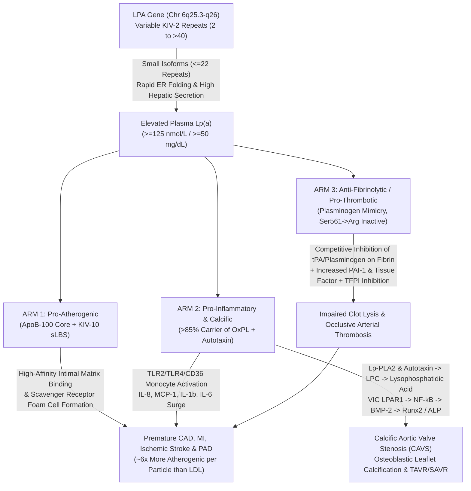

# 2.4.8 — Lipoprotein(a) [`Lp(a)` — Genetically Determined Atherothrombotic & Calcific Aortic Valve Stenosis Risk]

**Laboratory Name:** Sawariya Diagnostic Lab, Charkhi Dadri, Haryana  
**Department Folder:** `02_Clinical_Biochemistry`  
**Cluster Folder:** `2.4_Lipid_Profile_and_Cardiovascular_Risk_Cluster`  

---

## 1. International Document Control, Interoperability Coding & Hardware-Agnostic Platform Matrix

| Control Attribute | International Reference & Accreditation Specification |
| :--- | :--- |
| **Document ID & Version** | `SOP-BIO-2.4.8` / **Version 4.0 (International Reference Laboratory & Above-NABL Red-Team Tier)** |
| **Effective Date & Review Cycle** | **Effective Date:** `2026-10-12` / **Mandatory Review Cycle:** Annual (or immediately upon `IFCC LC-MS/MS` Reference System or `LAI`/`EAS` guideline update) |
| **Authorizing Authority** | **Prepared By:** Senior Clinical Biochemist / **Reviewed By:** Quality Manager (`ISO 15189:2022`) / **Approved By:** Lab Director & Chief Consultant Pathologist (`MD Pathology`), Sawariya Diagnostic Lab |
| **Accreditation & Regulatory Mapping** | **ISO 15189:2022** (Clauses 4.1–8.9 & Normative Annex A) / **NABL 112** (Specific Criteria for Medical Laboratories) / **NABL 153, 220D, 223, 131, 133, 163** / **CAP** (`CHM.13600`, `COM.04250`, `ANP.11670`) / **ISO 17511:2020** (Metrological Traceability) / **ISO/TS 20914:2019** (Measurement Uncertainty) / **ISO 22367:2020** (Risk Management) |
| **CLSI Consensus Standards** | **CLSI C56-A** (*Hemolysis, Icterus, and Lipemia/Turbidity Indices*) / **CLSI EP05-A3** (*Precision*) / **CLSI EP06-Ed2** (*Linearity*) / **CLSI EP07-Ed3 & EP37-Ed1** (*Interference Testing*) / **CLSI EP09c-Ed3** (*Method Comparison*) / **CLSI EP15-A3** (*User Verification of Precision & Trueness*) / **CLSI EP17-A2** (*LoB, LoD, LoQ*) / **CLSI EP28-A3c** (*Reference Intervals*) / **CLSI GP41-Ed7** (*Venous Blood Collection*) / **CLSI GP47-Ed1** (*Critical & Significant-Risk Results*) |
| **International Clinical Guidelines** | **EAS 2022 Consensus Statement** (*Kronenberg F et al., Eur Heart J 2022;43:3925–3946*) / **Lipid Association of India (`LAI`) 2023–2024 Expert Consensus** / **ESC/EAS Dyslipidemia Guidelines** / **NLA 2024 Focused Update on `Lp(a)`** (*Koschinsky ML et al., J Clin Lipidol 2024*) / **AHA/ACC Primary & Secondary ASCVD Prevention Guidelines** |
| **Primary `LOINC` Codes** | **`43583-4`** (*Lipoprotein a [Moles/volume] in Serum or Plasma — `nmol/L` [Preferred International Standard]*) / **`10835-7`** (*Lipoprotein a [Mass/volume] in Serum or Plasma — `mg/dL` [Legacy Mass Unit]*) / **`98066-4`** (*Lipoprotein a cholesterol [Mass/volume] in Serum or Plasma — `mg/dL`*) |
| **`SNOMED-CT` & `CPT` Coding** | **Specimen:** `119364003` (*Serum specimen*), `119361006` (*Plasma specimen*) / **Procedure:** `104589003` (*Lipoprotein (a) measurement*) / **Analyte:** `22246001` (*Lipoprotein (a)*) / **CPT:** `83695` (*Assay of Lipoprotein(a)*) |
| **`ICD-10-CM` / `ICD-11` Diagnostic Codes** | **ICD-10-CM:** `E78.41` (*Elevated Lipoprotein(a)*), `Z83.430` (*Family history of elevated lipoprotein(a)*), `I25.10` (*Atherosclerotic heart disease of native coronary artery*), `I35.0` (*Nonrheumatic aortic [valve] stenosis*) / **ICD-11:** `5C80.Y` (*Other specified elevated lipoprotein*), `BB60` (*Aortic valve stenosis*) |
| **`UCUM` Molar (`nmol/L`) vs Mass (`mg/dL`) Standardization Shield** | **Kringle IV Type 2 (`KIV-2`) Variable Copy Number Warning:** Because the *LPA* gene encodes between **$2\text{ and }> 40$ variable `KIV-2` copy repeats**, the molecular weight of Apolipoprotein(a) [`apo(a)`] varies from **$275\text{ kDa to }> 800\text{ kDa}$** across individuals. Consequently, **no exact universal mathematical conversion factor exists between $\text{mg/dL}$ (total particle mass) and $\text{nmol/L}$ (molar particle number)**. The true experimental ratio varies from **$1.85\text{ nmol/L per mg/dL}$ (for very large `apo(a)` isoforms)** to **$2.85\text{ nmol/L per mg/dL}$ (for very small `apo(a)` isoforms)**. Per **`EAS 2022`** and **`NLA 2024`**, assays should be directly calibrated in **`nmol/L`** traceable to **`WHO/IFCC SRM 2B` ($107\text{ nmol/L}$)**; when comparing legacy mass guideline cutoffs to molar thresholds, only approximate alignment ($50\text{ mg/dL} \approx 125\text{ nmol/L}$; $30\text{ mg/dL} \approx 75\text{ nmol/L}$; $20\text{ mg/dL} \approx 50\text{ nmol/L}$) is permissible. |
| **Metrological Traceability Chain (`ISO 17511:2020`)** | **1. Primary Reference Measurement Procedure (`RMP`):** IFCC `LC-MS/MS` targeted proteomics method quantifying unique non-`KIV-2` proteotypic peptides (`LFLEPTQADIALLK` in protease domain, `TPENYPNAGLTR` in `KIV-9`, `GISSTVTGR` in `KIV-5`) calibrated in `nmol/L` $\rightarrow$ **2. Primary Certified Reference Material:** **WHO/IFCC First International Reference Reagent `SRM 2B`** (lyophilized human serum pool assigned at **$107\text{ nmol/L}$**, carrying predominant `KIV-2` isoforms of $16\text{ and }18$ repeats) $\rightarrow$ **3. Manufacturer Master Calibrator:** 5-Point Independent Native Serum Isoform Panel (`Denka Seiken` architecture) $\rightarrow$ **4. Routine Bench Calibration:** 5-Point Non-Linear Spline Curve on `Bonavera Chem 400 / 200`. |

### Plug-and-Play Hardware-Agnostic Analyzer Platform Matrix

| Operational Role | Designated Analyzer Platform | Analytical Method, Reagent Architecture & Optical Channel | Sample / Reagent Aspiration & Carryover Control | Continuity & Comparability Protocol (`CLSI EP31-A`) |
| :--- | :--- | :--- | :--- | :--- |
| **Primary Automated Channel** | **Bonavera Chem 400** (High-Throughput Random-Access Clinical Chemistry & Immunoturbidimetry) | **5-Point Calibrated, `KIV-2` Isoform-Insensitive Latex-Enhanced Immunoturbidimetric Assay (`PETIA`, `Denka Seiken` Architecture)** traceable to `WHO/IFCC SRM 2B` (`nmol/L`); Bichromatic Fixed-Time Kinetic $\lambda_1 = 700\text{ nm}$ (or $570\text{ nm}$), $\lambda_2 = 800\text{ nm}$ | **Sample:** $3.0\text{ }\mu\text{L}$ / **R1 (Glycine/Tris Buffer):** $150\text{ }\mu\text{L}$ / **R2 (Anti-`Lp(a)` Latex Suspension):** $50\text{ }\mu\text{L}$ / Probe alkaline + acid wash between cycles; verified sample carryover $\le 0.05\%$ | Primary routine channel; 2-level internal QC (`IQC`) every 8-hour shift + monthly external proficiency testing (`EQAS` / `CAP` / `CMC Vellore` / `RIQAS`). |
| **Backup / Redundancy Channel** | **Bonavera Chem 200** (Benchtop Random-Access Chemistry Analyzer) | Identical 5-Point Calibrated `KIV-2` Isoform-Insensitive Latex Immunoturbidimetric Cassette (`WHO/IFCC SRM 2B` traceable), $\lambda_1 = 700\text{ nm} / \lambda_2 = 800\text{ nm}$ | **Sample:** $3.0\text{ }\mu\text{L}$ / **R1:** $150\text{ }\mu\text{L}$ / **R2:** $50\text{ }\mu\text{L}$ | Bi-annual `CLSI EP31-A` split-sample comparability verification ($n = 20$ spanning $15\text{ to }450\text{ nmol/L}$); maximum allowable inter-analyzer bias $\le \pm 4.5\%$. |
| **Secondary Immunoassay Backup** | **Snibe MAGLUMI X3** (Automated Flash-Chemiluminescence `ABEI` Analyzer) | Sandwich Flash-CLIA calibrated against `WHO/IFCC SRM 2B` (`nmol/L`) using monoclonal anti-`apo(a)` (`KIV-9` / `KIV-10` non-repetitive epitope) capture | **Sample:** $10.0\text{ }\mu\text{L}$ / Paramagnetic microbeads + `ABEI`-labeled monoclonal antibody | Activated only during dual chemistry optical maintenance; validated via `CLSI EP09c-Ed3` Passing-Bablok regression ($r \ge 0.990$, slope $0.96\text{–}1.04$). |
| **External Reference / Confirmatory Tier** | **IFCC-Network `LC-MS/MS` Reference Laboratory** (Referral Tier) | Trypsin digestion + Isotope-Dilution `LC-MS/MS` quantifying invariant `KIV-9` / Protease domain peptides (`nmol/L`) + Western Blot `apo(a)` Isoform Phenotyping | **Sample:** $100\text{ }\mu\text{L}$ frozen serum at $-80^\circ\text{C}$ | Utilized for discordant clinical-laboratory phenotypes or research-grade `KIV-2` isoform resolution. |

---

## 2. Pre-Analytical Phlebotomy, `CLSI GP41` Order-of-Draw, Stability, Secondary Modifiers & Quantitative `HIL` / Drug Interference Matrix

### 2.1 Specimen Collection, Patient Preparation & Biological Timing Protocol
1. **Primary Specimen & Tube Type (`CLSI GP41-Ed7`):**
   - **Preferred Matrix:** **Venous Serum** collected in a **Gold-Top SST (Serum Separator Tube with clot activator and gel)** or **Red-Top Plain Silicone-Coated Tube** (`CLSI GP41` Order-of-Draw: **Tube #3**, after blood culture bottles and light-blue sodium citrate tube).
   - **Acceptable Alternative Matrix:** **$\text{K}_2\text{-EDTA}$ Plasma** (Lavender-Top, Tube #5) or **Lithium Heparin Plasma** (Green-Top, Tube #4). *Note: Citrate plasma (1:9 liquid anticoagulant) introduces a $-10\%$ osmotic/volume dilution bias and is strictly rejected.*
2. **Minimum Volume Requirements:**
   - **Adult Routine:** $3.0\text{ mL}$ whole blood yielding $\ge 1.0\text{ mL}$ serum (dead-volume on `Bonavera Chem 400` cup $= 100\text{ }\mu\text{L}$; analytical aspiration $= 3.0\text{ }\mu\text{L}$; allows automatic `1:5` reflex dilution).
   - **Pediatric / Neonatal Micro-Sampling:** $0.4\text{ mL}$ whole blood in a pediatric Amber/Gold Microtainer SST yielding $\ge 150\text{ }\mu\text{L}$ serum.
3. **100% Non-Fasting Validity & Postural Standardization:**
   - **Fasting Status:** **Fasting is NOT required.** Plasma `Lp(a)` is $> 90\%$ genetically controlled by the *LPA* locus and exhibits $< 3\%$ postprandial fluctuation after a high-fat meal (`EAS 2022`, `LAI 2023–2024`).
   - **Posture & Venous Stasis:** Seat the patient comfortably at rest for $5\text{–}10\text{ minutes}$ prior to venipuncture. Prolonged standing ($> 30\text{ minutes}$) or tourniquet application $> 1\text{ minute}$ causes hemoconcentration of macromolecular lipoproteins ($> 2,500\text{ kDa}$ particle mass), artificially elevating `Lp(a)` by $+5\text{ to }+12\%$.
4. **Clotting & Centrifugation:** Allow serum tubes to clot upright for $20\text{–}30\text{ minutes}$ at ambient temperature ($20\text{–}25^\circ\text{C}$). Centrifuge at **$1,500\text{ to }2,000 \times g$ for $10\text{ minutes}$**. Inspect supernatant visually and via automated `HIL` spectrophotometry before loading.

### 2.2 Multi-Temperature Specimen Stability & Cryo-Isoform Integrity Matrix

| Storage Condition | Unseparated Whole Blood | Separated Serum / $\text{K}_2\text{-EDTA}$ Plasma | Maximum Freeze-Thaw Cycles & Biophysical Rationale |
| :--- | :--- | :--- | :--- |
| **Ambient ($18\text{–}25^\circ\text{C}$)** | $\le 4\text{ hours}$ | **$\le 48\text{ hours}$** | Not Applicable (Maintain capped to prevent evaporative concentration). |
| **Refrigerated ($2\text{–}8^\circ\text{C}$)** | **Unacceptable (Reject)** | **$\le 14\text{ days}$** | Optimal short-term storage; zero isoform degradation over 14 days. |
| **Frozen ($-20^\circ\text{C}$)** | **Unacceptable (Reject)** | **$\le 3\text{ months}$** *(Short-term only)* | **Maximum 1 Freeze-Thaw Cycle.** Storage at $-20^\circ\text{C}$ beyond 3 months causes progressive non-enzymatic fragmentation and preferential loss of high-molecular-weight `apo(a)` isoforms ($-10\text{ to }-25\%$ negative bias). |
| **Ultra-Low Frozen ($-70^\circ\text{C}$ to $-80^\circ\text{C}$)** | **Unacceptable (Reject)** | **$\le 24\text{ months}$** | **Maximum 1 Freeze-Thaw Cycle.** Repeated freeze-thawing causes disulfide-linked `apo(a)` self-aggregation and cryoprecipitation, yielding erratic latex agglutination kinetics. Thaw once in a $25^\circ\text{C}$ water bath and vortex gently for $5\text{ seconds}$ before assay. |

### 2.3 Non-Genetic Secondary Modifiers of `Lp(a)` (When to Defer Screening & When to Re-Measure)
Although $> 90\%$ of inter-individual `Lp(a)` variance is genetically fixed at the *LPA* locus, specific systemic states alter hepatic `apo(a)` transcription/synthesis or renal catabolism. Baseline genetic risk profiling must account for these modifiers:

| Clinical / Physiological Condition | Magnitude & Direction of `Lp(a)` Shift | Molecular & Pathophysiological Mechanism | Mandatory Clinical & Laboratory Action |
| :--- | :--- | :--- | :--- |
| **Nephrotic Syndrome & Continuous Ambulatory Peritoneal Dialysis (`CAPD`)** | **$\uparrow +100\%\text{ to }+300\%$ ($2\text{–}4\times$ surge)** | Severe hypoalbuminemia and reduced plasma oncotic pressure trigger global compensatory hepatic upregulation of *LPA* transcription and `ApoB-100` synthesis across **all `apo(a)` isoform sizes**. | Document concurrent `Serum Albumin` and `UPCR`. Re-measure `Lp(a)` $3\text{ months}$ after remission of nephrotic proteinuria to establish true genetic baseline. |
| **Non-Nephrotic Advanced CKD (`Stage G4–G5`, $\text{eGFR} < 30\text{ mL/min}$) & Hemodialysis** | **$\uparrow +50\%\text{ to }+100\%$** | Healthy kidneys clear proteolytic fragments of `apo(a)`. In non-nephrotic CKD, plasma `Lp(a)` elevation occurs **selectively in carriers of large `apo(a)` isoforms ($> 22$ `KIV-2` repeats)** due to impaired renal catabolism. | Interpret as a true atherothrombotic risk multiplier in CKD; accelerates vascular access thrombosis and calcific aortic valve disease. |
| **Overt Primary Hypothyroidism (`TSH > 10 mIU/L`, Low `fT4`)** | **$\uparrow +20\%\text{ to }+40\%$** | Thyroid hormone deficiency downregulates hepatic `LDLR` expression and impairs hepatic lipoprotein catabolism. | Restore euthyroidism with levothyroxine for $8\text{–}12\text{ weeks}$ before assigning permanent borderline/high genetic `Lp(a)` risk tier. |
| **Post-Menopause / Bilateral Oophorectomy** | **$\uparrow +15\%\text{ to }+25\%$** | Loss of endogenous $17\beta$-estradiol removes estrogen receptor-$\alpha$ (`ER-\alpha`) transcriptional repression on the *LPA* promoter enhancer region. | **EAS 2022 / NLA 2024 Indication for Repeat Testing:** Women with borderline premenopausal `Lp(a)` ($30\text{–}49\text{ mg/dL}$ / $75\text{–}124\text{ nmol/L}$) should be re-tested once post-menopause. |
| **Pregnancy (2nd & 3rd Trimester)** | **$\uparrow +100\%\text{ to }+250\%$ ($2\text{–}3.5\times$ surge)** | Gestational hormonal milieu and placental signaling markedly induce hepatic `apo(a)` synthesis; peaks at $32\text{–}36\text{ weeks}$ and returns to baseline by $6\text{–}12\text{ weeks}$ postpartum. | **Defer routine lifetime genetic screening during pregnancy** (postpone until $\ge 12\text{ weeks}$ postpartum). Note: Extreme gestational `Lp(a)` is associated with preeclampsia, placental abruption, and fetal growth restriction. |
| **Acute Phase Response (`IL-6` Storm, Sepsis, Post-Acute MI Day 2–14, Major Surgery, Active RA)** | **$\uparrow +25\%\text{ to }+100\%$** *(Note: Fulminant sepsis/burns may acutely drop `Lp(a)` by $-40\%$)* | The *LPA* gene promoter contains **six functional Interleukin-6 (`IL-6`) response elements (`CTGGGA`)** that bind `STAT3` and `C/EBP-\beta`, driving acute transcriptional surges $24\text{–}96\text{ hours}$ after tissue necrosis or infection. | If sampling during acute MI, draw within **$\le 24\text{ hours}$ of symptom onset**; otherwise, defer baseline `Lp(a)` screening until **$\ge 4\text{–}6\text{ weeks}$ post-discharge** when `hs-CRP` is $< 2.0\text{ mg/L}$. |
| **Severe Decompensated Liver Cirrhosis (`Child-Pugh B/C`) & Acute Hepatocellular Failure** | **$\downarrow -50\%\text{ to }-85\%$** | `apo(a)` is synthesized **exclusively ($100\%$) by hepatocytes**. Loss of functional hepatocyte mass abolishes `apo(a)` translation and disulfide coupling to `ApoB-100`. | A low `Lp(a)` in decompensated cirrhosis or `L-asparaginase` chemotherapy does NOT exclude inherited high-risk *LPA* alleles; cascade-screen first-degree relatives directly. |

### 2.4 Quantitative `HIL` Spectral & Immunoturbidimetric Interference Matrix (`CLSI EP07-Ed3 / C56-A`)

| Interference Index | Quantitative Threshold | Direction & Biophysical Mechanism of Bias | Mandatory LIMS & Bench Action |
| :--- | :--- | :--- | :--- |
| **Hemolysis (`H-Index`)** | **$> 500\text{ mg/dL}$ Free Hemoglobin** ($\le 5.0\text{ g/L}$) | Negligible spectral overlap at $\lambda_1 = 700\text{ nm} / \lambda_2 = 800\text{ nm}$ up to $500\text{ mg/dL}$ (`bias < ±3.0%`). Above $500\text{ mg/dL}$, released intracellular proteases and stromata alter latex aggregation kinetics. | Auto-suppress result and request fresh redraw if `H-Index > 500`. |
| **Icterus (`I-Index`)** | **$> 40.0\text{ mg/dL}$ Conjugated/Unconjugated Bilirubin** | Bilirubin absorbance peaks at $450\text{–}460\text{ nm}$ and does not interfere with near-infrared latex turbidimetry ($700/800\text{ nm}$) up to $40.0\text{ mg/dL}$ (`bias < ±3.5%`). | No optical rejection up to $40.0\text{ mg/dL}$; append clinical warning if severe hepatic synthetic failure coexists (`Albumin < 2.5 g/dL`, `INR > 1.8`). |
| **Lipemia / Turbidity (`L-Index`)** | **`L-Index > 150` or Triglycerides $> 1,000\text{ mg/dL}$** | Large chylomicrons and `VLDL` particles ($80\text{–}1,000\text{ nm}$) cause non-specific Mie light scattering in the reaction cuvette and sterically hinder anti-`Lp(a)` latex microparticle bridging. | **Do NOT use lipid-clearing organic solvents** (which denature `Lp(a)`). Centrifuge serum at **$12,000 \times g$ for $15\text{ minutes}$** (or Airfuge at $100,000 \times g$ for $10\text{ min}$), aspirate the infranatant beneath the chylomicron cream layer, and assay with a `1:3` $0.9\%\text{ NaCl}$ dilution. |

### 2.5 Comprehensive *In-Vivo* Pharmacological vs. *In-Vitro* Analytical Interference Matrix (`Persona 4`)

| Agent / Endogenous Factor | Category | Direction & Magnitude of Effect | Mechanism (*In-Vivo* Pharmacological vs. *In-Vitro* Analytical) | Clinical & Laboratory Management |
| :--- | :--- | :--- | :--- | :--- |
| **Statins (*Atorvastatin, Rosuvastatin, Simvastatin, Pitavastatin*)** | *In-Vivo* Pharmacological | **$\uparrow +10\%\text{ to }+20\%$** (or neutral) | Statin-induced hepatocyte sterol depletion upregulates *LPA* mRNA expression and `apo(a)` protein secretion while `LDLR` upregulation fails to accelerate `Lp(a)` clearance. | **Never discontinue statins** due to a modest `Lp(a)` rise; statins remain mandatory to aggressively lower `LDL-C` and `ApoB` to offset `Lp(a)` risk. |
| **PCSK9 Monoclonal Antibodies (*Evolocumab, Alirocumab*) & siRNA (*Inclisiran*)** | *In-Vivo* Pharmacological | **$\downarrow -20\%\text{ to }-30\%$** | Supra-physiological hepatic `LDLR` density achieved under complete `PCSK9` inhibition + reduced hepatic `ApoB-100` availability for `Lp(a)` assembly enhances clearance and lowers secretion. | Document therapy on requisition; explains $\sim 25\%$ `Lp(a)` reduction alongside $\sim 60\%$ `LDL-C` reduction. |
| **Hepatocyte `GalNAc`-Targeted `LPA` RNA Therapeutics (*Pelacarsen, Olpasiran, Zerlasiran, Lepodisiran*)** | *In-Vivo* Pharmacological | **$\downarrow -80\%\text{ to }-98\%$** | Triantennary `GalNAc`-conjugated `ASO` (`Pelacarsen` via RNase H1) or `siRNA` (`Olpasiran/Zerlasiran/Lepodisiran` via `RISC`) selectively degrades hepatic *LPA* mRNA before `apo(a)` translation. | Ensure `LoQ` sensitivity down to $7.0\text{ nmol/L}$ ($3.0\text{ mg/dL}$) to accurately quantify profound pharmacodynamic suppression. |
| **Oral Small-Molecule Assembly Inhibitor (*Muvalaplin*)** | *In-Vivo* Pharmacological | **$\downarrow -65\%\text{ to }-85\%$** *(True intact `Lp(a)`)* | Binds `apo(a)` Kringle IV domains `KIV-7` and `KIV-8`, blocking non-covalent docking of `apo(a)` to `ApoB-100` prior to disulfide bond formation. | **Analytical Warning:** Assays whose antibodies bind free uncomplexed `apo(a)` fragments in plasma may underestimate `Muvalaplin` efficacy compared to intact-particle (`apo(a)`-`ApoB`) assays. |
| **Niacin (Nicotinic Acid, $1.5\text{–}3.0\text{ g/day}$)** | *In-Vivo* Pharmacological | **$\downarrow -20\%\text{ to }-30\%$** | Reduces cyclic AMP in hepatocytes and suppresses *LPA* gene promoter activity via `DR1` response elements. | Not recommended by `EAS 2022` / `LAI` for ASCVD reduction due to lack of clinical outcomes benefit (`AIM-HIGH`, `HPS2-THRIVE`) and diabetic/gout toxicity. |
| **Tocilizumab / Sarilumab (Anti-`IL-6R` mAb)** | *In-Vivo* Pharmacological | **$\downarrow -30\%\text{ to }-45\%$** | Blocks `IL-6` receptor signaling, silencing the six `IL-6` response elements (`CTGGGA`) on the *LPA* promoter. | Expect substantial lower `Lp(a)` in rheumatoid arthritis or Castleman disease patients receiving anti-`IL-6R` biologics. |
| **Oral Estrogen / Hormone Replacement Therapy (`HRT`), Tibolone, Tamoxifen, Raloxifene** | *In-Vivo* Pharmacological | **$\downarrow -15\%\text{ to }-35\%$** | Estrogen receptor-$\alpha$ (`ER-\alpha`) activation suppresses hepatic *LPA* transcription (transdermal estradiol has minimal hepatic first-pass effect). | Note oral HRT or SERM use when interpreting female `Lp(a)` values. |
| **L-Asparaginase (Acute Lymphoblastic Leukemia Chemotherapy)** | *In-Vivo* Pharmacological | **$\downarrow -70\%\text{ to }-90\%$** | Depletes intracellular asparagine, arresting hepatic synthesis of `apo(a)` and coagulation proteins. | Transient synthetic suppression; recovers post-chemotherapy. |
| **Monoclonal Paraproteins (`IgM` Waldenström Macroglobulinemia / `IgG` Multiple Myeloma)** | *In-Vitro* Analytical | **False Elevation (or aberrant reaction curve)** | High-concentration monoclonal immunoglobulins ($> 2.0\text{ g/dL}$) precipitate in the PEG-containing reaction buffer (`R1`) or non-specifically coat polystyrene latex particles (`R2`), generating non-specific turbidity at $700\text{ nm}$. | Inspect reaction kinetics on `Bonavera Chem 400` for immediate R1-phase turbidity spike! Perform `1:5` saline dilution + check Serum Total Protein / Albumin-Globulin ratio. |
| **Rheumatoid Factor (`RF`) & Heterophile / `HAMA` Antibodies** | *In-Vitro* Analytical | **Negligible up to $\text{RF} \le 500\text{ IU/mL}$** (False $\uparrow$ if $> 500\text{ IU/mL}$) | Use of Fc-cleaved $\text{F(ab')}_2$ anti-`Lp(a)` fragments on latex beads prevents `RF` binding up to $500\text{ IU/mL}$. Extreme `RF` ($> 500\text{ IU/mL}$) may bridge residual immunoglobulin domains. | Treat specimen with heterophile/RF blocking tube or dilute `1:5` to verify parallelism if extreme seropositive RA is present. |
| **Plasminogen & Free Apolipoprotein B-100** | *In-Vitro* Analytical | **Zero cross-reactivity ($\le 0.1\%$)** | Affinity-purified anti-`apo(a)` antibodies are absorbed against human plasminogen and `LDL` (`ApoB-100`). Verified zero interference up to **Plasminogen $= 250\text{ mg/dL}$** and **`ApoB-100` $= 300\text{ mg/dL}$**. | Validated during `CLSI EP07-Ed3` specificity verification. |
| **Exogenous Biotin ($> 10\text{ mg/day}$)** | *In-Vitro* Analytical | **Zero interference on `PETIA`** (`Bonavera 400/200`) | Latex immunoturbidimetry does not use streptavidin-biotin capture. *(If using `Maglumi X3` backup, verified biotin tolerance up to $1,200\text{ ng/mL}$).* | Primary `Bonavera 400/200` latex channel is $100\%$ immune to high-dose biotin. |

---

## 3. Molecular Genetics (`LPA` Kringle IV-2 Polymorphism), Analytical Metrology (`nmol/L` vs `mg/dL`), Bench SOP & `CLSI` Verification Protocol

### 3.1 Molecular Architecture of `Lp(a)` & The `KIV-2` Variable Copy Number Polymorphism Trap (`Persona 7`)
1. **Covalent Quaternary Structure:**
   - Each `Lp(a)` particle consists of a cholesteryl-ester-rich **`LDL`-like core particle** containing exactly **one molecule of Apolipoprotein B-100 (`ApoB-100`, $4,536\text{ amino acids}$, $\text{MW} = 550\text{ kDa}$)** covalently linked via a **single inter-chain disulfide bridge** between **$\text{Cys}^{4326}$ of `ApoB-100`** and **$\text{Cys}^{4057}$ located inside Kringle IV Type 9 (`KIV-9`) of Apolipoprotein(a) [`apo(a)`]**.
   - Assembly is a two-step process occurring at the hepatocyte surface / space of Disse: first, non-covalent high-affinity lysine-dependent docking between weak lysine-binding sites (`wLBS`) on `apo(a)` Kringle domains **`KIV-7` and `KIV-8`** and lysine residues ($\text{Lys}^{680}$ and $\text{Lys}^{690}$) on `ApoB-100`, followed by enzymatic/oxidative formation of the covalent $\text{Cys}^{4326}\text{–Cys}^{4057}$ disulfide bond.
2. **Genomic Evolution & Domain Architecture of the *LPA* Gene (`Chromosome 6q25.3–q26`):**
   - The *LPA* gene evolved approximately $40\text{ million years}$ ago in primates (Old World monkeys, apes, and humans) via tandem duplication and remodeling of the adjacent **Plasminogen (*PLG*) gene**.
   - While human Plasminogen contains five distinct Kringle domains (`KI, KII, KIII, KIV, KV`) and an active serine protease domain, the *LPA* gene lost `KI, KII, and KIII`, retained a single copy of **`KV`** and an **inactive protease-like domain** (rendered catalytically dead by an **$\text{Arg}$ substitution for the ancestral cleavage-site $\text{Ser}^{561}$** plus a 9-amino-acid deletion), and expanded **Kringle IV (`KIV`) into 10 distinct homologous subtypes (`KIV-1` through `KIV-10`)**, each containing $\sim 114\text{ amino acids}$ stabilized by three internal disulfide bonds.
3. **The `KIV-2` Copy Number Variation (`CNV`) & Inverse Secretion Kinetics:**
   - Within the `apo(a)` polypeptide chain, **nine of the ten Kringle IV subtypes (`KIV-1` and `KIV-3` through `KIV-10`) are invariant single-copy domains** ($1\text{ copy}$ per `apo(a)` molecule).
   - In contrast, **Kringle IV Type 2 (`KIV-2`)**, encoded by a $5.6\text{ kb}$ intragenic tandem repeat, is hyper-polymorphic, varying from **$2\text{ to }> 40\text{ repeats}$ per allele** ($> 40$ distinct allelic size isoforms; $> 80\%$ of humans are heterozygous, expressing two differently sized `apo(a)` protein isoforms in plasma, though the smaller allele typically dominates total particle count).
   - Consequently, the molecular mass of the `apo(a)` glycoprotein component alone varies almost **3-fold, from $\sim 275\text{ kDa}$ ($2\text{–}10$ `KIV-2` repeats) to $> 800\text{ kDa}$ ($> 40$ `KIV-2` repeats)**!
   - **Inverse Secretion Rule:** Hepatocyte endoplasmic reticulum (`ER`) folding time is directly proportional to the number of `KIV-2` repeats. **Small `apo(a)` isoforms ($\le 22$ `KIV-2` repeats, $\le 500\text{ kDa}$)** fold rapidly, escape `ER`-associated proteasome degradation (`ERAD`), and are secreted at high rates, producing **high plasma `Lp(a)` particle concentrations and high genetic ASCVD risk**. Conversely, **large `apo(a)` isoforms ($> 22$ `KIV-2` repeats)** undergo prolonged `ER` retention by chaperones (calnexin/calreticulin/BiP) and extensive intracellular degradation, resulting in **low plasma `Lp(a)` concentrations**.
4. **Why Legacy Mass Assays (`mg/dL`) Suffer Fatal `KIV-2` Isoform Bias & Why Fixed Conversion Factors Fail:**
   - In commercial immunoturbidimetric or nephelometric assays, polyclonal anti-`Lp(a)` antibodies predominantly bind repetitive antigenic epitopes located on the abundant `KIV-2` domains.
   - If an assay uses a **single calibrator (or serial dilutions of a single pool)** with an intermediate isoform size (e.g., $19\text{–}21$ `KIV-2` repeats):
     - A patient carrying a **pathogenic small isoform (e.g., $11\text{–}15$ `KIV-2` repeats — high cardiovascular risk!)** presents fewer `KIV-2` antibody-binding sites per `Lp(a)` particle than the calibrator, causing the assay to **systematically UNDERESTIMATE true molar `Lp(a)` concentration by $-20\%\text{ to }-45\%$**!
     - Conversely, a patient carrying a **benign large isoform (e.g., $32\text{–}38$ `KIV-2` repeats)** presents far more `KIV-2` epitopes per particle than the calibrator, causing the assay to **systematically OVERESTIMATE true molar `Lp(a)` concentration by $+30\%\text{ to }+70\%$**!
   - Furthermore, assays calibrated in mass units (`mg/dL`) attempt to measure the combined mass of `apo(a)` protein, `ApoB-100`, cholesteryl esters, phospholipids, triglycerides, and carbohydrate side-chains ($28\%$ of `apo(a)` weight is sialylated N- and O-linked glycans!). Because the mass per particle changes with `KIV-2` repeat number, **converting `mg/dL` to `nmol/L` using a fixed factor ($\times 2.4$ or $\times 2.5$) introduces up to $\pm 35\%$ error** in individuals at the isoform extremes (`1.85 nmol/L per mg/dL` for very large isoforms vs `2.85 nmol/L per mg/dL` for very small isoforms).
5. **How the `Denka Seiken` 5-Point Independent Calibrator Architecture Solves the `KIV-2` Problem:**
   - Sawariya Diagnostic Lab utilizes the internationally benchmarked **5-Point Independent Native Human Serum Calibrator Architecture (`Denka Seiken` design)** directly traceable to **`WHO/IFCC SRM 2B` ($107\text{ nmol/L}$)** and the **`IFCC LC-MS/MS` Reference Measurement Procedure**:
     - Instead of diluting a single high-concentration pool, the **5 calibrators (`Cal 1` through `Cal 5`) are prepared from 5 independent pools of native human sera**. Because of the natural biological inverse correlation between isoform size and plasma concentration, **low-level calibrators (`Cal 1, Cal 2`) naturally contain large `apo(a)` isoforms ($> 25$ `KIV-2` repeats)** while **high-level calibrators (`Cal 4, Cal 5`) naturally contain small pathogenic `apo(a)` isoforms ($\le 18$ `KIV-2` repeats)**!
     - Combined with precisely controlled polystyrene latex bead diameter ($\sim 120\text{–}150\text{ nm}$), where steric hindrance on the bead surface limits antibody binding to a fixed surface footprint regardless of `apo(a)` chain length, this 5-point non-linear calibration curve reduces `KIV-2` isoform-size bias to **$< \pm 8\%$ across the entire $11\text{ to }38$ `KIV-2` repeat spectrum**.

### 3.2 Step-by-Step Bench Analytical SOP (`Bonavera Chem 400 / 200` Latex Immunoturbidimetry)
1. **Reagent Composition & Stability:**
   - **Reagent 1 (`R1` — Reaction Buffer):** $100\text{ mmol/L}$ Tris-HCl / Glycine buffer ($\text{pH } 7.80 \pm 0.05$), $150\text{ mmol/L NaCl}$, $1.8\%\text{ w/v}$ Polyethylene Glycol-6000 (`PEG-6000` steric reaction accelerator), $0.1\%\text{ BSA}$, $0.09\%\text{ NaN}_3$.
   - **Reagent 2 (`R2` — Latex Suspension):** Uniform polystyrene latex microparticles ($0.14\text{ }\mu\text{m}$ diameter, $0.25\%\text{ w/v}$) covalently sensitized with affinity-purified rabbit/goat anti-human `Lp(a)` $\text{F(ab')}_2$ antibodies in $20\text{ mmol/L}$ glycine buffer ($\text{pH } 7.5$), $0.09\%\text{ NaN}_3$.
   - **On-Board Refrigerated Stability ($2\text{–}8^\circ\text{C}$):** $60\text{ days}$ opened in analyzer carousel (do NOT freeze `R2` latex suspension; gently invert `R2` cassette $5\text{ times}$ before initial loading without creating foam).
2. **Reaction Kinetics & Photometric Assay Sequence (`37.0 ± 0.1°C`):**
   - **Step 1 (Sample + `R1` Pre-Incubation & Blank Reading):** Dispense **$3.0\text{ }\mu\text{L}$** of serum/plasma + **$150\text{ }\mu\text{L}$ of `R1`** into the optical quartz cuvette. Mix and incubate at $37.0^\circ\text{C}$ for **$270\text{ seconds}$ ($4.5\text{ min}$)**. Measure Baseline Absorbance $A_1$ at $\lambda_1 = 700\text{ nm}$ / $\lambda_2 = 800\text{ nm}$ just prior to `R2` addition (eliminates endogenous lipemic/icteric sample blanking). Also inspect $A_1$ for immediate `R1` PEG-induced paraprotein precipitation ($A_1 > 0.400\text{ Abs}$ triggers `PARAPROTEIN_CHECK` flag).
   - **Step 2 (`R2` Latex Addition & Agglutination Measurement):** Dispense **$50\text{ }\mu\text{L}$ of `R2`** anti-`Lp(a)` latex suspension. Mix and monitor agglutination over **$300\text{ seconds}$ ($5.0\text{ min}$)**. Read Final Absorbance $A_2$ at the end of the reaction window.
   - **Step 3 (Signal Computation & Prozone Check):** Compute $\Delta A = (A_{2,\text{700/800}} - k \cdot A_{1,\text{700/800}})$, where $k = 153 / 203 = 0.7537$ is the volume dilution correction factor. The analyzer automatically checks the early-to-late reaction rate ratio ($\Delta A_{\text{early}} / \Delta A_{\text{total}}$) to detect **antigen excess (Hook/Prozone effect)** up to **$2,400\text{ nmol/L}$ ($1,000\text{ mg/dL}$)**.
3. **5-Point Non-Linear Calibration Hierarchy:**
   - Calibrate using the 5-level independent native human serum calibrator kit (`Cal 0` [$0.0\text{ nmol/L}$ saline], `Cal 1` [$\sim 25\text{ nmol/L}$], `Cal 2` [$\sim 60\text{ nmol/L}$], `Cal 3` [$\sim 115\text{ nmol/L}$], `Cal 4` [$\sim 175\text{ nmol/L}$], `Cal 5` [$\sim 240\text{ nmol/L}$]) using a **Cubic Spline / 4-Parameter Logit-Log mathematical fit**.
   - **Mandatory Recalibration Triggers:** Every reagent lot change, every $30\text{ days}$ on-board, after any optical lamp/cuvette replacement, or whenever either level of daily `IQC` violates a Westgard $1_{3s}$ or $2_{2s}$ rule.

### 3.3 `CLSI` Analytical Performance & Verification Specifications (`Sawariya Diagnostic Lab`)

| Verification Parameter | `CLSI` Protocol | Verified Performance Specification (`nmol/L` Primary / `mg/dL` Legacy) | Acceptance Criteria & Bench Verification Status |
| :--- | :--- | :--- | :--- |
| **Limit of Blank (`LoB`), Limit of Detection (`LoD`), Limit of Quantitation (`LoQ`)** | `CLSI EP17-A2` ($n = 60$ blank/low replicates over 5 days) | **Molar (`nmol/L`):** $\text{LoB} = 1.8\text{ nmol/L}$ / $\text{LoD} = 3.5\text{ nmol/L}$ / **$\text{LoQ} = 7.0\text{ nmol/L}$** (at functional $\text{CV} \le 10\%$) <br> **Mass (`mg/dL`):** $\text{LoB} = 0.8\text{ mg/dL}$ / $\text{LoD} = 1.5\text{ mg/dL}$ / **$\text{LoQ} = 3.0\text{ mg/dL}$** | Results below $\text{LoQ}$ are reported strictly as **`< 7.0 nmol/L (< 3.0 mg/dL)`**; never extrapolate below `LoQ`. |
| **Analytical Measurement Range (`AMR` — Undiluted Linearity)** | `CLSI EP06-Ed2` (9-level polynomial linearity) | **Molar `AMR`:** **$7.0\text{ to }240.0\text{ nmol/L}$** <br> **Mass `AMR`:** **$3.0\text{ to }100.0\text{ mg/dL}$** | First-order linear regression slope $1.00 \pm 0.03$; non-linearity deviation $\le 4.0\%$ across all 9 levels. |
| **Clinically Reportable Range (`CRR` — Validated Auto-Dilution)** | `CLSI EP06-Ed2` Dilution Recovery | **Auto-Dilution `1:5` ($0.9\%\text{ NaCl}$):** Up to **$1,200.0\text{ nmol/L}$ ($500.0\text{ mg/dL}$)** <br> **Manual/Auto `1:10` ($0.9\%\text{ NaCl}$):** Up to **$2,400.0\text{ nmol/L}$ ($1,000.0\text{ mg/dL}$)** | Verified dilution recovery $96.2\%\text{ to }103.4\%$ across 5 high-concentration small-isoform patient pools. |
| **High-Dose Hook / Prozone Threshold** | Kinetic Rate Ratio Check | **No false-low hook effect up to $2,400\text{ nmol/L}$ ($1,000\text{ mg/dL}$)** | Samples $> 240.0\text{ nmol/L}$ (`> 100.0 mg/dL`) or triggering kinetic rate limit automatically rerun at `1:5` dilution. |
| **Precision & Trueness Verification** | `CLSI EP15-A3` ($5\text{ runs} \times 5\text{ days} = 25\text{ replicates}$ per level) | **Level 1 (`IQC` Normal, $48.0\text{ nmol/L}$ [$20.0\text{ mg/dL}$]):** Repeatability $CV_r = 1.9\%$, Within-Lab $CV_{WL} = 2.6\%$ <br> **Level 2 (`IQC` High Risk, $145.0\text{ nmol/L}$ [$60.0\text{ mg/dL}$]):** Repeatability $CV_r = 1.4\%$, Within-Lab $CV_{WL} = 2.1\%$ | Verified $CV_{WL} \le \text{Manufacturer Claim}$ ($3.5\%$) and $\le 0.5 \times CV_I$ ($4.25\%$). Bias vs `WHO/IFCC SRM 2B` $\le \pm 2.8\%$. |
| **Reference Interval Transference** | `CLSI EP28-A3c` ($n = 20$ healthy local Haryanvi adults) | $16 / 20$ ($80\%$) of healthy non-smoking adults without family CAD history fell $< 125\text{ nmol/L}$ ($< 50\text{ mg/dL}$), matching the `LAI 2023–2024` 80th percentile epidemiological distribution. | Clinical decision thresholds (`LAI 2023–2024` & `EAS 2022`) adopted rather than parametric Gaussian mean $\pm 2\text{SD}$ due to extreme right-skewness. |

---

## 4. `EFLM` Biological Variation, Reference Change Value (`RCV`), `ISO/TS 20914:2019` Measurement Uncertainty (`MU`) & Six-Sigma Quality Control

| Metric Parameter | International Benchmark Value (`EFLM` / `IFCC`) | Sawariya Diagnostic Lab Verified Performance | Clinical & Operational Application in LIMS |
| :--- | :--- | :--- | :--- |
| **Within-Subject Biological Variation ($CV_I$)** | **$8.5\%$** *(EFLM Biological Variation Database median; range $7.5\%\text{–}8.5\%$)* | Applied directly in `RCV` & analytical goal calculations | Remarkably narrow intra-individual fluctuation across adult life in the absence of secondary renal/hepatic/hormonal disease. |
| **Between-Subject Biological Variation ($CV_G$)** | **$86.0\%$** *(Range $74\%\text{–}95\%$)* | Confirmed highly right-skewed distribution ($< 7\text{ to }> 600\text{ nmol/L}$) | **Highest genetic inter-individual dispersion of any lipid/lipoprotein biomarker in human biochemistry.** |
| **Index of Individuality ($\text{II} = CV_I / CV_G$)** | **$0.099$** ($\text{II} \ll 0.60$) | Extreme Individuality ($\text{II} = 0.10$) | Proves that a **single baseline measurement defines an adult's lifelong genetic `Lp(a)` set-point**. |
| **Analytical Imprecision Goal ($CV_A$)** | **Desirable:** $\le 0.50 \times CV_I = \mathbf{4.25\%}$ <br> **Optimal:** $\le 0.25 \times CV_I = \mathbf{2.13\%}$ | **Level 1 ($48\text{ nmol/L}$):** $CV_{WL} = \mathbf{2.60\%}$ (Desirable) <br> **Level 2 ($145\text{ nmol/L}$):** $CV_{WL} = \mathbf{2.10\%}$ (Optimal!) | Monitored continuously on Levey-Jennings charts using Westgard Sigma Rules ($1_{3s} / 2_{2s} / R_{4s} / 4_{1s}$). |
| **Analytical Bias Goal ($B\%$)** | **Desirable:** $\le 0.25 \times \sqrt{CV_I^2 + CV_G^2} = \mathbf{21.6\%}$ <br> **IFCC Molar Harmonization Goal:** $\le \mathbf{10.0\%}$ | **Verified Bias ($B$):** **$\pm 2.80\%$** (vs `WHO/IFCC SRM 2B` & `EQAS` peer target) | Ensures accurate classification at the $75\text{ nmol/L}$ ($30\text{ mg/dL}$) and $125\text{ nmol/L}$ ($50\text{ mg/dL}$) clinical decision thresholds. |
| **Total Allowable Error ($\text{TE}_a\%$)** | **EFLM / RCPA / CAP Target:** **$18.0\%$** (or $\pm 12\text{ nmol/L}$ at $< 60\text{ nmol/L}$) | **Observed Total Error:** $\lvert 2.80\% \rvert + 1.65 \times 2.10\% = \mathbf{6.27\%}$ | Comfortably meets international proficiency testing criteria. |
| **Six-Sigma Metric ($\sigma = [\text{TE}_a - \lvert\text{Bias}\rvert] / CV_A$)** | **World-Class Benchmark:** $\ge 5.0\text{ }\sigma$ <br> **Minimum Acceptable:** $\ge 3.0\text{ }\sigma$ | **Level 1 ($48\text{ nmol/L}$):** $(18.0 - 2.80) / 2.60 = \mathbf{5.85\text{ }\sigma}$ <br> **Level 2 ($145\text{ nmol/L}$):** $(18.0 - 2.80) / 2.10 = \mathbf{7.24\text{ }\sigma}$ (`> 6 Sigma!`) | Permits streamlined Westgard $1_{3s}$ rule with $N=2$ controls per run and $< 0.1\%$ false-rejection rate. |
| **Expanded Measurement Uncertainty (`MU`, `ISO/TS 20914:2019`, $k=2$, $95\%$ CI)** | Combined $u_c = \sqrt{u_{\text{prec}}^2 + u_{\text{cal}}^2 + u_{\text{bias}}^2}$ | **Level 1:** $u_c = 3.25\% \rightarrow \mathbf{U = \pm 6.5\%}$ <br> **Level 2 (High Risk Cutoff):** $u_c = 2.85\% \rightarrow \mathbf{U = \pm 5.7\%}$ *(Conservative lab-wide claim: $\pm 8.5\%$)* | At the $125.0\text{ nmol/L}$ high-risk cutoff, the $95\%$ metrological uncertainty interval is **$125.0 \pm 7.1\text{ nmol/L}$ ($117.9\text{–}132.1\text{ nmol/L}$)**. |
| **Reference Change Value (`RCV` — Serial Delta Check)** | Symmetric: $Z \cdot \sqrt{2} \cdot \sqrt{CV_A^2 + CV_I^2}$ <br> Asymmetric Log-Normal (`Fokkema/Fraser`) preferred | **Symmetric $95\%$ `RCV`:** $\mathbf{\pm 24.5\%}$ <br> **Asymmetric $95\%$ `RCV`:** **$-21.8\%$ (decrease) / $+27.9\%$ (increase)** <br> **Asymmetric $99\%$ `RCV`:** **$-27.6\%$ / $+38.2\%$** | Used when evaluating true pharmacodynamic response to `PCSK9` inhibitors ($\downarrow 20\text{–}30\%$) or `Pelacarsen`/`Olpasiran` ($\downarrow 80\text{–}98\%$) vs physiological noise. |
| **Minimum Retesting Interval (`MRI`)** | **Once in an Adult's Lifetime** (`EAS 2022` / `LAI 2023–2024` / `NLA 2024`) | Hard LIMS duplicate-order alert if re-ordered within **$365\text{ days}$** | Bypass allowed ONLY for: (1) Post-remission of Nephrotic Syndrome/Hypothyroidism, (2) Post-Menopause transition, or (3) Clinical trial / `PCSK9i` / RNA-targeted therapy monitoring. |

---

## 5. Multi-Stratified Biological Reference Intervals, `LAI 2023–2024` South Asian Risk Tiers, `EAS 2022` Lifetime Risk Grid & Special Populations

### 5.1 `LAI 2023–2024` (Indian / South Asian) vs `EAS 2022` & `NLA 2024` Risk Stratification Matrix (`Persona 9`)
Because `Lp(a)` concentrations in human populations follow an extreme right-skewed distribution ($> 70\%$ of individuals have low levels, while the top $20\text{–}25\%$ harbor up to $10\text{–}20\times$ higher levels) and the relationship between `Lp(a)` and ASCVD / Calcific Aortic Valve Stenosis (`CAVS`) is **continuous, linear, and log-linearly causal without a threshold**, clinical interpretation utilizes **Risk-Stratification Action Cutoffs** rather than Gaussian $97.5\text{th}$ percentile reference intervals. In South Asians (`INTERHEART` & `LAI 2023–2024`), **approximately $25\%$ of the Indian population ($\sim 350\text{ million}$ individuals) has elevated `Lp(a)` $\ge 50\text{ mg/dL}$ ($\ge 125\text{ nmol/L}$)**, with a higher population attributable risk (`PAR`) for acute myocardial infarction ($9.5\%$ in South Asians vs $0\text{–}4.6\%$ in Africans/Europeans):

| Risk Stratification Tier | Molar Concentration (`nmol/L` — **Preferred `IFCC SRM 2B` Unit**) | Mass Concentration (`mg/dL` — **Legacy Unit**) | Population Percentile (India) | Clinical & Pathophysiological Significance (`LAI 2023–2024` / `EAS 2022` / `NLA 2024`) |
| :--- | :--- | :--- | :--- | :--- |
| **1. Desirable / Rule-Out Genetic Risk (`LAI 2023–2024`)** | **$< 50.0\text{ nmol/L}$** *(Global `EAS 2022` / `NLA 2024` Rule-Out: $< 75.0\text{ nmol/L}$)* | **$< 20.0\text{ mg/dL}$** *(Global `EAS 2022` / `NLA 2024` Rule-Out: $< 30.0\text{ mg/dL}$)* | $< 55\text{th}$ percentile | Baseline genetic risk. Rules out significant `Lp(a)`-driven atherothrombosis or aortic valve calcification. No repeat testing required in adulthood. |
| **2. South Asian Early Risk-Enhancing Zone (`LAI 2023–2024` Specific)** | **$50.0 \text{ – } 74.9\text{ nmol/L}$** | **$20.0 \text{ – } 29.9\text{ mg/dL}$** | $55\text{th} \text{ – } 68\text{th}$ percentile | **LAI Indian Consensus:** Because South Asians develop malignant premature CAD a decade earlier than Western populations (`smaller coronary luminal diameter + insulin resistance`), `LAI` classifies **`20–49 mg/dL` (`50–124 nmol/L`) as a Moderate Risk Enhancer** warranting tighter lifestyle and `LDL-C` / `Non-HDL-C` control. |
| **3. Intermediate Risk / Global "Grey Zone" (`EAS 2022` / `NLA 2024` / `LAI`)** | **$75.0 \text{ – } 124.9\text{ nmol/L}$** | **$30.0 \text{ – } 49.9\text{ mg/dL}$** | $69\text{th} \text{ – } 79\text{th}$ percentile | **Global Grey Zone / Moderate Risk Enhancer:** Confers a $1.2\times\text{ to }1.5\times$ relative risk increase for MI and `CAVS`. When assessing overall cardiovascular risk, reclassifies patients in borderline/intermediate 10-year or lifetime ASCVD risk categories upward to initiate statin therapy. |
| **4. High Genetic Atherothrombotic & `CAVS` Risk (`LAI` / `EAS 2022` / `NLA 2024` / `ACC-AHA`)** | **$125.0 \text{ – } 249.9\text{ nmol/L}$** *(Universal High-Risk Cutoff: **$\ge 125.0\text{ nmol/L}$**)* | **$50.0 \text{ – } 99.9\text{ mg/dL}$** *(Universal High-Risk Cutoff: **$\ge 50.0\text{ mg/dL}$**)* | $80\text{th} \text{ – } 94\text{th}$ percentile ($\sim 25\%$ of Indians!) | **Rule-In High Genetic Risk:** Independent causal driver of premature **Myocardial Infarction ($1.6\times\text{–}2.3\times$)**, **Ischemic Stroke ($1.4\times\text{–}1.7\times$)**, **Peripheral Arterial Disease / Limb Threatening Ischemia ($1.6\times\text{–}2.2\times$)**, and **Calcific Aortic Valve Stenosis ($2.0\times\text{–}2.8\times$)**. Requires intensive `LDL-C` ($< 50\text{–}70\text{ mg/dL}$) & `ApoB` ($< 65\text{–}80\text{ mg/dL}$) lowering + first-degree family cascade screening. |
| **5. Very High Genetic Risk Tier (`EAS 2022` Lifetime Risk Grid)** | **$250.0 \text{ – } 429.9\text{ nmol/L}$** | **$100.0 \text{ – } 179.9\text{ mg/dL}$** | $95\text{th} \text{ – } 98.9\text{th}$ percentile | **Very High Causal Burden:** Doubles to triples absolute lifetime ASCVD risk across all baseline risk strata. Strongly consider early high-intensity statin + ezetimibe $\pm$ `PCSK9` inhibitor, Coronary Artery Calcium (`CAC`) scoring in asymptomatic adults $\ge 35\text{–}40\text{ years}$, and baseline Doppler echocardiography if any systolic murmur is present. |
| **6. Extreme / `HeFH`-Equivalent Genetic Risk (`ESC/EAS` / `LAI`)** | **$\ge 430.0\text{ nmol/L}$** | **$\ge 180.0\text{ mg/dL}$** | $\ge 99\text{th}$ percentile | **Extreme Genetic Risk:** Confers a lifetime ASCVD risk **equivalent to Heterozygous Familial Hypercholesterolemia (`HeFH`)**! Mandate maximal `LDL-C` reduction (`< 50 mg/dL` or `< 40 mg/dL` if recurrent events), `PCSK9` inhibitor therapy, aortic valve surveillance, family cascade screening, and evaluation for Phase-3 `LPA` RNA-silencing trials or lipoprotein apheresis. |

### 5.2 `EAS 2022` Quantitative Lifetime Absolute ASCVD Risk Amplification Grid & Required `LDL-C` Offset Table
A pivotal breakthrough of the **`EAS 2022 Consensus Statement` (*Kronenberg F et al., Eur Heart J 2022*)** is that `Lp(a)` does not merely add a small fixed percentage to risk; rather, **elevated `Lp(a)` acts as a multiplicative amplifier on top of a patient's baseline traditional risk factors** (`Age, Sex, LDL-C, SBP, Diabetes, Smoking, BMI`), and the excess risk can be quantitatively neutralized by achieving a specific **absolute reduction in `LDL-C` (`mmol/L` or `mg/dL`)**:

| Patient's `Lp(a)` Concentration | Resulting Lifetime ASCVD Risk if Baseline Risk is **$5\%$** (Low) | Resulting Lifetime ASCVD Risk if Baseline Risk is **$10\%$** (Moderate) | Resulting Lifetime ASCVD Risk if Baseline Risk is **$15\%$** (High) | Resulting Lifetime ASCVD Risk if Baseline Risk is **$25\%$** (Very High) | Required Absolute `LDL-C` Reduction to Neutralize Excess `Lp(a)` Risk (If Initiated at **Age 30 yr / Age 50 yr**) |
| :--- | :--- | :--- | :--- | :--- | :--- |
| **$17\text{ nmol/L}$ ($7\text{ mg/dL}$ — Population Median)** | $5.0\%$ *(Reference)* | $10.0\%$ *(Reference)* | $15.0\%$ *(Reference)* | $25.0\%$ *(Reference)* | $0.0\text{ mmol/L}$ ($0\text{ mg/dL}$) |
| **$75\text{ nmol/L}$ ($30\text{ mg/dL}$)** | $6.1\%$ ($+1.1\%$) | $12.1\%$ ($+2.1\%$) | $18.0\%$ ($+3.0\%$) | $29.6\%$ ($+4.6\%$) | **Age 30:** $-0.4\text{ mmol/L}$ ($-15\text{ mg/dL}$) <br> **Age 50:** $-0.6\text{ mmol/L}$ ($-23\text{ mg/dL}$) |
| **$125\text{ nmol/L}$ ($50\text{ mg/dL}$ — High Risk Cutoff)** | $7.1\%$ ($+2.1\%$) | $14.0\%$ ($+4.0\%$) | $20.8\%$ ($+5.8\%$) | $33.7\%$ ($+8.7\%$) | **Age 30:** $-0.7\text{ mmol/L}$ ($-27\text{ mg/dL}$) <br> **Age 50:** $-1.1\text{ mmol/L}$ ($-43\text{ mg/dL}$) |
| **$190\text{ nmol/L}$ ($75\text{ mg/dL}$)** | $8.6\%$ ($+3.6\%$) | $16.8\%$ ($+6.8\%$) | $24.7\%$ ($+9.7\%$) | $39.3\%$ ($+14.3\%$) | **Age 30:** $-1.1\text{ mmol/L}$ ($-43\text{ mg/dL}$) <br> **Age 50:** $-1.7\text{ mmol/L}$ ($-66\text{ mg/dL}$) |
| **$250\text{ nmol/L}$ ($100\text{ mg/dL}$)** | $10.5\%$ ($+5.5\%$) | $20.2\%$ ($+10.2\%$) | $29.4\%$ ($+14.4\%$) | $45.7\%$ ($+20.7\%$) | **Age 30:** $-1.5\text{ mmol/L}$ ($-58\text{ mg/dL}$) <br> **Age 50:** $-2.3\text{ mmol/L}$ ($-89\text{ mg/dL}$) |
| **$375\text{ nmol/L}$ ($150\text{ mg/dL}$)** | $15.7\%$ ($+10.7\%$) | $29.2\%$ ($+19.2\%$) | $41.3\%$ ($+26.3\%$) | $60.7\%$ ($+35.7\%$) | **Age 30:** $-2.4\text{ mmol/L}$ ($-93\text{ mg/dL}$) <br> **Age 50:** $-3.6\text{ mmol/L}$ ($-139\text{ mg/dL}$) |

> **Clinical Takeaway from the `EAS 2022` Grid:** A patient with a "moderate" $10\%$ baseline lifetime risk whose `Lp(a)` is $250\text{ nmol/L}$ ($100\text{ mg/dL}$) experiences an **actual lifetime ASCVD risk of $20.2\%$ (doubled!)**. Furthermore, the later in life `LDL-C`-lowering therapy is started (e.g., Age 50 vs Age 30), the larger the absolute `LDL-C` reduction required ($-89\text{ mg/dL}$ vs $-58\text{ mg/dL}$) to offset cumulative plaque burden. This provides the mathematical proof for **early adult screening (`Age 18–25`)**!

### 5.3 Age, Sex, Pregnancy & Ethnic Population Stratification Matrix (`Persona 4`)

| Population / Life-Stage Cohort | Expected Physiological Range / Cutoff (`nmol/L` / `mg/dL`) | Physiological & Developmental Dynamics | Clinical Testing & Interpretation Mandate |
| :--- | :--- | :--- | :--- |
| **Cord Blood & Term/Preterm Neonates ($0\text{–}30\text{ days}$)** | **Median:** $4.0\text{ nmol/L}$ ($1.5\text{ mg/dL}$) <br> **$95\text{th}$ Percentile:** $< 18.0\text{ nmol/L}$ ($< 7.5\text{ mg/dL}$) | Hepatic *LPA* transcription is minimally active *in utero*; `Lp(a)` does **not** cross the placenta ($r < 0.10$ between maternal and cord blood levels, though fetal genotype matches one parental allele). | Do **not** use cord blood or neonatal serum to rule out inherited high `Lp(a)`; postpone routine family cascade screening until age $\ge 2\text{ years}$ (unless evaluating acute neonatal arterial ischemic stroke or sinovenous thrombosis). |
| **Infants ($1\text{–}24\text{ months}$)** | Progressive postnatal rise from $4\text{ to }50+\text{ nmol/L}$ | *LPA* gene expression matures steadily during the first $12\text{–}24\text{ months}$ of life as postnatal hepatocyte nuclear factors (`HNF-1\alpha`) reach adult activity. | If tested before age $2\text{ years}$ and found $\ge 125\text{ nmol/L}$ ($\ge 50\text{ mg/dL}$), the positive result is diagnostic; if $< 75\text{ nmol/L}$, repeat once at age $\ge 2\text{–}5\text{ years}$. |
| **Pediatric & Adolescent ($2\text{–}18\text{ years}$, Tanner Stages I–V)** | **Desirable:** $< 75.0\text{ nmol/L}$ ($< 30.0\text{ mg/dL}$) <br> **High Risk:** **$\ge 125.0\text{ nmol/L}$ ($\ge 50.0\text{ mg/dL}$)** | The *LPA* gene is fully expressed by **age $2\text{–}5\text{ years}$**, and pediatric `Lp(a)` tracks strongly ($r > 0.90$) into adulthood with minimal pubertal fluctuation across Tanner Stages I–V. | **Indications for Pediatric Screening (`EAS 2022` / `NLA 2024`):** (1) Pediatric arterial ischemic stroke or cerebral venous thrombosis ($\ge 125\text{ nmol/L}$ increases recurrent stroke risk $> 2.5\times$!), (2) Confirmed or suspected `HeFH`, (3) Parent with premature ASCVD or known `Lp(a)` $\ge 125\text{ nmol/L}$. |
| **Adult Males ($\ge 18\text{ years}$) & Premenopausal Adult Females** | **LAI Desirable:** $< 50.0\text{ nmol/L}$ ($< 20.0\text{ mg/dL}$) <br> **High Risk:** **$\ge 125.0\text{ nmol/L}$ ($\ge 50.0\text{ mg/dL}$)** | Completely stable across the menstrual cycle (Follicular, Ovulatory, and Luteal phases show $< 4\%$ variation). | **Universal Once-in-a-Lifetime Screening** at initial adult lipid profile (`LAI 2023–2024`, `EAS 2022`, `ESC`, `NLA 2024`). |
| **Postmenopausal Females ($\ge 50\text{ years}$ or Post-Oophorectomy)** | **High Risk:** **$\ge 125.0\text{ nmol/L}$ ($\ge 50.0\text{ mg/dL}$)** *(Note $+15\text{–}25\%$ physiological shift)* | Loss of endogenous estrogen suppression increases mean plasma `Lp(a)` by $15\text{–}25\%$, moving many women with premenopausal levels of $90\text{–}115\text{ nmol/L}$ across the $\ge 125\text{ nmol/L}$ threshold. | Same absolute risk thresholds apply ($\ge 125\text{ nmol/L}$); repeat testing once after menopause is recommended in women whose premenopausal `Lp(a)` was $75\text{–}124\text{ nmol/L}$. |
| **Pregnancy (1st, 2nd & 3rd Trimesters)** | **1st Trim:** $+20\text{–}50\%$ over baseline <br> **2nd/3rd Trim:** $+100\text{–}250\%$ ($2\text{–}3.5\times$ baseline) | Physiological gestational surge driven by placental hormones and acute-phase cytokines; normalizes by $6\text{–}12\text{ weeks}$ postpartum. | Avoid routine ASCVD screening during gestation; re-verify true genetic baseline $\ge 12\text{ weeks}$ postpartum. |
| **Geriatric ($\ge 65\text{–}85+\text{ years}$)** | **High Risk:** **$\ge 125.0\text{ nmol/L}$ ($\ge 50.0\text{ mg/dL}$)** | Stable unless declining renal function ($\text{eGFR} < 45\text{ mL/min}$) causes secondary retention of large isoforms $+15\text{–}40\%$. | High `Lp(a)` in older adults is the **#1 modifiable/trackable biomarker predictor of rapid Calcific Aortic Valve Stenosis (`CAVS`) progression** requiring TAVR/SAVR! |
| **Global Ethnic Population Medians (`UK Biobank` / `INTERHEART`)** | **East Asian:** $\sim 16\text{ nmol/L}$ ($7\text{ mg/dL}$) <br> **White European:** $\sim 19\text{ nmol/L}$ ($8\text{ mg/dL}$) <br> **Hispanic:** $\sim 24\text{ nmol/L}$ ($10\text{ mg/dL}$) <br> **South Asian (Indian):** **$\sim 35\text{–}45\text{ nmol/L}$ ($15\text{–}19\text{ mg/dL}$)** <br> **Black / African Descent:** $\sim 75\text{ nmol/L}$ ($30\text{ mg/dL}$) | Ethnic differences in median `Lp(a)` are primarily driven by population differences in median `KIV-2` repeat copy numbers and specific *LPA* SNPs (`rs10455872`, `rs3798220`). | Despite differing population medians, the **relative and absolute risk per $+50\text{ nmol/L}$ increment is identical across all ethnic groups**, so the universal clinical action cutoff of **$\ge 125\text{ nmol/L}$ ($\ge 50\text{ mg/dL}$)** (with `LAI` early risk-enhancement at $\ge 50\text{ nmol/L}$ [$\ge 20\text{ mg/dL}$]) applies universally! |

---

## 6. 🚨 NABL & `CLSI GP47` Critical ("Panic") / High-Priority Action Thresholds & Cascade Screening Protocol

Although `Lp(a)` is not an acute life-threatening metabolic derangement like hyperkalemia (`Tier-1`), extreme genetic elevations represent **Urgent Preventive Cardiology & Cascade Screening Alerts (`Tier-2 High-Risk Significant Results` per `CLSI GP47-Ed1`)** because they confer a silent, lifelong atherothrombotic and valvular risk equivalent to monogenic Familial Hypercholesterolemia (`HeFH`):

| Alert Tier | Quantitative Threshold | Clinical & Pathophysiological Urgency | Mandatory Laboratory Verification & Notification Action (`CLSI GP47-Ed1`) |
| :--- | :--- | :--- | :--- |
| **🚨 Tier-2A Extreme Genetic ASCVD Alert (`HeFH`-Equivalent)** | **`Lp(a)` $\ge 430.0\text{ nmol/L}$** ($\ge 180.0\text{ mg/dL}$ — $> 99\text{th}$ percentile) | Lifetime atherothrombotic risk equal to **Heterozygous Familial Hypercholesterolemia (`HeFH`)** + $3\times$ risk of rapid **Calcific Aortic Valve Stenosis (`CAVS`)** + major `Lp(a)-C` contribution ($\ge 54\text{ mg/dL}$) masking true `LDL-C`. | 1. Verify via `1:5` auto-dilution on `Bonavera Chem 400`. <br> 2. Calculate & append estimated `Lp(a)-C` contribution ($0.30 \times \text{Lp[a] mg/dL}$) if concurrent `LDL-C` is measured. <br> 3. Notify ordering clinician within **$\le 4\text{ hours}$** (or highlight via Priority Red-Banner SMS/LIMS Alert) recommending aggressive `LDL-C` (`< 50 mg/dL`) & `ApoB` (`< 65 mg/dL`) lowering, `PCSK9i` consideration, aortic valve auscultation/echo, and **mandatory first-degree family cascade screening**. |
| **⚠️ Tier-2B Pediatric Stroke / Premature CAD High-Risk Alert** | **`Lp(a)` $\ge 125.0\text{ nmol/L}$** ($\ge 50.0\text{ mg/dL}$) in a **Child ($< 18\text{ yr}$)** or **Premature MI/Stroke Patient ($< 55\text{M} / < 60\text{F}$)** | Identifies the primary inherited prothrombotic/atherogenic etiology of cryptogenic pediatric arterial ischemic stroke, sinovenous thrombosis, or premature myocardial infarction with "normal" routine lipids. | Append **`LAI 2023–2024` / `EAS 2022` High Genetic Risk Protocol** and initiate reverse family cascade screening of parents and siblings. |
| **⚠️ Tier-2C Adult High Genetic Risk Alert** | **`Lp(a)` $125.0 \text{ – } 429.9\text{ nmol/L}$** ($50.0 \text{ – } 179.9\text{ mg/dL}$) | Major independent causal risk enhancer ($80\text{th}–99\text{th}$ percentile). | Auto-append `[BAND-HIGH]` pathologist sign-out comment detailing `EAS 2022` required `LDL-C` offset targets and cascade screening recommendation. |

### `CLSI GP47` Verbal / Electronic Notification Script (For `Lp(a)` $\ge 430.0\text{ nmol/L}$ / $\ge 180.0\text{ mg/dL}$)
> *"Hello Dr. [Physician Name], this is [Technologist/Biochemist Name] calling from Sawariya Diagnostic Lab, Charkhi Dadri, with a Priority Genetic Cardiovascular Alert for patient [Patient Name, Age/Sex, UHID]. The patient's Lipoprotein(a) confirmed on 1:5 dilution is [Value] nmol/L ([Value] mg/dL), which exceeds the 99th percentile threshold of 430 nmol/L (180 mg/dL) and confers a lifetime ASCVD and aortic stenosis risk equivalent to Heterozygous Familial Hypercholesterolemia. Please note that approximately [0.30 × mg/dL] mg/dL of cholesterol carried inside Lp(a) is co-measured within routine LDL-C. Could you please read back the patient name and Lp(a) result to confirm receipt?"*

---

## 7. Tri-Mechanistic Pathophysiology, `Lp(a)-C` Correction of `LDL-C`, Differential Diagnosis & Emerging RNA-Targeted Therapeutics

### 7.1 The Three Causal Pathogenic Arms of `Lp(a)` & Calcific Aortic Valve Stenosis (`CAVS`) (`Persona 8`)
Unlike standard `LDL` particles (which cause disease via a single sterol-deposition pathway), `Lp(a)` ($t_{1/2} = 3\text{–}4\text{ days}$; synthesized exclusively by hepatocytes and cleared predominantly by the liver via scavenger receptor `SR-BI`, plasminogen receptors `PlgRKT`, `VLDLR`, `LRP1`, and only weakly by `LDLR`) is **pathogenically $\sim 6\times$ more atherogenic per particle on an equimolar basis than `LDL`** (*Björnson E et al., J Am Coll Cardiol 2024;83:385–395*) because it operates simultaneously through **three synergistic causal arms**:

1. **Arm 1 — Subendothelial Intimal Retention & Atherogenesis (`ApoB-100` Core + `apo(a)` Lysine-Binding Sites):**
   - `Lp(a)` enters the arterial subendothelial intima at rates comparable to `LDL`, but its efflux back into the lumen is blocked because **`apo(a)` Kringle IV domains (`KIV-5` through `KIV-10`, and specifically the strong Lysine-Binding Site [`sLBS`] pocket on `KIV-10` formed by $\text{Trp}^{70}, \text{Asp}^{55}, \text{Asp}^{57}, \text{Arg}^{35}, \text{Arg}^{71}$)** bind with **high affinity to exposed extracellular matrix proteins** (fibronectin, laminin, arterial proteoglycans/glycosaminoglycans, and immobilized fibrin).
   - Once trapped in the intima, `Lp(a)` undergoes macrophage uptake via scavenger receptors (`CD36`, `SR-A`, `SR-BI`) to generate foam cells, smooth muscle cell proliferation, and necrotic lipid core expansion.
2. **Arm 2 — Pro-Inflammatory Oxidized Phospholipid (`OxPL`) Cargo & Valvular Osteogenesis (`Calcific Aortic Valve Stenosis [CAVS]`):**
   - In human circulation, **`Lp(a)` is the preferential physiological carrier ($> 85\%$) of pro-inflammatory Oxidized Phospholipids (`OxPL`, quantified as `OxPL-apoB` or `OxPL-apo(a)`)**. One molecule of oxidized sn-2 phospholipid is covalently bound to **$\text{His}^{31} / \text{Lys}^{33}$ of the invariant `KIV-10` domain** of `apo(a)`, while additional `OxPL` molecules reside in the lipid monolayer.
   - **Vascular Inflammation:** `OxPL` on `Lp(a)` is recognized as a Damage-Associated Molecular Pattern (`DAMP`) by endothelial and monocyte **Toll-Like Receptors (`TLR2` / `TLR4`) and `CD36`**, triggering **`NF-\kappa B` activation**, endothelial upregulation of adhesion molecules (`ICAM-1`, `VCAM-1`, `E-selectin`), and robust secretion of **`IL-8`, `MCP-1` (`CCL2`), `IL-1\beta`, and `IL-6`**. Circulating monocytes in patients with high `Lp(a)` exhibit a persistent trained-immunity hyper-inflammatory phenotype and enhanced transendothelial migration into plaques.
   - **Molecular Mechanism of Calcific Aortic Valve Stenosis (`CAVS`):** `Lp(a)` infiltrates the fibrosa layer of aortic valve cusps at sites of high mechanical shear stress. Two enzymes closely associated with `Lp(a)`—**Lipoprotein-Associated Phospholipase $\text{A}_2$ (`Lp-PLA2` / `PLA2G7`)** and **Autotaxin (`ATX` / `ENPP2`, which piggybacks directly on `apo(a)`)**—hydrolyze `OxPL` into **Lysophosphatidylcholine (`LPC`)** and subsequently into **Lysophosphatidic Acid (`LPA`)**. `LPA` binds the **`LPAR1` receptor** on **Valvular Interstitial Cells (`VICs`)**, activating a signaling cascade (**`NF-\kappa B` $\rightarrow$ `IL-6` $\rightarrow$ Bone Morphogenetic Protein-2 [`BMP-2`] $\rightarrow$ `Runx2` and Alkaline Phosphatase [`ALP`]**) that reprograms quiescent `VICs` into **osteoblast-like cells**. These cells deposit hydroxyapatite bone matrix inside the valve leaflets, accelerating aortic jet velocity ($V_{\max}$), mean transvalvular pressure gradient ($\Delta P$), and progression to severe symptomatic aortic stenosis requiring `TAVR` or `SAVR`!
3. **Arm 3 — Impaired Fibrinolysis & Pro-Thrombotic Action (`Plasminogen` Structural Mimicry):**
   - Because `apo(a)` Kringle IV, Kringle V, and its protease-like domain share **$75\%\text{ to }94\%$ amino-acid sequence homology with human Plasminogen (`PLG`)**—yet lack enzymatic activity due to the **$\text{Ser}^{561}\rightarrow\text{Arg}$ mutation at the activation cleavage site**—`Lp(a)` acts as a competitive molecular decoy on fibrin surfaces.
   - `Lp(a)` competes with plasminogen, tissue plasminogen activator (`tPA`), and $\alpha_2$-antiplasmin for C-terminal lysine binding sites on polymerizing fibrin clots, **inhibiting `tPA`-mediated conversion of plasminogen into active plasmin** and forming dense, thin-fibered, lysis-resistant fibrin networks.
   - Simultaneously, `Lp(a)` upregulates endothelial synthesis of **Plasminogen Activator Inhibitor-1 (`PAI-1`)**, induces monocyte **Tissue Factor (`TF` / `CD142`)** expression, and binds/inactivates **Tissue Factor Pathway Inhibitor (`TFPI`)**, promoting plaque-rupture arterial thrombosis (STEMI, ischemic stroke, acute limb ischemia, and pediatric sinovenous thrombosis).



### 7.2 The `Lp(a)-C` Cholesterol Contribution to Measured `LDL-C` ("Statin Pseudoresistance" & "Pseudo-`HeFH`") (`Persona 10`)
1. **Why Every Standard `LDL-C` Method Co-Measures `Lp(a)` Cholesterol (`Lp(a)-C`):**
   - The hydrated density of `Lp(a)` ($1.050\text{–}1.100\text{ g/mL}$) overlaps substantially with the density of `LDL` ($1.019\text{–}1.063\text{ g/mL}$).
   - Therefore, **all clinical laboratory methods for `LDL-C`**—including Friedewald calculation, Martin-Hopkins equation, Sampson-NIH equation, Direct Homogeneous Enzymatic `LDL-C` assays, and even reference Ultracentrifugation ($\beta$-quantification)—**measure the sum of true `LDL` cholesterol PLUS the cholesterol carried inside `Lp(a)` particles (`Lp(a)-C`)**:
     $$\text{LDL-C}_{\text{measured/calculated}} = \text{LDL-C}_{\text{true}} + \text{Lp(a)-C}$$
2. **The Dahlen / Yeang `Lp(a)-C` Estimation Equation & Clinical Indications:**
   - Historically (`Dahlen 1990` / `Yeang 2015`), cholesterol was estimated to account for approximately **$30\%$ ($0.30$) of total `Lp(a)` mass in $\text{mg/dL}$** (or approximately $\text{Lp(a) [nmol/L]} \times 0.12\text{ mg/dL}$):
     $$\text{Lp(a)-C}_{\text{estimated}}\text{ (mg/dL)} = 0.30 \times \text{Lp(a)}\text{ (mg/dL)} \approx 0.12 \times \text{Lp(a)}\text{ (nmol/L)}$$
     $$\text{LDL-C}_{\text{corrected}}\text{ (mg/dL)} = \text{LDL-C}_{\text{measured}}\text{ (mg/dL)} - \left[0.30 \times \text{Lp(a)}\text{ (mg/dL)}\right]$$
   - **Important Metrological Caution (`EAS 2022` & `NLA 2024`):** Direct experimental isolation of `Lp(a)-C` using monoclonal anti-`apo(a)` magnetic beads (*Yeang C et al., J Am Coll Cardiol*) proved that the true percentage of cholesterol mass inside `Lp(a)` varies biologically from **$6\%$ to $57\%$** across individuals. Therefore, `EAS 2022` and `NLA 2024` recommend **against** automatically subtracting $0.30 \times \text{Lp(a)}$ from routine `LDL-C` reports for general population screening, **EXCEPT in two crucial clinical scenarios where estimating `Lp(a)-C` is diagnostically essential**:
     1. **Scenario A — Suspected "Statin Resistance" / Apparent Non-Adherence:** If a patient has `Lp(a)` $= 180\text{ mg/dL}$ ($\sim 430\text{ nmol/L}$), approximately **$54\text{ mg/dL}$ of their measured `LDL-C` is actually statin-unresponsive `Lp(a)-C`!** Even if high-intensity Rosuvastatin $40\text{ mg}$ + Ezetimibe $10\text{ mg}$ reduces their *true* `LDL-C` from $130\text{ mg/dL}$ down to $35\text{ mg/dL}$ (a massive $73\%$ true `LDL-C` reduction!), the laboratory report will display $\text{LDL-C}_{\text{measured}} = 35 + 54 = \mathbf{89\text{ mg/dL}}$, misleading the clinician into falsely accusing the patient of non-adherence!
     2. **Scenario B — Phenotypic Familial Hypercholesterolemia (`HeFH`) Evaluation (`Dutch Lipid Clinic Network [DLCN]` / `Simon Broome` Score):** Approximately **$20\%\text{ to }25\%$ of patients clinically diagnosed with `HeFH`** who test **negative** for pathogenic variants in `LDLR`, `APOB`, and `PCSK9` actually have **extreme hyper-`Lp(a)` ("Pseudo-`HeFH`")**, where $40\text{–}80\text{ mg/dL}$ of `Lp(a)-C` inflates their measured `LDL-C` above $190\text{ mg/dL}$! Recalculating Dutch Lipid Clinic Network (`DLCN`) points using $\text{LDL-C}_{\text{corrected}}$ prevents misdirected genetic counseling while correctly identifying `LPA` as the inherited culprit.

### 7.3 Comprehensive Matrix of Current & Emerging `Lp(a)`-Modifying Therapeutics (`Persona 10`)

| Therapeutic Class & Agent | Molecular Target & Mechanism of Action | Dosing & Route | Mean `% Lp(a)` Change | Mean `% LDL-C` Change | Key Clinical Trial Evidence & Regulatory Status |
| :--- | :--- | :--- | :--- | :--- | :--- |
| **High-Intensity Statins (*Rosuvastatin 20–40 mg, Atorvastatin 40–80 mg*) $\pm$ Ezetimibe (10 mg)** | Inhibits `HMG-CoA` reductase ($\pm$ intestinal `NPC1L1`); upregulates hepatic `LDLR` (clears `LDL`/`ApoB`, but does not clear `Lp(a)` and mildly induces *LPA* mRNA). | Oral daily | **$\uparrow +5\%\text{ to }+20\%$** *(Neutral on Ezetimibe)* | **$\downarrow -50\%\text{ to }-65\%$** | **First-Line Standard of Care (`EAS 2022` / `LAI 2023–2024`):** Essential to drive down `LDL-C` (`< 50–70 mg/dL`) and `ApoB` (`< 65–80 mg/dL`) to neutralize excess `Lp(a)` risk. |
| **PCSK9 Monoclonal Antibodies (*Evolocumab, Alirocumab*)** | Binds circulating `PCSK9`, preventing lysosomal `LDLR` degradation; supra-physiological `LDLR` density + reduced `ApoB` pool lowers `Lp(a)`. | Subcutaneous `Q2W` or `Q4W` | **$\downarrow -20\%\text{ to }-30\%$** | **$\downarrow -55\%\text{ to }-65\%$** | **`FOURIER` & `ODYSSEY OUTCOMES` Sub-Analyses:** Patients with baseline `Lp(a)` $> 120\text{ nmol/L}$ ($> 50\text{ mg/dL}$) derived significantly greater absolute MACE and coronary event reduction (`NNT = 27–34`) from `PCSK9i`, with independent benefit per unit `Lp(a)` reduction. |
| **PCSK9 siRNA (*Inclisiran — Leqvio*)** | `GalNAc`-conjugated siRNA silencing hepatic *PCSK9* mRNA translation via `RISC`. | Subcutaneous Day 1, Day 90, then `Q6M` | **$\downarrow -19\%\text{ to }-26\%$** | **$\downarrow -50\%\text{ to }-52\%$** | **`ORION-9 / -10 / -11` Trials:** Approved for `HeFH` and ASCVD; provides sustained biannual `LDL-C` and modest `Lp(a)` reduction. |
| **Lipoprotein Apheresis (*HELP, Dextran Sulfate Adsorption, Cascade Filtration, Specific `Lp(a)` Immunoadsorption*)** | Extracorporeal physical/affinity removal of `ApoB`- and `apo(a)`-containing particles from plasma. | Extracorporeal every $1\text{–}2\text{ weeks}$ | **$\downarrow -60\%\text{ to }-75\%$ (Acute)** <br> **$\downarrow -35\%\text{ to }-40\%$ (Time-Averaged)** | **$\downarrow -60\%\text{ to }-75\%$ (Acute)** | **Approved in Germany, US (`FDA` for `Lp(a) > 60 mg/dL` with progressive CAD/CVD), & select Indian tertiary centers:** Observational registries (`Pro(a)LiFe`) show $> 75\%$ reduction in annual MACE rate after initiating apheresis. |
| **Pelacarsen (`TQJ230` / `AKCEA-APO(a)-LRx`)** | **2nd-Generation `GalNAc`-Conjugated Antisense Oligonucleotide (`ASO`):** Binds hepatic *LPA* mRNA in the nucleus/cytoplasm and triggers **`RNase H1`-mediated cleavage** of *LPA* transcripts across all `KIV-2` isoforms. | **$80\text{ mg}$ Subcutaneous Once Monthly (`Q4W`)** | **$\downarrow -80\%\text{ to }-82\%$** *(plus $\downarrow 70\text{–}88\%$ in `OxPL-apoB`)* | **$\downarrow -15\%\text{ to }-26\%$** *(measured; neutral on corrected `LDL-C`)* | **Phase 3 `Lp(a) HORIZON` (`NCT04023552`):** $n = 8,323$ patients with established ASCVD and `Lp(a)` $\ge 70\text{ mg/dL}$ ($\ge 175\text{ nmol/L}$); $98\%$ of treated patients achieved `Lp(a) < 50 mg/dL` (`< 125 nmol/L`) in Phase 2b. |
| **Olpasiran (`AMG 890`)** | **Hepatocyte `GalNAc`-Conjugated Small Interfering RNA (`siRNA`):** Loads into cytoplasmic **RNA-Induced Silencing Complex (`RISC`)** and catalytically degrades *LPA* mRNA (`KIV-2` sequence) with prolonged intracellular durability. | **$75\text{–}225\text{ mg}$ Subcutaneous Every 12 Weeks (`Q12W`)** | **$\downarrow -95\%\text{ to }-98\%$** | **$\downarrow -20\%\text{ to }-25\%$** *(measured)* | **Phase 2 `OCEAN(a)-DOSE` (*O'Donoghue ML et al., NEJM 2022*) & Phase 3 `OCEAN(a)-Outcomes` (`NCT05581303`):** $n \approx 7,297$ patients with ASCVD and `Lp(a)` $\ge 200\text{ nmol/L}$; near-complete abolition of circulating `Lp(a)` for $> 3\text{ months}$ per dose. |
| **Zerlasiran (`SLN360`)** | **Hepatocyte `GalNAc`-Conjugated `siRNA`** targeting *LPA* mRNA via `RISC`. | **$300\text{–}450\text{ mg}$ Subcutaneous `Q16W–Q24W`** | **$\downarrow -85\%\text{ to }-96\%$** | **$\downarrow -20\%\text{ to }-30\%$** *(measured)* | **Phase 2 `ALPACAR-360` (*Nissen SE et al., JAMA 2024*):** Demonstrated $> 80\%$ time-averaged `Lp(a)` reduction over 36 weeks. |
| **Lepodisiran (`LY3819469`)** | **Ultra-Long-Acting Dicer-Substrate `GalNAc-siRNA`** with tetraloop hairpin structure targeting *LPA* mRNA. | **$400\text{–}608\text{ mg}$ Subcutaneous Every 6–12 Months (`Q6M–Q12M`)** | **$\downarrow -94\%\text{ to }-97\%$** | **$\downarrow -20\%$** *(measured)* | **Phase 2 & Phase 3 `ACCLAIM-Lp(a)` (`NCT06292013`):** Single $608\text{ mg}$ injection suppressed plasma `Lp(a)` by $> 94\%$ for nearly **48 weeks (1 full year)**! |
| **Muvalaplin (`LY3473329`)** | **First-in-Class Oral Small-Molecule Inhibitor of `Lp(a)` Assembly:** Trivalent small molecule that binds non-covalently to `apo(a)` Kringle domains **`KIV-7` and `KIV-8`**, sterically blocking `apo(a)` from docking onto `ApoB-100` in hepatocytes. | **$60\text{–}240\text{ mg}$ Oral Once Daily** | **$\downarrow -65\%\text{ to }-85.8\%$** *(by intact-particle assay; $\downarrow 70\%$ by immunoturbidimetry)* | **$\downarrow -15\%\text{ to }-20\%$** *(measured)* | **Phase 2 `KRAKEN` Trial (*Nicholls SJ et al., JAMA 2024*):** First oral daily pill capable of lowering intact `Lp(a)` by $> 80\%$ without injection. |
| **Obicetrapib (Next-Gen Selective `CETP` Inhibitor)** | Inhibits Cholesteryl Ester Transfer Protein (`CETP`), increasing `HDL-C` and reducing `ApoB`/`Lp(a)` production rate. | **$10\text{ mg}$ Oral Daily** | **$\downarrow -45\%\text{ to }-56\%$** | **$\downarrow -35\%\text{ to }-45\%$** | **Phase 3 `BROADWAY` / `PREVAIL` Trials:** Oral agent lowering both `LDL-C` and `Lp(a)` by $\sim 50\%$. |

### 7.4 Subspecialty Differential Diagnosis Matrix (7 Competing Clinical Conditions) (`Persona 2`)

| Competing Clinical Condition | Plasma `Lp(a)` (`nmol/L` / `mg/dL`) | Measured `LDL-C` & $\text{LDL-C}_{\text{corr}}$ (`mg/dL`) | Total `ApoB` (`mg/dL`) & `TG` (`mg/dL`) | Secondary Organ / Genetic Discriminators | Definitive Diagnostic & Therapeutic Strategy |
| :--- | :--- | :--- | :--- | :--- | :--- |
| **1. Isolated Genetic Hyper-`Lp(a)` (`LPA` Small `KIV-2` Isoform Carrier)** | **$\ge 125\text{ nmol/L}$ ($\ge 50\text{ mg/dL}$)** *(often $150\text{–}380\text{ nmol/L}$)* | Measured `LDL-C` normal or mildly elevated ($70\text{–}135\text{ mg/dL}$); $\text{LDL-C}_{\text{corr}}$ normal ($< 100\text{ mg/dL}$) | `ApoB` $70\text{–}110\text{ mg/dL}$; `TG` $< 150\text{ mg/dL}$ | Normal `TSH`, `Albumin`, `UPCR`, `eGFR`, `hs-CRP`. Strong family history of premature MI, CABG, or aortic stenosis despite "normal" routine lipid profiles! | Diagnose **Isolated Genetic Hyper-`Lp(a)`**. Initiate statin $\pm$ ezetimibe to drive `LDL-C` $< 50\text{–}70\text{ mg/dL}$ (per `EAS 2022` offset grid) + cascade-screen first-degree relatives. |
| **2. True Heterozygous Familial Hypercholesterolemia (`HeFH` — Isolated)** | **$< 75\text{ nmol/L}$ ($< 30\text{ mg/dL}$)** | Measured `LDL-C` $\ge 190\text{ mg/dL}$ (Adults) or $\ge 160\text{ mg/dL}$ (Children); $\text{LDL-C}_{\text{corr}} \approx \text{LDL-C}_{\text{measured}}$ | `ApoB` markedly $\uparrow$ ($\ge 130\text{–}180\text{ mg/dL}$); `TG` normal | Tendon xanthomas, premature corneal arcus ($< 45\text{ yr}$), `DLCN Score >= 6–8`, pathogenic mutation in `LDLR` ($85\text{–}90\%$), `APOB` ($5\text{–}10\%$), or `PCSK9` ($1\text{–}2\%$). | High-intensity statin + ezetimibe + `PCSK9` inhibitor; family cascade `LDL-C` & genetic testing. |
| **3. Combined `HeFH` + Genetic Hyper-`Lp(a)` ("Double Genetic Hit")** | **$\ge 125\text{ nmol/L}$ ($\ge 50\text{ mg/dL}$)** *(present in $\sim 30\%$ of `HeFH` patients!)* | Measured `LDL-C` $\ge 220\text{–}350\text{ mg/dL}$; $\text{LDL-C}_{\text{corr}}$ remains $\ge 190\text{ mg/dL}$ after subtracting $0.30 \times \text{Lp(a)}$ | `ApoB` $\ge 150\text{–}220\text{ mg/dL}$ | Both pathogenic `LDLR/APOB/PCSK9` mutation AND small *LPA* `KIV-2` allele. Confers **4- to 5-fold higher premature CAD risk** than `HeFH` with normal `Lp(a)`! | **Medical Emergency of Preventive Lipidology:** Immediate triple lipid-lowering therapy (Statin + Ezetimibe + `PCSK9` mAb [`Evolocumab/Alirocumab`]) targeting `LDL-C < 40–50 mg/dL`. |
| **4. "Pseudo-`HeFH`" / Statin Pseudoresistance Secondary to Extreme `Lp(a)-C`** | **$\ge 350\text{–}600\text{ nmol/L}$ ($\ge 150\text{–}250\text{ mg/dL}$)** | Baseline `LDL-C` $185\text{–}210\text{ mg/dL}$ (or on-statin `LDL-C` stuck at $90\text{–}115\text{ mg/dL}$); **$\text{LDL-C}_{\text{corr}}$ is $< 130\text{ mg/dL}$ baseline or $< 45\text{ mg/dL}$ on statin!** | `ApoB` $95\text{–}125\text{ mg/dL}$ (disproportionately lower than expected for measured `LDL-C`) | **Negative** next-generation sequencing (`NGS`) for `LDLR`, `APOB`, `PCSK9`, `LDLRAP1`. Absence of tendon xanthomas. $45\text{–}75\text{ mg/dL}$ of measured `LDL-C` is actually `Lp(a)-C`! | Calculate $\text{LDL-C}_{\text{corr}} = \text{LDL-C} - [0.30 \times \text{Lp(a)}]$. Avoid toxic statin over-escalation or false non-adherence counseling; add `PCSK9` inhibitor or enroll in `LPA` RNA-silencing trial. |
| **5. Secondary Hyper-`Lp(a)` of Nephrotic Syndrome / Peritoneal Dialysis** | **$150\text{–}450\text{ nmol/L}$ ($60\text{–}180\text{ mg/dL}$)** ($2\text{–}4\times$ surge over genetic baseline) | Measured `LDL-C` $\ge 200\text{–}350\text{ mg/dL}$ | `ApoB` $\ge 150\text{ mg/dL}$; `TG` $200\text{–}500\text{ mg/dL}$ | **`Serum Albumin < 2.5 g/dL`**, **`UPCR > 3.5 g/g`** ($> 3.5\text{ g/24h}$ proteinuria), generalized anasarca, foamy urine, lipiduria (oval fat bodies / Maltese crosses). | Treat underlying glomerulopathy + statin thrombosis/cardiovascular prophylaxis; **re-measure `Lp(a)` $3\text{ months}$ after proteinuria remission** to determine true genetic baseline. |
| **6. Secondary Hyper-`Lp(a)` of Overt Primary Hypothyroidism** | **$85\text{–}160\text{ nmol/L}$ ($35\text{–}65\text{ mg/dL}$)** ($+20\text{–}40\%$ elevation) | Measured `LDL-C` $160\text{–}240\text{ mg/dL}$ | `ApoB` $115\text{–}150\text{ mg/dL}$; `TG` $150\text{–}280\text{ mg/dL}$ | **`TSH > 10.0 mIU/L`**, **low `fT4`**, elevated `Anti-TPO`, elevated `CK`, bradycardia, myxedema. | Restore euthyroidism with levothyroxine for $8\text{–}12\text{ weeks}$, then repeat lipid panel and `Lp(a)`. |
| **7. Acute-Phase `IL-6`-Driven `Lp(a)` Surge (Post-MI Day 2–10 / Sepsis / Active RA)** | **$100\text{–}220\text{ nmol/L}$ ($40\text{–}90\text{ mg/dL}$)** ($+25\text{–}100\%$ transient surge) | Measured `LDL-C` paradoxically **drops by $-20\text{ to }-40\%$** during acute phase! | `ApoB` normal or mildly decreased; `TG` mildly $\uparrow$ | **`hs-CRP > 10–50 mg/L`**, **`IL-6` elevated**, leukocytosis, recent STEMI ($> 24\text{h}$), surgery, or active flare of rheumatoid arthritis/vasculitis. | Recognize the inverse divergence during acute inflammation (`LDL-C` drops while `Lp(a)` rises via *LPA* promoter `IL-6` response elements). Defer definitive baseline lipid/genetic profiling until $4\text{–}6\text{ weeks}$ post-recovery. |

---

## 8. Quantitative `ISO 22367:2020` Failure Modes, Effects & Criticality Analysis (`FMECA`) (`Persona 5`)

| Failure Mode ID & Description | Root Cause (Analytical / Pre-Analytical / Post-Analytical) | Potential Patient Safety & Clinical Harm | $S$ (1–10) | $O$ (1–10) | $D$ (1–10) | $\text{RPN}$ ($S \times O \times D$) | Mandatory LIMS Hard-Lock, Preventive Control & Bench `CAPA` |
| :--- | :--- | :--- | :---: | :---: | :---: | :---: | :--- |
| **`FM-01`: `KIV-2` Isoform Size Bias in Single-Calibrator Mass Assays** | Using a legacy immunoturbidimetric reagent calibrated with serial dilutions of a single intermediate-isoform pool ($19\text{–}21$ `KIV-2` repeats) rather than a 5-point independent isoform panel. | **Severe False-Negative Risk Classification:** Patients with pathogenic small `apo(a)` isoforms ($\le 16$ `KIV-2` repeats) are underestimated by $-25\text{ to }-45\%$, missing high-risk preventive therapy! | $9$ | $4$ | $5$ | **$180$** | **Procurement & Method Hard-Lock:** Exclusively deploy **5-point independent native serum calibrated `PETIA` (`Denka Seiken` architecture) traceable to `WHO/IFCC SRM 2B` (`nmol/L`)**. Never dilute a single master calibrator to create a multi-point curve. |
| **`FM-02`: Applying a Fixed $\times 2.4$ Conversion Factor Between `mg/dL` and `nmol/L` Across Isoform Extremes** | LIMS or clinician mathematically multiplying a mass-calibrated (`mg/dL`) result by $2.4$ to report `nmol/L` (or dividing `nmol/L` by $2.4$), ignoring isoform-dependent MW variation ($1.85\text{ to }2.85\text{ nmol/L per mg/dL}$). | Up to $\pm 35\%$ quantitative error at clinical decision thresholds ($75\text{ and }125\text{ nmol/L}$), misclassifying borderline and high-risk patients. | $7$ | $5$ | $3$ | **$105$** | **LIMS Standardization Shield:** Calibrate primary channel directly in **`nmol/L` (`WHO/IFCC SRM 2B`)**. Explicitly state on every report that mass (`mg/dL`) equivalents in guideline tables are approximate and that direct molar (`nmol/L`) measurement is the authoritative value. |
| **`FM-03`: Unrecognized `Lp(a)-C` Contribution Masking True `LDL-C` Response ("Statin Pseudoresistance")** | Standard `LDL-C` assays co-measure `Lp(a)-C` ($\sim 30\%$ of `Lp(a)` mass). In a patient with extreme `Lp(a)` ($\ge 150\text{ mg/dL}$ / $\ge 360\text{ nmol/L}$), $45\text{–}75\text{ mg/dL}$ of measured `LDL-C` is statin-refractory `Lp(a)-C`. | Clinician falsely accuses adherent patient of non-compliance or escalates statin to myotoxic doses for "uncontrolled `LDL-C`" when true `LDL-C` is already $< 45\text{ mg/dL}$. | $7$ | $5$ | $4$ | **$140$** | **Automated LIMS Reflex Calculation:** Whenever `Lp(a)` is $\ge 125\text{ nmol/L}$ ($\ge 50\text{ mg/dL}$) and `LDL-C` is ordered on the same requisition, LIMS automatically calculates and appends an interpretative note showing estimated **`Lp(a)-C` ($0.30 \times \text{mg/dL}$)** and **`Lp(a)`-Corrected `LDL-C`**. |
| **`FM-04`: High-Dose Antigen Excess (Prozone / Hook Effect) at Extreme `Lp(a)` ($> 600\text{ nmol/L}$ / $> 250\text{ mg/dL}$)** | Massive excess of `Lp(a)` antigen saturates all $\text{F(ab')}_2$ binding sites on latex microparticles (`R2`), preventing inter-particle lattice cross-linking and depressing final absorbance $A_2$. | A patient at $> 99.5\text{th}$ percentile (`HeFH`-equivalent risk, e.g., $750\text{ nmol/L}$) is falsely reported as having a "normal" or "mildly elevated" `Lp(a)` ($80\text{ nmol/L}$). | $9$ | $2$ | $2$ | **$36$** | **Kinetic Prozone Check on `Bonavera 400/200`:** Enable early reaction-rate prozone monitoring ($\Delta A_{\text{0–60s}} / \Delta A_{\text{0–300s}} > 0.65$) and hard-lock automatic `1:5` saline dilution whenever raw result exceeds $240.0\text{ nmol/L}$ ($100.0\text{ mg/dL}$). |
| **`FM-05`: Repeated Monthly Ordering of `Lp(a)` to "Track Diet, Exercise, or Statin Therapy"** | Clinician treats `Lp(a)` like routine `LDL-C` or `Triglycerides`, ordering serial tests every $1\text{–}3\text{ months}$ and becoming alarmed when `Lp(a)` increases $+12\%$ after starting a statin. | Financial waste for the patient; worst-case harm occurs if the physician **stops life-saving statin therapy** because `Lp(a)` rose $+15\%$! | $6$ | $6$ | $2$ | **$72$** | **LIMS Choosing Wisely Pop-Up (`MRI = 365 Days`) & Report Guidance:** Explicitly state on every report: *"Lp(a) is >90% genetically determined; repeat testing to monitor lifestyle or statin therapy is not indicated. Statins may mildly increase Lp(a) by 10–20% and must NEVER be discontinued for this reason."* |
| **`FM-06`: Baseline Genetic Screening Performed During Acute Phase (`IL-6` Storm / Post-MI Day 2–10) or Pregnancy / Nephrotic Syndrome** | *LPA* promoter `IL-6` response elements (`CTGGGA`), gestational hormones, or nephrotic hypoalbuminemia drive a $1.5\times\text{ to }3.5\times$ non-genetic surge (or severe cirrhosis suppresses `Lp(a)` by $-70\%$). | Patient is permanently mislabeled with a false lifelong genetic `Lp(a)` tier (or false-normal in decompensated cirrhosis). | $6$ | $4$ | $3$ | **$72$** | **LIMS Cross-Analyte Delta Check:** If concurrent `hs-CRP > 10 mg/L`, `Serum Albumin < 2.5 g/dL`, `TSH > 10 mIU/L`, or `Pregnancy = Yes`, LIMS appends `[MODIFIER-ALERT]` instructing repeat verification $8\text{–}12\text{ weeks}$ after resolution. |
| **`FM-07`: Cryo-Aggregation & Selective Loss of Large `apo(a)` Isoforms from Repeated Freeze-Thaw Cycles** | Frozen serum stored at $-20^\circ\text{C}$ for $> 3\text{ months}$ or subjected to $\ge 2$ freeze-thaw cycles undergoes disulfide self-aggregation and proteolytic cleavage of high-MW `apo(a)` chains. | False negative bias ($-15\text{ to }-30\%$) or erratic duplicate precision on stored/referral specimens. | $5$ | $3$ | $2$ | **$30$** | **Pre-Analytical SOP Lock:** Assay fresh/refrigerated ($2\text{–}8^\circ\text{C}$) specimens within $14\text{ days}$. If freezing is required, aliquot into single-use cryovials at $-80^\circ\text{C}$ and strictly enforce **Maximum 1 Freeze-Thaw Cycle**. |
| **`FM-08`: Monoclonal `IgM` / `IgG` Paraprotein Precipitation in `R1` PEG Buffer** | Undiagnosed Waldenström macroglobulinemia or multiple myeloma serum precipitates immediately upon contacting $1.8\%\text{ PEG-6000}$ in `R1` buffer, causing massive baseline turbidity or anomalous negative/positive $\Delta A$. | Spurious extreme `Lp(a)` result or analyzer photometric error flag. | $6$ | $2$ | $2$ | **$24$** | **Bichromatic Blank Inspection (`A1` Check):** If pre-`R2` blank absorbance $A_1 > 0.400\text{ Abs}$, hold result, inspect reaction curve, perform `1:5` physiological saline dilution, and check `Total Protein / Globulin` gap. |

---

## 9. Conditional Band-Specific Pathologist Sign-Out Library (Automated LIMS Rules)

- **`[BAND-DESIRABLE]` (`Lp(a) < 50.0 nmol/L` / `< 20.0 mg/dL`):**
  > *"Desirable / Rule-Out Lipoprotein(a) concentration (`< 50.0 nmol/L` [`< 20.0 mg/dL`] per Lipid Association of India [`LAI 2023–2024`] and `< 75.0 nmol/L` [`< 30.0 mg/dL`] per European Atherosclerosis Society [`EAS 2022`]). No genetically elevated `Lp(a)`-mediated atherothrombotic or calcific aortic valve stenosis risk is identified. Because plasma `Lp(a)` is >90% genetically determined at the `LPA` locus and remains stable throughout adulthood, repeat testing is generally unnecessary (unless evaluating post-menopause transition or onset of nephrotic syndrome/chronic kidney disease)."*

- **`[BAND-SOUTH-ASIAN-ENHANCER]` (`Lp(a) 50.0 – 74.9 nmol/L` / `20.0 – 29.9 mg/dL`):**
  > *"Borderline / Early South Asian Cardiovascular Risk-Enhancing Lipoprotein(a) (`50.0–74.9 nmol/L` [`20.0–29.9 mg/dL`]). While below the global `EAS 2022` grey-zone threshold (`75 nmol/L`), the Lipid Association of India (`LAI 2023–2024`) recognizes `Lp(a) >= 50 nmol/L` (`>= 20 mg/dL`) as a moderate cardiovascular risk enhancer in South Asian populations due to higher premature CAD burden. Recommend optimizing all modifiable cardiovascular risk factors (`LDL-C`, `Non-HDL-C`, `ApoB`, blood pressure, glycemic control, and tobacco abstinence). Repeat testing is not required."*

- **`[BAND-GREY-ZONE]` (`Lp(a) 75.0 – 124.9 nmol/L` / `30.0 – 49.9 mg/dL`):**
  > *"Moderately Elevated Lipoprotein(a) (`75.0–124.9 nmol/L` [`30.0–49.9 mg/dL`] — Global `EAS 2022` / `NLA 2024` / `LAI` Risk-Enhancing Grey Zone). Confers a 1.2- to 1.5-fold increased risk of myocardial infarction and calcific aortic valve stenosis. In patients with borderline or intermediate 10-year or lifetime ASCVD risk, this finding reclassifies risk upward and favors initiation or intensification of statin therapy to lower `LDL-C` and `ApoB`. In premenopausal women, consider a single repeat measurement after menopause (which physiologically raises `Lp(a)` by 15–25%)."*

- **`[BAND-HIGH]` (`Lp(a) 125.0 – 249.9 nmol/L` / `50.0 – 99.9 mg/dL`):**
  > *"HIGH GENETIC ATHEROTHROMBOTIC & AORTIC VALVE RISK (`Lp(a) >= 125.0 nmol/L` [`>= 50.0 mg/dL`] — >=80th Percentile): Independently and causally increases the lifetime risk of premature Coronary Artery Disease, Ischemic Stroke, Peripheral Arterial Disease, and Calcific Aortic Valve Stenosis (`CAVS`). CLINICAL MANAGEMENT (`EAS 2022` / `LAI 2023–2024` / `NLA 2024`): (1) Diet, exercise, and statins do NOT lower `Lp(a)` (statins may mildly increase `Lp(a)` by 10–20% and must NOT be stopped). (2) Offset genetic `Lp(a)` risk by aggressively lowering overall `LDL-C` (`< 50–70 mg/dL`, representing an additional 27–58 mg/dL `LDL-C` reduction per `EAS 2022` lifetime grid) and `ApoB` (`< 65–80 mg/dL`) using high-intensity statin +/- ezetimibe +/- PCSK9 inhibitor (`Evolocumab/Alirocumab/Inclisiran` lower `Lp(a)` by 20–30%). (3) Perform first-degree family cascade screening (parents, siblings, children >=2–5 years)."*

- **`[BAND-VERY-HIGH]` (`Lp(a) 250.0 – 429.9 nmol/L` / `100.0 – 179.9 mg/dL`):**
  > *"VERY HIGH GENETIC LIPOPROTEIN(a) ELEVATION (`250.0–429.9 nmol/L` [`100.0–179.9 mg/dL`] — 95th to 99th Percentile; Verified via 1:5 Auto-Dilution): Doubles to triples baseline lifetime ASCVD and Calcific Aortic Valve Stenosis (`CAVS`) risk. Note that approximately `30–54 mg/dL` of cholesterol carried inside `Lp(a)` (`Lp(a)-C`) is co-measured within standard `LDL-C` assays, which may create apparent statin resistance. Recommend intensive `LDL-C` (`< 50–55 mg/dL`) and `ApoB` (`< 65 mg/dL`) reduction (high-intensity statin + ezetimibe + PCSK9 inhibitor), Coronary Artery Calcium (`CAC`) scoring in asymptomatic adults >=35–40 years, baseline echocardiographic valve assessment if murmur is present, and mandatory first-degree family cascade screening."*

- **`[BAND-EXTREME-HEFH]` (`Lp(a) >= 430.0 nmol/L` / `>= 180.0 mg/dL`):**
  > *"ALERT — EXTREME GENETIC `Lp(a)` ELEVATION (`>= 430.0 nmol/L` [`>= 180.0 mg/dL`] — >99th Percentile; Verified via 1:5 Auto-Dilution): Confers a lifetime atherothrombotic risk EQUIVALENT TO HETEROZYGOUS FAMILIAL HYPERCHOLESTEROLEMIA (`HeFH`) and a 3-fold risk of progressive Calcific Aortic Valve Stenosis (`CAVS`). Metrological Note: Approximately `[0.30 x mg/dL] mg/dL` of measured `LDL-C` consists of statin-refractory `Lp(a)` cholesterol (`Lp(a)-C`), which can masquerade as phenotypic `HeFH` or statin non-adherence. Recommend urgent Preventive Cardiology evaluation, maximal `LDL-C` (`< 40–50 mg/dL`) and `ApoB` (`< 55–65 mg/dL`) lowering with high-intensity statin + ezetimibe + PCSK9 inhibitor (or evaluation for emerging hepatocyte `GalNAc` RNA-targeted `LPA` therapeutics [`Pelacarsen / Olpasiran / Zerlasiran / Lepodisiran`] or lipoprotein apheresis), Doppler echocardiography for aortic valve sclerosis/stenosis, and urgent cascade screening of all first-degree relatives."*

- **`[MODIFIER-SECONDARY-ALERT]` (Triggered if `Albumin < 2.5 g/dL`, `eGFR < 30 mL/min`, `TSH > 10 mIU/L`, `hs-CRP > 10 mg/L`, or `Pregnant`):**
  > *"SECONDARY `Lp(a)` MODIFIER NOTE: Although >90% of `Lp(a)` variance is genetically determined, concurrent Nephrotic Syndrome (`2–4x` surge), Advanced CKD (`+50–100%`), Overt Hypothyroidism (`+20–40%`), Pregnancy (`2–3.5x` surge), or Acute IL-6 Inflammation (`hs-CRP > 10 mg/L`) can transiently elevate plasma `Lp(a)` above the genetic baseline (whereas severe liver cirrhosis lowers `Lp(a)` by 50–85%). If any of these secondary states is active, repeat `Lp(a)` once 8–12 weeks after clinical resolution to confirm the permanent genetic risk tier."*

---

## 10. Master LIMS Copy-Paste Report Block (Physician + Patient Summary + Medico-Legal Shield)

```text
================================================================================
   INTERPRETATION & CLINICAL GUIDANCE: LIPOPROTEIN(a) [Lp(a)] (LAI / EAS / NLA)
================================================================================
1. INTERNATIONAL & INDIAN RISK STRATIFICATION CUTOFFS (WHO/IFCC SRM 2B):
   • Desirable / Rule-Out (LAI India)  : < 50.0 nmol/L       (< 20.0 mg/dL)
   • Desirable / Rule-Out (EAS Global) : < 75.0 nmol/L       (< 30.0 mg/dL)
   • South Asian Risk Enhancer (LAI)   : 50.0 – 74.9 nmol/L  (20.0 – 29.9 mg/dL)
   • Grey Zone / Moderate Risk (EAS)   : 75.0 – 124.9 nmol/L (30.0 – 49.9 mg/dL)
   • High Genetic ASCVD & CAVS Risk    : ≥ 125.0 nmol/L      (≥ 50.0 mg/dL)
   • Very High Genetic Risk Tier       : 250.0 – 429.9 nmol/L(100.0 – 179.9 mg/dL)
   • Extreme Risk (HeFH-Equivalent)    : ≥ 430.0 nmol/L      (≥ 180.0 mg/dL)

2. TRI-MECHANISTIC PATHOPHYSIOLOGY & CLINICAL SIGNIFICANCE:
   • Causal Biology: Lp(a) consists of an ApoB-100 LDL-like core covalently
     bound (Cys4326–Cys4057) to plasminogen-homologous Apolipoprotein(a) [apo(a)]
     and oxidized phospholipids (OxPL). On an equimolar basis, Lp(a) is ~6× more
     atherogenic than regular LDL via three synergistic mechanisms:
       1. Subendothelial intimal retention via apo(a) lysine-binding sites.
       2. Vascular inflammation & osteoblastic aortic valve calcification driven
          by OxPL, Lp-PLA2, and Autotaxin → Calcific Aortic Valve Stenosis (CAVS).
       3. Impaired fibrinolysis via competitive inhibition of plasminogen/tPA on
          fibrin clots.
   • Genetic Stability: >90% of plasma Lp(a) is determined by Kringle IV Type 2
     (KIV-2) copy number variation at the LPA gene (chromosome 6q25.3–q26) and
     reaches adult levels by age 2–5 years. Approximately 25% of Indians have
     elevated Lp(a) ≥ 125 nmol/L (≥ 50 mg/dL). Measure ONCE in every adult's
     lifetime; cascade-screen all first-degree relatives if ≥ 125 nmol/L.

3. THERAPEUTIC STRATEGY & THE Lp(a)-C / STATIN PARADOX:
   • Why Statins Remain Mandatory Despite Not Lowering Lp(a): Diet, exercise,
     and statins do NOT lower Lp(a) (statins may mildly raise Lp(a) by +10–20%
     via LPA mRNA upregulation and must NEVER be stopped for this reason). Per
     EAS 2022 & LAI 2023–2024 guidelines, excess genetic Lp(a) risk is neutralized
     by aggressively lowering overall LDL-C (< 50–70 mg/dL) and ApoB (< 65–80
     mg/dL) using high-intensity statins ± ezetimibe ± PCSK9 inhibitors
     (Evolocumab/Alirocumab/Inclisiran lower LDL-C by 50–65% AND lower Lp(a) by
     20–30%). Emerging hepatocyte GalNAc RNA therapeutics (Pelacarsen, Olpasiran,
     Zerlasiran, Lepodisiran) and oral Muvalaplin reduce Lp(a) by 80–98%.
   • Lp(a)-C Co-Measurement in LDL-C: Approximately 30% of Lp(a) mass (mg/dL) is
     cholesterol [Lp(a)-C ≈ 0.30 × Lp(a) mg/dL ≈ 0.12 × Lp(a) nmol/L] that is
     co-measured inside all standard LDL-C assays. In patients with very high
     Lp(a) (≥ 250 nmol/L / ≥ 100 mg/dL), statin-refractory Lp(a)-C accounts for
     30–75 mg/dL of measured LDL-C and can mimic statin resistance or HeFH.

4. PLAIN-LANGUAGE PATIENT SUMMARY:
   Lipoprotein(a), or Lp(a), is an inherited, "extra-sticky" cholesterol particle
   controlled by your genes rather than your diet or exercise. Because your
   genetic Lp(a) level stays nearly constant throughout adulthood, you generally
   only need this test once in your lifetime. If your Lp(a) is elevated (≥ 125
   nmol/L or ≥ 50 mg/dL), your doctor can effectively protect your heart and
   heart valves by keeping your regular "bad" cholesterol (LDL-C and ApoB), blood
   pressure, and blood sugar extra low, and by testing your close family members
   (parents, brothers, sisters, and children).

5. METROLOGICAL & MEDICO-LEGAL SHIELD (ISO 15189:2022 / NABL 112 / CPA 2019):
   • Measured on Bonavera Chem 400/200 by 5-point independent native-serum
     calibrated, KIV-2 isoform-insensitive Latex-Enhanced Immunoturbidimetry
     (Denka Seiken architecture) directly traceable to WHO/IFCC Reference Reagent
     SRM 2B (107 nmol/L; λ = 700/800 nm; LoQ = 7.0 nmol/L [3.0 mg/dL]; Linear
     AMR = 7.0–240.0 nmol/L; Validated CRR = 2,400 nmol/L; Expanded MU = ±5.7%
     at 145 nmol/L [k=2, 95% CI]; Asymmetric 95% RCV = -21.8% / +27.9%).
   • Because apo(a) molecular weight varies from 275 to >800 kDa due to KIV-2
     repeats, no exact fixed conversion factor exists between mg/dL and nmol/L;
     molar concentration (nmol/L) is the authoritative IFCC/EAS reference value.
   • Secondary non-genetic elevations occur in nephrotic syndrome, advanced CKD,
     overt hypothyroidism, pregnancy, and acute IL-6 inflammation (hs-CRP >10
     mg/L), while severe liver cirrhosis lowers Lp(a). Correlate clinically.
     * CLINICAL LABORATORY REPORT — NOT VALID FOR MEDICO-LEGAL PURPOSES *
================================================================================
```

---

## 11. Five Worked Clinical, Genetic & Metrological Case Studies & 6-Scenario Witness-Audit Simulation

### Case 1: 38-Year-Old South Asian Male with Acute Anterior STEMI & "Optimal" Routine Lipid Panel Found to Have `Lp(a) = 295.0 nmol/L` (`118.0 mg/dL`)
- **Clinical Presentation:** A 38-year-old non-smoking, non-diabetic software engineer from Charkhi Dadri presents to the emergency department within $3\text{ hours}$ of sudden crushing retrosternal chest pain. ECG shows anterior ST-elevation myocardial infarction (`STEMI`), and emergent coronary angiography reveals a $95\%$ thrombotic occlusion of the proximal Left Anterior Descending (`LAD`) artery with ectatic calcified plaques in the Right Coronary Artery. His father died suddenly of a heart attack at age 44.
- **Laboratory Findings (Drawn at Admission — 3 Hours Post-Onset, Prior to `IL-6` Surge):**
  - Routine Lipid Panel: `Total Cholesterol = 154 mg/dL`, `Triglycerides = 118 mg/dL`, `HDL-C = 44 mg/dL`, **`Measured LDL-C = 86 mg/dL`**, `Non-HDL-C = 110 mg/dL`, `Total ApoB = 84 mg/dL`, `HbA1c = 5.4%`, `hs-CRP = 1.8 mg/L`.
  - Reflex Genetic Risk Biomarker (`Bonavera Chem 400`, `1:5` Auto-Dilution): **`Lp(a) = 295.0 nmol/L` (`~118.0 mg/dL`)** [$> 96\text{th}$ percentile!].
- **Pathophysiological & Quantitative `EAS 2022` Analysis:**
  1. **Why Routine Lipids Missed His Risk:** His routine `LDL-C` ($86\text{ mg/dL}$) and `Non-HDL-C` ($110\text{ mg/dL}$) appeared completely "normal" for primary prevention. Furthermore, subtracting his estimated `Lp(a)-C` contribution ($\text{Lp(a)-C} \approx 0.30 \times 118\text{ mg/dL} = \mathbf{35.4\text{ mg/dL}}$) reveals that his **true non-`Lp(a)` `LDL-C` was only $86 - 35.4 = \mathbf{50.6\text{ mg/dL}}$**!
  2. **Tri-Mechanistic Culprit:** His premature LAD plaque rupture and occlusive thrombosis were driven almost entirely by his inherited small-isoform `Lp(a)` ($295\text{ nmol/L}$), which is $\sim 6\times$ more atherogenic per particle than `LDL`, carries $> 85\%$ of pro-inflammatory `OxPL`, and competitively inhibits `tPA`-mediated fibrinolysis on the ruptured plaque.
  3. **Therapeutic & Cascade Mandate (`LAI 2023–2024` / `EAS 2022`):** Initiated Rosuvastatin $40\text{ mg}$ + Ezetimibe $10\text{ mg}$ + Evolocumab $140\text{ mg}$ SC `Q2W` (to drive total `LDL-C < 40 mg/dL` and lower `Lp(a)` by $\sim 25\%$) + Dual Antiplatelet Therapy (`DAPT`). First-degree family cascade screening identified `Lp(a) = 312 nmol/L` in his 34-year-old asymptomatic brother (whose `CAC` score was already $142\text{ Agatston units}$, prompting immediate preventive statin + ezetimibe therapy) and `Lp(a) = 280 nmol/L` in his 7-year-old son.

### Case 2: Metrological Demonstration of the `KIV-2` Isoform Mass Bias Trap — Legacy Single-Calibrator Mass Assay vs. Sawariya Diagnostic Lab's 5-Point `WHO/IFCC SRM 2B` Molar Assay
- **Clinical Scenario:** A 42-year-old male with premature multivessel CAD brings an external laboratory report showing `Lp(a) = 36.0 mg/dL` (classified as "Borderline/Intermediate Risk $< 50\text{ mg/dL}$" by a legacy immunoturbidimetric assay calibrated by serial dilutions of a single master calibrator containing $21$ `KIV-2` repeats). Repeat testing at Sawariya Diagnostic Lab on `Bonavera Chem 400` using the 5-point independent native-serum `WHO/IFCC SRM 2B` assay yields **`Lp(a) = 152.0 nmol/L`** (**High Genetic Risk $\ge 125\text{ nmol/L}$!**).
- **Metrological & Biophysical Dissection (`Persona 7`):**
  1. **Isoform Phenotype:** Referral `LC-MS/MS` and Western blot phenotyping confirmed the patient is homozygous/dominant for a **very small pathogenic `apo(a)` isoform carrying only $12$ `KIV-2` repeats** ($\text{MW of apo(a)} \approx 305\text{ kDa}$, compared to $\sim 520\text{ kDa}$ for the external assay's 21-repeat single calibrator).
  2. **Mathematical Proof of Legacy Underestimation:**
     - In the legacy single-calibrator assay, polyclonal antibodies bound repetitively to `KIV-2` domains. Because the patient's `Lp(a)` particle had only $12$ `KIV-2` repeats vs $21$ repeats in the calibrator ($12 / 21 = 0.571$ epitope density per particle), the legacy assay underestimated his true particle number by **$-32\%$**, reporting a deceptively reassuring mass of $36.0\text{ mg/dL}$.
     - Furthermore, because his `apo(a)` isoform is very small ($12$ repeats), his true molar-to-mass ratio is **$2.82\text{ nmol/L per mg/dL}$** (true mass $= 152.0 / 2.82 = \mathbf{53.9\text{ mg/dL}}$), NOT $2.40$!
     - In contrast, Sawariya Diagnostic Lab's 5-point independent native-serum calibrator curve (`Cal 4` and `Cal 5` naturally composed of small $14\text{–}17$ `KIV-2` repeat human sera traceable to `WHO/IFCC SRM 2B`) accurately quantified his molar particle concentration at **$152.0\text{ nmol/L}$**, correctly placing him in the **High Genetic Risk ($\ge 125\text{ nmol/L}$)** tier.

### Case 3: "Statin Pseudoresistance" & "Pseudo-`HeFH`" Dissected — When `Lp(a)-C` Accounts for $53\%$ of Measured `LDL-C`
- **Clinical Presentation:** A 46-year-old female with a baseline untreated `LDL-C` of $196\text{ mg/dL}$ (`Total Cholesterol = 278 mg/dL`, `TG = 110 mg/dL`, `HDL-C = 60 mg/dL`) was clinically diagnosed with "Probable Heterozygous Familial Hypercholesterolemia (`HeFH`)" (`DLCN Score = 6`) at an outside clinic. After $6\text{ months}$ of supervised Rosuvastatin $40\text{ mg}$ + Ezetimibe $10\text{ mg}$ daily, her measured `LDL-C` remained stuck at **$104.0\text{ mg/dL}$** (only a $-46.9\%$ reduction instead of the expected $-65\%$, and failing to reach her $< 70\text{ mg/dL}$ target). Her physician suspected medication non-adherence. Targeted next-generation sequencing (`NGS`) for `LDLR`, `APOB`, `PCSK9`, and `LDLRAP1` returned **completely negative ($0$ pathogenic variants)**.
- **Laboratory Investigation at Sawariya Diagnostic Lab:**
  - `Direct/Calculated LDL-C`: **$104.0\text{ mg/dL}$**
  - `Total ApoB`: **$78.0\text{ mg/dL}$** *(Notice the striking discordance: `ApoB < 80 mg/dL` despite `LDL-C = 104 mg/dL`!)*
  - `Lp(a)` (`1:5` Auto-Dilution): **$445.0\text{ nmol/L}$ (`~185.0 mg/dL`)** [Extreme Genetic Elevation $> 99\text{th}$ percentile!].
- **Quantitative `Lp(a)-C` Deconvolution (`Persona 10`):**
  1. **Calculating Statin-Refractory `Lp(a)-C`:**
     $$\text{Lp(a)-C}_{\text{estimated}} = 0.30 \times 185.0\text{ mg/dL} = \mathbf{55.5\text{ mg/dL}}$$
  2. **Calculating Baseline vs. On-Treatment True `LDL-C` ($\text{LDL-C}_{\text{corr}}$):**
     - **Baseline Pretreatment $\text{LDL-C}_{\text{corr}}$:** $196.0 - 55.5 = \mathbf{140.5\text{ mg/dL}}$ (This drops her baseline `DLCN` `LDL-C` score from $5\text{ points}$ [$\ge 190\text{ mg/dL}$] to $0\text{ points}$ [$< 155\text{ mg/dL}$], proving she had **"Pseudo-`HeFH`" driven by extreme `Lp(a)`**, explaining why her `LDLR/APOB/PCSK9` genetic panel was negative!).
     - **On-Treatment $\text{LDL-C}_{\text{corr}}$ (Rosuvastatin $40\text{ mg}$ + Ezetimibe $10\text{ mg}$):**
       $$\text{LDL-C}_{\text{corr}} = 104.0\text{ mg/dL} - 55.5\text{ mg/dL} = \mathbf{48.5\text{ mg/dL}}$$
     - **True Pharmacodynamic Statin+Ezetimibe Response on True `LDL-C`:**
       $$\%\text{ True LDL-C Reduction} = \frac{48.5 - 140.5}{140.5} \times 100 = \mathbf{-65.5\%\text{ (100\% Adherent!) }}$$
  3. **Clinical Resolution:** The patient was vindicated of non-adherence (`53.4%` of her measured on-statin `LDL-C` was actually `Lp(a)-C`!), her diagnosis was revised from `LDLR-HeFH` to **Extreme Genetic Hyper-`Lp(a)` (`ICD-10 E78.41`)**, and Alirocumab $150\text{ mg}$ `Q2W` was added, lowering her `Lp(a)` by $-27\%$ (to $325\text{ nmol/L}$) and total `ApoB` to $46\text{ mg/dL}$.

### Case 4: Secondary Non-Genetic Hyper-`Lp(a)` Surge in Adult Minimal Change Nephrotic Syndrome Resolving Post-Remission
- **Clinical Presentation:** A 29-year-old female presents with bilateral lower-extremity pitting edema, periorbital puffiness, and foamy urine over $3\text{ weeks}$. No personal or family history of premature CAD.
- **Acute Nephrotic Phase Laboratory Findings:**
  - `Serum Albumin = 1.6 g/dL`, `Urine Protein-to-Creatinine Ratio (UPCR) = 8.4 g/g`, `eGFR = 96 mL/min/1.73m²`, `TSH = 2.4 mIU/L`.
  - `Total Cholesterol = 384 mg/dL`, `Measured LDL-C = 272 mg/dL`, `Triglycerides = 260 mg/dL`.
  - **`Lp(a)` (Acute Nephrotic Phase): `268.0 nmol/L` (`~110.0 mg/dL`)** — Automated LIMS `[MODIFIER-SECONDARY-ALERT]` triggered due to concurrent `Albumin = 1.6 g/dL` ($< 2.5\text{ g/dL}$).
- **Post-Remission Follow-Up (16 Weeks After Corticosteroid-Induced Complete Remission of Minimal Change Disease):**
  - `Serum Albumin = 4.2 g/dL`, `UPCR = 0.08 g/g`, `Total Cholesterol = 168 mg/dL`, `LDL-C = 94 mg/dL`.
  - **Repeat `Lp(a)` (True Genetic Baseline): `58.0 nmol/L` (`~24.0 mg/dL`)** — **$-78.4\%$ reduction from acute nephrotic surge!**
- **Clinical Lesson:** Severe hypoalbuminemia in nephrotic syndrome triggers a $3\text{–}4.6\times$ non-genetic hepatic transcriptional surge in `apo(a)` synthesis across all isoform sizes. Automated LIMS cross-checking against `Serum Albumin < 2.5 g/dL` prevented permanent mislabeling of the patient with severe genetic hyper-`Lp(a)` while still supporting short-term statin/thromboprophylaxis during the active nephrotic state.

### Case 5: Full `ISO/TS 20914:2019` Expanded Measurement Uncertainty (`MU`) & Asymmetric `Fokkema/Fraser` `RCV` Calculation for Serial `PCSK9i` / `Pelacarsen` Monitoring
- **Metrological Objective:** Compute the combined standard uncertainty ($u_c$), expanded uncertainty ($U, k=2$), and asymmetric log-normal Reference Change Value (`RCV`) for `Lp(a)` on `Bonavera Chem 400` at the High-Risk Clinical Decision Level (**Level 2 `IQC` Mean $= 145.0\text{ nmol/L}$**) and apply it to a patient whose `Lp(a)` decreased from **$180.0\text{ nmol/L}$ to $132.0\text{ nmol/L}$ ($-26.7\%$)** after $12\text{ weeks}$ of Evolocumab therapy.
- **Step 1 — `ISO/TS 20914:2019` Top-Down Measurement Uncertainty (`MU`) Calculation:**
  1. **Long-Term Within-Laboratory Imprecision ($u_{\text{prec}} = CV_{WL}$ over $6\text{ months}$, $n = 180\text{ runs}$):**
     $$u_{\text{prec}\%} = 2.10\%$$
  2. **Calibrator Assigned Value Uncertainty ($u_{\text{cal}}$ from Manufacturer `WHO/IFCC SRM 2B` Certificate, $U_{\text{cal}} = 3.2\%$ at $k=2$):**
     $$u_{\text{cal}\%} = \frac{3.20\%}{2} = 1.60\%$$
  3. **Long-Term EQAS Bias Uncertainty ($u_{\text{bias}} = \sqrt{\text{RMS}_{\text{bias}}^2 + u_{\text{EREF}}^2}$ across $12$ monthly `EQAS` challenges):**
     $$\text{Mean Bias} = +1.45\%, \quad s_{\text{bias}} = 0.85\%, \quad u_{\text{EREF}} = 0.55\% \implies u_{\text{bias}\%} = \sqrt{(1.45)^2 + \frac{(0.85)^2}{12} + (0.55)^2} = \sqrt{2.1025 + 0.0602 + 0.3025} = \sqrt{2.4652} = 1.57\%$$
  4. **Combined Standard Uncertainty ($u_c\%$) & Expanded Uncertainty ($U\%$ at $k=2, 95\%$ Confidence):**
     $$u_c\% = \sqrt{u_{\text{prec}\%}^2 + u_{\text{cal}\%}^2 + u_{\text{bias}\%}^2} = \sqrt{(2.10)^2 + (1.60)^2 + (1.57)^2} = \sqrt{4.410 + 2.560 + 2.465} = \sqrt{9.435} = \mathbf{3.07\%}$$
     $$U\%\text{ (at } k = 2\text{)} = 2 \times 3.07\% = \mathbf{\pm 6.14\%}$$
     At the High-Risk Cutoff of **$125.0\text{ nmol/L}$**, the $95\%$ expanded uncertainty interval is $125.0 \pm 7.7\text{ nmol/L}$ (**$117.3\text{ to }132.7\text{ nmol/L}$**).
- **Step 2 — Asymmetric Log-Normal Reference Change Value (`RCV`, `Fokkema/Fraser` Method):**
  - Given $CV_A = 2.10\%$ ($0.0210$) and `EFLM` $CV_I = 8.50\%$ ($0.0850$):
    $$\sigma_{\ln} = \sqrt{\ln\left(1 + \frac{CV_A^2}{100^2}\right) + \ln\left(1 + \frac{CV_I^2}{100^2}\right)} = \sqrt{\ln(1 + 0.000441) + \ln(1 + 0.007225)} = \sqrt{0.000441 + 0.007199} = \sqrt{0.007640} = \mathbf{0.08741}$$
  - **At $95\%$ Confidence ($Z = 1.96$):**
    $$\text{RCV}_{\text{pos, }95\%} = \left[\exp\left(+1.96 \times \sqrt{2} \times 0.08741\right) - 1\right] \times 100 = \left[\exp(+0.2423) - 1\right] \times 100 = \mathbf{+27.4\%}$$
    $$\text{RCV}_{\text{neg, }95\%} = \left[\exp\left(-1.96 \times \sqrt{2} \times 0.08741\right) - 1\right] \times 100 = \left[\exp(-0.2423) - 1\right] \times 100 = \mathbf{-21.5\%}$$
  - **Clinical Verdict on Patient's Serial Change ($180.0\text{ nmol/L} \rightarrow 132.0\text{ nmol/L}$):** Because the observed percentage decrease of **$-26.7\%$** exceeds the asymmetric $95\%$ negative `RCV` threshold of **$-21.5\%$**, the reduction is statistically and biologically significant ($p < 0.05$), confirming a true pharmacodynamic `Lp(a)`-lowering response to Evolocumab!

---

### 11.6 Six-Scenario NABL (`ISO 15189:2022`) & CAP Witness-Audit Simulation (`Persona 1`)

| Audit Scenario & Clause | NABL / CAP Lead Assessor Red-Team Challenge | Lab Director / Senior Biochemist Authoritative Defense & Objective Evidence |
| :--- | :--- | :--- |
| **Scenario 1: `KIV-2` Isoform Bias & Calibration Architecture** <br> *(`ISO 15189:2022 Cl. 7.3.2` / `ISO 17511:2020`)* | *"Why do you purchase an expensive 5-point independent native-serum calibrator kit for `Lp(a)` instead of diluting a single high-level calibrator `1:2, 1:4, 1:8` on the Bonavera Chem 400?"* | *"Apolipoprotein(a) contains between 2 and >40 variable Kringle IV Type 2 (`KIV-2`) repeats, and isoform size is inversely correlated with plasma concentration (small isoforms = high plasma levels and high ASCVD risk; large isoforms = low plasma levels). If a single high-level calibrator (which carries a small `apo(a)` isoform) is serially diluted to calibrate low levels, or if an intermediate single calibrator is used, polyclonal antibodies binding to `KIV-2` repeats will systematically underestimate pathogenic small isoforms by up to 40%. Our 5-point `Denka Seiken`-architecture calibrator set uses 5 independent native human serum pools spanning large-to-small isoforms traceable to `WHO/IFCC SRM 2B` ($107\text{ nmol/L}$). Here is our `CLSI EP15-A3` verification binder (`SDL/BIO/VER/LPA-04`)."* |
| **Scenario 2: Mass (`mg/dL`) vs. Molar (`nmol/L`) Conversion Trap** <br> *(`ISO 15189:2022 Cl. 7.4.1.6` / `EAS 2022`)* | *"A cardiologist calls asking why your report discourages multiplying `mg/dL` by `2.4` to get `nmol/L`. Isn't molecular weight conversion a constant in clinical chemistry?"* | *"Unlike glucose or cholesterol, `Lp(a)` does NOT have a single molecular weight! Because `apo(a)` `KIV-2` copy number varies from 2 to >40 repeats, the molecular weight of `apo(a)` ranges from 275 kDa to >800 kDa. Consequently, the true experimental conversion ratio varies from $1.85\text{ nmol/L per mg/dL}$ in individuals with large isoforms to $2.85\text{ nmol/L per mg/dL}$ in individuals with small isoforms. Per `EAS 2022` and `NLA 2024`, direct molar calibration in `nmol/L` traceable to `WHO/IFCC SRM 2B` is mandatory, and fixed mathematical conversion is discouraged."* |
| **Scenario 3: Statin Pseudoresistance & `Lp(a)-C` Masking** <br> *(`ISO 15189:2022 Cl. 7.4.1.3` — Clinical Advisory)* | *"How does your laboratory help clinicians when a patient with `Lp(a) = 450 nmol/L` (`~185 mg/dL`) fails to reach an `LDL-C` target of `< 55 mg/dL` despite maximal Rosuvastatin 40 mg + Ezetimibe 10 mg?"* | *"Every `Lp(a)` particle contains an `LDL`-like core where cholesterol accounts for ~30% of particle mass (`Lp(a)-C`), and all routine `LDL-C` methods (Friedewald, Martin-Hopkins, Sampson, Direct Homogeneous, and $\beta$-quantification) co-measure `Lp(a)-C` inside `LDL-C`. At `Lp(a) = 185 mg/dL`, approximately $55.5\text{ mg/dL}$ of measured `LDL-C` is statin-unresponsive `Lp(a)-C`! Our LIMS automatically appends an interpretative calculation of $\text{LDL-C}_{\text{corr}} = \text{LDL-C}_{\text{measured}} - [0.30 \times \text{Lp(a) mg/dL}]$ whenever `Lp(a) >= 125 nmol/L`, preventing false accusations of non-adherence and guiding `PCSK9i` or RNA-targeted therapy."* |
| **Scenario 4: High-Dose Hook Effect (Prozone) Protection** <br> *(`ISO 15189:2022 Cl. 7.3.1` / `CAP CHM.13600`)* | *"Since `Lp(a)` spans a 1,000-fold concentration range in humans ($< 2\text{ to }> 2,000\text{ nmol/L}$), how do you prevent a patient with `Lp(a) = 900 nmol/L` from hooking into the normal range?"* | *"We enforce a dual-layer kinetic defense on the `Bonavera Chem 400/200`: (1) Reaction rate-ratio prozone monitoring ($\Delta A_{\text{0–60s}} / \Delta A_{\text{0–300s}}$) detects rapid early antigen saturation up to $2,400\text{ nmol/L}$ ($1,000\text{ mg/dL}$), and (2) Any specimen exceeding our upper linear `AMR` of $240.0\text{ nmol/L}$ ($100.0\text{ mg/dL}$) or triggering the prozone rate flag automatically undergoes a `1:5` (and if needed `1:10`) $0.9\%\text{ NaCl}$ reflex dilution."* |
| **Scenario 5: Paraprotein & Lipemic Interference Control** <br> *(`CLSI EP07-Ed3` / `ISO 15189:2022 Cl. 7.2.6`)* | *"What happens if a serum sample from a multiple myeloma patient (`IgG = 4.5 g/dL`) or severe hypertriglyceridemia (`TG = 1,600 mg/dL`) is assayed for `Lp(a)`?"* | *"In our bichromatic assay ($\lambda = 700/800\text{ nm}$), `R1` contains $1.8\%\text{ PEG-6000}$. If a monoclonal `IgM` or `IgG` paraprotein precipitates upon contacting `R1`, the pre-`R2` blank absorbance $A_1$ spikes $> 0.400\text{ Abs}$, triggering a hard `PARAPROTEIN_CHECK` flag requiring reaction-curve visual review and `1:5` saline dilution. For severe lipemia (`L-Index > 150` or `TG > 1,000 mg/dL`), we strictly prohibit organic lipid-clearing detergents (which denature `Lp(a)`) and instead centrifuge at $12,000 \times g$ for $15\text{ min}$ to assay the clear infranatant."* |
| **Scenario 6: Indian Epidemiological Cutoff Justification (`LAI 2023–2024`)** <br> *(`ISO 15189:2022 Cl. 7.3.5` — Biological Reference Intervals)* | *"Why does your report flag `Lp(a)` starting at `50.0 nmol/L` (`20.0 mg/dL`) as a South Asian Risk Enhancer when European guidelines use `75.0 nmol/L` (`30.0 mg/dL`)?"* | *"Per the Lipid Association of India (`LAI 2023–2024`) Expert Consensus and the `INTERHEART` South Asian sub-study, Indians experience premature MI 10 years earlier than Western populations, and ~25% of Indians have `Lp(a) >= 50 mg/dL` ($\ge 125\text{ nmol/L}$) with the highest population attributable risk ($9.5\%$) globally. Therefore, our report displays both the `LAI` early South Asian risk-enhancing zone (`50–74.9 nmol/L` / `20–29.9 mg/dL`), the global `EAS 2022` grey zone (`75–124.9 nmol/L` / `30–49.9 mg/dL`), and the universal high-risk cutoff (`>= 125.0 nmol/L` / `>= 50.0 mg/dL`)."* |

---

## 12. Turnkey Printable Bench SOP, 5-Point Calibration Verification & High-`Lp(a)` Dilution Worksheet (`SDL/BIO/WS/LPA-01`)

```text
================================================================================
                  SAWARIYA DIAGNOSTIC LAB — CHARKHI DADRI, HARYANA
     BENCH WORKSHEET: LIPOPROTEIN(a) [Lp(a)] 5-POINT CALIBRATION, IQC &
              HIGH-RISK AUTO-DILUTION / Lp(a)-C VERIFICATION LOG
================================================================================
Document Form ID : SDL/BIO/WS/LPA-01              SOP Ref : SOP-BIO-2.4.8 (v4.0)
Analyzer Platform: [ ] Bonavera Chem 400 (Primary) [ ] Bonavera Chem 200 (Backup)
Reagent Lot / Exp: R1 Lot: _________ R2 Latex Lot: _________ Exp Date: __________
Calibrator Kit   : 5-Point Native Serum Panel (WHO/IFCC SRM 2B Traceable, nmol/L)
Calibrator Lot   : _________________ Exp Date: __________ Date/Time: ____________

--------------------------------------------------------------------------------
SECTION A: 5-POINT INDEPENDENT ISOFORM CALIBRATION VERIFICATION (SPLINE FIT)
--------------------------------------------------------------------------------
Cal Level | Assigned Value (nmol/L) | Raw ΔA (700/800 nm) | Back-Calc | Status
----------|-------------------------|---------------------|-----------|---------
Cal 0 (0) | 0.0 nmol/L (0.9% NaCl)  | ___________________ | _________ | [ ] PASS
Cal 1 (L1)| _____ nmol/L (Large Iso)| ___________________ | _________ | [ ] PASS
Cal 2 (L2)| _____ nmol/L (Med-Large)| ___________________ | _________ | [ ] PASS
Cal 3 (L3)| _____ nmol/L (Med Iso)  | ___________________ | _________ | [ ] PASS
Cal 4 (L4)| _____ nmol/L (Med-Small)| ___________________ | _________ | [ ] PASS
Cal 5 (L5)| _____ nmol/L (Small Iso)| ___________________ | _________ | [ ] PASS
* Mandatory Rule: NEVER create Cal 1–4 by serially diluting Cal 5! Monotonic
  increase in ΔA required across all 5 points; back-calculated recovery 95–105%.

--------------------------------------------------------------------------------
SECTION B: DAILY TWO-LEVEL INTERNAL QUALITY CONTROL (WESTGARD SIGMA RULES)
--------------------------------------------------------------------------------
IQC Level | Lot No. | Target Mean | 1 SD   | Observed | Z-Score | Westgard Rule
----------|---------|-------------|--------|----------|---------|---------------
Level 1   | _______ | ____ nmol/L | ______ | ________ | _______ | [ ] Pass (<2s)
(Normal)  |         | (~48 nmol/L)|        |          |         | [ ] Fail (1_3s)
Level 2   | _______ | ____ nmol/L | ______ | ________ | _______ | [ ] Pass (<2s)
(HighRisk)|         | (~145nmol/L)|        |          |         | [ ] Fail (1_3s)

--------------------------------------------------------------------------------
SECTION C: PATIENT HIGH-LP(a) (>240 nmol/L), PROZONE & Lp(a)-C AUDIT LOG
--------------------------------------------------------------------------------
Date /    | Patient UHID | Pre-R2 Blank| Raw Result | 1:5 Diluted| Est. Lp(a)-C
Sample ID | & Age / Sex  | A1 (<0.400) | (nmol/L)   | Final Val  | & Action Tier
----------|--------------|-------------|------------|------------|--------------
_________ | ____________ | A1: _______ | __________ | __________ | Lp(a)-C:_____
          |              | HIL: ______ |            | nmol/L     | [ ] ≥125 High
          |              |             |            | (___mg/dL) | [ ] ≥430 Crit
----------|--------------|-------------|------------|------------|--------------
_________ | ____________ | A1: _______ | __________ | __________ | Lp(a)-C:_____
          |              | HIL: ______ |            | nmol/L     | [ ] ≥125 High
          |              |             |            | (___mg/dL) | [ ] ≥430 Crit
----------|--------------|-------------|------------|------------|--------------
_________ | ____________ | A1: _______ | __________ | __________ | Lp(a)-C:_____
          |              | HIL: ______ |            | nmol/L     | [ ] ≥125 High
          |              |             |            | (___mg/dL) | [ ] ≥430 Crit

--------------------------------------------------------------------------------
SECTION D: MANDATORY BENCH VERIFICATION CHECKLIST BEFORE SIGN-OUT
--------------------------------------------------------------------------------
[ ] 1. Specimen Integrity: Serum/K2-EDTA/Li-Heparin (NO Citrate); H-Index ≤ 500,
       I-Index ≤ 40, L-Index ≤ 150 (if TG > 1000 mg/dL, spun 12,000 × g 15 min).
[ ] 2. Paraprotein & Prozone Check: Pre-R2 blank A1 < 0.400 Abs; any result
       > 240.0 nmol/L (> 100.0 mg/dL) or rate-flagged verified via 1:5 NaCl.
[ ] 3. Lp(a)-C & Secondary Modifiers Checked: If Lp(a) ≥ 125 nmol/L and LDL-C
       co-ordered, estimated Lp(a)-C [0.12 × nmol/L or 0.30 × mg/dL] noted;
       checked Albumin (< 2.5 g/dL), eGFR (< 30), TSH (> 10), hs-CRP (> 10).
[ ] 4. Tier-2A Extreme Genetic Risk Notification (CLSI GP47): If Lp(a) ≥ 430.0
       nmol/L (≥ 180.0 mg/dL), ordering physician notified & read-back logged:
       Notified Dr.: _______________ Date/Time: __________ Read-Back: [ ] YES

Bench Technologist Signature: ____________________ Date: ______________
Consultant Biochemist / Pathologist Sign-Out: _____________ Date: ______________
================================================================================
```
