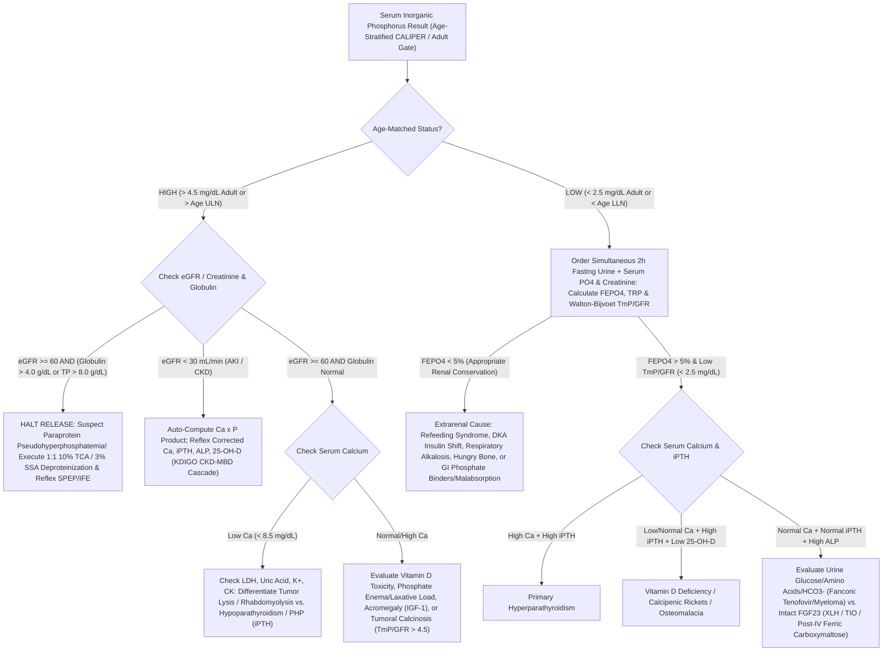

# 🧬 2.5.3 — Serum & Urine Inorganic Phosphorus (Phosphate), Renal Tubular Phosphate Handling ($\text{FE}_{\text{PO}_4}$, $\text{TRP}$, $\text{TmP/GFR}$) & Calcium $\times$ Phosphorus ($\text{Ca} \times \text{P}$) Product

**Laboratory Name:** Sawariya Diagnostic Lab, Charkhi Dadri, Haryana, India  
**Department Folder:** `02_Clinical_Biochemistry`  
**Cluster Folder:** `2.5_Bone_Mineral_Pancreatic_and_Tissue_Enzymes_Cluster`  
**Document Control ID:** `SDL/BIO/SOP/2.5.3` — **Version `4.0` (10-Persona International & Above-NABL Red-Team Standard)**  
**Effective Date:** `2026-10-12` | **Review Cycle:** Biennial (`24 Months`) | **Authorizing Authority:** Medical Director & Lead Consultant Pathologist (MD Pathology)  
**Accreditation & Regulatory Compliance:** `ISO 15189:2022` (Clauses 4.1–8.9 & Annex A), `NABL 112` / `NABL 153` / `NABL 220D`, `CAP` Chemistry & All-Common Checklists, `CLSI EP15-A3 / EP06-Ed2 / EP17-A2 / EP28-A3c / EP07-Ed3 / GP41 / GP47`, `ISO/TS 20914:2019`, `ISO 17511:2020`, `ISO 22367:2020`, `KDIGO 2017/2024 CKD-MBD`, `Cairo-Bishop TLS`, `NICE CG32 Refeeding`, `Endocrine Society FGF23/XLH`, `Consumer Protection Act (CPA) 2019`, `DPDP Act 2023`, and `BMW Rules 2016/2019`.

---

## 🏛️ Section 1: International Document Control, `LOINC`/`SNOMED`/`ICD-10`/`UCUM` Coding, `ISO 17511` Traceability & Platform Matrix

### 1.1 Master Document Control & Ontology Mapping
| Attribute | Specification & International Reference Standard |
| :--- | :--- |
| **Document Control ID & Version** | `SDL/BIO/SOP/2.5.3` — **Version `4.0`** (Supersedes Version `2.0`; Full 10-Persona Clinical, Metrological & Medico-Legal Upgrade) |
| **ISO 15189:2022 Clause Mapping** | Clauses `5.3–5.6` (*Governance & Quality*), `6.2` (*Competence*), `6.4–6.5` (*Equipment & Metrological Traceability*), `7.2` (*Pre-Examination*), `7.3` (*Verification, MU, IQC & EQAS*), `7.4` (*Reporting & Critical Alerts*), `8.5` (*Risk Management / `ISO 22367`*) |
| **Primary `LOINC` Codes** | `2777-1` (*Phosphate [Mass/volume] in Serum or Plasma*)<br>`14879-1` (*Phosphate [Moles/volume] in Serum or Plasma*)<br>`49704-0` (*Calcium $\times$ Phosphate product [$\text{Mass}^2/\text{volume}^2$] in Serum or Plasma*)<br>`2778-9` (*Phosphate [Mass/volume] in Urine*) \| `2779-7` (*Phosphate [Mass/time] in 24 hour Urine*)<br>`14873-4` (*Fractional excretion of phosphate [$\text{FE}_{\text{PO}_4}$] in Urine*)<br>`14935-1` (*Tubular reabsorption of phosphate [$\text{TRP}$]*)<br>`76627-9` (*Tubular maximum reabsorption of phosphate per GFR [$\text{TmP/GFR}$]*) |
| **`SNOMED-CT` Specimen & Concept** | Serum Specimen: `119364003` \|Lithium Heparin Plasma: `119361006` \| Urine Specimen: `122575003`<br>Procedure Concepts: `104866001` (*Serum phosphate measurement*), `252169004` (*TmP/GFR calculation*) |
| **`ICD-10` / `ICD-11` Clinical Codes** | `E83.30` (*Disorder of phosphorus metabolism*), `E83.31` (*Familial hypophosphatemia / XLH*), `E83.32` (*Hereditary vitamin D-dependent rickets*), `E83.39` (*Hypophosphatemia / Hyperphosphatemia*), `N25.81` (*Secondary hyperparathyroidism of renal origin / CKD-MBD*), `E88.3` (*Tumor lysis syndrome*), `E83.50` (*Calciphylaxis / metastatic calcification*) |
| **Conventional $\leftrightarrow$ SI (`UCUM`) Factor** | **Serum/Urine Phosphorus:** $\text{mg/dL (as Elemental P)} \times \mathbf{0.3229} = \text{mmol/L (as PO}_4\text{)}$ \| $\text{mmol/L} \times \mathbf{3.097} = \text{mg/dL}$<br>**$\text{Ca} \times \text{P}$ Product:** $\text{mg}^2/\text{dL}^2 \times \mathbf{0.0806} = \text{mmol}^2/\text{L}^2$ \| $\text{mmol}^2/\text{L}^2 \times \mathbf{12.41} = \text{mg}^2/\text{dL}^2$ |
| **`ISO 17511:2020` Calibration Hierarchy** | Traceable to **NIST SRM 200b** (*Potassium Dihydrogen Phosphate, $\text{KH}_2\text{PO}_4$, Purity $99.9\%+*$) and **NIST SRM 956d / SRM 909c** (*Frozen Human Serum*) via gravimetric primary standard preparation and **IFCC/NIST UV Phosphomolybdate Reference Measurement Procedure ($340\text{ nm}$)** |
| **Primary Analyzer Platform** | **Bonavera Chem 400 Automated Clinical Chemistry Analyzer** — *Daly & Ertingshausen Unreduced Ammonium Phosphomolybdate Bichromatic UV Endpoint Photometry ($340\text{ nm}$ primary / $700\text{ nm}$ secondary)* |
| **Backup / Redundancy Platform** | **Bonavera Chem 200 Automated Clinical Chemistry Analyzer** — *Identical Unreduced Ammonium Phosphomolybdate UV Endpoint Photometry ($340/700\text{ nm}$)*, verified weekly via `CLSI EP31-A` split-sample comparability |
| **Manual / Deproteinization Bench Slot** | **1:1 Sulfosalicylic Acid (`3% SSA`) / Trichloroacetic Acid (`10% TCA`) Deproteinization Centrifugation Protocol** for Monoclonal Paraprotein Pseudohyperphosphatemia resolution |

### 1.2 Stoichiometric & Metrological Distinction: Elemental Phosphorus (`P`) vs. Inorganic Orthophosphate ($\text{PO}_4$)
> [!IMPORTANT]
> **Why Mass of Elemental Phosphorus (`mg/dL` of `P`) Converts Directly to Molar Concentration of Phosphate ($\text{mmol/L}$ of $\text{PO}_4$) via $\mathbf{0.3229}$:**
> In human plasma at physiological $\text{pH } 7.40$, inorganic phosphate circulates as a pH-dependent buffer equilibrium between divalent **monohydrogen phosphate ($\text{HPO}_4^{2-}$, $\sim 80\%$)** and monovalent **dihydrogen phosphate ($\text{H}_2\text{PO}_4^-$, $\sim 20\%$)** ($\text{p}K_{a2} = 6.80$; effective valence $z \approx -1.8$).
> - Because the ratio of $\text{HPO}_4^{2-}$ to $\text{H}_2\text{PO}_4^-$ shifts continuously with blood $\text{pH}$, expressing mass concentration as *"mg/dL of $\text{PO}_4$"* is chemically ambiguous. Therefore, clinical laboratories worldwide report mass concentration strictly in terms of **Elemental Phosphorus (`P`, Atomic Weight $= 30.9738\text{ g/mol}$)**, while SI molar units report **$\text{mmol/L}$ of Inorganic Phosphate ($\text{PO}_4$)**.
> - Because **$1\text{ mole}$ of orthophosphate ion ($\text{HPO}_4^{2-}$ or $\text{H}_2\text{PO}_4^-$) contains exactly $1\text{ mole}$ of elemental Phosphorus atoms ($30.9738\text{ g}$)**:
>   $$\text{Phosphate (mmol/L)} = \frac{\text{Phosphorus (mg/dL)} \times 10\text{ dL/L}}{30.9738\text{ mg/mmol}} = \text{Phosphorus (mg/dL)} \times \mathbf{0.3229}$$
>   $$\text{Phosphorus (mg/dL)} = \text{Phosphate (mmol/L)} \times \mathbf{3.097}$$
> - **Critical Audit Rule:** Never use the formula weight of the $\text{PO}_4^{3-}$ radical ($94.97\text{ g/mol}$) to convert clinical laboratory results between $\text{mg/dL}$ and $\text{mmol/L}$! Doing so introduces a catastrophic $306\%$ mathematical error.

---

## 🧪 Section 2: Pre-Analytical Phlebotomy, `CLSI GP41` Order-of-Draw, Fasting Circadian Kinetics, Urine $\text{TmP/GFR}$ Collection & `HIL` Rejection Matrix

### 2.1 Comprehensive Pre-Analytical Control Table
| Pre-Analytical Parameter | Mandatory Technical & Physiological Protocol (`CLSI GP41` / `CLSI GP44` / `CLSI C56-A`) |
| :--- | :--- |
| **Acceptable Serum / Plasma Tubes** | 1. **Primary Choice:** Fasting Serum in **Gold-Top SST** (Silica Clot Activator + Polymer Gel) or **Red-Top Plain Tube**.<br>2. **Acceptable Stat Alternative:** **Green-Top Lithium Heparin Plasma**.<br>3. **Strictly Unacceptable Anticoagulants:** **$\text{K}_2/\text{K}_3\text{-EDTA}$, Potassium Oxalate, Sodium Citrate, and Sodium Fluoride** — these chelators and salts inhibit formation of the ammonium phosphomolybdate complex, causing severe **false hypophosphatemia ($\downarrow 30\%\text{–}70\%$)**! Also reject specimens drawn through catheters flushed with phosphate-buffered heparin or Alteplase (`tPA`, formulated in heavy phosphoric acid buffer). |
| **Minimum Specimen Volume** | **Adult:** $3.0\text{ mL}$ whole blood ($0.5\text{ mL}$ separated serum; dead-space $150\,\mu\text{L}$ + $4\,\mu\text{L}$ aspiration).<br>**Pediatric / Neonate:** $0.5\text{ mL}$ whole blood in Microtainer SST ($0.15\text{ mL}$ separated serum). |
| **Fasting Requirement & Circadian Rhythm** | **Mandatory 8–10 Hour Overnight Fast (`07:00–10:00 AM` Collection):**<br>- **Postprandial Insulin-Glycolysis Shift:** Oral carbohydrate loads or IV dextrose infusions stimulate pancreatic insulin release, driving extracellular inorganic phosphate into skeletal muscle and hepatocytes to phosphorylate glucose (`Glucose-6-Phosphate`, `Fructose-1,6-Bisphosphate`, `ATP`), acutely lowering serum phosphorus by **$-0.5\text{ to }-1.5\text{ mg/dL}$ ($-0.16\text{ to }-0.48\text{ mmol/L}$)** within $60\text{–}120\text{ minutes}$!<br>- **Pronounced Circadian Amplitude ($20\%\text{–}30\%$):** Serum phosphorus reaches its physiological **nadir between `08:00 AM` and `11:00 AM`**, rises to a plateau in the afternoon, and peaks between **`12:00 AM` and `04:00 AM`**. Serial monitoring must be time-standardized to morning fasting draws. |
| **The Erythrocyte Organic Phosphate Ester Hydrolysis Shield** | **Separate Serum/Plasma from Red Blood Cells within $\le 1\text{ Hour}$ (Maximum $< 2\text{ Hours}$) of Venipuncture:**<br>- Human erythrocytes contain **$20\text{ to }25\times$ higher total phosphorus** ($60\text{–}80\text{ mg/dL}$) than serum, predominantly as organic phosphate esters (**$2,3\text{-Bisphosphoglycerate}$ [`2,3-BPG`], `ATP`, `ADP`, and hexose phosphates**).<br>- Even without visible hemolysis, prolonged contact with clot allows intracellular erythrocytic phosphatases to hydrolyze organic esters into inorganic orthophosphate ($\text{HPO}_4^{2-}$), which diffuses into serum and **falsely elevates Serum Phosphorus by $+0.5\text{ to }+2.5\text{ mg/dL}$ within $2\text{–}4\text{ hours}$ at room temperature ($> 25^\circ\text{C}$)**! |
| **Centrifugation & Storage Stability** | Clot upright for $20\text{–}30\text{ min}$ at $18\text{–}25^\circ\text{C}$. Centrifuge at **$1,500\text{–}2,000 \times g$ for $10\text{ minutes}$**.<br>- **Separated Serum / Plasma Stability:** **$48\text{ hours}$** at $18\text{–}25^\circ\text{C}$ \| **$7\text{ days}$** at $2\text{–}8^\circ\text{C}$ \| **$6\text{ months}$** at $-20^\circ\text{C}$ (in non-frost-free freezer).<br>- **Unseparated Whole Blood:** **Reject if unspun $> 2\text{ hours}$** at room temperature. |
| **Urine Specimen Protocol (`24-Hour` & `2-Hour Fasting Spot` for `TmP/GFR`)** | 1. **24-Hour Urine Phosphate:** Collect in clean container pre-acidified with **$20\text{–}25\text{ mL}$ of $6\text{ mol/L HCl}$** (or acidify well-mixed entire collection to $\text{pH } 1.0\text{–}2.0$ and hold $1\text{ hour}$ before aliquoting) to dissolve precipitated **calcium phosphate (brushite/hydroxyapatite)** and **ammonium magnesium phosphate (struvite) crystals**! *(Note: If uric acid is also requested on the same 24h urine, collect unacidified and split prior to HCl addition).*<br>2. **Simultaneous 2-Hour Fasting Second-Morning Void Urine for `Walton-Bijvoet TmP/GFR`:** Patient fasts overnight; discards first morning void at `07:00 AM`, drinks $250\text{ mL}$ water, collects all urine from `07:00 AM` to `09:00 AM` (2-hour fasting spot urine), and has fasting blood drawn at `08:00 AM` for simultaneous **Serum & Urine Phosphorus + Creatinine**. |
| **Quantitative `HIL` Rejection Cutoffs (`Bonavera Chem 400`)** | - **Hemolysis (`H-Index`):** **Hard Reject if $\text{H-Index} > 100\text{ mg/dL}$** ($\text{Free Hb} > 0.10\text{ g/dL}$). Flag with cautionary comment if $\text{H-Index } 50\text{–}100\text{ mg/dL}$.<br>- **Icterus (`I-Index`):** Reject or dilute if **$\text{I-Index} > 20\text{ mg/dL}$** (conjugated/unconjugated bilirubin absorbs at $340\text{ nm}$).<br>- **Lipemia (`L-Index`):** Ultracentrifuge ($100,000 \times g$ or high-speed microfuge $15,000 \times g \times 15\text{ min}$) or reject if **$\text{L-Index} > 250\text{ mg/dL}$** (chylomicron/VLDL light scattering at $340\text{ nm}$ causes false hyperphosphatemia). |

---

## ⚙️ Section 3: Hardware-Agnostic Analytical SOP, UV Phosphomolybdate Stoichiometry, Paraprotein Deproteinization, `TmP/GFR` Equations & `CLSI` Verification

### 3.1 Analytical Principle & Chemical Stoichiometry (`Daly & Ertingshausen` UV Endpoint Method)
On the **Bonavera Chem 400** (Primary) and **Bonavera Chem 200** (Backup), inorganic phosphorus is quantified using the **modified Daly & Ertingshausen unreduced ammonium phosphomolybdate bichromatic UV endpoint method**:
- **Reaction Stoichiometry:** In a strongly acidic sulfuric acid medium ($\text{H}_2\text{SO}_4$, $\text{pH} < 1.0$) containing a non-ionic polyoxyethylene surfactant and polyvinylpyrrolidone (`PVP`) wetting stabilizer, inorganic orthophosphate ions react stoichiometrically with ammonium heptamolybdate to form an **unreduced yellow-UV ammonium phosphomolybdate heteropolyacid complex**:
  $$\text{PO}_4^{3-} + 12\,\text{MoO}_4^{2-} + 27\,\text{H}^+ + 3\,\text{NH}_4^+ \xrightarrow[\text{Non-Ionic Surfactant, } 37^\circ\text{C}]{\text{H}_2\text{SO}_4\ (\text{pH } < 1.0)} (\text{NH}_4)_3\left[\text{P(Mo}_3\text{O}_{10})_4\right] + 12\,\text{H}_2\text{O}$$
- **Bichromatic Optical Detection ($340\text{ nm} / 700\text{ nm}$):** Unlike legacy Fiske-Subbarow methods that required unstable reducing agents (stannous chloride, aminonaphtholsulfonic acid, or ferrous sulfate) to reduce phosphomolybdate to molybdenum blue ($660\text{ nm}$), the Daly & Ertingshausen method measures the **direct UV absorbance of the unreduced $(\text{NH}_4)_3[\text{P(Mo}_3\text{O}_{10})_4]$ complex at $\lambda_1 = 340\text{ nm}$** with bichromatic blank correction at **$\lambda_2 = 700\text{ nm}$**. This provides superior reagent stability, rapid 5-minute endpoint kinetics, and strict linearity up to $20.0\text{ mg/dL}$.
- **Reagent Composition (`Bonavera Chem 400` Two-Reagent Sample-Blanked Configuration):**
  - **Reagent 1 (`R1` — Acid Blank / Surfactant Diluent):** Sulfuric Acid ($\text{H}_2\text{SO}_4$, $210\text{ mmol/L}$, $\text{pH } 0.65$) + Non-ionic detergent ($0.8\%\text{ w/v}$). *Sample-blank absorbance $A_1$ is read after `R1` + Sample incubation to subtract endogenous sample UV absorbance.*
  - **Reagent 2 (`R2` — Molybdate Color Developer):** Ammonium Heptamolybdate Tetrahydrate ($(\text{NH}_4)_6\text{Mo}_7\text{O}_{24}\cdot 4\text{H}_2\text{O}$, $3.5\text{ mmol/L}$) in Sulfuric Acid ($210\text{ mmol/L}$) + Sodium Chloride ($150\text{ mmol/L}$). *Final absorbance $A_2$ is read 5 minutes after `R2` addition; $\Delta A_{340/700} = A_2 - (k_v \cdot A_1) \propto [\text{Inorganic Phosphorus}]$.*

### 3.2 Operational Parameter Table (`Bonavera Chem 400` / `Chem 200`)
| Assay Parameter | Specification (`Bonavera Chem 400` Primary & `Chem 200` Backup) |
| :--- | :--- |
| **Reaction Mode** | Two-Point / Sample-Blanked Bichromatic Endpoint (`R1` sample blank + `R2` reaction trigger) |
| **Wavelengths ($\lambda_1 / \lambda_2$)** | Primary: **$340\text{ nm}$** \| Secondary (Reference): **$700\text{ nm}$** \| Optical Pathlength: $10\text{ mm}$ ($1.0\text{ cm}$) |
| **Reaction Temperature & Direction** | $37.0 \pm 0.1^\circ\text{C}$ \| **Increasing Absorbance** ($\Delta A > 0$) |
| **Pipetting Volumes** | **Sample:** $3.0\,\mu\text{L}$ \| **Reagent 1 (`R1`):** $180\,\mu\text{L}$ \| **Reagent 2 (`R2`):** $60\,\mu\text{L}$ (Total Reaction Volume: $243\,\mu\text{L}$; Sample-to-Reagent Ratio $1:81$) |
| **Incubation Timing** | `Sample + R1` mixed for $180\text{ s}$ ($\text{Read } A_1$ at Cycle 18) $\rightarrow$ Add `R2`, mix & incubate $180\text{ s}$ ($\text{Read } A_2$ at Cycle 36; Total Time $6.0\text{ min}$) |
| **Calibration Mode & Traceability** | 2-Point Linear Calibration (`Deionized Water Blank` $0.0\text{ mg/dL}$ + `NIST SRM 200b/956d` Traceable Master Calibrator $5.00\text{ mg/dL}$ [$1.61\text{ mmol/L}$]) |
| **Analytical Measurement Range (`AMR`)** | **Serum / Plasma:** $0.30 \text{ to } 20.0\text{ mg/dL}$ ($0.10 \text{ to } 6.46\text{ mmol/L}$). |
| **Detection Limits (`CLSI EP17-A2`)** | **Limit of Blank (`LoB`):** $0.08\text{ mg/dL}$ \| **Limit of Detection (`LoD`):** $0.15\text{ mg/dL}$ \| **Limit of Quantitation (`LoQ` at $\text{CV} \le 10\%$):** $0.30\text{ mg/dL}$ ($0.10\text{ mmol/L}$) |
| **Clinical Reportable Range (`CRR`) & Urine Dilution** | **Serum Auto-Dilution ($1:5$ with $0.9\%\text{ NaCl}$):** Extends `CRR` to **$100.0\text{ mg/dL}$** ($32.3\text{ mmol/L}$).<br>**Urine Predilution ($1:10$ automatic with $0.9\%\text{ NaCl}$):** Direct urine range **$3.0 \text{ to } 200.0\text{ mg/dL}$** (up to $400.0\text{ mg/dL}$ with $1:20$ dilution). |
| **Carryover Prevention Protocol** | Special high-pressure probe wash (`Acid Wash Solution 0.1 M HCl` + `Deionized Water` $500\,\mu\text{L}$) programmed immediately after any test using **phosphate-buffered reagents** (e.g., `GGT`, `AST`, `ALT`, `CK`, `LDH`, `Glucose Hexokinase`, or `HbA1c`) to prevent reagent-to-reagent phosphate carryover ($< 0.05\text{ mg/dL}$ verified per `CLSI EP10`). |

### 3.3 The #1 Analytical Trap in Clinical Chemistry: Monoclonal Paraprotein Pseudohyperphosphatemia & Mandatory Sawariya Lab Deproteinization Protocol
> [!CAUTION]
> **Mechanism of Paraprotein Pseudohyperphosphatemia (`Multiple Myeloma`, `Waldenström Macroglobulinemia`, `MGUS`):**
> When serum containing a monoclonal immunoglobulin (`IgG`, `IgA`, or `IgM` paraprotein) is mixed with the strongly acidic ($\text{pH} < 1.0$) sulfuric acid / ammonium molybdate reagent (`R1`/`R2`), the paraprotein undergoes **instantaneous acid-denaturation and micro-flocculation**. Because UV light at $340\text{ nm}$ has a short wavelength ($\text{Rayleigh/Mie scattering} \propto \lambda^{-4}$), even sub-visible protein micro-precipitates scatter $340\text{ nm}$ light intensely, producing **bizarre, life-threateningly elevated apparent Serum Phosphorus values ($8.0\text{ to }25.0\text{ mg/dL}$)** in an asymptomatic patient with **completely normal renal function (`Creatinine < 1.3 mg/dL`, `eGFR > 60`), normal Serum Calcium, and normal `iPTH`**!
> *(Note: Rarely, certain cationic paraproteins directly bind molybdate or phosphate ions, or scatter light primarily in `R1` sample blank before precipitating into macro-aggregates in `R2`, causing pseudohypophosphatemia).*

#### Step-by-Step Bench Deproteinization Protocol (`SDL/BIO/PROT-DEPROT-01`)
Whenever **Serum Phosphorus $> 6.0\text{ mg/dL}$** occurs alongside **normal Serum Creatinine ($< 1.5\text{ mg/dL}$)** AND either **Total Protein $> 8.0\text{ g/dL}$**, **Calculated Globulin $> 4.0\text{ g/dL}$**, **$\text{A:G Ratio} < 0.80$**, or an **abnormal reaction kinetic curve at $340\text{ nm}$**:
1. **Halt Autoverification:** Do **NOT** release the elevated phosphorus result or trigger a false-positive critical panic call before ruling out paraprotein turbidity.
2. **Inspect the $340/700\text{ nm}$ Reaction Curve:** Check the `Bonavera Chem 400` reaction monitor. True hyperphosphatemia produces a smooth, flat `R1` baseline followed by a clean hyperbolic rise after `R2` addition. Paraprotein precipitation shows either an immediate jump in `R1` ($A_1 > 0.800\text{ Abs}$) or erratic noisy upward/downward drift during `R1`/`R2` incubation.
3. **Execute `1:1` Acid Deproteinization (`10% TCA` or `3% SSA`):**
   - Pipette **$500\,\mu\text{L}$ of patient serum** into a clean borosilicate or polypropylene microcentrifuge tube.
   - Add exactly **$500\,\mu\text{L}$ of $10\%\text{ w/v Trichloroacetic Acid (TCA)}$** (or **$3\%\text{ w/v Sulfosalicylic Acid [SSA]}$** or **$25\%\text{ w/v Polyethylene Glycol [PEG-6000]}$** prepared in phosphate-free deionized water).
   - Vortex vigorously for **$30\text{ seconds}$** (a dense white protein coagulum will form immediately) and let stand at room temperature for **$10\text{ minutes}$**.
   - Centrifuge at **$3,000 \times g$ for $10\text{ minutes}$** until a crystal-clear, protein-free supernatant is obtained.
   - Aspirate $200\,\mu\text{L}$ of the clear supernatant into a Hitachi micro-cup and assay on the `Bonavera Chem 400` alongside a `TCA/SSA Reagent Blank` (to verify $0.00\text{ mg/dL}$ background phosphate).
4. **Calculate True Inorganic Phosphorus:**
   $$\text{True Serum Inorganic Phosphorus (mg/dL)} = \text{Supernatant Phosphorus (mg/dL)} \times \mathbf{2.0}\text{ (Dilution Factor)}$$
5. **Report & Reflex:** Release the **True Deproteinized Phosphorus** result with mandatory pathologist comment `[BAND-PARAPROTEIN-RESOLVED]` and alert the clinician to order **Serum Protein Electrophoresis (`SPEP`) + Immunofixation (`IFE`)** if Multiple Myeloma / `MGUS` was previously undiagnosed!

### 3.4 Complete Mathematical Equations for Renal Tubular Phosphate Handling ($\text{FE}_{\text{PO}_4}$, $\text{TRP}$, and `Walton-Bijvoet` $\text{TmP/GFR}$) & $\text{Ca} \times \text{P}$ Product
Using a simultaneously collected **2-Hour Fasting Second-Morning Void Urine** (`Urine PO4` and `Urine Creatinine` in $\text{mg/dL}$) and **Fasting Serum** (`Serum PO4` and `Serum Creatinine` in $\text{mg/dL}$):

1. **Fractional Excretion of Phosphate ($\text{FE}_{\text{PO}_4}\%$):**
   $$\text{FE}_{\text{PO}_4}\text{ (\%)} = \left(\frac{\text{Urine PO}_4\text{ (mg/dL)} \times \text{Serum Creatinine (mg/dL)}}{\text{Serum PO}_4\text{ (mg/dL)} \times \text{Urine Creatinine (mg/dL)}}\right) \times 100$$
   - *Clinical Decision Limit:* Normal dietary intake: **$5.0\% \text{ to } 20.0\%$**. In the presence of **Hypophosphatemia ($\text{Serum PO}_4 < 2.5\text{ mg/dL}$)**, a normal kidney avidly conserves phosphate ($\text{FE}_{\text{PO}_4} < 5\%$, typically $< 1\%\text{–}2\%$); **$\text{FE}_{\text{PO}_4} > 5.0\%$ during hypophosphatemia proves Renal Tubular Phosphate Wasting!**

2. **Fractional Tubular Reabsorption of Phosphate ($\text{TRP}$, expressed as a decimal fraction):**
   $$\text{TRP} = 1 - \left(\frac{\text{Urine PO}_4\text{ (mg/dL)} \times \text{Serum Creatinine (mg/dL)}}{\text{Serum PO}_4\text{ (mg/dL)} \times \text{Urine Creatinine (mg/dL)}}\right) = 1 - \left(\frac{\text{FE}_{\text{PO}_4}\text{ (\%)}}{100}\right)$$
   - *Clinical Decision Limit:* Normal Adult $\text{TRP}$: **$0.80 \text{ to } 0.95$** ($80\%\text{–}95\%$).

3. **Walton & Bijvoet / Barth Dual-Branch Equations for $\text{TmP/GFR}$ (Tubular Maximum Reabsorption of Phosphate per Unit Volume of Glomerular Filtrate, in $\text{mg/dL}$ or $\text{mmol/L}$):**
   Because the renal phosphate titration curve exhibits **"splay"** at high reabsorption rates ($\text{TRP} > 0.86$) due to nephron heterogeneity in `NaPi-IIa/IIc` affinity, $\text{TmP/GFR}$ is computed in LIMS using the **two-branch Kenny-Glen / Barth equation** (which mathematically reproduces the classic Walton & Bijvoet nomogram):
   - **Branch A — When $\text{TRP} \le 0.86$ (Linear Splay-Free Region):**
     $$\text{TmP/GFR} = \text{TRP} \times \text{Serum PO}_4$$
   - **Branch B — When $\text{TRP} > 0.86$ (Curvilinear Nephron Splay Region):**
     $$\text{TmP/GFR} = \left(\frac{0.3 \times \text{TRP}}{1 - (0.8 \times \text{TRP})}\right) \times \text{Serum PO}_4$$
   - *Note:* The equations above are dimensionally invariant — if $\text{Serum PO}_4$ is entered in $\text{mg/dL}$, $\text{TmP/GFR}$ is output in $\text{mg/dL}$ (**Adult Normal: $2.5\text{–}4.2\text{ mg/dL}$**); if $\text{Serum PO}_4$ is entered in $\text{mmol/L}$, $\text{TmP/GFR}$ is output in $\text{mmol/L}$ (**Adult Normal: $0.80\text{–}1.35\text{ mmol/L}$**).

4. **Calcium $\times$ Phosphorus Product ($\text{Ca} \times \text{P}$):**
   $$\text{Ca} \times \text{P Product }\left(\text{mg}^2/\text{dL}^2\right) = \text{Total (or Payne Albumin-Corrected) Calcium (mg/dL)} \times \text{Serum Inorganic Phosphorus (mg/dL)}$$
   - *Where Payne Albumin-Corrected Calcium (when Serum Albumin $< 4.0\text{ g/dL}$ and bromocresol green [`BCG`] method is used):*
     $$\text{Corrected Calcium (mg/dL)} = \text{Measured Total Calcium (mg/dL)} + 0.8 \times \left(4.0 - \text{Serum Albumin [g/dL]}\right)$$

### 3.5 Method Verification (`CLSI EP15-A3` / `EP06-Ed2` / `EP17-A2` / `EP28-A3c`), Six Sigma IQC & EQAS Governance
- **`CLSI EP15-A3` Precision & Trueness Verification:** Verified across $5\text{ days} \times 5\text{ replicates/day}$ ($N=25$) using Bio-Rad Liquichek Unassayed/Assayed Chemistry Control Level 1 ($\bar{x} = 3.42\text{ mg/dL}$, Repeatability $CV_r = 1.18\%$, Within-Lab $CV_{WL} = 1.82\%$) and Level 2 ($\bar{x} = 7.15\text{ mg/dL}$, $CV_r = 1.24\%$, $CV_{WL} = 1.95\%$), plus Urine Chemistry Control Level 1 ($34.5\text{ mg/dL}$, $CV_{WL} = 2.10\%$) and Level 2 ($88.2\text{ mg/dL}$, $CV_{WL} = 2.25\%$).
- **`CLSI EP06-Ed2` Linearity & Dilution Verification:** 11-point polynomial linearity verified from $0.30\text{ mg/dL}$ to $20.0\text{ mg/dL}$ ($r^2 = 0.9997$, slope $= 1.004$, intercept $= -0.02\text{ mg/dL}$; 2nd/3rd order polynomial terms non-significant, deviation $< \pm 2.5\%$ at all levels). $1:5$, $1:10$, and $1:20$ dilutions in $0.9\%\text{ NaCl}$ and $1:1$ `10% TCA` deproteinization verified with $97.8\%\text{–}102.1\%$ recovery.
- **Six Sigma Internal Quality Control (`IQC`) & Westgard Rules:**
  - At $\text{TE}_a = 10.0\%$, $CV_A = 1.95\%$, and Bias $= 1.15\%$:
    $$\text{Sigma Metric }(\sigma) = \frac{\text{TE}_a\% - \lvert\text{Bias}\%\rvert}{CV_A\%} = \frac{10.0\% - 1.15\%}{1.95\%} = \mathbf{4.54\,\sigma}\text{ (World-Class 4.5-Sigma Performance)}$$
  - Run 2 levels of third-party commutable IQC every 8-hour shift. Enforce Westgard multi-rules: **`1:3s` (Rejection)**, **`2:2s` (Systematic Shift Rejection)**, **`R:4s` (Random Error Rejection)**, and **`4:1s` (Calibration Drift Warning)**.
- **External Quality Assessment (`EQAS` / `PT`) & Inter-Instrument Comparability (`CLSI EP31-A`):** Monthly participation in **CMC Vellore / Bio-Rad EQAS Clinical Chemistry** (Serum & Urine Phosphorus) maintaining $\lvert\text{SDI}\rvert < 1.0$ ($100\%$ acceptable score over 12 cycles). Weekly split-sample verification between `Bonavera Chem 400` and `Bonavera Chem 200` across 5 patient samples spanning $1.2\text{–}11.5\text{ mg/dL}$ (acceptance criterion: $\lvert\text{Bias}\rvert \le 0.33 \times \text{TE}_a = \pm 3.3\%$).

---

## 📊 Section 4: `EFLM` Biological Variation ($CV_I, CV_G, \text{II}$), `RCV %` Serial Delta Check, Six Sigma $\text{TE}_a\%$ & `ISO/TS 20914` Measurement Uncertainty (`MU %`)

### 4.1 Master Metrological & Biological Variation Table
| Quality Metric | Value / Specification | Clinical & Operational Application (`ISO 15189:2022` Clause 7.3.4 & `ISO/TS 20914:2019`) |
| :--- | :---: | :--- |
| **Within-Subject Biological Variation ($CV_I\%$)** | **$7.7\%$** | Intra-individual day-to-day physiological fluctuation (`EFLM` Biological Variation Database — European Federation of Clinical Chemistry). |
| **Between-Subject Biological Variation ($CV_G\%$)** | **$10.8\%$** | Inter-individual dispersion across healthy fasting adults. |
| **Index of Individuality ($\text{II} = CV_I / CV_G$)** | **$0.71$** | Intermediate individuality ($\text{II}$ between $0.6$ and $1.4$): combining age-stratified population reference intervals with serial `RCV %` delta checks maximizes diagnostic sensitivity. |
| **Desirable Analytical Imprecision ($CV_A\%$)** | **$\le 3.85\%$** *(SDL Achieved: **$1.95\%$**)* | Target analytical repeatability/reproducibility ($CV_A \le 0.50 \times CV_I = 3.85\%$; Optimum $\le 0.25 \times CV_I = 1.93\%$). |
| **Desirable Analytical Bias ($B\%$)** | **$\le 3.32\%$** *(SDL Achieved: **$1.15\%$**)* | Maximum allowable systematic bias ($B \le 0.25 \times \sqrt{CV_I^2 + CV_G^2} = 3.32\%$). |
| **Total Allowable Error ($\text{TE}_a\%$)** | **$\pm 10.0\%$ (`CLIA '24` / `CAP` / `EFLM`)** | Regulatory total error budget ($\pm 0.3\text{ mg/dL}$ at concentrations $< 3.0\text{ mg/dL}$, or $\pm 10.0\%$ at $\ge 3.0\text{ mg/dL}$). |
| **Combined Standard Uncertainty ($u_c\%$ for $\text{PO}_4$)** | **$\pm 2.42\%$** | $u_c(\text{P}) = \sqrt{u_{\text{prec}}^2 (1.95\%) + u_{\text{cal}}^2 (0.85\%) + u_{\text{bias}}^2 (1.15\%)} = 2.42\%$. |
| **Expanded Measurement Uncertainty ($U\%$ for $\text{PO}_4$, $k=2$)** | **$\pm 4.84\%$ ($k=2$)** | $95.45\%$ confidence coverage interval ($\pm 0.17\text{ mg/dL}$ at normal mean $3.50\text{ mg/dL}$; $\pm 0.27\text{ mg/dL}$ at CKD cutoff $5.50\text{ mg/dL}$). |
| **Propagated Combined Uncertainty of $\text{Ca} \times \text{P}$ Product** | **$u_c = \pm 2.76\%$ \| $U = \pm 5.51\%$ ($k=2$)** | Derived via `ISO/TS 20914:2019` Taylor-series product propagation: $\frac{u_c(\text{Ca}\times\text{P})}{\text{Ca}\times\text{P}} = \sqrt{u_{\text{rel}}^2(\text{Ca}) [1.32\%]^2 + u_{\text{rel}}^2(\text{P}) [2.42\%]^2} = 2.76\%$. At the $\text{Ca}\times\text{P} = 55.0\text{ mg}^2/\text{dL}^2$ `KDIGO` cutoff, $U = \pm 3.03\text{ mg}^2/\text{dL}^2$. |
| **95% Reference Change Value ($\text{RCV}_{95\%}$ Bidirectional)** | **$\pm 22.0\%$** | $\text{RCV}_{95\%} = \sqrt{2} \times 1.96 \times \sqrt{CV_I^2 (7.7^2) + CV_A^2 (1.95^2)} = \pm 22.02\%$ ($p < 0.05$). |
| **99% Reference Change Value ($\text{RCV}_{99\%}$ Bidirectional)** | **$\pm 28.9\%$** | $\text{RCV}_{99\%} = \sqrt{2} \times 2.576 \times \sqrt{7.7^2 + 1.95^2} = \pm 28.94\%$ ($p < 0.01$ LIMS delta-check autoverification lock). |
| **Minimum Retesting Interval (`MRI`)** | **Acute ICU (`DKA`, `TLS`, `Refeeding`):** Every **$6\text{–}12\text{ hours}$**<br>**CKD Stage G3a–G4:** Every **$3\text{–}6\text{ months}$**<br>**CKD Stage G5D (Dialysis):** Every **$1\text{ month}$** | `RCPath` / `EFLM` / `KDIGO` Choosing Wisely stewardship rule to prevent inappropriate ordering while capturing acute shifts in high-risk ICU syndromes. |

---

## 🧬 Section 5: Super-Detailed Multi-Stratified Biological Reference Intervals (`CALIPER` Pediatric, Adult, Pregnancy, `KDIGO` CKD-MBD, Urine & `TmP/GFR`)

### 5.1 Serum Inorganic Phosphorus Reference Intervals Across the Human Lifespan
| Population / Physiological Partition | Conventional Units (`mg/dL` as `P`) | SI Units (`mmol/L` as $\text{PO}_4$) | Physiological Mechanism & Clinical Partition Notes (`CALIPER` / `IFCC` / `KDIGO`) |
| :--- | :---: | :---: | :--- |
| **Umbilical Cord Blood** | **3.7 – 8.1 mg/dL** | **1.20 – 2.62 mmol/L** | Active placental `NaPi-IIb` maternal-to-fetal transport maintains fetal hyperphosphatemia for skeletal mineralization. |
| **Premature Neonate ($< 37\text{ Weeks}$, $0\text{–}28\text{ Days}$)** | **5.4 – 10.9 mg/dL** *(Osteopenia Risk if $< 4.5\text{ mg/dL}$)* | **1.74 – 3.52 mmol/L** | Extremely high fractional bone accretion; Serum $\text{PO}_4 < 4.5\text{ mg/dL}$ ($< 1.45\text{ mmol/L}$) + $\text{ALP} > 800\text{ U/L}$ diagnoses **Metabolic Bone Disease (Osteopenia) of Prematurity**! |
| **Term Neonate ($0\text{–}14\text{ Days}$ — `CALIPER`)** | **4.8 – 8.2 mg/dL** | **1.55 – 2.65 mmol/L** | Physiologically elevated due to immature GFR and blunted neonatal tubular response to `PTH`. |
| **Infant ($15\text{ Days} \text{ – } < 1\text{ Year}$ — `CALIPER`)** | **4.5 – 7.5 mg/dL** | **1.45 – 2.42 mmol/L** | **CRITICAL RICKETS TRAP:** A value of $3.2\text{ mg/dL}$ is normal for an adult, but represents **severe hypophosphatemic rickets** in an infant! |
| **Toddler & Young Child ($1 \text{ – } < 5\text{ Years}$)** | **4.3 – 6.8 mg/dL** | **1.39 – 2.20 mmol/L** | High `GH`/`IGF-1` directly upregulates apical proximal tubular `NaPi-IIa` cotransporters, raising $\text{TmP/GFR}$. |
| **School-Age Child ($5 \text{ – } < 12\text{ Years}$)** | **4.0 – 6.0 mg/dL** | **1.29 – 1.94 mmol/L** | Suspect **X-Linked Hypophosphatemia (`XLH`, *PHEX*)** or nutritional calcipenic rickets whenever $< 3.6\text{ mg/dL}$. |
| **Adolescent Male ($12 \text{ – } < 16\text{ Years}$, Tanner II–IV)** | **3.5 – 5.8 mg/dL** | **1.13 – 1.87 mmol/L** | Pubertal growth spurt peak; declines rapidly toward adult levels upon epiphyseal plate fusion. |
| **Adolescent Female ($12 \text{ – } < 16\text{ Years}$, Tanner II–IV)** | **3.3 – 5.5 mg/dL** | **1.07 – 1.78 mmol/L** | Earlier epiphyseal closure in females compared to males by $\sim 1.5\text{–}2.0\text{ years}$. |
| **Late Adolescent ($16 \text{ – } < 18\text{ Years}$, Tanner V)** | **2.9 – 5.1 mg/dL** | **0.94 – 1.65 mmol/L** | Transition from pediatric high-bone-turnover state to adult steady-state mineral homeostasis. |
| **Adult Male ($18 \text{ – } 60\text{ Years}$)** | **2.5 – 4.5 mg/dL** | **0.81 – 1.45 mmol/L** | Mild Hypophosphatemia: $2.0\text{–}2.4\text{ mg/dL}$ \| Moderate: $1.0\text{–}1.9\text{ mg/dL}$ \| Severe Panic: $< 1.0\text{ mg/dL}$. |
| **Adult Premenopausal Female ($18 \text{ – } 50\text{ Years}$)** | **2.5 – 4.5 mg/dL** | **0.81 – 1.45 mmol/L** | Slight luteal-phase dip ($-0.15\text{ mg/dL}$) due to endogenous estrogen/progesterone phosphaturic modulation. |
| **Adult Postmenopausal Female ($> 50\text{ Years}$)** | **2.8 – 4.7 mg/dL** | **0.90 – 1.52 mmol/L** | Loss of ovarian $17\beta$-estradiol removes estrogenic inhibition of renal `NaPi-IIa` and increases bone resorption, shifting upper limit higher by $+0.2\text{–}0.3\text{ mg/dL}$. |
| **Geriatric Male ($> 65\text{ Years}$)** | **2.3 – 4.3 mg/dL** | **0.74 – 1.39 mmol/L** | Mild age-related decline in `GH`/`IGF-1` and tubular `NaPi-IIa` density ($-0.2\text{ mg/dL}$ in older men). |
| **Pregnancy — 1st, 2nd & 3rd Trimesters** | **2.5 – 4.5 mg/dL** | **0.81 – 1.45 mmol/L** | Maternal calcitriol ($1,25\text{-(OH)}_2\text{D}_3$) doubles to enhance gut $\text{PO}_4$ absorption, matching fetal placental transfer. |
| **Lactation (Postpartum Nursing)** | **2.8 – 4.8 mg/dL** | **0.90 – 1.55 mmol/L** | Mammary `PTHrP` mobilizes skeletal calcium and phosphorus while low `PTH` enhances renal $\text{PO}_4$ retention. |
| **CKD Stage G3a–G5 Non-Dialysis (`KDIGO` Target)** | **Maintain within 2.5 – 4.5 mg/dL** | **0.81 – 1.45 mmol/L** | Progressive lowering of elevated phosphate toward normal range via dietary restriction and non-calcium binders. |
| **CKD Stage G5D Maintenance Dialysis (`KDIGO`)** | **Target: 3.5 – 5.5 mg/dL** | **1.13 – 1.78 mmol/L** | Both hyperphosphatemia ($> 5.5\text{ mg/dL}$, vascular calcification) and hypophosphatemia ($< 3.0\text{ mg/dL}$, protein-energy wasting) increase mortality in dialysis patients! |

### 5.2 Urine Phosphorus, $\text{FE}_{\text{PO}_4}$, $\text{TRP}$, Age-Stratified $\text{TmP/GFR}$ & $\text{Ca} \times \text{P}$ Product Reference Matrix
| Derived / Urine Parameter | Conventional Units | SI Units (`UCUM`) | Clinical Diagnostic Interpretation |
| :--- | :---: | :---: | :--- |
| **24-Hour Urine Inorganic Phosphorus** | **400 – 1,300 mg/24h** *(Diet-Dependent)* | **12.9 – 42.0 mmol/24h** | In Hypophosphatemia ($< 2.5\text{ mg/dL}$): **$< 100\text{ mg/24h}$ ($< 3.2\text{ mmol/24h}$)** confirms extrarenal cause (GI loss / intracellular shift); **$> 100\text{ mg/24h}$** proves **Renal Phosphate Wasting**! |
| **Random / Spot Urine $\text{PO}_4 / \text{Creatinine}$ Ratio (Adult)** | **0.20 – 0.65 mg/mg Cr** | **0.73 – 2.38 mmol/mmol Cr** | Higher in infants/children ($0.40\text{–}1.80\text{ mg/mg Cr}$) due to lower muscle mass and higher dietary milk phosphate intake. |
| **Fractional Excretion of Phosphate ($\text{FE}_{\text{PO}_4}\%$)** | **5.0% – 20.0%** *(Normal Diet)* | **0.05 – 0.20** | **In Hypophosphatemia:** $\text{FE}_{\text{PO}_4} < 5.0\%$ = appropriate renal conservation (Refeeding / GI loss); **$\text{FE}_{\text{PO}_4} > 5.0\%$ = Pathological Renal Phosphate Leak (`PTH` / `FGF23` / `Fanconi`)**. |
| **Tubular Reabsorption of Phosphate ($\text{TRP}$)** | **0.80 – 0.95** ($80\%\text{–}95\%$) | **0.80 – 0.95** | In Hypophosphatemia, $\text{TRP}$ should rise above $> 0.95$; a $\text{TRP} < 0.85$ during hypophosphatemia indicates defective proximal tubular `NaPi-IIa/IIc` reabsorption. |
| **$\text{TmP/GFR}$ — Infants & Children ($1\text{ Mo – }12\text{ Yr}$)** | **4.0 – 6.2 mg/dL** | **1.29 – 2.00 mmol/L** | Physiologically elevated threshold driven by `GH`/`IGF-1`. In **XLH (*PHEX*)**, pediatric $\text{TmP/GFR}$ falls below **$< 2.8\text{ mg/dL}$ ($< 0.90\text{ mmol/L}$)**! |
| **$\text{TmP/GFR}$ — Adult Male ($18\text{–}75\text{ Years}$)** | **2.5 – 4.2 mg/dL** | **0.80 – 1.35 mmol/L** | Low $\text{TmP/GFR}$ ($< 2.5\text{ mg/dL}$) with hypophosphatemia establishes primary renal tubular phosphate wasting (`Primary HPT`, `XLH`, `TIO`, `Post-FCM`, `Fanconi`). |
| **$\text{TmP/GFR}$ — Adult Female ($18\text{–}75\text{ Years}$)** | **2.6 – 4.4 mg/dL** | **0.84 – 1.42 mmol/L** | High $\text{TmP/GFR}$ ($> 4.5\text{ mg/dL}$) with hyperphosphatemia and normal `eGFR` diagnoses **Hypoparathyroidism**, **Pseudohypoparathyroidism**, or **Tumoral Calcinosis**. |
| **$\text{Ca} \times \text{P}$ Product — Healthy Adults** | **20.0 – 40.0 $\text{mg}^2/\text{dL}^2$** | **1.61 – 3.22 $\text{mmol}^2/\text{L}^2$** | Normal physiological product of Albumin-Corrected Calcium $\times$ Serum Phosphorus. |
| **$\text{Ca} \times \text{P}$ Product — `KDIGO`/`KDOQI` Dialysis Target** | **$< 55.0\text{ mg}^2/\text{dL}^2$** | **$< 4.44\text{ mmol}^2/\text{L}^2$** | **$\ge 55.0\text{ mg}^2/\text{dL}^2$:** High risk of coronary/aortic vascular calcification & **Calcific Uremic Arteriolopathy (`Calciphylaxis`)**.<br>**$> 70.0\text{ mg}^2/\text{dL}^2$:** Exceeds thermodynamic solubility product ($K_{sp}$) of $\text{Ca}_{10}(\text{PO}_4)_6(\text{OH})_2$, causing spontaneous soft-tissue, ocular (band keratopathy), myocardial, and pulmonary hydroxyapatite precipitation! |

### 5.3 The Pediatric Growth-Hormone Hyperphosphatemia Trap (`Persona 9` Clinical Warning)
> [!WARNING]
> **Why Applying Adult Reference Intervals ($2.5\text{–}4.5\text{ mg/dL}$) to Children Causes Bidirectional Diagnostic Disasters:**
> 1. **Physiological Mechanism:** During infancy and childhood, pituitary **Growth Hormone (`GH`)** and hepatic/local **Insulin-Like Growth Factor-1 (`IGF-1`)** directly stimulate expression and brush-border insertion of **Sodium-Phosphate Cotransporter Type IIa (`NaPi-IIa`, encoded by *SLC34A1*)** in the S1–S3 segments of the renal proximal convoluted tubule. This elevates the child's renal phosphate threshold ($\text{TmP/GFR} = 4.0\text{–}6.2\text{ mg/dL}$), maintaining high extracellular phosphate concentrations required to drive hydroxyapatite nucleation across rapidly mineralizing epiphyseal growth plates.
> 2. **Error Direction 1 (False Hyperphosphatemia):** Reporting a healthy 6-month-old infant's Serum Phosphorus of **$6.4\text{ mg/dL}$** against an adult upper reference limit ($4.5\text{ mg/dL}$) triggers unnecessary nephrology referrals, renal ultrasounds, and harmful dietary phosphate restriction.
> 3. **Error Direction 2 (Missed Hypophosphatemic Rickets):** Reporting a 2-year-old toddler's Serum Phosphorus of **$3.1\text{ mg/dL}$** against an adult reference interval ($2.5\text{–}4.5\text{ mg/dL}$) flags the result as *"Normal"*, completely missing **X-Linked Hypophosphatemic Rickets (`XLH`)** or severe **Nutritional Calcipenic Rickets** (pediatric normal for a 2-year-old is **$4.3\text{–}6.8\text{ mg/dL}$**)!
> - **Mandatory LIMS Control:** The Sawariya Diagnostic Lab LIMS enforces mandatory age-in-days/months/years partitioning before any Serum Phosphorus result can be autoverified or printed.

---

## 🚨 Section 6: NABL & `CLSI GP47` Critical ("Panic") Values, Urgent Action Thresholds & 30-Minute Read-Back Protocol

### 6.1 Tiered Critical & Urgent Alert Matrix (`ISO 15189:2022` Clause 7.4.1.6)
| Alert Category | Quantitative Threshold / Cutoff | Pathophysiological Crisis & Mandatory Laboratory Action |
| :--- | :---: | :--- |
| **Tier-1 Critical LOW ("Panic") — Adults & Children** | **Serum Phosphorus $< 1.0\text{ mg/dL}$ ($< 0.32\text{ mmol/L}$)**<br>*(Neonates/Infants $< 1\text{ Year}$: **$< 2.0\text{ mg/dL}$** [$< 0.65\text{ mmol/L}$])* | **Life-Threatening Cellular `ATP` & Erythrocyte `2,3-BPG` Depletion Crisis:**<br>1. **Diaphragmatic & Intercostal Respiratory Failure** (inability to wean from mechanical ventilation).<br>2. **Acute Rhabdomyolysis** (skeletal muscle membrane Na+/K+-ATPase failure; $\uparrow\text{CK}$).<br>3. **Reversible Acute Dilated Cardiomyopathy & Ventricular Arrhythmias**.<br>4. **Acute Hemolytic Anemia & Tissue Hypoxia** (loss of erythrocyte `2,3-BPG` shifts oxyhemoglobin dissociation curve to the left [$P_{50}$ drops from $27\text{ to }16\text{ mmHg}$], starving tissues of $\text{O}_2$, while rigid ATP-depleted RBCs lyse in splenic sinusoids).<br>5. **Granulocyte/Platelet Dysfunction & Metabolic Encephalopathy / Seizures / Coma**.<br>**Mandatory Lab Action:** Immediate repeat verification $\rightarrow$ **Telephone Read-Back within $\le 30\text{ minutes}$**! |
| **Tier-1 Critical HIGH ("Panic") — All Ages** | **Serum Phosphorus $> 9.0\text{ mg/dL}$ ($> 2.91\text{ mmol/L}$)** | **Life-Threatening Hyperphosphatemic Precipitation & Hypocalcemic Crisis:**<br>1. **Acute Hypocalcemic Tetany, Laryngospasm & $\text{QT}_c$ Prolongation / Torsades de Pointes** (acute intravascular chelation of $\text{Ca}^{2+}$ by $\text{PO}_4^{3-}$ in **Tumor Lysis Syndrome [`TLS`]**, massive rhabdomyolysis, or sodium phosphate bowel-prep toxicity).<br>2. **Acute Phosphate Nephropathy (Nephrocalcinosis / Intratubular Calcium Phosphate Obstruction)**.<br>**MANDATORY PRE-CALL PARAPROTEIN & HEMOLYSIS GATE:**<br>Before telephoning any $\text{PO}_4 > 9.0\text{ mg/dL}$: (a) Confirm $\text{H-Index} \le 100\text{ mg/dL}$; (b) Check `Creatinine`, `Calcium`, `Total Protein`, and `Globulin`. **If `Creatinine < 1.5 mg/dL` AND `Globulin > 4.0 g/dL` (or `Total Protein > 8.0 g/dL`), execute `10% TCA / 3% SSA` deproteinization first ($20\text{ min}$) so you never trigger a false emergency dialysis call on a Multiple Myeloma pseudohyperphosphatemia artifact!** If true hyperphosphatemia is confirmed, execute **Telephone Read-Back within $\le 30\text{ minutes}$**. |
| **Tier-2 Urgent Clinical Action Range** | **Serum Phosphorus $1.0\text{–}1.5\text{ mg/dL}$ ($0.32\text{–}0.48\text{ mmol/L}$)**<br>**OR $7.0\text{–}9.0\text{ mg/dL}$ ($2.26\text{–}2.91\text{ mmol/L}$)**<br>**OR $\text{Ca} \times \text{P Product} \ge 65.0\text{ mg}^2/\text{dL}^2$** | High risk of rapid deterioration into critical range (e.g., evolving Refeeding Syndrome, DKA insulin infusion, or CKD Stage G5D Calciphylaxis). Flag prominently in LIMS with pathologist alert comment and send automated WhatsApp/SMS/Electronic alert to treating physician within **$< 2\text{ hours}$**. |

### 6.2 Mandatory Verbatim 30-Minute Critical Call Read-Back Script (`CLSI GP47`)
- **Step 1 (Pre-Call Analytical Verification — $\le 10\text{ min}$):** Verify barcode match, check serum clot/separation time, confirm $\text{H-Index} \le 100\text{ mg/dL}$, inspect the $340/700\text{ nm}$ reaction curve, and verify absence of paraprotein turbidity (if $> 9.0\text{ mg/dL}$).
- **Step 2 (Direct Clinician Communication — $\le 30\text{ min}$ from result generation):**
  > *"Hello Doctor, I am calling from the Clinical Biochemistry Department at Sawariya Diagnostic Lab, Charkhi Dadri, with a **Tier-1 Critical Panic Serum Inorganic Phosphorus Alert** for patient **[Full Name, Age/Sex, UHID]**.*"  
  > *"The verified Serum Inorganic Phosphorus is **[Value in mg/dL and mmol/L]** (Adult Reference Interval: $2.5\text{–}4.5\text{ mg/dL}$). Specimen hemolysis index ($\text{H-Index} = [\text{Value}]$) and reaction kinetics have been verified."*  
  > *(If $< 1.0\text{ mg/dL}$):* *"This represents critical hypophosphatemia with immediate risk of respiratory muscle failure, rhabdomyolysis, and arrhythmias; please correlate for Refeeding Syndrome, DKA insulin shift, or severe sepsis and check concurrent Potassium, Magnesium, and Calcium."*  
  > *(If $> 9.0\text{ mg/dL}$):* *"This represents critical true hyperphosphatemia with immediate risk of acute hypocalcemic tetany and phosphate nephropathy; concurrent Serum Calcium is **[Value]** mg/dL ($\text{Ca} \times \text{P}$ Product = **[Value]** $\text{mg}^2/\text{dL}^2$) and Creatinine is **[Value]** mg/dL."*  
  > *"Per NABL ISO 15189:2022 Clause 7.4.1.6 patient-safety protocol, could you please **read back** the patient's full name, UHID, and critical Phosphorus value?"*
- **Step 3 (Audit Documentation):** Record exact timestamp of result availability, timestamp of call completion ($\text{TAT} \le 30\text{ min}$), full name and designation of receiving physician/ICU nurse, and verbatim read-back confirmation in the `NABL Critical Value Register (Form SDL/QMS/CVR-04)`.

---

## 🔬 Section 7: In-Vivo Kinetics, `FGF23`–`Klotho`–`iPTH`–`1,25(OH)2D` Endocrine Axis, Subspecialty Differential Diagnosis & Smart LIMS Reflex Cascades

### 7.1 Whole-Body Phosphate Distribution & The `FGF23`–`Klotho`–`iPTH`–`1,25(OH)2D` Tri-Hormonal Axis
1. **Body Compartments:** Total adult body phosphorus is $\sim 700\text{–}800\text{ g}$ ($23\text{–}26\text{ moles}$): **$85\%$** is locked in the skeleton as hydroxyapatite ($\text{Ca}_{10}[\text{PO}_4]_6[\text{OH}]_2$), **$14\%$** resides intracellularly as organic phosphate esters (`ATP`, `ADP`, `2,3-BPG`, `DNA/RNA`, membrane phospholipids, creatine phosphate), and **$< 1\%$ ($\sim 600\text{ mg}$)** circulates in the extracellular fluid (`ECF`). Because the `ECF` pool is $< 1\%$ of total body stores, **transcellular shifts (insulin, glycolysis, respiratory alkalosis) can cause life-threatening serum hypophosphatemia within hours even when total body phosphorus is normal, and conversely serum phosphorus may briefly appear normal in early starvation before refeeding begins!**
2. **Apical Sodium-Phosphate Cotransporters:**
   - **Renal Proximal Tubule (`NaPi-IIa` [*SLC34A1*, $70\%\text{–}80\%$ of reabsorption] & `NaPi-IIc` [*SLC34A3*, $20\%\text{–}30\%$]):** Freely filtered inorganic phosphate ($85\%\text{–}90\%$ of serum $\text{PO}_4$ is ultrafilterable; $10\%\text{–}15\%$ is protein-bound) is reabsorbed in the S1–S3 proximal convoluted tubule across the apical brush border via electrogenic $3\text{Na}^+ : 1\text{HPO}_4^{2-}$ (`NaPi-IIa`) and electroneutral $2\text{Na}^+ : 1\text{HPO}_4^{2-}$ (`NaPi-IIc`) cotransporters.
   - **Intestinal Enterocytes (`NaPi-IIb` [*SLC34A2*]):** Mediates active transcellular absorption of dietary phosphate in the duodenum and jejunum ($60\%\text{–}70\%$ of dietary intake of $800\text{–}1,500\text{ mg/day}$), upregulated by **Calcitriol ($1,25\text{-(OH)}_2\text{D}_3$)**.
3. **The Two Master Phosphaturic Hormones (`PTH` vs. `FGF23`):**
   - **Parathyroid Hormone (`iPTH`):** Secreted by parathyroid chief cells in response to ionized hypocalcemia ($\downarrow\text{Ca}^{2+}$ via `CaSR`) or hyperphosphatemia. `PTH` binds `PTH1R` on proximal tubular cells, activating `cAMP/PKA` and `PKC` cascades (`NHERF1` phosphorylation) that trigger **rapid endocytosis and lysosomal degradation of apical `NaPi-IIa/IIc` within $15\text{–}30\text{ minutes}$** ($\downarrow\text{TmP/GFR} \rightarrow \text{Phosphaturia}$). Simultaneously, `PTH` **stimulates renal $1\alpha$-hydroxylase (*CYP27B1*)**, increasing **$1,25\text{-(OH)}_2\text{D}_3$ (Calcitriol)** synthesis!
   - **Fibroblast Growth Factor-23 (`FGF23` — The Osteocyte Phosphatonin):** A $32\text{ kDa}$ ($251\text{-amino acid}$) glycoprotein hormone secreted by osteocytes and osteoblasts in response to dietary phosphate loading, hyperphosphatemia, high calcitriol, or iron deficiency. Binding of biologically active **intact `FGF23` (`iFGF23`)** to the renal **`FGFR1c`–$\alpha\text{-Klotho}$ co-receptor complex** causes:
     1. **Downregulation of proximal tubular `NaPi-IIa` and `NaPi-IIc`** ($\downarrow\text{TmP/GFR} \rightarrow \text{potent phosphaturia}$), AND
     2. **Potent suppression of $1\alpha$-hydroxylase (*CYP27B1*) plus upregulation of 24-hydroxylase (*CYP24A1*)**, which **drives $1,25\text{-(OH)}_2\text{D}_3$ (Calcitriol) DOWN** (the exact opposite of `PTH`!).
   - **Intracellular Cleavage Regulation of `FGF23` (*PHEX*, *GALNT3*, *FGF23* & IV Ferric Carboxymaltose):** Osteocytes regulate active `iFGF23` by post-translational $O$-glycosylation at $\text{Thr}^{178}$ via `GALNT3` (which protects `iFGF23` from furin proteolysis) balanced against phosphorylation at $\text{Ser}^{180}$ by `FAM20C` (promoted by *PHEX* and *DMP1*), which marks `iFGF23` for cleavage into inactive N-terminal and C-terminal fragments (`cFGF23`).
     - **Loss-of-function mutations in *PHEX* (`X-Linked Hypophosphatemia [XLH]`), *DMP1* (`ARHR1`), *ENPP1* (`ARHR2`), or gain-of-function *FGF23* cleavage-site mutations (`ADHR`)** prevent proteolysis $\rightarrow \uparrow\uparrow\text{Intact FGF23} \rightarrow$ severe renal phosphate wasting ($\downarrow\text{TmP/GFR}$) + inappropriately low/normal $1,25\text{-(OH)}_2\text{D}_3$ + rickets/osteomalacia!
     - **Loss-of-function mutations in *GALNT3*, *FGF23*, or *KLOTHO*** cause rapid degradation or resistance of `FGF23` $\rightarrow \downarrow\text{Intact FGF23} \rightarrow$ **Hyperphosphatemic Familial Tumoral Calcinosis (`HFTC`)** ($\uparrow\text{PO}_4$, $\uparrow\text{TmP/GFR}$, $\uparrow 1,25\text{-(OH)}_2\text{D}_3$, normal `iPTH`, normal `eGFR`, and massive periarticular calcium-phosphate masses).

### 7.2 Subspecialty 8-Condition Differential Diagnosis Matrix (`Persona 2` & `Persona 8`)
| Clinical Condition / Syndrome | Serum $\text{PO}_4$ | Serum $\text{Ca}$ | $\text{iPTH}$ | $25\text{-(OH)D}$ & $1,25\text{-(OH)}_2\text{D}$ | $\text{FE}_{\text{PO}_4}$ & $\text{TmP/GFR}$ | Key Pathophysiological Mechanism & Definitive Discriminator |
| :--- | :---: | :---: | :---: | :---: | :---: | :--- |
| **1. Chronic Kidney Disease — Mineral & Bone Disorder (`CKD-MBD`, Stage G4–G5D)** | **$\uparrow \text{ to } \uparrow\uparrow$** ($4.8\text{–}9.5\text{ mg/dL}$) | $\downarrow \text{ or Normal}$ *(or $\uparrow$ in Tertiary HPT)* | **$\uparrow\uparrow\uparrow$** ($150\text{–}2,000\text{ pg/mL}$) | $25\text{-D}$: Variable<br>$1,25\text{-D}$: **$\downarrow\downarrow$** | $\text{FE}_{\text{PO}_4}$: $\uparrow\uparrow$ ($> 35\%$)<br>$\text{TmP/GFR}$: $\downarrow$ | When `eGFR` drops below $< 30\text{ mL/min/1.73 m}^2$, nephron loss exceeds maximal `FGF23`/`PTH` compensation $\rightarrow$ phosphate retention, $\downarrow\text{Calcitriol}$, and secondary hyperparathyroidism. **Discriminator:** $\uparrow\text{Creatinine}$, $\downarrow\text{eGFR}$. |
| **2. Primary Hyperparathyroidism (`PHPT` — Parathyroid Adenoma)** | **$\downarrow \text{ or Low-Normal}$** ($1.6\text{–}2.7\text{ mg/dL}$) | **$\uparrow \text{ to } \uparrow\uparrow$** ($10.5\text{–}14.0\text{ mg/dL}$) | **$\uparrow \text{ or Inapp. Normal}$** ($> 55\text{ pg/mL}$) | $25\text{-D}$: Normal/$\downarrow$<br>$1,25\text{-D}$: **$\uparrow$** | $\text{FE}_{\text{PO}_4}$: **$> 15\%$**<br>$\text{TmP/GFR}$: **$\downarrow$ ($< 2.3\text{ mg/dL}$)** | Autonomous `PTH` internalizes proximal tubular `NaPi-IIa/IIc` ($\downarrow\text{PO}_4$) while stimulating osteoclasts and distal tubular `TRPV5` ($\uparrow\text{Ca}$, Urine $\text{Ca/Cr Clearance Ratio} > 0.02$). **Discriminator:** Hypercalcemia + Hypophosphatemia + $\uparrow\text{iPTH}$. |
| **3. Primary Hypoparathyroidism vs. Pseudohypoparathyroidism (`PHP 1A/1B`)** | **$\uparrow \text{ to } \uparrow\uparrow$** ($5.0\text{–}8.0\text{ mg/dL}$) | **$\downarrow\downarrow$** ($5.5\text{–}8.0\text{ mg/dL}$) | **$\downarrow\downarrow$** (*Hypo-PTH*)<br>vs. **$\uparrow\uparrow$** (*PHP*) | $25\text{-D}$: Normal<br>$1,25\text{-D}$: **$\downarrow$** | $\text{FE}_{\text{PO}_4}$: **$< 5\%$**<br>$\text{TmP/GFR}$: **$\uparrow$ ($> 4.5\text{ mg/dL}$)** | Absence of `PTH` (post-thyroidectomy / autoimmune) or renal `GNAS` ($G_s\alpha$) resistance (`PHP`) leaves `NaPi-IIa/IIc` unopposed on the brush border $\rightarrow$ hyperphosphatemia + hypocalcemia with **normal `eGFR`**. |
| **4. `FGF23`-Mediated Hypophosphatemia (`XLH`, `TIO`, Post-IV `FCM` `6H Syndrome`)** | **$\downarrow\downarrow$** ($1.0\text{–}2.2\text{ mg/dL}$) | **Normal** ($8.8\text{–}9.8\text{ mg/dL}$) | **Normal or Mildly $\uparrow$** | $25\text{-D}$: Normal<br>$1,25\text{-D}$: **$\downarrow \text{ or Inapp. Low}$** | $\text{FE}_{\text{PO}_4}$: **$> 15\%\text{–}45\%$**<br>$\text{TmP/GFR}$: **$\downarrow\downarrow$ ($< 1.8\text{ mg/dL}$)** | Excess intact `FGF23` (*PHEX* mutation in `XLH`, mesenchymal phosphaturic tumor in `TIO`, or IV Ferric Carboxymaltose blocking `FGF23` cleavage) suppresses both `NaPi-IIa/IIc` AND $1\alpha$-hydroxylase. **Discriminator:** $\uparrow\text{Intact FGF23}$, $\uparrow\text{ALP}$, normal $\text{Ca}$, no glycosuria/aminoaciduria. |
| **5. Renal Fanconi Syndrome (`Tenofovir`, `Ifosfamide`, `Myeloma Light Chains`, `Wilson/Cystinosis`)** | **$\downarrow\downarrow$** ($1.1\text{–}2.3\text{ mg/dL}$) | **Normal** | **Normal** | $25\text{-D}$: Normal<br>$1,25\text{-D}$: $\downarrow/\text{Normal}$ | $\text{FE}_{\text{PO}_4}$: **$> 20\%$**<br>$\text{TmP/GFR}$: **$\downarrow\downarrow$ ($< 1.8\text{ mg/dL}$)** | Global pan-proximal convoluted tubular (`S1/S2`) mitochondrial/megalin injury causing generalized loss of all proximal solutes. **Discriminator:** **Normoglycemic Renal Glycosuria** + Generalized Aminoaciduria + Hypouricemia ($\text{Uric Acid} < 2.0\text{ mg/dL}$) + Type 2 Proximal RTA (Bicarbonaturia, $\text{Serum HCO}_3^- < 18\text{ mmol/L}$) + Tubular Proteinuria ($\beta_2$-microglobulin). |
| **6. Acute Tumor Lysis Syndrome (`Cairo-Bishop TLS`) & Rhabdomyolysis** | **$\uparrow\uparrow\uparrow$** ($6.5\text{–}16.0\text{ mg/dL}$) | **$\downarrow\downarrow$** ($5.8\text{–}7.8\text{ mg/dL}$) | $\uparrow$ *(Secondary to acute $\downarrow\text{Ca}$)* | $25\text{-D}$: Normal<br>$1,25\text{-D}$: $\downarrow$ | $\text{FE}_{\text{PO}_4}$: **$\uparrow\uparrow$** | Malignant lymphoblasts/myeloblasts contain **$4\times$ more intracellular phosphate** than normal lymphocytes! Cytotoxic lysis releases massive $\text{PO}_4^{3-}$, $\text{K}^+$, and nucleic acids, precipitating $\text{CaHPO}_4$ in tissues/tubules. **Discriminator:** **Cairo-Bishop Tetrad:** $\text{PO}_4 \ge 4.5\text{ mg/dL}$ (adult) / $\ge 6.5\text{ mg/dL}$ (child) + $\text{Uric Acid} \ge 8.0\text{ mg/dL}$ + $\text{K}^+ \ge 6.0\text{ mmol/L}$ + $\text{Corrected Ca} \le 7.0\text{ mg/dL}$ + $\uparrow\uparrow\text{LDH}$ (or $\uparrow\uparrow\text{CK}$ in rhabdomyolysis). |
| **7. Refeeding Syndrome, `DKA` Insulin Therapy & Acute Respiratory Alkalosis** | **$\downarrow\downarrow\downarrow$** ($0.4\text{–}1.5\text{ mg/dL}$) | Normal or Mildly $\downarrow$ | Normal | Normal | $\text{FE}_{\text{PO}_4}$: **$< 2\%$**<br>$\text{TmP/GFR}$: Normal/$\uparrow$ | Insulin + glucose or intracellular $\text{pH} > 7.50$ activates phosphofructokinase (`PFK-1`), trapping extracellular $\text{PO}_4$ inside muscle/liver cells as `G6P`, `F-1,6-BP`, and `ATP` within $24\text{–}72\text{ hours}$. **Discriminator:** **Urine $\text{FE}_{\text{PO}_4} < 2\%$ (avid renal conservation!)** + concurrent severe hypokalemia ($\downarrow\text{K}^+$) + hypomagnesemia ($\downarrow\text{Mg}^{2+}$). |
| **8. Monoclonal Paraprotein Pseudohyperphosphatemia (`Multiple Myeloma`, `WM`, `MGUS`)** | **Apparent $\uparrow\uparrow\uparrow$ ($8.0\text{–}25.0\text{ mg/dL}$)** $\rightarrow$ **True Normal ($2.8\text{–}4.2\text{ mg/dL}$)** | Normal (or $\uparrow$ if Myeloma bone lysis) | Normal (or $\downarrow$ if hypercalcemic) | Normal | Urine $\text{PO}_4$: Normal | Acid-molybdate reagent ($\text{pH} < 1.0$) precipitates monoclonal `IgG`/`IgA`/`IgM`, causing $340\text{ nm}$ turbidity. **Discriminator:** Asymptomatic patient with `Creatinine < 1.3 mg/dL`, `Globulin > 4.0 g/dL` (`A:G < 0.8`), abnormal $340\text{ nm}$ reaction curve, and complete normalization after **`1:1` `10% TCA / 3% SSA` deproteinization**! |

### 7.3 Smart LIMS Algorithmic Reflex & Diagnostic Cascade Rules


---

## ⚠️ Section 8: Comprehensive Analytical, Pre-Analytical, Endogenous & Drug Interference Matrix + `ISO 22367` FMECA Risk Table

### 8.1 Analytical (*In-Vitro*) vs. Pharmacological (*In-Vivo*) Interference Matrix (`Persona 4` & `Persona 7`)
| Interferent / Clinical Agent | Interference Class | Direction of Bias | Exact Chemical / Physiological Mechanism & Mandatory Bench Mitigation (`CLSI EP07-Ed3` / `EP37`) |
| :--- | :---: | :---: | :--- |
| **Monoclonal Immunoglobulins (`IgG`, `IgA`, `IgM` in Myeloma / Waldenström / `MGUS`)** | **In-Vitro Analytical** *(Turbidity at $340\text{ nm}$)* | **$\uparrow\uparrow\uparrow$ Severe False-High** ($8.0\text{–}25.0\text{ mg/dL}$) *(rarely False-Low)* | Strongly acidic ($\text{pH} < 1.0$) sulfuric acid / ammonium molybdate reagent denatures and precipitates monoclonal paraproteins, scattering $340\text{ nm}$ UV light. **Mitigation:** Perform `1:1` deproteinization with `10% TCA` or `3% SSA` (`SDL/BIO/PROT-DEPROT-01`), centrifuge $3,000 \times g \times 10\text{ min}$, and assay supernatant ($\times 2$). |
| **Liposomal Amphotericin B (`AmBisome`)** | **In-Vitro Analytical** *(Chemical Hydrolysis)* | **$\uparrow\uparrow$ False-High** ($+2.0\text{ to }+8.0\text{ mg/dL}$) | `AmBisome` encapsulates amphotericin B within hydrogenated soy phosphatidylcholine and distearoylphosphatidylglycerol bilayer liposomes. Acidic surfactant in `R1/R2` lyses the liposomes and hydrolyzes phospholipids into inorganic $\text{PO}_4^{3-}$. **Mitigation:** Remove liposomes by **ultracentrifugation ($100,000 \times g \times 30\text{ min}$)** or **`10\text{ kDa}` molecular-weight-cutoff (`MWCO`) centrifugal ultrafiltration** prior to assay (acid `TCA` precipitation does NOT reliably remove all hydrolyzed liposomal phospholipid!). |
| **In-Vitro Hemolysis ($\text{H-Index} > 100\text{ mg/dL}$) or Delayed Clot Separation ($> 2\text{ h}$)** | **In-Vitro Pre-Analytical** *(Ester Hydrolysis)* | **$\uparrow\uparrow$ False-High** ($+0.5\text{ to }+3.0\text{ mg/dL}$) | Erythrocytes contain $20\text{–}25\times$ higher organic phosphate esters (`2,3-BPG`, `ATP`); intracellular phosphatases hydrolyze them into inorganic orthophosphate. **Mitigation:** Separate serum within $\le 1\text{–}2\text{ hours}$; hard-reject if $\text{H-Index} > 100\text{ mg/dL}$. |
| **Alteplase (`tPA`) Catheter Locks & Phosphate-Buffered Heparin Flushes** | **In-Vitro Pre-Analytical** *(Exogenous Contamination)* | **$\uparrow\uparrow\uparrow$ False-High** ($> 10.0\text{ mg/dL}$) | Recombinant `tPA` (`Activase`) contains **$10.7\text{ mg}$ of phosphoric acid per $\text{mg}$ of Alteplase** as a solubilizing buffer! Drawing blood through a central venous catheter locked with `tPA` or phosphate-buffered heparin causes extreme factitious hyperphosphatemia with completely normal Calcium and Creatinine. **Mitigation:** Mandatory peripheral venipuncture redraw (`CLSI GP41`). |
| **Intravenous Mannitol (High-Dose Osmotic Therapy for Raised ICP)** | **In-Vitro Analytical** *(Molybdate Chelation)* | **$\downarrow\downarrow$ False-Low** (at serum mannitol $> 250\text{ mg/dL}$) | Polyhydric alcohol cis-diol groups of mannitol form stable complexes with molybdate ($\text{MoO}_4^{2-}$) in acid solution, competitively inhibiting ammonium phosphomolybdate formation. **Mitigation:** Draw specimen at trough prior to mannitol infusion or dilute $1:3$ with $0.9\%\text{ NaCl}$. |
| **Severe Hyperbilirubinemia ($\text{I-Index} > 20\text{ mg/dL}$) & Lipemia ($\text{L-Index} > 250\text{ mg/dL}$)** | **In-Vitro Analytical** *(Spectral Overlap)* | **$\uparrow$ or $\downarrow$ Spectral Bias** | Bilirubin absorbs strongly around $340\text{–}450\text{ nm}$, while chylomicrons scatter $340\text{ nm}$ UV light. **Mitigation:** Sample-blanked `R1` architecture corrects up to $\text{I-Index } 20\text{ mg/dL}$ and $\text{L-Index } 250\text{ mg/dL}$; ultracentrifuge lipemic samples $> 250\text{ mg/dL}$. |
| **IV Ferric Carboxymaltose (`FCM` — `Ferinject` / `Injectafer`) & Iron Polymaltose** | **In-Vivo Pharmacological** *(Endocrine `FGF23` Surge)* | **$\downarrow\downarrow\downarrow$ True Severe Hypophosphatemia** ($0.6\text{–}1.8\text{ mg/dL}$ in $45\%\text{–}75\%$ of patients!) | The carbohydrate shell of `FCM` acutely inhibits osteocyte proteolytic cleavage of intact `FGF23` (`iFGF23` surges $3\text{–}10\times$ within 24 hours and persists for $4\text{–}12\text{ weeks}$), causing **`6H Syndrome`**: **(1) High `iFGF23`, (2) Hyperphosphaturia ($\downarrow\text{TmP/GFR}$), (3) Hypophosphatemia, (4) Hypovitaminosis D ($\downarrow 1,25\text{-(OH)}_2\text{D}_3$), (5) Hypocalcemia, and (6) Secondary Hyperparathyroidism** with pseudofractures/osteomalacia! *(Note: Ferric Derisomaltose and Iron Sucrose carry $< 4\%$ risk).* |
| **Antiretrovirals (`Tenofovir Disoproxil Fumarate [TDF]`), `Ifosfamide`, `Cisplatin`, `Aminoglycosides` & `Valproate`** | **In-Vivo Pharmacological** *(Proximal Tubulopathy)* | **$\downarrow\downarrow$ True Hypophosphatemia** | Accumulate in proximal convoluted tubule (`S1/S2`) via basolateral `OAT1` transporters, inhibiting mitochondrial DNA polymerase-$\gamma$ and causing **Drug-Induced Renal Fanconi Syndrome** ($\uparrow\text{FE}_{\text{PO}_4}$, low $\text{TmP/GFR}$, normoglycemic glycosuria, hypouricemia). |
| **IV Insulin / Dextrose, $\beta_2$-Agonists (`Salbutamol`), Catecholamines & Sodium Bicarbonate** | **In-Vivo Pharmacological** *(Intracellular Shift)* | **$\downarrow\downarrow$ True Hypophosphatemia** | Stimulate cellular glycolysis and hexose phosphorylation, acutely shifting extracellular inorganic phosphate into skeletal muscle and liver within $30\text{–}120\text{ minutes}$. |
| **Sodium Phosphate Enemas (`Fleet`), Oral Bowel Preps & High-Dose Calcitriol** | **In-Vivo Pharmacological** *(Exogenous Overload)* | **$\uparrow\uparrow\uparrow$ True Hyperphosphatemia** ($7.0\text{–}22.0\text{ mg/dL}$) | Massive intestinal absorption of inorganic phosphate (especially in elderly, children, CKD, or bowel obstruction) causing acute phosphate nephropathy and lethal hypocalcemic tetany. |
| **Cinacalcet / Etelcalcetide (`Calcimimetics`)** | **In-Vivo Pharmacological** *(CaSR Allosteric Activation)* | **$\downarrow$ True Serum $\text{PO}_4$** in Dialysis (`G5D`) / **$\uparrow$ True Serum $\text{PO}_4$** in `PHPT` | In `PHPT` (functioning kidneys), suppressing `PTH` increases tubular `NaPi-IIa` reabsorption ($\uparrow\text{PO}_4$). In anephric/dialysis `CKD G5D` patients, suppressing `PTH` reduces osteoclastic bone efflux of calcium and phosphorus, **lowering both Serum Calcium and Serum Phosphorus**! |

### 8.2 Quantitative `ISO 22367:2020` Failure Mode, Effects, and Criticality Analysis (`FMECA`)
| Failure Mode Code & Scenario | Pre/Analytical/Post Phase | Severity ($S$: 1–10) | Occurrence ($O$: 1–10) | Detection ($D$: 1–10) | $\text{RPN}$ ($S \times O \times D$) | Mandatory Hard-Lock Control & Corrective/Preventive Action (`CAPA`) |
| :--- | :---: | :---: | :---: | :---: | :---: | :--- |
| **`FMECA-2.5.3-01:` Unrecognized Multiple Myeloma Paraprotein Pseudohyperphosphatemia** — Asymptomatic patient (`Cr = 0.9 mg/dL`, `Ca = 9.4 mg/dL`, `Globulin = 6.8 g/dL`) has apparent $\text{PO}_4 = 14.6\text{ mg/dL}$ due to $340\text{ nm}$ acid-molybdate precipitation, triggering unnecessary emergency hemodialysis or calcium/sevelamer therapy. | Analytical | **9** | **3** | **2** | **54** | **LIMS Hard-Lock Rule `RULE-PO4-MM`:** Whenever $\text{PO}_4 > 6.0\text{ mg/dL}$ AND $\text{Creatinine} < 1.5\text{ mg/dL}$ AND ($\text{Total Protein} > 8.0\text{ g/dL}$ OR $\text{Globulin} > 4.0\text{ g/dL}$ OR $\text{A:G} < 0.80$), LIMS blocks autoverification and prints mandatory bench instruction for **`1:1` `10% TCA / 3% SSA` Deproteinization (`SDL/BIO/PROT-DEPROT-01`)** + `SPEP` reflex alert. |
| **`FMECA-2.5.3-02:` Missed Pediatric Hypophosphatemic Rickets Due to Adult Reference Limits** — A 14-month-old infant with bowed legs has $\text{PO}_4 = 3.1\text{ mg/dL}$; LIMS applies adult reference interval ($2.5\text{–}4.5\text{ mg/dL}$) and reports *"Normal"*, delaying diagnosis of `XLH` (*PHEX*) or nutritional rickets. | Post-Analytical | **8** | **3** | **1** | **24** | **LIMS Age-Stratified Partition Hard-Lock:** Mandatory `CALIPER` age-in-days/months/years reference table locked in LIMS. Any child $< 12\text{ years}$ with $\text{PO}_4 < 3.8\text{ mg/dL}$ (or infant $< 1\text{ year}$ with $\text{PO}_4 < 4.5\text{ mg/dL}$) triggers `[BAND-PEDIATRIC-RICKETS-ALERT]` and reflexes `ALP`, `Ca`, `iPTH`, and `25-OH-D`. |
| **`FMECA-2.5.3-03:` Delayed Centrifugation / Rural Collection Center Transport ($> 3\text{ Hours}$) & In-Vitro Hemolysis** — Whole blood sits unspun at $32^\circ\text{C}$, allowing RBC phosphatases to hydrolyze `2,3-BPG`/`ATP`, elevating $\text{PO}_4$ from $1.4\text{ mg/dL}$ to $3.2\text{ mg/dL}$ and masking severe hypophosphatemia. | Pre-Analytical | **8** | **4** | **2** | **64** | **Pre-Analytical Time-Stamp & `H-Index` Gate:** Peripheral collection centers must centrifuge SST tubes within $\le 60\text{ min}$ before transport. Automated `Bonavera Chem 400` serum indices hard-reject any specimen with **$\text{H-Index} > 100\text{ mg/dL}$** or unspun transit time $> 2\text{ hours}$. |
| **`FMECA-2.5.3-04:` Wrong `Walton-Bijvoet TmP/GFR` Equation Branch Applied at $\text{TRP} > 0.86$** — Manual calculation uses linear $\text{TRP} \times \text{PO}_4$ when $\text{TRP} = 0.93$, underestimating $\text{TmP/GFR}$ by $-32\%$ and misclassifying a patient as having renal phosphate wasting. | Post-Analytical | **7** | **3** | **1** | **21** | **Automated LIMS Dual-Branch Conditional Formula:** LIMS automatically evaluates `IF(TRP <= 0.86, TRP * Serum_PO4, ((0.3 * TRP) / (1 - 0.8 * TRP)) * Serum_PO4)` with zero manual calculation permitted. |
| **`FMECA-2.5.3-05:` Unacidified 24-Hour Urine Collection for Phosphate** — Alkaline urine ($\text{pH } 7.2$) causes precipitation of calcium phosphate (brushite) and struvite crystals at the bottom of the jug; decanted aliquot yields falsely low 24h urine $\text{PO}_4$. | Pre-Analytical | **7** | **3** | **2** | **42** | **Mandatory Urine Acidification Protocol (`pH 1.0–2.0`):** Pre-acidify 24h urine jugs with $25\text{ mL}$ of $6\text{ M HCl}$, or acidify entire well-mixed collection in the laboratory to $\text{pH } < 2.0$ and incubate $60\text{ min}$ with mixing before sampling so precipitated phosphate crystals completely redissolve. |
| **`FMECA-2.5.3-06:` Liposomal Amphotericin B (`AmBisome`) Factitious Hyperphosphatemia** — ICU fungal sepsis patient on `AmBisome` has apparent $\text{PO}_4 = 8.4\text{ mg/dL}$ from acid-surfactant lysis of phosphatidylcholine liposomes. | Analytical | **7** | **2** | **2** | **28** | **LIMS Medication Flag & Ultrafiltration Protocol:** Flag ICU/oncology patients receiving Liposomal Amphotericin B; perform $10\text{ kDa}$ `MWCO` centrifugal ultrafiltration or ultracentrifugation ($100,000 \times g \times 30\text{ min}$) before testing. |
| **`FMECA-2.5.3-07:` Reagent-to-Reagent Phosphate Carryover on Automated Analyzer** — Sample probe or cuvette retains trace phosphate buffer from a preceding `GGT`, `AST`, `ALT`, or `Glucose` assay, falsely elevating $\text{PO}_4$ by $+0.6\text{ mg/dL}$. | Analytical | **6** | **2** | **1** | **12** | **Dedicated Probe Acid-Wash Sequence:** Program mandatory $0.1\text{ M HCl}$ + Deionized Water high-volume probe and cuvette wash prior to every Inorganic Phosphorus aspiration on `Bonavera Chem 400` and `Chem 200`. |
| **`FMECA-2.5.3-08:` Failure to Communicate Tier-1 Critical Hypophosphatemia ($< 1.0\text{ mg/dL}$) Within 30 Minutes** — ICU refeeding / DKA patient develops diaphragmatic failure and cardiac arrest before clinician sees report. | Post-Analytical | **10** | **1** | **1** | **10** | **Automated LIMS Panic Audible Pop-Up & Escalation Cascade:** Instantaneous red-screen alarm at bench $\rightarrow$ Technician/Pathologist direct phone call within $\le 15\text{ min}$ (hard cap $\le 30\text{ min}$) $\rightarrow$ Escalation to ICU Head / Medical Superintendent if unacknowledged at $20\text{ min}$. |

---

## 💬 Section 9: Conditional Band-Specific Pathologist Sign-Out Library (Automated LIMS Rules-Based Comments)

| Result Band Code | LIMS Rule Trigger | Automated Pathologist Sign-Out Comment (`ISO 15189:2022` Clause 7.4.1) |
| :--- | :--- | :--- |
| **`[BAND-ADULT-NORMAL]`** | Adult ($\ge 18\text{ Yr}$): Serum $\text{PO}_4$ $2.5\text{–}4.5\text{ mg/dL}$ ($0.81\text{–}1.45\text{ mmol/L}$) & $\text{Ca} \times \text{P} < 45\text{ mg}^2/\text{dL}^2$ | *"Normal adult fasting serum inorganic phosphorus homeostasis and normal Calcium × Phosphorus product (<45 mg²/dL²)."* |
| **`[BAND-PED-NORMAL-HIGH]`** | Child/Infant ($< 18\text{ Yr}$): Serum $\text{PO}_4$ within age-matched `CALIPER` reference interval (e.g., $4.5\text{–}7.5\text{ mg/dL}$ in infants; $4.0\text{–}6.0\text{ mg/dL}$ in children) | *"Age-Appropriate Physiological Pediatric Phosphorus Level: Infants and growing children naturally maintain higher serum phosphorus concentrations (4.0–8.2 mg/dL depending on age) than adults due to Growth Hormone (GH) and IGF-1 upregulation of renal proximal tubular NaPi-IIa cotransporters (higher TmP/GFR) required for active skeletal mineralization. Do not misinterpret as hyperphosphatemia against adult limits."* |
| **`[BAND-PED-RICKETS-ALERT]`** | Infant ($< 1\text{ Yr}$): $\text{PO}_4 < 4.5\text{ mg/dL}$ OR Child ($1\text{–}12\text{ Yr}$): $\text{PO}_4 < 3.8\text{ mg/dL}$ | *"[PEDIATRIC HYPOPHOSPHATEMIA / RICKETS ALERT]: Although this value may fall within the adult reference range (2.5–4.5 mg/dL), it is SIGNIFICANTLY LOW for the patient's pediatric age group. Evaluate for Nutritional Calcipenic Rickets (Vitamin D / Calcium deficiency with secondary hyperparathyroidism), X-Linked Hypophosphatemic Rickets (XLH — PHEX mutation with elevated intact FGF23 and low TmP/GFR), or Renal Fanconi Syndrome. Correlate with Serum ALP, Calcium, iPTH, 25-(OH) Vitamin D, and simultaneous 2-hour fasting urine/serum TmP/GFR."* |
| **`[BAND-HYPOPHOS-MILD-MOD]`** | Adult: Serum $\text{PO}_4$ $1.0\text{–}2.4\text{ mg/dL}$ ($0.32\text{–}0.77\text{ mmol/L}$) | *"Mild-to-Moderate Hypophosphatemia (1.0–2.4 mg/dL): Evaluate three primary mechanisms: (1) Acute Intracellular Shift (IV dextrose/insulin therapy in DKA, Refeeding Syndrome, acute respiratory alkalosis, catecholamines, or Hungry Bone Syndrome); (2) Renal Tubular Phosphate Wasting (Primary/Secondary Hyperparathyroidism, Vitamin D deficiency, FGF23 excess [XLH, Tumor-Induced Osteomalacia, or recent IV Ferric Carboxymaltose infusion], or Renal Fanconi Syndrome [Tenofovir, Myeloma light chains]); or (3) Impaired GI Absorption (phosphate binders, chronic diarrhea, alcohol use disorder). If etiology is unclear, order simultaneous 2-hour fasting spot urine & serum Phosphorus and Creatinine to compute FEPO4 and Walton-Bijvoet TmP/GFR."* |
| **`[BAND-CRITICAL-HYPOPHOS]`** | Any Age: Serum $\text{PO}_4 < 1.0\text{ mg/dL}$ ($< 0.32\text{ mmol/L}$) *(or Infant $< 2.0\text{ mg/dL}$)* | *"[TIER-1 CRITICAL PANIC HYPOPHOSPHATEMIA — ISO 15189 Cl. 7.4.1.6]: Verified and communicated immediately via telephone read-back. Severe hypophosphatemia (<1.0 mg/dL) depletes intracellular ATP and erythrocytic 2,3-BPG, carrying imminent risk of diaphragmatic respiratory failure (failure to wean from mechanical ventilation), acute rhabdomyolysis, myocardial depression/arrhythmias, hemolytic anemia, and metabolic encephalopathy. Classic in Refeeding Syndrome, DKA insulin therapy, and severe sepsis. Immediate weight-based IV Potassium/Sodium Phosphate repletion (e.g., 0.32–0.64 mmol/kg over 6–12h with telemetry and serial Ca/K/Mg monitoring) is clinically indicated."* |
| **`[BAND-RENAL-WASTING-TMPGFR]`** | Hypophosphatemia ($\text{PO}_4 < 2.5\text{ mg/dL}$) WITH $\text{FE}_{\text{PO}_4} > 5.0\%$ AND $\text{TmP/GFR} < 2.5\text{ mg/dL}$ ($< 0.80\text{ mmol/L}$) | *"Confirmed Renal Tubular Phosphate Wasting (FEPO4 >5% with Reduced Walton-Bijvoet TmP/GFR <2.5 mg/dL in the presence of Hypophosphatemia): Demonstrates inappropriate proximal tubular NaPi-IIa/IIc downregulation or injury. Differential diagnosis includes: (1) PTH-Mediated (Primary or Secondary Hyperparathyroidism — check Ca, iPTH, 25-OH-D); (2) FGF23-Mediated (X-Linked Hypophosphatemia [XLH], Tumor-Induced Osteomalacia [TIO], or Post-IV Ferric Carboxymaltose '6H Syndrome' — check intact FGF23 and 1,25-(OH)2D); or (3) Generalized Proximal Tubulopathy / Fanconi Syndrome (check urine glucose, amino acids, uric acid, and bicarbonate)."* |
| **`[BAND-HYPERPHOS-CKD]`** | Adult: Serum $\text{PO}_4$ $4.6\text{–}8.9\text{ mg/dL}$ ($1.49\text{–}2.87\text{ mmol/L}$) | *"Hyperphosphatemia (>4.5 mg/dL in adults): Most commonly caused by reduced glomerular filtration (AKI or CKD with eGFR <30 mL/min/1.73m²). If eGFR is normal, evaluate for Hypoparathyroidism or Pseudohypoparathyroidism (paired with hypocalcemia and high TmP/GFR), cellular lysis (rhabdomyolysis, early Tumor Lysis Syndrome, hemolysis), exogenous phosphate load (sodium phosphate enemas/laxatives, Vitamin D intoxication), or Acromegaly. In CKD Stage G5D, KDIGO guidelines recommend lowering elevated phosphate toward the normal range (target 3.5–5.5 mg/dL) and maintaining Ca × P Product <55 mg²/dL²."* |
| **`[BAND-CAXP-CALCIPHYLAXIS]`** | $\text{Ca} \times \text{P Product} \ge 55.0\text{ mg}^2/\text{dL}^2$ ($\ge 4.44\text{ mmol}^2/\text{L}^2$) | *"[HIGH CALCIUM × PHOSPHORUS PRODUCT ALERT — >= 55.0 mg²/dL²]: Exceeds the KDIGO/KDOQI upper safety threshold (<55.0 mg²/dL²; expanded measurement uncertainty ±5.5%). Values >=55–70 mg²/dL² confer high risk of metastatic vascular calcification, valvular calcification, Calcific Uremic Arteriolopathy (Calciphylaxis), and soft-tissue hydroxyapatite precipitation. Recommend urgent review of calcium-based phosphate binders, active Vitamin D (calcitriol) dosing, dialysate clearance, and calcimimetic therapy."* |
| **`[BAND-CRITICAL-HYPERPHOS]`** | Verified True Serum $\text{PO}_4 > 9.0\text{ mg/dL}$ ($> 2.91\text{ mmol/L}$) | *"[TIER-1 CRITICAL PANIC HYPERPHOSPHATEMIA — ISO 15189 Cl. 7.4.1.6]: Specimen integrity, H-Index, and absence of paraprotein turbidity verified; communicated immediately via telephone read-back. Extreme hyperphosphatemia (>9.0 mg/dL) causes rapid intravascular calcium chelation (acute hypocalcemic tetany, laryngospasm, QTc prolongation) and acute intratubular calcium-phosphate nephropathy. Evaluate urgently for Acute Tumor Lysis Syndrome (Cairo-Bishop criteria), severe AKI/uremia, massive rhabdomyolysis, or sodium phosphate toxicity."* |
| **`[BAND-PARAPROTEIN-RESOLVED]`** | Initial apparent $\text{PO}_4 > 6.0\text{ mg/dL}$ resolved after `1:1` `10% TCA / 3% SSA` Deproteinization | *"[ANALYTICAL INTERFERENCE RESOLUTION NOTE — PARAPROTEIN PSEUDOHYPERPHOSPHATEMIA EXCLUDED]: Initial direct UV phosphomolybdate assay showed an artifactually elevated apparent phosphorus due to acid-induced turbidity/precipitation of endogenous immunoglobulins (paraprotein) at 340 nm. Following mandatory 1:1 acid deproteinization (Protocol SDL/BIO/PROT-DEPROT-01), the TRUE protein-free Serum Inorganic Phosphorus is reported above. If monoclonal gammopathy (Multiple Myeloma / Waldenström / MGUS) is not already established, Serum Protein Electrophoresis (SPEP) and Immunofixation (IFE) are strongly recommended."* |

---

## 📋 Section 10: Master LIMS Copy-Paste Report Block (Physician + Patient Plain-Language Summary + Medico-Legal Shield)

```text
================================================================================
🧬 SERUM & URINE INORGANIC PHOSPHORUS (PHOSPHATE), RENAL TmP/GFR & CA x P PRODUCT
   SAWARIYA DIAGNOSTIC LAB, CHARKHI DADRI, HARYANA (ISO 15189:2022 / NABL TIER)
================================================================================
ANALYTICAL METHODOLOGY & METROLOGICAL TRACEABILITY:
• Method     : Daly & Ertingshausen Unreduced Ammonium Phosphomolybdate UV
               Bichromatic Endpoint Photometry (340 nm / 700 nm; Sample-Blanked)
• Platform   : Bonavera Chem 400 (Primary) / Bonavera Chem 200 (Backup)
• Traceability: NIST SRM 200b (KH2PO4) & NIST SRM 956d / 909c (ISO 17511:2020)
• Unit Factor: mg/dL (as Elemental P) x 0.3229 = mmol/L (as PO4)
               Ca x P Product: mg^2/dL^2 x 0.0806 = mmol^2/L^2

MULTI-STRATIFIED BIOLOGICAL REFERENCE INTERVALS (FASTING MORNING SPECIMEN):
• Umbilical Cord Blood              : 3.7 – 8.1 mg/dL   (1.20 – 2.62 mmol/L)
• Premature Neonate (0 – 28 Days)   : 5.4 – 10.9 mg/dL  (1.74 – 3.52 mmol/L)
• Term Neonate (0 – 14 Days)        : 4.8 – 8.2 mg/dL   (1.55 – 2.65 mmol/L)
• Infant (15 Days – < 1 Year)       : 4.5 – 7.5 mg/dL   (1.45 – 2.42 mmol/L)
• Toddler & Child (1 – < 5 Years)   : 4.3 – 6.8 mg/dL   (1.39 – 2.20 mmol/L)
• School-Age Child (5 – < 12 Years) : 4.0 – 6.0 mg/dL   (1.29 – 1.94 mmol/L)
• Adolescent Male (12 – < 16 Years) : 3.5 – 5.8 mg/dL   (1.13 – 1.87 mmol/L)
• Adolescent Female (12 – < 16 Yrs) : 3.3 – 5.5 mg/dL   (1.07 – 1.78 mmol/L)
• Late Adolescent (16 – < 18 Years) : 2.9 – 5.1 mg/dL   (0.94 – 1.65 mmol/L)
• Adult Male & Premenopausal Female : 2.5 – 4.5 mg/dL   (0.81 – 1.45 mmol/L)
• Adult Postmenopausal Female (>50y): 2.8 – 4.7 mg/dL   (0.90 – 1.52 mmol/L)
• CKD Stage G5D Dialysis (KDIGO)    : 3.5 – 5.5 mg/dL   (1.13 – 1.78 mmol/L)
• Calcium x Phosphorus Product      : Normal < 40 mg^2/dL^2 | CKD Target < 55 mg^2/dL^2
• 24-Hour Urine Inorganic Phosphorus: 400 – 1,300 mg/24h (12.9 – 42.0 mmol/24h)
• Fractional Excretion (FEPO4 %)    : 5.0% – 20.0% (< 5.0% expected in Hypophosphatemia)
• Tubular Reabsorption (TRP)        : 0.80 – 0.95
• Walton-Bijvoet TmP/GFR (Adult)    : Male: 2.5 – 4.2 mg/dL | Female: 2.6 – 4.4 mg/dL
• Walton-Bijvoet TmP/GFR (Child)    : 4.0 – 6.2 mg/dL   (1.29 – 2.00 mmol/L)

CRITICAL PANIC THRESHOLDS & QUALITY METRICS (ISO/TS 20914 & EFLM):
• Tier-1 Critical LOW  : < 1.0 mg/dL (< 0.32 mmol/L) [Infant: < 2.0 mg/dL]
                         (ATP & 2,3-BPG Depletion: Respiratory Failure, Rhabdomyolysis,
                         Cardiomyopathy/Arrhythmias, Hemolysis & Encephalopathy Alert!)
• Tier-1 Critical HIGH : > 9.0 mg/dL (> 2.91 mmol/L)
                         (Acute Tumor Lysis, Phosphate Nephropathy & Tetany Alert!)
• Expanded Uncertainty : Serum PO4: ± 4.84% (k=2) | Ca x P Product: ± 5.51% (k=2)
• Serial Delta (RCV %) : 95% RCV = ± 22.0% | 99% RCV = ± 28.9% (CVi = 7.7%)
• Retesting Interval   : 6–12h in ICU (DKA / Refeeding / TLS); 1–3 months in CKD-MBD

CLINICAL INTERPRETATION & DIAGNOSTIC REFLEX GUIDE:
1. PEDIATRIC PHYSIOLOGICAL RULE: Children & infants have physiologically higher
   phosphorus (4.0–8.2 mg/dL) due to GH/IGF-1 stimulation of renal NaPi-IIa.
   A value of 3.1 mg/dL is normal in an adult but indicates Rickets in an infant!
2. HYPERPHOSPHATEMIA (> 4.5 mg/dL in Adults):
   • Reduced Renal Excretion: AKI & CKD (eGFR < 30 mL/min, #1 cause),
     Hypoparathyroidism / Pseudohypoparathyroidism (↑PO4 + ↓Ca + ↑TmP/GFR),
     Acromegaly (↑GH/IGF-1), or Familial Tumoral Calcinosis (FGF23/GALNT3 defect).
   • Cellular Release / Exogenous Load: Tumor Lysis Syndrome (↑PO4, ↑Uric Acid,
     ↑K+, ↓Ca, ↑LDH), Rhabdomyolysis (↑CK), Hemolysis, Sodium Phosphate enemas/
     laxatives, or Vitamin D intoxication.
   • Analytical Pseudohyperphosphatemia Trap: Monoclonal Paraproteinemia (Multiple
     Myeloma / Waldenström / MGUS precipitates in pH < 1.0 acid molybdate reagent!),
     Liposomal Amphotericin B, tPA catheter lock contamination, or hemolysis.
3. HYPOPHOSPHATEMIA (< 2.5 mg/dL in Adults):
   • Intracellular Shift (FEPO4 < 5%): Refeeding Syndrome, DKA IV insulin therapy,
     acute respiratory alkalosis, catecholamines, or Hungry Bone Syndrome.
   • Renal Tubular Phosphate Wasting (FEPO4 > 5% & Low TmP/GFR < 2.5 mg/dL):
     Primary/Secondary Hyperparathyroidism (↑iPTH), Vitamin D deficiency,
     FGF23-Mediated Wasting (X-Linked Hypophosphatemia [XLH], Tumor-Induced
     Osteomalacia [TIO], or Post-IV Ferric Carboxymaltose '6H Syndrome'), or
     Renal Fanconi Syndrome (Tenofovir, Ifosfamide, Myeloma light-chain tubulopathy).
   • Impaired Gut Absorption: Phosphate binders, chronic diarrhea, alcoholism.

--------------------------------------------------------------------------------
PLAIN-LANGUAGE PATIENT SUMMARY:
What is Phosphorus? Phosphorus is an essential mineral that teams up with Calcium
and Vitamin D to build strong bones and teeth, and helps every cell in your body
make energy (ATP). Growing babies and children naturally have higher phosphorus
levels than adults because their bones are actively growing. High levels in adults
are most often linked to kidney function or parathyroid hormone changes, while low
levels can happen during nutritional recovery, Vitamin D deficiency, or certain IV
iron or antiviral medications.
--------------------------------------------------------------------------------
🛡️ NABL ISO 15189:2022, CAP, CLSI & INDIAN CPA 2019 / DPDP 2023 MEDICO-LEGAL SHIELD:
Verified under ISO 15189:2022 & NABL 112 quality governance (TEa: ± 10.0%; Expanded
MU: ± 4.84% [k=2]). Pre-analytical fasting status (carbohydrate meals lower PO4 by
0.5–1.5 mg/dL), circadian rhythm (morning nadir, midnight peak), delayed clot
separation or hemolysis (RBC organic phosphate ester hydrolysis elevates PO4),
liposomal drugs, and monoclonal paraproteins can influence results. Correlate with
Serum Calcium, Albumin, Creatinine, ALP, iPTH, and 25-(OH) Vitamin D. Patient data
protected under India DPDP Act 2023. Not valid for medico-legal litigation unless
collected under documented Chain-of-Custody.
================================================================================
```

---

## 🧮 Section 11: 5 Worked Clinical & Metrological Cases + 6-Scenario NABL Witness-Audit Simulation

### 11.1 Five Fully Worked Clinical, Analytical & Metrological Cases

#### Case 1: IgG-$\kappa$ Multiple Myeloma Presenting as Extreme Pseudohyperphosphatemia (`Apparent PO4 = 14.6 mg/dL` $\rightarrow$ `True Deproteinized PO4 = 3.40 mg/dL`)
- **Clinical Presentation:** A 64-year-old male farmer from Charkhi Dadri presents to the outpatient medicine clinic with a 2-month history of dull lumbar backache and mild fatigue. He is hemodynamically stable, ambulatory, and has no history of renal disease, tetany, or laxative use.
- **Initial Automated Chemistry (`Bonavera Chem 400`):**
  - **Apparent Serum Inorganic Phosphorus:** **$14.60\text{ mg/dL}$** ($4.71\text{ mmol/L}$ — triggers Tier-1 Critical High Panic Flag $> 9.0\text{ mg/dL}$!)
  - **Concurrent Biochemistry:** Serum Creatinine $= 1.00\text{ mg/dL}$ (`CKD-EPI eGFR` $= 82\text{ mL/min/1.73 m}^2$), Blood Urea $= 28\text{ mg/dL}$, Total Serum Calcium $= 9.40\text{ mg/dL}$, Serum Albumin $= 3.40\text{ g/dL}$ (Payne Corrected Calcium $= 9.88\text{ mg/dL}$), Total Protein $= 10.20\text{ g/dL}$, **Calculated Globulin $= 6.80\text{ g/dL}$**, **$\text{A:G Ratio} = 0.50$**, $\text{H-Index} = 12\text{ mg/dL}$ (no hemolysis), $\text{I-Index} = 0.8\text{ mg/dL}$, $\text{L-Index} = 35\text{ mg/dL}$.
- **Laboratory Red-Team Investigation (`RULE-PO4-MM` Triggered):**
  1. **Physiological Incompatibility Check:** An authentic Serum Phosphorus of $14.60\text{ mg/dL}$ with normal Calcium ($9.88\text{ mg/dL}$) would yield an impossible $\text{Ca} \times \text{P}$ product of $144.2\text{ mg}^2/\text{dL}^2$ and severe hypocalcemic tetany, which cannot occur silently in an ambulatory patient with normal `eGFR` ($82\text{ mL/min}$).
  2. **Optical Kinetic Curve Inspection:** On the `Bonavera Chem 400` reaction monitor ($340/700\text{ nm}$), addition of `R1` ($210\text{ mmol/L H}_2\text{SO}_4$, $\text{pH } 0.65$) and `R2` caused an immediate, jagged absorbance spike ($A_{340} = 1.482\text{ Abs}$) caused by acid-denaturation and micro-precipitation of the patient's elevated globulins ($6.80\text{ g/dL}$).
  3. **Execution of Mandatory `1:1` Deproteinization Protocol (`SDL/BIO/PROT-DEPROT-01`):**
     - $500\,\mu\text{L}$ of patient serum was mixed with $500\,\mu\text{L}$ of **$10\%\text{ w/v Trichloroacetic Acid (TCA)}$** (and verified in parallel with **$3\%\text{ w/v Sulfosalicylic Acid [SSA]}$**), vortexed for $30\text{ s}$, incubated $10\text{ min}$, and centrifuged at $3,000 \times g$ for $10\text{ minutes}$ to pellet the dense white paraprotein coagulum.
     - Assay of the crystal-clear, protein-free supernatant on the `Bonavera Chem 400` yielded a flat baseline and clean reaction curve with **$\text{Supernatant PO}_4 = 1.70\text{ mg/dL}$** (`TCA Blank` $= 0.00\text{ mg/dL}$).
  4. **True Inorganic Phosphorus Calculation:**
     $$\text{True Serum Phosphorus} = 1.70\text{ mg/dL} \times 2.0\text{ (Dilution Factor)} = \mathbf{3.40\text{ mg/dL}}\quad (1.10\text{ mmol/L — Perfectly Normal!})$$
     $$\text{True Corrected Ca} \times \text{P Product} = 9.88\text{ mg/dL} \times 3.40\text{ mg/dL} = \mathbf{33.6\text{ mg}^2/\text{dL}^2}\quad (\text{Normal } < 40\text{ mg}^2/\text{dL}^2)$$
- **Clinical Outcome:** False emergency dialysis call prevented! Pathologist released $\text{PO}_4 = 3.40\text{ mg/dL}$ with `[BAND-PARAPROTEIN-RESOLVED]` and personally called the physician to recommend **Serum Protein Electrophoresis (`SPEP`) + Immunofixation (`IFE`)**, which confirmed **IgG-$\kappa$ Multiple Myeloma ($M\text{-spike} = 5.4\text{ g/dL}$)**, leading to timely hematology referral.

---

#### Case 2: ICU Refeeding Syndrome Developing Critical Hypophosphatemia (`PO4 = 0.70 mg/dL`) & Diaphragmatic Respiratory Failure
- **Clinical Presentation:** A 42-year-old male ($45\text{ kg}$, BMI $15.2\text{ kg/m}^2$) with chronic alcohol use disorder and severe 10-day starvation is admitted to the ICU with community-acquired pneumonia, intubated, and initiated on high-calorie intravenous dextrose and total parenteral nutrition (`TPN`, $35\text{ kcal/kg/day}$) without prophylactic phosphate supplementation.
- **Serial Biochemical Trajectory (`Bonavera Chem 400`):**
  - **Admission Baseline ($0\text{ Hours}$):** Serum $\text{PO}_4 = 2.40\text{ mg/dL}$ ($0.77\text{ mmol/L}$), $\text{K}^+ = 3.6\text{ mmol/L}$, $\text{Mg}^{2+} = 1.7\text{ mg/dL}$.
  - **At $48\text{ Hours}$ of High-Dextrose TPN (Failed Spontaneous Breathing Trial on Mechanical Ventilator, Maximal Inspiratory Pressure $-14\text{ cmH}_2\text{O}$, Generalized Areflexia):**
    - **Serum Inorganic Phosphorus:** **$\mathbf{0.70\text{ mg/dL}}$** ($\mathbf{0.23\text{ mmol/L}}$ — Tier-1 Critical LOW Panic Alert $< 1.0\text{ mg/dL}$!)
    - **Serial `RCV` Delta Calculation:**
      $$\Delta\text{PO}_4\text{ (\%)} = \left(\frac{0.70 - 2.40}{2.40}\right) \times 100 = \mathbf{-70.8\%}\quad (\text{Exceeds } \text{RCV}_{99\%} = \pm 28.9\% \text{ by } 2.45\times\text{!})$$
    - **Concurrent Refeeding Triad & Myopathy Markers:** Serum $\text{K}^+ = 2.6\text{ mmol/L}$ (hypokalemia), Serum $\text{Mg}^{2+} = 1.1\text{ mg/dL}$ (hypomagnesemia), Total $\text{CK} = 3,450\text{ U/L}$ (early hypophosphatemic rhabdomyolysis), Spot Urine $\text{FE}_{\text{PO}_4} = \mathbf{0.8\%}$ ($< 5\%$ confirms intense renal phosphate conservation and massive insulin-driven intracellular shift into `ATP`/`G6P`/`2,3-BPG`).
- **Clinical & Pharmacological Action (`NICE CG32` / `ASPEN` Weight-Based IV Phosphate Protocol):**
  - Communicated to ICU Intensivist within **$9\text{ minutes}$** via verbatim read-back.
  - **Weight-Based IV Phosphate Dose Calculation (Severe Hypophosphatemia $< 1.0\text{ mg/dL}$: $0.32\text{–}0.64\text{ mmol/kg}$):**
    $$\text{Dose} = 0.50\text{ mmol/kg} \times 45\text{ kg} = \mathbf{22.5\text{ mmol}\text{ Elemental Phosphorus}}$$
    - Because the patient is concurrently hypokalemic ($\text{K}^+ = 2.6\text{ mmol/L}$), **IV Potassium Phosphate** is selected ($1\text{ mmol Phosphate} = 1.47\text{ mEq K}^+ \implies 22.5\text{ mmol PO}_4 \text{ provides } 33.1\text{ mEq K}^+$), diluted in $250\text{ mL } 0.9\%\text{ NaCl}$ and infused via central venous catheter over **$6\text{ hours}$** ($\le 5\text{ mmol/hour}$ max infusion rate to prevent acute hypocalcemic precipitation), paired with IV Magnesium Sulfate ($2\text{ g}$) and IV Thiamine ($200\text{ mg}$).
  - **Repeat Check at $6\text{ Hours}$ Post-Infusion (`MRI` = 6h):** Serum $\text{PO}_4$ rose to $1.85\text{ mg/dL}$ ($0.60\text{ mmol/L}$); after a second $15\text{ mmol}$ infusion, $\text{PO}_4$ normalized to $2.90\text{ mg/dL}$ and the patient was successfully extubated 24 hours later.

---

#### Case 3: Post-IV Ferric Carboxymaltose (`FCM`) Severe Hypophosphatemic Osteomalacia (`6H Syndrome`) & Worked `Walton-Bijvoet TmP/GFR` Calculation (Both Branches)
- **Clinical Presentation:** A 34-year-old premenopausal female presents with severe proximal muscle weakness (inability to rise from a chair), waddling gait, and diffuse rib/pelvic bone pain 3 weeks after receiving two $1,000\text{ mg}$ intravenous infusions of **Ferric Carboxymaltose (`FCM`)** for iron-deficiency anemia.
- **Simultaneous 2-Hour Fasting Second-Morning Void Urine (`07:00–09:00 AM`) & Fasting Serum (`08:00 AM`):**
  - **Fasting Serum Inorganic Phosphorus ($\text{S}_{\text{PO}_4}$):** **$1.30\text{ mg/dL}$** ($0.42\text{ mmol/L}$; Adult Female Normal: $2.5\text{–}4.5\text{ mg/dL}$)
  - **Fasting Serum Creatinine ($\text{S}_{\text{Cr}}$):** **$0.80\text{ mg/dL}$**
  - **2-Hour Fasting Urine Inorganic Phosphorus ($\text{U}_{\text{PO}_4}$, assayed at $1:10$ dilution):** **$41.0\text{ mg/dL}$**
  - **2-Hour Fasting Urine Creatinine ($\text{U}_{\text{Cr}}$):** **$66.4\text{ mg/dL}$**
  - **Supporting Bone Profile:** Corrected Serum Calcium $= 8.9\text{ mg/dL}$, Serum `ALP` $= 285\text{ U/L}$ ($\uparrow$), Intact `PTH` $= 88\text{ pg/mL}$ (mild secondary $\uparrow$), $25\text{-(OH)D} = 34\text{ ng/mL}$ (normal), **$1,25\text{-(OH)}_2\text{D}_3 = 11\text{ pg/mL}$ ($\downarrow\downarrow$, Normal $18\text{–}78\text{ pg/mL}$)**, **Intact `FGF23` $= 215\text{ pg/mL}$ ($\uparrow\uparrow\uparrow$, Normal $< 59\text{ pg/mL}$)**, Urine Glucose/Amino Acids = Negative (excludes Fanconi).
- **Step-by-Step Mathematical Calculation of Renal Phosphate Handling:**
  1. **Fractional Excretion of Phosphate ($\text{FE}_{\text{PO}_4}\%$):**
     $$\text{FE}_{\text{PO}_4}\text{ (\%)} = \left(\frac{\text{U}_{\text{PO}_4} \times \text{S}_{\text{Cr}}}{\text{S}_{\text{PO}_4} \times \text{U}_{\text{Cr}}}\right) \times 100 = \left(\frac{41.0\text{ mg/dL} \times 0.80\text{ mg/dL}}{1.30\text{ mg/dL} \times 66.4\text{ mg/dL}}\right) \times 100 = \left(\frac{32.80}{86.32}\right) \times 100 = \mathbf{38.00\%}$$
     *(Interpretation: In a patient with Serum $\text{PO}_4 = 1.30\text{ mg/dL}$, $\text{FE}_{\text{PO}_4}$ should be $< 2\%$; a value of **$38.0\%$** proves massive renal phosphate wasting!)*
  2. **Tubular Reabsorption of Phosphate ($\text{TRP}$):**
     $$\text{TRP} = 1 - \left(\frac{38.00}{100}\right) = \mathbf{0.620}$$
  3. **Walton & Bijvoet $\text{TmP/GFR}$ Calculation (Branch A — Because $\text{TRP} = 0.620 \le 0.86$):**
     $$\text{TmP/GFR} = \text{TRP} \times \text{S}_{\text{PO}_4} = 0.620 \times 1.30\text{ mg/dL} = \mathbf{0.81\text{ mg/dL}}\quad (\mathbf{0.26\text{ mmol/L}})$$
     *(Adult Female Reference Interval: **$2.6\text{–}4.4\text{ mg/dL}$** [$0.84\text{–}1.42\text{ mmol/L}$] $\implies$ Severely reduced $\text{TmP/GFR}$ confirming `FCM`-induced `iFGF23` cleavage blockade [`6H Syndrome`]!)*
  4. **Comparative Demonstration of Branch B ($\text{TRP} > 0.86$) After Recovery at 12 Weeks:**
     - Twelve weeks after stopping `FCM` and treating with Calcitriol ($0.5\,\mu\text{g/day}$), repeat fasting labs show: $\text{S}_{\text{PO}_4} = 3.50\text{ mg/dL}$, $\text{S}_{\text{Cr}} = 0.80\text{ mg/dL}$, $\text{U}_{\text{PO}_4} = 35.0\text{ mg/dL}$, $\text{U}_{\text{Cr}} = 100.0\text{ mg/dL}$.
     - $\text{FE}_{\text{PO}_4} = \left(\frac{35.0 \times 0.80}{3.50 \times 100.0}\right) \times 100 = \mathbf{8.00\%} \implies \text{TRP} = 1 - 0.080 = \mathbf{0.920}$.
     - Because **$\text{TRP} = 0.920 > 0.86$**, we MUST use **Walton-Bijvoet Branch B** (curvilinear splay equation):
       $$\text{TmP/GFR} = \left(\frac{0.3 \times \text{TRP}}{1 - (0.8 \times \text{TRP})}\right) \times \text{S}_{\text{PO}_4} = \left(\frac{0.3 \times 0.920}{1 - (0.8 \times 0.920)}\right) \times 3.50 = \left(\frac{0.276}{1 - 0.736}\right) \times 3.50 = \left(\frac{0.276}{0.264}\right) \times 3.50 = 1.0455 \times 3.50 = \mathbf{3.66\text{ mg/dL}}\quad (\mathbf{1.18\text{ mmol/L}})$$
       *(Note: Had the technician erroneously used Branch A [$0.920 \times 3.50$], $\text{TmP/GFR}$ would have been miscalculated as $3.22\text{ mg/dL}$, an error of $-0.44\text{ mg/dL}$!)*

---

#### Case 4: Stage G5D Maintenance Hemodialysis Patient with Tertiary Hyperparathyroidism & Calcific Uremic Arteriolopathy (`Calciphylaxis`, $\text{Ca} \times \text{P} = 78.74\text{ mg}^2/\text{dL}^2$)
- **Clinical Presentation:** A 58-year-old female on thrice-weekly maintenance hemodialysis for 6 years presents with excruciatingly painful, livedoid retiform purpura and black necrotic eschars over the medial thighs and lower abdomen. She has been taking Calcium Carbonate ($3,000\text{ mg/day}$) and Oral Calcitriol ($0.5\,\mu\text{g/day}$).
- **Pre-Dialysis Biochemistry (`Bonavera Chem 400`):**
  - **Measured Total Serum Calcium:** $10.00\text{ mg/dL}$ ($2.50\text{ mmol/L}$)
  - **Serum Albumin (`BCG` Method):** $3.20\text{ g/dL}$
  - **Payne Albumin-Corrected Serum Calcium:**
    $$\text{Corrected Ca} = 10.00 + 0.8 \times (4.00 - 3.20) = 10.00 + 0.64 = \mathbf{10.64\text{ mg/dL}}\quad (\mathbf{2.66\text{ mmol/L}})$$
  - **Serum Inorganic Phosphorus:** **$\mathbf{7.40\text{ mg/dL}}$** ($\mathbf{2.39\text{ mmol/L}}$)
  - **Intact `PTH` (`iPTH`):** **$1,420\text{ pg/mL}$** (Severe Tertiary / Refractory Renal Hyperparathyroidism)
- **Calcium $\times$ Phosphorus ($\text{Ca} \times \text{P}$) Product Calculation:**
  - **Using Uncorrected Total Calcium:** $10.00\text{ mg/dL} \times 7.40\text{ mg/dL} = \mathbf{74.00\text{ mg}^2/\text{dL}^2}$ ($5.96\text{ mmol}^2/\text{L}^2$)
  - **Using Payne Albumin-Corrected Calcium (`KDIGO` Standard in Hypoalbuminemia):**
    $$\text{Corrected Ca} \times \text{P Product} = 10.64\text{ mg/dL} \times 7.40\text{ mg/dL} = \mathbf{78.74\text{ mg}^2/\text{dL}^2}\quad (\mathbf{6.35\text{ mmol}^2/\text{L}^2})$$
- **Clinical Decision & Therapeutic Action:**
  - Both uncorrected ($74.0\text{ mg}^2/\text{dL}^2$) and corrected ($78.74\text{ mg}^2/\text{dL}^2$) values massively exceed the **`KDIGO` `< 55.0 mg^2/dL^2` safety limit** and surpass the **`> 70.0 mg^2/dL^2` spontaneous hydroxyapatite crystallization threshold**, triggering vascular smooth muscle cell (`VSMC`) osteogenic transdifferentiation (`RUNX2` upregulation) and medial arteriolar calcification with thrombosis (**Calciphylaxis**).
  - Triggered `[BAND-CAXP-CALCIPHYLAXIS]` Tier-2 Urgent Alert: Calcium Carbonate and Calcitriol were immediately discontinued; patient was switched to non-calcium phosphate binder (**Sevelamer Carbonate / Lanthanum**), initiated on **Cinacalcet** (calcimimetic to lower both `iPTH`, `Ca`, and `PO4`), intensified daily low-calcium ($1.25\text{ mmol/L}$) hemodialysis, and intravenous **Sodium Thiosulfate ($25\text{ g}$ post-dialysis)**.

---

#### Case 5: Full `ISO/TS 20914:2019` Measurement Uncertainty (`MU`) & `RCV` Calculation for Serum Phosphorus and Propagated Uncertainty for the $\text{Ca} \times \text{P}$ Product
1. **Step 1 — Long-Term Within-Laboratory Imprecision ($u_{\text{prec}}$) for Serum Phosphorus (`Bonavera Chem 400`):**
   - From $N = 180$ routine IQC measurements over 6 months:
     - Level 1 Normal Control ($\bar{x}_1 = 3.42\text{ mg/dL}$, $SD_1 = 0.062\text{ mg/dL}$): $CV_{WL,1} = \frac{0.062}{3.42} \times 100 = \mathbf{1.81\%}$
     - Level 2 Pathological High Control ($\bar{x}_2 = 7.15\text{ mg/dL}$, $SD_2 = 0.139\text{ mg/dL}$): $CV_{WL,2} = \frac{0.139}{7.15} \times 100 = \mathbf{1.95\%}$
     - Conservative clinical-decision imprecision component selected: **$u_{\text{prec}}(\text{P}) = 1.95\%$**.
2. **Step 2 — Calibrator Uncertainty ($u_{\text{cal}}$) from `NIST SRM 200b / 956d` Traceable Certificate:**
   - Manufacturer certificate states assigned value $= 5.00 \pm 0.085\text{ mg/dL}$ ($U_{\text{cal}} = 1.70\%$ at coverage factor $k = 2$).
   - Standard calibrator uncertainty ($k = 1$):
     $$u_{\text{cal}}(\text{P}) = \frac{1.70\%}{2} = \mathbf{0.85\%}$$
3. **Step 3 — Bias Uncertainty ($u_{\text{bias}}$) from 12 Monthly `CMC Vellore / Bio-Rad EQAS` Cycles:**
   - Mean RMS relative bias across 12 EQAS challenges ($RMS_{\text{bias}}$) $= 0.98\%$; peer-group mean uncertainty ($u_{\text{ref}}$) $= 0.60\%$:
     $$u_{\text{bias}}(\text{P}) = \sqrt{RMS_{\text{bias}}^2 + u_{\text{ref}}^2} = \sqrt{(0.98\%)^2 + (0.60\%)^2} = \sqrt{0.9604 + 0.3600} = \sqrt{1.3204} = \mathbf{1.15\%}$$
4. **Step 4 — Combined ($u_c$) & Expanded ($U$, $k=2$) Measurement Uncertainty for Serum Phosphorus:**
   $$u_c(\text{P}) = \sqrt{u_{\text{prec}}^2 + u_{\text{cal}}^2 + u_{\text{bias}}^2} = \sqrt{(1.95)^2 + (0.85)^2 + (1.15)^2} = \sqrt{3.8025 + 0.7225 + 1.3225} = \sqrt{5.8475} = \mathbf{2.42\%}$$
   $$U(\text{P}) = k \times u_c(\text{P}) = 2 \times 2.418\% = \mathbf{\pm 4.84\%}\quad (\text{Passes } \le 0.5 \times \text{TE}_a [5.0\%] \text{ benchmark!})$$
5. **Step 5 — `ISO/TS 20914:2019` Propagated Uncertainty for the Multiplicative Product $Y = \text{Ca} \times \text{P}$:**
   - For two uncorrelated measurands multiplied together ($Y = \text{Ca} \times \text{P}$), the law of propagation of uncertainty states that relative combined standard uncertainties add in quadrature:
     $$\frac{u_c(\text{Ca} \times \text{P})}{\text{Ca} \times \text{P}} = \sqrt{\left(\frac{u_c(\text{Ca})}{\text{Ca}}\right)^2 + \left(\frac{u_c(\text{P})}{\text{P}}\right)^2}$$
   - Given $u_c(\text{Ca}) = 1.32\%$ (from `SOP 2.5.1` Serum Calcium) and $u_c(\text{P}) = 2.42\%$:
     $$u_{c,\text{rel}}(\text{Ca} \times \text{P}) = \sqrt{(1.32\%)^2 + (2.418\%)^2} = \sqrt{1.7424 + 5.8467} = \sqrt{7.5891} = \mathbf{2.755\%}$$
     $$U_{\text{rel}}(\text{Ca} \times \text{P}) = 2 \times 2.755\% = \mathbf{\pm 5.51\%}\quad (k=2, \text{95.45\% Confidence})$$
   - **Clinical Decision Impact at the `KDIGO` $55.0\text{ mg}^2/\text{dL}^2$ Threshold:** A reported $\text{Ca} \times \text{P}$ Product of $55.0\text{ mg}^2/\text{dL}^2$ has a $95.45\%$ true dispersion interval of $55.0 \pm (0.0551 \times 55.0) = \mathbf{55.0 \pm 3.03\text{ mg}^2/\text{dL}^2}$ (**$52.0\text{ to }58.0\text{ mg}^2/\text{dL}^2$**).
6. **Step 6 — `EFLM` Reference Change Value (`RCV`) Calculation for Serial Serum Phosphorus Monitoring:**
   $$CV_{\text{total}} = \sqrt{CV_I^2 + CV_A^2} = \sqrt{(7.7\%)^2 + (1.95\%)^2} = \sqrt{59.29 + 3.8025} = \sqrt{63.0925} = \mathbf{7.943\%}$$
   $$\text{RCV}_{95\%} = \sqrt{2} \times 1.96 \times 7.943\% = 2.7718 \times 7.943\% = \mathbf{\pm 22.02\%}$$
   $$\text{RCV}_{99\%} = \sqrt{2} \times 2.576 \times 7.943\% = 3.6430 \times 7.943\% = \mathbf{\pm 28.94\%}$$

---

### 11.2 Six-Scenario NABL `ISO 15189:2022` Witness-Audit Simulation (`Persona 1` & `7–10`)

| Scenario # | NABL / CAP Lead Assessor Witness Question | Sawariya Diagnostic Lab Technical & Pathologist Defense |
| :--- | :--- | :--- |
| **Audit Scenario 1** | *"Show me the chemical stoichiometry of your `Bonavera Chem 400` Phosphorus assay and explain why your conversion factor from $\text{mg/dL}$ to $\text{mmol/L}$ is $0.3229$ ($1/30.97$) rather than $1/94.97$ (the molecular weight of $\text{PO}_4^{3-}$)."* | **"Sir, our analyzer uses the modified Daly & Ertingshausen unreduced ammonium phosphomolybdate UV endpoint method at $340/700\text{ nm}$: $\text{PO}_4^{3-} + 12\,\text{MoO}_4^{2-} + 27\,\text{H}^+ + 3\,\text{NH}_4^+ \rightarrow (\text{NH}_4)_3[\text{P(Mo}_3\text{O}_{10})_4] + 12\,\text{H}_2\text{O}$ in $\text{pH} < 1.0$ $\text{H}_2\text{SO}_4$ with surfactant. Regarding the unit conversion: in plasma at $\text{pH } 7.4$, phosphate exists as an equilibrium of $\sim 80\%\ \text{HPO}_4^{2-}$ and $\sim 20\%\ \text{H}_2\text{PO}_4^-$. Therefore, conventional mass units are calibrated and expressed strictly as mass of Elemental Phosphorus ($\text{P}$, atomic weight $= 30.9738\text{ g/mol}$), whereas SI molar units express moles of orthophosphate ($\text{PO}_4$). Because $1\text{ mole}$ of $\text{HPO}_4^{2-}/\text{H}_2\text{PO}_4^-$ contains exactly $1\text{ mole}$ ($30.9738\text{ g}$) of elemental $\text{P}$, $\text{mg/dL} \times 10 / 30.9738 = \text{mg/dL} \times \mathbf{0.3229} = \text{mmol/L}$."** |
| **Audit Scenario 2** | *"An outpatient presents with Serum Phosphorus $= 13.8\text{ mg/dL}$, Creatinine $= 0.9\text{ mg/dL}$, Calcium $= 9.3\text{ mg/dL}$, and Total Protein $= 9.8\text{ g/dL}$ (Albumin $3.2\text{ g/dL}$). If your technician calls this as a critical value immediately, why is that a major clinical error, and how do you resolve it on the bench?"* | **"Calling $13.8\text{ mg/dL}$ in an ambulatory patient with normal `eGFR`, normal Calcium, and `Globulin = 6.6 g/dL` without deproteinization would misdiagnose **Monoclonal Paraprotein Pseudohyperphosphatemia** as a renal/metabolic emergency! In our acid-molybdate reagent ($\text{pH } 0.65$), monoclonal `IgG`/`IgA`/`IgM` from Multiple Myeloma or Waldenström macroglobulinemia precipitates instantaneously, scattering $340\text{ nm}$ UV light. Our LIMS hard-lock (`RULE-PO4-MM`) halts autoverification whenever $\text{PO}_4 > 6.0\text{ mg/dL}$ with $\text{Cr} < 1.5\text{ mg/dL}$ and $\text{Globulin} > 4.0\text{ g/dL}$. The technician performs our `1:1` deproteinization protocol (`500 uL serum + 500 uL 10% TCA or 3% SSA`, vortex $30\text{ s}$, stand $10\text{ min}$, centrifuge $3,000 \times g \times 10\text{ min}$), assays the clear protein-free supernatant, multiplies by $2$, and reflexes `SPEP/IFE`."** |
| **Audit Scenario 3** | *"When calculating $\text{TmP/GFR}$ from a 2-hour fasting spot urine and serum, why does your LIMS use two different formulas switching at $\text{TRP} = 0.86$?"* | **"Because the renal proximal tubular phosphate titration curve exhibits nephron heterogeneity ('splay') when fractional tubular reabsorption exceeds $86\%$ ($\text{TRP} > 0.86$). Below or at $\text{TRP} \le 0.86$, all nephrons are saturated and $\text{TmP/GFR}$ is simply linear: $\text{TmP/GFR} = \text{TRP} \times \text{Serum PO}_4$. Above $\text{TRP} > 0.86$, the Walton & Bijvoet nomogram becomes curvilinear, which is mathematically modeled by the Barth/Kenny-Glen equation: $\text{TmP/GFR} = \left[\frac{0.3 \times \text{TRP}}{1 - (0.8 \times \text{TRP})}\right] \times \text{Serum PO}_4$. Both branches are hard-coded into our LIMS."** |
| **Audit Scenario 4** | *"A 9-month-old infant has a Serum Phosphorus of $3.3\text{ mg/dL}$. Why must your LIMS flag this result as abnormal even though adult normal is $2.5\text{–}4.5\text{ mg/dL}$?"* | **"In infants ($15\text{ days to } 1\text{ year}$), high Growth Hormone (`GH`) and `IGF-1` upregulate proximal tubular `NaPi-IIa` cotransporters to maintain a high $\text{TmP/GFR}$ ($4.0\text{–}6.2\text{ mg/dL}$) and high physiological Serum Phosphorus ($4.5\text{–}7.5\text{ mg/dL}$ per `CALIPER`) to mineralize growing bone. A Serum Phosphorus of $3.3\text{ mg/dL}$ in a 9-month-old infant represents severe hypophosphatemia (**Nutritional Calcipenic Rickets** or **X-Linked Hypophosphatemic Rickets [`XLH`]**). Our LIMS locks `CALIPER` age partitions and triggers `[BAND-PED-RICKETS-ALERT]`."** |
| **Audit Scenario 5** | *"How do `Liposomal Amphotericin B` (`AmBisome`) and `IV Ferric Carboxymaltose` (`FCM`) affect Serum Phosphorus differently?"* | **"They represent opposite mechanisms and opposite directions of bias: (1) **Liposomal Amphotericin B (`AmBisome`)** causes an ***in-vitro* analytical false elevation (Pseudohyperphosphatemia)** because the acidic surfactant in our phosphomolybdate reagent lyses the phosphatidylcholine/phosphatidylglycerol liposome bilayer and hydrolyzes phospholipids into inorganic phosphate (mitigated by $10\text{ kDa}$ `MWCO` ultrafiltration or ultracentrifugation). (2) **IV Ferric Carboxymaltose (`FCM`)** causes a ***true in-vivo* severe hypophosphatemia (`6H Syndrome`)** because its carbohydrate shell inhibits osteocyte cleavage of intact `FGF23`, causing massive renal phosphate wasting ($\downarrow\text{TmP/GFR}$) and $\downarrow 1,25\text{-(OH)}_2\text{D}_3$."** |
| **Audit Scenario 6** | *"Show me how you derived the Expanded Measurement Uncertainty ($U$) of the $\text{Ca} \times \text{P}$ Product under `ISO/TS 20914:2019`."* | **"Because $\text{Ca} \times \text{P}$ is a multiplicative function of two independent measurands, `ISO/TS 20914:2019` Annex A specifies propagating their relative combined standard uncertainties in quadrature: $u_{c,\text{rel}}(\text{Ca}\times\text{P}) = \sqrt{u_{c,\text{rel}}^2(\text{Ca}) + u_{c,\text{rel}}^2(\text{P})} = \sqrt{(1.32\%)^2 + (2.42\%)^2} = 2.76\%$. Multiplying by coverage factor $k=2$ ($95.45\%$ confidence) yields $U_{\text{rel}}(\text{Ca}\times\text{P}) = \pm 5.51\%$ ($\pm 3.03\text{ mg}^2/\text{dL}^2$ at the `KDIGO` $55.0\text{ mg}^2/\text{dL}^2$ threshold)."** |

---

## 📝 Section 12: Turnkey Printable Bench Worksheet (`SDL/BIO/WS/PO4-01`) & International Reference Bibliography

### 12.1 Daily Bench Verification, Paraprotein Deproteinization & $\text{TmP/GFR}$ Log (`SDL/BIO/WS/PO4-01`)
| Date & Shift | Operator ID | Platform (`Chem 400` / `200`) | Calibrator Lot & Slope | IQC L1 ($3.42 \pm 0.20\text{ mg/dL}$) | IQC L2 ($7.15 \pm 0.42\text{ mg/dL}$) | Patient UHID & Age/Sex | Initial $\text{PO}_4$ ($\text{mg/dL}$) & `H-Index` | `Cr` & `Globulin` Check (If $\text{PO}_4 > 6.0$) | `1:1` `10% TCA` Supernatant $\times 2$ ($\text{mg/dL}$) | `TmP/GFR` or $\text{Ca} \times \text{P}$ Computed | Pathologist Sign-Off & `<30m` Panic Log |
| :---: | :---: | :---: | :---: | :---: | :---: | :---: | :---: | :---: | :---: | :---: | :---: |
| `2026-10-12 AM` | `TECH-04` | `Chem 400` | `CAL-2609` (`0.0412`) | `3.45 mg/dL` (*Pass*) | `7.10 mg/dL` (*Pass*) | `SDL-94812` (`64y/M`) | `14.60 mg/dL` (`H=12`) | `Cr=1.0`, `Glob=6.8 g/dL` (**Flag!**) | `1.70 x 2 = 3.40 mg/dL` | `Ca x P = 33.6` | *Dr. R.S. (Artifact Resolved; SPEP Reflexed)* |
| `2026-10-12 PM` | `TECH-07` | `Chem 400` | `CAL-2609` (`0.0412`) | `3.39 mg/dL` (*Pass*) | `7.21 mg/dL` (*Pass*) | `SDL-94855` (`42y/M`) | `0.70 mg/dL` (`H=18`) | `Cr=0.9`, `Glob=2.7 g/dL` | *N/A (True Low)* | `FEPO4 = 0.8%` | *Dr. R.S. (Called ICU in 9 min; Read-Back OK)* |
| `____-__-__` | `_______` | `________` | `________` | `______` | `______` | `_________` | `________` | `____________` | `____________` | `__________` | `________________` |

### 12.2 Authoritative International Reference Bibliography
1. **Daly JA, Ertingshausen G.** Direct method for determining inorganic phosphate in serum with the "CentrifiChem". *Clinical Chemistry*. 1972;18(3):263–265. (Foundational UV $340\text{ nm}$ unreduced ammonium phosphomolybdate reference method).
2. **Walton RJ, Bijvoet OLM.** Nomogram for derivation of renal threshold phosphate concentration ($\text{Tm}_{\text{PO}_4}/\text{GFR}$). *The Lancet*. 1975;306(7929):309–310.
3. **Barth JH, Jones RG, Payne RB.** Calculation of renal tubular reabsorption of phosphate: the algorithm performs better than the nomogram. *Annals of Clinical Biochemistry*. 2000;37(Pt 1):79–81.
4. **Kidney Disease: Improving Global Outcomes (KDIGO) CKD-MBD Update Work Group.** KDIGO 2017/2024 Clinical Practice Guideline Update for the Diagnosis, Evaluation, Prevention, and Treatment of Chronic Kidney Disease–Mineral and Bone Disorder (CKD-MBD). *Kidney International Supplements*. 2017;7(1):1–59.
5. **Haffner D, Emma F, Eastwood DM, et al.** Clinical practice recommendations for the diagnosis and management of X-linked hypophosphataemia (`XLH`). *Nature Reviews Nephrology*. 2019;15(7):435–455.
6. **Zoller H, Schaefer B, Glodny B.** Iron-induced hypophosphatemia: an emerging complication (*Ferric Carboxymaltose 6H Syndrome*). *Current Opinion in Nephrology and Hypertension*. 2017;26(4):266–275.
7. **Cairo MS, Bishop M.** Tumour lysis syndrome: new therapeutic strategies and classification. *British Journal of Haematology*. 2004;127(1):3–11.
8. **National Institute for Health and Care Excellence (NICE).** *Nutrition Support for Adults: Oral Nutrition Support, Enteral Tube Feeding and Parenteral Nutrition (CG32)*. London: NICE; Updated 2017.
9. **Adeli K, Higgins V, Trajcevski K, White-Al Habeeb N.** The Canadian Laboratory Initiative on Pediatric Reference Intervals (`CALIPER`): A decade of collaborative progress. *Critical Reviews in Clinical Laboratory Sciences*. 2017;54(6):358–413.
10. **ISO 15189:2022.** *Medical laboratories — Requirements for quality and competence*. Geneva: International Organization for Standardization; 2022.
11. **ISO/TS 20914:2019.** *Medical laboratories — Practical guidance for the estimation of measurement uncertainty*. Geneva: ISO; 2019.
12. **NABL 112 & NABL 153.** *Specific Criteria for Accreditation of Medical Laboratories*. Gurugram: National Accreditation Board for Testing and Calibration Laboratories; Latest Edition.
