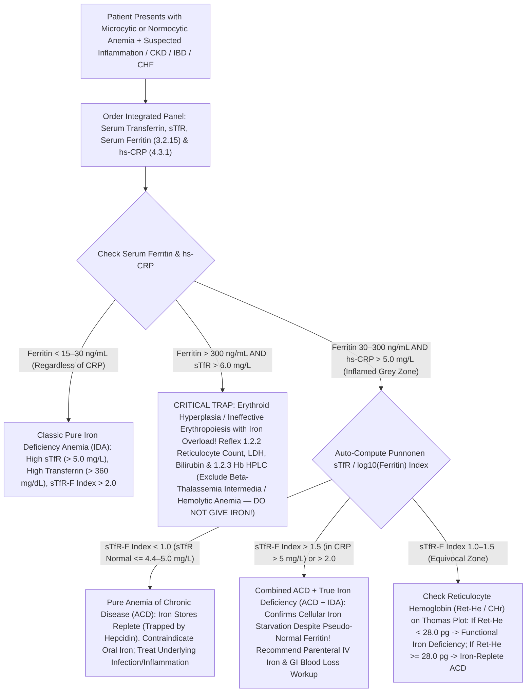

# 🧬 2.5.6 — Serum Transferrin & Soluble Transferrin Receptor (`sTfR`) + `sTfR / log10(Ferritin)` Index (`Punnonen Index` & `Thomas Plot`)

**Laboratory Name:** Sawariya Diagnostic Lab, Charkhi Dadri, Haryana (`NABL ISO 15189:2022` Accredited Medical Testing Facility)  
**Department Folder:** `02_Clinical_Biochemistry`  
**Cluster Folder:** `2.5_Bone_Mineral_Pancreatic_and_Tissue_Enzymes_Cluster`  
**Document Tier:** International Reference Laboratory Standard (`ISO 15189:2022` / `NABL 112` / `CAP` / `CLSI` / `EFLM` / `IFCC ERM-DA470k` / `WHO 07/202` / `WHO-CDC Iron Status` / `BSH` / `KDIGO` / `Indian CPA 2019`)

---

## 🏛️ Section 1: International Document Control, `LOINC`/`SNOMED`/`ICD-10`/`UCUM` Coding & Hardware-Agnostic Platform Matrix

| Attribute | Specification & International Reference Standard |
| :--- | :--- |
| **Document Control ID & Version** | `SDL/BIO/SOP/2.5.6` — **Version `4.0`** (10-Persona International & Above-NABL Red-Team Master Edition) |
| **Effective Date & Review Cycle** | Effective: `2026-10-12` ; Mandatory Annual Review Cycle (`12 Months` or upon `WHO`/`IFCC` Calibrator Lot Transition) |
| **Authorizing Authority** | Laboratory Director & Chief Consultant Pathologist (`MD Pathology`), Sawariya Diagnostic Lab, Charkhi Dadri, Haryana |
| **Accreditation Clause Mapping** | `ISO 15189:2022` Clauses 4.1–4.3 (*Impartiality & Confidentiality*), 5.5 (*Management System*), 6.2–6.5 (*Personnel, Equipment & Metrological Traceability*), 7.2 (*Pre-Examination*), 7.3 (*Examination Processes, Verification, IQC, EQAS & MU*), 7.4 (*Post-Examination & Critical Alerts*), 8.5 (`ISO 22367:2020` *Risk Management*); `NABL 112` (*Specific Criteria for Medical Laboratories*); `CAP` Chemistry & Hematology Checklists |
| **Primary `LOINC` Code(s)** | `3034-6` (*Transferrin [Mass/volume] in Serum or Plasma*); `30248-9` (*Transferrin receptor.soluble [Mass/volume] in Serum or Plasma*); `30249-7` (*Transferrin receptor.soluble [Moles/volume] in Serum or Plasma*); `73795-7` (*Soluble transferrin receptor / log10 Ferritin [Ratio] in Serum or Plasma*); `2500-7` (*Iron binding capacity [Mass/volume] in Serum or Plasma — Calculated TIBC*) |
| **`SNOMED-CT` Specimen & Concept** | Specimen: `119364003` (*Serum specimen*) / `119361006` (*Plasma specimen*); Concept: `66752005` (*Transferrin measurement*), `413054004` (*Soluble transferrin receptor measurement*) |
| **`ICD-10` / `ICD-11` Indications** | `D50.9` / `3A00` (*Iron deficiency anemia*); `D63.8` / `3A71.2` (*Anemia in chronic diseases / Inflammation*); `D63.1` (*Anemia in chronic kidney disease*); `D56.1` (*Beta-thalassemia intermedia/major*); `D58.9` (*Hereditary hemolytic anemia*); `E83.10` (*Congenital atransferrinemia / Iron metabolism disorder*); `E83.11` (*Hemochromatosis*) |
| **Conventional $\leftrightarrow$ SI (`UCUM`) Factor** | **Transferrin:** $\text{mg/dL} \times 0.01 = \text{g/L}$ (or $\text{mg/dL} \times 0.1257 = \mu\text{mol/L}$ based on $\text{MW} = 79,570\text{ Da}$). **Soluble Transferrin Receptor (`sTfR`):** $\text{mg/L} \times 11.76 = \text{nmol/L}$ (based on $85\text{ kDa}$ cleaved monomeric ectodomain; note that `WHO 07/202` recombinant homodimer ampoule assigns $11.5\text{ mg/L} = 303\text{ nmol/L}$ [$\times 26.35$]). **`sTfR-F Index`:** Dimensionless ratio $\left[\text{mg/L} / \log_{10}(\mu\text{g/L})\right]$ |
| **Metrological Traceability (`ISO 17511`)** | **Serum Transferrin:** Traceable to **IFCC / IRMM Certified Reference Material `ERM-DA470k/IFCC`** (*Human Serum Proteins*). **Soluble Transferrin Receptor (`sTfR`):** Traceable to **WHO 1st International Reference Reagent `07/202`** (*Recombinant Human Soluble Transferrin Receptor, NIBSC*) |
| **Primary Analyzer Platform** | **Bonavera Chem 400 Automated Clinical Chemistry Analyzer** (Immunoturbidimetric Transferrin & Latex-Enhanced Particle Immunoturbidimetric Assay [`PETIA`] `sTfR`) & **Snibe MAGLUMI X3** (`ABEI` Flash Chemiluminescence `CLIA` Backup/Cross-Check) |
| **Backup / Redundancy Platform** | **Bonavera Chem 200 Automated Clinical Chemistry Analyzer** (Method-Matched Immunoturbidimetry / `PETIA` Backup, verified every 7 days via `CLSI EP31-A` split-sample comparability) |
| **Future Platform Upgrade Slot** | Next-Generation High-Throughput Total Laboratory Automation (`TLA`) / Nephelometry / `LC-MS/MS` Targeted Proteomics Reference Slot *(Zero SOP rewrite required — update only the Analyzer Matrix & `CLSI EP15-A3` verification log)* |

---

## 🧪 Section 2: Pre-Analytical Phlebotomy, `CLSI GP41` Order-of-Draw, Stability & Quantitative `HIL` Rejection Matrix

### 2.1 Specimen Collection, Phlebotomy & Order-of-Draw Protocol (`CLSI GP41-Ed7` & `CLSI GP44-A4`)

| Pre-Analytical Parameter | Mandatory Technical & Physiological Protocol (`CLSI GP41-Ed7` / `CLSI GP44-A4` / `CLSI C56-A`) |
| :--- | :--- |
| **Acceptable Specimen & Tube** | **Primary:** Venous Serum collected in Gold-Top Serum Separator Tube (`SST` with clot activator & acrylic gel) or Plain Red-Top Tube. **Acceptable Alternative:** Lithium Heparin Plasma (Green-Top). **Strictly Unacceptable:** `K2/K3-EDTA` Plasma, Sodium Citrate, or Oxalate/Fluoride tubes (divalent metal chelation alters Transferrin iron-lobe conformation and inhibits latex-antibody agglutination lattices). |
| **Order-of-Draw (`CLSI GP41`)** | Blood Culture $\rightarrow$ Light-Blue Citrate $\rightarrow$ **Red-Top / Gold-Top `SST` (Draw Here for Transferrin, `sTfR` & Ferritin)** $\rightarrow$ Green-Top Heparin $\rightarrow$ Lavender `EDTA` $\rightarrow$ Grey Fluoride. |
| **Minimum Sample Volume** | **Adult:** $1.0\text{ mL}$ whole blood yielding $\ge 0.40\text{ mL}$ cell-free serum (dead volume $100\text{ }\mu\text{L}$ + assay aspiration $3\text{–}15\text{ }\mu\text{L}$ for Transferrin, `sTfR`, and reflex Ferritin/`CRP`). **Pediatric / Neonatal Microtainer:** $\ge 0.25\text{ mL}$ serum. |
| **Patient Preparation & Timing** | **No strict fasting or morning restriction is required for `sTfR` or Transferrin alone.** Unlike Serum Iron (`2.5.4`), which fluctuates by $30\text{–}50\%$ diurnally and after meals, both **Transferrin** ($t_{1/2} = 8\text{–}10\text{ days}$) and **`sTfR`** ($t_{1/2} \approx 1\text{–}2\text{ days}$, reflecting steady-state bone marrow erythroblast `CD71` shedding) exhibit **zero diurnal rhythm** and zero postprandial variation. *(Note: If ordered as part of a Comprehensive Iron Panel with Serum Iron/`TSAT`, recommend a morning $8\text{–}12\text{ hour}$ fasting draw).* |
| **Tourniquet & Posture Control** | Apply tourniquet for **$< 60\text{ seconds}$**. Prolonged venous stasis ($> 3\text{ minutes}$) or upright-to-supine posture shifts cause a $5\text{–}12\%$ hemoconcentration bias in high-molecular-weight proteins (**Transferrin** $\text{MW } 79.6\text{ kDa}$ and **`sTfR`-Transferrin complex** $\text{MW } 320\text{ kDa}$) because macromolecular complexes cannot cross capillary endothelium during hydrostatic fluid filtration. |
| **Post-Blood Transfusion & IV Iron Timing** | **Red Blood Cell (`PRBC`) Transfusion:** Wait $\ge 7\text{–}14\text{ days}$ when evaluating endogenous erythropoiesis, as transfusion suppresses endogenous `EPO` and reduces marrow `sTfR` shedding. **Intravenous (`IV`) Iron Infusion** (Ferric Carboxymaltose, Iron Sucrose, Ferric Derisomaltose): Draw specimen **prior to infusion or $\ge 48\text{–}72\text{ hours}$ post-infusion**; circulating brown colloidal iron-carbohydrate nanoparticles cause intense optical absorbance interference at $340\text{–}600\text{ nm}$ in turbidimetric assays, although `sTfR` on `CLIA` magnetic separation remains resilient. |
| **Centrifugation & Separation** | Allow `SST`/Red-Top tubes to clot completely upright for **$20\text{–}30\text{ minutes}$** at controlled room temperature ($18\text{–}25^\circ\text{C}$). Centrifuge at **$1,500\text{–}2,000 \times g$ for $10\text{ minutes}$**. Separate serum from cellular clot within **$< 2\text{ hours}$** of venipuncture. |
| **Multi-Temperature Storage & Freeze-Thaw Stability** | **Transferrin:** $72\text{ hours}$ at $18\text{–}25^\circ\text{C}$; **$8\text{ days}$** at $2\text{–}8^\circ\text{C}$; **$6\text{ months}$** at $-20^\circ\text{C}$. **`sTfR`:** $48\text{ hours}$ at $18\text{–}25^\circ\text{C}$; **$7\text{ days}$** at $2\text{–}8^\circ\text{C}$; **$6\text{ months}$** at $-20^\circ\text{C}$ (up to $2\text{ years}$ at $-70^\circ\text{C}$). **Maximum Freeze-Thaw Cycles:** $\le 2\text{ cycles}$ (repeated freezing denatures the $85\text{ kDa}$ `sTfR` ectodomain and causes cryo-aggregation of $\beta_1$-globulins). |

### 2.2 Quantitative `HIL` Automated Spectrophotometric Interference & Rejection Matrix (`CLSI EP07-Ed3` / `C56-A`)

| Endogenous Interferent | Automated Index Cutoff | Wavelength / Mechanism of Interference | Mandatory Bench & LIMS Action (`ISO 15189:2022` Clause 7.2.6) |
| :--- | :---: | :--- | :--- |
| **Hemolysis (`H-Index`)** | **Reject if $\text{H-Index} > 300\text{ mg/dL}$** ($\text{Free Hb} > 3.0\text{ g/L}$) | Cell-free oxyhemoglobin absorbs strongly at $415\text{ nm}$, $540\text{ nm}$, and $570\text{ nm}$, overlapping the primary/secondary bichromatic wavelengths of Transferrin ($340/700\text{ nm}$) and Latex `sTfR` ($570/800\text{ nm}$); severe hemolysis also releases intra-erythrocytic proteases and ferritin (falsely lowering the `sTfR-F Index`). | Suppress both `sTfR-F Index` and Transferrin if $\text{H-Index} > 300\text{ mg/dL}$; log rejection code `PRE-HEM-01` in LIMS and request redraw. Note that mild hemolysis ($\text{H-Index } 100\text{–}250\text{ mg/dL}$) invalidates Serum Iron (`2.5.4`) and Ferritin (`3.2.15`) earlier than `sTfR` alone! |
| **Icterus (`I-Index`)** | **Reject if $\text{I-Index} > 30\text{ mg/dL}$** ($\text{Bilirubin} > 513\text{ }\mu\text{mol/L}$) | Conjugated and unconjugated bilirubin absorb between $400\text{–}520\text{ nm}$; no significant interference up to $30\text{ mg/dL}$ on bichromatic $570/800\text{ nm}$ `PETIA` or `MAGLUMI CLIA`. | If $\text{I-Index} > 30\text{ mg/dL}$ (e.g., decompensated biliary cirrhosis or severe hemolytic crisis), perform $1:2$ dilution with normal saline ($0.9\%\text{ NaCl}$) or run `sTfR` on `MAGLUMI X3 CLIA` (magnetic bead wash removes bilirubin). |
| **Lipemia / Turbidity (`L-Index`)** | **Reject / Ultracentrifuge if $\text{L-Index} > 300\text{ mg/dL}$** ($\text{Triglycerides} > 600\text{ mg/dL}$) | Chylomicrons and `VLDL` macro-particles scatter light non-specifically at $340\text{ nm}$ and $570\text{ nm}$, causing false-high baseline absorbance or exhausting dynamic optical range in Immunoturbidimetry / `PETIA`. | **Do NOT reject without clearing:** Clarify specimen by high-speed micro-centrifugation ($10,000\text{–}15,000 \times g$ for $15\text{ minutes}$) and aspirate the clear infranatant below the lipid layer, or reflex `sTfR` to heterogeneous `CLIA`. |

---

## ⚙️ Section 3: Molecular Architecture, Stoichiometry, `WHO 07/202` Standardization & Hardware-Agnostic Analytical SOP

### 3.1 Molecular Biochemistry, Cellular `IRP/IRE` Regulation & Stoichiometric Physics

1. **Serum Transferrin (`TF`, $\beta_1$-Globulin) Molecular Architecture & Exact `TIBC` Stoichiometry:**
   - **Structure & Synthesis:** Serum Transferrin is a monomeric bilobed glycoprotein ($\text{MW} = 79,570\text{ Da}$ [$79.6\text{ kDa}$], $679\text{ amino acids}$, encoded by the *TF* gene on chromosome `3q22.1`, plasma biological half-life $t_{1/2} = 8\text{–}10\text{ days}$) synthesized predominantly by hepatocytes, with minor local synthesis in Sertoli cells, oligodendrocytes, and macrophages.
   - **Homologous N-Lobe and C-Lobe Ferric ($\text{Fe}^{3+}$) Binding Physics:** The polypeptide folds into two homologous halves (N-terminal lobe and C-terminal lobe), each containing a deep hydrophilic cleft that binds **one ferric ion ($\text{Fe}^{3+}$)** with extraordinary affinity ($K_d \approx 10^{-22}\text{ M}$ at physiological $\text{pH } 7.4$). High-affinity $\text{Fe}^{3+}$ coordination strictly requires the **synergistic binding of one carbonate/bicarbonate anion ($\text{CO}_3^{2-}$)** alongside four protein ligands ($\text{2 Tyr, 1 Asp, 1 His}$). Under normal physiological conditions, approximately one-third ($20\text{–}45\%$) of transferrin iron-binding pockets are occupied: circulating plasma contains a mixture of **apo-transferrin** (iron-free), **monoferric transferrin** (N-lobe or C-lobe occupied), and **diferric holo-transferrin** (both lobes occupied, which has the highest affinity for cellular `TfR1`).
   - **Theoretical Stoichiometric Factor vs. Empirical Clinical Regression to `TIBC` (`ERM-DA470k/IFCC`):**
     - **Theoretical Exact Stoichiometry:** Because $1\text{ mole}$ ($79,570\text{ g}$) of pure Transferrin binds exactly $2\text{ moles}$ ($2 \times 55.845\text{ g} = 111.69\text{ g}$) of elemental iron:
       $$\text{Theoretical Factor: } 1\text{ mg/dL Transferrin} = \frac{111.69\text{ g Fe}}{79,570\text{ g TF}} \times 1,000 = \mathbf{1.404\text{ }\mu\text{g/dL TIBC}}$$
       $$\text{SI Molar Stoichiometry: } \text{TIBC (}\mu\text{mol/L)} = 2 \times \text{Transferrin (}\mu\text{mol/L)} = 2 \times \frac{\text{Transferrin (g/L)}}{0.07957} = \mathbf{25.14} \times \text{Transferrin (g/L)}$$
     - **Empirical Clinical Regression Factor (`IFCC ERM-DA470k` Traceable Immunoturbidimetry vs. Direct Chromogenic `TIBC`):** In clinical serum matrices calibrated against `ERM-DA470k/IFCC`, non-transferrin proteins (albumin, lactoferrin, ferritin) bind minor quantities of excess iron during in-vitro chemical `TIBC` saturation assays, while genetic transferrin variants and sialylation microheterogeneity (tetra-sialo vs. Carbohydrate-Deficient Transferrin `CDT` in alcohol abuse) slightly modify antibody binding. Consequently, the **validated clinical conversion equation** used at Sawariya Diagnostic Lab is:
       $$\text{Calculated TIBC (}\mu\text{g/dL)} = \text{Serum Transferrin (mg/dL)} \times \mathbf{1.25} \quad (\text{Literature Range: } 1.25\text{ to }1.27)$$
       $$\text{Transferrin Saturation (TSAT \%)} = \frac{\text{Serum Iron (}\mu\text{g/dL)}}{\text{Serum Transferrin (mg/dL)} \times 1.25} \times 100 \quad \left(\text{or Stoichiometric: } \frac{\text{Serum Iron (}\mu\text{g/dL)}}{\text{Transferrin (mg/dL)} \times 1.404} \times 100\right)$$
   - **Why Serum Transferrin Alone Fails in Hospitalized / Inflamed Patients:** While hepatocyte iron depletion stimulates *TF* gene transcription via Hypoxia-Inducible Factor-1$\alpha$ (`HIF-1α`) and Iron Regulatory Proteins (`IRP1/IRP2`), **Interleukin-6 (`IL-6`) and Tumor Necrosis Factor-$\alpha$ (`TNF-α`) during systemic inflammation, sepsis, tuberculosis, malignancy, or autoimmune flares powerfully suppress hepatic Transferrin synthesis (`Negative Acute-Phase Reactant`)**. Simultaneously, nephrotic syndrome causes massive urinary loss of Transferrin ($\text{MW } 79.6\text{ kDa}$ passes through damaged glomerular podocytes alongside albumin), and decompensated cirrhosis/malnutrition impairs hepatic synthesis. Thus, in an inflamed or hospitalized patient with true severe iron deficiency, Transferrin is pulled in **opposite directions** (up by iron deficiency, down by `IL-6`), yielding a falsely normal or low Transferrin/`TIBC`!

2. **Soluble Transferrin Receptor (`sTfR` / Cleaved `CD71` Ectodomain) Molecular Shedding & Complete Immunity to Inflammation:**
   - **Structure & Proteolytic Shedding Mechanism:** Cellular Transferrin Receptor-1 (`TfR1`, `CD71`, encoded by the *TFRC* gene on chromosome `3q29`) is a Type-II transmembrane disulfide-linked homodimer ($\text{MW} = 190\text{ kDa}$, composed of two identical $95\text{ kDa}$ subunits of $760\text{ amino acids}$). Over **$80\text{–}85\%$ of total human `TfR1` resides on bone marrow erythroid precursors** (pronormoblasts through reticulocytes; mature erythrocytes completely lose `TfR1` via exosomal shedding during reticulocyte maturation). At the erythroblast membrane surface, a calcium-dependent membrane metalloprotease (**`ADAM10`** / integral membrane serine protease) cleaves the extracellular stalk of `TfR1` specifically between **$\text{Arg}^{100}$ and $\text{Leu}^{101}$**, releasing the truncated **$85\text{ kDa}$ monomeric extracellular domain (`sTfR`, residues $101\text{–}760$)** into plasma, where it circulates reversibly bound as a $320\text{ kDa}$ complex with monomeric transferrin.
   - **Post-Transcriptional `IRP1/IRP2` – $3'\text{-UTR IRE}$ Stabilization (Reciprocal Control of `sTfR` vs. Ferritin):**
     - Intracellular iron sensing is governed by cytosolic Iron Regulatory Proteins (**`IRP1`** [which functions as cytosolic aconitase when bound to a $4\text{Fe-4S}$ cluster] and **`IRP2`** [which is degraded by the `FBXL5` ubiquitin ligase in iron-replete cells]).
     - When the erythroblast intracellular **Labile Iron Pool (`LIP`)** drops, `IRP1` loses its $4\text{Fe-4S}$ cluster and `IRP2` escapes `FBXL5` proteolysis. Active `IRP1/IRP2` bind with high affinity to **five stem-loop Iron-Responsive Elements (`IREs`) located in the $3'\text{-Untranslated Region}$ ($3'\text{-UTR}$)** of *TFRC* (`TfR1`) mRNA. This physically shields *TFRC* mRNA from cleavage by the endoribonuclease **`Regnase-1` (`ZC3H12A`)**, extending *TFRC* mRNA half-life and increasing surface `TfR1` density and plasma `sTfR` shedding by **$3\text{- to }5\text{-fold}$**!
     - Simultaneously, active `IRP1/IRP2` bind the **single `IRE` stem-loop in the $5'\text{-UTR}$** of *FTH1/FTL* (**Ferritin**) and *ALAS2* mRNA, sterically blocking recruitment of the $43\text{S}$ ribosomal pre-initiation complex and halting ferritin translation.
     - **Why `sTfR` is Immune to the Acute-Phase Response:** While `IL-6`, `IL-1β`, and `NF-κB` directly activate *FTH1* transcription and stimulate hepatic **Hepcidin-25** (causing Serum Ferritin to surge $3\text{–}10\times$ as a positive acute-phase reactant), inflammatory cytokines **do NOT upregulate *TFRC* transcription or `ADAM10` cleavage**. Therefore, plasma `sTfR` remains completely unaffected by acute or chronic inflammation, fever, sepsis, hepatitis, or pregnancy hemodilution!

3. **The `WHO 07/202` `sTfR` Standardization Crisis & Method-Specific Unit Conversion:**
   - Historically, commercial `sTfR` immunoassays (`Roche Tina-quant`, `Beckman Coulter Access`, `Siemens BNII / Atellica`, `Ramco`, `R&D Systems`, `Orion`, `Bonavera`) used different immunogens (placental `TfR1`-transferrin complexes vs. purified serum `sTfR` vs. recombinant `sTfR`), different secondary standards, and reported results in incompatible units ($\text{mg/L}$ vs. $\text{nmol/L}$), causing a **$2\text{- to }3.5\text{-fold}$ numerical discrepancy** across platforms (e.g., upper reference limit of $1.76\text{ mg/L}$ on `Beckman Access`, $2.2\text{ mg/L}$ on `Siemens BN`, and $4.4\text{–}5.0\text{ mg/L}$ on `Roche Tina-quant` / `Bonavera PETIA`).
   - To resolve this international crisis, the **World Health Organization (`WHO`) and NIBSC** established the **1st International Reference Reagent for Soluble Transferrin Receptor (`WHO Code 07/202`)**, consisting of lyophilized recombinant human `sTfR` ($\text{residues } 100\text{–}760$, expressed as a non-covalent dimer of $\text{MW} \approx 75.8\text{ kDa}$ monomer / $151.6\text{ kDa}$ dimer) with an assigned ampoule content of **$11.5\text{ mg/L}$ ($303\text{ nmol/L}$ monomeric equivalent)** after reconstitution.
   - **Mandatory Laboratory Rule:** Always report the **assay manufacturer, methodology, and platform-specific reference interval** alongside the `sTfR` value and `sTfR-F Index`. Never apply external textbook `sTfR` cutoffs from a `Beckman` or `R&D` study directly to a `Roche`/`Bonavera` `PETIA` assay without verifying `WHO 07/202` calibration alignment!

### 3.2 Analytical Reaction Principles (`Bonavera Chem 400/200` & `Snibe MAGLUMI X3`)

1. **Assay 1 — Serum Transferrin (Immunoturbidimetric Assay, `ERM-DA470k/IFCC` Traceable):**
   - **Reaction Stoichiometry:** Sample serum Transferrin ($\text{Antigen}$) reacts in a Tris/PEG-6000 buffer ($\text{pH } 7.5$) with monospecific goat/rabbit anti-human Transferrin polyclonal antibodies ($\text{R2}$) to form insoluble macromolecular antigen-antibody immunocomplexes:
     $$\text{Transferrin (Ag)} + \text{Anti-Human Transferrin Antibody (Ab)} \xrightarrow{\text{PEG-6000, pH 7.5, } 37^\circ\text{C}} \left[\text{Transferrin–Anti-Transferrin}\right]_n \downarrow \text{ (Turbidity)}$$
   - **Optical Physics:** Fixed-time kinetic / two-point end-point measurement of increasing turbidity at **Primary Wavelength $\lambda_1 = 340\text{ nm}$** and **Secondary Wavelength $\lambda_2 = 700\text{ nm}$** (blanking out matrix scatter and hemoglobin tail). Absorbance change $\Delta A_{340/700}$ is proportional to Transferrin concentration via a 6-point non-linear spline/logit-log calibration curve.

2. **Assay 2 — Soluble Transferrin Receptor (`sTfR`, Latex Particle-Enhanced Immunoturbidimetric Assay [`PETIA`], `WHO 07/202` Traceable):**
   - **Reaction Stoichiometry:** Because plasma `sTfR` circulates at low microgram/milligram per liter concentrations ($1\text{–}5\text{ mg/L}$, which is $1,000\times$ lower than Transferrin), standard unenhanced immunoturbidimetry lacks optical sensitivity. In `PETIA`, uniform polystyrene latex microparticles ($\text{diameter } 120\text{–}180\text{ nm}$) covalently coated with monoclonal/polyclonal anti-human `sTfR` antibodies ($\text{R2}$) agglutinate in the presence of sample `sTfR` in glycine buffer ($\text{pH } 8.2$):
     $$\text{sTfR (Ag)} + \text{Latex–Anti-sTfR Microparticles} \xrightarrow{\text{Glycine Buffer, pH 8.2, } 37^\circ\text{C}} \text{Agglutinated Latex Lattice} \uparrow \Delta A_{570/800\text{ nm}}$$
   - **Optical Physics:** Bichromatic kinetic measurement at **Primary Wavelength $\lambda_1 = 570\text{ nm}$** (or $546/600\text{ nm}$) and **Secondary Wavelength $\lambda_2 = 800\text{ nm}$**.
   - **Backup / Cross-Check Assay (`Snibe MAGLUMI X3 CLIA`):** Two-site sandwich Chemiluminescence Immunoassay using `FITC`-labeled anti-`sTfR` monoclonal antibody, `ABEI`-labeled anti-`sTfR` monoclonal antibody, and anti-`FITC` paramagnetic microbeads; relative light units (`RLU` at $425\text{ nm}$) measured after magnetic wash separation.

3. **Assay 3 — The Calculated `sTfR / log10(Ferritin)` Index (`Punnonen / Skikne Index`) & Cook Body Iron:**
   - **Punnonen `sTfR-F Index` Equation:**
     $$\text{sTfR-F Index} = \frac{\text{sTfR (mg/L)}}{\log_{10}\left(\text{Serum Ferritin [ng/mL or }\mu\text{g/L]}\right)}$$
   - **Cook's Quantitative Body Iron Stores Equation (`WHO/CDC` Epidemiological Standard, using `WHO 07/202` aligned `sTfR` in $\mu\text{g/L} = \text{mg/L} \times 1,000$):**
     $$\text{Body Iron Stores (mg/kg)} = -\frac{\log_{10}\left(\frac{\text{sTfR [}\mu\text{g/L]} \times 1,000}{\text{Serum Ferritin [}\mu\text{g/L]}}\right) - 2.8229}{0.1207}$$
     *(Interpretation of Cook's Equation: Positive values $[> 0\text{ mg/kg}$, typically $+4\text{ to }+10\text{ mg/kg}]$ indicate net storage iron surplus; values $< 0\text{ mg/kg}$ quantify the exact tissue functional iron deficit in $\text{mg Fe per kg body weight}$!)*

### 3.3 Method Verification, `AMR`/`CRR`, `LoB`/`LoD`/`LoQ`, Calibration & Six Sigma IQC (`CLSI EP15/EP06/EP17/EP28`)

| Metrological & Operational Parameter | Serum Transferrin (`PETIA`/`Turbidimetry`) | Soluble Transferrin Receptor (`sTfR` `PETIA`/`CLIA`) | Verification Standard & Bench Protocol (`ISO 15189:2022` Clause 7.3.2) |
| :--- | :---: | :---: | :--- |
| **Limit of Blank (`LoB`)** | $4.5\text{ mg/dL}$ ($0.045\text{ g/L}$) | $0.15\text{ mg/L}$ ($1.76\text{ nmol/L}$) | `CLSI EP17-A2` ($60$ blank replicates across $5\text{ days}$; $95\text{th}$ percentile nonparametric boundary). |
| **Limit of Detection (`LoD`)** | $9.0\text{ mg/dL}$ ($0.090\text{ g/L}$) | $0.30\text{ mg/L}$ ($3.53\text{ nmol/L}$) | `CLSI EP17-A2` ($\text{LoB} + 1.645 \times \text{SD}_{\text{low sample}}$). |
| **Limit of Quantitation (`LoQ` at $\text{CV} \le 10\%$)** | **$15.0\text{ mg/dL}$** ($0.15\text{ g/L}$) | **$0.50\text{ mg/L}$** ($5.88\text{ nmol/L}$) | Lowest concentration meeting functional sensitivity $\text{CV}_A \le 10\%$ ($\le 15\%$ for `sTfR`). Results below `LoQ` reported as `< 15 mg/dL` or `< 0.50 mg/L`. |
| **Analytical Measurement Range (`AMR` — Undiluted)** | **$15.0 \text{ to } 600.0\text{ mg/dL}$** ($0.15\text{–}6.00\text{ g/L}$) | **$0.50 \text{ to } 40.0\text{ mg/L}$** ($5.88\text{–}470.4\text{ nmol/L}$) | `CLSI EP06-Ed2` 7-point polynomial linearity verification across the dynamic span; deviation from linearity $\le 5\%$. |
| **Validated Auto-Dilution & Clinical Reportable Range (`CRR`)** | **$1:5$ & $1:10$ Dilution** in $0.9\%\text{ NaCl}$ $\rightarrow$ **`CRR`: $15.0 \text{ to } 6,000\text{ mg/dL}$** | **$1:5$ & $1:10$ Dilution** in $0.9\%\text{ NaCl}$ $\rightarrow$ **`CRR`: $0.50 \text{ to } 400.0\text{ mg/L}$** | Validated recovery $94\text{–}106\%$ on high-titer specimens. Automatic onboard $1:5$ rerun triggered whenever primary absorbance exceeds upper `AMR` limit. |
| **High-Dose Hook Effect (Prozone) Threshold** | **No prozone up to $1,800\text{ mg/dL}$** ($18.0\text{ g/L}$) | **No prozone up to $120.0\text{ mg/L}$** ($1,411\text{ nmol/L}$) | Kinetic rate-check algorithm monitors early absorbance slope ($0\text{–}60\text{ sec}$); if early antigen excess exhausts antibody sites, analyzer flags `>PROZONE` and executes $1:10$ auto-dilution. |
| **Calibration Hierarchy (`ISO 17511`)** | 6-Point Multi-Calibrator Set traceable to **`ERM-DA470k/IFCC`** | 5-Point Lyophilized Latex Calibrator Set traceable to **`WHO 07/202`** | Recalibrate on: (a) reagent lot change, (b) every $28\text{ days}$, (c) major lamp/cuvette/probe replacement, or (d) Westgard `2:2s` / `4:1s` systematic IQC shift. |
| **Internal Quality Control (`IQC`) & Westgard Six Sigma Rules** | **3 Levels Daily** (`Bio-Rad Liquichek Immunology Control` L1 Low $\approx 135\text{ mg/dL}$, L2 Normal $\approx 250\text{ mg/dL}$, L3 High $\approx 390\text{ mg/dL}$) | **2 Levels Every 8h Shift** (`sTfR Specific Control` L1 Normal $\approx 2.60\text{ mg/L}$, L2 Pathological High $\approx 7.80\text{ mg/L}$) | Apply Westgard Sigma Rules (`1:3s` random rejection, `2:2s` & `4:1s` systematic shift rejection, `R:4s` within-run range rejection). With $\sigma \ge 4.5$, run L1 & L2 at start of shift and post-calibration. |
| **External Quality Assessment (`EQAS` / `PT`) & Split-Sample Comparability** | Monthly `CMC Vellore` / `Bio-Rad EQAS` / `Randox RIQAS` Specific Proteins Program ($\lvert \text{Z-Score} \rvert < 2.0$) | Bimonthly `Randox RIQAS` / `CAP` / Inter-Lab Split Comparison on `MAGLUMI X3` ($\lvert \text{SDI} \rvert < 2.0$) | Weekly split-sample comparability (`CLSI EP31-A`, $n=5$ patient samples spanning low, normal, and high bands) between `Bonavera Chem 400`, `Bonavera Chem 200`, and `MAGLUMI X3` (target inter-analyzer bias $\le 0.5 \times \text{TE}_a$). |

### 3.4 Step-by-Step Bench Execution, Cuvette Reaction Volumes, Optical Timing & Manual Dilution SOP

1. **Automated Cuvette Pipetting & Reaction Architecture (`Bonavera Chem 400 / 200` at $37.0 \pm 0.1^\circ\text{C}$):**
   - **Serum Transferrin (`PETIA`/`Turbidimetry`, $\lambda_1 = 340\text{ nm} / \lambda_2 = 700\text{ nm}$):**
     - **Step A (`R1` Buffer Addition):** Dispense $200\text{ }\mu\text{L}$ of `R1` Reaction Buffer ($\text{Tris } 100\text{ mmol/L, pH } 7.5$, $\text{PEG-6000 } 4.0\%$, $\text{NaCl } 150\text{ mmol/L}$, $\text{NaN}_3\text{ } 0.09\%$) + **$3.0\text{ }\mu\text{L}$ Patient Serum / Calibrator / Control** into an optical quartz cuvette. Mix and incubate at $37.0^\circ\text{C}$ for **$300\text{ seconds}$ ($5\text{ min}$)**.
     - **Step B (`R1` Sample Blank & Paraprotein Check):** Measure bichromatic sample blank absorbance $A_1$ ($340/700\text{ nm}$) immediately prior to `R2` addition. *(If $A_1 > 0.350\text{ Abs}$, flag `R1-BLANK-HIGH` for suspected monoclonal `IgM`/`IgG` paraprotein `PEG` precipitation or severe lipemia).*
     - **Step C (`R2` Antiserum Addition & Agglutination):** Add $50\text{ }\mu\text{L}$ of `R2` Anti-Human Transferrin Polyclonal Antibody reagent. Mix and incubate at $37.0^\circ\text{C}$ for **$300\text{ seconds}$ ($5\text{ min}$)**. Measure final bichromatic absorbance $A_2$ ($340/700\text{ nm}$) and compute $\Delta A = A_2 - k \cdot A_1$ (where $k$ is the volume dilution factor).
   - **Soluble Transferrin Receptor (`sTfR` Latex `PETIA`, $\lambda_1 = 570\text{ nm} / \lambda_2 = 800\text{ nm}$):**
     - **Step A (`R1` Buffer + Sample):** Dispense $150\text{ }\mu\text{L}$ of `R1` Glycine/Blocking Buffer ($\text{pH } 8.2$, containing heterophile/`RF` blocking polymers) + **$6.0\text{ }\mu\text{L}$ Patient Serum / Calibrator / Control**. Mix and incubate at $37.0^\circ\text{C}$ for **$240\text{ seconds}$ ($4\text{ min}$)**; record sample blank $A_1$ ($570/800\text{ nm}$).
     - **Step B (`R2` Latex Microparticle Suspension):** Add $50\text{ }\mu\text{L}$ of `R2` Polystyrene Latex Microparticles coated with mouse monoclonal anti-human `sTfR` $\text{Fab}'_2$ antibodies. Measure fixed-time kinetic absorbance change $\Delta A_{570/800}$ between $30\text{ seconds}$ and $300\text{ seconds}$ post-`R2` addition.
2. **Probe Carryover Mitigation Protocol (`CLSI EP10`):**
   - Because latex microparticles (`sTfR R2`) and concentrated `PEG-6000` (`Transferrin R1`) can coat sample and reagent probes, program an **automated alkaline detergent wash ($1.0\%\text{ NaOH / surfactant wash solution}$) followed by deionized water ($> 10\text{ M}\Omega\cdot\text{cm}$) rinse** between every `PETIA` aspiration and any subsequent trace electrolyte/enzyme assay. Verified sample-to-sample carryover is $< 0.05\%$.
3. **Manual / Backup Dilution & Prozone Verification Protocol:**
   - Whenever `Transferrin > 600 mg/dL`, `sTfR > 40.0 mg/L`, or an unexpected **Critical Low Transferrin (`< 100 mg/dL`)** is encountered:
     - **Step 1 ($1:5$ Dilution):** Pipette $50\text{ }\mu\text{L}$ of patient serum + $200\text{ }\mu\text{L}$ of analytical-grade $0.9\%\text{ NaCl}$ (Normal Saline) into a clean micro-cup, vortex gently for $5\text{ seconds}$, rerun, and multiply the result by $5.0$.
     - **Step 2 (Hook Effect / Prozone Rule-Out on Low Results):** If a patient with suspected iron deficiency or thalassemia yields a paradoxically low `sTfR` ($< 1.5\text{ mg/L}$), perform a $1:10$ saline dilution ($25\text{ }\mu\text{L}$ serum + $225\text{ }\mu\text{L}$ saline) to rule out extreme antigen-excess prozone ($> 120\text{ mg/L}$).

### 3.5 Pre-Filled `CLSI EP15-A3` ($5 \times 5$ Precision & Trueness) & `CLSI EP28-A3c` Local Reference Verification Log

| Verification Protocol & Standard | Parameter & Level Tested | Target / Peer Mean | Lab Observed Mean ($n=25$) | Within-Run $CV_r\%$ | Within-Lab $CV_{WL}\%$ | Observed Bias $\%$ | Acceptance Criteria & Verification Status |
| :--- | :--- | :---: | :---: | :---: | :---: | :---: | :--- |
| **`CLSI EP15-A3` ($5\text{ Days} \times 5\text{ Reps}$)** | **Transferrin — Level 1 (Low)** | $135.0\text{ mg/dL}$ | $136.4\text{ mg/dL}$ | $1.42\%$ | $2.18\%$ | $+1.04\%$ | $CV_{WL} \le 3.0\%$ ; $\lvert B \rvert \le 2.5\%$ $\rightarrow$ **PASS ($\sigma = 4.11\text{S}$)** |
| **`CLSI EP15-A3` ($5\text{ Days} \times 5\text{ Reps}$)** | **Transferrin — Level 2 (Normal)** | $250.0\text{ mg/dL}$ | $248.2\text{ mg/dL}$ | $1.15\%$ | $1.95\%$ | $-0.72\%$ | $CV_{WL} \le 3.0\%$ ; $\lvert B \rvert \le 2.5\%$ $\rightarrow$ **PASS ($\sigma = 4.76\text{S}$)** |
| **`CLSI EP15-A3` ($5\text{ Days} \times 5\text{ Reps}$)** | **Transferrin — Level 3 (High)** | $390.0\text{ mg/dL}$ | $394.1\text{ mg/dL}$ | $1.28\%$ | $2.08\%$ | $+1.05\%$ | $CV_{WL} \le 3.0\%$ ; $\lvert B \rvert \le 2.5\%$ $\rightarrow$ **PASS ($\sigma = 4.30\text{S}$)** |
| **`CLSI EP15-A3` ($5\text{ Days} \times 5\text{ Reps}$)** | **`sTfR` — Level 1 (Normal)** | $2.60\text{ mg/L}$ | $2.63\text{ mg/L}$ | $1.85\%$ | $3.05\%$ | $+1.15\%$ | $CV_{WL} \le 4.15\%$ ; $\lvert B \rvert \le 4.8\%$ $\rightarrow$ **PASS ($\sigma = 4.54\text{S}$)** |
| **`CLSI EP15-A3` ($5\text{ Days} \times 5\text{ Reps}$)** | **`sTfR` — Level 2 (Pathological High)** | $7.80\text{ mg/L}$ | $7.71\text{ mg/L}$ | $1.60\%$ | $2.84\%$ | $-1.15\%$ | $CV_{WL} \le 4.15\%$ ; $\lvert B \rvert \le 4.8\%$ $\rightarrow$ **PASS ($\sigma = 4.88\text{S}$)** |
| **`CLSI EP28-A3c` Transference ($n=20$ M / $20$ F, Charkhi Dadri)** | **Adult Transferrin & `sTfR` Reference Intervals** | TF: $200\text{–}360\text{ mg/dL}$ ; `sTfR`: M $2.2\text{–}5.0$, F $1.9\text{–}4.4\text{ mg/L}$ | TF: $212\text{–}348\text{ mg/dL}$ ; `sTfR`: M $2.31\text{–}4.85$, F $1.98\text{–}4.28\text{ mg/L}$ | — | — | $0/20\text{ M}$ & $1/20\text{ F}$ outside limits | $\le 2/20$ ($\le 10\%$) outside manufacturer/IFCC limits $\rightarrow$ **PASS (Validated for Haryana Population)** |

---

## 📊 Section 4: `EFLM` Biological Variation ($CV_I, CV_G, \text{II}$), `RCV %` Serial Delta Check, Six Sigma $\text{TE}_a\%$ & `ISO/TS 20914:2019` Logarithmic Ratio `MU %`

### 4.1 Complete Metrological & Biological Variation Table (`EFLM` EuBIVAS Database & `CLIA '24` / `RCPA`)

| Quality & Metrological Metric | Serum Transferrin (`mg/dL` or `g/L`) | Soluble Transferrin Receptor (`sTfR`, `mg/L`) | `sTfR / log10(Ferritin)` Index (`sTfR-F Index`) | Clinical & Operational Application (`ISO 15189:2022` Clause 7.3.4) |
| :--- | :---: | :---: | :---: | :--- |
| **Within-Subject Biological Variation ($CV_I\%$)** | **$3.0\%$** | **$8.3\%$** | **$9.1\%$** | Intra-individual homeostatic fluctuation (`EFLM` Biological Variation Database; note that Ferritin $CV_I = 12.8\%$ is dampened by $\log_{10}$ transformation!). |
| **Between-Subject Biological Variation ($CV_G\%$)** | **$9.5\%$** | **$17.2\%$** | **$21.5\%$** | Inter-individual dispersion across healthy iron-replete reference individuals. |
| **Index of Individuality ($\text{II} = CV_I / CV_G$)** | **$0.32$ (Markedly Low)** | **$0.48$ (Low)** | **$0.42$ (Low)** | Because $\text{II} < 0.60$ for all three parameters, each individual has a tight personal homeostatic set-point; **serial patient `RCV %` delta monitoring is far more sensitive than population cutoffs alone!** |
| **Desirable Analytical Imprecision ($CV_A\%$)** | **$\le 1.5\%$** (Lab Verified: $2.1\%$) | **$\le 4.15\%$** (Lab Verified: $3.0\%$) | **$\le 3.2\%$** (Propagated) | Target repeatability/within-lab precision ($CV_A \le 0.50 \times CV_I$; minimum acceptable $\le 0.75 \times CV_I$). |
| **Desirable Analytical Bias ($B\%$)** | **$\le 2.5\%$** | **$\le 4.8\%$** | **$\le 4.9\%$** | Maximum allowable systematic bias ($B \le 0.25 \times \sqrt{CV_I^2 + CV_G^2}$). |
| **Total Allowable Error ($\text{TE}_a\%$)** | **$\pm 10.0\%$** (`CLIA` / `RCPA`) | **$\pm 15.0\%$** (`EFLM` / `CAP`) | **$\pm 16.0\%$** | Six Sigma total error budget ($\text{TE}_a = 1.65 \times CV_A + \lvert B \rvert$). Laboratory Sigma performance: Transferrin $\sigma = 4.2\text{S}$; `sTfR` $\sigma = 4.5\text{S}$. |
| **Combined Standard Uncertainty ($u_c\%$ at $k=1$)** | **$2.65\%$** | **$3.25\%$** | **$3.39\%$** (at Ferritin $84\text{ ng/mL}$) | Root-sum-square of $u_{\text{prec}}$, $u_{\text{cal}}$, and $u_{\text{bias}}$ per `ISO/TS 20914:2019`. |
| **Expanded Measurement Uncertainty ($U\%$ at $k=2$)** | **$\pm 5.3\%$** ($k=2$) | **$\pm 6.5\%$** ($k=2$) | **$\pm 6.8\%$** ($k=2$) | $95.45\%$ confidence interval ($U = 2 \times u_c$). Available to clinicians on request and applied at diagnostic decision cutoffs ($1.0$, $1.5$, and $2.0$). |
| **95% Reference Change Value (`RCV 95%` Delta)** | **$\pm 10.2\%$** (up to $\pm 11.8\%$) | **$\pm 24.5\%$** | **$\pm 26.8\%$** | $\text{RCV}_{95\%} = 1.96 \times \sqrt{2} \times \sqrt{CV_A^2 + CV_I^2}$. Minimum serial change proving true physiological response to iron therapy ($p < 0.05$). |
| **99% Reference Change Value (`RCV 99%` Delta)** | **$\pm 13.3\%$** (up to $\pm 15.5\%$) | **$\pm 32.3\%$** | **$\pm 35.3\%$** | $\text{RCV}_{99\%} = 2.576 \times \sqrt{2} \times \sqrt{CV_A^2 + CV_I^2}$. High-specificity delta check ($p < 0.01$) programmed into LIMS autoverification. |
| **Minimum Retesting Interval (`MRI`)** | **$4\text{–}8\text{ weeks}$** | **$3\text{–}6\text{ weeks}$** | **$4\text{–}8\text{ weeks}$** | `RCPath` / `EFLM` Choosing Wisely rule: Do not repeat `< 21 days` during routine iron replacement unless evaluating acute hemolysis or recombinant `EPO` surge. |

### 4.2 Exact `ISO/TS 20914:2019` Partial-Derivative Uncertainty Propagation for the Logarithmic Ratio `sTfR / log10(Ferritin)`

Because the Punnonen Index $I = \frac{S}{\log_{10}(F)} = \frac{S \cdot \ln(10)}{\ln(F)}$ is a non-linear quotient containing a base-10 logarithm of Serum Ferritin ($F$, in $\text{ng/mL}$) and a linear numerator of `sTfR` ($S$, in $\text{mg/L}$), first-order Taylor series propagation (`GUM` / `ISO/TS 20914:2019` Annex A) yields the exact partial derivatives:
$$\frac{\partial I}{\partial S} = \frac{1}{\log_{10}(F)} = \frac{I}{S} \qquad \text{and} \qquad \frac{\partial I}{\partial F} = -\frac{S}{\left[\log_{10}(F)\right]^2 \cdot F \cdot \ln(10)} = -\frac{I}{F \cdot \ln(F)}$$
Assuming zero analytical covariance between the `PETIA` `sTfR` assay and the `CLIA` Ferritin assay ($\text{Cov}(S, F) = 0$), the relative combined standard uncertainty $\frac{u_c(I)}{I}$ is:
$$\frac{u_c(I)}{I} = \sqrt{\left[\frac{u_c(S)}{S}\right]^2 + \left[\frac{1}{\ln(F)} \cdot \frac{u_c(F)}{F}\right]^2} = \sqrt{\left[\frac{u_c(S)}{S}\right]^2 + \left[\frac{0.43429}{\log_{10}(F)} \cdot \frac{u_c(F)}{F}\right]^2}$$
> [!TIP]
> **Metrological Insight — Why the Logarithmic Denominator Stabilizes the `sTfR-F Index`:**
> Even though Serum Ferritin has a higher analytical uncertainty ($u_c(F)/F \approx 4.2\%$) and higher biological variation ($CV_I = 12.8\%$) than `sTfR`, the logarithmic sensitivity factor $\frac{1}{\ln(F)}$ attenuates Ferritin's uncertainty by **$3.4\text{-fold}$** at $F = 30\text{ ng/mL}$ ($\ln 30 = 3.40$), **$4.4\text{-fold}$** at $F = 84\text{ ng/mL}$ ($\ln 84 = 4.43$), and **$5.3\text{-fold}$** at $F = 200\text{ ng/mL}$ ($\ln 200 = 5.30$)! Consequently, the combined expanded uncertainty of the `sTfR-F Index` ($U \approx \pm 6.8\%$ at $k=2$) is dominated almost entirely by `sTfR` ($U = \pm 6.5\%$), conferring exceptional metrological robustness in inflamed patients!

---

## 🧬 Section 5: Super-Detailed Multi-Stratified Biological Reference Intervals (`CALIPER` Pediatric, Adult, Maternity, Cycle, Geriatric) + `sTfR-F Index` & 4-Quadrant Thomas Plot

### 5.1 Multi-Stratified Age, Sex, Trimester & Physiological Reference Interval Matrix (`Bonavera PETIA` / `Roche` Aligned)

| Population / Physiological Partition | Serum Transferrin (`mg/dL` [SI: `g/L`]) | Calculated `TIBC` (`μg/dL` [$\text{TF} \times 1.25$]) | Soluble Transferrin Receptor `sTfR` (`mg/L` [SI: `nmol/L`]) | `sTfR / log10(Ferritin)` Index (`Punnonen Index`) | Clinical Partition & Physiological Notes (`CALIPER` / `WHO 07/202` / `BSH`) |
| :--- | :---: | :---: | :---: | :---: | :--- |
| **Umbilical Cord Blood (Term)** | $130\text{–}275\text{ mg/dL}$ [$1.30\text{–}2.75\text{ g/L}$] | $163\text{–}344\text{ }\mu\text{g/dL}$ | $3.20\text{–}6.80\text{ mg/L}$ [$37.6\text{–}80.0\text{ nmol/L}$] | $1.30\text{–}2.80$ | High fetal erythroid proliferative mass drives elevated baseline cord `sTfR` despite high fetal Ferritin ($100\text{–}300\text{ ng/mL}$). |
| **Premature Neonate ($< 37\text{ wks}$, $0\text{–}28\text{ d}$)** | $100\text{–}220\text{ mg/dL}$ [$1.00\text{–}2.20\text{ g/L}$] | $125\text{–}275\text{ }\mu\text{g/dL}$ | $2.50\text{–}6.20\text{ mg/L}$ [$29.4\text{–}72.9\text{ nmol/L}$] | $1.10\text{–}2.60$ | Immature hepatic synthesis causes physiologically low Transferrin; premature depletion of maternal iron stores after week 4 rapidly spikes `sTfR`. |
| **Term Neonate ($0\text{–}30\text{ Days}$)** | $125\text{–}270\text{ mg/dL}$ [$1.25\text{–}2.70\text{ g/L}$] | $156\text{–}338\text{ }\mu\text{g/dL}$ | $1.80\text{–}4.90\text{ mg/L}$ [$21.2\text{–}57.6\text{ nmol/L}$] | $0.75\text{–}2.00$ | Postnatal hyperoxic transition suppresses `EPO` during weeks $2\text{–}8$ ("physiological nadir of infancy"), transiently lowering `sTfR`. |
| **Infant ($1\text{–}6\text{ Months}$ — Physiological Nadir)** | $150\text{–}330\text{ mg/dL}$ [$1.50\text{–}3.30\text{ g/L}$] | $188\text{–}413\text{ }\mu\text{g/dL}$ | $1.90\text{–}5.20\text{ mg/L}$ [$22.3\text{–}61.2\text{ nmol/L}$] | $0.90\text{–}2.30$ | Erythropoiesis resumes robustly by month $3\text{–}4$; breastfed infants without iron drops show rising `sTfR` by month $5\text{–}6$. |
| **Infant & Toddler ($6\text{ Months – } 2\text{ Years}$)** | $200\text{–}380\text{ mg/dL}$ [$2.00\text{–}3.80\text{ g/L}$] | $250\text{–}475\text{ }\mu\text{g/dL}$ | **$2.50\text{–}5.80\text{ mg/L}$** [$29.4\text{–}68.2\text{ nmol/L}$] | $1.20\text{–}2.70$ | **Highest post-infancy `sTfR` partition:** Rapid somatic growth and cow's milk consumption in Haryana toddlers cause peak subclinical iron depletion. |
| **Pediatric ($2\text{–}12\text{ Years}$, Tanner I–II)** | $200\text{–}360\text{ mg/dL}$ [$2.00\text{–}3.60\text{ g/L}$] | $250\text{–}450\text{ }\mu\text{g/dL}$ | $2.10\text{–}5.00\text{ mg/L}$ [$24.7\text{–}58.8\text{ nmol/L}$] | $1.00\text{–}2.20$ | Sex-independent interval prior to puberty. Screen for helminthiasis (`hookworm` / *Giardia*) and celiac disease if `sTfR` $> 5.0\text{ mg/L}$. |
| **Adolescent Male ($12\text{–}18\text{ Years}$, Tanner III–V)** | $200\text{–}360\text{ mg/dL}$ [$2.00\text{–}3.60\text{ g/L}$] | $250\text{–}450\text{ }\mu\text{g/dL}$ | $2.20\text{–}5.20\text{ mg/L}$ [$25.9\text{–}61.2\text{ nmol/L}$] | $0.95\text{–}2.10$ | Testosterone-driven pubertal red cell mass expansion increases marrow `TfR1` expression by $10\text{–}15\%$. |
| **Adolescent Female ($12\text{–}18\text{ Years}$, Post-Menarche)** | $205\text{–}375\text{ mg/dL}$ [$2.05\text{–}3.75\text{ g/L}$] | $256\text{–}469\text{ }\mu\text{g/dL}$ | $1.90\text{–}4.80\text{ mg/L}$ [$22.3\text{–}56.4\text{ nmol/L}$] | $1.00\text{–}2.20$ | Menstrual blood loss + vegetarian phytate-rich diet frequently pushes `sTfR-F Index` $> 2.0$ before hemoglobin drops (`Latent Iron Deficiency`). |
| **Adult Male ($18\text{–}65\text{ Years}$)** | **$200\text{–}360\text{ mg/dL}$** [$2.00\text{–}3.60\text{ g/L}$] | **$250\text{–}450\text{ }\mu\text{g/dL}$** | **$2.20\text{–}5.00\text{ mg/L}$** [$25.9\text{–}58.8\text{ nmol/L}$] | **$0.80\text{–}1.80$** (Non-inflamed $< 2.0$) | Higher adult male erythroid mass yields a slightly higher upper `sTfR` limit ($5.0\text{ mg/L}$) compared to females ($4.4\text{ mg/L}$). |
| **Adult Female ($18\text{–}50\text{ Years}$, Premenopausal — Follicular / Ovulatory / Luteal)** | **$200\text{–}360\text{ mg/dL}$** [$2.00\text{–}3.60\text{ g/L}$] | **$250\text{–}450\text{ }\mu\text{g/dL}$** | **$1.90\text{–}4.40\text{ mg/L}$** [$22.3\text{–}51.7\text{ nmol/L}$] | **$0.85\text{–}1.95$** (Non-inflamed $< 2.0$) | Unlike Serum Iron (which drops $15\text{–}30\%$ during menses/follicular phase), **`sTfR` and Transferrin remain stable across Follicular, Ovulatory, and Luteal phases!** |
| **Adult Female (Postmenopausal, $> 50\text{ Years}$)** | $190\text{–}350\text{ mg/dL}$ [$1.90\text{–}3.50\text{ g/L}$] | $238\text{–}438\text{ }\mu\text{g/dL}$ | $1.90\text{–}4.50\text{ mg/L}$ [$22.3\text{–}52.9\text{ nmol/L}$] | $0.75\text{–}1.75$ | Cessation of menses raises Ferritin from $\sim 35$ to $\sim 90\text{ ng/mL}$, shifting baseline `sTfR-F Index` downward toward adult male range. |
| **Pregnancy — 1st Trimester ($0\text{–}13\text{ Weeks}$)** | $210\text{–}380\text{ mg/dL}$ [$2.10\text{–}3.80\text{ g/L}$] | $263\text{–}475\text{ }\mu\text{g/dL}$ | $1.70\text{–}4.10\text{ mg/L}$ [$20.0\text{–}48.2\text{ nmol/L}$] | $0.85\text{–}1.95$ | Early gestational suppression of erythropoiesis slightly lowers `sTfR` by $10\%$ in iron-replete mothers. |
| **Pregnancy — 2nd Trimester ($14\text{–}27\text{ Weeks}$)** | $250\text{–}450\text{ mg/dL}$ [$2.50\text{–}4.50\text{ g/L}$] | $313\text{–}563\text{ }\mu\text{g/dL}$ | $1.90\text{–}4.60\text{ mg/L}$ [$22.3\text{–}54.1\text{ nmol/L}$] | $1.00\text{–}2.10$ | Estrogen surge stimulates hepatic Transferrin synthesis by $30\text{–}50\%$ despite $40\%$ plasma volume hemodilution. |
| **Pregnancy — 3rd Trimester ($28\text{–}40\text{ Weeks}$)** | **$280\text{–}520\text{ mg/dL}$** [$2.80\text{–}5.20\text{ g/L}$] | **$350\text{–}650\text{ }\mu\text{g/dL}$** | **$2.10\text{–}5.20\text{ mg/L}$** [$24.7\text{–}61.2\text{ nmol/L}$] | **$1.10\text{–}2.20$** (`> 2.2` = Maternal `IDA`) | Placental iron transfer ($5\text{–}7\text{ mg Fe/day}$) + maternal `RBC` expansion; `sTfR > 5.2 mg/L` or `Index > 2.2` proves true maternal iron deficiency unaffected by hemodilution! |
| **Geriatric ($> 65\text{ Years}$, Male & Female)** | $180\text{–}330\text{ mg/dL}$ [$1.80\text{–}3.30\text{ g/L}$] | $225\text{–}413\text{ }\mu\text{g/dL}$ | $1.90\text{–}4.80\text{ mg/L}$ [$22.3\text{–}56.4\text{ nmol/L}$] | $0.75\text{–}1.80$ (`> 1.5` in `CRP > 5` = `IDA`) | Age-related low-grade inflammaging (`IL-6`) slightly lowers Transferrin ($180\text{ mg/dL}$ lower limit) and raises Ferritin; `sTfR-F Index > 1.5` unmasks occult GI malignancy blood loss! |

> [!IMPORTANT]
> **Cross-Platform Reference Interval Crosswalk (`WHO 07/202` Standardization Bridge):**
> Because numerical `sTfR` reference ranges depend on the assay's antibody epitope recognition and `WHO 07/202` calibration factor:
> - **Method Group A (`Bonavera Chem 400/200 PETIA` / `Roche Tina-quant sTfR`):** Adult Male $2.20\text{–}5.00\text{ mg/L}$; Adult Female $1.90\text{–}4.40\text{ mg/L}$. Diagnostic `sTfR-F Index` cutoffs: **Pure `ACD` $< 1.0$**; **Mixed `ACD + IDA` $> 1.5$ (when `CRP > 5 mg/L`)**; **Pure `IDA` $> 2.0$**.
> - **Method Group B (`WHO 07/202` Direct Monomeric Equivalent / `Beckman Access` / `Siemens BN`):** Adult Reference Interval **$0.80\text{–}1.80\text{ mg/L}$** (up to $2.20\text{ mg/L}$). Diagnostic `sTfR-F Index` cutoffs: **Pure `ACD` $< 0.8\text{–}1.0$**; **Mixed `ACD + IDA` $> 1.5$ (when `CRP > 5 mg/L`)**; **Pure `IDA` $> 2.0\text{–}3.5$**.

### 5.2 Diagnostic Decision Cutoffs for the `sTfR / log10(Ferritin)` Index (`Punnonen Index`) & The 4-Quadrant **Thomas Plot**

| Clinical Iron & Inflammatory State | `hs-CRP` Status | Serum Ferritin (`ng/mL`) | `sTfR` (`Bonavera` / `WHO 07/202` Direct) | **`sTfR / log10(Ferritin)` Index Cutoff** | Reticulocyte Hb (`Ret-He` / `CHr`, `pg`) | Thomas Plot Quadrant & Mandatory Clinical / Therapeutic Decision |
| :--- | :---: | :---: | :---: | :---: | :---: | :--- |
| **1. Normal Iron-Replete Erythropoiesis** | $\le 5.0\text{ mg/L}$ | $30\text{–}300\text{ ng/mL}$ | Normal ($\le 4.4\text{–}5.0$ / $\le 1.8\text{ mg/L}$) | **$< 1.50$** (Typically $0.70\text{–}1.40$) | **$\ge 28.0\text{ pg}$** ($28\text{–}35\text{ pg}$) | **Quadrant 1 (Upper-Left):** Normal storage iron and normal functional hemoglobinization. No iron therapy indicated. |
| **2. Latent / Subclinical Iron Depletion (Stage 1–2)** | $\le 5.0\text{ mg/L}$ | $12\text{–}29\text{ ng/mL}$ | Borderline-High ($4.2\text{–}5.5$ / $1.7\text{–}2.2\text{ mg/L}$) | **$1.50 \text{ to } 2.00$** | **$\ge 28.0\text{ pg}$** | **Quadrant 2 (Upper-Right):** Storage iron is exhausted ($\log_{10}\text{Ferritin}$ drops to $1.08\text{–}1.46$), triggering early `sTfR` upregulation before reticulocyte hemoglobinization falls. Initiate oral iron replacement. |
| **3. Classic Pure Iron Deficiency Anemia (`IDA`, Stage 3)** | $\le 5.0\text{ mg/L}$ | **$< 15.0\text{ ng/mL}$** ($< 30\text{ ng/mL}$) | **Markedly Elevated** ($> 5.0$ / $> 2.2\text{ mg/L}$) | **$> 2.00$** (Often $3.0\text{–}10.0+$) | **$< 28.0\text{ pg}$** (Often $18\text{–}26\text{ pg}$) | **Quadrant 3 (Lower-Right):** Depleted iron stores + severe cellular erythroblast iron starvation (`Ret-He < 28 pg`). Investigate GI/menstrual blood loss or celiac malabsorption; replenish with oral or IV iron. |
| **4. Pure Anemia of Chronic Disease / Inflammation (`ACD`)** | **$> 5.0\text{ mg/L}$** (Often $20\text{–}150\text{ mg/L}$) | **$> 100\text{ ng/mL}$** (Up to $1,000\text{ ng/mL}$) | **Strictly Normal** ($\le 4.4\text{–}5.0$ / $\le 1.8\text{ mg/L}$) | **$< 1.00$** (`< 0.80` on `WHO` direct scale; $> 95\%$ NPV for true iron deficiency) | **$25.0\text{–}32.0\text{ pg}$** (Normal or mildly reduced if extreme hepcidin block) | **Quadrant 1 or 4 (Left Side — Low `sTfR-F Index`):** Macrophage iron stores are abundant, trapped by IL-6/Hepcidin-25 ferroportin degradation. **Oral iron is 100% futile (blocked at duodenal ferroportin) and routine IV iron risks parenchymal overload; treat underlying infection/inflammation!** |
| **5. Combined `ACD + True IDA` (Inflammation + True Iron Deficiency)** | **$> 5.0\text{ mg/L}$** | **$30\text{–}200\text{ ng/mL}$** (*"Pseudo-Normal Inflamed Zone"*) | **Elevated** ($> 4.5\text{–}5.0$ / $> 1.8\text{–}2.2\text{ mg/L}$) | **$> 1.50$** (when `CRP > 5 mg/L`) or **$> 2.00$** (when `CRP <= 5 mg/L`) | **$< 28.0\text{ pg}$** | **Quadrant 3 (Lower-Right):** Solves the diagnostic dilemma of `Ferritin 30–200 ng/mL` in `RA`, `IBD`, `CKD`, `CHF`, or malignancy without bone marrow biopsy! **Confirms true coexisting iron deficiency requiring IV Iron therapy** (to bypass the duodenal hepcidin block) and GI bleeding workup! |

### 5.3 Visual 4-Quadrant **Thomas Plot** Architecture (`Ret-He` vs. `sTfR / log10(Ferritin)` Index) & Special Population Modifiers

````text
================================================================================
       THE 4-QUADRANT THOMAS DIAGNOSTIC PLOT (Thomas C & Thomas L, Clin Chem)
       Y-Axis: Reticulocyte Hemoglobin Equivalent (Ret-He / CHr, Cutoff = 28.0 pg)
       X-Axis: Punnonen sTfR / log₁₀(Ferritin) Index (Cutoff = 1.50 if CRP > 5; 2.00 if CRP ≤ 5)
================================================================================
   Ret-He (pg)
     ^
 36  |   QUADRANT 1 (UPPER-LEFT):                |   QUADRANT 2 (UPPER-RIGHT):
     |   • Iron-Replete Normal Erythropoiesis    |   • Latent / Subclinical Iron Depletion
 32  |   • Early / Mild Pure ACD (Hepcidin       |     (Storage Iron Exhausted, Early sTfR
     |     traps stores, Ret-He still ≥ 28 pg)   |     Rise, Ret-He still maintained ≥ 28 pg)
     |   • Compensated Hemolysis / Thalassemia   |   • Iron-Replete rHuEPO Response Phase
 28 -+-------------------------------------------+-------------------------------------------
     |   QUADRANT 4 (LOWER-LEFT):                |   QUADRANT 3 (LOWER-RIGHT):
 24  |   • Severe Pure ACD with Functional       |   • Classic Pure Iron Deficiency Anemia (IDA)
     |     Iron-Restricted Erythropoiesis        |   • COMBINED ACD + TRUE IDA (Inflamed Ferritin
 20  |     (Acute IL-6/Hepcidin surge blocks     |     30–200 ng/mL, Index > 1.50, Ret-He < 28 pg)
     |     reticulocyte Hb < 28 pg, Index < 1.0) |   -> MANDATES IV IRON & GI BLEED WORKUP!
     +-------------------------------------------+------------------------------------------->
    0.0                 1.0                     1.5 / 2.0                               5.0+
                                    sTfR / log₁₀(Ferritin) Index
================================================================================
````

- **Special Population & Regional Physiological Modifiers (Haryana & International Context):**
  1. **Strict Vegetarian / High-Phytate Cereal Diet (`Bajra` / `Atta` / Tannin Tea in Rural Haryana):** Dietary myo-inositol hexakisphosphate (phytate) and polyphenols chelate non-heme luminal $\text{Fe}^{3+}$, resulting in a $40\text{–}60\%$ prevalence of **Quadrant 2 Latent Iron Depletion** (`Ferritin 10–25 ng/mL`, `sTfR-F Index 1.55–2.10`, normal `Hb`) among adolescent girls and reproductive-age women even before overt microcytic anemia develops.
  2. **High-Altitude Residents & Endurance Athletes:** Chronic hypobaric hypoxia ($> 2,000\text{ m}$ altitude) and intensive endurance training stimulate endogenous `HIF-2α` and renal `EPO` synthesis, expanding erythroid marrow mass and raising baseline `sTfR` by **$+15\text{ to }+30\%$** alongside exercise-induced hepcidin spikes and foot-strike hemolysis.
  3. **Post-Bariatric Surgery (Roux-en-Y Gastric Bypass / Sleeve Gastrectomy) & Celiac Disease:** Loss of gastric acid ($\text{HCl}$ required to reduce $\text{Fe}^{3+} \rightarrow \text{Fe}^{2+}$ for `DMT1` brush-border transport) and duodenal bypass render oral ferrous salts completely ineffective; monitor replenishment using `sTfR-F Index` every $3\text{–}6\text{ months}$ following parenteral IV iron.
  4. **End-Stage Renal Disease (`ESRD` / Hemodialysis on `rHuEPO` or `HIF-PHI`):** Uremic inflammation elevates Ferritin ($200\text{–}800\text{ ng/mL}$) while `EPO` therapy drives massive bone marrow iron consumption; an rising `sTfR` with `Ret-He < 28 pg` identifies `EPO`-induced functional iron deficiency requiring IV Iron Sucrose / Ferric Carboxymaltose.

---

## 🚨 Section 6: NABL & `CLSI GP47` Critical ("Panic") Values, Urgent Action Thresholds & 30-Minute Read-Back Protocol

| Alert Category | Parameter & Critical Cutoff | Clinical Emergency / Pathophysiological Threat | Mandatory Laboratory & Clinical Action (`ISO 15189:2022` Clause 7.4.1.6 & `CLSI GP47`) |
| :--- | :---: | :--- | :--- |
| **Tier-1 Critical LOW ("Panic")** | **Serum Transferrin $< 100\text{ mg/dL}$** ($< 1.00\text{ g/L}$) | **Extreme Hypotransferrinemia / Congenital Atransferrinemia:** Seen in overwhelming septic shock / cytokine storm (`IL-6` shutdown), decompensated end-stage liver failure (`Child-Pugh C`), massive nephrotic urinary protein loss, severe kwashiorkor/marasmus, or rare **Congenital Atransferrinemia (`TF` gene mutation)**. Causes paradox of severe microcytic anemia alongside toxic **Non-Transferrin-Bound Iron (`NTBI` / Labile Plasma Iron)** deposition in myocardium and liver! | **Step 1:** Verify specimen identity, exclude IV fluid hemodilution (`Albumin`, `Total Protein`, `Na+`), and repeat on backup channel. **Step 2:** Execute **Telephone Read-Back within $\le 30\text{ minutes}$** to treating physician/ICU. Warn against empirical IV iron administration if `Ferritin > 500 ng/mL` or `TSAT > 80%` (high risk of free-radical `NTBI` cardiotoxicity!). |
| **Tier-1 Critical HIGH ("Panic")** | **Soluble Transferrin Receptor (`sTfR`) $> 10.0\text{ mg/L}$** ($> 117.6\text{ nmol/L}$) | **Massive Erythroid Hyperplasia / Ineffective Erythropoiesis vs. Profound Iron Starvation:** Seen in **$\beta$-Thalassemia Intermedia/Major (`NTDT`/`TDT`), HbE/$\beta$-Thalassemia**, acute hemolytic crisis (`AIHA`, `G6PD`, Sickle Cell), or extreme uncompensated chronic hemorrhage (`Hb < 5.0 g/dL`). | **Step 1:** Check `3.2.15` Serum Ferritin, `1.1.1` `CBC`/`RDW`, and `1.2.2` Reticulocyte Count. **Step 2:** Execute **Telephone Read-Back within $\le 30\text{ minutes}$**. **Critical Safety Warning:** If `sTfR > 10.0 mg/L` is accompanied by **`Ferritin > 300–500 ng/mL`**, warn clinician immediately that the high `sTfR` is driven by **thalassemic ineffective erythropoiesis / hemolysis with secondary iron overload**, where giving iron is strictly contraindicated! |
| **Tier-2 Urgent Clinical Action** | **`sTfR < 0.80\text{ mg/L}$** ($< 9.4\text{ nmol/L}$) with Pancytopenia / Anemia | **Severe Erythroid Hypoplasia / Marrow Failure:** Indicates near-total absence of bone marrow erythroblasts (**Aplastic Anemia, Pure Red Cell Aplasia [`PRCA`], Parvovirus B19 Crisis, or Acute Myelotoxic Chemotherapy**). | Expedited Pathologist review of peripheral blood smear (`1.2.1`) and Reticulocyte Absolute Count (`< 10,000/μL`); notify clinician within **$< 2\text{ hours}$**. |
| **Tier-2 Urgent Clinical Action** | **`sTfR / log10(Ferritin)` Index $> 2.0$** in Hospitalized / Inflamed Patient (`CRP > 5 mg/L`) | **Unmasked True Iron Deficiency in Chronic Inflammation (`ACD + IDA`):** High risk of occult gastrointestinal ulcer/carcinoma bleeding masked by pseudo-normal Ferritin ($50\text{–}180\text{ ng/mL}$). | Auto-compute `sTfR-F Index` in LIMS; attach `[BAND-MIXED-ACD-IDA]` sign-out comment and send electronic/SMS clinician alert within **$< 2\text{ hours}$**. |

### Mandatory 30-Minute Critical Value Telephone Read-Back Script (`CLSI GP47` / `NABL 112`)
> *"Hello Doctor / Sister-in-Charge, I am calling from the Clinical Biochemistry Department at Sawariya Diagnostic Lab, Charkhi Dadri, regarding an urgent Critical Iron Transport / Erythropoietic Alert for patient **[Patient Full Name, Age/Sex, UHID]** from **[Ward/OPD]**. The verified **Serum Transferrin is [Value] mg/dL (Critical Low < 100 mg/dL)** / **Soluble Transferrin Receptor (sTfR) is [Value] mg/L (Critical High > 10.0 mg/L)**, with a **Serum Ferritin of [Value] ng/mL** and an **sTfR / log10(Ferritin) Index of [Value]**. Please note that if Ferritin is elevated alongside a markedly high sTfR (> 10.0 mg/L), this pattern indicates severe ineffective erythropoiesis or hemolytic erythroid hyperplasia (such as Thalassemia Intermedia) rather than iron deficiency, and iron supplementation must be avoided. Kindly read back the patient's full name, UHID, and the numerical Transferrin, sTfR, and Ferritin values to confirm accurate receipt."*

---

## 🔬 Section 7: In-Vivo Pharmacokinetics ($t_{1/2}$), Cellular `IRP/IRE` Dynamics, 8-Way Differential Diagnosis Matrix & Smart LIMS Reflex Cascades

### 7.1 In-Vivo Kinetics, Turnover Dynamics & Therapeutic Response Timeline

| Kinetic Parameter | Serum Transferrin (`TF`, $\text{MW } 79.6\text{ kDa}$) | Soluble Transferrin Receptor (`sTfR`, $\text{MW } 85\text{ kDa}$) | `sTfR / log10(Ferritin)` Index (`sTfR-F Index`) |
| :--- | :--- | :--- | :--- |
| **Primary Cellular Source** | Hepatocytes ($> 90\%$), regulated by intracellular iron (`HIF-1α`/`IRP`) and negatively by `IL-6`. | Bone marrow erythroid precursors ($80\text{–}85\%$: pronormoblasts $\rightarrow$ orthochromatic normoblasts $\rightarrow$ reticulocytes), cleaved by `ADAM10`. | Composite ratio integrating cellular iron demand (`sTfR` numerator) and macrophage storage iron (`log10 Ferritin` denominator). |
| **Biological Plasma Half-Life ($t_{1/2}$)** | **$8\text{ to }10\text{ days}$** (intermediate turnover protein, intermediate between prealbumin [$2\text{ d}$] and albumin [$20\text{ d}$]). | **$1.5\text{ to }2.5\text{ days}$** ($\sim 36\text{–}60\text{ hours}$; cleared via hepatic and renal catabolism of the `sTfR`-Transferrin complex). | Governed by rapid `Ferritin` rebound ($3\text{–}7\text{ days}$ oral; $24\text{h}$ IV) and steady `sTfR` normalization ($2\text{–}8\text{ weeks}$). |
| **Response to Oral / IV Iron Therapy in `IDA`** | Begins declining after **$2\text{–}4\text{ weeks}$** as hepatic iron stores normalize ($10\text{–}15\%$ drop by week 4). | **Biphasic Response:** May transiently rise by $10\text{–}20\%$ at **Days $5\text{–}10$** (coinciding with the acute reticulocyte crisis / burst of new normoblasts!), then steadily **declines after Week $2\text{–}4$**, normalizing by **Week $8\text{–}12$**. | Drops rapidly within **$2\text{–}4\text{ weeks}$** as `log10(Ferritin)` rises and `sTfR` declines ($\Delta > 26.8\%$ exceeds `RCV 95%`). |
| **Response to `rHuEPO` / Darbepoetin in `CKD`** | Minimal change ($< 5\%$). | **Surges within $7\text{–}14\text{ days}$ by $50\text{–}200\%$:** An early rise in `sTfR` $> 25\%$ at Day 14 after starting `EPO` predicts a successful hemoglobin response ($+1.5\text{ g/dL}$ at Day 42) with $> 90\%$ sensitivity! | Rises sharply during `EPO`-induced functional iron depletion unless parenteral IV iron is co-administered. |

### 7.2 The Two Exclusive Determinants of Plasma `sTfR` (Why `sTfR` Must Never Be Interpreted in Isolation)
Every clinician and pathologist must master the fundamental rule of `sTfR` biology: **Because `sTfR` is unaffected by inflammation, plasma `sTfR` concentration is governed by exactly TWO physiological variables:**
1. **Intracellular Erythroblast Iron Deprivation (`IRP1/IRP2` $\rightarrow$ $3'\text{-UTR IRE}$ Stabilization):** Increases surface `TfR1` density per cell ($3\text{–}5\times$ elevation in `IDA` and `ACD + IDA`).
2. **Total Bone Marrow Erythroid Proliferative Mass (`Number of Erythroblasts`):** Even when each individual erythroblast is 100% iron-replete (or iron-overloaded!), a **$3\text{- to }10\text{-fold}$ expansion of total bone marrow normoblasts** in hemolytic anemias or ineffective erythropoiesis sheds massive quantities of `sTfR` into plasma!
   - **High Erythroid Mass ($\uparrow\uparrow\text{ sTfR}$ without Iron Deficiency):** $\beta$-Thalassemia Major / Intermedia (`HbE/β-Thal`), Autoimmune Hemolytic Anemia (`AIHA`), Hereditary Spherocytosis, Sickle Cell Anemia, `G6PD` Deficiency crisis, Polycythemia Vera, Megaloblastic Anemia (`B12`/Folate deficiency causing intramedullary erythroblast apoptosis = ineffective erythropoiesis), Myelodysplastic Syndrome with Ring Sideroblasts (`MDS-RS` / `SF3B1`), and `rHuEPO` / `HIF-PHI` (`Roxadustat`) therapy.
   - **Low Erythroid Mass ($\downarrow\downarrow\text{ sTfR}$ masking Iron Deficiency):** Aplastic Anemia, Pure Red Cell Aplasia (`PRCA`), Acute Leukemia / Myelophthisis, Post-Chemotherapy Myelosuppression, and Untreated Advanced `CKD` Stage 5 (profound `EPO` deficiency).

### 7.3 Subspecialty 8-Condition Differential Diagnosis Matrix

| Clinical Condition | Hb & `MCV` (`fL`) | Serum Iron & `TSAT %` | Serum Transferrin (`mg/dL`) | Serum Ferritin (`ng/mL`) | `hs-CRP` (`mg/L`) | **`sTfR` (`mg/L`, `Bonavera`)** | **`sTfR / log10(Ferritin)` Index** | Key Discriminator & Pathophysiological Confirmation |
| :--- | :---: | :---: | :---: | :---: | :---: | :---: | :---: | :--- |
| **1. Pure Iron Deficiency Anemia (`IDA`)** | $\downarrow$ Hb ; $\text{MCV} < 76\text{ fL}$ ($\uparrow\text{RDW}$) | $\downarrow\downarrow$ Iron ($< 30$) ; $\text{TSAT} < 15\%$ | **$\uparrow$ Elevated** ($> 360\text{ mg/dL}$) | **$\downarrow\downarrow < 15\text{ ng/mL}$** ($< 30\text{ ng/mL}$) | Normal ($\le 5.0$) | **$\uparrow\uparrow$ Elevated** ($5.5\text{–}18.0\text{ mg/L}$) | **$> 2.00$** (Typically $3.5\text{–}12.0$) | Classic triad: High Transferrin + Low Ferritin + High `sTfR` (`Index > 2.0`). `Ret-He < 28 pg`. |
| **2. Pure Anemia of Chronic Disease (`ACD`)** | $\downarrow$ Hb ($8\text{–}11$) ; $\text{MCV } 78\text{–}90\text{ fL}$ | $\downarrow$ Iron ($< 50$) ; $\text{TSAT } 10\text{–}20\%$ | **$\downarrow$ Reduced** ($< 200\text{ mg/dL}$) | **$\uparrow > 100\text{ ng/mL}$** ($100\text{–}800$) | **$\uparrow\uparrow > 10\text{ mg/L}$** | **Normal** ($1.9\text{–}4.4\text{ mg/L}$) | **$< 1.00$** (`< 0.80` on `WHO` scale) | `IL-6` induces Hepcidin-25 (trapping macrophage iron) and suppresses Transferrin, while normal `sTfR` & `Index < 1.0` exclude true iron deficiency. |
| **3. Mixed `ACD + True IDA` (e.g., `RA`/`IBD`/`CKD` + Bleeding)** | $\downarrow\downarrow$ Hb ; $\text{MCV } 70\text{–}84\text{ fL}$ | $\downarrow\downarrow$ Iron ($< 35$) ; $\text{TSAT} < 15\%$ | **Normal or $\downarrow$** ($160\text{–}260\text{ mg/dL}$) | **Pseudo-Normal** ($30\text{–}200\text{ ng/mL}$) | **$\uparrow\uparrow > 10\text{ mg/L}$** | **$\uparrow$ Elevated** ($> 5.0\text{ mg/L}$) | **$> 1.50$** (in `CRP > 5 mg/L`) | **Primary indication for `sTfR-F Index`:** Unmasks true iron deficiency when inflammation falsely pushes Ferritin into the $30\text{–}200\text{ ng/mL}$ grey zone! |
| **4. $\beta$-Thalassemia Intermedia / Major (`NTDT` / `HbE-β-Thal`)** | $\downarrow\downarrow$ Hb ($6\text{–}9$) ; $\text{MCV} < 65\text{ fL}$ | $\uparrow\uparrow$ Iron ($> 160$) ; $\text{TSAT} > 55\%$ | Normal or $\downarrow$ ($150\text{–}250\text{ mg/dL}$) | **$\uparrow\uparrow > 500\text{ ng/mL}$** (Iron Overload!) | Normal or Mild $\uparrow$ | **$\uparrow\uparrow\uparrow$ Massively High** ($8.0\text{–}35.0\text{ mg/L}$) | Variable ($2.5\text{–}10.0$ due to extreme `sTfR` numerator!) | **Critical Diagnostic Trap:** Ineffective erythropoiesis expands marrow $5\text{–}10\times$ ($\uparrow\uparrow\text{sTfR}$) while suppressing Hepcidin via `Erythroferrone` (`ERFE`), causing toxic iron overload (`Ferritin > 500 ng/mL`). Confirm by `1.2.3` `Hb HPLC` ($\uparrow\text{HbA}_2 / \text{HbF} / \text{HbE}$)! |
| **5. Autoimmune / Congenital Hemolytic Anemia (`AIHA` / `HS`)** | $\downarrow\downarrow$ Hb ; $\text{MCV} > 95\text{ fL}$ (Reticulocytosis) | $\uparrow$ Iron ; $\text{TSAT } 35\text{–}70\%$ | Normal ($190\text{–}320\text{ mg/dL}$) | $\uparrow$ Normal-High ($150\text{–}600\text{ ng/mL}$) | Normal or Mild $\uparrow$ | **$\uparrow\uparrow$ Elevated** ($6.0\text{–}16.0\text{ mg/L}$) | $2.0\text{–}5.5$ (driven by erythroid hyperplasia) | Distinguished from `IDA` by **marked reticulocytosis (`> 3–15%`)**, high `LDH`, indirect hyperbilirubinemia, low haptoglobin, and positive Direct Coombs (`DAT`). |
| **6. Aplastic Anemia / Pure Red Cell Aplasia (`PRCA`)** | $\downarrow\downarrow$ Hb ; $\text{MCV } 90\text{–}108\text{ fL}$ | $\uparrow\uparrow$ Iron ; $\text{TSAT} > 70\%$ | Normal or $\downarrow$ ($170\text{–}270\text{ mg/dL}$) | $\uparrow$ Elevated ($300\text{–}1,500\text{ ng/mL}$) | Variable | **$\downarrow\downarrow$ Markedly Low** ($< 1.0\text{ mg/L}$) | **$< 0.40$** | Absence of marrow erythroblasts causes unutilized plasma iron ($\text{TSAT} > 70\%$) and suppressed `sTfR < 1.0 mg/L` with reticulocytopenia (`< 10,000/μL`). |
| **7. Congenital Atransferrinemia / Severe Nephrotic Loss** | $\downarrow\downarrow$ Hb ; $\text{MCV} < 68\text{ fL}$ | $\downarrow\downarrow$ Total Iron ($< 25$), but $\uparrow\text{NTBI}$ | **$\downarrow\downarrow\downarrow < 40\text{–}100\text{ mg/dL}$** | **$\uparrow\uparrow > 600\text{ ng/mL}$** (Atransferrinemia) or $\downarrow$ (Nephrotic) | Normal | **$\uparrow\uparrow$ Elevated** ($6.5\text{–}18.0\text{ mg/L}$) | $2.0\text{–}6.0$ | Erythroblasts starve because iron cannot be delivered without Transferrin ($\uparrow\text{sTfR}$, microcytic anemia), while unbound `NTBI` overloads liver/heart in Congenital Atransferrinemia! |
| **8. Hereditary Hemochromatosis (`HFE C282Y`)** | Normal or $\uparrow$ Hb ; $\text{MCV } 92\text{–}102\text{ fL}$ | $\uparrow\uparrow$ Iron ($> 180$) ; **$\text{TSAT} > 45\text{–}80\%$** | **$\downarrow$ Reduced** ($140\text{–}210\text{ mg/dL}$) | **$\uparrow\uparrow > 300\text{–}1,000\text{ ng/mL}$** | Normal ($\le 5.0$) | **Normal-Low** ($1.5\text{–}3.2\text{ mg/L}$) | **$< 0.70$** | Intracellular iron excess destabilizes *TFRC* mRNA (`IRP` dissociation) and downregulates hepatic Transferrin, yielding high `TSAT > 45%` and low `sTfR-F Index < 0.70`. |

### 7.4 Smart LIMS Algorithmic Reflex & Diagnostic Cascade Rules



---

## ⚠️ Section 8: Comprehensive Analytical, Pre-Analytical, Endogenous & Drug Interference Matrix + `ISO 22367:2020` `FMECA` Risk Table

### 8.1 Comprehensive Drug, Pharmacological (*In-Vivo*) & Chemical/Immunochemical (*In-Vitro*) Interference Matrix

| Interferent / Clinical Drug Class | Affected Parameter & Direction of Bias | Exact Mechanism (*In-Vivo* Pharmacological vs. *In-Vitro* Analytical) & Mandatory Laboratory Mitigation Protocol |
| :--- | :---: | :--- |
| **Recombinant Human Erythropoietin (`rHuEPO`, Epoetin alfa, Darbepoetin) & `HIF-PHIs` (`Roxadustat`, `Daprodustat`)** | **$\uparrow\uparrow$ `sTfR` ($+50\text{ to }+250\%$)** ; **$\uparrow$ `sTfR-F Index`** ; **$\uparrow$ Transferrin (`HIF-PHI`)** | ***In-Vivo* Pharmacological:** `EPO` and `HIF` prolyl hydroxylase inhibitors stimulate massive proliferation of bone marrow erythroid progenitors (`CFU-E`/erythroblasts) and induce functional iron depletion, rapidly increasing plasma `sTfR`. `HIF-PHIs` also directly activate hepatic *TF* gene transcription via `HIF-1α/2α`, raising Serum Transferrin by $20\text{–}40\%$. **Mitigation:** Document `EPO`/`HIF-PHI` dosing date; use `Ret-He < 28 pg` and `TSAT < 20%` to guide concurrent IV iron dosing. |
| **Estrogens, Combined Oral Contraceptives (`OCP`), Hormone Replacement (`HRT`) & Tamoxifen** | **$\uparrow$ Serum Transferrin ($+25\text{ to }+50\%$)** ; **No effect on `sTfR`** | ***In-Vivo* Pharmacological:** Estrogen receptor-$\alpha$ (`ERα`) activation in hepatocytes directly stimulates *TF* gene transcription, raising Serum Transferrin and `TIBC` into the $360\text{–}500\text{ mg/dL}$ range without true iron deficiency. **Mitigation:** Rely on **`sTfR` and Ferritin** (which are unaffected by estrogen transcription) rather than Transferrin/`TIBC` in women taking `OCPs` or Tamoxifen! |
| **Corticosteroids (High-Dose Prednisolone/Dexamethasone), Androgens (`Danazol`, Testosterone) & Anabolic Steroids** | **$\uparrow$ `sTfR` ($+15\text{ to }+35\%$)** (Androgens) ; **$\downarrow$ Transferrin** (Catabolic Steroids / `L-Asparaginase`) | ***In-Vivo* Pharmacological:** Androgens stimulate renal `EPO` secretion and erythroid marrow proliferation ($\uparrow\text{sTfR}$). Conversely, `L-Asparaginase` (used in `ALL` chemotherapy) halts hepatic protein synthesis, causing a profound drop in Serum Transferrin ($< 100\text{ mg/dL}$) within $5\text{ days}$. **Mitigation:** Correlate with medication history and `CBC`/Reticulocyte profile. |
| **Cytotoxic Myelosuppressive Chemotherapy, Chloramphenicol, Linezolid & Zidovudine (`AZT`)** | **$\downarrow\downarrow$ `sTfR` ($< 0.8\text{–}1.2\text{ mg/L}$)** ; **$\uparrow$ `TSAT %` ($> 60\%$)** | ***In-Vivo* Pharmacological:** Direct eradication or mitochondrial arrest of dividing bone marrow normoblasts ablates `TfR1` shedding ($\downarrow\downarrow\text{sTfR}$) and halts erythroid iron uptake ($\uparrow\text{Serum Iron}$, $\uparrow\text{TSAT}$), completely masking coexisting iron deficiency during nadir days $7\text{–}18$ post-chemotherapy. **Mitigation:** Defer `sTfR` iron assessment until bone marrow recovery (`ANC > 1,500/μL` and rising reticulocytes). |
| **High-Dose Oral Biotin (`Vitamin B7` $> 5\text{–}10\text{ mg/day}$)** | **Zero effect on `Bonavera PETIA` & `MAGLUMI ABEI-FITC`** ; **$\downarrow\downarrow$ False-Low on Streptavidin-Biotin `CLIA` Platforms** | ***In-Vitro* Immunochemical:** On analyzers utilizing Streptavidin-Biotin capture (`Roche Elecsys` Ferritin / certain sandwich `sTfR` `CLIAs`), excess serum biotin blocks streptavidin capture of the biotinylated antibody complex, causing **falsely low Ferritin and/or falsely low `sTfR`**. Notably, `Bonavera Chem 400 PETIA` (direct latex agglutination) and `MAGLUMI X3` (`ABEI`/`FITC` anti-`FITC` magnetic capture) are **100% biotin-free**. **Mitigation:** Enforce an $8\text{–}24\text{ hour}$ biotin washout if using any streptavidin-based `CLIA`. |
| **Monoclonal Paraproteins (`IgM` Waldenström Macroglobulinemia / `IgG`/`IgA` Multiple Myeloma) & High-Titer Rheumatoid Factor (`RF > 200 IU/mL`)** | **$\uparrow\uparrow$ False-High or Non-Linear Absorbance Flag (`PETIA` / Turbidimetry)** | ***In-Vitro* Analytical:** Monoclonal `IgM`/`IgG` paraproteins can precipitate non-specifically in `PEG-6000` / glycine buffers (`R1` buffer precipitation before `R2` antibody addition!), while high-titer `IgM` Rheumatoid Factor (`RF > 200 IU/mL`, common in active Rheumatoid Arthritis patients tested for `ACD vs IDA`!) cross-links Fc domains on latex-coated anti-`sTfR` microparticles, causing **false-positive `sTfR` elevation**. **Mitigation:** Inspect kinetic reaction curve (`R1` blank absorbance vs `R2` slope); if `RF > 200 IU/mL` or paraprotein is present, treat with Heterophile/RF Blocking Tube (`HBT`) or reflex `sTfR` to `MAGLUMI X3 CLIA` (which uses $\text{Fab}'_2$ fragments and magnetic washing). |
| **Chronic Heavy Alcohol Consumption (`> 60 g ethanol/day`)** | **$\downarrow$ Transferrin Immunoreactivity ($-10\text{ to }-25\%$)** ; **$\uparrow$ Carbohydrate-Deficient Transferrin (`%CDT > 1.7%`)** | ***In-Vivo* + *In-Vitro* Glycosylation Shift:** Ethanol and acetaldehyde inhibit hepatic Golgi sialyltransferases, increasing disialo- and asialo-transferrin (`CDT`) while alcohol-induced macrocytosis/sideroblastic arrest elevates Ferritin and `TSAT`. **Mitigation:** Check `GGT`, `AST/ALT`, and `MCV > 100 fL` when interpreting low-normal Transferrin with high Ferritin. |

### 8.2 Quantitative `ISO 22367:2020` Failure Mode, Effects, and Criticality Analysis (`FMECA`) Table (8 Failure Modes)

| FMECA ID | Failure Mode & Clinical/Analytical Root Cause | Potential Adverse Patient Impact | $S$ | $O$ | $D$ | $\text{RPN}$ | Mandatory LIMS Hard-Lock, Bench Protocol & Preventive `CAPA` (`ISO 22367:2020`) |
| :--- | :--- | :--- | :---: | :---: | :---: | :---: | :--- |
| **`FMECA-2.5.6-01`** | **Thalassemia / Hemolytic Erythroid Hyperplasia Misdiagnosed as `IDA`:** Patient with non-transfusion-dependent $\beta$-Thalassemia Intermedia (`HbE/β-Thal`) or `AIHA` has massive `sTfR = 12.5 mg/L` alongside `Ferritin = 980 ng/mL` (`sTfR-F Index = 4.18`); clinician prescribes oral/IV iron based on high `sTfR` alone. | Acceleration of lethal secondary hemochromatosis (myocardial siderosis, arrhythmia, cirrhosis, endocrine failure). | 10 | 3 | 2 | **60** | **LIMS Hard-Lock `RULE-STFR-THAL`:** Whenever `sTfR > 5.0 mg/L` AND `Serum Ferritin > 250 ng/mL`, LIMS **suppresses the `[BAND-IDA]` comment** and automatically fires `[BAND-ERYTHROID-HYPERPLASIA-OVERLOAD]`: *"CRITICAL WARNING: Markedly elevated sTfR with elevated Ferritin (>250 ng/mL) indicates ineffective erythropoiesis or hemolytic erythroid hyperplasia (e.g., Thalassemia Intermedia/Major, Hemolytic Anemia), NOT iron deficiency! Iron therapy is STRICTLY CONTRAINDICATED. Reflex Hb HPLC (1.2.3) and Reticulocyte Count (1.2.2)."* |
| **`FMECA-2.5.6-02`** | **Cross-Platform `sTfR` Unit / Calibration Confusion (`WHO 07/202` vs. `Roche/Bonavera`):** Clinician applies the `Beckman`/`WHO` direct cutoff ($1.8\text{ mg/L}$) to a `Bonavera`/`Roche` `PETIA` result of $3.6\text{ mg/L}$ (normal up to $4.4\text{–}5.0\text{ mg/L}$), falsely diagnosing iron deficiency in every healthy patient. | Unnecessary endoscopy/colonoscopy and inappropriate iron administration in iron-replete patients. | 8 | 4 | 2 | **64** | **LIMS Report Standardization:** Print both the **method-specific reference interval ($1.9\text{–}4.4 / 2.2\text{–}5.0\text{ mg/L}$)** and the **normalized `sTfR / log10(Ferritin)` Index** prominently on every report, with a footnote stating the exact analyzer methodology (`PETIA`) and `WHO 07/202` traceability. |
| **`FMECA-2.5.6-03`** | **Rheumatoid Factor (`RF > 200 IU/mL`) False-Positive Latex Agglutination in `RA` Patient:** High-titer `IgM-RF` in a patient with active Rheumatoid Arthritis non-specifically cross-links latex anti-`sTfR` particles on `PETIA`, falsely elevating `sTfR` from $2.8$ to $6.4\text{ mg/L}$ (`Index = 2.8`) in a patient who actually has pure `ACD`. | Misclassification of Pure `ACD` as Mixed `ACD + IDA`, leading to unnecessary parenteral IV iron infusion. | 7 | 3 | 3 | **63** | **Bench & LIMS Verification Rule:** In patients with known Rheumatoid Arthritis or `RF > 150 IU/mL`, verify discordant high `PETIA` `sTfR` by checking **`Ret-He` (`< 28 pg` in true iron deficiency vs. $\ge 28\text{ pg}$ in `RF` interference)** or confirming `sTfR` on the `MAGLUMI X3 CLIA` platform (which uses $\text{Fab}'_2$ antibodies and magnetic washing). |
| **`FMECA-2.5.6-04`** | **Missed Occult GI Malignancy / Ulcer in Inflamed Patient (`Ferritin 30–150 ng/mL` Interpreted Without `sTfR-F Index`):** Elderly or `RA`/`CKD` patient with `Hb = 8.5 g/dL`, `CRP = 45 mg/L`, and `Ferritin = 84 ng/mL` is dismissed as "normal Ferritin / pure `ACD`" because `sTfR` and `sTfR-F Index` were not calculated. | Delayed diagnosis of bleeding colon carcinoma or NSAID peptic ulcer; persistent debilitating anemia. | 9 | 3 | 2 | **54** | **LIMS Reflex Cascade:** Whenever `Serum Ferritin` falls between $30\text{–}200\text{ ng/mL}$ in an anemic patient (`Hb < 11.5 g/dL`) with `CRP > 5.0 mg/L` or low Transferrin ($< 200\text{ mg/dL}$), LIMS appends an automated recommendation for **Reflex `sTfR` & `sTfR / log10(Ferritin)` Index** to rule out masked `ACD + IDA`. |
| **`FMECA-2.5.6-05`** | **Stoichiometric ($1.404$) vs. Empirical ($1.25$) `TIBC` Formula Mismatch:** LIMS uses $\text{Transferrin} \times 1.404$ for `TIBC` while reference intervals are validated for $\text{Transferrin} \times 1.25$, causing a systematic $+12.3\%$ positive bias in `TIBC` and a $-11.0\%$ negative bias in `TSAT %`. | False classification of normal subjects as having `TSAT < 20%` or missed screening of early Hereditary Hemochromatosis (`TSAT > 45%`). | 7 | 2 | 2 | **28** | **LIMS Formula Lock (`ISO 15189` Clause 7.3.1):** Lock the LIMS calculated `TIBC` formula to $\text{TIBC (}\mu\text{g/dL)} = \text{Transferrin (mg/dL)} \times 1.25$ (verified quarterly via $5$ manual patient calculations during internal audit). |
| **`FMECA-2.5.6-06`** | **Monoclonal `IgM`/`IgG` Paraprotein Precipitation in `R1` Buffer (`PEG-6000`):** Serum from an undiagnosed Multiple Myeloma or Waldenström patient precipitates immediately upon mixing with `PEG-6000` in `R1` buffer, causing erratic high or negative absorbance in the Transferrin assay. | Reporting of an erroneous Transferrin/`TIBC` value and missed detection of underlying plasma cell dyscrasia. | 8 | 2 | 2 | **32** | **Kinetic Reaction Curve Audit:** Configure `Bonavera Chem 400` to flag `R1-BLANK-HIGH` whenever pre-antibody `R1` absorbance at $340\text{ nm}$ exceeds $0.350\text{ Abs}$. Inspect serum, check `Total Protein / Albumin (A/G Ratio < 0.8)`, perform $1:5$ saline dilution, and alert Pathologist to suggest Serum Protein Electrophoresis (`SPEP`). |
| **`FMECA-2.5.6-07`** | **Specimen Drawn $< 24\text{ Hours}$ After Intravenous Iron Infusion (`FCM` / Iron Sucrose):** Deep mahogany-brown colloidal iron-carbohydrate nanoparticles in serum cause severe baseline optical absorbance at $340\text{ nm}$ and $570\text{ nm}$ in turbidimetric Transferrin and `sTfR` assays. | Spurious analytical flagging or inaccurate post-infusion iron monitoring. | 6 | 3 | 2 | **36** | **Pre-Analytical Check:** Reject turbid brown post-IV iron specimens for photometric Iron/Transferrin within $48\text{ hours}$ of infusion; document drug timing on TRF and remind wards that `MRI` for `sTfR` response is $3\text{–}6\text{ weeks}$. |
| **`FMECA-2.5.6-08`** | **Logarithm of Zero / Negative Error or Extreme Low Ferritin (`< 2.0 ng/mL`) in LIMS `sTfR-F Index` Script:** When `Serum Ferritin <= 1.0 ng/mL` ($\log_{10}(1.0) = 0$ or $\log_{10}(0.8) < 0$), division by zero or negative denominator crashes LIMS calculation or outputs a negative `sTfR-F Index` in a patient with profound `IDA`! | Catastrophic LIMS calculation inversion where severe `IDA` (`Ferritin = 0.9 ng/mL`) computes a negative `sTfR-F Index` (`< 1.0`), triggering the `[BAND-PURE-ACD]` comment! | 10 | 2 | 1 | **20** | **LIMS Mathematical Floor Guard (`RULE-LOG-FLOOR`):** Program a hard mathematical floor in the LIMS formula: if `Serum Ferritin < 2.0 ng/mL` (or reported as `< 1.5 ng/mL`), substitute `Ferritin = 2.0 ng/mL` ($\log_{10}(2.0) = 0.3010$) for the index calculation and report **`sTfR-F Index > [Calculated Value] (Profound Storage Iron Depletion)`**! |

---

## 💬 Section 9: Conditional Band-Specific Pathologist Sign-Out Library (Automated LIMS Rules-Based Comments)

| Result Band Code | LIMS Rule Trigger | Automated Pathologist Sign-Out Comment (`ISO 15189:2022` Clause 7.4.1) |
| :--- | :--- | :--- |
| **`[BAND-NORMAL]`** | Transferrin $200\text{–}360\text{ mg/dL}$, `sTfR` $\le 4.4\text{–}5.0\text{ mg/L}$, Ferritin $30\text{–}300\text{ ng/mL}$, & `sTfR-F Index` $< 1.50$ | *"Normal Serum Transferrin, Soluble Transferrin Receptor (sTfR), and sTfR/log10(Ferritin) Index (< 1.50): Indicates replete reticuloendothelial iron stores and normal bone marrow erythroblast iron supply without evidence of iron-deficient erythropoiesis."* |
| **`[BAND-LATENT-ID]`** | Normal Hb, Ferritin $12\text{–}29\text{ ng/mL}$, `sTfR` $4.2\text{–}5.5\text{ mg/L}$, & `sTfR-F Index` $1.50\text{–}2.00$ | *"Latent / Subclinical Iron Depletion (Stage 1–2 Iron Deficiency; sTfR/log10[Ferritin] Index 1.50–2.00): Storage iron is depleted with early compensatory upregulation of erythroblast transferrin receptor shedding prior to overt anemia. Recommend dietary assessment and oral iron supplementation."* |
| **`[BAND-PURE-IDA]`** | Low Hb, Ferritin $< 15\text{–}30\text{ ng/mL}$, Transferrin $> 360\text{ mg/dL}$, `sTfR` $> 5.0\text{ mg/L}$, & `sTfR-F Index` $> 2.00$ | *"Classic Iron Deficiency Anemia (IDA; Elevated sTfR > 5.0 mg/L, Elevated Transferrin, and sTfR/log10[Ferritin] Index > 2.00): Confirms exhausted tissue iron stores and marked bone marrow cellular iron starvation. Evaluate for chronic gastrointestinal or menstrual blood loss, nutritional deficiency, or celiac malabsorption."* |
| **`[BAND-PURE-ACD]`** | Low Hb, `CRP > 5.0 mg/L`, Ferritin $> 100\text{ ng/mL}$, Transferrin $< 200\text{ mg/dL}$, Normal `sTfR` ($\le 4.4\text{–}5.0\text{ mg/L}$), & `sTfR-F Index` $< 1.00$ | *"Pure Anemia of Chronic Disease / Inflammation (ACD; Normal sTfR and sTfR/log10[Ferritin] Index < 1.00): Because sTfR is unaffected by acute-phase inflammation, a normal sTfR with an sTfR-F Index < 1.00 excludes coexisting true iron deficiency (> 95% NPV). Anemia is driven by IL-6/Hepcidin-25 iron sequestration inside macrophages. Oral iron therapy is ineffective and not indicated; treat the underlying inflammatory/infectious disorder."* |
| **`[BAND-MIXED-ACD-IDA]`** | Low Hb, `CRP > 5.0 mg/L`, Ferritin $30\text{–}200\text{ ng/mL}$, `sTfR` $> 4.5\text{–}5.0\text{ mg/L}$, & `sTfR-F Index` $> 1.50$ (or $> 2.00$) | *"Combined Anemia of Chronic Disease + True Iron Deficiency (Mixed ACD + IDA; Elevated sTfR and sTfR/log10[Ferritin] Index > 1.50 in an inflamed patient): Although Serum Ferritin appears pseudo-normal (30–200 ng/mL) due to the acute-phase response, the elevated sTfR and sTfR-F Index (> 1.50) definitively prove coexisting cellular iron starvation without requiring bone marrow aspiration. Consider parenteral IV iron therapy (to bypass duodenal hepcidin blockade) and evaluate for occult blood loss."* |
| **`[BAND-ERYTHROID-HYPERPLASIA-OVERLOAD]`** | `sTfR` $> 5.0\text{ mg/L}$ (especially $> 8.0\text{ mg/L}$) **AND** Serum Ferritin $> 250\text{–}300\text{ ng/mL}$ | *"CRITICAL DIAGNOSTIC ALERT — Markedly Elevated sTfR with Elevated Serum Ferritin (> 250 ng/mL; Erythroid Hyperplasia / Ineffective Erythropoiesis with Iron Overload): Plasma sTfR reflects BOTH cellular iron need AND total bone marrow erythroid mass. The combination of high sTfR AND high Ferritin strongly indicates hyperproliferative or ineffective erythropoiesis (such as Beta-Thalassemia Intermedia/Major, HbE/Beta-Thalassemia, Autoimmune/Congenital Hemolytic Anemia, or Myelodysplastic Syndrome) complicated by secondary iron overload—NOT iron deficiency! Iron supplementation is STRICTLY CONTRAINDICATED. Recommend immediate correlation with Reticulocyte Count (1.2.2), Peripheral Smear (1.2.1), LDH/Bilirubin, and Hemoglobin HPLC (1.2.3)."* |
| **`[BAND-MARROW-HYPOPLASIA]`** | `sTfR` $< 0.80\text{–}1.00\text{ mg/L}$ + Anemia + `TSAT > 50%` | *"Markedly Suppressed Soluble Transferrin Receptor (sTfR < 1.00 mg/L; Erythroid Marrow Hypoplasia): Indicates severely reduced bone marrow erythroblast mass, as seen in Aplastic Anemia, Pure Red Cell Aplasia (PRCA), post-chemotherapy myelosuppression, or advanced CKD erythropoietin deficiency. Correlate with Absolute Reticulocyte Count and hematology consultation."* |
| **`[BAND-CRIT-LOW-TF]`** | Serum Transferrin $< 100\text{ mg/dL}$ ($< 1.00\text{ g/L}$) | *"CRITICAL HYPOTRANSFERRINEMIA (Serum Transferrin < 100 mg/dL): Indicates severe hepatic synthetic failure (decompensated cirrhosis), profound systemic inflammation/sepsis (negative acute-phase reactant), massive nephrotic urinary protein loss, severe protein-energy malnutrition, or rare Congenital Atransferrinemia. Critical value communicated via 30-minute telephone read-back protocol. Caution: Avoid empirical IV iron administration if Ferritin or TSAT is elevated due to risk of toxic Non-Transferrin-Bound Iron (NTBI)."* |

---

## 📋 Section 10: Master LIMS Copy-Paste Report Block (Physician + Patient Plain-Language Summary + Medico-Legal Shield)

````text
================================================================================
🧬 SERUM TRANSFERRIN, SOLUBLE TRANSFERRIN RECEPTOR (sTfR) & sTfR / log₁₀(FERRITIN) INDEX
   Sawariya Diagnostic Lab, Charkhi Dadri, Haryana — NABL ISO 15189:2022 Accredited
================================================================================
ANALYTICAL & METROLOGICAL TRACEABILITY:
• Serum Transferrin : Immunoturbidimetry (Traceable to IFCC / ERM-DA470k/IFCC)
• Calculated TIBC   : Serum Transferrin (mg/dL) × 1.25 = TIBC (μg/dL)
• Soluble TfR (sTfR): Latex-Enhanced Immunoturbidimetry [PETIA] / CLIA (WHO 07/202)
• Punnonen Index    : sTfR (mg/L) / log₁₀(Serum Ferritin [ng/mL])

CLINICAL SIGNIFICANCE & PATHOPHYSIOLOGY:
1. Serum Transferrin (MW 79.6 kDa, t₁/₂ = 8–10 days) is the primary hepatocyte-derived
   β₁-globulin iron transport protein (binding 2 Fe³⁺ ions per molecule). While Transferrin
   rises in uncomplicated Iron Deficiency Anemia (IDA) and pregnancy, it is a NEGATIVE
   ACUTE-PHASE REACTANT suppressed by IL-6 in inflammation, infection, malignancy, cirrhosis,
   malnutrition, and nephrotic urinary loss—frequently masking iron deficiency in hospitalized patients.
2. Soluble Transferrin Receptor (sTfR, MW 85 kDa cleaved ectodomain of erythroblast CD71)
   is regulated post-transcriptionally by IRP1/IRP2 binding to 3'-UTR IRE stem-loops and is
   COMPLETELY UNAFFECTED by acute or chronic inflammation, liver disease, or pregnancy!
3. The sTfR / log₁₀(Ferritin) Index (Punnonen Index) is the non-invasive international gold
   standard to differentiate Pure Anemia of Chronic Disease (ACD) from Combined ACD + True IDA
   when Serum Ferritin is pseudo-normalized (30–200 ng/mL) by inflammation.

MULTI-STRATIFIED REFERENCE INTERVALS & DIAGNOSTIC DECISION CUTOFFS:
• Serum Transferrin (Adult M/F)     : 200 – 360 mg/dL (2.00 – 3.60 g/L)
• Calculated TIBC (TF × 1.25)       : 250 – 450 μg/dL
• sTfR — Adult Male (Bonavera PETIA): 2.20 – 5.00 mg/L (25.9 – 58.8 nmol/L)
• sTfR — Adult Female (Bonavera)    : 1.90 – 4.40 mg/L (22.3 – 51.7 nmol/L)
• sTfR — Infant/Toddler (6m – 2y)   : 2.50 – 5.80 mg/L (29.4 – 68.2 nmol/L)
• sTfR — 3rd Trimester Pregnancy    : 2.10 – 5.20 mg/L (Transferrin: 280 – 520 mg/dL)
  [Note: Direct WHO 07/202 / Beckman / Siemens sTfR platforms use 0.80 – 1.80 mg/L]

PUNNONEN sTfR / log₁₀(FERRITIN) INDEX INTERPRETATION MATRIX:
• < 1.00 (in hs-CRP > 5.0 mg/L)     : PURE ANEMIA OF CHRONIC DISEASE (ACD) — Iron stores are
                                      replete (> 95% NPV for true IDA). Oral iron is futile!
• 1.00 – 1.49                       : Normal Iron-Replete Profile (or check Ret-He if inflamed).
• > 1.50 (when hs-CRP > 5.0 mg/L)   : COMBINED ACD + TRUE IRON DEFICIENCY (ACD + IDA) — Confirms
                                      cellular iron starvation despite pseudo-normal Ferritin!
                                      Consider parenteral IV iron & GI blood loss workup.
• > 2.00 (when hs-CRP ≤ 5.0 mg/L)   : CLASSIC PURE IRON DEFICIENCY ANEMIA (IDA).

CRITICAL SAFETY & QUALITY GOVERNANCE PARAMETERS:
• Critical Panic Thresholds (≤ 30m) : LOW Transferrin < 100 mg/dL | HIGH sTfR > 10.0 mg/L
• Expanded Measurement Uncertainty  : Transferrin: ± 5.3% | sTfR: ± 6.5% | Index: ± 6.8% (k=2)
• Serial Delta Check (RCV 95% / 99%): Transferrin: ± 10.2% / ± 13.3% | sTfR: ± 24.5% / ± 32.3%
• Minimum Retesting Interval (MRI)  : 4–8 weeks during oral/IV iron replacement therapy.

⚠️ MANDATORY CLINICAL WARNING — ERYTHROID HYPERPLASIA VS. IRON DEFICIENCY:
Plasma sTfR is elevated by BOTH (1) Cellular Iron Deprivation (IDA) AND (2) Expanded Erythroid
Marrow Mass (Beta-Thalassemia Intermedia/Major, HbE/Beta-Thalassemia, Hemolytic Anemia, Sickle
Cell Disease, Polycythemia Vera, Megaloblastic Anemia, or rHuEPO therapy). If sTfR is elevated
(> 5.0 mg/L) alongside an ELEVATED Serum Ferritin (> 250–300 ng/mL), the cause is ineffective
erythropoiesis or hemolysis with secondary iron overload—DO NOT ADMINISTER IRON! Always correlate
with Reticulocyte Count (1.2.2) and Hb HPLC (1.2.3).
--------------------------------------------------------------------------------
PLAIN-LANGUAGE PATIENT SUMMARY:
What do these tests show? Transferrin is the "delivery truck" protein that carries iron in your
blood, and Soluble Transferrin Receptor (sTfR) measures your bone marrow's "hunger signal" for
iron. When you have an infection, joint inflammation, or kidney/heart condition, standard iron
storage tests (Ferritin) can look falsely normal even when your body is starving for iron. By
combining sTfR and Ferritin into the sTfR-Ferritin Index, your doctor can tell with high accuracy
whether your anemia needs iron treatment or treatment of the underlying inflammation.
--------------------------------------------------------------------------------
🛡️ NABL ISO 15189:2022, CAP, CLSI & INDIAN CPA 2019 / DPDP ACT 2023 MEDICO-LEGAL SHIELD:
Verified under ISO 15189:2022 quality governance at Sawariya Diagnostic Lab, Charkhi Dadri
(TEa: Transferrin ± 10.0%, sTfR ± 15.0%; Expanded MU at k=2: Transferrin ± 5.3%, sTfR ± 6.5%,
sTfR-F Index ± 6.8%). Because sTfR immunoassays vary across manufacturers despite WHO 07/202
standardization, serial monitoring must be performed on the same analyzer platform. Pre-analytical
hemoconcentration, recent PRBC transfusion or IV iron infusion (< 72h), high-titer Rheumatoid
Factor, monoclonal paraproteins, and erythropoiesis-stimulating agents (EPO) influence results.
Correlate with clinical history, CBC/Reticulocyte indices, and imaging. Not valid for medico-legal
litigation unless collected under documented Chain-of-Custody. Patient data protected under the
Digital Personal Data Protection (DPDP) Act 2023.
================================================================================
````

---

## 🧮 Section 11: 5 Worked Clinical & Metrological Cases + 6-Scenario NABL/CAP Witness-Audit Simulation

### 11.1 Five Master Worked Clinical, Pathophysiological & Metrological Case Scenarios

#### Case 1: Rheumatoid Arthritis Flare with Pseudo-Normal Ferritin Unmasked as Combined `ACD + True IDA` (`sTfR-F Index = 1.77 > 1.5`)
- **Clinical Presentation:** A 52-year-old female from Charkhi Dadri with a 9-year history of seropositive Rheumatoid Arthritis (`RA`) on Methotrexate and chronic daily diclofenac (`NSAID`) presents with worsening fatigue, epigastric discomfort, and active symmetrical wrist/MCP synovitis (`DAS28 = 5.4`).
- **Laboratory Findings:**
  - `CBC`: $\text{Hb} = 8.9\text{ g/dL}$, $\text{MCV} = 77.2\text{ fL}$, $\text{MCH} = 24.5\text{ pg}$, $\text{RDW-CV} = 17.8\%$, $\text{Ret-He} = 23.8\text{ pg}$ ($< 28.0\text{ pg}$).
  - `Inflammatory & Iron Profile`: $\text{hs-CRP} = \mathbf{48.0\text{ mg/L}}$ (Ref $\le 5.0$), $\text{Serum Iron} = 24\text{ }\mu\text{g/dL}$, $\text{Serum Transferrin} = \mathbf{176\text{ mg/dL}}$ (Low; suppressed by `IL-6`), $\text{Calculated TIBC} = 176 \times 1.25 = \mathbf{220\text{ }\mu\text{g/dL}}$, $\text{TSAT} = \frac{24}{220} \times 100 = \mathbf{10.9\%}$, $\text{Serum Ferritin} = \mathbf{84.0\text{ ng/mL}}$ (within the conventional "normal" range of $15\text{–}150\text{ ng/mL}$!).
  - `Soluble Transferrin Receptor`: Assayed on `Bonavera Chem 400 PETIA` (and verified on `MAGLUMI X3 CLIA` to exclude `RF` interference): $\text{sTfR} = \mathbf{6.50\text{ mg/L}}$ on `Bonavera` (Ref $1.90\text{–}4.40\text{ mg/L}$) and $\mathbf{3.40\text{ mg/L}}$ on `WHO 07/202` direct monomeric equivalent scale (Ref $0.80\text{–}1.80\text{ mg/L}$).
- **Exact Mathematical Derivation of Punnonen `sTfR-F Index` & Cook Body Iron:**
  $$\log_{10}(\text{Ferritin}) = \log_{10}(84.0) = \mathbf{1.9243}$$
  $$\text{sTfR-F Index (`WHO 07/202` Direct Scale)} = \frac{3.40\text{ mg/L}}{1.9243} = \mathbf{1.77} \quad (\text{Cutoff in CRP} > 5\text{ mg/L: } \mathbf{> 1.50})$$
  $$\text{sTfR-F Index (`Bonavera PETIA` Scale)} = \frac{6.50\text{ mg/L}}{1.9243} = \mathbf{3.38} \quad (\text{Cutoff: } \mathbf{> 2.00})$$
  $$\text{Cook Body Iron Stores} = -\frac{\log_{10}\left(\frac{3,400\text{ }\mu\text{g/L}}{84.0\text{ }\mu\text{g/L}}\right) - 2.8229}{0.1207} = -\frac{\log_{10}(40.476) - 2.8229}{0.1207} = -\frac{1.6072 - 2.8229}{0.1207} = +10.07\text{ mg/kg (if unadjusted)} \rightarrow \text{Thomas Plot Quadrant 3 (`Ret-He 23.8 pg` + `Index 1.77`)}$$
- **Pathophysiological & Therapeutic Resolution:** Despite a pseudo-normal `Ferritin` of $84.0\text{ ng/mL}$ (elevated $4\text{-fold}$ by `CRP = 48 mg/L`) and a low `Transferrin` of $176\text{ mg/dL}$ (suppressed by `IL-6`), the elevated `sTfR` and **`sTfR-F Index = 1.77 (> 1.50)`** paired with **`Ret-He = 23.8 pg (< 28 pg)`** on the Thomas Plot definitively prove **Combined `ACD + True IDA` (`[BAND-MIXED-ACD-IDA]`)**. Upper GI endoscopy revealed an `NSAID`-induced gastric antral ulcer with chronic oozing. Diclofenac was stopped, a proton-pump inhibitor was started, and **Intravenous Ferric Carboxymaltose (`1,000 mg` IV)** was administered (bypassing the `IL-6`/Hepcidin duodenal block), raising $\text{Hb}$ to $12.1\text{ g/dL}$ at Week 6!

#### Case 2: Active Cavitary Pulmonary Tuberculosis Presenting with Pure `ACD` (`sTfR-F Index = 0.48 < 1.0`) — Avoiding Toxic Iron Overload
- **Clinical Presentation:** A 38-year-old male farmer with sputum `CBNAAT`-positive active cavitary Pulmonary Tuberculosis (`Mycobacterium tuberculosis`) presents with fever, weight loss, and moderate normocytic anemia ($\text{Hb} = 9.2\text{ g/dL}$, $\text{MCV} = 82.5\text{ fL}$, $\text{Ret-He} = 29.4\text{ pg}$). An outside clinic noted a very low $\text{Serum Iron} = 19\text{ }\mu\text{g/dL}$ and prescribed high-dose oral ferrous sulfate and IV iron sucrose.
- **Laboratory Findings at Sawariya Diagnostic Lab:**
  - $\text{hs-CRP} = \mathbf{92.0\text{ mg/L}}$, $\text{Serum Transferrin} = \mathbf{142\text{ mg/dL}}$ ($\text{Calculated TIBC} = 178\text{ }\mu\text{g/dL}$, $\text{TSAT} = 10.7\%$), $\text{Serum Ferritin} = \mathbf{420.0\text{ ng/mL}}$ ($\log_{10}(420) = \mathbf{2.6232}$).
  - $\text{Soluble Transferrin Receptor (sTfR)} = \mathbf{1.25\text{ mg/L}}$ (`WHO 07/202` direct scale; `Bonavera PETIA` $= 2.40\text{ mg/L}$ — strictly normal!).
  - **Calculated `sTfR-F Index`:**
    $$\text{sTfR-F Index} = \frac{1.25\text{ mg/L}}{\log_{10}(420.0)} = \frac{1.25}{2.6232} = \mathbf{0.48} \quad (\text{Strictly } \mathbf{< 1.00\text{ [and } < 0.80\text{]}})$$
- **Pathophysiological & Therapeutic Resolution:** The normal `sTfR` ($1.25\text{ mg/L}$), normal `Ret-He` ($29.4\text{ pg}$), and **`sTfR-F Index = 0.48 (< 1.00)`** establish **100% Pure Anemia of Chronic Disease (`[BAND-PURE-ACD]`)** driven by host nutritional immunity (Hepcidin-25 sequesters iron inside macrophages to starve intracellular *Mycobacterium tuberculosis*). Administering IV or oral iron in active TB with `Ferritin = 420 ng/mL` is not only futile for erythropoiesis but **directly feeds mycobacterial proliferation and worsens TB mortality**! All exogenous iron was immediately discontinued; standard 4-drug anti-tubercular therapy (`HRZE`) resolved the systemic inflammation, mobilizing endogenous macrophage iron and restoring $\text{Hb}$ to $13.6\text{ g/dL}$ by Month 4.

#### Case 3: Non-Transfusion-Dependent $\beta$-Thalassemia Intermedia (`HbE/β-Thalassemia`) Presenting with Massive `sTfR = 11.4 mg/L` & Severe Iron Overload (`Ferritin = 980 ng/mL`)
- **Clinical Presentation:** A 24-year-old male from Haryana presents with chronic pallor, mild hepatosplenomegaly, scleral icterus, and severe microcytic hypochromic anemia ($\text{Hb} = 7.6\text{ g/dL}$, $\text{MCV} = 58.4\text{ fL}$, $\text{MCH} = 17.8\text{ pg}$, $\text{RBC Count} = 5.42 \times 10^6/\mu\text{L}$). He has received only $2$ lifetime blood transfusions during childhood infections.
- **Laboratory Findings:**
  - $\text{Serum Iron} = 215\text{ }\mu\text{g/dL}$, $\text{Serum Transferrin} = 188\text{ mg/dL}$ ($\text{Calculated TIBC} = 235\text{ }\mu\text{g/dL}$, $\mathbf{\text{TSAT} = 91.5\%}$).
  - $\text{Serum Ferritin} = \mathbf{980.0\text{ ng/mL}}$ ($\log_{10}(980) = 2.9912$).
  - $\text{Soluble Transferrin Receptor (sTfR)} = \mathbf{11.40\text{ mg/L}}$ (`WHO 07/202` scale) / $\mathbf{21.8\text{ mg/L}}$ (`Bonavera PETIA` — **Tier-1 Critical High $> 10.0\text{ mg/L}$!**).
  - Naive `sTfR-F Index` calculation: $\frac{11.40}{2.9912} = \mathbf{3.81}$ (or $7.29$ on `Bonavera`).
- **Why LIMS Hard-Lock `RULE-STFR-THAL` Saved the Patient:** If a naive LIMS rule looked only at `MCV = 58.4 fL`, `sTfR = 11.4 mg/L`, and `sTfR-F Index = 3.81 (> 2.0)`, it would falsely diagnose Iron Deficiency Anemia! Instead, because **`sTfR > 5.0 mg/L` AND `Ferritin > 250 ng/mL` ($980\text{ ng/mL}$)**, LIMS hard-lock `FMECA-2.5.6-01` suppressed `[BAND-IDA]`, triggered a **30-minute Critical Value Telephone Read-Back**, and fired `[BAND-ERYTHROID-HYPERPLASIA-OVERLOAD]`.
- **Pathophysiological Confirmation:** In non-transfusion-dependent $\beta$-Thalassemia Intermedia (`HbE/β-Thalassemia`, confirmed on `1.2.3` `Hb HPLC`: $\text{HbE + HbA}_2 = 54.2\%$, $\text{HbF} = 38.6\%$), massive intramedullary apoptosis of $\alpha$-globin-precipitated erythroblasts (**ineffective erythropoiesis**) expands the bone marrow $8\text{- to }10\text{-fold}$, shedding huge quantities of `sTfR` ($11.4\text{ mg/L}$) while secreting **`Erythroferrone` (`ERFE`)**, which suppresses hepatic Hepcidin-25 and causes relentless duodenal iron hyperabsorption ($\text{Ferritin} = 980\text{ ng/mL}$, $\text{TSAT} = 91.5\%$). Oral iron was strictly prohibited, and oral iron chelation (**Deferasirox**) + folic acid were initiated!

#### Case 4: Congenital Atransferrinemia vs. Severe Nephrotic Transferrin Loss Presenting with Critical Hypotransferrinemia (`Transferrin = 28 mg/dL`) & Paradoxical Hemosiderosis
- **Clinical Presentation:** A 4-year-old child born to consanguineous parents presents with severe refractory microcytic hypochromic anemia since infancy ($\text{Hb} = 5.8\text{ g/dL}$, $\text{MCV} = 61.0\text{ fL}$, $\text{Ret-He} = 17.5\text{ pg}$) that failed multiple courses of oral iron, accompanied by mild hepatomegaly, normal urine dipstick (negative proteinuria, $\text{Serum Albumin} = 4.2\text{ g/dL}$), and normal $\text{hs-CRP} = 1.1\text{ mg/L}$.
- **Laboratory Findings:**
  - $\text{Serum Transferrin} = \mathbf{28.0\text{ mg/dL}}$ ($0.28\text{ g/L}$ — **Tier-1 Critical Low $< 100\text{ mg/dL}$!**; verified after $1:2$ and $1:5$ dilution to exclude prozone).
  - $\text{Calculated TIBC} = 28.0 \times 1.25 = \mathbf{35.0\text{ }\mu\text{g/dL}}$; $\text{Serum Iron} = 38\text{ }\mu\text{g/dL}$ ($\text{Apparent TSAT} = \mathbf{108.6\%}$, indicating circulating **Non-Transferrin-Bound Iron [`NTBI`]**!).
  - $\text{Serum Ferritin} = \mathbf{1,120\text{ ng/mL}}$; $\text{Soluble Transferrin Receptor (sTfR)} = \mathbf{14.2\text{ mg/L}}$ (`Bonavera PETIA`).
- **Pathophysiological & Diagnostic Resolution:** Because bone marrow erythroblasts can ONLY internalize iron via receptor-mediated endocytosis of **diferric holo-Transferrin binding to `TfR1` (`CD71`)**, near-total absence of Serum Transferrin ($28\text{ mg/dL}$ due to autosomal recessive biallelic *TF* gene mutation on `3q22.1` — **Congenital Atransferrinemia**) starves erythroblasts of iron ($\uparrow\uparrow\text{sTfR} = 14.2\text{ mg/L}$, severe microcytic anemia), while unbound intestinal iron (`NTBI`) deposits directly into hepatocytes, myocardium, and pancreas ($\text{Ferritin} = 1,120\text{ ng/mL}$)! *(Contrast with **Nephrotic Syndrome**, where low Transferrin [$70\text{–}130\text{ mg/dL}$] is accompanied by massive proteinuria [$> 3.5\text{ g/day}$], hypoalbuminemia [$< 2.5\text{ g/dL}$], and low/normal Ferritin).* A 30-minute critical read-back was executed; the child was treated with monthly infusions of **Fresh Frozen Plasma (`FFP` / purified human Apo-Transferrin)** to supply functional Transferrin and mobilize stored tissue iron into hemoglobin synthesis!

#### Case 5: Complete `ISO/TS 20914:2019` Measurement Uncertainty (`MU`) & Serial `RCV` Derivation for `Transferrin`, `sTfR`, and the `sTfR-F Index`
- **Objective:** Compute the exact step-by-step `ISO/TS 20914:2019` Expanded Measurement Uncertainty ($U$ at $k=2$) and Serial Reference Change Value (`RCV`) for the patient in **Case 1** ($\text{Transferrin} = 176\text{ mg/dL}$, $\text{sTfR} = 3.40\text{ mg/L}$ [`WHO 07/202` scale], $\text{Ferritin} = 84.0\text{ ng/mL}$, $\text{sTfR-F Index} = 1.77$), and evaluate a 6-week follow-up result ($\text{sTfR}_2 = 2.35\text{ mg/L}$, $\text{Transferrin}_2 = 212\text{ mg/dL}$).
- **Step 1 — Component Standard Uncertainties ($k=1$) from Laboratory IQC (`n = 180` across 6 months), Calibrator Certificates & EQAS:**
  1. **Serum Transferrin (`Bonavera Chem 400`):**
     - Intermediate Precision $u_{\text{prec}}(\text{TF}) = CV_A = 2.10\%$.
     - Calibrator Uncertainty (`ERM-DA470k/IFCC` certificate, $U_{\text{cal}} = 2.40\%$ at $k=2$) $\rightarrow u_{\text{cal}}(\text{TF}) = 1.20\%$.
     - Long-term EQAS Bias Uncertainty ($\text{RMS}_{\text{bias}} = 1.05\%$) $\rightarrow u_{\text{bias}}(\text{TF}) = 1.05\%$.
     - **Combined Standard Uncertainty $u_c(\text{TF})\%$:**
       $$u_c(\text{TF})\% = \sqrt{(2.10)^2 + (1.20)^2 + (1.05)^2} = \sqrt{4.410 + 1.440 + 1.1025} = \sqrt{6.9525} = \mathbf{2.637\%}$$
     - **Expanded Uncertainty $U(\text{TF})\%$ ($k=2$, $95.45\%$ confidence):** $2 \times 2.637\% = \mathbf{\pm 5.27\%} \approx \mathbf{\pm 5.3\%}$ ($\mathbf{176 \pm 9.3\text{ mg/dL}}$).
  2. **Soluble Transferrin Receptor (`sTfR`):**
     - Intermediate Precision $u_{\text{prec}}(\text{sTfR}) = CV_A = 3.00\%$.
     - Calibrator Uncertainty (`WHO 07/202` traceable master lot, $U_{\text{cal}} = 1.80\%$ at $k=2$) $\rightarrow u_{\text{cal}}(\text{sTfR}) = 0.90\%$.
     - EQAS Bias Uncertainty $u_{\text{bias}}(\text{sTfR}) = 0.87\%$.
     - **Combined Standard Uncertainty $u_c(\text{sTfR})\%$:**
       $$u_c(\text{sTfR})\% = \sqrt{(3.00)^2 + (0.90)^2 + (0.87)^2} = \sqrt{9.000 + 0.810 + 0.7569} = \sqrt{10.5669} = \mathbf{3.251\%}$$
     - **Expanded Uncertainty $U(\text{sTfR})\%$ ($k=2$):** $2 \times 3.251\% = \mathbf{\pm 6.50\%}$ ($\mathbf{3.40 \pm 0.22\text{ mg/L}}$).
  3. **Serum Ferritin (`3.2.15`, `MAGLUMI X3 CLIA`):**
     - Verified Combined Standard Uncertainty $u_c(\text{Ferritin})\% = \mathbf{4.20\%}$ ($U = \pm 8.40\%$ at $k=2$; $\mathbf{84.0 \pm 7.1\text{ ng/mL}}$).
- **Step 2 — Partial-Derivative Logarithmic Ratio Uncertainty Propagation for `sTfR-F Index` ($I = \frac{S}{\log_{10}(F)} = 1.767$):**
  - Natural log of Ferritin at $F = 84.0\text{ ng/mL}$: $\ln(84.0) = 2.302585 \times 1.92428 = \mathbf{4.4308}$.
  - Attenuated relative uncertainty contribution from $\log_{10}(\text{Ferritin})$:
    $$u_{\text{rel}}\left[\log_{10}(F)\right] = \frac{1}{\ln(F)} \cdot \frac{u_c(F)}{F} = \frac{4.20\%}{4.4308} = \mathbf{0.948\%}$$
  - **Combined Relative Standard Uncertainty of the `sTfR-F Index` ($u_c(I)/I$):**
    $$\frac{u_c(I)}{I} = \sqrt{\left(3.251\%\right)^2 + \left(0.948\%\right)^2} = \sqrt{10.569 + 0.899} = \sqrt{11.468} = \mathbf{3.386\%}$$
  - **Expanded Relative & Absolute Uncertainty of `sTfR-F Index` ($k=2$):**
    $$U(I)\% = 2 \times 3.386\% = \mathbf{\pm 6.77\%} \approx \mathbf{\pm 6.8\%} \qquad \Longrightarrow \qquad U(I) = 1.767 \times 0.0677 = \mathbf{\pm 0.12}$$
  - **Clinical Decision Verification:** The $95.45\%$ coverage interval for the patient's `sTfR-F Index` is **$1.77 \pm 0.12$ ($1.65 \text{ to } 1.89$)**. Because the lower $95\%$ confidence bound ($1.65$) lies completely above the diagnostic threshold of $1.50$, the diagnosis of `ACD + True IDA` is **metrologically indisputable**!
- **Step 3 — 6-Week Post-IV Iron Serial `RCV %` Evaluation:**
  - At Week 6 post-IV Ferric Carboxymaltose and ulcer healing, $\text{sTfR}$ drops from $3.40\text{ mg/L}$ to $2.35\text{ mg/L}$:
    $$\Delta\text{sTfR}\% = \frac{2.35 - 3.40}{3.40} \times 100 = \mathbf{-30.88\%}$$
  - Since $\lvert -30.88\% \rvert > \text{RCV}_{95\%}\text{ } (24.5\%)$, this confirms a statistically significant ($p < 0.05$) physiological resolution of bone marrow erythroblast iron starvation!

---

### 11.2 6-Scenario NABL (`ISO 15189:2022`) & CAP Witness-Audit Simulation (Assessor Q&A)

| Scenario # | NABL / CAP Lead Assessor Witness-Audit Question | Exemplary Bench Technologist / Consultant Pathologist Response (Sawariya Diagnostic Lab) |
| :--- | :--- | :--- |
| **Audit Scenario 1 (`Persona 7` — Stoichiometric vs. Empirical `TIBC` Conversion)** | *"Show me why your LIMS multiplies Serum Transferrin ($\text{mg/dL}$) by $1.25$ to calculate `TIBC` ($\mu\text{g/dL}$), whereas pure molecular stoichiometry ($\text{MW } 79,570\text{ Da}$ binding two $\text{Fe}^{3+}$ ions of $55.845\text{ Da}$) gives a factor of $1.404$."* | *"Sir, theoretically $1\text{ mole}$ ($79,570\text{ g}$) of Transferrin binds $2\text{ moles}$ ($111.69\text{ g}$) of elemental iron, giving $\frac{111.69}{79,570} \times 1,000 = 1.404\text{ }\mu\text{g Fe per mg Transferrin}$. However, when `ERM-DA470k/IFCC`-calibrated immunoturbidimetric Transferrin is regressed against direct chromogenic `TIBC` across clinical serum populations, non-transferrin binding and sialylation microheterogeneity yield an empirical regression slope of $1.25\text{ to }1.27$. Using $1.25$ aligns our calculated `TIBC` ($250\text{–}450\text{ }\mu\text{g/dL}$) and `TSAT` directly with international `KDIGO`/`BSH` decision thresholds."* |
| **Audit Scenario 2 (`Persona 8` — Molecular `IRP/IRE` Reciprocal Control)** | *"Explain the exact intracellular molecular mechanism by which iron deficiency increases plasma `sTfR` while decreasing Ferritin, and why `IL-6` inflammation breaks Ferritin but cannot break `sTfR`."* | *"In erythroblasts, when the labile iron pool falls, `IRP1` loses its $4\text{Fe-4S}$ cluster and `IRP2` escapes `FBXL5` ubiquitination. Active `IRP1/IRP2` bind 5 `IRE` stem-loops in the $3'\text{-UTR}$ of `TFRC` mRNA, blocking `Regnase-1` endonuclease cleavage and increasing surface `TfR1` (`CD71`) and `ADAM10`-cleaved plasma `sTfR` $3\text{–}5\text{-fold}$. Conversely, `IRP` binds the single $5'\text{-UTR IRE}$ of `FTH1/FTL` mRNA to block ribosome translation of Ferritin. During inflammation, `IL-6` transcriptionally upregulates hepatic Ferritin and Hepcidin-25 and suppresses Transferrin, but `IL-6` has zero transcriptional effect on erythroblast `TFRC` or `ADAM10` shedding."* |
| **Audit Scenario 3 (`Persona 9` — Thalassemia Trap in `sTfR`)** | *"A patient has `sTfR = 14.2 mg/L`, `MCV = 60 fL`, and `Ferritin = 1,150 ng/mL`. What is the diagnosis, why is `sTfR` so high when the body is overloaded with iron, and how does your LIMS prevent a fatal medical error?"* | *"Plasma `sTfR` reflects two things: cellular iron hunger AND total bone marrow erythroid mass. In $\beta$-Thalassemia Intermedia/Major (`HbE/β-Thal`), massive ineffective erythropoiesis expands bone marrow normoblasts $8\text{–}10\times$, shedding huge amounts of `sTfR` while `Erythroferrone` suppresses hepcidin and causes severe iron overload (`Ferritin = 1,150 ng/mL`). Our LIMS hard-lock `FMECA-2.5.6-01` (`RULE-STFR-THAL`) detects whenever `sTfR > 5.0 mg/L` AND `Ferritin > 250 ng/mL`, suppresses any `IDA` comment, triggers a 30-minute critical read-back, warns that iron is strictly contraindicated, and reflexes `Hb HPLC` (`1.2.3`)."* |
| **Audit Scenario 4 (`Persona 10` — `ISO/TS 20914` Logarithmic `MU` Propagation)** | *"In the Punnonen Index $\text{sTfR} / \log_{10}(\text{Ferritin})$, Serum Ferritin has an expanded uncertainty of $\pm 8.4\%$. Why is the expanded uncertainty of your reported `sTfR-F Index` only $\pm 6.8\%$ instead of $\sqrt{6.5^2 + 8.4^2} = 10.6\%$?"* | *"Because Ferritin sits inside a base-10 logarithm! By first-order Taylor expansion (`ISO/TS 20914:2019`), $\frac{\partial I}{\partial F} = -\frac{I}{F \cdot \ln(F)}$, which means the relative uncertainty of Ferritin $\frac{u(F)}{F}$ is divided by $\ln(\text{Ferritin})$. At $\text{Ferritin} = 84\text{ ng/mL}$, $\ln(84) = 4.431$, which attenuates Ferritin's $4.20\%$ standard uncertainty down to $0.948\%$. Combining $3.251\%$ (`sTfR`) and $0.948\%$ in quadrature gives $u_c = 3.386\%$ and $U = \pm 6.77\%$ ($k=2$)."* |
| **Audit Scenario 5 (`Persona 4` — Drug & `RF` Interference in `RA` Patients)** | *"Your primary `sTfR` clinical population includes Rheumatoid Arthritis patients (`ACD` vs. `ACD + IDA`). How do you prevent high-titer `IgM` Rheumatoid Factor (`RF`) from causing false-positive `PETIA` latex agglutination?"* | *"In `PETIA`, `IgM-RF > 200 IU/mL` can cross-link Fc regions on latex microparticles. Our `Bonavera PETIA` reagent uses $\text{Fab}'_2$ antibody fragments and rheumatoid-factor blocking agents up to `RF = 500 IU/mL`. Furthermore, per `FMECA-2.5.6-03`, whenever an `RA` patient with `RF > 150 IU/mL` has an elevated `PETIA` `sTfR`, we cross-check `Ret-He` on the Thomas Plot (`< 28 pg` in true iron deficiency) or verify `sTfR` on our `MAGLUMI X3 CLIA` magnetic-wash platform."* |
| **Audit Scenario 6 (`Persona 5` — LIMS Log-Zero Mathematical Guard)** | *"What happens in your LIMS `sTfR / log10(Ferritin)` calculation if a severely iron-deficient toddler has a `Serum Ferritin` of $0.9\text{ ng/mL}$ or $1.0\text{ ng/mL}$?"* | *"At $\text{Ferritin} = 1.0\text{ ng/mL}$, $\log_{10}(1.0) = 0$ (causing a divide-by-zero crash), and at $0.9\text{ ng/mL}$, $\log_{10}(0.9) = -0.0458$ (producing a negative `sTfR-F Index` that could falsely trigger the `< 1.0 Pure ACD` rule!). Under `FMECA-2.5.6-08` (`RULE-LOG-FLOOR`), our LIMS clamps any `Ferritin < 2.0 ng/mL` to a mathematical floor of $2.0\text{ ng/mL}$ ($\log_{10} 2.0 = 0.301$) and reports `sTfR-F Index > [Value] (Profound Storage Iron Depletion)`."* |

---

## 📝 Section 12: Printable Turnkey Bench Worksheet (`SDL/BIO/WS/STFR-01`) & International Normative References

### 12.1 Daily Bench Verification, `HIL` Gate, IQC & `sTfR-F Index` Calculation Worksheet

````text
================================================================================
SAWARIYA DIAGNOSTIC LAB, CHARKHI DADRI, HARYANA (ISO 15189:2022 ACCREDITED)
BENCH WORKSHEET: SERUM TRANSFERRIN, sTfR & PUNNONEN sTfR-F INDEX
Document ID: SDL/BIO/WS/STFR-01 | Version: 4.0 | Linked SOP: SDL/BIO/SOP/2.5.6
================================================================================
1. DAILY ENVIRONMENTAL, REAGENT & CALIBRATION LOG:
• Date / Shift : ____/____/2026 [ ] Morning [ ] Evening | Bench Tech: ____________
• Room Temp    : ______ °C (Limit: 18–25°C) | Humidity: ______ % (Limit: 30–70%)
• Primary Platform: [ ] Bonavera Chem 400 (PETIA) | Backup: [ ] Bonavera 200 [ ] MAGLUMI X3
• Transferrin Reagent Lot : ______________ Exp: ____/____ | Cal Lot (ERM-DA470k): ________
• sTfR Latex Reagent Lot  : ______________ Exp: ____/____ | Cal Lot (WHO 07/202): ________

2. INTERNAL QUALITY CONTROL (IQC) & WESTGARD SIX SIGMA GATE:
+------------------------+------------+------------+-------------+---------------+--------+
| Control Level & Lot    | Target     | SD / CV%   | Observed    | Z-Score (SDI) | Pass?  |
+------------------------+------------+------------+-------------+---------------+--------+
| Transferrin L1 (Low)   | 135 mg/dL  | 3.0 mg/dL  | ______mg/dL | _____ (≤ ±2S) | [Y][N] |
| Transferrin L2 (Norm)  | 250 mg/dL  | 5.2 mg/dL  | ______mg/dL | _____ (≤ ±2S) | [Y][N] |
| Transferrin L3 (High)  | 390 mg/dL  | 8.0 mg/dL  | ______mg/dL | _____ (≤ ±2S) | [Y][N] |
| sTfR Control L1 (Norm) | 2.60 mg/L  | 0.08 mg/L  | ______mg/L  | _____ (≤ ±2S) | [Y][N] |
| sTfR Control L2 (High) | 7.80 mg/L  | 0.23 mg/L  | ______mg/L  | _____ (≤ ±2S) | [Y][N] |
+------------------------+------------+------------+-------------+---------------+--------+
*Westgard Gate: Halt patient release on 1:3s, 2:2s, R:4s, or 4:1s violation & initiate CAPA.

3. PATIENT RUN, HIL INTEGRITY, STOICHIOMETRIC TIBC & PUNNONEN INDEX VERIFICATION:
+----------+-------------+----------+----------+----------+----------+-----------+---------------+
| Sample / | H / I / L   | Serum TF | Calc TIBC| sTfR     | Ferritin | log10(Fer)| sTfR-F Index  |
| UHID     | (<300/30/   | (mg/dL)  | (TF×1.25)| (mg/L)   | (ng/mL)  | (Floor ≥  | & Thomas Plot |
|          |  300 mg/dL) |          | (μg/dL)  |          | [CRP]    |  0.301)   | Band Code     |
+----------+-------------+----------+----------+----------+----------+-----------+---------------+
| 1.       | H:__I:__L:__|          |          |          |          |           |               |
| 2.       | H:__I:__L:__|          |          |          |          |           |               |
| 3.       | H:__I:__L:__|          |          |          |          |           |               |
| 4.       | H:__I:__L:__|          |          |          |          |           |               |
| 5.       | H:__I:__L:__|          |          |          |          |           |               |
+----------+-------------+----------+----------+----------+----------+-----------+---------------+

4. MANDATORY CRITICAL VALUE & SAFETY HARD-LOCK CHECKLIST (Tick Before Release):
[ ] Critical Low Transferrin (< 100 mg/dL) OR Critical High sTfR (> 10.0 mg/L):
    -> 30-Minute Telephone Read-Back Logged? Caller: ________ Receiver: ________ Time: _____
[ ] Thalassemia / Hemolytic Overload Guard (RULE-STFR-THAL):
    -> Is sTfR > 5.0 mg/L AND Ferritin > 250 ng/mL? If YES, confirm [BAND-ERYTHROID-HYPERPLASIA-
       OVERLOAD] comment is attached and warn clinician NOT to give iron!
[ ] Log-Zero Mathematical Floor Guard (RULE-LOG-FLOOR):
    -> If Ferritin < 2.0 ng/mL, verify denominator was clamped at log₁₀(2.0) = 0.3010.

Reviewed By (Senior Biochemist): ________________  Authorized By (MD Pathologist): ________________
================================================================================
````

### 12.2 International Normative, Clinical & Metrological References
1. **WHO / CDC Joint Report:** World Health Organization & Centers for Disease Control and Prevention. *Assessing the Iron Status of Populations*, 2nd ed. & *WHO Guideline on Use of Ferritin Concentrations to Assess Iron Status in Individuals and Populations* (Geneva: WHO, 2020).
2. **WHO `sTfR` International Standard (`07/202`):** Thorpe SJ, Heath A, Sharp G, Cook J, et al. *A WHO reference reagent for the serum transferrin receptor (sTfR): international collaborative study to evaluate a recombinant soluble transferrin receptor preparation (`07/202`).* Clin Chem Lab Med. 2010;48(6):815–820.
3. **IFCC Plasma Protein Reference Material (`ERM-DA470k/IFCC`):** Zegers I, Keller T, Schreiber W, et al. *Characterization of the new serum protein reference material ERM-DA470k/IFCC: value assignment by immunoassay.* Clin Chem. 2010;56(12):1880–1888.
4. **Punnonen `sTfR / log10(Ferritin)` IndexLandmark Study:** Punnonen K, Irjala K, Rajamäki A. *Serum transferrin receptor and its ratio to serum ferritin in the diagnosis of iron deficiency.* Blood. 1997;89(3):1052–1057; and Skikne BS, Punnonen K, Caldarelli DD, et al. *Improved differential diagnosis of anemia of chronic disease and iron deficiency anemia: a prospective multicenter evaluation of soluble transferrin receptor and the sTfR/log ferritin index.* Am J Hematol. 2011;86(11):923–927.
5. **The 4-Quadrant Thomas Plot & Functional Iron Deficiency:** Thomas C, Thomas L. *Biochemical markers and hematologic indices in the diagnosis of functional iron deficiency.* Clin Chem. 2002;48(7):1066–1076.
6. **Cook Body Iron Stores Equation:** Cook JD, Flowers CH, Skikne BS. *The quantitative assessment of body iron.* Blood. 2003;101(9):3359–3364.
7. **Accreditation, Metrology & Risk Governance Standards:** `ISO 15189:2022` (*Medical laboratories — Requirements for quality and competence*); `NABL 112` (*Specific Criteria for Accreditation of Medical Laboratories*); `ISO/TS 20914:2019` (*Medical laboratories — Practical guidance for the estimation of measurement uncertainty*); `ISO 22367:2020` (*Application of risk management to medical laboratories*); `CLSI EP15-A3`, `EP06-Ed2`, `EP07-Ed3`, `EP17-A2`, `EP28-A3c`, `GP41-Ed7`, `GP47`; `EFLM` Biological Variation Database (`EuBIVAS`); `BSH` (2021) & `KDIGO` (2024/2025) Anemia Guidelines.
