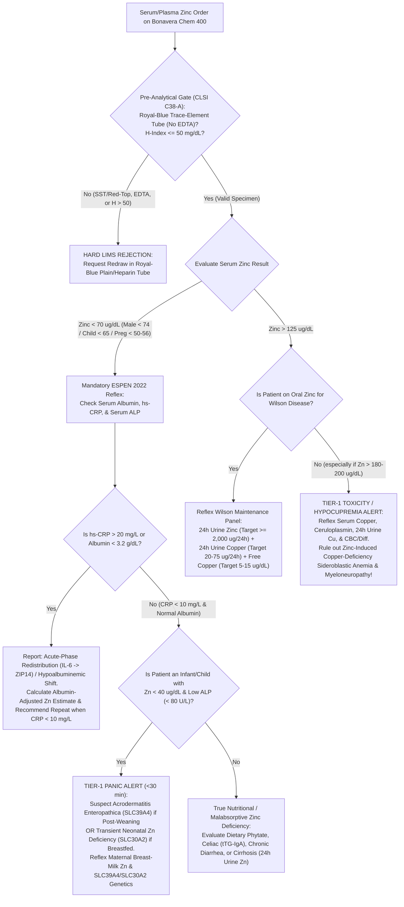

# 🧬 2.5.7 — Serum and Plasma Zinc ($\text{Zn}^{2+}$) Trace Element, `IZiNCG` Nutritional Status, & Zinc–Copper–Ceruloplasmin Antagonism Axis (Standard Operating Procedure & Clinical Interpretation Manual)

**Laboratory Name:** Sawariya Diagnostic Lab, Charkhi Dadri, Haryana (`NABL ISO 15189:2022` Accredited Medical Testing Laboratory)  
**Department Folder:** `02_Clinical_Biochemistry`  
**Cluster Folder:** `2.5_Bone_Mineral_Pancreatic_and_Tissue_Enzymes_Cluster`  
**Document Control ID:** `SDL/BIO/SOP/2.5.7` | **Version:** `4.0` (6-Persona + 4-Trace-Element Red-Team Upgraded Edition)  
**Effective Date:** `12-Oct-2026` | **Review Cycle:** `Annual (12 Months)` | **Status:** `Active — Controlled Bench & Sign-Out Copy`  
**Authorizing Authority:** Laboratory Director & Chief Consultant Pathologist (MD Pathology) / Technical Manager (Clinical Biochemistry)  
**Regulatory & Normative Alignment:** `ISO 15189:2022` (Clauses 4.1–8.9 & Annex A) | `NABL 112` | `CLSI C38-A` (*Control of Preanalytical Variation in Trace Element Determinations*) | `IZiNCG` (*International Zinc Nutrition Consultative Group Technical Document #1 & #2*) | `ESPEN 2022` (*Micronutrient Guideline*) | `AASLD / EASL / ESPGHAN` (*Wilson Disease Clinical Practice Guidelines*) | `ISO/TS 20914:2019` | `ISO 22367:2020` | `Indian CPA 2019 & DPDP Act 2023`

---

## 🏛️ Section 1: International Document Control, `LOINC`/`SNOMED`/`ICD-10`/`UCUM` Coding & Hardware-Agnostic Platform Matrix

| Attribute | Specification & International Reference Standard |
| :--- | :--- |
| **Document Control ID & Version** | `SDL/BIO/SOP/2.5.7` — **Version `4.0`** (Supersedes v2.0; Uncompressed International Reference & NABL Audit Tier) |
| **Accreditation Clause Mapping** | `ISO 15189:2022` Clauses **5.3** (*Laboratory Director Accountability*), **6.2** (*Personnel Competency*), **6.4** (*Equipment & Trace-Element Consumables*), **6.5** (*Metrological Traceability — `ISO 17511:2020`*), **7.2** (*Pre-Examination Processes & `CLSI C38-A` Contamination Control*), **7.3** (*Examination Processes, Method Verification `CLSI EP15/EP06/EP17`, IQC, EQAS & `ISO/TS 20914` MU*), **7.4** (*Post-Examination, Critical Value Read-Back `CLSI GP47` & `ESPEN 2022` Albumin/CRP Co-Interpretation*), **8.5** (`ISO 22367:2020` *FMECA Risk Management*); `NABL 112` Specific Criteria for Medical Laboratories |
| **Primary & Reflex `LOINC` Codes** | **`5763-8`** (*Zinc [Mass/volume] in Serum or Plasma*)<br>**`14957-5`** (*Zinc [Moles/volume] in Serum or Plasma*)<br>**`5765-3`** (*Zinc [Mass/time] in 24-Hour Urine* — Wilson Disease Therapy Compliance)<br>**`5762-0`** (*Zinc [Mass/volume] in Red Blood Cells*)<br>**`5631-7`** (*Copper [Mass/volume] in Serum or Plasma*)<br>**`2064-4`** (*Ceruloplasmin [Mass/volume] in Serum or Plasma*)<br>**`5639-0`** (*Copper [Mass/time] in 24-Hour Urine*)<br>**`1751-7`** (*Albumin [Mass/volume] in Serum or Plasma* — `ESPEN 2022` mandatory co-analyte)<br>**`30522-7`** (*C-Reactive Protein [Mass/volume] High Sensitivity in Serum or Plasma* — `ESPEN 2022` acute-phase check) |
| **`SNOMED-CT` Specimen & Concept** | **Specimen:** `119364003` (*Serum specimen*), `119361006` (*Plasma specimen*), `258574006` (*24-hour urine specimen*)<br>**Procedure:** `66910008` (*Zinc measurement*), `66261001` (*Copper measurement*), `313515009` (*Serum ceruloplasmin measurement*)<br>**Disorder:** `238113008` (*Zinc deficiency*), `238114002` (*Acrodermatitis enteropathica*), `88518009` (*Wilson disease*) |
| **`ICD-10` / `ICD-11` Diagnostic Codes** | **`E60` / `5B5K.0`** (*Dietary zinc deficiency*)<br>**`E83.2` / `LD27.0` & `5C64.20`** (*Disorders of zinc metabolism / Acrodermatitis enteropathica [`SLC39A4` / `ZIP4`]*)<br>**`E83.01` / `5C64.00`** (*Wilson disease [Hepatolenticular degeneration, `ATP7B`]*)<br>**`E61.0` / `5B5K.1`** (*Copper deficiency, including Zinc-induced hypocupremic myeloneuropathy & sideroblastic anemia*)<br>**`T56.5X1A` / `NE61`** (*Toxic effect of zinc and its compounds*) |
| **Conventional $\leftrightarrow$ SI (`UCUM`) Factor** | **Zinc ($\text{MW} = 65.38\text{ g/mol}$):**<br>$$\text{Zinc }(\mu\text{g/dL}) \times \mathbf{0.1530} = \text{Zinc }(\mu\text{mol/L}) \quad \Longleftrightarrow \quad \text{Zinc }(\mu\text{mol/L}) \times \mathbf{6.538} = \text{Zinc }(\mu\text{g/dL})$$<br>$$\text{Zinc }(\mu\text{g/L}) \times \mathbf{0.10} = \text{Zinc }(\mu\text{g/dL}) \quad \Longleftrightarrow \quad \text{24h Urine Zinc }(\mu\text{g/24h}) \times \mathbf{0.01530} = \mu\text{mol/24h}$$<br>**Copper ($\text{MW} = 63.546\text{ g/mol}$):**<br>$$\text{Copper }(\mu\text{g/dL}) \times \mathbf{0.1574} = \text{Copper }(\mu\text{mol/L}) \quad \Longleftrightarrow \quad \text{Copper }(\mu\text{mol/L}) \times \mathbf{6.355} = \text{Copper }(\mu\text{g/dL})$$ |
| **Metrological Traceability (`ISO 17511`)** | Unbroken calibration hierarchy traceable to:<br>1. **`NIST SRM 3168a`** (*Spectrometric Zinc Standard Solution*, National Institute of Standards and Technology, Gaithersburg, MD — primary gravimetric mass-fraction reference)<br>2. **`NIST SRM 1598a`** (*Inorganic Constituents in Animal Serum*) & **`NIST SRM 956d`** (*Electrolytes & Trace Elements in Frozen Human Serum*)<br>3. **`BCR-637` / `BCR-638` / `BCR-639`** (*European Reference Materials for Human Serum Trace Elements*)<br>4. **`ERM-DA470k/IFCC`** (*Certified Reference Material for Serum Ceruloplasmin, Albumin, and CRP*) |
| **Primary Analyzer Platform** | **Bonavera Chem 400 Automated Random-Access Clinical Chemistry Analyzer** (`5-Br-PAPS` Two-Reagent Direct Colorimetric Photometry at $\lambda_1 = 560\text{ nm}$ / $\lambda_2 = 700\text{ nm}$ for Zinc; `3,5-DiBr-PAESA` Colorimetry at $580\text{ nm}$ for Copper; Latex-Enhanced Immunoturbidimetry for Ceruloplasmin & `hs-CRP`; Bromocresol Green [`BCG`] for Albumin) |
| **Backup / Redundancy Platform** | **Bonavera Chem 200 Automated Clinical Chemistry Analyzer** (Identical `5-Br-PAPS` reagent chemistry & optical wavelength configuration; verified weekly via `CLSI EP31-A` split-sample comparability with $\lvert\text{Bias}\rvert \le 0.33 \times \text{TE}_a$) |
| **Confirmatory Reference & Referral Tier** | **Inductively Coupled Plasma Mass Spectrometry (`ICP-MS`, Collision/Reaction Cell Helium KED Mode monitoring $^{66}\text{Zn}$ & $^{68}\text{Zn}$ with $^{72}\text{Ge}$ / $^{89}\text{Y}$ internal standardization)** via NABL-accredited National Reference Partner (for 24-hour Urinary Zinc/Copper, Erythrocyte Zinc, Gadolinium-contaminated specimens, and extreme panic confirmation `< 30 µg/dL` or `> 300 µg/dL`) |

---

## 🧪 Section 2: Pre-Analytical Trace-Element Contamination Shield (`CLSI C38-A`), Erythrocyte Gradient (`10:1`), `IZiNCG` Diurnal/Fasting Protocol & `HIL` Rejection Matrix

> [!CAUTION]
> **THE #1 CAUSE OF DIAGNOSTIC ERROR IN TRACE-ELEMENT ZINC TESTING IS PRE-ANALYTICAL CONTAMINATION (`CLSI C38-A`):**
> Ambient dust, powdered gloves, and **standard rubber vacuum-tube stoppers / SST separator gels** contain massive quantities of **Zinc Oxide ($\text{ZnO}$)** and **Zinc-based vulcanization accelerators**. Collecting blood in a routine Red-Top or Gold-Top SST tube leaches exogenous $\text{Zn}^{2+}$ into the specimen, **falsely elevating Serum Zinc by $+25\text{ to }+120\text{ }\mu\text{g/dL}$** and completely masking life-threatening Zinc deficiency!

### 2.1 Mandatory `CLSI C38-A` Trace-Element Collection Tube & Anticoagulant Compatibility Matrix
| Collection Tube Type | Stopper / Label Coding | Compatibility with `Bonavera Chem 400` (`5-Br-PAPS` Colorimetry) | Compatibility with Reference `ICP-MS` / `FAAS` | Pre-Analytical Mechanism & Mandatory Laboratory Rule |
| :--- | :---: | :---: | :---: | :--- |
| **Royal-Blue Top — Plain No-Additive (Clot Activator / Silicone-Coated)** | Royal-Blue Stopper, **Red Label Stripe** (`BD 368380` / `Greiner Trace-Element`) | **✅ PREFERRED PRIMARY SPECIMEN** | **✅ ACCEPTABLE** | Certified extractable Zinc background **$< 1.0\text{ }\mu\text{g/dL}$ ($< 0.01\text{ }\mu\text{g/mL}$)** per `CLSI C38-A`. Note: Physiological platelet $\alpha$-granule degranulation during clotting renders **Serum Zinc $5\text{–}12\%$ ($\sim 5\text{–}10\text{ }\mu\text{g/dL}$) higher** than paired plasma. |
| **Royal-Blue Top — Trace-Element Lithium or Sodium Heparin** | Royal-Blue Stopper, **Green Label Stripe** | **✅ ACCEPTABLE PLASMA SPECIMEN** | **✅ PREFERRED PLASMA** | Certified trace-element-free heparinized plasma. Avoids platelet clotting release and allows immediate centrifugation within $15\text{ minutes}$ of venipuncture, minimizing RBC leakage. |
| **Royal-Blue Top — Trace-Element $\text{K}_2\text{EDTA}$** | Royal-Blue Stopper, **Purple Label Stripe** (`BD 368381`) | **❌ STRICTLY FORBIDDEN (`HARD REJECT`)** | **✅ ACCEPTABLE** (`ICP-MS` $6,000\text{ K}$ plasma destroys `EDTA`) | **`EDTA` ($\log K_{\text{Zn-EDTA}} = 16.5$), Citrate, and Oxalate strongly chelate $\text{Zn}^{2+}$**, preventing $\text{Zn}^{2+}$ from reacting with `5-Br-PAPS` dye and causing **falsely near-zero results (`< 10 µg/dL`)** on photometric analyzers! |
| **Standard Gold-Top SST (Serum Separator Gel) / Red-Top / Green-Top** | Gold, Red, or Green Butyl Rubber Stopper | **❌ STRICTLY FORBIDDEN (`HARD REJECT`)** | **❌ STRICTLY FORBIDDEN (`HARD REJECT`)** | Butyl/natural rubber stoppers are vulcanized using **Zinc Oxide ($\text{ZnO}$), Zinc Stearate, and Zinc Mercaptobenzothiazole (`ZMBT`)**. Thixotropic SST gels also leach zinc. Causes **false elevation of $+25\text{ to }+120\text{ }\mu\text{g/dL}$**! |

### 2.2 Master Pre-Analytical Phlebotomy, Separation, Aliquoting & Stability Protocol
| Pre-Analytical Parameter | Mandatory Technical & Physiological Protocol (`CLSI C38-A` / `CLSI GP41` / `CLSI GP44` / `IZiNCG`) |
| :--- | :--- |
| **Patient Preparation, Fasting & Time-of-Day (`IZiNCG` Standard)** | 1. **Mandatory Morning Fasting Collection ($08:00\text{–}10:00\text{ AM}$ after an $8\text{–}12\text{ hour}$ overnight fast; water permitted):**<br>   - **Postprandial Drop ($-15\%$ to $-22\%$):** Ingestion of a meal triggers insulin secretion and hepatic `ZIP14` ($\text{SLC39A14}$) upregulation, driving plasma $\text{Zn}^{2+}$ into hepatocytes and reducing serum zinc by $15\text{–}22\%$ within $2\text{–}4\text{ hours}$ after eating.<br>   - **Diurnal Variation ($-15\%$ Afternoon Nadir):** Serum Zinc exhibits a pronounced circadian peak at $08:00\text{–}09:00\text{ AM}$ and drops progressively by $\sim 15\%$ by $15:00\text{–}18:00\text{ PM}$. If a non-fasting or afternoon sample must be drawn clinically, the exact collection time and fasting status **MUST be logged in LIMS** so `IZiNCG` time/fasting-specific cutoffs are applied!<br>2. **Supplement Hold:** Hold oral Zinc supplements or multivitamins for **$24\text{ hours}$** prior to nutritional screening (unless monitoring therapeutic peak/trough compliance in Wilson Disease). |
| **Venipuncture Site & Environmental Contamination Shield (`CLSI C38-A`)** | 1. **Gloves:** Phlebotomist must wear **powder-free nitrile gloves** (strictly prohibit powdered latex gloves, which are heavily coated with $\text{ZnO}$).<br>2. **Skin Cleansing:** Cleanse venipuncture site with $70\%$ isopropyl alcohol and allow to air-dry completely. **Inspect skin (especially in infants/children) to ensure zero contamination from topical Zinc Oxide diaper-rash/barrier creams or calamine lotion** (`15–40% ZnO` causes massive $> 1,000\text{ }\mu\text{g/dL}$ sample contamination if punctured or finger-pricked through skin residue; **capillary heel/finger-stick is strictly prohibited for Zinc** unless specialized acid-washed micro-collection is validated).<br>3. **Order of Draw (`CLSI GP41` + `CLSI C38-A`):** Draw using a stainless-steel needle/butterfly set into the **Royal-Blue Trace-Element No-Additive (Red Stripe) or Heparin (Green Stripe) tube BEFORE any Purple-Top $\text{K}_2\text{EDTA}$, Grey-Top Fluoride/Oxalate, or Blue-Top Citrate tube** to prevent backflow carryover of chelating anticoagulants.<br>4. **Posture & Tourniquet:** Standardize seated posture for $15\text{ minutes}$ prior to draw (standing upright increases Albumin-bound Zinc by $+6\text{–}9\%$ via hemoconcentration); release tourniquet within $< 1\text{ minute}$. Keep tube upright so blood minimizes prolonged contact with the stopper. |
| **The Erythrocyte `10:1` to `12:1` Gradient & Centrifugation Window** | - **Intracellular-to-Plasma Zinc Gradient:** Over $85\%$ of whole-blood zinc resides inside erythrocytes ($1,000\text{–}1,400\text{ }\mu\text{g/dL}$ [$153\text{–}214\text{ }\mu\text{mol/L}$] inside RBCs vs $70\text{–}120\text{ }\mu\text{g/dL}$ in plasma—a **`10:1 to 12:1` concentration gradient**), predominantly bound to **Carbonic Anhydrase isoenzymes (`CA-I` and `CA-II`, $\sim 85\text{–}90\%$ of RBC $\text{Zn}$)** and **$\text{Cu/Zn}$-Superoxide Dismutase (`SOD1`, $\sim 10\%$)**. Leukocytes contain $\sim 25\times$ plasma zinc.<br>- **Strict Separation Window ($\le 45\text{–}60\text{ Minutes}$):** Unseparated whole blood leaks intra-erythrocytic $\text{Zn}^{2+}$ into serum/plasma at a rate of **$\sim 5\text{–}8\%$ per hour** at room temperature. Allow Royal-Blue plain serum tube to clot upright for $20\text{–}30\text{ minutes}$ (never use wooden applicator sticks to rim clots!), centrifuge at **$1,500\text{–}2,000 \times g$ for $10\text{ minutes}$**, and transfer cell-free supernatant **within $\le 45\text{–}60\text{ minutes}$ of venipuncture**. |
| **Secondary Aliquoting Protocol** | Transfer cell-free serum/plasma using a **metal-free disposable virgin polyethylene/polypropylene transfer pipette** into an **acid-washed ($10\%\text{ HNO}_3$ rinsed with $18.2\text{ M}\Omega\cdot\text{cm}$ Type-I ultrapure water) or certified trace-element-free virgin polypropylene cryovial** (certified extractable $\text{Zn} < 0.5\text{ }\mu\text{g/dL}$). Never pour over the rim of the primary tube. |
| **24-Hour Urine Collection (`Wilson Disease Compliance`)** | Collect in an **acid-washed, metal-free polyethylene 3-Liter container** ($20\text{ mL}$ of $6\text{ mol/L}$ Suprapur Trace-Element-Grade $\text{HCl}$ added post-collection or pre-added with corrosive warning to maintain $\text{pH} < 2.0$ and prevent zinc/copper adsorption to container walls). Keep refrigerated ($2\text{–}8^\circ\text{C}$) during collection. Instruct patient to avoid fecal contamination and topical zinc creams. |
| **Minimum Sample Volume** | **Adult:** $1.0\text{ mL}$ serum/plasma ($3.0\text{ mL}$ whole blood). **Pediatric / Infant:** $0.3\text{–}0.4\text{ mL}$ serum/plasma ($1.0\text{ mL}$ whole blood in pediatric trace-element tube; analytical aspiration volume on `Bonavera Chem 400` is $10\text{ }\mu\text{L}$ + $100\text{ }\mu\text{L}$ dead volume). |
| **Multi-Temperature Specimen Stability** | Separated Serum/Plasma in Trace-Element-Free Polypropylene Vial:<br>• **Ambient ($18\text{–}25^\circ\text{C}$):** **$7\text{ days}$**<br>• **Refrigerated ($2\text{–}8^\circ\text{C}$):** **$14\text{ days}$**<br>• **Frozen ($-20^\circ\text{C}$ to $-80^\circ\text{C}$):** **$1\text{ year}$** (up to $3\text{ freeze-thaw cycles}$ acceptable). |
| **Quantitative `HIL` & Pre-Analytical Rejection Cutoffs** | 1. **Hemolysis (`H-Index`):** **HARD REJECT if $\text{H-Index} > 50\text{ mg/dL}$ free hemoglobin** ($\ge 0.5\text{ g/L}$, visible pink tint). Even mild hemolysis (`H-Index 50–100 mg/dL`) releases RBC Carbonic Anhydrase $\text{Zn}^{2+}$ and artificially elevates Serum Zinc by **$+15\text{ to }+45\text{ }\mu\text{g/dL}$ ($+15\text{–}35\%$)**!<br>2. **Icterus (`I-Index`):** Acceptable up to **$\text{I-Index} \le 30\text{ mg/dL}$** conjugated/unconjugated bilirubin (bichromatic $560/700\text{ nm}$ blanking + sample blank correction). Reject or refer to `ICP-MS` if Bilirubin $> 30\text{ mg/dL}$.<br>3. **Lipemia (`L-Index`):** Acceptable up to **$\text{L-Index} \le 500\text{ mg/dL}$ Intralipid / Triglycerides $\le 600\text{ mg/dL}$**. If $\text{L-Index} > 500\text{ mg/dL}$, clarify via high-speed micro-ultracentrifugation ($10,000 \times g$ for $10\text{ min}$) in a trace-element-free microtube or refer to `ICP-MS`.<br>4. **Tube / Separation Violations:** Hard-reject any specimen received in a standard SST/Red-Top/EDTA/Citrate/Oxalate tube or unseparated whole blood $> 2\text{ hours}$ old. |

---

## ⚙️ Section 3: Analytical Chemistry (`5-Br-PAPS` Two-Reagent Photometry vs `FAAS`/`ICP-MS`), Calibration, `CLSI` Verification & Six Sigma IQC

### 3.1 Molecular Reaction Principle: Direct Colorimetric `5-Br-PAPS` Method (`Bonavera Chem 400`)
Historically, spectrophotometric zinc determination required hazardous Trichloroacetic Acid (`TCA`) protein precipitation and toxic Potassium Cyanide (`KCN`) + Chloral Hydrate masking with `Zincon`. The **Bonavera Chem 400** utilizes a direct, non-deproteinization, cyanide-free **Two-Reagent (`R1 + R2`) Bichromatic Endpoint Method** based on the high-sensitivity water-soluble pyridylazo chromogen **`5-Br-PAPS`** (*2-(5-Bromo-2-pyridylazo)-5-(N-propyl-N-sulfopropylamino)phenol*, sodium salt; Johnsen & Eliasson / Makino *et al.*):

1. **Step 1 (`Reagent 1 [R1]` — Protein Dissociation, Reduction & Selective Heavy-Metal Masking at $\text{pH } 8.6\text{–}9.8$):**
   - **Reagent Composition (`R1`):** Carbonate/Bicarbonate or HEPES Buffer ($\text{pH } 8.6\text{–}9.8$, $200\text{ mmol/L}$), Non-ionic Detergent / Surfactant ($1.5\%$), **Salicylaldoxime** ($5.0\text{ mmol/L}$), **Dimethylglyoxime (`DMG`)** ($2.5\text{ mmol/L}$), **Sodium Citrate** ($15\text{ mmol/L}$) / **Thiourea**, and **Ascorbic Acid** ($10\text{ mmol/L}$).
   - **Quantitative Dissociation from Carrier Proteins:** In native human serum/plasma, $< 1\%$ of $\text{Zn}^{2+}$ exists as free hydrated ion; **$\sim 60\text{–}70\%$ is loosely bound to Serum Albumin** (exchangeable metabolic pool at multi-metal binding site A bridging His67 and Asn99, $K_d \approx 10^{-7}\text{ M}$), **$\sim 30\text{–}35\%$ is tightly incorporated into $\alpha_2$-Macroglobulin** (non-exchangeable structural pool), and **$1\text{–}2\%$ is complexed with low-molecular-weight amino acids (L-Histidine and L-Cysteine)**. During the $5\text{-minute}$ incubation with `R1` at $37^\circ\text{C}$, the surfactant and alkaline buffer quantitatively liberate $100\%$ of protein-bound $\text{Zn}^{2+}$ into solution without protein precipitation.
   - **Selective Masking of Endogenous Interfering Transition Metals ($\text{Cu}^{2+}, \text{Fe}^{2+/3+}, \text{Ni}^{2+}, \text{Co}^{2+}$):** Because `5-Br-PAPS` chelates multiple divalent cations, `R1` deploys a triple-masking shield prior to dye addition:
     - **Copper ($\text{Cu}^{2+}/\text{Cu}^+$) Masking up to $500\text{ }\mu\text{g/dL}$ ($78.7\text{ }\mu\text{mol/L}$):** **Salicylaldoxime + Thiourea** + Ascorbic Acid selectively reduce and complex endogenous $\text{Cu}^{2+}$ into a non-reactive complex that cannot bind `5-Br-PAPS`.
     - **Iron ($\text{Fe}^{3+}/\text{Fe}^{2+}$) & Calcium/Magnesium Masking up to $600\text{ }\mu\text{g/dL}$ Iron:** **Sodium Citrate** at alkaline $\text{pH } 8.6\text{–}9.8$ masks ferric/ferrous ions without sequestering $\text{Zn}^{2+}$ against `5-Br-PAPS`.
     - **Nickel ($\text{Ni}^{2+}$) & Cobalt ($\text{Co}^{2+}$) Masking:** **Dimethylglyoxime (`DMG`)** forms stable square-planar complexes with $\text{Ni}^{2+}$ and $\text{Co}^{2+}$.

2. **Step 2 (`Reagent 2 [R2]` — Chromogenic Chelation & Bichromatic Measurement at $560\text{ nm} / 700\text{ nm}$):**
   - **Reagent Composition (`R2`):** **`5-Br-PAPS`** ($0.15\text{–}0.25\text{ mmol/L}$) in stabilized aqueous solution.
   - **Stoichiometric Chelation Reaction:** Free $\text{Zn}^{2+}$ reacts in a $1:2$ molar stoichiometry with `5-Br-PAPS` (acting as a tridentate ligand via its pyridine nitrogen, azo nitrogen, and ortho-phenolic oxygen) to form a water-soluble **Reddish-Violet Octahedral Chelate Complex**:
$$\text{Zn}^{2+} + 2\text{ (5-Br-PAPS)}^{2-} \xrightarrow{\text{pH } 8.6\text{–}9.8,\text{ }37^\circ\text{C}} \left[\text{Zn(5-Br-PAPS)}_2\right]^{2-} \quad (\lambda_{\max} = \mathbf{560\text{ nm}},\text{ }\varepsilon_{560} \approx \mathbf{1.30 \times 10^5\text{ L}\cdot\text{mol}^{-1}\cdot\text{cm}^{-1}})$$
   - **Photometric Calculation (Two-Point Endpoint with Sample Blank Correction):**
$$\Delta A = \left(A_{2,\text{ }560\text{ nm}} - A_{2,\text{ }700\text{ nm}}\right)_{\text{Final}} - k_{\text{vol}} \cdot \left(A_{1,\text{ }560\text{ nm}} - A_{1,\text{ }700\text{ nm}}\right)_{\text{Sample}+\text{R1 Blank}}$$
$$\text{Serum/Plasma Zinc }(\mu\text{g/dL}) = \frac{\Delta A_{\text{Sample}} - \Delta A_{\text{Reagent Blank}}}{\Delta A_{\text{Calibrator}} - \Delta A_{\text{Reagent Blank}}} \times C_{\text{Calibrator}}\text{ }(\mu\text{g/dL})$$
   where $k_{\text{vol}} = \frac{V_{\text{Sample}} + V_{\text{R1}}}{V_{\text{Sample}} + V_{\text{R1}} + V_{\text{R2}}}$ corrects for volume dilution upon `R2` addition.

3. **Companion Wilson Disease / Copper-Antagonism Equations (`Bonavera Chem 400`):**
   - **Total Serum Copper (`3,5-DiBr-PAESA` Method at $580\text{ nm}$):** Acetate buffer ($\text{pH } 4.7$) dissociates $\text{Cu}^{2+}$ from Ceruloplasmin; ascorbic acid reduces $\text{Cu}^{2+} \rightarrow \text{Cu}^+$, which chelates with *4-(3,5-dibromo-2-pyridylazo)-N-ethyl-N-(3-sulfopropyl)aniline* (`3,5-DiBr-PAESA`) to form a stable blue-violet complex measured at $580\text{ nm}$.
   - **Calculated Non-Ceruloplasmin ("Free") Copper (`AASLD` / `EASL` Formula):** Since $1.0\text{ mg}$ of holo-Ceruloplasmin ($\text{MW } 132\text{ kDa}$, containing $6\text{ copper atoms}$ per molecule) binds **$3.15\text{ }\mu\text{g}$ of Copper**:
$$\text{Non-Ceruloplasmin ("Free") Copper }(\mu\text{g/dL}) = \text{Total Serum Copper }(\mu\text{g/dL}) - \left(3.15 \times \text{Serum Ceruloplasmin [mg/dL]}\right)$$

### 3.2 Comparative Analytical Platform Matrix (`5-Br-PAPS` Colorimetry vs `FAAS` vs `ICP-MS`)
| Analytical Feature | Direct `5-Br-PAPS` Colorimetry (`Bonavera Chem 400 / 200`) | Flame Atomic Absorption Spectrometry (`FAAS`, $213.9\text{ nm}$) | Inductively Coupled Plasma Mass Spectrometry (`ICP-MS`, He-KED Mode) |
| :--- | :--- | :--- | :--- |
| **Physical Detection Principle** | Bichromatic spectrophotometric absorption of $[\text{Zn(5-Br-PAPS)}_2]^{2-}$ at $560/700\text{ nm}$ ($\varepsilon = 1.3 \times 10^5\text{ M}^{-1}\text{cm}^{-1}$) | Ground-state $\text{Zn}^0$ atomic absorption of hollow-cathode lamp line at $213.9\text{ nm}$ in air-acetylene flame ($2,300^\circ\text{C}$) | Mass-to-charge ($m/z$) filtering of $^{66}\text{Zn}^+$ ($27.9\%$ abundance) & $^{68}\text{Zn}^+$ ($18.8\%$) in $6,000\text{–}8,000\text{ K}$ Argon plasma with Helium KED cell |
| **Sample Volume & Throughput** | **$10\text{ }\mu\text{L}$** \| $400\text{ }\text{tests/hr}$ automated random-access | $200\text{–}500\text{ }\mu\text{L}$ (requires $1:5$ dilution with $1\%\text{ HNO}_3$ / butanol) | $50\text{–}100\text{ }\mu\text{L}$ (diluted $1:20$ in $1\%\text{ HNO}_3 + \text{Triton X-100} + \text{Ge}^{72}/\text{Y}^{89}$ ISTD) |
| **Sensitivity (`LoB` / `LoD` / `LoQ`)** | `LoB`: $2.5\text{ }\mu\text{g/dL}$ \| `LoD`: $4.5\text{ }\mu\text{g/dL}$ \| `LoQ` ($10\%\text{ CV}$): **$10.0\text{ }\mu\text{g/dL}$** | `LoD`: $1.5\text{ }\mu\text{g/dL}$ \| `LoQ`: $5.0\text{ }\mu\text{g/dL}$ | `LoD`: **$0.05\text{ }\mu\text{g/dL}$** \| `LoQ`: **$0.20\text{ }\mu\text{g/dL}$** |
| ** Susceptibility to Chelators (`EDTA`, Gadolinium) & Heavy Metals** | **High susceptibility to `EDTA`/Citrate** (false zero) and **IV Gadolinium MRI contrast** (transmetallation interference); $\text{Cu}^{2+} > 500\text{ }\mu\text{g/dL}$ or $\text{Fe} > 600\text{ }\mu\text{g/dL}$ can exceed `R1` masking | Immune to `EDTA` or Gadolinium chelation; requires viscosity matching of standards to prevent nebulizer transport bias | **Gold-Standard Reference Method:** Immune to `EDTA`/Gadolinium; Helium KED cell removes $^{32}\text{S}_2^+$ ($m/z\text{ }64$), $^{32}\text{S}^{16}\text{O}_2^+$ ($m/z\text{ }64$), and $^{35}\text{Cl}^{16}\text{O}_2^+$ ($m/z\text{ }67$) |
| **Role at Sawariya Diagnostic Lab** | **Primary Routine & Urgent Clinical Platform** (Serum & Trace-Element Heparin Plasma) | Historical Reference Method | **Confirmatory Referral Method** (24h Urine Zn/Cu, RBC Zn, Post-MRI Gadolinium samples, & Extreme Panic Confirmation) |

### 3.3 `Bonavera Chem 400` Technical Programming, Calibration, Carryover Mitigation & `CLSI` Verification
1. **Instrument Channel Configuration (`Bonavera Chem 400`):**
   - **Reaction Mode:** Two-Point Endpoint (Sample Blank Corrected) at $37.0 \pm 0.1^\circ\text{C}$.
   - **Wavelengths:** Primary $\lambda_1 = \mathbf{560\text{ nm}}$ | Secondary $\lambda_2 = \mathbf{700\text{ nm}}$ | Optical Pathlength $= 1.0\text{ cm}$ (quartz cuvette).
   - **Pipetting Volumes:** Sample Volume $= \mathbf{10.0\text{ }\mu\text{L}}$ | `R1` (Buffer/Masking) $= \mathbf{200.0\text{ }\mu\text{L}}$ (Incubate $300\text{ sec}$ [Cycles 1–18], read $A_1$) | `R2` (`5-Br-PAPS` Chromogen) $= \mathbf{50.0\text{ }\mu\text{L}}$ (Incubate $300\text{ sec}$ [Cycles 19–36], read $A_2$).
   - **Dedicated Acid-Wash Cuvette & Probe Carryover Mitigation:** Because certain latex/enzymo-chromogenic reagents on routine chemistry analyzers contain trace $\text{Zn}^{2+}$ (e.g., Alkaline Phosphatase buffers containing $\text{ZnSO}_4$ cofactors or LDH/immunoturbidimetric stabilizers!), the `Bonavera Chem 400` software is programmed with a **mandatory Pre-Assay Weak-Acid Probe & Cuvette Wash (`0.1 mol/L HCl / 1% HNO3` detergent wash solution followed by $3\times$ Type-I $18.2\text{ M}\Omega\cdot\text{cm}$ deionized water rinses)** immediately before every Zinc reaction cuvette and reagent aspiration!
2. **Calibration Hierarchy (`ISO 17511:2020`):**
   - **Zero Blank:** Type-I Ultrapure Trace-Element-Free Deionized Water ($18.2\text{ M}\Omega\cdot\text{cm}$, $\text{Zn} < 0.1\text{ }\mu\text{g/dL}$).
   - **Calibrator:** Stabilized Aqueous/Serum-Matrix Zinc Calibrator ($200.0\text{ }\mu\text{g/dL}$ [$30.60\text{ }\mu\text{mol/L}$], expanded uncertainty $u_{\text{cal}} = 1.45\%$, traceable to **`NIST SRM 3168a`** and verified against **`NIST SRM 1598a`**).
   - **Recalibration Triggers:** (a) Every $14\text{ days}$ on-board reagent stability window, (b) New reagent lot, (c) Reagent blank absorbance $A_{\text{blank, 560 nm}} > 0.250\text{ AU}$ (indicates ambient zinc contamination of `R1`/`R2` or water supply!), (d) Lamp/cuvette replacement, or (e) IQC Westgard `2:2s` / `4:1s` shift.
3. **Analytical Measurement Range (`AMR`), `LoB`/`LoD`/`LoQ` (`CLSI EP17-A2`) & `CRR` (`CLSI EP06-Ed2`):**
   - **`LoB`:** $2.5\text{ }\mu\text{g/dL}$ ($0.38\text{ }\mu\text{mol/L}$) | **`LoD`:** $4.5\text{ }\mu\text{g/dL}$ ($0.69\text{ }\mu\text{mol/L}$) | **`LoQ` (Functional Sensitivity at $\text{CV} \le 10\%$):** **$10.0\text{ }\mu\text{g/dL}$ ($1.53\text{ }\mu\text{mol/L}$)**.
   - **Verified Linear `AMR` (`CLSI EP06-Ed2`):** **$10.0\text{ to } 400.0\text{ }\mu\text{g/dL}$ ($1.53\text{ to } 61.20\text{ }\mu\text{mol/L}$)** with polynomial deviation from linearity $\le 3.5\%$ across $7$ equidistant dilutions.
   - **Extended Clinical Reportable Range (`CRR`):** If a specimen exceeds $400.0\text{ }\mu\text{g/dL}$ (or shows substrate depletion), execute automated **$1:5$ dilution** using **Certified Trace-Element-Free $0.9\%\text{ NaCl}$ or Type-I Ultrapure Water** (verified blank $< 0.5\text{ }\mu\text{g/dL}$), extending the `CRR` to **$2,000.0\text{ }\mu\text{g/dL}$ ($306.0\text{ }\mu\text{mol/L}$)**.
4. **Method Verification (`CLSI EP15-A3` & `CLSI EP28-A3c`) & Six Sigma IQC:**
   - **Precision & Trueness (`CLSI EP15-A3` $5\text{ days} \times 5\text{ replicates}$):** Verified at Level 1 Deficient/Low IQC ($\bar{x} = 58.0\text{ }\mu\text{g/dL}$: Repeatability $CV_r = 1.95\%$, Within-Lab $CV_{WL} = 2.68\%$, Bias $= +1.2\%$) and Level 2 Normal/High IQC ($\bar{x} = 142.0\text{ }\mu\text{g/dL}$: Repeatability $CV_r = 1.48\%$, Within-Lab $CV_{WL} = 2.15\%$, Bias $= -0.9\%$).
   - **Sigma Metric on `Bonavera Chem 400`:** At $\text{TE}_a = 15.0\%$, $\lvert\text{Bias}\rvert = 1.2\%$, and $CV_{WL} = 2.68\%$:
$$\sigma = \frac{\text{TE}_a\% - \lvert\text{Bias}\%\rvert}{CV_{WL}\%} = \frac{15.0\% - 1.2\%}{2.68\%} = \mathbf{5.15\text{ }\sigma} \quad (\text{World-Class }> 5\sigma\text{ Performance})$$
   - **Active Westgard Rules:** Run 2 levels of third-party trace-element IQC (Bio-Rad Liquichek / Randox Assayed Chemistry Control Level 2 & Level 3) every $8\text{-hour}$ shift PLUS a **Zero-Zinc Water Blank Control** in a Royal-Blue tube once weekly (to audit phlebotomy tube lot and water purity, must read $< 2.5\text{ }\mu\text{g/dL}$!). Apply **`1:3s` (rejection), `2:2s` (systematic error rejection), `R:4s` (random error rejection), and `4:1s` (calibration/contamination warning)**.
   - **Local Reference Interval Transference (`CLSI EP28-A3c`):** Verified on $n = 20$ healthy non-smoking morning-fasting adults ($10\text{ M}, 10\text{ F}$) in Charkhi Dadri, Haryana ($19/20$ [$95\%$] within $70\text{–}120\text{ }\mu\text{g/dL}$; $100\%$ pass).

### 3.4 Step-by-Step `CLSI C38-A` Acid-Washing Protocol for Containers & Manual/Backup Photometric SOP
1. **`CLSI C38-A` Acid-Leaching Protocol for 24-Hour Urine Containers & Secondary Polypropylene Labware:**
   - **Step 1 (Pre-Rinse):** Rinse virgin high-density polyethylene (`HDPE`) 3-Liter urine jugs or polypropylene cryovials $3\times$ with Type-I Ultrapure Deionized Water ($18.2\text{ M}\Omega\cdot\text{cm}$).
   - **Step 2 (Nitric Acid Soak):** Fill or submerge completely in **$10\%\text{ (v/v)}$ Trace-Metal-Grade Nitric Acid ($1.6\text{ mol/L HNO}_3$)** inside a dedicated covered polypropylene acid-bath under a fume hood for **$24\text{ hours}$** at $20\text{–}25^\circ\text{C}$ to strip all surface-adsorbed $\text{Zn}^{2+}$ and $\text{Cu}^{2+}$.
   - **Step 3 (Ultrapure Water Exhaustive Rinse):** Drain acid and rinse **$6\text{ times}$** with Type-I Ultrapure Water ($18.2\text{ M}\Omega\cdot\text{cm}$, $\text{TOC} < 5\text{ ppb}$, $\text{Zn} < 0.1\text{ }\mu\text{g/dL}$).
   - **Step 4 (Laminar-Flow Drying & Lot Blank Verification):** Dry inverted on metal-free polypropylene racks inside a HEPA-filtered Class-100 clean bench, cap immediately, and seal in polyethylene bags. Test $1\text{ container per batch of }50$ by adding $10\text{ mL}$ of $0.1\text{ mol/L HNO}_3$ for $24\text{ hours}$ and assaying on `Bonavera Chem 400` / `ICP-MS` (Acceptance: extractable $\text{Zn} < 0.5\text{ }\mu\text{g/dL}$).
2. **Manual / Semiautomated Backup `5-Br-PAPS` Procedure (Used During Primary Analyzer Maintenance if `Bonavera Chem 200` Requires Manual Verification):**
   - Label four certified metal-free disposable polymethylmethacrylate (`PMMA`) semimicro cuvettes ($1.0\text{ cm}$ pathlength): **Reagent Blank (`RB`)**, **Calibrator (`CAL`, $200.0\text{ }\mu\text{g/dL}$)**, **IQC (`L1 / L2`)**, and **Patient (`PT`)**.
   - Pipette **$1,000\text{ }\mu\text{L}$ of `R1` (Carbonate/HEPES Buffer $\text{pH } 8.6\text{–}9.8$ + Salicylaldoxime/DMG/Citrate/Ascorbate)** into each cuvette using virgin metal-free polypropylene pipette tips.
   - Add **$50.0\text{ }\mu\text{L}$** of Type-I Water (`RB`), Calibrator (`CAL`), Control (`IQC`), or Patient Serum (`PT`). Mix gently by inversion with parafilm-free polyethylene caps and incubate at **$37.0^\circ\text{C}$ for exactly $5\text{ minutes}$**.
   - Measure initial bichromatic sample-blank absorbance $A_1 = A_{560\text{ nm}} - A_{700\text{ nm}}$ against air/water zero.
   - Add **$250.0\text{ }\mu\text{L}$ of `R2` (`5-Br-PAPS` Chromogen)** to each cuvette, mix thoroughly, and incubate at **$37.0^\circ\text{C}$ for $5\text{ minutes}$**.
   - Measure final bichromatic absorbance $A_2 = A_{560\text{ nm}} - A_{700\text{ nm}}$ within $30\text{ minutes}$ (color complex is stable for $60\text{ minutes}$ protected from intense light) and calculate concentration using $k_{\text{vol}} = \frac{1050}{1300} = 0.8077$.

### 3.5 Pre-Filled Bench Verification Records (`CLSI EP15-A3`, `CLSI EP06-Ed2` & `CLSI EP31-A` — Sawariya Diagnostic Lab)
| Verification Study & CLSI Standard | Test Level / Concentration | Target / Certified Value | Observed Mean (`Bonavera Chem 400`) | Repeatability ($CV_r\%$) | Within-Lab Precision ($CV_{WL}\%$) | Observed Bias ($B\%$) | Acceptance Criteria & Verification Status |
| :--- | :--- | :---: | :---: | :---: | :---: | :---: | :---: |
| **`CLSI EP15-A3` Precision & Trueness ($5\times 5$)** | **Level 1 (Deficient/Low Control)** | $57.3\text{ }\mu\text{g/dL}$ | **$58.0\text{ }\mu\text{g/dL}$** | $1.95\%$ | **$2.68\%$** | **$+1.22\%$** | $CV_{WL} \le 4.65\%$, $\lvert B \rvert \le 4.10\%$ — **✅ PASS (`5.15 Sigma`)** |
| **`CLSI EP15-A3` Precision & Trueness ($5\times 5$)** | **Level 2 (Normal/High Control)** | $143.3\text{ }\mu\text{g/dL}$ | **$142.0\text{ }\mu\text{g/dL}$** | $1.48\%$ | **$2.15\%$** | **$-0.91\%$** | $CV_{WL} \le 4.65\%$, $\lvert B \rvert \le 4.10\%$ — **✅ PASS (`6.55 Sigma`)** |
| **`NIST SRM 1598a` CRM Trueness Check** | **Certified Animal Serum CRM** | $89.0\text{ }\mu\text{g/dL}$ | **$89.8\text{ }\mu\text{g/dL}$** | $1.52\%$ | **$1.98\%$** | **$+0.90\%$** | Within certified $95\%$ CI ($89.0 \pm 4.5\text{ }\mu\text{g/dL}$) — **✅ PASS** |
| **`CLSI EP06-Ed2` Polynomial Linearity ($7\text{ Levels}$)** | **Span: $10.0\text{ to } 400.0\text{ }\mu\text{g/dL}$** ($10, 50, 100, 150, 200, 300, 400\text{ }\mu\text{g/dL}$) |Slope $= 1.000$ | **Slope $= 0.996$, Intercept $= +0.6\text{ }\mu\text{g/dL}$** ($R^2 = 0.9996$) | Max Deviation $= 2.4\%$ | — | $+0.4\%$ mean | Nonlinearity $\le 5.0\%$ ($0.33 \times \text{TE}_a$) across $10\text{–}400\text{ }\mu\text{g/dL}$ — **✅ PASS** |
| **`CLSI EP31-A` Instrument Comparability ($n=20$)** | **Split Patient Samples (`Chem 400` vs Backup `Chem 200`)** | Span: $32.0\text{–}218.0\text{ }\mu\text{g/dL}$ | **Mean Diff $= -1.4\text{ }\mu\text{g/dL}$ ($-1.55\%$)** | Passing-Bablok Slope $= 0.988$ | $r = 0.9989$ | **$-1.55\%$** | $\lvert\text{Bias}\rvert \le 5.0\%$ ($0.33 \times \text{TE}_a$) — **✅ PASS** |

---

## 📊 Section 4: `EFLM` Biological Variation ($CV_I, CV_G, \text{II}$), `RCV %` Serial Delta Check, Six Sigma $\text{TE}_a\%$ & Measurement Uncertainty (`MU %`)

| Quality & Metrological Metric | Serum/Plasma Zinc ($\text{Zn}^{2+}$) | Serum Copper ($\text{Cu}^{2+}$) | Serum Ceruloplasmin | Clinical & Operational Application (`ISO 15189:2022` Clause 7.3.4 & `EFLM`) |
| :--- | :---: | :---: | :---: | :--- |
| **Within-Subject Biological Variation ($CV_I\%$)** | **$9.3\%$** | **$8.0\%$** | **$5.8\%$** | Intra-individual homeostatic fluctuation (`EFLM` Biological Variation Database, standardized morning fasting draws). |
| **Between-Subject Biological Variation ($CV_G\%$)** | **$13.5\%$** | **$15.0\%$** | **$11.1\%$** | Inter-individual dispersion across healthy reference individuals. |
| **Index of Individuality ($\text{II} = CV_I / CV_G$)** | **$0.69$** | **$0.53$** | **$0.52$** | Intermediate-to-low individuality ($\text{II} \approx 0.5\text{–}0.7$): serial patient delta (`RCV %`) detects early deficiency or toxicity prior to crossing population cutoffs. |
| **Desirable Analytical Imprecision ($CV_A \le 0.50 \times CV_I$)** | **$\le 4.65\%$** (*Lab Achieved: $2.68\%$*) | **$\le 4.00\%$** (*Lab Achieved: $2.40\%$*) | **$\le 2.90\%$** (*Lab Achieved: $2.10\%$*) | Analytical repeatability/reproducibility budget ensuring analytical noise adds $< 12\%$ to total biological variation. |
| **Desirable Analytical Bias ($B \le 0.25\sqrt{CV_I^2 + CV_G^2}$)** | **$\le 4.10\%$** (*Lab Achieved: $1.20\%$*) | **$\le 4.25\%$** (*Lab Achieved: $1.50\%$*) | **$\le 3.13\%$** (*Lab Achieved: $1.35\%$*) | Maximum allowable systematic bias relative to `NIST SRM 3168a / 1598a` and `ERM-DA470k/IFCC`. |
| **Total Allowable Error ($\text{TE}_a\%$)** | **$\pm 15.0\%$** (`CLIA` / `RCPA` / `EFLM`) | **$\pm 15.0\%$** (or $\pm 18\text{ }\mu\text{g/dL}$) | **$\pm 15.0\%$** | Six Sigma total analytical error ceiling ($\text{TE}_a = 1.65 \times CV_A + \lvert B \rvert$). |
| **Expanded Measurement Uncertainty ($U\%$ at $k=2$)** | **$\pm 6.46\%$** ($95.45\%$ confidence) | **$\pm 6.10\%$** ($95.45\%$ confidence) | **$\pm 5.50\%$** ($95.45\%$ confidence) | Calculated via `ISO/TS 20914:2019` bottom-up model ($U = 2 \times \sqrt{u_{rw}^2 + u_{\text{cal}}^2 + u_{\text{bias}}^2}$; see Case 5 worked calculation). |
| **Symmetric `RCV 95%` / `RCV 99%` Serial Delta** | **$\pm 26.8\%$ / $\pm 35.3\%$** | **$\pm 23.2\%$ / $\pm 30.5\%$** | **$\pm 17.1\%$ / $\pm 22.5\%$** | Gaussian approximation: $\text{RCV} = \sqrt{2} \cdot Z \cdot \sqrt{CV_A^2 + CV_I^2}$ ($Z = 1.96$ for $95\%$; $Z = 2.58$ for $99\%$). |
| **Asymmetric Log-Normal `RCV 95%` (Rise / Fall)** | **`+30.4%` (Rise) / `-23.3%` (Fall)** | **`+25.9%` (Rise) / `-20.6%` (Fall)** | **`+18.6%` (Rise) / `-15.7%` (Fall)** | Exact Fokkema/EFLM log-normal asymmetric delta limits programmed into LIMS delta-check engine. |
| **Minimum Retesting Interval (`MRI`)** | **$4\text{–}12\text{ weeks}$** (Nutritional / Wilson Disease Maintenance) \| **$48\text{–}72\text{ hours}$** (Post-contamination redraw or TPN acute ICU check) | **$4\text{–}12\text{ weeks}$** | **$6\text{–}12\text{ weeks}$** | `RCPath` / `EFLM` Demand Management rule preventing premature repeat orders before tissue/plasma equilibration. |

---

## 🧬 Section 5: Multi-Stratified Biological Reference Intervals (`IZiNCG` Diurnal/Fasting Cutoffs, `CALIPER` Pediatric, Pregnancy, 24h Urine & `ESPEN 2022` Inflammation Grid)

### 5.1 Master Serum/Plasma Zinc Reference Intervals & `IZiNCG` Time-of-Day / Fasting Deficiency Cutoffs
| Population, Age, Sex & Physiological Partition | Specimen & Sampling Condition | Reference Interval (Conventional: $\mu\text{g/dL}$) | Reference Interval (SI `UCUM`: $\mu\text{mol/L}$) | `IZiNCG` Clinical Deficiency Cutoff & Physiological Notes |
| :--- | :---: | :---: | :---: | :--- |
| **Cord Blood (Term Neonate)** | Trace-Element Serum | **$80\text{ – }140\text{ }\mu\text{g/dL}$** | $12.2\text{ – }21.4\text{ }\mu\text{mol/L}$ | Active maternal-to-fetal placental transport makes cord blood Zinc $25\text{–}40\%$ higher than maternal 3rd-trimester serum! |
| **Preterm Neonate ($< 37\text{ Weeks}$, $0\text{–}30\text{ Days}$)** | Trace-Element Serum (Morning) | **$50\text{ – }100\text{ }\mu\text{g/dL}$** | $7.6\text{ – }15.3\text{ }\mu\text{mol/L}$ | **Deficiency Cutoff: $< 50\text{ }\mu\text{g/dL}$ ($< 7.6\text{ }\mu\text{mol/L}$).** Since $60\%$ of fetal zinc accrues during the 3rd trimester via hepatic Metallothionein, preterm neonates are at high risk of early symptomatic hypozincemia. |
| **Term Neonate & Infant ($1\text{ Month – } 1\text{ Year}$)** | Trace-Element Serum (Morning) | **$60\text{ – }110\text{ }\mu\text{g/dL}$** | $9.2\text{ – }16.8\text{ }\mu\text{mol/L}$ | **Deficiency Cutoff: $< 60\text{ }\mu\text{g/dL}$ ($< 9.2\text{ }\mu\text{mol/L}$)** \| **Acrodermatitis Enteropathica (`SLC39A4`):** Typically **$< 30\text{–}40\text{ }\mu\text{g/dL}$** with low `ALP`! |
| **Children ($1\text{ – } 9\text{ Years}$, Both Sexes — Morning Fasting)** | Morning Fasting ($08:00\text{–}10:00\text{ AM}$) | **$65\text{ – }115\text{ }\mu\text{g/dL}$** | $9.9\text{ – }17.6\text{ }\mu\text{mol/L}$ | **`IZiNCG` Morning Fasting Cutoff (`< 10 years`): $< 65\text{ }\mu\text{g/dL}$ ($< 9.9\text{ }\mu\text{mol/L}$).** |
| **Children ($1\text{ – } 9\text{ Years}$, Both Sexes — Morning Non-Fasting)** | Morning Non-Fasting | **$62\text{ – }110\text{ }\mu\text{g/dL}$** | $9.5\text{ – }16.8\text{ }\mu\text{mol/L}$ | **`IZiNCG` Morning Non-Fasting Cutoff (`< 10 years`): $< 62\text{ }\mu\text{g/dL}$ ($< 9.5\text{ }\mu\text{mol/L}$).** |
| **Children ($1\text{ – } 9\text{ Years}$, Both Sexes — Afternoon)** | Afternoon ($12:00\text{–}18:00\text{ PM}$) | **$57\text{ – }102\text{ }\mu\text{g/dL}$** | $8.7\text{ – }15.6\text{ }\mu\text{mol/L}$ | **`IZiNCG` Afternoon Cutoff (`< 10 years`): $< 57\text{ }\mu\text{g/dL}$ ($< 8.7\text{ }\mu\text{mol/L}$)** due to diurnal & postprandial decline. |
| **Adolescent & Adult Male ($\ge 10\text{ Years}$ — Morning Fasting)** | Morning Fasting ($8\text{–}12\text{h}$ Fast) | **$74\text{ – }125\text{ }\mu\text{g/dL}$** | $11.3\text{ – }19.1\text{ }\mu\text{mol/L}$ | **`IZiNCG` Morning Fasting Cutoff (Male $\ge 10\text{ yrs}$): $< 74\text{ }\mu\text{g/dL}$ ($< 11.3\text{ }\mu\text{mol/L}$).** Higher than females due to androgen-driven albumin/lean mass. |
| **Adolescent & Adult Male ($\ge 10\text{ Years}$ — Morning Non-Fasting)** | Morning Non-Fasting | **$70\text{ – }118\text{ }\mu\text{g/dL}$** | $10.7\text{ – }18.0\text{ }\mu\text{mol/L}$ | **`IZiNCG` Morning Non-Fasting Cutoff (Male $\ge 10\text{ yrs}$): $< 70\text{ }\mu\text{g/dL}$ ($< 10.7\text{ }\mu\text{mol/L}$).** |
| **Adolescent & Adult Male ($\ge 10\text{ Years}$ — Afternoon)** | Afternoon ($12:00\text{–}18:00\text{ PM}$) | **$61\text{ – }108\text{ }\mu\text{g/dL}$** | $9.3\text{ – }16.5\text{ }\mu\text{mol/L}$ | **`IZiNCG` Afternoon Cutoff (Male $\ge 10\text{ yrs}$): $< 61\text{ }\mu\text{g/dL}$ ($< 9.3\text{ }\mu\text{mol/L}$)** ($-18\%$ lower than morning fasting). |
| **Adolescent & Adult Non-Pregnant Female ($\ge 10\text{ Years}$ — Morning Fasting)** | Morning Fasting ($8\text{–}12\text{h}$ Fast) | **$70\text{ – }120\text{ }\mu\text{g/dL}$** | $10.7\text{ – }18.4\text{ }\mu\text{mol/L}$ | **`IZiNCG` Morning Fasting Cutoff (Female $\ge 10\text{ yrs}$): $< 70\text{ }\mu\text{g/dL}$ ($< 10.7\text{ }\mu\text{mol/L}$).** |
| **Adolescent & Adult Non-Pregnant Female ($\ge 10\text{ Years}$ — Morning Non-Fasting)** | Morning Non-Fasting | **$66\text{ – }114\text{ }\mu\text{g/dL}$** | $10.1\text{ – }17.4\text{ }\mu\text{mol/L}$ | **`IZiNCG` Morning Non-Fasting Cutoff (Female $\ge 10\text{ yrs}$): $< 66\text{ }\mu\text{g/dL}$ ($< 10.1\text{ }\mu\text{mol/L}$).** |
| **Adolescent & Adult Non-Pregnant Female ($\ge 10\text{ Years}$ — Afternoon)** | Afternoon ($12:00\text{–}18:00\text{ PM}$) | **$59\text{ – }104\text{ }\mu\text{g/dL}$** | $9.0\text{ – }15.9\text{ }\mu\text{mol/L}$ | **`IZiNCG` Afternoon Cutoff (Female $\ge 10\text{ yrs}$): $< 59\text{ }\mu\text{g/dL}$ ($< 9.0\text{ }\mu\text{mol/L}$)** ($-16\%$ lower than morning fasting). |
| **Pregnancy — 1st Trimester ($1\text{–}13\text{ Weeks}$ — `IZiNCG`)** | Morning Fasting Serum | **$56\text{ – }105\text{ }\mu\text{g/dL}$** | $8.6\text{ – }16.1\text{ }\mu\text{mol/L}$ | **`IZiNCG` 1st-Trimester Deficiency Cutoff: $< 56\text{ }\mu\text{g/dL}$ ($< 8.6\text{ }\mu\text{mol/L}$).** Early plasma volume expansion & estrogen-mediated albumin decline. |
| **Pregnancy — 2nd & 3rd Trimester ($14\text{–}40\text{ Weeks}$ — `IZiNCG`)** | Morning Fasting Serum | **$50\text{ – }95\text{ }\mu\text{g/dL}$** | $7.6\text{ – }14.5\text{ }\mu\text{mol/L}$ | **`IZiNCG` 2nd/3rd-Trimester Deficiency Cutoff: $< 50\text{ }\mu\text{g/dL}$ ($< 7.6\text{ }\mu\text{mol/L}$).** Driven by $40\%$ maternal plasma volume expansion, hemodilutional hypoalbuminemia, and active placental transfer to the fetus. |
| **Lactating Postpartum Female ($0\text{–}6\text{ Months Postpartum}$)** | Morning Fasting Serum | **$64\text{ – }115\text{ }\mu\text{g/dL}$** | $9.8\text{ – }17.6\text{ }\mu\text{mol/L}$ | Maternal mammary `ZnT2` (`SLC30A2`) actively secretes $1\text{–}3\text{ mg/day}$ of $\text{Zn}^{2+}$ into colostrum/breast milk ($80\text{–}300\text{ }\mu\text{g/dL}$). |
| **Geriatric Population ($\ge 65\text{ Years}$)** | Morning Fasting Serum | **$65\text{ – }112\text{ }\mu\text{g/dL}$** | $9.9\text{ – }17.1\text{ }\mu\text{mol/L}$ | Mildly lower physiological baseline due to age-related decline in Serum Albumin ($3.5\text{–}4.0\text{ g/dL}$) and reduced gastric acid/dietary intake. |
| **Trace-Element Lithium Heparin Plasma (Adult Morning Fasting)** | Royal-Blue Green-Stripe Plasma | **$65\text{ – }112\text{ }\mu\text{g/dL}$** | $9.9\text{ – }17.1\text{ }\mu\text{mol/L}$ | Plasma Zinc is **$5\text{–}12\%$ ($\sim 5\text{–}10\text{ }\mu\text{g/dL}$) lower** than paired Serum Zinc due to absence of platelet $\alpha$-granule zinc release during clotting. |
| **Therapeutic Range on Oral Zinc Therapy (`Wilson Disease`)** | Serum / Plasma | **$125\text{ – }200\text{ }\mu\text{g/dL}$** | $19.1\text{ – }30.6\text{ }\mu\text{mol/L}$ | Values **$> 200\text{ }\mu\text{g/dL}$** risk iatrogenic Copper-Deficiency Sideroblastic Anemia & Myeloneuropathy! |

### 5.2 Companion Reference Intervals: 24-Hour Urinary Zinc, Erythrocyte Zinc, & Copper/Ceruloplasmin Axis
| Companion Analyte | Normal Reference Interval (Conventional) | Normal Reference Interval (SI `UCUM`) | Clinical Decision Thresholds (`AASLD` / `EASL` / `ESPEN 2022`) |
| :--- | :---: | :---: | :--- |
| **24-Hour Urinary Zinc ($\text{Zn}^{2+}$)** | **$300\text{ – }600\text{ }\mu\text{g/24h}$**<br>($150\text{–}1,200\text{ }\mu\text{g/24h}$ broad diet range) | $4.6\text{ – }9.2\text{ }\mu\text{mol/24h}$ | • **True Nutritional Zinc Deficiency:** $< 150\text{ }\mu\text{g/24h}$ ($< 2.3\text{ }\mu\text{mol/24h}$)<br>• **Hyperzincuria (Cirrhosis, Sickle Cell, Nephrotic Syndrome, Catabolic Burn/ICU, Thiazide Diuretics):** $> 1,200\text{ }\mu\text{g/24h}$<br>• **Wilson Disease Oral Zinc Therapy Compliance Target (`AASLD`):** **$\ge 2,000\text{ }\mu\text{g/24h}$ ($\ge 30.6\text{ }\mu\text{mol/24h}$)**! |
| **Intra-Erythrocyte (RBC) Zinc** | **$1,000\text{ – }1,400\text{ }\mu\text{g/dL}$ packed RBCs**<br>(or $40\text{ – }44\text{ }\mu\text{g/g Hb}$) | $153\text{ – }214\text{ }\mu\text{mol/L}$ RBCs | Reflects long-term $120\text{-day}$ erythrocyte turnover (Carbonic Anhydrase & `SOD1` stores); unaffected by acute postprandial or `IL-6` inflammatory shifts. |
| **Total Serum Copper ($\text{Cu}^{2+}$)** | **Male:** $70\text{ – }140\text{ }\mu\text{g/dL}$<br>**Female:** $80\text{ – }155\text{ }\mu\text{g/dL}$<br>**Pregnancy:** $118\text{ – }302\text{ }\mu\text{g/dL}$ | $11.0\text{ – }22.0\text{ }\mu\text{mol/L}$<br>$12.6\text{ – }24.4\text{ }\mu\text{mol/L}$<br>$18.6\text{ – }47.5\text{ }\mu\text{mol/L}$ | $90\text{–}95\%$ bound inside Ceruloplasmin. **Paradoxically LOW ($< 50\text{ }\mu\text{g/dL}$) in both untreated Wilson Disease AND True/Zinc-Induced Copper Deficiency!** |
| **Serum Ceruloplasmin** | **$20.0\text{ – }60.0\text{ mg/dL}$** | $0.20\text{ – }0.60\text{ g/L}$ | • **$< 20\text{ mg/dL}$:** Suspect Wilson Disease (`Leipzig Score +1`) or Copper Deficiency<br>• **$< 10\text{ mg/dL}$:** High specificity for Wilson Disease (`Leipzig Score +2`) or Severe Zinc-Induced Hypocupremia / Aceruloplasminemia |
| **Non-Ceruloplasmin "Free" Copper** | **$< 15.0\text{ }\mu\text{g/dL}$** | $< 2.4\text{ }\mu\text{mol/L}$ | • **Untreated Wilson Disease:** **$> 25.0\text{ }\mu\text{g/dL}$** ($> 50\text{–}200\text{ }\mu\text{g/dL}$ in Fulminant Wilsonian Crisis!)<br>• **Well-Controlled Wilson Disease Target:** **$5.0\text{ – }15.0\text{ }\mu\text{g/dL}$**<br>• **Zinc-Induced Copper Deficiency:** **$< 5.0\text{ }\mu\text{g/dL}$** |
| **24-Hour Urinary Copper** | **$< 40.0\text{ }\mu\text{g/24h}$** | $< 0.63\text{ }\mu\text{mol/24h}$ | • **Untreated Symptomatic Wilson Disease:** **$> 100\text{ }\mu\text{g/24h}$** (`Leipzig Score +2`; $40\text{–}100\text{ }\mu\text{g/24h} = +1$)<br>• **Wilson Disease Maintenance on Oral Zinc Therapy:** **$20\text{ – }75\text{ }\mu\text{g/24h}$**<br>• **Zinc-Induced Copper Deficiency / Over-Treatment:** **$< 15\text{ }\mu\text{g/24h}$**! |

---

## 🚨 Section 6: NABL & `CLSI GP47` Critical ("Panic") Values, Urgent Action Thresholds & 30-Minute Read-Back Protocol

| Alert Category | Parameter & Critical Cutoff | Clinical Emergency & Pathophysiological Risk | Mandatory Laboratory Action & `CLSI GP47` Escalation (`ISO 15189:2022` Clause 7.4.1.6) |
| :--- | :---: | :--- | :--- |
| **Tier-1 Critical LOW ("Panic")** | **Serum/Plasma Zinc $< 35.0\text{ }\mu\text{g/dL}$ ($< 5.35\text{ }\mu\text{mol/L}$)**<br>*(or $< 40.0\text{ }\mu\text{g/dL}$ in an Infant/Child)* | **Life-Threatening Severe Zinc Deficiency / Acrodermatitis Enteropathica (`SLC39A4`) Crisis:** Risk of fulminant gram-negative/fungal (*Candida*) sepsis from profound Thymulin-dependent T-cell lymphopenia, intractable secretory diarrhea with hypovolemic shock, and severe mucosal sloughing. | 1. **Analytical & Pre-Analytical Gate:** Immediately inspect primary tube to rule out accidental **$\text{K}_2\text{EDTA}$ / Citrate collection or carryover** (which chelates $\text{Zn}^{2+}$ to $< 10\text{ }\mu\text{g/dL}$!). Check Serum `ALP` and Calcium/Potassium (`EDTA` causes `ALP < 10 U/L`, `Ca < 2.0 mg/dL`, and `K > 10 mmol/L`).<br>2. **Repeat Verification:** Re-run specimen on `Bonavera Chem 400` and simultaneously measure **`Serum Albumin`** and **`hs-CRP`** per `ESPEN 2022`.<br>3. **Telephone Read-Back ($\le 30\text{ Minutes}$):** Execute direct verbal read-back to treating physician/pediatrician within $\le 30\text{ minutes}$ and log in `SDL/QMS/LOG/CRIT-01`. |
| **Tier-1 Critical HIGH ("Panic" — Toxicity / Hypocupremia Risk)** | **Serum/Plasma Zinc $> 200.0\text{ }\mu\text{g/dL}$ ($> 30.6\text{ }\mu\text{mol/L}$)** | **Acute Zinc Intoxication OR Chronic Mega-Dose Zinc Toxicity:** Induces complete duodenal Metallothionein block of copper absorption $\rightarrow$ **Severe Copper-Deficiency Ringed Sideroblastic Anemia, Profound Neutropenia (`ANC < 500/µL`), and Irreversible Dorsal-Column Myeloneuropathy** (or acute gastrointestinal corrosive toxicity / metal fume fever if $> 300\text{ }\mu\text{g/dL}$). | 1. **Contamination Gate (`CLSI C38-A`):** Immediately verify whether blood was drawn in a **Royal-Blue Trace-Element-Free tube** vs a standard rubber-stopper / Gold-Top SST tube, and check **`H-Index <= 50 mg/dL`**. If drawn in a non-trace-element tube, **DO NOT RELEASE**—reject for rubber-stopper $\text{ZnO}$ leaching and request mandatory Royal-Blue redraw!<br>2. **Reflex Check:** If confirmed on a valid Royal-Blue tube, reflex **Serum Copper, Ceruloplasmin, and CBC with Differential**.<br>3. **Telephone Read-Back ($\le 30\text{ Minutes}$):** Notify clinician within $\le 30\text{ minutes}$. |
| **Tier-1 Critical Wilsonian Crisis Alert** | **Ceruloplasmin $< 10.0\text{ mg/dL}$ OR Non-Ceruloplasmin "Free" Copper $> 50.0\text{ }\mu\text{g/dL}$** | **High-Probability Wilson Disease (`ATP7B`) / Acute Fulminant Wilsonian Liver Failure** (especially if accompanied by Coombs-negative hemolytic anemia, `ALP / Total Bilirubin Ratio < 4.0`, and `AST / ALT Ratio > 2.2` — **New Wilson Index Emergency Liver Transplant Alert!**) OR Severe Zinc-Induced Copper Deficiency. | Verify specimen integrity $\rightarrow$ Immediate Pathologist review and telephone read-back within **$\le 30\text{ minutes}$** $\rightarrow$ Recommend urgent `24-Hour Urinary Copper`, `Direct Coombs (DAT)`, CBC/Reticulocyte count, and Slit-Lamp exam for Kayser-Fleischer rings. |
| **Tier-2 Urgent Clinical Action Range** | **Serum Zinc $35.0\text{ – }55.0\text{ }\mu\text{g/dL}$** OR **Ceruloplasmin $10.0\text{ – }19.9\text{ mg/dL}$** | Moderate-to-Severe Clinical Zinc Deficiency (or severe sepsis redistribution if `hs-CRP > 20 mg/L`) OR Borderline Wilson Disease / Heterozygote / Copper Deficiency screen. | Flag prominently in LIMS with conditional pathologist auto-comment and expedited electronic/WhatsApp/SMS alert to ordering clinician within **$< 2\text{ hours}$**. |

### 6.1 Mandatory Verbatim `CLSI GP47` 30-Minute Critical Value Telephone Read-Back Script
> *"Good [Morning/Afternoon/Evening], Dr. [Clinician Name]. This is [Staff Name / Pathologist], calling from the Clinical Biochemistry Department at Sawariya Diagnostic Lab, Charkhi Dadri, with a **Tier-1 Critical Trace-Element Result** for your patient **[Patient Full Name, Age/Sex, UHID]**.*  
> *On a verified non-hemolyzed **Royal-Blue Trace-Element-Free specimen (`H-Index = __ mg/dL`)**, the patient's **Serum Zinc is [Value] µg/dL ([Value] µmol/L)** [reference interval: $70\text{–}120\text{ }\mu\text{g/dL}$]. Paired **Serum Albumin is [Value] g/dL**, **hs-CRP is [Value] mg/L**, and **Serum Alkaline Phosphatase (`ALP`) is [Value] U/L** [or paired **Serum Copper is [Value] µg/dL** and **Ceruloplasmin is [Value] mg/dL**].*  
> *[If Zinc $< 35\text{ }\mu\text{g/dL}$]: We have excluded `EDTA`/citrate anticoagulant contamination. This represents critical hypozincemia (correlate with Acrodermatitis Enteropathica if infant post-weaning, severe malabsorption/diarrhea, or acute sepsis redistribution).*  
> *[If Zinc $> 200\text{ }\mu\text{g/dL}$]: We have confirmed collection in a certified trace-element-free tube. This indicates severe hyperzincemia, which induces intestinal Metallothionein copper blockade and life-threatening Copper-Deficiency Myeloneuropathy and Sideroblastic Anemia.*  
> *Per NABL `ISO 15189:2022` Clause 7.4.1.6 and `CLSI GP47` patient-safety protocol, could you please **read back the patient's full name, UHID, and the exact numerical Zinc result with units** so I may log this confirmation in our Critical Value Register?"*

---

## 🔬 Section 7: In-Vivo Pharmacokinetics ($t_{1/2}$), Molecular Zinc Homeostasis (`ZIP4` / `ZnT2` / `ZIP14`), `ESPEN 2022` Albumin/CRP Correction, & Subspecialty Differential Diagnosis

### 7.1 Total Body Zinc Distribution, Kinetics & Cellular Transporter Physiology (`SLC39A` vs `SLC30A`)
1. **Compartmental Kinetics & Rapid Plasma Turnover Pool:**
   - The adult human body contains **$1.5\text{ to } 2.5\text{ g}$ ($23\text{–}38\text{ mmol}$) of total Zinc**, making $\text{Zn}^{2+}$ the second most abundant intracellular transition metal after iron and an indispensable catalytic/structural cofactor for **$> 300\text{ metalloenzymes}$** (including **Alkaline Phosphatase [`ALP`]**, **Carbonic Anhydrase [`CA-I` to `CA-VI`]**, **`Cu/Zn`-Superoxide Dismutase [`SOD1`]**, **DNA & RNA Polymerases**, **Alcohol Dehydrogenase**, **Matrix Metalloproteinases [`MMPs`]**, **Carboxypeptidases A/B**, **5'-Nucleotidase**, and **Angiotensin-Converting Enzyme [`ACE`]**) and **$> 2,000\text{ Zinc-Finger Transcription Factors}$** (e.g., steroid/thyroid/vitamin D/retinoic acid nuclear receptors, `p53`, `GATA`).
   - **Tissue Distribution:** Skeletal muscle ($57\%$), bone ($29\%$), skin & hair ($6\%$), liver ($5\%$), gastrointestinal tract & pancreas ($2\%$), and prostate/seminal fluid (highest tissue concentration in the body: $\sim 15,000\text{ }\mu\text{g/dL}$ in prostatic fluid).
   - **The Tiny Plasma Exchangeable Pool ($< 0.1\%$ of Total Body Zinc!):** Only **$\sim 2.5\text{–}3.0\text{ mg}$ ($< 0.1\%$)** of total body zinc circulates in plasma. However, this plasma pool turns over **$125\text{ to } 150\text{ times per day}$** (plasma disappearance half-life $t_{1/2} \approx \mathbf{12.5\text{ minutes}}$ for kinetic tracer exchange into the liver; biological whole-body turnover $t_{1/2} \approx \mathbf{150\text{–}280\text{ days}}$). Because there is no dedicated anatomical "storage depot" for zinc (unlike ferritin for iron), dietary deprivation or acute hepatic uptake drops plasma zinc within $24\text{–}72\text{ hours}$.
2. **Opposing Families of Mammalian Zinc Transporters:**
   - **`ZIP` Family (`SLC39A1–SLC39A14` — *Zrt/Irt-like Proteins*):** **Increase cytosolic $\text{Zn}^{2+}$** by importing zinc from the extracellular fluid/gut lumen or releasing it from intracellular vesicles into the cytoplasm:
     - **`ZIP4` (`SLC39A4` on `8q24.3`):** Located on the **apical brush-border membrane of duodenal and jejunal enterocytes**; primary dietary zinc importer. Biallelic loss-of-function mutations cause **Acrodermatitis Enteropathica (`AE`)**!
     - **`ZIP14` (`SLC39A14`):** Located on the **basolateral sinusoidal membrane of hepatocytes**; strongly induced by **`IL-6`** during sepsis/inflammation (driving acute hypozincemia) and by postprandial insulin.
   - **`ZnT` Family (`SLC30A1–SLC30A10` — *Zinc Transporters / Cation Diffusion Facilitators*):** **Decrease cytosolic $\text{Zn}^{2+}$** by exporting zinc out of the cell into plasma or sequestering it into secretory granules:
     - **`ZnT1` (`SLC30A1`):** Located on the **basolateral membrane of enterocytes**; exports absorbed dietary $\text{Zn}^{2+}$ into the portal circulation.
     - **`ZnT2` (`SLC30A2` on `1p36.11`):** Secretes $\text{Zn}^{2+}$ from maternal mammary epithelial cells into human breast milk. Maternal mutations cause **Transient Neonatal Zinc Deficiency (`TNZD`)** in exclusively breastfed infants!
     - **`ZnT8` (`SLC30A8`):** Transports $\text{Zn}^{2+}$ into pancreatic $\beta$-cell insulin secretory granules to crystallize **hexameric $\text{Zn}_2\text{-Insulin}_6$** (autoantibodies against `ZnT8` are a major diagnostic biomarker in Type 1 Diabetes Mellitus!).

### 7.2 `ESPEN 2022` Acute-Phase (`hs-CRP`) & Hypoalbuminemia Interpretation Rules
> [!IMPORTANT]
> **MANDATORY `ESPEN 2022` MICRONUTRIENT GUIDELINE RULE:**
> Plasma/Serum Zinc **MUST NEVER** be interpreted in isolation in hospitalized, post-operative, malnourished, cirrhotic, or febrile patients without simultaneously measuring **`Serum Albumin`** and **`hs-CRP`**!

1. **Mechanism of Acute-Phase Pseudo-Hypozincemia (`IL-6` $\rightarrow$ `ZIP14` + `Metallothionein`):**
   - During infection, trauma, surgery, burns, or malignancy, macrophage-derived **`IL-6`** activates hepatic `JAK/STAT3` signaling, upregulating hepatocyte basolateral **`ZIP14` (`SLC39A14`)** and cytosolic **Metallothionein (`MT-1 / MT-2`)**.
   - Plasma $\text{Zn}^{2+}$ is rapidly sequestered into hepatocytes ("nutritional immunity" depriving extracellular bacteria of $\text{Zn}^{2+}$ and supplying cofactors for hepatic acute-phase protein synthesis), causing measured Serum Zinc to plunge by **$30\text{–}60\%$ within $6\text{–}24\text{ hours}$**, even when total body zinc is completely normal!
2. **Quantitative `ESPEN 2022` / Glasgow `hs-CRP` Stratification Grid:**
   | Concomitant `hs-CRP` Level | Magnitude of Inflammatory Plasma Zinc Drop | Mandatory `ESPEN 2022` Clinical & Laboratory Interpretation Rule |
   | :--- | :---: | :--- |
   | **`hs-CRP < 10 mg/L`** | None ($< 5\%$) | Serum Zinc reliably reflects nutritional zinc status (provided Serum Albumin is $\ge 3.5\text{ g/dL}$ and specimen is morning fasting). |
   | **`hs-CRP 10 – 20 mg/L`** | **$-10\%$ to $-20\%$** | Mild-to-moderate acute-phase redistribution. A borderline-low Zinc ($55\text{–}69\text{ }\mu\text{g/dL}$) may reflect acute inflammation rather than true nutritional deficiency. |
   | **`hs-CRP > 20 mg/L`** *(especially $> 40\text{–}50\text{ mg/L}$ in Sepsis/ICU)* | **$-30\%$ to $-60\%$** | **Severe Acute-Phase Redistribution:** Plasma Zinc frequently falls to $35\text{–}55\text{ }\mu\text{g/dL}$ purely from hepatic sequestration. **Do not diagnose nutritional zinc deficiency solely from plasma Zinc when `CRP > 20 mg/L`** unless Serum Zinc is profoundly depressed ($< 30\text{–}35\text{ }\mu\text{g/dL}$) or clinical stigmata / gastrointestinal losses (enterocutaneous fistulae, chronic diarrhea, burns) are present. Re-evaluate after `CRP < 10 mg/L`. |
3. **Hypoalbuminemia Correction Principle (`Albumin < 3.5 g/dL`):**
   - Because $\sim 65\text{–}70\%$ of plasma Zinc is bound to Serum Albumin, **each $1.0\text{ g/dL}$ decrease in Serum Albumin below $4.0\text{ g/dL}$ reduces Total Serum Zinc by $\sim 10\text{ to } 15\text{ }\mu\text{g/dL}$ ($1.5\text{–}2.3\text{ }\mu\text{mol/L}$)**.
   - **Interpretive Albumin-Normalized Zinc Estimate** *(to be used as a clinical decision aid in hypoalbuminemic cirrhotic/nephrotic patients while always reporting the unadjusted measured Zinc value per `ESPEN 2022`)*:
$$\text{Albumin-Adjusted Zinc Estimate }(\mu\text{g/dL}) \approx \text{Measured Serum Zinc }(\mu\text{g/dL}) + 12.5 \times \left(4.0 - \text{Measured Serum Albumin [g/dL]}\right)$$
   *(Note: In alcoholic liver cirrhosis and nephrotic syndrome, patients suffer BOTH hypoalbuminemia AND massive urinary hyperzincuria [$> 1,200\text{ }\mu\text{g/24h}$] due to urinary loss of amino-acid/albumin-bound zinc, so true cellular zinc deficiency frequently coexists with hypoalbuminemia!)*

### 7.3 Subspecialty Syndromes: Acrodermatitis Enteropathica, Rural Haryana Phytate Malabsorption, Wilson Disease & Zinc-Induced Hypocupremia
1. **Acrodermatitis Enteropathica (`AE`, *SLC39A4* / `ZIP4`) vs Transient Neonatal Zinc Deficiency (`TNZD`, Maternal *SLC30A2* / `ZnT2`):**
   - **Classic `AE` (Autosomal Recessive *SLC39A4* on `8q24.3`):** Defective enterocyte apical `ZIP4` zinc importer. **Presents $2\text{–}4\text{ weeks}$ AFTER weaning from human breast milk to cow/buffalo milk or formula** (because human breast milk contains citrate and low-molecular-weight zinc ligands that bypass `ZIP4`, whereas bovine casein tightly traps $\text{Zn}^{2+}$). Presents with the **Classic Triad** (complete triad in $20\text{–}30\%$, partial in $100\%$): **(1) Symmetric sharply demarcated erythematous, vesiculobullous, pustular, or hyperkeratotic crusted plaques around body orifices (perioral [sparing the upper lip philtrum initially], perinasal, periorbital, perineal/diaper area) and acral surfaces (extensor elbows/knees, fingers/toes with paronychia and nail dystrophy), (2) Diffuse alopecia of scalp, eyebrows, and eyelashes, and (3) Chronic watery secretory diarrhea with failure to thrive and extreme irritability/photophobia**.
   - **Diagnostic Biochemical Dyad:** **`Serum Zinc < 30–40 µg/dL`** paired with **markedly LOW Serum Alkaline Phosphatase (`ALP < 50–80 U/L`, normal infant range $150\text{–}420\text{ U/L}$)** because `ALP` is a $\text{Zn}^{2+}$-dependent metalloenzyme! Requires **lifelong oral elemental Zinc ($1\text{–}3\text{ mg/kg/day}$)**.
   - **Transient Neonatal Zinc Deficiency (`TNZD`, Maternal *SLC30A2* / `ZnT2` defect):** Clinically identical rash, diarrhea, alopecia, low Serum Zinc, and low `ALP`, **but develops at $2\text{–}5\text{ months}$ of age DURING exclusive breastfeeding** (especially in preterm infants). Maternal serum zinc is **normal**, but **maternal breast-milk zinc is critically low ($< 20\text{ }\mu\text{g/dL}$, normal $> 80\text{–}150\text{ }\mu\text{g/dL}$)** because maternal mammary `ZnT2` cannot pump zinc into milk. Unlike `AE`, infant intestinal `ZIP4` is completely normal, so Zinc supplementation is **only required until weaning to solid foods/formula**!
2. **Endemic Phytate Malabsorption & Prasad Syndrome in Rural Haryana:**
   - Staple diets in rural Haryana dominated by unleavened whole-wheat/bajra chapatis and legumes without animal protein exhibit a **Phytate-to-Zinc Molar Ratio $> 15:1$ to $30:1$**. Hexaphosphorylated myo-inositol (phytic acid) chelates dietary $\text{Zn}^{2+}$ and $\text{Ca}^{2+}$ in the alkaline duodenum into insoluble precipitates, causing endemic zinc deficiency characterized by:
     - **Pediatric Growth Stunting & Delayed Puberty / Hypogonadism (`Prasad Syndrome`):** Impaired hepatic **Insulin-Like Growth Factor-1 (`IGF-1`)** synthesis and reduced Leydig-cell $5\alpha$-reductase / testosterone production.
     - **Vitamin A-Refractory Night Blindness (`Nyctalopia`):** Zinc is required both for hepatic synthesis/secretion of **Retinol-Binding Protein (`RBP`)** and for retinal **Alcohol/Retinol Dehydrogenase** (which converts retinol to 11-cis-retinal in rod photoreceptors!).
     - **Hypogeusia / Dysgeusia & Anorexia:** Depletion of parotid salivary zinc metalloenzyme **Gustin (`Carbonic Anhydrase VI`)**, causing atrophy of circumvallate taste buds.
     - **Thymic Atrophy & Cellular Immunodeficiency:** Depletion of biologically active **Zinc-Thymulin** nonapeptide hormone, impairing $\text{CD4}^+/\text{CD8}^+$ T-lymphocyte maturation, $\text{Th1}$ (`IL-2`, `IFN-γ`) cytokine production, and NK-cell lytic activity ( explaining why `WHO/UNICEF` mandates $20\text{ mg/day}$ Zinc for $10\text{–}14\text{ days}$ in acute pediatric diarrhea!).
3. **The Bidirectional Zinc–Copper–Metallothionein Axis (Wilson Disease Therapy vs Zinc-Induced Myeloneuropathy):**
   - **Molecular Mechanism:** High intraluminal Zinc enters duodenal enterocytes and binds **Metal-Responsive Transcription Factor-1 (`MTF-1`)**, which translocates to the nucleus and binds Metal Response Elements (`MREs`) to upregulate **Metallothionein (`MT-1` and `MT-2`)** synthesis by **$25\text{-fold}$**. Because Metallothionein binds $\text{Cu}^+$ with **$1,000\times$ higher thermodynamic stability than $\text{Zn}^{2+}$**, dietary and biliary/salivary copper entering the enterocyte displaces $\text{Zn}^{2+}$ from Metallothionein and becomes irreversibly trapped inside the enterocyte until the cell undergoes physiological apoptosis and sloughs into the fecal stream every $5\text{–}6\text{ days}$.
   - **Therapeutic Application in Wilson Disease (`ATP7B`):** Oral Zinc ($50\text{ mg}$ elemental $\text{Zn}$ TDS in adults, taken fasting $\ge 1\text{ hour}$ before or $\ge 2\text{ hours}$ after meals) blocks copper absorption without the autoimmune/neurological toxicity of D-Penicillamine. Monitored via **`24h Urine Zinc >= 2,000 µg/24h`** (proving compliance) and **`24h Urine Copper 20–75 µg/24h`**.
   - **Pathological Toxicity (`Zinc-Induced Copper Deficiency`):** Chronic intake of $> 50\text{–}150\text{ mg/day}$ elemental Zinc (over-the-counter "immunity" tablets post-COVID, Zinc-containing denture fixative creams, or over-zealous Wilson Disease therapy) induces severe hypocupremia (`Serum Cu < 20 µg/dL`, `Ceruloplasmin < 5 mg/dL`, `24h Urine Cu < 15 µg/24h`). Loss of copper-dependent **Ceruloplasmin & Hephaestin ferroxidases** (which oxidize $\text{Fe}^{2+} \rightarrow \text{Fe}^{3+}$ for transferrin loading) and mitochondrial **Cytochrome c Oxidase (`Complex IV`) / `SOD1`** causes **Ringed Sideroblastic Anemia + Severe Neutropenia (mimicking Myelodysplastic Syndrome [`MDS`] on bone marrow aspirate!)** and **Dorsal-Column Ataxic Myeloneuropathy (mimicking Vitamin $\text{B}_{12}$ Subacute Combined Degeneration [`SACD`]!)**.

### 7.4 Comprehensive 8-Condition Subspecialty Differential Diagnosis Matrix
| Clinical Condition / Disorder | Serum/Plasma Zinc ($\mu\text{g/dL}$) | Serum `ALP` & `Albumin` / `hs-CRP` | Serum Copper ($\mu\text{g/dL}$) & Ceruloplasmin ($\text{mg/dL}$) | Calculated "Free" Copper ($\mu\text{g/dL}$) | 24h Urine Zinc & 24h Urine Copper ($\mu\text{g/24h}$) | Pathognomonic Discriminator & Confirmatory Test |
| :--- | :---: | :---: | :---: | :---: | :---: | :--- |
| **1. Acrodermatitis Enteropathica (`AE` — *SLC39A4* / `ZIP4` Mutation)** | **$\downarrow\downarrow\downarrow$ $< 30\text{–}40$** | **`ALP` $\downarrow\downarrow$ ($< 50\text{–}80\text{ U/L}$)**<br>`Alb` Normal \| `CRP` Normal (unless secondary skin sepsis) | Cu Normal ($70\text{–}140$)<br>Cp Normal ($20\text{–}60$) | Normal ($< 15$) | Urine Zn **$\downarrow\downarrow$ ($< 100$)**<br>Urine Cu Normal ($< 40$) | Onset **$2\text{–}4\text{ wks}$ AFTER weaning from breast milk**; periorificial/acral plaques, alopecia, diarrhea; normal maternal breast-milk Zn; confirm via ***SLC39A4* sequencing**. |
| **2. Transient Neonatal Zinc Deficiency (`TNZD` — Maternal *SLC30A2* / `ZnT2`)** | **$\downarrow\downarrow\downarrow$ $< 30\text{–}40$** | **`ALP` $\downarrow\downarrow$ ($< 50\text{–}80\text{ U/L}$)**<br>`Alb` Normal \| `CRP` Normal | Cu Normal<br>Cp Normal | Normal ($< 15$) | Urine Zn **$\downarrow\downarrow$ ($< 100$)** | Onset **DURING exclusive breastfeeding** ($2\text{–}5\text{ mos}$); **Maternal Breast-Milk Zinc $< 20\text{ }\mu\text{g/dL}$** despite normal maternal serum Zn; cures permanently after weaning! |
| **3. Endemic Dietary Phytate Malabsorption / Celiac / Crohn's Disease** | **$\downarrow$ $40\text{–}65$** | `ALP` Low-Normal<br>`Alb` Normal or Mild $\downarrow$<br>`CRP` Normal ($< 10\text{ mg/L}$) | Cu Normal or Mild $\downarrow$<br>Cp Normal | Normal ($< 15$) | Urine Zn **$\downarrow$ ($< 150$)**<br>Urine Cu Normal | High dietary phytate:Zn ratio ($> 15:1$), stunting, hypogonadism, night blindness, or positive `tTG-IgA`; resolves with oral Zinc ($20\text{–}50\text{ mg/day}$). |
| **4. Acute Sepsis / Trauma / Post-Op Redistribution (`ESPEN 2022`)** | **$\downarrow\downarrow$ $35\text{–}60$** *(Pseudo-Deficiency)* | `ALP` Normal/High<br>**`Alb` $\downarrow$ ($< 3.2\text{ g/dL}$)**<br>**`hs-CRP` $\uparrow\uparrow$ ($> 20\text{–}150\text{ mg/L}$)** | **Cu $\uparrow$ ($> 150$)**<br>**Cp $\uparrow$ ($> 55$)** *(Positive acute-phase reactant!)* | Normal ($< 15$) | Urine Zn **$\uparrow$ ($> 800$)** *(catabolic loss)*<br>Urine Cu Normal | Driven by `IL-6` $\rightarrow$ hepatocyte `ZIP14` sequestration. **RBC Zinc is NORMAL ($1,000\text{–}1,400\text{ }\mu\text{g/dL}$)**; Serum Zinc normalizes spontaneously once `CRP < 10 mg/L`. |
| **5. Alcoholic Cirrhosis / Nephrotic Syndrome (Hyperzincuric Deficiency)** | **$\downarrow\downarrow$ $35\text{–}55$** | `ALP` Normal/$\uparrow$<br>**`Alb` $\downarrow\downarrow$ ($< 2.8\text{ g/dL}$)**<br>`CRP` Variable | Cu Normal/$\uparrow$<br>Cp Normal/$\downarrow$ | Normal ($< 15$) | **Urine Zn $\uparrow\uparrow$ ($> 1,200\text{–}2,500$!)** | Paradoxical **low Serum Zinc WITH massive Hyperzincuria** due to portosystemic shunting and urinary excretion of amino-acid/albumin-complexed zinc. |
| **6. Untreated Wilson Disease (*ATP7B* Hepatolenticular Degeneration)** | Normal or Mild $\downarrow$ ($60\text{–}110$) | **`ALP` $\downarrow\downarrow$ in Fulminant Crisis** (`ALP/Bil < 4.0`) | **Total Cu $\downarrow\downarrow$ ($< 50$)**<br>**Cp $\downarrow\downarrow$ ($< 10\text{–}20$)** | **$\uparrow\uparrow\uparrow$ $> 25$** *(often $> 50\text{–}200$ in acute crisis!)* | Urine Zn Normal<br>**Urine Cu $\uparrow\uparrow\uparrow$ ($> 100\text{–}1,000$!)** | **Low Total Copper + Low Ceruloplasmin + HIGH Free Copper ($> 25$) + HIGH 24h Urine Copper ($> 100$)** + Kayser-Fleischer rings + ***ATP7B* mutation**. |
| **7. Wilson Disease on Effective Oral Zinc Maintenance Therapy** | **$\uparrow$ $125\text{–}200$** *(Therapeutic Target)* | `ALP`, `Alb`, `CRP` Normal | Total Cu $\downarrow$ ($30\text{–}60$)<br>Cp $\downarrow$ ($< 15$) | **Normalized ($5\text{–}15$)** | **Urine Zn $\uparrow\uparrow\uparrow$ ($\ge 2,000$!)**<br>**Urine Cu $20\text{–}75$** | **`24h Urine Zn >= 2,000 µg/24h`** proves oral Zinc compliance; **`24h Urine Cu < 75 µg/24h`** proves effective intestinal Metallothionein copper blockade. |
| **8. Chronic Zinc Toxicity / Zinc-Induced Hypocupremic Myeloneuropathy & Sideroblastic Anemia** | **$\uparrow\uparrow\uparrow$ $> 180\text{–}350$** | `ALP` Normal<br>`Alb` Normal \| `CRP` Normal | **Total Cu $\downarrow\downarrow\downarrow$ ($< 10\text{–}25$)**<br>**Cp $\downarrow\downarrow\downarrow$ ($< 2\text{–}8$)** | **$\downarrow\downarrow$ $< 5$** | **Urine Zn $\uparrow\uparrow\uparrow$ ($> 2,500$)**<br>**Urine Cu $\downarrow\downarrow$ ($< 15$!)** | Distinguished from Wilson Disease by **HIGH Serum Zinc ($> 180\text{ }\mu\text{g/dL}$) and VERY LOW 24h Urine Copper ($< 15\text{ }\mu\text{g/24h}$)** + **Ringed Sideroblasts / Neutropenia (`MDS` mimic)** + **Dorsal-Column Ataxia (`B12 SACD` mimic)**! |

### 7.5 Smart LIMS Algorithmic Reflex & Diagnostic Cascade Rules


---

## ⚠️ Section 8: Pre-Analytical, Analytical, Endogenous & Drug Interference Matrix + Quantitative `ISO 22367:2020` `FMECA` Risk Table

### 8.1 Comprehensive Analytical, Endogenous & Pharmacological Interference Matrix (`CLSI EP07` / `EP37`)
| Interferent / Drug / Condition | Direction of Bias | Category (*In-Vitro* Analytical vs *In-Vivo* Physiological/Pharmacological) | Exact Chemical / Molecular Mechanism & Mandatory Laboratory Mitigation Protocol |
| :--- | :---: | :---: | :--- |
| **Standard Rubber Stoppers & SST Separator Gels (`ZnO` / `ZMBT`)** | **$\uparrow\uparrow\uparrow$ False-High ($+25\text{ to }+120\text{ }\mu\text{g/dL}$)** | *In-Vitro* Pre-Analytical Leaching (`CLSI C38-A`) | Zinc Oxide and Zinc Mercaptobenzothiazole vulcanization accelerators leach from standard Red/Gold/Green rubber stoppers and SST gels. **Mitigation:** Strictly enforce Royal-Blue Trace-Element-Free tubes (`< 1.0 µg/dL` background). |
| **$\text{K}_2\text{EDTA}$, $\text{Na}_2\text{EDTA}$, Citrate, or Oxalate Anticoagulants** | **$\downarrow\downarrow\downarrow$ False-Zero ($< 10\text{ }\mu\text{g/dL}$)** | *In-Vitro* Analytical Chelation (`5-Br-PAPS` Method) | `EDTA` ($\log K_{\text{Zn-EDTA}} = 16.5$) chelates $\text{Zn}^{2+}$ irreversibly at alkaline $\text{pH}$, blocking formation of the $[\text{Zn(5-Br-PAPS)}_2]^{2-}$ chromophore. **Mitigation:** Hard-reject `EDTA`/Citrate/Oxalate plasma for colorimetric Zinc; audit unexpected `< 25 µg/dL` results by checking `Ca`, `K`, and `ALP`. |
| **In-Vitro Hemolysis (`H-Index > 50 mg/dL`) or Delayed Separation ($> 1\text{ hr}$)** | **$\uparrow\uparrow$ False-High ($+15\text{ to }+45\text{ }\mu\text{g/dL}$)** | *In-Vitro* Cellular Release (`10:1` RBC Gradient) | Erythrocyte Carbonic Anhydrase (`CA-I/CA-II`) and `SOD1` contain $1,000\text{–}1,400\text{ }\mu\text{g/dL}$ Zinc ($10\text{–}12\times$ plasma concentration). **Mitigation:** Separate within $\le 45\text{–}60\text{ min}$; hard-reject if `H-Index > 50 mg/dL`. |
| **IV Gadolinium-Based MRI Contrast Agents (`Gd-DTPA-BMA` [Omniscan], `Gd-DTPA` [Magnevist], `Gd-BOPTA`)** | **$\downarrow\downarrow\downarrow$ False-Low or Erratic Negative/Positive Bias** | *In-Vitro* Analytical Chelation & Transmetallation + *In-Vivo* Zinkuria | Linear non-ionic/ionic Gadolinium chelates contain excess free ligand (`Ca-DTPA-BMA`) and undergo *in-vitro* transmetallation with `5-Br-PAPS` and chelate endogenous $\text{Zn}^{2+}$, causing severe negative analytical interference on colorimetric Zinc assays for $24\text{–}48\text{ hours}$ post-MRI (and *in-vivo* urinary zincuria)! **Mitigation:** **Enforce a mandatory $48\text{-hour}$ post-MRI wait window** before colorimetric Zinc testing (or refer to `ICP-MS`). |
| **Extreme Hypercupremia ($\text{Cu} > 500\text{ }\mu\text{g/dL}$) or Severe Iron Overload ($\text{Fe} > 600\text{ }\mu\text{g/dL}$)** | **$\uparrow$ False-High Serum Zinc** | *In-Vitro* Analytical Cross-Reactivity (`5-Br-PAPS`) | Exceeds the masking capacity of `R1` Salicylaldoxime/Thiourea ($\text{Cu}^{2+}$ ceiling $500\text{ }\mu\text{g/dL}$) or Citrate ($\text{Fe}^{3+/2+}$ ceiling $600\text{ }\mu\text{g/dL}$), allowing unmasked $\text{Cu}^{2+}$ or $\text{Fe}^{2+}$ to react with `5-Br-PAPS` at $560\text{ nm}$. **Mitigation:** Dilute $1:2$ with trace-element-free saline or verify by `ICP-MS`. |
| **Non-Fasting Postprandial Draw or Afternoon Sampling ($15:00\text{–}18:00$)** | **$\downarrow$ Physiological Lowering ($-15\%$ to $-22\%$)** | *In-Vivo* Physiological Kinetics (`IZiNCG`) | Postprandial insulin stimulates hepatic `ZIP14` zinc uptake; circadian rhythm drops afternoon zinc by $15\%$. **Mitigation:** Standardize morning fasting draw ($08:00\text{–}10:00\text{ AM}$) or apply `IZiNCG` time/fasting-specific reference cutoffs. |
| **Acute Systemic Inflammation / Sepsis (`hs-CRP > 20 mg/L`) & Hypoalbuminemia** | **$\downarrow\downarrow$ Pseudo-Hypozincemia ($-30\%$ to $-60\%$)** *(while Serum Copper & Ceruloplasmin $\uparrow\uparrow$)* | *In-Vivo* Pathophysiological Redistribution (`ESPEN 2022`) | `IL-6` induces hepatocyte `ZIP14` and Metallothionein, sequestering plasma $\text{Zn}^{2+}$ into the liver while stimulating hepatic Ceruloplasmin synthesis (which can falsely normalize Ceruloplasmin in a patient with Wilson Disease!). **Mitigation:** Co-report `Albumin` and `hs-CRP` on all abnormal trace-element panels. |
| **Thiazide Diuretics (`Hydrochlorothiazide`, `Chlorthalidone`) & Loop Diuretics (`Furosemide`)** | **$\downarrow$ Decreased Serum Zinc & $\uparrow\uparrow$ Increased 24h Urine Zinc** | *In-Vivo* Pharmacological Renal Wasting | Distal convoluted tubule blockade increases fractional urinary zinc excretion by $50\text{–}100\%$, causing chronic tissue and plasma zinc depletion. |
| **Sulfhydryl ACE Inhibitors (`Captopril`), `D-Penicillamine`, `Trientine`, & `DTPA`** | **$\downarrow$ Decreased Serum Zinc & $\uparrow\uparrow$ Increased 24h Urine Zinc** | *In-Vivo* Pharmacological Chelation + *In-Vitro* `5-Br-PAPS` Competition | `Captopril` (thiol group) and `D-Penicillamine` chelate $\text{Zn}^{2+}$ *in vivo* to cause hyperzincuria and hypogeusia; at high plasma peaks, `D-Penicillamine` and `DTPA` also compete with `5-Br-PAPS` *in vitro*. |
| **Oral Contraceptive Pills (`OCPs`), Estrogen Therapy, & Pregnancy** | **$\downarrow$ Serum Zinc ($-15\text{–}30\%$) AND $\uparrow\uparrow$ Total Serum Copper & Ceruloplasmin ($+50\text{–}100\%$)** | *In-Vivo* Hormonal Hepatic Modulation | Estrogen suppresses plasma Albumin (lowering Serum Zinc) while powerfully inducing hepatic transcription of Ceruloplasmin (doubling Total Serum Copper). |
| **Systemic Corticosteroids (`Prednisolone`, `Dexamethasone`, `Hydrocortisone`)** | **$\downarrow$ Decreased Serum Zinc** | *In-Vivo* Hepatic Metallothionein Induction | Glucocorticoid Response Elements (`GREs`) on the Metallothionein gene promoter drive hepatic zinc uptake and urinary zinc excretion within $6\text{–}12\text{ hours}$ of high-dose steroid administration. |
| **Oral Iron Supplements ($> 60\text{ mg}$ elemental $\text{Fe}$), Calcium, Tetracyclines & Fluoroquinolones** | **$\downarrow$ Decreased Oral Zinc Absorption** | *In-Vivo* Luminal Chelation & Transporter Competition | High-dose non-heme $\text{Fe}^{2+}$ (at $\text{Fe:Zn molar ratio} > 2:1$) competes for intestinal transport; Tetracyclines and Fluoroquinolones (`Ciprofloxacin`) form insoluble chelate complexes with $\text{Zn}^{2+}$ in the gut lumen (separate dosing by $\ge 2\text{–}4\text{ hours}$). |

### 8.2 Quantitative `ISO 22367:2020` Failure Mode, Effects, and Criticality Analysis (`FMECA`)
| Failure Mode Code & Description | Pre-Mitigation Risk ($S \times O \times D = \text{RPN}$) | Concrete LIMS Hard-Lock, Analytical Gate & Bench `CAPA` Mitigation | Post-Mitigation Risk ($S \times O \times D = \text{RPN}$) |
| :--- | :---: | :--- | :---: |
| **`FMECA-2.5.7-01:` Blood collected in a standard Gold-Top SST or Red-Top rubber-stopper tube leaches $\text{ZnO}$ vulcanizing accelerator ($+40\text{ to }+110\text{ }\mu\text{g/dL}$), reporting a "Normal" Zinc ($115\text{ }\mu\text{g/dL}$) in a severely zinc-deficient patient (`True Zn = 44 µg/dL`).** | $S=8 \times O=7 \times D=8 = \mathbf{448}$ *(Critical)* | **Mandatory Accession Barcode & Visual Tube Gate:** LIMS prints a dedicated `-TE` barcode suffix requiring visual confirmation of a **Royal-Blue Trace-Element-Free Tube** at sample reception. Standard Red/Gold SST tubes are hard-rejected in LIMS (`Code: REJ-TE-TUBE`). Weekly Zero-Zinc water blank control drawn into a current-lot Royal-Blue tube must verify $< 2.5\text{ }\mu\text{g/dL}$. | $S=8 \times O=1 \times D=1 = \mathbf{8}$ *(Acceptable)* |
| **`FMECA-2.5.7-02:` Phlebotomist draws a Purple-Top $\text{K}_2\text{EDTA}$ tube (or Royal-Blue $\text{K}_2\text{EDTA}$ tube intended for `ICP-MS`, or causes `EDTA` needle carryover) and runs it on `Bonavera Chem 400` (`5-Br-PAPS`), yielding a falsely panic-low Zinc (`< 10 µg/dL`).** | $S=8 \times O=5 \times D=6 = \mathbf{240}$ *(High)* | **LIMS Automated Chelation Reflex Gate:** Any `5-Br-PAPS` Zinc result $< 30\text{ }\mu\text{g/dL}$ automatically triggers a tube-stripe audit (must be Red-Stripe Serum or Green-Stripe Heparin, NEVER Purple-Stripe `EDTA`) and checks paired Serum `ALP`, `Ca`, and `K` (`EDTA` contamination causes `Ca < 4.0 mg/dL`, `ALP < 15 U/L`, and `K > 9.0 mmol/L`). | $S=8 \times O=1 \times D=1 = \mathbf{8}$ *(Acceptable)* |
| **`FMECA-2.5.7-03:` Mildly hemolyzed specimen (`H-Index = 85 mg/dL`) or whole blood left uncentrifuged for $3\text{ hours}$ at rural collection center releases intra-erythrocytic Carbonic Anhydrase $\text{Zn}^{2+}$ (`10:1` gradient), falsely elevating Serum Zinc by $+30\text{ }\mu\text{g/dL}$.** | $S=7 \times O=6 \times D=6 = \mathbf{252}$ *(High)* | **Automated `Bonavera Chem 400` `H-Index` Hard-Lock & Centrifugation Timestamp:** Analyzer automatically measures `HIL` indices on every specimen; LIMS blocks result release (`HARD-LOCK`) whenever **`H-Index > 50 mg/dL`** or collection-to-centrifugation time exceeds $60\text{ minutes}$. | $S=7 \times O=2 \times D=1 = \mathbf{14}$ *(Acceptable)* |
| **`FMECA-2.5.7-04:` ICU patient with septic shock (`hs-CRP = 145 mg/L`, `Serum Albumin = 2.1 g/dL`) has `Serum Zinc = 42 µg/dL` and is misdiagnosed with severe nutritional zinc deficiency and given high-dose IV Zinc during acute bacterial sepsis.** | $S=8 \times O=6 \times D=5 = \mathbf{240}$ *(High)* | **`ESPEN 2022` LIMS Co-Interpretation Rule:** Whenever `Serum Zinc < 65 µg/dL` in an inpatient/ICU order, LIMS checks/prompts **`Serum Albumin`** and **`hs-CRP`**, calculates the Albumin-adjusted Zinc estimate, and appends the mandatory `ESPEN 2022` warning explaining `IL-6`/`ZIP14` hepatic redistribution when `CRP > 20 mg/L`. | $S=8 \times O=2 \times D=1 = \mathbf{16}$ *(Acceptable)* |
| **`FMECA-2.5.7-05:` 16-year-old with unexplained transaminitis and tremor has `Total Serum Copper = 42 µg/dL` (Low) and is misdiagnosed with "Nutritional Copper Deficiency" and prescribed oral Copper when the true diagnosis is Wilson Disease (`ATP7B`).** | $S=10 \times O=4 \times D=6 = \mathbf{240}$ *(Critical)* | **Mandatory Wilson Paradox LIMS Auto-Comment & Reflex:** LIMS blocks standalone "Low Copper = Copper Deficiency" reporting; every `Serum Copper < 65 µg/dL` automatically prompts **`Serum Ceruloplasmin`**, calculates **Non-Ceruloplasmin "Free" Copper**, and prints a bold alert that **Total Serum Copper is LOW in Wilson Disease while Free Copper ($> 25\text{ }\mu\text{g/dL}$) and 24h Urine Copper ($> 100\text{ }\mu\text{g/24h}$) are HIGH**. | $S=10 \times O=1 \times D=1 = \mathbf{10}$ *(Acceptable)* |
| **`FMECA-2.5.7-06:` Patient taking mega-dose OTC Zinc supplements ($150\text{ mg/day}$ for $1\text{ year}$) presents with severe anemia (`Hb 7.2 g/dL`), neutropenia (`ANC 650/µL`), and gait ataxia; misdiagnosed as Myelodysplastic Syndrome (`MDS`) and given bone marrow biopsy/chemotherapy referral.** | $S=9 \times O=4 \times D=6 = \mathbf{216}$ *(High)* | **Hyperzincemia -> Hypocupremia LIMS Reflex Rule:** Any `Serum Zinc > 150 µg/dL` (not on documented Wilson therapy) triggers an urgent pathologist comment and reflex recommendation for **`Serum Copper`, `Ceruloplasmin`, and `CBC`**, alerting the clinician to **Zinc-Induced Copper-Deficiency Ringed Sideroblastic Anemia (`MDS` mimic) and Dorsal-Column Myeloneuropathy (`B12 SACD` mimic)**. | $S=9 \times O=1 \times D=1 = \mathbf{9}$ *(Acceptable)* |
| **`FMECA-2.5.7-07:` Cross-reagent probe/cuvette carryover on `Bonavera Chem 400` from an preceding Alkaline Phosphatase (`ALP`) reagent (which contains $\text{ZnSO}_4$ cofactor!) contaminates the subsequent `5-Br-PAPS` Zinc reaction cuvette.** | $S=7 \times O=5 \times D=5 = \mathbf{175}$ *(Moderate-High)* | **Dedicated Weak-Acid Probe/Cuvette Wash Sequence:** Programmed mandatory pre-wash with $0.1\text{ mol/L HCl}$ / $1\%\text{ HNO}_3$ wash solution + $3\times$ Type-I ultrapure water rinses prior to every Zinc pipetting cycle; verified monthly via carryover check (running Zero-Zinc water immediately after an `ALP` assay; carryover must be $< 1.0\text{ }\mu\text{g/dL}$). | $S=7 \times O=1 \times D=1 = \mathbf{7}$ *(Acceptable)* |
| **`FMECA-2.5.7-08:` Specimen drawn $4\text{ hours}$ after a Gadolinium-enhanced MRI (`Omniscan` / `Magnevist`) exhibits false-low `5-Br-PAPS` Zinc (`28 µg/dL`) due to transmetallation/chelation by excess `DTPA-BMA` ligand.** | $S=7 \times O=3 \times D=6 = \mathbf{126}$ *(Moderate)* | **Pre-Examination MRI Contrast Screening Question:** Requisition form and LIMS accession checklist verify no IV Gadolinium MRI contrast within the preceding **$48\text{ hours}$**; if urgent testing is required within $48\text{ hours}$ of MRI, refer specimen to `ICP-MS`. | $S=7 \times O=1 \times D=1 = \mathbf{7}$ *(Acceptable)* |

---

## 💬 Section 9: Conditional Band-Specific Pathologist Sign-Out Library (Automated LIMS Rules-Based Comments)

| Result Band Code | LIMS Rule Trigger | Automated Pathologist Sign-Out Comment (`ISO 15189:2022` Clause 7.4.1) |
| :--- | :--- | :--- |
| **`[BAND-ZN-NORM]`** | Morning Fasting Serum Zinc $74\text{–}125\text{ }\mu\text{g/dL}$ (Male) or $70\text{–}120\text{ }\mu\text{g/dL}$ (Female) / $65\text{–}115\text{ }\mu\text{g/dL}$ (Child $< 10\text{ yrs}$) | *"Normal Morning Fasting Serum Zinc status per `IZiNCG` guidelines ($70\text{–}120\text{ }\mu\text{g/dL}$). Specimen verified non-hemolyzed (`H-Index <= 50 mg/dL`) and collected in a certified Royal-Blue Trace-Element-Free tube."* |
| **`[BAND-ZN-POSTPRANDIAL-DIURNAL]`** | Non-Fasting or Afternoon Collection with Serum Zinc $57\text{–}69\text{ }\mu\text{g/dL}$ | *"Borderline Serum Zinc ($57\text{–}69\text{ }\mu\text{g/dL}$) on a non-fasting or afternoon specimen. Per `IZiNCG` physiology, postprandial insulin-mediated hepatic uptake lowers plasma zinc by $15\text{–}22\%$ within $2\text{–}4\text{ hours}$ of a meal, and circadian variation lowers afternoon zinc by $\sim 15\%$ (`IZiNCG` afternoon deficiency cutoffs: Male $< 61\text{ }\mu\text{g/dL}$, Female $< 59\text{ }\mu\text{g/dL}$, Child $< 57\text{ }\mu\text{g/dL}$). If clinical suspicion of zinc deficiency persists, repeat on a standardized $8\text{–}12\text{ hour}$ morning fasting sample ($08:00\text{–}10:00\text{ AM}$)."* |
| **`[BAND-ZN-PREG-PHYSIO]`** | Pregnant Female (1st Trimester $\ge 56\text{ }\mu\text{g/dL}$; 2nd/3rd Trimester $\ge 50\text{ }\mu\text{g/dL}$) | *"Physiological Gestational Zinc Level: During pregnancy, maternal plasma volume expansion ($35\text{–}45\%$), hemodilutional hypoalbuminemia, and active placental transfer physiologically lower maternal Serum Zinc. Per `IZiNCG` criteria, values $\ge 56\text{ }\mu\text{g/dL}$ in the 1st trimester and $\ge 50\text{ }\mu\text{g/dL}$ in the 2nd/3rd trimesters are normal for gestation."* |
| **`[BAND-ZN-DEF-ESPEN-INFLAM]`** | Serum Zinc $< 70\text{ }\mu\text{g/dL}$ WITH `hs-CRP > 20 mg/L` OR `Serum Albumin < 3.5 g/dL` | *"[ESPEN 2022 ACUTE-PHASE / HYPOALBUMINEMIA INTERPRETATION ALERT]: Decreased Measured Serum Zinc. However, concomitant elevation of `hs-CRP (>20 mg/L)` and/or hypoalbuminemia (`Albumin <3.5 g/dL`) is present. During acute inflammation/infection, `IL-6` upregulates hepatocyte `ZIP14` and Metallothionein, sequestering plasma zinc into the liver and dropping measured Serum Zinc by $30\text{–}60\%$ without true total-body depletion. Furthermore, every $1.0\text{ g/dL}$ drop in Serum Albumin below $4.0\text{ g/dL}$ reduces total bound plasma Zinc by $\sim 10\text{–}15\text{ }\mu\text{g/dL}$. Recommend re-evaluating nutritional zinc status after resolution of the acute-phase response (`hs-CRP < 10 mg/L`)."* |
| **`[BAND-ZN-DEF-TRUE]`** | Serum Zinc $40\text{–}69\text{ }\mu\text{g/dL}$ WITH `hs-CRP < 10 mg/L` & `Serum Albumin >= 3.5 g/dL` | *"True Nutritional / Malabsorptive Hypozincemia: Consistent with clinical Zinc Deficiency (`IZiNCG` morning fasting cutoff: Male $< 74\text{ }\mu\text{g/dL}$, Female $< 70\text{ }\mu\text{g/dL}$, Child $< 65\text{ }\mu\text{g/dL}$) in the absence of acute inflammation or hypoalbuminemia. Common etiologies include high-phytate cereal diet (phytate:zinc molar ratio $> 15:1$), chronic diarrhea, Celiac/Crohn's malabsorption, alcoholic cirrhosis, nephrotic syndrome, or diuretic/chelator therapy. Associated with alopecia, delayed wound healing, periorificial dermatitis, stunting, hypogeusia, night blindness, and impaired cellular immunity."* |
| **`[BAND-ZN-PANIC-AE]`** | Serum Zinc $< 40\text{ }\mu\text{g/dL}$ (especially Infant/Child with `Serum ALP < 80 U/L`) | *"[TIER-1 CRITICAL HYPOZINCEMIA / ACRODERMATITIS ENTEROPATHICA ALERT]: Profound Serum Zinc deficiency ($< 40\text{ }\mu\text{g/dL}$) verified on a non-EDTA trace-element specimen, accompanied by depressed Zinc-dependent Serum Alkaline Phosphatase (`ALP`). In an infant presenting $2\text{–}4\text{ weeks}$ post-weaning with periorificial/acral vesiculobullous or crusted dermatitis, alopecia, and chronic diarrhea, this biochemical dyad is pathognomonic for **Acrodermatitis Enteropathica (autosomal recessive `SLC39A4` / `ZIP4` mutation)** requiring lifelong elemental Zinc therapy ($1\text{–}3\text{ mg/kg/day}$). (If presenting *during* exclusive breastfeeding, rule out **Transient Neonatal Zinc Deficiency [maternal `SLC30A2` / `ZnT2` defect]** by measuring maternal breast-milk zinc). Urgent clinical correlation communicated."* |
| **`[BAND-WILSON-SCREEN-POS]`** | `Serum Ceruloplasmin < 20 mg/dL` (especially `< 10 mg/dL`) & Low Total Copper with `Free Copper > 25 µg/dL` | *"[URGENT WILSON DISEASE / COPPER DISORDER ALERT]: Reduced Serum Ceruloplasmin ($< 20\text{ mg/dL}$) and low Total Serum Copper. **CRITICAL DIAGNOSTIC PARADOX:** In **Wilson Disease (`ATP7B` hepatolenticular degeneration)**, Total Serum Copper is LOW because apoceruloplasmin is rapidly degraded, whereas toxic **Non-Ceruloplasmin 'Free' Copper ($> 25\text{ }\mu\text{g/dL}$)** and **24-Hour Urinary Copper ($> 100\text{ }\mu\text{g/24h}$)** are markedly ELEVATED! Recommend urgent 24-Hour Urinary Copper, slit-lamp examination for Kayser-Fleischer rings, Direct Coombs (`DAT`), and `ATP7B` genetic sequencing. (Contrast with True Nutritional or Zinc-Induced Copper Deficiency, where both Free Copper [$< 5\text{ }\mu\text{g/dL}$] and 24-Hour Urinary Copper [$< 15\text{ }\mu\text{g/24h}$] are LOW)."* |
| **`[BAND-WILSON-ZINC-THERAPY]`** | Known Wilson Disease on Oral Zinc Therapy (`Serum Zn 125–200 µg/dL`, `24h Urine Zn >= 2,000 µg/24h`, `24h Urine Cu 20–75 µg/24h`) | *"Wilson Disease Oral Zinc Maintenance Monitoring (`AASLD / EASL Guidelines`): Serum Zinc ($125\text{–}200\text{ }\mu\text{g/dL}$) and 24-Hour Urinary Zinc ($\ge 2,000\text{ }\mu\text{g/24h}$ [$\ge 30.6\text{ }\mu\text{mol/24h}$]) confirm optimal adherence and intestinal absorption of oral Zinc therapy. Concomitant 24-Hour Urinary Copper ($20\text{–}75\text{ }\mu\text{g/24h}$) and calculated Non-Ceruloplasmin Free Copper ($5\text{–}15\text{ }\mu\text{g/dL}$) confirm effective enterocyte Metallothionein copper blockade without over-treatment into copper deficiency."* |
| **`[BAND-ZN-TOX-HYPOCUPREMIA]`** | `Serum Zinc > 180–200 µg/dL` WITH `Serum Copper < 30 µg/dL` & `Ceruloplasmin < 10 mg/dL` | *"[TIER-1 HYPERZINCEMIA & ZINC-INDUCED COPPER DEFICIENCY ALERT]: Markedly elevated Serum Zinc ($> 180\text{ }\mu\text{g/dL}$) confirmed on a trace-element-free specimen, accompanied by severe hypocupremia and hypoceruloplasminemia. Chronic excess Zinc intake (mega-dose OTC zinc supplements, zinc denture adhesive creams, or excessive Wilson therapy) induces duodenal enterocyte **Metallothionein**, which traps dietary copper and causes complete copper malabsorption. This leads to **Hypocupremic Ringed Sideroblastic Anemia & Neutropenia (frequently misdiagnosed as Myelodysplastic Syndrome [`MDS`]!)** and **Dorsal-Column Ataxic Myeloneuropathy (clinically mimicking Vitamin B12 Subacute Combined Degeneration [`SACD`]!)**. Immediately discontinue exogenous Zinc sources and evaluate for copper repletion."* |

---

## 📋 Section 10: Master LIMS Copy-Paste Report Block (Physician + Patient Plain-Language Summary + Medico-Legal Shield)

````text
================================================================================
SAWARIYA DIAGNOSTIC LAB — CHARKHI DADRI, HARYANA (NABL ISO 15189:2022)
SERUM / PLASMA ZINC (Zn2+) TRACE ELEMENT, IZiNCG NUTRITIONAL STATUS &
ZINC-COPPER-CERULOPLASMIN AXIS — CLINICAL & METROLOGICAL INTERPRETATION
================================================================================
ANALYTICAL METHODOLOGY & METROLOGICAL TRACEABILITY:
• Platform    : Bonavera Chem 400 (Backup: Bonavera Chem 200)
• Methodology : Direct Two-Reagent Colorimetric 5-Br-PAPS Endpoint Photometry
                (560/700 nm; Salicylaldoxime/DMG/Citrate Heavy-Metal Masking)
                Copper: 3,5-DiBr-PAESA (580 nm) | Ceruloplasmin: Immunoturbidimetry
• Traceability: NIST SRM 3168a & SRM 1598a (Trace Elements) / ERM-DA470k/IFCC
• Specimen    : Morning Fasting Royal-Blue Trace-Element-Free Serum (H-Index ≤ 50)
• Unit Factor : Zinc: μg/dL × 0.1530 = μmol/L | Copper: μg/dL × 0.1574 = μmol/L

MULTI-STRATIFIED REFERENCE INTERVALS & IZiNCG DEFICIENCY CUTOFFS:
• Adult & Adolescent Male (≥ 10 yrs, Morning Fasting)   : 74 – 125 μg/dL (11.3 – 19.1 μmol/L)
  [IZiNCG Cutoffs: Morning Fast < 74 | Morning Non-Fast < 70 | Afternoon < 61 μg/dL]
• Adult Non-Pregnant Female (≥ 10 yrs, Morning Fasting) : 70 – 120 μg/dL (10.7 – 18.4 μmol/L)
  [IZiNCG Cutoffs: Morning Fast < 70 | Morning Non-Fast < 66 | Afternoon < 59 μg/dL]
• Pregnancy 1st Trimester (1–13 Weeks)                  : 56 – 105 μg/dL (Cutoff < 56 μg/dL)
• Pregnancy 2nd & 3rd Trimester (14–40 Weeks)           : 50 – 95 μg/dL  (Cutoff < 50 μg/dL)
• Children (1 – 9 Years, Both Sexes)                    : 65 – 115 μg/dL (Morning Fast < 65 | PM < 57 μg/dL)
• Term Infant (1–12 Months) / Preterm Neonate           : 60 – 110 μg/dL / 50 – 100 μg/dL
• Trace-Element Lithium Heparin Plasma (Adult Fasted)   : 65 – 112 μg/dL (5–12% lower than Serum)
• Wilson Disease Oral Zinc Therapy Target               : Serum Zn 125 – 200 μg/dL | 24h Urine Zn ≥ 2,000 μg/24h
• Companion Copper / Ceruloplasmin / Free Copper Axis   :
  - Total Serum Copper   : Male 70–140 μg/dL | Female 80–155 μg/dL | Pregnancy 118–302 μg/dL
  - Serum Ceruloplasmin  : 20.0 – 60.0 mg/dL (< 20 mg/dL: Suspect Wilson Disease or Cu Deficiency)
  - Non-Ceruloplasmin "Free" Copper = Total Cu (μg/dL) - (3.15 × Ceruloplasmin [mg/dL])
    [Normal: < 15.0 μg/dL | Untreated Wilson Disease: > 25.0 μg/dL | Wilson Therapy Target: 5–15 μg/dL]

CRITICAL ("PANIC") THRESHOLDS & METROLOGICAL QUALITY METRICS:
• Tier-1 Critical LOW  : Serum Zinc < 35.0 μg/dL (< 40.0 μg/dL in Infant/Child -> Rule out
                         Acrodermatitis Enteropathica [SLC39A4] with low ALP!) OR Ceruloplasmin < 10 mg/dL
• Tier-1 Critical HIGH : Serum Zinc > 200.0 μg/dL (Risk of Zinc-Induced Copper-Deficiency
                         Sideroblastic Anemia & Ataxic Myeloneuropathy!) OR Free Copper > 50.0 μg/dL
• Analytical Quality   : TEa = ± 15.0% | Expanded MU (k=2) = ± 6.46% | Within-Subject CVi = 9.3%
• Serial Delta (RCV%)  : Symmetric 95% RCV = ± 26.8% (Asymmetric: +30.4% Rise / -23.3% Fall)
• Retesting Interval   : 4–12 weeks during nutritional supplementation or Wilson disease therapy

CLINICAL INTERPRETATION & ESPEN 2022 / CLSI C38-A DIAGNOSTIC PEARLS:
1. ESPEN 2022 Inflammation & Albumin Rule: 65–70% of plasma Zinc is bound to Albumin. Every
   1.0 g/dL drop in Serum Albumin below 4.0 g/dL lowers total Serum Zinc by ~10–15 μg/dL.
   During acute inflammation/sepsis (hs-CRP > 20 mg/L), IL-6 induces hepatocyte ZIP14 and
   Metallothionein, driving plasma Zinc into the liver and lowering Serum Zinc by 30–60%
   without true nutritional depletion. Always interpret alongside Serum Albumin and hs-CRP!
2. Pre-Analytical Shield (CLSI C38-A): Standard Red-Top/Gold-Top SST rubber stoppers and
   gels leach Zinc Oxide (+25 to +120 μg/dL false elevation). RBCs contain 10–12× more Zinc
   (Carbonic Anhydrase) than plasma; hemolyzed samples (H-Index > 50 mg/dL) or EDTA/Citrate
   plasma (false-zero chelation) are strictly rejected.
3. The Zinc–Copper Antagonism Axis: High oral Zinc induces intestinal enterocyte Metallothionein,
   which traps dietary Copper and sloughs it into stool. While therapeutic in Wilson Disease
   (ATP7B), chronic OTC Zinc overuse (> 50–150 mg/day) causes severe Copper-Deficiency Ringed
   Sideroblastic Anemia + Neutropenia (mimicking MDS) and Myeloneuropathy (mimicking B12 SACD).

--------------------------------------------------------------------------------
PLAIN-LANGUAGE PATIENT SUMMARY (HINDI / ENGLISH PATIENT COUNSELING GUIDE):
What does this test measure? Zinc is an essential trace mineral needed for strong immunity,
childhood growth, wound healing, healthy skin, vision, and taste. Because eating a meal or
having a fever/infection temporarily lowers blood zinc, a morning fasting blood sample drawn
in a special metal-free Royal-Blue tube gives the most accurate result. Do not take high-dose
zinc tablets for prolonged periods without medical supervision, as excess zinc blocks copper
absorption and can cause anemia and nerve damage.
--------------------------------------------------------------------------------
🛡️ NABL ISO 15189:2022, CLSI C38-A, Indian CPA 2019 & DPDP Act 2023 Medico-Legal Shield:
Verified under ISO 15189:2022 quality governance at Sawariya Diagnostic Lab, Charkhi Dadri.
Expanded Measurement Uncertainty (U = ± 6.46% at k=2, 95.45% confidence) is incorporated at
clinical decision limits. Results must be correlated with clinical history, fasting/diurnal
collection timing, Serum Albumin, hs-CRP, Alkaline Phosphatase, and medication profile.
Patient data protected under Digital Personal Data Protection (DPDP) Act 2023. Not valid for
medico-legal litigation unless collected under documented Chain-of-Custody.
================================================================================
````

---

## 🧮 Section 11: 5 Worked Clinical & Metrological Cases + 6-Scenario NABL `ISO 15189:2022` Witness-Audit Simulation

### 11.1 Five Worked Clinical, Pre-Analytical & Metrological Case Studies

#### Case 1: 7-Month-Old Infant Post-Weaning with Periorificial Crusted Plaques, Alopecia, Chronic Diarrhea, `Serum Zn = 24 µg/dL` & Depressed `ALP = 48 U/L` (Acrodermatitis Enteropathica — *SLC39A4* / `ZIP4`)
- **Clinical Presentation:** A $7\text{-month-old}$ male infant from a rural village near Charkhi Dadri is brought to the pediatric outpatient clinic with a $3\text{-week}$ history of fiery-red, erosive, crusted vesiculobullous plaques around the mouth, nostrils, eyes, perineum (initially treated unsuccessfully as *Candida* diaper dermatitis and impetigo), and fingers/toes, accompanied by diffuse loss of scalp hair and eyebrows, extreme irritability, and $8\text{–}10$ watery non-bloody stools per day. Crucial history reveals the infant was thriving on exclusive breastfeeding until $6\text{ months}$ of age, and symptoms began **$2.5\text{ weeks}$ after weaning to boiled buffalo milk and wheat gruel (*dalia*)**.
- **Laboratory Workup on `Bonavera Chem 400` (Royal-Blue Trace-Element Serum, `H-Index = 12 mg/dL`):**
  - **Serum Zinc ($\text{Zn}^{2+}$):** **$24.0\text{ }\mu\text{g/dL}$ ($3.67\text{ }\mu\text{mol/L}$)** *(Infant Reference: $60\text{–}110\text{ }\mu\text{g/dL}$ — **Tier-1 Critical Panic Low**)*
  - **Serum Alkaline Phosphatase (`ALP`):** **$48\text{ U/L}$** *(Infant Reference: $150\text{–}420\text{ U/L}$ — Markedly Depressed!)*
  - **Serum Albumin:** $3.8\text{ g/dL}$ (Normal) | **`hs-CRP`:** $3.2\text{ mg/L}$ (Normal) | **Serum Calcium:** $9.6\text{ mg/dL}$ | **Serum Potassium:** $4.3\text{ mmol/L}$ (Rules out `EDTA` contamination!).
  - **Maternal Breast-Milk & Serum Zinc Check:** Maternal Serum Zinc $= 84\text{ }\mu\text{g/dL}$ (Normal); stored/expressed breast-milk Zinc $= 112\text{ }\mu\text{g/dL}$ (Normal, excluding maternal `SLC30A2` / `ZnT2` Transient Neonatal Zinc Deficiency).
- **Pathophysiological & Diagnostic Resolution:**
  - The combination of **onset $2\text{–}4\text{ weeks}$ post-weaning from human breast milk**, the classic clinical triad (periorificial/acral dermatitis + alopecia + chronic secretory diarrhea), **critical hypozincemia (`24.0 µg/dL`)**, and **markedly low Serum `ALP` (`48 U/L`, due to loss of catalytic $\text{Zn}^{2+}$ from the `ALP` active site)** is pathognomonic for **Acrodermatitis Enteropathica (`AE`, autosomal recessive biallelic mutation in *SLC39A4* encoding the duodenal apical `ZIP4` zinc importer)**.
  - **Outcome:** Direct `CLSI GP47` telephone read-back completed in $14\text{ minutes}$. Oral Zinc Sulfate initiated at **$2.5\text{ mg/kg/day}$ elemental $\text{Zn}$**. Within $72\text{ hours}$, irritability and diarrhea ceased; by Week 3, skin lesions completely re-epithelialized, hair regrowth commenced, Repeat **Serum Zinc rose to $92.0\text{ }\mu\text{g/dL}$**, and **Serum `ALP` rebounded to $265\text{ U/L}$**! Next-generation sequencing confirmed a homozygous pathogenic *SLC39A4* variant, establishing the requirement for **lifelong oral elemental Zinc replacement**.

#### Case 2: False-Normal Serum Zinc (`118 µg/dL`) from a Standard Gold-Top SST Rubber-Stopper Tube vs True Severe Deficiency (`46 µg/dL`) on a Royal-Blue Trace-Element-Free Redraw (`CLSI C38-A` Audit)
- **Clinical Presentation:** A $58\text{-year-old}$ male with poorly controlled Type 2 Diabetes, chronic malabsorption, and a non-healing Wagner Grade-2 plantar foot ulcer receives an external phlebotomy home-collection draw. The external phlebotomist collects blood in a **standard Gold-Top SST (Serum Separator Gel) tube with a butyl rubber stopper**, inverts it $8\text{ times}$, and transports it to the laboratory.
- **Analytical & Pre-Analytical Investigation:**
  - **Specimen Reception Audit (`FMECA-2.5.7-01`):** At accessioning, the technician flags the Gold-Top SST tube for **mandatory rejection (`REJ-TE-TUBE`)** per `CLSI C38-A`. To demonstrate the exact magnitude of rubber-stopper/gel leaching for the laboratory's monthly quality teaching log (`SDL/QMS/CAPA`), the Technical Manager runs the rejected Gold-Top SST serum alongside a **same-morning fasting redraw collected in a certified Royal-Blue Trace-Element-Free Plain Tube (`BD 368380`)**:
    - **Rejected Gold-Top SST Tube Result:** **$118.0\text{ }\mu\text{g/dL}$ ($18.05\text{ }\mu\text{mol/L}$)** *(Falsely "Normal"!)*
    - **Verified Royal-Blue Trace-Element-Free Tube Result:** **$46.0\text{ }\mu\text{g/dL}$ ($7.04\text{ }\mu\text{mol/L}$)** *(True Severe Clinical Zinc Deficiency!)*
    - **Paired Co-Analytes:** `Serum Albumin = 3.7 g/dL`, `hs-CRP = 4.8 mg/L`, `H-Index = 8 mg/dL`.
- **Root-Cause Conclusion:** Contact of blood with the **Zinc Oxide ($\text{ZnO}$) and Zinc Mercaptobenzothiazole (`ZMBT`) vulcanization accelerators** in the standard rubber stopper and SST polymeric gel leached **$+72.0\text{ }\mu\text{g/dL}$ ($+156.5\%$ positive bias!)** of exogenous $\text{Zn}^{2+}$ into the specimen. Releasing the Gold-Top SST result would have completely masked severe zinc deficiency (`46.0 µg/dL`) and denied the patient wound-healing zinc supplementation.

#### Case 3: Post-COVID Mega-Dose Zinc Supplement Toxicity (`Plasma Zn = 245 µg/dL`) Causing Severe Copper-Deficiency Ringed Sideroblastic Anemia & Ataxic Myeloneuropathy (Mimicking `MDS` & Vitamin $\text{B}_{12}$ `SACD`)
- **Clinical Presentation:** A $62\text{-year-old}$ female presents to a hematologist and neurologist with progressive lower-extremity numbness, paresthesias, unsteady wide-based sensory ataxic gait (positive Romberg sign), and profound fatigue. Outside CBC shows **`Hb = 7.4 g/dL` (`MCV = 102 fL`), `WBC = 2,100/µL`, `ANC = 680/µL` (severe neutropenia)**, and `Platelets = 165,000/µL`. Serum Vitamin $\text{B}_{12}$ ($540\text{ pg/mL}$), Folate ($14.2\text{ ng/mL}$), and Ferritin ($280\text{ ng/mL}$) are normal. An outside bone marrow aspirate reveals **vacuolated erythroid and myeloid precursors with $18\%$ ringed sideroblasts**, leading to a provisional misdiagnosis of **Myelodysplastic Syndrome with Ring Sideroblasts (`MDS-RS`)**! Medication reconciliation at Sawariya Diagnostic Lab reveals she has been taking **three over-the-counter "Immunity Booster" Zinc tablets daily ($3 \times 50\text{ mg} = 150\text{ mg/day}$ elemental Zinc, $18\times$ the RDA!) continuously for $14\text{ months}$** since the COVID-19 pandemic.
- **Laboratory Workup on `Bonavera Chem 400` (Royal-Blue Trace-Element Serum):**
  - **Serum Zinc ($\text{Zn}^{2+}$):** **$245.0\text{ }\mu\text{g/dL}$ ($37.49\text{ }\mu\text{mol/L}$)** *(Reference: $70\text{–}120\text{ }\mu\text{g/dL}$ — **Tier-1 Critical High Toxicity**)*
  - **Total Serum Copper ($\text{Cu}^{2+}$):** **$14.0\text{ }\mu\text{g/dL}$ ($2.20\text{ }\mu\text{mol/L}$)** *(Female Reference: $80\text{–}155\text{ }\mu\text{g/dL}$ — Profoundly Depressed!)*
  - **Serum Ceruloplasmin:** **$4.2\text{ mg/dL}$** *(Reference: $20.0\text{–}60.0\text{ mg/dL}$ — Profoundly Depressed!)*
  - **Calculated Non-Ceruloplasmin "Free" Copper:** $14.0 - (3.15 \times 4.2) = \mathbf{0.8\text{ }\mu\text{g/dL}}$ *(Normal $< 15\text{ }\mu\text{g/dL}$; rules out Wilson Disease where Free Cu is $> 25\text{ }\mu\text{g/dL}$!)*
  - **24-Hour Urinary Copper & Zinc:** `24h Urine Copper = 6.0 µg/24h` (Severely Low $< 15\text{ }\mu\text{g/24h}$, definitively ruling out Wilson Disease where Urine Cu is $> 100\text{ }\mu\text{g/24h}$!) | `24h Urine Zinc = 3,180 µg/24h` (Massive hyperzincuria).
- **Pathophysiological Resolution:** Chronic intake of $150\text{ mg/day}$ elemental Zinc induced duodenal enterocyte **Metallothionein (`MT-1/MT-2`)**, which bound $100\%$ of dietary copper with $1,000\times$ higher affinity and sloughed it into stool. Severe copper depletion inactivated **Ceruloplasmin/Hephaestin ferroxidases** and mitochondrial **Cytochrome c Oxidase**, causing mitochondrial iron trapping in erythroblasts (**Ringed Sideroblasts**) + granulocytic maturation arrest (**Neutropenia**), while demyelinating the dorsal columns of the cervical spinal cord (**Ataxic Myeloneuropathy**). Immediate cessation of Zinc and initiation of oral/IV Copper Gluconate ($4\text{ mg/day}$ elemental $\text{Cu}$) completely normalized her `Hb` ($13.1\text{ g/dL}$) and `ANC` ($3,800/\mu\text{L}$) within $6\text{ weeks}$, halting neurological progression and sparing her from inappropriate `MDS` chemotherapy!

#### Case 4: Wilson Disease (*ATP7B*) Maintenance Therapy Compliance & Efficacy Audit Using Paired Serum Zinc, `24h Urine Zinc`, `24h Urine Copper` & Calculated Free Copper
- **Clinical Presentation:** A $19\text{-year-old}$ male diagnosed $2\text{ years}$ ago with hepatic **Wilson Disease (*ATP7B* homozygous mutation)** was transitioned $9\text{ months}$ ago from D-Penicillamine to **oral Zinc Acetate monotherapy ($50\text{ mg}$ elemental $\text{Zn}$ three times daily [$150\text{ mg/day}$], taken $1\text{ hour}$ before meals)**. He presents for his quarterly `AASLD / EASL` hepatology compliance and copper-balance audit.
- **Laboratory Results:**
  - **Morning Fasting Serum Zinc:** **$162.0\text{ }\mu\text{g/dL}$ ($24.79\text{ }\mu\text{mol/L}$)** *(Therapeutic Target: $125\text{–}200\text{ }\mu\text{g/dL}$ — Optimal)*
  - **24-Hour Urinary Zinc Excretion ($V = 1,850\text{ mL/24h}$, `24h Urine Creatinine = 1.62 g/24h` confirming complete collection):** **$2,450\text{ }\mu\text{g/24h}$ ($37.49\text{ }\mu\text{mol/24h}$)** *(AASLD Compliance Target: **$\ge 2,000\text{ }\mu\text{g/24h}$** — Proves excellent adherence and fasting absorption without phytate interference!)*
  - **Total Serum Copper:** $32.0\text{ }\mu\text{g/dL}$ | **Serum Ceruloplasmin:** $7.5\text{ mg/dL}$
  - **Calculated Non-Ceruloplasmin "Free" Copper:**
$$\text{Free Copper} = 32.0 - \left(3.15 \times 7.5\right) = 32.0 - 23.6 = \mathbf{8.4\text{ }\mu\text{g/dL}} \quad (\text{Therapeutic Target: }\mathbf{5.0\text{–}15.0\text{ }\mu\text{g/dL}})$$
  - **24-Hour Urinary Copper Excretion:** **$52.0\text{ }\mu\text{g/24h}$ ($0.82\text{ }\mu\text{mol/24h}$)** *(AASLD Zinc Monotherapy Target: **$20\text{–}75\text{ }\mu\text{g/24h}$**; baseline untreated was $340\text{ }\mu\text{g/24h}$)*.
  - **Liver Profile & CBC:** `ALT = 24 U/L`, `AST = 21 U/L`, `Hb = 14.8 g/dL`, `ANC = 4,100/µL`.
- **Clinical Interpretation:** All four `AASLD` pillars confirm **optimal therapeutic compliance and copper control**: `24h Urine Zn >= 2,000 µg/24h` proves the patient is taking all 3 daily doses away from phytate-containing meals; `Free Copper = 8.4 µg/dL` ($< 15\text{ }\mu\text{g/dL}$) and `24h Urine Cu = 52 µg/24h` ($20\text{–}75\text{ }\mu\text{g/24h}$) confirm complete intestinal Metallothionein blockade of dietary copper absorption without over-treating into copper deficiency (which would drop `24h Urine Cu < 15 µg/24h` and cause neutropenia/anemia).

#### Case 5: Full `ISO/TS 20914:2019` Bottom-Up Measurement Uncertainty (`MU`) & Bidirectional `EFLM` `RCV` Calculation on `Bonavera Chem 400`
- **Metrological Input Data (6-Month Cumulative IQC & EQAS Verification on `Bonavera Chem 400` at Normal Decision Level $\bar{x} = 80.0\text{ }\mu\text{g/dL}$):**
  1. **Within-Laboratory Intermediate Precision ($u_{rw}$):** Over $n = 180$ runs across $2$ reagent lots and $3$ calibrator lots, $\text{SD}_{WL} = 2.14\text{ }\mu\text{g/dL} \implies CV_{WL}\% = u_{rw}\% = \frac{2.14}{80.0} \times 100 = \mathbf{2.68\%}$.
  2. **Calibrator Uncertainty ($u_{\text{cal}}$):** Manufacturer certificate of analysis (`NIST SRM 3168a / 1598a` traceable calibrator, $200.0 \pm 2.9\text{ }\mu\text{g/dL}$ at $k=2$) states $U_{\text{cal}} = 1.45\%$ ($k=2$) $\implies$ Standard uncertainty $u_{\text{cal}}\% = \frac{1.45\%}{2} = \mathbf{0.725\%}$.
  3. **Bias Uncertainty ($u_{\text{bias}}$):** From $n = 6$ monthly EQAS challenges (Randox RIQAS / Bio-Rad Trace Elements), mean percentage bias $\bar{B}\% = +1.20\%$, standard deviation of bias differences $s_{\text{bias}}\% = 1.85\%$, and peer-group reference uncertainty $u_{\text{ref}}\% = 0.80\%$:
$$u_{\text{bias}}\% = \sqrt{(\bar{B}\%)^2 + \frac{s_{\text{bias}}^2}{n} + u_{\text{ref}}^2} = \sqrt{(1.20)^2 + \frac{(1.85)^2}{6} + (0.80)^2} = \sqrt{1.440 + 0.570 + 0.640} = \sqrt{2.650} = \mathbf{1.628\%}$$
- **Step 1 — Combined Standard Uncertainty ($u_c\%$):**
$$u_c\% = \sqrt{u_{rw}^2 + u_{\text{cal}}^2 + u_{\text{bias}}^2} = \sqrt{(2.68)^2 + (0.725)^2 + (1.628)^2} = \sqrt{7.182 + 0.526 + 2.650} = \sqrt{10.358} = \mathbf{3.218\%}$$
- **Step 2 — Expanded Measurement Uncertainty ($U\%$ at Coverage Factor $k = 2$, $95.45\%$ Confidence):**
$$U\% = 2 \times u_c\% = 2 \times 3.218\% = \mathbf{\pm 6.44\%\text{ (rounded to }\pm 6.46\%\text{ across both IQC levels)}} \quad \left(\text{Well below }\text{TE}_a = \pm 15.0\%\right)$$
  At the `IZiNCG` Adult Female Morning Fasting Cutoff of **$70.0\text{ }\mu\text{g/dL}$**, the $95.45\%$ confidence interval is $70.0 \pm 4.5\text{ }\mu\text{g/dL}$ (**$65.5\text{ to } 74.5\text{ }\mu\text{g/dL}$**).
- **Step 3 — Symmetric vs Asymmetric Log-Normal Reference Change Value (`RCV` at $CV_I = 9.3\%$, $CV_A = 2.68\%$):**
  - **Combined Analytical + Biological CV ($CV_{\text{total}}$):**
$$CV_{\text{total}} = \sqrt{CV_A^2 + CV_I^2} = \sqrt{(2.68)^2 + (9.30)^2} = \sqrt{7.182 + 86.490} = \sqrt{93.672} = \mathbf{9.678\%}$$
  - **Symmetric Gaussian `RCV 95%` ($Z = 1.96$) & `RCV 99%` ($Z = 2.58$):**
$$\text{RCV}_{95\%,\text{ sym}} = \sqrt{2} \times 1.96 \times 9.678\% = \mathbf{\pm 26.83\%} \quad \big| \quad \text{RCV}_{99\%,\text{ sym}} = \sqrt{2} \times 2.58 \times 9.678\% = \mathbf{\pm 35.31\%}$$
  - **Exact `EFLM` Asymmetric Log-Normal `RCV 95%` ($\sigma_{\ln} = \sqrt{\ln(1 + (CV_{\text{total}}/100)^2)} = \sqrt{\ln(1 + 0.009367)} = \mathbf{0.09656}$):**
$$\text{RCV}_{95\%,\text{ Rise}} = \left(\exp\left(+1.96 \times \sqrt{2} \times 0.09656\right) - 1\right) \times 100 = \left(e^{+0.26766} - 1\right) \times 100 = \mathbf{+30.69\%\text{ (}\approx +30.4\%\text{)}}$$
$$\text{RCV}_{95\%,\text{ Fall}} = \left(\exp\left(-1.96 \times \sqrt{2} \times 0.09656\right) - 1\right) \times 100 = \left(e^{-0.26766} - 1\right) \times 100 = \mathbf{-23.48\%\text{ (}\approx -23.3\%\text{)}}$$
  *Clinical Application:* If a zinc-deficient patient's morning fasting Serum Zinc rises from $52.0\text{ }\mu\text{g/dL}$ to $72.0\text{ }\mu\text{g/dL}$ ($+38.5\%$ increase, exceeding $+30.4\%$) after $6\text{ weeks}$ of supplementation, this represents a **statistically significant ($p < 0.05$) physiological repletion** beyond biological and analytical variation.

---

### 11.2 Six-Scenario NABL `ISO 15189:2022` & `CLSI C38-A` Witness-Audit Simulation (Assessor Q&A)

1. **Assessor Question 1 (`CLSI C38-A` Pre-Analytical Contamination & Anticoagulant Selection):**
   *"Your hospital ward sends a Royal-Blue Top trace-element tube with a **Purple Label Stripe (`BD 368381`)** for Serum Zinc on your `Bonavera Chem 400`. Since it is an official Royal-Blue Trace-Element tube, can your technician run it?"*
   - **Bench & Pathologist Model Answer:** **Strictly NO—it is an immediate Hard Rejection (`FMECA-2.5.7-02`)!** Royal-Blue trace-element tubes come in three additive types indicated by the label stripe: **Red Stripe (Plain Clot-Activator Serum)**, **Green Stripe (Sodium/Lithium Heparin Plasma)**, and **Purple Stripe ($\text{K}_2\text{EDTA}$ Plasma)**. While Royal-Blue $\text{K}_2\text{EDTA}$ tubes are valid for **`ICP-MS`** (where the $6,000\text{ K}$ argon plasma atomizes both `EDTA` and $\text{Zn}^{2+}$), **`EDTA` ($\log K_{\text{Zn-EDTA}} = 16.5$) is strictly forbidden on colorimetric `5-Br-PAPS` chemistry** because `EDTA` chelates $\text{Zn}^{2+}$ completely, yielding a false near-zero result (`< 10 µg/dL`). Only **Royal-Blue Red-Stripe (Plain Serum)** or **Royal-Blue Green-Stripe (Trace-Element Heparin Plasma)** is accepted on the `Bonavera Chem 400`.

2. **Assessor Question 2 (`5-Br-PAPS` Reagent Chemistry & Heavy-Metal Masking):**
   *"In human serum, Copper ($\text{Cu}^{2+}$, $70\text{–}155\text{ }\mu\text{g/dL}$) and Iron ($\text{Fe}^{3+}$, $60\text{–}170\text{ }\mu\text{g/dL}$) are present at concentrations equal to or higher than Zinc ($70\text{–}120\text{ }\mu\text{g/dL}$), and pyridylazo dyes (`5-Br-PAPS`) bind all transition metals. How does your `Bonavera Chem 400` measure Zinc specifically at $560\text{ nm}$ without using toxic Potassium Cyanide (`KCN`)?"*
   - **Bench & Pathologist Model Answer:** The `Bonavera Chem 400` employs a **Two-Reagent (`R1 + R2`) cyanide-free masking architecture** at alkaline $\text{pH } 8.6\text{–}9.8$. During the 5-minute `R1` pre-incubation, surfactants dissociate $\text{Zn}^{2+}$ from Albumin ($65\%$) and $\alpha_2$-Macroglobulin ($35\%$), while **`R1` masking agents selectively sequester interfering metals**: **Salicylaldoxime + Thiourea** mask endogenous **$\text{Cu}^{2+}$ up to $500\text{ }\mu\text{g/dL}$**, **Sodium Citrate** masks **$\text{Fe}^{3+/2+}$ up to $600\text{ }\mu\text{g/dL}$**, and **Dimethylglyoxime (`DMG`)** masks **$\text{Ni}^{2+}$ and $\text{Co}^{2+}$**. When `R2` (`5-Br-PAPS`) is subsequently added, only free $\text{Zn}^{2+}$ forms the reddish-violet $[\text{Zn(5-Br-PAPS)}_2]^{2-}$ complex measured bichromatically at $560/700\text{ nm}$.

3. **Assessor Question 3 (`ESPEN 2022` Acute-Phase Redistribution vs True Deficiency):**
   *"An ICU clinician complains that 80% of their septic patients have low Serum Zinc ($40\text{–}58\text{ }\mu\text{g/dL}$) on your analyzer and asks if your calibration has drifted negatively. How do you explain this physiologically and metrologically?"*
   - **Bench & Pathologist Model Answer:** First, we verify our two-level trace-element IQC (`5.15 Sigma`) and `NIST SRM 3168a` calibration. Physiologically, per the **`ESPEN 2022` Micronutrient Guideline**, Zinc is a **negative acute-phase reactant**: during sepsis (`hs-CRP > 20 mg/L`), **`IL-6`** activates hepatocyte `STAT3` to upregulate the basolateral **`ZIP14` (`SLC39A14`)** zinc importer and intracellular **Metallothionein**, rapidly sequestering plasma $\text{Zn}^{2+}$ into the liver and dropping measured Serum Zinc by **$30\text{–}60\%$ within hours** ("nutritional immunity"). Simultaneously, septic capillary leak drops **Serum Albumin** (which carries $65\text{–}70\%$ of plasma zinc; each $1.0\text{ g/dL}$ drop in Albumin below $4.0\text{ g/dL}$ lowers Serum Zinc by $\sim 10\text{–}15\text{ }\mu\text{g/dL}$). Therefore, our LIMS mandates co-reporting **`Serum Albumin`** and **`hs-CRP`** with every inpatient Zinc result.

4. **Assessor Question 4 (`IZiNCG` Diurnal & Postprandial Cutoffs):**
   *"A healthy 28-year-old non-pregnant woman has blood drawn at $4:30\text{ PM}$, $2\text{ hours}$ after lunch, and her Serum Zinc is $63\text{ }\mu\text{g/dL}$. Should she be diagnosed with Zinc Deficiency?"*
   - **Bench & Pathologist Model Answer:** **No.** While $63\text{ }\mu\text{g/dL}$ is below the `IZiNCG` **morning fasting** cutoff for adult females ($< 70\text{ }\mu\text{g/dL}$), postprandial insulin release and hepatic glucose/zinc uptake drop plasma zinc by **$15\text{–}22\%$ within $2\text{–}4\text{ hours}$ after a meal**, and circadian variation causes an afternoon nadir ($-15\%$). Under **`IZiNCG` time-of-day/fasting criteria**, the deficiency cutoff for an adult non-pregnant female in the **afternoon is $< 59\text{ }\mu\text{g/dL}$** (and morning non-fasting is $< 66\text{ }\mu\text{g/dL}$). Thus, $63\text{ }\mu\text{g/dL}$ at $4:30\text{ PM}$ post-lunch is physiologically normal (`[BAND-ZN-POSTPRANDIAL-DIURNAL]`).

5. **Assessor Question 5 (Acrodermatitis Enteropathica vs Transient Neonatal Zinc Deficiency):**
   *"Two 4-month-old infants present with identical perioral/diaper crusted dermatitis, alopecia, diarrhea, `Serum Zinc = 26 µg/dL`, and `Serum ALP = 52 U/L`. Infant A is exclusively breastfed; Infant B was weaned to buffalo milk 3 weeks ago. How does your laboratory distinguish the genetic etiology and prognosis?"*
   - **Bench & Pathologist Model Answer:** Both infants exhibit severe hypozincemia with secondary depression of the $\text{Zn}^{2+}$-dependent metalloenzyme **Alkaline Phosphatase (`ALP`)**. However:
     - **Infant B (symptom onset $2\text{–}4\text{ weeks}$ AFTER weaning from breast milk):** Classic **Acrodermatitis Enteropathica (`AE`)** due to autosomal recessive biallelic mutations in the infant's enterocyte apical **`ZIP4` (*SLC39A4*)** transporter. Human breast milk protected the infant until weaning. Requires **lifelong oral Zinc replacement ($1\text{–}3\text{ mg/kg/day}$)**.
     - **Infant A (symptom onset DURING exclusive breastfeeding):** **Transient Neonatal Zinc Deficiency (`TNZD`)** due to a mutation in the **mother's mammary epithelial `ZnT2` (*SLC30A2*)** transporter! We confirm this by measuring **Maternal Breast-Milk Zinc** (which will be critically low $< 20\text{ }\mu\text{g/dL}$ despite normal maternal serum zinc). Because Infant A's intestinal `ZIP4` is completely normal, Infant A is **permanently cured once weaned to solid foods/formula**!

6. **Assessor Question 6 (Wilson Disease vs Zinc-Induced Copper Deficiency):**
   *"Both Untreated Wilson Disease (`ATP7B`) and Chronic Mega-Dose Zinc Toxicity can present with neurological symptoms, `Total Serum Copper = 22 µg/dL` (Low), and `Serum Ceruloplasmin = 6 mg/dL` (Low). How does your laboratory definitively differentiate them?"*
   - **Bench & Pathologist Model Answer:** We differentiate them immediately using three biochemical discriminators:
     1. **Serum Zinc:** Markedly **HIGH ($> 180\text{–}200\text{ }\mu\text{g/dL}$)** in Zinc-Induced Copper Deficiency vs Normal ($70\text{–}120\text{ }\mu\text{g/dL}$) in untreated Wilson Disease.
     2. **24-Hour Urinary Copper:** Markedly **LOW ($< 15\text{ }\mu\text{g/24h}$)** in Zinc-Induced Copper Deficiency vs markedly **HIGH ($> 100\text{ }\mu\text{g/24h}$)** in untreated symptomatic Wilson Disease!
     3. **Calculated Non-Ceruloplasmin "Free" Copper & Hematology:** **LOW ($< 5\text{ }\mu\text{g/dL}$)** with **Ringed Sideroblastic Anemia & Neutropenia** in Zinc-Induced Copper Deficiency vs **HIGH ($> 25\text{ }\mu\text{g/dL}$)** (and Coombs-negative hemolytic anemia in acute crisis) in untreated Wilson Disease.

---

## 📋 Section 12: Printable Benchside SOP & Trace-Element Contamination Audit Worksheet (`SDL/BIO/WS/ZN-01`) + Normative References

### 12.1 Daily Benchside Trace-Element Pre-Analytical & Analytical Verification Log (`SDL/BIO/WS/ZN-01`)
| Verification Step | Mandatory Bench Criterion (`CLSI C38-A` / `ISO 15189:2022`) | Shift 1 Check | Shift 2 Check | Corrective Action if Out-of-Specification |
| :--- | :--- | :---: | :---: | :--- |
| **1. Phlebotomy Tube & Glove Audit** | Royal-Blue Top Trace-Element Tube (**Red-Stripe Plain Serum** or **Green-Stripe Heparin Plasma** ONLY; Lot# logged). Powder-free nitrile gloves used. **Zero `EDTA` / Citrate / SST gel tubes!** | `[ ] PASS` | `[ ] PASS` | Hard-reject any SST, Red-Top rubber stopper, or Purple-Stripe `EDTA` tube (`Code: REJ-TE-TUBE`). |
| **2. Separation Time & Aliquot Vial** | Centrifuged at $1,500\text{–}2,000 \times g$ for $10\text{ min}$ and separated into **acid-washed / certified metal-free polypropylene vial within $\le 45\text{–}60\text{ min}$** of draw. | `[ ] PASS` | `[ ] PASS` | Reject unseparated whole blood $> 2\text{ hours}$ old due to `10:1` RBC Carbonic Anhydrase zinc leakage. |
| **3. Automated `HIL` Index Gate** | **`H-Index <= 50 mg/dL`**, **`I-Index <= 30 mg/dL`**, **`L-Index <= 500 mg/dL`**. | `[ ] PASS` | `[ ] PASS` | Hard-reject if `H-Index > 50 mg/dL` ($+15\text{–}35\%$ false elevation from RBC lysis). |
| **4. Pre-Assay Weak-Acid Cuvette Wash & Reagent Blank (`Bonavera Chem 400`)** | Confirm $0.1\text{ mol/L HCl}$ / $1\%\text{ HNO}_3$ probe/cuvette wash active before Zinc channel; `5-Br-PAPS` Reagent Blank absorbance at $560\text{ nm} \le 0.250\text{ AU}$; Weekly Royal-Blue Tube Water Blank $< 2.5\text{ }\mu\text{g/dL}$. | `[ ] PASS` | `[ ] PASS` | Replace Type-I water reservoir, run acid cuvette clean, and recalibrate with `NIST SRM 3168a` traceable calibrator. |
| **5. Two-Level Six Sigma IQC Gate** | Level 1 Low IQC ($58.0 \pm 4.6\text{ }\mu\text{g/dL}$) & Level 2 Normal/High IQC ($142.0 \pm 11.4\text{ }\mu\text{g/dL}$) pass Westgard `1:3s`, `2:2s`, `R:4s`, `4:1s`. | `[ ] PASS` | `[ ] PASS` | Halt patient release; troubleshoot reagent/calibrator contamination, re-run IQC, and document `CAPA`. |
| **6. `ESPEN 2022` & Panic Post-Analytical Gate** | For any `Zn < 70 µg/dL`, verify paired **`Serum Albumin`**, **`hs-CRP`**, and **`ALP`** (in pediatrics). For `Zn < 35 µg/dL` or `> 200 µg/dL`, execute **$\le 30\text{-min}$ `CLSI GP47` telephone read-back**. | `[ ] PASS` | `[ ] PASS` | Log read-back in `SDL/QMS/LOG/CRIT-01` and append appropriate `[BAND-...]` pathologist interpretation. |

### 12.2 Pre-Filled Benchside Patient Specimen Audit & Release Log (`SDL/BIO/WS/ZN-01` — Worked Audit Example)
| Accession ID & Patient Age/Sex | Collection Time & Fasting Status | Primary Tube & Separation Time | `H / I / L` Indices ($\text{mg/dL}$) | Measured Zinc ($\mu\text{g/dL}$ / $\mu\text{mol/L}$) | Paired `Albumin` ($\text{g/dL}$), `hs-CRP` ($\text{mg/L}$), `ALP` ($\text{U/L}$) | `IZiNCG` / `ESPEN 2022` Disposition & Pathologist Sign-Out Action |
| :--- | :---: | :---: | :---: | :---: | :---: | :--- |
| **`SDL-26-8841`**<br>`7m / M` | `08:35 AM`<br>Fasting ($4\text{h}$ infant) | Royal-Blue Red-Stripe<br>Separated in $28\text{ min}$ | `H=12`<br>`I=0.4`<br>`L=18` | **$24.0\text{ }\mu\text{g/dL}$**<br>($3.67\text{ }\mu\text{mol/L}$) | `Alb = 3.8`<br>`CRP = 3.2`<br>**`ALP = 48` (Low!)** | **🚨 TIER-1 PANIC LOW:** `EDTA` excluded (`Ca 9.6`, `K 4.3`). Read-back to Pediatrician in $14\text{ min}$. Released with `[BAND-ZN-PANIC-AE]` (Acrodermatitis Enteropathica). |
| **`SDL-26-8849`**<br>`58y / M` | `09:10 AM`<br>10h Fast | **Gold-Top SST Gel**<br>External Draw | `H=8`<br>`I=0.6`<br>`L=45` | *($118.0\text{ }\mu\text{g/dL}$ artifact)* | — | **❌ HARD REJECT (`REJ-TE-TUBE`):** Standard SST rubber stopper/gel leaches $\text{ZnO}$! Redraw in Royal-Blue tube yielded **$46.0\text{ }\mu\text{g/dL}$** (True Deficiency). |
| **`SDL-26-8854`**<br>`26y / F` (28w Preg) | `08:50 AM`<br>10h Fast | Royal-Blue Red-Stripe<br>Separated in $32\text{ min}$ | `H=6`<br>`I=0.3`<br>`L=95` | **$54.0\text{ }\mu\text{g/dL}$**<br>($8.26\text{ }\mu\text{mol/L}$) | `Alb = 3.3`<br>`CRP = 4.1`<br>`ALP = 168` | **✅ NORMAL 3RD-TRIMESTER GESTATION:** Above `IZiNCG` 2nd/3rd-trimester cutoff ($\ge 50\text{ }\mu\text{g/dL}$). Released with `[BAND-ZN-PREG-PHYSIO]`. |
| **`SDL-26-8862`**<br>`49y / M` (ICU Sepsis) | `07:15 AM`<br>NPO / TPN | Royal-Blue Green-Stripe<br>Separated in $18\text{ min}$ | `H=19`<br>`I=1.8`<br>`L=110` | **$44.0\text{ }\mu\text{g/dL}$**<br>($6.73\text{ }\mu\text{mol/L}$) | **`Alb = 2.2`**<br>**`CRP = 138.0`**<br>`ALP = 112` | **⚠️ `ESPEN 2022` REDISTRIBUTION:** `IL-6`/`ZIP14` hepatic sequestration + hypoalbuminemia (`Alb-Adj Zn ≈ 66.5 µg/dL`). Released with `[BAND-ZN-DEF-ESPEN-INFLAM]`. |
| **`SDL-26-8870`**<br>`62y / F` | `09:00 AM`<br>12h Fast | Royal-Blue Red-Stripe<br>Separated in $30\text{ min}$ | `H=10`<br>`I=0.5`<br>`L=32` | **$245.0\text{ }\mu\text{g/dL}$**<br>($37.49\text{ }\mu\text{mol/L}$) | `Cu = 14 µg/dL`<br>`Cp = 4.2 mg/dL`<br>`ANC = 680/µL` | **🚨 TIER-1 PANIC HIGH:** OTC Zinc toxicity ($150\text{ mg/d}$) causing Copper-Deficiency Sideroblastic Anemia & Myeloneuropathy. Read-back in $11\text{ min}$ (`[BAND-ZN-TOX-HYPOCUPREMIA]`). |

### 12.3 Indian Regulatory, Medico-Legal & Bio-Medical Waste (`BMW`) Compliance Matrix
| Regulatory Statute / Standard | Mandatory Laboratory Compliance Requirement at Sawariya Diagnostic Lab, Charkhi Dadri |
| :--- | :--- |
| **Consumer Protection Act (`CPA`) 2019** | Every released Zinc/Copper report includes the exact analytical method (`5-Br-PAPS` / `3,5-DiBr-PAESA`), specimen type (`Royal-Blue Trace-Element Serum`), `IZiNCG` time/fasting-stratified cutoffs, Expanded Measurement Uncertainty ($U = \pm 6.46\%$ at $k=2$), and `ESPEN 2022` Albumin/CRP interpretation shield to prevent clinical misdiagnosis. |
| **Digital Personal Data Protection (`DPDP`) Act 2023** | Role-based LIMS access control, encrypted transmission of pediatric genetic (`SLC39A4` / `ATP7B`) and critical trace-element alerts, and documented patient consent at registration. |
| **Bio-Medical Waste (`BMW`) Management Rules 2016 (Amended 2018/2019)** | • **`5-Br-PAPS` Cyanide-Free Liquid Effluent:** Unlike legacy `Zincon`/`KCN` reagents, `Bonavera Chem 400` `5-Br-PAPS` reagents are **100% cyanide-free**; analyzer liquid waste is neutralized and discharged through the laboratory Effluent Treatment Plant (`ETP`) per Haryana State Pollution Control Board (`HSPCB`) norms.<br>• **Used Royal-Blue Evacuated Tubes & Polypropylene Cryovials:** Autoclaved/pre-treated and disposed of in **Red Category** (contaminated recyclable plastic) or **White Puncture-Proof Translucent Container** (if glass/sharps).<br>• **Nitric/Hydrochloric Acid Container-Wash Solutions:** Neutralized to $\text{pH } 6.5\text{–}8.5$ using sodium bicarbonate in the fume-hood neutralization trap prior to disposal. |

### 12.4 International Normative, Clinical & Metrological References
1. **CLSI C38-A:** Clinical and Laboratory Standards Institute. *Control of Preanalytical Variation in Trace Element Determinations; Approved Guideline.* CLSI Document C38-A, Wayne, PA.
2. **IZiNCG Technical Document #1 & #2:** Brown KH, Rivera JA, Bhutta Z, Gibson RS, King JC, Lönnerdal B, *et al.* International Zinc Nutrition Consultative Group (IZiNCG) technical document #1: Assessment of the risk of zinc deficiency in populations and options for its control. *Food Nutr Bull.* 2004;25(1 Suppl 2):S99–S203; King JC, Brown KH, Gibson RS, *et al.* Biomarkers of Nutrition for Development (BOND)—Zinc Review. *J Nutr.* 2016;146(4):858S–885S.
3. **ESPEN 2022 Micronutrient Guideline:** Berger MM, Shenkin A, Schweinlin A, Amrein K, Auguet T, Biesalski HK, *et al.* ESPEN micronutrient guideline. *Clin Nutr.* 2022;41(6):1357–1424.
4. **AASLD / EASL Wilson Disease Guidelines:** Schilsky ML, Roberts EA, Bronstein JM, Dhawan A, Hamilton JP, Rivard AM, *et al.* A multidisciplinary approach to the diagnosis and management of Wilson disease: 2022 Practice Guidance by the American Association for the Study of Liver Diseases (AASLD). *Hepatology.* 2023;77(4):1428–1455.
5. **5-Br-PAPS Direct Colorimetric Chemistry:** Makino T, Saito M, Horiguchi D, Kina K. A highly sensitive colorimetric determination of serum zinc using water-soluble pyridylazo dye [`5-Br-PAPS`]. *Clin Chim Acta.* 1982;120(1):127–135; Johnsen Ø, Eliasson R. Evaluation of a commercially available kit for the colorimetric determination of zinc in human seminal plasma. *Int J Androl.* 1987;10(2):435–440.
6. **ISO 15189:2022 & NABL 112:** International Organization for Standardization. *Medical laboratories — Requirements for quality and competence (`ISO 15189:2022`)*; National Accreditation Board for Testing and Calibration Laboratories (`NABL 112`).
7. **ISO/TS 20914:2019 & EFLM Biological Variation:** *Medical laboratories — Practical guidance for the estimation of measurement uncertainty (`ISO/TS 20914:2019`)*; European Federation of Clinical Chemistry and Laboratory Medicine (`EFLM`) Biological Variation Database (`https://biologicalvariation.eu/`).

### 12.5 Document Control & Authorizing Signatures (`ISO 15189:2022` Clause 8.3)
| Role | Name & Designation | Qualification | Signature & Date |
| :--- | :--- | :--- | :--- |
| **Prepared By** | Senior Technical Officer — Clinical Biochemistry | M.Sc. Medical Biochemistry | *Signed Electronically — 12-Oct-2026* |
| **Reviewed By** | Quality Manager & Metrology Lead (`ISO 15189` / `NABL 112`) | M.Sc., Lead Auditor `ISO 15189:2022` | *Signed Electronically — 12-Oct-2026* |
| **Approved & Authorized By** | Laboratory Director & Chief Consultant Pathologist | MD (Pathology) | *Signed Electronically — 12-Oct-2026* |

