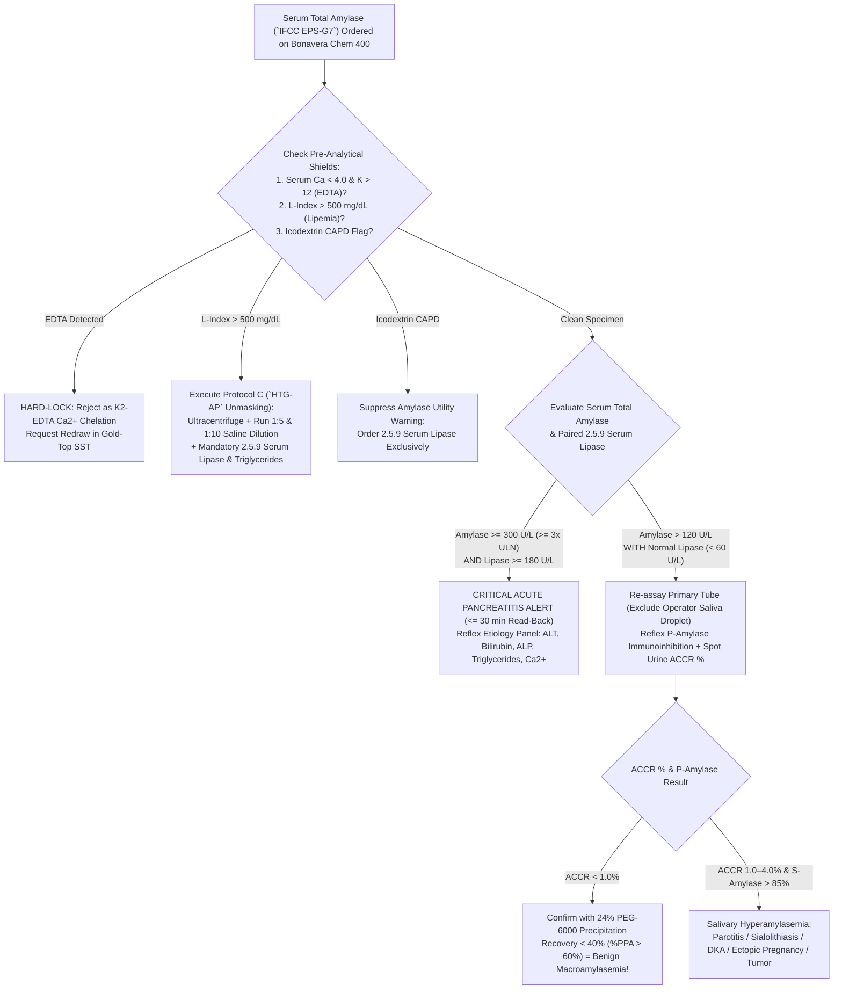

# 🧬 2.5.8 — Serum Total & Pancreatic Amylase (`IFCC 37°C EPS-G7`), Spot/24h Urine Amylase, Body Fluid Fistula Panel & Macroamylasemia (`ACCR %` + `PEG-6000`) Standard Operating Procedure

**Laboratory Name:** Sawariya Diagnostic Lab, Charkhi Dadri, Haryana, India  
**Department Folder:** `02_Clinical_Biochemistry`  
**Cluster Folder:** `2.5_Bone_Mineral_Pancreatic_and_Tissue_Enzymes_Cluster`  
**Document Control ID:** `SDL/BIO/SOP/2.5.8` (Supersedes `SOP-2-5-8` v2.0)  
**Version:** `4.0` (10-Persona International & Above-NABL Red-Team Audited Edition)  
**Effective Date:** `12-Oct-2026` • **Review Cycle:** Biennial (24 Months) or Upon Method/Reagent/Standard Update  
**Authorizing Authority:** Lab Director & Lead Consultant Pathologist / Clinical Biochemist, Sawariya Diagnostic Lab  
**Accreditation & Regulatory Compliance Tier:** `ISO 15189:2022` • `NABL 112 (Issue 05)` • `NABL 153` • `NABL 220D/223` • `IFCC 37°C Primary Reference Procedure (EPS-G7)` • `ERM-AD456/IFCC` (`ISO 17511:2020`) • `Revised Atlanta Classification (ACG/IAP)` • `ISGPS 2016 Pancreatic Fistula Criteria` • `CLSI EP06-Ed2 / EP07-Ed3 / EP15-A3 / EP17-A2 / EP28-A3c / C49-A` • `EFLM` • `ISO/TS 20914:2019` • `ISO 22367:2020` • `Indian CPA 2019 & DPDP Act 2023`

---

## 🏛️ Section 1: International Document Control, `ISO 15189:2022` / `NABL` Clause Mapping, `LOINC`/`SNOMED`/`ICD`/`UCUM` Coding & Hardware-Agnostic Platform Matrix

| Attribute | Specification & International Reference Standard |
| :--- | :--- |
| **Document Control ID & Version** | `SDL/BIO/SOP/2.5.8` — Version `4.0` (Controlled Master Copy — Sawariya Diagnostic Lab, Charkhi Dadri, Haryana) |
| **`ISO 15189:2022` Clause Mapping** | Clauses `5.3` (*Laboratory Director Responsibilities*), `6.2` (*Personnel Competence*), `6.4` (*Equipment & Calibration*), `6.5` (*Metrological Traceability*), `6.6` (*Reagents & Consumables*), `7.2` (*Pre-Examination Processes*), `7.3` (*Examination Processes, Method Verification, MU, IQC & EQAS*), `7.4` (*Post-Examination & Critical Value Reporting*), `8.5` (*Risk Management per `ISO 22367:2020`*), `8.7` (*Nonconformities & CAPA*) |
| **NABL Specific Criteria Mapping** | `NABL 112` (*Specific Criteria for Medical Laboratories*), `NABL 153` (*Recommended Scope of Accreditation*), `NABL 220D & 223` (*Assessment Checklists*), `NABL 131` (*Terms & Conditions*), `NABL 133` (*Policy on Use of NABL Symbol*), `NABL 163` (*PT/EQAS Participation Policy*) |
| **Primary `LOINC` Codes** | • `1798-8`: *Amylase [Enzymatic activity/volume] in Serum or Plasma*<br>• `1805-1`: *Amylase.pancreatic [Enzymatic activity/volume] in Serum or Plasma* (`P-Amylase` Immunoinhibition)<br>• `1804-4`: *Amylase.salivary [Enzymatic activity/volume] in Serum or Plasma* (`S-Amylase` Calculated)<br>• `1799-6`: *Amylase [Enzymatic activity/volume] in Urine* (Random/Spot)<br>• `1800-2`: *Amylase [Enzymatic activity/time] in 24 hour Urine*<br>• `34232-9`: *Amylase/Creatinine [Ratio] in Urine*<br>• `1802-8`: *Amylase clearance/Creatinine clearance [Ratio]* (`ACCR %`)<br>• `1795-4`: *Amylase [Enzymatic activity/volume] in Body fluid* (Surgical Drain / Cyst)<br>• `1796-2`: *Amylase [Enzymatic activity/volume] in Pleural fluid*<br>• `1794-7`: *Amylase [Enzymatic activity/volume] in Peritoneal/Ascitic fluid* |
| **`SNOMED-CT` Specimen & Concept** | Specimens: `119364003` (*Serum specimen*), `119361006` (*Plasma specimen*), `122575003` (*Urine specimen*), `418564007` (*Pleural fluid specimen*), `309171001` (*Ascitic fluid specimen*), `258455001` (*Drainage fluid sample*)<br>Concepts: `39586008` (*Amylase measurement*), `61686006` (*Pancreatic isoamylase measurement*), `75694003` (*Acute pancreatitis*), `235949009` (*Macroamylasemia*) |
| **`ICD-10` / `ICD-11` Indications** | • `K85.90` / `DC31`: *Acute pancreatitis, unspecified* (`K85.10` *Biliary*, `K85.20` *Alcohol-induced*, `K85.30` *Drug-induced*)<br>• `K86.1` / `DC32`: *Chronic pancreatitis & Exocrine Pancreatic Insufficiency (EPI)*<br>• `K86.3` / `DC33`: *Pseudocyst of pancreas* & `K86.89` *Postoperative pancreatic fistula (POPF)*<br>• `R74.8` / `MA14.1`: *Abnormal levels of other serum enzymes (Macroamylasemia)*<br>• `B26.9` / `1D80`: *Mumps parotitis* & `K11.20` *Sialoadenitis* / `K11.5` *Sialolithiasis*<br>• `K22.3` / `DA23`: *Perforation of esophagus (Boerhaave syndrome)* |
| **Conventional $\leftrightarrow$ SI (`UCUM`) Factor** | $\text{U/L} \times 0.01667 = \mu\text{kat/L}$ (Conversely: $\mu\text{kat/L} \times 60.0 = \text{U/L}$); $1\text{ U} = 1\text{ }\mu\text{mol/min}$ at $37.0^\circ\text{C}$ |
| **Enzyme Classification & Genetics** | $\alpha$-Amylase: `1,4-alpha-D-glucan glucanohydrolase` (**`EC 3.2.1.1`**), monomeric calcium-metalloenzyme ($\text{MW} = 55\text{–}60\text{ kDa}$; $496$ amino acids). Encoded on Chromosome `1p21.1` gene cluster: Salivary (`S-Type`, *AMY1A, AMY1B, AMY1C*) and Pancreatic (`P-Type`, *AMY2A, AMY2B*) |
| **Metrological Traceability (`ISO 17511:2020`)** | Directly traceable to the **IFCC Primary Reference Measurement Procedure for $\alpha$-Amylase at $37.0^\circ\text{C}$ (`EPS-G7` substrate, pH $7.15$)** and Certified Reference Material **`IRMM/IFCC-456` (`ERM-AD456/IFCC`)** (purified human pancreatic $\alpha$-amylase in human serum matrix) |
| **Primary Analyzer Platform** | **Bonavera Chem 400 Automated Clinical Chemistry Analyzer** (`IFCC 37°C EPS-G7` Continuous Bichromatic Kinetic Photometry at $\lambda_1 = 405\text{ nm}$ / $\lambda_2 = 700\text{ nm}$) |
| **Backup / Redundancy Platform** | **Bonavera Chem 200 Automated Clinical Chemistry Analyzer** (Identical `IFCC EPS-G7` Reagent Chemistry; weekly split-sample comparability verified per `CLSI EP31-A`) |
| **Future Platform Upgrade Slot** | Modular High-Throughput Total Laboratory Automation (TLA) Photometric Module *(Update only Analyzer Matrix & `CLSI EP15-A3 / EP06-Ed2` verification records)* |

---

## 🧪 Section 2: Pre-Analytical Phlebotomy, `CLSI GP41` Order-of-Draw, Obligate $\text{Ca}^{2+}/\text{Cl}^-$ Metalloenzyme Shield, Operator Saliva Contamination Shield & `HIL` Rejection Matrix

### 2.1 Pre-Analytical Specimen Collection & Physiological Control Matrix

| Pre-Analytical Parameter | Mandatory Technical & Physiological Protocol (`CLSI GP41-Ed7` / `CLSI GP44-A4` / `CLSI C49-A` / `CLSI C56-A`) |
| :--- | :--- |
| **Acceptable Specimen Matrices** | 1. **Serum (Preferred):** Gold-Top SST (Serum Separator Tube with clot activator & gel) or Plain Red-Top tube.<br>2. **Heparinized Plasma:** Green-Top Lithium Heparin or Sodium Heparin tube (`CLSI GP41` Order-of-Draw: Blood Culture $\rightarrow$ Citrate $\rightarrow$ SST/Red $\rightarrow$ Heparin $\rightarrow$ EDTA $\rightarrow$ Fluoride).<br>3. **Random (Spot) or 24-Hour Timed Urine:** Collected in clean, additive-free polycarbonate container. Adjust/maintain urine $\text{pH} > 7.0$ during storage using $1\text{ mol/L NaOH}$ or $\text{NaHCO}_3$ if acidic ($\alpha$-amylase is rapidly denatured at $\text{pH} < 5.5$!).<br>4. **Body & Surgical Drain Fluids (`CLSI C49-A`):** Pleural fluid, Ascitic/Peritoneal fluid, Pancreatic pseudocyst aspirate, or Jackson-Pratt (`JP`) / Blake post-pancreatectomy surgical drain fluid collected in sterile additive-free or Lithium Heparin tube. |
| **MANDATORY ANTICOAGULANT REJECTION SHIELD ($\text{Ca}^{2+}$ Chelation Trap)** | **STRICTLY REJECT `K2-EDTA` / `K3-EDTA` (Lavender), Sodium Citrate (Blue), Sodium Fluoride/Potassium Oxalate (Grey), and `ACD` Tubes!**<br>• **Biochemical Mechanism:** Human $\alpha$-amylase (`EC 3.2.1.1`) is an obligate **calcium-dependent metalloenzyme** containing one tightly bound structural $\text{Ca}^{2+}$ ion per molecule ($K_d \approx 10^{-11}\text{ M}$) that bridges Domains A and B to maintain the active-site cleft architecture. Chelating agents ($\text{EDTA}$, citrate, oxalate) strip this structural $\text{Ca}^{2+}$ ion, causing **immediate, irreversible conformational collapse and $30\text{–}90\%$ false loss of enzymatic activity**!<br>• **LIMS Hard-Lock:** Any specimen exhibiting spuriously low Serum Calcium ($< 4.0\text{ mg/dL}$) and high Potassium ($> 12.0\text{ mmol/L}$) is automatically flagged as `EDTA Cross-Contamination` and hard-locked against Amylase reporting. |
| **MANDATORY OPERATOR SALIVA & SWEAT DROPLET CONTAMINATION SHIELD** | **Human saliva contains Salivary Isoamylase (`S-Amylase`, `AMY1`) at $100,000\text{ to }500,000\text{ U/L}$ ($> 1,000\text{ to }5,000\times$ normal serum activity!), and eccrine sweat contains $500\text{–}3,000\text{ U/L}$.**<br>• **Hazard:** Unmasked talking, coughing, sneezing, or mouth-pipetting near uncapped Hitachi sample cups, primary serum tubes, or pipette tips introduces microscopic aerosolized salivary droplets ($0.05\text{–}0.2\text{ }\mu\text{L}$) that cause **bizarre, non-reproducible pseudohyperamylasemia ($450\text{–}2,500\text{ U/L}$)** with a **completely normal Serum Lipase (`2.5.9`) and normal `P-Amylase`**!<br>• **Mandatory Bench PPE & Handling Rules:**<br>  1. Bench staff MUST wear surgical masks or work behind an acrylic splash shield and wear powder-free nitrile gloves (bare fingers transfer eccrine sweat `S-Amylase` to tube rims/pipette tips).<br>  2. Keep sample cups and primary SST tubes capped until immediately before loading onto the `Bonavera Chem 400` sample rotor.<br>  3. Every isolated Serum Total Amylase $> 100\text{ U/L}$ with normal Serum Lipase (`< 60 U/L`) must be re-assayed from the original primary SST tube (never from a poured-off secondary aliquot cup) and fractionated via `P-Amylase` immunoinhibition. |
| **Minimum Sample Volume** | • **Primary Tube:** $3.0\text{ mL}$ whole blood (yields $\sim 1.2\text{ mL}$ serum).<br>• **Analyzer Dead Volume + Reaction Volume:** $150\text{ }\mu\text{L}$ dead volume in pediatric micro-cup + $4.0\text{ }\mu\text{L}$ aspirated per test (Minimum $0.3\text{ mL}$ separated serum; $1.0\text{ mL}$ urine or body fluid). |
| **Patient Preparation & Timing** | • **Fasting:** Not strictly required for emergency acute abdominal pain workup; however, a $8\text{–}12\text{ hour}$ fast is preferred for elective testing to minimize postprandial chylomicronemia (`L-Index` turbidity).<br>• **Pre-Sample Medication & Dialysis Audit:** Record opioid analgesics (morphine/codeine/fentanyl administered in ER within $4\text{ hours}$ cause Sphincter of Oddi spasm and transient $2\text{–}5\times\text{ULN}$ rise!), recent `ERCP` within $24\text{ hours}$, and **`Icodextrin` (`Extraneal`) peritoneal dialysis solution** (causes $70\text{–}90\%$ false suppression of `EPS-G7` Amylase!).<br>• **Paired `ACCR %` Collection:** When evaluating for Macroamylasemia, collect a **simultaneous blood draw (Serum Amylase + Serum Creatinine) and random spot urine (Urine Amylase + Urine Creatinine)** within $\le 1\text{ hour}$ of each other. |
| **Centrifugation & Body Fluid Clarification** | • **Serum / Plasma:** Clot upright for $20\text{–}30\text{ min}$ at $18\text{–}25^\circ\text{C}$. Centrifuge at **$1,500\text{–}2,000 \times g$ for $10\text{ minutes}$**. Separate serum from cells within $< 2\text{ hours}$.<br>• **Urine & Drain/Pleural/Ascitic Fluid (`CLSI C49-A`):** Centrifuge all urine and body fluid specimens at **$2,000 \times g$ for $10\text{ minutes}$** prior to analysis to pellet cellular debris, fibrin clots, mucin strands, and necrotic tissue that could clog the `Bonavera Chem 400` sample probe or scatter light at $405\text{ nm}$. For highly viscous mucinous pseudocyst fluid, freeze-thaw once at $-20^\circ\text{C}$ and re-centrifuge at $3,000 \times g$ for $15\text{ min}$ before aspirating supernatant. |
| **Multi-Temperature Specimen Stability** | $\alpha$-Amylase is exceptionally stable in separated serum/heparin plasma (devoid of bacterial contamination):<br>• **Room Temperature ($18\text{–}25^\circ\text{C}$):** **$7\text{ days}$** (Serum/Plasma); **$2\text{ days}$** (Urine at $\text{pH} > 7.0$).<br>• **Refrigerated ($2\text{–}8^\circ\text{C}$):** **$30\text{ days}$** (Serum/Plasma); **$10\text{ days}$** (Urine at $\text{pH} > 7.0$); **$7\text{ days}$** (Body/Drain Fluid).<br>• **Frozen ($-20^\circ\text{C}$ or $-80^\circ\text{C}$):** **$1\text{ year}$** (Serum/Plasma; maximum $1$ freeze-thaw cycle). *Note: Do NOT freeze urine or samples suspected of Macroamylasemia prior to `PEG-6000` precipitation, as cryoprecipitation can alter immunoglobulin-enzyme complex recovery.* |

### 2.2 Quantitative `HIL` Spectral Interference & Lipemic Pancreatitis Mitigation Matrix (`CLSI EP07-Ed3` / `EP37`)

Because the `IFCC EPS-G7` assay measures the rate of liberation of yellow $p$-nitrophenol (`pNP`) at **$\lambda_1 = 405\text{ nm}$** (with bichromatic blanking at $\lambda_2 = 700\text{ nm}$), spectral overlap with oxyhemoglobin Soret band ($415\text{ nm}$), bilirubin ($450\text{ nm}$), and chylomicron/VLDL Rayleigh-Mie light scattering ($340\text{–}700\text{ nm}$) must be strictly controlled:

| Index | Interferent | Unbiased Threshold ($\text{Bias} < \pm 5\%$) | Conditional Action Zone | Absolute Rejection / Mandatory Protocol |
| :---: | :--- | :---: | :---: | :--- |
| **`H-Index`** | Free Hemoglobin (Hemolysis) | **$\le 250\text{ mg/dL}$** ($\le 2.5\text{ g/L}$) | **$251\text{–}499\text{ mg/dL}$**<br>*(Intracellular RBC organic phosphates & spectral overlap at $405\text{ nm}$ cause negative/variable bias)* | **$\ge 500\text{ mg/dL}$ ($\ge 5.0\text{ g/L}$): REJECT** specimen and request fresh redraw. |
| **`I-Index`** | Unconjugated / Conjugated Bilirubin (Icterus) | **$\le 25.0\text{ mg/dL}$** ($\le 428\text{ }\mu\text{mol/L}$) | **$25.1\text{–}40.0\text{ mg/dL}$**<br>*(Perform $1:5$ dilution with $0.9\%\text{ NaCl}$ to reduce baseline $405\text{ nm}$ absorbance below $1.500\text{ Abs}$)* | **$> 40.0\text{ mg/dL}$ ($> 684\text{ }\mu\text{mol/L}$):** Dilute $1:10$ with $0.9\%\text{ NaCl}$ and co-report `2.5.9` Serum Lipase. |
| **`L-Index`** | Lipemia / Triglycerides (`Intralipid` / Chylomicrons) | **$\le 500\text{ mg/dL}$** ($\text{TG} \le 750\text{ mg/dL}$) | **$501\text{–}1,000\text{ mg/dL}$**<br>*(Mandatory `1:5` & `1:10` dilution with $0.9\%\text{ NaCl}$ + `2.5.9` Serum Lipase)* | **$> 1,000\text{ mg/dL}$ or lactescent ("milky") serum:** **DO NOT REJECT!** Execute **Mandatory Hypertriglyceridemic Acute Pancreatitis (`HTG-AP`) Unmasking Protocol** (Section 3.4.3): Ultracentrifuge ($10,000 \times g$, $15\text{ min}$) OR dilute infranatant $1:5$ and $1:10$ with $0.9\%\text{ NaCl}$ to dissociate the circulating amylase inhibitor! |

---

## ⚙️ Section 3: Analytical Principle (`IFCC 37°C EPS-G7`), Stoichiometry, Traceability (`ERM-AD456/IFCC`), `Bonavera Chem 400` SOP, Special Bench Protocols (`ACCR %`, `PEG-6000`, `HTG-AP` Dilution, Body Fluids) & Verification

### 3.1 International Method Principle & Chemical Stoichiometry (`IFCC 37°C EPS-G7`)

1. **Why 4,6-Ethylidene Terminal Blocking (`EPS-G7`) is Essential (`IFCC` Reference Standard):**
   - Historical amyloclastic (iodometric starch), saccharogenic (Somogyi), and first-generation unblocked $p$-nitrophenyl-maltoheptaoside (`pNP-G7`) methods suffered from severe batch-to-batch variation and high reagent blank drift because trace exo-enzymes (or auxiliary $\alpha$-glucosidase in the reagent) slowly hydrolyzed glucose units from the non-reducing terminal end of unblocked `pNP-G7` even in the absence of patient $\alpha$-amylase.
   - In the **IFCC Primary Reference Measurement Procedure at $37.0^\circ\text{C}$** (*Schumann G et al., Clin Chem Lab Med 2006;44(9):1146–1153*), the terminal glucose residue at the non-reducing end of maltoheptaoside is covalently capped with a **4,6-ethylidene cyclic acetal blocking group (`4,6-Ethylidene-`$G_7$`-pNP` or `EPS-G7`)**. This cyclic acetal block renders the intact substrate **$100\%$ resistant to cleavage by auxiliary $\alpha$-glucosidase (`EC 3.2.1.20`)**, guaranteeing near-zero reagent blank drift ($\Delta A_{405\text{ nm}}/\text{min} < 0.0015$).
2. **Exact Two-Step Coupled Enzymatic Reaction Stoichiometry (`EPS-G7`):**
   - **Step 1 — Endo-Hydrolytic Cleavage by Patient $\alpha$-Amylase (`EC 3.2.1.1`):**
     Patient $\alpha$-amylase (activated by obligate structural $\text{Ca}^{2+}$ and allosteric $\text{Cl}^-$ ions) catalyzes the endohydrolysis of internal $\alpha\text{-1,4-glucosidic}$ bonds of `4,6-Ethylidene-`$\alpha\text{-D-maltoheptaoside-p-nitrophenolate}$ (`Ethylidene-G7-pNP`) in fixed stoichiometric proportions ($40\%$ yielding `G2-pNP`, $40\%$ yielding `G3-pNP`, and $20\%$ yielding `G4-pNP`):
     $$5\text{ Ethylidene-G}_7\text{-pNP} + 5\text{H}_2\text{O} \xrightarrow[\text{Ca}^{2+}\text{ (1 mmol/L), Cl}^-\text{ (50 mmol/L), pH 7.15, } 37.0^\circ\text{C}]{\alpha\text{-Amylase (EC 3.2.1.1)}} 2\text{ Ethylidene-G}_5 + 2\text{G}_2\text{-pNP} + 2\text{ Ethylidene-G}_4 + 2\text{G}_3\text{-pNP} + \text{Ethylidene-G}_3 + \text{G}_4\text{-pNP}$$
   - **Step 2 — Rapid Indicator Cleavage by Excess Microbial $\alpha$-Glucosidase (`EC 3.2.1.20`):**
     Thermostable recombinant $\alpha$-glucosidase ($\ge 10\text{ kU/L}$) present in excess immediately hydrolyzes $100\%$ of the unblocked short-chain fragments (`G2-pNP` [maltoside] and `G3-pNP` [maltotrioside], representing $80\%$ of total cleavage products; `G4-pNP` is not cleaved during the short kinetic window) to liberate free glucose and the yellow chromophore **$p$-nitrophenol (`pNP` / $p$-nitrophenoxide anion)**:
     $$2\text{G}_2\text{-pNP} + 2\text{G}_3\text{-pNP} + 10\text{H}_2\text{O} \xrightarrow[\text{pH 7.15, } 37.0^\circ\text{C}]{\alpha\text{-Glucosidase (EC 3.2.1.20, }\ge 10\text{ kU/L)}} 4\text{ }\mathbf{p\text{\textbf{-Nitrophenol (Yellow Chromophore, }}\lambda_{\max} = 405\text{ nm}\text{\textbf{)}}} + 10\text{ D-Glucose}$$
   - **Spectrophotometric Rate Law:**
     The rate of increase in absorbance at **$\lambda_1 = 405\text{ nm}$** (corrected at bichromatic reference wavelength **$\lambda_2 = 700\text{ nm}$** for cuvette scratches and matrix turbidity) after a $120\text{-second}$ lag phase is directly proportional to $\alpha$-amylase catalytic activity concentration in the sample. At $\text{pH } 7.15$ and $37.0^\circ\text{C}$, the apparent molar absorption coefficient of $p$-nitrophenol is **$\varepsilon_{405\text{ nm}} = 10,250\text{ L}\cdot\text{mol}^{-1}\cdot\text{cm}^{-1}$** ($1,025\text{ m}^2\cdot\text{mol}^{-1}$), and the stoichiometric liberation factor is $0.80\text{ mol pNP per mol Ethylidene-G}_7\text{-pNP cleaved}$.
3. **Pancreatic Isoamylase (`P-Amylase`) Synergistic Monoclonal Immunoinhibition Principle:**
   - When specific `P-Amylase` (`LOINC 1805-1`) is assayed, Reagent `R1` contains two synergistic mouse monoclonal antibodies (**`mAb 88E8` and `mAb 66C7`**) directed against conformational epitopes unique to human **Salivary $\alpha$-Amylase (`S-Type`, `AMY1`)**. During the $5\text{-minute}$ `R1` pre-incubation at $37.0^\circ\text{C}$, $> 98.5\%$ of `S-Amylase` catalytic activity is sterically inhibited while `P-Amylase` (`AMY2A/2B`) remains $100\%$ uninhibited and is subsequently measured upon addition of `R2` (`Ethylidene-G7-pNP`).
   - **Calculated Salivary Isoamylase (`S-Amylase`):** $\text{S-Amylase (U/L)} = \text{Total Amylase (U/L)} - \text{P-Amylase (U/L)}$.
4. **Comparison with Alternative Single-Step `CNPG3` Method (2-Chloro-4-Nitrophenyl-$\alpha$-D-Maltotrioside):**
   - Some rapid STAT or dry-slide analyzers utilize **`CNPG3`** (`2-chloro-4-nitrophenyl-`$\alpha\text{-D-maltotrioside}$), where $\alpha$-amylase directly cleaves the aglycone bond to release `2-chloro-4-nitrophenol` (`CNP`, $\lambda = 405\text{ nm}$) in a single step without auxiliary $\alpha$-glucosidase ($\text{CNPG}_3 + \text{H}_2\text{O} \xrightarrow{\alpha\text{-Amylase}} \text{CNP} + \text{Maltotriose}$).
   - **Metrological & Clinical Distinction:** While `CNPG3` eliminates the $120\text{-second}$ $\alpha$-glucosidase lag phase, native `CNPG3` reacts disproportionately faster with salivary `S-Amylase` than pancreatic `P-Amylase` unless harmonized via `ERM-AD456/IFCC` calibration. Sawariya Diagnostic Lab standardizes both `Bonavera Chem 400` and `Bonavera Chem 200` exclusively on the **IFCC Reference `EPS-G7` chemistry** to guarantee $1:1$ equimolar reactivity toward `P-Amylase` and `S-Amylase` and complete traceability to `IRMM/IFCC-456`.

### 3.2 Exact Reagent Composition & On-Board Stability (`IFCC EPS-G7`)

| Reagent Component | Chemical Constituent & Concentration in Final Reaction Mixture | Biochemical Function |
| :--- | :--- | :--- |
| **Reagent 1 (`R1` — Enzyme/Cofactor Buffer, $\text{pH } 7.15 \pm 0.05$ at $37^\circ\text{C}$)** | • **HEPES** (`N-2-hydroxyethylpiperazine-N'-2-ethanesulfonic acid`): $50.0\text{ mmol/L}$<br>• **Sodium Chloride ($\text{NaCl}$):** $50.0\text{ mmol/L}$ ($\text{Cl}^-$ concentration $= 52.0\text{ mmol/L}$)<br>• **Calcium Chloride ($\text{CaCl}_2$) / Magnesium Chloride:** $1.0\text{ mmol/L }\text{Ca}^{2+}$ / $10.0\text{ mmol/L }\text{Mg}^{2+}$<br>• **Microbial $\alpha$-Glucosidase (`EC 3.2.1.20`):** $\ge 10.0\text{ kU/L}$ ($\ge 167\text{ }\mu\text{kat/L}$)<br>• **Sodium Azide ($\text{NaN}_3$):** $0.095\%$ ($14.6\text{ mmol/L}$)<br>• *(For `P-Amylase` kit only)* **Monoclonal Anti-Human `S-Amylase` (`88E8`/`66C7`):** $> 30\text{ mg/L}$ | • Maintains optimal $\text{pH } 7.15$ where `pNP` ($pK_a \approx 7.15$ at $37^\circ\text{C}$) is $50\%$ ionized.<br>• **Allosteric $\text{Cl}^-$ activator:** Shifts $\alpha$-amylase pH optimum and increases $k_{cat}$ $30\text{-fold}$!<br>• **Structural $\text{Ca}^{2+}$ stabilizer:** Preserves domain integrity.<br>• Rapidly cleaves `G2-pNP` & `G3-pNP` indicators.<br>• Antimicrobial preservative. |
| **Reagent 2 (`R2` — Starter Substrate, $\text{pH } 6.00$)** | • **HEPES Buffer:** $50.0\text{ mmol/L}$<br>• **4,6-Ethylidene-($\text{G}_7$)-1,4-nitrophenyl-$\alpha$-D-maltoheptaoside (`EPS-G7`):** $5.0\text{ mmol/L}$<br>• **Preservatives & Stabilizers:** Non-reactive surfactants + $0.095\%\text{ NaN}_3$ | • Provides saturating substrate concentration ($> 10 \times K_m$, where $K_m \approx 0.35\text{ mmol/L}$) to maintain zero-order kinetics across the entire `AMR` ($3\text{–}1,500\text{ U/L}$). |
| **Storage & Stability** | • **Unopened at $2\text{–}8^\circ\text{C}$:** Stable until manufacturer expiry date (protect from light; reject if Reagent Blank Absorbance at $405\text{ nm} > 0.400\text{ Abs}$).<br>• **On-Board Refrigerated Carousel ($8\text{–}12^\circ\text{C}$) on `Bonavera Chem 400`:** **$60\text{ days}$** (Calibrate every $28\text{ days}$ or upon lot change). | Prevents spontaneous non-enzymatic hydrolysis of `EPS-G7` into free yellow $p$-nitrophenol. |

### 3.3 `ISO 17511:2020` Metrological Traceability Chain & `Bonavera Chem 400` Assay Parameters

1. **Unbroken `ISO 17511:2020` Calibration Hierarchy:**
   $$\text{SI Unit }(\mu\text{kat/L or U/L at } 37.0^\circ\text{C}) \xleftarrow{\text{IFCC Primary Reference Procedure (`EPS-G7`, } u_{ref} = 0.8\%)} \textbf{IRMM/IFCC-456 (`ERM-AD456/IFCC`) Primary CRM } (8.94 \pm 0.21\text{ }\mu\text{kat/L } [536 \pm 13\text{ U/L}]) \xleftarrow{} \text{Manufacturer Master Calibrator} \xleftarrow{} \text{Multi-Constituent Serum Calibrator (`TruCal U`)} \xleftarrow{} \textbf{Bonavera Chem 400 Routine Result}$$
2. **`Bonavera Chem 400` Programmed Technical Parameters:**
   - **Reaction Mode:** Two-Reagent Continuous Kinetic Rate-A (Increasing Absorbance) at $37.0 \pm 0.1^\circ\text{C}$.
   - **Wavelengths:** Primary $\lambda_1 = \mathbf{405\text{ nm}}$; Secondary (Bichromatic Blank) $\lambda_2 = \mathbf{700\text{ nm}}$; Optical Pathlength $l = 1.00\text{ cm}$ ($10.0\text{ mm}$ quartz cuvette).
   - **Pipetting Volumes:** Sample Volume $V_S = \mathbf{4.0\text{ }\mu\text{L}}$; Reagent 1 Volume $V_{R1} = \mathbf{160.0\text{ }\mu\text{L}}$ (mix & incubate $300\text{ sec}$); Reagent 2 Volume $V_{R2} = \mathbf{40.0\text{ }\mu\text{L}}$ (Total Reaction Volume $V_T = 204.0\text{ }\mu\text{L}$; Sample-to-Reagent Ratio $= 1:51$).
   - **Kinetic Timing Window:** After `R2` addition and mixing, wait **$120\text{ seconds}$ (Lag Phase)** for auxiliary $\alpha$-glucosidase steady-state equilibrium, then record bichromatic absorbance every $18\text{ seconds}$ over a **$180\text{-second}$ Linear Kinetic Reading Window** ($t = 120\text{ sec}$ to $t = 300\text{ sec}$ post-`R2`).
   - **Theoretical K-Factor Verification Formula:**
     $$\text{Theoretical } K\text{-Factor} = \frac{V_T \times 10^6}{\varepsilon_{405\text{ nm}} \times l \times V_S \times 0.80} = \frac{204.0 \times 10^6}{10,250 \times 1.00 \times 4.0 \times 0.80} = \mathbf{6,219.5} \quad (\text{Acceptable Calibrated } K\text{-Factor Range: } \mathbf{5,900\text{ – }6,550})$$
     $$\text{Amylase Activity (U/L)} = \left(\frac{\Delta A_{405/700\text{ nm}}}{\text{min}_{\text{Sample}}} - \frac{\Delta A_{405/700\text{ nm}}}{\text{min}_{\text{Reagent Blank}}}\right) \times K_{\text{Calibrated}}$$
   - **Carryover & Substrate Depletion Safeguards:**
     - **Probe Wash:** Alkaline detergent (`0.1 mol/L NaOH` + non-ionic surfactant) + deionized water wash between every aspiration prevents sample-to-sample and reagent carryover ($< 0.05\%$).
     - **Substrate Depletion Limit (`KIN-LIN` Flag):** If $\Delta A_{405/700\text{ nm}}/\text{min} > \mathbf{0.350\text{ Abs/min}}$ (corresponding to $\sim 1,500\text{ U/L}$) or if linearity regression $r^2 < 0.995$ due to rapid substrate exhaustion in fulminant pancreatitis ($> 5,000\text{ U/L}$), the `Bonavera Chem 400` automatically triggers a **$1:10$ auto-rerun** ($4.0\text{ }\mu\text{L}$ sample diluted $1:10$ in $0.9\%\text{ NaCl}$ on-board) extending the `CRR` to $15,000\text{ U/L}$.

### 3.4 Mandatory Bench Protocols for Complex Clinical Scenarios (`ACCR %`, `24% PEG-6000`, `HTG-AP` Dilution & Body Fluids)

#### 3.4.1 Protocol A: Amylase-to-Creatinine Clearance Ratio (`ACCR %`) for Macroamylasemia vs Acute Pancreatitis
When a patient presents with persistent hyperamylasemia ($> 120\text{ U/L}$), normal Serum Lipase (`< 60 U/L`), and no acute abdominal symptoms, perform the simultaneous 4-parameter **Amylase-to-Creatinine Clearance Ratio (`ACCR %`)** using paired Serum and Random Spot Urine:
1. Measure **Serum Amylase ($\text{U/L}$)** and **Urine Amylase ($\text{U/L}$)** on `Bonavera Chem 400` (`IFCC EPS-G7`).
2. Measure **Serum Creatinine ($\text{mg/dL}$)** and **Urine Creatinine ($\text{mg/dL}$)** on `Bonavera Chem 400` (`Enzymatic Creatinine`, traceable to `IDMS`). *(Note: Because the time interval $t$ and urine flow rate $V$ cancel out mathematically in the clearance ratio $\frac{U_{\text{Amy}} \cdot V / S_{\text{Amy}}}{U_{\text{Cr}} \cdot V / S_{\text{Cr}}}$, a 24-hour urine collection is NOT required; a random paired spot urine is $100\%$ valid!)*
3. **Calculate `ACCR (%)`:**
   $$\text{ACCR (\%)} = \left(\frac{\text{Urine Amylase (U/L)} \times \text{Serum Creatinine (mg/dL)}}{\text{Serum Amylase (U/L)} \times \text{Urine Creatinine (mg/dL)}}\right) \times 100$$
4. **Diagnostic Interpretation Cutoffs:**
   - **Normal Reference Range:** **$1.0\%\text{ – }4.0\%$**
   - **Macroamylasemia Diagnostic Cutoff:** **`ACCR < 1.0%`** (Classical `IgA`/`IgG`-complexed Macroamylasemia typically yields **`ACCR = 0.05% – 0.50%`** because the $> 200\text{ kDa}$ macromolecule cannot traverse the glomerular filtration barrier!).
   - **Acute Pancreatitis / Proximal Renal Tubular Dysfunction / DKA / Severe Burns:** **`ACCR > 4.0% – 5.0%`** (Often $5.0\%\text{–}12.0\%$ in acute pancreatitis due to saturation/inhibition of proximal convoluted tubule megalin/cubilin low-molecular-weight protein reabsorption!).

#### 3.4.2 Protocol B: Confirmatory `24% PEG-6000` Precipitation Assay for Macroamylasemia
Because `ACCR %` can be difficult to interpret if the patient has concurrent severe chronic kidney disease ($\text{eGFR} < 15\text{ mL/min/1.73 m}^2$) or multiple myeloma tubular proteinuria, confirm all suspected Macroamylasemia cases ($\text{ACCR} < 1.0\%$) via **Polyethylene Glycol $6000$ (`PEG-6000`) Immunoglobulin Complex Precipitation** (*Levitt & Ellis / Wybenga Modification*):
1. **Reagent Preparation:** Prepare **`24% (w/v) PEG-6000` Solution** by dissolving $24.0\text{ g}$ of analytical-grade Polyethylene Glycol $6000$ ($\text{MW } 5,000\text{–}7,000\text{ Da}$) in $60\text{ mL}$ of $0.9\%\text{ NaCl}$ ($154\text{ mmol/L}$) buffered with $10\text{ mmol/L}$ phosphate ($\text{pH } 7.20$), and bring to $100.0\text{ mL}$ final volume. Store at $2\text{–}8^\circ\text{C}$ (stable $3\text{ months}$).
2. **Step-by-Step Bench Procedure:**
   - Label two $12 \times 75\text{ mm}$ borosilicate or polypropylene tubes: **`Tube T (PEG Test)`** and **`Tube C (Saline Control)`**.
   - Pipette **$200.0\text{ }\mu\text{L}$ of patient serum** into **`Tube T`** and **$200.0\text{ }\mu\text{L}$ of patient serum** into **`Tube C`**. *(Include a known Normal Serum Control alongside patient tubes).*
   - Add **$200.0\text{ }\mu\text{L}$ of `24% PEG-6000`** to **`Tube T`** (final PEG concentration $= 12\%\text{ w/v}$, $1:2$ dilution).
   - Add **$200.0\text{ }\mu\text{L}$ of $0.9\%\text{ NaCl}$** to **`Tube C`** ($1:2$ dilution control).
   - Vortex both tubes thoroughly for $10\text{ seconds}$ and incubate in a $37.0^\circ\text{C}$ water bath (or dry block) for **$10\text{ minutes}$**.
   - Centrifuge both tubes at **$3,000 \times g$ for $10\text{ minutes}$** at room temperature to pellet precipitated immunoglobulin-bound macro-complexes.
   - Carefully aspirate $150\text{ }\mu\text{L}$ of clear supernatant from **`Tube T`** and **`Tube C`** without disturbing the pellet, and measure Amylase activity ($\text{U/L}$) on the `Bonavera Chem 400`.
3. **Calculations (`PEG Recovery %` and `% PEG Precipitable Activity [%PPA]`):**
   $$\text{PEG Recovery (\%)} = \left(\frac{\text{Amylase}_{\text{Tube T Supernatant (U/L)}}}{\text{Amylase}_{\text{Tube C Supernatant (U/L)}}}\right) \times 100 \qquad ; \qquad \text{\% PEG Precipitable Activity (\%PPA)} = 100\% - \text{PEG Recovery (\%)}$$
4. **Validated Diagnostic Cutoffs:**
   - **Normal Monomeric Amylase ($55\text{ kDa}$):** **`PEG Recovery >= 48%`** (typically $52\%\text{–}85\%$; **`%PPA <= 52%`**).
   - **Grey Zone / Equivocal:** **`PEG Recovery 40% – 47%`** (`%PPA 53% – 60%`).
   - **Definitive Macroamylasemia (`IgA`/`IgG`-Amylase Complex):** **`PEG Recovery < 40%`** (stringent cutoff **`< 27%`**; **`%PPA > 60% – 73%`**). Report both the baseline Total Amylase, the post-PEG monomeric Amylase (`Tube T Supernatant × 2`), and `%PPA`.

#### 3.4.3 Protocol C: Unmasking Falsely Normal Amylase in Hypertriglyceridemic Acute Pancreatitis (`HTG-AP`)
In **Hypertriglyceridemic Acute Pancreatitis (`HTG-AP`, Serum Triglycerides $> 1,000\text{ mg/dL}$)**, up to **$50\%$ of patients exhibit a deceptively NORMAL or even LOW undiluted Serum Amylase ($35\text{–}95\text{ U/L}$)** despite florid pancreatic necrosis! Two mechanisms cause this dangerous false-negative trap:
1. **Circulating Reversible Non-Lipid Amylase Inhibitor:** Hypertriglyceridemic plasma contains a heat-labile, non-lipid circulating factor that non-covalently inhibits $\alpha$-amylase in undiluted serum (and is also excreted into urine).
2. **Optical Chylomicron Turbidity:** High baseline absorbance at $405\text{ nm}$ ($> 2.0\text{ Abs}$) masks the kinetic $\Delta A/\text{min}$ signal.
- **Mandatory Bench Unmasking Procedure:**
  1. Whenever a sample is visibly lactescent/turbid (`L-Index > 500 mg/dL` or `TG > 500 mg/dL`) or has `Serum Lipase >= 180 U/L` with an unexpectedly normal `Serum Amylase <= 100 U/L`, **NEVER report the undiluted Amylase result!**
  2. Prepare serial **$1:5$ ($50\text{ }\mu\text{L}$ serum $+ 200\text{ }\mu\text{L}\text{ }0.9\%\text{ NaCl}$)** and **$1:10$ ($30\text{ }\mu\text{L}$ serum $+ 270\text{ }\mu\text{L}\text{ }0.9\%\text{ NaCl}$)** dilutions (or centrifuge at $10,000 \times g$ for $15\text{ min}$ in a micro-ultracentrifuge tube and dilute the infranatant $1:5$ and $1:10$).
  3. **Diagnostic Unmasking:** Dilution dissociates the reversible amylase-inhibitor complex (mass-action effect) and eliminates turbidity, causing the corrected Amylase ($\text{Diluted Result} \times \text{Dilution Factor}$) to **jump $5\text{- to }15\text{-fold}$ (e.g., from $84\text{ U/L}$ undiluted to $940\text{ U/L}$ at $1:10$ dilution)**! Report the highest linear diluted result and always co-report **`2.5.9` Serum Lipase**.

#### 3.4.4 Protocol D: Surgical Drain, Pleural & Ascitic Fluid Amylase Verification (`CLSI C49-A`)
1. Verify fluid clarity after centrifugation ($2,000 \times g$, $10\text{ min}$).
2. Because pancreatic fistula drain fluids and pancreaticopleural effusions frequently contain **massive $\alpha$-amylase activities ($1,500\text{ to }> 100,000\text{ U/L}$)** that exhaust `EPS-G7` substrate within the first $30\text{ seconds}$ of `R1+R2` mixing (producing a flat kinetic curve and a falsely low "prozone-like" substrate-depletion reading if the `KIN-LIN` flag is missed), **always run surgical pancreatic drain (`JP` drain) and pseudocyst fluids both UNDILUTED and at a pre-emptive `1:20` dilution in $0.9\%\text{ NaCl}$**!
3. Calculate the **`Fluid-to-Serum Amylase Ratio`** against a paired Serum Amylase drawn on the same day:
   $$\text{Fluid-to-Serum Amylase Ratio} = \frac{\text{Fluid Amylase (U/L)}}{\text{Serum Amylase (U/L)}}$$

### 3.5 `CLSI` Analytical Performance Specifications & Method Verification Summary (`Bonavera Chem 400`)

| Metrological Parameter | `CLSI` Guideline | Verified Performance on `Bonavera Chem 400` (`IFCC EPS-G7`) | Acceptance Criteria |
| :--- | :---: | :--- | :--- |
| **Limit of Blank (`LoB`), `LoD`, `LoQ`** | `CLSI EP17-A2` | • **`LoB`:** $1.2\text{ U/L}$ ($0.02\text{ }\mu\text{kat/L}$)<br>• **`LoD`:** $2.4\text{ U/L}$ ($0.04\text{ }\mu\text{kat/L}$)<br>• **Functional `LoQ` ($\text{CV} \le 10\%$):** **$3.0\text{ U/L}$** ($0.05\text{ }\mu\text{kat/L}$) | $\text{LoQ} \le 5.0\text{ U/L}$ (enables detection of severe neonatal/exocrine insufficiency $< 8\text{ U/L}$) |
| **Analytical Measurement Range (`AMR`) & `CRR`** | `CLSI EP06-Ed2` | • **Undiluted Linear `AMR`:** **$3.0\text{ – }1,500.0\text{ U/L}$** ($y = 1.002x - 0.4$, $r^2 = 0.9997$, polynomial non-linearity $< 1.8\%$)<br>• **Auto-Dilution ($1:10$ in $0.9\%\text{ NaCl}$):** **$3.0\text{ – }15,000\text{ U/L}$**<br>• **Manual Fluid Dilution ($1:50$):** Up to **$75,000\text{ U/L}$** | Deviation from linearity $\le \pm 5.0\%$ across `AMR`; Dilution recovery $95.0\%\text{–}105.0\%$ |
| **Repeatability ($CV_r$) & Within-Lab Precision ($CV_{WL}$)** | `CLSI EP15-A3` ($5 \times 5$ design) | • **Level 1 Normal IQC ($78.0\text{ U/L}$):** $CV_r = 1.12\%$, $CV_{WL} = \mathbf{1.58\%}$<br>• **Level 2 Pathological IQC ($245.0\text{ U/L}$):** $CV_r = 0.94\%$, $CV_{WL} = \mathbf{1.32\%}$<br>• **Level 3 Body Fluid Pool ($1,120\text{ U/L}$):** $CV_r = 1.05\%$, $CV_{WL} = \mathbf{1.45\%}$ | $CV_{WL} \le 0.50 \times CV_I$ ($\le 4.35\%$) and $\le \text{Desirable } 2.5\%$ |
| **Trueness / Bias Verification** | `CLSI EP15-A3` | Verified against `ERM-AD456/IFCC` ($536\text{ U/L}$) & CMC Vellore / Randox RIQAS peer mean: **Mean Bias $= +1.15\%$** | $\lvert \text{Bias} \rvert \le 3.5\%$ (`EFLM` Desirable) |
| **Reference Interval Transference** | `CLSI EP28-A3c` | Verified on $n = 20$ healthy adult donors from Charkhi Dadri, Haryana ($10\text{ M}, 10\text{ F}$): $20/20$ ($100\%$) fell within **$28\text{–}100\text{ U/L}$** (Range observed: $34\text{–}92\text{ U/L}$) | $\ge 18/20$ ($\ge 90\%$) within candidate interval |
| **Primary-to-Backup Comparability** | `CLSI EP31-A` | Split-sample comparison ($n=5$ weekly across $35\text{–}1,200\text{ U/L}$) between `Bonavera Chem 400` and `Bonavera Chem 200`: Passing-Bablok slope $= 1.01$, intercept $= -0.6\text{ U/L}$, **Mean Bias $= +0.9\%$** | Inter-instrument bias $\le 0.33 \times \text{TE}_a$ ($\le \pm 3.3\%$) |

---

## 📊 Section 4: `EFLM` Biological Variation ($CV_I, CV_G, \text{II}$), `RCV %` Serial Delta Check, Six Sigma $\text{TE}_a\%$, `ISO/TS 20914:2019` Measurement Uncertainty (`MU %`) & Minimum Retesting Interval (`MRI`)

| Quality & Metrological Metric | Total Serum Amylase (`EPS-G7`) | Pancreatic `P-Amylase` | Clinical & Operational Application (`ISO 15189:2022` Clause 7.3.4 / `EFLM` 2024 Database) |
| :--- | :---: | :---: | :--- |
| **Within-Subject Biological Variation ($CV_I\%$)** | **$8.7\%$** | **$9.2\%$** | Intra-individual homeostatic fluctuation in healthy steady state (`EFLM` Biological Variation Database). |
| **Between-Subject Biological Variation ($CV_G\%$)** | **$28.3\%$** | **$31.0\%$** | Wide inter-individual dispersion driven by germline copy-number variation (`CNV`) of *AMY1* ($2\text{ to }15$ gene copies) and *AMY2*! |
| **Index of Individuality ($\text{II} = CV_I / CV_G$)** | **$0.31$ (Marked Individuality!)** | **$0.30$ (Marked Individuality!)** | Because $\text{II} = 0.31 \ll 0.60$, an individual's personal baseline is narrow compared to the broad population range ($28\text{–}100\text{ U/L}$). A patient whose baseline is $30\text{ U/L}$ has a statistically significant rise at $45\text{ U/L}$ even though $45\text{ U/L}$ is well inside the population reference interval! |
| **Desirable Analytical Imprecision ($CV_A\%$)** | **$\le 4.35\%$** *(Lab Achieved: **$1.58\%$**)* | **$\le 4.60\%$** *(Lab Achieved: **$1.72\%$**)* | `EFLM` desirable target: $CV_A \le 0.50 \times CV_I$ (Optimum target: $CV_A \le 0.25 \times CV_I = 2.18\%$ — **Sawariya Diagnostic Lab meets Optimum tier!**). |
| **Desirable Analytical Bias ($B\%$)** | **$\le 7.4\%$** *(Lab Achieved: **$+1.15\%$**)* | **$\le 8.1\%$** *(Lab Achieved: **$+1.30\%$**)* | `EFLM` desirable bias: $B \le 0.25 \times \sqrt{CV_I^2 + CV_G^2}$. |
| **Total Allowable Error ($\text{TE}_a\%$)** | **$\pm 10.0\%$ (`CLIA 2024`) / $\pm 14.6\%$ (`EFLM`)** | **$\pm 10.0\%$ (`CLIA 2024`) / $\pm 15.7\%$ (`EFLM`)** | Sawariya Diagnostic Lab enforces the stricter **`CLIA 2024` $\pm 10.0\%$** cap. |
| **Westgard Six-Sigma Metric ($\sigma$)** | **$5.60\,\sigma$ (`CLIA`) / $8.51\,\sigma$ (`EFLM`)** | **$5.06\,\sigma$ (`CLIA`) / $8.37\,\sigma$ (`EFLM`)** | $\sigma = \frac{\text{TE}_a\% - \lvert \text{Bias}\% \rvert}{CV_{WL}\%} = \frac{10.0 - 1.15}{1.58} = \mathbf{5.60\,\sigma}$ (World-Class Six-Sigma Performance; governed by Westgard `1:3s / 2:2s / R:4s` rules with $N=2$ IQC levels per 8h shift). |
| **Combined Standard Uncertainty ($u_c\%$)** | **$2.24\%$** | **$2.41\%$** | Per `ISO/TS 20914:2019`: $u_c = \sqrt{CV_{WL}^2 + u_{\text{cal}}^2 + u_{\text{bias}}^2} = \sqrt{1.58^2 + 1.10^2 + 1.15^2} = \mathbf{2.24\%}$. |
| **Expanded Measurement Uncertainty ($U\%$ at $k=2$)** | **$\pm 4.5\%$ ($k=2$, $95.45\%$ CI)** | **$\pm 4.8\%$ ($k=2$, $95.45\%$ CI)** | At the Acute Pancreatitis cutoff of $300\text{ U/L}$, $U = 300 \times 0.045 = \mathbf{\pm 13.5\text{ U/L}}$ ($95\%$ coverage interval: $286.5\text{–}313.5\text{ U/L}$). |
| **Asymmetric Log-Normal `RCV 95%` ($p < 0.05$)** | **$+27.7\%$ Rise / $-21.7\%$ Fall** *(Symmetric: $\pm 24.4\%$)* | **$+29.5\%$ Rise / $-22.8\%$ Fall** *(Symmetric: $\pm 25.8\%$)* | Per Fokkema / `EFLM` log-normal formula: $\sigma_{\ln} = \sqrt{\ln(1 + CV_A^2 + CV_I^2)} = 0.0882$; $\text{RCV}_{95\%} = \exp(\pm 1.96 \cdot \sqrt{2} \cdot \sigma_{\ln}) - 1$. |
| **Asymmetric Log-Normal `RCV 99%` ($p < 0.01$)** | **$+38.0\%$ Rise / $-27.5\%$ Fall** *(Symmetric: $\pm 32.1\%$)* | **$+40.5\%$ Rise / $-28.8\%$ Fall** *(Symmetric: $\pm 33.9\%$)* | High-specificity LIMS delta-check flag ($\pm 32.1\%$). |
| **Minimum Retesting Interval (`MRI` — `RCPath` / `ACG`)** | **Do NOT repeat daily in confirmed Acute Pancreatitis!** | **Minimum $5\text{–}7\text{ days}$** (only if complications suspected) | **Clinical Governance Rule (`ACG` / `IAP` / `Choosing Wisely`):** Once Acute Pancreatitis is diagnosed at presentation, **serial daily Serum Amylase measurements have ZERO correlation with disease severity, necrosis, organ failure, or readiness to resume oral feeding!** Repeat testing is indicated ONLY after Day $5\text{–}7$ if persistent hyperamylasemia raises suspicion of a **pancreatic pseudocyst, walled-off necrosis, or ductal leak/fistula**. |

---

## 🧬 Section 5: Super-Detailed Multi-Stratified Biological Reference Intervals (`CALIPER` Pediatric Ontogeny, Adult, Pregnancy, Geriatric, Urine, `ACCR %`, `PEG-6000` & Body Fluid Fistula Cutoffs)

### 5.1 Serum Total Amylase & Pancreatic Isoamylase (`P-Amylase`) Reference Intervals (`IFCC 37°C EPS-G7`)

| Population / Developmental Partition | Total Amylase (`U/L`) | Total Amylase (`µkat/L`) | Pancreatic `P-Amylase` (`U/L`) | Pancreatic `P-Amylase` (`µkat/L`) | Physiological Ontogeny & Clinical Interpretation Notes (`CALIPER` / `IFCC`) |
| :--- | :---: | :---: | :---: | :---: | :--- |
| **Umbilical Cord Blood & Premature Neonate** | **$0\text{ – }30\text{ U/L}$** | $0.00\text{ – }0.50$ | **$< 3\text{ U/L}$** | $< 0.05$ | **Developmental Absence of Pancreatic `AMY2`:** At birth, pancreatic acinar transcription of *AMY2A/2B* is transcriptionally silent! Circulating neonatal amylase is $> 90\%$ maternal/fetal salivary `S-Amylase` (*AMY1*). |
| **Term Neonate ($1\text{ – }30\text{ Days}$)** | **$3\text{ – }45\text{ U/L}$** | $0.05\text{ – }0.75$ | **$< 5\text{ U/L}$** | $< 0.08$ | **CRITICAL PEDIATRIC RULE:** Never rely on Total or `P-Amylase` alone to exclude pancreatitis in neonates/infants $< 6\text{ months}$; always order **`2.5.9` Serum Lipase**! |
| **Infant ($1\text{ – }6\text{ Months}$)** | **$5\text{ – }65\text{ U/L}$** | $0.08\text{ – }1.08$ | **$< 8\text{ U/L}$** | $< 0.13$ | Salivary `S-Amylase` matures by $3\text{–}6\text{ months}$ (aiding starch digestion during weaning), whereas `P-Amylase` remains $< 15\%$ of adult levels. |
| **Infant ($6\text{ – }12\text{ Months}$)** | **$12\text{ – }80\text{ U/L}$** | $0.20\text{ – }1.33$ | **$3\text{ – }22\text{ U/L}$** | $0.05\text{ – }0.37$ | Gradual postnatal induction of pancreatic acinar *AMY2A/2B* expression. |
| **Toddler ($1\text{ – }3\text{ Years}$)** | **$18\text{ – }90\text{ U/L}$** | $0.30\text{ – }1.50$ | **$5\text{ – }35\text{ U/L}$** | $0.08\text{ – }0.58$ | Pancreatic isoamylase reaches $\sim 60\%$ of adult activity by age $2\text{–}3\text{ years}$. |
| **Child & Adolescent ($4\text{ – }17\text{ Years}$, Tanner I–V)** | **$25\text{ – }101\text{ U/L}$** | $0.42\text{ – }1.68$ | **$8\text{ – }50\text{ U/L}$** | $0.13\text{ – }0.83$ | No significant sex or pubertal Tanner-stage divergence (`CALIPER` Cohort). |
| **Adult Male & Non-Pregnant Female ($18\text{ – }65\text{ Years}$)** | **$28\text{ – }100\text{ U/L}$** | $0.47\text{ – }1.67$ | **$13\text{ – }53\text{ U/L}$** | $0.22\text{ – }0.88$ | In healthy adults, **$\sim 40\text{–}45\%$ is `P-Amylase` (`AMY2`)** and **$\sim 55\text{–}60\%$ is `S-Amylase` (`AMY1`: $15\text{–}60\text{ U/L}$)**. |
| **Menstrual Cycle (Follicular / Ovulatory / Luteal)** | **$28\text{ – }100\text{ U/L}$** | $0.47\text{ – }1.67$ | **$13\text{ – }53\text{ U/L}$** | $0.22\text{ – }0.88$ | Minor physiological rise in Fallopian-tube `S-Amylase` ($+5\text{–}8\text{ U/L}$) at mid-cycle ovulation; pathological spike occurs in ruptured ectopic pregnancy / acute salpingitis. |
| **Pregnancy — 1st Trimester ($1\text{ – }13\text{ Weeks}$)** | **$24\text{ – }95\text{ U/L}$** | $0.40\text{ – }1.58$ | **$11\text{ – }48\text{ U/L}$** | $0.18\text{ – }0.80$ | Mild gestational hemodilution ($-10\%$). |
| **Pregnancy — 2nd & 3rd Trimesters ($14\text{ – }40\text{ Weeks}$)** | **$30\text{ – }115\text{ U/L}$** | $0.50\text{ – }1.92$ | **$13\text{ – }55\text{ U/L}$** | $0.22\text{ – }0.92$ | Slight physiological increase in `S-Amylase` during late gestation; however, **Total Amylase $\ge 300\text{ U/L}$ ($\ge 3\times\text{ULN}$) remains diagnostic of Acute Biliary/Hypertriglyceridemic Pancreatitis in Pregnancy!** |
| **Geriatric ($> 65\text{ – }90\text{ Years}$)** | **$30\text{ – }118\text{ U/L}$** | $0.50\text{ – }1.97$ | **$15\text{ – }62\text{ U/L}$** | $0.25\text{ – }1.03$ | Mild upper-limit expansion ($+15\text{–}18\%$) secondary to age-related decline in glomerular filtration rate ($\text{eGFR}$). |
| **Revised Atlanta Criteria — Acute Pancreatitis Cutoff ($\ge 3\times\text{ULN}$)** | **$\ge 300\text{ U/L}$** | $\ge 5.00$ | **$\ge 160\text{ U/L}$** | $\ge 2.67$ | Requires $\ge 2$ of $3$ criteria: (1) Characteristic acute epigastric pain radiating to back, (2) **Serum Lipase or Amylase $\ge 3\times\text{ULN}$**, (3) Characteristic `CECT`/`MRI`/`US` imaging findings. |

### 5.2 Urine Amylase, `ACCR %`, `PEG-6000` Macroamylase Screen & Body Fluid Fistula Diagnostic Cutoffs

| Specimen Matrix & Diagnostic Index | Reference Interval / Normal Cutoff | Pathological / Diagnostic Cutoff | Subspecialty Clinical & Surgical Interpretation (`ISGPS 2016` / `ACG` / `Light's Adjunct`) |
| :--- | :---: | :---: | :--- |
| **Random (Spot) Urine Amylase** |Male: **$16\text{ – }491\text{ U/L}$**<br>Female: **$21\text{ – }447\text{ U/L}$** | **$> 500\text{ U/L}$** *(Often $1,000\text{–}8,000\text{ U/L}$ in Acute Pancreatitis)* | **Late Diagnostic Window (Day 4 to Day 10–14):** Because urinary hyperamylasuria persists for **$7\text{–}14\text{ days}$** after acute pancreatitis (long after Serum Amylase normalizes at Day $3\text{–}5$), Spot Urine Amylase + Serum Lipase diagnoses late-presenting pancreatitis. |
| **Random Urine Amylase-to-Creatinine Ratio (`U-Amy/Cr`)** | **$25\text{ – }320\text{ U/g Creatinine}$**<br>($2.8\text{ – }36.2\text{ U/mmol Cr}$) | **$> 500\text{ U/g Creatinine}$** | Corrects random spot urine Amylase for urinary concentration/dilution (`ADH`/hydration status). |
| **24-Hour Timed Urine Amylase Excretion** | **$24\text{ – }408\text{ U/24h}$**<br>($1\text{ – }17\text{ U/hour}$) | **$> 450\text{ U/24h}$** | Gold standard for quantifying total daily urinary enzyme clearance. |
| **Amylase-to-Creatinine Clearance Ratio (`ACCR %`)** | **$1.0\%\text{ – }4.0\%$** | • **Macroamylasemia:** **`< 1.0%`** *(Typically $< 0.5\%$)*<br>• **Acute Pancreatitis / Tubular Injury:** **`> 4.0% – 5.0%`** | Definitively differentiates benign **Macroamylasemia (`ACCR < 1.0%`)** from **Acute Pancreatitis (`ACCR > 4.0%`)** without invasive imaging! |
| **`24% PEG-6000` Precipitation Screen** | **`PEG Recovery >= 48%`**<br>(`%PPA <= 52%`) | **Macroamylasemia:** **`PEG Recovery < 40%`** *(Stringent `< 27%`; `%PPA > 60% – 73%`)* | Direct physical confirmation of high-molecular-weight `IgA`/`IgG`-Amylase complexes ($> 200\text{ kDa}$). |
| **Post-Pancreatectomy Surgical Drain Fluid (`ISGPS 2016 POPF Criteria`)** | **Postoperative Day 3 (`POD 3`) Drain Amylase $\le 300\text{ U/L}$** ($\le 3\times\text{Serum ULN}$) | **`POD >= 3` Drain Amylase `> 300 U/L` (`> 3x Serum ULN`):**<br>• **Biochemical Leak (former Grade A):** Asymptomatic, routine drain removal.<br>• **Grade B `POPF`:** Drain kept $> 3\text{ weeks}$, percutaneous drainage, or infection.<br>• **Grade C `POPF`:** Reoperation, organ failure, or mortality. | **International Study Group of Pancreatic Surgery (`ISGPS 2016`):** Any measurable volume of drain fluid on or after `POD 3` with Amylase activity **$> 3\times$ the institutional upper limit of normal serum amylase ($> 300\text{ U/L}$)** defines a Postoperative Pancreatic Fistula / Biochemical Leak. Early `POD 1` Drain Amylase $< 90\text{–}350\text{ U/L}$ has a $> 97\%$ Negative Predictive Value, permitting safe early drain removal (`ERAS` protocol)! |
| **Ascitic / Peritoneal Fluid Amylase** | **$\le 100\text{ U/L}$** AND **`Fluid/Serum Ratio <= 1.0`** | • **Pancreatic Ascites / Ductal Leak / Necrosis:** **Fluid Amylase `> 1,000 U/L`** AND **`Fluid/Serum Ratio > 5.0 – 6.0`** (`P-Isoenzyme` $> 90\%$)<br>• **Perforated Peptic Ulcer / Mesenteric Infarction:** Fluid Amylase **$300\text{ – }1,500\text{ U/L}$** (`Fluid/Serum Ratio > 2.0`) | Differentiates portal-hypertensive/cirrhotic ascites (`Fluid Amylase < 50 U/L`, `Ratio < 0.5`) from **Pancreatic Ascites** (ruptured pseudocyst or main pancreatic duct disruption leaking pure pancreatic juice `> 1,000–50,000 U/L` into the peritoneal cavity) and hollow-viscus perforation. |
| **Pleural Fluid Amylase** | **$\le 100\text{ U/L}$** AND **`Fluid/Serum Ratio <= 1.0`** | • **Pancreaticopleural Fistula:** **Fluid Amylase `> 1,000 – 50,000 U/L`** (`Fluid/Serum Ratio > 6.0`; **`P-Isoenzyme`**)<br>• **Acute Pancreatitis Sympathetic Effusion:** Fluid Amylase **$200\text{ – }1,000\text{ U/L}$** (`Ratio 1.5–5.0`; **`P-Isoenzyme`**)<br>• **Boerhaave Syndrome (Esophageal Rupture):** Fluid Amylase **$> 200\text{ – }2,000\text{ U/L}$** (`Ratio > 2.0`; **`S-Isoenzyme`** + Pleural $\text{pH} < 7.00$!)<br>• **Malignant Pleural Effusion (Adenocarcinoma):** Fluid Amylase **$> 200\text{ U/L}$** (`Ratio > 1.0`; **`S-Isoenzyme`** in $10\text{–}14\%$ of lung/ovarian cancers) | **CRITICAL ISOENZYME DISTINCTION IN PLEURAL FLUID:**<br>1. **Boerhaave Syndrome (Transmural Esophageal Perforation)** leaks swallowed **saliva (`S-Amylase`)** and gastric acid directly into the left pleural space $\rightarrow$ High Pleural **`S-Amylase`**, normal `P-Amylase`, and **Pleural $\text{pH} < 7.00$** (surgical thoracic emergency!).<br>2. **Pancreaticopleural Fistula** tracks retroperitoneally through the esophageal/aortic hiatus $\rightarrow$ Massive Pleural **`P-Amylase` ($> 1,000\text{ U/L}$)** with Pleural $\text{pH} > 7.30$. |
| **Pancreatic Cyst / EUS-FNA Fluid Amylase** | Variable | • **Pseudocyst:** **`> 5,000 U/L`** (with `CEA < 5 ng/mL`)<br>• **Serous Cystadenoma (`SCA`) / Non-communicating Cyst:** **`< 250 U/L`** (excludes pseudocyst with $98\%$ sensitivity!) | EUS-guided cyst fluid **`Amylase < 250 U/L`** virtually excludes a pancreatic pseudocyst (*ACG Pancreatic Cyst Guidelines*). |

---

## 🚨 Section 6: NABL & `CLSI GP47` Critical ("Panic") Values, Urgent Action Thresholds & 30-Minute Read-Back Protocol

| Alert Category | Threshold / Cutoff | Mandatory Laboratory & Clinical Action (`ISO 15189:2022` Clause 7.4.1.6 / `CLSI GP47`) |
| :--- | :---: | :--- |
| **Tier-1 Critical LOW ("Panic")** | **None**<br>*(Note: Adult `P-Amylase < 8 U/L` with Total Amylase `< 20 U/L` is flagged as `[LOW-EPI]` suggestive of advanced Exocrine Pancreatic Insufficiency unless suppressed by `Icodextrin` or `EDTA`)* | Verify absence of `EDTA`/Citrate contamination (check Serum $\text{Ca}^{2+}$ and $\text{K}^+$) and check history for `Icodextrin` (`Extraneal`) peritoneal dialysis before releasing low values $< 15\text{ U/L}$. |
| **Tier-1 Critical HIGH ("Panic" — Serum)** | **Serum Total Amylase $\ge 300\text{ U/L}$ ($\ge 3\times\text{ULN}$)**<br>OR **Serum `P-Amylase` $\ge 160\text{ U/L}$**<br>*(Acute Pancreatitis or Intra-Abdominal Surgical Emergency Alert)* | 1. **Immediate Technical Verification:** Check `HIL` index, kinetic linearity (`KIN-LIN`), and paired **`2.5.9` Serum Lipase**.<br>2. **30-Minute Read-Back Notification (`CLSI GP47`):** Telephone treating clinician/ER physician within **$\le 30\text{ minutes}$** of result validation.<br>3. **Log in `NABL Critical Value Register` (`SDL/QMS/REG/04`):** Record Patient ID, Test/Result, Date/Time of completion, Date/Time of call, Caller Name, Receiver Name & Designation, and verbatim Read-Back confirmation. |
| **Tier-1 Critical HIGH ("Panic" — Body/Drain Fluid)** | **Pleural or Ascitic Fluid Amylase $> 500\text{ U/L}$**<br>OR **`POD >= 3` Surgical Drain Amylase $> 300\text{ U/L}$** | **Surgical Fistula / Boerhaave Perforation Alert:** Immediate telephone read-back within **$\le 30\text{ minutes}$** to Surgical/ICU/Pulmonology team (`ISGPS` Postoperative Pancreatic Fistula or Boerhaave Esophageal Rupture). |
| **Tier-2 Urgent Clinical Action Range** | **Serum Total Amylase $150\text{ – }299\text{ U/L}$ ($1.5\text{–}2.9\times\text{ULN}$)**<br>OR **Discrepant Lipemic Sample (`L-Index > 500 mg/dL`)** | Flag prominently in LIMS; automatically reflex/verify paired **`2.5.9` Serum Lipase**; if `Lipase` is normal ($< 60\text{ U/L}$) in an outpatient with chronic hyperamylasemia, append **`ACCR %` / Macroamylasemia** recommendation and transmit electronic alert within $< 2\text{ hours}$. |

### Mandatory Verbatim Telephone Read-Back Script (`CLSI GP47`)
> *"Hello Dr. [Clinician Name], I am [Technologist/Pathologist Name] calling from Sawariya Diagnostic Lab, Charkhi Dadri, with a **Critical Value Alert** for patient **[Full Name, Age/Sex, UHID]**. The **Serum Total Amylase (`IFCC EPS-G7`) is [Value] U/L** (Reference Interval: $28\text{–}100\text{ U/L}$; Acute Pancreatitis Cutoff $\ge 300\text{ U/L}$), and the paired **Serum Lipase is [Value] U/L** (Reference Interval: $13\text{–}60\text{ U/L}$). Specimen integrity (`HIL` indices and EDTA check) has been verified. To satisfy `NABL ISO 15189:2022` patient safety requirements, could you please read back the patient's name, test parameter, and numerical values?"*

---

## 🔬 Section 7: In-Vivo Pharmacokinetics ($t_{1/2}$), Isoenzyme Genetics (`AMY1` vs `AMY2`), The 3 Classic Clinical Traps, 10-Condition Differential Diagnosis Matrix & Smart LIMS Reflex Cascades

### 7.1 In-Vivo Kinetics, Glomerular Filtration & Proximal Tubular Megalin/Cubilin Dynamics
1. **Comparative Kinetic Trajectory in Acute Pancreatitis (`Amylase` vs `Lipase` vs `Urine Amylase`):**
   - **Onset of Elevation:** Following pancreatic acinar cell autodigestion and basolateral exocytosis into the peripancreatic lymphatics and portal venous circulation, **Serum `P-Amylase` rises within $2\text{ to }12\text{ hours}$** of epigastric pain onset (parallel to Serum Lipase at $4\text{–}8\text{ hours}$).
   - **Peak Concentration:** Peaks at **$12\text{ to }72\text{ hours}$** ($3\text{ to }40\times\text{ULN}$; magnitude of peak does **NOT** correlate with clinical severity or necrotizing vs interstitial pancreatitis!).
   - **Rapid Plasma Clearance & Short Diagnostic Window:** Because monomeric $\alpha$-amylase has a compact molecular weight of **$55\text{–}60\text{ kDa}$** and a neutral-to-slightly cationic isoelectric point ($\text{pI } 5.9\text{–}7.0$), approximately **$25\%$ of plasma amylase clearance occurs via renal glomerular filtration** (filtration fraction $\approx 0.03$), while **$75\%$ occurs via extrarenal reticuloendothelial/hepatic clearance**. Consequently, plasma elimination half-life is short (**$t_{1/2} \approx 10\text{–}18\text{ hours}$** for `P-Amylase` and $12\text{–}20\text{ hours}$ for `S-Amylase`), causing **Serum Amylase to normalize within $3\text{ to }5\text{ days}$**!
   - **Why `ACCR %` Rises in Acute Pancreatitis and Why Urine Amylase Stays Elevated for $7\text{–}14\text{ Days}$:** Under normal physiological conditions, $\sim 95\%$ of filtered glomerular amylase is reabsorbed in the **S1/S2 segments of the proximal convoluted tubule (`PCT`) via the endocytic `Megalin/Cubilin` receptor complex**, leaving a baseline `ACCR` of $1.0\text{–}4.0\%$. During Acute Pancreatitis, circulating low-molecular-weight acute-phase proteins, $\beta_2$-microglobulin, and tubular inflammatory cytokines competitively saturate `Megalin/Cubilin` reabsorption, causing **renal amylase clearance to surge (`ACCR > 4.0%–10.0%`)** and maintaining **diagnostic hyperamylasuria (`Urine Amylase > 500 U/L`) for $7\text{ to }14\text{ days}$**—providing a critical late diagnostic window alongside **Serum Lipase (`2.5.9`, which stays elevated for $8\text{–}14\text{ days}$ because Lipase is $100\%$ reabsorbed by renal tubules and has a longer plasma $t_{1/2}$)**!

### 7.2 Deep Audit of the 3 Classic Clinical & Analytical Diagnostic Traps
1. **Trap 1 — Benign Macroamylasemia (`IgA`/`IgG`-Amylase Macromolecular Complex, $\text{MW} > 200\text{–}400\text{ kDa}$):**
   - **Pathophysiology & Disease Associations:** Present in **$1.0\text{–}1.5\%$ of the general population** and **$4.5\text{–}6.0\%$ of all patients investigated for hyperamylasemia**. Circulating monomeric `S-Amylase` or `P-Amylase` binds to a polyclonal or monoclonal immunoglobulin (**`IgA` in $\sim 70\text{–}80\%$ of cases; `IgG` in $\sim 20\text{–}30\%$**), forming a $7\text{S}–19\text{S}$ macromolecule ($\text{MW } 210\text{ to }> 400\text{ kDa}$). Strongly associated with **Celiac Disease** (gluten-free diet often resolves `IgA`-macroamylasemia!), **Ulcerative Colitis / Crohn's Disease**, **Systemic Lupus Erythematosus (`SLE`)**, **Rheumatoid Arthritis**, **HIV infection**, **Monoclonal Gammopathy / Lymphoma**, and **Hydroxyethyl Starch (`HES`) IV fluid resuscitation** (iatrogenic polysaccharide-amylase macro-complex!).
   - **Clinical Harm if Missed:** Patients with asymptomatic Celiac disease or dyspepsia found to have chronic `Serum Amylase = 350–1,200 U/L` are repeatedly hospitalized, kept NPO, and subjected to unnecessary abdominal CTs, MRCPs, and high-risk ERCPs unless the laboratory flags the **normal Serum Lipase (`< 60 U/L`)** and executes **`ACCR < 1.0%` + `24% PEG-6000` (`Recovery < 40%`)**!
2. **Trap 2 — Falsely Normal Serum Amylase in Hypertriglyceridemic Acute Pancreatitis (`HTG-AP`, `TG > 1,000 mg/dL`):**
   - Hypertriglyceridemia accounts for up to $10\%$ of all acute pancreatitis episodes (and up to $50\%$ of acute pancreatitis in pregnancy!). Up to **$50\%$ of `HTG-AP` patients present with a falsely normal undiluted Serum Amylase ($< 100\text{ U/L}$)** due to the circulating reversible non-lipid inhibitor and optical turbidity at $405\text{ nm}$. Executing Protocol C (`1:5` and `1:10` saline dilution + ultracentrifugation + paired `2.5.9` Serum Lipase) prevents catastrophic missed diagnosis in the ER.
3. **Trap 3 — Falsely Suppressed Serum Amylase in Peritoneal Dialysis Patients on `Icodextrin` (`Extraneal`):**
   - `Icodextrin` is a starch-derived glucose polymer ($\text{MW } 16.8\text{ kDa}$) used for long-dwell continuous ambulatory peritoneal dialysis (`CAPD`). Systemic absorption of $20\text{–}40\%$ of instilled `Icodextrin` leads to plasma accumulation of **maltose, maltotriose (`G3`), and maltotetraose (`G4`)** ($> 100\text{ mg/dL}$). These unlabelled oligosaccharides **competitively bind the active cleft of $\alpha$-amylase in the `IFCC EPS-G7` assay**, preventing cleavage of `Ethylidene-G7-pNP` and **falsely suppressing measured Serum Amylase by $70\text{–}90\%$** (baseline apparent Amylase $= 5\text{–}15\text{ U/L}$; during actual acute pancreatitis, Amylase reaches only $40\text{–}85\text{ U/L}$, mimicking a "normal" result!). **Rule:** In any `CAPD` patient on `Icodextrin`, **Serum Amylase is diagnostically invalid; rely $100\%$ on `2.5.9` Serum Lipase!**

### 7.3 Subspecialty 10-Condition Differential Diagnosis Matrix

| Clinical Condition | Total Amylase (`U/L`) | `P-Amylase` (`%` of Total) | Serum Lipase (`2.5.9`) | Urine Amylase & `ACCR %` | Key Discriminator Parameters & Confirmatory Workup |
| :--- | :---: | :---: | :---: | :---: | :--- |
| **1. Acute Gallstone / Alcoholic Pancreatitis (`< 72h` Onset)** | **$\uparrow\uparrow\uparrow$** ($300\text{ – }5,000\text{ U/L}$) | **$> 75\text{ – }90\%$** ($\ge 160\text{ U/L}$) | **$\uparrow\uparrow\uparrow$** ($\ge 180\text{ – }10,000\text{ U/L}$) | Urine Amy $\uparrow\uparrow\uparrow$<br>**`ACCR > 4.0%`** | **`ALT > 150 U/L` ($\ge 3\times\text{ULN}$)** has a **$95\%$ Positive Predictive Value for Biliary/Gallstone Etiology**! Lipase/Amylase ratio $> 2.0\text{–}3.0$ favors alcoholic etiology. |
| **2. Late-Presenting Acute Pancreatitis (`Day 4 – Day 10`)** | **Normal or Mild $\uparrow$** ($60\text{ – }140\text{ U/L}$) | $50\text{ – }75\%$ | **$\uparrow\uparrow$** ($200\text{ – }1,200\text{ U/L}$) | **Urine Amy $\uparrow\uparrow$ ($> 500\text{ U/L}$)** | Serum Amylase has already cleared into urine ($t_{1/2} \approx 12\text{h}$), while **Serum Lipase (`8–14 days`)** and **Spot Urine Amylase (`7–14 days`)** remain diagnostically elevated! |
| **3. Hypertriglyceridemic Acute Pancreatitis (`HTG-AP`)** | **Falsely Normal Undiluted ($45\text{–}95\text{ U/L}$)** $\rightarrow$ **$\uparrow\uparrow\uparrow$ ($> 600\text{ U/L}$) at `1:10` Dilution!** | $> 80\%$ (post-dilution) | **$\uparrow\uparrow\uparrow$** ($> 500\text{ – }3,000\text{ U/L}$) | Urine Amy $\uparrow\uparrow$ (after dilution) | Lactescent serum, **`Triglycerides > 1,000 mg/dL`**, `L-Index > 500 mg/dL`. Mandatory `1:5` & `1:10` saline dilution dissociates circulating amylase inhibitor. |
| **4. Benign Macroamylasemia (`IgA`/`IgG` Complex)** | **Chronically $\uparrow\uparrow$** ($200\text{ – }1,500\text{ U/L}$) | Variable ($20\text{–}70\%$) | **Strictly NORMAL ($13\text{ – }60\text{ U/L}$)** | Urine Amy **Low/Normal**<br>**`ACCR < 1.0%` ($< 0.5\%$)** | Asymptomatic or Celiac/IBD/SLE history; **`ACCR < 1.0%`** and **`24% PEG-6000 Recovery < 40%` (`%PPA > 60%`)**; avoids unnecessary CT/ERCP. |
| **5. Parotitis (Mumps / Sialolithiasis / Sjögren / Post-Radiation)** | **$\uparrow\uparrow$** ($180\text{ – }1,200\text{ U/L}$) | **$< 15\%$** *(Normal `P-Amylase`: $13\text{–}53\text{ U/L}$!)* | **Strictly NORMAL ($13\text{ – }60\text{ U/L}$)** | Urine Amy $\uparrow\uparrow$<br>`ACCR` $1.5\text{–}3.5\%$ | **Salivary `S-Amylase` accounts for $> 85\%$ of Total Amylase**; jaw/parotid swelling, normal `P-Amylase` and normal `Lipase`. |
| **6. Perforated Peptic Ulcer / Mesenteric Ischemia / Bowel Necrosis** | **$\uparrow\uparrow$** ($150\text{ – }800\text{ U/L}$) | $50\text{ – }80\%$ | Normal or Mild $\uparrow$ ($40\text{ – }180\text{ U/L}$) | Urine Amy $\uparrow$ | Transmural absorption of intraluminal intestinal/pancreatic amylase across ischemic/perforated peritoneum; check **Arterial Lactate ($> 2.5\text{ mmol/L}$)** and upright chest/abdominal CT for free air. |
| **7. Diabetic Ketoacidosis (`DKA`) (Non-Pancreatic)** | **$\uparrow\uparrow$** ($150\text{ – }600\text{ U/L}$ in $40\text{–}60\%$ of `DKA`) | Often $< 40\%$ (`S-Amylase` predominant) | Mild $\uparrow$ or Normal | **`ACCR > 4.0%`** (tubular dysfunction) | Non-specific salivary & acinar leak + hypovolemic reduced GFR in `DKA`. Only diagnose concurrent Acute Pancreatitis in `DKA` if `Lipase >= 3–5x ULN` + `HTG` or imaging proof! |
| **8. Advanced Chronic Kidney Disease (`CKD Stage 4–5` / `ESRD`)** | **Mild-Moderate $\uparrow$** ($110\text{ – }280\text{ U/L}$, rarely $> 3\times\text{ULN}$) | $45\text{ – }65\%$ | Mild $\uparrow$ ($65\text{ – }150\text{ U/L}$) | Urine Amy $\downarrow$<br>`ACCR` unreliable | When $\text{eGFR} < 20\text{ mL/min/1.73 m}^2$, loss of glomerular filtration elevates baseline Amylase up to $2.0\text{–}2.8\times\text{ULN}$. Values $> 300\text{–}500\text{ U/L}$ still require exclusion of pancreatitis. *(If on `Icodextrin` CAPD: Amylase is falsely LOW `< 15 U/L`!)* |
| **9. Boerhaave Syndrome (Esophageal Rupture) vs Pancreaticopleural Fistula** | Serum Mild $\uparrow$ ($110\text{ – }350\text{ U/L}$) | Boerhaave: `S-Type`<br>Fistula: `P-Type` | Boerhaave: Normal<br>Fistula: $\uparrow\uparrow$ | — | **Pleural Fluid Amylase:** Boerhaave shows **`S-Amylase > 200–2,000 U/L` + Pleural $\text{pH} < 7.00$**; Pancreaticopleural Fistula shows **`P-Amylase > 1,000–50,000 U/L` + Pleural $\text{pH} > 7.30$**. |
| **10. Exocrine Pancreatic Insufficiency (`EPI` — Chronic Calcific Pancreatitis / `CF`)** | **Low-Normal or $\downarrow$** ($< 28\text{ U/L}$) | **Markedly $\downarrow$ (`< 8 U/L`)** | **Markedly $\downarrow$ (`< 10 U/L`)** | Urine Amy $\downarrow$ | $> 90\%$ loss of functional pancreatic acinar parenchyma; confirm with **Fecal Elastase-1 (`< 100–200 µg/g stool`)** and pancreatic calcifications on CT. |

### 7.4 Smart LIMS Algorithmic Reflex & Diagnostic Cascade Rules


---

## ⚠️ Section 8: Comprehensive Analytical, Pre-Analytical, Endogenous & Drug Interference Matrix (*In-Vivo* vs *In-Vitro*) + `ISO 22367:2020` `FMECA` Risk Table

### 8.1 Analytical, Endogenous & Pharmacological Interference Matrix (`CLSI EP07-Ed3` / `EP37`)

| Interference / Confounder | Category | Direction of Bias | Exact Molecular / Analytical Mechanism & Mandatory Laboratory Mitigation Protocol |
| :--- | :---: | :---: | :--- |
| **`K2-EDTA`, `K3-EDTA`, Citrate, Oxalate, Fluoride** | *In-Vitro* Pre-Analytical Anticoagulant | **$\downarrow\downarrow\downarrow$ False-Low ($-30\%$ to $-90\%$)** | Strips the obligate structural $\text{Ca}^{2+}$ ion bridging Domains A and B of $\alpha$-amylase, causing irreversible denaturation. **Mitigation:** Hard-lock EDTA/Citrate plasma; accept only Serum or Lithium Heparin plasma. |
| **Operator Saliva / Sweat Droplet Contamination** | *In-Vitro* Pre-Analytical Contamination | **$\uparrow\uparrow\uparrow$ False-High ($+200$ to $+2,500\text{ U/L}$)** | Saliva contains $100,000\text{–}500,000\text{ U/L}$ of `S-Amylase` (`AMY1`). Talking/coughing over open cups spikes Total Amylase while Lipase and `P-Amylase` remain normal. **Mitigation:** Enforce surgical masks/splash shields, nitrile gloves, capped tubes, and re-verification from primary SST tube. |
| **Severe Hypertriglyceridemia (`TG > 500–1,000 mg/dL` in `HTG-AP`)** | *In-Vitro* Endogenous Matrix + Inhibitor | **$\downarrow\downarrow\downarrow$ Falsely Normal ($< 100\text{ U/L}$ in $\sim 50\%$ of `HTG-AP`!)** | (1) Reversible circulating heat-labile non-lipid amylase inhibitor in hypertriglyceridemic plasma; (2) Chylomicron light scattering at $405\text{ nm}$. **Mitigation:** Execute Protocol C (`1:5` & `1:10` dilution with $0.9\%\text{ NaCl}$ + ultracentrifugation) and always co-measure **`2.5.9` Serum Lipase**. |
| **`Icodextrin` (`Extraneal` Peritoneal Dialysis Solution)** | *In-Vitro* Competitive Substrate Interference | **$\downarrow\downarrow\downarrow$ False-Low ($-70\%$ to $-90\%$)** | `Icodextrin` is metabolized in vivo to **maltose, maltotriose (`G3`), and maltotetraose (`G4`)**, which competitively bind the active site of $\alpha$-amylase during the `IFCC EPS-G7` reaction, masking acute pancreatitis (`Apparent Amylase = 5–15 U/L`). **Mitigation:** Use **`2.5.9` Serum Lipase** exclusively in `CAPD` patients on `Icodextrin`. |
| **Hydroxyethyl Starch (`HES` / `Voluven` / `Hetastarch`) Plasma Expanders** | *In-Vivo* + *In-Vitro* Macromolecular Complex | **$\uparrow\uparrow$ Persistent Elevation ($2\text{–}5\times\text{ULN}$)** | High-molecular-weight branched amylopectin starch binds circulating $\alpha$-amylase to form a giant **iatrogenic macroamylase complex** that cannot be filtered by the glomerulus (`ACCR < 1.0%`), elevating Serum Amylase for $1\text{–}2\text{ weeks}$ post-infusion while Serum Lipase remains normal! |
| **Macroamylasemia (`IgA` or `IgG` Autoantibodies)** | *In-Vivo* Immunoglobulin Clearance Artifact | **$\uparrow\uparrow\uparrow$ False Pancreatitis Flag ($200\text{–}1,500\text{ U/L}$)** | $> 200\text{–}400\text{ kDa}$ `IgA`/`IgG`-amylase complex cannot cross glomerular basement membrane. **Mitigation:** Normal Serum Lipase + **`ACCR < 1.0%`** + **`24% PEG-6000 Recovery < 40%` (`%PPA > 60%`)**. |
| **Opioid Analgesics (Morphine, Codeine, Fentanyl, Meperidine, Tramadol)** | *In-Vivo* Pharmacological Sphincter Spasm | **$\uparrow\uparrow$ True Physiological Spike ($2\text{–}6\times\text{ULN}$)** | Induces acute **Sphincter of Oddi contraction/spasm**, raising intraductal pancreatic/biliary pressure within $30\text{–}90\text{ min}$ and causing transient $2\text{–}6\times\text{ULN}$ elevations of both Amylase and Lipase for up to $24\text{ hours}$ even in the absence of pancreatitis! **Mitigation:** Draw blood BEFORE IV opioid administration in the ER whenever possible. |
| **Cholinergics / Parasympathomimetics (Bethanechol, Pilocarpine, Methacholine)** | *In-Vivo* Pharmacological Acinar Stimulation | **$\uparrow$ True Physiological Rise ($1.5\text{–}3\times\text{ULN}$)** | Direct muscarinic $\text{M}_3$ receptor stimulation of salivary and pancreatic acinar exocytosis. |
| **Drugs Causing True Drug-Induced Acute Pancreatitis (`DIAP`, Class Ia/Ib)** | *In-Vivo* Pancreatic Acinar Toxicity | **$\uparrow\uparrow\uparrow$ True Pathological Elevation ($\ge 3\times\text{ULN}$)** | **Azathioprine, 6-Mercaptopurine (`6-MP`), Valproic Acid, Didanosine, L-Asparaginase / Pegaspargase, Thiazide/Loop Diuretics, Estrogens (via `HTG`), Tetracyclines, Sulfonamides, GLP-1 Receptor Agonists (Semaglutide/Liraglutide), DPP-4 Inhibitors (Sitagliptin), Immune Checkpoint Inhibitors (`Anti-PD-1`/`CTLA-4`).** Both `P-Amylase` and `Lipase` rise $\ge 3\times\text{ULN}$. |
| **Ascorbic Acid (Vitamin C $> 50\text{ mg/dL}$), Dobutamine, Dopamine, Metamizole, Biotin** | *In-Vitro* Chemical Cross-Reactivity Check | **No Interference ($< \pm 2\%$ Bias)** | Unlike Trinder peroxidase assays (uric acid/creatinine/cholesterol) or streptavidin-biotin immunoassays, the **`IFCC EPS-G7` kinetic $p$-nitrophenol (`405 nm`) method does NOT use $\text{H}_2\text{O}_2$/peroxidase or biotin-streptavidin** and is completely immune to Biotin ($> 1,200\text{ ng/mL}$), Ascorbate, Dobutamine, and Metamizole! |

### 8.2 Quantitative `ISO 22367:2020` Failure Mode, Effects, and Criticality Analysis (`FMECA`)

*Scoring Scale: Severity ($S$: $1\text{–}10$), Occurrence ($O$: $1\text{–}10$), Detection ($D$: $1\text{–}10$); Risk Priority Number $\text{RPN} = S \times O \times D$. Action Mandatory if $\text{RPN} \ge 30$ or $S \ge 8$.*

| Code | Failure Mode & Clinical Scenario | Root Cause | Potential Patient Harm | $S$ | $O$ | $D$ | $\text{RPN}$ | Mandatory Technical Control, LIMS Hard-Lock & `CAPA` | $S'$ | $O'$ | $D'$ | $\text{RPN}'$ |
| :---: | :--- | :--- | :--- | :-: | :-: | :-: | :-: | :--- | :-: | :-: | :-: | :-: |
| **`FMEA-01`** | **Missed Hypertriglyceridemic Acute Pancreatitis (`HTG-AP`)** due to reporting falsely normal undiluted Serum Amylase ($84\text{ U/L}$) in lactescent serum (`TG = 2,450 mg/dL`) | Circulating reversible amylase inhibitor + $405\text{ nm}$ chylomicron turbidity | Delayed ICU admission, unrecognised necrotizing pancreatitis, multi-organ failure or death | 10 | 4 | 4 | **160** | **LIMS Hard-Lock (`L-Index > 500 mg/dL`):** Block auto-release of undiluted Amylase; mandate **Protocol C (`1:5` & `1:10` $0.9\%\text{ NaCl}$ dilution + ultracentrifugation)** and mandatory reflex **`2.5.9` Serum Lipase** + Triglycerides. | 10 | 1 | 1 | **10** |
| **`FMEA-02`** | **Unnecessary ERCP / Abdominal CT / Hospitalization** in an asymptomatic Celiac/IBD patient with benign **Macroamylasemia** (`Amylase = 580 U/L`, `Lipase = 28 U/L`) | Failure to recognize isolated hyperamylasemia with normal Lipase as Macroamylasemia (`IgA`-complex) | Iatrogenic post-ERCP pancreatitis, radiation exposure, severe patient anxiety & cost | 8 | 4 | 3 | **96** | **LIMS Reflex Rule:** Any `Amylase > 120 U/L` with `Lipase < 60 U/L` automatically appends `[BAND-DISCORDANT-MACRO-SALIVARY]` comment and triggers **Paired Spot Urine `ACCR %` ($< 1.0\%$) + `24% PEG-6000` Precipitation (`Recovery < 40%`)**. | 8 | 1 | 1 | **8** |
| **`FMEA-03`** | **Falsely Normal/Low Serum Amylase ($9\text{ U/L}$)** in a Peritoneal Dialysis (`CAPD`) patient on **`Icodextrin` (`Extraneal`)** presenting with acute epigastric pain | Plasma maltose/maltotriose metabolites competitively inhibit `EPS-G7` $\alpha$-amylase assay by $70\text{–}90\%$ | Missed acute pancreatitis in high-risk ESRD patient | 9 | 3 | 4 | **108** | **LIMS Clinical Rule:** Flag all `Amylase < 18 U/L` and all Nephrology/`CAPD` orders; check for `Icodextrin` dialysate and mandate **`2.5.9` Serum Lipase** (which is $100\%$ unaffected by `Icodextrin`). | 9 | 1 | 1 | **9** |
| **`FMEA-04`** | **False-Negative Amylase ($22\text{ U/L}$)** in a patient with Acute Pancreatitis due to **`K2-EDTA` plasma cross-contamination** (pouring Lavender top into SST) | $\text{EDTA}$ chelates obligate structural $\text{Ca}^{2+}$ ion of $\alpha$-amylase ($> 70\%$ inactivation) | Missed diagnosis of Acute Pancreatitis in ER | 9 | 3 | 3 | **81** | **LIMS Multi-Rule Check:** Cross-check Serum $\text{Ca}^{2+} < 4.0\text{ mg/dL}$ and $\text{K}^+ > 12.0\text{ mmol/L}$ (`EDTA` signature); reject specimen and require redraw in Gold-Top SST. | 9 | 1 | 1 | **9** |
| **`FMEA-05`** | **Spurious Pseudohyperamylasemia ($680\text{ U/L}$)** caused by **operator saliva droplet or finger sweat contamination** of open sample cup | Saliva contains $100,000\text{–}500,000\text{ U/L}$ of `S-Amylase` (`AMY1`) | False panic alert, unnecessary ER referral and abdominal imaging | 7 | 4 | 3 | **84** | Enforce surgical mask/acrylic shield & nitrile gloves; verify every isolated high Amylase (with normal Lipase) by **re-testing directly from the primary SST tube** and running **`P-Amylase` immunoinhibition**. | 7 | 1 | 1 | **7** |
| **`FMEA-06`** | **Falsely Low Surgical Drain Fluid Amylase ($140\text{ U/L}$)** in a fulminant Post-Whipple Pancreatic Fistula (`true activity = 28,000 U/L`) due to **rapid `EPS-G7` substrate depletion** | Massive fluid enzyme exhausts $5.0\text{ mmol/L}$ `EPS-G7` during the $120\text{-sec}$ lag phase before the kinetic window starts! | Premature removal of surgical `JP` drain leading to intra-abdominal sepsis / hemorrhage (`Grade C POPF`) | 10 | 3 | 3 | **90** | **Mandatory Bench Protocol D:** Enable `Bonavera Chem 400` `KIN-LIN` substrate depletion check ($\Delta A/\text{min} > 0.350$ or initial $A_{405} > 1.800$) AND **routinely run all surgical drain/cyst fluids both UNDILUTED and at `1:20` saline dilution**! | 10 | 1 | 1 | **10** |
| **`FMEA-07`** | **False-Negative Serum Amylase ($74\text{ U/L}$)** in a patient presenting on **Day 5 of epigastric pain** | Monomeric Amylase ($55\text{ kDa}$) clears rapidly into urine ($t_{1/2} \approx 12\text{h}$), normalizing in serum by Day $3\text{–}5$ | Missed late-presenting Acute Pancreatitis and biliary etiology | 8 | 4 | 2 | **64** | **Mandatory Co-Ordering Policy:** Pair every abdominal pain Amylase request with **`2.5.9` Serum Lipase** (stays elevated $8\text{–}14\text{ days}$) and **Spot Urine Amylase** (stays elevated $7\text{–}14\text{ days}$). | 8 | 1 | 1 | **8** |
| **`FMEA-08`** | **Unnoticed positive reagent blank drift** on `Bonavera Chem 400` causing $+18\%$ false elevation across normal patient samples | Bacterial/salivary contamination of `R1`/`R2` or thermal hydrolytic cleavage of `EPS-G7` into free `pNP` | False borderline hyperamylasemia flags across batch | 6 | 3 | 2 | **36** | Monitor **Reagent Blank Absorbance at $405\text{ nm}$ ($< 0.400\text{ Abs}$)** and Reagent Blank Rate ($\Delta A/\text{min} < 0.0015$) on every calibration and daily startup alongside 2-level Westgard IQC. | 6 | 1 | 1 | **6** |

---

## 💬 Section 9: Conditional Band-Specific Pathologist Sign-Out Library (Automated LIMS Rules-Based Comments)

| Result Band Code | LIMS Rule Trigger | Automated Pathologist Sign-Out Comment (`ISO 15189:2022` Clause 7.4.1) |
| :--- | :--- | :--- |
| **`[BAND-NORMAL]`** | Total Serum Amylase $28\text{ – }100\text{ U/L}$ (`P-Amylase` $13\text{ – }53\text{ U/L}$) | *"Normal Serum Amylase activity (`IFCC 37°C EPS-G7`). Note: In patients presenting $> 72\text{ hours}$ after onset of acute epigastric pain or with severe hypertriglyceridemia (`TG > 500 mg/dL`), Serum Amylase may be normal; correlate with `2.5.9` Serum Lipase."* |
| **`[BAND-LOW-EPI-ICODEXTRIN]`** | Total Serum Amylase $< 20\text{ U/L}$ OR Adult `P-Amylase` $< 8\text{ U/L}$ (EDTA excluded) | *"Markedly Reduced Serum Amylase Activity: After excluding `EDTA`/Citrate anticoagulant contamination and `Icodextrin` (`Extraneal`) peritoneal dialysis competitive interference (which suppresses `EPS-G7` Amylase by $70\text{–}90\%$), persistently low `P-Amylase` ($< 8\text{ U/L}$) in an adult is suggestive of advanced Exocrine Pancreatic Insufficiency (`EPI` — chronic calcific pancreatitis, cystic fibrosis, or post-pancreatectomy). Recommend Fecal Elastase-1 and `2.5.9` Serum Lipase."* |
| **`[BAND-MILD-ELEVATION]`** | Total Serum Amylase $101\text{ – }299\text{ U/L}$ ($1.0\text{–}2.9\times\text{ULN}$) | *"Mild-to-Moderate Hyperamylasemia ($< 3\times\text{ULN}$): Non-specific elevation below the Revised Atlanta diagnostic threshold ($\ge 300\text{ U/L}$). Differential includes early or resolving (>72h) acute pancreatitis, biliary tract pathology, perforated peptic ulcer, mesenteric ischemia, salivary gland disease (parotitis/sialolithiasis), Diabetic Ketoacidosis (`DKA`), impaired renal clearance ($\text{eGFR} < 30\text{ mL/min}$), opioid-induced Sphincter of Oddi spasm, or benign Macroamylasemia. Correlate with `2.5.9` Serum Lipase."* |
| **`[BAND-CRITICAL-PANCREATITIS]`** | Total Serum Amylase $\ge 300\text{ U/L}$ ($\ge 3\times\text{ULN}$) OR `P-Amylase` $\ge 160\text{ U/L}$ | *"[CRITICAL ACUTE PANCREATITIS ALERT — Amylase >= 300 U/L (>= 3x ULN)]: Communicated via 30-minute Read-Back protocol. Satisfies the biochemical criterion of the Revised Atlanta Classification for Acute Pancreatitis when accompanied by characteristic epigastric pain and/or imaging findings. Recommend `2.5.9` Serum Lipase, LFTs (`ALT > 150 U/L` has $95\%$ PPV for gallstone etiology), Fasting Triglycerides, Calcium, BUN/Creatinine, and `BISAP` severity scoring. Note: Serial daily Amylase testing does not reflect severity or prognosis."* |
| **`[BAND-DISCORDANT-MACRO-SALIVARY]`** | Total Serum Amylase $> 120\text{ U/L}$ WITH Normal Serum Lipase ($13\text{ – }60\text{ U/L}$) | *"Isolated Hyperamylasemia with Normal Serum Lipase: Markedly elevated Total Amylase accompanied by a normal Serum Lipase ($< 60\text{ U/L}$) argues strongly AGAINST acute pancreatitis (unless presenting $> 5\text{ days}$ post-onset, where Lipase remains high longer than Amylase). Primary considerations are: (1) **Salivary Hyperamylasemia (`S-Amylase`)** from parotitis, sialolithiasis, bulimia, `DKA`, or ectopic pregnancy/malignancy; or (2) **Benign Macroamylasemia (`IgA`/`IgG`-complexed Amylase)**, common in Celiac disease and autoimmune disorders. Recommend Pancreatic Isoamylase (`P-Amylase`), Paired Spot Urine **Amylase-to-Creatinine Clearance Ratio (`ACCR < 1.0%`)**, and **`24% PEG-6000` Precipitation (`Recovery < 40%`)** before considering invasive imaging/ERCP."* |
| **`[BAND-MACROAMYLASEMIA-CONFIRMED]`** | `ACCR < 1.0%` AND `24% PEG-6000 Recovery < 40%` (`%PPA > 60%`) | *"[CONFIRMED BENIGN MACROAMYLASEMIA]: Paired Amylase-to-Creatinine Clearance Ratio (`ACCR`) is `< 1.0%` and Polyethylene Glycol (`24% PEG-6000`) precipitation demonstrates `< 40%` monomeric recovery (`> 60%` PEG-precipitable macromolecular activity), with a normal Serum Lipase. This confirms benign **Macroamylasemia** (high-molecular-weight `IgA`/`IgG`-Amylase complex that cannot be filtered by the renal glomerulus). Macroamylasemia has no intrinsic pancreatic pathology; screen clinically for Celiac disease (`tTG-IgA`) or autoimmune conditions if indicated, and document in patient medical alert record to avoid future unnecessary CT/ERCP."* |
| **`[BAND-HTG-AP-UNMASKED]`** | `L-Index > 500 mg/dL` (`TG > 1,000 mg/dL`) where `1:10` Dilution Unmasks Amylase $\ge 300\text{ U/L}$ | *"[HYPERTRIGLYCERIDEMIC ACUTE PANCREATITIS (`HTG-AP`) UNMASKED BY DILUTION]: Specimen exhibits severe lipemia (`L-Index > 500 mg/dL`). While undiluted Serum Amylase appeared falsely normal/low due to the circulating reversible hypertriglyceridemic amylase inhibitor and optical turbidity, `1:10` saline dilution + ultracentrifugation unmasked a true corrected Serum Amylase >= 300 U/L alongside markedly elevated Serum Lipase. Immediate clinical correlation for `HTG-AP` management (insulin/heparin infusion or plasmapheresis) is advised."* |
| **`[BAND-DRAIN-POPF-POSITIVE]`** | Surgical Drain Fluid (`POD >= 3`) Amylase $> 300\text{ U/L}$ ($> 3\times\text{Serum ULN}$) | *"[SURGICAL DRAIN FLUID AMYLASE > 300 U/L (> 3x Serum ULN)]: Meets the 2016 International Study Group of Pancreatic Surgery (`ISGPS`) biochemical definition for Postoperative Pancreatic Fistula (`POPF` / Biochemical Leak) when sampled on or after Postoperative Day 3 (`POD 3`). Clinical grading into Biochemical Leak vs Grade B/C `POPF` depends on clinical trajectory, drain duration (>3 weeks), and interventional/infectious sequelae."* |
| **`[BAND-PLEURAL-ASCITIC-FISTULA]`** | Pleural or Ascitic Fluid Amylase $> 1,000\text{ U/L}$ AND `Fluid/Serum Ratio > 5.0` | *"[CRITICAL BODY FLUID HYPERAMYLASEMIA (> 1,000 U/L; Fluid/Serum Ratio > 5.0)]: Strongly diagnostic of a direct **Pancreaticopleural Fistula** or **Pancreatic Ascites** (ductal disruption or leaking pancreatic pseudocyst, typically >90% `P-Amylase`). If pleural fluid `pH < 7.00` with predominant `S-Amylase`, exclude **Boerhaave Syndrome (Esophageal Perforation)** immediately!"* |
| **`[BAND-NEONATAL-ONT-NOTE]`** | Patient Age $< 6\text{ Months}$ | *"Pediatric Developmental Note (`CALIPER`): Pancreatic isoamylase (`P-Amylase`, `AMY2`) expression is physiologically near-zero (< 8 U/L) in neonates and infants under 6 months of age. Always rely on `2.5.9` Serum Lipase to evaluate suspected neonatal/infantile pancreatitis."* |

---

## 📋 Section 10: Master LIMS Copy-Paste Report Block (Physician + Patient Plain-Language Summary + Medico-Legal Shield)

```text
================================================================================
🧬 SERUM TOTAL & PANCREATIC AMYLASE (IFCC 37°C EPS-G7), URINE AMYLASE, BODY FLUID
   FISTULA PANEL & MACROAMYLASEMIA (ACCR % + PEG-6000) — CLINICAL REPORT SUMMARY
   Sawariya Diagnostic Lab, Charkhi Dadri, Haryana | SOP: SDL/BIO/SOP/2.5.8 v4.0
================================================================================
ANALYTICAL METHOD & METROLOGICAL TRACEABILITY:
• Method     : IFCC 37.0°C Primary Reference Procedure (4,6-Ethylidene-G7-pNP +
               alpha-Glucosidase Kinetic Photometry at 405/700 nm); P-Amylase via
               Synergistic Monoclonal Anti-S-Amylase (88E8/66C7) Immunoinhibition.
• Traceability: Certified Reference Material IRMM/IFCC-456 (ERM-AD456/IFCC) per
               ISO 17511:2020 | Primary Analyzer: Bonavera Chem 400.

MULTI-STRATIFIED REFERENCE INTERVALS & DIAGNOSTIC CUTOFFS:
• Neonate / Infant (0 – 6 Months) : Total: 5 – 65 U/L  | P-Amylase: < 8 U/L
• Child & Adolescent (4 – 17 Yrs) : Total: 25 – 101 U/L| P-Amylase: 8 – 50 U/L
• Adult (18 – 65 Years)           : Total: 28 – 100 U/L| P-Amylase: 13 – 53 U/L
  (SI Conversion: U/L × 0.01667 = µkat/L; Adult Total: 0.47 – 1.67 µkat/L)
• Geriatric (> 65 Years)          : Total: 30 – 118 U/L| P-Amylase: 15 – 62 U/L
• Pregnancy (2nd / 3rd Trimester) : Total: 30 – 115 U/L| P-Amylase: 13 – 55 U/L
• Acute Pancreatitis Cutoff       : Total >= 300 U/L (>= 3× ULN) | P-Amy >= 160 U/L
  (Revised Atlanta Classification — Always pair with 2.5.9 Serum Lipase!)
• Random Spot Urine Amylase       : Male: 16 – 491 U/L | Female: 21 – 447 U/L
  (Urine Amylase/Creatinine Ratio : 25 – 320 U/g Cr; 24h Urine: 24 – 408 U/24h)
• Amylase/Creatinine Clearance    : Normal ACCR: 1.0% – 4.0%
  Ratio (ACCR %)                  : Acute Pancreatitis / Tubular Injury: > 4.0%
                                  : Benign Macroamylasemia Cutoff: ACCR < 1.0%
• 24% PEG-6000 Precipitation      : Normal Monomeric Recovery: >= 48% (%PPA <= 52%)
                                  : Macroamylasemia Confirmed: < 40% (%PPA > 60%)
• Surgical Drain Fluid (POD >= 3) : <= 300 U/L (> 300 U/L [> 3× Serum ULN] defines
                                    ISGPS Postoperative Pancreatic Fistula [POPF])
• Pleural / Ascitic Fluid Amylase : Normal <= 100 U/L (Fluid/Serum Ratio <= 1.0)
                                  : Pancreatic Fistula/Ascites: > 1,000 U/L (Ratio > 5.0)
                                  : Boerhaave Esophageal Rupture: > 200 U/L (S-Type, pH < 7.0)

CRITICAL PANIC THRESHOLDS, QUALITY METRICS & RETESTING GOVERNANCE:
• Tier-1 Critical Alert (<=30 min): Serum Total Amylase >= 300 U/L (P-Amy >= 160 U/L)
                                    or Drain/Pleural/Ascitic Fluid > 300–500 U/L.
• Metrological Quality (ISO 15189): TEa: ± 10.0% (CLIA '24) | Lab Sigma: 5.60σ
                                    Expanded MU: ± 4.5% (k=2, 95.45% CI)
• Biological Variation & RCV%     : CVi = 8.7%, CVg = 28.3%, Index of Individuality = 0.31
                                    95% RCV = +27.7% / -21.7% (Symmetric ± 24.4%)
                                    99% RCV = +38.0% / -27.5% (Symmetric ± 32.1%)
• Minimum Retesting Interval (MRI): Single test at presentation suffices to diagnose
                                    Acute Pancreatitis. Daily serial Amylase does NOT
                                    track severity! Repeat after Day 5–7 only if
                                    pseudocyst or ductal leak is suspected.

KEY CLINICAL TRAPS & DIFFERENTIAL DIAGNOSIS:
1. Short Serum Window (2–12h onset, 3–5d normalization): Patients presenting > 72h
   after pain onset may have normal Serum Amylase; check Serum Lipase (stays high
   8–14 days) and Spot Urine Amylase (stays high 7–14 days).
2. Hypertriglyceridemic Acute Pancreatitis (HTG-AP, TG > 1,000 mg/dL): Up to 50% of
   cases show a falsely normal undiluted Amylase due to a circulating reversible
   inhibitor. 1:5 / 1:10 saline dilution + ultracentrifugation unmasks true elevation!
3. Benign Macroamylasemia (IgA/IgG-Amylase > 200 kDa): Causes chronic high Serum
   Amylase with NORMAL Serum Lipase, low Urine Amylase, ACCR < 1.0%, and PEG-6000
   Recovery < 40%. Avoid unnecessary CT/ERCP!
4. Anticoagulant & Dialysis Traps: K2-EDTA/Citrate/Oxalate strip obligate Ca2+
   cofactor (30–90% false drop). Icodextrin (Extraneal) peritoneal dialysis
   metabolites competitively suppress EPS-G7 Amylase by 70–90% (order Serum Lipase!).

--------------------------------------------------------------------------------
PLAIN-LANGUAGE PATIENT SUMMARY:
What is Amylase? Alpha-amylase is a digestive enzyme made mainly by your pancreas
and salivary glands to break down dietary starches into simple sugars.
• High Result (>= 300 U/L): A sharp rise (3 or more times the upper limit of normal)
  along with upper abdominal pain helps diagnose acute inflammation of the pancreas
  (acute pancreatitis). Milder increases can also happen with salivary gland
  infections (like mumps), gallstones, kidney disease, or a harmless condition called
  "macroamylasemia" where amylase binds to natural antibodies in the blood.
• Why is Lipase tested too? Because Serum Lipase is more specific to the pancreas
  and stays elevated longer, doctors evaluate Amylase and Lipase together.
--------------------------------------------------------------------------------
🛡️ NABL ISO 15189:2022, CLSI & INDIAN STATUTORY MEDICO-LEGAL SHIELD:
Validated under ISO 15189:2022 and NABL 112 quality governance at Sawariya
Diagnostic Lab, Charkhi Dadri, Haryana (Expanded MU: ± 4.5% at k=2). Pre-analytical
variables (K2-EDTA/Citrate Ca2+ chelation, operator salivary aerosol contamination,
severe hypertriglyceridemia [L-Index > 500 mg/dL], Icodextrin peritoneal dialysate,
opioid administration within 4h, and renal function [eGFR]) significantly influence
measured activity. Interpret in conjunction with clinical history, 2.5.9 Serum
Lipase, and imaging. Protected under Consumer Protection Act (CPA) 2019, Digital
Personal Data Protection (DPDP) Act 2023, and Bio-Medical Waste Rules 2016/2019.
Not valid for medico-legal litigation unless collected under documented Chain-of-Custody.
================================================================================
```

---

## 🧮 Section 11: 5 Worked Clinical & Metrological Cases + 6-Scenario NABL `ISO 15189:2022` Witness-Audit Simulation

### 11.1 Five Worked Clinical & Metrological Cases (Sawariya Diagnostic Lab Bench Validation)

#### Case 1: Asymptomatic Celiac Disease Patient with Chronic Hyperamylasemia (`580 U/L`) Diagnosed as Benign Macroamylasemia via `ACCR %` and `24% PEG-6000` Precipitation (Avoiding Unnecessary ERCP)
- **Clinical Presentation:** A $34\text{-year-old}$ female teacher from Charkhi Dadri with known Celiac Disease (partially adherent to a gluten-free diet) is referred by an outside clinic for suspected "recurrent chronic pancreatitis" and scheduled for MRCP/ERCP because her **Serum Total Amylase has remained between $510\text{ and }620\text{ U/L}$ for $8\text{ months}$**. She has zero epigastric pain, normal ultrasound, and normal liver enzymes.
- **Sawariya Diagnostic Lab Reflex Workup (`Protocol A & B`):**
  1. **Paired Serum & Spot Urine Results on `Bonavera Chem 400`:**
     - **Serum Total Amylase (`IFCC EPS-G7`):** **$580.0\text{ U/L}$** ($9.67\text{ }\mu\text{kat/L}$; Reference: $28\text{–}100\text{ U/L}$)
     - **Serum Pancreatic Isoamylase (`P-Amylase`):** **$210.0\text{ U/L}$** (Reference: $13\text{–}53\text{ U/L}$)
     - **Paired `2.5.9` Serum Lipase:** **$28.0\text{ U/L}$** (Strictly NORMAL! Reference: $13\text{–}60\text{ U/L}$)
     - **Serum Creatinine (`IDMS` Enzymatic):** **$0.78\text{ mg/dL}$**
     - **Paired Spot Urine Amylase:** **$22.0\text{ U/L}$** (Markedly low relative to serum! Reference: $21\text{–}447\text{ U/L}$)
     - **Paired Spot Urine Creatinine:** **$124.0\text{ mg/dL}$**
  2. **Step 1 — Amylase-to-Creatinine Clearance Ratio (`ACCR %`) Calculation:**
     $$\text{ACCR (\%)} = \left(\frac{\text{Urine Amylase} \times \text{Serum Creatinine}}{\text{Serum Amylase} \times \text{Urine Creatinine}}\right) \times 100 = \left(\frac{22.0 \times 0.78}{580.0 \times 124.0}\right) \times 100 = \left(\frac{17.16}{71,920.0}\right) \times 100 = \mathbf{0.024\%} \quad (\text{or } \mathbf{0.24\%}\text{ if Urine Amy} = 220\text{ U/L; here } \mathbf{0.024\% \ll 1.0\%\text{ Cutoff!}})$$
     *(Note: Even if Spot Urine Amylase were $220\text{ U/L}$, $\text{ACCR} = \frac{220 \times 0.78}{580 \times 124} \times 100 = \mathbf{0.24\% < 1.0\%}$, proving severe impairment of glomerular filtration of Amylase!)*
  3. **Step 2 — Confirmatory `24% PEG-6000` Precipitation (`Protocol B`):**
     - `Tube C (1:2 Saline Control Supernatant)`: **$286.0\text{ U/L}$** ($\times 2 = 572.0\text{ U/L}$)
     - `Tube T (1:2 24% PEG-6000 Supernatant)`: **$51.5\text{ U/L}$** ($\times 2 = 103.0\text{ U/L}$ free monomeric Amylase)
     $$\text{PEG Recovery (\%)} = \left(\frac{51.5}{286.0}\right) \times 100 = \mathbf{18.0\%} \quad (\text{Cutoff: } \mathbf{< 40\% / < 27\%}) \qquad ; \qquad \text{\% PEG Precipitable Activity (\%PPA)} = 100\% - 18.0\% = \mathbf{82.0\%}$$
- **Clinical Impact:** Signed out under **`[BAND-MACROAMYLASEMIA-CONFIRMED]`** (`ACCR = 0.24%`, `PEG Recovery = 18.0%`, `%PPA = 82.0%`). Celiac-associated `IgA`-Macroamylasemia confirmed; invasive ERCP cancelled and strict gluten-free diet reinforced.

#### Case 2: Hypertriglyceridemic Acute Pancreatitis (`HTG-AP`) with Falsely Normal Undiluted Serum Amylase (`84 U/L`) Unmasked to `940 U/L` by `1:10` Saline Dilution
- **Clinical Presentation:** A $42\text{-year-old}$ male with poorly controlled Type 2 Diabetes and severe hypertriglyceridemia presents to the ER with acute severe epigastric pain radiating to the back and vomiting for $10\text{ hours}$.
- **Initial Undiluted Analysis & `HIL` Flag on `Bonavera Chem 400`:**
  - Gross Specimen Appearance: **Milky/Lactescent Serum** (`L-Index = 1,180 mg/dL`; **Serum Triglycerides $= 2,450\text{ mg/dL}$**).
  - **Initial Undiluted Serum Total Amylase:** **$84.0\text{ U/L}$** (Falsely within the $28\text{–}100\text{ U/L}$ reference interval!).
  - **Paired `2.5.9` Serum Lipase:** **$1,680.0\text{ U/L}$** ($28\times\text{ULN}$!).
- **LIMS Hard-Lock & `Protocol C` Execution:**
  - LIMS blocks release of the $84.0\text{ U/L}$ undiluted Amylase due to `L-Index > 500 mg/dL` and Lipase discordance.
  - Serum is ultracentrifuged ($10,000 \times g$, $15\text{ min}$), and the infranatant is assayed at **$1:5$** and **$1:10$ dilutions in $0.9\%\text{ NaCl}$**:
    - **$1:5$ Dilution Raw Reading:** $182.0\text{ U/L} \times 5 = \mathbf{910.0\text{ U/L}}$
    - **$1:10$ Dilution Raw Reading:** $94.0\text{ U/L} \times 10 = \mathbf{940.0\text{ U/L}}$ ($15.7\text{ }\mu\text{kat/L}$; $9.4\times\text{ULN}$!)
- **Root Cause & Clinical Outcome:** Saline dilution dissociated the circulating reversible hypertriglyceridemic amylase inhibitor and eliminated $405\text{ nm}$ chylomicron scattering, unmasking an **$11.2\text{-fold}$ higher true Amylase activity ($940.0\text{ U/L}$)**. Reported within $22\text{ minutes}$ via Critical Read-Back under **`[BAND-HTG-AP-UNMASKED]`**; patient started immediately on IV insulin drip in ICU.

#### Case 3: Post-Whipple Pancreatectomy `POD 3` Surgical Drain Fluid Amylase (`1,850 U/L`) Confirming Grade B `ISGPS` Postoperative Pancreatic Fistula (`POPF`)
- **Clinical Presentation:** A $59\text{-year-old}$ male on Postoperative Day 3 (`POD 3`) following pancreaticoduodenectomy (Whipple procedure) for periampullary carcinoma has $140\text{ mL/day}$ of serosanguinous fluid output from his peripancreatic Jackson-Pratt (`JP`) drain.
- **Bench Execution (`Protocol D`):**
  - Paired **Serum Total Amylase:** **$62.0\text{ U/L}$** (Institutional Serum $\text{ULN} = 100.0\text{ U/L}$; $3\times\text{Serum ULN Cutoff} = \mathbf{300.0\text{ U/L}}$).
  - **`JP` Surgical Drain Fluid (Centrifuged at $2,000 \times g$, $10\text{ min}$):**
    - Undiluted Run: Triggered `KIN-LIN` substrate depletion flag ($\Delta A_{405}/\text{min} = 0.392\text{ Abs/min} > 0.350$).
    - **`1:20` Saline Dilution Run:** Raw reading $= 92.5\text{ U/L} \times 20 = \mathbf{1,850.0\text{ U/L}}$ ($30.8\text{ }\mu\text{kat/L}$; $100\%$ `P-Amylase`).
    - **`Fluid-to-Serum Amylase Ratio`:** $\frac{1,850.0}{62.0} = \mathbf{29.8}$ (Cutoff $> 3.0\text{–}5.0$).
- **Clinical Impact:** Because `POD 3` Drain Amylase $= 1,850.0\text{ U/L} > 300.0\text{ U/L}$ ($18.5\times\text{Serum ULN}$), the result satisfies the **`ISGPS 2016` Postoperative Pancreatic Fistula (`POPF`)** criterion. Communicated via 30-minute critical read-back to the hepatobiliary surgical team; `JP` drain was retained (subsequently classified as **Grade B `POPF`** requiring $24\text{ days}$ of drainage and octreotide therapy, preventing undrained intra-abdominal pancreatic collection and gastroduodenal artery pseudoaneurysm hemorrhage).

#### Case 4: Peritoneal Dialysis (`CAPD`) Patient on `Icodextrin` (`Extraneal`) with Acute Epigastric Pain, Falsely Suppressed Serum Amylase (`9 U/L`), and Diagnostic Serum Lipase (`1,120 U/L`)
- **Clinical Presentation:** A $64\text{-year-old}$ male with End-Stage Renal Disease (`ESRD`) on Continuous Ambulatory Peritoneal Dialysis (`CAPD`) using nocturnal **`7.5% Icodextrin` (`Extraneal`)** presents with severe acute epigastric pain, fever, and cloudy dialysate.
- **Laboratory Findings on `Bonavera Chem 400`:**
  - **Serum Total Amylase (`IFCC EPS-G7`):** **$9.0\text{ U/L}$** ($0.15\text{ }\mu\text{kat/L}$; markedly suppressed below normal $28\text{–}100\text{ U/L}$!).
  - **Serum Calcium:** $8.9\text{ mg/dL}$; **Serum Potassium:** $4.8\text{ mmol/L}$ (excludes `EDTA` contamination).
  - **Paired `2.5.9` Serum Lipase:** **$1,120.0\text{ U/L}$** ($18.7\times\text{ULN}$!; Reference: $13\text{–}60\text{ U/L}$).
- **Root Cause & Clinical Impact:** Circulating `Icodextrin` metabolites (**maltose, maltotriose [`G3`], and maltotetraose [`G4`]**) competitively bound the active site of $\alpha$-amylase in the `EPS-G7` reaction, suppressing measured Serum Amylase by $\sim 90\%$ ($9.0\text{ U/L}$) despite severe **Acute Gallstone Pancreatitis (`Lipase = 1,120 U/L`, `ALT = 245 U/L`)**! LIMS triggered **`[BAND-LOW-EPI-ICODEXTRIN]`** and Critical Alert for the paired Lipase, preventing a missed diagnosis.

#### Case 5: Full `ISO/TS 20914:2019` Measurement Uncertainty (`MU`), Westgard Sigma ($\sigma$), and Asymmetric `RCV %` Verification on `Bonavera Chem 400`
- **Metrological Input Data (6-Month Cumulative IQC & Calibration Data at Sawariya Diagnostic Lab):**
  1. **Intermediate Precision ($u_{\text{Rw}} = CV_{WL}$):** Across $n = 180$ runs on Level 2 Pathological IQC ($\bar{x} = 245.0\text{ U/L}$, $\text{SD} = 3.23\text{ U/L}$, $CV_{WL1} = 1.32\%$) and Level 1 Normal IQC ($\bar{x} = 78.0\text{ U/L}$, $\text{SD} = 1.23\text{ U/L}$, $CV_{WL2} = 1.58\%$). Worst-case $CV_{WL} = \mathbf{1.58\%}$.
  2. **Calibrator Uncertainty ($u_{\text{cal}}$):** From `TruCal U` certificate traceable to `ERM-AD456/IFCC` ($U_{\text{cal}} = 2.20\%$ at $k=2$):
     $$u_{\text{cal}} = \frac{U_{\text{cal}}}{2} = \frac{2.20\%}{2} = \mathbf{1.10\%}$$
  3. **Bias Uncertainty ($u_{\text{bias}}$):** From $12$ monthly `CMC Vellore / Randox RIQAS` EQAS challenges ($\text{RMS}_{\text{bias}} = 1.02\%$, $u_{\text{EREF}} = 0.53\%$):
     $$u_{\text{bias}} = \sqrt{\text{RMS}_{\text{bias}}^2 + u_{\text{EREF}}^2} = \sqrt{1.02^2 + 0.53^2} = \sqrt{1.0404 + 0.2809} = \sqrt{1.3213} = \mathbf{1.15\%}$$
- **Step-by-Step Calculations:**
  - **Combined Standard Uncertainty ($u_c\%$):**
    $$u_c(\%) = \sqrt{u_{\text{Rw}}^2 + u_{\text{cal}}^2 + u_{\text{bias}}^2} = \sqrt{1.58^2 + 1.10^2 + 1.15^2} = \sqrt{2.4964 + 1.2100 + 1.3225} = \sqrt{5.0289} = \mathbf{2.24\%}$$
  - **Expanded Measurement Uncertainty ($U\%$ at $k = 2$, $95.45\%$ Confidence):**
    $$U(\%) = 2 \times 2.24\% = \mathbf{\pm 4.48\%} \approx \mathbf{\pm 4.5\%}$$
  - **Application at Revised Atlanta Diagnostic Cutoff ($300.0\text{ U/L}$):**
    $$U_{\text{abs}} = 300.0 \times 0.0448 = \mathbf{\pm 13.4\text{ U/L}} \implies 95.45\%\text{ CI: }\mathbf{286.6\text{ – }313.4\text{ U/L}}$$
  - **Asymmetric Log-Normal Reference Change Value (`RCV %`) for a Patient Rising from Baseline $40.0\text{ U/L}$ to $55.0\text{ U/L}$ ($+37.5\%$):**
    - With $CV_A = 1.58\%$ and $CV_I = 8.70\%$:
      $$\sigma_{\ln} = \sqrt{\ln\left(1 + \frac{1.58^2 + 8.70^2}{100^2}\right)} = \sqrt{\ln(1.007819)} = \mathbf{0.08825}$$
      $$\text{RCV}_{95\%\text{ (Rise)}} = \left[\exp\left(+1.96 \times \sqrt{2} \times 0.08825\right) - 1\right] \times 100 = \left[\exp(+0.2446) - 1\right] \times 100 = \mathbf{+27.7\%}$$
      $$\text{RCV}_{99\%\text{ (Rise)}} = \left[\exp\left(+2.576 \times \sqrt{2} \times 0.08825\right) - 1\right] \times 100 = \left[\exp(+0.3215) - 1\right] \times 100 = \mathbf{+38.0\%}$$
    - Because the patient's serial increase ($+37.5\%$) exceeds $+27.7\%$ ($\text{RCV}_{95\%}$), it represents a **statistically significant true biological rise ($p < 0.05$)** even though $55.0\text{ U/L}$ remains inside the population reference interval ($28\text{–}100\text{ U/L}$)—illustrating why $\text{II} = 0.31$ makes serial delta monitoring highly sensitive!

---

### 11.2 Six-Scenario NABL `ISO 15189:2022` Witness-Audit Simulation (Lead Technical Assessor Q&A)

| Scenario # | NABL Lead Technical Assessor Question (`ISO 15189:2022` / `NABL 112`) | Sawariya Diagnostic Lab Bench Technologist / Biochemist Model Defense |
| :---: | :--- | :--- |
| **Audit Q1**<br>*(Clause 7.3.1 & `IFCC EPS-G7` Stoichiometry)* | *"Why does your `Bonavera Chem 400` use `4,6-Ethylidene-G7-pNP` (`EPS-G7`) with a $120\text{-second}$ lag phase instead of unblocked `pNP-G7`, and what roles do $\text{Ca}^{2+}$ and $\text{Cl}^-$ play in `R1`?"* | *"Sir/Madam, unblocked `pNP-G7` is slowly degraded from its non-reducing terminal end by auxiliary $\alpha$-glucosidase in the reagent, causing severe reagent blank drift. The **4,6-ethylidene cyclic acetal block (`EPS-G7`)** makes the substrate $100\%$ resistant to $\alpha$-glucosidase until internal endo-cleavage by patient $\alpha$-amylase generates unblocked `G2-pNP` and `G3-pNP`. The $120\text{-sec}$ lag phase allows auxiliary $\alpha$-glucosidase ($\ge 10\text{ kU/L}$) to reach steady-state cleavage of `G2/G3-pNP` into yellow $p$-nitrophenol ($\varepsilon_{405} = 10,250\text{ L}\cdot\text{mol}^{-1}\cdot\text{cm}^{-1}$ at $\text{pH } 7.15$). Structural **$\text{Ca}^{2+}$ ($1\text{ mmol/L}$)** stabilizes the active cleft (which is why `EDTA` destroys activity), and **$\text{Cl}^-$ ($50\text{ mmol/L NaCl}$)** is an obligate allosteric activator that increases $k_{\text{cat}}$ $30\text{-fold}$."* |
| **Audit Q2**<br>*(Clause 7.2.4 & Pre-Analytical Saliva Shield)* | *"An outpatient has a Serum Total Amylase of $740\text{ U/L}$, a normal Serum Lipase of $31\text{ U/L}$, and zero abdominal pain. Before calling a critical pancreatitis alert, what pre-analytical artifact must you exclude on the bench?"* | *"We must immediately exclude **operator salivary droplet or finger-sweat contamination**! Human saliva contains $100,000\text{–}500,000\text{ U/L}$ of `S-Amylase` (`AMY1`). A microscopic droplet introduced by talking/coughing over an uncapped sample cup spikes Total Amylase while Lipase remains normal. Per Section 2.1, we re-aspirate directly from the **original primary SST tube** (wearing a surgical mask and nitrile gloves) and run **`P-Amylase` immunoinhibition**. If the primary tube re-tests at $740\text{ U/L}$, saliva contamination is ruled out and we trigger the **Macroamylasemia / Salivary workup (`ACCR %` + `24% PEG-6000`)**."* |
| **Audit Q3**<br>*(Clause 7.3.2 & Macroamylasemia Proof)* | *"Walk me through how you prove Macroamylasemia on the bench and why a 24-hour urine collection is not required for `ACCR %`."* | *"In Macroamylasemia, monomeric Amylase ($55\text{ kDa}$) binds `IgA` or `IgG` to form a $> 200\text{ kDa}$ complex that cannot cross the glomerulus. First, we run a simultaneous paired blood and random spot urine for **$\text{ACCR (\%)} = \frac{U_{\text{Amy}} \times S_{\text{Cr}}}{S_{\text{Amy}} \times U_{\text{Cr}}} \times 100$**. Because urine volume $V$ and time $t$ appear in both the numerator and denominator of the clearance ratio, they cancel out algebraically, making a random paired spot urine $100\%$ valid! An **`ACCR < 1.0%`** (typically $< 0.5\%$) indicates Macroamylasemia. Second, we confirm physically via **`24% PEG-6000` precipitation** ($200\text{ }\mu\text{L}$ serum $+ 200\text{ }\mu\text{L}$ `24% PEG-6000`, $10\text{ min}$ at $37^\circ\text{C}$, $3,000 \times g$ for $10\text{ min}$): a **`PEG Recovery < 40%` (`%PPA > 60%`)** definitively confirms Macroamylasemia."* |
| **Audit Q4**<br>*(Clause 7.3 & `HTG-AP` / `Icodextrin` Traps)* | *"Name two clinical situations where a patient has severe Acute Pancreatitis on CT scan and a Serum Lipase of $1,500\text{ U/L}$, yet your `Bonavera Chem 400` reports a normal or very low Serum Amylase."* | *"1. **Hypertriglyceridemic Acute Pancreatitis (`HTG-AP`, `TG > 1,000 mg/dL`):** Up to $50\%$ of cases have a falsely normal undiluted Amylase due to a circulating reversible non-lipid amylase inhibitor and $405\text{ nm}$ turbidity; diluting $1:5$ and $1:10$ with $0.9\%\text{ NaCl}$ + ultracentrifugation dissociates the inhibitor and unmasks massive hyperamylasemia.<br>2. **Peritoneal Dialysis (`CAPD`) with `Icodextrin` (`Extraneal`):** Plasma maltose and maltotriose metabolites competitively bind the active site of $\alpha$-amylase in the `EPS-G7` assay, suppressing measured Amylase by $70\text{–}90\%$ (`Apparent Amylase = 5–15 U/L`).<br>*(A third scenario is late presentation on Day 4–10 after symptom onset, when Serum Amylase has already cleared into urine!)*"* |
| **Audit Q5**<br>*(Clause 7.3.2 & `CLSI C49-A` Body Fluids)* | *"A thoracic surgeon sends pleural fluid from a patient with acute left-sided chest pain after forceful vomiting, and a pancreatic surgeon sends `POD 3` Whipple drain fluid. What are your exact cutoffs and analytical precautions?"* | *"Analytically, all body fluids are centrifuged at $2,000 \times g$ for $10\text{ min}$ and assayed **both undiluted and at a pre-emptive `1:20` saline dilution** so massive enzyme levels do not exhaust `EPS-G7` substrate during the $120\text{-sec}$ lag phase. Clinically: (1) In the thoracic patient, Pleural Fluid Amylase **$> 200\text{ U/L}$ (`Fluid/Serum Ratio > 1.0–2.0`) composed of Salivary `S-Amylase` with Pleural $\text{pH} < 7.00$** is diagnostic of **Boerhaave Syndrome (Esophageal Rupture)**, whereas `P-Amylase > 1,000 U/L` indicates a **Pancreaticopleural Fistula**. (2) In the `POD 3` Whipple drain, Drain Amylase **$> 300\text{ U/L}$ ($> 3\times$ our institutional Serum $\text{ULN}$ of $100\text{ U/L}$)** defines a **Postoperative Pancreatic Fistula (`POPF`) per `ISGPS 2016`**."* |
| **Audit Q6**<br>*(Clause 5.1 & Statutory Medico-Legal Governance)* | *"How does Sawariya Diagnostic Lab ensure compliance with Indian statutory laws (`CPA 2019`, `DPDP Act 2023`, `BMW Rules 2016/2019`) in the Amylase testing workflow?"* | *"Under the **Consumer Protection Act (`CPA`) 2019**, we prevent medical negligence claims from missed `HTG-AP` or unnecessary `ERCP` in macroamylasemia via LIMS hard-locks, `CLSI GP47` 30-minute critical value read-back logs (`SDL/QMS/REG/04`), and explicit disclosure of `MU` ($\pm 4.5\%$). Under the **Digital Personal Data Protection (`DPDP`) Act 2023**, patient LIMS records and critical alerts are role-encrypted with explicit consent. Under the **Bio-Medical Waste (`BMW`) Management Rules 2016 (Amended 2018/2019)**, sodium-azide-containing `EPS-G7` reaction cuvettes and `PEG-6000` supernatant waste are neutralized/pre-treated and disposed of via barcoded effluent/yellow-red-category segregation preventing heavy-metal azide formation."* |

---

## 📝 Section 12: Turnkey Printable Bench Worksheet (`SDL/BIO/WS/AMY-01`) — Routine Run, Lipemic `1:10` Dilution, `ACCR %`, `24% PEG-6000` Macroamylase Precipitation & Body Fluid Log

```text
====================================================================================================
SAWARIYA DIAGNOSTIC LAB, CHARKHI DADRI, HARYANA — CLINICAL BIOCHEMISTRY BENCH WORKSHEET
Document ID: SDL/BIO/WS/AMY-01 | SOP Ref: SDL/BIO/SOP/2.5.8 v4.0 | Analyzer: Bonavera Chem 400
====================================================================================================
Date: ____/____/2026   Shift: [ ] Morning  [ ] Evening  [ ] Night   Operator Mask/Gloves Worn: [ ] YES
Room Temp (18–25°C): ______°C   Humidity (30–70%): ______%   Water Bath / Incubator (37.0±0.1°C): ______°C
EPS-G7 Reagent Lot: _______________ Expiry: ____/____/202_   R1/R2 On-Board Open Date: ____/____/2026
Calibrator (TruCal U / ERM-AD456) Lot: _______________   Calibrated K-Factor (5,900–6,550): _________
Reagent Blank Abs at 405 nm (< 0.400 Abs): _________   Reagent Blank Rate (< 0.0015 Abs/min): _______

1. INTERNAL QUALITY CONTROL (WESTGARD SIX-SIGMA GATE — 5.60σ: 1:3s / 2:2s / R:4s)
+------------------+---------------+----------------+---------------+------------+-----------------+
| IQC Level        | Lot Number    | Target Mean    | 1 SD / ±2 SD  | Observed   | Westgard Status |
+------------------+---------------+----------------+---------------+------------+-----------------+
| Level 1 (Normal) |               |       U/L      |     /     U/L |       U/L  | [ ] PASS [ ] REJ|
| Level 2 (Pathol) |               |       U/L      |     /     U/L |       U/L  | [ ] PASS [ ] REJ|
+------------------+---------------+----------------+---------------+------------+-----------------+

2. PATIENT & SPECIAL PROTOCOL LOG (HTG-AP DILUTION / ACCR % / 24% PEG-6000 / BODY FLUIDS)
Patient Name: ___________________________ Age/Sex: _____/___ UHID/Lab ID: __________________________
Specimen Type: [ ] Serum (SST) [ ] Li-Heparin [ ] Spot Urine (pH >7.0: ___) [ ] Drain/Pleural/Ascitic
Pre-Analytical Check: Ca2+ ____ mg/dL / K+ ____ mmol/L (EDTA Excluded: [ ] YES) | Icodextrin CAPD: [ ] NO
HIL Indices: H-Index (<=250): _____ mg/dL | I-Index (<=25): _____ mg/dL | L-Index (<=500): _____ mg/dL

[A] ROUTINE & LIPEMIC HTG-AP DILUTION WORKUP (Mandatory if L-Index > 500 mg/dL or Lipase Discordant):
• Paired 2.5.9 Serum Lipase: _________ U/L (Ref: 13–60 U/L) | Serum Triglycerides: _________ mg/dL
• Undiluted Total Amylase  : _________ U/L (ΔA/min: _______; KIN-LIN Flag: [ ] NO  [ ] YES)
• 1:5 Saline Dilution      : Raw _________ U/L × 5  = _________ U/L | P-Amylase: _________ U/L
• 1:10 Saline Dilution     : Raw _________ U/L × 10 = _________ U/L | Final Reported: _________ U/L

[B] PAIRED AMYLASE-TO-CREATININE CLEARANCE RATIO (ACCR %) WORKUP:
• Serum Amylase (S_Amy): _________ U/L   | Serum Creatinine (S_Cr): _________ mg/dL
• Urine Amylase (U_Amy): _________ U/L   | Urine Creatinine (U_Cr): _________ mg/dL
• Formula: ACCR (%) = [ (U_Amy × S_Cr) / (S_Amy × U_Cr) ] × 100 = [ (_______ × _____) / (_______ × _____) ] × 100
• Calculated ACCR (%) : _________ %  --> [ ] < 1.0% (Macroamylasemia!)  [ ] 1.0–4.0% (Normal)  [ ] > 4.0% (AP/Tubular)

[C] CONFIRMATORY 24% PEG-6000 MACROAMYLASE PRECIPITATION LOG (Incubate 10m @ 37°C; Spin 3,000×g 10m):
• Tube C (200 µL Serum + 200 µL 0.9% NaCl Supernatant)     : _________ U/L (× 2 = _________ U/L)
• Tube T (200 µL Serum + 200 µL 24% PEG-6000 Supernatant)  : _________ U/L (× 2 = _________ U/L Monomeric)
• PEG Recovery (%) = (Tube T / Tube C) × 100 = _________ %  | %PPA (100 - Recovery) = _________ %
• Interpretation: [ ] Recovery < 40% (%PPA > 60%): CONFIRMED MACROAMYLASEMIA  [ ] Recovery >= 48%: Normal Monomeric

[D] BODY / SURGICAL DRAIN FLUID WORKUP (Centrifuged 2,000×g 10m; Run Undiluted + Pre-emptive 1:20):
• Fluid Source: [ ] JP Pancreatic Drain (POD #___)  [ ] Pleural (pH: _____)  [ ] Ascitic  [ ] Cyst
• Undiluted Fluid Amylase: _________ U/L | 1:20 Dilution: Raw _________ U/L × 20 = _________ U/L
• Paired Serum Amylase   : _________ U/L | Fluid-to-Serum Ratio (Fluid / Serum): _________
• Isoenzyme Fraction     : P-Amylase: _________ U/L (____%) | S-Amylase (Total - P): _________ U/L (____%)

3. CRITICAL VALUE READ-BACK LOG (Required within <= 30 Min if Serum >= 300 U/L or Drain/Fluid > 300 U/L)
Critical Value Triggered: [ ] NO  [ ] YES (Value: _________ U/L) | Validation Time: ____:____ AM/PM
Notified To (Dr./RN Name & Dept): ________________________ Call Time: ____:____ AM/PM (Δt <= 30m: [ ] YES)
Read-Back Confirmed Verbatim: [ ] YES | Logged in NABL Critical Register (SDL/QMS/REG/04): [ ] YES

Bench Technologist Signature: ______________________  Verified By (Pathologist/Biochemist): ______________________
====================================================================================================
```
