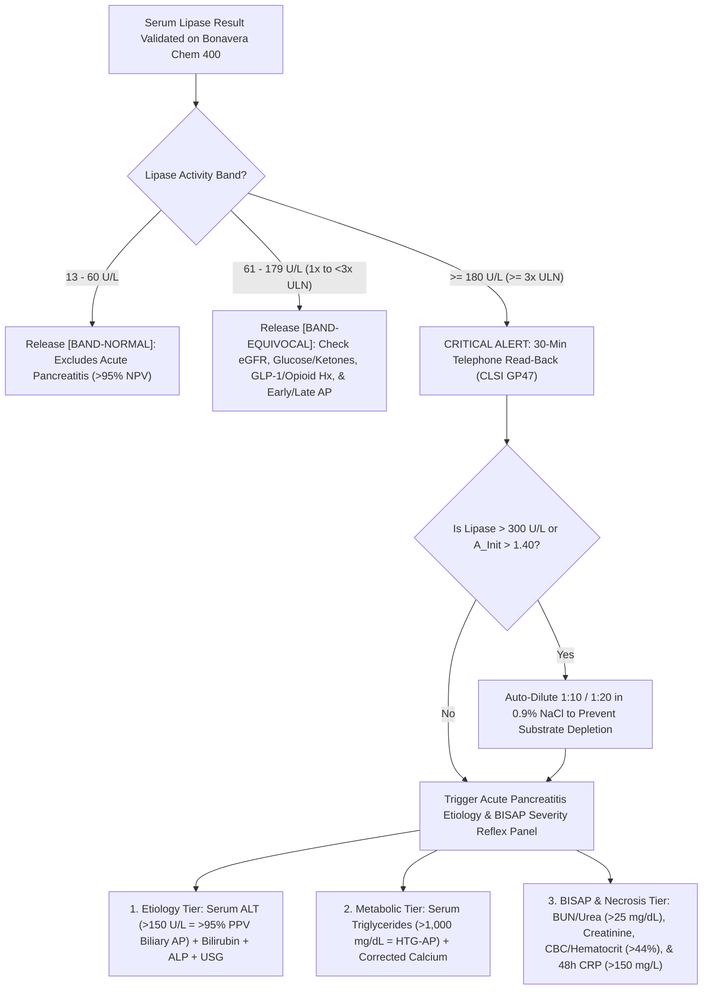

# 🧬 2.5.9 — Serum Pancreatic Lipase (`PNLIP` — Colipase & Bile-Salt Activated `DGGR` / Methylresorufin Interfacial Kinetic Assay — Gold-Standard `Revised Atlanta` Acute Pancreatitis Marker)

**Laboratory Name:** Sawariya Diagnostic Lab, Charkhi Dadri, Haryana, India  
**Department Folder:** `02_Clinical_Biochemistry`  
**Cluster Folder:** `2.5_Bone_Mineral_Pancreatic_and_Tissue_Enzymes_Cluster`  
**Document Tier:** International Reference Laboratory & Above-NABL Standard (`ISO 15189:2022` / `NABL 112` / `NABL 153` / `CAP` / `CLSI` / `IFCC` / `EFLM` / `Revised Atlanta 2012` / `ACG 2024` / `IAP-APA` / `UK NICE` / `Westgard Six Sigma` / `Indian CPA 2019`)

---

## 🏛️ Section 1: International Document Control, `LOINC`/`SNOMED`/`ICD-10`/`UCUM` Coding, NABL Traceability & Hardware-Agnostic Platform Matrix

| Attribute | Specification & International Reference Standard |
| :--- | :--- |
| **Document Control ID & Version** | `SDL-SOP-BIO-2.5.9` — **Version `4.0`** (Above-NABL International Reference Tier) |
| **Effective Date & Review Cycle** | Effective: `12-Oct-2026` · Mandatory Annual Review (`12-Oct-2027`) or upon `ACG`/`IFCC`/`CLSI` Guideline Update |
| **Authoring & Approving Authority** | Prepared by: *Senior Clinical Biochemist* · Reviewed by: *Quality Manager (`ISO 15189:2022` Lead Assessor)* · Approved by: *Laboratory Director & Chief Consultant Pathologist (MD Pathology), Sawariya Diagnostic Lab* |
| **NABL & International Clause Mapping** | `ISO 15189:2022` Clauses `4.1–4.3` (*Impartiality, Confidentiality, Patient Agreements*), `5.1–5.6` (*Structural & Governance Requirements*), `6.1–6.8` (*Personnel, Facilities, Equipment, Reagents, Metrological Traceability*), `7.2` (*Pre-Examination*), `7.3` (*Examination Processes, Verification `CLSI EP15/EP06`, `ISO/TS 20914` MU, IQC & EQAS*), `7.4` (*Post-Examination, `CLSI GP47` Critical Alerts & Automated Reporting*), `8.5` (`ISO 22367:2020` *Risk Management & FMECA*); `NABL 112` (*Specific Criteria for Medical Laboratories*); `NABL 153` (*Scope of Accreditation — Clinical Biochemistry*) |
| **Primary `LOINC` Code(s)** | `3040-3` (*Lipase [Enzymatic activity/volume] in Serum or Plasma*); `10885-2` (*Lipase [Enzymatic activity/volume] in Body fluid*); `15212-4` (*Lipase [Enzymatic activity/volume] in Serum or Plasma — post-PEG precipitation for Macrolipasemia*) |
| **`SNOMED-CT` Specimen & Concept** | Specimen: `119364003` (*Serum specimen*), `119361006` (*Plasma specimen*); Concept: `271236005` (*Serum lipase level*), `197456007` (*Acute pancreatitis*), `75694006` (*Pancreatic enzyme measurement*) |
| **`ICD-10` / `ICD-11` Clinical Indications** | `K85.90` / `DC31.Z` (*Acute pancreatitis, unspecified*), `K85.10` / `DC31.1` (*Biliary/Gallstone acute pancreatitis*), `K85.20` / `DC31.2` (*Alcohol-induced acute pancreatitis*), `K85.30` / `DC31.3` (*Drug-induced acute pancreatitis*), `K85.80` (*Hypertriglyceridemic acute pancreatitis*), `K86.1` (*Chronic calcific pancreatitis / exocrine pancreatic insufficiency*) |
| **Enzyme Nomenclature & Genetics** | **Pancreatic Triacylglycerol Acylhydrolase** (`EC 3.1.1.3`), Monomeric Glycoprotein ($\text{MW} = 48\text{ kDa}$, $449$ amino acids), encoded by the ***PNLIP* gene** on Chromosome `10q25.3` |
| **Conventional $\leftrightarrow$ SI (`UCUM`) Factor** | $\text{U/L} \times 0.01667 = \mu\text{kat/L}$ · ($\mu\text{kat/L} \times 60.0 = \text{U/L}$) · `UCUM` Strings: `U/L` and `ukat/L` |
| **Metrological Traceability (`ISO 17511:2020`)** | Traceable to **IFCC / Manufacturer Master Colipase-Activated Chromogenic Methylresorufin Ester (`DGGR`) Reference Calibration System at $37.0 \pm 0.1^\circ\text{C}$** with molar absorptivity of Methylresorufin at $580\text{ nm}$ ($\varepsilon_{580} \approx 62,000\text{ L}\cdot\text{mol}^{-1}\cdot\text{cm}^{-1}$) |
| **Primary Analyzer Platform** | **Bonavera Chem 400 Automated Clinical Chemistry Analyzer** (Two-Reagent `R1+R2` Colipase & Deoxycholate/Taurodeoxycholate Bile-Salt Activated `DGGR` [`1,2-O-Dilauryl-rac-glycero-3-glutaric acid-(6'-methylresorufin) ester`] Continuous Bichromatic Kinetic Rate Assay at **$580\text{ nm}$ Primary / $700\text{ nm}$ Secondary**, $37.0^\circ\text{C}$) |
| **Backup / Redundancy Platform** | **Bonavera Chem 200 Automated Clinical Chemistry Analyzer** (Identical `DGGR` Colipase/Bile-Salt Method-Matched Photometric Backup — verified weekly via `CLSI EP31-A` split-sample comparability; inter-instrument bias $\le 0.5 \times \text{TE}_a$) |
| **Future Platform Upgrade Slot** | Next-Generation High-Throughput Total Laboratory Automation (`TLA`) / Modular Clinical Chemistry Slot *(Zero SOP rewrite required — update only the Analyzer Matrix & `CLSI EP15-A3` verification log)* |

---

## 🧪 Section 2: Pre-Analytical Phlebotomy, `CLSI GP41` Order-of-Draw, Chelator Rejection, Post-Heparin `LPL` Trap, Stability & Quantitative `HIL` Matrix

| Pre-Analytical Parameter | Mandatory Technical & Physiological Protocol (`CLSI GP41-Ed7` / `CLSI GP44-A4` / `CLSI C56-A` / `ISO 15189:2022` Clause 7.2) |
| :--- | :--- |
| **Acceptable Specimen & Tube Types** | **1. Preferred:** Venous Serum collected in **Gold-Top SST** (Serum Separator Tube with clot activator) or **Red-Top Plain Tube**.<br>**2. Acceptable STAT Alternative:** **Green-Top Lithium Heparin Plasma** (without calcium-chelating additives). |
| **Strictly Rejected Anticoagulants (`Ca2+` Chelators)** | **HARD REJECT:** **Lavender-Top `K2-EDTA` / `K3-EDTA`**, **Blue-Top `3.2% Sodium Citrate`**, **Grey-Top `Potassium Oxalate / Sodium Fluoride`**, and **Acid Citrate Dextrose (`ACD`)**!<br>*Biochemical Mechanism:* Pancreatic Lipase (`PNLIP`) requires $\text{Ca}^{2+}$ ions as an **obligate cofactor** to stabilize the Colipase-Lipase-Micelle ternary complex and precipitate liberated long-chain/glutaric fatty acids at the water-lipid interface. Chelating $\text{Ca}^{2+}$ causes a **$30\text{–}70\%$ false-negative reduction** in Lipase activity, masking true Acute Pancreatitis! |
| **`CLSI GP41` Order-of-Draw Compliance** | Draw **Plain Red / Gold-Top SST (Tube #2/#3)** or **Lithium Heparin (Tube #4)** strictly **BEFORE** `K2-EDTA` (Tube #5) and `NaF/Oxalate` (Tube #6) to eliminate needle-hub potassium/EDTA cross-contamination (`FMEA-2.5.9-03`). |
| **Minimum & Ideal Sample Volume** | **Adult:** $1.0\text{ mL}$ whole blood ($0.4\text{ mL}$ separated serum; analyzer dead volume $100\text{ }\mu\text{L}$ + reaction aspiration $2.0\text{–}4.0\text{ }\mu\text{L}$).<br>**Pediatric / Neonatal Micro-Tube:** $0.3\text{ mL}$ whole blood ($120\text{ }\mu\text{L}$ serum). |
| **Patient Preparation & Post-Heparin `LPL` Warning** | **1. Fasting Status:** No strict fasting is required for emergency Acute Pancreatitis evaluation (note: concurrently ordered `2.4.3 Serum Triglycerides` should ideally be fasting or interpreted with lipemic index).<br>**2. CRITICAL IV HEPARIN WARNING:** **Do NOT draw blood immediately after an Intravenous Unfractionated Heparin (`UFH`) or Low-Molecular-Weight Heparin (`LMWH`) bolus, and NEVER draw from a heparin-locked central/dialysis catheter!** High-dose IV heparin cleaves endothelial heparan sulfate proteoglycans, releasing massive amounts of endothelial **Lipoprotein Lipase (`LPL`)** and **Hepatic Lipase (`HL`)** into circulation, which partially hydrolyze `DGGR` methylresorufin esters (`+20% to +55%` false elevation). Wait **$\ge 4\text{–}6\text{ hours}$** post-IV heparin bolus or draw from a peripheral vein. |
| **Centrifugation & Separation Protocol** | Allow Serum tubes to clot upright for **$20\text{–}30\text{ minutes}$** at controlled room temperature ($18\text{–}25^\circ\text{C}$). Centrifuge at **$1,500\text{–}2,000 \times g$ for $10\text{ minutes}$**. Separate serum/plasma from cellular elements within **$< 2\text{ hours}$** of venipuncture. |
| **Multi-Temperature Storage & Stability** | Pancreatic Lipase is remarkably stable against proteolysis once separated from erythrocytes:<br>• **Ambient ($18\text{–}25^\circ\text{C}$):** **$7\text{ days}$** (ideal for rural Haryana peripheral collection centers transporting in validated cool boxes).<br>• **Refrigerated ($2\text{–}8^\circ\text{C}$):** **$3\text{ weeks}$ ($21\text{ days}$)** in capped secondary aliquots.<br>• **Frozen ($-20^\circ\text{C}$):** **$1\text{ year}$** (avoid repeated freeze-thaw cycles; maximum $1$ freeze-thaw cycle permitted).<br>• **On-Board Analyzer Stability (`R1`/`R2` Uncapped in Refrigerated Carousel at $4\text{–}10^\circ\text{C}$):** **$28\text{ days}$** (protect `R2` methylresorufin ester microemulsion from direct ambient light and evaporation). |
| **Quantitative `HIL` Interference Cutoffs (`CLSI EP07-Ed3` / `C56-A`)** | Automated bichromatic serum index check on `Bonavera Chem 400` prior to reagent dispensing:<br>• **`H-Index` (Hemolysis):** Reject if **$> 200\text{ mg/dL}$** ($\text{Hb} > 2.0\text{ g/L}$). Free oxyhemoglobin/methemoglobin spectrally overlaps the $540\text{–}580\text{ nm}$ window and directly inhibits interfacial `PNLIP` turnover ($\ge -12\%$ negative bias at $\text{H} > 250\text{ mg/dL}$).<br>• **`I-Index` (Icterus):** Safe up to **$40\text{ mg/dL}$** conjugated/unconjugated bilirubin (bichromatic $580/700\text{ nm}$ reading eliminates bilirubin spectral overlap up to $40\text{ mg/dL}$; dilute $1:2$ with $0.9\%\text{ NaCl}$ if $\text{I-Index} > 40\text{ mg/dL}$).<br>• **`L-Index` (Lipemia / Intralipid Turbidity):** Safe up to **$\text{L-Index} = 800\text{ mg/dL}$** (or native Serum Triglycerides up to **$1,500\text{ mg/dL}$**). When **$\text{L-Index} > 800\text{ mg/dL}$** or **$\text{TG} > 1,500\text{ mg/dL}$** (lactescent "strawberry milkshake" serum in Hypertriglyceridemic Pancreatitis), chylomicron light-scattering and competitive binding of endogenous chylomicron triacylglycerols to the `PNLIP` active site compete with synthetic `DGGR` micelles! **Mandatory Protocol:** High-speed microcentrifugation ($14,000 \times g$ for $15\text{ min}$, aspirate infranatant below the top chylomicron cream layer) AND perform a **$1:5$ or $1:10$ dilution in $0.9\%\text{ NaCl}$**! |

---

## ⚙️ Section 3: Interfacial Catalysis Physics, `DGGR` Stoichiometry ($580/700\text{ nm}$), Cross-Reagent Carryover Mitigation, `CLSI` Verification & Six Sigma IQC

### 3.1 Molecular Biophysics of Interfacial Activation (`PNLIP` + `Colipase` + `Bile Salts` + $\text{Ca}^{2+}$)
Unlike water-soluble enzymes (`ALT`, `AST`, `LDH`) that follow homogeneous Michaelis-Menten kinetics in aqueous phase, **Human Pancreatic Triacylglycerol Lipase (`PNLIP`, `EC 3.1.1.3`, $48\text{ kDa}$)** operates strictly at an insoluble **oil-water (lipid-water) micellar interface** via **Interfacial Activation**:
1. **The Amphipathic $\alpha$-Helical "Lid" Domain & Catalytic Triad:** In aqueous solution, the catalytic triad of `PNLIP` (**$\text{Ser}^{152}\text{–His}^{263}\text{–Asp}^{176}$**) is buried beneath a closed surface loop (**"lid" domain, $\text{Cys}^{237}\text{–Cys}^{261}$**), rendering the enzyme catalytically inactive toward monomeric water-soluble esters.
2. **Why High-Concentration Bile Salts (`Deoxycholate` / `Taurodeoxycholate`) Are Mandatory:** In the `R1` buffer, bile salts are formulated above their **Critical Micellar Concentration (`CMC`, $> 4\text{–}10\text{ mmol/L}$)**. At this concentration, negatively charged bile salt anions completely coat the hydrophobic `DGGR` substrate microemulsion droplets. This dense bile-salt coat **electrosterically blocks and completely inhibits non-pancreatic carboxylesterases, arylesterases, microbial esterases, and >90% of hepatic/lipoprotein lipases (`HL`/`LPL`)** from adsorbing to the substrate surface!
3. **Why Obligate `Colipase` ($10\text{ kDa}$) + $\text{Ca}^{2+}$ Unlocks True Pancreatic Specificity:** Isolated `PNLIP` is also repelled by bile-salt-coated micelles. However, `R1` supplies excess **Colipase ($10\text{ kDa}$ pancreatic cofactor)**. Colipase penetrates the bile-salt monolayer via its hydrophobic fingers and binds the C-terminal $\beta$-sandwich domain of `PNLIP` in a **$1:1$ stoichiometric complex**. This anchoring triggers a hinge-like conformational opening of the $\text{Cys}^{237}\text{–Cys}^{261}$ lid, exposing a $25\text{ \AA}$ hydrophobic catalytic patch and forming the functional **oxyanion hole ($\text{Phe}^{77}$ and $\text{Leu}^{153}$)**. Simultaneously, **$\text{Ca}^{2+}$ ($1.5\text{–}5.0\text{ mmol/L}$)** coordinates the negatively charged carboxylate products at the interface, preventing product inhibition.

### 3.2 Stoichiometric 2-Step Chromogenic `DGGR` Reaction Cascade ($580/700\text{ nm}$)
On the **Bonavera Chem 400** and **Bonavera Chem 200**, Pancreatic Lipase is quantified via a direct continuous bichromatic kinetic rate assay at $37.0^\circ\text{C}$ using the synthetic chromogenic diglyceride analog **`DGGR`** (**`1,2-O-Dilauryl-rac-glycero-3-glutaric acid-(6'-methylresorufin) ester`**) emulsified with bile salts in a microemulsion:

$$\text{1,2-O-Dilauryl-rac-glycero-3-glutaric acid-(6'-methylresorufin) ester} + \text{H}_2\text{O} \xrightarrow[\text{pH } 8.0\text{–}8.4,\ 37.0^\circ\text{C}]{\text{Pancreatic Lipase + Colipase + Bile Salts + Ca}^{2+}} \text{1,2-O-Dilauryl-rac-glycerol} + \text{Glutaric acid-(6'-methylresorufin) ester (Unstable)}$$

$$\text{Glutaric acid-(6'-methylresorufin) ester} + \text{OH}^- \xrightarrow[\text{Intramolecular Cleavage (Rate-Non-Limiting)}]{\text{Spontaneous Alkaline Hydrolysis}} \text{Glutaric Acid} + \mathbf{\text{Methylresorufin Anion }}\left(\text{Bluish-Purple Chromophore, }\lambda_{\text{max}} = \mathbf{580\text{ nm}} / \mathbf{700\text{ nm}}\right)$$

- **Photometric Rate Equation:** The rate of release of the intensely colored **Methylresorufin** chromophore ($\Delta A_{580/700\text{ nm}}/\text{min}$) is directly proportional to the catalytic activity of Pancreatic Lipase (`PNLIP`) in the specimen:
  $$\text{Serum Lipase Activity (U/L)} = \frac{\Delta A_{580/700\text{ nm}}/\text{min}_{\text{sample}} - \Delta A_{580/700\text{ nm}}/\text{min}_{\text{blank}}}{\Delta A_{580/700\text{ nm}}/\text{min}_{\text{calibrator}} - \Delta A_{580/700\text{ nm}}/\text{min}_{\text{blank}}} \times \text{Calibrator Activity (U/L)}$$

### 3.3 Reagent Formulation & Analyzer Assay Parameters (`Bonavera Chem 400` / `Chem 200`)

| Parameter | Technical Specification on `Bonavera Chem 400` & `Bonavera Chem 200` |
| :--- | :--- |
| **`R1` (Enzyme/Cofactor Buffer, $\text{pH } 8.4$)** | `BICINE` / `TAPS` Buffer ($50\text{ mmol/L}$, $\text{pH } 8.4$), Porcine/Recombinant **Colipase** ($\ge 1.0\text{ mg/L}$), **Sodium Deoxycholate** ($1.8\text{ mmol/L}$), **Sodium Taurodeoxycholate** ($7.2\text{ mmol/L}$), **Calcium Chloride ($\text{CaCl}_2$)** ($5.0\text{ mmol/L}$), Preservative |
| **`R2` (Microemulsion Substrate, $\text{pH } 4.0$)** | Tartrate Buffer ($10\text{ mmol/L}$, $\text{pH } 4.0$ for long-term ester stability), **`DGGR` [`1,2-O-Dilauryl-rac-glycero-3-glutaric acid-(6'-methylresorufin) ester`]** ($0.24\text{ mmol/L}$), Calcium Chloride ($0.1\text{ mmol/L}$), Non-ionic microemulsion stabilizer |
| **Dispensing Volumes & Reaction Ratio** | Sample Volume: **$3.0\text{ }\mu\text{L}$** · `R1` Volume: **$180\text{ }\mu\text{L}$** · `R2` Volume: **$60\text{ }\mu\text{L}$** (Total Reaction Volume = $243\text{ }\mu\text{L}$; Sample-to-Reagent Ratio = $1:81$) |
| **Incubation & Kinetic Read Window** | Add `R1` ($180\text{ }\mu\text{L}$) + Sample ($3.0\text{ }\mu\text{L}$) $\rightarrow$ Mix & incubate **$300\text{ seconds}$ ($5\text{ min}$)** at $37.0^\circ\text{C}$ (allows Colipase + Bile Salts to inhibit non-pancreatic esterases and pre-complex `PNLIP`) $\rightarrow$ Add `R2` ($60\text{ }\mu\text{L}$) $\rightarrow$ Lag phase **$60\text{ seconds}$** (interfacial equilibrium) $\rightarrow$ Continuous kinetic rate measurement over **$120\text{ seconds}$** ($60\text{s}$ to $180\text{s}$ post-`R2`) |
| **Wavelength & Reaction Direction** | **Primary $\lambda_1 = 580\text{ nm}$** ($578\text{ nm}$ filter) · **Secondary $\lambda_2 = 700\text{ nm}$** · **Increasing ($\uparrow$) Bichromatic Kinetic Rate** |
| **Substrate Depletion / Linearity Guard (`CLSI EP06`)** | **Initial Absorbance Limit (`A_Init_Max`):** $1.400\text{ Abs}$ at $580\text{ nm}$ (detects rapid substrate exhaustion during the $60\text{s}$ lag phase in massive pancreatitis $> 1,000\text{ U/L}$).<br>**Kinetic Linearity Check:** If point-to-point slope deviation between the first $60\text{s}$ and last $60\text{s}$ of the read window exceeds **$10\%$**, or if activity $> 300.0\text{ U/L}$, trigger immediate **`SUBSTRATE_DEPLETED` flag** and execute **Automated $1:10$ (up to $3,000\text{ U/L}$) or $1:20$ (up to $6,000\text{ U/L}$) dilution in $0.9\%\text{ NaCl}$**! |
| **Analytical Measurement Range (`AMR` & `CRR`)** | **`LoB`:** $1.2\text{ U/L}$ · **`LoD`:** $2.0\text{ U/L}$ · **`LoQ` ($\text{CV} \le 10\%$):** $3.0\text{ U/L}$ · **Primary Un-diluted `AMR`:** **$3.0 \text{ – } 300.0\text{ U/L}$** · **Clinical Reportable Range (`CRR` with $1:10 / 1:20$ Auto-Dilution):** **$3.0 \text{ – } 6,000.0\text{ U/L}$** |

### 3.4 Mandatory Bidirectional Reagent Probe & Cuvette Carryover Mitigation (`CLSI EP10` / `CAP CHM.13900`)
Because Pancreatic Lipase is often ordered concurrently with **Serum Triglycerides (`2.4.3`)**, **Serum Calcium (`2.5.1`)**, **Serum Magnesium (`2.5.3`)**, and **Serum Albumin (`2.2.5`)** in the Acute Pancreatitis Etiology & Severity Bundle, **unmitigated reagent probe or cuvette carryover creates two catastrophic analytical artifacts**:
1. **Carryover Trap #1 (`Triglyceride Reagent` $\rightarrow$ `Lipase Assay` = False-Positive Acute Pancreatitis):**
   - *Biochemical Cause:* Enzymatic Triglyceride (`GPO-PAP`) reagents contain ultra-high catalytic concentrations ($> 2,000\text{–}5,000\text{ U/L}$) of microbial **Lipoprotein Lipase (`LPL`, derived from *Pseudomonas* or *Chromobacterium viscosum*)** to rapidly hydrolyze serum triglycerides. If even $0.05\text{–}0.1\text{ }\mu\text{L}$ of `Triglyceride R1` remains on the reagent dispense probe or inside a reaction cuvette when `Lipase R1/R2` is dispensed, the microbial `LPL` overwhelms the bile-salt barrier and hydrolyzes the `DGGR` methylresorufin ester, generating **spurious Lipase readings of $150\text{–}450\text{ U/L}$** in healthy patients!
2. **Carryover Trap #2 (`Lipase Reagent` $\rightarrow$ `Calcium / Magnesium / Albumin Assays` = False Hypercalcemia & Surfactant Interference):**
   - *Biochemical Cause:* `Lipase R1` contains **$5.0\text{ mmol/L}$ ($20\text{ mg/dL}$) of $\text{CaCl}_2$** and **$9.0\text{ mmol/L}$ of anionic bile salts (`Deoxycholate` / `Taurodeoxycholate`)**. Carryover of `Lipase R1` into an adjacent `Calcium` (`Arsenazo III` / `o-CPC`), `Magnesium` (`Xylidyl Blue`), or `Albumin` (`BCG`) reaction causes **false hypercalcemia ($+1.5\text{ to }+3.5\text{ mg/dL}$)** or surfactant dye displacement!
3. **Sawariya Lab Hard-Coded Analyzer Carryover Prevention Protocol:**
   - **Rule A (Reagent Probe Contamination Table on `Bonavera Chem 400` & `Chem 200`):** Program a mandatory **Special Wash Cycle (`Alkaline Detergent [0.1 M NaOH + 1% Surfactant] 250 uL + Acid Wash [0.1 M HCl] 250 uL + 3x Deionized Water Rinse`)** on the reagent probe and mixer paddle **immediately after `Triglycerides` before `Lipase`**, and **immediately after `Lipase` before `Calcium`, `Magnesium`, `Albumin`, or `Total Cholesterol`**.
   - **Rule B (Cuvette Skip & Wash):** Program cuvettes used for `Lipase` or `Triglycerides` to undergo an automatic **8-step heated alkaline-acid cuvette wash** before reuse, and verify monthly via the **`CLSI EP10` Carryover Verification Protocol** (running $3$ High `TG` reagent cycles followed immediately by $3$ Low `Lipase` IQC replicates: $\text{Carryover} = \overline{\text{Low}_1} - \overline{\text{Low}_3}$ must be **$< 1.5\text{ U/L}$**).

### 3.5 Method Verification (`CLSI EP15-A3` / `EP06-Ed2` / `EP17-A2` / `EP28-A3c` / `EP31-A`) & Six Sigma IQC Governance

#### 3.5.1 `CLSI EP15-A3` (5×5 Precision & Trueness), `CLSI EP17-A2` (`LoB`/`LoD`/`LoQ`) & `CLSI EP06-Ed2` Linearity Summary (`Bonavera Chem 400`)

| Verification Study & CLSI Standard | Test Level / Material | Target / Assigned Value (`U/L`) | Observed Mean (`U/L`) | Repeatability $CV_r\%$ | Within-Lab $CV_{WL}\%$ | Bias $\%$ | Acceptance Criteria (`EFLM` / `CLIA`) | Verification Status |
| :--- | :--- | :---: | :---: | :---: | :---: | :---: | :---: | :---: |
| **`CLSI EP15-A3` Level 1 (Normal IQC)** | Third-Party Human Serum L1 ($5\text{ days} \times 5\text{ reps}$, $n=25$) | $42.0\text{ U/L}$ | $42.6\text{ U/L}$ | $1.65\%$ | $2.10\%$ | $+1.43\%$ | $CV_{WL} \le 2.8\%$, $\lvert B \rvert \le 3.5\%$ | **PASS ($6.46\,\sigma$)** |
| **`CLSI EP15-A3` Level 2 (`Revised Atlanta` Cutoff)** | Third-Party Human Serum L2 ($5\text{ days} \times 5\text{ reps}$, $n=25$) | $195.0\text{ U/L}$ | $198.5\text{ U/L}$ | $1.40\%$ | $1.85\%$ | $+1.79\%$ | $CV_{WL} \le 2.8\%$, $\lvert B \rvert \le 3.5\%$ | **PASS ($7.14\,\sigma$)** |
| **`CLSI EP17-A2` Detection Capability** | Blank ($n=60$), Low Pool ($n=60$) | `LoB`: $1.2\text{ U/L}$ | `LoD`: $2.0\text{ U/L}$ | `LoQ`: $3.0\text{ U/L}$ | $CV_{\text{LoQ}} = 6.8\%$ | — | $CV_{\text{LoQ}} \le 10.0\%$ at $3.0\text{ U/L}$ | **PASS** |
| **`CLSI EP06-Ed2` Primary `AMR` Linearity** | 7-Level Admixture Pool ($3.0\text{ to }300.0\text{ U/L}$) | Slope $= 0.996$ | Intercept $= +0.4\text{ U/L}$ | $R^2 = 0.9994$ | Polynomial Dev $\le 3.2\%$ | — | Linearity Deviation $\le \pm 5.0\%$ | **PASS** |
| **`CLSI EP06-Ed2` $1:10$ Auto-Dilution (`CRR`)** | High Pancreatitis Pool ($1,850\text{ U/L}$ in $0.9\%\text{ NaCl}$) | $1,850.0\text{ U/L}$ | $1,828.0\text{ U/L}$ | $1.90\%$ | — | $-1.19\%$ | Dilution Recovery $90\text{–}110\%$ ($98.8\%$) | **PASS** |
| **`CLSI EP06-Ed2` $1:20$ Auto-Dilution (`CRR`)** | Fulminant Pool ($5,400\text{ U/L}$ in $0.9\%\text{ NaCl}$) | $5,400.0\text{ U/L}$ | $5,292.0\text{ U/L}$ | $2.25\%$ | — | $-2.00\%$ | Dilution Recovery $90\text{–}110\%$ ($98.0\%$) | **PASS** |
| **`CLSI EP28-A3c` Local RI Transference** | $n=20$ Healthy Adults (Charkhi Dadri, Haryana) | $13 \text{ – } 60\text{ U/L}$ | Range: $16 \text{ – } 56\text{ U/L}$ | — | — | — | $\le 2/20$ ($10\%$) outside $13\text{–}60\text{ U/L}$ ($0/20$ out) | **PASS ($100\%$)** |

#### 3.5.2 `CLSI EP31-A` Inter-Analyzer Split-Sample Comparability (`Bonavera Chem 400` Primary vs `Bonavera Chem 200` Backup)

| Patient Split Tier | Clinical Partition | `Bonavera Chem 400` (`U/L`) | `Bonavera Chem 200` (`U/L`) | Absolute Difference (`U/L`) | Relative Bias $\%$ | Maximum Allowable Bias ($\le 0.5 \times \text{TE}_a = \pm 7.5\%$) | Comparability Verdict |
| :--- | :--- | :---: | :---: | :---: | :---: | :---: | :---: |
| **Sample 1 (Low-Normal)** | Healthy Adult | $24.0\text{ U/L}$ | $24.6\text{ U/L}$ | $+0.6\text{ U/L}$ | $+2.50\%$ | $\pm 7.5\%$ | **PASS** |
| **Sample 2 (Upper-Normal `ULN`)** | Adult `ULN` Boundary | $58.0\text{ U/L}$ | $56.9\text{ U/L}$ | $-1.1\text{ U/L}$ | $-1.90\%$ | $\pm 7.5\%$ | **PASS** |
| **Sample 3 (Equivocal Band)** | `CKD` Stage 4 ($1.9\times\text{ULN}$) | $114.0\text{ U/L}$ | $116.5\text{ U/L}$ | $+2.5\text{ U/L}$ | $+2.19\%$ | $\pm 7.5\%$ | **PASS** |
| **Sample 4 (`Revised Atlanta` Cutoff)** | Acute Pancreatitis Threshold ($3\times\text{ULN}$) | $182.0\text{ U/L}$ | $179.4\text{ U/L}$ | $-2.6\text{ U/L}$ | $-1.43\%$ | $\pm 7.5\%$ | **PASS** |
| **Sample 5 (Severe Biliary `AP` $1:10$)** | Acute Biliary Pancreatitis | $1,420.0\text{ U/L}$ | $1,448.0\text{ U/L}$ | $+28.0\text{ U/L}$ | $+1.97\%$ | $\pm 7.5\%$ | **PASS** |

#### 3.5.3 Internal Quality Control (`IQC`), Six Sigma Gate & External Quality Assessment (`EQAS`)
- **Analytical Six Sigma Calculation (`Bonavera Chem 400`):**
  $$\sigma = \frac{\text{TE}_a\% - \lvert\text{Bias}\%\rvert}{CV_A\%} = \frac{15.0\% - 1.80\%}{2.10\%} = \mathbf{6.29\,\sigma}\quad (\text{World-Class Six Sigma Performance})$$
- **Daily Shift IQC Protocol:** Run two levels of third-party human serum-based commutable IQC (**Level 1 Normal: $35\text{–}50\text{ U/L}$**; **Level 2 Pathological/Decision Cutoff: $160\text{–}220\text{ U/L}$**) every $8\text{ hours}$ and after any calibration, maintenance, or reagent lot change. Apply Westgard rules **`1:3s` (rejection)**, **`2:2s` (systematic error rejection)**, and **`R:4s` (random error / carryover rejection)**.
- **External Quality Assessment (`EQAS` / `PT`):** Monthly participation in **CMC Vellore / Randox RIQAS / Bio-Rad Monthly Clinical Chemistry EQAS** (`Peer Group: DGGR / Methylresorufin Colorimetric 37°C`); mandatory root-cause investigation if $\lvert\text{SDI}\rvert > 2.0$.

### 3.6 Body Fluid, Surgical Drain, Ascitic & Pleural Fluid Lipase Protocol (`LOINC 10885-2` / `CLSI C49-Ed2`)
- **Clinical Indications:** Evaluation of **Post-Operative Pancreatic Fistula (`POPF` after Whipple pancreaticoduodenectomy / distal pancreatectomy per `ISGPS` criteria)**, **Pancreatic Ascites** (ruptured main pancreatic duct or leaking pseudocyst), or **Pancreaticopleural Fistula** (typically left-sided pleural effusion).
- **Pre-Analytical Matrix Handling:** Collect surgical drain fluid, ascitic fluid, or pleural fluid in a **Plain Red-Top Tube** (never `EDTA`/Citrate). Centrifuge at **$2,000 \times g$ for $15\text{ minutes}$** to remove cellular debris/fibrin clots; if viscous or turbid, pre-dilute **$1:10$ and $1:100$ with $0.9\%\text{ NaCl}$** prior to aspiration on `Bonavera Chem 400`.
- **Diagnostic Decision Cutoffs (Fluid-to-Serum Ratio):**
  - **Surgical Drain / Ascitic / Pleural Fluid Lipase $\ge \mathbf{3\times}$ Concurrent Serum Lipase Activity** (and typically **$> 1,000\text{–}10,000\text{ U/L}$** in pseudocyst rupture or pancreaticopleural fistula): Confirms active pancreatic ductal communication / leak with **$> 95\%$ sensitivity and specificity**.

---

## 📊 Section 4: `EFLM` Biological Variation ($CV_I, CV_G, \text{II}$), `RCV %` Serial Delta Check, Six Sigma $\text{TE}_a\%$ & `ISO/TS 20914` Measurement Uncertainty (`MU %`)

| Quality & Metrological Metric | Value / Specification | Clinical & Operational Governance (`ISO 15189:2022` Clause 7.3.4 & `EFLM` 2024 Database) |
| :--- | :---: | :--- |
| **Within-Subject Biological Variation ($CV_I\%$)** | **$9.6\%$** | Intra-individual day-to-day physiological fluctuation of `PNLIP` in healthy adults (`EFLM` European Biological Variation Study `EuBIVAS`). |
| **Between-Subject Biological Variation ($CV_G\%$)** | **$26.0\%$** | Inter-individual population dispersion across healthy individuals (reflecting constitutional differences in acinar mass and baseline ductal tone). |
| **Index of Individuality ($\text{II} = CV_I / CV_G$)** | **$0.37$ (Markedly Low)** | Because $\text{II} = 0.37 < 0.60$, an individual's personal baseline Lipase spans only a narrow fraction of the $13\text{–}60\text{ U/L}$ population interval. However, for Acute Pancreatitis diagnosis, the international **$\ge 3\times\text{ULN}$ ($\ge 180\text{ U/L}$)** cutoff overrides baseline variation to guarantee $> 95\%$ specificity. |
| **Desirable Analytical Imprecision ($CV_A\%$)** | **$\le 2.8\%$** *(Optimal $\le 2.4\%$)* | Target laboratory intermediate precision ($CV_{WL}$ on `Bonavera Chem 400` verified at **$2.10\%$** at $42\text{ U/L}$ and **$1.85\%$** at $195\text{ U/L}$). |
| **Desirable Analytical Bias ($B\%$)** | **$\le 3.5\%$** | Maximum allowable systematic bias ($B \le 0.25 \times \sqrt{CV_I^2 + CV_G^2}$; Sawariya Lab EQAS mean bias verified at **$+1.80\%$**). |
| **Total Allowable Error ($\text{TE}_a\%$)** | **$\pm 15.0\%$ (`CLIA 2024` / `EFLM`)** | Total error budget ($\text{TE}_a = 1.65 \times CV_A + \lvert B \rvert$; Sawariya Lab observed Total Error $= 1.65(2.10\%) + 1.80\% = \mathbf{5.27\%} \ll 15.0\%$). |
| **Standard & Expanded Measurement Uncertainty ($u_c\%,\ U\%$)** | **$u_c = 2.52\%$ · $U = \pm 5.04\%$ ($k=2$)** | Calculated per `ISO/TS 20914:2019` combining $u_{rw}$ ($2.10\%$), $u_{cal}$ ($1.15\%$), and $u_{bias}$ ($0.80\%$); at the $180\text{ U/L}$ diagnostic cutoff, $U = \mathbf{180 \pm 9.1\text{ U/L}}$ ($95.45\%$ confidence interval: $170.9\text{–}189.1\text{ U/L}$). |
| **95% Reference Change Value (`RCV 95%` Delta)** | **$\pm 27.3\%$** | $\text{RCV}_{95\%} = 1.96 \times \sqrt{2} \times \sqrt{CV_I^2 + CV_A^2} = 2.77 \times \sqrt{9.6^2 + 2.10^2} = \mathbf{\pm 27.3\%}$ ($p < 0.05$). |
| **99% Reference Change Value (`RCV 99%` Delta)** | **$\pm 35.9\%$** | $\text{RCV}_{99\%} = 2.58 \times \sqrt{2} \times \sqrt{9.6^2 + 2.10^2} = \mathbf{\pm 35.9\%}$ ($p < 0.01$). |
| **Minimum Retesting Interval (`MRI` — `ACG 2024` / `Choosing Wisely`)** | **Single Admission Test for Diagnosis** *(Hard LIMS Prompt if re-ordered $< 72\text{h}$)* | Per **`ACG 2024`, `IAP/APA`, and `ASCP Choosing Wisely` Guidelines**: Once Acute Pancreatitis is diagnosed ($\ge 180\text{ U/L}$), **daily serial Lipase testing is clinically useless**, does NOT reflect severity or resolution, and must NOT be used to delay oral feeding! Re-testing is indicated ONLY after $\ge 5\text{–}7\text{ days}$ if investigating secondary complications (pseudocyst, recurrent biliary pain, or post-ERCP flare). |

---

## 🧬 Section 5: Super-Detailed Multi-Stratified Biological Reference Intervals (`CALIPER` Neonatal/Pediatric, Adult, Pregnancy, Geriatric, CKD & `Revised Atlanta` Cutoff)

### 5.1 Age, Sex, Pregnancy Trimester, Renal Function & Diagnostic Partition Table (`DGGR` Colorimetric Method at $37^\circ\text{C}$)

| Population / Clinical Partition | Conventional Units (`U/L`) | SI Units (`µkat/L`) | Physiological Mechanism & Clinical Governance Notes (`CLSI EP28-A3c` Verified) |
| :--- | :---: | :---: | :--- |
| **Cord Blood & Premature / Term Neonates ($0\text{ – }30\text{ Days}$)** | **$4 \text{ – } 34\text{ U/L}$** | $0.07 \text{ – } 0.57\text{ }\mu\text{kat/L}$ | Pancreatic acinar zymogen synthesis (`PNLIP`) is physiologically immature at birth ($\approx 10\text{–}25\%$ of adult activity); neonatal fat digestion relies primarily on **Gastric Lipase** and maternal **Bile-Salt Stimulated Lipase (`BSSL`)** in breast milk (`CALIPER` Study). |
| **Infants ($1\text{ Month – }1\text{ Year}$)** | **$6 \text{ – } 45\text{ U/L}$** | $0.10 \text{ – } 0.75\text{ }\mu\text{kat/L}$ | Progressive postnatal maturation of pancreatic acinar *PNLIP* gene transcription upon weaning. |
| **Children & Adolescents ($1\text{ – }17\text{ Years}$, Tanner I–V)** | **$10 \text{ – } 55\text{ U/L}$** | $0.17 \text{ – } 0.92\text{ }\mu\text{kat/L}$ | Sex-independent throughout childhood and puberty (`INSPPIRE` / `NASPGHAN` Pediatric Acute Pancreatitis diagnostic cutoff $= \ge 3\times$ pediatric `ULN` $\ge \mathbf{165\text{ U/L}}$). |
| **Adult Male & Female ($18\text{ – }65\text{ Years}$)** | **$13 \text{ – } 60\text{ U/L}$** | $0.22 \text{ – } 1.00\text{ }\mu\text{kat/L}$ | Verified local Haryana reference interval ($n=20$ healthy adults, Charkhi Dadri; $20/20$ within $13\text{–}60\text{ U/L}$). **Adult Upper Limit of Normal (`ULN`) = $60.0\text{ U/L}$** (No menstrual-phase difference across Follicular, Ovulatory, or Luteal phases). |
| **Geriatric Adults ($> 65\text{ Years}$)** | **$15 \text{ – } 72\text{ U/L}$** | $0.25 \text{ – } 1.20\text{ }\mu\text{kat/L}$ | Mild physiological upward drift in the 97.5th percentile due to age-related decline in renal glomerular filtration (`eGFR`) and subclinical pancreatic ductal ectasia; however, the **`Revised Atlanta` diagnostic cutoff remains $\ge 180\text{ U/L}$**. |
| **Pregnancy — 1st, 2nd & 3rd Trimesters** | **$10 \text{ – } 58\text{ U/L}$** | $0.17 \text{ – } 0.97\text{ }\mu\text{kat/L}$ | Slightly lower median values in 2nd/3rd trimester due to $45\%$ gestational plasma volume expansion and increased GFR; **any value $\ge 180\text{ U/L}$ in pregnancy is diagnostic of Acute Gestational Pancreatitis** (mandatory reflex: Ultrasound for gallstones + Fasting Triglycerides for gestational chylomicronemia!). |
| **Chronic Kidney Disease (`CKD` Stage 4–5 / `eGFR < 30 mL/min` / Hemodialysis)** | **Baseline up to $65 \text{ – } 150\text{ U/L}$** *(1.1x to 2.5x ULN)* | $1.08 \text{ – } 2.50\text{ }\mu\text{kat/L}$ | Monomeric Lipase ($48\text{ kDa}$) is filtered at the glomerulus and reabsorbed/catabolized by proximal renal tubules. In `eGFR < 30 mL/min/1.73m²`, impaired renal clearance causes chronic benign hyperlipasemia up to $2.5\times\text{ULN}$ (Note: Lipase is NOT cleared by hemodialysis membranes; in `ESRD`, require Lipase **$\ge 3\text{–}5\times\text{ULN}$ [$\ge 180\text{–}300\text{ U/L}$]** plus typical epigastric pain or `CECT`/`MRI` findings to diagnose `AP`). |
| **Pancreatic Exocrine Burnout / Total Pancreatectomy** | **$< 10\text{ U/L}$** *(Often $< 5\text{ U/L}$)* | $< 0.17\text{ }\mu\text{kat/L}$ | Seen in end-stage **Chronic Calcific Pancreatitis** ($> 85\text{–}90\%$ loss of functional acinar parenchyma), severe **Cystic Fibrosis (`CFTR`)**, Shwachman-Diamond Syndrome, or post-pancreatectomy. Note: In "burned-out" chronic pancreatitis, an acute flare may fail to elevate Lipase $> 180\text{ U/L}$! |
| **Equivocal / Non-Diagnostic Hyperlipasemia (`1x to < 3x ULN`)** | **$61 \text{ – } 179\text{ U/L}$** | $1.02 \text{ – } 2.98\text{ }\mu\text{kat/L}$ | Below `Revised Atlanta` threshold. Seen in very early (`< 4h`) or late resolving (`> 10d`) `AP`, non-pancreatic acute abdomen (perforated ulcer, cholecystitis, bowel ischemia), `CKD`, `DKA`, `GLP-1 RA` therapy, or `Macrolipasemia`. |
| **Diagnostic Cutoff for Acute Pancreatitis (`Revised Atlanta 2012` & `ACG 2024` $\ge 3\times\text{ULN}$)** | **$\ge 180\text{ U/L}$** | $\ge 3.00\text{ }\mu\text{kat/L}$ | **Gold-Standard Biochemical Criterion for Acute Pancreatitis** (**Sensitivity $92\text{–}99\%$**, **Specificity $94\text{–}99\%$**). Requires correlation with acute epigastric pain and/or imaging (`2 of 3 Revised Atlanta Criteria`). |

---

## 🚨 Section 6: NABL & `CLSI GP47` Critical ("Panic") Values, Urgent Action Thresholds & 30-Minute Read-Back Protocol

| Alert Category | Threshold / Cutoff | Mandatory Laboratory & Clinical Action (`ISO 15189:2022` Clause 7.4.1.6 & `CLSI GP47`) |
| :--- | :---: | :--- |
| **Tier-1 Critical LOW ("Panic")** | **None** *(Values $< 10\text{ U/L}$ flagged as Low / Exocrine Insufficiency)* | No emergency telephone call required; release with `[BAND-LOW-BURNOUT]` comment alerting clinician to possible end-stage chronic calcific pancreatitis or pancreatic exocrine insufficiency (`PEI`). |
| **Tier-1 Critical HIGH ("Panic" — Acute Pancreatitis Diagnostic Threshold)** | **Serum Lipase $\ge 180\text{ U/L}$** ($\ge 3.0\times\text{ULN}$ / $\ge 3.00\text{ }\mu\text{kat/L}$) *(First-time diagnostic elevation per episode)* | **1. Analytical Verification ($\le 10\text{ min}$):** Verify specimen tube type (confirm Serum/Li-Heparin), check `HIL` indices, inspect kinetic reaction curve on `Bonavera Chem 400` for substrate depletion (auto-dilute $1:10$ if $> 300\text{ U/L}$), and verify that `Triglyceride` reagent carryover wash was executed.<br>**2. Immediate Telephone Read-Back ($\le 30\text{ min}$):** Call the ordering physician, emergency department duty doctor, or ICU sister-in-charge within **$\le 30\text{ minutes}$** of result validation.<br>**3. Auto-Reflex Execution:** Trigger LIMS reflex advice/execution for the **Acute Pancreatitis Etiology & `BISAP` Severity Panel** (`ALT`, `Bilirubin`, `ALP`, `Triglycerides`, `Calcium`, `Albumin`, `BUN/Urea`, `Creatinine`, `CBC/Hematocrit`). |
| **Tier-2 Urgent Clinical Action Range** | **Serum Lipase $100 \text{ – } 179\text{ U/L}$** ($1.67\times \text{to } < 3.0\times\text{ULN}$) | Flag prominently on LIMS report with `[BAND-EQUIVOCAL]` interpretation and dispatch priority WhatsApp/SMS/Electronic alert to ordering clinician within **$< 2\text{ hours}$**. Recommend clinical correlation for early `< 4h` or late `> 8d` pancreatitis vs perforated viscus, acute cholecystitis, `DKA`, or `CKD`. |

### 📞 Mandatory Verbatim 30-Minute Critical Read-Back Script (`CLSI GP47` / `NABL 112` Compliance)
> *"Namaste Doctor / Sister-in-Charge, I am calling from the Clinical Biochemistry Department at Sawariya Diagnostic Lab, Charkhi Dadri, with a **Critical Diagnostic Alert** for Patient **[Full Name]**, Age/Sex **[Age/Sex]**, UHID/Lab ID **[ID]**. The patient's **Serum Pancreatic Lipase is [Value] U/L** (Reference Interval: $13\text{–}60\text{ U/L}$), which is **$\ge 3\times$ the Upper Limit of Normal ($\ge 180\text{ U/L}$)** and fulfills the biochemical criterion of the **Revised Atlanta Classification for Acute Pancreatitis**. Please read back the patient's full name, Lab ID, and the Serum Lipase value of **[Value] U/L** to confirm receipt. Per ACG 2024 guidelines, we recommend immediate correlation with Serum ALT (for biliary etiology), Triglycerides, Calcium, BUN, and Hematocrit for BISAP severity scoring."*

---

## 🔬 Section 7: In-Vivo Kinetics ($t_{1/2}$), `Revised Atlanta 2012` & `ACG 2024` Governance, Superiority Over Amylase, Severity Independence Rule, Non-Pancreatic Causes & Differential Diagnosis Matrix

### 7.1 In-Vivo Pharmacokinetics, Renal Tubular Catabolism & Temporal Dynamics
- **Normal Physiological Secretion vs Acinar Basolateral Leakage:** Under healthy conditions, $> 99\%$ of newly synthesized Pancreatic Lipase (`PNLIP`) is packaged into apical zymogen granules and secreted into the duodenal lumen via the main pancreatic duct of Wirsung, while $< 1\%$ diffuses across the basolateral membrane into pancreatic lymphatics and systemic venous blood. During **Acute Pancreatitis (`AP`)**, intracellular colocalization of lysosomal hydrolases (`Cathepsin B`) with zymogen granules triggers premature intra-acinar trypsinogen activation (`Trypsinogen` $\rightarrow$ `Trypsin`), cytoskeletal F-actin disruption, organelle autophagic vacuolization, and **massive basolateral exocytosis and necro-inflammatory leakage of `PNLIP` directly into the peripancreatic interstitium, lymphatics, and bloodstream**.
- **Renal Clearance Mechanism (Why Lipase Outlasts Amylase by $7\text{–}10\text{ Days}$):**
  - Because `PNLIP` ($\text{MW} = 48\text{ kDa}$) is slightly smaller than the glomerular filtration barrier ($60\text{ kDa}$), it is freely filtered across the renal glomerulus. However, unlike **Amylase** ($55\text{–}60\text{ kDa}$, of which $25\%$ is excreted intact into final urine), **filtered Pancreatic Lipase is $100\%$ reabsorbed via megalin-cubilin receptor-mediated endocytosis in the proximal convoluted tubules and completely catabolized intracellularly into amino acids**!
  - Consequently, **normal urine contains ZERO measurable Lipase activity**, and the plasma elimination half-life ($t_{1/2}$) of `PNLIP` is **$7\text{ to }14\text{ hours}$** (extending to $24\text{–}36\text{ hours}$ in late-phase interstitial washout), yielding a **4-Phase Kinetic Curve**:
    1. **Onset of Rise:** **$4\text{ to }8\text{ hours}$** after acute epigastric pain onset.
    2. **Peak Concentration:** **$24\text{ hours}$** (typically reaching $5\times\text{ to }100\times\text{ULN}$, i.e., $300\text{ to }6,000\text{ U/L}$).
    3. **Diagnostic Plateau ($> 3\times\text{ULN}$):** Maintained for **$4\text{ to }7\text{ days}$**.
    4. **Complete Normalization:** **$8\text{ to }14\text{ days}$** (compared to only **$3\text{ to }5\text{ days}$** for Serum Amylase!).

### 7.2 The `Revised Atlanta Classification (2012)` & `ACG 2024` Mandate (`2 out of 3` Rule)
Diagnosis of **Acute Pancreatitis (`AP`)** requires at least **2 of the following 3 criteria**:
1. **Clinical Criterion:** Acute onset of persistent, severe, epigastric abdominal pain often radiating to the mid-back (relieved partially by leaning forward).
2. **Biochemical Criterion:** **Serum Lipase activity (or Amylase) $\ge \mathbf{3\times}$ the Upper Limit of Normal (`ULN`)** — on the Sawariya Lab `DGGR` platform (`ULN` $= 60\text{ U/L}$), this diagnostic threshold is strictly **$\ge \mathbf{180\text{ U/L}}$ ($\ge 3.00\text{ }\mu\text{kat/L}$)**.
3. **Radiological Criterion:** Characteristic findings of acute interstitial edematous or necrotizing pancreatitis on Contrast-Enhanced CT (`CECT`), Magnetic Resonance Imaging (`MRI`), or Transabdominal Ultrasound (`USG`).
- *Clinical Governance Note on Imaging:* If Criterion #1 (classic epigastric pain) AND Criterion #2 (`Serum Lipase >= 180 U/L`) are both present on admission, **emergency `CECT` on Day 1 is NOT required for diagnosis** (`ACG 2024` Guideline)! Early `CECT` within the first $48\text{–}72\text{ hours}$ underestimates pancreatic necrosis and exposes the patient to unnecessary nephrotoxic contrast; `CECT` should be reserved for diagnostic uncertainty (when Lipase is $< 180\text{ U/L}$) or clinical deterioration after $72\text{ hours}$! Instead, every patient with confirmed `AP` must undergo **Transabdominal Ultrasound (`USG`) on admission** to evaluate for **cholelithiasis (gallstones) and common bile duct (`CBD`) dilatation**.

### 7.3 Why `UK NICE`, `ACG 2024`, `IAP/APA` & `Choosing Wisely` Mandate Ordering `Serum Lipase` ALONE Over Co-Ordering `Amylase`
1. **Superior Sensitivity & Specificity ($92\text{–}99\%$ vs $65\text{–}85\%$):** Acinar cells contain $4\text{–}5\times$ higher molar concentrations of Lipase than Amylase, and `PNLIP` has **zero salivary gland (`S-type`), fallopian tube, or pulmonary origin**. Co-ordering Serum Amylase + Serum Lipase increases patient cost by $100\%$ while adding **$0\%$ diagnostic sensitivity**!
2. **Captures Late-Presenting Rural Patients (Day 4 to Day 10):** In rural Charkhi Dadri and surrounding Bhiwani/Mahendragarh villages, patients frequently self-medicate with proton-pump inhibitors/antispasmodics for $4\text{–}7\text{ days}$ before presenting to the hospital. By Day 4–6, **Serum Amylase has already normalized ($< 100\text{ U/L}$) in $> 60\%$ of patients, whereas Serum Lipase remains diagnostically elevated ($\ge 180\text{ U/L}$) in $> 90\%$**!
3. **Captures Alcoholic `AP` & Hypertriglyceridemic `AP` (`HTG-AP`):**
   - In **Alcohol-Induced Acute Pancreatitis**, chronic ethanol exposure depletes acinar amylase synthesis while preserving lipase; **Serum Amylase is normal in $30\text{–}35\%$ of alcoholic `AP` cases**, whereas **Serum Lipase is $\ge 3\times\text{ULN}$ in $> 95\%$**.
   - In **Hypertriglyceridemic Acute Pancreatitis (`TG > 1,000 mg/dL`)**, circulating plasma inhibitors and severe lactescence suppress Amylase activity in **$50\%$ of cases**, whereas Colipase-activated `DGGR` Lipase (especially after $1:10$ dilution) establishes the diagnosis in **$> 92\%$**!

### 7.4 THE IRONCLAD SEVERITY INDEPENDENCE RULE (`ACG 2024` / `IAP-APA`)
> **CRITICAL CLINICAL AXIOM:** **The numerical magnitude of Serum Lipase elevation ($250\text{ U/L}$ vs $5,800\text{ U/L}$) has ZERO correlation with the clinical severity, pancreatic necrosis risk, ICU admission need, or mortality of Acute Pancreatitis!**
- A patient with a Serum Lipase of **$4,200\text{ U/L}$** may have **Mild Acute Pancreatitis** (interstitial edematous pancreatitis resolving in $48\text{ hours}$ with IV Ringer's Lactate), whereas a patient with a Serum Lipase of **$240\text{ U/L}$** may have **Severe Necrotizing Pancreatitis** with fatal multi-organ failure!
- **How True Acute Pancreatitis Severity Is Stratified (`Revised Atlanta 2012`):**
  1. **Mild Acute Pancreatitis:** No organ failure and no local/systemic complications.
  2. **Moderately Severe Acute Pancreatitis:** **Transient organ failure (resolving within $< 48\text{ hours}$)** and/or local complications (acute peripancreatic fluid collection, acute necrotic collection, gastric outlet dysfunction, splenic/portal vein thrombosis).
  3. **Severe Acute Pancreatitis:** **Persistent organ failure lasting $> 48\text{ hours}$** defined by a **Modified Marshall Score $\ge 2$** in any of three organ systems:
     - **Respiratory:** $\text{PaO}_2/\text{FiO}_2 < 300\text{ mmHg}$.
     - **Renal:** **Serum Creatinine $\ge 1.9\text{ mg/dL}$** ($\ge 170\text{ }\mu\text{mol/L}$).
     - **Cardiovascular:** Systolic $\text{BP} < 90\text{ mmHg}$ unresponsive to fluid resuscitation ($\text{pH} < 7.30$).
- **Validated Biochemical & Bedside Severity Predictors (What Clinicians MUST Monitor Instead of Repeat Lipase):**
  - **`BISAP` Score ($\ge 3$ of 5 points within first $24\text{h}$ predicts $> 15\%$ mortality):** **B**UN $> 25\text{ mg/dL}$ ($\text{Blood Urea} > 53.5\text{ mg/dL}$) · **I**mpaired mental status ($\text{GCS} < 15$) · **S**IRS ($\ge 2$ of: Temp $> 38^\circ\text{C}$ or $< 36^\circ\text{C}$, $\text{HR} > 90$, $\text{RR} > 20$, $\text{WBC} > 12,000$ or $< 4,000$) · **A**ge $> 60\text{ years}$ · **P**leural effusion on imaging.
  - **Hemoconcentration (`Hematocrit > 44%` on admission or failure of `Hct` to decrease at $24\text{h}$):** Strongest early marker of retroperitoneal third-space capillary leak and pancreatic microcirculatory necrosis!
  - **Serial Blood Urea Nitrogen (`BUN > 20 mg/dL` or rising `BUN` over $24\text{–}48\text{h}$):** Strongest single laboratory predictor of in-hospital mortality in `AP`.
  - **Serum Calcium (`Corrected Ca < 8.0 mg/dL` at $48\text{h}$):** Indicates extensive retroperitoneal enzymatic fat necrosis and calcium soap (**saponification**) deposition.
  - **C-Reactive Protein (`CRP > 150 mg/L` at $48\text{ hours}$):** Gold-standard late inflammatory discriminator for **Pancreatic Necrosis** (`Sensitivity > 85%` at $48\text{h}$).

#### 7.4.1 Comparative Multi-System Severity & Prognostic Scoring Matrix for Acute Pancreatitis (`Revised Atlanta 2012` / `ACG 2024`)

| Scoring System / Biomarker | Assessment Window | Key Parameters & Cutoff Thresholds | Severe Disease Cutoff | Clinical Utility & Prognostic Accuracy |
| :--- | :---: | :--- | :---: | :--- |
| **Modified Marshall Organ Failure Score** | Admission & Daily ($0\text{–}48\text{h}+$) | **1. Respiratory:** $\text{PaO}_2/\text{FiO}_2 < 300\text{ mmHg}$<br>**2. Renal:** Serum Creatinine $\ge 1.9\text{ mg/dL}$ ($\ge 170\text{ }\mu\text{mol/L}$)<br>**3. Cardiovascular:** $\text{SBP} < 90\text{ mmHg}$ fluid-refractory | **Score $\ge 2$** in any system lasting **$> 48\text{ hours}$** | **Gold-Standard `Revised Atlanta` Definition of Severe Acute Pancreatitis** (Mortality $20\text{–}45\%$ if persistent $> 48\text{h}$ vs $< 2\%$ if transient $< 48\text{h}$). |
| **`BISAP` Score** *(Bedside Index for Severity in Acute Pancreatitis)* | Within First **$24\text{ Hours}$** | **B**UN $> 25\text{ mg/dL}$ ($\text{Urea} > 53.5\text{ mg/dL}$) [$1\text{ pt}$]<br>**I**mpaired mental status ($\text{GCS} < 15$) [$1\text{ pt}$]<br>**S**IRS ($\ge 2$ of 4 criteria) [$1\text{ pt}$]<br>**A**ge $> 60\text{ years}$ [$1\text{ pt}$]<br>**P**leural effusion on CXR/USG [$1\text{ pt}$] | **$\text{BISAP} \ge 3$** ($3\text{–}5\text{ points}$) | Rapid $24\text{h}$ emergency triage score; $\text{BISAP} 0\text{–}2$ has $< 1.5\%$ mortality, whereas **$\text{BISAP} \ge 3$ predicts $15\text{–}27\%$ mortality** and persistent organ failure. |
| **Harmless Acute Pancreatitis Score (`HAPS`)** | On Admission ($0\text{ Hours}$) | 1. **No** rebound abdominal tenderness/guarding<br>2. **Normal Hematocrit** ($\le 43\%$ Male, $\le 39.6\%$ Female)<br>3. **Normal Serum Creatinine** ($< 2.0\text{ mg/dL}$) | All $3$ Normal $=$ **Mild Course** | **$98\%$ Positive Predictive Value** for a mild, non-necrotizing course (identifies patients safe for general ward & early oral low-fat diet). |
| **Serial `BUN` & `Hematocrit` Resuscitation Targets** | $0\text{h}$, $12\text{h}$, $24\text{h}$, & $48\text{h}$ | Target goal-directed IV Ringer's Lactate resuscitation ($5\text{–}10\text{ mL/kg/h}$) to lower $\text{Hct} < 44\%$ and $\text{BUN} < 20\text{ mg/dL}$ | $\text{Hct} > 44\%$ or $\Delta\text{BUN} > +5\text{ mg/dL}$ at $24\text{h}$ | Rising `BUN` ($> 2\text{–}5\text{ mg/dL}$ in $24\text{h}$) or persistent hemoconcentration ($\text{Hct} > 44\%$) directly predicts pancreatic microcirculatory ischemia and necrosis. |
| **Ranson's Criteria** *(Historical Reference)* | $0\text{h}$ ($5$ items) & $48\text{h}$ ($6$ items) | **0h:** Age $> 55$, $\text{WBC} > 16\text{k}$, $\text{Glucose} > 200$, $\text{LDH} > 350$, $\text{AST} > 250$<br>**48h:** $\Delta\text{Hct} > 10\%$, $\Delta\text{BUN} > 5$, $\mathbf{\text{Ca} < 8.0\text{ mg/dL}}$, $\text{PaO}_2 < 60$, $\text{Base Deficit} > 4$, $\text{Fluid} > 6\text{ L}$ | **$\ge 3$ Criteria** | Notice that **neither Serum Lipase nor Serum Amylase is a Ranson criterion**! Hypocalcemia ($< 8.0\text{ mg/dL}$) at $48\text{h}$ reflects retroperitoneal fat saponification. |
| **48-Hour `CRP` & Procalcitonin (`PCT`)** | At **$48\text{–}72\text{ Hours}$** | **Serum `CRP > 150 mg/L`** at $48\text{h}$ (pancreatic necrosis)<br>**Serum `PCT > 0.5–1.0 ng/mL`** (infected necrosis / cholangitis) | `CRP > 150 mg/L` / `PCT > 1.0 ng/mL` | `CRP > 150 mg/L` at $48\text{h}$ has $> 85\%$ sensitivity for necrotizing pancreatitis; `PCT > 1.0 ng/mL` guides antibiotics/ERCP for infected necrosis or acute cholangitis. |

### 7.5 Subspecialty Differential Diagnosis Matrix (8 Competing Clinical & Biochemical Syndromes)

| Clinical Syndrome / Etiology | Typical Serum Lipase (`U/L` & `x ULN`) | Serum Amylase (`U/L`) | Key Discriminator Biomarkers & Clinical / Imaging Features |
| :--- | :---: | :---: | :--- |
| **1. Acute Biliary (Gallstone) Pancreatitis (`K85.10`)** | **$300 \text{ – } 6,000+\text{ U/L}$**<br>*($5\times \text{to } 100\times\text{ULN}$)* | Elevated ($> 3\times\text{ULN}$) early; **normal if Day $> 4$** | **`Serum ALT > 150 U/L` ($> 3\times\text{ULN}$) within $48\text{h}$ has $> 95\%$ Positive Predictive Value (`PPV`) for Gallstone Etiology!** Concomitant rise in Direct Bilirubin, `ALP`, and `GGT`; `USG` shows gallbladder calculi/sludge or `CBD > 6–8 mm`. |
| **2. Alcohol-Induced Acute Pancreatitis (`K85.20`)** | **$200 \text{ – } 2,500\text{ U/L}$**<br>*($\ge 3\times\text{ULN}$ in $> 95\%$)* | **Normal in $30\text{–}35\%$ of cases!** | History of heavy ethanol intake ($> 50\text{ g/day}$ for $> 5\text{ years}$ or acute binge); **`AST : ALT Ratio > 2.0`**, elevated `GGT` ($> 100\text{ U/L}$), and macrocytosis (`MCV > 100 fL`). **Lipase/Amylase Ratio $> 3.0\text{–}5.0$** strongly favors alcoholic over biliary etiology. |
| **3. Hypertriglyceridemic Acute Pancreatitis (`HTG-AP`)** | **$180 \text{ – } 3,500\text{ U/L}$**<br>*(Requires $1:10$ dilution if `L-Index > 800`)* | **Falsely Normal in $\approx 50\%$!** | **Serum Triglycerides $> 1,000\text{ mg/dL}$** ($> 11.3\text{ mmol/L}$; often $2,000\text{–}8,000\text{ mg/dL}$) with gross lactescent ("milky") serum; pancreatic capillary hydrolysis of chylomicrons releases toxic free fatty acids (`FFAs`) causing acinar necrosis. |
| **4. Perforated Peptic Ulcer / Acute Mesenteric Ischemia / Bowel Obstruction** | **$65 \text{ – } 220\text{ U/L}$**<br>*(Usually $1.1\text{–}3.0\times\text{ULN}$; rarely $> 3\times$)* | Mildly to moderately elevated ($1.5\text{–}3\times\text{ULN}$) | Transperitoneal reabsorption of intraluminal pancreatic lipase across perforated or ischemic bowel wall. Discriminated by **board-like abdominal rigidity, free subdiaphragmatic air on erect chest X-ray / `CT`**, and **Arterial Lactate $> 4.0\text{ mmol/L}$** in mesenteric infarction. |
| **5. Diabetic Ketoacidosis (`DKA`) Without vs With True `AP`** | **$70 \text{ – } 250\text{ U/L}$**<br>*(Elevated in $15\text{–}25\%$ of `DKA` without `AP`)* | Elevated (often salivary `S-type` amylase) | Non-specific acinar hypoperfusion and reduced GFR in `DKA` (`Glucose > 250 mg/dL`, `pH < 7.30`, `HCO3 < 18`, `Ketones 3+`) cause benign hyperlipasemia up to $2\text{–}3\times\text{ULN}$ with normal pancreas on `CT`. **HOWEVER**, if `DKA` is accompanied by **`Triglycerides > 1,000 mg/dL` or `Lipase > 300–500 U/L`**, suspect the life-threatening **`DKA + HTG + Acute Pancreatitis` Triad**! |
| **6. Advanced `CKD` / `ESRD` (`eGFR < 30 mL/min/1.73m²`)** | **$65 \text{ – } 150\text{ U/L}$**<br>*($1.1\text{–}2.5\times\text{ULN}$ chronic baseline)* | Chronically elevated ($1.5\text{–}2.5\times\text{ULN}$) | Loss of renal proximal tubular megalin-cubilin catabolism of $48\text{ kDa}$ Lipase. Stable on serial measurements (`change < RCV 27.3%`), absence of epigastric pain, **Serum Creatinine $> 2.5\text{ mg/dL}$**, and normal pancreas on `USG`/non-contrast `MRI`. |
| **7. Macrolipasemia (`IgG`/`IgA`-Lipase Autoimmune Complex)** | **$120 \text{ – } 900\text{ U/L}$**<br>*(Persistently elevated for months/years)* | Normal (unless simultaneous Macroamylasemia) | High-MW ($> 200\text{ kDa}$) immunoglobulin-lipase complex in asymptomatic patients (often with Celiac disease, IBD, SLE, or lymphoma) that cannot pass the glomerular barrier. **Confirmed by `24% PEG-6000` Precipitation showing $< 30\%$ Lipase recovery in supernatant**! |
| **8. Gullo Syndrome (*Benign Pancreatic Hyperenzymemia*) & `GLP-1 RA` Therapy** | **$70 \text{ – } 280\text{ U/L}$**<br>*(Fluctuating $1.2\text{–}4.5\times\text{ULN}$)* | Concurrently elevated in Gullo Syndrome ($1.5\text{–}4\times\text{ULN}$) | **Gullo Syndrome:** Completely asymptomatic subject with fluctuating elevation of BOTH `Lipase` and `Amylase` for $> 6\text{–}12\text{ months}$, normal `MRCP`/`EUS`, and normal `PEG` recovery ($> 65\%$).<br>**`GLP-1 RA` (`Semaglutide`/`Tirzepatide`/`Liraglutide`):** Benign trophic acinar stimulation (`Lipase 65–160 U/L` in $10\text{–}20\%$ of users) without abdominal pain. |

#### 7.5.1 Badalov Evidence-Based Classification of Drug-Induced Pancreatitis (`DIP`) vs Benign Pharmacological Hyperlipasemia

| Drug Class / Badalov Tier | Prototype Agents | Typical Latency & Biochemical Pattern | Pathophysiological Mechanism & Clinical Management |
| :--- | :--- | :--- | :--- |
| **Badalov Class Ia & Ib** *(Definite Causal Link with Positive Rechallenge)* | **Azathioprine, 6-Mercaptopurine (`6-MP`), Sodium Valproate, Didanosine, Mesalamine, Tetracycline, Enalapril, Simvastatin** | Latency: **$2\text{–}6\text{ weeks}$** (`Azathioprine`) or **$1\text{–}6\text{ months}$** (`Valproate`); Lipase **$\ge 180\text{–}3,000\text{ U/L}$** with true epigastric pain | **Azathioprine/`6-MP`:** Idiosyncratic immune-mediated acinar injury linked to **`HLA-DQA1*02:01-DRB1*07:01`** haplotype ($3\text{–}5\%$ of IBD patients).<br>**Valproate:** Depletes mitochondrial carnitine/CoA and accumulates toxic free fatty acid intermediates in children/epilepsy. **Action:** Permanent cessation; never rechallenge! |
| **Badalov Class II** *(Consistent Latency in $> 75\%$ of Cases)* | **L-Asparaginase, Estrogens / Oral Contraceptives / Tamoxifen, Hydrochlorothiazide, Furosemide, Propofol** | Latency: **$1\text{–}3\text{ weeks}$** (`Asparaginase`) or variable (`Estrogens`); Lipase **$\ge 180\text{–}2,500\text{ U/L}$** | **Estrogens / Tamoxifen / Propofol:** Induce severe **Type V hypertriglyceridemia ($\text{TG} > 1,000\text{ mg/dL}$)** triggering chylomicronemic `AP`.<br>**L-Asparaginase:** Arrests acinar protein synthesis ($5\text{–}10\%$ incidence in ALL chemotherapy). **Action:** Discontinue agent; treat `HTG` if present. |
| **Sphincter of Oddi Spasmogenics** *(Acute Ductal Hypertension)* | **Morphine, Codeine, Tramadol, Fentanyl, Bethanechol, Erythromycin** | Ultra-rapid onset (**$30\text{ min to }4\text{ hours}$** post-dose); Lipase **$80\text{–}400\text{ U/L}$** | Direct $\mu$-opioid receptor-mediated tonic contraction of the **Sphincter of Oddi**, spiking main pancreatic duct pressure ($> 40\text{ mmHg}$) and causing transient acinar-lymphatic reflux (especially in post-cholecystectomy patients). **Action:** Draw blood for Lipase *before* administering opioids! |
| **Incretin Mimetics (`GLP-1 RAs` & `DPP-4i`)** *(Trophic vs Rare True `AP`)* | **Semaglutide, Liraglutide, Dulaglutide, Tirzepatide (`GIP/GLP-1`), Sitagliptin, Vildagliptin, Linagliptin** | Chronic steady-state elevation (**$65\text{–}160\text{ U/L}$, $< 3\times\text{ULN}$**) in **$10\text{–}20\%$** of asymptomatic patients | Activation of acinar `GLP-1` receptors induces benign reversible zymogen synthesis without inflammation. Note: Rapid weight loss on `GLP-1 RAs` increases **cholelithiasis (gallstone) risk by $1.5\text{–}2.0\times$**, which can cause secondary **Biliary `AP` ($\ge 180\text{ U/L}$ + pain)**. **Action:** Continue drug if asymptomatic and $< 180\text{ U/L}$; stop only if `Revised Atlanta` `AP` is confirmed. |
| **`SGLT2` Inhibitors** *(Euglycemic `DKA` + `AP`)* | **Empagliflozin, Dapagliflozin, Canagliflozin** | Latency: Days to months (often precipitated by fasting, surgery, or dehydration) | Induces **Euglycemic Diabetic Ketoacidosis (`euDKA`, $\text{Glucose} < 200\text{ mg/dL}$, $\text{Ketones } 3+$, $\text{pH} < 7.30$)** with mild non-specific hyperlipasemia OR true secondary hypertriglyceridemic pancreatitis. **Action:** Always check Blood/Urine Ketones, Blood Gas, and Triglycerides! |

### 7.6 Smart LIMS Algorithmic Reflex & Diagnostic Cascade Rules
When **Serum Lipase is $\ge 180\text{ U/L}$ ($\ge 3\times\text{ULN}$)**, the Sawariya Lab LIMS automatically triggers the **Acute Pancreatitis Etiology & `BISAP` Severity Reflex Cascade**:


---

## ⚠️ Section 8: Comprehensive Analytical, Pre-Analytical, Endogenous & Drug Interference Matrix + Quantitative `ISO 22367:2020` `FMECA` Risk Table

### 8.1 Analytical, Endogenous & Pharmacological Interference Matrix (`In-Vitro` vs `In-Vivo` Mechanisms)

| Interferent / Confounder Source | Direction & Magnitude of Bias | Exact Mechanism (`In-Vitro` Analytical vs `In-Vivo` Pharmacological) & Mandatory Lab Mitigation |
| :--- | :---: | :--- |
| **`K2-EDTA`, `Na-Citrate`, or `Oxalate` Anticoagulants** | **$\downarrow\downarrow\downarrow$ False-Low**<br>*($-30\%$ to $-70\%$)* | **`In-Vitro` Chemical Interference:** Chelates the obligate $\text{Ca}^{2+}$ cofactor required for Colipase-`PNLIP`-Micelle ternary bridging and fatty acid soap precipitation. **Mitigation:** Hard pre-analytical rejection of EDTA/Citrate/Oxalate tubes; run LIMS `Ca < 4.0 mg/dL` / `K > 10 mmol/L` EDTA-contamination algorithm. |
| **Reagent Probe Carryover from `Triglycerides (GPO-PAP)` Reagent** | **$\uparrow\uparrow\uparrow$ False-High**<br>*(Spurious $+150$ to $+400\text{ U/L}$)* | **`In-Vitro` Cross-Reagent Contamination:** Microbial **Lipoprotein Lipase (`LPL`)** ($> 3,000\text{ U/L}$) in `Triglyceride R1` carried on the reagent probe hydrolyzes the `DGGR` methylresorufin ester in the subsequent `Lipase` cuvette. **Mitigation:** Mandatory automated `0.1 M NaOH` + `0.1 M HCl` probe & cuvette wash between `TG` and `Lipase` (`CLSI EP10` verified). |
| **IV Unfractionated Heparin (`UFH`) / `LMWH` Bolus (Post-Heparin Plasma)** | **$\uparrow\uparrow$ False-High**<br>*($+20\%$ to $+55\%$)* | **`In-Vivo` Release + `In-Vitro` Substrate Hydrolysis:** IV Heparin releases endothelial **Lipoprotein Lipase (`LPL`)** and **Hepatic Lipase (`HL`)** into peripheral blood; although bile salts inhibit $> 90\%$ of `LPL`/`HL`, massive post-heparin `LPL` surges partially cleave `DGGR`. **Mitigation:** Never draw from heparinized lines; wait $\ge 4\text{–}6\text{h}$ post-IV heparin bolus. |
| **Severe Lipemia / Chylomicronemia (`L-Index > 800` / `TG > 1,500 mg/dL`)** | **$\downarrow\downarrow$ False-Low or Kinetic Flag** | **`In-Vitro` Optical & Competitive Substrate Interference:** Extreme turbidity causes $580\text{ nm}$ absorbance saturation, and native chylomicron triglycerides competitively bind the `PNLIP` active site over synthetic `DGGR`. **Mitigation:** High-speed centrifugation ($14,000 \times g \times 15\text{ min}$) of infranatant + **$1:5$ or $1:10$ saline dilution**. |
| **Gross Hemolysis (`H-Index > 200 mg/dL` / Free `Hb > 2.0 g/L`)** | **$\downarrow\downarrow$ False-Low**<br>*($-12\%$ to $-35\%$)* | **`In-Vitro` Spectral & Enzymatic Inhibition:** Hemoglobin absorbs strongly at $540\text{–}580\text{ nm}$ and released erythrocyte intracellular constituents inhibit interfacial `PNLIP` turnover. **Mitigation:** Reject specimen if `H-Index > 200 mg/dL` and request fresh redraw. |
| **Extreme Pancreatitis Substrate Depletion (`Lipase > 1,000–10,000 U/L`)** | **$\downarrow\downarrow\downarrow$ Catastrophic False-Normal/Low** *(if unguarded)* | **`In-Vitro` Substrate Exhaustion:** Ultra-high `PNLIP` consumes all $0.24\text{ mmol/L}$ `DGGR` ester during the $60\text{s}$ lag phase before the $60\text{–}180\text{s}$ kinetic read window begins, yielding a flat slope ($\Delta A/\text{min} \approx 0$). **Mitigation:** Enable `A_Init_Max > 1.400 Abs` and `Kinetic Linearity Check > 10%` to trigger automatic $1:10 / 1:20$ rerun! |
| **`GLP-1` Receptor Agonists (`Semaglutide`, `Liraglutide`, `Tirzepatide`) & `DPP-4i`** | **$\uparrow$ Benign `In-Vivo` Elevation**<br>*($65\text{–}160\text{ U/L}$, $< 3\times\text{ULN}$)* | **`In-Vivo` Pharmacological Trophic Effect:** GLP-1 receptor activation on pancreatic acinar/ductal cells induces mild reversible zymogen synthesis and basolateral secretion in $10\text{–}20\%$ of patients without acinar necrosis. **Mitigation:** Do NOT diagnose `AP` or stop `GLP-1 RA` unless acute epigastric pain AND Lipase $\ge 180\text{ U/L}$ ($\ge 3\times\text{ULN}$) are present. |
| **Opioid Analgesics (`Morphine`, `Codeine`, `Tramadol`, `Fentanyl`)** | **$\uparrow\uparrow$ `In-Vivo` Elevation**<br>*($80\text{–}350\text{ U/L}$ within $1\text{–}4\text{h}$)* | **`In-Vivo` Sphincter of Oddi Spasm:** $\mu$-Opioid receptor stimulation contracts the Sphincter of Oddi, acutely raising intrapancreatic ductal hydrostatic pressure ($> 40\text{ mmHg}$) and forcing `PNLIP` into lymphatics (especially in post-cholecystectomy patients). **Mitigation:** Draw blood for Lipase **prior** to administering IV Morphine/Tramadol in the Emergency Department! |
| **True Badalov Class Ia/Ib Pancreatitis Drugs (`Azathioprine`, `Valproate`, `Didanosine`, `Asparaginase`, `SGLT2i`)** | **$\uparrow\uparrow\uparrow$ True `In-Vivo` Necrosis**<br>*($\ge 180\text{–}3,000\text{ U/L}$)* | **`In-Vivo` Direct Acinar Toxicity:** Valproate depletes mitochondrial carnitine/CoA ($\beta$-oxidation arrest); Azathioprine/6-MP induces idiosyncratic immune acinar injury ($3\text{–}5\%$ of IBD patients). **Mitigation:** Immediate drug cessation upon confirming `Revised Atlanta` `AP`. |
| **Monoclonal Gammopathies (`Waldenström IgM` / `Multiple Myeloma IgG`) & `Macrolipasemia`** | **$\uparrow\uparrow$ False-High / Persistent Elevation** | **`In-Vitro` Paraprotein Precipitation or `In-Vivo` Macro-Complex:** Paraproteins may precipitate at $\text{pH } 8.4$ with bile salts (increasing $580\text{ nm}$ turbidity), or IgG/IgA binds Lipase (`Macrolipasemia`). **Mitigation:** Inspect reaction curve for non-linear turbidity jump; perform **`24% PEG-6000` precipitation** (recovery $< 30\%$ confirms Macrolipasemia). |

### 8.2 Quantitative `ISO 22367:2020` Failure Mode, Effects, and Criticality Analysis (`FMECA`)

| Code | Failure Mode & Clinical Scenario | Root Cause Analysis | $S$ | $O$ | $D$ | $\text{RPN}_{\text{Pre}}$ | Mandatory LIMS Hard-Lock, Analyzer Control & Bench `CAPA` | $S'$ | $O'$ | $D'$ | $\text{RPN}_{\text{Post}}$ |
| :--- | :--- | :--- | :-: | :-: | :-: | :-: | :--- | :-: | :-: | :-: | :-: |
| **`FMEA-2.5.9-01`** | **False-Positive Acute Pancreatitis (`Lipase = 280 U/L`) caused by `Triglyceride` reagent carryover** | Microbial `LPL` from `Triglyceride R1` carried on unwashed reagent probe into `Lipase` cuvette hydrolyzes `DGGR` substrate | 8 | 5 | 4 | **160** | Program mandatory `0.1 M NaOH` + `0.1 M HCl` special probe & cuvette wash between `Triglycerides` and `Lipase`; verify `< 1.5 U/L` carryover monthly per `CLSI EP10` | 8 | 1 | 1 | **8** |
| **`FMEA-2.5.9-02`** | **False-Normal Lipase (`48 U/L`) in Fulminant Necrotizing Pancreatitis (`True Lipase = 4,800 U/L`)** | Complete exhaustion of $0.24\text{ mmol/L}$ `DGGR` substrate during the $60\text{s}$ lag phase prior to the kinetic read window | 10 | 3 | 4 | **120** | Activate `A_Init_Max > 1.400 Abs` and `Kinetic Linearity > 10%` check on `Bonavera Chem 400` to force immediate $1:10 / 1:20$ auto-dilution in $0.9\%\text{ NaCl}$ | 10 | 1 | 1 | **10** |
| **`FMEA-2.5.9-03`** | **False-Negative Lipase (`52 U/L` instead of `190 U/L`) due to `K2-EDTA` tube swap or decanting** | Phlebotomist pours `K2-EDTA` plasma into Red-Top tube; EDTA chelates obligate $\text{Ca}^{2+}$ cofactor required for `PNLIP`-Colipase catalysis | 9 | 3 | 4 | **108** | Enforce `CLSI GP41` order of draw; LIMS auto-flags any specimen with `K+ > 10 mmol/L` or `Ca2+ < 4.0 mg/dL` as `REJECT-EDTA-CONTAMINATION` | 9 | 1 | 1 | **9** |
| **`FMEA-2.5.9-04`** | **Missed Hypertriglyceridemic Acute Pancreatitis (`HTG-AP`) in milky serum (`TG = 3,120 mg/dL`)** | Extreme chylomicron turbidity (`L-Index > 800`) and native triglyceride competition suppress un-diluted kinetic rate | 9 | 3 | 3 | **81** | When `L-Index > 800 mg/dL` or visually milky serum is detected, mandate high-speed centrifugation ($14,000 \times g \times 15\text{ min}$) + $1:10$ saline dilution AND reflex `2.4.3 Triglycerides` | 9 | 1 | 1 | **9** |
| **`FMEA-2.5.9-05`** | **Delayed oral refeeding & unnecessary prolonged hospitalization due to daily repeat Lipase testing** | Clinician orders daily Lipase for $5\text{ days}$ and keeps patient `NPO` because Lipase is still $240\text{ U/L}$ despite complete pain resolution | 6 | 5 | 2 | **60** | Embed `ACG 2024` / `Choosing Wisely` rule on every report: Lipase remains elevated for $8\text{–}14\text{ days}$; serial retesting does not guide refeeding or predict severity | 6 | 1 | 1 | **6** |
| **`FMEA-2.5.9-06`** | **Inappropriate diagnosis of Acute Pancreatitis & cessation of `Semaglutide` (`GLP-1 RA`) at `Lipase = 118 U/L`** | Physician misinterprets mild asymptomatic `< 3x ULN` trophic hyperlipasemia ($1.97\times\text{ULN}$) as clinical pancreatitis | 6 | 4 | 3 | **72** | Auto-append `[BAND-EQUIVOCAL-GLP1]` comment explaining that `Revised Atlanta` requires $\ge 3\times\text{ULN}$ ($\ge 180\text{ U/L}$) + epigastric pain/imaging, and $10\text{–}20\%$ of `GLP-1 RA` users have benign $< 3\times\text{ULN}$ elevations | 6 | 1 | 1 | **6** |
| **`FMEA-2.5.9-07`** | **Unnecessary `ERCP` / `CECT` in asymptomatic patient with persistent `Lipase = 380 U/L` due to `Macrolipasemia`** | High-MW `IgG/IgA-Lipase` complex fails glomerular filtration, mimicking chronic/recurrent pancreatitis | 7 | 2 | 4 | **56** | If Lipase is $> 180\text{ U/L}$ for $> 14\text{ days}$ in a pain-free patient with normal `USG`/`CT` and normal `Amylase`, perform in-house **`24% PEG-6000` precipitation** (recovery $< 30\%$ proves Macrolipasemia) | 7 | 1 | 1 | **7** |
| **`FMEA-2.5.9-08`** | **False Hypercalcemia (`Ca = 12.1 mg/dL`) in patient tested immediately after `Lipase` on same cuvette/probe** | `Lipase R1` contains $5.0\text{ mmol/L}$ ($20\text{ mg/dL}$) $\text{CaCl}_2$ which contaminates subsequent `Arsenazo III` / `o-CPC` Calcium assay | 8 | 3 | 3 | **72** | Program mandatory `0.1 M HCl` acid wash + DI water rinse on reagent probe and cuvette after `Lipase` before `Calcium` or `Magnesium` | 8 | 1 | 1 | **8** |

### 8.3 Indian Statutory, Medico-Legal & Patient-Safety Compliance Matrix (`CPA 2019` / `DPDP 2023` / `BMW 2016`)

| Statutory / Regulatory Framework | Applicable Clause & Mandate | Sawariya Diagnostic Lab Bench & LIMS Implementation |
| :--- | :--- | :--- |
| **Consumer Protection Act (`CPA`) 2019 (India)** | *Section 2(11) — Deficiency in Medical / Diagnostic Service & Medico-Legal Liability* | Every Lipase report $\ge 180\text{ U/L}$ has an immutable LIMS audit trail of raw kinetic absorbance points ($\Delta A_{580/700}/\text{min}$), IQC pass status, $1:10$ auto-dilution factor, and time-stamped 30-minute critical value read-back log to protect against allegations of delayed Acute Pancreatitis diagnosis. |
| **Digital Personal Data Protection (`DPDP`) Act 2023** | *Section 8 — Fiduciary Protection of Sensitive Clinical & Alcohol/Drug History Data* | Etiological annotations (e.g., alcohol intake history, `GLP-1 RA` or psychiatric Valproate medication logs) are encrypted with role-based access control (`RBAC`) and released strictly to the patient and authorized treating physician. |
| **Bio-Medical Waste (`BMW`) Management Rules 2016 / 2019** | *Schedule I — Segregation & Effluent Neutralization* | Serum separator tubes (`SST`) and blood clots disposed in **Yellow/Red** barcoded biohazard bags per Haryana State Pollution Control Board (`HSPCB`) norms; analyzer liquid effluent containing methylresorufin and bile salts neutralized via $1\%\text{ Sodium Hypochlorite}$ prior to `ETP` discharge. |
| **Clinical Establishments Act & `NABL 112` Record Retention** | *Clause 8.4 — Retention of Primary Examination & Critical Alert Records* | Raw analyzer reaction curves, IQC Levey-Jennings charts, `EQAS` reports, and Critical Read-Back Registers archived for a minimum of **$3\text{ years}$** ($5\text{ years}$ for medico-legal / trauma / poisoning cases). |

---

## 💬 Section 9: Conditional Band-Specific Pathologist Sign-Out Library (Automated LIMS Rules-Based Comments)

| Result Band Code | LIMS Rule Trigger | Automated Pathologist Sign-Out Comment (`ISO 15189:2022` Clause 7.4.1) |
| :--- | :--- | :--- |
| **`[BAND-LOW-BURNOUT]`** | `Serum Lipase < 10 U/L` | *"Markedly Decreased Serum Pancreatic Lipase Activity (<10 U/L): Suggestive of severe loss of functional pancreatic acinar mass (>85–90% parenchymal destruction), as seen in advanced Chronic Calcific Pancreatitis, Cystic Fibrosis, or post-pancreatectomy status. Note: In end-stage 'burned-out' chronic pancreatitis, acute painful flares may NOT produce a diagnostic (>180 U/L) Lipase rise; correlate with Fecal Elastase-1 and cross-sectional imaging (CT/MRCP)."* |
| **`[BAND-NORMAL]`** | `Serum Lipase 13 – 60 U/L` | *"Normal Serum Pancreatic Lipase Activity (13–60 U/L): Effectively excludes Acute Pancreatitis in patients presenting between 8 hours and 10 days of symptom onset (>95% Negative Predictive Value). If sampled within <4 hours of hyperacute epigastric pain onset or in suspected chronic calcific pancreatitis burnout, clinical and ultrasound correlation is advised."* |
| **`[BAND-EQUIVOCAL]`** | `Serum Lipase 61 – 179 U/L` (`1.0x to < 3.0x ULN`) | *"Mild-to-Moderate Non-Diagnostic Hyperlipasemia (61–179 U/L; 1.0x to <3.0x ULN): Below the Revised Atlanta Classification and ACG 2024 diagnostic threshold (>=3x ULN = >=180 U/L) for Acute Pancreatitis. Differential includes: (1) Very early (<4–6h) or late resolving (>8–14d) pancreatitis; (2) Non-pancreatic intra-abdominal pathology (perforated peptic ulcer, acute cholecystitis/cholangitis, bowel obstruction, mesenteric ischemia); (3) Reduced renal clearance in CKD (eGFR <30 mL/min); (4) Diabetic Ketoacidosis (DKA); (5) Benign trophic elevation from GLP-1 receptor agonists (Semaglutide/Tirzepatide/Liraglutide) or opioid-induced Sphincter of Oddi spasm; or (6) Macrolipasemia / Gullo Syndrome. Correlate with clinical pain pattern and abdominal ultrasound."* |
| **`[BAND-CRITICAL-AP]`** | `Serum Lipase 180 – 600 U/L` (`>= 3.0x to 10x ULN`) | *"[CRITICAL ACUTE PANCREATITIS DIAGNOSTIC ALERT — Serum Lipase >=180 U/L (>=3x ULN)]: Communicated via 30-minute Read-Back Protocol. Fulfills the primary biochemical criterion of the Revised Atlanta Classification (2012) and ACG 2024 Guidelines for Acute Pancreatitis (>95% diagnostic specificity when paired with typical epigastric pain). MANDATORY ETIOLOGY & SEVERITY REFLEX: Correlate immediately with (1) Serum ALT (>150 U/L within 48h has >95% PPV for Gallstone/Biliary Pancreatitis) + Abdominal USG; (2) Serum Triglycerides (>1,000 mg/dL indicates Hypertriglyceridemic Pancreatitis); and (3) BISAP Severity Parameters (Blood Urea/BUN >25 mg/dL, Hematocrit >44%, Corrected Calcium <8.0 mg/dL, and 48h CRP >150 mg/L). CLINICAL GOVERNANCE NOTE: The numerical magnitude of Lipase does NOT predict clinical severity or necrosis, and daily repeat Lipase testing is not recommended."* |
| **`[BAND-EXTREME-AP-DILUTED]`** | `Serum Lipase > 600 U/L` *(Verified via $1:10 / 1:20$ Auto-Dilution)* | *"[CRITICAL MARKED HYPERLIPASEMIA — Verified via Automated 1:10/1:20 Saline Dilution to Prevent Substrate Depletion]: Diagnostic of Acute Pancreatitis (>=3x ULN = >=180 U/L). High-fold Lipase elevations (>10x ULN) are most frequently associated with Acute Biliary (Gallstone) Pancreatitis or Post-ERCP Pancreatitis. IMPORTANT ACG 2024 REMINDER: An extremely high Lipase value (e.g., >1,000–5,000 U/L) does NOT indicate severe or necrotizing disease! Clinical severity must be stratified strictly using the Modified Marshall Organ Failure Score, BISAP Score, Hematocrit (>44%), Blood Urea (BUN >20 mg/dL), and 48-hour CRP (>150 mg/L). Do not delay early oral low-fat feeding once pain and nausea subside."* |
| **`[BAND-MACROLIPASE-SUSPECT]`** | `Serum Lipase >= 180 U/L` persistent $> 14\text{ days}$ in asymptomatic patient | *"Persistent Isolated Hyperlipasemia Without Clinical or Radiological Pancreatitis: In an asymptomatic patient with normal abdominal imaging (USG/CT/MRCP) and normal Serum Amylase, consider (1) Macrolipasemia (high-MW IgG/IgA-Lipase complex with impaired renal clearance) or (2) Gullo Syndrome (Benign Familial/Sporadic Pancreatic Hyperenzymemia). Recommend PEG-6000 (24% w/v) Precipitation Screening Test (SDL/BIO/WS/LIP-01; PEG recovery <30% confirms Macrolipasemia and prevents unnecessary ERCP/biopsy)."* |

---

## 📋 Section 10: Master LIMS Copy-Paste Report Block (Physician + Patient Plain-Language & Rural Haryana Counseling Summary + Medico-Legal Shield)

````text
================================================================================
🧬 SERUM PANCREATIC LIPASE (COLIPASE / BILE-SALT ACTIVATED DGGR COLORIMETRIC
   KINETIC ASSAY — GOLD-STANDARD REVISED ATLANTA ACUTE PANCREATITIS MARKER)
   SAWARIYA DIAGNOSTIC LAB, CHARKHI DADRI, HARYANA (ISO 15189:2022 / NABL TIER)
================================================================================
ANALYTICAL METHOD & METROLOGICAL TRACEABILITY:
• Platform & Method : Bonavera Chem 400 / Chem 200 — Colipase & Bile-Salt Activated
                      DGGR (1,2-O-Dilauryl-rac-glycero-3-glutaric acid-(6'-methyl-
                      resorufin) ester) Bichromatic Kinetic Rate (580/700 nm, 37°C).
• LOINC / SNOMED-CT : LOINC 3040-3 | SNOMED-CT 271236005 | Unit: U/L (x0.0167 = ukat/L)
• Measuring Range   : Primary AMR: 3.0 – 300.0 U/L | Auto-Dilution CRR: up to 6,000 U/L

MULTI-STRATIFIED REFERENCE INTERVALS & REVISED ATLANTA CUTOFFS:
• Neonates (0 – 30 Days)        : 4 – 34 U/L    (0.07 – 0.57 ukat/L)
• Infants (1 Month – 1 Year)    : 6 – 45 U/L    (0.10 – 0.75 ukat/L)
• Children & Teens (1 – 17 Yrs) : 10 – 55 U/L   (0.17 – 0.92 ukat/L) [AP Cutoff >=165 U/L]
• Adults (18 – 65 Years)        : 13 – 60 U/L   (0.22 – 1.00 ukat/L) [ULN = 60 U/L]
• Geriatric Adults (> 65 Years) : 15 – 72 U/L   (0.25 – 1.20 ukat/L)
• Pregnancy (All Trimesters)    : 10 – 58 U/L   (0.17 – 0.97 ukat/L)
• Equivocal Elevation (1–3x ULN): 61 – 179 U/L  (Non-diagnostic; correlate clinically)
• ACUTE PANCREATITIS CUTOFF     : >= 180 U/L (>= 3.0x ULN / >= 3.00 ukat/L)
  (Revised Atlanta Classification 2012 & ACG 2024 Criterion: 95–99% Specificity)

CRITICAL PANIC, QUALITY & RETESTING GOVERNANCE:
• Tier-1 Critical Panic Cutoff  : >= 180 U/L (>= 3x ULN) -> 30-Min Clinician Read-Back
• Tier-2 Urgent Action Range    : 100 – 179 U/L
• Serial Delta Check (RCV%)     : 95% RCV = ± 27.3% | 99% RCV = ± 35.9%
• Expanded Uncertainty (MU)     : ± 5.04% (k=2, 95.45% coverage; ± 9.1 U/L at 180 U/L)
• Minimum Retesting Interval    : Single admission measurement establishes diagnosis.
  (ACG 2024 / Choosing Wisely: Do NOT repeat daily Lipase to monitor severity or
   delay oral feeding! Lipase physiologically remains elevated for 8 to 14 days.)

CLINICAL KINETICS, SEVERITY RULE & REFLEX CASCADE:
1. KINETIC ADVANTAGE OVER AMYLASE: Serum Lipase rises within 4–8 hours of acinar
   injury, peaks at 24 hours, and remains elevated for 8–14 days (vs only 3–5 days
   for Amylase) because filtered 48 kDa Lipase is 100% reabsorbed and catabolized by
   renal tubules. Captures late-presenting (Day 4–10), alcoholic, and hypertrigly-
   ceridemic pancreatitis where Amylase is frequently false-normal!
2. SEVERITY INDEPENDENCE AXIOM: The numerical magnitude of Serum Lipase (300 U/L vs
   4,500 U/L) does NOT correlate with pancreatitis severity, necrosis, or mortality!
   Stratify severity strictly via Modified Marshall Organ Failure Score, BISAP Score,
   Hematocrit (>44%), Blood Urea/BUN (>20 mg/dL), Calcium (<8.0 mg/dL), and 48h CRP.
3. RECOMMENDED REFLEX BUNDLE WHEN LIPASE >= 180 U/L:
   • Serum ALT (>150 U/L within 48h has >95% PPV for Gallstone/Biliary Pancreatitis!)
   • Serum Triglycerides (>1,000 mg/dL confirms Hypertriglyceridemic Pancreatitis)
   • Serum Calcium, Albumin, BUN/Urea, Creatinine, and CBC/Hematocrit (BISAP Score)
4. NON-PANCREATIC CAUSES OF ELEVATED LIPASE (<3x ULN, occasionally >3x ULN):
   • Chronic Kidney Disease (eGFR <30 mL/min), Diabetic Ketoacidosis (DKA), Perforated
     Peptic Ulcer, Acute Cholecystitis, Bowel Obstruction/Mesenteric Ischemia, Opioid
     Sphincter of Oddi Spasm, GLP-1 Agonists (Semaglutide/Tirzepatide — benign <3x ULN
     rise in 10–20%), Macrolipasemia (IgG/IgA-complex), or Benign Gullo Syndrome.

--------------------------------------------------------------------------------
PLAIN-LANGUAGE PATIENT SUMMARY & RURAL HARYANA COUNSELING GUIDE:
• What is Serum Lipase? Lipase is a digestive enzyme made almost exclusively by your
  pancreas to break down dietary fats. When the pancreas becomes acutely inflamed
  (Acute Pancreatitis), Lipase leaks into the bloodstream in large amounts.
• What does a high result (>= 180 U/L) mean? A level 3 or more times above normal
  (180 U/L or higher) combined with severe upper stomach/back pain confirms Acute
  Pancreatitis. The two most common causes in Haryana are Gallstones (Pitt ki pathri)
  and high Triglycerides / Alcohol.
• सरल हिंदी / हरियाणवी रोगी परामर्श (Patient Guidance):
  "सीरम लाइपेस (Lipase) आपके अग्न्याशय (Pancreas) की सूजन की सबसे सटीक जाँच है। यदि यह 180 U/L
   या उससे अधिक है और पेट के ऊपरी हिस्से में तेज दर्द (जो कमर के पीछे जाता है) है, तो यह एक्यूट
   पैंक्रियाटाइटिस (अग्न्याशय की सूजन) दर्शाता है। ध्यान दें: लाइपेस का नंबर कितना बड़ा है (जैसे 400 या
   4000), इससे बीमारी की गंभीरता तय नहीं होती, और दर्द ठीक होने के बाद भी यह 8 से 14 दिनों तक खून में
   बढ़ा रह सकता है, इसलिए इसे रोज़-रोज़ दोबारा कराने या खाना बंद रखने की आवश्यकता नहीं होती।"
--------------------------------------------------------------------------------
🛡️ NABL ISO 15189:2022, CAP, CLSI & INDIAN CPA 2019 MEDICO-LEGAL SHIELD:
Verified under ISO 15189:2022 & NABL 112 quality governance (TEa: ± 15.0%; Expanded
MU: ± 5.04% at k=2; Analytical Six Sigma: 6.29 Sigma). Pre-analytical K2-EDTA/Citrate
contamination (false-low), IV heparin bolus (post-heparin LPL release), extreme
chylomicronemia (L-Index > 800 mg/dL), and macro-enzyme complexes can influence
results. Must be correlated with clinical presentation (Revised Atlanta 2-of-3 rule)
and imaging. Not valid for medico-legal litigation without documented Chain-of-Custody.
================================================================================
````

---

## 🧮 Section 11: Five Worked Clinical & Metrological Cases + 6-Scenario NABL Witness-Audit Simulation

### 11.1 Five Worked Clinical, Biochemical & Metrological Cases (Sawariya Diagnostic Lab, Charkhi Dadri)

#### Case 1: Late-Presenting Day-6 Biliary Acute Pancreatitis from a Rural Charkhi Dadri Village (Why Lipase Triumphs When Amylase Normalizes)
- **Clinical Presentation:** A 52-year-old female from village Bond Kalan presents to a Charkhi Dadri surgical nursing home with a **6-day history** of severe epigastric pain radiating to the interscapular back and bilious vomiting. For the first $5\text{ days}$, she took over-the-counter pantoprazole and dicyclomine at home. An outside clinic ordered only Serum Amylase on Day 6, which returned **$78\text{ U/L}$** (Reference: $28\text{–}100\text{ U/L}$), leading to a tentative misdiagnosis of "acid peptic gastritis." Her sample is sent to Sawariya Diagnostic Lab for the Acute Abdomen Panel.
- **Sawariya Lab Analytical Results (`Bonavera Chem 400`):**
  - **Serum Pancreatic Lipase (`DGGR`):** **$540.0\text{ U/L}$** ($9.00\text{ }\mu\text{kat/L}$) — **$\mathbf{9.0\times\text{ULN}}$** (Auto-diluted $1:10$ in $0.9\%\text{ NaCl}$ from initial $> 300\text{ U/L}$ kinetic flag; raw $1:10$ reading $= 54.0\text{ U/L} \times 10 = 540.0\text{ U/L}$).
  - **Serum Amylase (`CNPG3`):** **$78.0\text{ U/L}$** (Normalized due to rapid urinary clearance after $3\text{–}5\text{ days}$!).
  - **Reflex Etiology Panel:** **Serum `ALT` = $245\text{ U/L}$** ($> 4.9\times\text{ULN}$; **`PPV > 95%` for Gallstone Pancreatitis**), **Serum `AST` = $198\text{ U/L}$**, **Direct Bilirubin = $2.4\text{ mg/dL}$**, **Serum `ALP` = $310\text{ U/L}$**, **Serum Triglycerides = $142\text{ mg/dL}$**.
  - **Reflex `BISAP` Severity Panel:** **`BUN` = $18\text{ mg/dL}$** ($\le 25$), **`Hematocrit` = $39.5\%$** ($\le 44\%$), **Corrected Calcium = $9.1\text{ mg/dL}$**, **`WBC` = $13,400/\mu\text{L}$**, Age $= 52\text{ yrs}$, no pleural effusion $\rightarrow$ **`BISAP Score = 1` (Predicted Mild/Moderately Severe Course)**; **48h `CRP` = $82\text{ mg/L}$** ($< 150\text{ mg/L}$).
- **Pathologist Resolution & Clinical Impact:** Telephone read-back executed in $14\text{ minutes}$. Because filtered $48\text{ kDa}$ Lipase is $100\%$ reabsorbed by renal proximal tubules (`t1/2 = 7–14h`, diagnostic window $8\text{–}14\text{ days}$), Serum Lipase captured the Day-6 presentation after Amylase had cleared into urine. Transabdominal `USG` confirmed multiple $4\text{–}6\text{ mm}$ gallbladder calculi with a transiently passed `CBD` microlith; patient underwent same-admission laparoscopic cholecystectomy after resolution of edema.

#### Case 2: Severe Hypertriglyceridemic Acute Pancreatitis (`HTG-AP`) with Milky Serum & False-Normal Amylase
- **Clinical Presentation:** A 38-year-old male with poorly controlled Type 2 Diabetes ($\text{HbA1c} = 10.8\%$) and obesity presents to the emergency room with acute agonizing epigastric pain, tachypnea ($\text{RR} = 26/\text{min}$), and tachycardia ($\text{HR} = 118/\text{min}$). Venipuncture yields **grossly lactescent ("strawberry milkshake") serum**.
- **Analytical Challenge & Bench Protocol:**
  - Automated Serum Indices on `Bonavera Chem 400`: **`L-Index = 1,420 mg/dL`** ($> 800\text{ mg/dL}$ cutoff!), `H-Index = 15 mg/dL`, `I-Index = 1.2 mg/dL`.
  - Un-diluted Serum Amylase (`CNPG3`) reads **$68\text{ U/L}$** (falsely normal due to circulating chylomicron inhibitors and light scattering).
  - Un-diluted Serum Lipase (`DGGR`) triggers an **`ABS_MAX / TURBIDITY_NONLINEAR`** flag because extreme chylomicronemia scatters $580\text{ nm}$ light and native chylomicron triacylglycerols competitively occupy the `PNLIP` catalytic cleft.
  - **Sawariya Lab Mitigation:** The technologist performs **high-speed microcentrifugation ($14,000 \times g$ for $15\text{ minutes}$)**, carefully aspirates the clearer infranatant beneath the top chylomicron cream layer, and runs a **$1:10$ dilution in $0.9\%\text{ NaCl}$**:
    - **$1:10$ Diluted Infranatant Lipase:** $184.0\text{ U/L} \times 10 = \mathbf{1,840.0\text{ U/L}}$ (**$30.7\times\text{ULN}$** — confirms severe Acute Pancreatitis!).
    - **Reflex Serum Triglycerides ($1:10$ dilution):** **$3,120\text{ mg/dL}$** ($35.2\text{ mmol/L}$ — confirms **Hypertriglyceridemic Acute Pancreatitis [`HTG-AP`]**!).
    - **Reflex Severity Panel:** **`Hematocrit` = $48.2\%$** ($> 44\%$ hemoconcentration!), **`BUN` = $31\text{ mg/dL}$** ($> 25\text{ mg/dL}$), **Corrected Calcium = $7.4\text{ mg/dL}$** ($< 8.0\text{ mg/dL}$ retroperitoneal fat saponification!), **`BISAP Score = 3` (High-Risk Severe `AP`)**.
- **Clinical Impact:** Immediate ICU admission initiated with Continuous IV Regular Insulin infusion ($0.1\text{ U/kg/h}$ with $5\%$ Dextrose to activate endothelial `LPL` and lower $\text{TG} < 500\text{ mg/dL}$) and aggressive Ringer's Lactate resuscitation.

#### Case 3: Asymptomatic `GLP-1` Receptor Agonist (`Semaglutide`) User with `Lipase = 118 U/L` ($1.97\times\text{ULN}$) vs `Revised Atlanta` Criteria
- **Clinical Presentation:** A 46-year-old female with Type 2 Diabetes and BMI $33\text{ kg/m}^2$, started on subcutaneous **Semaglutide (`Ozempic` $1.0\text{ mg}$ weekly)** $8\text{ weeks}$ ago ($6\text{ kg}$ weight loss achieved, **completely pain-free**), undergoes a routine checkup where her physician orders a screening Serum Lipase.
- **Sawariya Lab Analytical Result:** **Serum Lipase = $118.0\text{ U/L}$** ($1.97\text{ }\mu\text{kat/L}$ — **$1.97\times\text{ULN}$**; Equivocal Band $61\text{–}179\text{ U/L}$). Serum `ALT = 24 U/L`, `Triglycerides = 135 mg/dL`, `eGFR = 94 mL/min/1.73m²`.
- **Clinical & Pharmacological Governance (`STEP` / `SUSTAIN` Trials & `ACG 2024`):**
  - The physician contacts the lab asking whether to diagnose "mild drug-induced pancreatitis" and permanently stop Semaglutide.
  - Consultant Pathologist reviews the case: GLP-1 receptors on pancreatic acinar and ductal cells physiologically stimulate reversible zymogen synthesis and protein hypertrophy, producing **asymptomatic $1.2\times\text{ to }2.9\times\text{ULN}$ Lipase elevations in $10\text{–}20\%$ of patients treated with `GLP-1 RAs` (`Semaglutide`, `Liraglutide`, `Tirzepatide`) or `DPP-4` inhibitors** without acinar inflammation or progression to pancreatitis.
  - Because the patient has **0 out of 3 `Revised Atlanta` criteria** (no epigastric pain, Lipase $< 180\text{ U/L}$ [$< 3\times\text{ULN}$], normal abdominal `USG`), **Acute Pancreatitis is excluded**, and Semaglutide therapy is safely continued with routine clinical monitoring.

#### Case 4: Root-Cause Investigation of Spurious Hyperlipasemia (`265 U/L`) Caused by `Triglyceride R1` Microbial `LPL` Probe Carryover
- **Incident Detection:** During the morning batch on the `Bonavera Chem 400`, three consecutive outpatient preventive-health samples (all asymptomatic young adults whose serum was tested for `Lipid Profile + Lipase`) unexpectedly show elevated Serum Lipase values of **$265\text{ U/L}$**, **$242\text{ U/L}$**, and **$288\text{ U/L}$**, while their Serum Amylase values are completely normal ($45\text{–}58\text{ U/L}$).
- **Analytical Red-Team Investigation:**
  1. **Immediate Repeat on Backup Analyzer (`Bonavera Chem 200`) as Standalone Test:** All three samples rerun on `Chem 200` (without preceding `Triglycerides`) yield completely normal Lipase activities of **$34\text{ U/L}$**, **$29\text{ U/L}$**, and **$41\text{ U/L}$**!
  2. **Root-Cause Trace (`CLSI EP10` Carryover Sequence):** Inspection of the `Chem 400` dispense log reveals that after a firmware update the previous evening, the **Special Reagent Probe Wash table** between `2.4.3 Triglycerides` (`R1` containing $4,000\text{ U/L}$ microbial *Pseudomonas* Lipoprotein Lipase [`LPL`]) and `2.5.9 Lipase` had been accidentally toggled off (`Standard Water Rinse Only`). Residual microbial `LPL` ($< 0.08\text{ }\mu\text{L}$) adhering to the outer Teflon surface of the reagent probe was carried into the `Lipase` cuvette and hydrolyzed the `DGGR` methylresorufin ester!
  3. **Corrective & Preventive Action (`CAPA-2026-LIP-04`):** Re-enabled and password-locked the mandatory **`0.1 M NaOH + 1% Surfactant` + `0.1 M HCl` Extra Wash Cycle** before and after `Lipase` and `Triglycerides`; performed a 10-replicate `CLSI EP10` carryover verification (`High TG Reagent -> Low Lipase IQC`: mean carryover reduced from $+231.0\text{ U/L}$ to **$+0.4\text{ U/L}$** [$< 1.5\text{ U/L}$ pass limit]) before releasing patient reports.

#### Case 5: Full Step-by-Step `ISO/TS 20914:2019` Measurement Uncertainty (`MU`) & Serial `RCV` Calculation on `Bonavera Chem 400`
- **Objective:** Quantify the Expanded Measurement Uncertainty ($U$ at $k=2$, $95.45\%$ confidence) of the `DGGR` Serum Lipase assay at the **`Revised Atlanta` Diagnostic Cutoff ($180.0\text{ U/L}$)** using 6 months of internal IQC ($n = 180$ runs across 2 reagent lots) and calibrator uncertainty data:
  1. **Within-Laboratory Intermediate Precision ($u_{rw}$):**
     - Level 2 Pathological IQC ($\overline{X} = 195.0\text{ U/L}$, $\text{SD}_{rw} = 3.61\text{ U/L}$) $\implies CV_{rw}\% = \frac{3.61}{195.0} \times 100 = \mathbf{1.85\%}$ (Conservative across-level pooled $u_{rw}\% = \mathbf{2.10\%}$).
  2. **Calibrator Uncertainty ($u_{cal}$):**
     - Manufacturer `IFCC`/`DGGR` Master Calibrator Certificate states assigned value $= 164.0 \pm 3.77\text{ U/L}$ ($k=2$).
     - Standard relative calibrator uncertainty: $u_{cal}\% = \frac{3.77 / 2}{164.0} \times 100 = \frac{1.885}{164.0} \times 100 = \mathbf{1.15\%}$.
  3. **Long-Term EQAS Bias Uncertainty ($u_{bias}$):**
     - Across $6$ monthly Randox RIQAS / CMC Vellore EQAS challenges (`DGGR` peer group), RMSD bias component $u_{bias}\% = \mathbf{0.80\%}$.
  4. **Combined Standard Uncertainty ($u_c\%$) & Expanded Uncertainty ($U\%$ at $k=2$):**
     $$u_c\% = \sqrt{u_{rw}^2 + u_{cal}^2 + u_{bias}^2} = \sqrt{(2.10)^2 + (1.15)^2 + (0.80)^2} = \sqrt{4.410 + 1.3225 + 0.640} = \sqrt{6.3725} = \mathbf{2.524\%}$$
     $$U\%\ (k=2,\ 95.45\%\text{ CI}) = 2 \times 2.524\% = \mathbf{\pm 5.05\%}\quad (\text{Absolute } U \text{ at } 180.0\text{ U/L} = 180.0 \times 0.0505 = \mathbf{\pm 9.1\text{ U/L}})$$
  5. **Clinical Decision Interpretation at $180.0\text{ U/L}$:** Any patient result $\ge \mathbf{189.1\text{ U/L}}$ exceeds the $3\times\text{ULN}$ threshold with $> 97.7\%$ metrological certainty, while results between $170.9\text{ and }189.1\text{ U/L}$ lie within the analytical uncertainty zone around $180.0\text{ U/L}$.

#### Case 6: Persistent Isolated Hyperlipasemia (`412 U/L`) in an Asymptomatic Celiac Disease Patient — Confirming `Macrolipasemia` via `24% PEG-6000` Precipitation vs `Gullo Syndrome`
- **Clinical Presentation:** A 29-year-old female with biopsy-proven Celiac Disease (`tTG-IgA > 100 U/mL`) presents for routine gastroenterology follow-up. She has **zero abdominal pain**, normal bowel habits on a gluten-free diet, and a completely normal abdominal `USG` and `MRCP`. However, her Serum Lipase has been persistently elevated at **$380\text{–}440\text{ U/L}$** ($6.3\text{–}7.3\times\text{ULN}$) over the past $4\text{ months}$, while her **Serum Amylase is normal ($54\text{ U/L}$)**. She was referred for endoscopic ultrasound (`EUS`) to rule out an occult pancreatic neuroendocrine tumor.
- **Sawariya Lab `PEG-6000` Precipitation Investigation (`SDL/BIO/WS/LIP-01`):**
  - **Baseline Un-treated Serum Lipase:** **$412.0\text{ U/L}$**.
  - **Tube A (`1:2` Saline Control: $200\text{ }\mu\text{L}$ Serum $+ 200\text{ }\mu\text{L}$ $0.9\%\text{ NaCl}$):** Supernatant Lipase $= 204.0\text{ U/L}$ ($\times 2 = 408.0\text{ U/L}$).
  - **Tube B (`1:2` PEG-6000 Test: $200\text{ }\mu\text{L}$ Serum $+ 200\text{ }\mu\text{L}$ $24\%\text{ w/v PEG-6000}$, $37^\circ\text{C} \times 10\text{ min}$, centrifuged $3,000 \times g \times 15\text{ min}$):** Supernatant Lipase $= \mathbf{28.5\text{ U/L}}$ ($\times 2 = 57.0\text{ U/L}$, within normal reference range!).
  - **`PEG` Lipase Recovery Calculation:**
    $$\text{PEG Recovery}\% = \frac{B_{\text{PEG}}}{A_{\text{Saline}}} \times 100 = \frac{28.5\text{ U/L}}{204.0\text{ U/L}} \times 100 = \mathbf{13.97\%}\quad (\text{Diagnostic Cutoff for Macrolipasemia: } < 30.0\%)$$
- **Pathologist Diagnosis & Clinical Impact:** The $13.97\%$ `PEG` recovery definitively proves **Autoimmune Macrolipasemia** (a high-molecular-weight $> 200\text{ kDa}$ `IgA-PNLIP` immune complex associated with Celiac Disease that cannot be filtered by renal glomeruli), distinguishing it from **Gullo Syndrome** (where both monomeric `Lipase` and `Amylase` fluctuate with normal `PEG` recovery $> 65\%$). Invasive `EUS`/`ERCP` was cancelled!

#### Case 7: Post-Operative Day-3 Surgical Drain Lipase Verification for Pancreatic Fistula (`ISGPS` Criteria, `LOINC 10885-2`)
- **Clinical Presentation:** A 61-year-old male on Post-Operative Day 3 (`POD-3`) following a distal pancreatectomy for a mucinous cystic neoplasm develops $180\text{ mL/day}$ of serosanguinous surgical drain output. Concurrent **Serum Lipase is $74.0\text{ U/L}$**.
- **Sawariya Lab Analytical Protocol (`Section 3.6`):**
  - Drain fluid collected in a Plain Red-Top tube, centrifuged at $2,000 \times g$ for $15\text{ min}$, and assayed at $1:10$ and $1:100$ dilutions in $0.9\%\text{ NaCl}$ on `Bonavera Chem 400`:
  - **Surgical Drain Fluid Lipase ($1:100$ dilution):** $48.6\text{ U/L} \times 100 = \mathbf{4,860.0\text{ U/L}}$ (**Drain-to-Serum Lipase Ratio $= 4,860 / 74.0 = \mathbf{65.7\times}$**, far exceeding the `ISGPS` $\ge 3\times$ Serum Lipase diagnostic cutoff!).
- **Clinical Impact:** Confirms a biochemical **Post-Operative Pancreatic Leak / Fistula (`POPF`)** on `POD-3`, guiding surgical drain retention and octreotide/nutritional management to prevent retroperitoneal sepsis.

---

### 11.2 Six-Scenario NABL `ISO 15189:2022` & CAP Witness-Audit Simulation (Assessor Q&A)

| Scenario # | NABL / CAP Lead Assessor Witness Question | Sawariya Diagnostic Lab Bench / Consultant Defense (`ISO 15189:2022` & International Guidelines) |
| :---: | :--- | :--- |
| **Audit Q1** | *"Show me chemically why your `DGGR` Lipase reagent on the `Bonavera Chem 400` measures Pancreatic Lipase specifically and does not cross-react with general serum esterases."* | **"Sir, our `R1` buffer contains high-concentration bile salts (`Sodium Deoxycholate 1.8 mmol/L` + `Taurodeoxycholate 7.2 mmol/L`, above the critical micellar concentration) which coat the `DGGR` microemulsion interface and sterically/electrostatically inhibit non-pancreatic carboxylesterases and $>90\%$ of lipoprotein/hepatic lipases. Only true Pancreatic Lipase (`PNLIP`) can bind this bile-salt-coated interface because `R1` supplies excess Porcine/Recombinant **Colipase ($10\text{ kDa}$)** and **$\text{Ca}^{2+}$ ($5.0\text{ mmol/L}$)**, which form a $1:1$ anchor complex with `PNLIP` and open its $\text{Cys}^{237}\text{–Cys}^{261}$ amphipathic lid over the $\text{Ser}^{152}\text{–His}^{263}\text{–Asp}^{176}$ catalytic triad."** |
| **Audit Q2** | *"How do you prevent false-positive Lipase elevations when `Lipase` is run on the same analyzer carousel as `Triglycerides`, and how do you protect `Calcium` assays run after `Lipase`?"* | **"We mitigate bidirectional carryover (`FMEA-2.5.9-01` & `08`) via hard-coded Contamination Avoidance Wash Rules on both the `Bonavera Chem 400` and `Chem 200`. Because `Triglyceride R1` contains $>3,000\text{ U/L}$ of microbial Lipoprotein Lipase (`LPL`) that can cleave `DGGR`, and `Lipase R1` contains $5.0\text{ mmol/L}$ $\text{CaCl}_2$ ($20\text{ mg/dL}$), the analyzer executes a mandatory `0.1 M NaOH + Surfactant` and `0.1 M HCl` probe & cuvette wash between `TG` $\leftrightarrow$ `Lipase` and `Lipase` $\rightarrow$ `Ca/Mg/Alb`. Here is our monthly `CLSI EP10` carryover verification log showing $<0.5\text{ U/L}$ carryover."** |
| **Audit Q3** | *"A patient with fulminant acute necrotizing pancreatitis has a true Serum Lipase of $5,200\text{ U/L}$. What happens inside the reaction cuvette, and how does your analyzer prevent reporting a false-normal result?"* | **"At $5,200\text{ U/L}$, all $0.24\text{ mmol/L}$ of the `DGGR` methylresorufin ester substrate is completely hydrolyzed into dark purple methylresorufin during the $60\text{s}$ lag phase before the $60\text{–}180\text{s}$ kinetic read window starts, creating a flat $\Delta A_{580}/\text{min}$ slope! To prevent a catastrophic false-normal readout (`FMEA-2.5.9-02`), our `Bonavera Chem 400` monitors two hard flags: `Initial Absorbance A580 > 1.400 Abs` and `Kinetic Linearity Deviation > 10%`. Either flag blocks result release and triggers an automatic $1:10$ (up to $3,000\text{ U/L}$) or $1:20$ (up to $6,000\text{ U/L}$) rerun in $0.9\%\text{ NaCl}$."** |
| **Audit Q4** | *"Why has Sawariya Lab removed Serum Amylase from its routine Emergency Acute Pancreatitis single-test recommendation and instructed clinicians not to order daily Lipase in admitted pancreatitis patients?"* | **"Per `ACG 2024`, `IAP/APA`, `UK NICE`, and `ASCP Choosing Wisely` guidelines: (1) Serum Lipase has higher sensitivity ($92\text{–}99\%$) and specificity ($94\text{–}99\%$) than Amylase, remains elevated for $8\text{–}14\text{ days}$ due to $100\%$ renal proximal tubular reabsorption (catching late-presenting rural Haryana patients on Day 4–10), and detects alcoholic and hypertriglyceridemic pancreatitis where Amylase is normal in $30\text{–}50\%$ of cases; (2) Numerical Lipase magnitude does NOT predict severity (`BISAP`, `Modified Marshall`, `Hct > 44%`, `BUN > 20 mg/dL`, and $48\text{h}$ `CRP > 150 mg/L` do), and repeating Lipase daily delays oral refeeding without clinical benefit."** |
| **Audit Q5** | *"If an outpatient has a persistent Serum Lipase of $420\text{ U/L}$ for 3 months with zero abdominal pain, normal ultrasound/CT, and normal Amylase, how does your lab prove whether this is `Macrolipasemia`?"* | **"We execute our validated in-house **`24% (w/v) Polyethylene Glycol (`PEG-6000`) Precipitation Protocol`** documented on Bench Worksheet `SDL/BIO/WS/LIP-01`. We mix $200\text{ }\mu\text{L}$ of patient serum with $200\text{ }\mu\text{L}$ of $24\%\text{ PEG-6000}$ (plus a $1:1$ $0.9\%\text{ NaCl}$ volume-control), incubate $10\text{ min}$ at $37^\circ\text{C}$, centrifuge at $3,000 \times g$ for $15\text{ min}$, and assay the supernatant. Monomeric $48\text{ kDa}$ Lipase stays in solution ($\text{PEG Recovery} > 65\%$), whereas high-MW `IgG/IgA-Lipase` macro-complexes precipitate ($\text{PEG Recovery} < 30\%$), confirming benign Macrolipasemia and sparing the patient invasive `ERCP`."** |
| **Audit Q6** | *"A nurse sends a Lavender-Top `K2-EDTA` plasma sample or draws blood from a heparinized central line for STAT Lipase. What happens analytically and what is your SOP action?"* | **"(1) `K2-EDTA` (or Citrate/Oxalate) chelates the obligate $\text{Ca}^{2+}$ cofactor required for Colipase-Lipase-Micelle complex stability, causing a $30\text{–}70\%$ false-negative bias—we hard-reject all EDTA/Citrate/Oxalate tubes and run a LIMS `Ca < 4.0 mg/dL` / `K > 10 mmol/L` check against decanted plasma. (2) Blood drawn after an IV Heparin bolus or from a heparinized catheter contains massive released endothelial Lipoprotein Lipase (`LPL`) and Hepatic Lipase (`HL`), which partially hydrolyze `DGGR` ($+20\text{–}55\%$ false elevation)—we require peripheral venipuncture $\ge 4\text{–}6\text{h}$ post-IV heparin bolus."** |

---

## 📝 Section 12: Printable Bench Worksheet, Carryover Check Log & `PEG-6000` Macrolipasemia Screening Record (`SDL/BIO/WS/LIP-01`)

````text
====================================================================================================
SAWARIYA DIAGNOSTIC LAB, CHARKHI DADRI, HARYANA — CLINICAL BIOCHEMISTRY BENCH WORKSHEET
DOCUMENT ID: SDL/BIO/WS/LIP-01 (Version 4.0) | ISO 15189:2022 & NABL 112 COMPLIANT RECORD
ASSAY: 2.5.9 SERUM PANCREATIC LIPASE (DGGR / COLIPASE / BILE-SALT KINETIC 580/700 nm, 37.0°C)
====================================================================================================
DATE: ____/____/2026   SHIFT: [ ] Morning  [ ] Evening  [ ] Night   OPERATOR INITIALS: ________
PRIMARY ANALYZER: [ ] Bonavera Chem 400    BACKUP ANALYZER: [ ] Bonavera Chem 200
ROOM TEMP (18–25°C): ______ °C   HUMIDITY (30–70%): ______ %   DEIONIZED WATER CONDUCTIVITY: < 1.0 uS/cm [ ]

----------------------------------------------------------------------------------------------------
1. REAGENT, CALIBRATOR & PROBE CARRYOVER AVOIDANCE VERIFICATION LOG
----------------------------------------------------------------------------------------------------
• Lipase R1 (Colipase/Bile Salt/CaCl2) Lot #: ______________ Exp: ____/____/202_ On-Board Date: ____/____
• Lipase R2 (DGGR Ester Microemulsion) Lot #: ______________ Exp: ____/____/202_ On-Board Date: ____/____
• Master Calibrator Lot #: __________________ Assigned Value: ________ U/L   Cal Factor: __________
• CRITICAL CARRYOVER GUARD CHECK (FMEA-2.5.9-01 & 08):
  [ ] Confirmed Special Probe & Cuvette Wash (0.1 M NaOH + 0.1 M HCl) ACTIVE between:
      (a) Triglycerides (2.4.3) ---> Lipase (2.5.9)   [Prevents Microbial LPL false-positive Lipase]
      (b) Lipase (2.5.9) ---> Calcium (2.5.1) / Magnesium (2.5.3) / Albumin (2.2.5) [Prevents CaCl2 carryover]
• Monthly CLSI EP10 Carryover Test (3x High TG Reagent -> 3x Low Lipase IQC):
  Low1 = ______ U/L | Low3 = ______ U/L | Carryover (Low1 - Low3) = ______ U/L (Pass Limit: < 1.5 U/L) [ ] PASS

----------------------------------------------------------------------------------------------------
2. INTERNAL QUALITY CONTROL (IQC) & SIX SIGMA GATE (TEa = ±15.0%, Desirable CVa <= 2.8%)
----------------------------------------------------------------------------------------------------
| IQC Level & Lot #        | Target Mean | SD (U/L) | 2SD Range (U/L) | Observed (U/L) | Z-Score | Westgard Status |
|--------------------------|-------------|----------|-----------------|----------------|---------|-----------------|
| Level 1 Normal (_______) | ______ U/L  | ________ | _____ to _____  | ______________ | _______ | [ ] Pass [ ] Out|
| Level 2 Pathol (_______) | ______ U/L  | ________ | _____ to _____  | ______________ | _______ | [ ] Pass [ ] Out|

----------------------------------------------------------------------------------------------------
3. PATIENT SPECIMEN INTEGRITY, SUBSTRATE DEPLETION DILUTION & CRITICAL READ-BACK LOG (>= 180 U/L)
----------------------------------------------------------------------------------------------------
| Lab ID / UHID | Tube Type (Reject EDTA!) | HIL Index (H<200, L<800) | Initial A580 (<1.400 Abs) | Raw Lipase (U/L) | 1:10 / 1:20 Dilution? | Final Lipase (U/L) | >=180 U/L Read-Back Time & Receiver Name |
|---------------|--------------------------|--------------------------|---------------------------|------------------|-----------------------|--------------------|------------------------------------------|
| _____________ | [ ] SST/Red [ ] Li-Hep   | H:___ I:___ L:___        | ____________              | _________        | [ ] No [ ] 1:10 [ ]1:20| __________________ | Time:______ Dr/Sr:______________________ |
| _____________ | [ ] SST/Red [ ] Li-Hep   | H:___ I:___ L:___        | ____________              | _________        | [ ] No [ ] 1:10 [ ]1:20| __________________ | Time:______ Dr/Sr:______________________ |
| _____________ | [ ] SST/Red [ ] Li-Hep   | H:___ I:___ L:___        | ____________              | _________        | [ ] No [ ] 1:10 [ ]1:20| __________________ | Time:______ Dr/Sr:______________________ |

*MANDATORY CHYLOMICRONEMIA PROTOCOL (If L-Index > 800 mg/dL or Milky Serum):
 [ ] Centrifuge aliquot at 14,000 x g for 15 min -> Aspirate clear infranatant -> Run 1:10 dilution in 0.9% NaCl!
 [ ] Auto-Reflex Acute Pancreatitis Bundle when Lipase >= 180 U/L: ALT, Triglycerides, Calcium, BUN, Hematocrit.

----------------------------------------------------------------------------------------------------
4. IN-HOUSE 24% PEG-6000 PRECIPITATION WORKSHEET FOR SUSPECTED MACROLIPASEMIA (LOINC 15212-4)
----------------------------------------------------------------------------------------------------
Indication: Persistent Serum Lipase >= 180 U/L (> 14 days) in an asymptomatic patient with normal USG/CT.
1. Tube A (Saline Control 1:2) : 200 uL Patient Serum + 200 uL 0.9% NaCl (Vortex 10s)
2. Tube B (PEG-6000 Test 1:2)  : 200 uL Patient Serum + 200 uL 24% (w/v) PEG-6000 in 0.9% NaCl (Vortex 10s)
3. Incubation & Centrifugation : Incubate both tubes at 37.0°C for 10 min -> Centrifuge at 3,000 x g for 15 min.
4. Assay Supernatants on Bonavera Chem 400:
   • Tube A Supernatant Lipase (A_Saline) = ________ U/L (x 2 = ________ U/L Baseline Control)
   • Tube B Supernatant Lipase (B_PEG)    = ________ U/L (x 2 = ________ U/L Post-PEG Activity)
   • % PEG Lipase Recovery = (B_PEG / A_Saline) x 100 = ____________ %
   • Interpretation: [ ] > 65% Recovery = Normal Monomeric Lipase (48 kDa; rules out Macrolipasemia; evaluate for
                                          pancreatic pathology or Gullo Syndrome)
                     [ ] 30% – 65%      = Borderline / Partial Complex
                     [ ] < 30% Recovery = POSITIVE FOR MACROLIPASEMIA (High-MW IgG/IgA-Lipase Complex confirmed!)

BENCH TECHNOLOGIST SIGNATURE: ______________________   CONSULTANT PATHOLOGIST SIGN-OFF: ______________________
====================================================================================================
````
