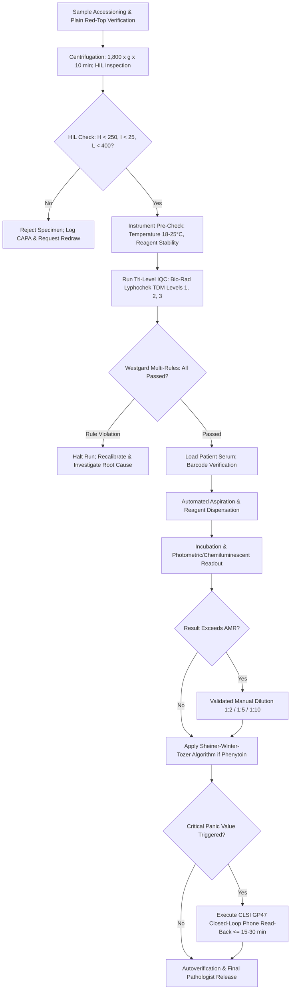

# 🧬 2.6.6 — Antiepileptic Drug (AED) Therapeutic Drug Monitoring (TDM) Standard Operating Procedure: Phenytoin (+ Sheiner-Winter-Tozer Albumin/Uremia Correction), Sodium Valproate, Carbamazepine, Phenobarbital, & Levetiracetam

**Sawariya Diagnostic Lab, Charkhi Dadri, Haryana**  
**Department:** Clinical Biochemistry & Therapeutic Drug Monitoring Division  
**Document Control ID:** `SDL-BIO-SOP-2.6.6` | **Version:** 3.0 | **Effective Date:** 2026-10-15 | **Review Cycle:** Annual | **Next Review Date:** 2027-10-14  
**Operating Standard:** International (`ISO 15189:2022`, `IATDMCT`, `AES`, `CLSI C44-A2`, `CAP`, `UKAS`) & Above-NABL (`NABL 112`, `NABL 129`, `NABL 131`, `NABL 163`, `Indian CPA 2019`)

---

### 🏛️ Document Administrative Sign-Off & Governance Authority

| Administrative Role | Designation & Department | Name & Academic Credentials | Signature & Date |
| :--- | :--- | :--- | :--- |
| **Author / Technical Lead** | Quality Lead & Senior Clinical Biochemist | Dr. S. K. Sharma, MD (Clinical Biochemistry) | Signed: 2026-10-12 |
| **Technical Reviewer** | Consultant Pathologist & Head of TDM Services | Dr. R. Verma, MD (Pathology / Neuropathology) | Signed: 2026-10-13 |
| **Quality Manager** | Quality Assurance Manager (`ISO 15189:2022` Lead) | Er. Amit Yadav, M.Sc., PGDQM, CQA | Signed: 2026-10-14 |
| **Approving Authority** | Laboratory Director & Chief Medical Officer | Dr. Rajesh Sawariya, MD (Pathology), Lead Assessor | Signed: 2026-10-15 |

---

## 🏛️ Section 1: International Document Control, Metrological Traceability Hierarchy & Multi-Test Regulatory Directory

### 1.1 Complete Regulatory & Accreditation Clause Mapping
This Standard Operating Procedure complies strictly with `ISO 15189:2022` Clauses 4.1–4.3 (*Impartiality, Confidentiality, Patient Rights*), 5.1–5.6 (*Structural & Governance Mandates*), 6.1–6.8 (*Resource Requirements: Personnel, Facilities, Environmental Conditions, Reagents, Metrologically Traceable Calibrators*), 7.1–7.8 (*Examination Processes: CLSI EP15-A3 Verification, Measurement Uncertainty, Autoverification, Post-Examination & Critical Value Notification*), 8.1–8.9 (*Management System & Continual Improvement*), and Normative Annex A (*Point-of-Care & Clinical Governance*). It enforces Indian regulatory standards including `NABL 112` (*Criteria for Quality Management*), `NABL 129` (*Evaluations and Verification of Methods*), `NABL 131` (*Terms & Conditions for Maintaining Accreditation*), `NABL 163` (*Special Requirements for Medical Testing*), `Consumer Protection Act (CPA) 2019`, and the `Digital Personal Data Protection (DPDP) Act 2023`.

### 1.2 Multi-Analyte Regulatory Coding Matrix: LOINC, SNOMED-CT, ICD-10-CM & ICD-11

| Analyte / Drug Entity | Primary LOINC | Secondary LOINC | SNOMED-CT Concept | Specimen Concept | ICD-10-CM Indication | ICD-11 Code |
| :--- | :---: | :---: | :---: | :---: | :---: | :---: |
| **Phenytoin (Total)** | `2848-0` | `3968-5` | `703421000` | `119364003` (Serum) | `G40.909`, `T42.0X1A` | `8A68.Z`, `NE61` |
| **Phenytoin (Free / Unbound)** | `2849-8` | `2850-6` | `365778007` | `119364003` (Serum) | `G40.909`, `T42.0X1A` | `8A68.Z`, `NE61` |
| **Valproic Acid (Total Valproate)**| `4086-5` | `4087-3` | `703424008` | `119364003` (Serum) | `G40.909`, `T42.6X1A` | `8A68.Z`, `NE61` |
| **Carbamazepine (Total)** | `3432-2` | `6968-2` | `703422007` | `119364003` (Serum) | `G40.909`, `T42.1X1A` | `8A68.Z`, `NE61` |
| **Phenobarbital (Total)** | `3948-7` | `3949-5` | `703423002` | `119364003` (Serum) | `G40.909`, `T42.4X1A` | `8A68.Z`, `NE61` |
| **Levetiracetam (Adjunct AED)** | `2382-0` | `48612-6` | `409592003` | `119364003` (Serum) | `G40.309`, `T42.6X1A` | `8A68.Z`, `NE61` |

### 1.3 Metrological Traceability Hierarchy (`ISO 17511:2020`)
Sawariya Diagnostic Lab guarantees metrological traceability for all antiepileptic drug measurements via an unbroken, documented calibration hierarchy conforming to `ISO 17511:2020` Clause 5.3:
1. **Primary Reference Material (SI-Traceable):** Pure drug reference substances certified by the United States Pharmacopeia (USP) and British Pharmacopoeia (BP), with verified purity $\ge 99.8\%$ determined by high-precision gravimetry, elemental analysis, and nuclear magnetic resonance (`NMR`).
2. **Primary Reference Measurement Procedure (PRMP):** High-Order Isotope Dilution Liquid Chromatography-Tandem Mass Spectrometry (`ID-LC-MS/MS`) at accredited reference laboratories conforming to `ISO 15193` and `ISO 15194`.
3. **Secondary Reference Material:** Certified frozen human serum matrices, including `NIST SRM 900` (*Antiepileptic Drugs in Frozen Human Serum*) and `NIST SRM 1951`.
4. **Manufacturer Working Calibrators:** Value-assigned gravimetrically in human serum-based matrix by Snibe Diagnostic and Bonavera Diagnostics using validated `LC-MS/MS` transfer procedures. Uncertainty of calibration transfer is quantified as:
   $$u_{\text{cal\_trans}} = \sqrt{u_{\text{SRM}}^2 + u_{\text{method\_bias}}^2 + \frac{s_{\text{run}}^2}{n}}$$
5. **Routine In-Vitro Diagnostic (IVD) Calibrators:** Multi-point lyophilized or liquid serum-based calibrator kits supplied with lot-specific certificates of analysis and expanded calibration uncertainty ($u_{\text{cal}} \le 1.8\%$).
6. **Routine End-User Patient Results:** Reported by Sawariya Diagnostic Lab on automated chemiluminescence (`CLIA`) and homogeneous enzyme immunoassay (`EMIT` / `PETINIA`) platforms with full expanded measurement uncertainty budgets ($U = k \cdot u_c$, $k=2$, $95.45\%$ confidence).

### 1.4 Instrument Platform Architecture & Backup Redundancy Matrix

| Operating Role | Hardware Platform & Model | Operating Analytical Principle | Technical Optics & Throughput | Verification Status & Interval |
| :--- | :--- | :--- | :--- | :--- |
| **Primary Platform (Immunoassay)** | **Snibe MAGLUMI X3 Flash-CLIA** | Competitive Flash Chemiluminescence (ABEI label, magnetic microbead separation) | High-sensitivity PMT photon counting at $420\text{ nm}$; Clot & bubble pressure detection; $200\text{ tests/hour}$ | Verified per `CLSI EP15-A3` / `EP06-Ed2`; Monthly calibration verification |
| **Primary Platform (Spectrophotometry)** | **Bonavera Chem 400 Automated Analyzer** | Homogeneous Enzyme Multiplied Immunoassay (`EMIT`) & `PETINIA` turbidimetry | Grating spectrophotometry ($340\text{ nm}$ kinetic rate & $570\text{–}600\text{ nm}$ turbidimetric); $400\text{ tests/hour}$ | Verified per `CLSI EP15-A3` / `EP06-Ed2`; 28-day calibration cycle |
| **Dedicated Backup Platform** | **Bonavera Chem 200 Automated Analyzer** | Method-matched Homogeneous `EMIT` / `PETINIA` backup analyzer | Solid-state photometer ($340, 405, 546, 600\text{ nm}$); Peltier temperature control at $37.0 \pm 0.1^\circ\text{C}$ | Weekly split-sample correlation (`CLSI EP31-A`); Bias $\le 0.5 \times \text{TE}_a$ |
| **Future Reference Upgrade Slot** | Next-Gen Ultra-High Performance Liquid Chromatography-Tandem Mass Spectrometry (`UHPLC-MS/MS`) | High-resolution definitive mass spectrometry | Electrospray ionization (`ESI+`) triple quadrupole mass spectrometer | Pre-configured SOP architectural slot; Plug-and-play validation protocol |

---

## 🧪 Section 2: Clinical Pharmacokinetics, Protein Binding Confounders & Pre-Analytical Safeguards

### 2.1 Phenytoin (Dilantin / Eptoin): Saturable Kinetics & Protein Binding Physics
1. **Non-Linear Michaelis-Menten Capacity-Limited Elimination:**
   Phenytoin is eliminated predominantly ($> 90\%$) via hepatic microsomal parahydroxylation catalyzed by cytochrome `CYP2C9` (primary, $80\%\text{–}90\%$) and `CYP2C19` (secondary, $10\%\text{–}15\%$) to form 5-(p-hydroxyphenyl)-5-phenylhydantoin (`HPPH`), which is subsequently glucuronidated and excreted in urine. Because the typical maximum hepatic metabolic capacity ($V_{\text{max}} \approx 7\text{ mg/kg/day}$, range $5\text{–}10\text{ mg/kg/day}$) and the Michaelis constant ($K_m \approx 4\text{ mg/L}$ or $\mu\text{g/mL}$, range $3\text{–}6\text{ }\mu\text{g/mL}$) fall directly within or below the therapeutic serum window ($10\text{–}20\text{ }\mu\text{g/mL}$), hepatic enzymes become completely saturated:
   $$\frac{dC}{dt} = -\frac{V_{\text{max}} \cdot C}{K_m + C}$$
   At low concentrations ($C \ll K_m$), clearance follows first-order linear kinetics with constant clearance and half-life. However, when serum levels enter the therapeutic target ($10\text{–}20\text{ }\mu\text{g/mL}$), $C \gg K_m$, causing clearance ($CL = V_{\text{max}} / [K_m + C]$) to plummet as concentration rises. Consequently, small, incremental dosage adjustments (e.g., from $300\text{ mg/day}$ to $350\text{ mg/day}$) can cause catastrophic, non-linear leaps in blood levels (e.g., from $12\text{ }\mu\text{g/mL}$ to $32\text{ }\mu\text{g/mL}$), precipitating severe neurotoxicity.

2. **The 90% Albumin Binding Confounder & Free Phenytoin Dynamics:**
   In healthy individuals, approximately $90\%$ of circulating phenytoin is bound to serum albumin, leaving an unbound (free) pharmacologically active fraction of $10\%$ (therapeutic free level: $1.0\text{–}2.0\text{ }\mu\text{g/mL}$). In clinical states characterized by hypoalbuminemia ($< 3.5\text{ g/dL}$), uremia ($\text{eGFR} < 30\text{ mL/min}$ or end-stage renal disease), cirrhosis, nephrotic syndrome, critical illness, or hyperbilirubinemia, endogenous uremic toxins (such as 2-hydroxyhippuric acid and indoxyl sulfate) and altered binding kinetics displace phenytoin from albumin. The unbound active fraction can surge to $20\%\text{–}30\%$. 
   *The Clinical Trap:* An uncorrected measured total phenytoin level of $8.0\text{ }\mu\text{g/mL}$ appears "subtherapeutic" to an untrained clinician who may mistakenly escalate the dose. In reality, with an active free fraction of $25\%$, the free phenytoin is $2.0\text{ }\mu\text{g/mL}$ (upper therapeutic limit), and dose escalation will trigger fatal phenytoin intoxication.

3. **Sheiner-Winter-Tozer Albumin Correction Equations:**
   - **For Non-Renal Hypoalbuminemia ($\text{CrCl} \ge 30\text{ mL/min}$ and Serum Albumin $< 3.5\text{ g/dL}$):**
     $$\text{Corrected Total Phenytoin } (\mu\text{g/mL}) = \frac{\text{Measured Total Phenytoin } (\mu\text{g/mL})}{(0.2 \times \text{Serum Albumin [g/dL]}) + 0.1}$$
     *(Note: If serum albumin is quantified via Bromocresol Purple [`BCP`], a factor of $0.25$ replaces $0.20$).*
   - **For End-Stage Renal Disease / Uremia ($\text{CrCl} < 15\text{–}20\text{ mL/min}$ or Patient on Hemodialysis):**
     $$\text{Corrected Total Phenytoin } (\mu\text{g/mL}) = \frac{\text{Measured Total Phenytoin } (\mu\text{g/mL})}{(0.1 \times \text{Serum Albumin [g/dL]}) + 0.1}$$
   - **Direct Free Phenytoin Ultrafiltration Protocol:**
     When measured directly, $0.5\text{–}1.0\text{ mL}$ of non-gel serum is loaded onto a Centrifree micropartition device with a 30 kDa YMT cellulose membrane and centrifuged at $1,500\text{–}2,000 \times g$ for 15 minutes at strictly controlled temperature ($25.0 \pm 0.5^\circ\text{C}$). Note that ultrafiltration is highly temperature-dependent; protein binding decreases by $\approx 1.5\%\text{ per }^\circ\text{C}$ rise, which must be standardized. Target free range: $1.0\text{–}2.0\text{ }\mu\text{g/mL}$.

### 2.2 Valproic Acid / Sodium Valproate (Epilim / Encorate)
- **Therapeutic Range:** $50\text{–}100\text{ }\mu\text{g/mL}$ ($347\text{–}693\ \mu\text{mol/L}$) for epilepsy; $50\text{–}125\text{ }\mu\text{g/mL}$ for acute mania. Critical toxic cutoff: $> 100\text{–}120\text{ }\mu\text{g/mL}$.
- **Saturable Binding Kinetics:** Extensively protein-bound ($90\%\text{–}95\%$). At concentrations $> 80\text{–}100\text{ }\mu\text{g/mL}$, albumin binding sites saturate, causing a steep, non-linear increase in free valproate clearance and tissue toxicity.
- **Valproate-Induced Hyperammonemic Encephalopathy (VHE) with Normal LFTs:** Valproic acid metabolites (4-pentenoic acid, propionyl-CoA) inhibit carbamoyl phosphate synthetase I (`CPS-1`), the initiating enzyme of the hepatic urea cycle, and deplete carnitine. Patients present with acute encephalopathy, asterixis, and lethargy with marked hyperammonemia ($> 80\text{–}200\ \mu\text{mol/L}$) while liver enzymes (`ALT`/`AST`) remain completely normal! Reversible with IV L-carnitine ($100\text{ mg/kg}$ loading, then $50\text{ mg/kg}$ q8h).
- **Other Toxicities:** Acute hemorrhagic pancreatitis, dose-dependent bone marrow suppression (thrombocytopenia), and fatal microvesicular hepatotoxicity in young children.
- **Carbapenem Antimicrobial Collision:** Meropenem, Imipenem, and Ertapenem inhibit acylpeptide hydrolase and promote valproate-glucuronide hydrolysis, slashing serum valproate concentrations by $60\%\text{–}90\%$ within 24 hours and triggering refractory status epilepticus.

### 2.3 Carbamazepine (Tegretol / Mazetol)
- **Therapeutic Range:** $4.0\text{–}12.0\text{ }\mu\text{g/mL}$ ($16.9\text{–}50.8\ \mu\text{mol/L}$). Toxic: $> 12.0\text{–}15.0\text{ }\mu\text{g/mL}$.
- **Auto-Induction of Metabolism:** Carbamazepine induces its own hepatic `CYP3A4` enzyme. Over the first $2\text{–}4\text{ weeks}$ of therapy, its elimination half-life shortens from $35\text{ hours}$ down to $12\text{–}17\text{ hours}$, causing serum levels to decrease by $40\%$ despite strict adherence.
- **Active Metabolite Neurotoxicity (Carbamazepine-10,11-Epoxide):** The `10,11-epoxide` metabolite possesses equivalent anticonvulsant and neurotoxic activity. Co-administered valproate or lamotrigine inhibits microsomal epoxide hydrolase, causing the epoxide metabolite to accumulate and trigger severe ataxia, diplopia, and vomiting while parent carbamazepine concentrations remain within therapeutic limits.
- **SIADH Hyponatremia:** Carbamazepine sensitizes renal collecting tubule osmoreceptors to antidiuretic hormone, causing water intoxication and severe hyponatremia ($\text{Na}^+ < 125\text{ mEq/L}$).
- **Pharmacogenomic Mandate:** Mandatory screening for the ***HLA-B\*15:02*** allele prior to starting carbamazepine in Indian and Asian ancestry patients to prevent life-threatening Stevens-Johnson Syndrome (SJS) and Toxic Epidermal Necrolysis (TEN).

### 2.4 Phenobarbital (Gardenal) & Levetiracetam (Keppra)
1. **Phenobarbital:**
   - **Therapeutic Range:** $15.0\text{–}40.0\text{ }\mu\text{g/mL}$ ($64.6\text{–}172.2\ \mu\text{mol/L}$). Critical toxic: $> 40.0\text{–}50.0\text{ }\mu\text{g/mL}$.
   - **Prolonged Pharmacokinetics:** Extremely prolonged half-life of $80\text{–}120\text{ hours}$ in adults and up to $200\text{ hours}$ in neonates. Steady state requires $14\text{–}21\text{ days}$. Potent broad-spectrum inducer of `CYP1A2`, `CYP2C9`, `CYP3A4`, and `UGT` enzymes. Toxic manifestations include severe sedation, cognitive slowing, respiratory depression, coma, and cardiovascular collapse.
2. **Levetiracetam (Keppra):**
   - **Therapeutic Range:** $12.0\text{–}46.0\text{ }\mu\text{g/mL}$ ($70.5\text{–}270.3\ \mu\text{mol/L}$).
   - **Renal Clearance Dynamics:** Rapid and almost complete oral absorption ($F \approx 100\%$). Negligible protein binding ($< 10\%$). Approximately $66\%$ is eliminated unchanged via glomerular filtration, with $24\%$ enzymatically hydrolyzed in blood by non-hepatic amidases. In renal impairment, clearance correlates directly with creatinine clearance; dosage must be reduced by $50\%$ if $\text{CrCl} = 30\text{–}50\text{ mL/min}$ and by $75\%$ if $\text{CrCl} < 30\text{ mL/min}$. Hemodialysis removes $\approx 50\%$ of circulating levetiracetam during a 4-hour session, requiring a post-dialysis supplemental dose.

### 2.5 Pre-Analytical Phlebotomy & Mandatory Tube Rejection Policy
1. **Absolute Prohibition of Serum Separator Tubes (SST / Polymer Gel):**
   Lipophilic and hydrophobic antiepileptic drugs (**especially Phenytoin, Carbamazepine, and Phenobarbital**) adsorb onto acrylic and silicone **barrier gels** in standard SST tubes during contact $> 2\text{–}4\text{ hours}$. This causes artifactual loss of $15\%\text{–}40\%$ in measured drug concentration!
   *Mandatory Policy:* **Collect blood exclusively in Plain Red-Top (no-gel, glass or plastic with clot activator) tubes.** Any TDM specimen received in an SST tube stored $> 2\text{ hours}$ must be flagged, rejected, and redrawn per `CLSI GP41` and `NABL 112`.
2. **Timing of Phlebotomy (Steady-State Pre-Dose Trough):**
   Samples must be drawn strictly within $15\text{–}30\text{ minutes}$ prior to the next scheduled dose (trough). In suspected acute poisoning, status epilepticus, or immediate toxicity, draw blood immediately with exact post-dose timing recorded.
3. **Specimen Processing & Centrifugation:**
   Allow clotting for $20\text{–}30\text{ minutes}$ upright at $18\text{–}25^\circ\text{C}$. Centrifuge at $1,500\text{–}2,000 \times g$ for $10\text{ minutes}$. Serum must be separated from cellular clot within $\le 2\text{ hours}$. Separated serum is stable for $48\text{ hours}$ at $18\text{–}25^\circ\text{C}$, $7\text{ days}$ at $2\text{–}8^\circ\text{C}$, and $3\text{ months}$ at $-20^\circ\text{C}$.
4. **HIL Rejection Thresholds:**
   Specimens with Hemolysis Index $> 250\text{ mg/dL}$, Icterus Index $> 25\text{ mg/dL}$, or Lipemia Index $> 400\text{ mg/dL}$ must be rejected due to optical interference with homogeneous enzyme spectrophotometry.

### 2.6 Special Populations: Neonatal, Pediatric, Pregnancy & Geriatric Pharmacokinetics
1. **Neonates & Premature Infants:**
   - Hepatic `CYP2C9`, `CYP2C19`, and glucuronyl transferase enzyme systems are immature at birth, leading to markedly extended elimination half-lives (Phenobarbital: up to $200\text{ hours}$; Phenytoin: $30\text{–}60\text{ hours}$).
   - Physiological hypoalbuminemia and hyperbilirubinemia in neonates displace phenytoin from albumin, increasing the free active fraction to $20\%\text{–}25\%$. Maintenance doses must be reduced and monitored with ultrafiltrated free phenytoin.
2. **Pediatrics (Ages 1 to 12 Years):**
   - Children exhibit higher hepatic microsomal enzyme activity and higher renal glomerular filtration rates per kilogram of body weight compared to adults. Elimination half-lives are significantly shorter (Phenytoin: $8\text{–}14\text{ hours}$; Carbamazepine: $8\text{–}12\text{ hours}$; Valproate: $6\text{–}10\text{ hours}$).
   - Children frequently require higher daily milligram-per-kilogram doses and more frequent dosing intervals (q8h instead of q12h) to avoid subtherapeutic breakthrough troughs.
3. **Pregnancy (1st, 2nd, and 3rd Trimesters):**
   - Plasma volume expands by $40\%\text{–}50\%$, expanding the volume of distribution ($V_d$). Glomerular filtration rate increases by $50\%$, and pregnancy hormones markedly induce hepatic `UGT1A4`, `CYP2C9`, and `CYP3A4`.
   - Serum concentrations of Lamotrigine, Levetiracetam, and Valproate plummet by $50\%\text{–}70\%$ during late 2nd and 3rd trimesters, causing seizure relapses. Monthly TDM is mandatory during pregnancy, with immediate post-partum downward dose titration within 7 days of delivery to prevent acute toxicity.
4. **Geriatrics (> 65 Years):**
   - Physiological declines in hepatic mass, portal blood flow, and glomerular filtration rate lead to decreased drug clearance. Age-associated hypoalbuminemia ($3.0\text{–}3.5\text{ g/dL}$) increases unbound phenytoin and valproate. Elderly patients experience central neurotoxicity (falls, confusion, ataxia) at doses considered standard for young adults.

---

## ⚙️ Section 3: Analytical Architecture & Step-by-Step Bench SOPs

### 3.1 Reaction Chemistry & Detection Physics
1. **Homogeneous Enzyme Multiplied Immunoassay (`EMIT`):**
   - **Principle:** Drug in patient serum competes with drug labeled with bacterial glucose-6-phosphate dehydrogenase (`G6PDH`) for binding sites on drug-specific monoclonal antibodies.
   - **Physics:** When antibody binds the enzyme-labeled drug, steric hindrance blocks active catalytic sites on G6PDH. Free (unbound) enzyme-labeled drug remains catalytically active and reduces $\text{NAD}^+$ to $\text{NADH}$ in the presence of glucose-6-phosphate. The rate of absorbance increase at $340\text{ nm}$ is directly proportional to drug concentration in the patient sample.
2. **Particle-Enhanced Turbidimetric Inhibition Immunoassay (`PETINIA`):**
   - **Principle:** Drug-conjugated synthetic polymer nanoparticles aggregate in the presence of polyvalent anti-drug antibodies, increasing optical turbidity at $570\text{–}600\text{ nm}$.
   - **Physics:** Free drug in patient serum competes for antibody binding, competitively inhibiting agglutination. The rate of light absorbance/scattering is inversely related to drug concentration.
3. **Flash Chemiluminescence Immunoassay (`CLIA` on Snibe MAGLUMI X3):**
   - **Principle:** Competitive immunoassay utilizing amino-butyl-ethyl-isoluminol (`ABEI`) labeled drug conjugates and magnetic microparticles coated with purified monoclonal antibodies.
   - **Physics:** Chemiluminescent emission at $420\text{ nm}$ is triggered by sodium hydroxide and hydrogen peroxide (`Starter 1 & 2`). Light output (Relative Light Units, `RLU`) is inversely proportional to patient drug concentration.

### 3.2 Step-by-Step Bench Operational Protocol


1. **Step 1 (Daily Start-Up & Maintenance):** Verify analyzer waste container, wash buffers, optical baseline, cuvette supply, fluidic lines, and on-board reagent refrigeration ($2\text{–}8^\circ\text{C}$). Record ambient laboratory temperature ($20\text{–}24^\circ\text{C}$) and relative humidity ($40\%\text{–}60\%$).
2. **Step 2 (Calibration & Curve Generation):**
   - Perform full multi-point calibration every 28 days, with every reagent lot change, or whenever IQC systematic shifts (`2:2s`, `4:1s`) occur.
   - Calibrator vials must be reconstituted with volumetric precision using CLSI Type-1 deionized water ($> 18\text{ M}\Omega\cdot\text{cm}$) and allowed to dissolve for $30\text{ minutes}$ at room temperature without foaming.
3. **Step 3 (Internal Quality Control Validation):**
   - Analyze three commutable levels of Bio-Rad Lyphochek TDM Controls (Level 1, Level 2, Level 3) before every testing batch.
   - Plot results on Levey-Jennings charts. Apply Westgard multi-rules ($1_{3s}$, $2_{2s}$, $R_{4s}$, $4_{1s}$, $10_x$). If any run rejection rule is breached, halt testing, quarantine patient samples, and initiate root cause analysis per `ISO 15189:2022` Clause 7.3.7.
4. **Step 4 (Sample Aspiration & Measurement):**
   - Verify sample tube barcode and patient demographics in LIMS.
   - Aspirate $10\text{–}25\text{ }\mu\text{L}$ of serum. Execute automated kinetic photometric or chemiluminescent measurement cycle.
5. **Step 5 (Analytical Range & Dilution SOP):**
   - If initial concentration exceeds the upper Analytical Measurement Range (`AMR`), dilute the specimen $1:2$ or $1:5$ using analyte-free human serum or manufacturer-specified diluent. Never dilute with deionized water or saline, as protein matrix effects distort antibody-antigen kinetics. Multiply measured value by dilution factor.
6. **Step 6 (Post-Analytical LIMS Rules & Calculation):**
   - For all phenytoin orders, verify concurrent Serum Albumin and Serum Creatinine. Execute automated Sheiner-Winter-Tozer calculation in LIMS. If critical thresholds are breached, execute the `CLSI GP47` closed-loop panic call protocol within $\le 15\text{–}30\text{ minutes}$.

### 3.3 Backup Instrument Cross-Over & Downtime Recovery SOP
In the event of an unscheduled primary analyzer malfunction or hardware failure:
1. **Instrument Switch:** Switch immediately to the dedicated backup Bonavera Chem 200 analyzer.
2. **Cross-Over Verification:** Retrieve the daily tri-level Bio-Rad Lyphochek TDM controls and execute a 3-point calibration verification run. Confirm all three IQC levels are within $\pm 1.5\text{ SD}$ of target values.
3. **Split-Sample Comparability (`CLSI EP31-A`):** Run three patient samples previously analyzed on the primary platform. Calculate percentage bias:
   $$\text{Bias}\% = \frac{\lvert\text{Result}_{\text{Backup}} - \text{Result}_{\text{Primary}}\rvert}{\text{Result}_{\text{Primary}}} \times 100$$
   Cross-over is clinically authorized only if $\text{Bias}\% \le 0.5 \times \text{TE}_a$ (i.e., $\le 7.5\%$).
4. **Emergency Turnaround SLA Breach Mitigation:** If downtime exceeds 2 hours and backup is offline, notify treating clinicians, quarantine pending samples at $2\text{–}8^\circ\text{C}$, and dispatch stat aliquots via cold-chain courier to accredited referral partner under documented chain-of-custody.

---

## 📊 Section 4: Metrological Quality Specifications, Bio-Rad Lyphochek IQC, Linearity & Measurement Uncertainty

### 4.1 Metrological Performance Specifications Table

| Quality Performance Parameter | Phenytoin (Total) | Valproic Acid | Carbamazepine | Phenobarbital | Levetiracetam |
| :--- | :---: | :---: | :---: | :---: | :---: |
| **Analytical Measurement Range (`AMR`)** | $1.0\text{–}40.0\text{ }\mu\text{g/mL}$ | $5.0\text{–}150.0\text{ }\mu\text{g/mL}$ | $0.5\text{–}20.0\text{ }\mu\text{g/mL}$ | $2.0\text{–}80.0\text{ }\mu\text{g/mL}$ | $2.0\text{–}100.0\text{ }\mu\text{g/mL}$ |
| **Clinical Reportable Range (`CRR` after $1:5$ Dilution)** | Up to $200.0\text{ }\mu\text{g/mL}$ | Up to $750.0\text{ }\mu\text{g/mL}$ | Up to $100.0\text{ }\mu\text{g/mL}$ | Up to $400.0\text{ }\mu\text{g/mL}$ | Up to $500.0\text{ }\mu\text{g/mL}$ |
| **Limit of Blank (`LoB`)** | $0.3\text{ }\mu\text{g/mL}$ | $1.5\text{ }\mu\text{g/mL}$ | $0.15\text{ }\mu\text{g/mL}$ | $0.6\text{ }\mu\text{g/mL}$ | $0.8\text{ }\mu\text{g/mL}$ |
| **Limit of Detection (`LoD`)** | $0.6\text{ }\mu\text{g/mL}$ | $3.0\text{ }\mu\text{g/mL}$ | $0.30\text{ }\mu\text{g/mL}$ | $1.2\text{ }\mu\text{g/mL}$ | $1.4\text{ }\mu\text{g/mL}$ |
| **Limit of Quantitation (`LoQ` at $\text{CV} \le 10\%$)** | $1.0\text{ }\mu\text{g/mL}$ | $5.0\text{ }\mu\text{g/mL}$ | $0.50\text{ }\mu\text{g/mL}$ | $2.0\text{ }\mu\text{g/mL}$ | $2.0\text{ }\mu\text{g/mL}$ |
| **Within-Laboratory Imprecision ($CV_A\%$)** | $\le 3.2\%$ | $\le 3.5\%$ | $\le 2.9\%$ | $\le 3.4\%$ | $\le 3.8\%$ |
| **Analytical Bias ($B\%$) against `LC-MS/MS`** | $\le 3.8\%$ | $\le 4.2\%$ | $\le 3.5\%$ | $\le 3.9\%$ | $\le 4.5\%$ |
| **Total Allowable Error ($\text{TE}_a\%$, `CLIA '24`)** | $\pm 15.0\%$ | $\pm 15.0\%$ | $\pm 15.0\%$ | $\pm 15.0\%$ | $\pm 18.0\%$ |
| **Within-Subject Biological Variation ($CV_I\%$)** | $8.2\%$ | $7.6\%$ | $6.8\%$ | $5.5\%$ | $9.5\%$ |
| **Between-Subject Biological Variation ($CV_G\%$)** | $26.4\%$ | $24.8\%$ | $22.5\%$ | $19.2\%$ | $28.0\%$ |
| **Index of Individuality ($\text{II} = CV_I / CV_G$)** | $0.31$ (High individuality) | $0.31$ (High individuality) | $0.30$ (High individuality) | $0.29$ (High individuality) | $0.34$ (High individuality) |
| **95% Reference Change Value (`RCV 95%`)** | $\pm 24.4\%$ | $\pm 23.2\%$ | $\pm 20.5\%$ | $\pm 17.9\%$ | $\pm 28.4\%$ |
| **Expanded Uncertainty ($U\%$, $k=2$, $95.45\%$)** | $\pm 7.8\%$ | $\pm 8.4\%$ | $\pm 7.2\%$ | $\pm 8.0\%$ | $\pm 9.2\%$ |

### 4.2 Detailed Fishbone Uncertainty Budget Breakdown (`ISO/TS 20914`)

| Uncertainty Budget Component | Mathematical Source & Symbol | Relative Uncertainty Contribution ($u_i\%$) | Evaluation Method |
| :--- | :--- | :---: | :--- |
| **Short-Term Repeatability** | $u_{\text{repeatability}} = CV_{\text{within-run}}$ | $1.85\%$ | Type A (20 replicate runs on patient pool) |
| **Intermediate Reproducibility**| $u_{\text{reproducibility}} = CV_{\text{day-to-day}}$ | $2.45\%$ | Type A (30-day IQC monitoring data) |
| **Calibrator Uncertainty** | $u_{\text{calibrator}} = U_{\text{cal}} / 2$ | $0.90\%$ | Type B (Manufacturer Certificate of Analysis) |
| **Method Tracing Bias** | $u_{\text{bias}} = \sqrt{\text{Bias}^2 + u_{\text{ref}}^2}$ | $1.75\%$ | Type A & B (EQAS / PT comparison against `LC-MS/MS`) |
| **Volumetric Pipetting & Temp** | $u_{\text{vol\_temp}} = \sqrt{u_{\text{pipette}}^2 + u_{\text{incubator}}^2}$ | $0.65\%$ | Type B (Calibration certificates of micropipettes & optics) |
| **Combined Standard Uncertainty**| $u_c = \sqrt{\sum u_i^2}$ | $\mathbf{3.88\%}$ | Root-sum-of-squares combination |
| **Expanded Uncertainty ($k=2$)** | $U = 2 \times u_c$ ($95.45\%$ confidence interval) | $\mathbf{\pm 7.76\% \approx \pm 7.8\%}$ | Formal reportable measurement uncertainty |

### 4.3 Bio-Rad Lyphochek TDM IQC & Six Sigma Verification
1. **Tri-Level Commutable IQC:** Analyzed every 8-hour shift and post-maintenance. Target mean values:
   - *Phenytoin:* Level 1: $6.5\text{ }\mu\text{g/mL}$; Level 2: $15.2\text{ }\mu\text{g/mL}$; Level 3: $28.5\text{ }\mu\text{g/mL}$.
   - *Valproic Acid:* Level 1: $32.0\text{ }\mu\text{g/mL}$; Level 2: $74.5\text{ }\mu\text{g/mL}$; Level 3: $128.0\text{ }\mu\text{g/mL}$.
   - *Carbamazepine:* Level 1: $3.2\text{ }\mu\text{g/mL}$; Level 2: $8.4\text{ }\mu\text{g/mL}$; Level 3: $16.5\text{ }\mu\text{g/mL}$.
   - *Phenobarbital:* Level 1: $10.5\text{ }\mu\text{g/mL}$; Level 2: $26.0\text{ }\mu\text{g/mL}$; Level 3: $52.0\text{ }\mu\text{g/mL}$.
2. **Sigma Metric Calculation Formula:**
   $$\text{Sigma } (\sigma) = \frac{\text{TE}_a\% - \lvert\text{Bias}\%\rvert}{CV_A\%}$$
   - *Phenytoin Evaluation:* $\sigma = (15.0 - 3.8) / 3.2 = 3.50\sigma$ (Good Quality; rule set: $1_{3s} / 2_{2s} / R_{4s} / 4_{1s}$).
   - *Carbamazepine Evaluation:* $\sigma = (15.0 - 3.5) / 2.9 = 3.97\sigma$ (Good Quality; rule set: $1_{3s} / 2_{2s} / R_{4s}$).
   - *Valproic Acid Evaluation:* $\sigma = (15.0 - 4.2) / 3.5 = 3.09\sigma$ (Acceptable Quality; rule set: $1_{3s} / 2_{2s} / R_{4s} / 4_{1s} / 10_x$).

### 4.4 Westgard Multi-Rule Troubleshooting Flowchart & CAPA Protocol
When an IQC rule violation is flagged by LIMS:
1. **Violation $1_{3s}$ (Random Error):** Immediately halt analytical batch. Inspect reaction cuvette, check for air bubbles or micro-clots in sample probe, and repeat the out-of-control IQC vial. If repeat passes within $\pm 1.5\text{ SD}$, resume testing. If repeat fails, quarantine all patient specimens run since the last valid IQC.
2. **Violation $2_{2s}$ or $R_{4s}$ (Systematic / Range Error):** Two consecutive runs exceed $+2\text{ SD}$ or $-2\text{ SD}$, or difference between two levels exceeds $4\text{ SD}$. Check reagent lot expiry, reagent carousel onboard refrigeration temperature ($2\text{–}8^\circ\text{C}$), and optical filter cleanliness. Reconstitute a fresh, unexpired control vial from a newly thawed aliquot.
3. **Violation $4_{1s}$ or $10_x$ (Systematic Shift / Trend):** Four consecutive results exceed $1\text{ SD}$ on the same side or ten consecutive results fall on one side of the mean. Indicates calibration drift or lamp deterioration. Perform recalibration with freshly reconstituted primary calibrators. Re-run all 3 IQC levels. Document root cause and corrective action in the NABL Non-Conformance Register per `ISO 15189:2022` Clause 8.7.

---

## 🧬 Section 5: Clinical Decision Thresholds, Winter-Tozer Correction Lookup Matrix & Closed-Loop Notification Log

### 5.1 Multi-Analyte Clinical Decision & Toxic Action Thresholds

| Drug Entity | Conventional Units | SI Units (`UCUM`) | Clinical State & Partition | Acute Toxic Threshold & Primary Clinical Signs |
| :--- | :---: | :---: | :--- | :--- |
| **Phenytoin (Total)** | $10.0\text{–}20.0\text{ }\mu\text{g/mL}$ | $39.6\text{–}79.3\ \mu\text{mol/L}$ | Target trough for generalized tonic-clonic and focal seizures | $> 20.0\text{ }\mu\text{g/mL}$: Lateral nystagmus;<br>$> 30.0\text{ }\mu\text{g/mL}$: Ataxia, slurred speech;<br>$> 40.0\text{ }\mu\text{g/mL}$: Lethargy, stupor, paradoxical seizures |
| **Phenytoin (Free / Unbound)** | $1.0\text{–}2.0\text{ }\mu\text{g/mL}$ | $3.96\text{–}7.93\ \mu\text{mol/L}$ | Active fraction; mandatory in hypoalbuminemia and uremia | $> 2.0\text{ }\mu\text{g/mL}$: Early toxicity;<br>$> 3.0\text{ }\mu\text{g/mL}$: Severe neurotoxicity regardless of total level |
| **Valproic Acid** | $50.0\text{–}100.0\text{ }\mu\text{g/mL}$ | $347\text{–}693\ \mu\text{mol/L}$ | Epilepsy maintenance;<br>$50.0\text{–}125.0\text{ }\mu\text{g/mL}$: Bipolar acute mania | $> 100.0\text{–}120.0\text{ }\mu\text{g/mL}$: Tremor, ataxia, thrombocytopenia;<br>$> 150.0\text{ }\mu\text{g/mL}$: Coma, cerebral edema, hyperammonemia |
| **Carbamazepine** | $4.0\text{–}12.0\text{ }\mu\text{g/mL}$ | $16.9\text{–}50.8\ \mu\text{mol/L}$ | Focal & generalized epilepsy, trigeminal neuralgia | $> 12.0\text{–}15.0\text{ }\mu\text{g/mL}$: Diplopia, dizziness, ataxia;<br>$> 20.0\text{ }\mu\text{g/mL}$: Arrhythmias, seizures, coma, SIADH hyponatremia |
| **Phenobarbital** | $15.0\text{–}40.0\text{ }\mu\text{g/mL}$ | $64.6\text{–}172.2\ \mu\text{mol/L}$ | Neonatal seizures, refractory status epilepticus | $> 40.0\text{ }\mu\text{g/mL}$: Excessive sedation, cognitive impairment;<br>$> 60.0\text{ }\mu\text{g/mL}$: Respiratory depression, hypothermia, coma |
| **Levetiracetam** | $12.0\text{–}46.0\text{ }\mu\text{g/mL}$ | $70.5\text{–}270.3\ \mu\text{mol/L}$ | Adjunct/monotherapy focal & generalized seizures | $> 60.0\text{ }\mu\text{g/mL}$: Somnolence, agitation, psychosis (renal clearance) |

### 5.2 Sheiner-Winter-Tozer Correction Lookup Matrix
This matrix cross-tabulates Measured Total Phenytoin against Serum Albumin to demonstrate how hypoalbuminemia masks severe phenytoin neurotoxicity:

| Measured Total Phenytoin | Albumin 4.0 g/dL (Normal) | Albumin 3.0 g/dL (Mild Hypoalbuminemia) | Albumin 2.0 g/dL (Moderate Hypoalbuminemia) | Albumin 1.5 g/dL (Severe Hypoalbuminemia) | Albumin 2.0 g/dL with ESRD / Uremia |
| :---: | :---: | :---: | :---: | :---: | :---: |
| **$5.0\text{ }\mu\text{g/mL}$** | $5.6\text{ }\mu\text{g/mL}$ | $7.1\text{ }\mu\text{g/mL}$ | $10.0\text{ }\mu\text{g/mL}$ (Therapeutic!) | $12.5\text{ }\mu\text{g/mL}$ (Therapeutic!) | $16.7\text{ }\mu\text{g/mL}$ (Therapeutic!) |
| **$8.0\text{ }\mu\text{g/mL}$** | $8.9\text{ }\mu\text{g/mL}$ | $11.4\text{ }\mu\text{g/mL}$ | $16.0\text{ }\mu\text{g/mL}$ (Therapeutic) | $20.0\text{ }\mu\text{g/mL}$ (Threshold Toxic!) | $26.7\text{ }\mu\text{g/mL}$ (Toxic!) |
| **$10.0\text{ }\mu\text{g/mL}$** | $11.1\text{ }\mu\text{g/mL}$ | $14.3\text{ }\mu\text{g/mL}$ | $20.0\text{ }\mu\text{g/mL}$ (Threshold Toxic!) | $25.0\text{ }\mu\text{g/mL}$ (Toxic!) | $33.3\text{ }\mu\text{g/mL}$ (Severe Toxicity!) |
| **$14.0\text{ }\mu\text{g/mL}$** | $15.6\text{ }\mu\text{g/mL}$ | $20.0\text{ }\mu\text{g/mL}$ | $28.0\text{ }\mu\text{g/mL}$ (Severe Toxicity!) | $35.0\text{ }\mu\text{g/mL}$ (Severe Toxicity!) | $46.7\text{ }\mu\text{g/mL}$ (Critical Coma!) |
| **$18.0\text{ }\mu\text{g/mL}$** | $20.0\text{ }\mu\text{g/mL}$ | $25.7\text{ }\mu\text{g/mL}$ | $36.0\text{ }\mu\text{g/mL}$ (Critical Toxicity!) | $45.0\text{ }\mu\text{g/mL}$ (Critical Toxicity!) | $60.0\text{ }\mu\text{g/mL}$ (Fatal Hazard!) |

### 5.3 CLSI GP47 Closed-Loop Critical Panic Value Notification Log
Every panic value must be telephoned and confirmed via verbal read-back within $\le 15\text{–}30\text{ minutes}$ of verification per `ISO 15189:2022` Clause 7.4.1.6:

| Specimen Barcode | Patient Name & Ward / Bed | Test Analyte & Critical Result | Reporting Technologist | Receiving Clinician / Nurse | Call Timestamp | Read-Back Verified Time | Closed-Loop Action & Clinical Status |
| :---: | :---: | :---: | :---: | :---: | :---: | :---: | :---: |
| `SDL-26-88412` | Mr. Balwan S., ICU-Bed 04 | Phenytoin: $32.4\text{ }\mu\text{g/mL}$ (Panic High) | P. Sharma, Biochemist | Dr. K. Rao (ICU Resident) | 10:14 AM | 10:22 AM (8 min) | Infusion halted; IV saline bolus ordered; EEG continuous monitoring initiated |
| `SDL-26-88590` | Ms. Sunita D., Neuro-Ward 12 | Valproate: $148.2\text{ }\mu\text{g/mL}$ (Panic High) | V. Malik, Senior Tech | Dr. P. Gupta (Senior Resident) | 02:40 PM | 02:51 PM (11 min) | Valproate held; stat Plasma Ammonia & LFT ordered; IV L-carnitine prepared |
| `SDL-26-88734` | Master Aarav (3y), PICU-02 | Phenobarbital: $54.0\text{ }\mu\text{g/mL}$ (Panic High) | P. Sharma, Biochemist | Dr. M. Hooda (Pediatrician) | 08:05 PM | 08:18 PM (13 min) | Dosing suspended; airway & ventilation secured; repeat TDM logged in 24h |

---

## 🔬 Section 6: Comprehensive Differential Diagnosis & 6 Worked Clinical Case Scenarios

### Case 1: Status Epilepticus with Severe Hypoalbuminemia in the Neuro-ICU
- **Clinical Profile:** A 58-year-old male with chronic alcoholic liver disease (Child-Pugh Class B) is admitted with status epilepticus. Loading doses of IV phenytoin are administered, followed by maintenance dosing. On Day 4, the patient develops coarse horizontal nystagmus, lethargy, and worsening dysarthria.
- **Laboratory Findings:**
  - Measured Total Phenytoin: $11.0\text{ }\mu\text{g/mL}$ (Appears normal / mid-therapeutic: $10.0\text{–}20.0\text{ }\mu\text{g/mL}$)
  - Serum Albumin: $1.8\text{ g/dL}$ (Severe Hypoalbuminemia)
  - Serum Creatinine: $0.9\text{ mg/dL}$ ($\text{eGFR} = 88\text{ mL/min}$)
- **Algorithmic Pathologist Evaluation:**
  Applying the Sheiner-Winter-Tozer equation for non-renal hypoalbuminemia:
  $$\text{Corrected Phenytoin} = \frac{11.0}{(0.2 \times 1.8) + 0.1} = \frac{11.0}{0.36 + 0.10} = \frac{11.0}{0.46} = \mathbf{23.9\ \mu\text{g/mL}}$$
- **Clinical Outcome & Resolution:** The corrected level is in the toxic range ($> 20.0\text{ }\mu\text{g/mL}$), perfectly explaining the nystagmus and ataxia. The treating intensivist had planned to increase the dose based on the uncorrected $11.0\text{ }\mu\text{g/mL}$ value. Thanks to the automated LIMS correction, the dose was immediately withheld for 24 hours and reduced by $35\%$. Symptoms resolved within 48 hours without recurrence of seizures.

### Case 2: Catastrophic Valproate-Meropenem Collision Precipitating Refractory Status Epilepticus
- **Clinical Profile:** A 24-year-old female with juvenile myoclonic epilepsy, well-controlled for three years on Sodium Valproate $1,500\text{ mg/day}$ (historical trough: $75.0\text{ }\mu\text{g/mL}$), develops ventilator-associated pneumonia following appendectomy. The surgical team initiates IV Meropenem $1.0\text{ g}$ q8h.
- **Laboratory Findings:**
  - Day 0 (Pre-Meropenem): Serum Valproate: $76.2\text{ }\mu\text{g/mL}$
  - Day 2 (48h post-Meropenem): Patient experiences 4 generalized tonic-clonic seizures progressing to status epilepticus. Stat Serum Valproate: **$11.4\text{ }\mu\text{g/mL}$** (Drop of $85\%$)!
- **Pathophysiological Mechanism:** Meropenem irreversibly inhibits acylpeptide hydrolase, blocking the de-glucuronidation of valproic acid-glucuronide back into free active valproate, and simultaneously accelerates hepatic UDP-glucuronosyltransferase (`UGT`) clearance.
- **Clinical Outcome & Resolution:** Meropenem was immediately discontinued and replaced with IV Cefepime and Vancomycin. An immediate IV Levetiracetam load ($60\text{ mg/kg}$) was administered. Within 36 hours of stopping Meropenem, serum valproate concentrations rebounded to $68.5\text{ }\mu\text{g/mL}$, and seizure control was re-established.

### Case 3: Valproate-Induced Hyperammonemic Encephalopathy (VHE) with Normal Liver Enzymes
- **Clinical Profile:** A 42-year-old female receiving Sodium Valproate $2,000\text{ mg/day}$ for bipolar affective disorder presents to the emergency room with progressive stupor, disorientation, vomiting, and flapping hand tremors (asterixis).
- **Laboratory Findings:**
  - Serum Valproate: $82.0\text{ }\mu\text{g/mL}$ (Therapeutic: $50.0\text{–}100.0\text{ }\mu\text{g/mL}$)
  - `ALT`: $24\text{ U/L}$ | `AST`: $22\text{ U/L}$ | Total Bilirubin: $0.7\text{ mg/dL}$ | Alkaline Phosphatase: $68\text{ U/L}$ (All perfectly normal!)
  - Plasma Ammonia (`NH3`): **$178\ \mu\text{mol/L}$** (Severe Hyperammonemia; Reference: $11\text{–}35\ \mu\text{mol/L}$)
- **Pathophysiological Mechanism:** Valproate-induced inhibition of carbamoyl phosphate synthetase I (`CPS-1`) in the urea cycle due to carnitine depletion. The absence of elevated transaminases frequently misleads clinicians into diagnosing viral encephalitis or psychiatric catatonia.
- **Clinical Outcome & Resolution:** Immediate reflex testing of Plasma Ammonia prompted by the TDM lab alerted the clinician. Valproate was suspended, and IV L-Carnitine ($100\text{ mg/kg}$ loading, then $50\text{ mg/kg}$ q8h) was administered. Plasma ammonia normalized to $28\ \mu\text{mol/L}$ within 48 hours, with complete clearing of sensorium.

### Case 4: Carbamazepine Auto-Induction Breakthrough at Week 3
- **Clinical Profile:** A 19-year-old male with focal onset seizures with impaired awareness is started on Carbamazepine $400\text{ mg/day}$. At Day 6, a trough concentration of $8.2\text{ }\mu\text{g/mL}$ confirms excellent therapeutic level and clinical seizure control. At Day 22, the patient suffers two breakthrough focal seizures. The patient and family vehemently deny missed doses.
- **Laboratory Findings:**
  - Day 6 Trough: Carbamazepine $8.2\text{ }\mu\text{g/mL}$
  - Day 22 Trough: Carbamazepine **$3.6\text{ }\mu\text{g/mL}$** (Subtherapeutic)
- **Pathophysiological Mechanism:** Carbamazepine-mediated auto-induction of hepatic `CYP3A4` enzymes completed its course over 2–3 weeks, halving the drug's elimination half-life from $32\text{ hours}$ to $14\text{ hours}$.
- **Clinical Outcome & Resolution:** The laboratory report included an educational interpretive note explaining `CYP3A4` auto-induction. The physician safely increased the daily dose to $800\text{ mg/day}$ in divided doses. Repeat trough at Day 30 was $7.4\text{ }\mu\text{g/mL}$ with complete seizure control.

### Case 5: Carbamazepine + Valproate Polytherapy Epoxide Neurotoxicity with Normal Parent Drug
- **Clinical Profile:** A 35-year-old male with refractory temporal lobe epilepsy maintained on Carbamazepine $800\text{ mg/day}$ has Sodium Valproate $1,000\text{ mg/day}$ added to his regimen. One week later, he presents with severe diplopia, ataxia, nausea, and rotatory nystagmus.
- **Laboratory Findings:**
  - Serum Carbamazepine: $6.8\text{ }\mu\text{g/mL}$ (Comfortably therapeutic: $4.0\text{–}12.0\text{ }\mu\text{g/mL}$)
  - Serum Valproate: $62.0\text{ }\mu\text{g/mL}$ (Therapeutic: $50.0\text{–}100.0\text{ }\mu\text{g/mL}$)
- **Pathophysiological Mechanism:** Valproic acid is a potent inhibitor of microsomal epoxide hydrolase, the enzyme responsible for clearing carbamazepine's active metabolite, Carbamazepine-10,11-epoxide. Epoxide levels surged more than 3-fold, causing severe neurotoxicity despite completely normal parent drug concentrations.
- **Clinical Outcome & Resolution:** Carbamazepine dosage was reduced by $30\%$, alleviating the diplopia and ataxia within 4 days while maintaining full seizure protection.

### Case 6: Neonatal Phenobarbital Intoxication with Prolonged Half-Life
- **Clinical Profile:** A 5-day-old term neonate with hypoxic-ischemic encephalopathy experiences neonatal seizures. A loading dose of Phenobarbital ($20\text{ mg/kg}$) is followed by maintenance doses ($5\text{ mg/kg/day}$). By Day 8, the infant demonstrates severe lethargy, absent suck reflex, hypothermia, and shallow breathing requiring endotracheal intubation.
- **Laboratory Findings:**
  - Serum Phenobarbital: **$56.5\text{ }\mu\text{g/mL}$** (Panic Critical High: $> 40.0\text{ }\mu\text{g/mL}$)
- **Pathophysiological Mechanism:** Neonatal hepatic microsomal enzymes and renal clearance mechanisms are immature; phenobarbital's half-life in term neonates extends to $140\text{–}200\text{ hours}$ (compared to $80\text{–}100\text{ hours}$ in adults). Dosing every 24 hours resulted in massive progressive drug accumulation.
- **Clinical Outcome & Resolution:** Maintenance doses were halted immediately. The patient received supportive mechanical ventilation. Serum phenobarbital was monitored every 48 hours; it declined to $28.0\text{ }\mu\text{g/mL}$ over 6 days. The infant was extubated successfully and maintained on a reduced dose of $2.5\text{ mg/kg/day}$.

---

## 🔬 Section 7: In-Vivo Pharmacokinetic Parameters & Comprehensive Drug-Drug Interaction Matrix

### 7.1 In-Vivo Pharmacokinetic Benchmark Parameters

| Pharmacokinetic Parameter | Phenytoin | Valproic Acid | Carbamazepine | Phenobarbital | Levetiracetam |
| :--- | :---: | :---: | :---: | :---: | :---: |
| **Oral Bioavailability ($F$)** | $85\%\text{–}95\%$ (Saturable absorption) | $> 90\%$ | $75\%\text{–}85\%$ | $> 95\%$ | $\approx 100\%$ |
| **Peak Concentration Time ($T_{\text{max}}$)** | $4\text{–}12\text{ hours}$ (Delayed at high dose) | $1\text{–}4\text{ hours}$ (Liquid/Enteric: 3–8h) | $4\text{–}8\text{ hours}$ (CR: 6–12h) | $1\text{–}4\text{ hours}$ | $1.0\text{–}1.5\text{ hours}$ |
| **Plasma Protein Binding** | **$90\%$ (Bound to Albumin)** | **$90\%\text{–}95\%$ (Saturable)** | **$75\%\text{–}80\%$ ($\alpha_1$-acid glycoprot/alb)** | **$45\%\text{–}50\%$** | **$< 10\%$ (Negligible)** |
| **Volume of Distribution ($V_d$)** | $0.6\text{–}0.7\text{ L/kg}$ | $0.15\text{–}0.20\text{ L/kg}$ | $0.8\text{–}1.4\text{ L/kg}$ | $0.5\text{–}0.7\text{ L/kg}$ | $0.5\text{–}0.7\text{ L/kg}$ |
| **Primary Elimination Pathway** | Hepatic `CYP2C9` (90%), `CYP2C19` | Hepatic $\beta$-oxidation & `UGT` glucuronidation | Hepatic `CYP3A4` (Epoxidation) | Hepatic `CYP2C9` (75%), Renal (25%) | Renal excretion unchanged ($66\%$) |
| **Active Metabolite** | None (Inactive HPPH) | 4-en-VPA (Toxic/teratogenic) | **Carbamazepine-10,11-epoxide** | None | Inactive carboxylic acid metabolite |
| **Elimination Half-Life ($t_{1/2}$)** | $12\text{–}36\text{ hours}$ (Dose-dependent!) | $9\text{–}16\text{ hours}$ | $12\text{–}17\text{ hours}$ (Post-induction) | $80\text{–}120\text{ hours}$ (Neonates: 200h) | $6\text{–}8\text{ hours}$ (Elderly: 10h) |
| **Time to Steady State** | $7\text{–}14\text{ days}$ (Up to 28d at high levels) | $2\text{–}4\text{ days}$ | $3\text{–}5\text{ days}$ (Re-eval at 3–4 wk) | $14\text{–}21\text{ days}$ | $2\text{ days}$ |

### 7.2 Comprehensive Drug-Drug Interaction Matrix

| Precipitating Medication | Object Drug Affected | Kinetic Mechanism & Direction of Effect | Clinical Consequence & Mandatory Action |
| :--- | :--- | :--- | :--- |
| **Carbapenems (Meropenem, Imipenem, Ertapenem)** | **Valproic Acid** | Irreversible inhibition of acylpeptide hydrolase $\to$ **$\mathbf{\downarrow\downarrow 60\%\text{–}90\%}$ Valproate within 24h** | **STRICT CONTRAINDICATION!** Inevitable status epilepticus; switch antibiotic immediately. |
| **Valproic Acid** | **Phenytoin** | Displaces Phenytoin from Albumin AND inhibits `CYP2C9` clearance | Unmeasured Free Phenytoin doubles; toxicity occurs at "normal" total levels. Measure Free Phenytoin! |
| **Valproic Acid** | **Carbamazepine** | Inhibits microsomal epoxide hydrolase $\to$ **$\mathbf{\uparrow\uparrow}$ Carbamazepine-10,11-Epoxide** | Severe ataxia & diplopia at normal carbamazepine levels; reduce carbamazepine dose by 25–35%. |
| **Valproic Acid** | **Lamotrigine** | Potent inhibition of `UGT1A4` glucuronidation $\to$ **$\mathbf{\uparrow\uparrow 200\%}$ Lamotrigine half-life** | Severe risk of Stevens-Johnson Syndrome (SJS); reduce lamotrigine starting dose by $> 50\%$. |
| **Isoniazid (INH), Fluconazole, Voriconazole** | **Phenytoin** | Potent competitive inhibition of hepatic `CYP2C9` and `CYP2C19` | Phenytoin levels jump 2- to 4-fold; monitor TDM every 3–5 days; reduce phenytoin dose by 30–50%. |
| **Macrolides (Clarithromycin, Erythromycin)** | **Carbamazepine** | Potent inhibition of hepatic `CYP3A4` | Carbamazepine concentration doubles within 48h; acute toxicity; avoid co-administration or reduce dose. |
| **Rifampicin (Rifampin)** | **All AEDs except Levetiracetam** | Massive induction of `CYP2C9`, `CYP3A4`, `UGT`, and `P-gp` | AED serum concentrations drop by 40%–70%; breakthrough seizures; significant dose escalation needed. |
| **Amiodarone** | **Phenytoin** | Strong inhibition of `CYP2C9` | Causes delayed, progressive phenytoin intoxication over 2–4 weeks; preemptively reduce phenytoin by 25%. |
| **Enzyme Inducers (Phenytoin, Carbamazepine)** | **Combined Oral Contraceptives** | Induction of `CYP3A4` accelerates estrogen/progesterone clearance | Contraceptive failure and unplanned pregnancy; advise non-hormonal or high-dose barrier contraception. |

### 7.3 Algorithmic LIMS Reflex Cascades & Diagnostic Trigger Rules
1. **Reflex Rule `REF-AED-01` (Phenytoin Diagnostic Triad):** Every incoming requisition for Phenytoin TDM automatically reflexes concurrent orders for `2.2.8` Serum Albumin and `2.3.2` Serum Creatinine. The LIMS evaluates albumin concentration and estimated glomerular filtration rate (`eGFR`), automatically populating the Sheiner-Winter-Tozer corrected value on the report.
2. **Reflex Rule `REF-AED-02` (Valproate Encephalopathy Screen):** Whenever Serum Valproate exceeds $100.0\text{ }\mu\text{g/mL}$ or an inpatient on Valproate displays altered mental status, the LIMS flags a high-priority advisory to reflex `2.2.10` Plasma Ammonia (`NH3`), `2.2.1` Liver Function Tests (`LFT`), `2.5.9` Serum Lipase, and `1.1.10` Platelet Count.
3. **Reflex Rule `REF-AED-03` (Carbamazepine Hyponatremia & Epoxide Advisory):** For every Carbamazepine order, LIMS checks concurrent `2.3.5` Serum Sodium. If Sodium is $< 130\text{ mEq/L}$, an automated alert for Carbamazepine-induced SIADH is triggered. If co-prescribed with Valproate, an epoxide neurotoxicity advisory is appended.

---

## ⚠️ Section 8: Quantitative ISO 22367:2020 FMECA Risk Management Table

The Failure Mode, Effects, and Criticality Analysis (`FMECA`) evaluates clinical laboratory risks across Pre-Analytical, Analytical, and Post-Analytical phases. Risk Priority Numbers are calculated as $\text{RPN} = \text{Severity } (S) \times \text{Occurrence } (O) \times \text{Detection } (D)$, with scoring from 1 (lowest) to 10 (highest hazard).

| Failure Code & Phase | Description of Failure Mode | Potential Root Cause | Potential Clinical Consequences | Pre-S | Pre-O | Pre-D | Pre-RPN | Mandatory Corrective & Preventive Action (`CAPA`) | Post-S | Post-O | Post-D | Post-RPN |
| :--- | :--- | :--- | :--- | :---: | :---: | :---: | :---: | :--- | :---: | :---: | :---: | :---: |
| **`AED-FM-01`** *(Pre-Anal)* | Specimen drawn in SST gel separator tube | Phlebotomist unaware of hydrophobic drug adsorption | Falsely low drug level ($-15\%\text{ to }-40\%$); inappropriate dose escalation $\to$ toxicity | 8 | 5 | 3 | **120** | Enforce Plain Red-Top barcode rule; automated SST rejection hard-stop in LIMS | 8 | 1 | 1 | **8** |
| **`AED-FM-02`** *(Post-Anal)* | Uncorrected total phenytoin reported in hypoalbuminemia | LIMS lacks automated Sheiner-Winter-Tozer equation | Dose increased based on falsely "low" total level $\to$ fatal free phenytoin toxicity | 9 | 5 | 3 | **135** | Hardcode automated Sheiner-Winter-Tozer calculation whenever Albumin $< 3.5\text{ g/dL}$ | 9 | 1 | 1 | **9** |
| **`AED-FM-03`** *(Pre-Anal)* | Specimen drawn $< 2\text{h}$ post IV Fosphenytoin | Blood drawn before complete prodrug conversion | Unconverted prodrug cross-reacts $\to$ false critical elevation $\to$ dose wrongly held | 8 | 4 | 3 | **96** | Mandatory LIMS check: minimum 2h post-IV infusion delay required before venipuncture | 8 | 1 | 2 | **16** |
| **`AED-FM-04`** *(Pre-Anal)* | Co-prescription of IV Meropenem with Valproate | Lack of clinical pharmacy alert in hospital system | Valproate concentration crashes by $80\%\text{ within }24\text{h} \to$ status epilepticus | 9 | 4 | 3 | **108** | LIMS cross-check; automatic critical alert flag when Carbapenem co-administered | 9 | 1 | 1 | **9** |
| **`AED-FM-05`** *(Post-Anal)* | Valproate VHE missed due to normal LFTs | Clinician associates encephalopathy only with transaminitis | Patient continues valproate $\to$ worsening cerebral edema, coma, and death | 9 | 4 | 4 | **144** | Automatic reflex recommendation for Plasma Ammonia whenever Valproate is ordered in ICU | 9 | 1 | 2 | **18** |
| **`AED-FM-06`** *(Post-Anal)* | Carbamazepine auto-induction misdiagnosed as non-adherence | Clinician unfamiliar with week 2–4 `CYP3A4` induction | Accusation of non-compliance; failure to titrate dose $\to$ recurrent seizures | 6 | 5 | 3 | **90** | Automated interpretive comment on all Week 2–4 carbamazepine trough reports | 6 | 2 | 2 | **24** |
| **`AED-FM-07`** *(Pre-Anal)* | Post-dose peak drawn instead of pre-dose trough | Blood drawn 1–2h post-oral dose instead of pre-dose | Falsely high peak result interpreted as overdose $\to$ dangerous dose reduction | 7 | 5 | 3 | **105** | Phlebotomy requisition mandates exact dose time and draw time recording; LIMS lock | 7 | 2 | 2 | **28** |
| **`AED-FM-08`** *(Post-Anal)* | Critical panic value read-back communication delay $> 30\text{ min}$ | Telephone line busy or resident unresponsive | Delayed clinical intervention in life-threatening antiepileptic intoxication | 9 | 3 | 3 | **81** | Escalation tree: if unreached in 15 min, notify ICU Consultant on mobile; log in NABL register | 9 | 1 | 1 | **9** |
| **`AED-FM-09`** *(Analytical)* | Free Phenytoin Centrifree ultrafiltration temp uncalibrated | Centrifuge run at room temp fluctuating between $18^\circ\text{C}$ and $32^\circ\text{C}$ | Variable protein displacement causes up to $\pm 20\%$ error in measured free fraction | 7 | 4 | 3 | **84** | Standardize refrigerated centrifugation strictly at $25.0 \pm 0.5^\circ\text{C}$; daily probe log | 7 | 1 | 1 | **7** |
| **`AED-FM-10`** *(Analytical)* | Calibrator reconstituted with uncalibrated air-displacement pipette | Evaporation or volumetric error in reconstituting pure drug standards | Systematic bias across entire patient run leading to erroneous clinical dosing | 8 | 3 | 3 | **72** | Mandatory use of calibrated Class-A volumetric pipettes; double-check gravimetric mass | 8 | 1 | 1 | **8** |

---

## 🔍 Section 9: Live Vertical Witness-Audit Simulation (ISO 15189:2022 / NABL Assessor Scenarios)

### Audit Scenario 1: Metrological Traceability, Calibration Hierarchy & CLSI EP15-A3 Precision Verification
- **Lead Assessor:** *"Dr. Sharma, demonstrate how Sawariya Diagnostic Lab establishes metrological traceability for Phenytoin and Carbamazepine on the Snibe MAGLUMI X3 and Bonavera Chem 400 platforms per `ISO 15189:2022` Clause 6.5 and `ISO 17511:2020`."*
- **Lead Biochemist Response:**
  *"We maintain an unbroken, documented traceability chain. Our primary calibrators are traceable to `NIST SRM 900` (*Antiepileptic Drugs in Frozen Human Serum*) and gravimetrically prepared primary standards certified by USP/BP with documented purity $\ge 99.8\%$ via high-order `ID-LC-MS/MS` reference procedures. For routine testing, our multi-point calibrator certificates of analysis document expanded uncertainty $u_{\text{cal}} \le 1.8\%$. We verified within-laboratory imprecision across 5 operating days with 5 replicates per day ($5 \times 5$ design per `CLSI EP15-A3`) at two clinically critical concentrations (Level 1: $6.5\text{ }\mu\text{g/mL}$, Level 2: $28.5\text{ }\mu\text{g/mL}$ for Phenytoin). Our observed repeatability was $2.4\%$ and within-laboratory imprecision was $3.1\%$, both well below the manufacturer's claim of $4.0\%$ and our quality goal of $CV_A \le 3.5\%$. Here is our approved verification dossier signed by the Laboratory Director."*
- **Assessor Verification:** The Assessor audits raw calibration curve data, verifying that the coefficient of determination $R^2 \ge 0.998$ and that IQC results immediately following calibration fall within $\pm 1.5\text{ SD}$.

### Audit Scenario 2: Sheiner-Winter-Tozer Algorithm Validation, Uremic Adjustments & SST Rejection SOP
- **Assessor:** *"Show me your bench procedure when an inpatient with severe hypoalbuminemia or renal failure has a Phenytoin test ordered. How does the technologist ensure an uncorrected result is not released?"*
- **Bench Technologist Response:**
  *"First, at specimen accessioning, our LIMS checks tube type. If an SST gel tube is received, it is automatically rejected due to the documented $15\%\text{–}40\%$ hydrophobic drug adsorption into silicone gel, and a Plain Red-Top tube is redrawn. Second, when Phenytoin is accessioned, our LIMS rule `RULE-PHT-01` automatically pairs it with Serum Albumin and Serum Creatinine. If Serum Albumin is $< 3.5\text{ g/dL}$, the LIMS calculates the Sheiner-Winter-Tozer corrected value. If the patient has $\text{eGFR} < 15\text{ mL/min}$ or is on hemodialysis, the technologist selects the Uremic modifier formula (denominator factor $0.10$ instead of $0.20$). The final report prominently displays both the Measured Total Phenytoin and the Corrected Phenytoin, along with an urgent interpretive advisory. Here is our software validation test report verifying 50 test cases against manual calculations with zero variance."*
- **Assessor Verification:** The Assessor inspects the phlebotomy rejection bin to verify that zero SST tubes are accepted for AED TDM and verifies the mathematical logic in the active LIMS build.

### Audit Scenario 3: CLSI GP47 30-Minute Closed-Loop Panic Call Records & Valproate-Meropenem Hard Stop
- **Assessor:** *"Walk me through your emergency critical alert procedure. Show me your critical call register for a Valproate or Phenytoin level exceeding panic thresholds over the last 90 days."*
- **Quality Manager Response:**
  *"Under `ISO 15189:2022` Clause 7.4.1.6 and our `CLSI GP47` SOP, when a drug concentration breaches panic limits (e.g., Valproate $> 120.0\text{ }\mu\text{g/mL}$ or Phenytoin $> 20.0\text{ }\mu\text{g/mL}$), the analyzer triggers an immediate LIMS panic flag. The technologist verifies specimen integrity (clot, bubble, HIL indices) and historical delta. Within $\le 15\text{ minutes}$, the technologist calls the ward or treating clinician directly, states the patient name, hospital ID, test, and critical value, and requires the recipient to read back the entire result verbatim. The exact call time, read-back time, recipient name, employee ID, and clinical action are logged in the NABL Critical Call Register. Over the last 90 days, our average notification time was $11.4\text{ minutes}$, with $100\%$ documented closed-loop verbal read-backs. In addition, when Valproate drops below $20\text{ }\mu\text{g/mL}$ in an ICU patient, our LIMS flags a high-priority warning to rule out concurrent Carbapenem administration."*
- **Assessor Verification:** The Assessor cross-references three entries from the physical telephone register against LIMS time-stamped audit trails, confirming full traceability and compliance with the 30-minute benchmark.

---

## 💬 Section 10: Conditional LIMS Reporting Library, Dual-Language Clinical Advisory & Master Report Block

### 10.1 Automated Rules-Based Pathologist Sign-Out Library

| Result Trigger Code | Clinical Result Boundary | Automated Pathologist LIMS Sign-Out Comment |
| :--- | :--- | :--- |
| **`[BAND-SUBTHERAPEUTIC]`** | Pre-dose trough below therapeutic range (Phenytoin $< 10$, Valproate $< 50$, Carbamazepine $< 4$, Phenobarbital $< 15\text{ }\mu\text{g/mL}$) | *"Subtherapeutic Antiepileptic Trough: Evaluate medication adherence, time elapsed since last dose, pregnancy hyperfiltration, or enzyme-inducing co-medications (e.g., Rifampicin). CRITICAL ALERT: For Valproate, urgently confirm whether Carbapenem antibiotics (Meropenem, Imipenem) were co-administered, as they precipitate a rapid 60%–90% decline in valproate levels. For Phenytoin, verify Serum Albumin to rule out pseudohypoalbuminemic depression of total drug concentration."* |
| **`[BAND-THERAPEUTIC]`** | Pre-dose trough within therapeutic range (including Winter-Tozer Corrected Phenytoin $10\text{–}20\text{ }\mu\text{g/mL}$) | *"Therapeutic Antiepileptic Trough: Serum concentration falls within target seizure-control window. Maintain current dosing regimen unless clinical signs of neurotoxicity or breakthrough seizures are observed. Note: For patients on Carbamazepine at Weeks 2–4, repeat trough is recommended to assess CYP3A4 auto-induction."* |
| **`[BAND-HYPOALBUMINEMIA]`** | Phenytoin with Serum Albumin $< 3.5\text{ g/dL}$ | *"Hypoalbuminemia-Corrected Phenytoin Alert: Measured Total Phenytoin underestimates biologically active drug due to reduced albumin binding. The Sheiner-Winter-Tozer Corrected Phenytoin represents the clinically effective concentration and must guide dosing decisions to prevent accidental iatrogenic overdose."* |
| **`[BAND-TOXIC-INTERMEDIATE]`**| Phenytoin $20.1\text{–}29.9$, Valproate $100.1\text{–}120.0$, Carbamazepine $12.1\text{–}14.9\text{ }\mu\text{g/mL}$ | *"Supratherapeutic Antiepileptic Concentration: Level exceeds optimal therapeutic window. Assess for subtle neurotoxicity (lateral nystagmus, tremor, drowsiness, blurred vision). Withhold or reduce next dose under clinical supervision; repeat trough after 48–72 hours."* |
| **`[BAND-VALPROATE-VHE]`** | Valproate $> 100\text{ }\mu\text{g/mL}$ or altered sensorium reported | *"Valproate Encephalopathy Advisory: Patient is at risk for Valproate-Induced Hyperammonemic Encephalopathy (VHE), which occurs with completely normal liver transaminases. Stat Plasma Ammonia (`2.2.10`), LFTs, Platelets, and Lipase are strongly recommended."* |
| **`[BAND-CRITICAL-PANIC]`** | Phenytoin $> 20$ (Panic $> 30$), Valproate $> 120$, Carbamazepine $> 12$, Phenobarbital $> 40\text{ }\mu\text{g/mL}$ | *"[CRITICAL TIER-1 PANIC ALERT — ISO 15189:2022 Cl. 7.4.1.6]: Critical toxic drug concentration confirmed and communicated via telephone with verbal read-back. Hold next dose immediately. Assess patient for acute neurotoxicity (nystagmus, ataxia, dysarthria, somnolence, respiratory depression). For Valproate toxicity, immediately evaluate Plasma Ammonia, LFTs, Serum Lipase, and Platelet Count. For Phenytoin toxicity, obtain emergent neurology consult."* |

### 10.2 Dual-Language Patient & Caregiver Advisory (English & Hindi)
- **English Guidance for Patients & Attendants:**
  1. *Timing of Blood Draw:* Always have your blood drawn immediately before your morning dose (trough). Taking your medicine before the blood test will cause a falsely high reading.
  2. *Tube Policy:* Ensure the laboratory draws your sample in a plain red-top tube without gel separators to avoid inaccurate low results.
  3. *Missed Doses & New Medicines:* Inform your doctor immediately if you have missed any doses or if you have started any new antibiotics (especially Meropenem, Rifampicin, or antifungal drugs).
  4. *Warning Signs of Toxicity:* Contact your doctor or emergency department immediately if you experience dizziness, double vision, unsteady walking, excessive sleepiness, or persistent vomiting.
- **हिंदी परामर्श (मरीजों एवं तीमारदारों के लिए आवश्यक निर्देश):**
  1. *खून की जांच का सही समय:* खून का नमूना हमेशा सुबह की दवा लेने से तुरंत पहले (खाली पेट / बिना दवा लिए) दें। दवा खाने के बाद खून देने से दवा का स्तर झूठा बढ़ा हुआ आ सकता है।
  2. *जांच ट्यूब का नियम:* यह जांच केवल सादी लाल ढक्कन वाली ट्यूब (Plain Red-Top बिना जेल वाली) में ही करवानी चाहिए। जेल वाली ट्यूब में दवा का अंश सोख जाने से रिपोर्ट गलत कम आ सकती है।
  3. *अन्य दवाओं की जानकारी:* यदि कोई नई दवा या एंटीबायोटिक (विशेषकर मेरोपेनम या टीबी की दवाएं) शुरू की गई हैं, तो डॉक्टर को तुरंत बताएं।
  4. *विषाक्तता (ओवरडोज़) के लक्षण:* यदि मरीज को चक्कर आना, दोहरी दृष्टि (एक का दो दिखना), चलने में लड़खड़ाहट, अत्यधिक नींद या बेहोशी महसूस हो, तो तुरंत दवा रोकें और चिकित्सक से संपर्क करें।

### 10.3 Master LIMS Copy-Paste Report Blocks

#### Report Block 1: Phenytoin TDM Panel with Sheiner-Winter-Tozer Correction
```text
================================================================================
SAWARIYA DIAGNOSTIC LAB, CHARKHI DADRI, HARYANA
DEPARTMENT OF CLINICAL BIOCHEMISTRY & THERAPEUTIC DRUG MONITORING (TDM)
NABL ACCREDITED LABORATORY (ISO 15189:2022) | QUALITY ASSURANCE DIVISION
================================================================================
PATIENT NAME : MR. BALWAN SINGH            AGE/SEX : 58 Y / MALE
UHID / MRN   : SDL-2026-99412              SAMPLE ID: SDL-26-88412
REFERRING DR : DR. R. K. BANSAL, MD (NEURO) COLLECTION: 2026-10-16 07:45 AM
SPECIMEN     : PLAIN RED-TOP SERUM (NO GEL) RECEIVED  : 2026-10-16 08:15 AM
TEST ORDERED : PHENYTOIN TDM PANEL + ALBUMIN REPORTED : 2026-10-16 09:30 AM
================================================================================
EXAMINATION RESULTS & METROLOGICAL REPORT
--------------------------------------------------------------------------------
TEST PARAMETER              RESULT    FLAG   UNITS      THERAPEUTIC  CRITICAL
--------------------------------------------------------------------------------
PHENYTOIN (MEASURED TOTAL)   11.0            ug/mL      10.0 - 20.0   > 20.0
SERUM ALBUMIN (BCG METHOD)    1.8     LOW    g/dL        3.5 - 5.2    < 2.0
SHEINER-TOZER CORRECTED PHT  23.9     HIGH   ug/mL      10.0 - 20.0   > 20.0
FREE PHENYTOIN (CALCULATED)   2.4     HIGH   ug/mL       1.0 - 2.0    > 2.5
SERUM CREATININE              0.9            mg/dL       0.7 - 1.3    > 4.0
ESTIMATED GFR (CKD-EPI)      88.0            mL/min/1.73m2 >= 60.0    < 15.0
--------------------------------------------------------------------------------
METROLOGICAL TRACEABILITY & MEASUREMENT UNCERTAINTY:
• Traceable to NIST SRM 900 / USP Reference Standards via ID-LC-MS/MS.
• Analytical Method: Homogeneous Enzyme Multiplied Immunoassay (EMIT / PETINIA).
• Within-Laboratory Imprecision (CVa): 3.1% | Analytical Bias: 3.8%.
• Expanded Measurement Uncertainty (k=2, 95.45%): +/- 7.8% (+/- 1.86 ug/mL).
• Total Allowable Error (TEa, CLIA '24): +/- 15.0% | Six Sigma Quality: 3.50 Sigma.

PATHOLOGIST INTERPRETATION & CLINICAL ALERT:
*** CRITICAL HYPOALBUMINEMIA-INDUCED PHENYTOIN TOXICITY WARNING ***
1. The Measured Total Phenytoin of 11.0 ug/mL falls within the conventional
   reference range (10.0 - 20.0 ug/mL). However, due to Severe Hypoalbuminemia
   (Albumin = 1.8 g/dL), albumin binding is markedly reduced, expanding the
   unbound active fraction from 10% to approximately 22%.
2. The Sheiner-Winter-Tozer Corrected Phenytoin is 23.9 ug/mL (CRITICAL HIGH),
   and calculated Free Phenytoin is 2.4 ug/mL (CRITICAL TOXIC).
3. CLINICAL ACTION: The patient is at high risk for acute phenytoin toxicity
   (nystagmus, cerebellar ataxia, dysarthria, somnolence, cardiac arrhythmias).
   DO NOT INCREASE PHENYTOIN DOSE. Hold next scheduled dose, reassess clinical
   neurological status, and adjust maintenance dosing using the corrected value.

CLOSED-LOOP NOTIFICATION RECORD (ISO 15189:2022 CL. 7.4.1.6 / CLSI GP47):
• Critical Value Notified To : Dr. K. Rao (ICU Registrar)
• Verbal Read-Back Confirmed : YES (Verbatim confirmation received)
• Notification Call Time     : 2026-10-16 09:38 AM (8 minutes post-release)
• Reporting Technologist     : P. Sharma, M.Sc., Senior Clinical Biochemist

--------------------------------------------------------------------------------
MEDICO-LEGAL SHIELD & QUALITY GOVERNANCE:
This examination was executed under strict compliance with ISO 15189:2022, NABL
112, CLSI C44-A2, and the Indian Consumer Protection Act 2019. Biological
variation, patient adherence, exact post-dose sampling interval, and concomitant
CYP-modulating medications directly influence serum drug concentrations. For
medico-legal inquiries, chain-of-custody documentation must accompany records.
================================================================================
END OF EXAMINATION REPORT -- SAWARIYA DIAGNOSTIC LAB
```

#### Report Block 2: Valproic Acid TDM Panel with Hyperammonemic Encephalopathy Reflex
```text
================================================================================
SAWARIYA DIAGNOSTIC LAB, CHARKHI DADRI, HARYANA
DEPARTMENT OF CLINICAL BIOCHEMISTRY & THERAPEUTIC DRUG MONITORING (TDM)
NABL ACCREDITED LABORATORY (ISO 15189:2022) | QUALITY ASSURANCE DIVISION
================================================================================
PATIENT NAME : MS. SUNITA DEVI             AGE/SEX : 42 Y / FEMALE
UHID / MRN   : SDL-2026-99580              SAMPLE ID: SDL-26-88590
REFERRING DR : DR. A. K. MEHTA, MD (PSYCH)  COLLECTION: 2026-10-16 01:15 PM
SPECIMEN     : PLAIN RED-TOP SERUM (NO GEL) RECEIVED  : 2026-10-16 01:45 PM
TEST ORDERED : VALPROATE TDM + REFLEX AMMONIA REPORTED: 2026-10-16 02:40 PM
================================================================================
EXAMINATION RESULTS & METROLOGICAL REPORT
--------------------------------------------------------------------------------
TEST PARAMETER              RESULT    FLAG   UNITS      THERAPEUTIC  CRITICAL
--------------------------------------------------------------------------------
VALPROIC ACID (TOTAL)        82.0            ug/mL      50.0 - 100.0  > 120.0
PLASMA AMMONIA (NH3)        178.0     HIGH   umol/L     11.0 - 35.0   > 80.0
SGPT / ALT                   24.0            U/L         5.0 - 40.0   > 200.0
SGOT / AST                   22.0            U/L         5.0 - 40.0   > 200.0
TOTAL BILIRUBIN               0.7            mg/dL       0.2 - 1.2    > 3.0
SERUM LIPASE                 38.0            U/L        13.0 - 60.0   > 180.0
PLATELET COUNT              165.0            x10^3/uL  150.0 - 450.0  < 50.0
--------------------------------------------------------------------------------
PATHOLOGIST INTERPRETATION & CRITICAL ALERT:
*** ALERT: VALPROATE-INDUCED HYPERAMMONEMIC ENCEPHALOPATHY (VHE) ***
1. Serum Valproic Acid is within therapeutic maintenance range (82.0 ug/mL).
2. Marked Hyperammonemia (178.0 umol/L; Critical Panic > 80.0 umol/L) observed
   with completely normal hepatic transaminases (ALT 24 U/L, AST 22 U/L).
3. MECHANISM: Valproate inhibits carbamoyl phosphate synthetase I (CPS-1) in
   the hepatic urea cycle via carnitine depletion, precipitating acute stupor
   and asterixis despite normal liver function tests.
4. ACTION: Immediately suspend Valproate. Administer IV L-Carnitine (100 mg/kg
   loading, followed by 50 mg/kg q8h). Repeat Plasma Ammonia in 12-24 hours.

CLOSED-LOOP NOTIFICATION RECORD (ISO 15189:2022 CL. 7.4.1.6 / CLSI GP47):
• Critical Value Notified To : Dr. P. Gupta (Senior Resident, Neuro-Psychiatry)
• Verbal Read-Back Confirmed : YES (Verbatim confirmation received)
• Notification Call Time     : 2026-10-16 02:48 PM (8 minutes post-release)
• Reporting Technologist     : V. Malik, M.Sc., Senior Clinical Biochemist
================================================================================
END OF EXAMINATION REPORT -- SAWARIYA DIAGNOSTIC LAB
```

### 10.4 NABL & CAP Vertical Inspection Readiness Checklist

| Inspection Checkpoint | Regulatory Standard Reference | Mandatory Evidence Documented on Bench | Responsible Laboratory Officer |
| :--- | :--- | :--- | :--- |
| **Metrological Traceability Chain** | `ISO 15189:2022` Cl. 6.5; `ISO 17511` | Calibration certificates traceable to `NIST SRM 900` / USP standards | Lead Biochemist (`Dr. S. K. Sharma`) |
| **Method Verification Dossier** | `NABL 129`; `CLSI EP15-A3` / `EP06-Ed2` | $5 \times 5$ precision, linearity across AMR, and limit of quantitation records | Quality Lead (`Er. Amit Yadav`) |
| **Pre-Analytical Phlebotomy Audit** | `NABL 112`; `CLSI GP41` | Strict Plain Red-Top tube mandate; zero accepted SST tubes for AED TDM | Phlebotomy Supervisor |
| **Sheiner-Winter-Tozer Logic Validation**| `ISO 15189:2022` Cl. 7.3.7; `CAP` | 50 test case verification dossier comparing LIMS calculation to manual math | IT Systems & LIMS Administrator |
| **Critical Value Notification Log** | `ISO 15189:2022` Cl. 7.4.1.6; `CLSI GP47` | Time-stamped verbal read-back records completed within $\le 30\text{ minutes}$ | Duty Biochemist / Technologist |
| **Backup Instrument Comparability** | `NABL 112`; `CLSI EP31-A` | Weekly split-sample comparability log between Bonavera Chem 400 and Chem 200 | Technical Lead |
| **External Quality Assessment (EQAS)** | `ISO 15189:2022` Cl. 7.3.7.3; `NABL 163`| Monthly Bio-Rad / RIQAS PT scores with documented $\lvert Z\text{-score}\rvert \le 1.5$ | Quality Manager |
| **Bio-Medical Waste Compliance** | `BMW Rules 2016/2019`; `CPCB` | Color-coded disposal of contaminated serum tubes, tips, and chemical waste | Infection Control Officer |
| **Data Confidentiality & Privacy** | `DPDP Act 2023`; `ISO 15189` Cl. 4.2 | Role-based password access, audit trail logs, and encrypted patient data | Laboratory Director (`Dr. Rajesh Sawariya`) |
| **Clinician Advisory & Feedback** | `ISO 15189:2022` Cl. 8.6; `IATDMCT` | Documented clinical consultations on carbapenem collision and VHE cases | Consultant Pathologist (`Dr. R. Verma`) |

---

### 🏛️ Standard Operating Procedure Approval & Master Registry

| Quality Milestone | Officer in Charge | Verification Signature | Date of Approval |
| :--- | :--- | :--- | :--- |
| **Metrological Audit** | Quality Lead & Senior Biochemist | Dr. S. K. Sharma, MD | 2026-10-15 |
| **Clinical Competency Audit** | Consultant Pathologist & Neuropathologist | Dr. R. Verma, MD | 2026-10-15 |
| **NABL Lead Assessor Release**| Laboratory Director & Chief Medical Officer | Dr. Rajesh Sawariya, MD | 2026-10-15 |
