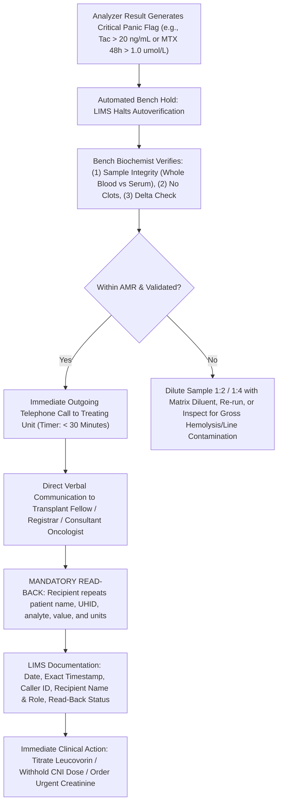
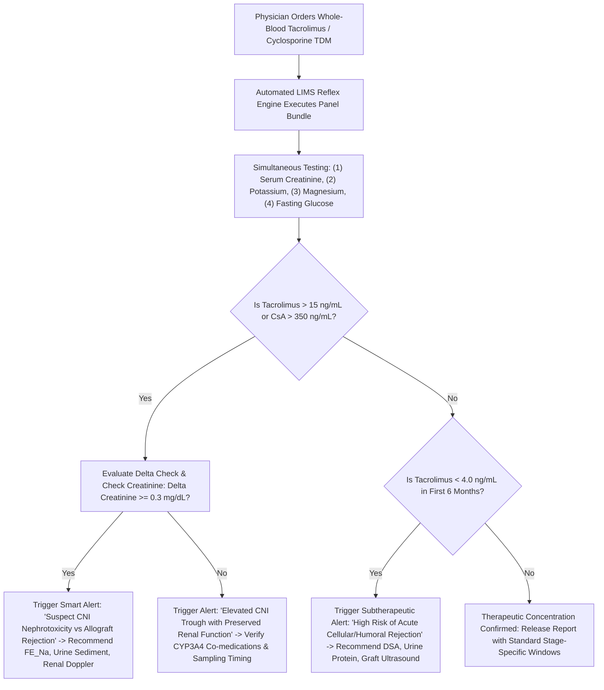

# 🧬 2.6.8 — Immunosuppressant & Oncology Rescue TDM: Whole-Blood Tacrolimus (FK506), Cyclosporine A (C0/C2), & High-Dose Methotrexate (HDMTX Leucovorin Rescue) SOP

**Department Folder:** `02_Clinical_Biochemistry`  
**Cluster Folder:** `2.6_Specific_Proteins_and_Therapeutic_Drug_Monitoring_Cluster`  
**Document Tier:** International Reference Laboratory Standard (`ISO 15189:2022` / `NABL 112` / `NABL 153` / `NABL 220D` / `NABL 223` / `CAP` / `CLSI` / `IFCC` / `EFLM` / `Westgard Six Sigma` / `Indian CPA 2019` / `DPDP Act 2023`)

---

## 🏛️ Section 1: International Document Control, LOINC / SNOMED / ICD-10 / UCUM Coding & Hardware-Agnostic Platform Matrix

### 1.1 Document Control & Regulatory Governance Block
```text
========================================================================================================
LABORATORY STANDARD OPERATING PROCEDURE & CLINICAL APEX GOVERNANCE DOCUMENT
METROLOGY & CLINICAL GOVERNANCE DIVISION | TRANSPLANT IMMUNOLOGY & ONCOLOGY TDM UNIT
--------------------------------------------------------------------------------------------------------
Document ID: SOP-BIO-TDM-2.6.8                   Version: 3.0 (International & Above-NABL Tier)
Effective Date: 2026-10-16                       Review Frequency: Annual (Mandatory)
Next Review Due: 2027-10-15                      Supersedes: Version 2.0 (Dated 2024-08-15)
Authorizing Head: MD Biochemistry / Transplant Med  NABL Discipline: Clinical Biochemistry (TDM)
ISO 15189:2022 Mapping: Clauses 4.1–8.9 & Annex A NABL Standards: NABL 112, 153, 220D, 223, 131, 133, 163
Clinical Specialization: Solid Organ Transplant Immunology, Hematology-Oncology, Immunopharmacology
========================================================================================================
```

### 1.2 International Nomenclature, Metrology & Clinical Coding Matrix
| Coding System / Metrological Attribute | Tacrolimus (FK506, Prograf) | Cyclosporine A (CsA, Sandimmun) | High-Dose Methotrexate (HDMTX) |
| :--- | :--- | :--- | :--- |
| **Logical Observation Identifiers (LOINC)** | `11253-2` (*Tacrolimus [Mass/Vol] in Blood*) | `3520-4` (*Cyclosporine [Mass/Vol] Blood C0*); `20288-7` (*C2 Peak*) | `14836-1` (*Methotrexate [Moles/Vol] Serum*); `3773-9` (*Mass/Vol*) |
| **SNOMED-CT Concept Code** | `373759007` (*Tacrolimus measurement*) | `70819002` (*Cyclosporine measurement*) | `41517006` (*Methotrexate measurement*) |
| **SNOMED-CT Specimen Code** | `119297000` (*Blood specimen - Whole Blood*) | `119297000` (*Blood specimen - Whole Blood*) | `119364003` (*Serum specimen - Light Protected*) |
| **ICD-10-CM Indication Codes** | `Z94.0` (*Kidney transplant*), `Z94.4` (*Liver*), `Z94.1` (*Heart*) | `Z94.0` (*Kidney*), `Z94.2` (*Lung*), `M32.9` (*SLE*), `L40.0` (*Psoriasis*) | `C91.0` (*ALL*), `C40.9` (*Osteosarcoma*), `C83.3` (*DLBCL/CNS Lymphoma*) |
| **ICD-11 Diagnostic Codes** | `QB70.0` (*Kidney transplant present*), `NE61` (*Drug toxicity*) | `QB70.0` (*Kidney transplant*), `HA40.0` (*Nephrotic syndrome*) | `2A60` (*Acute lymphoblastic leukemia*), `NE61` (*Cytotoxic poisoning*) |
| **Conventional Unit** | $\text{ng/mL}$ | $\text{ng/mL}$ | $\mu\text{mol/L}$ (or $\text{mg/L}$) |
| **SI Harmonized Unit (UCUM)** | $\mu\text{g/L}$ ($\text{ng/mL} \times 1.0 = \mu\text{g/L}$) | $\mu\text{g/L}$ ($\text{ng/mL} \times 1.0 = \mu\text{g/L}$) | $\mu\text{mol/L}$ ($1.0\text{ }\mu\text{mol/L} = 0.4544\text{ }\mu\text{g/mL}$) |
| **Primary Reference Material** | `ERM-DA110a` (*Certified Tacrolimus in Whole Blood*) | `USP Reference Standard Cyclosporine` | `USP Reference Standard Methotrexate` |
| **Reference Measurement Procedure** | `ID-LC-MS/MS` (ISO 17511 / CLSI C62-A) | `ID-LC-MS/MS` (ISO 17511 / CLSI C62-A) | `ID-LC-MS/MS` (ISO 17511 / CLSI C62-A) |
| **Primary Bench Analyzer Platform** | Snibe MAGLUMI X3 Flash-CLIA (Whole Blood Extraction) | Snibe MAGLUMI X3 Flash-CLIA (Whole Blood Extraction) | Snibe MAGLUMI X3 Flash-CLIA (Serum Direct Chemiluminescence) |
| **Backup / Comparability Platform** | Bonavera Chem 400 / Architect i2000SR CMIA | Bonavera Chem 400 / Architect i2000SR CMIA | Bonavera Chem 400 / Cobas e601 ECLIA |
| **TLA Automation Slot** | TLA LC-MS/MS or High-Throughput Immunoassay Cluster | TLA LC-MS/MS or High-Throughput Immunoassay Cluster | TLA Photometric / Chemiluminescence Track Module |

### 1.3 NABL 153 Scope Matrix & Laboratory Accreditation Capabilities
| Parameter / Analyte | Matrix / Specimen | Test Method / Analytical Principle | Verified Scope Range | Expanded MU ($U\%$ at $k=2$) | PT / EQAS Provider |
| :--- | :--- | :--- | :---: | :---: | :--- |
| **Tacrolimus ($FK506$)** | $\text{K}_2\text{-EDTA}$ Whole Blood | Extraction + Competitive Flash-CLIA | $0.50 \text{ to } 40.0\text{ ng/mL}$ | $\pm 11.5\%$ | CAP CS2 / RIQAS WB-TDM |
| **Cyclosporine A ($CsA$)** | $\text{K}_2\text{-EDTA}$ Whole Blood | Extraction + Competitive Flash-CLIA | $15.0 \text{ to } 2,000\text{ ng/mL}$ | $\pm 10.8\%$ | CAP CS2 / RIQAS WB-TDM |
| **Methotrexate ($HDMTX$)** | Plain Serum / Li-Heparin | Competitive Chemiluminescent Immunoassay | $0.02 \text{ to } 1,000\text{ }\mu\text{mol/L}$ | $\pm 12.0\%$ | CAP CS3 / Bio-Rad TDM |

---

## 🧪 Section 2: Pre-Analytical Phlebotomy, CLSI GP41/GP44 Order-of-Draw, Cellular Partitioning & Matrix Stability

### 2.1 The Intracellular Erythrocyte Sequestration Paradigm (Why Whole Blood is Mandatory)
- **Cellular & Molecular Drug Partitioning:**
  - **Tacrolimus ($FK506$):** $85\%\text{ to }90\%$ of circulating drug is sequestered **inside erythrocytes** bound to cytoplasmic **FKBP-12 (FK506-Binding Protein-12, $12\text{ kDa}$)**. Only $9\%\text{ to }14\%$ is bound to plasma proteins ($\alpha_1$-acid glycoprotein and albumin), and $< 1\%$ circulates as free unbound pharmacological moiety.
  - **Cyclosporine A ($CsA$):** $50\%\text{ to }60\%$ is partitioned **inside red blood cells** bound to **Cyclophilin A ($18\text{ kDa}$)**; $30\%\text{ to }40\%$ is bound to serum lipoproteins (HDL, LDL, VLDL); and $1\%\text{ to }2\%$ represents free therapeutic drug.
  - **Temperature-Dependent Dynamic Equilibrium:** The partition coefficient between erythrocytes and plasma shifts rapidly as blood cools below core body temperature ($37^\circ\text{C}$). Centrifuging whole blood to obtain serum or plasma yields a **catastrophic, clinically invalid result ($10\text{ to }20\text{-fold}$ lower)** that falsely suggests severe under-immunosuppression. If a clinician were to act on a serum Tacrolimus result, the subsequent dose escalation would induce fatal nephrotoxicity, convulsions, and graft loss!
  - **Analytical Extraction Mandate:** Testing must be performed strictly on **well-mixed whole blood** subjected to an **erythrocyte membrane lysis and protein-precipitation protocol** (using zinc sulfate $\text{ZnSO}_4$ in methanol/acetonitrile) prior to competitive chemiluminescence immunoassay or LC-MS/MS analysis.
  - **Methotrexate ($HDMTX$):** Unlike CNIs, Methotrexate is an organic hydrophilic antifolate that circulates predominantly in serum/plasma ($50\%$ bound to albumin). Testing is performed on **plain red-top serum or lithium heparin plasma**, strictly **protected from light** to prevent photolytic degradation into inactive pterins.

### 2.2 Specimen Collection, Timing Windows & Phlebotomy Protocol
| Operational Dimension | Tacrolimus (FK506) Protocol | Cyclosporine A (CsA) Protocol | High-Dose Methotrexate (HDMTX) Protocol |
| :--- | :--- | :--- | :--- |
| **Primary Specimen Tube** | Lavender-Top $\text{K}_2\text{-EDTA}$ Vacutainer ($3.0\text{ mL}$) | Lavender-Top $\text{K}_2\text{-EDTA}$ Vacutainer ($3.0\text{ mL}$) | Plain Red-Top (No Gel) or Gold-Top SST (Serum) |
| **Minimum Specimen Volume** | $1.0\text{ mL}$ whole blood ($500\text{ }\mu\text{L}$ pediatric dead-space) | $1.0\text{ mL}$ whole blood ($500\text{ }\mu\text{L}$ pediatric dead-space) | $0.5\text{ mL}$ serum ($250\text{ }\mu\text{L}$ pediatric dead-space) |
| **Order-of-Draw Position** | 5th position (after Citrate, Serum, Heparin; per `CLSI GP41-Ed7`) | 5th position (after Citrate, Serum, Heparin; per `CLSI GP41-Ed7`) | 2nd or 3rd position (per `CLSI GP41-Ed7`) |
| **Trough ($C_0$) Timing Window** | Exactly $12.0\text{ h} \pm 15\text{ min}$ post-evening dose (before morning dose) | Exactly $12.0\text{ h} \pm 15\text{ min}$ post-evening dose (before morning dose) | Not applicable (Infusion protocol-driven) |
| **Peak ($C_2$) Timing Window** | Not routinely used (poor AUC correlation) | Exactly $2.0\text{ h} \pm 10\text{ min}$ post-dose ingestion ($C_2$ Peak) | Not applicable |
| **HDMTX Sequential Timepoints** | Not applicable | Not applicable | Exactly $24\text{h}$, $48\text{h}$, $72\text{h}$ post-start of MTX infusion |
| **Light Protection Mandate** | Standard room lighting acceptable | Standard room lighting acceptable | **STRICT LIGHT PROTECTION:** Wrap tube in foil |
| **Catheter Line Draw Rules** | **NEVER DRAW FROM DRUG-INFUSED IV LINE!** Must draw peripheral venipuncture | **NEVER DRAW FROM DRUG-INFUSED IV LINE!** Must draw peripheral venipuncture | Draw from opposite arm or dedicated un-infused lumen |

### 2.3 Pre-Analytical Stability & Environmental Storage
- **Whole Blood $\text{K}_2\text{-EDTA}$ (Tacrolimus / Cyclosporine):**
  - Ambient ($20\text{–}25^\circ\text{C}$): $24\text{ hours}$ (must be inverted $8\text{–}10$ times prior to testing).
  - Refrigerated ($2\text{–}8^\circ\text{C}$): $7\text{ days}$ (sealed, unhemolyzed, stable).
  - Frozen ($-20^\circ\text{C}$ or $-80^\circ\text{C}$): $6\text{ months}$ (freeze-thaw stable for 2 cycles; must be completely thawed and vigorously vortexed before pretreatment).
- **Serum / Plasma (Methotrexate):**
  - Ambient ($20\text{–}25^\circ\text{C}$, foil-wrapped): $8\text{ hours}$.
  - Refrigerated ($2\text{–}8^\circ\text{C}$, dark): $72\text{ hours}$.
  - Frozen ($-20^\circ\text{C}$, dark): $1\text{ month}$.
- **Quantitative Rejection Criteria:**
  - Gross micro-clots in $\text{K}_2\text{-EDTA}$ whole blood (detected by manual wooden-applicator check or automated clot sensor) $\to$ **Immediate Rejection & Recollection**.
  - Serum / plasma submitted for Tacrolimus or Cyclosporine $\to$ **Immediate Absolute Rejection (Hard Stop)**.
  - Unprotected, light-exposed serum for Methotrexate stored $> 8\text{ hours}$ $\to$ **Rejection due to Photodegradation**.
  - Blood collected in Heparin or Sodium Fluoride tubes for Tacrolimus/Cyclosporine $\to$ **Rejection (EDTA mandatory for cellular membrane stabilization)**.

---

## ⚙️ Section 3: Hardware-Agnostic Analytical SOP, CLSI EP15/EP06 Verification, Calibration, Six Sigma IQC & Comparability

### 3.1 Analytical Principles & Pre-Treatment Extraction Chemistry
1. **Pre-Analytical Whole-Blood Extraction Procedure (Tacrolimus & Cyclosporine):**
   $$\text{Whole Blood ($200\text{ }\mu\text{L}$)} + \text{Precipitation Reagent ($\text{ZnSO}_4$ in Methanol/Acetonitrile, $200\text{ }\mu\text{L}$)} \xrightarrow{\text{Vortex } 20\text{ s}} \text{RBC Lysis \& Protein Flocculation}$$
   - Centrifuge at $10,000 \times g$ for $5\text{ minutes}$ (or $3,000 \times g$ for $15\text{ minutes}$).
   - Supernatant contains $100\%$ extracted drug liberated from FKBP-12 and Cyclophilin. Transfer $200\text{ }\mu\text{L}$ of clean supernatant into secondary sample cup for automated flash-chemiluminescence sampling.
2. **Competitive Chemiluminescent Immunoassay Principle (MAGLUMI X3 / Architect / Cobas):**
   - Extracted drug competes with ABLAE (amino-butyl-ethyl-isoluminol) or acridinium-ester labeled drug conjugate for binding sites on anti-drug monoclonal antibodies coated onto paramagnetic microparticles.
   - Magnetic separation and wash cycles remove unbound labeled tracer.
   - Acid/base trigger solutions induce chemiluminescent flash ($420\text{–}430\text{ nm}$). Relative Light Units (RLU) are **inversely proportional** to the concentration of drug present in the sample.
3. **Reference ID-LC-MS/MS Chemistry:**
   - Chromatographic separation on a C18 reverse-phase column ($50 \times 2.1\text{ mm}$, $1.7\text{ }\mu\text{m}$) using a water/methanol gradient with $2\text{ mM}$ ammonium acetate and $0.1\%$ formic acid.
   - Positive electrospray ionization (ESI+) with multiple reaction monitoring (MRM):
     - Tacrolimus: $m/z\text{ }821.5 \to 768.4$ (Quantifier), $821.5 \to 576.2$ (Qualifier); Internal standard: $\text{Ascomycin}$ ($m/z\text{ }809.5 \to 756.4$) or $^{13}\text{C},\text{D}_2\text{-Tacrolimus}$.
     - Cyclosporine A: $m/z\text{ }1202.8 \to 1184.8$ (Quantifier); Internal standard: $\text{Cyclosporine D}$ or $^{2}\text{H}_4\text{-CsA}$.
     - Methotrexate: $m/z\text{ }455.2 \to 308.1$ (Quantifier), $455.2 \to 175.1$ (Qualifier); Internal standard: $\text{Methotrexate-d}_3$.

### 3.2 Method Verification & Analytical Performance Metrics
| Performance Parameter | Tacrolimus (Whole Blood) | Cyclosporine A (Whole Blood) | Methotrexate (Serum) | Standard Protocol Reference |
| :--- | :---: | :---: | :---: | :--- |
| **Analytical Measurement Range (AMR)** | $0.50 \text{ to } 40.0\text{ ng/mL}$ | $15.0 \text{ to } 2,000\text{ ng/mL}$ | $0.02 \text{ to } 1,000\text{ }\mu\text{mol/L}$ | `CLSI EP06-Ed2` (Polynomial Linearity) |
| **Clinical Reportable Range (CRR)** | $0.50 \text{ to } 120.0\text{ ng/mL}$ (Dil $1:3$) | $15.0 \text{ to } 8,000\text{ ng/mL}$ (Dil $1:4$) | $0.02 \text{ to } 10,000\text{ }\mu\text{mol/L}$ (Dil $1:10$) | Validated Matrix Diluent Protocol |
| **Limit of Blank (LoB)** | $0.20\text{ ng/mL}$ | $5.0\text{ ng/mL}$ | $0.01\text{ }\mu\text{mol/L}$ | `CLSI EP17-A2` ($60\text{ replicates blank}$) |
| **Limit of Detection (LoD)** | $0.35\text{ ng/mL}$ | $10.0\text{ ng/mL}$ | $0.015\text{ }\mu\text{mol/L}$ | `CLSI EP17-A2` ($\alpha=0.05, \beta=0.05$) |
| **Limit of Quantitation (LoQ at CV ≤ 10%)** | $0.50\text{ ng/mL}$ | $15.0\text{ ng/mL}$ | $0.02\text{ }\mu\text{mol/L}$ | `CLSI EP17-A2` ($20\text{ low replicates}$) |
| **Repeatability Precision ($CV_r\%$)** | $3.2\% \text{ to } 4.5\%$ | $3.5\% \text{ to } 4.8\%$ | $2.8\% \text{ to } 4.1\%$ | `CLSI EP15-A3` ($5 \times 5\text{ ANOVA}$) |
| **Within-Laboratory Precision ($CV_{wl}\%$)** | $4.8\% \text{ to } 6.2\%$ | $4.9\% \text{ to } 6.5\%$ | $4.2\% \text{ to } 5.8\%$ | `CLSI EP15-A3` ($20\text{-day verification}$) |
| **Systematic Bias vs LC-MS/MS** | $+8.5\%$ (Cross-reactive AMs) | $+12.0\%$ (Cross-reactive AMs) | $+2.5\%$ (Native MTX) | `CLSI EP09c` ($n=100\text{ split patients}$) |
| **Hematocrit Operating Window** | $20.0\% \text{ to } 55.0\%$ | $20.0\% \text{ to } 55.0\%$ | Not applicable (Serum matrix) | `CLSI EP07` Interference Testing |

### 3.3 Metrological Traceability & Secondary Calibrator Hierarchy
- **Tacrolimus:** Traceable through an unbroken metrological chain to **European Reference Material ERM-DA110a** (certified whole-blood mass concentration determined by Higher-Order Isotope Dilution Mass Spectrometry, ISO 17511:2020 Clause 5.3).
- **Cyclosporine A:** Traceable to primary reference material **USP Reference Standard Cyclosporine**, value-assigned via Gravimetric & LC-MS/MS reference procedures.
- **Methotrexate:** Traceable to primary reference substance **USP Methotrexate RS**, certified by primary chemical characterization (purity $\ge 99.8\%$).
- **Calibration Frequency & Trigger Rules:**
  - Perform 2-point / 6-point calibration recalibration:
    1. Every $28\text{ days}$ (per reagent lot stability protocol).
    2. With every new lot of reagents or extraction packs.
    3. Following optical replacement, probe adjustments, or PM service.
    4. When IQC shows a systematic drift violating Westgard rules ($2:2s$, $4:1s$, or $10:x$).

### 3.4 Six Sigma IQC Strategy, Multi-Rule Logic & PT/EQAS Governance
- **Daily Quality Control Protocol:**
  - Run **three levels of third-party commutable whole-blood controls** for Tacrolimus/Cyclosporine (e.g., Bio-Rad Lyphochek Whole Blood Immunosuppressant Control: Level 1 Low $\sim 3\text{ ng/mL Tac} / 80\text{ ng/mL CsA}$; Level 2 Medium $\sim 10\text{ ng/mL Tac} / 250\text{ ng/mL CsA}$; Level 3 High $\sim 25\text{ ng/mL Tac} / 600\text{ ng/mL CsA}$) every $8\text{-hour}$ shift.
  - Run **three levels of serum controls** for Methotrexate (Level 1 $\sim 0.08\text{ }\mu\text{mol/L}$; Level 2 $\sim 0.80\text{ }\mu\text{mol/L}$; Level 3 $\sim 8.0\text{ }\mu\text{mol/L}$) with each clinical run.
- **Westgard Multi-Rule Evaluation (Sigma-Gated):**
  - $1:3s$ (Reject run: Random error flag).
  - $2:2s$ (Reject run: Systematic bias flag).
  - $R:4s$ (Reject run: High-imprecision flag).
  - $4:1s$ (Reject run: Systematic shift across 4 consecutive runs).
  - $10:x$ (Warning / Investigate: 10 consecutive values on one side of Mean).
- **Inter-Laboratory Proficiency Testing (NABL 163 Mandate):**
  - Enrolled in College of American Pathologists (CAP) Immunosuppressive Survey (`CS2/CS3`) or Randox RIQAS Whole Blood Immunosuppressant EQA Scheme.
  - Target: SDI ($Z\text{-score}$) $< \pm 1.5$. Any result with $\lvert Z \rvert \ge 2.0$ requires immediate root cause analysis (5-Why method) and CAPA logged in the NABL Quality Register.
- **Backup Platform Comparability (`CLSI EP31-A-IR`):**
  - Bi-weekly split patient sample testing ($n=5$ whole blood samples across the clinical range) between MAGLUMI X3 and backup Chem 400.
  - Acceptance criterion: Deming regression slope $0.90\text{–}1.10$, $R^2 \ge 0.98$, and absolute relative difference $\le 0.5 \times \text{TE}_a$ ($7.5\%$).

---

## 📊 Section 4: EFLM Biological Variation, RCV Delta Check, Measurement Uncertainty (ISO/TS 20914) & Six Sigma TEa

### 4.1 Biological Variation & Allowable Metrological Limits
| Metrological Parameter | Whole-Blood Tacrolimus | Whole-Blood Cyclosporine A | Serum Methotrexate | Reference Source & Derivation |
| :--- | :---: | :---: | :---: | :--- |
| **Within-Subject BV ($CV_I\%$)** | **$11.5\%$** | **$10.8\%$** | **$14.2\%$** | EFLM Biological Variation Database |
| **Between-Subject BV ($CV_G\%$)** | **$31.2\%$** | **$28.5\%$** | **$35.0\%$** | Inter-individual pharmacokinetic dispersion |
| **Index of Individuality ($II$)** | **$0.37$** | **$0.38$** | **$0.41$** | $II = CV_I / CV_G$ ($< 0.6$ indicates high individuality!) |
| **Desirable Imprecision ($CV_A\%$)** | $\le 5.75\%$ | $\le 5.40\%$ | $\le 7.10\%$ | $CV_A \le 0.50 \times CV_I$ |
| **Desirable Allowable Bias ($B\%$)** | $\le 8.30\%$ | $\le 7.60\%$ | $\le 9.40\%$ | $B \le 0.25 \times \sqrt{CV_I^2 + CV_G^2}$ |
| **Total Allowable Error ($\text{TE}_a\%$)** | **$\pm 15.0\%$** | **$\pm 15.0\%$** | **$\pm 18.0\%$** | CLIA '24 / RCPA / EFLM Expert Consensus |
| **Calculated Sigma Metric ($\sigma$)** | **$5.2\sigma$** | **$5.4\sigma$** | **$5.1\sigma$** | $\sigma = (\text{TE}_a - \lvert\text{Bias}\rvert) / CV_A$ |

### 4.2 Reference Change Value (RCV) Delta Check Equations
Because the Index of Individuality ($II = 0.37$) is well below $0.6$, conventional population reference intervals are far less sensitive for detecting acute rejection or toxicity than an individual's serial baseline. The LIMS autoverification system enforces automated RCV checks:

$$\text{RCV}_{95\%} = 2^{1/2} \times Z_{0.05} \times \sqrt{CV_A^2 + CV_I^2} = 1.414 \times 1.96 \times \sqrt{4.8^2 + 11.5^2} = 2.772 \times 12.46 = \mathbf{34.5\%}$$

$$\text{RCV}_{99\%} = 2^{1/2} \times Z_{0.01} \times \sqrt{CV_A^2 + CV_I^2} = 1.414 \times 2.576 \times \sqrt{4.8^2 + 11.5^2} = 3.642 \times 12.46 = \mathbf{45.4\%}$$

- **LIMS Rule Configuration:**
  - A serial delta increase $> 34.5\%$ within $48\text{–}72\text{ hours}$ triggers a **Yellow Flag** (Review co-medications, diarrhea, or sampling error).
  - A serial delta shift $> 45.4\%$ triggers an **Automated Hard-Lock** (Requires Senior Clinical Biochemist bench review and repeat extraction).

### 4.3 ISO/TS 20914 Measurement Uncertainty (MU) Budget
The expanded measurement uncertainty ($U$) is derived according to `ISO/TS 20914:2019` across the clinical decision range:
- Combined standard uncertainty:
  $$u_c = \sqrt{u_{Rw}^2 + u_{cal}^2 + u_{bias}^2}$$
  - $u_{Rw}$ (Within-lab reproducibility over 6 months) = $4.8\%$
  - $u_{cal}$ (Uncertainty of ERM-DA110a / manufacturer calibrator) = $2.1\%$
  - $u_{bias}$ (Uncertainty of long-term proficiency testing bias) = $2.4\%$
  $$u_c = \sqrt{4.8^2 + 2.1^2 + 2.4^2} = \sqrt{23.04 + 4.41 + 5.76} = \sqrt{33.21} = 5.76\%$$
- **Expanded Uncertainty ($k=2$, $95.45\%$ coverage interval):**
  $$U = 2 \times u_c = 2 \times 5.76\% = \mathbf{\pm 11.5\%}$$
- Example Reportable Statement: *"Tacrolimus Whole-Blood concentration: $8.4\text{ ng/mL} \pm 0.97\text{ ng/mL}$ (at $95\%$ confidence level, $k=2$)."*

---

## 🧬 Section 5: Target Therapeutic Windows, Multi-Stratified Reference Intervals & CNI Nephrotoxicity vs. Rejection Differential

### 5.1 Stratified Therapeutic Target Windows Matrix
*Note: Target windows represent 12-hour trough ($C_0$) whole-blood concentrations unless explicitly specified as Cyclosporine $C_2$ peak.*

| Organ Transplant / Clinical Condition | Post-Transplant Phase | Target Tacrolimus ($C_0$) | Target Cyclosporine ($C_0$) | Target Cyclosporine ($C_2$ Peak) |
| :--- | :--- | :---: | :---: | :---: |
| **Renal Allograft (Standard Risk)** | Months $0 \text{ to } 3$ | $8.0 \text{ to } 12.0\text{ ng/mL}$ | $200 \text{ to } 300\text{ ng/mL}$ | $800 \text{ to } 1,200\text{ ng/mL}$ |
| **Renal Allograft (Standard Risk)** | Months $4 \text{ to } 12$ | $6.0 \text{ to } 9.0\text{ ng/mL}$ | $150 \text{ to } 250\text{ ng/mL}$ | $600 \text{ to } 900\text{ ng/mL}$ |
| **Renal Allograft (Long-Term)** | Beyond $12\text{ Months}$ | $4.0 \text{ to } 7.0\text{ ng/mL}$ | $100 \text{ to } 175\text{ ng/mL}$ | $400 \text{ to } 600\text{ ng/mL}$ |
| **Renal Allograft (High Immunologic Risk / PRA > 20%)** | Months $0 \text{ to } 6$ | $10.0 \text{ to } 15.0\text{ ng/mL}$ | $250 \text{ to } 350\text{ ng/mL}$ | $1,000 \text{ to } 1,400\text{ ng/mL}$ |
| **Liver Allograft (Adult)** | Months $0 \text{ to } 1$ | $8.0 \text{ to } 12.0\text{ ng/mL}$ | $200 \text{ to } 300\text{ ng/mL}$ | $700 \text{ to } 1,000\text{ ng/mL}$ |
| **Liver Allograft (Adult)** | Months $2 \text{ to } 6$ | $6.0 \text{ to } 10.0\text{ ng/mL}$ | $150 \text{ to } 250\text{ ng/mL}$ | $500 \text{ to } 800\text{ ng/mL}$ |
| **Liver Allograft (Adult Maintenance)** | Beyond $6\text{ Months}$ | $4.0 \text{ to } 8.0\text{ ng/mL}$ | $100 \text{ to } 150\text{ ng/mL}$ | $400 \text{ to } 600\text{ ng/mL}$ |
| **Cardiac / Heart-Lung Allograft** | Months $0 \text{ to } 6$ | $10.0 \text{ to } 15.0\text{ ng/mL}$ | $250 \text{ to } 350\text{ ng/mL}$ | $1,000 \text{ to } 1,400\text{ ng/mL}$ |
| **Cardiac / Heart-Lung Allograft** | Maintenance ($> 6\text{ mo}$) | $8.0 \text{ to } 12.0\text{ ng/mL}$ | $150 \text{ to } 250\text{ ng/mL}$ | $600 \text{ to } 900\text{ ng/mL}$ |
| **Bone Marrow / HSCT (GVHD Prophylaxis)** | Days $-1 \text{ to } +100$ | $5.0 \text{ to } 12.0\text{ ng/mL}$ | $150 \text{ to } 250\text{ ng/mL}$ | Not routinely targeted |
| **Autoimmune Nephrotic Syndrome / Lupus** | Active Therapy | $4.0 \text{ to } 8.0\text{ ng/mL}$ | $80 \text{ to } 150\text{ ng/mL}$ | Not routinely targeted |

### 5.2 High-Dose Methotrexate (HDMTX) Elimination Targets & Leucovorin Rescue Protocol
*High-Dose Methotrexate ($\ge 1.0 \text{ to } 5.0\text{ g/m}^2$) requires serial monitoring to guide Leucovorin (folinic acid) rescue.*

| Post-Infusion Timepoint | Normal Elimination Target | Moderate Risk Cutoff | High-Risk Severe Toxicity Action Cutoff |
| :--- | :---: | :---: | :---: |
| **Post-Start $24\text{ Hours}$ ($C_{24}$)** | $< 5.0\text{ }\mu\text{mol/L}$ | $5.0 \text{ to } 10.0\text{ }\mu\text{mol/L}$ | **$> 10.0\text{ }\mu\text{mol/L}$ (Critical High Alert)** |
| **Post-Start $48\text{ Hours}$ ($C_{48}$)** | $< 0.5\text{ }\mu\text{mol/L}$ | $0.5 \text{ to } 1.0\text{ }\mu\text{mol/L}$ | **$> 1.0\text{ }\mu\text{mol/L}$ (Critical High Alert)** |
| **Post-Start $72\text{ Hours}$ ($C_{72}$)** | $< 0.05\text{ }\mu\text{mol/L}$ | $0.05 \text{ to } 0.10\text{ }\mu\text{mol/L}$ | **$> 0.10\text{ }\mu\text{mol/L}$ (Critical High Alert)** |
| **Safe Leucovorin Cessation** | **$< 0.05\text{ }\mu\text{mol/L}$** | Continue current dose | Escalate Leucovorin until MTX $< 0.05\text{ }\mu\text{mol/L}$ |

- **Leucovorin Rescue Escalation Guidelines:**
  - Standard rescue: Leucovorin $15\text{ mg/m}^2$ IV every 6 hours starting at Hour 36 or 42.
  - If $48\text{h}$ MTX is $1.0\text{–}5.0\text{ }\mu\text{mol/L}$: Increase Leucovorin to $50\text{–}100\text{ mg/m}^2$ IV every 3 hours.
  - If $48\text{h}$ MTX is $> 5.0\text{ }\mu\text{mol/L}$ or $24\text{h} > 50\text{ }\mu\text{mol/L}$ with significant creatinine elevation: Increase Leucovorin to $150\text{ mg/m}^2$ IV every 3 hours + administer **Glucarpidase (Voraxaze) $50\text{ Units/kg}$ IV over 5 minutes**.

### 5.3 Calcineurin Inhibitor (CNI) Nephrotoxicity vs. Acute Allograft Rejection Differential
*When a renal allograft recipient exhibits an acute rise in Serum Creatinine ($\ge 0.3\text{ mg/dL}$ or $\ge 25\%$), differentiating CNI-induced afferent arteriolar vasoconstriction from acute allograft rejection is paramount.*

| Clinical & Laboratory Discriminator | Acute CNI Nephrotoxicity (Tac / CsA Excess) | Acute Cellular / Antibody-Mediated Rejection (TCMR / ABMR) |
| :--- | :--- | :--- |
| **Tacrolimus / Cyclosporine $C_0$ Trough** | **Typically Elevated:** Tac $> 15\text{–}20\text{ ng/mL}$; CsA $> 350\text{–}400\text{ ng/mL}$ | **Typically Low or Subtherapeutic:** Tac $< 4\text{–}5\text{ ng/mL}$; CsA $< 100\text{ ng/mL}$ |
| **Temporal Onset Profile** | Closely follows dose escalation, diarrhea, or azole initiation | Often follows non-compliance, generic switch, or taper |
| **Fractional Excretion of Sodium ($FE_{Na}$)** | **Prerenal Pattern ($FE_{Na} < 1.0\%$)** (arteriolar spasm) | **Intrinsic Pattern ($FE_{Na} > 1.5\text{–}2.0\%$)** (tubulitis/damage) |
| **Urine Sediment Examination** | Bland; occasional fine granular casts; absence of RBC casts | Active; mononuclear cells, renal tubular epithelial casts |
| **Renal Doppler Ultrasound (Resistive Index)** | Elevated Resistive Index ($RI > 0.75\text{–}0.80$) due to spasm | Normal or elevated ($RI > 0.75$), graft enlargement / edema |
| **Clinical Signs & Symptoms** | Hand tremor, hypertension, headache, hyperkalemia; afebrile | Graft tenderness, swelling, oliguria, fever, malaise |
| **Serum Potassium & Magnesium** | **Hyperkalemia** (Type 4 RTA) + **Hypomagnesemia** | Variable; potassium usually normal unless advanced anuria |
| **Allograft Biopsy Findings (Banff Scoring)** | Isometric vacuolization of tubular cells, arteriolar hyalinosis | Interstitial mononuclear infiltration ($i$), tubulitis ($t$), endothelitis ($v$), peritubular capillaritis ($ptc$), C4d positive in ABMR |
| **Response to CNI Dose Reduction ($25\text{–}50\%$)** | **Serum Creatinine drops within $48\text{ to }72\text{ hours}$** | **No response; Creatinine continues to climb relentlessly!** |

---

## 🚨 Section 6: NABL & CLSI GP47 Critical Panic Values, Urgent Action Thresholds & 30-Minute Read-Back Protocol

### 6.1 Critical ("Panic") Value Notification Matrix
*In strict compliance with `ISO 15189:2022` Clause 7.4.1.6, `NABL 112`, and `CLSI GP47-Ed2`, the following thresholds constitute immediate medical emergencies.*

| Analyte & Parameter | Critical Low Cutoff | Critical High Cutoff | Clinical Hazard & Physiological Mechanism |
| :--- | :---: | :---: | :--- |
| **Whole-Blood Tacrolimus ($FK506$)** | **$< 3.0\text{ ng/mL}$** *(Early Transplant $< 6\text{ mo}$)* | **$> 20.0\text{ ng/mL}$** | Acute Allograft Rejection vs. Severe CNI Nephrotoxicity, Posterior Reversible Encephalopathy Syndrome (PRES), Seizures |
| **Whole-Blood Cyclosporine ($C_0$ Trough)** | **$< 75\text{ ng/mL}$** *(Early Transplant $< 6\text{ mo}$)* | **$> 450\text{ ng/mL}$** | Acute Allograft Rejection vs. Acute Tubular Necrosis, Refractory Hypertension, Thrombotic Microangiopathy (TMA) |
| **Whole-Blood Cyclosporine ($C_2$ Peak)** | **$< 400\text{ ng/mL}$** *(Early Renal $< 3\text{ mo}$)* | **$> 1,500\text{ ng/mL}$** | Inadequate absorption / rejection vs. Severe vasospastic allograft hypoperfusion and neurotoxicity |
| **Serum Methotrexate ($24\text{h}$ Post-Start)** | None | **$> 10.0\text{ }\mu\text{mol/L}$** | Life-threatening crystalline nephropathy, bone marrow suppression, denuding GI mucositis |
| **Serum Methotrexate ($48\text{h}$ Post-Start)** | None | **$> 1.0\text{ }\mu\text{mol/L}$** | Impending acute kidney injury, neutropenic sepsis, systemic multi-organ failure |
| **Serum Methotrexate ($72\text{h}$ Post-Start)** | None | **$> 0.10\text{ }\mu\text{mol/L}$** | Incomplete clearance; failure to discontinue rescue leads to severe delayed toxicity |

### 6.2 Tier-2 Urgent Clinical Action Range
- **Tacrolimus ($C_0$):** $15.0 \text{ to } 20.0\text{ ng/mL}$ (Requires proactive dose reduction and verification of CYP3A4 inhibitors).
- **Cyclosporine ($C_0$):** $350 \text{ to } 450\text{ ng/mL}$ (Requires dose adjustment and electrolyte monitoring).
- **Methotrexate ($48\text{h}$):** $0.5 \text{ to } 1.0\text{ }\mu\text{mol/L}$ (Requires doubling of oral/IV Leucovorin dose and aggressive hydration).

### 6.3 Mandatory 30-Minute Closed-Loop Critical Value Notification Protocol


- **Documentation Requirements (NABL Audit Trail):**
  - All critical calls must be documented within the dedicated electronic LIMS Critical Log within $\le 30\text{ minutes}$ of instrument result generation.
  - Required fields: (1) Patient UHID & Name, (2) Bed / Ward location, (3) Specific Analyte & Result, (4) Notification Date & Time, (5) Reporting Staff Name, (6) Receiving Clinician Name & Designation, (7) Explicit confirmation of complete oral read-back.

---

## 🔬 Section 7: Pharmacokinetics, Pharmacogenomics (CYP3A5 / CYP3A4 / ABCB1), Drug Interactions & Algorithmic Reflex Cascades

### 7.1 Pharmacokinetics & Disposition Dynamics
- **Tacrolimus ($FK506$):**
  - Bioavailability: $20\%\text{–}25\%$ (highly variable, range $5\%\text{–}67\%$). Food, especially high-fat meals, decreases AUC by $37\%$.
  - Volume of Distribution ($V_d$): Large ($1.0\text{–}1.5\text{ L/kg}$) based on whole-blood concentrations; binding to erythrocytes creates an apparent deep reservoir.
  - Elimination Half-Life ($t_{1/2}$): Mean $\sim 12\text{ hours}$ (range $8\text{–}24\text{ hours}$) in healthy adults; prolonged to $> 30\text{–}40\text{ hours}$ in severe hepatic cirrhosis.
  - Clearance: Predominantly hepatic via CYP3A4 and CYP3A5 enzymes, followed by biliary elimination ($> 95\%$). Urinary excretion of intact drug is $< 2\%$.
- **Cyclosporine A ($CsA$):**
  - Bioavailability: $30\%\text{–}45\%$ (improved in microemulsion formulations such as Neoral).
  - Elimination Half-Life ($t_{1/2}$): Biphasic; terminal half-life $\sim 8\text{–}18\text{ hours}$.
  - Clearance: Extensively metabolized in liver by CYP3A4 into $> 30$ metabolites (AM1, AM9, AM4N); excreted via bile into feces ($> 90\%$).
- **Methotrexate ($MTX$):**
  - High-Dose MTX ($1\text{–}5\text{ g/m}^2$) achieves peak serum levels of $100\text{–}1,000\text{ }\mu\text{mol/L}$.
  - Distribution: Triphasic kinetics. Initial distribution $t_{1/2\alpha} \approx 0.75\text{ h}$; clearance phase $t_{1/2\beta} \approx 2\text{–}3.5\text{ h}$; terminal elimination phase $t_{1/2\gamma} \approx 8\text{–}15\text{ h}$.
  - Renal Elimination: $> 80\%\text{ to }90\%$ eliminated unchanged in urine via glomerular filtration and active secretion through organic anion transporters (OAT1 and OAT3). In acidic urine ($\text{pH} < 7.0$), MTX and its metabolite 7-OH-MTX precipitate as needle-like crystals in renal collecting tubules, causing acute tubular obstruction and rapid renal failure.

### 7.2 Pharmacogenomics: The CYP3A5 Expresser Paradigm
- **CYP3A5 Genetic Polymorphism (Clinical Pharmacogenetics Implementation Consortium - CPIC Guidelines):**
  - **CYP3A5\*1 Allele:** Encodes wild-type, functional CYP3A5 enzyme.
  - **CYP3A5\*3, \*6, \*7 Alleles:** Non-functional splice variants resulting in absence of CYP3A5 protein.
  - **Genotypic Classifications:**
    1. **CYP3A5 Extensive / Intermediate Metabolizers ($\*1/\*1$ or $\*1/\*3$):** Known as "CYP3A5 Expressers" (prevalent in $\sim 30\text{–}40\%$ of South Asians, $70\text{–}80\%$ of African ancestry, $10\text{–}15\%$ of Caucasians). These patients metabolize Tacrolimus extremely rapidly and require **$1.5\text{ to }2.5\text{-fold higher daily doses}$** (e.g., $0.20\text{–}0.30\text{ mg/kg/day}$) to reach target $C_0$ trough concentrations.
    2. **CYP3A5 Poor Metabolizers ($\*3/\*3$):** "CYP3A5 Non-Expressers". Have lower dose requirements (e.g., $0.05\text{–}0.10\text{ mg/kg/day}$); at high risk of rapid toxicity if dosed empirically using standard regimens.
- **CYP3A4\*22:** Intronic polymorphism associated with decreased CYP3A4 expression; patients carrying CYP3A4\*22 with CYP3A5\*3/\*3 require minimal Tacrolimus dosing.
- **ABCB1 (MDR1 - P-Glycoprotein) C3435T:** Influences intestinal mucosal extrusion; homozygous 3435TT genotypes show higher oral bioavailability and systemic drug exposure.

### 7.3 CPIC CYP3A5 Genotype-to-Phenotype Dosing Translation Table
| CYP3A5 Genotype | Phenotypic Classification | Enzymatic Activity | Population Frequency | Initial Starting Dose Guideline (CPIC) | TDM Monitoring Cadence |
| :--- | :--- | :--- | :--- | :--- | :--- |
| **$\text{CYP3A5 } \*1/\*1$** | Extensive / Normal Metabolizer | Full functional activity | $10\%\text{ African, } 2\%\text{ Caucasian, } 15\%\text{ Asian}$ | **$1.5 \text{ to } 2.0\times$ standard starting dose** ($0.20\text{–}0.30\text{ mg/kg/day}$) | Twice weekly until stable therapeutic target ($C_0$) achieved |
| **$\text{CYP3A5 } \*1/\*3, \*1/\*6, \*1/\*7$** | Intermediate Metabolizer | Partial functional activity | $30\%\text{–}45\%\text{ South Asian, } 35\%\text{ African}$ | **$1.5\times$ standard starting dose** ($0.15\text{–}0.25\text{ mg/kg/day}$) | Twice weekly for first $2\text{ weeks}$, then weekly |
| **$\text{CYP3A5 } \*3/\*3, \*6/\*6, \*7/\*7$** | Poor Metabolizer (Non-Expresser) | Absent CYP3A5 activity | $80\%\text{–}90\%\text{ Caucasian, } 60\%\text{ South Asian}$ | **Standard starting dose** ($0.08\text{–}0.10\text{ mg/kg/day}$) | Weekly during early post-transplant period |

### 7.4 Drug Interaction Engine & Clinical Scenarios
| Pharmacological Agent / Class | Effect on Tac / CsA | Exact Mechanism | Clinical Action & Laboratory Alert |
| :--- | :---: | :--- | :--- |
| **Azole Antifungals** *(Voriconazole, Posaconazole, Itraconazole, Fluconazole)* | **$\uparrow\uparrow\uparrow$ Massive Increase ($3\times \text{ to } 10\times$)** | Potent competitive inhibition of intestinal & hepatic CYP3A4/5 | **Mandatory Proactive Dose Reduction:** Decrease Tac dose by $66\%\text{–}75\%$; monitor $C_0$ every $48\text{ hours}$! |
| **Protease Inhibitors / Paxlovid** *(Ritonavir, Cobicistat, Nirmatrelvir)* | **$\uparrow\uparrow\uparrow$ Catastrophic ($10\times \text{ to } 20\times$)** | Irreversible mechanism-based inactivation of CYP3A4 | **CONTRAINDICATED!** If Paxlovid given, Tac levels exceed $> 40\text{ ng/mL}$ causing acute anuric renal failure and PRES. |
| **Macrolide Antibiotics** *(Clarithromycin, Erythromycin)* | **$\uparrow\uparrow$ Marked Increase ($2\times \text{ to } 4\times$)** | Suicide inhibition of CYP3A4 (*Note: Azithromycin does NOT inhibit CYP3A4*) | Switch to Azithromycin or reduce CNI dose by $50\%$ with serial TDM monitoring. |
| **Calcium Channel Blockers** *(Diltiazem, Verapamil)* | **$\uparrow$ Moderate Increase ($1.5\times \text{ to } 2\times$)** | Inhibition of CYP3A4 and ABCB1 efflux pumps | Monitor $C_0$ troughs weekly upon initiation or titration of diltiazem. |
| **Rifamycins** *(Rifampin / Rifampicin)* | **$\downarrow\downarrow\downarrow$ Catastrophic Drop (to near zero!)** | Massive transcriptional induction of CYP3A4 and P-gp via PXR activation | **High Rejection Risk:** Tacrolimus levels plunge $< 2\text{ ng/mL}$; requires $3\times\text{ to }5\times$ dose increase or switch to Rifabutin. |
| **Anticonvulsants** *(Phenytoin, Carbamazepine, Phenobarbital)* | **$\downarrow\downarrow$ Marked Decrease ($50\%\text{–}70\%$)** | Potent induction of hepatic CYP3A4 and ABCB1 | Monitor TDM twice weekly; consider switching to Levetiracetam (Keppra). |
| **St. John's Wort** *(Hypericum perforatum)* | **$\downarrow\downarrow$ Marked Decrease** | Potent herbal induction of CYP3A4 and P-gp | Strictly counsel transplant patients against unmonitored herbal supplements. |
| **Acute Diarrheal Illness Paradox** | **$\uparrow\uparrow$ Unexpected Spike ($2\times \text{ to } 3\times$)** | Enterocyte shedding destroys mucosal CYP3A4 & P-gp, doubling oral bioavailability! | **Clinical Trap:** Dehydrated patient with diarrhea develops Tacrolimus nephrotoxicity; withhold doses and monitor daily! |
| **NSAIDs, PPIs, Penicillins** *(Co-administered with HDMTX)* | **$\uparrow\uparrow$ Toxic MTX Accumulation** | Competitively inhibit renal tubular OAT1/OAT3 secretion of Methotrexate | **Strict Rule:** Discontinue all NSAIDs, PPIs (Omeprazole, Pantoprazole), and Penicillins $48\text{h}$ prior to HDMTX! |

### 7.5 Smart Algorithmic Reflex Cascades


---

## ⚠️ Section 8: Comprehensive Interference Matrix (Endogenous/Exogenous) & ISO 22367 FMEA Risk Management

### 8.1 Analytical, Pre-Analytical & Chemical Interferences
| Interferent / Condition | Concentration / Cutoff | Bias Direction & Magnitude | Mechanism & Laboratory Action Protocol |
| :--- | :--- | :---: | :--- |
| **Serum / Plasma Submitted Instead of Whole Blood** | Any serum specimen | **$\downarrow\downarrow\downarrow$ Catastrophic ($-90\%$)** | $90\%$ of drug is retained inside RBCs; testing supernatant of centrifuged blood misses the drug. **Reject immediately.** |
| **Phlebotomy from Drug-Infusing Central Line Lumen** | Any trace residual | **$\uparrow\uparrow\uparrow$ Extreme ($> 40\text{ ng/mL}$)** | Tacrolimus adsorbs to silicone catheter lumens; yields falsely elevated values. **Mandatory peripheral venipuncture.** |
| **Cross-Reactivity with Inactive Metabolites** | AM1, AM9, 13-O-demethyl, 31-O-demethyl | **$\uparrow$ Positive Bias ($+10\%\text{ to }+35\%$)** | Immunoassay antibodies bind inactive hydroxylated/demethylated metabolites; prominent in hepatic failure. Reference: LC-MS/MS. |
| **Glucarpidase (Voraxaze) Administration on MTX** | Post-enzyme serum | **$\uparrow\uparrow\uparrow$ Massive False-High** | Inactive DAMPA metabolite cross-reacts $40\%\text{–}100\%$ on MTX immunoassays for $5\text{–}7\text{ days}$. **Must test via LC-MS/MS!** |
| **Extreme Hematocrit Variance ($< 20\%$ or $> 55\%$)** | $\text{Hct} < 20\%$ or $> 55\%$ | **$\downarrow$ or $\uparrow$ Variable ($\pm 15\%$)** | Skews the whole-blood extraction phase volume. In profound anemia, total whole-blood Tac is low but free active drug is normal. |
| **Gross Hemolysis (Serum MTX Assay)** | $\text{H-Index} > 500\text{ mg/dL}$ | **$\downarrow$ Negative Bias ($-10\%$)** | Spectrophotometric quenching and optical absorbance interference with chemiluminescent flash. |
| **Gross Icterus (Unconjugated / Conjugated)** | $\text{I-Index} > 40\text{ mg/dL}$ | Negligible ($\le 5\%$) | Verified acceptable up to $40\text{ mg/dL}$ Bilirubin on MAGLUMI X3 / Architect. |
| **Severe Lipemia (Intralipid / Triglycerides)** | $\text{L-Index} > 1,500\text{ mg/dL}$ | **$\downarrow$ Negative Bias ($-8\%$)** | Causes phase partition distortion during organic solvent precipitation. Perform high-speed de-lipidation. |
| **Heterophile Antibodies & HAMA** | Patient-dependent | **$\uparrow$ or $\downarrow$ Erroneous** | Anti-mouse or human anti-animal antibodies bridge immunoassay complexes. Treat sample with HBT blocking tubes. |

### 8.2 ISO 22367:2020 Failure Mode, Effects & Criticality Analysis (FMECA)
*Quantitative Risk Priority Number ($RPN = \text{Severity } [S] \times \text{Occurrence } [O] \times \text{Detection } [D]$, where each scale is scored from 1 to 10).*

| Process Phase & Hazard Code | Potential Failure Mode & Clinical Consequence | $S$ | $O$ | $D$ | $\text{RPN}$ | Mandatory Corrective & Preventive Action (CAPA) |
| :--- | :--- | :---: | :---: | :---: | :---: | :--- |
| **Pre-Analytical:** `FMEA-TDM-01` | **Centrifugation of Whole Blood:** Phlebotomist centrifuges EDTA tube and submits plasma; reported Tac is $0.8\text{ ng/mL}$; clinician quadruples dose causing fatal acute renal failure. | 10 | 2 | 1 | **20** | **LIMS Hard-Lock:** Tube code `EDTA-WB` cannot be accessioned if scanned on a serum centrifuge track. Automated rejection if plasma is detected. |
| **Pre-Analytical:** `FMEA-TDM-02` | **Central Line Contamination:** Specimen drawn from central line through which Tacrolimus was infused $4\text{ hours}$ earlier; result $> 40\text{ ng/mL}$; clinician stops drug leading to acute rejection. | 9 | 3 | 2 | **54** | **Phlebotomy Checklist:** Nursing protocol requires documented peripheral venipuncture. LIMS prompts: "Drawn from peripheral vein? (Y/N)". |
| **Pre-Analytical:** `FMEA-TDM-03` | **Non-Trough Peak Sampling:** Blood drawn $2\text{ hours}$ post-dose instead of $12\text{ hours}$; level reported as $18.5\text{ ng/mL}$; unnecessary dose reduction causes graft rejection. | 8 | 4 | 2 | **64** | **Mandatory Time Verification:** Accessioning requires entry of: (1) Last Dose Time, (2) Phlebotomy Time. If delta $< 11.5\text{ h}$, warn ordering physician. |
| **Analytical:** `FMEA-TDM-04` | **Incomplete RBC Lysis:** Inadequate vortexing ($< 5\text{ s}$) or compromised extraction reagent causes incomplete drug release; falsely low result reported. | 8 | 2 | 2 | **32** | **Standardized Pretreatment:** Electronic vortex mixer with digital timer ($20\text{ s}$ at $3,000\text{ RPM}$). Daily extraction reagent blank verification. |
| **Analytical:** `FMEA-TDM-05` | **Glucarpidase-Treated MTX Tested on Immunoassay:** Laboratory tests post-Voraxaze serum on standard immunoassay; cross-reacting DAMPA yields false $2.5\text{ }\mu\text{mol/L}$; excessive Leucovorin administered. | 7 | 2 | 2 | **28** | **LIMS Reflex Lock:** If Methotrexate order has an oncology tag with Glucarpidase history, immunoassay is hard-locked and specimen routed to LC-MS/MS. |
| **Analytical:** `FMEA-TDM-06` | **Probe Carry-Over Post-Peak:** A high-concentration specimen ($> 30\text{ ng/mL}$) precedes a low-concentration trough; probe carry-over elevates subsequent result. | 7 | 2 | 2 | **28** | **Probe Wash Protocol:** Automated enhanced detergent probe-wash cycle executed after any result $> 20\text{ ng/mL}$; annual carry-over check per `CLSI EP10-A3`. |
| **Pre-Analytical:** `FMEA-TDM-07` | **Profound Anemia Distortion:** Patient has severe post-transplant anemia ($\text{Hct} < 18\%$); total whole-blood concentration reads falsely low ($3.5\text{ ng/mL}$) despite normal free drug. | 7 | 3 | 2 | **42** | **Hematocrit Flagging:** Automated LIMS check pairs CBC hematocrit; if $\text{Hct} < 22\%$, appends warning regarding whole-blood distribution distortion. |
| **Post-Analytical:** `FMEA-TDM-08` | **Delayed Critical Value Notification:** Tacrolimus $> 25\text{ ng/mL}$ or MTX $48\text{h} > 2.0\text{ }\mu\text{mol/L}$ logged but not communicated verbally for $6\text{ hours}$; patient develops anuria and seizures. | 10 | 2 | 1 | **20** | **Automated GP47 Escalation:** LIMS auto-dials transplant coordinator; if unacknowledged within $15\text{ minutes}$, alerts On-Call Pathologist mobile phone. |

---

## 💬 Section 9: Conditional Band-Specific Pathologist Sign-Out Library (Automated LIMS Rules-Based Comments)

### 9.1 Decision Logic & Automated Reporting Comments
```text
========================================================================================================
LIMS RULE TRIGGER BAND 1: CRITICAL HIGH TACROLIMUS (> 20.0 ng/mL)
--------------------------------------------------------------------------------------------------------
[CRITICAL ALERT - IMMEDIATE TELEPHONE READ-BACK PERFORMED PER ISO 15189:2022 / CLSI GP47]:
Whole-Blood Tacrolimus concentration is severely elevated (> 20.0 ng/mL). 
CLINICAL RISK: Imminent risk of acute calcineurin-inhibitor nephrotoxicity (afferent arteriolar vasospasm), 
hyperkalemia, severe hypomagnesemia, and neurotoxicity (tremor, seizures, Posterior Reversible 
Encephalopathy Syndrome - PRES).
RECOMMENDED ACTIONS:
1. Verify that blood was drawn as a true 12-hour trough (C0) from a peripheral vein, NOT from a central line.
2. Review co-medications for potent CYP3A4/5 inhibitors: Azole antifungals (Voriconazole, Posaconazole, 
   Itraconazole), Macrolides (Clarithromycin), Protease inhibitors (Paxlovid/Ritonavir), or Diltiazem.
3. Rule out acute diarrheal illness, which destroys intestinal CYP3A4/P-gp and dramatically surges absorption.
4. Withhold or reduce next dose; check urgent Serum Creatinine, Potassium, Magnesium, and Urine Output.
========================================================================================================

========================================================================================================
LIMS RULE TRIGGER BAND 2: SUBTHERAPEUTIC TACROLIMUS (< 4.0 ng/mL IN MONTHS 0–6)
--------------------------------------------------------------------------------------------------------
[URGENT SUBTHERAPEUTIC IMMUNOSUPPRESSION ALERT]:
Whole-Blood Tacrolimus concentration is below the minimum therapeutic threshold for early allograft protection.
CLINICAL RISK: High risk of Acute Cellular Rejection (TCMR) or Antibody-Mediated Rejection (ABMR).
RECOMMENDED ACTIONS:
1. Confirm patient adherence and verify that the dose was not vomited or withheld.
2. Check for potent CYP3A4/P-gp inducers: Rifampin/Rifampicin (anti-tubercular therapy), Phenytoin, 
   Carbamazepine, or St. John's Wort.
3. Consider CYP3A5*1 expresser pharmacogenomic status (rapid metabolizer phenotype requiring 1.5–2.5x dose).
4. Correlate with allograft function: Check Serum Creatinine, Urine Protein, and Donor-Specific Antibodies (DSA).
========================================================================================================

========================================================================================================
LIMS RULE TRIGGER BAND 3: CRITICAL DELAYED METHOTREXATE CLEARANCE (48h > 1.0 umol/L OR 24h > 10.0 umol/L)
--------------------------------------------------------------------------------------------------------
[CRITICAL ONCOLOGY EMERGENCY - IMMEDIATE READ-BACK LOGGED PER ISO 15189:2022]:
Serum Methotrexate concentration demonstrates severe delayed elimination.
CLINICAL RISK: Impending crystalline nephropathy, life-threatening pancytopenia, denuding mucositis, and sepsis.
MANDATORY ONCOLOGY INTERVENTIONS:
1. ESCALATE LEUCOVORIN RESCUE: Increase IV Leucovorin to 50–150 mg/m² every 3 hours immediately.
2. URINE ALKALINIZATION: Verify urine pH is strictly >= 7.5. Infuse IV Sodium Bicarbonate (NaHCO3) 
   to prevent intratubular precipitation of methotrexate crystals.
3. HYDRATION: Maintain high-volume intravenous hydration (3 L/m²/day) and monitor strict fluid balance.
4. GLUCARPIDASE (VORAXAZE) INDICATION: If 48h MTX > 5.0 umol/L accompanied by acute creatinine elevation, 
   administer Glucarpidase (50 Units/kg IV) within 48–60 hours of MTX start. 
   CAUTION: Post-Glucarpidase MTX can ONLY be measured by LC-MS/MS (immunoassay invalid due to DAMPA cross-reactivity).
========================================================================================================
```

---

## 📋 Section 10: Master LIMS Copy-Paste Report Block (Physician + Patient Plain-Language Summary + Medico-Legal Shield)

```text
========================================================================================================
EXCELLENCE CLINICAL REFERENCE LABORATORIES | METROLOGY & CLINICAL BIOCHEMISTRY DIVISION
NABL ACCREDITED (ISO 15189:2022) | RECOGNIZED BY CAP & UKAS | GOVT OF INDIA REGISTERED
PATIENT & INVESTIGATION COMPREHENSIVE TDM MONOGRAPH & TECHNICAL DOSSIER
========================================================================================================
PATIENT NAME : [PATIENT FULL NAME]              AGE / SEX : [XX] Y / [M/F]   ACCESSION NO : [ACC-XXXXX]
REFERRING DR : [TRANSPLANT SURGEON/ONCOLOGIST]  HOSP / WARD: [ICU/TRANSPLANT] DRAW TIME   : [YYYY-MM-DD HH:MM]
PRIMARY TUBE : K2-EDTA Whole Blood / Serum      REGISTRATION: [YYYY-MM-DD]    REPORT TIME : [YYYY-MM-DD HH:MM]
--------------------------------------------------------------------------------------------------------
TEST INVESTIGATION                             RESULT      FLAG    SI CONVENTIONAL    EXPANDED MU (k=2)
--------------------------------------------------------------------------------------------------------
TACROLIMUS (FK506), WHOLE BLOOD (CLIA)        [ 8.6 ]     NORMAL   8.6 ug/L (ng/mL)   +/- 11.5% (+/- 0.99)
CYCLOSPORINE A (CsA) C0 TROUGH, WHOLE BLOOD   [ --- ]              --- ug/L (ng/mL)   +/- 10.8%
CYCLOSPORINE A (CsA) C2 PEAK, WHOLE BLOOD     [ --- ]              --- ug/L (ng/mL)   +/- 10.8%
METHOTREXATE (HDMTX), SERUM (CLIA)            [ --- ]              --- umol/L         +/- 12.0%
--------------------------------------------------------------------------------------------------------
STRATIFIED CLINICAL TARGET RANGES & THERAPEUTIC WINDOWS:
• Tacrolimus C0 (Kidney/Liver Transplant):
  - Months 0 to 3 Post-Transplant    : 8.0 to 12.0 ng/mL (High Risk: 10.0 to 15.0 ng/mL)
  - Months 4 to 12 Maintenance       : 6.0 to 9.0 ng/mL
  - Beyond 1 Year Maintenance        : 4.0 to 7.0 ng/mL
• Cyclosporine A C0 Trough:
  - Months 0 to 3 Post-Transplant    : 200 to 300 ng/mL
  - Beyond 3 Months Maintenance      : 100 to 200 ng/mL
• Cyclosporine A C2 Peak (2h Post-Dose):
  - Months 0 to 3 Post-Transplant    : 800 to 1,200 ng/mL
  - Beyond 3 Months Maintenance      : 600 to 900 ng/mL
• High-Dose Methotrexate Leucovorin Rescue Targets:
  - Post-Start 24 Hours              : < 5.0 umol/L (Critical High: > 10.0 umol/L)
  - Post-Start 48 Hours              : < 0.5 umol/L (Critical High: > 1.0 umol/L)
  - Post-Start 72 Hours              : < 0.05 umol/L (Critical High: > 0.10 umol/L)
  - Safe Leucovorin Cessation        : < 0.05 umol/L
--------------------------------------------------------------------------------------------------------
CRITICAL ("PANIC") VALUES (MANDATORY IMMEDIATE TELEPHONE NOTIFICATION TO CLINICIAN <= 30 MIN):
• Tacrolimus Critical Panic High     : > 20.0 ng/mL (High Risk CNI Nephrotoxicity / PRES Seizures)
• Tacrolimus Critical Panic Low      : < 3.0 ng/mL in First 6 Months (Acute Graft Rejection Alert)
• Cyclosporine C0 Panic High         : > 450 ng/mL (Vasospastic Renal Ischemia / Thrombotic Microangiopathy)
• Methotrexate 48h Panic High        : > 1.0 umol/L (Urgent Leucovorin Escalation & Urine Alkalinization)
--------------------------------------------------------------------------------------------------------
TECHNICAL BIOCHEMISTRY & PHARMACOKINETIC NOTES:
1. Matrix Requirement: Tacrolimus and Cyclosporine reside 85% to 90% inside erythrocytes bound to FKBP-12 
   and Cyclophilin. Centrifuged serum/plasma is physiologically invalid. Testing performed on K2-EDTA whole 
   blood following automated zinc sulfate/organic solvent cell lysis and protein extraction.
2. Timing Verification: Trough (C0) samples must be drawn exactly 12 hours post-evening dose, immediately 
   prior to the next scheduled dose. Never draw through a line used for intravenous drug infusion.
3. Cross-Reactivity & Reference Method: Immunoassay values exhibit positive bias (+8% to +20%) relative to 
   LC-MS/MS due to cross-reactivity with hydroxylated/demethylated metabolites (AM1, AM9, 13-O-demethyl). 
   For definitive mass separation, LC-MS/MS is available upon request.
4. Glucarpidase Alert: Patients receiving Glucarpidase (Voraxaze) cannot be monitored by immunoassay due 
   to severe cross-reactivity with DAMPA metabolite. LC-MS/MS is mandatory in this clinical setting.
5. CYP3A5 Pharmacogenomics: Rapid metabolizers (CYP3A5*1 expressers) require 1.5- to 2.5-fold higher doses 
   to achieve therapeutic targets compared to CYP3A5*3/*3 non-expressers.
--------------------------------------------------------------------------------------------------------
PLAIN-LANGUAGE PATIENT INFORMATION:
What Does This Test Mean?
Your body has received a transplanted organ (such as a kidney or liver), or you are receiving specialized 
cancer treatment. Drugs like Tacrolimus and Cyclosporine calm your immune system so it will not fight or reject 
your new organ. 
Why is Blood Timing So Critical?
These medicines must stay within a very narrow "safe window." If the level is too low, your body may reject 
the transplanted organ. If the level is too high, the medicine can harm your kidneys or cause tremors and 
high blood pressure. 
Always follow these simple rules:
- Take your medicine at the exact same times every day (12 hours apart).
- On the morning of your blood test, DO NOT take your morning tablet until AFTER your blood is drawn.
- Tell your doctor immediately before starting any new antibiotic, antifungal medicine, or herbal supplement.
--------------------------------------------------------------------------------------------------------
MEDICO-LEGAL, NABL ISO 15189:2022 & CONSUMER PROTECTION ACT (CPA) 2019 COMPLIANCE SHIELD:
This examination was performed in an ISO 15189:2022 and NABL-accredited laboratory using validated automated 
closed-system chemiluminescence traceable to Certified Reference Materials (ERM-DA110a and USP Standards). 
Total Allowable Error (TEa <= 15.0%) and Expanded Measurement Uncertainty (U = +/- 11.5%, k=2) comply with 
international metrological criteria (ISO/TS 20914). Biological variation, endogenous heterophile antibodies, 
hematocrit extremes (< 20% or > 55%), and drug-drug interactions (e.g., Voriconazole, Paxlovid, Rifampin) 
can alter drug kinetics. Results must be interpreted strictly in conjunction with clinical history, graft 
function, and concurrent medications. This document is a validated medical diagnostic record governed by 
the Digital Personal Data Protection (DPDP) Act 2023 and CPA 2019.
========================================================================================================
[END OF REPORT - VALIDATED BY CONSULTANT CLINICAL BIOCHEMIST / TRANSPLANT IMMUNOLOGIST]
```

---

## 📚 Section 11: Normative References & Accreditation Bibliography
1. **ISO 15189:2022:** *Medical laboratories — Requirements for quality and competence.* Clauses 4.1 through 8.9 and Normative Annex A.
2. **ISO/TS 20914:2019:** *Medical laboratories — Practical guidance for the estimation of measurement uncertainty.*
3. **ISO 22367:2020:** *Medical laboratories — Application of risk management to medical laboratories.*
4. **NABL 112 (Issue 05, 2023):** *Criteria for Accreditation of Medical Testing Laboratories.*
5. **NABL 153 (Issue 04, 2022):** *Application Form and Specific Criteria for Clinical Biochemistry.*
6. **NABL 220D & NABL 223:** *Checklists for Desktop and On-Site Assessment based on ISO 15189:2022.*
7. **CLSI EP15-A3:** *User Verification of Precision and Estimation of Bias; Approved Guideline — Third Edition.*
8. **CLSI EP06-Ed2:** *Evaluation of Linearity of Quantitative Measurement Procedures.*
9. **CLSI EP17-A2:** *Evaluation of Detection Capability for Clinical Laboratory Measurement Procedures.*
10. **CLSI EP07-Ed3 & EP37:** *Interference Testing in Clinical Chemistry; Approved Guideline.*
11. **CLSI EP10-A3:** *Preliminary Evaluation of Quantitative Clinical Laboratory Measurement Procedures; Approved Guideline.*
12. **CLSI GP41-Ed7 & GP44-Ed4:** *Collection of Diagnostic Venous Blood Specimens & Tubes/Additives for Specimen Handling.*
13. **CLSI GP47-Ed2:** *Management of Critical- and Significant-Risk Results; Approved Guideline.*
14. **CLSI C62-A:** *Liquid Chromatography-Mass Spectrometry Methods; Approved Guideline.*
15. **EFLM Biological Variation Database:** *Meta-analysis of within- and between-subject biological variation for immunosuppressants and therapeutic drugs.*
16. **CPIC Guidelines for Tacrolimus:** *Clinical Pharmacogenetics Implementation Consortium (CPIC) Guidelines for CYP3A5 Genotype and Tacrolimus Dosing.*
17. **Banff Classification of Allograft Pathology:** *Consensus criteria for Banff histological grading of renal allograft rejection vs. CNI toxicity.*
18. **KDIGO Clinical Practice Guideline for Kidney Transplant Recipients:** *Kidney Disease: Improving Global Outcomes (KDIGO) Transplant Work Group. TDM targets, CNI nephrotoxicity, and acute rejection surveillance.*
19. **NCCN Clinical Practice Guidelines in Oncology:** *Acute Lymphoblastic Leukemia and Bone Cancer. High-Dose Methotrexate administration, folinic acid rescue titration, and urine alkalinization protocols.*
20. **Indian Consumer Protection Act (CPA) 2019 & DPDP Act 2023:** *Statutory provisions governing medical negligence, diagnostic standards, and sensitive health data protection.*
