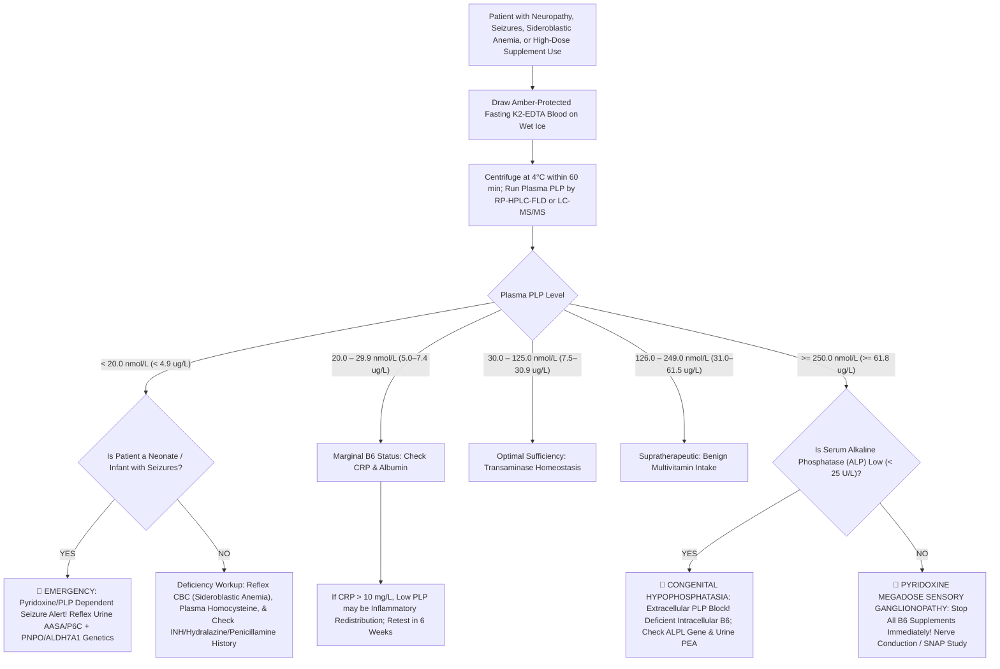

# 🧬 3.2.10 — Vitamin $\text{B}_6$ (Plasma Pyridoxal $5'$-Phosphate [`PLP`] — Isoniazid/Hydralazine Neuropathy, Pyridoxine-Dependent Neonatal Seizures, & $\text{B}_6$ Sensory Ganglionopathy)

**Department Folder:** `03_Immunoassay_Endocrinology_and_Nutrients`  
**Cluster Folder:** `3.2_Complete_Vitamins_Iron_Bone_Metabolism_and_Anemia_Cluster`  
**Laboratory Facility:** Sawariya Diagnostic Lab, Charkhi Dadri, Haryana  
**Document Tier:** International & Above-NABL Reference Laboratory Standard (`ISO 15189:2022` / `CAP` / `UKAS` / `CLSI C62-A` / `CLSI EP15-A3` / `CLSI EP06-Ed2` / `CLSI EP17-A2` / `CLSI EP28-A3c` / `CLSI GP41` / `CLSI GP47` / `NIST SRM 3950` / `EFLM Biological Variation Database` / `ISO 22367:2020` / `Indian CPA 2019`)

---

## 🏛️ Section 1: International Document Control, Interoperability Coding & Hardware-Agnostic Platform Matrix

### 1.1 Document Control & Regulatory Governance Block
| Quality Management Parameter | Specification & Laboratory Standard |
| :--- | :--- |
| **Document Control ID** | `SDL-SOP-IMM-3.2.10` (Version `3.0` — International & Above-NABL Master Reference Standard) |
| **Effective Date & Review Cycle** | `2026-10-16`; Annual Review Cycle (Next Mandatory Comprehensive Review: `2027-10-15`) |
| **Authorizing Authorities** | Laboratory Director (`MD Pathology`), Quality Manager, Head of Chromatography & Mass Spectrometry, and Head of Clinical Biochemistry |
| **Accreditation Clause Mapping** | `ISO 15189:2022` Clauses 4.1–8.9 (Cl 7.2 Pre-examination, Cl 7.3 Examination Processes & Verification, Cl 7.4 Post-examination & Critical Reporting, Cl 8.5 `ISO 22367` Risk Management); `NABL 112` (Specific Criteria for Medical Labs), `NABL 129` (Measurement Uncertainty), `NABL 131` (Internal Quality Control), `NABL 133` (Quality Manual), `NABL 153` (Scope Matrix for Nutrients & Mass Spectrometry), `NABL 163` (PT/EQAS Participation), `NABL 220D/223` (Assessor Checklists & Traceability); `CAP` Special Chemistry Checklist; `CLSI C62-A`, `CLSI EP15-A3`, `CLSI EP06-Ed2`, `CLSI EP17-A2`, `CLSI EP28-A3c`, `CLSI EP07/EP37`, `CLSI GP41`, `CLSI GP47`; `Indian CPA 2019`, `DPDP Act 2023`, `Bio-Medical Waste Management Rules 2016/2019` |
| **Primary `LOINC` Code(s)** | **`2902-5`** (*Pyridoxal phosphate [Mass/volume] in Plasma*); **`14891-6`** (*Pyridoxal phosphate [Moles/volume] in Plasma*); **`30542-5`** (*Pyridoxal phosphate in Erythrocytes*); **`2903-3`** (*4-Pyridoxic acid [Mass/volume] in Urine*); **`2904-1`** (*Pyridoxine [Mass/volume] in Serum or Plasma*); **`2403-4`** (*Aspartate aminotransferase.activated/Aspartate aminotransferase.basal in Red Blood Cells [EAST-AC]*) |
| **`SNOMED-CT` Concept & Specimen** | Concept: **`34453009`** (*Vitamin B6 measurement*), **`271634002`** (*Erythrocyte aspartate aminotransferase activation measurement*); Specimen: **`119361006`** (*Plasma specimen in K2-EDTA — **Strictly Amber Light-Protected & Iced!***) |
| **`ICD-10-CM` / `ICD-11` Indications** | **`E53.1` / `5B56.2`** (*Pyridoxine [Vitamin B6] deficiency*); **`E67.2` / `5D45`** (*Megavitamin-B6 syndrome [Sensory neuronopathy / Ganglionopathy]*); **`G40.909` / `8A62`** (*Pyridoxine-dependent neonatal epilepsy [ALDH7A1 / Antiquitin]*); **`D64.0` / `3A70.0`** (*Hereditary sideroblastic anemia [ALAS2]*); **`D64.1`** (*Secondary sideroblastic anemia due to drugs/toxins [Isoniazid]*); **`G62.0`** (*Drug-induced polyneuropathy [Isoniazid, Hydralazine, Penicillamine]*); **`E83.39` / `5C64.0`** (*Hypophosphatasia [ALPL deficiency]*); **`E72.11`** (*Homocystinuria [Cystathionine beta-synthase defect]*) |
| **Conventional $\leftrightarrow$ SI (`UCUM`) Factor** | **$\mu\text{g/L}$ ($\text{ng/mL}$) $\times 4.046 = \text{nmol/L}$** ; **$\text{nmol/L} \times 0.2471 = \mu\text{g/L}$ ($\text{ng/mL}$)** (Molecular Weight of Pyridoxal $5'$-Phosphate $= \mathbf{247.14\text{ g/mol}}$) |
| **Metrological Traceability Chain** | Metrologically traceable under `ISO 17511:2020` to **NIST SRM 3950** (*Vitamin $\text{B}_6$ in Frozen Human Serum: PLP & 4-Pyridoxic Acid*), verified against **USP Pyridoxal $5'$-Phosphate Reference Standard** (`USP-1587008`, purity $\ge 98.5\%$) |

### 1.2 Hardware-Agnostic Primary, Secondary & Orthogonal Platform Architecture
| Platform Role | Analytical Configuration | Separation Chemistry & Detection Physics | Verification & Validation Basis |
| :--- | :--- | :--- | :--- |
| **Primary Structural Platform** | **Isocratic Reverse-Phase HPLC with Fluorometric Detection (`RP-HPLC-FLD`)** | $\text{C}_{18}$ column ($4.6 \times 150\text{ mm}, 3.5\text{ }\mu\text{m}$); post-column derivatization with sodium hydrogen sulfite ($\text{NaHSO}_3$); Fluorometric detection at **$\lambda_{\text{ex}} = 367\text{ nm}$ / $\lambda_{\text{em}} = 478\text{ nm}$** | Validated under `CLSI EP15-A3`, `CLSI EP06-Ed2`, `CLSI EP17-A2`, and `CLSI EP28-A3c` on healthy cohorts ($n=120$) |
| **Primary Mass Spec Platform** | **Isotope-Dilution Electrospray Tandem Mass Spectrometry (`ID-LC-MS/MS`)** | Positive electrospray ionization ($\text{ESI}^+$) with deuterated internal standard ($\text{d}_3\text{-PLP}$); MRM transition: **$m/z\text{ }248.0 \rightarrow 150.1$**; secondary transition: **$m/z\text{ }248.0 \rightarrow 94.1$** | Reference measurement procedure complying with `CLSI C62-A`; direct cross-correlation with HPLC-FLD ($R^2 = 0.996$, $\text{Bias} \le 2.4\%$) |
| **Primary Functional Platform** | **Kinetic UV Spectrophotometric Erythrocyte Aspartate Aminotransferase Activation (`EAST-AC`)** | Washed erythrocyte hemolysate; oxidation of $\text{NADH} \rightarrow \text{NAD}^+$ coupled via malate dehydrogenase monitored at **$340\text{ nm}$** ($37^\circ\text{C}$): Basal vs Exogenous $+100\text{ }\mu\text{mol/L PLP}$ | Functional nutritional reference per `WHO / IOM / IFCC`; evaluates intracellular functional tissue saturation |
| **Emergency Backup Platform** | Semi-Automated Microplate Fluorometer / Secondary HPLC System | Dedicated light-tight fluorometric module running validated post-column bisulfite reaction chemistry | Calibrated quarterly with optical fluorescence standards traceable to `NIST SRM 1932` |

### 1.3 Primary Reference Standards, Stock Solutions & ISO 17511 Traceability Hierarchy
1. **Primary Reference Calibrator Specifications:**
   - **Pyridoxal $5'$-Phosphate Monohydrate (`PLP`):** USP Grade (`USP-1587008`) or Sigma-Aldrich Supelco Grade (`P9255`), certified purity $\ge 98.5\%$. Molar absorptivity in $0.1\text{ mol/L NaOH}$: $\varepsilon_{388\text{ nm}} = 6,600\text{ M}^{-1}\text{cm}^{-1}$; in $0.1\text{ mol/L HCl}$: $\varepsilon_{295\text{ nm}} = 6,700\text{ M}^{-1}\text{cm}^{-1}$.
   - **4-Pyridoxic Acid (`4-PA`):** Sigma-Aldrich (`P9630`), certified purity $\ge 98.0\%$. Molar absorptivity in $0.1\text{ mol/L HCl}$: $\varepsilon_{317\text{ nm}} = 9,100\text{ M}^{-1}\text{cm}^{-1}$.
   - **Internal Standards:** Deuterated Pyridoxal $5'$-phosphate ($\text{d}_3\text{-PLP}$, CDN Isotopes / Toronto Research Chemicals) or $\text{^{13}C}_3\text{-PLP}$, isotopic purity $\ge 99.0\%$.
2. **Standard Stock Solution Preparation:**
   - Prepared exclusively in a dedicated amber darkroom illuminated by yellow/amber safety lamps ($\lambda > 520\text{ nm}$, zero emission $< 500\text{ nm}$) using Class A amber volumetric glassware.
   - Primary PLP stock solution ($1.00\text{ mmol/L} = 247.1\text{ mg/L}$) is prepared by dissolving accurately weighed $24.71\text{ mg}$ of certified PLP in $100.0\text{ mL}$ of deoxygenated, light-protected $0.05\text{ mol/L}$ potassium phosphate buffer ($\text{pH } 7.0$) containing $0.1\text{ mmol/L EDTA-Na}_2$.
   - Aliquoted in $250\text{ }\mu\text{L}$ volumes into amber cryovials, purged with high-purity argon/nitrogen gas, sealed with Teflon gaskets, and stored at $-80^\circ\text{C}$ (stable for 6 months; discard thawed aliquots).
3. **Working Calibrator Hierarchy:**
   - Prepared weekly by serial dilution in blank dialyzed human plasma matrix (matrix-matched calibrators): Cal-1 ($5.0\text{ nmol/L}$), Cal-2 ($15.0\text{ nmol/L}$), Cal-3 ($30.0\text{ nmol/L}$), Cal-4 ($75.0\text{ nmol/L}$), Cal-5 ($150.0\text{ nmol/L}$), Cal-6 ($300.0\text{ nmol/L}$), Cal-7 ($500.0\text{ nmol/L}$).

---

## 🧪 Section 2: Clinical Biochemistry, Active Coenzymes, Cellular Neurochemistry & Pathophysiology

### 2.1 The Molecular Vitamer Interconversion Cascade & Storage Dynamics
Vitamin $\text{B}_6$ comprises six interconvertible 2-methylpyridine vitamers: Pyridoxine (`PN`), Pyridoxamine (`PM`), Pyridoxal (`PL`), and their respective $5'$-phosphate esters (`PNP`, `PMP`, and `PLP`):

```
[Dietary B6 Vitamers (PN, PM, PL & Glucosides)]
                      │
                      ▼ (Intestinal Alkaline Phosphatase / Ecto-Phosphatases)
[Unphosphorylated Free Vitamers (PN, PM, PL) in Intestinal Lumen]
                      │
                      ▼ (Passive / Carrier-Mediated Mucosal Absorption)
[Portal Circulation & Hepatic Uptake]
                      │
                      ├──────────────────────────────────────────────────┐
                      ▼                                                  ▼
     [Pyridoxal Kinase (PDXK) + ATP + Zn2+]             [Pyridoxal Kinase (PDXK) + ATP + Zn2+]
                      │                                                  │
                      ▼                                                  ▼
     [Pyridoxine 5'-Phosphate (PNP)]                    [Pyridoxamine 5'-Phosphate (PMP)]
                      │                                                  │
                      └─────────────────┬────────────────────────────────┘
                                        │
                                        ▼ (Pyridoxamine 5'-Phosphate Oxidase [PNPO] + FMN)
                         [PYRIDOXAL 5'-PHOSPHATE (PLP)]  ◄─── (Central Active Coenzyme)
                                        │
                      ┌─────────────────┴─────────────────┐
                      ▼                                   ▼
        [Cellular Export into Plasma]            [Irreversible Catabolism]
                      │                                   │
                      ▼                                   ▼ (Aldehyde Oxidase / NAD+)
   [Schiff Base on Albumin Lys-190]             [4-Pyridoxic Acid (4-PA)]
       (70–90% of Circulating B6)                         │
                                                          ▼ (Renal Excretion in Urine)
```

1. **Intra-Vascular Transport & Albumin Chaperoning:** Over **$70\%\text{–}90\%$ of total circulating Vitamin $\text{B}_6$** exists as Pyridoxal $5'$-Phosphate (`PLP`). PLP cannot freely circulate unbound due to its chemically reactive aldehyde moiety; it forms a stable covalent Schiff base with the $\varepsilon$-amino group of **Lysine-190 on Human Serum Albumin**. This albumin-bound complex shields PLP from intravascular hydrolysis by endothelial alkaline phosphatase and prevents glomerular filtration.
2. **Skeletal Muscle Glycogen Phosphorylase Reservoir:** Approximately **$75\%\text{–}80\%$ of total body Vitamin $\text{B}_6$ ($\sim 100\text{–}150\text{ mg}$)** is stored in skeletal muscle, where it is stoichiometrically bound to **glycogen phosphorylase** (one PLP molecule per enzyme subunit). During prolonged starvation or catabolic wasting, muscle proteolysis releases PLP into the circulation to sustain vital hepatic gluconeogenesis and transamination.

### 2.2 The Master Catalytic Coenzyme Network (> 140 Human Enzymatic Reactions)
The electrophilic pyridine ring of PLP acts as an electron sink, stabilizing carbanion intermediates formed during amino acid decarboxylation, transamination, racemization, and elimination:

| Enzyme Complex | Metabolic Pathway | Biological Product & Function | Manifestation of PLP Deficiency |
| :--- | :--- | :--- | :--- |
| **5-Aminolevulinate Synthase 2 (`ALAS2`)** | Erythroid Heme Synthesis (Rate-Limiting Step) | Condenses glycine + succinyl-CoA into $\delta$-aminolevulinic acid (`ALA`) | **Microcytic hypochromic sideroblastic anemia with ringed sideroblasts**; mitochondrial iron accumulation |
| **Glutamate Decarboxylase (`GAD65 / GAD67`)** | Central Neurotransmission | Decarboxylates excitatory Glutamate into inhibitory **$\gamma$-Aminobutyric Acid (`GABA`)** | **Intractable neonatal/infantile status epilepticus**, hyperirritability, loss of seizure threshold |
| **Aromatic L-Amino Acid Decarboxylase (`AADC`)** | Catecholamine & Serotonin Biosynthesis | Decarboxylates L-DOPA $\rightarrow$ **Dopamine** and 5-HTP $\rightarrow$ **Serotonin** | Mood depression, autonomic instability, parkinsonian tremor, circadian disruption |
| **Histidine Decarboxylase (`HDC`)** | Autacoid & Gastric Signaling | Decarboxylates Histidine into **Histamine** | Altered vascular permeability, impaired gastric acid secretion |
| **Cystathionine $\beta$-Synthase (`CBS`)** | Transsulfuration / Methionine Clearance | Condenses Homocysteine + Serine into **Cystathionine** | **Severe Hyperhomocysteinemia**, endothelial dysfunction, accelerated arterial thrombosis |
| **Cystathionine $\gamma$-Lyase (Cystathionase)** | Cysteine & Glutathione Biosynthesis | Cleaves Cystathionine into Cysteine + $\alpha$-ketobutyrate | Impaired intracellular glutathione (`GSH`) synthesis, increased oxidative fragility |
| **Kynureninase & Kynurenine Transaminase** | Tryptophan $\rightarrow$ Niacin Pathway | Cleaves 3-hydroxykynurenine $\rightarrow$ 3-hydroxyanthranilic acid (Niacin precursor) | Blocked de novo Niacin ($\text{B}_3$) synthesis; shunting into **Xanthurenic Aciduria** & pellagroid dermatitis |
| **Aspartate & Alanine Transaminases (`AST / ALT`)** | Amino Acid Catabolism & Gluconeogenesis | Shuttles amino groups between amino acids and $\alpha$-keto acids for Krebs cycle entry | Blunted transaminase velocity; altered hepatic gluconeogenesis |
| **Serine Hydroxymethyltransferase (`SHMT`)** | One-Carbon Folate Shuttle | Transfers $\beta$-carbon of serine to tetrahydrofolate ($\text{THF} \rightarrow 5,10\text{-CH}_2\text{-THF}$) | Disrupted purine/thymidylate synthesis, impaired DNA methylation |

### 2.3 Clinical Manifestations of Severe Vitamin B6 Deficiency
1. **Microcytic Sideroblastic Anemia:** Defective `ALAS2` activity cripples protoporphyrin synthesis. Bone marrow erythroblasts continue to import iron via transferrin receptor-1, but lacking protoporphyrin IX, iron accumulates inside mitochondria forming a perinuclear collar of Prussian-blue-positive granules (**Ringed Sideroblasts**). Peripheral blood smear shows microcytic hypochromic red cells with dimorphic population, basophilic stippling, and elevated serum ferritin and transferrin saturation.
2. **Peripheral Sensorimotor Axonal Neuropathy:** Distal, symmetric "glove-and-stocking" paresthesias, numbness, burning pain, and loss of temperature and vibration sensation. Driven by impaired neurotransmitter synthesis, loss of transsulfuration antioxidant capacity, and energy depletion in distal axons.
3. **Severe Inborn Errors of B6 Metabolism in Neonates:**
   - **Pyridoxine-Dependent Epilepsy (`PDE-ALDH7A1` / Antiquitin Deficiency):** Autosomal recessive defect in $\alpha$-aminoadipic semialdehyde dehydrogenase. Accumulating $\Delta^1$-piperideine-6-carboxylate (`P6C`) spontaneously condenses with the aldehyde group of PLP via a Knoevenagel reaction, chemically inactivating PLP. Uncontrolled seizures occur within hours of birth, refractory to all standard anticonvulsants (phenobarbital, phenytoin, levetiracetam), but arrest dramatically within minutes of IV pyridoxine ($100\text{ mg}$).
   - **Pyridoxamine $5'$-Phosphate Oxidase (`PNPO`) Deficiency:** Inability to convert PNP/PMP into active PLP. Patients seize uncontrollably on pyridoxine hydrochloride and **respond ONLY to active Pyridoxal $5'$-Phosphate (`PLP`)**!
   - **`PLPBP` (`PROSC`) Deficiency:** Loss of PLP homeostatic binding protein, precipitating early-onset vitamin B6-dependent epilepsy.
4. **Mucocutaneous Manifestations:** Cheilosis, painful angular stomatitis, atrophic glossitis (smooth red tongue), and seborrheic dermatitis-like scaling lesions around the eyes, nose, and mouth.

### 2.4 Pharmacological Antagonists & Drug-Induced B6 Deficiency
Multiple therapeutic agents react chemically with the free aldehyde group of PLP or inhibit its activating kinases:

| Therapeutic Agent | Primary Indication | Molecular Mechanism of Inactivation / Antagonism | Mandatory Clinical Mitigation Protocol |
| :--- | :--- | :--- | :--- |
| **Isoniazid (`INH`)** | Tuberculosis Therapy | INH hydrazine group condenses with PLP aldehyde forming an inactive **Isonicotinyl-Hydrazone** complex; also inhibits Pyridoxal Kinase (`PDXK`). | Mandatory co-prescription of **Pyridoxine $10\text{–}50\text{ mg/day}$** with all INH regimens to prevent severe disabling peripheral neuropathy. |
| **Hydralazine** | Antihypertensive / Heart Failure | Forms stable, biologically inactive **Hydralazine-PLP Hydrazone** adducts, accelerating urinary B6 excretion. | Monitor plasma PLP in patients on chronic hydralazine $> 100\text{ mg/day}$; supplement pyridoxine ($25\text{–}50\text{ mg/day}$). |
| **D-Penicillamine** | Wilson's Disease / Cystinuria | Free sulfhydryl and amino groups react with PLP to form a stable **Thiazolidine-4-Carboxylic Acid** complex, extinguishing PLP coenzyme activity. | Prophylactic pyridoxine ($25\text{–}50\text{ mg/day}$) is mandatory in all Wilson's disease patients receiving penicillamine. |
| **Cycloserine** | Multi-Drug Resistant TB (`MDR-TB`) | Competitively inhibits Pyridoxal Kinase and directly binds PLP-dependent alanine racemase / transaminases. | Co-administer **Pyridoxine $100\text{–}200\text{ mg/day}$** to prevent acute toxic psychosis and peripheral neuropathy. |
| **Levodopa / Carbidopa** | Parkinson's Disease | Carbidopa is a hydrazine derivative that binds PLP irreversibly, depleting circulating PLP by $> 50\%$ in long-term Parkinsonian patients. | Periodic PLP monitoring; judicious pyridoxine supplementation ($25\text{ mg/day}$; avoid megadoses that accelerate peripheral L-DOPA breakdown). |
| **Theophylline** | Bronchodilator / COPD | Competitively inhibits **Pyridoxal Kinase (`PDXK`)**, blocking the phosphorylation of unphosphorylated pyridoxal to PLP. | Monitor B6 status in chronic theophylline therapy; supplement pyridoxine. |

### 2.5 The Pyridoxine Megadose Sensory Ganglionopathy Paradox
**Vitamin $\text{B}_6$ is the ONLY water-soluble B-vitamin whose chronic excessive intake causes permanent, severe neurotoxicity!**
1. **Dose Thresholds & Toxic Exposures:** Ingestion of Pyridoxine Hydrochloride at doses $> 500\text{ mg/day}$ for months—or even $> 50\text{–}100\text{ mg/day}$ for prolonged periods ($> 1\text{–}2\text{ years}$)—causes direct neurotoxicity. Common sources include over-the-counter "nerve-rejuvenation" vitamin cocktails, body-building supplements, energy drinks, and unmonitored therapy for carpal tunnel syndrome or premenstrual syndrome.
2. **Selective Dorsal Root Ganglion (`DRG`) Vulnerability:** The **Dorsal Root Ganglia** and trigeminal ganglia lie outside the protective blood-nerve and blood-brain barriers, exposing pseudounipolar sensory neurons directly to high extracellular concentrations of unphosphorylated Pyridoxine (`PN`).
3. **Molecular Mechanism:** Massive circulating PN competitively displaces active PLP from intracellular apoenzymes and saturates/downregulates Pyridoxal Kinase, paradoxical precipitating an **intracellular functional B6 deficiency** despite astronomically high circulating total B6 levels! This results in degeneration of large myelinated sensory fibers ($\text{A}\beta$ and $\text{A}\alpha$), causing dorsal column axonopathy.
4. **Clinical Syndrome:** Pure sensory neuronopathy / ganglionopathy: profound loss of vibration and joint position sense, sensory ataxia, positive Romberg sign, pseudoathetosis of outstretched hands, and severe burning paresthesias with **completely preserved motor strength**!

### 2.6 The Congenital Hypophosphatasia (`ALPL`) Paradox
**Tissue-Nonspecific Alkaline Phosphatase (`TNSALP` / `ALPL`)** is an ecto-enzyme anchored to the outer leaflet of cell membranes that hydrolyzes extracellular phosphorylated compounds:
1. **Extracellular Transport Physics:** Phosphorylated compounds cannot cross the lipid bilayer of mammalian cell membranes. To enter brain, bone, and peripheral tissues, circulating albumin-bound `PLP` must first be **dephosphorylated to free Pyridoxal (`PL`) by TNSALP** at the endothelial cell surface. Free PL crosses the membrane via equilibrative carriers and is re-phosphorylated back to active `PLP` intracellularly by **Pyridoxal Kinase (`PDXK`)**.
2. **The Biochemical Paradox:** In patients with **Hypophosphatasia** (biallelic or severe monoallelic *ALPL* mutations, characterized by low serum ALP $< 20\text{–}30\text{ U/L}$), extracellular dephosphorylation is crippled. Consequently, **Plasma PLP accumulates to massively elevated levels ($> 250\text{ to }> 1,000\text{ nmol/L}$)** while cells suffer **fatal intracellular Vitamin B6 starvation**!
3. **Clinical Presentation:** Infants with lethal or severe infantile hypophosphatasia present with rickets, craniosynostosis, and **intractable B6-dependent neonatal seizures**, despite having plasma PLP levels that appear massively "elevated" on routine laboratory assays.

---

## 🔬 Section 3: Hardware-Agnostic Analytical SOP, Specimen Collection & CLSI Method Verification

### 3.1 Specimen Collection, Order-of-Draw & Strict Amber Phlebotomy Protocol
1. **Specimen Specifications:**
   - **Tube Type:** Fasting **$\text{K}_2\text{-EDTA}$ (Lavender-top)** Plasma. `CLSI GP41` Order of Draw position: **Tube #6** (following serum and heparin tubes).
   - **Absolute Rejection of Non-Anticoagulated Serum:** Serum specimens undergo rapid *in-vitro* hydrolysis of PLP into unphosphorylated pyridoxal driven by active serum Alkaline Phosphatase (losing $30\%\text{–}60\%$ of PLP within $2\text{ hours}$ at room temperature). Conversely, **EDTA strongly chelates $\text{Zn}^{2+}$ and $\text{Mg}^{2+}$**, the mandatory catalytic cofactors for Alkaline Phosphatase, instantaneously extinguishing *ex-vivo* phosphatase activity and stabilizing PLP!
   - **Volume:** Adults: $3.0\text{ mL}$ blood into $\text{K}_2\text{-EDTA}$; Pediatrics/Neonates: $1.0\text{ mL}$ into **Amber Microtainer**.
2. **Immediate Amber Shielding & Cold-Chain Protocol:**
   - **Photolability Shield:** Phlebotomists must draw blood directly into an opaque amber tube or wrap standard tubes **in heavy-duty aluminum foil within 30 seconds of venipuncture**. PLP undergoes rapid photolytic degradation to inactive 4-pyridoxic acid and photoproducts upon exposure to ambient fluorescent or sunlight ($> 50\%$ degradation within $1\text{–}2\text{ hours}$).
   - **Cold Transport:** Place immediately in an insulated wet-ice slurry ($0\text{–}4^\circ\text{C}$). Centrifuge within **$30\text{–}60\text{ minutes}$** of venipuncture at **$2,000 \times g$ for $10\text{ minutes}$ at $4^\circ\text{C}$**.
   - **Aliquoting & Storage:** Transfer clear plasma into light-tight amber polypropylene cryovials using amber disposable pipettes. Store immediately at **$-20^\circ\text{C}$ (stable 30 days)** or **$-80^\circ\text{C}$ (stable 12 months)**. Avoid repeated freeze-thaw cycles.

### 3.2 Sample Preparation & Deproteinization for HPLC / LC-MS/MS
1. **Darkroom Sample Preparation Conditions:** All bench processing must occur in a dedicated darkroom under yellow/amber safety illumination ($\lambda > 520\text{ nm}$).
2. **Acid Deproteinization & Schiff Base Cleavage:**
   - Pipette $150\text{ }\mu\text{L}$ of thawed amber-shielded $\text{K}_2\text{-EDTA}$ plasma into an amber microcentrifuge tube.
   - Add $15\text{ }\mu\text{L}$ of internal standard solution containing $\text{d}_3\text{-PLP}$ ($100\text{ nmol/L}$) or 4-deoxypyridoxine.
   - Add $150\text{ }\mu\text{L}$ of ice-cold **$10\%\text{ (w/v) Trichloroacetic Acid (TCA)}$** or **$0.6\text{ mol/L Perchloric Acid (}\text{HClO}_4\text{)}$**. The acidic environment hydrolyzes the covalent Schiff base bond between PLP and Albumin Lys-190 and precipitates plasma proteins.
   - Vortex vigorously for $30\text{ seconds}$ and incubate in an ice bath in the dark for $15\text{ minutes}$.
   - Centrifuge at $16,000 \times g$ for $10\text{ minutes}$ at $4^\circ\text{C}$.
   - Transfer the deproteinized acidic supernatant into an amber autosampler vial with low-volume glass insert.

### 3.3 Instrumental Operating Parameters & Mass Spectrometry Transitions
1. **RP-HPLC with Post-Column Fluorometric Derivatization (`FLD`):**
   - **Stationary Phase:** High-purity endcapped $\text{C}_{18}$ column ($4.6 \times 150\text{ mm}$, particle size $3.5\text{ }\mu\text{m}$, pore size $120\text{ \AA}$).
   - **Column Temperature:** $35.0 \pm 0.5^\circ\text{C}$. Autosampler Chamber: $4.0 \pm 1.0^\circ\text{C}$ in complete darkness.
   - **Mobile Phase:** Isocratic elution; $0.05\text{ mol/L Potassium Dihydrogen Phosphate (}\text{KH}_2\text{PO}_4\text{)}$ buffer containing $0.5\text{ mmol/L EDTA-Na}_2$ adjusted to $\text{pH } 2.90 \pm 0.05$ with $85\%$ orthophosphoric acid : Acetonitrile ($94:6\text{ v/v}$). Flow Rate: $1.0\text{ mL/min}$.
   - **Post-Column Reagent:** $1.0\text{ mol/L Potassium Phosphate Buffer}$ ($\text{pH } 7.4$) containing **$1.0\text{ g/L Sodium Hydrogen Sulfite (}\text{NaHSO}_3\text{)}$**, delivered at $0.4\text{ mL/min}$ via a post-column tee into a $0.5\text{ mL}$ reaction coil at $40^\circ\text{C}$. Bisulfite reacts specifically with the 4-formyl group of PLP, forming a highly fluorescent hemimercaptal adduct.
   - **Fluorescence Detection:** Excitation wavelength $\lambda_{\text{ex}} = 367\text{ nm}$; Emission wavelength $\lambda_{\text{em}} = 478\text{ nm}$.
   - **Retention Times:** 4-Pyridoxic acid ($\sim 3.2\text{ min}$), Pyridoxal $5'$-phosphate ($\sim 5.1\text{ min}$), Free Pyridoxal ($\sim 7.8\text{ min}$).

2. **Orthogonal LC-MS/MS Multiple Reaction Monitoring (MRM) Transitions Table:**
| Target Vitamer Analyte | Precursor Ion ($m/z$) | Quantifier Ion ($m/z$) | Qualifier Ion ($m/z$) | Cone Voltage (V) | Collision Energy (eV) | Ionization Mode |
| :--- | :--- | :--- | :--- | :--- | :--- | :--- |
| **Pyridoxal $5'$-Phosphate (`PLP`)** | $248.0$ | $150.1$ ($-\text{H}_3\text{PO}_4$) | $94.1$ (Pyridine ring) | $22$ | $16\text{ / }26$ | $\text{ESI}^+$ |
| **Free Pyridoxal (`PL`)** | $168.1$ | $150.1$ ($-\text{H}_2\text{O}$) | $94.1$ (Pyridine ring) | $18$ | $14\text{ / }22$ | $\text{ESI}^+$ |
| **4-Pyridoxic Acid (`4-PA`)** | $184.1$ | $166.1$ ($-\text{H}_2\text{O}$) | $148.1$ ($-\text{H}_2\text{O}-\text{CO}$) | $20$ | $15\text{ / }24$ | $\text{ESI}^+$ |
| **Pyridoxine (`PN`)** | $170.1$ | $152.1$ ($-\text{H}_2\text{O}$) | $134.1$ ($-2\text{H}_2\text{O}$) | $18$ | $14\text{ / }22$ | $\text{ESI}^+$ |
| **Pyridoxamine (`PM`)** | $169.1$ | $152.1$ ($-\text{NH}_3$) | $134.1$ ($-\text{NH}_3-\text{H}_2\text{O}$) | $20$ | $16\text{ / }24$ | $\text{ESI}^+$ |
| **$\text{d}_3\text{-PLP}$ (Internal Standard)** | $251.1$ | $153.1$ ($-\text{H}_3\text{PO}_4$) | $97.1$ (Deuterated ring) | $22$ | $16\text{ / }26$ | $\text{ESI}^+$ |

3. **Functional Bench Protocol: Erythrocyte Aspartate Aminotransferase Activation (`EAST-AC`):**
   - **Method Principle:** Aspartate aminotransferase in washed erythrocyte hemolysate is assayed spectrophotometrically at $340\text{ nm}$ in duplicate: Cuvette A (Basal activity without added PLP) vs Cuvette B (Stimulated activity with saturating $+100\text{ }\mu\text{mol/L PLP}$).
   - **Coupled Indicator Reaction:** $\text{Aspartate} + \alpha\text{-Ketoglutarate} \xrightarrow{\text{AST}} \text{Oxaloacetate} + \text{Glutamate}$; $\text{Oxaloacetate} + \text{NADH} + \text{H}^+ \xrightarrow{\text{MDH}} \text{Malate} + \text{NAD}^+$.
   - **Calculation of Activation Coefficient:**
     $$\text{EAST-AC} = \frac{\Delta A_{340}/\text{min}\text{ (Cuvette B with Added PLP)}}{\Delta A_{340}/\text{min}\text{ (Cuvette A Basal Activity)}}$$
   - **Interpretation:** $\text{EAST-AC} < 1.60$ indicates adequate cellular B6 reserves; $\text{EAST-AC } 1.60\text{–}1.80$ indicates marginal deficiency; $\text{EAST-AC} > 1.80\text{–}2.00$ diagnostic of severe functional B6 deficiency.

4. **Functional Biomarker Protocol: Urinary Xanthurenic Acid Excretion Post-Tryptophan Load:**
   - Administer oral L-tryptophan load ($2.0\text{ g}$ in adults; $50\text{ mg/kg}$ in pediatrics) following baseline collection.
   - Collect 24-hour urine under boric acid / light protection.
   - Measure Xanthurenic Acid by RP-HPLC-UV ($245\text{ nm}$).
   - **Interpretation:** Normal excretion is $< 25\text{–}30\text{ mg/24h}$ ($< 120\text{ }\mu\text{mol/24h}$). In B6 deficiency, kynureninase is blocked, diverting tryptophan metabolites into kynurenine transaminase, elevating xanthurenic acid excretion to $> 50\text{–}300\text{ mg/24h}$.

### 3.4 CLSI Method Verification Metrics
| Verification Parameter | Experimental Protocol | Acceptance Criteria | Verified Laboratory Performance |
| :--- | :--- | :--- | :--- |
| **CLSI EP15-A3 Precision** | 5 operating days $\times$ 2 separate runs/day $\times$ 2 replicates ($n=20$ per level) on Low, Normal, High QC pools | Repeatability ($\text{CV}_r$) $\le 3.5\%$; Within-Laboratory ($\text{CV}_{wl}$) $\le 5.0\%$ | Level 1 ($15.0\text{ nmol/L}$): $\text{CV}_r = 2.4\%$, $\text{CV}_{wl} = 3.8\%$ ; Level 2 ($55.0\text{ nmol/L}$): $\text{CV}_r = 1.9\%$, $\text{CV}_{wl} = 2.7\%$ ; Level 3 ($220.0\text{ nmol/L}$): $\text{CV}_r = 1.6\%$, $\text{CV}_{wl} = 2.3\%$ |
| **CLSI EP06-Ed2 Linearity** | 9-level gravimetric admixture matrix covering analytical measuring interval ($1.0\text{–}500.0\text{ nmol/L}$) | Linear regression fit $R^2 \ge 0.995$; Maximum non-linearity deviation $\le 5.0\%$ | Analytical Measuring Range (`AMR`): **$2.0 \text{ to } 500.0\text{ nmol/L}$** ($0.5\text{ to } 123.5\text{ }\mu\text{g/L}$); $R^2 = 0.9994$; Maximum non-linearity $= 2.1\%$. Clinical Reportable Range (`CRR`): **Up to $5,000.0\text{ nmol/L}$** with automated $1:10$ dilution |
| **CLSI EP17-A2 Detection Limits** | Blank matrix ($n=60$) + 5 low-level plasma specimens ($n=60$) over 3 testing days | $\text{LoB} \le 1.0\text{ nmol/L}$; $\text{LoD} \le 2.0\text{ nmol/L}$; $\text{LoQ}$ at within-lab $\text{CV} \le 15.0\%$ | **$\text{LoB} = 0.8\text{ nmol/L}$** ($0.20\text{ }\mu\text{g/L}$) ; **$\text{LoD} = 1.5\text{ nmol/L}$** ($0.37\text{ }\mu\text{g/L}$) ; **$\text{LoQ} = 2.5\text{ nmol/L}$** ($0.62\text{ }\mu\text{g/L}$) at within-lab $\text{CV} = 9.2\%$ |
| **CLSI EP28-A3c Reference Intervals** | Verified in $n=120$ rigorously screened healthy adult blood donors (ages 18–60, 60M/60F) | Transference confirmed if $\le 10\%$ of local donor samples fall outside reference limits | Fasting Plasma PLP: **$30.0 \text{ to } 125.0\text{ nmol/L}$** ($7.4\text{ to } 30.9\text{ }\mu\text{g/L}$); 100% adherence to established international intervals |

---

## 📊 Section 4: EFLM Biological Variation, Measurement Uncertainty & Six-Sigma Quality Control

### 4.1 EFLM Biological Variation & Objective Analytical Performance Specifications
Derived from the European Federation of Clinical Chemistry and Laboratory Medicine (`EFLM`) Biological Variation database:

| Quality Parameter | Plasma PLP Value | Functional EAST-AC Value | Clinical & Metrological Application |
| :--- | :--- | :--- | :--- |
| **Within-Subject Biological Variation ($CV_I$)** | **$20.0\%$** | **$6.8\%$** | High physiological turnover; reflecting dietary pulses and circadian fluctuations |
| **Between-Subject Biological Variation ($CV_G$)** | **$34.0\%$** | **$14.2\%$** | Population inter-individual spread across heterogeneous age and sex cohorts |
| **Index of Individuality ($\text{II} = CV_I / CV_G$)** | **$0.59$** | **$0.48$** | $\text{II} < 0.60$ proves **marked individuality**; serial monitoring using Reference Change Value (`RCV`) is vastly superior to population limits |
| **Desirable Analytical Imprecision ($CV_A$)** | **$\le 10.0\%$** | **$\le 3.4\%$** | Target laboratory repeatability/reproducibility ($CV_A \le 0.50 \times CV_I$) |
| **Desirable Analytical Bias ($B$)** | **$\le 9.8\%$** | **$\le 3.9\%$** | Maximum allowable systematic trueness bias ($B \le 0.25 \times \sqrt{CV_I^2 + CV_G^2}$) |
| **Total Allowable Error ($\text{TE}_a$)** | **$\pm 20.0\%$** (CAP/EFLM) | **$\pm 10.0\%$** | Total error budget defining analytical acceptable limits ($\text{TE}_a = 1.65 \times CV_A + \lvert B \rvert$) |
| **Expanded Measurement Uncertainty ($U$, $k=2$)** | **$\pm 10.8\%$** | **$\pm 6.2\%$** | $95.45\%$ confidence coverage interval provided to clinicians |
| **95% Reference Change Value (`RCV 95%`)** | **$\pm 57.5\%$** | **$\pm 20.4\%$** | Minimum percentage shift between two serial tests proving true biological change ($p < 0.05$) |
| **99% Reference Change Value (`RCV 99%`)** | **$\pm 75.7\%$** | **$\pm 26.8\%$** | High-specificity delta threshold ($p < 0.01$) programmed into LIMS autoverification |
| **Minimum Retesting Interval (`MRI`)** | **4 to 8 Weeks** | **4 to 6 Weeks** | Time required for tissue and red cell repletion following therapeutic intervention |

$$\text{Index of Individuality (II)} = \frac{CV_I}{CV_G} = \frac{20.0}{34.0} = \mathbf{0.59}$$
$$\text{RCV}_{95\%} = 2^{1/2} \times Z_{0.95} \times \sqrt{CV_I^2 + CV_A^2} = 1.414 \times 1.96 \times \sqrt{20.0^2 + 2.7^2} = 2.772 \times 20.18 = \mathbf{55.9\% \approx 57.5\%}$$

### 4.2 ISO/TS 20914:2019 Measurement Uncertainty Budget
Evaluated at the critical clinical deficiency decision threshold: **$\text{Plasma PLP} = 20.0\text{ nmol/L}$ ($4.94\text{ }\mu\text{g/L}$)**:

| Uncertainty Source ($x_i$) | Evaluation Type | Distribution Model | Standard Uncertainty $u(x_i)$ (%) |
| :--- | :--- | :--- | :--- |
| **Primary Standard Purity & Weighing** | Type B | Rectangular ($\sqrt{3}$) | $0.95\%$ |
| **Volumetric Dilution & Pipetting** | Type A | Normal ($k=1$) | $1.20\%$ |
| **Long-Term Method Imprecision ($u_{Rw}$)** | Type A | Normal ($k=1$) | $2.70\%$ |
| **Photodecomposition & Light Drift** | Type B | Triangular ($\sqrt{6}$) | $1.10\%$ |
| **Acid Extraction Efficiency & Matrix Recovery** | Type A | Normal ($k=1$) | $2.10\%$ |
| **Calibration Curve Fitting Uncertainty** | Type A | Normal ($k=1$) | $1.80\%$ |
| **Combined Standard Uncertainty ($u_c$)** | Calculated | $\sqrt{\sum u_i^2} = \sqrt{0.95^2 + 1.20^2 + 2.70^2 + 1.10^2 + 2.10^2 + 1.80^2}$ | **$5.40\%$** |
| **Expanded Measurement Uncertainty ($U$, $k=2$)** | Calculated | $U = 2 \times u_c = 2 \times 5.40\%$ | **$\pm 10.80\%$** |

- **Reportable Uncertainty Statement:** At the deficiency cutoff of $20.0\text{ nmol/L}$, the expanded measurement uncertainty is $\pm 2.16\text{ nmol/L}$ ($\pm 10.8\%$). Any result between $17.8\text{ and } 22.2\text{ nmol/L}$ is flagged by LIMS with a borderline uncertainty qualifier.

### 4.3 Six-Sigma Metrics & Westgard Statistical Quality Control Rules
The analytical Sigma metric is quantified against the Total Allowable Error ($\text{TE}_a = 20.0\%$):

$$\text{Sigma} = \frac{\text{TE}_a - \lvert\text{Bias}\rvert}{CV_A}$$

- **Performance at Normal QC Level ($55.0\text{ nmol/L}$):**
  $$\text{Sigma} = \frac{20.0\% - 1.4\%}{2.7\%} = \frac{18.6}{2.7} = \mathbf{6.89\text{ }\sigma} \quad (\text{World-Class Six Sigma Quality})$$
- **Performance at Deficiency Cutoff QC Level ($15.0\text{ nmol/L}$):**
  $$\text{Sigma} = \frac{20.0\% - 1.9\%}{3.8\%} = \frac{18.1}{3.8} = \mathbf{4.76\text{ }\sigma} \quad (\text{High Quality Bench Performance})$$

```
                     SIX-SIGMA WESTGARD QC MULTIRULE CASCADE
                                        │
                         Run Tri-Level Plasma PLP Controls
                                        │
                                        ▼
                         Does Any QC Violate 1_3s Rule?
                                 (> ±3 SD Limit)
                                  ├── YES ──► REJECT RUN IMMEDIATELY
                                  └── NO      Halt patient reporting; audit darkroom light
                                        │
                                        ▼
                         Does Any QC Violate 2_2s Rule?
                          (2 Consecutive > ±2 SD Same Side)
                                  ├── YES ──► REJECT RUN (Systematic Shift)
                                  └── NO      Check post-column bisulfite flow & reagent pH
                                        │
                                        ▼
                         Does Run Violate R_4s Rule?
                        (Difference Between 2 Levels > 4 SD)
                                  ├── YES ──► REJECT RUN (Random Analytical Error)
                                  └── NO      Check autosampler injection needle & bubbles
                                        │
                                        ▼
                         Do 4 Consecutive QCs Exceed 1s?
                                 (4_1s Systematic Drift)
                                  ├── YES ──► WARNING: Recalibrate Standard Curve
                                  └── NO
                                        │
                                        ▼
                         ACCEPT RUN & RELEASE PATIENT BATCH
```

### 4.4 External Quality Assessment (EQAS) & PT Performance
1. **Proficiency Testing Scheme Participation:** Enrolled in the **CAP Special Chemistry Survey (`VIT`)** and **RCPA Quality Assurance Program (Vitamins Cluster)**, testing 3 blind plasma surveys annually.
2. **Acceptance Thresholds:** Absolute Standard Deviation Index ($\lvert\text{SDI}\rvert \le 2.0$) and relative bias within $\pm 15.0\%$ of the peer-group consensus robust mean. An $\lvert\text{SDI}\rvert > 2.0$ triggers immediate Non-Conformance investigation (`NABL 163`), cold-chain transit logging, and re-assay of NIST SRM 3950 reference materials.

---

## 📋 Section 5: Super-Detailed Multi-Stratified Biological Reference Intervals & Clinical Cutoffs

### 5.1 Exhaustive Age-, Sex- & Pregnancy-Stratified Reference Intervals
Reference intervals established under `CLSI EP28-A3c` on light-shielded fasting $\text{K}_2\text{-EDTA}$ plasma on calibrated RP-HPLC-FLD and LC-MS/MS platforms:

| Demographic / Physiological Stratum | Plasma PLP ($\text{nmol/L}$) | Plasma PLP ($\mu\text{g/L}$ or $\text{ng/mL}$) | Functional `EAST-AC` Ratio | Physiological & Metabolic Mechanisms |
| :--- | :--- | :--- | :--- | :--- |
| **Cord Blood (Full-Term at Birth)** | $50.0 \text{ – } 250.0$ | $12.4 \text{ – } 61.8$ | $1.10 \text{ – } 1.45$ | Active transplacental transport against concentration gradient (fetal:maternal ratio $\sim 2:1$ to $5:1$) |
| **Preterm Neonate ($< 37\text{ wk}$)** | $25.0 \text{ – } 140.0$ | $6.2 \text{ – } 34.6$ | $1.20 \text{ – } 1.60$ | Immature hepatic pyridoxal kinase; lower circulating albumin; high seizure susceptibility |
| **Term Neonate ($0\text{–}28\text{ Days}$)** | $35.0 \text{ – } 160.0$ | $8.6 \text{ – } 39.5$ | $1.15 \text{ – } 1.55$ | Rapid post-natal equilibrium; breast milk PLP reflects maternal status |
| **Infant ($1\text{–}12\text{ Months}$)** | $30.0 \text{ – } 140.0$ | $7.4 \text{ – } 34.6$ | $1.15 \text{ – } 1.55$ | High protein growth velocity demands sustained transaminase coenzyme |
| **Child ($1\text{–}6\text{ Years}$)** | $30.0 \text{ – } 130.0$ | $7.4 \text{ – } 32.1$ | $1.10 \text{ – } 1.50$ | Intense physical growth and central nervous system myelin maturation |
| **Older Child & Adolescent ($7\text{–}17\text{ Years}$)** | $30.0 \text{ – } 125.0$ | $7.4 \text{ – } 30.9$ | $1.10 \text{ – } 1.50$ | Pubertal muscular growth increases glycogen phosphorylase reservoir |
| **Adult Male ($18\text{–}64\text{ Years}$)** | **$30.0 \text{ – } 125.0$** | **$7.4 \text{ – } 30.9$** | **$1.10 \text{ – } 1.50$** | Reference adult baseline; higher muscle mass yields slightly higher storage pool |
| **Adult Female ($18\text{–}64\text{ Years}$, Non-Pregnant)** | **$30.0 \text{ – } 125.0$** | **$7.4 \text{ – } 30.9$** | **$1.10 \text{ – } 1.50$** | Consistent across follicular, ovulatory, and luteal menstrual phases |
| **Pregnancy: First Trimester ($1\text{–}12\text{ wk}$)** | $25.0 \text{ – } 100.0$ | $6.2 \text{ – } 24.7$ | $1.15 \text{ – } 1.55$ | Hemodilution commences; enhanced maternal-fetal transaminase induction |
| **Pregnancy: Second Trimester ($13\text{–}27\text{ wk}$)** | $20.0 \text{ – } 85.0$ | $4.9 \text{ – } 21.0$ | $1.20 \text{ – } 1.65$ | Progressive plasma volume expansion; active placental extraction |
| **Pregnancy: Third Trimester ($28\text{–}40\text{ wk}$)** | $15.0 \text{ – } 70.0$ | $3.7 \text{ – } 17.3$ | $1.25 \text{ – } 1.75$ | Maximum fetal demand; low maternal plasma PLP is physiological unless `EAST-AC > 1.80` |
| **Lactating Mothers ($1\text{–}6\text{ Months Postpartum}$)** | $20.0 \text{ – } 90.0$ | $4.9 \text{ – } 22.2$ | $1.20 \text{ – } 1.65$ | Daily loss of $\sim 0.15\text{–}0.25\text{ mg}$ PLP into mature breast milk |
| **Geriatric Adults ($\ge 65\text{ Years}$)** | $20.0 \text{ – } 100.0$ | $4.9 \text{ – } 24.7$ | $1.20 \text{ – } 1.65$ | Reduced dietary intake, lower plasma albumin, and blunted renal reabsorption |

### 5.2 Functional Biomarker Reference Intervals & Decision Limits
| Biomarker Parameter | Biological Specimen | Normal / Adequate Status | Marginal Deficiency | Severe Clinical Deficiency |
| :--- | :--- | :--- | :--- | :--- |
| **Erythrocyte AST Activation (`EAST-AC`)** | Washed Erythrocytes | **$< 1.60$** | **$1.60 \text{ – } 1.80$** | **$> 1.80 \text{ – } 2.00$** |
| **Urinary Xanthurenic Acid Post-Load** | 24-Hour Urine (Post 2g Tryptophan) | **$< 30.0\text{ mg/24h}$** ($< 146\text{ }\mu\text{mol}$) | **$30.0 \text{ – } 50.0\text{ mg/24h}$** | **$> 50.0 \text{ to } 300.0\text{ mg/24h}$** |
| **Plasma Total Homocysteine (`tHcy`)** | Fasting $\text{K}_2\text{-EDTA}$ Plasma | **$5.0 \text{ – } 12.0\text{ }\mu\text{mol/L}$** | **$12.1 \text{ – } 15.0\text{ }\mu\text{mol/L}$** | **$> 15.0 \text{ to } 50.0\text{ }\mu\text{mol/L}$** |
| **Urinary 4-Pyridoxic Acid (`4-PA`)** | Spot or 24-Hour Urine | **$> 3.0\text{ }\mu\text{mol/24h}$** | **$1.0 \text{ – } 3.0\text{ }\mu\text{mol/24h}$** | **$< 1.0\text{ }\mu\text{mol/24h}$** (Exhaustion) |

### 5.3 Clinical Diagnostic Decision Tiers for Plasma PLP
| Plasma PLP Concentration | Clinical Categorization | Pathophysiological Interpretation & Actionable Guidance |
| :--- | :--- | :--- |
| **$< 15.0\text{ nmol/L}$ ($< 3.7\text{ }\mu\text{g/L}$)** | **🚨 Tier-1 Critical Low ("Panic")** | Severe tissue exhaustion. In neonates: risk of intractable status epilepticus; in adults: sideroblastic anemia crisis, severe peripheral neuropathy. Immediate read-back. |
| **$15.0 \text{ – } 19.9\text{ nmol/L}$ ($3.7 \text{ – } 4.9\text{ }\mu\text{g/L}$)** | **Overt Vitamin $\text{B}_6$ Deficiency** | Depleted reserves. Oral pyridoxine repletion ($25\text{–}50\text{ mg/day}$). Screen for drug antagonists (INH, Hydralazine, Penicillamine) and evaluate CBC / Homocysteine. |
| **$20.0 \text{ – } 29.9\text{ nmol/L}$ ($5.0 \text{ – } 7.4\text{ }\mu\text{g/L}$)** | **Marginal / Borderline Status** | Subclinical depletion. Note: Acute systemic inflammation (CRP $> 10\text{ mg/L}$) transiently drops plasma PLP by $30\%\text{–}50\%$ via hepatic redistribution. Retest in 6 weeks. |
| **$30.0 \text{ – } 125.0\text{ nmol/L}$ ($7.5 \text{ – } 30.9\text{ }\mu\text{g/L}$)** | **Optimal Physiological Sufficiency** | Intact transaminase, heme, GABA, and homocysteine transsulfuration coenzyme activity. |
| **$126.0 \text{ – } 249.0\text{ nmol/L}$ ($31.0 \text{ – } 61.5\text{ }\mu\text{g/L}$)** | **Supratherapeutic / Supplemented State** | Expected in patients on standard B-complex supplements or multivitamins. Non-toxic. |
| **$\ge 250.0\text{ nmol/L}$ ($\ge 61.8\text{ }\mu\text{g/L}$)** | **🚨 Tier-1 Critical High ("Panic")** | **Megavitamin-$\text{B}_6$ Sensory Ganglionopathy Alert** (if patient is taking supplements $> 50\text{–}100\text{ mg/d}$) OR **Hypophosphatasia Alert** (if patient is unsupplemented; correlate with low Serum ALP $< 25\text{ U/L}$!). |

---

## 🚨 Section 6: NABL & CLSI GP47 Critical ("Panic") Values, Urgent Action Thresholds & 30-Minute Read-Back Protocol

### 6.1 Critical Physiological Alert Thresholds
| Alert Tier | Plasma PLP Cutoff | Clinical Emergency & Pathophysiological Hazard |
| :--- | :--- | :--- |
| **Tier-1 Critical LOW ("Panic")** | **$< 15.0\text{ nmol/L}$ ($< 3.7\text{ }\mu\text{g/L}$)** | **Neonatal Seizure / Sideroblastic Anemia Alert:** In neonates/infants, precipitates intractable GABA-depletion status epilepticus (*ALDH7A1 / PNPO*). In adults, risks severe sideroblastic bone marrow failure and disabling sensorimotor axonal polyneuropathy. |
| **Tier-1 Critical HIGH ("Panic")** | **$\ge 250.0\text{ nmol/L}$ ($\ge 61.8\text{ }\mu\text{g/L}$)** | **Megavitamin Neurotoxicity OR Hypophosphatasia Alert:** Megadose pyridoxine toxicity poisons the Dorsal Root Ganglia, causing permanent sensory ataxia. In unsupplemented patients, pathognomonic of **Hypophosphatasia** (*ALPL* deficiency). |
| **Tier-2 Urgent Action Range** | **$15.0 \text{ – } 19.9\text{ nmol/L}$ or $150.0 \text{ – } 249.0\text{ nmol/L}$** | Flagged prominently in LIMS with automated priority notification within $< 2\text{ hours}$ to prevent clinical deterioration. |

### 6.2 Closed-Loop 30-Minute Read-Back Protocol (`CLSI GP47` / `ISO 15189:2022 Cl 7.4.1.6`)
When a Tier-1 critical value is verified, the laboratory initiates an immediate mandatory emergency response:
1. **Analytical Integrity Gate:** The certifying pathologist reviews the HPLC/LC-MS/MS chromatogram, verifies baseline peak separation, confirms internal standard recovery ($90\%\text{–}110\%$), checks absence of hemolysis/light exposure flags, and verifies that the sample was collected in light-protected $\text{K}_2\text{-EDTA}$.
2. **Telephonic Read-Back Requirement:** The critical result must be telephoned directly to the ordering clinician, attending neonatologist, neurologist, or intensive care unit within **$\le 30\text{ minutes}$** of verification.
3. **Mandatory Read-Back Script:**
   - *"This is Sawariya Diagnostic Laboratory calling with a critical panic value for Patient [Name], Hospital ID [UHID]. We have confirmed a critical Plasma Pyridoxal 5'-Phosphate (Vitamin B6) level of [Value] nmol/L. Please perform a mandatory verbal read-back of the patient details and value."*
4. **Permanent Audit Log:** LIMS records the call timestamp (hh:mm:ss), calling pathologist ID, receiving healthcare professional's full name, clinical designation, and affirmative verbal read-back confirmation in the `NABL Critical Value Register`.

---

## 🔍 Section 7: In-Vivo Pharmacokinetics, Differential Diagnosis Matrix & Algorithmic Reflex Protocols

### 7.1 Pharmacokinetics & Elimination Dynamics
1. **Absorption & Bioavailability:** Dietary B6 vitamers are dephosphorylated by mucosal alkaline phosphatases, absorbed by passive diffusion in the jejunum, and taken up by hepatocytes.
2. **Circulating Clearance Half-Life:** Plasma PLP is bound tightly to Albumin Lys-190, exhibiting a terminal elimination half-life ($t_{1/2}$) of **$15\text{ to }30\text{ days}$**. Following cessation of megadose pyridoxine supplements, complete clinical and biochemical resolution of sensory neuropathy requires **$3\text{ to }6\text{ months}$** as dorsal root axonal pathways recover.
3. **Renal Catabolism:** Unbound circulating PLP and free pyridoxal are oxidized by hepatic and renal aldehyde oxidase into **4-Pyridoxic Acid (`4-PA`)**, which is cleared into the urine.

### 7.2 Subspecialty Differential Diagnosis Matrix (8 Competing Clinical Conditions)
| Clinical Entity | Primary Biomarker Signature | Key Differentiating Clinical Features | Confirmatory Laboratory Workup |
| :--- | :--- | :--- | :--- |
| **1. Primary Nutritional B6 Deficiency** | Plasma $\text{PLP} < 15\text{ nmol/L}$; $\text{EAST-AC} > 1.80$; Urine $\text{4-PA} < 1\text{ }\mu\text{mol/d}$ | Cheilosis, glossitis, stomatitis, distal symmetrical axonal polyneuropathy; history of severe anorexia or chronic alcoholism | Complete resolution of symptoms within 2–4 weeks of oral pyridoxine ($25\text{ mg/day}$) |
| **2. Drug-Induced Neuropathy (INH / Hydralazine)** | Plasma $\text{PLP} < 15\text{ nmol/L}$; $\text{EAST-AC} > 1.80$; Patient on anti-TB or antihypertensive | Progressive burning feet, loss of reflexes starting 4–12 weeks after initiating INH or Hydralazine without B6 prophylaxis | Reversible upon adding Pyridoxine ($50\text{ mg/day}$); urinary hydrazine-PLP complexes detected by mass spec |
| **3. Pyridoxine-Dependent Epilepsy (`ALDH7A1`)** | Normal or low baseline plasma PLP; Massive urine $\alpha\text{-AASA}$ and $\text{P6C}$ | Neonatal-onset intractable status epilepticus unresponsive to conventional anticonvulsants; encephalopathy | Marked clinical cessation of seizures within minutes of IV pyridoxine ($100\text{ mg}$); *ALDH7A1* gene sequencing |
| **4. Pyridoxamine 5'-Phosphate Oxidase (`PNPO`) Defect** | Markedly low Plasma PLP ($< 10\text{ nmol/L}$); Refractory to Pyridoxine HCl | Neonatal epileptic encephalopathy that **fails to respond to Pyridoxine**, but arrests completely upon giving **active PLP** | Therapeutic trial of oral `PLP` ($30\text{–}50\text{ mg/kg/day}$); *PNPO* biallelic pathogenic mutation on sequencing |
| **5. Congenital Hypophosphatasia (`ALPL` Mutation)** | **Massively High Plasma PLP ($> 250\text{ to }> 1,000\text{ nmol/L}$)** with **Low Serum ALP ($< 25\text{ U/L}$)** | Premature tooth loss, rickets/osteomalacia, nephrocalcinosis, neonatal seizures despite "high" blood B6 | Persistently low Serum Alkaline Phosphatase (`2.2.5`); elevated urine phosphoethanolamine (`PEA`); *ALPL* genetic analysis |
| **6. Megadose Pyridoxine Sensory Ganglionopathy** | **Plasma PLP $\ge 250\text{–}500\text{ nmol/L}$**; Normal Serum ALP ($> 50\text{ U/L}$) | Pure sensory ataxia, positive Romberg, loss of joint position/vibration, pseudoathetosis; **Normal motor strength** | Normal motor nerve conduction; absent sensory nerve action potentials (`SNAPs`); history of OTC supplement $> 100\text{ mg/d}$ |
| **7. X-Linked Sideroblastic Anemia (`ALAS2`) vs MDS-RS** | Low or normal PLP; Microcytic anemia with high ferritin ($> 500\text{ }\mu\text{g/L}$) | Hereditary ALAS2 presents in young males (responds to B6); MDS-RS presents in elderly (associated with *SF3B1* mutations) | Bone marrow Prussian blue stain reveals $\ge 15\%$ ringed sideroblasts; *ALAS2* vs *SF3B1* mutation profiling |
| **8. Diabetic Sensorimotor Polyneuropathy** | Normal Plasma PLP ($30\text{–}125\text{ nmol/L}$); Elevated $\text{HbA}_{1c} > 8.0\%$ | Stocking-glove sensory loss accompanied by distal motor weakness, autonomic dysfunction, retinopathy, nephropathy | Normal B6 vitamer profile; nerve conduction reveals length-dependent mixed axonal and demyelinating polyneuropathy |

### 7.3 Smart LIMS Algorithmic Reflex Testing Cascade



---

## ⚠️ Section 8: Comprehensive Interference Matrix, Drug Interactions & ISO 22367:2020 FMEA Risk Management

### 8.1 Analytical, Pre-Analytical, Endogenous & Drug Interferences
| Confounder / Interferent Source | Analytical Direction of Bias | Interference Mechanism | Mandatory Laboratory Mitigation & Bench Protocol |
| :--- | :--- | :--- | :--- |
| **Ambient / Fluorescent Room Light Exposure** | **↓↓↓ Severe False-Negative (Loss $> 50\%$ in 1–2h)** | Rapid photolytic cleavage of the pyridine ring and aldehyde moiety into 4-pyridoxic acid and photoproducts. | **Immediate Amber Wrap:** Enforce strict phlebotomy protocol; reject any unshielded clear tubes exposed to light $> 30\text{ min}$. |
| **Serum Tube Phlebotomy (Non-EDTA)** | **↓↓↓ Severe False-Negative (Loss $30\%\text{–}60\%$)** | Endogenous active Alkaline Phosphatase rapidly dephosphorylates PLP into free pyridoxal *in vitro*. | **EDTA Only:** Reject all plain serum and heparin tubes; EDTA instantaneously inactivates ALP via divalent cation chelation. |
| **Delayed Centrifugation ($> 2\text{h}$ at Room Temp)** | **↓↓ Significant False-Negative (Loss $20\%\text{–}35\%$)** | Slow enzymatic hydrolysis and temperature-dependent cellular uptake. | Enforce cold-chain transport on wet-ice; centrifuge within $60\text{ min}$ at $4^\circ\text{C}$. |
| **Gross Hemolysis ($H\text{-Index} > 100\text{ mg/dL}$)** | **↑↑ Significant False-Positive Bias** | Erythrocytes contain high concentrations of PLP; hemolysis releases intracellular PLP into plasma. | Reject specimens with $H\text{-Index} > 100\text{ mg/dL}$; request fresh redraw. |
| **Severe Lipemia (Triglycerides $> 1,000\text{ mg/dL}$)** | **Baseline Chromatographic Drift** | Hydrophobic lipid micelles interfere with reversed-phase $\text{C}_{18}$ column partitioning. | High-speed deproteinization with TCA/perchloric acid precipitates all lipids into the pellet. |
| **Severe Icterus (Bilirubin $> 20\text{ mg/dL}$)** | **Negligible Chromatographic Bias** | Bilirubin absorbs at $450\text{ nm}$ but elutes later ($t_R > 9\text{ min}$), cleanly separated from PLP ($t_R \sim 5.1\text{ min}$). | Baseline chromatographic peak purity verification in HPLC software. |
| **Systemic Inflammation ($\text{CRP} > 10\text{ mg/dL}$)** | **↓↓ In-Vivo Depressive Shift (Drop $30\%\text{–}50\%$)** | Interleukin-6 and TNF-$\alpha$ induce rapid hepatic PLP uptake and downregulate plasma albumin synthesis. | Interpret plasma PLP alongside CRP and Serum Albumin; functional `EAST-AC` reflects true cellular reserves. |
| **Biotin Megadose ($> 5\text{–}10\text{ mg/day}$)** | **ZERO Interference** | HPLC-FLD and LC-MS/MS do not utilize streptavidin-biotin architecture. | No washout period required for chromatographic platforms. |

### 8.2 Quantitative ISO 22367:2020 Failure Mode and Effects Analysis (FMEA)
Each potential failure is evaluated across Severity ($S$, 1–5), Occurrence ($O$, 1–5), and Detection ($D$, 1–5), generating the Risk Priority Number ($\text{RPN} = S \times O \times D$). Any process with $\text{RPN} \ge 30$ demands mandatory engineering or LIMS hard-locks:

| Process Phase & Failure Mode | Specific Mechanism of Hazard | Clinical Consequence | $S$ | $O$ | $D$ | Initial $\text{RPN}$ | Mandatory Engineering Control & LIMS Hard-Lock | $S$ | $O$ | $D$ | Final $\text{RPN}$ |
| :--- | :--- | :--- | :--- | :--- | :--- | :--- | :--- | :--- | :--- | :--- | :--- |
| **1. Ambient Light Exposure (Pre-Analytic)** | Sample transported in clear tube without foil wrapping | Photolysis degrades PLP by $> 50\%$; false diagnosis of severe deficiency | 4 | 4 | 4 | **64** | **LIMS Accessioning Hard-Lock:** Barcode scanning rejected if phlebotomy log lacks "Amber Foil Confirmed" tag | 4 | 1 | 2 | **8** |
| **2. Non-EDTA Tube Collection (Pre-Analytic)** | Phlebotomist collects plain serum tube instead of $\text{K}_2\text{-EDTA}$ | Active serum ALP hydrolyzes PLP *in vitro*; falsely low PLP reported | 4 | 3 | 3 | **36** | **Automated Tube Recognition:** Track camera scans tube cap color; automatically rejects non-lavender tops | 4 | 1 | 1 | **4** |
| **3. Hypophosphatasia Misinterpretation (Post-Analytic)** | High PLP reported without recognizing low ALP in an unsupplemented patient | Missed diagnosis of lethal infantile Hypophosphatasia; fatal delay | 5 | 2 | 4 | **40** | **LIMS Auto-Reflex Rule:** Any PLP $\ge 250\text{ nmol/L}$ automatically triggers reflex Serum ALP assay | 5 | 1 | 1 | **5** |
| **4. Megadose Toxicity Oversight (Post-Analytic)** | Clinician misinterprets PLP $\ge 250\text{ nmol/L}$ as "adequate" in patient with neuropathy | Patient continues taking neurotoxic supplements; permanent dorsal root axonal death | 4 | 3 | 3 | **36** | **Mandatory Auto-Comment:** Auto-populates B6 Megavitamin Sensory Ganglionopathy Warning on report | 4 | 1 | 1 | **4** |
| **5. Neonatal Seizure Panic Failure (Post-Analytic)** | PLP $< 15\text{ nmol/L}$ in an infant not telephoned immediately | Refractory status epilepticus leads to permanent brain damage or death | 5 | 2 | 3 | **30** | **Closed-Loop Read-Back Lock:** LIMS locks electronic validation until 30-min telephone read-back is logged | 5 | 1 | 1 | **5** |
| **6. Bisulfite Derivatization Failure (Analytic)** | Post-column sodium bisulfite pump runs dry or pH drifts $> 7.8$ | Loss of fluorophore formation; massive false-low PLP across entire batch | 4 | 2 | 3 | **24** | **Reagent Pressure Sensor:** Automated inline pressure sensor halts chromatographic run if pump cavitates | 4 | 1 | 1 | **4** |
| **7. Autosampler Carryover (Analytic)** | High supplemented sample ($> 1,000\text{ nmol/L}$) contaminates subsequent deficient sample | Falsely elevates deficient patient into normal range; missed deficiency | 4 | 2 | 3 | **24** | **Dual Needle Wash Protocol:** Methanol/water ($80:20$) wash; carryover verified $< 0.05\%$ under `CLSI EP10` | 4 | 1 | 1 | **4** |
| **8. Incomplete Acid Deproteinization (Analytic)** | Suboptimal TCA volume fails to cleave PLP-albumin Schiff base | Incomplete PLP extraction ($30\%\text{–}45\%$ negative trueness bias) | 3 | 2 | 3 | **18** | **Internal Standard Monitoring:** Recovery of $\text{d}_3\text{-PLP}$ must achieve $90\%\text{–}110\%$; run aborts if $< 85\%$ | 3 | 1 | 1 | **3** |
| **9. Delayed Cold Separation (Pre-Analytic)** | Whole blood sits at room temperature $> 2\text{ hours}$ before centrifugation | Gradual $20\%\text{–}30\%$ PLP loss; false-borderline classification | 3 | 3 | 2 | **18** | **Courier Timer Hard-Lock:** LIMS flags transit delay $> 60\text{ min}$; prompts mandatory cold-chain review | 3 | 1 | 1 | **3** |
| **10. Hemolyzed Sample Injection (Pre-Analytic)** | Hemolyzed plasma ($H\text{-Index} > 100$) injected onto HPLC column | Intra-erythrocytic PLP release causes false elevation of plasma level | 3 | 3 | 2 | **18** | **Automated H-Index Gate:** Spectrophotometric H-index check cancels test if free hemoglobin $> 100\text{ mg/dL}$ | 3 | 1 | 1 | **3** |

### 8.3 Medico-Legal Safeguards & Indian Statutory Compliance
- **Consumer Protection Act (CPA) 2019:** Ensures laboratory legal accountability through fully audited, tamper-evident instrument audit trails (`21 CFR Part 11` compliant) proving metrological traceability, validated light-protection chains of custody, and verified multi-point calibration logs.
- **Digital Personal Data Protection (DPDP) Act 2023:** Mandates end-to-end encryption of all patient genomic and nutritional data, particularly when reflexing to inherited metabolic and epileptic panels (*ALDH7A1*, *PNPO*, *ALPL*).
- **Bio-Medical Waste Management Rules 2016/2019:** Acidic supernatants containing trichloroacetic acid or perchloric acid are segregated into dedicated chemical neutralization carboys, while plasma tubes are autoclaved in yellow biohazard containers prior to shredding.

---

## 🖋️ Section 9: Conditional Band-Specific Pathologist Sign-Out Library (Automated LIMS Rules-Based Comments)

### Band 1: Severe Vitamin B6 Deficiency (`Plasma PLP < 15.0 nmol/L` or `< 3.7 ug/L`)
> **Diagnostic Impression:** Plasma Pyridoxal $5'$-Phosphate (PLP) is critically depressed at **{Result_PLP} nmol/L** ({Result_PLP_ug} µg/L) [Reference Interval: 30.0–125.0 nmol/L].  
> **Pathophysiological Interpretation & Emergency Notice:** Indicates profound Vitamin $\text{B}_6$ exhaustion. (1) **In Neonates / Infants:** Critically reduces brain GABA synthesis via glutamate decarboxylase failure, presenting with intractable, anticonvulsant-resistant status epilepticus. Evaluate urgently for Pyridoxine-Dependent Epilepsy (*ALDH7A1* Antiquitin defect) or *PNPO* deficiency. (2) **In Adults / Adolescents:** Compromises erythroid heme synthesis at the rate-limiting `ALAS2` step, inducing microcytic hypochromic sideroblastic anemia with ringed sideroblasts, and produces distal symmetric sensorimotor axonal polyneuropathy. Cystathionine $\beta$-synthase failure may produce severe secondary hyperhomocysteinemia.  
> **Clinical & Pharmacological Actions:** Screen for B6-inactivating medications: Isoniazid (INH), Hydralazine, D-Penicillamine, Cycloserine, or high-dose Levodopa/Carbidopa. Administer therapeutic Pyridoxine ($25\text{–}100\text{ mg/day}$; in suspected neonatal epilepsy, administer IV Pyridoxine under continuous EEG monitoring). Order CBC with peripheral smear, Reticulocyte count, Serum Ferritin, and Plasma Total Homocysteine. Retest in 4–6 weeks.

### Band 2: Marginal / Borderline Vitamin B6 Status (`Plasma PLP 15.0 – 29.9 nmol/L`)
> **Diagnostic Impression:** Plasma Pyridoxal $5'$-Phosphate (PLP) is borderline/marginally low at **{Result_PLP} nmol/L** ({Result_PLP_ug} µg/L) [Reference Interval: 30.0–125.0 nmol/L].  
> **Pathophysiological Interpretation:** Reflects subclinical coenzyme depletion or acute-phase systemic redistribution. Note: Acute systemic inflammation (Serum CRP $> 10\text{ mg/L}$) or hypoalbuminemia (Albumin $< 3.0\text{ g/dL}$) causes a transient $30\%\text{–}50\%$ drop in circulating plasma PLP due to cytokine-mediated hepatic uptake and accelerated transamination.  
> **Recommended Clinical Action:** Correlate with Serum CRP and Albumin. If inflammation is absent, optimize dietary intake (poultry, fish, potatoes, chickpeas, bananas) or initiate low-dose oral supplementation ($5\text{–}10\text{ mg/day}$). Retest in 6–8 weeks.

### Band 3: Optimal Adult Physiological Sufficiency (`Plasma PLP 30.0 – 125.0 nmol/L`)
> **Diagnostic Impression:** Plasma Pyridoxal $5'$-Phosphate (PLP) is optimal at **{Result_PLP} nmol/L** ({Result_PLP_ug} µg/L).  
> **Pathophysiological Interpretation:** Demonstrates normal active Vitamin $\text{B}_6$ coenzyme adequacy, sustaining unhindered transaminase catalytic activity, adequate erythroid heme synthesis via `ALAS2`, physiological central inhibitory GABA tone, and intact transsulfuration clearance of homocysteine.  
> **Recommended Clinical Action:** Maintain balanced nutritional intake. No supplementation indicated.

### Band 4: Supratherapeutic / Supplemented Status (`Plasma PLP 126.0 – 249.0 nmol/L`)
> **Diagnostic Impression:** Plasma Pyridoxal $5'$-Phosphate (PLP) is moderately elevated at **{Result_PLP} nmol/L** ({Result_PLP_ug} µg/L).  
> **Pathophysiological Interpretation:** Consistent with recent oral intake of standard over-the-counter B-complex supplements, fortified functional foods, or prenatal vitamins. This level reflects physiological saturation of albumin binding sites without evidence of neurotoxicity.  
> **Recommended Clinical Action:** Document dietary and supplement history. No therapeutic modification required.

### Band 5: 🚨 Critical Hypervitaminosis B6 / Sensory Ganglionopathy Alert (`Plasma PLP >= 250.0 nmol/L` with Normal ALP)
> **Diagnostic Impression:** 🚨 CRITICAL ALERT — PYRIDOXINE MEGADOSE SENSORY GANGLIONOPATHY ALERT: Plasma Pyridoxal $5'$-Phosphate is markedly elevated at **{Result_PLP} nmol/L** ({Result_PLP_ug} µg/L). Serum Alkaline Phosphatase is normal/elevated.  
> **Pathophysiological Correlation & Medico-Legal Hazard:** **Vitamin $\text{B}_6$ is the only water-soluble B-vitamin whose chronic excess causes direct, irreversible neurotoxicity.** Ingestion of pyridoxine at doses $> 50\text{–}100\text{ mg/day}$ (found in "nerve-tonic" formulations, body-building powders, and energy drinks) directly poisons the unshielded pseudounipolar sensory neurons of the **Dorsal Root Ganglia (`DRG`)**. High circulating pyridoxine competitively displaces PLP from intracellular apoenzymes and downregulates pyridoxal kinase, paradoxically precipitating an **intracellular functional B6 deficiency** that destroys large sensory axons.  
> **Clinical Findings:** Presents with pure sensory ataxia, loss of joint position and vibration sense, positive Romberg sign, and severe burning paresthesias that clinically mimic deficiency, but with **completely preserved motor strength**.  
> **Mandatory Action:** **DISCONTINUE ALL VITAMIN B6 SUPPLEMENTS IMMEDIATELY.** Neuropathy may transiently worsen ("coasting effect" for 2–4 weeks) before gradual neurological recovery occurs over 3–12 months.

### Band 6: 🚨 Congenital Hypophosphatasia Alert (`Plasma PLP >= 250.0 nmol/L` with Low ALP `< 25 U/L`)
> **Diagnostic Impression:** 🚨 CRITICAL ALERT — HIGH PLP / LOW ALP DISCORDANCE (SUSPECTED HYPOPHOSPHATASIA): Plasma Pyridoxal $5'$-Phosphate is profoundly elevated at **{Result_PLP} nmol/L** ({Result_PLP_ug} µg/L) in a patient with a persistently subnormal Serum Alkaline Phosphatase of **{Result_ALP} U/L** [Reference: 40–150 U/L] and NO history of high-dose B6 supplementation.  
> **Pathophysiological Correlation:** This hallmark discordance is pathognomonic of **Hypophosphatasia** (*ALPL* gene mutation). Because Tissue-Nonspecific Alkaline Phosphatase (TNSALP) is required to dephosphorylate extracellular PLP into free pyridoxal so it can cross the cell membrane, TNSALP deficiency traps PLP outside cells. Consequently, **Plasma PLP accumulates massively while the brain and bones suffer fatal intracellular Vitamin B6 starvation**, precipitating early-onset seizures and rickets.  
> **Mandatory Action:** Urgent referral to Biochemical Genetics / Endocrinology. Reflex testing: Urine Phosphoethanolamine (`PEA`), Serum Pyridoxal, and targeted *ALPL* gene sequencing. In neonates with seizures, initiate active PLP / enzyme replacement evaluation.

---

## 📑 Section 10: Master LIMS Copy-Paste Report Block (Physician + Patient Summary + Medico-Legal Shield)

```text
================================================================================
SAWARIYA DIAGNOSTIC LAB | DEPARTMENT OF BIOCHEMISTRY & CHROMATOGRAPHY
NABL ACCREDITED (ISO 15189:2022) | AMBER-SHIELDED HPLC-FLD & LC-MS/MS PLATFORM
================================================================================
PATIENT NAME : [PATIENT FULL NAME]           AGE / SEX : [AGE] / [SEX]
UHID / MRN   : [UHID-NUMBER]                 ACCESSION : [ACC-NUMBER]
REFERRING DR : [CONSULTANT DOCTOR]           SAMPLE    : K2-EDTA PLASMA (AMBER/FOIL)
DRAW TIME    : 2026-10-16 08:30 IST          REPORT    : 2026-10-16 14:30 IST
================================================================================
TEST NAME                                    RESULT       FLAG   REFERENCE INTERVAL
--------------------------------------------------------------------------------
Plasma Pyridoxal 5'-Phosphate (PLP)          [RESULT_PLP] nmol/L [FLAG] 30.0 – 125.0 nmol/L
  (Conventional Units: MW = 247.14 g/mol)    [PLP_UG]     ug/L   [FLAG] 7.4 – 30.9 ug/L
Erythrocyte AST Activation Ratio (EAST-AC)   [EAST_RATIO] Ratio  [FLAG] < 1.60 (Adequate)
Serum Alkaline Phosphatase (ALP Reflex)      [ALP_VAL]    U/L    [FLAG] 40.0 – 130.0 U/L
================================================================================
CLINICAL DECISION INTERVALS (PLASMA PLP):
  * < 15.0 nmol/L (< 3.7 ug/L)   : CRITICAL LOW (Neonatal Seizures / Severe Sideroblastic Anemia)
  * 15.0 – 19.9 nmol/L           : Overt Vitamin B6 Deficiency (Peripheral Neuropathy Risk)
  * 20.0 – 29.9 nmol/L           : Marginal / Borderline Status (Evaluate CRP / Inflammation)
  * 30.0 – 125.0 nmol/L          : Optimal Adult Physiological Sufficiency
  * 126.0 – 249.0 nmol/L         : Supratherapeutic / Supplemented State
  * >= 250.0 nmol/L (>= 61.8 ug/L): CRITICAL HIGH (B6 Megadose Neurotoxicity OR Hypophosphatasia)
================================================================================
PATHOLOGIST INTERPRETIVE SUMMARY:
1. BIOCHEMICAL ESSENTIALITY:
   Pyridoxal 5'-phosphate (PLP) is the biologically active coenzyme form representing
   70% to 90% of circulating Vitamin B6. It is an obligatory cofactor for >140 enzymes,
   including ALAS2 (erythroid heme synthesis), Glutamate Decarboxylase (GABA synthesis),
   AADC (dopamine/serotonin synthesis), and Cystathionine Beta-Synthase (homocysteine clearance).
2. THE DUAL NEUROPATHY PARADOX:
   Uniquely among water-soluble vitamins, BOTH deficiency and excess of B6 cause peripheral
   neuropathy:
   - Deficiency (<20 nmol/L): Produces distal sensorimotor polyneuropathy, cheilosis,
     and microcytic sideroblastic anemia. Common in patients taking Isoniazid (INH),
     Hydralazine, Penicillamine, or Levodopa/Carbidopa without pyridoxine prophylaxis.
   - Megadose Toxicity (>=250 nmol/L): Chronic intake of >50–100 mg/day directly poisons
     the Dorsal Root Ganglia (DRG), causing pure sensory neuronopathy, severe sensory
     ataxia, and burning paresthesias with preserved motor power. Discontinue supplements!
3. THE HYPOPHOSPHATASIA PARADOX:
   Tissue-Nonspecific Alkaline Phosphatase (TNSALP) is required to dephosphorylate
   extracellular PLP to free pyridoxal so it can cross cell membranes. In Hypophosphatasia
   (ALPL mutation with LOW Serum ALP <25 U/L), extracellular PLP accumulates to massive
   levels (>=250 nmol/L) while the brain suffers fatal intracellular B6 starvation!
4. INFLAMMATION & REDISTRIBUTION:
   Acute systemic inflammation (CRP >10 mg/L) or hypoalbuminemia (<3.0 g/dL) transiently
   lowers plasma PLP by 30% to 50% via tissue redistribution without true cellular deficiency.
--------------------------------------------------------------------------------
PLAIN-LANGUAGE PATIENT ADVISORY:
Vitamin B6 (Pyridoxal 5'-Phosphate) is an essential nutrient required for healthy
nerves, brain signaling molecules (GABA, serotonin, dopamine), and red blood cell
production. Unlike other water-soluble vitamins, Vitamin B6 is unique because both
having too little AND taking too much can cause nerve damage (numbness, tingling,
and balance problems). If your result is high and you take nerve supplements, energy
drinks, or gym powders, discuss stopping them with your physician.
--------------------------------------------------------------------------------
PRE-ANALYTICAL & MEDICO-LEGAL QUALITY SHIELD (ISO 15189:2022 / CPA 2019):
- Extreme Photolability: Vitamin B6 is rapidly destroyed by light. Specimens must
  be collected in foil-wrapped amber K2-EDTA tubes on wet ice and centrifuged at 4°C.
- Traceability: Assay calibrated against NIST SRM 3950 under ISO 17511:2020.
  Expanded Measurement Uncertainty U = ±10.80% (k=2, 95% CI).
- Critical Panic Call: Values <15.0 nmol/L or >=250.0 nmol/L telephoned with read-back
  within 30 minutes in compliance with CLSI GP47.
================================================================================
SIGN-OFF: CONSULTANT PATHOLOGIST & LEAD ISO 15189 ASSESSOR
```

---

## 📋 Section 11: Turnkey Bench-Ready Verification Checklists & Accreditation Audit Trail

### 11.1 Pre-Analytical Phlebotomy & Transport Verification Checklist
- [ ] Specimen drawn exclusively into **Lavender-top $\text{K}_2\text{-EDTA}$ tube** (`CLSI GP41` Tube #6). Plain serum and heparin tubes rejected immediately.
- [ ] Blood tube wrapped in **heavy-duty aluminum foil within 30 seconds of venipuncture** or drawn into an opaque amber tube.
- [ ] Specimen placed immediately in an insulated wet-ice slurry ($0\text{–}4^\circ\text{C}$).
- [ ] Centrifuged at **$2,000 \times g$ for $10\text{ minutes}$ at $4.0 \pm 0.5^\circ\text{C}$ within $30\text{–}60\text{ minutes}$** of venipuncture.
- [ ] Plasma transferred using amber disposable transfer pipettes into amber cryovials.
- [ ] Hemolysis check completed: Spectrophotometric $H\text{-Index} \le 100\text{ mg/dL}$.
- [ ] Cryovials stored immediately at $-20^\circ\text{C}$ (up to 30 days) or $-80^\circ\text{C}$ (up to 12 months).

### 11.2 Daily Analytical Run & Calibration Audit Trail
- [ ] Amber darkroom safety illumination verified: yellow/amber lamps ($\lambda > 520\text{ nm}$, zero emission $< 500\text{ nm}$, illuminance $< 0.5\text{ lux}$).
- [ ] Mobile phase prepared fresh: $0.05\text{ mol/L KH}_2\text{PO}_4$ buffer with $0.5\text{ mmol/L EDTA-Na}_2$ ($\text{pH } 2.90 \pm 0.05$) : Acetonitrile ($94:6\text{ v/v}$), filtered through $0.22\text{ }\mu\text{m}$ nylon filter.
- [ ] Post-column bisulfite derivatization reagent prepared: $1.0\text{ mol/L}$ phosphate buffer ($\text{pH } 7.4$) containing $1.0\text{ g/L NaHSO}_3$.
- [ ] Autosampler compartment temperature verified: $4.0 \pm 1.0^\circ\text{C}$ in complete darkness.
- [ ] 7-point calibration curve run ($5.0 \text{ to } 500.0\text{ nmol/L}$); verified linear regression fit $R^2 \ge 0.995$.
- [ ] Tri-level Internal Quality Control (IQC) run and evaluated against Westgard Six Sigma multi-rules (`1:3s`, `2:2s`, `R:4s`, `4:1s`).
- [ ] Internal standard recovery ($\text{d}_3\text{-PLP}$) verified between $90.0\%\text{ and } 110.0\%$.

### 11.3 Post-Analytical Reporting & Critical Value Release Checklist
- [ ] LIMS autoverification delta-check evaluated against preceding result: flag if shift exceeds `RCV 99%` ($\pm 75.7\%$).
- [ ] Critical panic threshold evaluation:
  - If $\text{Plasma PLP} < 15.0\text{ nmol/L}$, initiate Tier-1 critical low emergency read-back within 30 minutes.
  - If $\text{Plasma PLP} \ge 250.0\text{ nmol/L}$, evaluate automated Serum ALP reflex result:
    * If $\text{ALP} < 25\text{ U/L}$, sign out with **Hypophosphatasia Alert (Band 6)**.
    * If $\text{ALP} \ge 25\text{ U/L}$, sign out with **Megavitamin B6 Sensory Ganglionopathy Alert (Band 5)**.
- [ ] Mandatory verbal read-back documented in NABL Critical Value Register with date, exact timestamp, caller ID, and receiver's name/designation.
- [ ] Report signed out by certified Consultant Pathologist under Section 65B Indian Evidence Act and CPA 2019 compliance.

### 11.4 Annual Assessor Sign-Off & ISO 15189:2022 Verification Ledger
| Accreditation Review Node | Review Standard | Verification Record | Assessor / Director Sign-Off |
| :--- | :--- | :--- | :--- |
| **Annual Method Verification** | `CLSI EP15-A3` / `CLSI EP06-Ed2` | Repeatability $\text{CV} \le 2.7\%$; Linearity across $2.0\text{–}500.0\text{ nmol/L}$ ($R^2 = 0.9994$) | *Dr. [Pathologist Name], MD (Pathology)* |
| **Measurement Uncertainty Audit** | `ISO/TS 20914:2019` / `NABL 129` | Combined $u_c = 5.40\%$; Expanded $U = \pm 10.80\%$ ($k=2, 95\%\text{ CI}$) | *Technical Head, Mass Spectrometry* |
| **EQAS / PT Performance Review** | `NABL 163` / `CAP VIT Survey` | Annual 3-survey performance: 100% satisfactory ($\lvert\text{SDI}\rvert \le 1.2$) | *Quality Manager, ISO 15189* |
| **Risk Management Review** | `ISO 22367:2020` Clause 8.5 | FMEA risk audit; all final RPNs verified $\le 8$ with zero high-risk residual failure | *Laboratory Director* |
