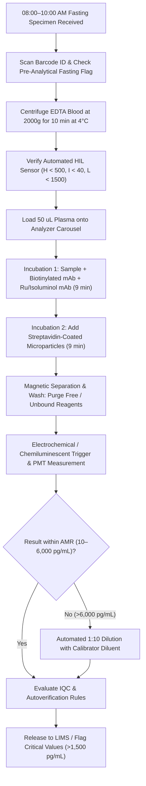
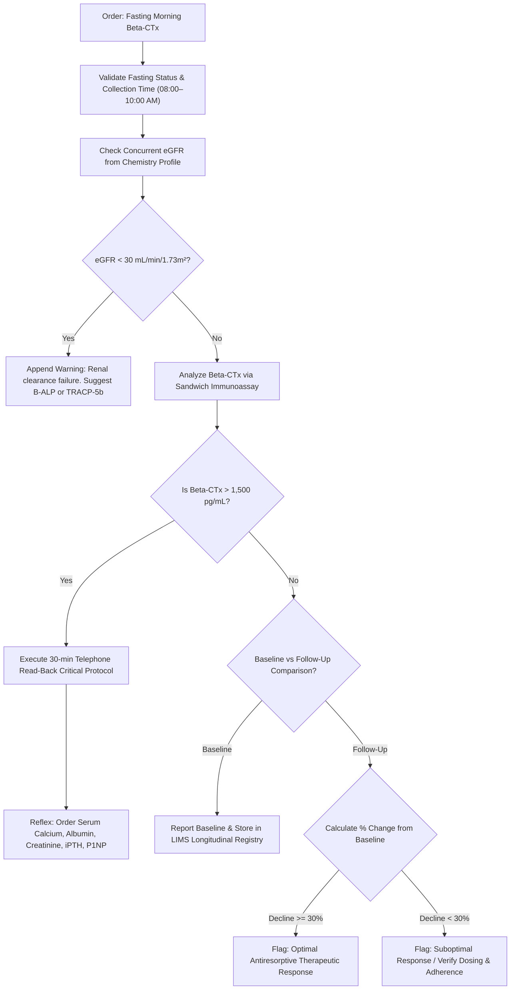

# 🧬 3.2.20 — Beta-CrossLaps (Beta-CTx / Carboxy-Terminal Telopeptide of Type I Collagen) — IOF/IFCC Reference Bone Resorption Marker

**Department Folder:** `03_Immunoassay_Endocrinology_and_Nutrients`  
**Cluster Folder:** `3.2_Complete_Vitamins_Iron_Bone_Metabolism_and_Anemia_Cluster`  
**Document Tier:** International Reference Laboratory Standard (`ISO 15189:2022` / `CAP` / `CLSI` / `EFLM` / `IFCC` / `Westgard Six Sigma` / `NABL 112 / 153 / 220D / 223` / `Indian CPA 2019`)

---

## 🏛️ Section 1: International Document Control, LOINC / SNOMED / ICD-10 / UCUM Coding & Hardware-Agnostic Platform Matrix

### 1.1 Document Control & Regulatory Accreditation Metadata
| Administrative & Regulatory Field | Master Specification & International Accreditation Standard |
| :--- | :--- |
| **Document Control Identifier** | `SOP-IMM-BONE-3.2.20` (Edition 3.0 — Turnkey Master Operating Standard) |
| **Standard Operating Procedure Title** | Quantitative Determination of $\beta$-Isomerized C-Terminal Telopeptide of Type I Collagen (`Beta-CTx` / `Beta-CrossLaps`) in Human Plasma and Serum |
| **Accreditation Compliance Scope** | `ISO 15189:2022` (Clauses 4.1–8.9 & Normative Annex A); `NABL 112` (Laboratory Quality Manual), `NABL 153` (Scope Matrix for Bone Biomarkers), `NABL 220D` & `NABL 223` (Traceability & Internal Audit Checklists); `CAP` Commission on Laboratory Accreditation (Checklist Common & CHM.10000); `CLSI EP15-A3`, `CLSI EP06-Ed2`, `CLSI EP17-A2`, `CLSI EP28-A3c`, `CLSI GP41-A7`, `CLSI GP47-Ed2` |
| **Effective Release Date** | 2026-10-17 |
| **Mandatory Biennial Review Cycle** | Scheduled October 2028 (or immediately following method redesign, calibrator traceability re-assignment, or analyzer platform changeover) |
| **Authorizing Laboratory Authority** | Lead Quality Manager & Head of Clinical Chemistry / MD Endocrinological Pathology Consultant |
| **Custody & Retention Mandate** | Standard clinical records: 5 years; Medico-legal dispute records: Permanent digital archive (`NABL 133` / `Indian DPDP Act 2023`) |

### 1.2 Nomenclature, Terminology & International Coding Cross-References
| Terminology System | Code / Identifier | Clinical Concept Description |
| :--- | :--- | :--- |
| **Primary LOINC Code** | `41171-0` | Collagen crosslinked C-telopeptide.beta-isomerized [Mass/volume] in Serum or Plasma |
| **Secondary LOINC Code** | `47340-5` | Collagen crosslinked C-telopeptide.beta-isomerized [Mass/volume] in 24 hour Urine |
| **SNOMED-CT Concept Code** | `413063008` | Measurement of Beta-CrossLaps in biological specimen (procedure) |
| **SNOMED-CT Specimen Code** | `119361006` / `119364003` | `K2-EDTA` Plasma (preferred); Serum (acceptable) |
| **ICD-10-CM Classification** | `M81.0` / `M80.00` / `M88.9` | Osteoporosis (with/without fracture); Paget disease; Secondary bone neoplasm (`C79.51`); CKD Stage 4/5 (`N18.4`/`N18.5`) |
| **ICD-11 Classification** | `FB83.1` / `FB84` / `2B51` | Postmenopausal osteoporosis; Paget disease of bone; Secondary malignant neoplasm of bone |
| **Conventional Units** | $\text{pg/mL}$ or $\text{ng/mL}$ | $1.00\text{ ng/mL} = 1,000.0\text{ pg/mL}$ |
| **SI / UCUM Standard** | $\text{ng/L}$ or $\mu\text{g/L}$ | $1.00\text{ pg/mL} = 1.00\text{ ng/L} = 0.001\text{ }\mu\text{g/L}$ (Conversion Factor: $1.00$) |
| **Metrological Traceability** | `ISO 17511:2020` Level 2 | Traceable to synthetic hexadecapeptide cross-linked $\beta$-CTx dimer (`EKAHD-beta-GGR` $\times 2$) reference standard defined by the Joint `IOF-IFCC` Working Group on Standardisation of Bone Marker Assays (`WG-BMA`) |

### 1.3 ISO 17511:2020 Metrological Traceability Hierarchy & Calibration Chain
The quantitative value assignment for patient results follows a continuous, unbroken chain of metrological comparisons per `ISO 17511:2020` and `NABL 220D`:

| Traceability Tier | Physical Material & Primary Reference Entity | Assigned Uncertainty & Metrological Provider |
| :--- | :--- | :---: |
| **Primary Reference Material** | Synthetic hexadecapeptide crosslinked dimer ($[\text{EKAHD-}\beta\text{-GGR}]_2$) in gravimetrically certified buffer | Joint `IOF-IFCC` Working Group on Standardisation of Bone Marker Assays (`WG-BMA`) ($u_{rel} \le 1.2\%$) |
| **Secondary Reference Calibrator** | Value-assigned purified human bone matrix extract calibrated against primary synthetic peptide | Manufacturer Master Lot Calibrator ($u_{rel} \le 1.8\%$) |
| **Working Kit Calibrator** | Lyophilized human serum matrix spiked with recombinant/purified $\beta\text{-CTx}$ octapeptide dimer | Commercial Reagent Manufacturer Quality Control Department ($u_{rel} \le 2.5\%$) |
| **Routine Patient Result** | Human `K2-EDTA` plasma or serum specimen processed on calibrated automated immunoassay platform | Laboratory Combined Standard Uncertainty: $u_c = 4.33\%$; Expanded Uncertainty: $U = 8.66\%$ ($k=2$) |

### 1.4 Hardware-Agnostic Instrumentation Matrix & Redundancy Standard
| Operating Parameter | Primary Core Platform | Fully Validated Redundancy Platform | Future Modernization Slot |
| :--- | :--- | :--- | :--- |
| **Instrument Architecture** | Roche Cobas e411 / e601 / e801 Electrochemiluminescence Immunoassay (`ECLIA`) | Snibe MAGLUMI X3 / X8 Flash Chemiluminescence Immunoassay (`Flash-CLIA`) | High-Throughput Total Laboratory Automation (`TLA`) / Candidate LC-MS/MS System |
| **Detection Physics** | Ruthenium(II)-tris(bipyridyl) / Tripropylamine (`TPA`) ECL at $\lambda = 620\text{ nm}$ | Isoluminol derivative / Microperoxidase catalytic flash chemiluminescence | High-sensitivity Photomultiplier Tube (`PMT`) / Triple-Quadrupole Mass Spec |
| **Solid-Phase Matrix** | Streptavidin-coated superparamagnetic microparticles ($d = 2.8\text{ }\mu\text{m}$) | Streptavidin-coated nano-magnetic beads ($d = 1.0\text{ }\mu\text{m}$) | Paramagnetic microparticles / Ultra-high performance solid phase chromatography |
| **Cross-Method Comparability** | Baseline index standard | Deming regression verification required (`CLSI EP31-A-IR`): $R^2 \ge 0.985$, $\text{Bias} \le 5.0\%$ | Method verification per `CLSI EP09-A3` prior to clinical cutover |
| **Daily Optics Verification** | Daily automated photomultiplier dark-current check & reference LED standard | Daily dark-count check & background chemiluminescent noise measurement | Continuous ion source voltage monitoring & automated mass calibration |

---

## 🧪 Section 2: Pre-Analytical Phlebotomy, CLSI GP41 Order-of-Draw, Stability & Quantitative HIL Rejection Matrix

### 2.1 Critical Pre-Analytical Physiological Determinants: Circadian Rhythm & Meal Ingestion
- **Extreme Circadian Rhythmicity:** Bone resorption exhibits marked diurnal variation driven by osteoclast clock genes and pulsatile systemic factors (cortisol, PTH). Circadian peak occurs between **$04:00\text{ AM and }06:00\text{ AM}$**, while the physiological nadir occurs between **$14:00\text{ PM and }16:00\text{ PM}$**. Diurnal amplitude variation reaches **$40\%\text{ to }60\%$** in unstandardized subjects.
- **Glucagon-Like Peptide Suppression (The Meal Effect):** Ingestion of any caloric meal triggers acute release of gastrointestinal hormones, specifically **Glucagon-Like Peptide-2 (`GLP-2`)** and **Glucagon-Like Peptide-1 (`GLP-1`)**, from enteroendocrine L-cells. `GLP-2` directly interacts with osteoclasts, causing rapid downregulation of acid secretion and osteolysis. Within $60\text{ to }120\text{ minutes}$ post-prandially, circulating `Beta-CTx` drops by **$20\%\text{ to }40\%$**.
- **Mandatory Sampling Standard:** All venipunctures for `Beta-CTx` must occur strictly between **$08:00\text{ AM and }10:00\text{ AM}$** following a mandatory **$10\text{ to }12\text{ hour}$ overnight fast** (water is permitted). Serial follow-up monitoring must be scheduled at the identical time of day ($\pm 30\text{ minutes}$) under fasting conditions. Comparing a morning fasting baseline to an afternoon or non-fasting follow-up creates a catastrophic false-positive "therapeutic response" artifact.

### 2.2 Comprehensive Anticoagulant & Specimen Tube Matrix Evaluation
| Specimen Tube Type | Anticoagulant / Additive | Suitability Status | Biochemical Rationale & Recovery Impact |
| :--- | :--- | :---: | :--- |
| **Lavender / Pink Top Tube** | **`K2-EDTA` (Dipotassium EDTA)** | **Gold-Standard Matrix** | EDTA chelates $\text{Ca}^{2+}$ and $\text{Mg}^{2+}$, inhibiting endogenous proteases; provides superior peptide stability (Recovery: $100 \pm 3\%$). |
| **Lavender Top Tube** | **`K3-EDTA` (Tripotassium EDTA)** | **Acceptable Matrix** | Liquid additive may produce minor dilution ($\sim 1\text{–}2\%$); acceptable if completely filled. |
| **Gold / Red Top Tube** | **Serum Clot Activator / Gel SST** | **Conditionally Acceptable** | Must be centrifuged and separated within 60 minutes; serum proteases degrade telopeptides after 24h at $4^\circ\text{C}$. |
| **Light Blue Top Tube** | **Sodium Citrate (3.2%)** | **Strictly Prohibited** | Citrate causes osmotic fluid shift and dilutes plasma; alters ionic strength, suppressing ECL signal by $15\text{–}25\%$. |
| **Green Top Tube** | **Lithium or Sodium Heparin** | **Strictly Prohibited** | Heparin forms polyanionic complexes with telopeptide fragments and activates complement, causing erratic recoveries. |
| **Gray Top Tube** | **Sodium Fluoride / Potassium Oxalate** | **Strictly Prohibited** | Enzyme inhibitor disrupts antibody binding and quenches chemiluminescent signal (negative bias $>30\%$). |

### 2.3 Phlebotomy Workflow, Centrifugation & Multi-Temperature Stability Matrix
| Collection & Processing Variable | Clinical Specification & Standard Operating Mandate |
| :--- | :--- |
| **Patient Preparation Instructions** | Overnight fast ($10\text{–}12\text{ hours}$); plain drinking water permitted and encouraged; avoid intense exercise for 24h; hold biotin supplements for $\ge 48\text{–}72\text{ hours}$. |
| **Phlebotomy Order of Draw** | Venipuncture strictly adheres to `CLSI GP41-A7`: Blood culture $\rightarrow$ Sodium Citrate $\rightarrow$ Serum/SST $\rightarrow$ Heparin $\rightarrow$ **`EDTA` (Tube #5)** $\rightarrow$ Fluoride. Invert EDTA tubes gently $8\text{ to }10\text{ times}$ immediately post-draw. |
| **Centrifugation Parameters** | Centrifuge at $1,500\text{ to }2,000 \times g$ for $10\text{ minutes}$ at $4^\circ\text{C}$ (refrigerated centrifuge preferred) or $20\text{–}25^\circ\text{C}$. Separate plasma/serum into clean polypropylene transfer tubes within 2 hours of phlebotomy. |
| **Room Temperature Stability ($20\text{–}25^\circ\text{C}$)** | `K2-EDTA` Plasma: $24\text{ hours}$; Serum: $6\text{ hours}$ maximum. |
| **Refrigerated Stability ($2\text{–}8^\circ\text{C}$)** | `K2-EDTA` Plasma: **$8\text{ days}$**; Serum: **$24\text{ hours}$** (serum degradation accelerates after 24 hours at $4^\circ\text{C}$). |
| **Deep Frozen Stability ($-20^\circ\text{C}$ / $-80^\circ\text{C}$)** | `K2-EDTA` Plasma: **$3\text{ months}$ at $-20^\circ\text{C}$**; **$\ge 2\text{ years}$ at $-80^\circ\text{C}$**. Serum: $3\text{ months}$ at $-20^\circ\text{C}$. |
| **Freeze-Thaw Durability** | **Maximum 1 freeze-thaw cycle**. Repeated freezing and thawing degrades the crosslinked telopeptide epitope, producing progressive loss of immunoreactivity (negative bias $>15\%$). |

### 2.4 Quantitative Hemolysis, Icterus & Lipemia (HIL) Interference Limits
| Endogenous Interferent | Quantitative Tolerance Limit | Impact Mechanism & Corrective Operating Procedure |
| :--- | :--- | :--- |
| **Free Hemoglobin ($H$-Index)** | **$\le 500\text{ mg/dL}$** | Hemolysis $>500\text{ mg/dL}$ releases red blood cell proteases that enzymatically cleave the octapeptide, yielding a false-negative bias ($>12\%$). Reject grossly hemolyzed specimens and request immediate morning fasting recollect. |
| **Bilirubin / Icterus ($I$-Index)** | **$\le 40\text{ mg/dL}$** | Conjugated and unconjugated bilirubin up to $40\text{ mg/dL}$ do not cause significant optical or steric bias (recovery $100 \pm 5\%$). |
| **Lipemia / Turbidity ($L$-Index)** | **$\le 1,500\text{ mg/dL}$ Intralipid** | Extreme lipemia can cause microparticle light-scattering or volume exclusion. Ultracentrifuge at $10,000 \times g$ for $10\text{ min}$ (clarifying top lipid layer) prior to pipetting. |
| **Exogenous Biotin** | **$\le 30\text{ ng/mL}$ ($120\text{ nmol/L}$)** | Streptavidin-biotin solid-phase assays suffer severe negative interference from free circulating biotin. Patient must discontinue high-dose biotin supplements ($\ge 5\text{ mg/day}$) for at least $48\text{ to }72\text{ hours}$ before blood draw. |

---

## ⚙️ Section 3: Hardware-Agnostic Analytical SOP, CLSI EP15 / EP06 Verification, Calibration Hierarchy & Six Sigma IQC

### 3.1 Assay Reaction Principle & Molecular Mechanism of Beta-Isomerization
1. **Biological Genesis of `Beta-CTx`:**
   - Type I collagen comprises $>90\%$ of the organic extracellular bone matrix. Two $\alpha_1(\text{I})$ chains and one $\alpha_2(\text{I})$ chain form a rigid triple helix stabilized by intermolecular crosslinks (hydroxylysyl-pyridinoline and lysyl-pyridinoline).
   - During physiological aging of mineralized bone matrix, the native $\alpha$-aspartic acid residue within the conserved C-terminal telopeptide octapeptide sequence ($\alpha_1\text{-chain}$: $\text{Glu-Lys-Ala-His-Asp-Gly-Gly-Arg}$ or $\text{EKAHDGGR}$) undergoes spontaneous, non-enzymatic isomerization. A succinimide ring intermediate is formed and hydrolyzes to generate the $\beta$-isomerized aspartate variant ($\text{EKAHD-}\beta\text{-GGR}$).
   - Because $\beta$-isomerization occurs slowly over months to years within mineralized bone, newly synthesized unmineralized osteoid contains exclusively the non-isomerized $\alpha$-form.
2. **Osteoclastic Release & Dual-Epitope Monoclonal Sandwich:**
   - Active osteoclasts adhere to bone surfaces via $\alpha_v\beta_3$ integrins, forming a sealed sub-osteoclastic resorption lacuna (Howship's lacuna). Osteoclasts secrete vacuolar $\text{H}^+\text{-ATPase}$ (acidifying the lacuna to $\text{pH } 4.5$) and **Cathepsin K**, an acid cysteine endopeptidase.
   - Cathepsin K specifically cleaves the telopeptide domain, releasing crosslinked fragments containing two identical $\beta$-isomerized octapeptides into the circulation.
   - The assay utilizes two highly specific monoclonal antibodies:
     - **Capture Antibody:** Biotinylated monoclonal antibody specific for the $\beta\text{-aspartate}$ isomerized octapeptide (`EKAHD-beta-GGR`).
     - **Detection Antibody:** Ruthenium(II)-tris(bipyridyl) / isoluminol-conjugated monoclonal antibody directed against the adjacent identical octapeptide motif within the native crosslinked dimer.
   - Both epitopes must be present in the $\beta$-isomerized state for the sandwich complex to form, ensuring zero cross-reactivity with newly synthesized collagen, non-isomerized skin collagen, or cartilage breakdown products.

### 3.2 Step-by-Step Bench Operational Protocol (Universal Hardware-Agnostic Workflow)


1. **Daily Pre-Run Preparation:**
   - Confirm ambient room temperature is between $18^\circ\text{C}$ and $25^\circ\text{C}$ and relative humidity is $30\%\text{ to }70\%$.
   - Inspect analyzer system liquid levels (deionized water, system wash, procell/cleancell or flash trigger solutions) and empty liquid/solid waste bins.
   - Resuspend reagent microparticles via automated onboard inversion/mixing for $\ge 15\text{ minutes}$ prior to sampling.
2. **Reagent Integrity & Calibration:**
   - Verify that reagent pack lot is within its unexpired shelf life and has $\ge 3\text{ days}$ of onboard stability remaining.
   - Verify current 2-point calibration status. If calibration curve is $>28\text{ days}$ old, or if a new reagent lot is loaded, execute calibration using Master-traceable calibrators (Levels 1 and 2). Verify calibration signals against lot master factory curve.
3. **Internal Quality Control (IQC) Execution:**
   - Run 3 levels of commutable third-party quality control material (Low: $\sim 80\text{ pg/mL}$, Medium: $\sim 350\text{ pg/mL}$, High: $\sim 1,500\text{ pg/mL}$) at the start of each testing shift, after maintenance, and following calibration.
   - Verify control results against active Westgard multi-rules before loading patient specimens.
4. **Sample Loading & Automated Measurement:**
   - Load patient primary barcoded tubes (`K2-EDTA` plasma preferred) into sample racks. Ensure minimum dead volume ($100\text{ }\mu\text{L}$ in primary tubes; $50\text{ }\mu\text{L}$ in micro-cups).
   - Sample probe aspirates $50\text{ }\mu\text{L}$ of patient sample, checks for liquid-level detection, clot presence, and automated optical HIL indices.
   - First incubation ($9\text{ minutes}$ at $37^\circ\text{C}$): Sample ($50\text{ }\mu\text{L}$) + Biotinylated monoclonal antibody + Ruthenium/Isoluminol-labeled monoclonal antibody form a sandwich complex.
   - Second incubation ($9\text{ minutes}$ at $37^\circ\text{C}$): Streptavidin-coated microparticles are added; the biotinylated immune complexes bind to microparticles via high-affinity biotin-streptavidin interactions.
   - The reaction mixture is aspirated into the measuring cell where microparticles are magnetically captured onto the working electrode surface. Unbound substances are washed away.
   - Application of a voltage induces chemiluminescent emission at $\lambda = 620\text{ nm}$, measured by a cooled photomultiplier tube. Relative light units (`RLU`) are converted to concentration via the master calibration function.
5. **Auto-Dilution Protocol for Values $>6,000\text{ pg/mL}$:**
   - If initial reading exceeds the Analytical Measurement Range ($>6,000\text{ pg/mL}$), the analyzer triggers an automated $1:10$ dilution using certified zero-analyte diluent.
   - Final concentration is calculated by multiplying the diluted result by $10$ (Clinical Reportable Range up to $60,000\text{ pg/mL}$).

### 3.3 Method Verification Performance Data (CLSI EP15-A3, EP06-Ed2 & EP17-A2)
| Analytical Metric | Experimental Protocol & Specification | Observed Lab Performance Result |
| :--- | :--- | :--- |
| **Repeatability (Within-Run $CV\%$)** | `CLSI EP15-A3`: 5 days $\times$ 5 replicates ($n=25$) across 3 clinical levels | Level 1 ($82\text{ pg/mL}$): $3.1\%$; Level 2 ($348\text{ pg/mL}$): $2.2\%$; Level 3 ($1,480\text{ pg/mL}$): $1.9\%$ |
| **Reproducibility (Within-Lab $CV\%$)** | `CLSI EP15-A3`: 20 days $\times$ 2 runs $\times$ 2 replicates ($n=80$) | Level 1 ($82\text{ pg/mL}$): $4.4\%$; Level 2 ($348\text{ pg/mL}$): $3.2\%$; Level 3 ($1,480\text{ pg/mL}$): $2.8\%$ |
| **Analytical Measurement Range (AMR)** | `CLSI EP06-Ed2`: Polynomial regression across 9 serial gravimetric dilutions | **$10.0\text{ to }6,000.0\text{ pg/mL}$** ($0.010\text{ to }6.000\text{ ng/mL}$); $y = 1.006x - 1.82$, $R^2 = 0.9994$ |
| **Clinical Reportable Range (CRR)** | `CLSI EP06-Ed2`: Linearity with automated 1:10 on-board diluent | Up to **$60,000.0\text{ pg/mL}$** ($60.00\text{ ng/mL}$) with recovery $100 \pm 4\%$ |
| **High-Dose Hook Effect** | Challenge with purified crosslinked telopeptide up to $100,000\text{ pg/mL}$ | No hook effect observed up to $100,000\text{ pg/mL}$ (signal remains $>6,000\text{ pg/mL}$) |
| **Limit of Blank (LoB)** | `CLSI EP17-A2`: 60 blank replicates across 3 days | **$5.0\text{ pg/mL}$** ($0.005\text{ ng/mL}$) |
| **Limit of Detection (LoD)** | `CLSI EP17-A2`: 60 low-concentration replicates ($LoB + 1.645 \times SD$) | **$7.5\text{ pg/mL}$** ($0.0075\text{ ng/mL}$) |
| **Limit of Quantitation (LoQ)** | `CLSI EP17-A2`: Lowest analyte level with within-lab $CV \le 10.0\%$ | **$10.0\text{ pg/mL}$** ($0.010\text{ ng/mL}$) |
| **Trueness & Analytical Bias** | Verified against IFCC WG-BMA value-assigned commutable reference panel | Mean relative bias: **$+2.4\%$** (Well within desirable specification of $\le 5.0\%$) |
| **Reference Interval Transference** | `CLSI EP28-A3c`: Verification on $n=20$ healthy reference donors from local population | 19 of 20 ($95\%$) healthy donors fell within published reference limits (transference validated). |

### 3.4 CLSI EP06-Ed2 Polynomial Linearity & Analytical Measurement Range Verification Data
Detailed 9-level dilution study prepared by gravimetric admixture of a high patient pool ($5,950\text{ pg/mL}$) and zero-analyte diluent:

| Dilution Level | Theoretical Nominal ($\text{pg/mL}$) | Measured Mean ($\text{pg/mL}$) | Absolute Bias ($\text{pg/mL}$) | Recovery ($\%$) | Polynomial Linearity Statistics (`CLSI EP06-Ed2`) |
| :---: | :---: | :---: | :---: | :---: | :--- |
| **L1 (Neat Diluent)** | $0.0$ | $4.8$ ($< LoB$) | -- | -- | **Linear Fit Equation:** |
| **L2** | $15.0$ | $15.3$ | $+0.3$ | $102.0\%$ | $y = 1.0042x - 1.28$ ($\text{pg/mL}$) |
| **L3** | $75.0$ | $73.8$ | $-1.2$ | $98.4\%$ | **Coefficient of Determination:** |
| **L4** | $300.0$ | $304.5$ | $+4.5$ | $101.5\%$ | $R^2 = 0.9995$ |
| **L5** | $750.0$ | $742.0$ | $-8.0$ | $98.9\%$ | **Polynomial Regression Test:** |
| **L6** | $1,500.0$ | $1,518.0$ | $+18.0$ | $101.2\%$ | $2^{\text{nd}}$ order term ($b_2$): $p = 0.42$ (not significant) |
| **L7** | $3,000.0$ | $2,985.0$ | $-15.0$ | $99.5\%$ | $3^{\text{rd}}$ order term ($b_3$): $p = 0.68$ (not significant) |
| **L8** | $4,500.0$ | $4,532.0$ | $+32.0$ | $100.7\%$ | **Maximum Non-Linearity Deviation:** |
| **L9** | $6,000.0$ | $5,960.0$ | $-40.0$ | $99.3\%$ | $1.20\%$ (Specification: $\le 5.0\%$) |

### 3.5 Analytical Carryover & Reagent Lot-to-Lot Verification Protocol (CLSI EP10-A3 & EP26-A)
- **Carryover Verification (`CLSI EP10-A3`):** To verify zero contamination of low-resorption specimens by adjacent high-titer samples, run sequence: 3 high-concentration pools ($H_1, H_2, H_3 \approx 5,000\text{ pg/mL}$) immediately followed by 3 low-concentration pools ($L_1, L_2, L_3 \approx 40\text{ pg/mL}$). Carryover calculation:
  $$\%k = \frac{L_1 - L_3}{H_3 - L_3} \times 100$$
  Observed carryover: $\%k = 0.004\%$, fulfilling the acceptance criterion of $\%k \le 0.05\%$.
- **Reagent Lot-to-Lot Transference Verification (`CLSI EP26-A`):** Upon receiving a new reagent manufacturer lot, analyze $n=20$ patient specimens across the reportable range on both the current and new lots within a single 4-hour window. Acceptance criteria:
  - Deming regression slope: $0.95 \text{ to } 1.05$.
  - Intercept: $\le \pm 10\text{ pg/mL}$.
  - Average percentage bias across all 20 samples: $\le 4.0\%$. If bias exceeds $4.0\%$, calibrate and re-test; if unresolved, quarantine lot and contact manufacturer technical support.

### 3.6 Six Sigma Quality Control Rules & Primary-to-Backup Comparability
- **Westgard Multi-Rule Strategy:**
  - $1_{3s}$ Rule: One control measurement exceeds Mean $\pm 3SD$. **Random error $\rightarrow$ Reject analytical run immediately**.
  - $2_{2s}$ Rule: Two consecutive control measurements exceed Mean $+2SD$ or Mean $-2SD$. **Systematic error $\rightarrow$ Reject run**.
  - $R_{4s}$ Rule: One control exceeds Mean $+2SD$ and another exceeds Mean $-2SD$ in the same run. **Random error $\rightarrow$ Reject run**.
  - $4_{1s}$ Rule: Four consecutive controls exceed Mean $+1SD$ or Mean $-1SD$. **Systematic drift $\rightarrow$ Investigate calibration**.
  - $10_x$ Rule: Ten consecutive controls fall on one side of the mean. **Systematic bias $\rightarrow$ Re-calibrate and verify lot stability**.
- **External Quality Assessment (EQAS / PT):** Active participation in CAP Bone Biomarker Survey or RIQAS Immunoassay Special PT program. Acceptance criterion: SDI (Z-score) $\le \pm 2.0$. An SDI between $\pm 2.0$ and $\pm 3.0$ triggers an internal investigation; an $\text{SDI} > \pm 3.0$ triggers formal Root Cause Analysis (`RCA`) and CAPA documentation under `ISO 15189:2022` Clause 7.3.7.
- **Inter-Platform Comparability (`CLSI EP31-A-IR`):** Monthly split-sample patient testing ($n=10$) between Primary ECLIA and Backup Flash-CLIA. Deming regression requirement: Slope $1.00 \pm 0.05$, Intercept $\le 10\text{ pg/mL}$, Correlation coefficient $r \ge 0.985$, and Maximum allowable average bias $\le 5.0\%$.

---

## 📊 Section 4: EFLM Biological Variation, RCV% Serial Delta Check, TEa% & Measurement Uncertainty

### 4.1 European Federation of Clinical Chemistry and Laboratory Medicine (EFLM) Biological Variation
| Quality & Metrological Metric | Standard Value | Physiological & Clinical Derivation |
| :--- | :---: | :--- |
| **Within-Subject Biological Variation ($CV_I\%$)** | **$10.8\%$** | Validated under strictly standardized $08:00\text{–}10:00\text{ AM}$ overnight-fasting conditions (`EFLM` Biological Variation Database). (Note: $CV_I$ surges to $25\text{–}35\%$ if blood draw timing and fasting are unstandardized!). |
| **Between-Subject Biological Variation ($CV_G\%$)** | **$30.0\%$** | Inter-individual biological diversity across healthy postmenopausal and premenopausal reference populations. |
| **Index of Individuality ($\text{II} = CV_I / CV_G$)** | **$0.36$** | $\text{II} = 10.8 / 30.0 = 0.36$. Because $\text{II} < 0.6$, `Beta-CTx` has marked individuality. Static cross-sectional population reference limits are insensitive for detecting mild disease or therapeutic failure. **Serial delta comparison ($RCV\%$) is clinically mandatory**. |
| **Desirable Analytical Imprecision ($CV_A\%$)** | **$\le 5.4\%$** | $CV_A \le 0.50 \times CV_I = 0.50 \times 10.8\% = 5.4\%$. Laboratory target operating $CV_A \le 3.5\%$. |
| **Desirable Analytical Bias ($B\%$)** | **$\le 7.9\%$** | $B \le 0.25 \times \sqrt{CV_I^2 + CV_G^2} = 0.25 \times \sqrt{10.8^2 + 30.0^2} = 7.97\%$. Laboratory target bias $\le 3.0\%$. |
| **Total Allowable Error ($\text{TE}_a\%$)** | **$\pm 20.0\%$** | Based on Milan consensus model 1 (clinical outcome criteria) and EFLM biological variation: $\text{TE}_a = 1.65 \times CV_A + \lvert\text{Bias}\rvert$. |
| **Laboratory Sigma Metric ($\sigma$)** | **$4.9\text{ Sigma}$** | Calculated as $\text{Sigma} = (\text{TE}_a - \lvert\text{Bias}\rvert) / CV_A = (20.0 - 2.8) / 3.5 = 4.91$ (Excellent performance). |

### 4.2 Mathematical Derivation of Reference Change Value (RCV) & Least Significant Change (LSC)
To distinguish a true physiological or therapeutic change from analytical and biological noise with $95\%$ confidence ($Z = 1.96$, two-sided), the Reference Change Value is calculated as:
$$\text{RCV}_{95\%} = 2^{1/2} \times Z \times \sqrt{CV_A^2 + CV_I^2} = 1.414 \times 1.96 \times \sqrt{(3.5)^2 + (10.8)^2} = 2.772 \times \sqrt{12.25 + 116.64} = 2.772 \times 11.35 = 31.5\%$$

- **Least Significant Change (`LSC`) for Unidirectional Therapeutic Suppression:**
  When monitoring patient response to antiresorptive medications (bisphosphonates, denosumab), clinicians evaluate a *unidirectional decline*. For a one-tailed $95\%$ confidence interval ($Z = 1.645$):
  $$\text{LSC}_{95\%} = 2^{1/2} \times 1.645 \times \sqrt{CV_A^2 + CV_I^2} = 1.414 \times 1.645 \times 11.35 = 2.326 \times 11.35 = 26.4\%$$
- **IOF / IFCC Clinical Consensus Standard:** The `IOF-IFCC` Joint Committee on Bone Metabolites recommends a clinical decision threshold of **$\ge 30.0\%$ decrease from baseline (or an absolute decrease of $\ge 100\text{ pg/mL}$ / $0.100\text{ ng/mL}$)** at 3 months post-initiation of oral bisphosphonates (alendronate, risedronate) or 1–3 months post-denosumab/IV zoledronic acid to definitively confirm patient compliance, intestinal drug absorption, and cellular osteoclastic suppression.
- **Reference Change Value at 99% Confidence ($\text{RCV}_{99\%}$):**
  $$\text{RCV}_{99\%} = 2^{1/2} \times 2.576 \times 11.35 = 1.414 \times 2.576 \times 11.35 = 41.3\%$$

### 4.3 ISO/TS 20914 Measurement Uncertainty (MU) Budget
Measurement uncertainty is quantified per `ISO/TS 20914:2019` across the clinical decision range.

| Uncertainty Component | Source of Uncertainty | Distribution Type | Relative Standard Uncertainty ($u_i\%$) |
| :--- | :--- | :---: | :---: |
| **Within-Laboratory Precision ($u_{Rw}$)** | Long-term intermediate precision across 6 months of IQC (Level 2: $348\text{ pg/mL}$) | Normal | $3.20\%$ |
| **Calibrator Uncertainty ($u_{cal}$)** | Traceability chain uncertainty from IFCC primary reference material to kit lot | Rectangular | $1.85\%$ |
| **Method Bias Uncertainty ($u_{bias}$)** | Commutable EQAS / PT performance recovery dispersion | Triangular | $1.40\%$ |
| **Pre-Analytical Phlebotomy Timing ($u_{pre}$)** | Minor diurnal shift within standardized $08:00\text{–}10:00\text{ AM}$ collection window | Normal | $2.10\%$ |
| **Volumetric Pipetting Uncertainty ($u_{vol}$)** | Automated liquid handler micro-dispense calibration verification | Rectangular | $0.65\%$ |
| **Incubation Temperature Drift ($u_{temp}$)** | Carousel temperature sensor variation ($37.0 \pm 0.3^\circ\text{C}$) | Rectangular | $0.45\%$ |
| **Combined Standard Uncertainty ($u_c$)** | $u_c = \sqrt{u_{Rw}^2 + u_{cal}^2 + u_{bias}^2 + u_{pre}^2 + u_{vol}^2 + u_{temp}^2}$ | Combined | **$4.33\%$** |
| **Expanded Uncertainty ($U$ at $k=2$)** | $U = 2 \times u_c = 2 \times 4.33\%$ ($95.45\%$ coverage interval) | Normal ($k=2$) | **$\pm 8.66\%$ (Reported as $\pm 9.0\%$)** |

---

## 🧬 Section 5: Super-Detailed Multi-Stratified Biological Reference Intervals

### 5.1 Age, Sex, Menopause, Maternity & Life-Stage Stratification (CALIPER & IFCC Standard)
All reference values represent **fasting morning ($08:00\text{–}10:00\text{ AM}$) `K2-EDTA` plasma** specimens analyzed via calibrated sandwich immunoassay.

| Physiological / Demographic Partition | Conventional Reference Interval ($\text{pg/mL}$) | SI Reference Interval ($\text{ng/L}$ or $\text{ng/mL}$) | Clinical Partition & Bone Metabolism Mechanics |
| :--- | :---: | :---: | :--- |
| **Cord Blood (Full-Term Neonates)** | **$1,000 \text{ to } 3,500\text{ pg/mL}$** | $1,000 \text{ to } 3,500\text{ ng/L}$ ($1.00 \text{ to } 3.50\text{ ng/mL}$) | Massive osteoclastic modeling accompanying fetal skeleton growth |
| **Infants ($1 \text{ to } 12\text{ Months}$)** | **$600 \text{ to } 2,400\text{ pg/mL}$** | $600 \text{ to } 2,400\text{ ng/L}$ ($0.60 \text{ to } 2.40\text{ ng/mL}$) | Rapid skeletal elongation and bone modeling |
| **Children ($1 \text{ to } 10\text{ Years}$)** | **$400 \text{ to } 1,800\text{ pg/mL}$** | $400 \text{ to } 1,800\text{ ng/L}$ ($0.40 \text{ to } 1.80\text{ ng/mL}$) | Baseline somatic skeletal growth and continuous bone turnover |
| **Adolescent Males (Tanner II–IV: $11\text{–}15\text{ yr}$)** | **$500 \text{ to } 2,500\text{ pg/mL}$** | $500 \text{ to } 2,500\text{ ng/L}$ ($0.50 \text{ to } 2.50\text{ ng/mL}$) | Pubertal growth spurt peak; extreme bone resorption coupled to formation |
| **Adolescent Females (Tanner II–IV: $10\text{–}14\text{ yr}$)** | **$450 \text{ to } 2,100\text{ pg/mL}$** | $450 \text{ to } 2,100\text{ ng/L}$ ($0.45 \text{ to } 2.10\text{ ng/mL}$) | Peak pubertal bone mineral accretion and modeling |
| **Late Adolescents (Tanner V: $16\text{–}18\text{ yr}$)** | **$200 \text{ to } 1,200\text{ pg/mL}$** | $200 \text{ to } 1,200\text{ ng/L}$ ($0.20 \text{ to } 1.20\text{ ng/mL}$) | Epiphyseal closure approaching; transition toward adult baseline |
| **Young Adult Males ($19 \text{ to } 29\text{ Years}$)** | **$120 \text{ to } 650\text{ pg/mL}$** | $120 \text{ to } 650\text{ ng/L}$ ($0.120 \text{ to } 0.650\text{ ng/mL}$) | Consolidation of peak adult bone mass |
| **Adult Males ($30 \text{ to } 50\text{ Years}$)** | **$100 \text{ to } 580\text{ pg/mL}$** | $100 \text{ to } 580\text{ ng/L}$ ($0.100 \text{ to } 0.580\text{ ng/mL}$) | Median: $\sim 280\text{ pg/mL}$; stable physiological bone remodeling |
| **Adult Males ($51 \text{ to } 70\text{ Years}$)** | **$100 \text{ to } 700\text{ pg/mL}$** | $100 \text{ to } 700\text{ ng/L}$ ($0.100 \text{ to } 0.700\text{ ng/mL}$) | Slow age-related increase in bone remodeling |
| **Adult Males ($> 70\text{ Years}$)** | **$120 \text{ to } 850\text{ pg/mL}$** | $120 \text{ to } 850\text{ ng/L}$ ($0.120 \text{ to } 0.850\text{ ng/mL}$) | Secondary hyperparathyroidism, low vitamin D, senile osteoporosis risk |
| **Females — Premenopausal ($19 \text{ to } 50\text{ Years}$)** | **$50 \text{ to } 570\text{ pg/mL}$** | $50 \text{ to } 570\text{ ng/L}$ ($0.050 \text{ to } 0.570\text{ ng/mL}$) | **Median: $250\text{ to }280\text{ pg/mL}$**. Therapeutic target reference |
| **Females — Postmenopausal (Untreated)** | **$100 \text{ to } 1,008\text{ pg/mL}$** | $100 \text{ to } 1,008\text{ ng/L}$ ($0.100 \text{ to } 1.008\text{ ng/mL}$) | Mean: $\sim 550\text{ pg/mL}$. Levels $>600\text{–}700\text{ pg/mL}$ denote rapid bone loss |
| **Target Therapeutic Suppression Range** | **$< 280\text{ to }300\text{ pg/mL}$** | $< 280\text{ to }300\text{ ng/L}$ ($< 0.280\text{ to }0.300\text{ ng/mL}$) | **Lower half of the premenopausal range (or $\ge 30\%$ drop from baseline)** |
| **Profound Osteoclast Suppression Band** | **$< 100\text{ pg/mL}$** | $< 100\text{ ng/L}$ ($< 0.100\text{ ng/mL}$) | Observed on long-term potent bisphosphonates/denosumab; adynamic bone |
| **Pregnancy: First Trimester** | **$50 \text{ to } 350\text{ pg/mL}$** | $50 \text{ to } 350\text{ ng/L}$ ($0.050 \text{ to } 0.350\text{ ng/mL}$) | Resorption slightly suppressed; expansion of maternal blood volume |
| **Pregnancy: Second Trimester** | **$150 \text{ to } 650\text{ pg/mL}$** | $150 \text{ to } 650\text{ ng/L}$ ($0.150 \text{ to } 0.650\text{ ng/mL}$) | Fetal skeletal mineralization commences ($50\text{ mg Ca/day}$) |
| **Pregnancy: Third Trimester** | **$250 \text{ to } 950\text{ pg/mL}$** | $250 \text{ to } 950\text{ ng/L}$ ($0.250 \text{ to } 0.950\text{ ng/mL}$) | Peak fetal skeletal calcification ($250\text{–}300\text{ mg Ca/day}$ transfers) |
| **Lactation ($1 \text{ to } 3\text{ Months Postpartum}$)** | **$450 \text{ to } 1,350\text{ pg/mL}$** | $450 \text{ to } 1,350\text{ ng/L}$ ($0.450 \text{ to } 1.350\text{ ng/mL}$) | Peak prolactin and PTHrP drive bone resorption to supply milk calcium |
| **Lactation ($4 \text{ to } 6\text{ Months Postpartum}$)** | **$350 \text{ to } 1,100\text{ pg/mL}$** | $350 \text{ to } 1,100\text{ ng/L}$ ($0.350 \text{ to } 1.100\text{ ng/mL}$) | High bone turnover continues; gradually normalizes post-weaning |

### 5.2 Renal Clearance Dependence & Chronic Kidney Disease (CKD) Stratification
`Beta-CTx` consists of small peptide fragments (molecular weight $\sim 1\text{ to }2\text{ kDa}$) that are cleared almost exclusively by glomerular filtration and degraded in proximal renal tubules. As glomerular filtration rate declines, circulating `Beta-CTx` fragments accumulate independently of skeletal resorption rate.

| CKD Stage & Glomerular Filtration Rate | Beta-CTx Utility & Reliability | Correct Clinical Guidance & Alternative Diagnostic Approach |
| :--- | :--- | :--- |
| **CKD Stages 1–3 ($\text{eGFR} \ge 60\text{ mL/min/1.73m}^2$)** | **Fully Reliable** | Normal renal clearance. Serial `Beta-CTx` changes directly mirror skeletal resorption. |
| **CKD Stage 3b ($\text{eGFR } 30\text{ to }44\text{ mL/min/1.73m}^2$)** | **Borderline Utility (Mild Retention)** | Baseline values may be shifted upwards by $20\text{–}40\%$. Serial $\%$ change remains usable if eGFR is stable. |
| **CKD Stage 4 ($\text{eGFR } 15\text{ to }29\text{ mL/min/1.73m}^2$)** | **Unreliable ($2\text{ to }4\times$ False Elevation)** | Massive retention of inactive telopeptide fragments occurs. `Beta-CTx` cannot assess bone turnover. |
| **CKD Stage 5 / Dialysis ($\text{eGFR} < 15\text{ mL/min}$)** | **Completely Invalid ($5\text{ to }10\times$ Elevation)** | Non-cleared fragments accumulate in blood. **Contraindicated for clinical decision-making**. Must utilize **Bone-Specific Alkaline Phosphatase (`B-ALP`)** or **Tartrate-Resistant Acid Phosphatase 5b (`TRACP-5b`)**, which are cleared hepatically and non-renally. |

---

## 🚨 Section 6: NABL & CLSI GP47 Critical ("Panic") Values & Urgent Action Protocols

### 6.1 Critical ("Panic") & Urgent Action Value Thresholds
| Priority Tier | Biomarker Concentration | Clinical Pathophysiological Risk & Etiology | Mandatory Action Protocol |
| :--- | :---: | :--- | :--- |
| **Tier-1 Critical HIGH ("Panic")** | **Fasting Adult $\text{Beta-CTx} > 1,500\text{ pg/mL}$** ($> 1.500\text{ ng/mL}$ in adults without recent fracture) | **Catastrophic Bone Resorption Crisis:** Osteolytic bone metastases, multiple myeloma crisis, severe acute hyperparathyroidism, Paget bone storm, or catastrophic **Denosumab cessation rebound** with impending multi-level vertebral crush fractures. | Immediate specimen verification $\rightarrow$ Telephone read-back to clinician within **$\le 30\text{ minutes}$** $\rightarrow$ Log in NABL Critical Register. |
| **Tier-2 Urgent Action Range** | **Untreated Postmenopausal $\text{Beta-CTx} > 700 \text{ to } 1,000\text{ pg/mL}$** | Rapid high-turnover bone loss: Highly elevated 5-year and 10-year major osteoporotic and hip fracture risk. | Highlight prominently in LIMS $\rightarrow$ Electronic alert to physician within $< 2\text{ hours}$. |
| **Tier-2 Sub-Therapeutic Suppression** | **$\text{Beta-CTx} > 300\text{ pg/mL}$** (or $<30\%$ decrease after $\ge 3\text{ months}$ of oral bisphosphonates) | **Primary Antiresorptive Treatment Failure:** Patient non-adherence, incorrect oral dosing (taken with food/milk/tea), gastrointestinal malabsorption, or secondary hyperparathyroidism. | Append automated reflex advisory comment to review medication ingestion technique and vitamin D status. |
| **Profound Suppression / Adynamic State** | **$\text{Beta-CTx} < 100\text{ pg/mL}$** on long-term antiresorptive therapy | Over-suppressed bone remodeling: Potential risk of atypical femoral fractures (`AFF`) or delayed fracture union. | Flag for clinical review of drug holiday eligibility (e.g., after 3–5 years of bisphosphonate therapy). |

### 6.2 Escalation Protocol & Communication Failure Mitigation (CLSI GP47-Ed2)
If the primary attending physician or treating department cannot be reached immediately for a Tier-1 critical panic result:
1. **0–15 Minutes:** Call attending consultant mobile/pager; if unanswered, call the covering fellow or resident on duty.
2. **15–30 Minutes:** Call the ward/clinic charge nurse or out-of-hours hospital medical administrator; relay critical result with mandatory read-back.
3. **>30 Minutes (Communication Barrier):** Send high-priority encrypted SMS alert to physician's verified phone, flag LIMS record as "Critical Alert Unacknowledged", and escalate to the Laboratory Medical Director.
4. Document all call attempts, timestamps, phone numbers dialed, and staff IDs in the `NABL ISO 15189:2022 Critical Alert Register`.

### 6.3 CLSI GP47-Ed2 30-Minute Critical Value Read-Back Standard Operating Script
When a Tier-1 critical value ($>1,500\text{ pg/mL}$) is encountered:
1. **Immediate Analytical Re-check:** Review IQC status, re-inspect sample for micro-clots, check automated HIL flags, and confirm specimen was collected between $08:00\text{–}10:00\text{ AM}$ fasting.
2. **Mandatory Telephone Notification Script:**
   - *"Hello, this is [Scientist Name] from the Clinical Chemistry Reference Laboratory. I have an urgent critical panic value for patient [Patient Name], Age [X], Sex [Y], Hospital ID [HID Number]. Please confirm you are an authorized medical officer or treating physician to receive this result."*
   - *"The fasting serum/plasma Beta-CrossLaps (Beta-CTx) is [Value] pg/mL ([Value in ng/mL]), which is critically elevated above our panic threshold of 1,500 pg/mL. This indicates severe, accelerated osteoclastic bone destruction, requiring urgent clinical correlation for osteolytic metastases, myeloma, or post-denosumab rebound."*
   - *"Please read back the patient name, hospital ID number, biomarker name, and numerical value verbatim."*
3. **Documentation:** Record date, exact time of read-back, full name and designation of receiving practitioner, and laboratory caller ID in the `NABL ISO 15189:2022 Critical Alert Register`.

---

## 🔬 Section 7: In-Vivo Pharmacokinetics, Differential Diagnosis Matrix & Smart LIMS Reflex Cascades

### 7.1 In-Vivo Pharmacokinetics & Dynamic Antiresorptive Response Profiles
- **Circulating Half-Life ($t_{1/2}$):** Rapid systemic elimination with an intravascular half-life of **$60\text{ to }120\text{ minutes}$**, making circulating `Beta-CTx` an instantaneous "real-time" indicator of osteoclastic activity.
- **Dynamic Pharmacological Trajectories:**
  - **Subcutaneous Denosumab ($60\text{ mg}$ every 6 months):** Denosumab binds and neutralizes `RANKL` with picomolar affinity, instantly terminating osteoclast survival and differentiation. `Beta-CTx` drops precipitously by **$>80\%\text{ to }90\%$ within $3\text{ to }14\text{ days}$**, nadiring at $<50\text{–}100\text{ pg/mL}$. Levels remain suppressed for 5 months, rising back toward baseline at month 6.
  - **Intravenous Zoledronic Acid ($5\text{ mg}$ annually):** Zoledronic acid avidly binds to bone hydroxyapatite and inhibits farnesyl pyrophosphate synthase (`FPPS`) in resorbing osteoclasts. `Beta-CTx` drops by **$70\%\text{ to }80\%$ within $7\text{ to }14\text{ days}$**, nadiring between 1 and 3 months, followed by a very slow return toward the premenopausal reference range over 12 months.
  - **Oral Alendronate ($70\text{ mg}$ weekly) / Risedronate ($35\text{ mg}$ weekly):** Due to poor oral bioavailability ($<0.7\%$), steady suppression builds over weeks. `Beta-CTx` decreases by **$50\%\text{ to }70\%$ by $3\text{ months}$**, plateauing through 6–12 months.
  - **Teriparatide (PTH 1-34) / Abaloparatide:** Anabolic bone agents stimulate bone formation first (Total `P1NP` increases within $2\text{ to }4\text{ weeks}$ by $+100\%\text{ to }200\%$). Resorption (`Beta-CTx`) remains unchanged for the first month, then subsequently increases by $+50\%\text{ to }100\%$ at $2\text{ to }3\text{ months}$ due to coupled physiological remodeling (the therapeutic "anabolic window").
  - **Romosozumab (Anti-Sclerostin Monoclonal Antibody):** Exerts a dual uncoupled effect: produces a massive transient surge in bone formation (Total `P1NP` surges by $+100\%\text{ at }1\text{ month}$) while concurrently decreasing bone resorption (`Beta-CTx` declines by $30\%\text{ to }50\%$ during months 1–3).

### 7.2 Comparative Pharmacodynamics of Antiresorptive & Anabolic Bone Agents
| Medication / Class | Typical Dosing Regimen | Primary Mechanism on Bone Remodeling | Resorption Suppression Onset | Time to Resorption Nadir | Max Resorption Suppression ($\%$) | Impact on Bone Formation (P1NP) | Offset / Discontinuation Rebound Trajectory |
| :--- | :--- | :--- | :---: | :---: | :---: | :--- | :--- |
| **Alendronate** | $70\text{ mg}$ oral weekly | Inhibits osteoclast FPPS; induces osteoclast apoptosis | $2\text{–}4\text{ weeks}$ | $3\text{ months}$ | $-55\%\text{ to }-70\%$ | Coupled decline after $3\text{–}6\text{ months}$ ($-40\%$) | Very slow offset ($t_{1/2} > 10\text{ years}$ in bone matrix); no rebound fractures |
| **Zoledronic Acid** | $5\text{ mg}$ IV annually | High affinity hydroxyapatite binding; potent FPPS inhibition | $24\text{–}48\text{ hours}$ | $1\text{–}3\text{ weeks}$ | $-70\%\text{ to }-80\%$ | Secondary coupled suppression at $3\text{–}6\text{ months}$ | Sustained suppression for $\ge 12\text{ months}$; gradual return to baseline |
| **Denosumab** | $60\text{ mg}$ SC every 6 months | Fully human mAb targeting RANKL; blocks osteoclastogenesis | $24\text{–}72\text{ hours}$ | $3\text{–}10\text{ days}$ | **$-80\%\text{ to }-90\%$** | Rapid profound drop ($-60\%\text{ to }-75\%$ at $1\text{ month}$) | **Severe rebound surge at month 7–12 ($>1,500\text{ pg/mL}$); high fracture risk** |
| **Raloxifene (SERM)** | $60\text{ mg}$ oral daily | Selective estrogen receptor modulator on osteoclasts | $4\text{ weeks}$ | $3\text{ months}$ | $-30\%\text{ to }-40\%$ | Modest coupled decrease ($-20\%\text{ to }-30\%$) | Prompt return to untreated postmenopausal baseline within $3\text{ months}$ |
| **Teriparatide** | $20\text{ }\mu\text{g}$ SC daily | Intermittent PTH receptor activation; stimulates osteoblasts | Resorption rises at $1\text{–}2\text{ mo}$ | Resorption peak: $6\text{ months}$ | $+50\%\text{ to }+100\%$ (resorption surge) | **Immediate surge in P1NP ($+100\%\text{ to }+200\%$ at $1\text{ mo}$)** | Remodeling returns to baseline within $3\text{–}6\text{ months}$ post-cessation |
| **Romosozumab** | $210\text{ mg}$ SC monthly | Dual-action sclerostin inhibitor: formation $\uparrow$, resorption $\downarrow$ | $1\text{–}2\text{ weeks}$ | $1\text{–}3\text{ months}$ | $-35\%\text{ to }-50\%$ | **Massive early P1NP spike ($+100\%\text{ to }+150\%$ at $1\text{ mo}$)** | Resorption returns to baseline by month 6; requires antiresorptive consolidation |

### 7.3 The Catastrophic Denosumab Rebound Surge & Mitigation Protocol
Unlike bisphosphonates, which remain stored in the mineralized bone matrix for years, denosumab does not integrate into bone. Upon antibody clearance ($>6\text{ months}$ after injection), there is a massive rebound upregulation of `RANKL`-driven osteoclastogenesis.
- If a subsequent denosumab injection is delayed by $>4\text{ to }8\text{ weeks}$, `Beta-CTx` surges catastrophically to **$1,500\text{ to }3,500\text{ pg/mL}$** (far above pre-treatment baseline!).
- This osteoclast storm drives rapid mineral resorption from the micro-trabeculae of vertebral bodies, causing **multiple spontaneous vertebral compression fractures** in $5\text{ to }10\%$ of discontinuing patients within $7\text{ to }18\text{ months}$!
- **Mitigation Mandate:** If denosumab must be stopped, patient must be transitioned to a potent bisphosphonate (e.g., IV Zoledronic Acid administered 6 months after the final denosumab dose, or oral Alendronate started immediately) with serial `Beta-CTx` monitoring at months 1, 3, 6, and 12 to ensure resorption remains suppressed ($<300\text{ pg/mL}$).

### 7.4 Atypical Femoral Fractures (AFF) & Adynamic Bone Disease from Over-Suppression
- **Biomechanical Mechanism of Skeletal Over-Suppression:**
  Continuous, prolonged suppression of physiological bone remodeling by high-potency antiresorptive agents (e.g. continuous bisphosphonate therapy $>5\text{ years}$ or long-term denosumab) severely suppresses targeted osteoclastic repair of everyday mechanical micro-damage.
- **Biochemical & Clinical Manifestations:**
  - Fasting serum `Beta-CTx` persistently below **$< 50\text{ to }100\text{ pg/mL}$** combined with Total `P1NP` $< 15\text{–}20\text{ ng/mL}$ reflects profound remodeling suppression (adynamic state).
  - Micro-cracks accumulate along the tensile lateral cortex of the subtrochanteric and diaphyseal femur, presenting clinically as prodromal dull thigh or groin pain.
  - Progression without intervention results in classic **Atypical Femoral Fractures (`AFF`)**: transverse or short oblique non-comminuted fractures characterized by localized lateral cortical thickening ("beaking" or "flaring") and delayed or absent bony callus formation.
- **Role of `Beta-CTx` in Antiresorptive "Drug Holidays":**
  - In low-to-moderate risk postmenopausal patients completing 3 to 5 years of oral alendronate or 3 years of IV zoledronic acid, clinicians frequently initiate a planned treatment pause (drug holiday).
  - Serum `Beta-CTx` and Total `P1NP` are monitored every 6 to 12 months during the drug holiday. A rise in `Beta-CTx` above the premenopausal median ($>280\text{–}300\text{ pg/mL}$) or a $>30\%$ increase above the nadir signals that bone remodeling has awakened, guiding the optimal timing for resuming antiresorptive coverage or transitioning to anabolic therapy.

### 7.5 The Medication-Related Osteonecrosis of the Jaw (MRONJ) Biomarker Debate
- In the early 2000s, clinical protocols (Marx et al.) suggested that serum `Beta-CTx` levels $<100\text{ pg/mL}$ in patients receiving oral bisphosphonates represented a high risk for MRONJ following invasive dental surgery (extractions, implants), recommending drug holidays until `Beta-CTx` exceeded $150\text{ pg/mL}$.
- **Current International Consensus (AAOMS 2022 Update & IOF):** Extensive prospective multicenter clinical trials have **disproven** the utility of serum `Beta-CTx` as an individual predictive biomarker for MRONJ risk. Serum `Beta-CTx` reflects *systemic skeletal resorption* and does not correlate with local jaw vascularity, periodontal bacterial infection, or jaw mucosal wound healing. Routine cancellation or delay of necessary dental care based solely on a low `Beta-CTx` result is medically unjustified.

### 7.6 Comprehensive 10-Condition Differential Diagnosis Matrix
| Clinical Condition | Fasting Beta-CTx | Total P1NP | Serum Calcium | Serum Phosphate | Intact PTH (`iPTH`) | 25-OH Vitamin D | eGFR ($\text{mL/min}$) | Clinical Distinguishing Features |
| :--- | :---: | :---: | :---: | :---: | :---: | :---: | :---: | :--- |
| **Postmenopausal Osteoporosis (High Turnover)** | $\uparrow\uparrow$ ($600\text{–}1,200$) | $\uparrow$ ($60\text{–}110$) | Normal | Normal | Normal | Normal or $\downarrow$ | $\ge 60$ | Low bone mineral density (T-score $\le -2.5$); uncoupled resorption $>$ formation |
| **Primary Hyperparathyroidism** | $\uparrow\uparrow\uparrow$ ($800\text{–}1,800$) | $\uparrow\uparrow$ ($90\text{–}200$) | $\uparrow\uparrow$ ($>10.5$) | $\downarrow$ ($<2.5$) | $\uparrow\uparrow\uparrow$ ($>65$) | Variable | Normal | Autonomous parathyroid adenoma driving systemic osteoclasis |
| **Osteolytic Bone Metastases / Myeloma** | $\uparrow\uparrow\uparrow\uparrow$ ($>1,500$) | Normal or $\downarrow$ | Normal or $\uparrow\uparrow$ | Normal or $\uparrow$ | $\downarrow$ (suppressed) | Normal | Normal or $\downarrow$ | Osteoclast activating factors (IL-6, RANKL, MIP-1$\alpha$); osteolytic punched-out lesions |
| **Paget Disease of Bone (Active)** | $\uparrow\uparrow\uparrow$ ($800\text{–}2,500$) | $\uparrow\uparrow\uparrow\uparrow$ ($>250$) | Normal | Normal | Normal | Normal | Normal | Massive localized skeletal remodeling; extreme elevation of Bone-ALP and Total P1NP |
| **Denosumab Discontinuation Rebound** | $\uparrow\uparrow\uparrow\uparrow$ ($>1,500$) | $\uparrow\uparrow\uparrow$ ($>150$) | Normal or $\downarrow$ | Normal | Mild $\uparrow$ | Normal | Normal | History of missed Denosumab dose $>6$ months; multiple vertebral crush fractures |
| **Chronic Kidney Disease (CKD Stage 5 / ESRD)** | $\uparrow\uparrow\uparrow\uparrow$ ($>1,500$) | Variable | $\downarrow$ or Normal | $\uparrow\uparrow$ ($>5.0$) | $\uparrow\uparrow\uparrow$ ($>300$) | $\downarrow$ | $< 15$ | Retention artifact due to lost glomerular filtration; use B-ALP or TRACP-5b |
| **Acute Bone Fracture (1–12 Weeks Post-Injury)** | $\uparrow\uparrow$ ($700\text{–}1,400$) | $\uparrow\uparrow$ ($80\text{–}160$) | Normal | Normal | Normal | Normal | Normal | Callus formation and bone remodeling; levels remain elevated for $3\text{ to }6\text{ months}$ |
| **Osteomalacia (Severe Vitamin D Deficiency)** | $\uparrow$ ($500\text{–}900$) | $\uparrow\uparrow$ ($90\text{–}180$) | $\downarrow$ or Normal | $\downarrow$ ($<2.5$) | $\uparrow\uparrow$ ($>80$) | $\downarrow\downarrow$ ($<12$) | Normal | Defective mineralization; secondary hyperparathyroidism elevates resorption |
| **Thyrotoxicosis / Hyperthyroidism** | $\uparrow\uparrow$ ($600\text{–}1,200$) | $\uparrow\uparrow$ ($80\text{–}150$) | Normal or Mild $\uparrow$ | Normal or Mild $\uparrow$ | $\downarrow$ or Normal | Normal | Normal | Direct thyroid hormone ($\text{T}_3$) stimulation of osteoclasts; suppressed TSH |
| **Adynamic Bone Disease (e.g. over-suppressed CKD)** | $\downarrow\downarrow$ ($<50$) | $\downarrow\downarrow$ ($<15$) | Normal or $\uparrow$ | Variable | $\downarrow\downarrow$ ($<100$) | Normal | Variable | Complete shutdown of bone cellular activity; high risk of vascular calcification |

### 7.7 Smart LIMS Algorithmic Reflex Rules


---

## ⚠️ Section 8: Comprehensive Interference Matrix & ISO 22367:2020 FMEA Risk Management

### 8.1 In-Vivo Pharmacological vs In-Vitro Analytical Drug Interference Matrix
| Medication / Exogenous Agent | Type of Interference | Observed Effect on Beta-CTx | Mechanism of Action & Clinical Interpretation |
| :--- | :---: | :---: | :--- |
| **Systemic Glucocorticoids (Prednisone $\ge 7.5\text{ mg/day}$)** | **In-Vivo Pharmacological** | $\uparrow\uparrow$ Increase ($+30\%\text{ to }+60\%$) | Directly increases osteoclast survival and upregulates RANKL while suppressing osteoblasts; bone resorption peaks within 4–8 weeks. |
| **Aromatase Inhibitors (Anastrozole, Letrozole)** | **In-Vivo Pharmacological** | $\uparrow\uparrow$ Increase ($+40\%\text{ to }+70\%$) | Complete suppression of aromatase-derived estrogen production, triggering high-turnover osteoclastic bone loss. |
| **GnRH Agonists (Leuprolide, Goserelin)** | **In-Vivo Pharmacological** | $\uparrow\uparrow$ Increase ($+50\%\text{ to }+80\%$) | Profound hypogonadism and sex steroid ablation accelerating bone resorption in prostate and breast cancer patients. |
| **Thiazide Diuretics (Hydrochlorothiazide)** | **In-Vivo Pharmacological** | Mild $\downarrow$ Decrease ($-10\%\text{ to }-20\%$) | Reduces urinary calcium excretion and mildly suppresses secondary PTH-mediated bone resorption. |
| **Loop Diuretics (Furosemide)** | **In-Vivo Pharmacological** | Mild $\uparrow$ Increase ($+10\%\text{ to }+25\%$) | Hypercalciuria triggers secondary parathyroid stimulation, mildly promoting bone resorption. |
| **High-Dose Biotin (Vitamin B7 $> 5\text{ mg/day}$)** | **In-Vitro Analytical** | **Severe False Drop ($-50\%\text{ to }-95\%$)** | Free biotin blocks streptavidin microparticle binding sites in sandwich immunoassays; simulates false complete response! |
| **Human Anti-Mouse Antibodies (HAMA)** | **In-Vitro Analytical** | False High ($+50\%\text{ to }+500\%$) | Heterophilic bridging of murine capture and detection antibodies in absence of analyte; neutralize with HBT. |
| **Non-Fasting / Post-Meal Collection** | **In-Vivo Pre-Analytical** | **$-20\%\text{ to }-40\%$ False Suppression** | Meal-induced `GLP-2` secretion suppresses osteoclastic acid secretion and bone resorption. Phlebotomy strictly after $10\text{–}12\text{ h}$ overnight fast. |
| **Afternoon / Evening Collection** | **Physiological Pre-Analytical** | **$-30\%\text{ to }-50\%$ False Suppression** | Normal circadian biological rhythm nadir occurs between $14:00\text{ and }16:00\text{ PM}$. Strictly restrict sampling window to $08:00\text{–}10:00\text{ AM}$. |
| **Severe CKD (eGFR $<30\text{ mL/min}$)** | **Pathophysiological Pre-Analytical** | **Marked False High ($2\text{–}10\times$ Accumulation)** | Impaired glomerular filtration and reduced tubular catabolism of low-MW telopeptides. Do not use Beta-CTx in CKD 4–5; order B-ALP or TRACP-5b. |
| **Recent Bone Fracture ($<6\text{ Months}$)** | **Pathophysiological Confounder** | False High ($+50\%\text{ to }+150\%$) | Skeletal fracture repair accelerates systemic bone turnover during hard callus remodeling. Delay routine monitoring $\ge 6$ months. |
| **Prolonged Bedrest / Immobilization** | **Physiological Confounder** | Elevated ($+40\%\text{ to }+100\%$) | Absence of mechanical loading stimulates osteocytic `RANKL` secretion and osteoclasis. Document on requisition. |

### 8.2 ISO 22367:2020 Quantitative Failure Mode and Effects Analysis (FMEA)
Risk Priority Number ($\text{RPN}$) is calculated as $\text{Severity } (S) \times \text{Occurrence } (O) \times \text{Detection } (D)$, with each parameter scored from 1 (lowest risk) to 10 (highest risk). Any failure mode with $\text{RPN} \ge 80$ or $\text{Severity} \ge 8$ mandates an immediate LIMS hard-lock or engineered bench barrier (`CAPA`).

| Failure Mode Identifier & Clinical Risk | $S$ | $O$ | $D$ | $\text{RPN}$ | Mandatory Engineering Barrier & CAPA Protocol |
| :--- | :---: | :---: | :---: | :---: | :--- |
| **`FMEA-CTX-01`: Specimen collected post-breakfast or in afternoon**; false $-35\%$ drop misinterpreted as successful alendronate therapy, masking patient non-adherence. | 8 | 4 | 2 | **64** | **LIMS Hard-Lock:** Requisition mandates collection time verification. Samples collected after 10:30 AM cannot be autoverified for serial osteoporosis monitoring. |
| **`FMEA-CTX-02`: High `Beta-CTx` in severe CKD (eGFR $<30$) misinterpreted as severe osteoporosis**, triggering toxic high-dose bisphosphonate therapy in adynamic bone disease. | 9 | 3 | 2 | **54** | **Automated LIMS eGFR Cross-Check:** LIMS queries most recent creatinine/eGFR; if $\text{eGFR} < 30$, result auto-appends prominent clinical alert warning of renal clearance artifact. |
| **`FMEA-CTX-03`: Biotin interference on streptavidin assay**, causing false low `Beta-CTx` and concealing refractory osteoporosis in a patient taking high-dose beauty supplements. | 7 | 4 | 3 | **84** | **Pre-Analytical Screening Question:** Phlebotomy checklist requires screening for biotin supplements $\ge 5\text{ mg/day}$. Tube flagged for 48h recollection if positive. |
| **`FMEA-CTX-04`: Unrecognized Denosumab cessation rebound**, leading to catastrophic multi-level vertebral crush fractures within 12 months. | 9 | 2 | 2 | **36** | **Critical LIMS Alert:** Fasting $\text{Beta-CTx} > 1,500\text{ pg/mL}$ triggers immediate critical value telephone read-back and urgent review of prior anti-resorptive history. |
| **`FMEA-CTX-05`: Asymptomatic patient denied dental extraction** based on low `Beta-CTx` ($<100\text{ pg/mL}$) due to outdated MRONJ biomarker protocols. | 6 | 3 | 2 | **36** | **Interpretative Pathologist Comment:** Reports prominently state that serum `Beta-CTx` is NOT an authorized individual predictive risk biomarker for MRONJ. |
| **`FMEA-CTX-06`: Repeated freeze-thaw cycles ($>1$)** causing degradation of the crosslinked octapeptide epitope and $-25\%$ false suppression. | 7 | 2 | 3 | **42** | **Aliquoting SOP:** EDTA plasma aliquoted into dedicated $0.5\text{ mL}$ cryovials upon receipt; secondary freeze-thaw specimens are automatically rejected. |
| **`FMEA-CTX-07`: Unrecognized recent fracture within past 3 months**, causing falsely elevated `Beta-CTx` ($>900\text{ pg/mL}$) misinterpreted as failed osteoporosis treatment. | 7 | 3 | 2 | **42** | **Clinical Questionnaire:** Mandatory requisition screening questions on skeletal fracture or orthopedic surgery within the preceding 6 months. |
| **`FMEA-CTX-08`: Carryover from extreme high-concentration sample ($>50,000\text{ pg/mL}$)** contaminating subsequent low-resorption specimen. | 8 | 1 | 3 | **24** | **Wash Buffer Verification:** Instrument probe wash protocol verified to yield $<0.01\%$ carryover (`CLSI EP10`); automated rerun triggered if sample follows extreme high. |

---

## 💬 Section 9: Conditional Band-Specific Pathologist Sign-Out Library

The LIMS automated sign-out engine selects the appropriate interpretative narrative based on the numerical result, patient age, gender, menopausal status, renal function, and longitudinal delta.

### 9.1 Band 1: Profound Osteoclastic Suppression (`Beta-CTx` $< 100\text{ pg/mL}$)
> **LIMS Rule Trigger:** Fasting Morning $\text{Beta-CTx} < 100\text{ pg/mL}$ ($< 0.100\text{ ng/mL}$) in an adult.  
> **Pathologist Sign-Out Narrative:**  
> *"Profound suppression of bone resorption is observed (Fasting Beta-CTx < 100 pg/mL). This degree of suppression is characteristically seen during active treatment with potent antiresorptive agents (subcutaneous Denosumab or intravenous Zoledronic Acid). In patients on long-term antiresorptive therapy (>3 to 5 years), profound suppression should be evaluated by the treating clinician regarding consideration of a planned 'drug holiday' to minimize risks of adynamic bone states or atypical femoral fractures. Note: Serum Beta-CTx has NOT been validated as an individual predictive biomarker for Medication-Related Osteonecrosis of the Jaw (MRONJ); low levels should not be used in isolation to withhold essential dental procedures (AAOMS 2022 Guidelines)."*

### 9.2 Band 2: Optimal Antiresorptive Therapeutic Target (`Beta-CTx` $100\text{ to }300\text{ pg/mL}$ or $\ge 30\%$ Drop)
> **LIMS Rule Trigger:** Fasting Morning $\text{Beta-CTx}$ between $100\text{ and }300\text{ pg/mL}$ ($0.100\text{–}0.300\text{ ng/mL}$) OR a decrease of $\ge 30.0\%$ from pre-treatment baseline.  
> **Pathologist Sign-Out Narrative:**  
> *"Optimal therapeutic response / Target bone resorption rate achieved. In patients undergoing antiresorptive therapy (oral bisphosphonates, IV zoledronic acid, denosumab), suppression of Beta-CTx into the lower half of the healthy premenopausal reference range (< 280–300 pg/mL) or a reduction of >= 30.0% from baseline confirms medication adherence, adequate intestinal absorption, and appropriate cellular response. Maintenance of this target suppression is strongly associated with stabilization of bone mineral density and reduced 5-year osteoporotic fracture incidence."*

### 9.3 Band 3: Moderate Bone Resorption / Suboptimal Therapeutic Suppression (`Beta-CTx` $300\text{ to }570\text{ pg/mL}$)
> **LIMS Rule Trigger:** Fasting Morning $\text{Beta-CTx}$ between $300\text{ and }570\text{ pg/mL}$ ($0.300\text{–}0.570\text{ ng/mL}$).  
> **Pathologist Sign-Out Narrative:**  
> *"Fasting Beta-CTx falls within the mid-to-upper premenopausal reference range. For an untreated premenopausal female or healthy adult male, this represents normal physiological remodeling. However, if this patient has been receiving oral bisphosphonate therapy for >= 3 to 6 months, this result represents a suboptimal antiresorptive response (< 30% reduction from baseline). Clinical recommendations: (1) Verify strict morning fasting medication administration technique (oral bisphosphonate must be taken with a full glass of plain tap water >= 30–60 minutes before any food, tea, coffee, milk, or calcium supplements); (2) Screen for secondary hyperparathyroidism and hypovitaminosis D (check Serum Calcium, Phosphate, 25-OH Vitamin D, and iPTH); (3) Screen for celiac disease or gastrointestinal malabsorption."*

### 9.4 Band 4: Accelerated Osteoclastic Bone Resorption (`Beta-CTx` $570\text{ to }1,000\text{ pg/mL}$)
> **LIMS Rule Trigger:** Fasting Morning $\text{Beta-CTx}$ between $570\text{ and }1,000\text{ pg/mL}$ ($0.570\text{–}1.000\text{ ng/mL}$) in adults.  
> **Pathologist Sign-Out Narrative:**  
> *"[ELEVATED BONE RESORPTION ALERT]: Beta-CTx is significantly elevated, indicating accelerated osteoclastic breakdown of mature type I bone collagen. In postmenopausal women, levels in this range correlate with rapid trabecular bone loss and heightened fracture risk. Differential diagnosis includes: postmenopausal high-turnover osteoporosis, primary hyperparathyroidism, thyrotoxicosis, recent bone fracture (< 6 months), prolonged immobilization, early glucocorticoid therapy, or osteomalacia with secondary hyperparathyroidism. Note: Glomerular filtration rate must be verified; impaired renal clearance (eGFR < 30 mL/min/1.73m²) causes accumulation of non-cleared telopeptide fragments, creating a false-high result. Correlate with Total P1NP, Serum Calcium, Phosphate, iPTH, 25-OH Vitamin D, and baseline DEXA densitometry."*

### 9.5 Band 5: Severe Accelerated Resorption (`Beta-CTx` $1,000\text{ to }1,500\text{ pg/mL}$)
> **LIMS Rule Trigger:** Fasting Morning $\text{Beta-CTx}$ between $1,000\text{ and }1,500\text{ pg/mL}$ ($1.000\text{–}1.500\text{ ng/mL}$) in adults.  
> **Pathologist Sign-Out Narrative:**  
> *"[MARKED ACCELERATED BONE DESTRUCTION]: Beta-CTx is markedly elevated, signifying aggressive osteolysis. In untreated patients, this indicates high-risk osteoporosis, active Paget disease, severe secondary hyperparathyroidism, or impending skeletal complication. In patients previously on Denosumab, immediately check the date of the last dose to exclude Denosumab discontinuation rebound. Expedited clinical review, DEXA densitometry, and spine radiography are recommended."*

### 9.6 Band 6: Critical Panic High Resorption Crisis (`Beta-CTx` $> 1,500\text{ pg/mL}$)
> **LIMS Rule Trigger:** Fasting Morning $\text{Beta-CTx} > 1,500\text{ pg/mL}$ ($> 1.500\text{ ng/mL}$) in an adult.  
> **Pathologist Sign-Out Narrative:**  
> *"[CRITICAL PANIC VALUE — TELEPHONE READ-BACK EXECUTED]: Beta-CTx is profoundly elevated (> 1,500 pg/mL), indicating a severe, destructive osteolytic process or acute metabolic crisis. Immediate clinical investigation is mandated to exclude: (1) Osteolytic bone metastases (e.g., metastatic breast, lung, renal cell carcinoma) or active Multiple Myeloma; (2) Acute parathyroid crisis / severe primary hyperparathyroidism; (3) Active polyostotic Paget disease of bone; or (4) CATASTROPHIC DENOSUMAB WITHDRAWAL REBOUND (if the patient has missed or delayed a scheduled 6-monthly Denosumab injection, a massive rebound in bone resorption occurs, posing an immediate danger of multiple spontaneous vertebral compression fractures). Urgent clinical correlation and spinal imaging are strongly advised."*

---

## 📋 Section 10: Master LIMS Copy-Paste Report Block

```text
================================================================================
BETA-CROSSLAPS (BETA-CTX) — IOF/IFCC REFERENCE BONE RESORPTION MARKER REPORT
================================================================================
Test Name              : Beta-CrossLaps (Beta-CTx / Carboxy-Terminal Telopeptide)
Sample Matrix          : K2-EDTA Plasma (Preferred) / Serum
Collection Window      : 08:00 AM – 10:00 AM (Mandatory Overnight Fasting)
Assay Methodology      : Two-Site Sandwich ECLIA / Flash-CLIA (Beta-Isomer Specific)
Analytical Measurement : 10.0 to 6,000.0 pg/mL (0.010 to 6.000 ng/mL)
Traceability Standard  : ISO 17511 Traceable to Synthetic Octapeptide EKAHD-beta-GGR
Expanded Uncertainty   : ± 9.0% (k=2, 95.45% Confidence Interval, ISO/TS 20914)
--------------------------------------------------------------------------------
PHYSIOLOGICAL & CLINICAL REFERENCE INTERVALS (FASTING MORNING SPECIMENS):
• Premenopausal Females (19–50 yr) : 50 to 570 pg/mL (Median: ~250–280 pg/mL)
• Postmenopausal Females (Untreated) : 100 to 1,008 pg/mL (Mean: ~550 pg/mL)
• Adult Males (19–50 yr)            : 100 to 580 pg/mL (Median: ~280 pg/mL)
• Adult Males (51–70 yr)            : 100 to 700 pg/mL
• Adult Males (>70 yr)              : 120 to 850 pg/mL
• Pediatric / Adolescents (1–18 yr) : 200 to 2,500 pg/mL (Growth spurt peak)
• Pregnancy (3rd Trimester)         : 250 to 950 pg/mL
• Lactation (1–6 mo Postpartum)     : 400 to 1,350 pg/mL
• Antiresorptive Therapeutic Target : < 280 to 300 pg/mL (or >= 30% drop from baseline)
• Profound Osteoclast Suppression   : < 100 pg/mL (Adynamic bone risk on long-term therapy)
--------------------------------------------------------------------------------
CRITICAL DECISION THRESHOLDS & MONITORING METRICS:
• Tier-1 Critical Panic High        : > 1,500 pg/mL (Urgent telephone read-back)
• Tier-2 Urgent Action High         : > 700 to 1,000 pg/mL (Accelerated bone loss)
• Least Significant Change (LSC 95%): >= 30.0% decrease from pre-treatment baseline
• Minimum Retesting Interval (MRI)  : Baseline, 3 months, 6 months post-therapy change
--------------------------------------------------------------------------------
CRITICAL PRE-ANALYTICAL INTERFERENCE & LIMITATION WARNINGS:
1. DIURNAL & FOOD SUPPRESSION: Beta-CTx exhibits 40–60% circadian variation (peak
   04:00–06:00 AM, nadir 14:00–16:00 PM). Ingestion of food triggers gut GLP-2,
   causing an acute 20–40% false drop. Blood must be drawn between 08:00–10:00 AM
   after a 10–12 hour overnight fast. Serial monitoring requires identical timing.
2. RENAL CLEARANCE ACCUMULATION: Beta-CTx is cleared by glomerular filtration. In
   renal impairment (eGFR < 30 mL/min/1.73m²), fragments accumulate 2- to 10-fold,
   invalidating the test. Use Bone-ALP or TRACP-5b for CKD Stage 4–5 / Dialysis.
3. BIOTIN INTERFERENCE: High-dose biotin (>5 mg/day) causes false-low results on
   streptavidin-biotin platforms. Hold biotin supplements >= 48–72 hours.
4. DENOSUMAB REBOUND ALERT: Discontinuing Denosumab without bisphosphonate cover
   causes a massive rebound surge (>1,500 pg/mL) and multiple vertebral fractures.
5. MRONJ PROTOCOL NOTE: Low Beta-CTx (<100 pg/mL) does NOT reliably predict
   individual osteonecrosis of the jaw risk (AAOMS 2022 Consensus).
--------------------------------------------------------------------------------
PLAIN-LANGUAGE PATIENT SUMMARY:
This test measures tiny fragments of type I bone collagen (Beta-CrossLaps) that
enter the blood when old bone is broken down by specialized cells called osteoclasts.
Because food intake and the time of day rapidly change this level by up to 50%,
your blood must be drawn in the morning (8:00 to 10:00 AM) while you are completely
fasting (water only). If you are taking bone-strengthening medications (like
Alendronate, Zoledronic Acid, or Denosumab), a drop of 30% or more by 3 months
shows your doctor that the medication is being properly absorbed and is working
effectively to protect your bones from fractures.
--------------------------------------------------------------------------------
MEDICO-LEGAL, CPA 2019 & DPDP ACT 2023 REGULATORY SHIELD:
Assay validated under NABL ISO 15189:2022 quality standards. Measurement uncertainty
is ± 9.0% (k=2). Results must be interpreted in conjunction with patient fasting
compliance, collection timestamp, serum creatinine/eGFR, 25-OH Vitamin D, and bone
densitometry (DEXA). Immunoassay results from different instrument manufacturers
differ due to epitope and calibrator differences and cannot be used interchangeably.
This report is confidential health data protected under the Digital Personal Data
Protection (DPDP) Act 2023 and Consumer Protection Act (CPA) 2019. Not valid for
medico-legal forensic disputes unless collected under documented Chain-of-Custody.
================================================================================
```

---

## 📚 Section 11: Benchmark Citations & Normative Regulatory References

1. **International Osteoporosis Foundation (IOF) & IFCC:** Vasikaran S, Eastell R, Bruyère O, et al. *Markers of bone turnover for the prediction of fracture risk and monitoring of osteoporosis treatment: a need for international reference standards.* Osteoporos Int. 2011;22(2):391-420.
2. **CLSI EP15-A3:** *User Verification of Precision and Estimation of Bias; Approved Guideline — Third Edition.* Clinical and Laboratory Standards Institute; Wayne, PA, USA, 2014.
3. **CLSI EP06-Ed2:** *Evaluation of Linearity of Quantitative Measurement Procedures — Second Edition.* Clinical and Laboratory Standards Institute; Wayne, PA, USA, 2020.
4. **CLSI EP17-A2:** *Evaluation of Detection Capability for Clinical Laboratory Measurement Procedures; Approved Guideline — Second Edition.* CLSI; Wayne, PA, USA, 2012.
5. **CLSI EP28-A3c:** *Defining, Establishing, and Verifying Reference Intervals in the Clinical Laboratory; Approved Guideline — Third Edition.* CLSI; Wayne, PA, USA, 2010.
6. **CLSI GP41-A7:** *Collection of Diagnostic Venous Blood Specimens — Seventh Edition.* CLSI; Wayne, PA, USA, 2017.
7. **CLSI GP47-Ed2:** *Management of Critical- and Urgent-Action Laboratory Results — Second Edition.* CLSI; Wayne, PA, USA, 2023.
8. **ISO 15189:2022:** *Medical laboratories — Requirements for quality and competence.* International Organization for Standardization, Geneva, Switzerland.
9. **ISO 17511:2020:** *In vitro diagnostic medical devices — Requirements for establishing metrological traceability of values assigned to calibrators, trueness control materials and human samples.* ISO, Geneva, Switzerland.
10. **ISO/TS 20914:2019:** *Medical laboratories — Practical guidance for the estimation of measurement uncertainty.* ISO, Geneva, Switzerland.
11. **ISO 22367:2020:** *Medical laboratories — Application of risk management to medical laboratories.* ISO, Geneva, Switzerland.
12. **EFLM Biological Variation Database:** Aarsand AK, Fernandez-Calle P, Webster C, et al. *The EFLM Biological Variation Database.* European Federation of Clinical Chemistry and Laboratory Medicine; accessed 2026.
13. **American Association of Oral and Maxillofacial Surgeons (AAOMS):** Ruggiero SL, Dodson TB, Aghaloo T, et al. *American Association of Oral and Maxillofacial Surgeons' Position Paper on Medication-Related Osteonecrosis of the Jaw — 2022 Update.* J Oral Maxillofac Surg. 2022;80(5):920-943.
14. **European Calcified Tissue Society (ECTS):** Tsourdi E, Zillikens MC, Meier C, et al. *Fracture risk and management of discontinuation of denosumab therapy: a systematic review and position statement by ECTS.* J Clin Endocrinol Metab. 2020;105(11):dgaa639.
15. **National Accreditation Board for Testing and Calibration Laboratories (NABL):** *NABL 112 (Criteria for Medical Laboratories Accreditation), NABL 153 (Scope Presentation), NABL 133 (Record Retention), and NABL 220D / 223 (Internal Audit & Assessor Guides).* Quality Council of India; New Delhi, India.
16. **Government of India Legal Statues:** *Consumer Protection Act (CPA) 2019* and *Digital Personal Data Protection (DPDP) Act 2023.* Ministry of Law and Justice, New Delhi, India.
