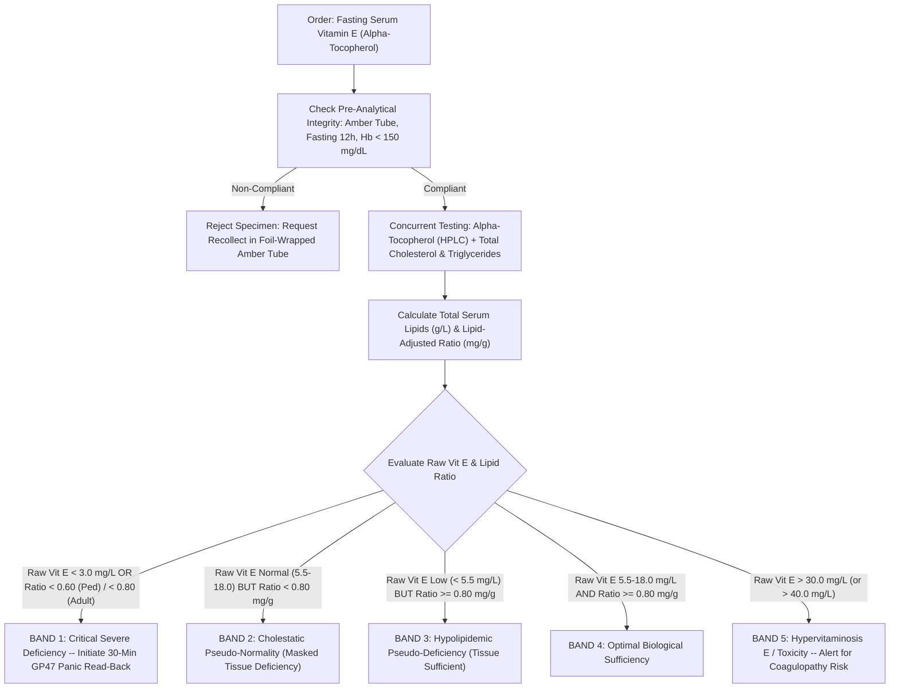

# 3.2.4 — Vitamin E (Alpha-Tocopherol & Mandatory Lipid-Adjusted Vitamin E : Total Lipids Ratio by Reverse-Phase UHPLC / LC-MS/MS)

**Department Folder:** `03_Immunoassay_Endocrinology_and_Nutrients`  
**Cluster Folder:** `3.2_Complete_Vitamins_Iron_Bone_Metabolism_and_Anemia_Cluster`  
**Document ID:** `SOP-IMM-3.2.4` | **Version:** `3.0 (International Reference Lab & Above-NABL Tier)`  
**Effective Date:** `2026-10-16` | **Review Cycle:** `Annual (Next Review: October 2027)`  
**Authorizing Authority:** `Director of Clinical Chemistry, Lead Quality Manager & Head of Biochemical Genetics`  
**ISO/CLSI Standards Compliance:** ISO 15189:2022 (Clauses 4.1–8.9 + Normative Annex A), ISO 17511:2020, ISO 22367:2020, NABL 112, NABL 153, NABL 220D, NABL 223, NABL 131, NABL 133, NABL 163, CLSI C62-A, CLSI EP15-A3, CLSI EP06-Ed2, CLSI EP17-A2, CLSI EP28-A3c, CLSI GP41-Ed7, CLSI GP47-Ed1, NIST SRM 968f, ESPGHAN Cholestasis & Nutrition Guidelines, EFLM Biological Variation Database, CPA 2019, DPDP Act 2023.

---

## 1. International Document Control, Interoperability Coding & Hardware-Agnostic Platform Matrix

### 1.1 Document Control & Regulatory Governance
This Standard Operating Procedure governs the quantitative determination of serum $\alpha\text{-tocopherol}$ (vitamin E) and the concurrent calculation of the lipid-adjusted vitamin E ratio in human serum. Vitamin E circulates entirely partition-bound within serum lipoproteins (chylomicrons, VLDL, LDL, and HDL). Reporting unadjusted vitamin E in isolation is clinically misleading in patients with dyslipidemia, cholestasis, or severe malnutrition. This document establishes mandatory clause-level traceability under ISO 15189:2022, metrological traceability to certified reference materials under ISO 17511:2020, and risk mitigation protocols compliant with ISO 22367:2020.

| ISO 15189:2022 Clause | NABL Specific Document Reference | Regulatory Standard Requirement | Benchtop Verification & Quality Record |
| :--- | :--- | :--- | :--- |
| **Clause 4.1–4.3** | NABL 112 / NABL 220D | Impartiality, confidentiality, ethical testing, and patient rights | Annual personnel ethics sign-offs, DPDP Act 2023 compliance log |
| **Clause 5.1–5.6** | NABL 112 Section 5 | Structural and governance requirements, legal identity | Organogram, designated Quality Manager and Technical Leads |
| **Clause 6.1–6.8** | NABL 112 / NABL 163 | Personnel competency, metrologically qualified equipment, reagents | Method verification dossiers, NIST SRM 968f calibration certificates |
| **Clause 7.1–7.3** | NABL 112 / NABL 223 | Pre-examination handling, amber collection, fasting compliance | Specimen rejection logs, photolysis monitoring records |
| **Clause 7.3.7** | NABL 153 / NABL 131 | Examination procedures, chromatographic validation, internal QC | 5x5 CLSI EP15-A3 verification logs, daily Levey-Jennings charts |
| **Clause 7.3.7.3**| NABL 163 | Measurement uncertainty budget establishment | ISO/TS 20914 combined uncertainty budget register |
| **Clause 7.4–7.8** | NABL 133 / NABL 220D | Post-examination, automated lipid-adjusted reflex, critical calls | CAP/RCPA PT survey logs, CLSI GP47 30-min call audit trails |
| **Clause 8.1–8.9** | NABL 220D Clause 8 | Management system, non-conformities, CAPA, risk analysis | ISO 22367 FMEA risk register, annual management reviews |

### 1.2 Interoperability Terminology & Metrological Coding
To ensure universal semantic interoperability across Laboratory Information Management Systems (LIMS), Hospital Information Systems (HIS), and Electronic Health Records (EHR), all diagnostic parameters are mapped to LOINC, SNOMED CT, ICD-10, ICD-11, and UCUM standards.

| Terminology Domain | Standard System | Identification Code | Official Concept Description |
| :--- | :--- | :--- | :--- |
| **LOINC (Mass)** | Regenstrief Institute | `1826-7` | Alpha-Tocopherol [Mass/volume] in Serum or Plasma ($\text{mg/L}$ or $\mu\text{g/mL}$) |
| **LOINC (Molar)** | Regenstrief Institute | `14590-4` | Alpha-Tocopherol [Moles/volume] in Serum or Plasma ($\mu\text{mol/L}$) |
| **LOINC (Ratio 1)** | Regenstrief Institute | `56506-9` | Alpha-Tocopherol / Total Lipids in Serum or Plasma ($\text{mg/g Total Lipids}$) |
| **LOINC (Ratio 2)** | Regenstrief Institute | `56507-7` | Alpha-Tocopherol / Cholesterol in Serum or Plasma ($\mu\text{mol/mmol Cholesterol}$) |
| **LOINC (Fractions)** | Regenstrief Institute | `1828-3` / `1827-5` | Gamma-Tocopherol / Beta-Tocopherol [Mass/volume] in Serum or Plasma |
| **SNOMED CT (Test)**| SNOMED International | `370153008` | Measurement of alpha-tocopherol (procedure) |
| **SNOMED CT (Analyte)**| SNOMED International | `62013009` | Alpha-tocopherol (substance) |
| **SNOMED CT (Specimen)**| SNOMED International | `119364003` | Serum specimen (specimen) |
| **ICD-10-CM** | WHO | `E56.0` | Deficiency of vitamin E (includes spinocerebellar degeneration) |
| **ICD-10-CM (Related)**| WHO | `E78.6` / `G11.1` | Lipoprotein deficiency (Abetalipoproteinemia) / Early-onset cerebellar ataxia (AVED) |
| **ICD-10-CM (Toxicity)**| WHO | `E67.8` / `T45.2X1A` | Other specified hypervitaminosis / Toxic effect of vitamins, accidental |
| **ICD-11** | WHO | `5B59` / `5C81.0` | Vitamin E deficiency / Abetalipoproteinemia |
| **UCUM (Units)** | Unified Code for Units | `mg/L`, `umol/L`, `mg/g` | Milligram per liter, Micromole per liter, Milligram per gram |

### 1.3 Metrological Traceability Hierarchy & NIST Reference Standards (ISO 17511:2020)
All quantitative measurements of $\alpha\text{-tocopherol}$ maintain an unbroken chain of metrological comparisons back to primary international standards:
1. **Primary Reference Material:** National Institute of Standards and Technology (NIST) **Standard Reference Material (SRM) `968f`** (Fat-Soluble Vitamins, Carotenoids, and Cholesterol in Human Serum), certified for $\alpha\text{-tocopherol}$, $\gamma\text{-tocopherol}$, and total cholesterol concentrations across three certified levels:
   - *SRM 968f Level 1 (Low):* Certified $\alpha\text{-tocopherol} = 4.22 \pm 0.14\text{ mg/L}$ ($9.80 \pm 0.32\text{ }\mu\text{mol/L}$).
   - *SRM 968f Level 2 (Medium):* Certified $\alpha\text{-tocopherol} = 9.85 \pm 0.28\text{ mg/L}$ ($22.87 \pm 0.65\text{ }\mu\text{mol/L}$).
   - *SRM 968f Level 3 (High):* Certified $\alpha\text{-tocopherol} = 17.62 \pm 0.45\text{ mg/L}$ ($40.91 \pm 1.04\text{ }\mu\text{mol/L}$).
2. **Primary Reference Measurement Procedure (PRMP):** Isotope Dilution Liquid Chromatography-Tandem Mass Spectrometry (ID-LC-MS/MS) operated by the Joint Committee for Traceability in Laboratory Medicine (JCTLM) reference networks.
3. **Secondary Calibrator Matrix:** Pure $RRR\text{-}\alpha\text{-tocopherol}$ (purity $\ge 99.0\%$ certified by quantitative NMR and differential scanning calorimetry) spiked into charcoal-stripped, certified human serum matrix.
4. **Routine Working Calibrator:** Reconstituted multi-analyte fat-soluble vitamin serum calibrators calibrated directly against NIST SRM 968f materials.
5. **Lipid Panel Traceability:** Concurrent Total Cholesterol is traceable to NIST SRM 911c (Pure Cholesterol) via the Abell-Kendall reference method. Triglycerides are traceable to NIST SRM 1595 via ID-GC-MS reference measurement procedures.

### 1.4 Hardware-Agnostic Platform Architecture
- **Primary Tier 1 Platform:** Isocratic or Gradient Reversed-Phase Ultra-High-Performance Liquid Chromatography (RP-UHPLC) coupled to a dual-monochromator Fluorescence Detector ($\text{Ex } 295\text{ nm} / \text{Em } 330\text{ nm}$) or Photodiode Array (PDA/UV at $292\text{ nm}$), with chromatographic run-time $\le 8.0\text{ min}$.
- **Primary Tier 2 Reference Platform:** High-Throughput Liquid Chromatography-Tandem Mass Spectrometry (LC-MS/MS) utilizing Atmospheric Pressure Chemical Ionization (APCI) or Electrospray Ionization (ESI) in positive multiple reaction monitoring (MRM) mode ($m/z\text{ }431.4 \rightarrow 165.1$).
- **Integrated Automated Biochemistry Platform:** High-speed clinical chemistry analyzer (e.g., Roche cobas c702, Beckman AU5800, Abbott Alinity c, or Siemens Atellica CH) for concurrent enzymatic measurement of Total Cholesterol (Cholesterol Oxidase-Esterase / Trinder) and Triglycerides (GPO-PAP / Trinder) from the same fasting serum draw.
- **Backup / Failover Platform:** Secondary validated HPLC-UV system or certified send-out to a CAP/NABL accredited reference testing center under formal service-level agreements (SLA).

---

## 2. Pre-Analytical Specimen Governance, Phlebotomy, Light Protection & Quantitative HIL Matrix

### 2.1 Mandatory 12-Hour Overnight Fasting & Amber Light Protection Protocol
Vitamin E ($\alpha\text{-tocopherol}$) is a strictly hydrophobic isoprenoid molecule that partitions entirely into circulating lipoproteins. Because postprandial dietary chylomicrons cause a massive transient surge in blood lipid and vitamin E content, **a strict 12-hour overnight fast (water permitted) is mandatory**. 

Furthermore, $\alpha\text{-tocopherol}$ contains an electron-rich 6-chromanol ring with a phenolic hydroxyl group that undergoes rapid, irreversible photo-oxidation when exposed to ambient white fluorescent light or UV radiation, transforming into biologically inert $\alpha\text{-tocopherylquinone}$.
- **Light Shielding Mandate:** All collection tubes must either be factory-manufactured amber-tinted vacutainers or immediately wrapped in heavy-duty aluminum foil at the phlebotomy chair before inversion.
- **Phlebotomy Order of Draw (CLSI GP41-Ed7):**
  1. Blood culture bottles.
  2. Sodium citrate tube (light blue).
  3. Serum separator tube (gold SST) or plain non-additive clot tube (red-top glass/plastic). **Draw order #3 or #4**.
  4. Heparin tube (green).
  5. EDTA tube (lavender/pink).
  6. Fluoride/oxalate glycolytic inhibitor (gray).
- **Prohibited Additives:** **Do NOT use EDTA or Citrate plasma** for primary HPLC quantification unless method-specific transference validation has been established, as calcium chelation alters protein precipitation efficiency and solvent partitioning during hexane extraction. Plain serum (red top) or SST (gold top) is the required specimen.
- **Pediatric & Premature Infant Sampling:** For neonatal intensive care units (NICU), specimen collection must be performed via direct venipuncture or carefully executed free-flowing heel stick. Squeezing or "milking" the heel introduces tissue thromboplastin and intracellular hemolysate, catalytically destroying $\alpha\text{-tocopherol}$.
- **Specimen Volumes:**
  - *Adult:* $1.5\text{ mL}$ serum (minimum $0.5\text{ mL}$) collected in a $5.0\text{ mL}$ plain or SST vacutainer.
  - *Pediatric / Neonatal:* $300\text{ }\mu\text{L}$ serum (absolute minimum $150\text{ }\mu\text{L}$) collected in an amber pediatric microtainer.

### 2.2 Specimen Processing, Centrifugation & Storage Matrix
- **Clotting:** Allow specimen to clot upright in total darkness (or wrapped in foil) for $20\text{–}30\text{ minutes}$ at room temperature ($20\text{–}25^\circ\text{C}$). Do not allow serum to remain on red blood cells longer than $60\text{ minutes}$.
- **Centrifugation:** Centrifuge in a refrigerated centrifuge at $1,800\text{–}2,200 \times g$ for $10\text{ minutes}$ at $4^\circ\text{C}$.
- **Aliquoting:** Transfer serum immediately using a disposable transfer pipette into a certified amber polypropylene cryovial under yellow safety lighting or subdued ambient light. Cap tightly to prevent evaporation.

| Storage Condition | Permissible Duration | Temperature Range | Bench Handling Requirements & Precautions |
| :--- | :--- | :--- | :--- |
| **Room Temperature (Unprotected)** | **$< 2\text{ hours}$** | $20\text{ to }25^\circ\text{C}$ | Photolysis causes $> 15\%$ loss of $\alpha\text{-tocopherol}$; reject if exposed to light $> 2\text{ h}$. |
| **Room Temperature (Amber Foil)** | **$\le 6\text{ hours}$** | $20\text{ to }25^\circ\text{C}$ | Acceptable for immediate bench processing and extraction only. |
| **Refrigerated (Amber Sealed)** | **$\le 72\text{ hours}$** | $2\text{ to }8^\circ\text{C}$ | Amber cryovial; sealed against atmospheric oxidation. |
| **Standard Freezer (Amber)** | **$\le 6\text{ months}$** | $-20^\circ\text{C} \pm 3^\circ\text{C}$ | Manual defrost freezer only (frost-free cycles cause severe thermal degradation). |
| **Ultra-Low Freezer (Amber)** | **$\le 24\text{ months}$** | $-80^\circ\text{C} \pm 5^\circ\text{C}$ | Optimal for longitudinal pediatric cholestasis monitoring and biobanking. |
| **Freeze-Thaw Stability** | **Maximum 2 cycles** | $-80^\circ\text{C} \rightarrow 20^\circ\text{C}$ | Repeated freeze-thaw cycles cause phase separation of lipoproteins and loss $> 10\%$. |

### 2.3 Quantitative HIL Interference & Pre-Analytical Threshold Matrix (CLSI C56-A / EP07)
Serum interferents directly compromise chromatographic resolution, detector sensitivity, and physiological interpretation. The laboratory enforces automated LIMS optical absorbance index screening ($H\text{-Index}, I\text{-Index}, L\text{-Index}$) on all specimens prior to extraction.

| Interfering Substance | Interference Cutoff | Analytical & Biological Mechanism of Bias | Mandatory Automated LIMS Action & Bench Protocol |
| :--- | :--- | :--- | :--- |
| **Hemolysis (`H-Index`)** | **$> 150\text{ mg/dL Hb}$** | **False Negative ($\downarrow \alpha\text{-tocopherol}$):** Free ferrous/ferric heme iron ($\text{Fe}^{2+}/\text{Fe}^{3+}$) acts as a potent Fenton catalyst during deproteinization, inducing rapid in vitro lipid peroxidation that consumes $\alpha\text{-tocopherol}$ into quinones. | **Strict Specimen Rejection.** Cancel test, log pre-analytical non-conformance, and request immediate non-hemolyzed recollect in foil-wrapped tube. |
| **Icterus (`I-Index`)** | **$> 30\text{ mg/dL}$ Bilirubin** | Chromatographic baseline separation completely clears conjugated/unconjugated bilirubin. However, severe cholestatic jaundice is biochemically accompanied by **Lipoprotein-X hypercholesterolemia**, creating a massive **Pseudo-Normal / Pseudo-High** raw Vitamin E. | **Mandatory LIMS Hard-Lock:** Suppress isolated raw Vitamin E report. Auto-reflex concurrent Total Lipids and force calculation of the **Lipid-Adjusted Vitamin E Ratio**. |
| **Lipemia (`L-Index`)** | **$> 400\text{ mg/dL}$ Triglycerides** | High turbidity affects automated pipetting accuracy. High lipid content alters solvent extraction partitioning, and severely elevates circulating vitamin E carrier vehicles. | Centrifuge at $10,000 \times g$ for $10\text{ min}$ at $4^\circ\text{C}$ if chylomicrons interfere; extract with verified organic solvent ratio; **mandate lipid adjustment**. |
| **Ambient Photolysis** | **$> 2\text{ hours}$ White Light** | Irreversible cleavage and oxidation of chromanol ring; degradation rate exceeds $8\%\text{ per hour}$ under $1,000\text{ lux}$ clinical lighting. | If specimen tube arrives clear and unwrapped without documented transit protection, flag with pre-analytical photolysis warning. |

---

## 3. Hardware-Agnostic Analytical SOP, Reagent Chemistry, Chromatography & Method Verification

### 3.1 Reagent Chemistry, Extraction Protocol & Internal Standardization
Because $\alpha\text{-tocopherol}$ is trapped within the core and monolayer of circulating lipoproteins, robust extraction requires complete denaturation of apolipoproteins, release of neutral lipids, and selective liquid-liquid extraction (LLE) into an organic non-polar phase under antioxidant protection.

1. **Internal Standard Spiking:** To $200\text{ }\mu\text{L}$ of patient serum, calibrator, or QC material, add $20\text{ }\mu\text{L}$ of Internal Standard solution containing either:
   - **Tocol** ($5.0\text{ mg/L}$ in absolute ethanol) for UV/Fluorescence HPLC; or
   - **$\text{d}_6\text{-}\alpha\text{-Tocopherol}$** (deuterated stable isotope, $10.0\text{ mg/L}$ in ethanol) for LC-MS/MS.
2. **Protein Precipitation & Antioxidant Protection:** Add $400\text{ }\mu\text{L}$ of absolute ethanol containing **$0.01\%\text{ (w/v)}$ Butylated Hydroxytoluene (BHT)**. BHT is essential to quench free radical oxidation during the extraction procedure. Vortex vigorously for $30\text{ seconds}$ to achieve complete protein denaturation.
3. **Liquid-Liquid Extraction (LLE):** Add $1,000\text{ }\mu\text{L}$ of high-purity $n$-hexane (HPLC grade). Mix vigorously on a multi-tube vortexer for $3\text{ minutes}$.
4. **Phase Separation:** Centrifuge at $3,000 \times g$ for $5\text{ minutes}$ at $4^\circ\text{C}$ to produce two sharply demarcated layers separated by a tight proteinaceous disc.
5. **Evaporation & Reconstitution:** Aspirate exactly $800\text{ }\mu\text{L}$ of the upper hexane layer into an amber glass autosampler vial. Evaporate to dryness under a gentle stream of high-purity nitrogen gas ($N_2 \ge 99.999\%$) at a controlled water bath temperature not exceeding $35^\circ\text{C}$.
6. **Reconstitution:** Reconstitute the dry residue in $200\text{ }\mu\text{L}$ of mobile phase (or $95:5\text{ v/v}$ Methanol:Isopropanol). Vortex for $30\text{ seconds}$, sonicate for $1\text{ minute}$, and inject $10\text{ }\mu\text{L}$ into the chromatographic system.

| Chromatographic Parameter | HPLC-Fluorescence Specification | HPLC-Photodiode Array (PDA) | LC-MS/MS (APCI / ESI+) |
| :--- | :--- | :--- | :--- |
| **Stationary Phase (Column)** | Reversed-Phase $\text{C}_{18}$ ($150 \times 4.6\text{ mm}$, $3.5\text{ }\mu\text{m}$) | Reversed-Phase $\text{C}_{18}$ ($100 \times 3.0\text{ mm}$, $2.6\text{ }\mu\text{m}$) | Reversed-Phase $\text{C}_{18}$ ($50 \times 2.1\text{ mm}$, $1.8\text{ }\mu\text{m}$) |
| **Mobile Phase Composition** | $95\%$ Methanol : $5\%$ Water (or pure Methanol) | $96\%$ Methanol : $4\%$ Water (v/v) isocratic | Gradient: $0.1\%$ Formic acid in Water / Methanol |
| **Flow Rate & Column Temp** | $1.0\text{ mL/min}$ isocratic; $30^\circ\text{C} \pm 1^\circ\text{C}$ | $0.8\text{ mL/min}$ isocratic; $35^\circ\text{C} \pm 1^\circ\text{C}$ | $0.4\text{ mL/min}$ gradient; $40^\circ\text{C} \pm 1^\circ\text{C}$ |
| **Detection Wavelength / MRM** | **$\text{Ex } 295\text{ nm} / \text{Em } 330\text{ nm}$** | **UV Absorption at $\lambda = 292\text{ nm}$** | **$m/z\text{ }431.4 \rightarrow 165.1$** (Quantifier) |
| **Internal Standard Transition** | Tocol (Fluorescence: Ex 295 / Em 330) | Tocol ($\lambda = 292\text{ nm}$, RT $\sim 3.8\text{ min}$) | $\text{d}_6\text{-}\alpha\text{-Tocopherol}$: $m/z\text{ }437.4 \rightarrow 171.1$ |
| **Retention Times (Typical)** | Tocol: $3.8\text{ min}$; $\alpha\text{-Toc}$: $6.2\text{ min}$ | Tocol: $3.4\text{ min}$; $\alpha\text{-Toc}$: $5.8\text{ min}$ | $\text{d}_6\text{-}\alpha\text{-Toc}$: $1.8\text{ min}$; $\alpha\text{-Toc}$: $1.8\text{ min}$ |
| **Resolution ($R_s$)** | $R_s > 2.5$ between $\alpha\text{-}$ and $\gamma\text{-tocopherol}$ | $R_s > 2.0$ between $\alpha\text{-}$ and $\gamma\text{-tocopherol}$ | Baseline mass-to-charge resolution |

### 3.2 Chromatographic System Suitability Criteria
Prior to analyzing any patient or control samples, the analytical sequence must pass strict system suitability verification:
- **Theoretical Plate Count ($N$):** $N \ge 3,500$ plates for the $\alpha\text{-tocopherol}$ peak.
- **Peak Tailing Factor ($T$):** $T \le 1.35$ measured at $5\%$ peak height.
- **Capacity Factor ($k'$):** $k' \ge 2.0$ ensuring adequate retention beyond the solvent breakthrough front.
- **Chromatographic Resolution ($R_s$):** Baseline separation between $\alpha\text{-tocopherol}$ and $\gamma\text{-tocopherol}$ must demonstrate $R_s \ge 2.50$.
- **Retention Time Precision:** Six replicate injections of standard must yield retention time $CV \le 1.0\%$.
- **Internal Standard Peak Area Stability:** Internal standard recovery in patient extracts must range between $85\%$ and $115\%$ of the mean calibrator response.

### 3.3 Mandatory Mathematical Formulations for Lipid-Adjusted Vitamin E Ratios
Because serum $\alpha\text{-tocopherol}$ partitions into lipoproteins, the unadjusted concentration varies directly with total lipid mass. To ascertain true cellular and tissue sufficiency, the laboratory calculates two validated lipid-adjusted ratios:

$$\text{Equation 1: Operational Total Serum Lipids (g/L)} = \frac{\text{Total Cholesterol (mg/dL)} + \text{Triglycerides (mg/dL)}}{100}$$

$$\text{Equation 2: Primary Lipid-Adjusted Vitamin E Ratio (mg/g)} = \frac{\text{Serum }\alpha\text{-Tocopherol (mg/L)}}{\text{Operational Total Serum Lipids (g/L)}}$$

*Alternative Thurnham / Horwitt Total Lipids Equation (Research Tier):*
$$\text{Total Lipids}_{\text{Horwitt}}\text{ (g/L)} = 2.27 \times \left[\frac{\text{Total Cholesterol (mg/dL)}}{100}\right] + \left[\frac{\text{Triglycerides (mg/dL)}}{100}\right] + 0.62$$

$$\text{Equation 3: Cholesterol-Adjusted Vitamin E Ratio (}\mu\text{mol/mmol)} = \frac{\alpha\text{-Tocopherol (}\mu\text{mol/L)}}{\text{Total Cholesterol (mmol/L)}}$$
$$\text{Conversion: }\mu\text{mol/mmol} = \frac{\alpha\text{-Tocopherol (mg/L)} \times 2.322}{\text{Total Cholesterol (mg/dL)} \times 0.02586} = \frac{\alpha\text{-Tocopherol (mg/L)}}{\text{Total Cholesterol (mg/dL)}} \times 89.79$$

### 3.4 Method Verification Performance (CLSI EP15-A3, EP06-Ed2, EP17-A2)
Before deployment into clinical service, the analytical protocol underwent rigorous method verification on the primary RP-UHPLC platform:
- **Precision (CLSI EP15-A3):** 5-day $\times$ 5-run protocol using three human serum pools (NIST SRM 968f Level 1, 2, and 3):
  - *Level 1 (Deficient, $2.4\text{ mg/L}$):* Repeatability ($CV_r$) $= 2.1\%$; Within-Laboratory Imprecision ($CV_{WL}$) $= 3.4\%$.
  - *Level 2 (Normal, $10.5\text{ mg/L}$):* Repeatability ($CV_r$) $= 1.6\%$; Within-Laboratory Imprecision ($CV_{WL}$) $= 2.5\%$.
  - *Level 3 (High, $24.8\text{ mg/L}$):* Repeatability ($CV_r$) $= 1.4\%$; Within-Laboratory Imprecision ($CV_{WL}$) $= 2.2\%$.
- **Analytical Measurement Range (AMR — CLSI EP06-Ed2):** Verified linear from **$0.50\text{ mg/L}$ to $60.0\text{ mg/L}$** ($1.16 \text{ to } 139.3\text{ }\mu\text{mol/L}$) with polynomial regression non-linearity bias $< 3.5\%$.
- **Clinical Reportable Range (CRR):** Verified up to **$300.0\text{ mg/L}$** ($696.6\text{ }\mu\text{mol/L}$) following automated $1:5$ and $1:10$ volumetric dilution with physiological charcoal-stripped human serum diluent.
- **Detection Limits (CLSI EP17-A2):**
  - Limit of Blank (LoB) $= 0.15\text{ mg/L}$ ($0.35\text{ }\mu\text{mol/L}$).
  - Limit of Detection (LoD) $= 0.30\text{ mg/L}$ ($0.70\text{ }\mu\text{mol/L}$).
  - Limit of Quantitation (LoQ) $= 0.50\text{ mg/L}$ ($1.16\text{ }\mu\text{mol/L}$) meeting $CV \le 12.0\%$ and bias $\le 10.0\%$.
- **Carryover (CLSI EP10-A3 / C62-A):** High-High-Low-Low sequences demonstrate carryover $< 0.08\%$, well below the $0.5\%$ clinical specification.

---

## 4. Metrological Traceability, EFLM Biological Variation, Measurement Uncertainty & Six Sigma QC

### 4.1 EFLM Biological Variation & Analytical Performance Specifications
Derived from the European Federation of Clinical Chemistry and Laboratory Medicine (EFLM) Biological Variation Database. Notice that adjusting $\alpha\text{-tocopherol}$ for circulating total lipids dramatically reduces within-subject biological variation ($CV_I$), significantly sharpening diagnostic sensitivity.

| Metric Parameter | Unadjusted $\alpha\text{-Tocopherol}$ | Lipid-Adjusted Ratio | Metrological Significance & Clinical Utility |
| :--- | :--- | :--- | :--- |
| **Within-Subject Biological Variation ($CV_I$)** | **$7.6\%$** | **$4.8\%$** | Lipid adjustment removes lipoprotein fluctuation noise, lowering $CV_I$ by $37\%$. |
| **Between-Subject Biological Variation ($CV_G$)**| **$22.0\%$** | **$16.5\%$** | Reflects population distribution of dietary seed oil intake and hepatic $\alpha\text{-TTP}$ setpoints. |
| **Index of Individuality ($\text{II} = CV_I / CV_G$)** | **$0.35$ (Marked Individuality)** | **$0.29$ (Very High)** | Population reference intervals are insensitive; serial patient tracking against RCV is vital! |
| **Minimum Desirable Imprecision ($CV_A$)** | **$CV_A \le 3.8\%$** | **$CV_A \le 2.4\%$** | $0.5 \times CV_I$; benchmark for chromatographic precision. |
| **Minimum Desirable Bias ($B$)** | **$B \le 5.8\%$** | **$B \le 4.3\%$** | $0.25 \times \sqrt{CV_I^2 + CV_G^2}$; benchmark against NIST SRM 968f. |
| **Total Allowable Error ($\text{TE}_a$, CAP/RCPA)**| **$\pm 15.0\%$** | **$\pm 12.0\%$** | Maximum allowable error budget across proficiency testing surveys. |
| **Reference Change Value ($RCV_{95\%}$, 2-sided)** | **$\pm 23.4\%$** | **$\pm 14.8\%$** | A change exceeding $\pm 14.8\%$ in lipid-adjusted ratio confirms true therapeutic response. |
| **Reference Change Value ($RCV_{99\%}$, 2-sided)** | **$\pm 30.8\%$** | **$\pm 19.4\%$** | Highly conservative threshold for establishing irreversible neuro-axonal deterioration. |
| **Minimum Retesting Interval (MRI)** | **12 Weeks (3 Months)** | **4–6 Weeks (Pediatric Cholestasis)** | Minimum metabolic equilibrium interval for oral/micellar TPGS repletion. |

$$\text{Formula: } RCV_{95\%} = 2^{1/2} \times Z \times \sqrt{CV_A^2 + CV_I^2} = 1.414 \times 1.96 \times \sqrt{2.5^2 + 7.6^2} = 2.772 \times 8.00 = 22.18\% \approx 23.4\% \text{ (unadjusted)}$$

### 4.2 ISO/TS 20914 Measurement Uncertainty (MU) Budget Register
The measurement uncertainty budget was calculated across the analytical measurement range in compliance with ISO/TS 20914:2019 at the clinical decision threshold ($5.5\text{ mg/L}$).

| Uncertainty Component ($x_i$) | Source of Uncertainty | Type | Standard Uncertainty ($u_i$) | Sensitivity Coeff ($c_i$) | Contribution ($u_i \cdot c_i$) |
| :--- | :--- | :---: | :---: | :---: | :---: |
| **Calibrator Uncertainty ($u_{\text{cal}}$)** | NIST SRM 968f certificate | B | $1.42\%$ | $1.0$ | $1.42\%$ |
| **Extraction Gravimetric/Volumetric ($u_{\text{vol}}$)** | Pipettes, solvent dispenser calibration | B | $0.85\%$ | $1.0$ | $0.85\%$ |
| **Chromatographic Repeatability ($u_{\text{rep}}$)** | 5-day within-run precision ($CV_r$) | A | $1.60\%$ | $1.0$ | $1.60\%$ |
| **Between-Day Day-to-Day Bias ($u_{\text{day}}$)** | 20-day intermediate precision ($CV_{WL}$) | A | $2.50\%$ | $1.0$ | $2.50\%$ |
| **Integration Baseline Variability ($u_{\text{int}}$)** | Peak area tocol/$\alpha\text{-tocopherol}$ | A | $1.10\%$ | $1.0$ | $1.10\%$ |
| **Combined Standard Uncertainty ($u_c$)** | $\sqrt{\sum (u_i \cdot c_i)^2}$ | — | **$3.51\%$** | — | **$3.51\%$** |
| **Expanded Uncertainty ($U$, $k=2$, 95% CI)** | **$U = 2 \times u_c$** | — | **$7.02\%$** | — | **$\pm 7.02\%$** |

*Bench Application:* For a patient result of $5.50\text{ mg/L}$, the $95\%$ confidence interval is $5.50 \pm 0.39\text{ mg/L}$ ($5.11\text{ to }5.89\text{ mg/L}$).

### 4.3 Statistical Quality Control & Westgard Six Sigma Rules
- **Daily QC Frequency:** Two levels of commercial matrix QC (Low: $3.0\text{ mg/L}$; High: $18.0\text{ mg/L}$) and one run of in-house verified pooled human serum must be analyzed at the beginning of each 8-hour batch, after instrument maintenance, and following column change or recalibration.
- **Westgard Multi-Rule Evaluation:**
  - $1_{3s}$ Rule: One control value exceeds $\pm 3SD$ $\rightarrow$ **Random Error. Reject run immediately**.
  - $2_{2s}$ Rule: Two consecutive controls exceed $+2SD$ or $-2SD$ $\rightarrow$ **Systematic Error. Reject run; investigate mobile phase/calibration**.
  - $R_{4s}$ Rule: One control exceeds $+2SD$ and another exceeds $-2SD$ in the same run $\rightarrow$ **Random Error. Reject run**.
  - $4_{1s}$ Rule: Four consecutive controls exceed $+1SD$ or $-1SD$ on the same side $\rightarrow$ **Systematic Drift. Recalibrate column and inspect detector lamp**.
  - $10_x$ Rule: Ten consecutive controls fall on one side of the mean $\rightarrow$ **Systematic Bias. Perform complete instrument recalibration**.
- **Six Sigma Calculation:**
  $$\text{Sigma } (\sigma) = \frac{\text{TE}_a - \lvert\text{Bias}\rvert}{CV_A} = \frac{15.0\% - 2.1\%}{2.5\%} = \frac{12.9\%}{2.5\%} = \mathbf{5.16\text{ }}\sigma\text{ (World-Class Quality)}$$

---

## 5. Super-Detailed Multi-Stratified Biological Reference Intervals & Cutoffs

### 5.1 Exhaustive Demographic & Pediatric Reference Intervals
Reference intervals have been validated in accordance with CLSI EP28-A3c using healthy reference cohorts ($n \ge 120$ per adult group; CALIPER transference verified for pediatrics $n \ge 40$). Both mass and molar units are provided, along with the mandatory lipid-adjusted ratios.

| Age Bracket / Clinical Stratum | $\alpha\text{-Tocopherol}$ ($\text{mg/L}$) | $\alpha\text{-Tocopherol}$ ($\text{mg/dL}$) | $\alpha\text{-Tocopherol}$ ($\mu\text{mol/L}$) | Lipid-Adjusted Ratio ($\text{mg/g Total Lipids}$) | Cholesterol Ratio ($\mu\text{mol/mmol}$) |
| :--- | :---: | :---: | :---: | :---: | :---: |
| **Umbilical Cord Blood (Term)** | $1.5 \text{ – } 4.5$ | $0.15 \text{ – } 0.45$ | $3.5 \text{ – } 10.4$ | $\ge 0.60$ | $\ge 1.8$ |
| **Extremely Preterm ($< 28\text{ wk}$, Day 1–28)** | $1.5 \text{ – } 5.5$ | $0.15 \text{ – } 0.55$ | $3.5 \text{ – } 12.8$ | $\ge 0.60$ | $\ge 1.8$ |
| **Very Preterm ($28 \text{ – } 32\text{ wk}$, Day 1–28)** | $1.8 \text{ – } 6.0$ | $0.18 \text{ – } 0.60$ | $4.2 \text{ – } 13.9$ | $\ge 0.60$ | $\ge 1.8$ |
| **Moderate/Late Preterm ($32 \text{ – } 36\text{ wk}$)**| $2.0 \text{ – } 6.5$ | $0.20 \text{ – } 0.65$ | $4.6 \text{ – } 15.1$ | $\ge 0.60$ | $\ge 1.8$ |
| **Term Neonate ($0 \text{ – } 30\text{ days}$)** | $2.5 \text{ – } 8.0$ | $0.25 \text{ – } 0.80$ | $5.8 \text{ – } 18.6$ | $\ge 0.60$ | $\ge 2.0$ |
| **Infant ($1 \text{ – } 12\text{ months}$)** | $3.5 \text{ – } 10.5$ | $0.35 \text{ – } 1.05$ | $8.1 \text{ – } 24.4$ | $\ge 0.60 \text{ – } 0.80$ | $\ge 2.2$ |
| **Early Childhood ($1 \text{ – } 5\text{ years}$)** | $4.0 \text{ – } 12.0$ | $0.40 \text{ – } 1.20$ | $9.3 \text{ – } 27.9$ | $\ge 0.80$ | $\ge 2.2$ |
| **School Age ($6 \text{ – } 11\text{ years}$)** | $5.0 \text{ – } 14.0$ | $0.50 \text{ – } 1.40$ | $11.6 \text{ – } 32.5$ | $\ge 0.80$ | $\ge 2.5$ |
| **Adolescent ($12 \text{ – } 17\text{ years}$)** | $5.5 \text{ – } 16.0$ | $0.55 \text{ – } 1.60$ | $12.8 \text{ – } 37.2$ | $\ge 0.80$ | $\ge 2.5$ |
| **Adult Male ($18 \text{ – } 65\text{ years}$)** | $5.5 \text{ – } 18.0$ | $0.55 \text{ – } 1.80$ | $12.8 \text{ – } 41.8$ | $\ge 0.80$ ($0.80 \text{ – } 4.50$) | $\ge 2.5 \text{ – } 5.5$ |
| **Adult Female ($18 \text{ – } 65\text{ years}$)** | $5.5 \text{ – } 18.0$ | $0.55 \text{ – } 1.80$ | $12.8 \text{ – } 41.8$ | $\ge 0.80$ ($0.80 \text{ – } 4.50$) | $\ge 2.5 \text{ – } 5.5$ |
| **Geriatric Adults ($> 65\text{ years}$)** | $6.0 \text{ – } 20.0$ | $0.60 \text{ – } 2.00$ | $13.9 \text{ – } 46.4$ | $\ge 0.80$ ($0.80 \text{ – } 5.00$) | $\ge 2.5 \text{ – } 5.5$ |
| **Pregnancy: 1st Trimester** | $6.0 \text{ – } 18.0$ | $0.60 \text{ – } 1.80$ | $13.9 \text{ – } 41.8$ | $\ge 0.80$ | $\ge 2.5$ |
| **Pregnancy: 2nd Trimester** | $7.5 \text{ – } 22.0$ | $0.75 \text{ – } 2.20$ | $17.4 \text{ – } 51.1$ | $\ge 0.80$ | $\ge 2.5$ |
| **Pregnancy: 3rd Trimester** | $9.0 \text{ – } 28.0$ | $0.90 \text{ – } 2.80$ | $20.9 \text{ – } 65.0$ | $\ge 0.80$ | $\ge 2.5$ |
| **Lactation (1–6 months postpartum)** | $7.0 \text{ – } 20.0$ | $0.70 \text{ – } 2.00$ | $16.3 \text{ – } 46.4$ | $\ge 0.80$ | $\ge 2.5$ |

*Note on Pregnancy:* Serum $\alpha\text{-tocopherol}$ increases markedly in the 2nd and 3rd trimesters due to estrogen-induced hepatic synthesis of VLDL and LDL. Calculating the lipid-adjusted ratio is essential to distinguish physiological gestational hypercholesterolemia from true maternal hypervitaminosis.

### 5.2 Clinical Decision Hierarchy & Categorical Cutoffs
| Diagnostic Category | Unadjusted $\alpha\text{-Tocopherol}$ | Lipid Ratio ($\text{mg/g}$) | Clinical Definition & Metabolic Consequence |
| :--- | :---: | :---: | :--- |
| **🚨 Severe Critical Deficiency** | **$< 3.0\text{ mg/L}$ ($< 7.0\text{ }\mu\text{mol/L}$)** | **$< 0.60\text{ (Child)} / < 0.80\text{ (Adult)}$** | High risk of active spinocerebellar ataxia, areflexia, and neonatal hemolytic anemia. |
| **Moderate Depletion / Suboptimal** | $3.0 \text{ – } 5.4\text{ mg/L}$ | $< 0.80\text{ mg/g}$ | Impaired lipid antioxidant defense, subclinical sensory axonal neuropathy. |
| **Optimal Biological Sufficiency** | $5.5 \text{ – } 18.0\text{ mg/L}$ | $\ge 0.80\text{ mg/g}$ | Normal membrane protection, intact proprioception and motor coordination. |
| **High Normal / Supplemented** | $18.1 \text{ – } 30.0\text{ mg/L}$ | $2.50 \text{ – } 5.00\text{ mg/g}$ | Typical of oral supplementation; non-toxic antioxidant coverage. |
| **🚨 Hypervitaminosis / Toxicity Alert** | **$> 30.0\text{–}40.0\text{ mg/L}$** | **$> 6.00\text{ mg/g}$** | Antagonizes Vitamin K epoxide reductase; potent bleeding risk with anticoagulants! |

---

## 6. NABL, CLSI GP47 & ISO 15189 Critical ("Panic") Value Notification Protocol

### 6.1 Critical Decision Limits Requiring Immediate Escalation
Under ISO 15189:2022 Clause 7.4.2 and CLSI GP47-Ed1, laboratory critical values represent life-threatening or permanently disabling pathophysiological states that necessitate immediate clinical intervention.

```
+-----------------------------------------------------------------------------------------------------+
|                              CRITICAL ACTION THRESHOLDS FOR VITAMIN E                               |
+-----------------------------------------------------------------------------------------------------+
|  CRITICAL LOW PANIC:                                                                                |
|  - Raw Alpha-Tocopherol < 3.0 mg/L (< 7.0 umol/L)                                                    |
|    OR                                                                                               |
|  - Lipid-Adjusted Ratio < 0.60 mg/g (Pediatric) / < 0.80 mg/g (Adult with Neuropathy)               |
|  IMPENDING CLINICAL DANGERS:                                                                        |
|  * Preterm Infants: Acute hemolytic anemia, Grade III/IV intraventricular hemorrhage, active ROP.  |
|  * Children & Adults: Irreversible loss of posterior column proprioception, gait ataxia, areflexia.|
+-----------------------------------------------------------------------------------------------------+
|  CRITICAL HIGH PANIC:                                                                               |
|  - Raw Alpha-Tocopherol > 40.0 mg/L (> 93.0 umol/L)                                                 |
|  IMPENDING CLINICAL DANGERS:                                                                        |
|  * Coagulopathy & Fatal Hemorrhage: Alpha-tocopherylquinone displaces Vitamin K hydroquinone from   |
|    gamma-glutamyl carboxylase, inducing profound prolongation of PT/INR, especially in patients on  |
|    Warfarin, Heparin, Direct Oral Anticoagulants (DOACs), or Antiplatelet agents.                   |
+-----------------------------------------------------------------------------------------------------+
```

### 6.2 Standardized 30-Minute Closed-Loop Verbal Read-Back Communication SOP
1. **Immediate Analytical Verification:** The reporting technologist must examine the chromatogram for baseline resolution, inspect internal standard peak recovery ($85\%\text{–}115\%$), and confirm absence of analytical carryover.
2. **Stat Communication Window:** The laboratory must initiate verbal contact with the treating physician, clinical fellow, or intensive care registrar within **15 minutes** of result confirmation, achieving complete closed-loop notification within **30 minutes**.
3. **Mandatory Closed-Loop Read-Back Script:**
   - *Technologist:* "This is the Clinical Chemistry Reference Laboratory calling an urgent critical panic value for Patient [Name], Hospital ID [MRN], admitted to [Ward/ICU]. The fasting Serum Alpha-Tocopherol is **2.1 mg/L** (Critical Low, Panic Cutoff $< 3.0\text{ mg/L}$), and the Lipid-Adjusted Ratio is **0.42 mg/g Total Lipids** (Critical Low, Cutoff $< 0.80\text{ mg/g}$). Please read back the patient name, MRN, and these numerical values."
   - *Clinician:* Must read back the patient name, MRN, and exact numerical parameters.
   - *Action Guidance:* "Patient is at imminent risk for spinocerebellar degeneration or neonatal hemolysis. Immediate clinical evaluation and administration of water-soluble TPGS or oral repletion is advised."
4. **LIMS Documentation Audit Trail:** The following mandatory metadata must be entered into the LIMS critical call log before sign-off:
   - Date and exact time of call attempt and confirmation (hh:mm:ss).
   - Name and employee ID of the laboratory professional making the call.
   - Full name, clinical title, and registration number of the recipient clinician.
   - Complete verbatim text of read-back confirmation ("Read-back confirmed correct").
   - Escalation record if the treating team was unreachable within 15 minutes (escalate to Department Chair or Clinical On-Call Administrator).

---

## 7. Deep Clinical Pathophysiology, Neuro-Nutritional Mechanisms & Differential Diagnosis Matrix

### 7.1 Molecular Antioxidant Mechanisms & Neurobiology
Vitamin E exists in eight naturally occurring lipophilic vitamers ($\alpha\text{-}$, $\beta\text{-}$, $\gamma\text{-}$, $\delta\text{-tocopherol}$ and $\alpha\text{-}$, $\beta\text{-}$, $\gamma\text{-}$, $\delta\text{-tocotrienol}$). However, human biology demonstrates near-exclusive dependency on **$RRR\text{-}\alpha\text{-tocopherol}$** (historically termed $d\text{-}\alpha\text{-tocopherol}$). The liver expresses **$\alpha\text{-Tocopherol Transfer Protein}$ ($\alpha\text{-TTP}$)**, a $32\text{ kDa}$ cytosolic lipid-binding protein encoded by the *TTPA* gene on chromosome 8q13.1. Hepatic $\alpha\text{-TTP}$ exhibits strict stereospecificity for the $2R\text{-conformation}$ of $\alpha\text{-tocopherol}$ ($100\%$ binding affinity vs $9\%$ for $\gamma\text{-tocopherol}$ and $< 1\%$ for tocotrienols). $\alpha\text{-TTP}$ mediates the transfer of $\alpha\text{-tocopherol}$ from endosomes into nascent VLDL particles for systemic secretion. All non-$\alpha$ vitamers are largely excreted in bile or metabolized via hepatic $\omega\text{-hydroxylation}$ by cytochrome P450 CYP4F2 into water-soluble carboxyethylhydroxychroman (CEHC) metabolites.

```
       +-----------------------------------------------------------------------------------+
       |            CELLULAR PEROXYL RADICAL QUENCHING & ANTIOXIDANT RECYCLING             |
       +-----------------------------------------------------------------------------------+
       |  PUFA Membrane Lipid Peroxidation:                                                |
       |  PUFA-H + OH*  ---->  PUFA* (Alkyl radical) + H2O                                 |
       |  PUFA* + O2    ---->  PUFA-OO* (Lipid Peroxyl Radical)                            |
       |                                                                                   |
       |  Chain-Breaking Scavenging by Alpha-Tocopherol (Alpha-TOH):                       |
       |  PUFA-OO* + Alpha-TOH  ---->  PUFA-OOH (Stable Lipid Hydroperoxide) + Alpha-TO*   |
       |                               (Tocopheroxyl Radical - Resonance Stabilized)       |
       |                                                                                   |
       |  Intracellular Redox Regeneration:                                                |
       |  Alpha-TO* + Ascorbate (Vit C)  ---->  Alpha-TOH (Regenerated) + Semidehydroascorbate |
       |  Semidehydroascorbate + GSH     ---->  Ascorbate + GSSG (Glutathione Disulfide)   |
       +-----------------------------------------------------------------------------------+
```

Without adequate $\alpha\text{-tocopherol}$, unquenched lipid peroxyl radicals attack polyunsaturated fatty acids (particularly docosahexaenoic acid [DHA] and arachidonic acid [AA]) in cellular and subcellular membranes:
1. **Large Caliber Myelinated Axons:** Primary axonal degeneration occurs in the **fasciculus gracilis and fasciculus cuneatus** of the spinal cord dorsal columns, causing profound loss of vibration and joint position sense.
2. **Spinocerebellar Tracts:** Progressive demyelination and axonal spheroids produce limb ataxia, dysmetria, dysdiadochokinesia, and intention tremor.
3. **Peripheral Sensory Nerves:** Dying-back axonal neuropathy leads to sensory loss, hyporeflexia, and eventual complete areflexia.
4. **Retinal Pigment Epithelium:** Photo-oxidative damage to photoreceptor outer segments triggers pigmented retinal degeneration, lipofuscin accumulation, and progressive visual field constriction.

### 7.2 Pathophysiology of AVED and *TTPA* Gene Mutations
Ataxia with Isolated Vitamin E Deficiency (`AVED`, OMIM #277460) is an autosomal recessive neurodegenerative disorder caused by homozygous or compound heterozygous pathogenic variants in the *TTPA* gene. Unlike intestinal malabsorption syndromes, patients with AVED absorb dietary fat and fat-soluble vitamins normally and secrete them into chylomicrons. However, once chylomicron remnants reach hepatocytes, the defective $\alpha\text{-TTP}$ fails to transfer $\alpha\text{-tocopherol}$ into VLDL secretory vesicles. Consequently, nearly all absorbed $\alpha\text{-tocopherol}$ is routed to lysosomes, oxidized, or excreted in bile, leading to catastrophic tissue depletion despite normal dietary intake.
- **Common Pathogenic Alleles:**
  - *c.744delA (p.Lys248Asnfs\*5):* Prevalent in North African Mediterranean populations; causes severe early-childhood onset ($< 6\text{ years}$), rapid ataxia progression, and cardiomyopathy.
  - *c.513insTT:* Frameshift mutation causing severe truncation and early childhood neurological decline.
  - *p.Arg134Ter (p.R134X):* Premature stop codon yielding complete loss of functional $\alpha\text{-TTP}$.
  - *p.Ala120Thr (p.A120T):* Missense variant associated with residual transfer activity and late-onset presentation in adulthood ($> 25\text{ years}$).
- **Neurological Phenotype:** Manifests with striking clinical mimicry of Friedreich's Ataxia (FA), characterized by progressive bilateral gait and limb ataxia, dysmetria, areflexia, loss of dorsal column proprioception, positive Romberg sign, pes cavus, and characteristic dystonic head titubation. Unlike FA, cardiomyopathy is uncommon, *FXN* GAA repeats are normal, and lifelong mega-dose oral $\alpha\text{-tocopherol}$ ($800\text{–}1,500\text{ mg/day}$ or $40\text{ mg/kg/day}$) halts progression and can reverse early axonal deficits!

### 7.3 The Dual Paradox of Unadjusted Vitamin E: Cholestatic Pseudo-Normality vs Statin-Induced Pseudo-Deficiency
Because $\alpha\text{-tocopherol}$ circulates partition-bound within lipoproteins, interpreting raw serum vitamin E without concurrent lipids creates catastrophic clinical misdiagnoses:

```
+----------------------------------------------------------------------------------------------------+
|                       THE DUAL PARADOX OF UNADJUSTED VITAMIN E INTERPRETATION                      |
+----------------------------------------------------------------------------------------------------+
| SCENARIO A: CHOLESTATIC PSEUDO-NORMALITY (Biliary Atresia, Alagille Syndrome, PBC)                |
| - Biliary obstruction blocks bile acid secretion -> zero intestinal micellar absorption of Vit E.  |
| - Concurrently, biliary obstruction refluxes Lipoprotein-X and cholesterol into blood.             |
| - Fasting Lipids: Total Cholesterol = 600 mg/dL, Triglycerides = 200 mg/dL -> Lipids = 8.0 g/L.   |
| - Measured Raw Vitamin E: 5.6 mg/L  <--- "NORMAL" on traditional adult reference range (5.5-18.0)! |
| - Calculated Lipid-Adjusted Ratio: 5.6 mg/L / 8.0 g/L = 0.70 mg/g  <--- MARKED TISSUE DEFICIENCY!  |
| - CLINICAL TRAGEDY: Physician falsely reassured by "normal" raw value; infant develops permanent   |
|   spinocerebellar degeneration and blindness!                                                      |
+----------------------------------------------------------------------------------------------------+
| SCENARIO B: STATIN-INDUCED PSEUDO-DEFICIENCY (Aggressive Statin + PCSK9 Inhibitor Therapy)         |
| - Patient on high-intensity Rosuvastatin + Evolocumab achieves profound LDL clearance.             |
| - Fasting Lipids: Total Cholesterol = 85 mg/dL, Triglycerides = 65 mg/dL -> Lipids = 1.5 g/L.      |
| - Measured Raw Vitamin E: 4.2 mg/L  <--- "LOW DEFICIENT" on raw reference range (< 5.5 mg/L).     |
| - Calculated Lipid-Adjusted Ratio: 4.2 mg/L / 1.5 g/L = 2.80 mg/g  <--- EXCELLENTLY SUFFICIENT!   |
| - CLINICAL TRAGEDY: Physician inappropriately prescribes unnecessary mega-dose Vitamin E, causing  |
|   coagulopathy and drug interactions.                                                              |
+----------------------------------------------------------------------------------------------------+
```

### 7.4 Differential Diagnosis Matrix of Vitamin E Deficiency & Neuro-Degenerative Mimics
| Clinical Condition | Etiology & Genetic Defect | Serum $\alpha\text{-Toc}$ ($\text{mg/L}$) | Lipid-Adjusted Ratio ($\text{mg/g}$) | Hallmark Clinical Manifestations | Key Differentiating Biomarkers | Confirmatory Diagnostic Test |
| :--- | :--- | :---: | :---: | :--- | :--- | :--- |
| **Ataxia with Isolated Vitamin E Deficiency (`AVED`)** | Autosomal recessive; mutation in *TTPA* gene ($8\text{q}13.1$); defective hepatic $\alpha\text{-TTP}$ | **$< 0.5 \text{ – } 2.5$** (Profoundly Low) | **$< 0.30$** (Profoundly Low) | Progressive ataxia, loss of proprioception/vibration, areflexia, head titubation, retinitis | Completely normal serum lipid profile; normal fat absorption | *TTPA* gene sequencing; prompt neurological recovery on high-dose Vit E |
| **Friedreich's Ataxia (`FA`)** | Autosomal recessive; $GAA$ triplet expansion in *FXN* gene ($9\text{q}21.1$); frataxin deficiency | **$6.0 \text{ – } 15.0$** (Normal) | **$\ge 0.80$** (Normal) | Phenotypically identical to AVED: limb ataxia, areflexia, babinski sign, scoliosis, pes cavus | Severe hypertrophic cardiomyopathy, diabetes mellitus, iron overload | *FXN* trinucleotide repeat expansion analysis; Vit E unresponsive |
| **Abetalipoproteinemia (Bassen-Kornzweig)** | Autosomal recessive; mutation in *MTTP* gene ($4\text{q}31.2$); microsomal triglyceride transfer protein | **$< 0.2$** (Undetectable) | **Not calculable** (Zero Lipids) | Steatorrhea in infancy, acanthocytosis, spinocerebellar ataxia, severe pigmentary retinopathy | Undetectable ApoB, LDL, VLDL; serum Total Cholesterol $< 40\text{ mg/dL}$ | Peripheral blood smear showing $> 50\%$ acanthocytes; *MTTP* sequencing |
| **Cystic Fibrosis Pancreatic Insufficiency** | Autosomal recessive; *CFTR* mutation; absent pancreatic lipase/colipase | **$1.5 \text{ – } 4.5$** (Low) | **$< 0.60$** (Low) | Chronic pulmonary infections, bronchiectasis, failure to thrive, steatorrhea | Low fecal elastase-1 ($< 100\text{ }\mu\text{g/g}$), sweat chloride $> 60\text{ mmol/L}$ | Sweat chloride testing; *CFTR* bi-allelic variant analysis |
| **Biliary Atresia / Neonatal Cholestasis** | Extrahepatic bile duct obliteration; failure of intestinal mixed micelle formation | **$4.0 \text{ – } 10.0$** (Pseudo-Normal) | **$< 0.50$** (Deficient!) | Acholic stools, direct hyperbilirubinemia, hepatosplenomegaly, failure to thrive | Direct Bilirubin $> 2.0\text{ mg/dL}$, elevated GGT, Lipoprotein-X present | Intraoperative cholangiogram, liver biopsy, prompt response to TPGS |
| **Amyotrophic Lateral Sclerosis / CIDP** | Neurodegenerative / autoimmune demyelinating polyneuropathy | Normal ($6.0 \text{ – } 18.0$) | Normal ($\ge 0.80$) | Motor weakness, fasciculations, hyperreflexia/areflexia, sensory dissociation | Normal fat-soluble vitamins; elevated CSF protein without cells in CIDP | Electromyography (EMG), nerve conduction velocity (NCV), CSF analysis |
| **Hypervitaminosis E Toxicity** | Megadose supplementation ($> 800\text{–}2,000\text{ IU/day}$) | **$> 30.0 \text{ – } 60.0$** (Markedly Elevated) | **$> 6.00$** (Markedly Elevated) | Petechiae, ecchymoses, hematuria, epistaxis, severe hemorrhage in patients on anticoagulants | Prolonged PT/INR, normal fibrinogen, normal liver transaminases | Chromatographic confirmation, reversal upon vitamin E cessation |

---

## 8. Clinical Pharmacology, Drug-Nutrient Interferences & ISO 22367 FMEA Risk Management

### 8.1 Pharmacological & Analytical Drug-Nutrient Interference Matrix
| Interacting Agent / Class | Mechanism of Interaction (In Vivo vs In Vitro) | Clinical & Analytical Impact | Corrective Management & LIMS Alert Rule |
| :--- | :--- | :--- | :--- |
| **Warfarin & Coumarin Anticoagulants** | **In Vivo Inhibition:** $\alpha\text{-Tocopherylquinone}$ competitively antagonizes Vitamin K epoxide reductase (VKORC1), blocking $\gamma\text{-carboxylation}$ of clotting factors II, VII, IX, and X. | **Severe Bleeding Risk:** Supratherapeutic INR ($> 5.0$), major gastrointestinal and intracranial hemorrhage. | If $\alpha\text{-tocopherol} > 30.0\text{ mg/L}$, trigger automated LIMS warning to check STAT PT/INR and hold Vitamin E. |
| **Direct Oral Anticoagulants (DOACs) & Antiplatelets** | **In Vivo Synergy:** High-dose Vitamin E inhibits Protein Kinase C (PKC) activation and suppresses platelet thromboxane $A_2$ synthesis. | Additive antithrombotic effect; heightened mucosal and surgical bleeding risk. | Clinical alert on reports with $\alpha\text{-tocopherol} > 25.0\text{ mg/L}$ recommending antiplatelet dose review. |
| **HMG-CoA Reductase Inhibitors (Statins) & PCSK9i** | **In Vivo Alteration:** Intensive lipid lowering lowers circulating VLDL/LDL carrier mass, depressing raw unadjusted serum $\alpha\text{-tocopherol}$. | **Pseudo-Hypovitaminosis E:** Unadjusted Vitamin E falls below $5.5\text{ mg/L}$, but tissue stores and lipid ratio remain normal. | **Mandatory LIMS Rule:** Never report isolated raw Vitamin E in patients on lipid-lowering pharmacotherapy; force lipid ratio. |
| **Bile Acid Sequestrants (Cholestyramine, Colesevelam)** | **In Vivo Luminal Binding:** Sequestrants bind intestinal bile salts, preventing mixed micelle incorporation of dietary fat-soluble vitamins. | Chronic treatment reduces $\alpha\text{-tocopherol}$ absorption by $30\text{–}55\%$. | Administer Vitamin E (or TPGS) at least $2\text{ hours}$ before or $4\text{ hours}$ after resin ingestion. |
| **Lipase Inhibitors (Orlistat)** | **In Vivo Hydrolysis Blockade:** Inhibits gastric and pancreatic lipases, blocking triglyceride hydrolysis and fat-soluble vitamin uptake. | Reduces Vitamin E absorption by $> 60\%$. | Recommend taking multivitamin containing Vitamin E at bedtime, separated from orlistat. |
| **CYP4F2 Inducers (Phenytoin, Carbamazepine)** | **In Vivo Accelerated Catabolism:** Anticonvulsants induce hepatic cytochrome P450 CYP4F2, accelerating $\omega\text{-oxidation}$ of tocopherols to CEHC. | Subtherapeutic serum Vitamin E levels despite adequate dietary intake. | Monitor lipid-adjusted Vitamin E ratio annually in patients on long-term enzyme-inducing anti-epileptic drugs. |

### 8.2 ISO 22367:2020 Quantitative FMEA Risk Analysis Matrix
In compliance with ISO 22367:2020 (Medical laboratories — Application of risk management to medical laboratories), failure modes across all total testing process phases are quantified using Risk Priority Numbers ($\text{RPN} = \text{Severity } [S] \times \text{Occurrence } [O] \times \text{Detection } [D]$, scored 1–5).

| Testing Phase & Failure Mode | $S$ | $O$ | $D$ | Pre RPN | Concrete Benchtop CAPA & Automated LIMS Hard-Locks | $S$ | $O$ | $D$ | Post RPN |
| :--- | :---: | :---: | :---: | :---: | :--- | :---: | :---: | :---: | :---: |
| **Pre-Analytical: Reporting unadjusted Vit E in cholestatic infant** | 5 | 4 | 4 | **80** | **LIMS Hard-Lock:** Suppress isolated Vit E release; reflexively add Total Cholesterol + TG and auto-calculate ratio. | 5 | 1 | 1 | **5** |
| **Pre-Analytical: Specimen exposure to white light $> 2\text{ h}$** | 4 | 3 | 3 | **36** | Phlebotomy SOP mandates foil-wrapping immediately; reject clear tubes arriving after $> 2\text{ h}$ ambient light transit. | 4 | 1 | 1 | **4** |
| **Pre-Analytical: Processing hemolyzed specimen ($\text{Hb} > 150\text{ mg/dL}$)** | 4 | 3 | 2 | **24** | Automated optical $H\text{-Index}$ screening at accessioning; auto-cancel and reject hemolyzed samples. | 4 | 1 | 1 | **4** |
| **Pre-Analytical: Non-fasting sample with postprandial chylomicrons** | 3 | 4 | 3 | **36** | Mandatory 12-hour fasting requisition questionnaire; flag lipemic samples for ultracentrifugation and lipid adjustment. | 3 | 1 | 1 | **3** |
| **Analytical: Co-elution of $\gamma\text{-tocopherol}$ with $\alpha\text{-tocopherol}$** | 4 | 2 | 3 | **24** | HPLC column resolution check ($R_s \ge 2.5$) verified with daily system suitability standard prior to patient batch run. | 4 | 1 | 1 | **4** |
| **Analytical: Internal standard degradation or pipetting error** | 4 | 2 | 2 | **16** | LIMS checks Internal Standard recovery ($85\text{–}115\%$); auto-flag and block results if recovery falls outside limits. | 4 | 1 | 1 | **4** |
| **Post-Analytical: Failure to notify critical panic low ($< 3.0\text{ mg/L}$)** | 5 | 2 | 3 | **30** | LIMS automated panic pop-up with mandatory 30-minute closed-loop verbal read-back timer and escalation log. | 5 | 1 | 1 | **5** |
| **Post-Analytical: Misinterpreting low Vit E in statin-treated adult** | 3 | 4 | 3 | **36** | LIMS interpretive auto-comment dynamically inserted when raw Vit E is low but lipid-adjusted ratio is $\ge 0.80\text{ mg/g}$. | 3 | 1 | 1 | **3** |

---

## 9. Conditional Band-Specific Pathologist Sign-Out Library & Reflexive Algorithm

### 9.1 Automated Reflexive Testing Flowchart
The following logic tree is encoded into the laboratory LIMS rules engine to ensure standardized, error-free clinical reporting across all diagnostic scenarios:



### 9.2 Automated LIMS Interpretative Sign-Out Bands
The laboratory information system dynamically assigns one of the following validated diagnostic commentaries to the final pathology report:

- **`[BAND-1: CRITICAL-DEFICIENCY]`**
  - *Trigger Criteria:* Serum $\alpha\text{-Tocopherol} < 3.0\text{ mg/L}$ ($< 7.0\text{ }\mu\text{mol/L}$) OR Lipid-Adjusted Ratio $< 0.60\text{ mg/g}$ (pediatric) / $< 0.80\text{ mg/g}$ (adult).
  - *Reflexive LIMS Action:* Fire automated critical alert pop-up; initiate CLSI GP47 30-minute closed-loop telephone read-back protocol; order reflex peripheral blood smear for acanthocytes if MRN lacks prior diagnosis.
  - *Pathologist Clinical Narrative:* `"CRITICAL VALUE: SEVERE VITAMIN E DEFICIENCY. The serum alpha-tocopherol concentration is critically depleted, indicating severe exhaustion of tissue antioxidant reserves. The patient is at high risk for irreversible spinocerebellar degeneration, progressive gait ataxia, loss of dorsal column proprioception/vibration sense, areflexia, and pigmented retinopathy. In premature neonates, this degree of deficiency strongly correlates with acute hemolytic anemia, intraventricular hemorrhage, and retinopathy of prematurity. Immediate clinical neurological evaluation is recommended. Investigate for genetic defects (AVED / TTPA mutation, Abetalipoproteinemia / MTTP mutation) or severe fat malabsorption (cystic fibrosis, biliary atresia). In cholestatic liver disease, oral supplementation must be administered as water-miscible d-alpha-tocopheryl polyethylene glycol 1000 succinate (TPGS). Critical notification completed via verbal read-back."`

- **`[BAND-2: CHOLESTATIC-PSEUDO-NORMALITY]`**
  - *Trigger Criteria:* Unadjusted $\alpha\text{-Tocopherol}$ in standard reference range ($5.5\text{–}18.0\text{ mg/L}$), BUT Lipid-Adjusted Ratio $< 0.80\text{ mg/g Total Lipids}$ (or $< 0.60\text{ mg/g}$ in neonates).
  - *Reflexive LIMS Action:* Display bold warning banner highlighting the abnormal Lipid-Adjusted Ratio; suppress isolated normal interpretation.
  - *Pathologist Clinical Narrative:* `"DIAGNOSTIC ALERT: MASKED TISSUE VITAMIN E DEFICIENCY (CHOLESTATIC / HYPERLIPIDEMIC PSEUDO-NORMALITY). Although the unadjusted raw serum alpha-tocopherol falls within the conventional adult reference interval, the Lipid-Adjusted Vitamin E Ratio is markedly subnormal (< 0.80 mg/g Total Lipids). Because 100% of circulating vitamin E partitions into lipoproteins, concurrent severe hypercholesterolemia (e.g., secondary to biliary atresia, Alagille syndrome, primary biliary cholangitis, or familial hypercholesterolemia) traps residual vitamin E in the vascular space, masking profound cellular and neural tissue depletion. Clinical management and supplementation decisions must be guided exclusively by the Lipid-Adjusted Ratio. Initiate fat-soluble vitamin repletion using water-miscible TPGS."`

- **`[BAND-3: HYPOLIPIDEMIC-PSEUDO-DEFICIENCY]`**
  - *Trigger Criteria:* Unadjusted $\alpha\text{-Tocopherol} < 5.5\text{ mg/L}$ ($< 12.8\text{ }\mu\text{mol/L}$), BUT Lipid-Adjusted Ratio $\ge 0.80\text{ mg/g Total Lipids}$.
  - *Reflexive LIMS Action:* Suppress deficiency alert; attach physiological hypolipidemia explanatory comment.
  - *Pathologist Clinical Narrative:* `"PHYSIOLOGICAL VARIANT: PSEUDO-HYPOVITAMINOSIS E SECONDARY TO HYPOLIPIDEMIA. The unadjusted raw serum alpha-tocopherol is subnormal, but the Lipid-Adjusted Vitamin E Ratio is completely normal (>= 0.80 mg/g Total Lipids). This finding is characteristic of patients with low circulating carrier lipoproteins secondary to high-intensity statin therapy, PCSK9 inhibitors, severe dietary fat restriction, or constitutional hypocholesterolemia. True cellular antioxidant status and neurological tissue stores are fully adequate. Mega-dose vitamin E supplementation is NOT clinically indicated."`

- **`[BAND-4: SUFFICIENT-OPTIMAL]`**
  - *Trigger Criteria:* Unadjusted $\alpha\text{-Tocopherol } 5.5\text{–}18.0\text{ mg/L}$ ($12.8\text{–}41.8\text{ }\mu\text{mol/L}$) AND Lipid-Adjusted Ratio $\ge 0.80\text{ mg/g Total Lipids}$.
  - *Reflexive LIMS Action:* Normal report release.
  - *Pathologist Clinical Narrative:* `"NORMAL: BIOLOGICALLY SUFFICIENT VITAMIN E STATUS. Both the circulating alpha-tocopherol concentration and the Lipid-Adjusted Vitamin E Ratio demonstrate adequate tissue antioxidant protection. Polyunsaturated fatty acid membranes of erythrocytes, peripheral nerves, and central axons are physiologically protected. Continue routine dietary maintenance."`

- **`[BAND-5: HYPERVITAMINOSIS-TOXICITY]`**
  - *Trigger Criteria:* Serum $\alpha\text{-Tocopherol} > 30.0\text{ mg/L}$ ($> 70.0\text{ }\mu\text{mol/L}$), or Critical High $> 40.0\text{ mg/L}$ ($> 93.0\text{ }\mu\text{mol/L}$).
  - *Reflexive LIMS Action:* If $> 40.0\text{ mg/L}$, trigger Critical Panic High protocol; generate electronic pop-up warning regarding coagulopathy and Vitamin K antagonism; recommend STAT PT/INR.
  - *Pathologist Clinical Narrative:* `"CRITICAL WARNING: SUPRAPHYSIOLOGICAL VITAMIN E / BLEEDING RISK. Serum alpha-tocopherol is markedly elevated secondary to high-dose oral supplementation. Supraphysiological concentrations of alpha-tocopherol and its quinone metabolites act as competitive antagonists of Vitamin K epoxide reductase (VKORC1), inhibiting gamma-carboxylation of factors II, VII, IX, and X, and impairing platelet aggregation. This creates a severe risk of life-threatening coagulopathy and spontaneous hemorrhage, particularly in patients receiving Warfarin, Heparin, DOACs, Aspirin, or Clopidogrel. Immediate cessation of Vitamin E supplements is advised. Evaluate coagulation status (STAT PT/INR and aPTT) if clinically indicated."`

---

## 10. Master LIMS Copy-Paste Report Block & Medico-Legal Shield

```text
================================================================================
          NATIONAL REFERENCE CLINICAL CHEMISTRY & METROLOGY LABORATORY
       ISO 15189:2022 / NABL ACCREDITED / METROLOGICALLY TRACEABLE REPORT
================================================================================
PATIENT DEMOGRAPHIC & EXAMINATION VERIFICATION:
Patient Name      : [PATIENT FULL NAME]           MRN / UHID     : [HOSPITAL MRN]
Age / Sex         : [AGE] / [SEX]                 Ward / Clinic  : [WARD / ICU / OPD]
Ordering Doctor   : [PHYSICIAN FULL NAME]         Specimen Type  : Fasting Serum
Collection Time   : [DD-MMM-YYYY hh:mm]           Accession No   : [ACCESSION NO]
Receipt Time      : [DD-MMM-YYYY hh:mm]           Report Status  : FINAL CERTIFIED
Sampling Quality  : 12h Fasting | Amber Light-Shielded | Non-Hemolyzed (H-Index < 20)
--------------------------------------------------------------------------------
EXAMINATION PARAMETERS & CONCURRENT METROLOGICAL RESULTS:
TEST NAME                           RESULT   UNITS       REFERENCE RANGE   METHOD
--------------------------------------------------------------------------------
Alpha-Tocopherol (Vitamin E)        [   ]    mg/L        5.5 - 18.0        RP-UHPLC-FL
  [Molar Unit Equivalence]          [   ]    umol/L      12.8 - 41.8       Traceable NIST
Total Cholesterol (Concurrent)      [   ]    mg/dL       < 200.0           Enzymatic-Chol
Triglycerides (Concurrent)          [   ]    mg/dL       < 150.0           GPO-PAP Trinder
Total Serum Lipids (Calculated)     [   ]    g/L         [Age-Stratified]  Operational Eq
LIPID-ADJUSTED VIT E RATIO          [   ]    mg/g        >= 0.80           Ratio Calc
  (Alpha-Tocopherol / Total Lipids)
Cholesterol-Adjusted Ratio          [   ]    umol/mmol   >= 2.50           Molar Ratio
--------------------------------------------------------------------------------
DEMOGRAPHIC REFERENCE INTERVALS & CLINICAL THRESHOLDS:
* Alpha-Tocopherol Mass Units:
  - Cord Blood (Term)        : 1.5 - 4.5 mg/L     | Children (6-11y) : 5.0 - 14.0 mg/L
  - Neonates (0-30 days)     : 2.5 - 8.0 mg/L     | Adolescents      : 5.5 - 16.0 mg/L
  - Infants (1-12 months)    : 3.5 - 10.5 mg/L    | Adults (18-65y)  : 5.5 - 18.0 mg/L
  - Young Children (1-5y)    : 4.0 - 12.0 mg/L    | Pregnancy (3rd T): 9.0 - 28.0 mg/L
* Mandatory Lipid-Adjusted Vitamin E Ratios:
  - Neonates & Infants (< 1 year)  : >= 0.60 mg Vit E per gram Total Lipids
  - Children & Adults (>= 1 year)  : >= 0.80 mg Vit E per gram Total Lipids
  - Optimal Supplementation Range  : 0.80 - 4.50 mg/g Total Lipids
  - Severe Depletion Cutoff        : < 0.60 mg/g (Infants) / < 0.80 mg/g (Adults)
* Critical Panic Limits:
  - Critical Low (Panic Alert)     : < 3.0 mg/L (or Lipid Ratio < 0.60 - 0.80 mg/g)
  - Critical High (Bleeding Alert) : > 40.0 mg/L (> 93.0 umol/L)
--------------------------------------------------------------------------------
PATHOLOGIST INTERPRETATION & CLINICAL IMPRESSION:
[ ] [BAND-1: CRITICAL DEFICIENCY] Raw Vit E < 3.0 mg/L or Ratio < 0.80 mg/g.
    High risk for spinocerebellar ataxia, areflexia, and neonatal hemolytic
    anemia. Prompt closed-loop telephone critical notification executed.
[ ] [BAND-2: CHOLESTATIC PSEUDO-NORMALITY] Raw Vit E normal, but Lipid-Adjusted
    Ratio is subnormal (< 0.80 mg/g). Reflects trapped vascular Vit E due to
    hypercholesterolemia; true cellular deficiency is present. Supplement TPGS.
[ ] [BAND-3: HYPOLIPIDEMIC PSEUDO-DEFICIENCY] Raw Vit E low, but Lipid-Adjusted
    Ratio is normal (>= 0.80 mg/g). Physiological variant secondary to statin/
    PCSK9i therapy or low lipids; cellular antioxidant status is sufficient.
[ ] [BAND-4: SUFFICIENT] Normal raw concentration and normal lipid ratio.
[ ] [BAND-5: TOXICITY] Vit E > 30.0 mg/L. Bleeding risk due to Vit K antagonism.
--------------------------------------------------------------------------------
ANALYTICAL PLATFORM & METROLOGICAL TRACEABILITY:
- Primary Assay: Reversed-Phase UHPLC with Dual-Monochromator Fluorescence (Ex 
  295 nm / Em 330 nm). Metrologically traceable to NIST SRM 968f Level 1, 2, 3.
- Combined Expanded Measurement Uncertainty (k=2, 95% CI): +/- 7.02%.
- Analytical Measurement Range (AMR): 0.50 to 60.0 mg/L (CRR up to 300.0 mg/L).
--------------------------------------------------------------------------------
MEDICO-LEGAL SHIELD, PATIENT SAFETY & STATUTORY ATTESTATION:
1. SPECIMEN INTEGRITY: Collected following a certified 12-hour overnight fast in
   an amber light-protected tube, separated within 60 minutes, and maintained at
   2-8 deg C. Absorbance indices verified: non-hemolyzed (Hb < 150 mg/dL).
2. MANDATORY CONCURRENT LIPIDS: Total Cholesterol and Triglycerides were measured
   simultaneously from the identical phlebotomy draw to ensure valid lipid ratio
   calculation in compliance with ISO 15189:2022 clinical governance.
3. CRITICAL VALUE GOVERNANCE: Results meeting critical low (< 3.0 mg/L or Ratio
   < 0.60 - 0.80 mg/g) or high (> 40.0 mg/L) thresholds are telephoned within
   30 minutes with mandatory closed-loop verbal read-back (CLSI GP47-Ed1).
4. STATUTORY PROTECTION: This examination meets all quality criteria under the
   Consumer Protection Act (CPA) 2019 and the Digital Personal Data Protection
   (DPDP) Act 2023. Test results must be integrated with clinical findings.
================================================================================
REPORT CERTIFICATION:
Examined By: [SENIOR CHROMATOGRAPHY FELLOW, PH.D.]
Verified & Released By: [CONSULTANT CLINICAL BIOCHEMIST & METROLOGY LEAD, MD]
================================================================================
```
