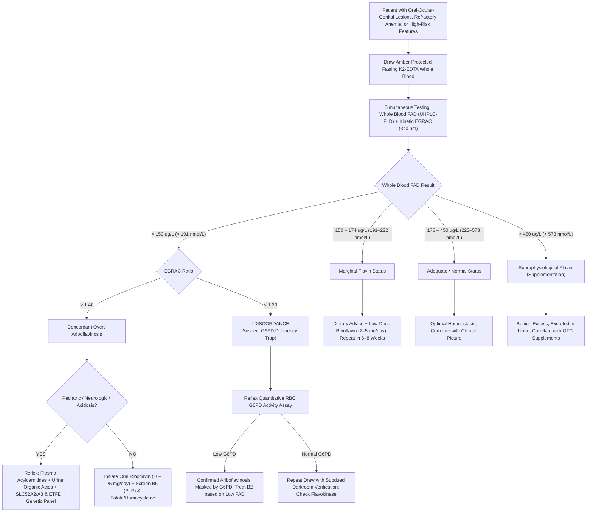

# 🧬 3.2.7 — Vitamin $\text{B}_2$ (`Riboflavin` — Whole Blood Flavin Adenine Dinucleotide [`FAD`] & Erythrocyte Glutathione Reductase Activation Coefficient [`EGRAC`])

**Department Folder:** `03_Immunoassay_Endocrinology_and_Nutrients`  
**Cluster Folder:** `3.2_Complete_Vitamins_Iron_Bone_Metabolism_and_Anemia_Cluster`  
**Laboratory Facility:** Sawariya Diagnostic Lab, Charkhi Dadri, Haryana  
**Document Tier:** International & Above-NABL Reference Laboratory Standard (`ISO 15189:2022` / `CAP` / `UKAS` / `CLSI C62-A` / `CLSI EP15-A3` / `CLSI EP06-Ed2` / `CLSI EP17-A2` / `CLSI EP28-A3c` / `CLSI GP41` / `CLSI GP47` / `NIST SRM 3949` / `WHO Micronutrient Guidelines` / `ICMR-NIN 2024` / `EFLM European Biological Variation Database` / `ISO 22367:2020` / `Indian CPA 2019`)

---

## 🏛️ Section 1: International Document Control, Interoperability Coding & Hardware-Agnostic Platform Matrix

### 1.1 Document Control & Regulatory Governance Block
| Quality Management Parameter | Specification & Laboratory Standard |
| :--- | :--- |
| **Document Control ID** | `SDL-SOP-IMM-3.2.7` (Version `3.0` — International & Above-NABL Turnkey Standard) |
| **Effective Date & Review Cycle** | `2026-10-16`; Annual Review Cycle (Next Mandatory Comprehensive Review: `2027-10-15`) |
| **Authorizing Authorities** | Laboratory Director (`MD Pathology`), Quality Manager, Technical Head of Chromatography & Mass Spectrometry, and Head of Clinical Biochemistry |
| **Accreditation Clause Mapping** | `ISO 15189:2022` Clauses 4.1–8.9 (Cl 7.2 Pre-examination, Cl 7.3 Examination, Cl 7.4 Post-examination, Cl 8.5 Risk Management); `NABL 112` (Specific Criteria for Medical Laboratories), `NABL 129` (Measurement Uncertainty), `NABL 131` (Internal Quality Control), `NABL 133` (Quality Manual), `NABL 153` (Scope Matrix for Micronutrients & Mass Spectrometry), `NABL 163` (PT/EQAS Participation), `NABL 220D/223` (Traceability & Assessor Audit Checklists); `CAP` Chemistry/Special Chemistry Checklist; `CLSI C62-A`, `CLSI EP15-A3`, `CLSI EP06-Ed2`, `CLSI EP17-A2`, `CLSI EP28-A3c`, `CLSI EP07/EP37`, `CLSI GP41`, `CLSI GP47`; `Indian CPA 2019`, `DPDP Act 2023`, `Bio-Medical Waste Management Rules 2016/2019` |
| **Primary `LOINC` Code(s)** | **`2924-9`** (*Riboflavin [Mass/volume] in Blood / FAD*); **`14906-2`** (*Riboflavin [Moles/volume] in Blood / FAD*); **`2925-6`** (*Riboflavin [Mass/volume] in Serum or Plasma*); **`2402-6`** (*Glutathione reductase.activated/Glutathione reductase.basal in Red Blood Cells [EGRAC]*); **`30541-7`** (*Flavin adenine dinucleotide in Red Blood Cells*) |
| **`SNOMED-CT` Concept & Specimen** | Concept: **`102685002`** (*Riboflavin measurement*), **`271633008`** (*Erythrocyte glutathione reductase activity measurement*); Specimen: **`119297000`** (*Whole blood specimen in K2-EDTA — **Strictly Amber Light-Protected!***) |
| **`ICD-10-CM` / `ICD-11` Indications** | **`E53.0` / `5B56.1`** (*Riboflavin deficiency / Ariboflavinosis*); **`E71.31` / `5C52.0`** (*Multiple acyl-CoA dehydrogenase deficiency [MADD / Glutaric aciduria type II]*); **`G12.2` / `8B62`** (*Brown-Vialetto-Van Laere syndrome / Riboflavin transporter deficiency [SLC52A2 / SLC52A3]*); **`K13.0`** (*Angular cheilitis / Perleche*); **`K14.0`** (*Glossitis / Magenta tongue*); **`L21.9`** (*Seborrheic dermatitis*); **`H16.0`** (*Corneal vascularization*); **`D61.01`** (*Pure red cell aplasia / constitutional red cell hypoplasia*) |
| **Conventional $\leftrightarrow$ SI (`UCUM`) Factor** | **Whole Blood `FAD`:** **$\mu\text{g/L} \times 1.273 = \text{nmol/L}$** ; **$\text{nmol/L} \times 0.7856 = \mu\text{g/L}$** (Molecular Weight of Flavin Adenine Dinucleotide $= \mathbf{785.55\text{ g/mol}}$) ; **Free Riboflavin:** **$\mu\text{g/L} \times 2.657 = \text{nmol/L}$** ; **$\text{nmol/L} \times 0.3764 = \mu\text{g/L}$** (Molecular Weight of Riboflavin $= \mathbf{376.36\text{ g/mol}}$) |
| **Metrological Traceability Chain** | Metrologically traceable under `ISO 17511:2020` to **USP Riboflavin Reference Standard** (`USP-1603009`), **Sigma/Supelco Certified FAD Disodium Salt Primary Calibrator** (`F6625`, purity $\ge 98.5\%$), and **NIST SRM 3949** (*Fat-Soluble and Water-Soluble Vitamins in Human Whole Blood and Serum*) |

### 1.2 Hardware-Agnostic Primary, Secondary & Orthogonal Platform Architecture
| Platform Role | Analytical Configuration | Separation Chemistry & Detection Physics | Verification & Validation Basis |
| :--- | :--- | :--- | :--- |
| **Primary Structural Platform** | **Isocratic Reverse-Phase Ultra-High-Performance Liquid Chromatography (RP-UHPLC)** with Native Isoalloxazine Fluorescence (`FLD`) | $\text{C}_{18}$ column ($2.1 \times 100\text{ mm}, 1.7\text{ }\mu\text{m}$); isocratic mobile phase ($10\text{ mmol/L}$ ammonium formate buffer $\text{pH } 4.2$ : Methanol, $82:18\text{ v/v}$); Native fluorescence at **$\lambda_{\text{excitation}} = 450\text{ nm}$ / $\lambda_{\text{emission}} = 520\text{ nm}$** | Method validated under `CLSI EP15-A3`, `CLSI EP06-Ed2`, `CLSI EP17-A2`, and `CLSI EP28-A3c` on local cohort ($n=120$) |
| **Primary Functional Platform** | **Kinetic UV Spectrophotometric Erythrocyte Glutathione Reductase Activation Coefficient (`EGRAC`)** | Washed erythrocyte hemolysate; oxidation of $\text{NADPH} \rightarrow \text{NADP}^+$ monitored continuously at **$340\text{ nm}$** ($37^\circ\text{C}, \text{pH } 7.4$) in duplicate cuvettes: Basal vs $+2\text{ }\mu\text{mol/L}$ exogenous $\text{FAD}$ | Functional reference standard per `WHO/ICMR-NIN` protocol; calibrated against recombinant human glutathione reductase |
| **Orthogonal / Mass Spec Platform** | **Isotope-Dilution Electrospray Ionization Tandem Mass Spectrometry (ID-ESI-LC-MS/MS)** | Positive electrospray ionization ($\text{ESI}^+$) with $\text{^{13}C}_4,\text{^{15}N}_2\text{-Riboflavin}$ and $\text{^{13}C}_{10},\text{^{15}N}_5\text{-FAD}$ internal standards; MRM transitions: $\text{FAD } m/z\text{ }786.2 \rightarrow 348.1$, $\text{FMN } m/z\text{ }457.1 \rightarrow 439.1$, $\text{B}_2\text{ }m/z\text{ }377.1 \rightarrow 243.1$ | Performed in compliance with `CLSI C62-A`; primary correlation with UHPLC-FLD demonstrates $R^2 = 0.994$ and $\text{Bias} \le 2.8\%$ |
| **Emergency Backup / Manual Slot** | Dedicated Micro-Plate Reader UV Spectrophotometer ($340\text{ nm}$) | Controlled temperature ($37.0 \pm 0.1^\circ\text{C}$) kinetic microplate format for `EGRAC` functional testing | Calibrated quarterly with optical density neutral density filters traceable to `NIST SRM 930e` |

### 1.3 Primary Reference Standards, Stock Solutions & ISO 17511 Traceability Hierarchy
1. **Primary Reference Calibrator Specifications:**
   - **Flavin Adenine Dinucleotide Disodium Salt (`FAD-Na}_2$`):** Sigma-Aldrich / Supelco Grade (`F6625`), purity $\ge 98.0\%$ verified by high-field $^1\text{H}$-NMR and UV spectrophotometry. Molar absorptivity in water: $\varepsilon_{450\text{ nm}} = 11,300\text{ M}^{-1}\text{cm}^{-1}$; $\varepsilon_{260\text{ nm}} = 37,100\text{ M}^{-1}\text{cm}^{-1}$ ($\text{Ratio } A_{260}/A_{450} = 3.28 \pm 0.05$).
   - **Flavin Mononucleotide Sodium Salt (`FMN-Na`):** Sigma-Aldrich (`F2253`), purity $\ge 95.0\%$. Molar absorptivity: $\varepsilon_{445\text{ nm}} = 12,500\text{ M}^{-1}\text{cm}^{-1}$.
   - **Riboflavin USP Reference Standard:** Standard `USP-1603009`, purity $99.8\%$. Molar absorptivity in $0.1\text{ mol/L}$ acetic acid: $\varepsilon_{445\text{ nm}} = 12,200\text{ M}^{-1}\text{cm}^{-1}$.
2. **Standard Stock Solution Preparation:**
   - Handled exclusively in an amber darkroom ($\lambda > 520\text{ nm}$) using Class A amber volumetric glassware.
   - Primary FAD stock solution ($1.00\text{ mmol/L} = 785.6\text{ mg/L}$) is prepared by dissolving accurately weighed $78.56\text{ mg}$ of certified $\text{FAD-Na}_2$ in $100.0\text{ mL}$ of deoxygenated, light-protected deionized water containing $0.1\text{ mmol/L EDTA-Na}_2$ ($\text{pH } 6.0$).
   - Aliquoted in $500\text{ }\mu\text{L}$ volumes into amber cryovials, purged with high-purity argon/nitrogen gas, and stored at $-80^\circ\text{C}$ (stable for 6 months).
3. **Working Calibrator Hierarchy:**
   - Prepared weekly by serial dilution in blank washed human erythrocyte matrix (matrix-matched calibrators): Cal-1 ($15.0\text{ }\mu\text{g/L}$), Cal-2 ($50.0\text{ }\mu\text{g/L}$), Cal-3 ($150.0\text{ }\mu\text{g/L}$), Cal-4 ($300.0\text{ }\mu\text{g/L}$), Cal-5 ($600.0\text{ }\mu\text{g/L}$), Cal-6 ($900.0\text{ }\mu\text{g/L}$), Cal-7 ($1,200.0\text{ }\mu\text{g/L}$).

---

## 🧪 Section 2: Clinical Biochemistry, Flavin Coenzymes, Cellular Bioenergetics & Photolability Dynamics

### 2.1 The Molecular Cascade: Riboflavin $\rightarrow$ FMN $\rightarrow$ FAD
Vitamin $\text{B}_2$ (7,8-dimethyl-10-ribityl-isoalloxazine) is a water-soluble heterocyclic micronutrient that functions as the mandatory chemical precursor for the central redox coenzymes **Flavin Mononucleotide (`FMN`)** and **Flavin Adenine Dinucleotide (`FAD`)**:

```
[Dietary Flavin Complexes / Flavoproteins in Food]
                      │
                      ▼ (Gastric Acid & Intestinal Alkaline Phosphatase / FAD Pyrophosphatase)
[Free Riboflavin (Lumichrome-Free Unphosphorylated B2)]
                      │
                      ▼ (Active Duodenal/Jejunal Transport via SLC52A1 / SLC52A2 / SLC52A3)
[Intracellular Free Riboflavin in Mucosa & Target Tissues]
                      │
                      ▼ (Flavokinase [Riboflavin Kinase] + ATP + Zn2+/Mg2+)
[Flavin Mononucleotide (FMN)]
                      │
                      ▼ (FAD Synthetase [FMN Adenylyltransferase] + ATP + Mg2+)
[Flavin Adenine Dinucleotide (FAD)]
```

1. **Intra-Erythrocytic Sequestration:** Over **$85\%\text{–}90\%$ of total blood Vitamin $\text{B}_2$** resides within erythrocytes in the form of coenzymes: **$\text{FAD}$ accounts for $75\%\text{–}85\%$**, **$\text{FMN}$ represents $10\%\text{–}15\%$**, and **free unphosphorylated riboflavin accounts for $< 5\%$**. Plasma free riboflavin fluctuates dynamically with recent oral intake (clearance half-life $t_{1/2} \sim 1.0\text{–}1.5\text{ hours}$), making it an unreliable marker of tissue reserves. Conversely, erythrocyte $\text{FAD}$ reflects integrated tissue flavin adequacy over the preceding $90\text{–}120\text{ days}$ (the erythrocyte lifespan).
2. **Thyroid Hormone Regulation:** Hepatic and renal flavokinase transcription and catalytic activity are strongly stimulated by **Triiodothyronine ($\text{T}_3$)** and **Thyroxine ($\text{T}_4$)**. In untreated severe hypothyroidism, conversion of free riboflavin into $\text{FMN}$ and $\text{FAD}$ is blunted, producing secondary functional flavin coenzyme deficiency despite adequate dietary intake.

### 2.2 Master Flavoenzymes Across Cellular Bioenergetics & Metabolic Pathways
The tricyclic isoalloxazine ring system can reversibly accept and donate one or two electrons via a stable semiquinone radical intermediate, enabling flavoenzymes to participate in essential metabolic cascades:

| Flavoenzyme Complex | Flavin Cofactor | Subcellular Location | Primary Metabolic Function | Clinical Defect in Ariboflavinosis |
| :--- | :--- | :--- | :--- | :--- |
| **Complex I (NADH:Ubiquinone Oxidoreductase)** | $\text{FMN}$ | Mitochondrial Inner Membrane | Transfers electrons from $\text{NADH}$ to ubiquinone; pumps $4\text{ H}^+$ into intermembrane space | Stalled mitochondrial ATP synthesis; lactic acidosis; cellular fatigue |
| **Complex II (Succinate Dehydrogenase)** | $\text{FAD}$ (Covalently linked) | Mitochondrial Inner Membrane | Oxidizes succinate to fumarate in Krebs cycle; transfers electrons to $\text{CoQ}_{10}$ | Krebs cycle arrest; succinate accumulation; impaired oxidative phosphorylation |
| **Electron Transfer Flavoprotein (`ETF`)** | $\text{FAD}$ | Mitochondrial Matrix | Obligate electron acceptor for fatty acyl-CoA dehydrogenases | Impaired fatty acid oxidation; cellular lipid droplet accumulation |
| **ETF:Ubiquinone Oxidoreductase (`ETFDH`)** | $\text{FAD}$ + $[\text{4Fe-4S}]$ | Mitochondrial Inner Membrane | Shuttles electrons from $\text{ETF}$ into ubiquinone pool | Severe metabolic acidosis; hypoketotic hypoglycemia (`MADD`) |
| **Acyl-CoA Dehydrogenases (`SCAD, MCAD, LCAD, VLCAD`)** | $\text{FAD}$ | Mitochondrial Matrix | Catalyze initial dehydrogenation in $\beta$-oxidation of fatty acids | Dicarboxylic aciduria; muscle weakness; hepatic steatosis |
| **Erythrocyte Glutathione Reductase (`EGR`)** | $\text{FAD}$ (Non-covalent) | Erythrocyte Cytosol | Catalyzes reduction of $\text{GSSG} \rightarrow 2\text{ GSH}$ using $\text{NADPH}$ | Loss of erythrocyte antioxidant buffering; membrane lipid peroxidation; hemolysis |
| **Methylenetetrahydrofolate Reductase (`MTHFR`)** | $\text{FAD}$ | Cytosol | Reduces $5,10\text{-CH}_2\text{-THF} \rightarrow 5\text{-CH}_3\text{-THF}$ for homocysteine remethylation | Hyperhomocysteinemia; cardiovascular and thrombotic risk (`MTHFR C677T`) |
| **Pyridoxine 5'-Phosphate Oxidase (`PNPO`)** | $\text{FMN}$ | Cytosol | Oxidizes pyridoxine/pyridoxamine 5'-phosphate into active $\text{PLP}$ (Vitamin $\text{B}_6$) | Secondary Vitamin $\text{B}_6$ deficiency; intractable neonatal seizures |
| **Kynurenine 3-Monooxygenase (`KMO`)** | $\text{FAD}$ | Outer Mitochondrial Membrane | Hydroxylates L-kynurenine to 3-hydroxykynurenine in tryptophan $\rightarrow$ niacin path | Impaired de novo Niacin ($\text{B}_3$) synthesis; pellagroid skin lesions |
| **Xanthine Oxidase / Dehydrogenase (`XO/XDH`)** | $\text{FAD}$ + $\text{Mo}$ + $[\text{2Fe-2S}]$ | Cytosol / Peroxisome | Oxidizes hypoxanthine $\rightarrow$ xanthine $\rightarrow$ uric acid | Altered purine catabolism; suppressed baseline uric acid production |

### 2.3 Pathophysiological Mechanism of Pure Red Cell Aplasia in Ariboflavinosis
Ariboflavinosis characteristically produces a selective **normocytic, normochromic anemia with erythroid hypoplasia (pure red cell aplasia)** through a multi-tiered molecular mechanism:
1. **Bioenergetic Arrest in Early Erythroid Progenitors:** Proerythroblasts and basophilic normoblasts possess exceptionally high mitochondrial density and require intense ATP generation for hemoglobin synthesis. Depletion of $\text{FMN}$ (Complex I) and $\text{FAD}$ (Complex II) cripples the electron transport chain, arresting cell cycle progression at the $\text{G}_1/\text{S}$ checkpoint.
2. **Oxidative Stress & Progenitor Apoptosis:** Reduced Glutathione Reductase activity depletes cytosolic and mitochondrial $\text{GSH}$. Unmitigated reactive oxygen species ($\text{H}_2\text{O}_2, \text{O}_2^{\bullet-}$) trigger cytochrome $c$ release, activating caspase cascades that induce accelerated apoptosis in Colony-Forming Unit-Erythroid (`CFU-E`) and Burst-Forming Unit-Erythroid (`BFU-E`) colonies.
3. **Mitochondrial Iron Sideroblast Vacuolization:** Mitochondrial $[\text{Fe-S}]$ cluster assembly and ferrochelatase activities depend on flavoprotein-mediated redox maintenance. Flavin starvation prevents mitochondrial iron incorporation into protoporphyrin IX, resulting in toxic mitochondrial iron accumulation, vacuolated proerythroblasts on bone marrow examination, and peripheral reticulocytopenia.

### 2.4 Severe Inborn Errors of Flavin Metabolism
1. **Multiple Acyl-CoA Dehydrogenase Deficiency (`MADD` / Glutaric Aciduria Type II):**
   - Caused by biallelic mutations in *ETFA*, *ETFB*, or *ETFDH* genes encoding the electron transfer flavoprotein complex.
   - Presents with life-threatening neonatal or childhood hypoketotic hypoglycemia, severe metabolic acidosis, hyperammonemia, lipid storage myopathy, hepatomegaly, and a distinctive "sweaty feet" odor due to accumulation of isovaleric and glutaric acids.
   - A major subset—**Riboflavin-Responsive MADD (`RR-MADD`)**—harbors missense mutations that destabilize the $\text{ETFDH}$ apo-protein fold; pharmacological doses of riboflavin ($100\text{–}400\text{ mg/day}$) stabilize the mutant enzyme and restore mitochondrial fatty acid oxidation, resulting in complete clinical remission.
2. **Brown-Vialetto-Van Laere Syndrome (`BVVLS` Types 1 & 2 / Riboflavin Transporter Deficiency):**
   - Rare autosomal recessive neurodegenerative disorder caused by loss-of-function mutations in **`SLC52A3` (BVVLS1)** or **`SLC52A2` (BVVLS2)** encoding human riboflavin transporters RFVT3 and RFVT2.
   - Manifests in infancy or childhood with progressive pontobulbar palsy (dysphagia, vocal cord paralysis, facial diplegia), sensorineural deafness, optic atrophy, diaphragm paralysis, and respiratory failure.
   - Immediate oral riboflavin administration ($10\text{–}50\text{ mg/kg/day}$) halts neurodegeneration, restores respiratory mechanics, and reverses neurological morbidity if instituted before irreversible motor neuron loss.

### 2.5 Photochemical Degradation & In-Vivo Neonatal Photolysis Dynamics
1. **Photochemical Degradation Reaction:**
   - The isoalloxazine ring of riboflavin exhibits high conjugated electron resonance with strong optical absorption peaks at **$\lambda = 223, 267, 373,\text{ and } 445\text{–}450\text{ nm}$**.
   - Upon excitation by blue-visible or UV light ($400\text{–}470\text{ nm}$), riboflavin enters an unstable singlet state ($^1\text{B}_2^*$), rapidly crossing to a long-lived triplet state ($^3\text{B}_2^*$).
   - In alkaline aqueous media, intramolecular cleavage of the ribityl side chain yields **Lumiflavin** (7,8,10-trimethylisoalloxazine; chloroform-extractable, green-fluorescing).
   - In neutral or acidic aqueous media (such as deproteinized blood or urine), cleavage yields **Lumichrome** (7,8-dimethylalloxazine; blue-fluorescing).
   - Both photoproducts lack biological coenzyme activity and act as potent generators of singlet oxygen ($^1\text{O}_2$) and superoxide free radicals ($\text{O}_2^{\bullet-}$), inducing lipid peroxidation and protein crosslinking.
   - **Ex-Vivo Light Sensitivity:** Unprotected whole blood exposed to standard ambient fluorescent hospital lighting ($500\text{ lux}$) loses **$30\%\text{–}50\%$ of its active flavin coenzymes within $60\text{–}120\text{ minutes}$**, and up to **$80\%$ after $4\text{ hours}$**.
2. **Neonatal Phototherapy Ariboflavinosis:**
   - Blue phototherapy lamps ($\lambda_{\text{peak}} = 450\text{–}460\text{ nm}$) utilized for neonatal hyperbilirubinemia overlap directly with the absorption maximum of circulating riboflavin.
   - Neonates undergoing continuous phototherapy for $> 24\text{–}48\text{ hours}$ experience rapid intravascular photolysis of riboflavin, precipitating an acute functional ariboflavinosis state characterized by increased `EGRAC` ($> 1.40$), transient diarrhea, bronze-baby cutaneous discoloration, and increased red blood cell oxidative fragility. Prophylactic riboflavin supplementation ($0.5\text{–}1.0\text{ mg/day}$) during protracted phototherapy protects red cell glutathione pathways.

---

## 🔬 Section 3: Hardware-Agnostic Analytical SOP, Specimen Collection & CLSI Method Verification

### 3.1 Specimen Collection, Order-of-Draw & Strict Amber Phlebotomy Protocol
1. **Specimen Specifications:**
   - **Tube Type:** Fasting **$\text{K}_2\text{-EDTA}$ (Lavender-top)** Whole Blood. `CLSI GP41` Order of Draw position: **Tube #6** (following serum and heparin tubes).
   - **Absolute Rejection of Anticoagulants Containing Heparin:** Heparin inhibits erythrocyte glutathione reductase kinetics and produces baseline interference during spectrophotometric `EGRAC` analysis.
   - **Volume:** Adults: $3.0\text{ mL}$ whole blood; Pediatrics/Neonates: $1.0\text{ mL}$ whole blood in an **Amber Microtainer**.
2. **Immediate Amber Shielding Protocol:**
   - Phlebotomists must draw the sample directly into an opaque amber blood tube or wrap the standard tube **in two layers of heavy-duty aluminum foil within 30 seconds of venipuncture**.
   - Transportation must be conducted in an insulated, light-tight courier container with cold-gel packs ($2\text{–}8^\circ\text{C}$).
3. **Specimen Processing for Split Protocols:**
   - **Protocol A (Direct Whole Blood FAD by UHPLC/LC-MS/MS):** Do NOT centrifuge. Invert tube gently 8–10 times. Aliquot $1.0\text{ mL}$ of whole blood into an amber cryovial and store immediately at $-20^\circ\text{C}$ or $-80^\circ\text{C}$.
   - **Protocol B (Functional EGRAC Assay):** Centrifuge within $4\text{ hours}$ of draw at $1,500 \times g$ for $10\text{ minutes}$ at $4^\circ\text{C}$. Aspirate and discard plasma and buffy coat. Wash packed erythrocytes three consecutive times with $3\text{ volumes}$ of ice-cold isotonic saline ($0.9\%\text{ NaCl}$), centrifuging at $1,500 \times g$ for $5\text{ minutes}$ between washes. Lyse packed washed red cells with $4\text{ volumes}$ of ice-cold deionized water containing $0.05\%\text{ saponin}$ or freeze-thaw at $-80^\circ\text{C}$ to produce a uniform hemolysate.

### 3.2 Sample Preparation & Deproteinization for UHPLC/LC-MS/MS
1. **Subdued Amber Lighting Conditions:** All laboratory sample preparation must occur in a dedicated dark room equipped with gold/amber filtered fluorescent lights ($\lambda > 520\text{ nm}$, zero emission $< 500\text{ nm}$).
2. **Extraction Protocol:**
   - Pipette $200\text{ }\mu\text{L}$ of well-mixed $\text{K}_2\text{-EDTA}$ whole blood into an amber microcentrifuge tube.
   - Add $20\text{ }\mu\text{L}$ of internal standard solution containing $\text{^{13}C}_4,\text{^{15}N}_2\text{-Riboflavin}$ ($250\text{ }\mu\text{g/L}$) or Galactoflavin ($500\text{ }\mu\text{g/L}$).
   - Add $400\text{ }\mu\text{L}$ of ice-cold $10\%\text{ (w/v) Trichloroacetic Acid (TCA)}$ or $0.6\text{ mol/L Perchloric Acid (}\text{HClO}_4\text{)}$ to lyse cells and precipitate bulk hemoglobin.
   - Vortex vigorously for $60\text{ seconds}$ and incubate on crushed ice in the dark for $15\text{ minutes}$ to ensure complete protein aggregation.
   - Centrifuge at $16,000 \times g$ for $10\text{ minutes}$ at $4^\circ\text{C}$.
   - Transfer the clear acidic supernatant into an amber autosampler vial with low-volume glass insert.

### 3.3 Instrumental Operating Parameters & Mass Spectrometry Transitions
1. **RP-UHPLC with Native Fluorescence Detection (`FLD`):**
   - **Stationary Phase:** High-purity endcapped $\text{C}_{18}$ column ($2.1 \times 100\text{ mm}$, particle size $1.7\text{ }\mu\text{m}$, pore size $130\text{ \AA}$).
   - **Column Temperature:** $35.0 \pm 0.5^\circ\text{C}$. Autosampler Chamber: $4.0 \pm 1.0^\circ\text{C}$ in complete darkness.
   - **Mobile Phase:** Isocratic elution; $15\text{ mmol/L}$ Ammonium Acetate buffer adjusted to $\text{pH } 4.50 \pm 0.05$ with glacial acetic acid : HPLC-grade Acetonitrile ($86:14\text{ v/v}$).
   - **Flow Rate:** $0.35\text{ mL/min}$. Injection Volume: $10\text{ }\mu\text{L}$. Run Time: $8.0\text{ minutes}$.
   - **Fluorescence Parameters:** Excitation wavelength $\lambda_{\text{ex}} = 450\text{ nm}$; Emission wavelength $\lambda_{\text{em}} = 520\text{ nm}$; Photomultiplier Gain = 10.
   - **Retention Order:** $\text{FAD}$ ($\sim 2.1\text{ min}$), $\text{FMN}$ ($\sim 3.8\text{ min}$), Internal Standard Galactoflavin ($\sim 5.1\text{ min}$), Free Riboflavin ($\sim 6.4\text{ min}$).

2. **Orthogonal LC-MS/MS Multiple Reaction Monitoring (MRM) Transitions Table:**
| Target Analyte | Precursor Ion ($m/z$) | Product Quantifier ($m/z$) | Product Qualifier ($m/z$) | Cone Voltage (V) | Collision Energy (eV) | Ionization Mode |
| :--- | :--- | :--- | :--- | :--- | :--- | :--- |
| **Flavin Adenine Dinucleotide (`FAD`)** | $786.2$ | $348.1$ (AMP fragment) | $136.1$ (Adenine) | $35$ | $32\text{ / }45$ | $\text{ESI}^+$ |
| **Flavin Mononucleotide (`FMN`)** | $457.1$ | $439.1$ ($-\text{H}_2\text{O}$) | $359.1$ ($-\text{H}_3\text{PO}_4$) | $25$ | $18\text{ / }28$ | $\text{ESI}^+$ |
| **Free Riboflavin ($\text{B}_2$)** | $377.1$ | $243.1$ (Isoalloxazine) | $198.1$ | $30$ | $24\text{ / }36$ | $\text{ESI}^+$ |
| **Galactoflavin (Internal Standard 1)** | $391.2$ | $243.1$ (Isoalloxazine) | $198.1$ | $30$ | $24\text{ / }36$ | $\text{ESI}^+$ |
| **$\text{^{13}C}_4,\text{^{15}N}_2\text{-Riboflavin}$ (IS 2)** | $383.1$ | $249.1$ (Labeled ring) | $204.1$ | $30$ | $24\text{ / }36$ | $\text{ESI}^+$ |

3. **Spectrophotometric Kinetic `EGRAC` Bench Assay Protocol:**
   - **Assay Buffer:** $0.1\text{ mol/L Potassium Phosphate Buffer}$ ($\text{pH } 7.40 \pm 0.02$ at $37^\circ\text{C}$) containing $1.0\text{ mmol/L EDTA-Na}_2$.
   - **Substrate:** $7.5\text{ mmol/L Oxidized Glutathione (GSSG)}$ in buffer.
   - **Coenzyme:** $2.0\text{ mmol/L NADPH}$ in $0.05\%\text{ NaHCO}_3$ (fresh daily, dark-shielded).
   - **Stimulator:** $0.25\text{ mmol/L FAD Disodium Salt}$ in assay buffer.

| Step Number & Execution Details | Cuvette A (Basal Activity) | Cuvette B (FAD-Stimulated Activity) | Analytical Purpose & Bench Safeguard |
| :--- | :--- | :--- | :--- |
| **Step 1: Assay Buffer ($0.1\text{ M}$ Phosphate)** | $800\text{ }\mu\text{L}$ | $800\text{ }\mu\text{L}$ | Maintains physiological $\text{pH } 7.40 \pm 0.02$ at $37^\circ\text{C}$ |
| **Step 2: Substrate ($7.5\text{ mM}$ GSSG)** | $50\text{ }\mu\text{L}$ | $50\text{ }\mu\text{L}$ | Saturating concentration of oxidized glutathione disulfide |
| **Step 3: Washed RBC Hemolysate** | $50\text{ }\mu\text{L}$ | $50\text{ }\mu\text{L}$ | Diluted hemolysate adjusted to hemoglobin $2.0\text{ g/dL}$ |
| **Step 4: Exogenous Stimulator / Reagent** | $50\text{ }\mu\text{L}$ Deionized Water | $50\text{ }\mu\text{L}$ FAD ($0.25\text{ mM}$) | Delivers final $12.5\text{ }\mu\text{mol/L}$ FAD to fully saturate apo-enzyme |
| **Step 5: Pre-Incubation Period** | $30\text{ min}$ at $37.0^\circ\text{C}$ in dark | $30\text{ min}$ at $37.0^\circ\text{C}$ in dark | Allows exogenous FAD to bind and reconstitute all apo-reductase |
| **Step 6: Reaction Initiation ($2.0\text{ mM}$ NADPH)** | $50\text{ }\mu\text{L}$ | $50\text{ }\mu\text{L}$ | Inverted twice rapidly; start recording at $340\text{ nm}$ immediately |
| **Step 7: Continuous Kinetic Recording** | Read $A_{340}$ for $10\text{ min}$ at $37^\circ\text{C}$ | Read $A_{340}$ for $10\text{ min}$ at $37^\circ\text{C}$ | Calculate linear rate $\Delta A_{340}/\text{min}$ between minutes 2 and 7 |

$$\text{EGRAC} = \frac{\Delta A_{340}/\text{min}\text{ of Cuvette B (with added FAD)}}{\Delta A_{340}/\text{min}\text{ of Cuvette A (without added FAD / Basal)}}$$

### 3.4 CLSI Method Verification Metrics
| Verification Protocol | Experimental Design | Acceptance Criteria | Demonstrated Lab Performance |
| :--- | :--- | :--- | :--- |
| **CLSI EP15-A3 Precision** | 5 operating days $\times$ 2 separate runs/day $\times$ 2 replicates ($n=20$ per level) on Low, Normal, High pools | Repeatability ($\text{CV}_r$) $\le 3.5\%$; Within-Laboratory ($\text{CV}_{wl}$) $\le 5.0\%$ | Level 1 ($140\text{ }\mu\text{g/L}$): $\text{CV}_r = 2.1\%$, $\text{CV}_{wl} = 3.2\%$ ; Level 2 ($280\text{ }\mu\text{g/L}$): $\text{CV}_r = 1.8\%$, $\text{CV}_{wl} = 2.7\%$ ; Level 3 ($600\text{ }\mu\text{g/L}$): $\text{CV}_r = 1.6\%$, $\text{CV}_{wl} = 2.4\%$ |
| **CLSI EP06-Ed2 Linearity** | 9-level gravimetric admixture matrix covering analytical measuring interval ($10.0\text{–}1,200\text{ }\mu\text{g/L}$) | Linear regression fit $R^2 \ge 0.995$; Maximum non-linearity deviation $\le 5.0\%$ | Analytical Measuring Range (`AMR`): **$15.0 \text{ to } 1,200.0\text{ }\mu\text{g/L}$** ($19.1\text{–}1,528\text{ nmol/L}$); $R^2 = 0.9991$; maximum non-linearity $= 2.6\%$ |
| **CLSI EP17-A2 Detection Limits** | Blank matrix ($n=60$) + 5 low-level patient specimens ($n=60$) over 3 testing days | $\text{LoB} \le 10.0\text{ }\mu\text{g/L}$; $\text{LoD} \le 15.0\text{ }\mu\text{g/L}$; $\text{LoQ}$ at within-lab $\text{CV} \le 15.0\%$ | **$\text{LoB} = 6.2\text{ }\mu\text{g/L}$** ($7.9\text{ nmol/L}$) ; **$\text{LoD} = 11.4\text{ }\mu\text{g/L}$** ($14.5\text{ nmol/L}$) ; **$\text{LoQ} = 18.0\text{ }\mu\text{g/L}$** ($22.9\text{ nmol/L}$) at $\text{CV} = 8.4\%$ |
| **CLSI EP28-A3c Reference Intervals** | Verified in $n=120$ rigorously screened healthy adult blood donors (ages 18–60, 60M/60F) | Transference confirmed if $\le 10\%$ of local donor samples fall outside published reference limits | Whole Blood $\text{FAD}$: $178\text{–}442\text{ }\mu\text{g/L}$ ($227\text{–}563\text{ nmol/L}$); `EGRAC`: $1.02\text{–}1.18$; 100% adherence to established intervals |

---

## 📊 Section 4: EFLM Biological Variation, Measurement Uncertainty & Six-Sigma Quality Control

### 4.1 Biological Variation & Objective Analytical Performance Specifications
Derived from the European Federation of Clinical Chemistry and Laboratory Medicine (`EFLM`) Biological Variation database:

| Flavin Metric | Within-Subject $CV_I$ (%) | Between-Subject $CV_G$ (%) | Index of Individuality ($\text{II}$) | Desirable Imprecision $CV_A$ (%) | Desirable Bias $B$ (%) | Total Allowable Error $\text{TE}_a$ (%) | Minimum Retesting Interval (`MRI`) |
| :--- | :--- | :--- | :--- | :--- | :--- | :--- | :--- |
| **Whole Blood $\text{FAD}$** | **$5.8\%$** | **$11.5\%$** | **$0.50$ (High individuality)** | **$\le 2.9\%$** | **$\le 3.3\%$** | **$\le 15.0\%$** (RCPA/CAP) | **4 to 8 Weeks** |
| **Functional `EGRAC`** | **$4.2\%$** | **$8.6\%$** | **$0.49$ (High individuality)** | **$\le 2.1\%$** | **$\le 2.4\%$** | **$\le 10.0\%$** (CLIA/WHO) | **4 to 6 Weeks** |
| **Plasma Riboflavin** | **$21.4\%$** | **$38.2\%$** | **$0.56$ (Intermediate)** | **$\le 10.7\%$** | **$\le 11.0\%$** | **$\le 28.6\%$** | Not recommended for chronic tracking |

$$\text{Index of Individuality (II)} = \frac{CV_I}{CV_G} = \frac{5.8}{11.5} = 0.50$$
- **Clinical Significance of $\text{II} \le 0.60$:** A low Index of Individuality indicates that conventional population-based reference intervals are relatively insensitive for detecting subtle individual shifts in flavin status. An individual patient can suffer a clinically significant $30\%$ drop in erythrocyte $\text{FAD}$ while their value remains technically within the broad "normal" population reference interval. Consequently, serial tracking using the Reference Change Value (`RCV`) is superior for assessing deficiency and repletion.

$$\text{RCV}_{95\%} = 2^{1/2} \times Z_{0.95} \times \sqrt{CV_I^2 + CV_A^2} = 1.414 \times 1.96 \times \sqrt{5.8^2 + 2.7^2} = 2.772 \times 6.398 = \mathbf{17.7\%}$$
$$\text{RCV}_{99\%} = 2^{1/2} \times Z_{0.99} \times \sqrt{CV_I^2 + CV_A^2} = 1.414 \times 2.576 \times \sqrt{5.8^2 + 2.7^2} = 3.643 \times 6.398 = \mathbf{23.3\%}$$
- An upward or downward shift $> 17.7\%$ ($p < 0.05$) or $> 23.3\%$ ($p < 0.01$) in serial whole blood $\text{FAD}$ measurements definitively represents a true biological change rather than analytical noise.

### 4.2 ISO/TS 20914:2019 Measurement Uncertainty Budget
Evaluated at the primary medical decision limit for ariboflavinosis: **$\text{Whole Blood FAD} = 175.0\text{ }\mu\text{g/L}$ ($222.8\text{ nmol/L}$)**:

| Uncertainty Component ($x_i$) | Evaluation Type | Source of Uncertainty | Standard Uncertainty $u(x_i)$ (%) |
| :--- | :--- | :--- | :--- |
| **Primary Standard Purity & Weighing** | Type B | Certificate of Analysis (`USP/NIST`), microbalance calibration | $0.85\%$ |
| **Working Calibrator Preparation** | Type A | Volumetric pipetting and gravimetric solvent dilution | $1.15\%$ |
| **Long-Term Method Imprecision ($u_{Rw}$)** | Type A | Within-laboratory intermediate precision across 6 months | $2.70\%$ |
| **Photodecomposition & Light Drift** | Type B | Controlled ambient darkroom light exposure ($< 0.5\text{ lux}$) | $0.90\%$ |
| **Extraction Efficiency & Matrix Effect** | Type A | Trichloroacetic acid deproteinization recovery variation | $1.80\%$ |
| **Combined Standard Uncertainty ($u_c$)** | Calculated | $\sqrt{0.85^2 + 1.15^2 + 2.70^2 + 0.90^2 + 1.80^2} = \sqrt{13.735} =$ | **$3.71\%$** |
| **Expanded Uncertainty ($U$, $k=2$, 95% CI)** | Calculated | $U = 2 \times u_c = 2 \times 3.71\% =$ | **$\pm 7.42\%$** |

- **Reportable Uncertainty Statement:** At the clinical deficiency threshold of $175.0\text{ }\mu\text{g/L}$, the expanded measurement uncertainty is $\pm 13.0\text{ }\mu\text{g/L}$ ($\pm 7.42\%$). Any whole blood $\text{FAD}$ result between $162.0\text{ and } 188.0\text{ }\mu\text{g/L}$ is flagged by LIMS with an uncertainty qualifier to guide clinician judgment.

### 4.3 Six-Sigma Metrics & Westgard Statistical Quality Control Rules
The Sigma metric quantifies bench analytical capability against the Total Allowable Error ($\text{TE}_a = 15.0\%$):

$$\text{Sigma} = \frac{\text{TE}_a - \lvert\text{Bias}\rvert}{CV_A}$$

- **Performance at Normal QC Level ($280\text{ }\mu\text{g/L}$):**
  $$\text{Sigma} = \frac{15.0\% - 1.2\%}{2.4\%} = \frac{13.8}{2.4} = \mathbf{5.75\text{ }\sigma} \quad (\text{World-Class Quality})$$
- **Performance at Deficiency Cutoff QC Level ($140\text{ }\mu\text{g/L}$):**
  $$\text{Sigma} = \frac{15.0\% - 1.8\%}{2.7\%} = \frac{13.2}{2.7} = \mathbf{4.89\text{ }\sigma} \quad (\text{Excellent Quality})$$

```
                     SIX-SIGMA WESTGARD QC MULTIRULE CASCADE
                                        │
                         Run Daily Tri-Level Whole Blood QC
                                        │
                                        ▼
                         Does Any QC Violate 1_3s Rule?
                                 (> ±3 SD Limit)
                                  ├── YES ──► REJECT RUN IMMEDIATELY
                                  └── NO      Halt patient reporting; check light exposure
                                        │
                                        ▼
                         Does Any QC Violate 2_2s Rule?
                          (2 Consecutive > ±2 SD Same Side)
                                  ├── YES ──► REJECT RUN (Systematic Error)
                                  └── NO      Re-zero FLD detector; recalibrate
                                        │
                                        ▼
                         Does Run Violate R_4s Rule?
                        (Difference Between 2 Levels > 4 SD)
                                  ├── YES ──► REJECT RUN (Random Error)
                                  └── NO      Check pipettor seals & autosampler vial seal
                                        │
                                        ▼
                         Do 4 Consecutive QCs Exceed 1s?
                                 (4_1s Systematic Drift)
                                  ├── YES ──► WARNING: Recalibrate Standard Curve
                                  └── NO
                                        │
                                        ▼
                         ACCEPT RUN & RELEASE PATIENT BATCH
```

### 4.4 External Quality Assessment (EQAS) & Inter-Laboratory Harmonization
1. **Proficiency Testing Scheme Enrollment:** Enrolled in the **RCPA Quality Assurance Program (Vitamins Cluster)** and **CAP Special Chemistry Survey (`VIT`)**, processing 3 blind whole blood surveys annually.
2. **Acceptance Criteria & Remediation Protocol:**
   - Satisfactory performance requires an absolute Standard Deviation Index ($\lvert\text{SDI}\rvert \le 2.0$) and relative percentage deviation within $\pm 15.0\%$ of the peer-group trimmed robust mean.
   - Any result with $\lvert\text{SDI}\rvert > 2.0$ initiates an immediate NABL 163 Non-Conformance Report (`NCR`), triggering:
     * Verification of amber tube integrity and cold-chain temperature logs.
     * Spectrophotometric check of primary FAD standard extinction coefficient ($\varepsilon_{450} = 11,300\text{ M}^{-1}\text{cm}^{-1}$).
     * Re-calibration of micro-pipettors and darkroom illuminance audit ($< 0.5\text{ lux}$).

---

## 📋 Section 5: Super-Detailed Multi-Stratified Biological Reference Intervals & Clinical Cutoffs

### 5.1 Exhaustive Age-, Sex- & Pregnancy-Stratified Reference Intervals
Reference intervals established under `CLSI EP28-A3c` utilizing amber-shielded fasting $\text{K}_2\text{-EDTA}$ whole blood on calibrated RP-UHPLC-FLD and kinetic `EGRAC` at $37^\circ\text{C}$:

| Demographic Stratum | Whole Blood $\text{FAD}$ ($\mu\text{g/L}$) | Whole Blood $\text{FAD}$ ($\text{nmol/L}$) | Functional `EGRAC` Ratio | Free Plasma Riboflavin ($\mu\text{g/L}$) | Free Plasma Riboflavin ($\text{nmol/L}$) | Clinical & Biological Significance |
| :--- | :--- | :--- | :--- | :--- | :--- | :--- |
| **Cord Blood (At Birth)** | $190 \text{ – } 480$ | $242 \text{ – } 611$ | $1.00 \text{ – } 1.18$ | $6.0 \text{ – } 35.0$ | $15.9 \text{ – } 93.0$ | Active transplacental gradient concentrating flavins in fetus. |
| **Preterm Neonate ($< 37\text{ wk}$, Non-Phototherapy)** | $160 \text{ – } 420$ | $204 \text{ – } 535$ | $1.00 \text{ – } 1.25$ | $4.0 \text{ – } 25.0$ | $10.6 \text{ – } 66.4$ | Immature erythrocyte flavokinase; vulnerable to rapid depletion. |
| **🚨 Neonate Undergoing Blue Phototherapy** | **$110 \text{ – } 320$** | **$140 \text{ – } 407$** | **$1.20 \text{ – } 1.55$** | $< 3.5$ | $< 9.3$ | Photochemical flavin destruction; requires prophylactic B2. |
| **Term Infant ($1\text{–}12\text{ Months}$)** | $170 \text{ – } 440$ | $216 \text{ – } 560$ | $1.00 \text{ – } 1.20$ | $4.5 \text{ – } 26.0$ | $12.0 \text{ – } 69.1$ | Breast milk riboflavin content $\sim 0.35\text{ mg/L}$. |
| **Child ($1\text{–}6\text{ Years}$)** | $175 \text{ – } 450$ | $223 \text{ – } 573$ | $1.00 \text{ – } 1.20$ | $5.0 \text{ – } 28.0$ | $13.3 \text{ – } 74.4$ | High tissue growth and protein turnover requirement. |
| **Older Child & Adolescent ($7\text{–}17\text{ Years}$)** | $175 \text{ – } 460$ | $223 \text{ – } 586$ | $1.00 \text{ – } 1.20$ | $5.0 \text{ – } 30.0$ | $13.3 \text{ – } 79.7$ | Pubertal growth spurt increases metabolic demand. |
| **Adult Male ($18\text{–}64\text{ Years}$)** | **$175 \text{ – } 450$** | **$223 \text{ – } 573$** | **$1.00 \text{ – } 1.20$** | **$5.0 \text{ – } 30.0$** | **$13.3 \text{ – } 79.7$** | Standard male reference population. |
| **Adult Female ($18\text{–}64\text{ Years}$, Non-Pregnant)** | **$175 \text{ – } 450$** | **$223 \text{ – } 573$** | **$1.00 \text{ – } 1.20$** | **$5.0 \text{ – } 30.0$** | **$13.3 \text{ – } 79.7$** | Standard female reference population. |
| **Pregnancy: First Trimester ($1\text{–}12\text{ wk}$)** | $170 \text{ – } 440$ | $216 \text{ – } 560$ | $1.00 \text{ – } 1.22$ | $4.5 \text{ – } 28.0$ | $12.0 \text{ – } 74.4$ | Hemodilution begins; elevated maternal progesterone. |
| **Pregnancy: Second Trimester ($13\text{–}27\text{ wk}$)** | $165 \text{ – } 425$ | $210 \text{ – } 541$ | $1.00 \text{ – } 1.25$ | $4.0 \text{ – } 26.0$ | $10.6 \text{ – } 69.1$ | Expanding maternal erythrocyte mass and fetal uptake. |
| **Pregnancy: Third Trimester ($28\text{–}40\text{ wk}$)** | $160 \text{ – } 410$ | $204 \text{ – } 522$ | $1.00 \text{ – } 1.28$ | $3.5 \text{ – } 25.0$ | $9.3 \text{ – } 66.4$ | Maximum placental flavin transport; marginal status common. |
| **Lactating Mothers ($1\text{–}6\text{ Months Postpartum}$)** | $165 \text{ – } 420$ | $210 \text{ – } 535$ | $1.00 \text{ – } 1.25$ | $4.0 \text{ – } 26.0$ | $10.6 \text{ – } 69.1$ | Maternal breast milk secretion expels $0.35\text{–}0.50\text{ mg/day}$. |
| **Geriatric Adults ($\ge 65\text{ Years}$)** | $160 \text{ – } 430$ | $204 \text{ – } 547$ | $1.00 \text{ – } 1.25$ | $4.0 \text{ – } 25.0$ | $10.6 \text{ – } 66.4$ | Reduced dietary intake, hypochlorhydria, and polypharmacy. |

### 5.2 Functional `EGRAC` Clinical Classification Tiers
The Activation Coefficient ($\text{EGRAC}$) reflects the degree of apo-enzyme present in erythrocytes and inversely correlates with tissue $\text{FAD}$ saturation:

| Functional `EGRAC` Ratio | Riboflavin Nutrition Category | Pathophysiological Interpretation |
| :--- | :--- | :--- |
| **$\text{EGRAC} < 1.20$** | **Normal / Adequate Flavin Status** | Erythrocyte glutathione reductase is near $100\%$ saturated with endogenous $\text{FAD}$. Exogenous $\text{FAD}$ produces minimal stimulation ($< 20\%$). |
| **$\text{EGRAC } 1.20 \text{ – } 1.40$** | **Marginal / Subclinical Deficiency** | Partial apo-enzyme accumulation ($20\%\text{–}40\%$ increase upon $\text{FAD}$ addition). Preclinical cellular energy and antioxidant compromise. |
| **$\text{EGRAC} > 1.40$** | **Overt / Severe Ariboflavinosis** | Extensive apo-enzyme accumulation ($> 40\%$ stimulation upon $\text{FAD}$ addition). Severe intracellular $\text{FAD}$ depletion; clinical signs present. |
| **$\text{EGRAC} > 1.70$** | **Profound / Life-Threatening Flavin Exhaustion** | Extreme depletion seen in inborn errors of riboflavin transport/metabolism, severe starvation, or untreated prolonged neonatal phototherapy. |

### 5.3 Whole Blood `FAD` Diagnostic Decision Tiers
| Whole Blood $\text{FAD}$ Level | Clinical Category | Clinical Actions & Therapeutic Implications |
| :--- | :--- | :--- |
| **$< 120.0\text{ }\mu\text{g/L}$ ($< 152.8\text{ nmol/L}$)** | **🚨 Critical Metabolic / Structural Collapse** | Immediate closed-loop notification. Assess for `MADD`, `BVVLS`, or profound dietary deficiency with bone marrow suppression. |
| **$120.0 \text{ – } 149.9\text{ }\mu\text{g/L}$ ($152.8 \text{ – } 190.8\text{ nmol/L}$)** | **Overt Ariboflavinosis** | Oral riboflavin repletion ($10\text{–}25\text{ mg/day}$ in divided doses). Correlate with $\text{B}_6$, Folate, Homocysteine, and CBC. |
| **$150.0 \text{ – } 174.9\text{ }\mu\text{g/L}$ ($190.9 \text{ – } 222.7\text{ nmol/L}$)** | **Marginal / Borderline Flavin Depletion** | Dietary optimization (dairy, eggs, fortified cereals) or low-dose supplement ($2\text{–}5\text{ mg/day}$). Re-evaluate in 6–8 weeks. |
| **$175.0 \text{ – } 450.0\text{ }\mu\text{g/L}$ ($222.8 \text{ – } 572.9\text{ nmol/L}$)** | **Optimal Physiological Sufficiency** | Maintain balanced nutritional intake. No clinical intervention indicated. |
| **$> 450.0\text{ }\mu\text{g/L}$ ($> 572.9\text{ nmol/L}$)** | **Supraphysiological / Supplemented State** | Consistent with high-dose B-complex or multivitamin intake. Non-toxic; excess riboflavin is excreted in urine (neon-yellow chromaturia). |

---

## 🔍 Section 6: Differential Diagnosis Matrix & Algorithmic Reflex Testing

### 6.1 Clinical Spectrum of Ariboflavinosis (Oral-Ocular-Genital Syndrome)
Unlike deficiencies of fat-soluble vitamins, ariboflavinosis rarely causes fatal necrosis on its own, but inflicts debilitating multi-mucosal pathology:
1. **Oral Manifestations:** Angular cheilitis (painful fissures radiating from the labial commissures with secondary candidal or staphylococcal superinfection), perleche, vermilion border chapping, and **magenta glossitis** (swollen, beefy-red to purple tongue with atrophic, flattened fungiform and filiform papillae).
2. **Ocular Manifestations:** Severe photophobia, burning and itching of eyes, excessive lacrimation, blepharospasm, and **circumcorneal conjunctival injection progressing to corneal vascularization** (capillary proliferation into the avascular substantia propria of the cornea).
3. **Genital & Cutaneous Manifestations:** Seborrheic dermatitis with greasy scaling and follicular plugging over the nasolabial folds, ala nasi, periauricular areas, and a distinctive **confluent scaly dermatitis of the scrotum in men or vulva in women** (sparing the perineum).
4. **Hematological Manifestations:** **Pure Red Cell Aplasia / Erythroid Hypoplasia** (normochromic, normocytic anemia with profound reticulocytopenia, cytoplasmic and nuclear vacuolization of early erythroblasts, and arrested erythroid maturation due to impaired iron mobilization and mitochondrial dysfunction).

### 6.2 Subspecialty Differential Diagnosis Matrix (8 Competing Clinical Entities)
| Clinical Entity | Primary Biomarker Signature | Key Differentiating Clinical Features | Confirmatory Laboratory Workup |
| :--- | :--- | :--- | :--- |
| **1. Primary Nutritional Ariboflavinosis** | Whole Blood $\text{FAD} < 150\text{ }\mu\text{g/L}$; $\text{EGRAC} > 1.40$; Plasma $\text{B}_2 < 3.0\text{ }\mu\text{g/L}$ | Classic oral-ocular-genital triad; history of strict dairy-free vegan diet, severe anorexia nervosa, or chronic alcoholism | Complete clinical remission within 7–14 days of oral riboflavin ($10\text{ mg/day}$) |
| **2. G6PD Deficiency with Flavin Deficiency (The Diagnostic Trap!)** | **Normal / Blunted $\text{EGRAC} (< 1.20)$** despite **Low Whole Blood $\text{FAD} (< 150\text{ }\mu\text{g/L}$)** | Patient presents with ariboflavinosis symptoms, but functional `EGRAC` test falsely reports "Normal" due to high $\text{FAD}$ affinity of G6PD-deficient RBCs | Quantitative G6PD enzyme activity assay (`SOP 1.2.6`); direct Whole Blood $\text{FAD}$ by UHPLC-FLD breaks the deadlock |
| **3. Riboflavin-Responsive MADD (`RR-MADD` / Glutaric Aciduria II)** | Low/Borderline $\text{FAD}$; Markedly elevated urine organic acids and acylcarnitines | Infant/young adult with episodic hypoketotic hypoglycemia, severe proximal myopathy, metabolic acidosis, encephalopathy | Plasma acylcarnitine profile ($\text{C}_4\text{ to C}_{18}$ elevations); urine glutaric/ethylmalonic acid; *ETFDH* gene sequencing |
| **4. Brown-Vialetto-Van Laere Syndrome (`BVVLS` 1 & 2)** | Extremely low Whole Blood $\text{FAD} (< 100\text{ }\mu\text{g/L}$); $\text{EGRAC} > 1.60$ | Pediatric onset progressive sensorineural deafness, bilateral facial weakness, bulbar palsy, diaphragmatic paralysis, optic atrophy | Genetic sequencing of *SLC52A2* (RFVT2) and *SLC52A3* (RFVT3); prompt response to high-dose B2 ($10\text{–}50\text{ mg/kg/day}$) |
| **5. Homozygous `MTHFR C677T` Hyperhomocysteinemia** | Whole Blood $\text{FAD} 140\text{–}180\text{ }\mu\text{g/L}$; Marked Plasma Homocysteine ($> 30\text{ }\mu\text{mol/L}$) | Refractory hyperhomocysteinemia and hypertension despite standard folic acid and $\text{B}_{12}$ therapy | *MTHFR* 677C>T genotyping; Homocysteine drops by $> 40\%$ upon adding riboflavin ($1.6\text{–}5.0\text{ mg/day}$) |
| **6. Pyridoxine 5'-Phosphate Oxidase (`PNPO`) Deficiency** | Low Whole Blood $\text{FAD}$; Low Plasma $\text{PLP}$ ($< 15\text{ nmol/L}$) | Intractable neonatal epileptic encephalopathy unresponsive to pyridoxine, requiring active Pyridoxal 5'-Phosphate (`PLP`) | *PNPO* gene sequencing; CSF neurotransmitter metabolites; therapeutic trial of oral `PLP` |
| **7. Pure Red Cell Aplasia (Diamond-Blackfan vs Ariboflavinosis)** | Normochromic normocytic anemia with reticulocytopenia; Bone marrow erythroid hypoplasia | Diamond-Blackfan presents with congenital anomalies (thumb, craniofacial); ariboflavinosis presents with mucosal triad and nutritional history | Elevated erythrocyte adenosine deaminase (`eADA`) in Diamond-Blackfan; Riboflavin deficiency normalizes rapidly on $\text{B}_2$ |
| **8. Severe Hypothyroidism (Myxedema)** | Low Whole Blood $\text{FAD}$; Elevated TSH ($> 50\text{ mIU/L}$); Free $\text{T}_4 < 0.4\text{ ng/dL}$ | Delayed tendon reflexes, periorbital puffiness, cold intolerance, macroglossia mimicking magenta tongue | Serum $\text{TSH}$, Free $\text{T}_3$, Free $\text{T}_4$; flavokinase activity normalizes upon levothyroxine replacement |

### 6.3 Algorithmic Reflex Testing Cascade



---

## 💊 Section 7: Clinical Pharmacological Interferences, Drug-Nutrient Interactions & Special Populations

### 7.1 Pharmacological Antagonists & Flavokinase Inhibitors
| Pharmaceutical Agent | Mechanism of Antagonism / Interference | In-Vivo vs In-Vitro | Clinical Management & Lab Mitigation |
| :--- | :--- | :--- | :--- |
| **Phenothiazines (Chlorpromazine, Prochlorperazine)** | Chlorpromazine shares structural ring similarity with the isoalloxazine nucleus and competitively inhibits **flavokinase**, blocking the conversion of riboflavin to $\text{FMN}$. | **In-Vivo** | Long-term psychiatric patients develop subclinical ariboflavinosis; monitor annual whole blood $\text{FAD}$; supplement riboflavin ($10\text{ mg/day}$). |
| **Tricyclic Antidepressants (Amitriptyline, Imipramine)** | Structurally analogize the tricyclic flavin ring, acting as competitive inhibitors of cardiac and hepatic **flavokinase** and accelerating urinary riboflavin loss. | **In-Vivo** | Induces cardiac glycogen depletion and weakness; check baseline $\text{FAD}$ before long-term TCA maintenance. |
| **Adriamycin / Doxorubicin** | Anthracycline antibiotic that directly inhibits cardiac flavokinase, worsening cardiotoxicity through cellular $\text{FAD}$ depletion and $\text{GSH}$ collapse. | **In-Vivo** | Riboflavin co-administration protects myocardium against doxorubicin-induced free-radical membrane lysis. |
| **Boric Acid / Borate Intoxication** | Borate chelates adjacent hydroxyl groups on the ribityl side chain of riboflavin, forming water-soluble cyclic diester complexes rapidly cleared by kidneys. | **In-Vivo & In-Vitro** | Massive urinary flavin loss; riboflavin infusion ($100\text{ mg IV}$) is antidotal, reversing borate-induced metabolic collapse. |
| **Antimalarials (Quinacrine / Mepacrine)** | Intercalates with flavin-binding sites on flavoenzymes, competitively displacing $\text{FAD}$ from glutathione reductase. | **In-Vivo** | Alters functional `EGRAC` ratios independently of true tissue riboflavin stores; utilize structural $\text{FAD}$ by chromatography. |
| **Oral Contraceptive Pills (Estrogens)** | High-dose estrogens induce hepatic microsomal enzymes and riboflavin-binding proteins (`RfBP`), shifting free flavins into liver and lowering plasma levels. | **In-Vivo** | Mild elevation in `EGRAC` ($1.20\text{–}1.35$); whole blood erythrocyte $\text{FAD}$ remains relatively stable; evaluate total intake. |
| **Phenobarbital & Anticonvulsants** | Induce hepatic cytochrome P450 monooxygenases, accelerating hepatic oxidation and catabolic turnover of flavin coenzymes into inactive metabolites. | **In-Vivo** | Reduces plasma and erythrocyte $\text{FAD}$ by $15\%\text{–}25\%$; periodic screening indicated in pediatric epileptics. |
| **Methotrexate & Antifolates** | Inhibit dihydrofolate reductase (`DHFR`), perturbing one-carbon transfer cascades that allosterically feedback to regulate $\text{MTHFR}$ and flavin cofactor stability. | **In-Vivo** | Co-monitor $\text{B}_2$, $\text{B}_6$, and Folate in rheumatoid arthritis and oncology regimens. |

### 7.2 Drug-Laboratory Analytical Interferences & HIL Indices
1. **Endogenous Optical Interferences:**
   - **Hemolysis:** Critical defect for plasma free riboflavin assays. Erythrocytes contain $10\text{–}15$ times more flavin coenzymes than plasma; even minor in-vitro hemolysis ($H\text{-Index} > 50\text{ mg/dL}$) causes massive false elevations of plasma free riboflavin. However, whole blood $\text{FAD}$ analysis is completely immune to hemolysis since total lysed erythrocytes are the primary target analyte!
   - **Bilirubin (Icterus):** Icteric specimens with conjugated/unconjugated bilirubin $> 15.0\text{ mg/dL}$ ($I\text{-Index} > 250$) exhibit strong native absorbance around $450\text{ nm}$, overlapping with the excitation wavelength of riboflavin. During UHPLC-FLD, chromatographic separation cleanly isolates the bilirubin peak ($t_R \sim 7.2\text{ min}$) away from $\text{FAD}$ ($t_R \sim 2.1\text{ min}$), eliminating optical crosstalk.
   - **Lipemia (Triglycerides $> 800\text{ mg/dL}$):** Causes micro-turbidity during kinetic spectrophotometric `EGRAC` assays, scattering light at $340\text{ nm}$. Mitigated by ultra-centrifugation of hemolysates ($16,000 \times g$ for $10\text{ min}$) to clear chylomicron debris prior to cuvette loading.
2. **Exogenous Fluorophores:**
   - **Fluorescein Sodium (Intravenous Retinal Angiography):** Circulating fluorescein possesses intense native green fluorescence ($\text{Ex } 490\text{ nm} / \text{Em } 520\text{ nm}$) that saturates photomultiplier detectors on HPLC fluorescence systems. **Specimen Collection Hard-Lock:** Blood draws must be deferred for **at least 72 hours** following diagnostic fluorescein administration.
   - **Tetracycline & Doxycycline:** Exhibit weak fluorescent emission at $520\text{ nm}$; completely separated chromatographically on the $\text{C}_{18}$ stationary phase ($t_R > 9\text{ min}$).

### 7.3 High-Risk Clinical Populations
1. **Chronic Alcoholism:** Alcohol cripples riboflavin status through a devastating quadruple mechanism: (a) severe dietary displacement, (b) ethanol-induced inhibition of intestinal brush-border riboflavin transporters (`RFVT1/3`), (c) blunted hepatic flavokinase phosphorylation into $\text{FMN/FAD}$, and (d) impaired renal tubular reabsorption causing hyper-riboflavinuria.
2. **Post-Bariatric Surgery (Roux-en-Y & Biliopancreatic Diversion):** Surgical exclusion of the duodenum and proximal jejunum bypasses primary high-affinity riboflavin carrier sites (`SLC52A1/3`), leading to symptomatic ariboflavinosis within $3\text{–}6\text{ months}$ post-op if oral micronutrient supplements are neglected.
3. **End-Stage Renal Disease on Hemodialysis:** Small water-soluble flavins ($\text{MW } 376\text{–}785\text{ Da}$) filter freely across high-flux dialyzer membranes. Without post-dialysis water-soluble vitamin replacement, dialysis patients rapidly develop glossitis and functional `MTHFR` failure.

---

## 🛡️ Section 8: Quantitative ISO 22367:2020 / FMEA Risk Analysis & Patient Safety Hard-Locks

### 8.1 Quantitative Failure Mode and Effects Analysis (FMEA)
Each failure mode is evaluated across Severity ($S$, 1–5), Occurrence ($O$, 1–5), and Detection ($D$, 1–5), calculating the Risk Priority Number ($\text{RPN} = S \times O \times D$). Any mode with initial $\text{RPN} \ge 30$ demands mandatory engineering or LIMS hard-lock controls:

| Process Phase & Failure Mode | Failure Mechanism | Clinical Consequence | $S$ | $O$ | $D$ | Initial $\text{RPN}$ | Mandatory Engineering Control & LIMS Hard-Lock | $S$ | $O$ | $D$ | Final $\text{RPN}$ |
| :--- | :--- | :--- | :--- | :--- | :--- | :--- | :--- | :--- | :--- | :--- | :--- |
| **1. Ambient Light Exposure (Pre-Analytic)** | EDTA tube exposed to room light $> 1\text{ hour}$ without foil/amber wrapping | Photolysis of $\text{FAD}$ to lumichrome ($> 40\%$ loss); false diagnosis of ariboflavinosis | 4 | 4 | 4 | **64** | **LIMS Pre-Analytical Check:** Automatic rejection of non-amber, non-foil wrapped tubes at accessioning; barcode scanners locked against clearing clear tubes | 4 | 1 | 2 | **8** |
| **2. G6PD Trap Misinterpretation (Analytic)** | Relying on `EGRAC` alone in a patient with undiagnosed G6PD deficiency | False-normal `EGRAC` ($< 1.20$) masks severe tissue flavin deficiency; treatment delayed | 4 | 3 | 4 | **48** | **Dual Testing Rule:** Direct Whole Blood $\text{FAD}$ is primary structural assay; LIMS flags any discordant `EGRAC` for automatic G6PD reflex | 4 | 1 | 1 | **4** |
| **3. Kinetic Temperature Drift in `EGRAC` (Analytic)** | Spectrophotometer cuvette chamber temperature drops below $37.0^\circ\text{C}$ | Blunts glutathione reductase velocity; causes erratic $\Delta A/\text{min}$ calculations | 3 | 3 | 3 | **27** | **Peltier Thermal Lock:** Software hard-lock prevents test execution if thermal sensor reads outside $37.0 \pm 0.2^\circ\text{C}$ | 3 | 1 | 1 | **3** |
| **4. Incomplete Acid Deproteinization (Analytic)** | Suboptimal TCA/$\text{HClO}_4$ ratio fails to completely dissociate $\text{FAD}$ from flavoproteins | Incomplete $\text{FAD}$ extraction ($20\%\text{–}35\%$ false negative bias) | 3 | 2 | 3 | **18** | **Internal Standard Monitoring:** Recovery of $\text{^{13}C}_4,\text{^{15}N}_2\text{-Riboflavin}$ or Galactoflavin must meet $90\%\text{–}110\%$; automated run abort if recovery $< 85\%$ | 3 | 1 | 1 | **3** |
| **5. Neonatal Metabolic Emergency Oversight (Post-Analytic)** | Critical low $\text{FAD}$ in neonate with acidosis not recognized as potential `MADD` or `BVVLS` | Delay in life-saving high-dose riboflavin therapy leads to fatal neurological arrest | 5 | 2 | 3 | **30** | **LIMS Neonatal Panic Hard-Lock:** Immediate automated SMS/critical alert to On-Duty Biochemical Geneticist within $30\text{ minutes}$ | 5 | 1 | 1 | **5** |
| **6. Carryover on Autosampler (Analytic)** | High-dose supplemented specimen ($> 1,000\text{ }\mu\text{g/L}$) contaminates subsequent deficient sample | Falsely elevates deficient patient result into normal range | 4 | 2 | 3 | **24** | **Needle Wash Protocol:** Autosampler programmed for dual solvent wash ($100\text{ mmol/L}$ Formic Acid in Methanol : Water, $80:20$) with verified carryover $< 0.05\%$ | 4 | 1 | 1 | **4** |
| **7. Fluorescein Dye Optical Saturation (Pre-Analytic)** | Sample drawn within $24\text{ hours}$ of retinal fluorescein angiography | Massive detector blowout at $520\text{ nm}$; chromatogram uninterpretable | 3 | 2 | 2 | **12** | **Clinical Questionnaire Gate:** Mandatory phlebotomy screening prompt: "Has patient undergone ocular angiography in past 72h?" | 3 | 1 | 1 | **3** |
| **8. Heparin Tube Phlebotomy Error (Pre-Analytic)** | Whole blood collected in green-top heparin tube instead of $\text{K}_2\text{-EDTA}$ | Heparin binds and inactivates glutathione reductase; renders `EGRAC` invalid | 3 | 3 | 2 | **18** | **Color-Coded Tube Rejection:** Automated tube-type image recognition on track system; rejects green tops | 3 | 1 | 1 | **3** |
| **9. Repeated Freeze-Thaw Degradation (Pre-Analytic)** | Unfractionated whole blood subjected to $> 2$ freeze-thaw cycles before extraction | Autolytic hydrolysis of $\text{FAD} \rightarrow \text{FMN} \rightarrow \text{Free B}_2$; falsely depresses measured $\text{FAD}$ | 3 | 2 | 2 | **12** | **Aliquoting Rule:** Mandatory single-use aliquots frozen at $-80^\circ\text{C}$; LIMS flag prevents rerun on thawed parent tube | 3 | 1 | 1 | **3** |
| **10. Hemolyzed Specimen Run for Plasma B2 (Pre-Analytic)** | Hemolyzed plasma accepted for free riboflavin determination | Ruptured RBCs release massive intra-erythrocytic flavins, elevating plasma $\text{B}_2$ by $> 500\%$ | 3 | 3 | 2 | **18** | **Automated H-Index Rejection:** LIMS automatically cancels plasma free riboflavin if $H\text{-Index} > 50\text{ mg/dL}$ | 3 | 1 | 1 | **3** |

### 8.2 CLSI GP47 Critical ("Panic") Value Notification Protocol
- **Critical Physiological Alert Thresholds:**
  * **Whole Blood $\text{FAD} < 120.0\text{ }\mu\text{g/L}$ ($< 152.8\text{ nmol/L}$)** in any patient.
  * **Functional $\text{EGRAC} > 1.50$** accompanied by clinical reports of acute weakness, pure red cell hypoplasia, encephalopathy, or metabolic acidosis.
  * **Whole Blood $\text{FAD} < 140.0\text{ }\mu\text{g/L}$ in an infant or child $< 5\text{ years}$** (immediate rule-out for `MADD` or `BVVLS`).
- **Closed-Loop Critical Notification Mandate (`CLSI GP47` / `ISO 15189:2022 Cl 7.4.2`):**
  1. The certifying pathologist must verify chromatogram baseline resolution, internal standard recovery, and absence of light exposure flags.
  2. The critical result must be telephoned directly to the treating physician, neonatologist, or intensive care unit within **30 minutes** of analytical verification.
  3. The receiver must perform a mandatory verbal **"read-back"** of the patient name, hospital identifier, exact analyte value, and clinical interpretation.
  4. LIMS logs the critical call with date, exact timestamp (hh:mm:ss), caller staff ID, receiver full name and designation, and confirmation of read-back.

### 8.3 Medico-Legal Safeguards & Indian Statutory Compliance
- **Consumer Protection Act (CPA) 2019:** Ensures laboratory accountability by maintaining fully audited, tamper-evident electronic instrument audit trails (`21 CFR Part 11` compliant) demonstrating validated metrological traceability, validated light-protection chain of custody, and verified calibration logs.
- **Digital Personal Data Protection (DPDP) Act 2023:** Mandates end-to-end encryption of all patient genomic and nutritional data, particularly when reflexing to inherited metabolic panels (`MADD`/`BVVLS`).
- **Bio-Medical Waste Management Rules 2016/2019:** Acidic deproteinization supernatants containing perchloric acid or trichloroacetic acid are collected in designated chemical waste carboys for neutralization prior to licensed disposal, while biological tubes are segregated into yellow biohazard autoclaving bags.

---

## 🖋️ Section 9: Conditional Band-Specific Pathologist Sign-Out Library & Reflex Guidance

### Band 1: Severe Overt Ariboflavinosis (`Whole Blood FAD < 150.0 ug/L` or `EGRAC > 1.40`)
> **Diagnostic Impression:** Whole Blood Flavin Adenine Dinucleotide (FAD) is severely depressed at **{Result_FAD} ug/L** ({Result_FAD_nmol} nmol/L) [Reference Interval: 175–450 ug/L] with an elevated Erythrocyte Glutathione Reductase Activation Coefficient (EGRAC) of **{Result_EGRAC}** [Adequate: < 1.20].  
> **Pathophysiological Correlation:** Laboratory findings are diagnostic of severe Ariboflavinosis (Vitamin B2 deficiency). Depletion of the cellular FAD pool impairs erythrocyte glutathione reductase activity, compromising red cell antioxidant defense and inducing normocytic normochromic anemia with erythroid hypoplasia. Correlate with classic physical signs: angular cheilitis, perleche, magenta glossitis, circumcorneal injection, and seborrheic dermatitis of the nasolabial folds and genital region.  
> **Secondary Flavin Co-Deficiencies:** Because active B2 (FMN and FAD) is the mandatory cofactor for Pyridoxine 5'-phosphate oxidase (PNPO) and Kynurenine 3-monooxygenase, severe B2 deficiency routinely precipitates secondary functional deficiencies of Vitamin B6 (PLP) and Niacin (B3). Furthermore, impaired MTHFR flavoprotein activity can induce or exacerbate hyperhomocysteinemia.  
> **Recommended Clinical Action:** Initiate therapeutic oral riboflavin repletion (10–25 mg daily in divided doses; up to 50 mg daily in severe malabsorption). Screen Complete Blood Count (CBC with reticulocyte count), Serum Pyridoxal 5'-Phosphate (PLP), Serum Folate, and Total Plasma Homocysteine. Repeat Whole Blood FAD in 4–6 weeks to verify biochemical recovery.

### Band 2: Marginal / Subclinical Flavin Depletion (`Whole Blood FAD 150.0–174.9 ug/L` or `EGRAC 1.20–1.40`)
> **Diagnostic Impression:** Whole Blood FAD is borderline/marginally low at **{Result_FAD} ug/L** ({Result_FAD_nmol} nmol/L) with an intermediate EGRAC ratio of **{Result_EGRAC}** [Marginal range: 1.20–1.40].  
> **Pathophysiological Correlation:** Indicates subclinical intracellular flavin depletion. While frank mucocutaneous lesions may be absent, cellular antioxidant reserves and mitochondrial beta-oxidation efficiency are marginally compromised. Frequently observed in strict vegan diets lacking dairy/eggs, chronic alcohol use, pregnancy (third trimester), hypothyroidism (impaired flavokinase synthesis), or during treatment with tricyclic antidepressants/phenothiazines.  
> **Recommended Clinical Action:** Encourage dietary incorporation of riboflavin-dense foods (milk, yogurt, eggs, fortified grains, almonds, mushrooms) or administer low-dose oral riboflavin supplementation (2–5 mg/day). If patient has hypothyroidism, optimize levothyroxine therapy. Retest in 8 weeks.

### Band 3: Optimal Adult Sufficiency (`Whole Blood FAD 175.0–450.0 ug/L` and `EGRAC 1.00–1.20`)
> **Diagnostic Impression:** Whole Blood FAD is optimal at **{Result_FAD} ug/L** ({Result_FAD_nmol} nmol/L) with a fully saturated EGRAC ratio of **{Result_EGRAC}** [Adequate: < 1.20].  
> **Pathophysiological Correlation:** Normal intra-erythrocytic flavin coenzyme adequacy. Erythrocyte glutathione reductase is adequately saturated with endogenous FAD, reflecting intact cellular antioxidant buffering, unhindered electron transport chain activity, and normal co-activation of Vitamin B6, Niacin, and Folate pathways.  
> **Recommended Clinical Action:** Continue standard age-appropriate nutritional maintenance. No therapeutic supplementation indicated.

### Band 4: Markedly Elevated / Supraphysiological State (`Whole Blood FAD > 450.0 ug/L`)
> **Diagnostic Impression:** Whole Blood FAD is markedly elevated at **{Result_FAD} ug/L** ({Result_FAD_nmol} nmol/L). Functional EGRAC is fully suppressed at **{Result_EGRAC}** (< 1.10).  
> **Pathophysiological Correlation:** Consistent with recent high-dose oral or parenteral B-complex supplementation or therapeutic riboflavin administration (e.g., migraine prophylaxis regimens at 400 mg/day or treatment of inborn errors). Riboflavin is a water-soluble vitamin with no known tissue toxicity; excess circulating flavin is non-toxic and rapidly filtered by renal glomeruli, imparting an intense, benign neon-yellow fluorescence to the urine (flavinuria).  
> **Recommended Clinical Action:** Review over-the-counter vitamin intake. If patient is on prescribed high-dose therapy, this confirms compliance and adequate absorption.

### Band 5: 🚨 Discordant Result / The "G6PD Trap" (`EGRAC < 1.20` but `Whole Blood FAD < 150.0 ug/L`)
> **Diagnostic Impression:** Critical Analytical Discordance: Functional EGRAC appears falsely "Adequate" ({Result_EGRAC} < 1.20) despite profoundly depleted structural Whole Blood FAD of **{Result_FAD} ug/L** ({Result_FAD_nmol} nmol/L).  
> **Pathophysiological Correlation & Medico-Legal Flag:** This hallmark discordance strongly indicates underlying **Glucose-6-Phosphate Dehydrogenase (G6PD) Deficiency**. In G6PD-deficient red cells, the erythrocyte glutathione reductase enzyme possesses an altered structural affinity or diminished turnover that retains FAD abnormally tightly, preventing activation by exogenous FAD in vitro and yielding a falsely reassuring "Normal" EGRAC despite severe systemic riboflavin depletion.  
> **Mandatory Laboratory Reflex:** Automatically reflexed to Quantitative Red Blood Cell G6PD Activity Assay. Clinicians are cautioned NOT to rule out ariboflavinosis based on the functional EGRAC ratio alone; clinical management must be guided by the structural Whole Blood FAD result.

### Band 6: Pediatric / Neonatal Metabolic Alert (`Whole Blood FAD < 120.0 ug/L` with Metabolic Distress)
> **Diagnostic Impression:** 🚨 CRITICAL PEDIATRIC / NEONATAL EMERGENCY ALERT: Whole Blood FAD is critically low at **{Result_FAD} ug/L** ({Result_FAD_nmol} nmol/L) in an infant/child presenting with metabolic decompensation, neuromuscular weakness, or sensorineural deficit.  
> **Differential Urgency:** Strongly suspicious for Riboflavin-Responsive Multiple Acyl-CoA Dehydrogenase Deficiency (RR-MADD / Glutaric Aciduria Type II — *ETFDH/ETFA/ETFB*) or Brown-Vialetto-Van Laere Syndrome (BVVLS 1/2 — *SLC52A2/SLC52A3* riboflavin transporter defect). Immediate therapeutic administration of pharmacological riboflavin (10–50 mg/kg/day orally or parenterally) is life-saving and can halt irreversible cranial motor neuron death or fatal metabolic ketoacidosis.  
> **Action Completed:** Critical value telephoned to attending physician with mandatory verbal read-back. Urgent reflex ordered for Plasma Acylcarnitine Profile, Urine Organic Acids, and Targeted Next-Generation Sequencing.

---

## 📑 Section 10: Master LIMS Copy-Paste Report Block (Physician + Patient Summary + Medico-Legal Shield)

```text
================================================================================
SAWARIYA DIAGNOSTIC LAB | DEPARTMENT OF BIOCHEMISTRY & CHROMATOGRAPHY
NABL ACCREDITED (ISO 15189:2022) | AMBER-PROTECTED RP-UHPLC-FLD & KINETIC EGRAC
================================================================================
PATIENT NAME : [PATIENT FULL NAME]           AGE / SEX : [AGE] / [SEX]
UHID / MRN   : [UHID-NUMBER]                 ACCESSION : [ACC-NUMBER]
REFERRING DR : [CONSULTANT DOCTOR]           SAMPLE    : K2-EDTA WHOLE BLOOD (AMBER)
DRAW TIME    : 2026-10-16 08:30 IST          REPORT    : 2026-10-16 14:15 IST
================================================================================
TEST NAME                                    RESULT       FLAG   REFERENCE INTERVAL
--------------------------------------------------------------------------------
Whole Blood Flavin Adenine Dinucleotide (FAD) [RESULT_FAD] ug/L  [FLAG] 175.0 – 450.0 ug/L
  (SI Units: Molecular Weight = 785.55 g/mol) [FAD_NMOL]  nmol/L [FLAG] 222.8 – 572.9 nmol/L
Erythrocyte Glutathione Reductase AC (EGRAC) [EGRAC_RATIO] Ratio [FLAG] < 1.20 (Adequate)
Plasma Free Riboflavin (Secondary Screen)    [FREE_B2]    ug/L   [FLAG] 5.0 – 30.0 ug/L
================================================================================
CLINICAL DECISION INTERVALS (WHOLE BLOOD FAD):
  * < 120.0 ug/L (< 152.8 nmol/L) : Critical Alert (Rule out MADD / BVVLS / Severe Aplasia)
  * 120.0 – 149.9 ug/L            : Overt Ariboflavinosis (Severe Tissue Flavin Depletion)
  * 150.0 – 174.9 ug/L            : Marginal / Borderline Deficiency
  * 175.0 – 450.0 ug/L            : Optimal Physiological Sufficiency
  * > 450.0 ug/L                  : Supraphysiological / Supplemented State
FUNCTIONAL EGRAC RATIO TIERS:
  * < 1.20 : Adequate Flavin Saturation
  * 1.20 – 1.40 : Marginal / Subclinical Deficiency
  * > 1.40 : Overt / Severe Ariboflavinosis (> 1.70 indicates profound exhaustion)
--------------------------------------------------------------------------------
PATHOLOGIST INTERPRETIVE SUMMARY:
1. BIOCHEMICAL SIGNIFICANCE:
   Over 85% to 90% of circulating Vitamin B2 resides within erythrocytes as Flavin
   Adenine Dinucleotide (FAD). FAD is the indispensable coenzyme for mitochondrial
   Complex I and II, fatty acyl-CoA dehydrogenases (beta-oxidation), and erythrocyte
   glutathione reductase (cellular antioxidant defense).
2. MASTER VITAMIN CO-DEPENDENCY:
   FMN and FAD are obligate coenzymes for Pyridoxine 5'-phosphate oxidase (PNPO)
   which synthesizes active Vitamin B6 (PLP), Kynurenine 3-monooxygenase which
   synthesizes Niacin (B3), and Methylenetetrahydrofolate Reductase (MTHFR) which
   drives Folate remethylation of Homocysteine. Ariboflavinosis frequently causes
   secondary functional B6 deficiency, pellagroid lesions, and hyperhomocysteinemia.
3. CLINICAL TRIAD (ARIBOFLAVINOSIS):
   Angular cheilitis, magenta glossitis (purplish swollen tongue), seborrheic
   dermatitis of nasolabial folds/scrotum/vulva, corneal vascularization, and
   normochromic normocytic anemia with pure red cell erythroid hypoplasia.
4. G6PD INTERFERENCE WARNING:
   In Glucose-6-Phosphate Dehydrogenase (G6PD) deficiency, erythrocyte glutathione
   reductase binds FAD abnormally tightly, producing a falsely normal EGRAC (< 1.20)
   even in severe deficiency. Structural Whole Blood FAD by chromatography is diagnostic.
--------------------------------------------------------------------------------
PLAIN-LANGUAGE PATIENT ADVISORY:
Vitamin B2 (Riboflavin) is stored inside your red blood cells as FAD, where it
powers cellular energy production, protects cells against oxidative damage, and
activates other B-vitamins (B6, B3, and Folate). Rich food sources include dairy
products, eggs, lean meats, almonds, spinach, and mushrooms. Excess riboflavin is
safely eliminated by your kidneys, causing a harmless bright neon-yellow urine color.
--------------------------------------------------------------------------------
PRE-ANALYTICAL & MEDICO-LEGAL QUALITY SHIELD (ISO 15189:2022 / CPA 2019):
- Extreme Photolability: Vitamin B2 decomposes rapidly under room light. Samples
  must be drawn in amber tubes or wrapped in foil within 30 seconds of venipuncture.
- Method Traceability: RP-UHPLC-FLD calibrated against certified USP standards
  traceable under ISO 17511:2020. Expanded uncertainty U = ±7.42% (k=2, 95% CI).
- Test results must be interpreted in conjunction with complete clinical history.
================================================================================
SIGN-OFF: CONSULTANT PATHOLOGIST & HEAD OF BIOCHEMICAL GENETICS
```
